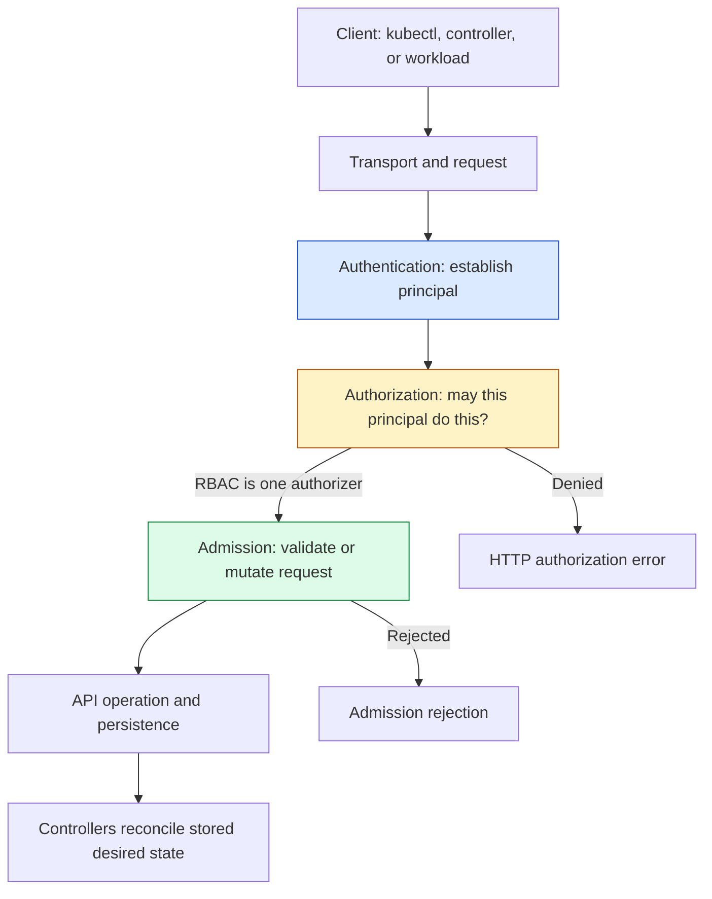

# Unit 9 — Kubernetes RBAC and Pod Security Standards

## Lesson metadata

| Field | Value |
|---|---|
| Target filename | `09-kubernetes-rbac-and-pod-security-standards.md` |
| Unit | Unit 9 — Kubernetes RBAC and Pod Security Standards |
| Audience | Learner completing Stages 0–2D and Stage 2E M01 container images and M02 CI/CD |
| Estimated time | 8–12 hours: 3–4 hours concepts, 4–6 hours labs, 1–2 hours review |
| Prerequisites | Linux, Git, Docker, basic Pods/Deployments, `kubectl`, YAML, CI identity concepts |
| Core tools | `kubectl`, disposable `kind` cluster, Python 3 for the read-only audit script |
| Awareness-only tools | `rbac-tool`, `kubectl-who-can`, `rakkess`, Kyverno, Gatekeeper, kube-bench |
| Last reviewed | 2026-10-25 |
| Kubernetes baseline | **[VERIFY]** Check the exact local cluster minor version with `kubectl version`; this lesson does not assume a particular `kind` image is installed or compatible. The examples use stable API groups and PSS labels pinned to the actual cluster minor version after verification. |
| Budget and environment | Zero-budget, laptop-first; WSL2 Ubuntu or native Linux, approximately 4 CPU, 8 GB RAM, 30 GB disk |
| Repository constraint | This standalone artifact is generated from the supplied Unit 9 prompt. The full repository checkout and authoritative syllabus/tree were not available for independent inspection in this run; repository fidelity therefore remains **NOT VERIFIED**. |

> **Safety contract:** perform mutating commands only in a disposable local `kind` cluster and a uniquely named lab namespace. Never copy commands into a production or shared context. No real credentials, secrets, or long-lived bearer tokens belong in these labs. The examples below are instructional manifests, not proof of a live cluster result.

### Learning objectives

By the end, the learner can:

1. **[L1]** Explain authentication, authorization, and admission in the API request path, and locate RBAC and Pod Security Admission (PSA) in that path.
2. **[L1/L2]** Design `Role`, `ClusterRole`, `RoleBinding`, and `ClusterRoleBinding` rules with correct scope, resources, verbs, subresources, and least privilege.
3. **[L2]** Prove allowed and denied operations with `kubectl auth can-i`, while correctly explaining impersonation prerequisites and limitations.
4. **[L2]** Separate developer, CI deployer, auditor, and application ServiceAccount identities without unnecessary Secret access.
5. **[L2/L3]** Roll out Pod Security Standards (PSS) through `warn`/`audit`, remediation, validation, and carefully staged `enforce`.
6. **[L3]** Identify direct and indirect escalation paths involving wildcard rules, `pods/exec`, Secret reads, workload creation, `bind`, `escalate`, and `impersonate`.
7. **[L3/L4]** Review RBAC as code, use report-first audit tooling, and record access ownership, rationale, expiry/review dates, and evidence.
8. **[L4]** Respond to a compromised CI identity with evidence-preserving containment, least-privilege recovery, credential rotation where warranted, and durable prevention.

## Why this matters in production

Kubernetes RBAC is a blast-radius control. A compromised developer credential, CI job, application Pod, or automation account should not automatically become a cluster administrator. An access grant that is convenient during development can become a cross-namespace incident when it can read Secrets, create workloads, execute inside Pods, impersonate identities, or modify authorization objects.

RBAC is additive: an allowed permission from any applicable binding contributes to the effective authorization decision. There is no general-purpose RBAC “deny rule” that cancels another grant. A safe review therefore examines the complete set of bindings, not only the Role that a team intended to use.

Pod Security Admission is a separate control. It applies built-in Pod Security Standards at namespace scope and can reject Pods that violate the selected profile. RBAC answers **who may submit an API request**; PSA answers **whether the Pod specification meets the selected security policy**. Neither replaces network policy, node hardening, image provenance, cloud workload identity controls, Secret encryption at rest, runtime detection, or backup and recovery.

The production goal is not “make every workload work.” It is to make the intended workload work with the smallest documented authority and to collect evidence that the policy is effective.

## Learning objectives

Use the measurable objectives in Lesson metadata as the completion contract. A learner is not complete merely because the manifests apply. Completion requires actual saved allow/deny results, policy-version evidence, audit-script findings, remediation evidence, and cleanup confirmation. If a lab cannot run in the available environment, record it as **not executed** rather than converting expected behavior into observed evidence.

## Concept map and glossary

### Request-flow diagram



The diagram is a simplified conceptual view; exact request processing and configured authorizers/admission plugins depend on cluster configuration. Authentication establishes a user identity and groups; authorization evaluates the request; admission runs for applicable operations after authentication and authorization. PSA is admission, not RBAC. See the [Kubernetes authentication documentation](https://kubernetes.io/docs/reference/access-authn-authz/authentication/), [authorization overview](https://kubernetes.io/docs/reference/access-authn-authz/authorization/), and [admission controllers](https://kubernetes.io/docs/reference/access-authn-authz/admission-controllers/).

### Glossary

| Term | Precise definition | Common misconception |
|---|---|---|
| Authentication | Establishes the identity/principal represented by an API request. | It does not itself grant permissions. |
| Authorization | Determines whether the authenticated principal may perform a requested action on a resource or non-resource URL. | “Authenticated” does not mean “authorized.” |
| Admission | Mutating and/or validating processing for applicable API requests after authorization. | Admission is not a substitute for identity or RBAC. |
| RBAC | Kubernetes role-based authorization mechanism based on rules and bindings. | RBAC does not authenticate users, encrypt Secrets, or filter network traffic. |
| Principal | Identity used by an authorization decision, such as a user, group, or ServiceAccount identity. | A principal need not be a Kubernetes API object. |
| User | Authenticated identity name supplied by the configured authentication system. | Kubernetes does not generally store ordinary human user accounts as native API objects. |
| Group | Set of identities represented as groups by authentication; RBAC can grant permissions to a group name. | A group string in a manifest does not create or authenticate group members. |
| ServiceAccount | Namespaced Kubernetes identity intended for workloads and automation. | Creating a ServiceAccount does not automatically grant useful API permissions. |
| Role | Namespace-scoped collection of permission rules. | A Role is not cluster-wide. |
| ClusterRole | Cluster-scoped rule object that can describe cluster resources, non-resource URLs, or reusable rules. | Referencing a ClusterRole does not automatically make a RoleBinding cluster-wide. |
| RoleBinding | Grants its subjects permissions from a Role or ClusterRole within the binding namespace. | A RoleBinding to a ClusterRole still grants only in that namespace. |
| ClusterRoleBinding | Grants a ClusterRole's permissions at cluster scope. | It should not be used just because a role is reusable. |
| API group | API namespace used to distinguish resource types, e.g. `apps` or the core group `""`. | The core group is not literally named `core` in RBAC rules. |
| Resource | API object collection such as `pods`, `deployments`, or `secrets`. | Similar names do not imply similar permissions. |
| Verb | API action such as `get`, `list`, `watch`, `create`, `update`, `patch`, or `delete`. | `read` is not a universal RBAC verb. |
| Subresource | Nested API endpoint such as `pods/log`, `pods/exec`, or `deployments/scale`. | Permission on `pods` does not automatically mean permission on every subresource. |
| Non-resource URL | API endpoint that is not an API object collection, such as selected `/healthz` paths. | These rules are not scoped to a namespace resource. |
| Least privilege | Grant only permissions needed for a documented task, within the narrowest practical scope. | A role with few lines is not necessarily least-privileged. |
| Wildcard permission | Use of `*` in API groups, resources, or verbs. | Wildcards can silently expand as APIs and resources evolve. |
| Aggregation label | Label used by ClusterRole aggregation to combine rules into an aggregate ClusterRole. | A label can change effective permissions indirectly. |
| Impersonation | Authorized ability to make an API request as another user/group/service account for testing or delegated workflows. | `kubectl --as` does not authenticate as a real user by itself. |
| `pods/exec` | Subresource used to request command execution in a container. | It can expose in-container data and credentials even without direct Secret API access. |
| `pods/log` | Subresource used to read a Pod's logs. | Logs are always safe; applications may accidentally log sensitive data. |
| `bind` | Special authorization verb governing binding roles beyond the caller's existing authority. | Permission to create a binding should not be treated as ordinary object administration. |
| `escalate` | Special authorization verb relevant to creating/updating roles with permissions beyond the caller's own. | A role editor cannot safely be assumed unable to increase privileges. |
| `impersonate` | Special authorization verb that allows requests to act as selected users/groups/service accounts or related identity resources. | It is not the same as normal workload API access. |
| Pod Security Admission (PSA) | Built-in admission controller enforcing, auditing, and warning on Pod Security Standards. | PSA is not a third-party webhook by definition. |
| Pod Security Standards (PSS) | Kubernetes-defined profiles `Privileged`, `Baseline`, and `Restricted`. | They do not represent a complete workload threat model. |
| Privileged | Most permissive PSS profile; does not apply the restrictive baseline checks. | It is not an appropriate default for ordinary application namespaces. |
| Baseline | Profile designed to prevent known privilege escalations while allowing common workloads. | It is not as strict as Restricted. |
| Restricted | More restrictive profile aligned with Pod hardening practices. | It does not guarantee the image is safe or the application is vulnerability-free. |
| `enforce` | Rejects violating Pod creation under the selected namespace policy. | Applying it without workload inventory can break rollouts. |
| `audit` | Adds policy-violation annotations to API audit events when audit logging is available/configured. | It does not block the request. |
| `warn` | Returns a client-facing warning for policy violations while allowing the request. | It is not an enforcement mode. |
| Exemption | Configured exception to PSA processing for specified usernames, namespaces, or RuntimeClasses. | Exemptions are not harmless convenience flags; they bypass PSA modes. |
| `securityContext` | Pod- or container-level fields that configure security-related runtime behavior. | Pod-level and container-level settings have different scopes and precedence. |
| seccomp | Linux syscall filtering mechanism; `RuntimeDefault` asks the runtime to use its default profile. | It is not a universal application sandbox or complete syscall policy review. |
| Linux capabilities | Fine-grained privileges that divide some traditional root powers. | Running as UID 0 is not the only way to gain risky capabilities. |
| Projected/bound ServiceAccount token | Token projected into a Pod, normally with audience and expiration properties managed by Kubernetes. | It is not the same as a legacy long-lived Secret-backed token. |
| Token automount | Controls automatic mounting of a ServiceAccount credential into a Pod. | Disabling automount does not revoke external credentials or all possible token paths. |
| etcd encryption at rest | Encryption mechanism for persisted API data when configured. | RBAC does not encrypt stored Secret values. |
| Admission webhook | External webhook invoked by configured admission controllers to mutate or validate requests. | It is not identical to built-in PSA or in-process CEL policy. |
| Policy-as-code | Version-controlled, reviewed, testable policy definitions and associated release process. | Storing YAML in Git alone does not prove deployed policy matches Git. |
| Break-glass | Controlled emergency access with approval, limited scope/time, audit, and post-use review. | It must not mean permanent `cluster-admin` access. |
| Access recertification | Periodic owner review confirming each grant is still needed and correctly scoped. | A role that has not caused an incident is not automatically justified. |

## L1 — Beginner: identity, authentication, authorization, and admission

### 1. The three decisions

A request such as “update Deployment `inference-api` in namespace `ml-serving`” crosses distinct control points:

1. **Authentication:** the API server determines the caller identity from the configured credentials/authenticator.
2. **Authorization:** the configured authorizer(s), including RBAC if enabled, decide whether that principal may `patch` the Deployment in the requested namespace.
3. **Admission:** applicable mutating and validating controls inspect or alter the request. PSA may reject a resulting Pod that violates the namespace's selected policy.
4. **Persistence and reconciliation:** if accepted, the API object is stored and controllers reconcile desired state. Creating a Deployment does not mean its Pod will necessarily be admitted or become healthy.

A denied request can fail before admission. Conversely, authorization may permit a Deployment request but Pod creation may later be rejected by PSA. Debug the layer that actually denied the request rather than adding broad RBAC permissions to “fix” an admission failure.

### 2. Human users, groups, and ServiceAccounts

Kubernetes typically receives ordinary human user names and group membership from an external authentication mechanism. They are not generally created as `User` objects in the Kubernetes API. RBAC rules refer to identity names and groups; the authentication provider must actually issue those identities.

ServiceAccounts are API objects namespaced to a workload boundary. For example, `ml-serving/inference-api` is distinct from `etl/batch-worker`. Give each application or automation trust boundary its own ServiceAccount where practical. Reusing a privileged ServiceAccount across jobs means a compromise in the weakest job can inherit the shared authority.

### 3. RBAC objects and scope

- `Role`: rules usable within one namespace.
- `ClusterRole`: reusable rules, including rules for cluster-scoped resources or non-resource URLs.
- `RoleBinding`: binds a Role or ClusterRole to subjects in a namespace. If it references a ClusterRole, that ClusterRole's namespaced-resource permissions are effective only in the RoleBinding's namespace.
- `ClusterRoleBinding`: binds a ClusterRole to subjects across the cluster scope represented by its rules.

RBAC permissions are additive. To find effective access, inspect all relevant RoleBindings and ClusterRoleBindings, not just the role you authored. Aggregated ClusterRoles also need review because labels can add rules from other ClusterRoles.

### 4. Read a rule precisely

```yaml
apiVersion: rbac.authorization.k8s.io/v1
kind: Role
metadata:
  name: deployment-inspector
  namespace: ml-serving
rules:
  - apiGroups: ["apps"]
    resources: ["deployments"]
    verbs: ["get", "list", "watch"]
```

`apiGroups: ["apps"]` means the `apps` API group. Core API resources such as Pods and Secrets use `apiGroups: [""]`. `resources` names the API collection. `verbs` names the allowed operations. Avoid `*` unless a documented, reviewed need justifies its future expansion risk.

Subresources must be considered separately. `pods/log` is not interchangeable with `pods`; `pods/exec` can be particularly sensitive because a caller may run commands inside a container. `resourceNames` can constrain some verbs to named objects, but it does not provide a general solution for every `create` request. Validate exact API behavior against the [RBAC reference](https://kubernetes.io/docs/reference/access-authn-authz/rbac/).

### 5. `kubectl auth can-i`

Examples (use a real, authenticated principal or an explicitly authorized impersonation test):

```bash
kubectl auth can-i get deployments -n ml-serving
kubectl auth can-i patch deployments.apps -n ml-serving
kubectl auth can-i get pods/log -n ml-serving
kubectl auth can-i create pods/exec -n ml-serving
kubectl auth can-i --list -n ml-serving
```

`kubectl auth can-i --as=some-user` asks an authorization question for an impersonated identity. The caller must be allowed to impersonate the requested user; `--as-group` likewise requires suitable impersonation authority. If the command fails with an impersonation authorization error, that is not evidence that the target identity lacks the requested workload permission. If it returns an authorization decision, it still does not prove the identity can successfully authenticate from a real client, nor does it test admission behavior.

Use only harmless, explicitly scoped identity names in the lab. Do not grant impersonation broadly merely to make tests convenient. Official reference: [kubectl auth can-i](https://kubernetes.io/docs/reference/kubectl/generated/kubectl_auth/kubectl_auth_can-i/).

## L2 — Intermediate: least-privilege RBAC and Pod Security Admission

### 1. Three personas

The examples below define permission intent, not a universal template. Adjust verbs to the deployment system and the exact resources it needs.

| Persona | Intended authority | Explicit non-goals |
|---|---|---|
| Developer | Inspect Deployments/Pods and update a designated Deployment in one namespace | No Secret reads, no Role changes, no Pod creation, no `exec` by default |
| CI deployer | Manage the one application Deployment and read rollout status in one namespace | No cluster-wide permissions, no Secret reads, no role binding, no `exec` |
| Auditor | Read selected workload metadata and Pod logs if approved | No Secret reads, no workload mutation, no RBAC mutation |

**Important limitation:** RBAC cannot fully express “may create only Pods that satisfy this particular security design” on its own. Workload creation rights can be an escalation path because a user who can create a Pod or controller may select ServiceAccounts, mount accessible Secrets, or request risky Pod settings subject to admission controls. Pair RBAC with admission policy, namespace isolation, and workload review.

### 2. Example namespace-scoped roles

The complete core rules are shown here; Lab A contains the matching bindings and test plan. The developer's update permission is intentionally limited to `deployments` as an API resource, not all `apps` resources.

```yaml
apiVersion: rbac.authorization.k8s.io/v1
kind: Role
metadata:
  name: developer-deployment-maintainer
  namespace: rbac-lab
rules:
  - apiGroups: ["apps"]
    resources: ["deployments"]
    verbs: ["get", "list", "watch", "patch", "update"]
  - apiGroups: [""]
    resources: ["pods"]
    verbs: ["get", "list", "watch"]
---
apiVersion: rbac.authorization.k8s.io/v1
kind: Role
metadata:
  name: ci-deployer
  namespace: rbac-lab
rules:
  - apiGroups: ["apps"]
    resources: ["deployments"]
    verbs: ["get", "list", "watch", "create", "patch", "update"]
  - apiGroups: [""]
    resources: ["pods"]
    verbs: ["get", "list", "watch"]
  - apiGroups: [""]
    resources: ["pods/log"]
    verbs: ["get"]
---
apiVersion: rbac.authorization.k8s.io/v1
kind: Role
metadata:
  name: workload-auditor
  namespace: rbac-lab
rules:
  - apiGroups: ["apps"]
    resources: ["deployments"]
    verbs: ["get", "list", "watch"]
  - apiGroups: [""]
    resources: ["pods"]
    verbs: ["get", "list", "watch"]
  - apiGroups: [""]
    resources: ["pods/log"]
    verbs: ["get"]
```

A real deployment tool may need ReplicaSets, Events, ConfigMaps, or other resources; add them only after observing the tool's actual API calls and documenting why. Do not add Secret reads to make a deployment “work” without determining which secret and which identity need it.

### 3. ServiceAccount tokens

A Pod's ServiceAccount identity and its API token are related but distinct concerns. If a workload does not call the Kubernetes API, set `automountServiceAccountToken: false` on the Pod or ServiceAccount where appropriate. This reduces automatic credential exposure; it does not make the Pod invulnerable or remove any external cloud credentials.

**[VERIFY]** Token projection and TokenRequest behavior depend on Kubernetes version and cluster configuration. Kubernetes documents projected ServiceAccount tokens as expiring and rotated by the kubelet; legacy manually created Secret-backed tokens can be long-lived and are not the preferred pattern. Confirm behavior for the target cluster in the [ServiceAccount documentation](https://kubernetes.io/docs/concepts/security/service-accounts/) and [projected volumes documentation](https://kubernetes.io/docs/concepts/storage/projected-volumes/). Do not create a long-lived bearer token for these labs.

Token audience is important: a token should be accepted only by the intended audience. Do not assume a Kubernetes API token is valid for a cloud provider or another service. Verify the target identity integration and issuer/audience settings.

### 4. Aggregated ClusterRoles

ClusterRole aggregation uses labels and an aggregation rule to combine rules from matching ClusterRoles. This is useful for extensible built-in roles, but it can expand a role when another labeled ClusterRole is introduced. Review aggregation selectors and the final aggregated rules as part of change review. Do not assume that reviewing only the aggregate role's local `rules` field shows the effective permissions.

### 5. Why common grants are risky

- `cluster-admin`: broad administrative control; reserve for tightly governed administration.
- Wildcard verbs/resources/groups: future APIs can be covered unintentionally.
- `get/list/watch` on Secrets: reveals secret values to authorized readers; `list` can expose many Secrets at once.
- `pods/exec` and `pods/attach`: can expose in-container files, processes, environment, mounted credentials, and application state.
- Creating Pods/workload controllers: may enable mounting a Secret or selecting a more privileged ServiceAccount, subject to other controls.
- `bind`, `escalate`, and `impersonate`: can enable indirect privilege changes or identity abuse.
- Editing Roles/ClusterRoles or bindings: can grant or propagate authority beyond the original task.

Official guidance: [RBAC good practices](https://kubernetes.io/docs/concepts/security/rbac-good-practices/) and [Kubernetes security checklist](https://kubernetes.io/docs/concepts/security/security-checklist/).

### 6. PSS profiles and PSA modes

The built-in Pod Security Standards have three levels:

- `privileged`: broadly unrestricted.
- `baseline`: blocks known privilege escalations while supporting common workloads.
- `restricted`: more restrictive, aligned with Pod hardening best practices.

PSA namespace labels use keys such as `pod-security.kubernetes.io/enforce`, `pod-security.kubernetes.io/audit`, and `pod-security.kubernetes.io/warn`. Optional `*-version` labels pin a policy to a Kubernetes minor version or `latest`.

**[VERIFY]** Before applying labels, check `kubectl version` and the documentation for that exact minor release. The documented pattern is:

```text
pod-security.kubernetes.io/<MODE>: <LEVEL>
pod-security.kubernetes.io/<MODE>-version: <KUBERNETES_MINOR_VERSION_OR_latest>
```

For example, a label value may be `v1.XX`, but replace `XX` only with the verified cluster minor version. Never copy a placeholder literally. Official references: [Pod Security Admission](https://kubernetes.io/docs/concepts/security/pod-security-admission/) and [Pod Security Standards](https://kubernetes.io/docs/concepts/security/pod-security-standards/).

- `warn`: the client receives a warning; the request is otherwise allowed.
- `audit`: policy violation information is added to the audit event when audit logging is available and configured; the request is otherwise allowed.
- `enforce`: a violating Pod creation is rejected.
- PSA applies checks to Pod objects. Warnings/audit observations can also be produced when workload resources with Pod templates are submitted, but enforcement is applied to the resulting Pod object. Controllers can therefore create a Deployment object that later fails to create its Pods.

Exemptions can bypass PSA's modes for configured usernames, namespaces, or RuntimeClasses. Treat exemptions as controlled exceptions with owners, rationale, and review dates; do not exempt general-purpose controller identities casually.

### 7. Restricted-compatible Deployment example

This is a starting point for a Linux image that supports non-root execution and does not require writing to its root filesystem. Test the actual image. A numeric UID is not universally compatible: some images require a specific user, writable paths, or filesystem layout. `readOnlyRootFilesystem: true` is a strong hardening best practice, but is **not itself a universal PSS requirement**.

```yaml
apiVersion: apps/v1
kind: Deployment
metadata:
  name: restricted-demo
  namespace: pss-lab
spec:
  replicas: 1
  selector:
    matchLabels:
      app: restricted-demo
  template:
    metadata:
      labels:
        app: restricted-demo
    spec:
      automountServiceAccountToken: false
      securityContext:
        runAsNonRoot: true
        runAsUser: 10001
        runAsGroup: 10001
        seccompProfile:
          type: RuntimeDefault
      containers:
        - name: web
          image: nginxinc/nginx-unprivileged:stable
          ports:
            - name: http
              containerPort: 8080
          securityContext:
            allowPrivilegeEscalation: false
            capabilities:
              drop: ["ALL"]
            readOnlyRootFilesystem: true
          resources:
            requests:
              cpu: 25m
              memory: 32Mi
            limits:
              cpu: 200m
              memory: 128Mi
```

**[VERIFY]** Confirm the selected image tag is available and supports the configured UID, port, and read-only root filesystem before applying it. For an offline lab, substitute a locally cached image and record that choice. The Restricted policy has additional version-sensitive details; check the exact [Restricted profile requirements](https://kubernetes.io/docs/concepts/security/pod-security-standards/) for the target minor version. Do not assume this one manifest is portable to every image or OS.

Link to earlier module: **M01 — Container Images**, especially non-root users, minimal images, runtime defaults, writable paths, and deterministic image references. This unit focuses on admission and authorization rather than repeating image construction.

### 8. Kyverno, Gatekeeper, and native admission

| Control | What it is | Use and caveat |
|---|---|---|
| Built-in PSA/PSS | Kubernetes-native namespace-level enforcement of predefined Pod Security Standards | Appropriate for the standard Pod hardening profiles; configure labels and exemptions deliberately. |
| Kyverno | Third-party policy engine with policy resources and admission integration | Can express broader Kubernetes policy; syntax and behavior depend on installed Kyverno version. **Awareness only; verify official docs before deploying a policy.** |
| OPA Gatekeeper | Third-party policy engine built around Open Policy Agent and constraint templates | Supports custom constraints; requires CRDs/controllers and operational ownership. **Awareness only; verify exact version and policy API.** |
| ValidatingAdmissionPolicy + CEL | Kubernetes-native declarative validation using CEL | **[VERSION-SENSITIVE]** Confirm API version, feature state, and release documentation before use. Current Kubernetes documentation marks the `admissionregistration.k8s.io/v1` policy API stable since v1.30, but verify the target release. |

Do not conflate a third-party policy engine with PSA. More policy is not automatically more secure: policy controllers themselves need upgrades, availability planning, exception governance, and tests. References: [Kyverno documentation](https://kyverno.io/docs/), [Gatekeeper documentation](https://open-policy-agent.github.io/gatekeeper/website/docs/), and [ValidatingAdmissionPolicy](https://kubernetes.io/docs/reference/access-authn-authz/validating-admission-policy/).

## L3 — Advanced: privilege escalation and policy auditing

### 1. Threat paths to evaluate

A useful threat model starts with a compromised principal and asks which API operations it can invoke, what data it can reach, and whether it can create a more privileged execution context.

| Permission or condition | Potential path | Review question |
|---|---|---|
| `get/list` Secrets | Read credential material directly | Are Secret values required, and is access limited to named/necessary resources? |
| `create` Pods or controllers | Mount a Secret, choose a ServiceAccount, or request risky Pod settings | Which admission policies constrain the resulting Pod? |
| `pods/exec` / `pods/attach` | Enter a running container and inspect process state or mounted files | Is interactive access necessary, approved, and audited? |
| `bind` | Bind a role the caller would not otherwise be able to grant | Can this principal grant permissions it does not hold? |
| `escalate` | Create/update a role with permissions beyond caller's own | Are role-writing permissions absent from routine personas? |
| `impersonate` | Make requests as selected users/groups/ServiceAccounts | Are targets narrow and test use controlled? |
| Wildcard rules | Gain new permissions as API resources evolve | Are wildcard grants prohibited or exception-reviewed? |
| ClusterRoleBinding | Extend authority across cluster scope | Is cluster scope justified and owned? |
| Shared ServiceAccount | Compromise one workload/job and inherit shared identity | Can identities be separated? |
| Pod to node/cloud identity | Reach node credentials, metadata endpoints, or mounted credentials depending on configuration | Are network, node, cloud identity, and runtime controls separately hardened? |

Impact depends on cluster configuration, admission controls, node/runtime isolation, cloud provider, network policy, and the identity available to the workload. Do not describe a path as guaranteed exploitation without evidence.

### 2. “Who can do X?” audit workflow

Start with the built-in tools and inspect bindings:

```bash
# Show the current identity and context before any diagnostic.
kubectl config current-context
kubectl auth whoami
kubectl auth can-i --list -n <NAMESPACE>

kubectl get roles,rolebindings -n <NAMESPACE> -o yaml
kubectl get clusterroles,clusterrolebindings -o yaml
kubectl get clusterroles --show-labels
```

`kubectl auth whoami` availability is version-sensitive; if unsupported, use the configured identity provider's documented method. Avoid dumping all YAML to a public log if it includes sensitive metadata. Inspect the effective binding path and aggregation labels.

Optional ecosystem tools (`rbac-tool`, `kubectl-who-can`, `rakkess`) can help visualize authorization, but their installation commands, supported Kubernetes versions, and output formats are **[VERIFY]** and Awareness-only here. Do not install unpinned binaries in production. Tool output is an aid to review, not a proof of absence of escalation.

### 3. Namespace rollout strategy for PSS

1. Inventory namespaces and owners; identify system, platform, application, and exception namespaces.
2. Pin the intended PSS version for each mode; record the exact label values and cluster minor version.
3. Apply `warn` and `audit` to a dedicated pilot namespace.
4. Collect warnings/audit events; ensure cluster audit logging is configured if audit evidence is required.
5. Assign each finding to an application owner and remediate the image, user, capabilities, seccomp, and filesystem compatibility.
6. Test manifests against the selected profile using the actual image and workload.
7. Enable `enforce` in the pilot namespace, observe rollouts, and verify rollback procedure.
8. Expand by namespace cohort with explicit owners and change windows.
9. Review exemptions, stale exceptions, and policy-version upgrades regularly.

Do **not** enable `enforce=restricted` cluster-wide without inventory and workload compatibility assessment. Avoid weakening a production namespace to unblock a release without the authorized owner, documented scope, compensating controls, and expiry.

### 4. Security context debugging

`spec.securityContext` applies Pod-level settings such as `runAsNonRoot`, `runAsUser`, `runAsGroup`, and `seccompProfile`. `containers[].securityContext` applies settings to a specific container, including `allowPrivilegeEscalation`, capabilities, and `readOnlyRootFilesystem`. Check the exact PSS requirements and the actual image behavior.

When admission denies a Pod:

```bash
kubectl describe pod <POD> -n <NAMESPACE>
kubectl get events -n <NAMESPACE> --sort-by=.lastTimestamp
kubectl get deployment <DEPLOYMENT> -n <NAMESPACE> -o yaml
kubectl get namespace <NAMESPACE> --show-labels
```

For a Deployment that exists but has no ready Pods, inspect ReplicaSets, events, and the Pod admission error. Do not infer that the Deployment was successfully deployed just because its API object exists.

### 5. Secrets, etcd, and workload identity

RBAC controls which authenticated principals can request Secret objects; it does not encrypt Secret values. Kubernetes Secret data is base64-encoded in manifests, which is not encryption. Encryption at rest depends on API-server configuration and the backing datastore setup. Audit who can read/list Secrets, who can create workloads that mount them, and who can execute into workloads that already have them mounted.

For a compromised Pod, check:
- whether its ServiceAccount token is mounted and what API permissions it has;
- whether the workload needs Kubernetes API access at all;
- which Secrets and projected volumes are mounted;
- whether cloud workload identity or node credentials may be reachable;
- whether network policy, node isolation, image controls, and runtime detection exist.

Forward reference: **M09 — Secrets and Workload Identity** for credential lifecycle and external identity integration. Do not place real Secret values in command output or evidence files.

### 6. Read-only RBAC risk scanner

The following Python script is deliberately heuristic and report-first. It reads the current context and namespace-scoped Roles/RoleBindings plus cluster-wide ClusterRoles/ClusterRoleBindings, then flags selected risky patterns. It does not attempt to calculate every effective permission, fully interpret aggregation, simulate all API authorization rules, or prove the absence of privilege escalation. It uses `kubectl` output and requires `kubectl` to be installed and authenticated.

Save as `rbac_audit.py` in a temporary local working directory (not as an extra repository artifact unless your project explicitly allows it). It does not mutate the cluster.

```python
#!/usr/bin/env python3
"""Report-only RBAC heuristic. No cluster mutations are performed."""
import json
import subprocess
import sys

EXPECTED_CONTEXT = "kind-rbac-security-lab"
EXPECTED_NAMESPACE = "rbac-lab"

def run_json(args):
    completed = subprocess.run(
        ["kubectl", *args, "-o", "json"],
        check=True, text=True, capture_output=True,
    )
    return json.loads(completed.stdout)

def main():
    context = subprocess.run(
        ["kubectl", "config", "current-context"],
        check=True, text=True, capture_output=True,
    ).stdout.strip()
    if context != EXPECTED_CONTEXT:
        sys.exit(
            f"STOP: context {context!r} is not the expected lab context "
            f"{EXPECTED_CONTEXT!r}. Edit the constant only after verifying "
            "your disposable kind context."
        )

    ns = subprocess.run(
        ["kubectl", "get", "namespace", EXPECTED_NAMESPACE, "-o", "name"],
        check=True, text=True, capture_output=True,
    ).stdout.strip()
    if ns != f"namespace/{EXPECTED_NAMESPACE}":
        sys.exit("STOP: expected lab namespace is missing.")

    roles = run_json(["get", "roles", "-n", EXPECTED_NAMESPACE])["items"]
    role_bindings = run_json(["get", "rolebindings", "-n", EXPECTED_NAMESPACE])["items"]
    cluster_roles = run_json(["get", "clusterroles"])["items"]
    cluster_bindings = run_json(["get", "clusterrolebindings"])["items"]

    role_index = {item["metadata"]["name"]: item for item in roles}
    cluster_role_index = {item["metadata"]["name"]: item for item in cluster_roles}
    findings = []

    def inspect_rules(label, rules):
        for rule in rules or []:
            groups = rule.get("apiGroups", [])
            resources = rule.get("resources", [])
            verbs = rule.get("verbs", [])
            if "*" in groups or "*" in resources or "*" in verbs:
                findings.append(f"{label}: wildcard rule groups={groups} resources={resources} verbs={verbs}")
            if "secrets" in resources and any(v in verbs for v in ("get", "list", "watch", "*")):
                findings.append(f"{label}: Secret read/list/watch capability verbs={verbs}")
            if any(r in resources for r in ("roles", "clusterroles", "rolebindings", "clusterrolebindings")):
                findings.append(f"{label}: can access RBAC objects resources={resources} verbs={verbs}")
            if "pods/exec" in resources or "pods/attach" in resources:
                findings.append(f"{label}: interactive container subresource resources={resources}")

    for name, role in role_index.items():
        inspect_rules(f"Role {EXPECTED_NAMESPACE}/{name}", role.get("rules"))
    for name, role in cluster_role_index.items():
        # Report all cluster roles with risky rules; bindings below determine reachability.
        inspect_rules(f"ClusterRole {name} (review binding reachability)", role.get("rules"))

    for binding in role_bindings:
        ref = binding.get("roleRef", {})
        role_name = ref.get("name")
        kind = ref.get("kind")
        if kind == "Role":
            role = role_index.get(role_name)
        elif kind == "ClusterRole":
            role = cluster_role_index.get(role_name)
        else:
            role = None
        if role is None:
            findings.append(f"RoleBinding {binding['metadata']['name']}: roleRef {kind}/{role_name} not found in inspected index")
            continue
        inspect_rules(f"Reachable through RoleBinding {binding['metadata']['name']} -> {kind}/{role_name}", role.get("rules"))

    for binding in cluster_bindings:
        ref = binding.get("roleRef", {})
        role = cluster_role_index.get(ref.get("name")) if ref.get("kind") == "ClusterRole" else None
        if role is not None:
            inspect_rules(f"ClusterRoleBinding {binding['metadata']['name']} -> ClusterRole/{ref.get('name')}", role.get("rules"))

    print(f"Context: {context}")
    print(f"Namespace: {EXPECTED_NAMESPACE}")
    print("REPORT ONLY — no resources were changed.")
    if findings:
        for finding in sorted(set(findings)):
            print(f"FINDING: {finding}")
    else:
        print("No selected heuristic patterns found; this is not proof of safety.")
    print("Review each finding manually before proposing a change.")

if __name__ == "__main__":
    main()
```

**Script caveats:** the context and namespace constants are intentional stop gates and must match the disposable lab you created. This heuristic can produce false positives by flagging a risky ClusterRole that is not bound to a relevant principal, and false negatives by missing indirect paths, rules outside the inspected namespace, aggregation effects, non-resource URLs, authorization modes, admission interactions, and workload-specific risks. It is not a compliance scanner.

## L4 — Expert: access governance and incident response

### 1. RBAC as code

Treat RBAC changes as security-sensitive software changes:

- Keep role and binding manifests in version control with a named owner and business purpose.
- Use reviewed, reusable templates with narrowly scoped rules rather than copying cluster-admin examples.
- Require automated checks for wildcards, Secret read, `pods/exec`, workload creation, RBAC-object mutation, `bind`, `escalate`, and `impersonate`.
- Test positive and negative authorization decisions in a disposable cluster or controlled test environment.
- Review effective permissions, including aggregation labels and all relevant bindings.
- Promote the same reviewed artifact through environments; do not hand-edit production objects without reconciling the source of truth.
- Detect drift between Git and live objects and route discrepancies to the owning team.
- Recertify access periodically and after team, workload, or pipeline ownership changes.

A successful manifest validation checks syntax and API schema, not the quality of the permission model. A policy linter checks selected patterns, not all effective authorization outcomes.

### 2. Access recertification

For every grant, record:
- principal and identity type;
- namespace or cluster scope;
- Role/ClusterRole and binding name;
- exact resources, subresources, verbs, and Secret/exec/impersonation exposure;
- business purpose, owner, and approver;
- last review date and next review/expiry date;
- available usage or audit evidence (absence of evidence is not proof of non-use);
- verification commands and revocation plan.

If no owner can explain a grant, do not delete it blindly during an incident; assess dependencies, identify a safe replacement, then narrow or remove it through a controlled change.

### 3. Break-glass access

A break-glass process should use a named requester and approver, strong authentication, minimal scope, a short authorized time window, an auditable execution path, and mandatory post-use review. Kubernetes RBAC bindings do not have a universal native TTL field that automatically expires every grant. If temporary access is required, implement a controlled external workflow/controller or operator process that creates and revokes the binding and independently verifies revocation. The expiry timestamp in a ticket is not itself enforcement.

### 4. Multi-team authorization model

| Team/persona | Scope | Typical authority | Guardrails |
|---|---|---|---|
| Platform operators | Cluster scope only for platform operations | Carefully limited node/namespace/cluster resource operations | Separate emergency administrator path; audited changes; no shared daily admin identity |
| Application team | Own application namespace(s) | Read workloads, update owned Deployment/Job resources as approved | No RBAC object changes, broad Secret read, or interactive access by default |
| CI deployer | Dedicated pipeline identity, application namespace | Minimum verbs needed for release and rollout checks | Separate identity per pipeline/trust boundary; no cluster-wide binding |
| Auditor | Approved namespaces | Read approved metadata/logs | Exclude Secrets by default; record evidence access and review cadence |
| Workload ServiceAccount | One workload identity per trust boundary | API calls required by that workload only | Disable token automount if unused; narrow audience and permissions as appropriate |
| Break-glass responder | Time-bounded, incident-specific scope | Explicitly approved emergency operations | Named approver, audit, post-use review, revoke and verify |

Namespace isolation is a useful boundary but not a complete tenant security boundary by itself. Consider shared node access, network reachability, admission, resource controls, cloud identities, and control-plane privileges.

### 5. Required reusable governance templates

#### RBAC inventory

| Principal | Type | Namespace | Role/ClusterRole | Binding | Verbs/resources/subresources | Secret access? | `exec` access? | Owner | Business reason | Last review | Expiry/review date | Evidence |
|---|---|---|---|---|---|---|---|---|---|---|---|---|
| `<principal>` | `<user/group/ServiceAccount>` | `<namespace or cluster>` | `<role>` | `<binding>` | `<exact rules>` | `<yes/no + why>` | `<yes/no + why>` | `<team/person>` | `<purpose>` | `<date>` | `<date>` | `<commands/ticket>` |

#### Access request / review record

```text
Request ID:
Requester / principal:
Workload or team owner:
Requested resources, verbs, subresources:
Namespace / cluster scope:
Business rationale:
Why existing narrower role is insufficient:
Secret / exec / workload-create / RBAC-write / impersonation implications:
Approver:
Start time / end time (if temporary):
Verification commands and expected allow/deny decisions:
Evidence location:
Revocation plan and responsible owner:
Review date:
Decision and rationale:
```

#### Threat-model table

| Asset | Principal | Trust boundary | Abuse path | Impact | Preventive control | Detective control | Recovery |
|---|---|---|---|---|---|---|---|
| Kubernetes API | CI ServiceAccount | CI to cluster | Cluster-wide Secret read | Credential exposure across namespaces | Namespace Role, no Secret reads, review gate | Audit logs, risky-rule checks | Remove/narrow grant; rotate potentially exposed credentials |
| Application data | Compromised Pod | Workload to API/data | Stolen token or mounted Secret | Unauthorized API/data access | Minimal ServiceAccount, token automount off if unused, network controls | Runtime and API audit signals | Contain workload; revoke identity; rotate secrets |
| Cluster authorization | Role editor | Team namespace to authorization plane | Create/bind elevated role | Privilege escalation | No routine RBAC writes; explicit `bind`/`escalate` review | Drift detection and role diff | Revoke grant; restore reviewed source of truth |
| Node/cloud identity | Workload | Pod to node/provider boundary | Reach node credential or metadata endpoint | Wider infrastructure compromise | Node isolation, cloud identity controls, network restrictions | Runtime/network telemetry | Isolate node/workload; rotate affected credentials |

#### RBAC change-review checklist

- [ ] Principal, owner, business reason, namespace, and expiry/review date are recorded.
- [ ] Namespaced Role/RoleBinding is used unless cluster scope is justified.
- [ ] No wildcard groups/resources/verbs without a documented exception.
- [ ] Secret reads, `pods/exec`, `pods/attach`, workload creation, and RBAC-object writes were reviewed.
- [ ] `bind`, `escalate`, and `impersonate` were explicitly checked.
- [ ] ClusterRole aggregation and all relevant bindings were inspected.
- [ ] Positive and negative `kubectl auth can-i` tests are saved.
- [ ] Admission and workload-creation implications are documented.
- [ ] Rollback/revocation plan and approver are identified.

#### PSS rollout plan

| Namespace | Owner | Current policy/version | Initial warn/audit findings | Remediation owner | Exemption and rationale | Enforce gate | Rollback plan | Evidence |
|---|---|---|---|---|---|---|---|---|
| `<namespace>` | `<owner>` | `<profile + pinned version>` | `<findings>` | `<team>` | `<none or exception>` | `<tests/approval>` | `<warn rollback and checks>` | `<logs/manifests>` |

#### Break-glass record

```text
Incident ID:
Requester and approver:
Principal / identity:
Granted scope and exact permissions:
Start and end time:
Reason normal access path was insufficient:
Commands/actions performed:
Audit evidence and evidence custodian:
Credentials or Secrets potentially exposed:
Revocation action and verification:
Post-use review owner/date:
Follow-up controls and due dates:
```

#### Incident timeline / after-action review

| Time (UTC) | Signal / fact | Confidence/source | Action | Decision owner | Result/evidence |
|---|---|---|---|---|---|
| `<time>` | `<signal>` | `<audit event/ticket/unknown>` | `<action>` | `<owner>` | `<evidence>` |

After-action fields: impact and affected principals; confirmed versus unknown data access; root cause supported by evidence; containment gaps; durable prevention; owner and due date per action; communication recipients; success criteria and retest date.

### 6. Frameworks and scanners

Use the [CIS Kubernetes Benchmark](https://www.cisecurity.org/benchmark/kubernetes) and the [NSA/CISA Kubernetes Hardening Guidance](https://media.defense.gov/2022/Aug/29/2003066362/-1/-1/0/CTR_Kubernetes_Hardening_Guidance_1.2_20220829.PDF) as reference frameworks where applicable. Verify the exact benchmark version and distribution profile before claiming alignment. kube-bench-style scanners can highlight configuration gaps but do not certify compliance by themselves; interpret findings against the target platform and documented scope.

### 7. Incident response: “A CI ServiceAccount had cluster-wide Secret read”

This is a scenario walkthrough, not a claim that an actual incident occurred.

**Phase 1 — Detect and establish facts.** Plausible signals include a new ClusterRoleBinding, an RBAC drift alert, an access review finding, or an API audit event showing a CI identity reading Secret objects. These are examples, not observed facts. Preserve relevant API audit logs, Git changes, CI job metadata, timestamps, principal names, and binding manifests according to the incident evidence policy.

**Phase 2 — Scope.** Identify the exact ServiceAccount principal and all bindings that apply to it, including ClusterRoleBindings and namespace RoleBindings. Inspect role rules for `get`, `list`, `watch` on `secrets`, wildcards, workload creation, `pods/exec`, `bind`, `escalate`, and `impersonate`. Determine which namespaces and Secret resources were reachable. Separate “permission existed” from “Secret was actually read”: the latter requires evidence such as API audit records or other reliable logs. Account for audit logging gaps and retention limits.

**Phase 3 — Contain carefully.** If necessary, pause the affected pipeline to prevent continued use while preserving logs and identifying dependencies. Build and test the narrow replacement role first when operationally safe. Remove or narrow the dangerous binding through an approved, attributable change; do not blindly delete arbitrary cluster-wide bindings before understanding dependencies. Revoke or rotate affected credentials/tokens where appropriate. Rotate Secret values that may have been exposed, prioritizing credentials with broad or external reach. Coordinate with owners so rotation does not create an avoidable outage.

**Phase 4 — Recover and validate.** Give the CI identity only the required Deployment operations in the intended namespace. Test both allowed and denied actions using the real authorization model or an appropriately authorized test identity. Validate that deployment and rollout checks work, that Secret reads are denied, and that no unexpected workloads or persistence mechanisms remain. Check for other pipelines reusing the same ServiceAccount.

**Phase 5 — Root cause and durable prevention.** Potential hypotheses include copied cluster-admin templates, wildcard role design, missing owner metadata, lack of review, or shared CI identities. Treat each as a hypothesis until evidence confirms it. Add RBAC-as-code review, automated risky-pattern detection, authorization tests, periodic recertification, least-privilege CI identity separation, and audit alerts.

**Phase 6 — Communicate.** Report timeline, affected principal/scope, confirmed facts versus unknowns, likely impact and confidence, containment and recovery actions, credential rotation status, service impact, and follow-up owners. Avoid stating that data was exfiltrated unless evidence supports that conclusion.

**After-action completion criteria**
- [ ] Dangerous binding removed/narrowed and revocation verified.
- [ ] Potentially exposed credentials assessed and rotated where justified.
- [ ] Effective access and denial tests recorded.
- [ ] Audit evidence preserved and retention gaps documented.
- [ ] Root cause supported by evidence, not assumptions.
- [ ] Durable actions have owners, due dates, and retest criteria.
- [ ] Stakeholders received a factual impact statement.

## Worked example: secure access for a data platform

Assume three workloads: a Python inference API in `ml-serving`, a batch ETL worker in `data-jobs`, and a CI deployer that releases the inference API. Use separate namespaces and identities. The inference API does not need Kubernetes API access for normal HTTP inference; disable token automount unless an explicit API integration requires it. The ETL worker has a separate ServiceAccount; grant it only the API permissions it demonstrably needs. The CI identity receives deployment permissions only in `ml-serving`. Human auditors receive read-only access to approved workload metadata and logs, not Secrets.

Illustrative architecture:

```text
Developer identity ── RoleBinding ──> ml-serving: deployment inspection/update
CI ServiceAccount ── RoleBinding ──> ml-serving: deployment release operations
Auditor group ─────── RoleBinding ──> approved namespace: workload read/logs
inference-api SA ──── no binding by default; token automount disabled if unused
batch-worker SA ──── separate identity with only required API permissions
PSA labels ──────────> per-namespace warn/audit, then staged enforce
```

A practical change sequence:
1. Create namespaces and workload identities.
2. Write Roles with specific resources and verbs; use RoleBindings in the owning namespace.
3. Review every binding and confirm that no broad ClusterRoleBinding is required.
4. Test allow/deny decisions.
5. Apply PSS `warn` and `audit` labels after confirming the exact cluster minor version.
6. Remediate images and Pod security contexts.
7. Enforce the selected PSS profile in a pilot namespace, then expand with approval.
8. Save manifests, results, owner records, and rollback evidence.

## Lab A — Least-privilege roles and authorization tests

**Purpose:** create three distinct identities, prove intended allow/deny decisions, and learn how subresources differ. Estimated time: 60–90 minutes.

### A0. Preflight and stop gate

The examples assume a disposable `kind` context named `kind-rbac-security-lab`. Create it only if you have enough resources and have reviewed the `kind` documentation. Do not run mutating commands until the context check passes.

```bash
kubectl config current-context
kubectl config get-contexts
```

**STOP** unless the active context is the disposable cluster you intend to use. If your `kind` context has a different name, update the expected name in the commands only after verifying it is your disposable lab. Do not use `kubectl config use-context` as a substitute for verifying the destination.

```bash
export EXPECTED_CONTEXT="kind-rbac-security-lab"
export RBAC_LAB_NAMESPACE="rbac-lab"

test "$(kubectl config current-context)" = "$EXPECTED_CONTEXT" || {
  echo "STOP: wrong active context"; exit 1;
}
kubectl cluster-info
kubectl version
kubectl get namespace "$RBAC_LAB_NAMESPACE" >/dev/null 2>&1 && {
  echo "STOP: namespace already exists; inspect it before proceeding"; exit 1;
} || true
```

If the namespace exists already, stop and inspect it; do not reuse or delete unknown resources. Confirm that `kubectl cluster-info` points to the local `kind` control plane. The expected context name is illustrative and must match your actual disposable cluster.

### A1. Create the namespace and harmless fixture

```bash
kubectl create namespace "$RBAC_LAB_NAMESPACE"
kubectl -n "$RBAC_LAB_NAMESPACE" create deployment sample-api --image=nginx:stable
kubectl -n "$RBAC_LAB_NAMESPACE" create serviceaccount developer-test
kubectl -n "$RBAC_LAB_NAMESPACE" create serviceaccount ci-deployer
kubectl -n "$RBAC_LAB_NAMESPACE" create serviceaccount auditor
```

These commands create resources and may pull an image. If the cluster is offline, use an image already available locally and record it. No real data or Secret is used.

### A2. Apply Roles and bindings

Save the following as a temporary file, for example `/tmp/rbac-lab-a.yaml`, then inspect it before applying.

```yaml
apiVersion: rbac.authorization.k8s.io/v1
kind: Role
metadata:
  name: developer-deployment-maintainer
  namespace: rbac-lab
rules:
  - apiGroups: ["apps"]
    resources: ["deployments"]
    verbs: ["get", "list", "watch", "patch", "update"]
  - apiGroups: [""]
    resources: ["pods"]
    verbs: ["get", "list", "watch"]
---
apiVersion: rbac.authorization.k8s.io/v1
kind: RoleBinding
metadata:
  name: developer-test-binding
  namespace: rbac-lab
subjects:
  - kind: ServiceAccount
    name: developer-test
    namespace: rbac-lab
roleRef:
  apiGroup: rbac.authorization.k8s.io
  kind: Role
  name: developer-deployment-maintainer
---
apiVersion: rbac.authorization.k8s.io/v1
kind: Role
metadata:
  name: ci-deployer
  namespace: rbac-lab
rules:
  - apiGroups: ["apps"]
    resources: ["deployments"]
    verbs: ["get", "list", "watch", "create", "patch", "update"]
  - apiGroups: [""]
    resources: ["pods"]
    verbs: ["get", "list", "watch"]
  - apiGroups: [""]
    resources: ["pods/log"]
    verbs: ["get"]
---
apiVersion: rbac.authorization.k8s.io/v1
kind: RoleBinding
metadata:
  name: ci-deployer-binding
  namespace: rbac-lab
subjects:
  - kind: ServiceAccount
    name: ci-deployer
    namespace: rbac-lab
roleRef:
  apiGroup: rbac.authorization.k8s.io
  kind: Role
  name: ci-deployer
---
apiVersion: rbac.authorization.k8s.io/v1
kind: Role
metadata:
  name: workload-auditor
  namespace: rbac-lab
rules:
  - apiGroups: ["apps"]
    resources: ["deployments"]
    verbs: ["get", "list", "watch"]
  - apiGroups: [""]
    resources: ["pods"]
    verbs: ["get", "list", "watch"]
  - apiGroups: [""]
    resources: ["pods/log"]
    verbs: ["get"]
---
apiVersion: rbac.authorization.k8s.io/v1
kind: RoleBinding
metadata:
  name: auditor-binding
  namespace: rbac-lab
subjects:
  - kind: ServiceAccount
    name: auditor
    namespace: rbac-lab
roleRef:
  apiGroup: rbac.authorization.k8s.io
  kind: Role
  name: workload-auditor
```

Check context and namespace immediately before applying:

```bash
test "$(kubectl config current-context)" = "$EXPECTED_CONTEXT" || exit 1
kubectl get namespace "$RBAC_LAB_NAMESPACE"
kubectl apply --dry-run=server -f /tmp/rbac-lab-a.yaml
kubectl apply -f /tmp/rbac-lab-a.yaml
```

`--dry-run=server` is a validation request, not a guarantee that every authorization scenario is correct. If it fails, diagnose the error and do not bypass it with broad privileges.

### A3. Test authorization

The Kubernetes RBAC user name for a ServiceAccount is conventionally `system:serviceaccount:<namespace>:<name>`. Impersonation requires the caller to have authorization to impersonate that identity. The following commands may therefore fail before reaching the intended authorization check on a normal local user. Do not grant yourself broad impersonation rights solely to make this exercise pass.

```bash
kubectl auth can-i get deployments.apps -n rbac-lab \
  --as=system:serviceaccount:rbac-lab:developer-test
kubectl auth can-i patch deployments.apps -n rbac-lab \
  --as=system:serviceaccount:rbac-lab:developer-test
kubectl auth can-i delete deployments.apps -n rbac-lab \
  --as=system:serviceaccount:rbac-lab:developer-test
kubectl auth can-i get secrets -n rbac-lab \
  --as=system:serviceaccount:rbac-lab:auditor
kubectl auth can-i get pods/log -n rbac-lab \
  --as=system:serviceaccount:rbac-lab:auditor
kubectl auth can-i create pods/exec -n rbac-lab \
  --as=system:serviceaccount:rbac-lab:auditor
kubectl auth can-i create deployments.apps -n rbac-lab \
  --as=system:serviceaccount:rbac-lab:ci-deployer
kubectl auth can-i patch deployments.apps -n rbac-lab \
  --as=system:serviceaccount:rbac-lab:ci-deployer
kubectl auth can-i get secrets -n rbac-lab \
  --as=system:serviceaccount:rbac-lab:ci-deployer
```

Expected policy decisions if the impersonation check is authorized:
- Developer: `get` and `patch` Deployments allowed; `delete` denied.
- Auditor: `get pods/log` allowed; Secret read and `pods/exec` denied.
- CI deployer: create/patch Deployments allowed; Secret read denied.

These are expected decisions from the manifests, **not observed results**. Record the actual result and any impersonation prerequisite failure. Never treat a failed impersonation attempt as a successful deny test.

Inspect the objects and effective binding paths:

```bash
kubectl get role,rolebinding -n rbac-lab
kubectl describe role developer-deployment-maintainer -n rbac-lab
kubectl describe rolebinding developer-test-binding -n rbac-lab
kubectl auth can-i --list -n rbac-lab
```

### A4. Evidence table

| Command/action | Actual result | Expected policy decision | Explanation / caveat |
|---|---|---|---|
| Developer `get deployments.apps` | `<record actual output>` | Allow | Confirm identity test reached authorization. |
| Developer `patch deployments.apps` | `<record actual output>` | Allow | Permission does not imply admission will accept every resulting Pod. |
| Developer `delete deployments.apps` | `<record actual output>` | Deny | No `delete` verb is present. |
| Auditor `get secrets` | `<record actual output>` | Deny | Auditor role contains no Secret rule. |
| Auditor `get pods/log` | `<record actual output>` | Allow | Logs can still contain sensitive application data. |
| Auditor `create pods/exec` | `<record actual output>` | Deny | Interactive execution is not granted. |
| CI `create deployments.apps` | `<record actual output>` | Allow | Scope is the lab namespace. |
| CI `get secrets` | `<record actual output>` | Deny | CI should not need Secret API reads for this example. |

### A5. Troubleshooting and cleanup

If impersonation is denied, record it and use a permitted test identity or administrator-run `kubectl auth can-i` with approved impersonation. Do not grant `cluster-admin`. If a permission is broader than expected, inspect all RoleBindings and ClusterRoleBindings; RBAC is additive.

Before cleanup, re-check context and namespace:

```bash
test "$(kubectl config current-context)" = "$EXPECTED_CONTEXT" || {
  echo "STOP: wrong context"; exit 1;
}
kubectl get namespace "$RBAC_LAB_NAMESPACE"
# Only if you created this namespace for this lab and verified its contents:
kubectl delete namespace "$RBAC_LAB_NAMESPACE"
```

Namespace deletion removes resources in that namespace. Do not delete any cluster-wide role or binding unless this lab created it and you have verified its exact name and ownership.

## Lab B — Pod Security Admission warn-to-enforce rollout

**Purpose:** practice a staged PSS rollout using harmless workload examples. Estimated time: 60–90 minutes. No privileged containers, host namespaces, hostPath mounts, or dangerous capabilities are needed.

### B0. Verify version and policy labels

```bash
kubectl config current-context
kubectl version
kubectl get nodes -o wide
```

Confirm this is your disposable kind cluster. Check the official [PSA documentation](https://kubernetes.io/docs/concepts/security/pod-security-admission/) and [PSS profile documentation](https://kubernetes.io/docs/concepts/security/pod-security-standards/) for the cluster's exact minor version. PSA is stable from Kubernetes v1.25; do not proceed if the selected cluster does not support the intended built-in feature. The exact version label must be a supported minor version (or `latest`) for that cluster.

Set a version only after you verify it. Example placeholder:

```bash
# Replace v1.XX with the exact verified Kubernetes minor version.
export PSS_VERSION="v1.XX"
export PSS_LAB_NAMESPACE="pss-lab"
```

**STOP:** do not run the following label commands while `PSS_VERSION` still contains `XX`.

```bash
case "$PSS_VERSION" in
  v1.*) ;;
  *) echo "STOP: PSS_VERSION must be a verified v1.<minor> value"; exit 1 ;;
esac
echo "$PSS_VERSION"
```

Check whether the namespace already exists; if it does, stop and inspect it rather than reusing unknown resources.

```bash
kubectl get namespace "$PSS_LAB_NAMESPACE" >/dev/null 2>&1 && {
  echo "STOP: namespace already exists; inspect before proceeding"; exit 1;
} || true
kubectl create namespace "$PSS_LAB_NAMESPACE"
```

### B1. Start with warn and audit

```bash
test "$(kubectl config current-context)" = "kind-rbac-security-lab" || {
  echo "STOP: wrong context"; exit 1;
}
kubectl label namespace "$PSS_LAB_NAMESPACE" \
  pod-security.kubernetes.io/warn=restricted \
  pod-security.kubernetes.io/warn-version="$PSS_VERSION" \
  pod-security.kubernetes.io/audit=restricted \
  pod-security.kubernetes.io/audit-version="$PSS_VERSION" \
  --overwrite
kubectl get namespace "$PSS_LAB_NAMESPACE" --show-labels
```

This configures client warnings and audit annotations for the selected Restricted profile. Audit annotations are useful only if API audit logging is configured and accessible. The absence of a visible audit record does not prove there were no violations.

### B2. Harmless non-compliant fixture

Use a simple container with `runAsNonRoot` omitted and `allowPrivilegeEscalation` omitted. This is intended to violate some Restricted checks without running as privileged, using host resources, or adding capabilities.

```yaml
apiVersion: apps/v1
kind: Deployment
metadata:
  name: pss-warning-fixture
  namespace: pss-lab
spec:
  replicas: 1
  selector:
    matchLabels:
      app: pss-warning-fixture
  template:
    metadata:
      labels:
        app: pss-warning-fixture
    spec:
      containers:
        - name: web
          image: nginx:stable
          ports:
            - containerPort: 80
```

Before submitting, verify the context and namespace. Save the fixture as `/tmp/pss-warning-fixture.yaml`:

```bash
test "$(kubectl config current-context)" = "kind-rbac-security-lab" || exit 1
kubectl get namespace pss-lab --show-labels
kubectl apply --dry-run=server -f /tmp/pss-warning-fixture.yaml
kubectl apply -f /tmp/pss-warning-fixture.yaml
```

Expected observation: the client may show warnings for Restricted violations, while `warn` mode does not block the request. Exact warning text depends on Kubernetes version and the specific policy violations. Record actual warnings rather than copying expected output into the evidence field. If the object is accepted without warnings, check version labels, namespace labels, actual manifest, and the documented policy version.

### B3. Correct the Deployment

Replace the fixture with a compliant candidate, adapting the image and writable paths as necessary:

```yaml
apiVersion: apps/v1
kind: Deployment
metadata:
  name: pss-restricted-demo
  namespace: pss-lab
spec:
  replicas: 1
  selector:
    matchLabels:
      app: pss-restricted-demo
  template:
    metadata:
      labels:
        app: pss-restricted-demo
    spec:
      automountServiceAccountToken: false
      securityContext:
        runAsNonRoot: true
        runAsUser: 10001
        runAsGroup: 10001
        seccompProfile:
          type: RuntimeDefault
      containers:
        - name: web
          image: nginxinc/nginx-unprivileged:stable
          ports:
            - containerPort: 8080
          securityContext:
            allowPrivilegeEscalation: false
            capabilities:
              drop: ["ALL"]
            readOnlyRootFilesystem: true
          resources:
            requests:
              cpu: 25m
              memory: 32Mi
            limits:
              cpu: 200m
              memory: 128Mi
```

**[VERIFY]** Confirm the image's tag, user, port, and filesystem behavior. A container that requires root or writes to the root filesystem may fail even if the manifest is syntactically valid. Add a writable `emptyDir` mount for a specific necessary path only after confirming the image's needs and PSS requirements; avoid mounting writable paths as a blanket workaround.

### B4. Enable enforce only after reviewing findings

First record warnings and validate the compliant candidate in warn/audit mode. Then set `enforce` to the same verified profile and version:

```bash
test "$(kubectl config current-context)" = "kind-rbac-security-lab" || exit 1
kubectl get namespace pss-lab --show-labels
kubectl label namespace pss-lab \
  pod-security.kubernetes.io/enforce=restricted \
  pod-security.kubernetes.io/enforce-version="$PSS_VERSION" \
  --overwrite
```

Attempt the harmless non-compliant fixture again and record the admission result. Expected: Pod creation should be rejected if the fixture violates the pinned Restricted profile. Then apply the compliant Deployment and inspect rollout status:

```bash
kubectl apply -f /tmp/pss-restricted-demo.yaml
kubectl rollout status deployment/pss-restricted-demo -n pss-lab --timeout=120s
kubectl get pods -n pss-lab
kubectl describe pod -n pss-lab -l app=pss-restricted-demo
```

The expected result is that a compatible image can create a compliant Pod. Do not mark success unless commands actually run and the Pod becomes ready. A successful server-side dry run is not equivalent to successful container startup.

### B5. Rollback, exemption governance, and cleanup

If enforcement blocks the lab and you need to restore the exercise, first confirm the exact context and namespace. Return only this lab namespace to `warn` by changing the `enforce` level to `warn` and keep the audit record. Do not weaken any production namespace.

```bash
test "$(kubectl config current-context)" = "kind-rbac-security-lab" || exit 1
kubectl get namespace pss-lab --show-labels
kubectl label namespace pss-lab \
  pod-security.kubernetes.io/enforce=privileged \
  --overwrite
```

This is a lab-only fallback to allow the namespace's Pod creation while retaining the separate `warn` and `audit` labels; it is not the preferred production rollback pattern. For a true `warn`-only namespace configuration, remove the enforce labels after verifying the policy version and local PSA behavior:

```bash
kubectl label namespace pss-lab pod-security.kubernetes.io/enforce-
kubectl label namespace pss-lab pod-security.kubernetes.io/enforce-version-
```

Only use this in the disposable lab. In production, rollback requires the change owner, impact assessment, and approved plan. Exemptions should be explicitly enumerated, owned, justified, and reviewed; never exempt general-purpose controller identities as a shortcut.

Cleanup after confirming the exact namespace/context:

```bash
test "$(kubectl config current-context)" = "kind-rbac-security-lab" || exit 1
kubectl get namespace pss-lab
kubectl delete namespace pss-lab
```

### B6. Evidence table

| Evidence | What to record | Pass criteria |
|---|---|---|
| Cluster baseline | Actual `kubectl version` and context | Exact cluster minor version and disposable context recorded |
| Namespace policy | Actual PSS labels and pinned version | Keys and values match verified documentation |
| Warn behavior | Actual command output/warnings | No fabricated output; warning/allow behavior interpreted correctly |
| Audit behavior | Audit event if available, or documented logging limitation | Learner distinguishes no visible event from no violation |
| Enforce behavior | Actual rejection or explanation if test cannot run | Violating Pod rejected under selected policy, or clearly marked not verified |
| Compliant workload | Actual Pod events/readiness and image used | Restricted profile passes and image works, or failure is diagnosed |
| Cleanup | Actual namespace absence after deletion | Only lab namespace removed |

## Lab C — Audit and correct an over-permissive binding

**Purpose:** introduce a deliberately insecure wildcard rule in the disposable lab, find it with the report-only script, and remediate it manually. Estimated time: 60–90 minutes.

### C0. Safety gates

This lab intentionally creates an over-permissive **namespace-scoped Role** and RoleBinding. It does not bind `cluster-admin` and does not grant cluster-wide Secret access. Never run it in a shared or production cluster.

```bash
kubectl config current-context
kubectl get namespace rbac-lab
test "$(kubectl config current-context)" = "kind-rbac-security-lab" || {
  echo "STOP: wrong context"; exit 1;
}
```

If Lab A has already cleaned up `rbac-lab`, create it only after confirming the namespace does not exist and the active context is the disposable lab.

### C1. Create the intentionally insecure role

```yaml
apiVersion: rbac.authorization.k8s.io/v1
kind: Role
metadata:
  name: intentionally-insecure-demo
  namespace: rbac-lab
rules:
  - apiGroups: ["*"]
    resources: ["*"]
    verbs: ["*"]
---
apiVersion: rbac.authorization.k8s.io/v1
kind: RoleBinding
metadata:
  name: intentionally-insecure-demo-binding
  namespace: rbac-lab
subjects:
  - kind: ServiceAccount
    name: auditor
    namespace: rbac-lab
roleRef:
  apiGroup: rbac.authorization.k8s.io
  kind: Role
  name: intentionally-insecure-demo
```

This is deliberately insecure. A Role still cannot grant cluster-scoped resource permissions outside its namespace, but this wildcard rule is overbroad within the namespace and can include resources that are added in the future. Do not add a ClusterRoleBinding for this demonstration.

Apply only after inspecting the YAML and rechecking the context:

```bash
test "$(kubectl config current-context)" = "kind-rbac-security-lab" || exit 1
kubectl get namespace rbac-lab
kubectl apply --dry-run=server -f /tmp/rbac-intentionally-insecure.yaml
kubectl apply -f /tmp/rbac-intentionally-insecure.yaml
```

### C2. Run the report-only audit script

Save the script from L3 as `rbac_audit.py` in a temporary directory. Ensure the script constants match the expected lab context and namespace, then run:

```bash
python3 rbac_audit.py
```

Expected: it should flag wildcard rules in the intentionally insecure Role and the reachable RoleBinding. This is an expected observation, not an observed result. Record the script's actual output. If the script stops, check the context/namespace gate and ensure `kubectl` can read the lab objects.

### C3. Review and fix manually

Inspect the exact binding and rule:

```bash
kubectl describe role intentionally-insecure-demo -n rbac-lab
kubectl describe rolebinding intentionally-insecure-demo-binding -n rbac-lab
kubectl auth can-i get secrets -n rbac-lab \
  --as=system:serviceaccount:rbac-lab:auditor
```

The last command requires impersonation permission. If impersonation is not permitted, record the limitation and do not grant broad impersonation just for the test.

For remediation, replace the insecure Role with the auditor's intended read-only workload rules (or remove the insecure binding after a reviewed change). This command is scoped to the exact lab Role:

```bash
kubectl replace -f /tmp/rbac-auditor-corrected.yaml
```

The corrected file should contain only the intended `get/list/watch` rules for `deployments.apps` and Pods, plus `get` on `pods/log` if that is part of the approved auditor task. It must not contain wildcard rules or Secret access. Before using `replace`, verify that the file has `kind: Role`, `metadata.name: intentionally-insecure-demo`, and `metadata.namespace: rbac-lab`; if your corrected object uses a different name, use a deliberate `apply` and remove only the exact insecure lab object after checking the binding dependency.

Re-run `python3 rbac_audit.py`, then verify the intended allow/deny decisions with `kubectl auth can-i` using an authorized test identity. The scanner may still flag other ClusterRoles as risky; inspect binding reachability and distinguish findings that are relevant from unbound definitions. “No selected heuristic patterns found” does not prove complete RBAC safety.

### C4. Evidence and cleanup

| Evidence | Record | Pass criteria |
|---|---|---|
| Insecure fixture | Role/RoleBinding names and exact wildcard rule | Clearly marked as intentionally insecure and lab-only |
| First scan | Actual output and script version | Wildcard finding is explainable |
| Manual review | Rule and binding inspected | Scope and subject are understood |
| Correction | Corrected Role/Binding YAML and diff | Wildcard removed; intended least privilege restored |
| Second scan | Actual output | Relevant finding resolved or residual false positives documented |
| Authorization tests | Actual allow/deny outputs | Secret and unintended operations denied; intended workload reads allowed |
| Cleanup | Namespace and lab object confirmation | Only objects created for the lab are removed |

Before cleanup, check the context and namespace. If Lab A's namespace contains other learner work, do not delete it without inspecting ownership. Delete only the exact insecure binding and Role if you are retaining the rest of Lab A:

```bash
test "$(kubectl config current-context)" = "kind-rbac-security-lab" || exit 1
kubectl get role intentionally-insecure-demo -n rbac-lab
kubectl get rolebinding intentionally-insecure-demo-binding -n rbac-lab
kubectl delete rolebinding intentionally-insecure-demo-binding -n rbac-lab
kubectl delete role intentionally-insecure-demo -n rbac-lab
```

## RBAC and Pod Security troubleshooting runbook

### Troubleshooting matrix

| Symptom | Likely cause | Evidence | Safe diagnostic commands | Mitigation | Durable prevention |
|---|---|---|---|---|---|
| `kubectl auth can-i` returns `no` unexpectedly | Missing verb/resource/group, wrong namespace, wrong identity, or no applicable binding | Current context, identity, role rules and bindings | `kubectl config current-context`; `kubectl auth can-i --list -n <ns>`; inspect Roles/Bindings | Add only the proven missing rule after review | Negative/positive auth tests in CI |
| Impersonation test fails | Caller lacks `impersonate` permission or syntax/identity differs | Exact error and caller identity | `kubectl auth can-i impersonate users --as=<caller>` where supported; inspect impersonation grants | Use an approved test path; do not grant broad impersonation for convenience | Dedicated authorization-test procedure |
| RoleBinding references ClusterRole but permissions absent | Binding namespace differs, subject identity mismatch, rule not applicable | Binding namespace, subject, RoleRef | `kubectl get rolebinding <name> -n <ns> -o yaml`; inspect ClusterRole | Correct binding/subject/scope through reviewed change | Unit tests for scope semantics |
| Access broader than intended | Wildcard rule, ClusterRoleBinding, aggregation, or another binding | All relevant bindings and aggregated rules | `kubectl get rolebindings -A`; `kubectl get clusterrolebindings`; inspect labels/rules | Narrow the exact grant after dependency review | Wildcard linting and drift detection |
| Auditor can read Secrets unexpectedly | Another binding grants Secret access | Role/ClusterRole and all bindings for the principal | `kubectl auth can-i get secrets -n <ns>`; inspect bindings | Remove/narrow excess grant with owner approval | Periodic access recertification |
| CI ServiceAccount can read Secrets across namespaces | ClusterRoleBinding or broad per-namespace bindings | Subject and binding path; API audit evidence | `kubectl get clusterrolebindings -o yaml`; inspect RoleBindings across namespaces | Stop risky pipeline if needed; narrow binding; rotate potentially exposed credentials | Separate CI identities and secret-access tests |
| Pod denied by PSS enforcement | Pod violates selected profile/version | Admission error, namespace labels, Pod template | `kubectl get ns <ns> --show-labels`; `kubectl describe pod` | Fix manifest/image; use approved staged rollback if necessary | Warn/audit pilot before enforce |
| `warn` does not block a Pod | Expected behavior: warnings do not deny | Client output and labels | Inspect namespace labels and apply result | Use `enforce` only after remediation/testing | Document mode semantics |
| PSS labels use wrong version/key | Typo, unsupported version, `latest` drift, wrong namespace | Actual labels and cluster version | `kubectl version`; `kubectl get ns <ns> --show-labels` | Correct labels after checking official docs | Pin policy version and review upgrades |
| Restricted workload fails as root or with read-only FS | Image expects root or writes to root filesystem | Container logs/events, image docs | `kubectl describe pod`; `kubectl logs`; inspect image contract | Rebuild/adapt image and mount only necessary writable paths | Image security tests in M01 pipeline |
| `pods/exec` or workload creation enables escalation | Interactive access or arbitrary Pod spec is too broad | Effective rules and Pod template privileges | `kubectl auth can-i create pods/exec`; inspect role rules | Remove unnecessary permissions; isolate workload identity | Dedicated privileged-access review |
| Audit script false positive/miss | Heuristic does not compute full effective authorization | Script source, role/binding context | Inspect exact finding and all relevant bindings | Manual review; do not auto-delete | Use layered checks and periodic expert review |
| Token automount/projection differs | Version/configuration or workload override | Pod spec, ServiceAccount, target release docs | `kubectl get pod <p> -o yaml`; inspect ServiceAccount | Disable automount if not needed; validate audience/rotation | Token lifecycle tests and workload identity inventory |
| Third-party policy differs from PSA | Separate controller, policy semantics, CRDs, version mismatch | Policy object, controller logs, installed versions | Inspect installed policy resources and controller logs | Follow vendor-specific docs; avoid conflating policies | Version-pinned policy tests and change governance |

### Ordered diagnostic flow

1. Confirm context, namespace, and authenticated identity.
2. Confirm exact Kubernetes version and PSS label versions.
3. Inspect Roles, ClusterRoles, RoleBindings, ClusterRoleBindings, and aggregation labels.
4. Use `kubectl auth can-i` and inspect API resources/subresources.
5. Inspect Pod events/admission messages and relevant audit logs where available.
6. Review ServiceAccount token exposure and workload security contexts.
7. Assess blast radius and choose the smallest reversible mitigation.
8. Verify the correction and record evidence.

Never start by granting `cluster-admin`, disabling admission globally, or deleting all bindings. A safe mitigation is scoped, attributable, reversible, and verified.

## Incident walkthrough: CI ServiceAccount could read cluster-wide Secrets

This section uses the incident required by the syllabus. It is a scenario, not an observed incident.

### Detection and triage

Signals may include an RBAC change alert, audit event, periodic access review, or a CI identity attempting Secret reads outside its intended namespace. Preserve logs and manifests before making changes. Establish the exact principal, cluster, time window, binding path, relevant CI jobs, and available audit retention.

### Scope assessment

Inspect direct ClusterRoleBindings and any RoleBindings across namespaces. Evaluate wildcard rules, Secret `get/list/watch`, Pod/workload creation, `pods/exec`, `bind`, `escalate`, and `impersonate`. Determine what the identity could access versus what logs show it actually accessed. Document blind spots when audit logging was not enabled or retention is insufficient.

### Containment and recovery

1. Pause affected CI jobs if continued use creates material risk.
2. Identify pipeline dependencies and prepare a narrow replacement Role/RoleBinding.
3. Remove or narrow the dangerous binding using an approved change; do not blindly remove all cluster-wide bindings.
4. Revoke affected credentials and rotate Secrets/tokens that may have been exposed, based on the evidence and risk.
5. Update CI configuration to use the intended identity and least-privilege role.
6. Validate the release workflow and negative tests for Secret reads and cluster-wide access.
7. Inspect for unexpected workloads, altered RBAC objects, and other persistence.
8. Preserve an incident timeline and communicate confirmed impact separately from unknowns.

### Root cause, prevention, and communication

Potential root causes include copied broad templates, missing binding ownership, wildcard rules, shared CI identities, or absent review gates. These remain hypotheses until evidence confirms them. Durable prevention includes RBAC-as-code, static risky-rule checks, automated `can-i` tests, separate identities per pipeline, periodic recertification, and alerting on high-risk RBAC changes.

Stakeholder communication should include the time window, principal and scope, what is confirmed, what remains unknown, credential rotation status, operational impact, mitigation, and owners/due dates. Do not claim Secret exfiltration merely because read permission existed.

### Incident after-action template

```text
Incident:
Detection time and source:
Affected principal(s) and binding path:
Potentially reachable namespaces/resources:
Confirmed API reads or writes:
Audit/log coverage gaps:
Containment timeline:
Credentials/tokens/Secrets rotated and rationale:
Recovery validation:
Root cause (evidence-backed):
Contributing factors:
Durable actions, owners, due dates:
Stakeholder communication:
Retest date and measurable success criteria:
```

## Production readiness checklist

- [ ] Every human and workload principal has a named owner and business purpose.
- [ ] Developer, CI deployer, auditor, and workload identities are separated.
- [ ] Namespaced Roles/RoleBindings are preferred unless cluster scope is justified.
- [ ] No unjustified `cluster-admin`, wildcard, broad Secret-read, `pods/exec`, `bind`, `escalate`, or `impersonate` access exists.
- [ ] ClusterRole aggregation and indirect permissions are reviewed.
- [ ] ServiceAccount tokens are mounted only when needed; behavior is verified for the target cluster.
- [ ] PSS policy version and namespace labels are explicitly checked.
- [ ] PSS warn/audit findings are remediated before enforce.
- [ ] Restricted-compatible manifests are tested with the real image.
- [ ] Exemptions have owners, rationale, and review dates.
- [ ] Admission policy controls and emergency bypasses are governed.
- [ ] Audit logging and access-review evidence are available where supported.
- [ ] Break-glass path is documented, auditable, and tested.
- [ ] CI identity and Secret access are scoped and periodically reviewed.
- [ ] Evidence, rollback, and incident-response ownership are documented.
- [ ] RBAC-as-code checks cover wildcard, Secret, exec, workload creation, role binding/escalation, and impersonation.
- [ ] Completion is based on saved evidence, not a claim that the cluster “looks secure.”

## Common mistakes and anti-patterns

1. **Using `cluster-admin` to fix a permission error.** Diagnose the missing action and scope; add the narrow rule only after review.
2. **Assuming RoleBinding to ClusterRole is cluster-wide.** The binding namespace scopes the granted namespaced-resource access.
3. **Reviewing only one Role.** Effective access is additive across applicable bindings and can be affected by aggregation.
4. **Granting `list` on Secrets because an application needs one Secret.** Identify the actual consumer and use a narrower access pattern where feasible.
5. **Treating `pods/exec` as harmless debugging.** Interactive access can reveal mounted credentials and application state.
6. **Assuming Pod creation is low risk.** A Pod template may select ServiceAccounts, mount Secrets, or request risky settings.
7. **Treating `warn` as enforcement.** Warnings inform; they do not block.
8. **Enabling Restricted enforcement without an inventory.** This can disrupt workloads that need root, capabilities, or writable paths.
9. **Blindly assuming UID 10001 works for every image.** Verify the image's user and filesystem contract.
10. **Assuming `readOnlyRootFilesystem` is a universal PSS requirement.** It is a strong hardening practice, but not itself a universal PSS requirement.
11. **Assuming RBAC encrypts Secret data.** RBAC controls API access; encryption at rest is a separate configuration.
12. **Assuming `kubectl --as` creates or authenticates a user.** It asks the API server to authorize an impersonated request and requires permission to impersonate.
13. **Treating a heuristic audit script as proof.** Manual review and additional evidence are necessary.
14. **Creating permanent ServiceAccount tokens for convenience.** Prefer supported short-lived projected tokens where applicable and verify the target version.
15. **Adding broad PSA exemptions to get a rollout working.** Fix the workload or create a reviewed, time-bounded exception with compensating controls.
16. **Disabling admission controls globally during an incident.** Use the smallest scoped, reversible mitigation and preserve evidence.
17. **Assuming a clean static manifest means live policy is correct.** Verify live labels, bindings, audit evidence, and drift.

## Self-check questions and answer key

1. **Does a RoleBinding that references a ClusterRole grant cluster-wide permissions?**  
   **Answer:** No. A RoleBinding grants the referenced rules within the RoleBinding's namespace for namespaced resources. A ClusterRoleBinding is the cluster-scoped binding mechanism.

2. **What is the difference between authorization and admission?**  
   **Answer:** Authorization determines whether the principal may perform the requested API action. Admission mutates/validates applicable requests; PSA can reject a Pod that violates policy after the request is authorized.

3. **Why can `kubectl auth can-i --as=some-user` fail before testing the target permission?**  
   **Answer:** The caller needs authorization to impersonate the requested identity. A failed impersonation check is not a valid deny result for the target operation.

4. **Why should a read-only auditor not receive `list` on Secrets by default?**  
   **Answer:** Secret reads expose credential material; `list` can reveal many Secret objects. Grant only with explicit need and approved scope.

5. **Does RBAC encrypt Secrets in etcd?**  
   **Answer:** No. RBAC controls API authorization. Encryption at rest is a separate datastore/API-server configuration concern.

6. **What do `warn`, `audit`, and `enforce` mean in PSA?**  
   **Answer:** `warn` returns a client warning; `audit` annotates audit events when audit logging is configured; `enforce` rejects violating Pod creation.

7. **Why does Pod creation permission need security review even if Secret reads are denied?**  
   **Answer:** A caller may create a workload that selects a ServiceAccount, mounts accessible Secrets, or requests risky settings, subject to admission and other controls.

8. **Is `readOnlyRootFilesystem: true` required by every PSS Restricted profile version?**  
   **Answer:** No. It is a strong hardening practice but not itself a universal PSS requirement. Verify the target version's exact profile requirements.

9. **What should be done after finding a CI ServiceAccount with cluster-wide Secret read?**  
   **Answer:** Preserve evidence, identify binding paths and actual access where possible, assess blast radius, prepare a least-privilege replacement, contain/revoke carefully, rotate potentially exposed credentials, validate, and prevent recurrence.

10. **If an audit script reports no risky rules, can the cluster be declared secure?**  
    **Answer:** No. A heuristic can miss indirect paths, aggregation, external identity issues, admission interactions, and configuration-dependent risks. Record scope and limitations and continue a structured review.

## Senior interview and design-review questions

1. **Design least-privilege access for developers, CI, and auditors across multiple namespaces.**  
   **Model answer rubric:** identify principals and owners; prefer namespaced Roles/RoleBindings; separate CI identities by trust boundary; keep auditors away from Secrets by default; review all bindings and aggregation; test allow/deny actions; document approval, evidence, recertification, and revocation.

2. **Explain how permissions to create Pods, read Secrets, use `pods/exec`, or bind roles can lead to escalation.**  
   **Model answer rubric:** distinguish direct Secret reads from mounted Secret exposure; explain ServiceAccount selection and workload controllers; explain interactive access and `bind`/`escalate`/`impersonate`; qualify impact by admission, node, cloud identity, and runtime configuration; recommend layered controls and evidence-based review.

3. **Plan a safe `warn`/`audit` to `enforce` PSS rollout across a mixed workload fleet.**  
   **Model answer rubric:** inventory owners and namespaces; pin profile version; collect warnings/audit evidence; remediate image/UID/capability/seccomp/filesystem issues; pilot enforcement; track exceptions; stage rollout; test rollback; avoid blanket cluster-wide enforcement.

4. **Respond to the incident where a CI ServiceAccount could read cluster-wide Secrets.**  
   **Model answer rubric:** preserve logs and exact binding evidence; scope effective permissions and actual access; pause pipeline if needed; prepare least-privilege replacement; revoke/narrow carefully; rotate potentially exposed credentials; validate deployment and denied Secret access; communicate knowns/unknowns; assign durable prevention actions.

5. **Design RBAC-as-code and access recertification for a regulated multi-team platform.**  
   **Model answer rubric:** reviewed version-controlled templates; owner and rationale metadata; automated risky-rule tests; disposable-cluster positive/negative tests; drift detection; approval gates; evidence retention; periodic access review with review dates; break-glass governance; audit trails and measurable remediation SLAs.

## Evidence artifacts and completion criteria

Save evidence in personal notes or the existing project evidence location; do not create extra repository files solely because this lesson names them.

| Artifact | What it proves | Actual evidence to record | Pass criteria |
|---|---|---|---|
| Cluster context/version | Tests targeted the intended disposable cluster | Actual context and `kubectl version` output | Context and version are explicit |
| Role/binding manifests | Intended authorization design | YAML and rationale for each verb/resource | Scope and purpose are documented |
| Authorization tests | Positive and negative decisions | Actual `kubectl auth can-i` output and impersonation caveats | Both allow and deny tests are meaningful |
| PSS label values | Policy level/version used | Actual namespace labels and source/version checked | Labels match verified docs |
| Warn/audit/enforce observations | Staged rollout was evaluated | Actual warnings, audit event or logging limitation, rejection | Observations are not fabricated |
| Fixed Deployment | Selected PSS profile is compatible with image | Image reference, Pod events, readiness result | Actual workload passes or failure is documented |
| Audit script | Risky-pattern review was performed | Script source/version, context, output | Findings reviewed manually; limitations recorded |
| Corrected binding | Remediation is least-privilege | Before/after YAML or diff and authorization tests | Risky rule removed and intended access preserved |
| RBAC inventory | Access has accountable owners | Completed inventory rows | Owner, reason, review date, evidence are populated |
| Threat model | Main abuse paths and controls are explicit | Completed threat-model table | Prevention, detection, recovery are represented |
| Incident walkthrough | Response process is understood | Timeline and after-action record | Facts separated from hypotheses |
| Cleanup | Lab resources were removed safely | Actual namespace/object checks | Only lab-created resources removed |

### Completion criteria

- All three labs were either executed and evidenced or clearly marked **NOT EXECUTED** with the blocker recorded.
- At least one allowed and one denied action are demonstrated for each relevant persona where impersonation/testing prerequisites permit.
- PSS policy version is verified and saved; the learner can explain warn/audit/enforce differences.
- The audit script is reviewed and its false-positive/false-negative limitations are stated.
- The CI Secret-read incident response is documented with evidence, containment, recovery, and prevention.
- No result is claimed as observed without an actual command result.

## Sources, version notes, and claim register

### Primary references

These official sources were consulted for the current lesson draft. The reader must still match version-sensitive details to the exact Kubernetes release and provider/distribution.

1. [Kubernetes RBAC reference](https://kubernetes.io/docs/reference/access-authn-authz/rbac/)
2. [Kubernetes authorization overview](https://kubernetes.io/docs/reference/access-authn-authz/authorization/)
3. [RBAC good practices](https://kubernetes.io/docs/concepts/security/rbac-good-practices/)
4. [Authentication](https://kubernetes.io/docs/reference/access-authn-authz/authentication/)
5. [ServiceAccounts](https://kubernetes.io/docs/concepts/security/service-accounts/)
6. [Projected volumes](https://kubernetes.io/docs/concepts/storage/projected-volumes/)
7. [`kubectl auth can-i`](https://kubernetes.io/docs/reference/kubectl/generated/kubectl_auth/kubectl_auth_can-i/)
8. [Pod Security Admission](https://kubernetes.io/docs/concepts/security/pod-security-admission/)
9. [Pod Security Standards](https://kubernetes.io/docs/concepts/security/pod-security-standards/)
10. [Enforce Pod Security Standards](https://kubernetes.io/docs/tasks/configure-pod-container/enforce-standards-admission-controller/)
11. [Kubernetes Secrets](https://kubernetes.io/docs/concepts/configuration/secret/)
12. [Encrypt data at rest](https://kubernetes.io/docs/tasks/administer-cluster/encrypt-data/)
13. [ValidatingAdmissionPolicy and CEL](https://kubernetes.io/docs/reference/access-authn-authz/validating-admission-policy/)
14. [Kyverno documentation](https://kyverno.io/docs/)
15. [Gatekeeper documentation](https://open-policy-agent.github.io/gatekeeper/website/docs/)
16. [CIS Kubernetes Benchmark](https://www.cisecurity.org/benchmark/kubernetes)
17. [NSA/CISA Kubernetes Hardening Guidance PDF](https://media.defense.gov/2022/Aug/29/2003066362/-1/-1/0/CTR_Kubernetes_Hardening_Guidance_1.2_20220829.PDF)

### Version notes

- **[VERIFY]** Record the exact local Kubernetes version before running Labs A–C.
- **[VERIFY]** Check PSS label keys, supported policy-version values, and profile requirements against documentation for that exact minor release.
- **[VERIFY]** Confirm the actual image tag, user, port, and writable paths for the Restricted Deployment.
- **[VERIFY]** Projected ServiceAccount token expiration, rotation, audience, and automount behavior must be confirmed against the target cluster and workload.
- **[VERIFY]** Confirm support and API version for ValidatingAdmissionPolicy/CEL before authoring a working policy manifest.
- **[VERIFY]** Third-party policy engine versions, tool install instructions, and output formats are not pinned in this lesson.
- **[VERIFY]** The target repository's authoritative syllabus and full folder tree were not independently inspected in this run; exact repository fidelity is not verified.

### Claim register

| ID | Claim or decision | Type (core Kubernetes/version-sensitive/third-party/Awareness/lab limitation) | Authoritative source | Verification required | Lesson section |
|---|---|---|---|---|---|
| C01 | Authentication identifies the principal; authorization evaluates requested action | Core Kubernetes | [Authentication](https://kubernetes.io/docs/reference/access-authn-authz/authentication/); [Authorization](https://kubernetes.io/docs/reference/access-authn-authz/authorization/) | Match configured authn/authz providers | L1 |
| C02 | Admission is distinct from RBAC authorization | Core Kubernetes | [Admission controllers](https://kubernetes.io/docs/reference/access-authn-authz/admission-controllers/) | Admission plugins vary by cluster | L1 |
| C03 | Ordinary human users are not generally native Kubernetes User API objects | Core Kubernetes | [Authentication](https://kubernetes.io/docs/reference/access-authn-authz/authentication/) | Confirm identity provider | L1 |
| C04 | Role is namespace-scoped and ClusterRole is reusable/cluster-scoped | Core Kubernetes | [RBAC reference](https://kubernetes.io/docs/reference/access-authn-authz/rbac/) | Check exact API objects in target cluster | L1 |
| C05 | RoleBinding to ClusterRole grants within binding namespace for namespaced resources | Core Kubernetes | [RBAC reference](https://kubernetes.io/docs/reference/access-authn-authz/rbac/) | Test scope with authorization checks | L1/Lab A |
| C06 | ClusterRoleBinding grants cluster-scope authority described by its rules | Core Kubernetes | [RBAC reference](https://kubernetes.io/docs/reference/access-authn-authz/rbac/) | Review effective rules and subjects | L1/L3 |
| C07 | RBAC permissions are additive; do not expect a deny rule to cancel another grant | Core Kubernetes | [RBAC reference](https://kubernetes.io/docs/reference/access-authn-authz/rbac/) | Inspect all applicable bindings | L1/L3 |
| C08 | Wildcard grants may expand as APIs/resources evolve | Core Kubernetes guidance | [RBAC good practices](https://kubernetes.io/docs/concepts/security/rbac-good-practices/) | Review policy and API evolution | L2/L3 |
| C09 | Subresources such as `pods/log` and `pods/exec` can be specified separately | Core Kubernetes | [RBAC reference](https://kubernetes.io/docs/reference/access-authn-authz/rbac/) | Confirm resource names via API discovery | L1/Lab A |
| C10 | `kubectl auth can-i --as` requires caller authorization to impersonate | Core Kubernetes | [kubectl auth can-i](https://kubernetes.io/docs/reference/kubectl/generated/kubectl_auth/kubectl_auth_can-i/); [Impersonation](https://kubernetes.io/docs/reference/access-authn-authz/authentication/#user-impersonation) | Actual caller permissions | L1/Lab A |
| C11 | ClusterRole aggregation can alter effective rules through labels | Core Kubernetes | [RBAC reference](https://kubernetes.io/docs/reference/access-authn-authz/rbac/) | Inspect aggregation labels and final rules | L2/L3 |
| C12 | Secret reads can expose sensitive values; RBAC does not encrypt them | Core Kubernetes | [Secrets](https://kubernetes.io/docs/concepts/configuration/secret/); [Encrypt data at rest](https://kubernetes.io/docs/tasks/administer-cluster/encrypt-data/) | Confirm encryption-at-rest configuration | L2/L3 |
| C13 | Workload creation can enable indirect escalation depending on Pod spec and cluster controls | Core Kubernetes guidance | [RBAC good practices](https://kubernetes.io/docs/concepts/security/rbac-good-practices/); [Security checklist](https://kubernetes.io/docs/concepts/security/security-checklist/) | Assess admission, nodes, identities, network | L3 |
| C14 | ServiceAccounts are namespaced workload identities | Core Kubernetes | [ServiceAccounts](https://kubernetes.io/docs/concepts/security/service-accounts/) | Confirm configured identity integration | L2 |
| C15 | Projected ServiceAccount tokens can expire and rotate; legacy Secret tokens may be long-lived | Version-sensitive | [ServiceAccounts](https://kubernetes.io/docs/concepts/security/service-accounts/) | Verify version, audience, issuer, configuration | L2/L3 |
| C16 | `automountServiceAccountToken: false` disables automatic token mounting for applicable Pod/SA behavior | Core Kubernetes/version-sensitive | [ServiceAccounts](https://kubernetes.io/docs/concepts/security/service-accounts/) | Verify Pod/SA override and injected volumes | L2 |
| C17 | PSA is built-in and stable from Kubernetes v1.25 | Version-sensitive | [Pod Security Admission](https://kubernetes.io/docs/concepts/security/pod-security-admission/) | Confirm target release | L2/Lab B |
| C18 | PSS profiles are Privileged, Baseline, and Restricted | Core Kubernetes | [Pod Security Standards](https://kubernetes.io/docs/concepts/security/pod-security-standards/) | Check profile version for exact requirements | L2 |
| C19 | PSA labels configure `enforce`, `audit`, and `warn` modes | Core Kubernetes | [Pod Security Admission](https://kubernetes.io/docs/concepts/security/pod-security-admission/) | Verify label keys and values for target release | L2/Lab B |
| C20 | `warn` informs client and does not block; `audit` annotates audit events when available; `enforce` rejects violating Pods | Core Kubernetes | [Pod Security Admission](https://kubernetes.io/docs/concepts/security/pod-security-admission/) | Audit visibility depends on audit logging | L2/Lab B |
| C21 | PSA applies enforcement to Pod objects; workload-template submissions can receive warnings/audit behavior | Core Kubernetes | [Pod Security Admission](https://kubernetes.io/docs/concepts/security/pod-security-admission/) | Verify exact behavior for target release | L2/Lab B |
| C22 | PSA exemptions can bypass all PSA modes for configured criteria | Core Kubernetes/configuration-sensitive | [Pod Security Admission](https://kubernetes.io/docs/concepts/security/pod-security-admission/) | Inspect control-plane admission configuration | L2/L4 |
| C23 | Restricted profile requires non-root, seccomp, capabilities, and other controls as specified for the policy version | Version-sensitive | [Pod Security Standards](https://kubernetes.io/docs/concepts/security/pod-security-standards/) | Verify exact target version and image | L2/Lab B |
| C24 | `readOnlyRootFilesystem` is a hardening best practice, not a universal PSS requirement | Core Kubernetes policy interpretation | [Pod Security Standards](https://kubernetes.io/docs/concepts/security/pod-security-standards/) | Recheck exact policy profile and version | L2 |
| C25 | ValidatingAdmissionPolicy uses CEL and its API status is release-sensitive | Version-sensitive | [ValidatingAdmissionPolicy](https://kubernetes.io/docs/reference/access-authn-authz/validating-admission-policy/) | Confirm API version and release docs | L2/L3 |
| C26 | Kyverno and Gatekeeper are third-party policy engines, distinct from PSA | Third-party/Awareness | [Kyverno](https://kyverno.io/docs/); [Gatekeeper](https://open-policy-agent.github.io/gatekeeper/website/docs/) | Pin installed versions and policy APIs | L3 |
| C27 | RBAC heuristic script is report-only and cannot prove full authorization safety | Lab limitation | Script included in this lesson; [RBAC good practices](https://kubernetes.io/docs/concepts/security/rbac-good-practices/) | Review script scope and actual output | L3/Lab C |
| C28 | Lab A expected decisions follow the included Role rules | Lab limitation | Manifests in Lab A; [RBAC reference](https://kubernetes.io/docs/reference/access-authn-authz/rbac/) | Run actual tests; impersonation may be denied | Lab A |
| C29 | Lab B warning/enforcement outcomes depend on selected policy version and actual manifest | Lab limitation/version-sensitive | [PSA](https://kubernetes.io/docs/concepts/security/pod-security-admission/); [PSS](https://kubernetes.io/docs/concepts/security/pod-security-standards/) | Run in disposable cluster and record output | Lab B |
| C30 | Lab C wildcard Role is intentionally over-permissive within its namespace | Lab limitation | Lab C manifest; [RBAC good practices](https://kubernetes.io/docs/concepts/security/rbac-good-practices/) | Apply only to disposable lab; inspect effective binding | Lab C |
| C31 | Namespaced RBAC, owner metadata, review, and least privilege reduce blast radius | Core Kubernetes guidance | [RBAC good practices](https://kubernetes.io/docs/concepts/security/rbac-good-practices/) | Tailor to platform/team model | L4 |
| C32 | Break-glass expiry is not automatically enforced by a universal TTL field on every RBAC binding | Core Kubernetes design limitation | [RBAC API reference](https://kubernetes.io/docs/reference/access-authn-authz/rbac/) | If temporary grants are needed, verify external automation | L4 |
| C33 | CIS Benchmark is a configuration hardening framework, not proof that one scanner certifies compliance | Awareness | [CIS Kubernetes Benchmark](https://www.cisecurity.org/benchmark/kubernetes) | Verify benchmark/provider-specific version | L4 |
| C34 | NSA/CISA guidance is a hardening reference and should be interpreted for target environment | Awareness | [NSA/CISA Kubernetes Hardening Guidance](https://media.defense.gov/2022/Aug/29/2003066362/-1/-1/0/CTR_Kubernetes_Hardening_Guidance_1.2_20220829.PDF) | Verify current applicable guidance | L4 |
| C35 | Lab cleanup is limited to resources created by the exercise | Lab limitation | Cleanup commands in Labs A–C | Verify context, namespace, and ownership before deletion | Labs A–C |
| C36 | Repository tree/syllabus fidelity was not independently verified in this run | Lab limitation | User-supplied Unit 9 prompt | Inspect authoritative repository before claiming fidelity | Metadata/audit |

## Ten-pass authenticity and completeness audit

| # | Audit item | Status | Supporting section / finding |
|---|---|---|---|
| 1 | Roadmap fidelity: exact Unit 9 filename, order, and scope match repository tree and syllabus | **NOT VERIFIED** | Metadata and C36: the authoritative repository tree and syllabus prompt were not independently available for inspection in this run. The requested heading order from the supplied prompt is used. |
| 2 | Coverage completeness: all L1–L4 requirements and all three labs are included | **PASS — prompt coverage checked** | L1–L4, Labs A–C, incident, templates, troubleshooting, and checklist are present. This is a structural/content audit against the supplied prompt, not a repository comparison. |
| 3 | RBAC technical accuracy: scope, verbs, subresources, RoleBinding semantics, impersonation, aggregation, escalation risks | **PASS WITH VERSION CHECKS** | L1–L4 and C01–C16; exact effective permissions must be verified against target cluster and API discovery. |
| 4 | PSS/PSA accuracy: profiles, labels, warn/audit/enforce semantics, Restricted settings | **PASS WITH [VERIFY] ITEMS** | L2, Lab B, C17–C24; policy version and actual cluster behavior must be verified before execution. |
| 5 | Source authenticity: official sources support key claims; no invented URLs, version claims, or output | **PASS FOR CITED ENTRY POINTS; NOT ALL CLAIMS LIVE-VERIFIED** | Source list and claim register link official documentation. No live command output is claimed. Verify documentation for exact target release. |
| 6 | Lab A safety/reproducibility: context gates, least-privilege identities, allow/deny tests, impersonation caveats, cleanup | **PASS WITH EXECUTION NOT VERIFIED** | Lab A includes context stop gate, dedicated namespace, Roles/Bindings, test matrix, and scoped cleanup. No lab was run here. |
| 7 | Lab B safety/reproducibility: harmless fixture, versioned labels, warn/audit/enforce, compliant Deployment | **PASS WITH [VERIFY] ITEMS; EXECUTION NOT VERIFIED** | Lab B includes harmless fixture, version placeholder stop gate, staged labels, enforcement and rollback. Actual warning/denial and image behavior are unverified. |
| 8 | Lab C safety/usefulness: isolated over-permissive binding, reviewable report-first script, no arbitrary automatic mutation | **PASS WITH EXECUTION NOT VERIFIED** | Lab C and L3 script create only a namespace Role/RoleBinding; script is read-only and reports findings. No script or lab was run here. |
| 9 | Production/security realism: CI identity, Secrets, tokens, multi-team boundaries, break-glass, incident handling | **PASS — content review** | L2–L4, incident walkthrough, governance templates, and readiness checklist. Environment-specific controls remain to be verified. |
| 10 | Editorial/evidence quality: exact heading order, 8–10 self-checks, exactly five senior questions, ≥20 claims, templates, honest sign-off, one-file rule | **PASS — structural checks** | 23 mandatory headings in requested order; 10 self-check questions; exactly five senior questions; 36 claim-register rows; governance templates included. No repository diff was available to independently verify one-file-only repository changes. |

## Sign-off and known limitations

This lesson provides a production-oriented learning path for Kubernetes RBAC and Pod Security Standards, with least-privilege examples, three local lab tracks, an incident response walkthrough, governance templates, and an explicit evidence contract.

**Known limitations and required verification:**

- **Repository fidelity:** the full `Roadmap_ptree.md`, full Unit 9 folder tree, and authoritative M03 syllabus prompt were not independently inspected in this run. The requested Unit 9 structure and scope are based on the uploaded prompt. Do not claim repository-level fidelity until those sources are compared.
- **One-file rule:** this artifact was prepared as a standalone Markdown file. No repository checkout was available for editing or diff inspection; therefore no claim is made that a repository-wide diff is clean.
- **Labs:** Labs A, B, and C were **not executed**. Expected observations are labeled as expected; no cluster output, audit finding, warning, rejection, or cleanup success is represented as observed.
- **[VERIFY]** Check exact Kubernetes minor version, PSA/PSS policy version, namespace label values, image tag/UID/filesystem compatibility, projected-token behavior, and ValidatingAdmissionPolicy support before running version-sensitive examples.
- **[VERIFY]** Optional third-party policy engines and RBAC audit tools are Awareness-only. Their install commands, versions, schemas, and outputs must be checked against their official documentation.
- **Audit scope:** the script is intentionally heuristic. It is not a full RBAC evaluator, a compliance certification, or proof that no escalation path exists.
- **Operational caution:** all mutation and cleanup commands require an explicit disposable-context and namespace check. Never run them against a shared or production cluster.

**Completion status:** lesson artifact drafted and structurally checked against the supplied prompt. Production use requires version verification, local lab execution, evidence capture, and comparison with the authoritative repository tree/syllabus.
