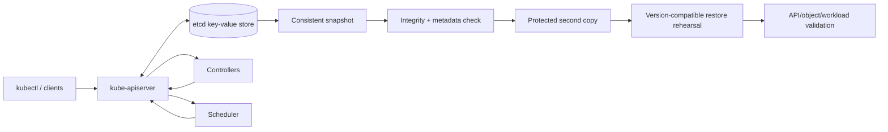
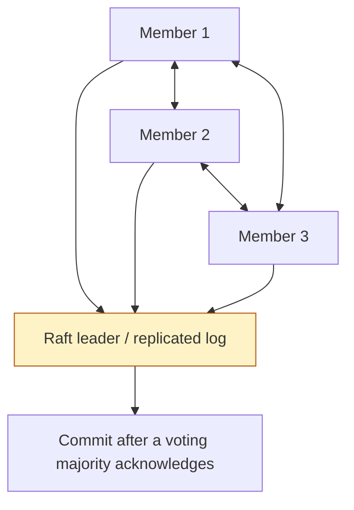

# Unit 10 — etcd Health, Backup, and Control-Plane Troubleshooting

## Lesson metadata

| Field | Value |
|---|---|
| Exact target filename | `10-etcd-health-backup-and-control-plane-troubleshooting.md` |
| Unit | Unit 10 — etcd health, backup, and control-plane troubleshooting |
| Estimated time | 8–12 hours: 3–4 hours concepts, 3–5 hours lab, 1–3 hours evidence/review |
| Prerequisites | Linux shell, Docker, Git, Kubernetes Pods/Deployments, `kubectl`, basic YAML and control-plane concepts |
| Core tools | `kind`, `kubectl`, Docker or compatible container runtime, `etcdctl`, `etcdutl`, `sha256sum` or equivalent |
| Awareness-only tools | `crictl`, `jq`, `yq`, Prometheus, etcd metrics dashboards, provider-native backup/restore tooling |
| Last reviewed | 2026-10-25 |
| Kubernetes/etcd baseline | **[VERIFY]** Determine actual Kubernetes and etcd versions from the disposable lab. This lesson does not assume a specific kind node image, etcd image digest, endpoint, certificate path, or restore-tool version. |
| Lab budget | Zero budget; laptop-first, WSL2 Ubuntu or native Linux; target about 4 CPU, 8 GB RAM, 30 GB free disk |
| Repository fidelity | **NOT VERIFIED.** The supplied Unit 10 prompt was available, but the full authoritative roadmap tree, full Unit 10 folder tree, and authoritative M03 syllabus file were not independently inspected in this run. |
| Execution status | All commands and labs below are instructional. No cluster commands, snapshot, restore, or cleanup were executed while authoring this file. |

> **Critical safety rule:** this lesson is not a production restore runbook. Use only a uniquely named disposable cluster created specifically for this lesson. Never use these destructive steps on a shared, pre-existing, managed, or production cluster. A successful kind exercise does not prove HA/quorum recovery or a provider's restore workflow.

### Learning objectives

By the end, the learner can:

1. **[L1]** Explain what etcd stores for Kubernetes, how the API server uses it, and how Raft quorum affects control-plane writes.
2. **[L1/L2]** Discover the actual etcd version, endpoint, TLS arguments, data directory, and tool availability in a disposable kind control-plane node instead of assuming paths.
3. **[L2]** Run compatible endpoint health/status/member-list and snapshot inspection operations with TLS verification enabled.
4. **[L2/L3]** Create, checksum, protect, inventory, and independently copy a snapshot while explaining its exclusions.
5. **[L3]** Distinguish online snapshot tools from offline restore utilities and identify version-specific restore requirements before executing anything destructive.
6. **[L3]** Diagnose API-server, etcd, kubelet/runtime, certificate, clock, disk, quota, and static-Pod failures using a read-only-first workflow.
7. **[L3/L4]** Define backup cadence from RPO and measured restore drills from RTO, with evidence of integrity and recoverability.
8. **[L4]** Compare etcd restore with GitOps/infrastructure rebuild and design a safe recovery for stale restored state.
9. **[L4]** Respond to the incident “snapshot restored and controllers deleted live workloads” without assuming an unproven root cause.

## Why this matters in production

For a self-managed Kubernetes control plane, etcd is the durable backing store for Kubernetes API state. If the API server cannot read or write its store, many control-plane operations fail even if worker nodes and already-running containers continue temporarily. Controllers and the scheduler rely on API-server access to observe and reconcile state. A healthy worker process is not evidence that the control plane can safely accept changes.

An etcd snapshot is a valuable recovery artifact, but it is not a complete application or infrastructure backup. It does not include PersistentVolume file contents, external databases, object storage, DNS providers, load balancers, host configuration, container image layers, or every add-on's external state. A snapshot can restore old Kubernetes objects while the world outside the cluster has continued to change. When controllers resume, they may reconcile that old desired state and create, update, or delete resources.

Backups are only useful when they are confidential, intact, compatible with the intended recovery method, stored outside the original failure domain, and regularly restored in a controlled drill. A command that reports “snapshot saved” is not evidence that a disaster-recovery objective can be met.

**Operational distinction:** kind runs Kubernetes nodes inside containers and is excellent for safe learning about discovery, command syntax, and isolated restore concepts. It is not a faithful substitute for a production HA control plane, cloud storage failure domains, provider-managed control planes, or a multi-zone quorum exercise.

## Learning objectives

Use the measurable objectives in Lesson metadata as the completion contract. The learner should save actual tool/version output, the discovered TLS configuration (without private keys), endpoint observations, snapshot metadata and checksums, a second-copy check, restore validation results, a measured elapsed time, and a cleanup record. If a command cannot run because the selected kind image lacks a tool or the restore mechanics are not verified, record that blocker instead of presenting expected output as observed evidence.

## Concept map and glossary

### Architecture and recovery diagrams



The API server is the Kubernetes API's persistence boundary. Controllers and scheduler ordinarily interact with the API server, not by treating etcd as an application database. The diagram is simplified; implementation details vary by Kubernetes distribution and control-plane configuration.



Raft replication is not “any node can independently commit writes.” A voting majority must participate in consensus. Odd member counts are commonly selected because they increase failure tolerance efficiently for a given number of members. Real deployment sizing must also account for network latency, disk performance, failure domains, and operational capacity.

### Quorum table

| Voting members | Majority required | Permanent voting-member failures tolerated while retaining quorum | Caveat |
|---:|---:|---:|---|
| 1 | 1 | 0 | Useful for a local lab; no member-failure tolerance |
| 3 | 2 | 1 | Common HA shape when members are placed across independent failure domains |
| 5 | 3 | 2 | More tolerated failures, but greater replication and operational cost |

The table describes simple majority arithmetic for voting members. It does not guarantee application availability, fast elections, successful recovery, or fault-domain independence. Losing quorum means the cluster cannot safely commit new updates. Repeatedly restarting or removing members without a diagnosis can worsen recovery by removing remaining evidence or changing membership.

### Glossary

| Term | Precise definition | Common misconception |
|---|---|---|
| etcd | Distributed consistent key-value store used by Kubernetes control planes to persist API state. | It is not a backup of all application data. |
| Key-value store | A system that maps keys to values with defined consistency/transaction behavior. | It is not automatically a relational application database. |
| kube-apiserver | Kubernetes API endpoint and control-plane component that handles API requests and persists cluster state through its storage integration. | It is not interchangeable with etcd. |
| Raft | Consensus protocol for replicated logs and leader-based coordination. | A leader alone is insufficient if a voting majority is unavailable. |
| Member | An etcd server participating in a cluster. | A process that exists is not necessarily healthy or participating in quorum. |
| Leader | Member currently coordinating replicated-log operations. | A leader field alone proves the whole cluster is healthy. |
| Quorum | Majority of voting members needed for consensus decisions. | A reachable API endpoint does not prove quorum remains healthy. |
| Voting member | Member counted toward the consensus majority. | Learners/non-voting members, where configured, do not count like voters. |
| Majority | Floor(N/2)+1 voting members for N voting members. | Half of members is enough. |
| Revision | Monotonically increasing logical revision associated with keyspace changes in etcd. | Revision alone is a complete backup or freshness guarantee. |
| Snapshot | Point-in-time representation of etcd keyspace used for recovery. | It does not include PV file contents or external systems. |
| Snapshot status | Metadata inspection of a snapshot, such as revision/hash/key count/size where supported. | A status command does not prove a restore drill succeeded. |
| Endpoint health | A request-based check of endpoint responsiveness/health. | One endpoint's success proves every member and all writes are healthy. |
| Endpoint status | Status information for an etcd endpoint, fields depending on etcd version/tool output. | Fields and output format are identical across all releases. |
| TLS client certificate | Client credential used to authenticate a TLS client to etcd. | It can safely be shared or committed to Git. |
| CA | Certificate authority material used to validate the server or peer certificate chain. | Disabling CA validation is a safe troubleshooting shortcut. |
| Static Pod | Pod managed directly by kubelet from a manifest on a node, often used for self-hosted control-plane components. | Deleting its mirror Pod through the API stops the static Pod. |
| Data directory | Filesystem directory holding etcd's persistent member data. | It is safe to overwrite while etcd is running or without a verified backup. |
| `etcdctl` | Online command-line client for interacting with an etcd server. | All snapshot/restore subcommands exist in every version. |
| `etcdutl` | Offline utility for certain etcd data/snapshot operations; supported commands depend on release. | It is a universal drop-in replacement with identical flags across versions. |
| Compaction | Removes superseded historical key revisions from the logical MVCC history after the retention point. | It is the same as reducing the physical database file size. |
| Defragmentation | Reclaims backend database space by rewriting/compacting physical storage layout; may impose load and block requests during the operation. | It is harmless to run continuously without capacity/latency checks. |
| fsync latency | Time spent forcing data to durable storage; slow storage can affect etcd write latency and stability. | CPU utilization alone explains etcd performance. |
| DB quota | Configured backend database size limit. | Increasing quota alone fixes a full or unhealthy disk. |
| `NOSPACE` | etcd alarm associated with backend quota exhaustion; writes may be limited until remediation. | Restarting etcd automatically resolves the underlying capacity issue. |
| kubelet | Node agent that supervises containers and static Pods. | A kubelet failure is identical to an API-server outage. |
| Scheduler | Selects nodes for Pods through API interactions. | It directly starts containers on nodes. |
| Controller-manager | Runs controllers that reconcile observed and desired state through the API. | Controllers always preserve the current live workload if desired state differs. |
| Certificate expiry | Certificate validity period has ended; affected TLS handshakes or component communication can fail. | Every `x509` error means expiry. |
| Clock skew | Difference between system clocks; can affect certificate validity and distributed timing. | NTP/clock issues are irrelevant when TLS fails. |
| RPO | Recovery Point Objective: maximum acceptable data loss measured in time or business terms. | It is the time needed to restore service. |
| RTO | Recovery Time Objective: target duration for restoring an agreed service level. | A target is met because a snapshot file exists. |
| Backup retention | Rules governing how many copies and how long backup artifacts are kept. | More copies in the same failure domain ensure resilience. |
| Restore drill | Controlled exercise proving a defined recovery path and measuring outcomes. | Snapshot creation alone is a restore test. |
| Disaster recovery | Coordinated recovery of service, state, infrastructure, dependencies, and operations after a disruptive event. | Restoring etcd restores the entire business service. |
| `kind` | Tool that runs Kubernetes nodes as containers for local clusters. | It reproduces production cloud control-plane or HA failure domains. |
| Managed control plane | Provider-operated control-plane components and infrastructure. | Customers can necessarily access the provider's etcd endpoint or data directory. |
| GitOps rebuild/reconciliation | Recreate or reconcile cluster resources from version-controlled desired state. | Git necessarily contains Secret values, PV contents, or every external resource. |

## L1 — Beginner: etcd, cluster state, and quorum

### What etcd stores

Kubernetes API objects such as Namespaces, Deployments, ConfigMaps, Secrets, ServiceAccounts, RBAC objects, and many other resources are persisted as API state through the API server's storage layer. Controllers observe that state and attempt to make the live cluster match desired state. A Deployment object is a declaration of intent; its Pods and ReplicaSets are reconciled runtime objects.

An etcd snapshot does **not** include:
- data stored inside PersistentVolume filesystems or cloud block volumes;
- external relational databases, object storage, message queues, or SaaS state;
- external DNS and load-balancer configuration unless separately represented and recovered by other systems;
- container image layers held in registries or node caches;
- host operating-system configuration, kubelet files, container runtime state, or every add-on's external state;
- credentials or secrets that exist only outside Kubernetes.

Application data on a PV needs a separate, application-consistent storage/database backup plan. Database-native backups may be needed to achieve consistency across transactions. For a stateful application, coordinate recovery of its data, Kubernetes objects, and external dependencies.

### How kube-apiserver and etcd relate

A typical self-managed control plane has kube-apiserver connecting to etcd using configured endpoints and TLS material. Controllers and the scheduler use Kubernetes APIs. If etcd is unavailable or cannot commit writes, the API server may return errors and controllers may be unable to update status or desired state. Existing Pods can continue running for some time, but new scheduling, rollouts, and reconciliation can be impaired.

In kubeadm-based clusters, etcd and other control-plane components commonly run as static Pods managed by the kubelet. Static Pod manifests are node-local files. The API's mirror Pod is a representation; deleting it through `kubectl` does not remove the underlying static Pod. See the [Kubernetes static Pod documentation](https://kubernetes.io/docs/concepts/workloads/pods/static-pods/).

### Raft and failure tolerance

For N voting members, a majority of `floor(N/2)+1` is needed. A three-member cluster can usually tolerate one permanent member failure and still maintain quorum; a five-member cluster can usually tolerate two. A single-member local cluster cannot tolerate loss of that member and remain available for writes.

A quorum-loss event should trigger evidence-preserving diagnosis and a version-specific recovery plan. Do not casually remove members, reinitialize a data directory, or restart every member in rapid succession. Membership changes affect the consensus configuration; a mistaken change can remove the remaining viable path to recovery.

### etcd is not your application database

etcd is optimized for consistent coordination and relatively small cluster state, not for storing large application datasets, analytics tables, model artifacts, or application transaction histories. Store application data in the appropriate database/object store/PV layer and back it up using that system's supported methods. Kubernetes API objects may refer to a PVC, but the etcd record for a PVC is not the data in the mounted filesystem.

### Backup layers

| Backup layer | Examples | What it does not prove |
|---|---|---|
| etcd snapshot | API keyspace at a point in time | PV content, external databases, provider infrastructure, and application consistency |
| PV/storage backup | Volume snapshot, filesystem backup, database-native backup | Complete Kubernetes control-plane state or all external dependencies |
| Configuration backup | kubeadm config, static Pod manifests, certificates/CA handling, node/runtime config | Safe availability of private keys or exact reconstructability without testing |
| External dependency backup | Database backup, object store versioning, DNS/load-balancer IaC | Consistency with the exact etcd snapshot unless coordinated |
| GitOps/IaC source | Namespaces, workloads, RBAC, add-on configuration, infrastructure definitions | Secrets that were never safely represented in source, persistent data, and all runtime state |
| Disaster-recovery plan | Ordered procedures, owners, credentials, validation, communications | Successful recovery unless regularly exercised |

## L2 — Intermediate: etcd health and snapshot backups

### Start with the actual cluster, not assumed paths

First verify that you are inside a disposable local lab. Do not infer node container names, endpoint addresses, TLS file paths, `ETCDCTL_API` settings, etcd versions, or data directories from an unrelated tutorial.

```bash
kind get clusters
kubectl config current-context
kubectl config get-contexts
kubectl version
kubectl get nodes -o wide
```

If the API is down, these `kubectl` calls may fail; that is a signal to move to host/runtime diagnostics, not to repeat mutating commands. Use `docker ps` (or the command for the actual runtime) to identify the node container. For a cluster named `etcd-lab-UNIQUE`, kind commonly names its control-plane node container with a cluster-prefixed name, but discover it instead of hard-coding a pattern.

```bash
docker ps --format 'table {{.Names}}\t{{.Image}}\t{{.Status}}'
```

Only after confirming the exact disposable node container, inspect it:

```bash
docker exec <EXACT_CONTROL_PLANE_NODE_CONTAINER> sh -c \
  'cat /etc/kubernetes/manifests/etcd.yaml'
```

**[VERIFY]** The manifest path and shell availability depend on the selected kind node image. If that path is absent, inspect the node image and kubelet configuration rather than assuming a kubeadm host layout.

In the manifest, identify:
- the actual `etcd` image and image digest/tag;
- `command` arguments, including `--listen-client-urls`, `--advertise-client-urls`, `--data-dir`, and TLS arguments where present;
- mounted volumes and host/container mount paths;
- the configured CA, server certificate/key, and peer certificate/key paths;
- any environment variables and version-specific settings.

Do not copy private key contents into notes. It is usually sufficient to record the paths, file ownership/permissions, and which certificate is used for which connection.

### Check tool availability and compatibility

Inside the node container, inspect versions and available binaries:

```bash
docker exec <EXACT_CONTROL_PLANE_NODE_CONTAINER> sh -c \
  'etcd --version; command -v etcdctl || true; command -v etcdutl || true; etcdctl version 2>/dev/null || true; etcdutl version 2>/dev/null || true'
```

**[VERIFY]** Some images may not contain both clients or may use different paths. Do not install arbitrary binaries into the node container or assume the host `etcdctl` matches the server. Consult the official docs for the exact etcd release.

The etcd v3.7 recovery guide documents online `etcdctl snapshot save` and `etcdutl snapshot status`; etcd 3.6 removed `etcdctl snapshot status` and `etcdctl snapshot restore` in favor of `etcdutl`. This is a concrete example of why commands must be version-matched. See [etcd v3.7 disaster recovery](https://etcd.io/docs/v3.7/op-guide/recovery/) and the [etcd 3.6 announcement](https://etcd.io/blog/2025/announcing-etcd-3.6/).

### TLS-authenticated endpoint operations

Use the actual endpoint and TLS paths discovered from the static-Pod manifest. The following are **templates, not copy-paste commands**. Replace every angle-bracket placeholder with verified values; do not disable certificate verification.

```bash
# Template only: run in the environment where a compatible etcdctl is installed.
export ETCDCTL_API=<VERIFY_REQUIRED_FOR_THIS_ETCD_VERSION>
export ETCD_ENDPOINTS="<DISCOVERED_CLIENT_ENDPOINT>"
export ETCD_CACERT="<DISCOVERED_CA_PATH>"
export ETCD_CERT="<DISCOVERED_CLIENT_CERT_PATH>"
export ETCD_KEY="<DISCOVERED_CLIENT_KEY_PATH>"

etcdctl \
  --endpoints="${ETCD_ENDPOINTS}" \
  --cacert="${ETCD_CACERT}" \
  --cert="${ETCD_CERT}" \
  --key="${ETCD_KEY}" \
  endpoint health

etcdctl \
  --endpoints="${ETCD_ENDPOINTS}" \
  --cacert="${ETCD_CACERT}" \
  --cert="${ETCD_CERT}" \
  --key="${ETCD_KEY}" \
  endpoint status --write-out=table

etcdctl \
  --endpoints="${ETCD_ENDPOINTS}" \
  --cacert="${ETCD_CACERT}" \
  --cert="${ETCD_CERT}" \
  --key="${ETCD_KEY}" \
  member list --write-out=table
```

The endpoint must be a **client endpoint**, not a peer URL. The certificate must be trusted by the configured CA and valid for the endpoint's identity; client authentication may be required. If a TLS error occurs, inspect endpoint hostname/IP, CA chain, certificate validity, and clock skew. Never use `--insecure-skip-tls-verify` or remove TLS flags as a troubleshooting shortcut.

`ETCDCTL_API` is version-dependent; for many etcd v3 clients, `ETCDCTL_API=3` is used, but check the selected release. Some releases/commands no longer need or honor that environment variable in the same way. **[VERIFY]** exact syntax and flags for the installed client.

### Interpreting endpoint output

Use `endpoint health`, `endpoint status`, and `member list` together. Record actual output, including:
- which endpoint was checked;
- whether the endpoint health request succeeded;
- leader/member information if exposed;
- revision and Raft term/index fields where exposed;
- database/backend size and alarms where exposed;
- member IDs, names, peer URLs, client URLs, and learner status where applicable.

Output field names, units, and table columns vary by etcd version. Do not treat a single endpoint's successful health check as proof that all members are healthy, that disk latency is acceptable, or that a backup is recoverable.

### Create a snapshot safely

Before saving a snapshot, confirm the destination has sufficient disk, is not the etcd data directory, and is protected from unauthorized access. A live snapshot should be taken through the supported online snapshot command rather than copying a database file while etcd is active. The etcd documentation warns that copying `member/snap/db` alone may miss data not yet written from the WAL.

**[VERIFY]** Snapshot command syntax and available tool must match the installed release. For versions whose docs support it, the template is:

```bash
# Template only; substitute a protected destination and verified TLS values.
etcdctl \
  --endpoints="${ETCD_ENDPOINTS}" \
  --cacert="${ETCD_CACERT}" \
  --cert="${ETCD_CERT}" \
  --key="${ETCD_KEY}" \
  snapshot save "<PROTECTED_BACKUP_PATH>/etcd-snapshot.db"
```

If the command fails, preserve the error and inspect endpoint health, TLS, permissions, disk capacity, and client/server compatibility. Do not retry repeatedly against a failing cluster without understanding the cause.

### Inspect metadata and checksum

For releases supporting the current etcdutl workflow, the template is:

```bash
# Verify this tool and syntax against the exact etcd release first.
etcdutl snapshot status "<PROTECTED_BACKUP_PATH>/etcd-snapshot.db" --write-out=table
sha256sum "<PROTECTED_BACKUP_PATH>/etcd-snapshot.db"
stat "<PROTECTED_BACKUP_PATH>/etcd-snapshot.db"
date -Is
```

`sha256sum`, `stat`, and `date -Is` are Linux/GNU-oriented examples; use equivalent tools on other platforms. A checksum proves that a file's bytes match the recorded digest later; it does not prove that the snapshot is logically restorable or that the snapshot was taken from the intended cluster.

Record:
- timestamp and time zone;
- source cluster name/context and Kubernetes version;
- etcd server and client/tool versions;
- source endpoint/member identity (avoid publishing sensitive network details);
- snapshot path, byte size, status metadata/revision/hash where supported;
- checksum and how it was computed;
- encryption method, key owner/location, retention, and access controls;
- second-copy location and verification result;
- last successful restore test and its measured RTO.

### Snapshot sensitivity and second copy

Kubernetes Secret objects can be present in etcd's stored API state. Treat snapshots as sensitive data even if values appear encoded in API output. Encrypt at rest using a controlled mechanism, restrict access, avoid committing backups to Git or tickets, and store encryption keys separately from the snapshot. Protect integrity and access logs.

Copy a verified snapshot to a second independent location/failure domain. In a local lab, copying from the kind node container to the host is a useful exercise, but it is not off-site protection: the host and container still share the same laptop, disk, and often the same administrative trust boundary.

### What snapshot metadata proves

Snapshot metadata can establish that a tool can parse the file and report fields such as hash, revision, key count, and total size where supported. It does not prove:
- the snapshot belongs to the intended cluster;
- restore tooling is compatible;
- certificates/configuration will work after recovery;
- the restored state matches external reality;
- PV or external application data has been backed up;
- a restore meets the business RTO.

A restore drill in an isolated environment is the evidence that the documented recovery path works for that tested version and scenario.

## L3 — Advanced: restore, performance, and control-plane diagnosis

### Restore tooling: `etcdutl` versus `etcdctl`

The supported division changes across etcd releases. The etcd 3.6 release notes state that snapshot status and snapshot restore were removed from `etcdctl` and moved to `etcdutl`; earlier releases may document `etcdctl snapshot restore`. Do not mix flags from old tutorials with a new binary. **[VERIFY]** select the exact tool, help output, and official recovery guide for the server/client version in the chosen lab.

Conceptual restore sequence:

1. Stop and isolate the target control plane using the documented method for that distribution.
2. Preserve the original etcd data directory and original snapshot.
3. Verify snapshot integrity and a second independent copy.
4. Restore into a **new, separate data directory** using the version-compatible restore tool and matching cluster/member configuration.
5. Prepare the static-Pod manifest or service configuration to use the restored data directory without overwriting the original.
6. Start etcd/control plane using the supported procedure.
7. Validate endpoint health, membership/leader, API-server health, expected API objects, nodes, controllers, workload behavior, and external data.
8. Record provenance, errors, elapsed time, and rollback/abort decisions.

This is conceptual until every version-specific flag, member name, initial-cluster definition, peer URL, data-directory mapping, and static-Pod restart mechanism is verified. A generic recipe that edits `/etc/kubernetes/manifests/etcd.yaml` is not safe for every kind image or production distribution.

### Restore consistency and stale state

An etcd restore returns API state from the snapshot's point in time. The external world may have changed since then:
- workloads may have been scaled or redeployed;
- nodes may have been replaced;
- storage attachments and cloud load balancers may have changed;
- GitOps may have advanced desired state;
- Secrets may have been rotated;
- external databases may contain newer or partially incompatible data;
- controllers may replay old desired state and recreate or delete objects.

The restore decision is therefore not “snapshot or no snapshot” alone. The recovery team must decide which system is authoritative for each class of state, how to reconcile versions, and whether to pause risky automation temporarily under approved incident control. Preserve current state before a second restore attempt.

### Performance, capacity, compaction, and defragmentation

etcd's performance depends heavily on reliable low-latency storage, fsync behavior, network latency between members, request rate, database growth, and configured quotas. High disk latency can increase commit latency and affect leader stability. A large database can grow toward its configured backend quota. `NOSPACE` alarm behavior and remediation must be checked against the exact release.

- **Compaction** removes old MVCC revisions from logical history beyond the chosen retention point. It does not necessarily shrink the database file immediately.
- **Defragmentation** reclaims physical backend space by rewriting database storage. It can be resource-intensive and may block operations for the target member while it runs; plan it with capacity/latency monitoring and the official procedure.
- **Quota remediation** requires understanding actual database size, free disk, compaction/defrag needs, and the supported alarm disarm procedure. Do not copy alarm-reset commands from a different release without verification.
- **Metrics:** monitor endpoint availability, leader changes, proposal failures/latency, backend size/quota, disk/fsync latency, peer network health, and API-server errors. Exact metric names, labels, thresholds, and dashboard queries are **[VERIFY]** against the target etcd version/distribution.

Do not run defragmentation or change quota as a reflex. First capture status, alarms, free space, logs, and impact. A nearly full host filesystem is not fixed by raising the etcd quota.

### Control-plane static Pods and runtime evidence

If `kubectl` works, start with read-only checks:

```bash
kubectl get nodes -o wide
kubectl -n kube-system get pods -o wide
kubectl -n kube-system get events --sort-by=.lastTimestamp
kubectl -n kube-system logs <CONTROL_PLANE_POD> --all-containers --tail=200
```

If `kubectl` is unavailable, move to the control-plane node host/container:
- inspect `docker ps` or the actual container runtime's status;
- inspect the static-Pod manifest directory discovered for that node image;
- inspect etcd and API-server container logs through `docker logs` or supported `crictl` commands;
- inspect disk usage, mount state, inode availability, memory pressure, and system clock;
- inspect certificate dates and certificate SANs/CA chains without exposing private key material;
- compare component logs and timestamps to determine whether kubelet/runtime, API server, etcd, network, storage, or certificate failure is primary.

`crictl` availability and endpoint configuration are distribution-specific. Do not assume a path or install a tool by mutating a production control-plane node during an incident.

### Certificates and clock skew

A TLS error can mean an expired certificate, untrusted CA, mismatched hostname/IP SAN, incorrect certificate/key pair, missing file, permission issue, or clock skew. Check the exact error, validity interval, endpoint identity, certificate chain, and node clock. `x509: certificate has expired or is not yet valid` is a different clue from “unknown authority” or “certificate is valid for X, not Y.”

For kubeadm-managed clusters, use the official [kubeadm certificate management](https://kubernetes.io/docs/tasks/administer-cluster/kubeadm/kubeadm-certs/) and [kubeadm troubleshooting](https://kubernetes.io/docs/setup/production-environment/tools/kubeadm/troubleshooting-kubeadm/) documentation for the actual Kubernetes version. Do not renew or replace certificates blindly; record which components use the certificate and plan coordinated restart/reload behavior.

### RPO and RTO reasoning

- **RPO** asks: how much state loss can the service tolerate? Derive backup interval from business change rate, transaction semantics, and accepted loss window.
- **RTO** asks: how long may recovery take? Measure from a defined start event to a validated service recovery condition, not just until a restore command exits.
- **Retention** balances recovery-point choices, cost, confidentiality, and the time needed to detect corruption or compromise.
- **Restore drill** proves a path for a specific version and scenario. One successful lab does not guarantee production recovery.

For example, a service with a five-minute RPO needs an appropriate capture/replication strategy and validation; a daily snapshot alone cannot meet that target. The target is not universal—business owners must approve the values, and drills must measure the actual result.

### Managed Kubernetes reality

In many managed Kubernetes services, the provider operates etcd and the control plane. Customers usually cannot connect to the provider's etcd endpoints or execute raw etcd snapshots/restores. **[VERIFY]** exact service behavior, backup features, and support guarantees against the selected provider's current documentation and contract.

Customer-facing response generally includes:
1. check provider control-plane health, maintenance notices, supported versions, and incidents;
2. validate nodes, workloads, add-ons, DNS/networking, and application health;
3. use provider-supported cluster backup/restore or control-plane recovery features where available;
4. restore application databases, object storage, PV data, and external dependencies from their own backup systems;
5. contact provider support with timestamps, cluster/resource identifiers, symptoms, and evidence;
6. validate the service and reconcile desired state after provider recovery.

Do not ask a learner to use a self-managed etcd restore command against a provider-managed control plane.

### GitOps rebuild versus etcd restore

| Dimension | Restore etcd snapshot | Rebuild/reconcile from GitOps/IaC | Combined approach |
|---|---|---|---|
| API objects | Restores snapshot-era API state, subject to compatibility and successful restore | Recreates resources represented in authoritative source | Restores critical state, then reconciles reviewed desired state |
| PersistentVolume contents | Not included | Not included unless a separate storage process is defined | Must restore storage/database data separately |
| Secrets | Snapshot may contain Kubernetes Secret objects; external secret sources may be newer | Recreated only if source/external secret manager supports it | Reconcile secret versions deliberately |
| Staleness | May roll back object state and controllers may reconcile it | May omit emergency live-only changes not committed to source | Requires conflict analysis and ordering |
| Infrastructure/external state | Not automatically restored | IaC may recreate supported infrastructure; external provider state may still need recovery | Restore external systems in dependency order |
| Risks | Wrong cluster/restore target, stale state, incompatible members, controller side effects | Source incomplete or external dependencies unavailable | More complex sequencing, but can preserve state and re-establish desired state |
| Use when | Snapshot is valid, compatible, and needed to recover API state | Cluster can be recreated and source of truth is complete | Snapshot recovers control plane but source of truth/external state must be reconciled |

Forward references: M08 covers GitOps/progressive delivery; M11 covers observability; M13 covers backup/disaster recovery; M10 covers incident/SRE practices. This unit focuses on etcd/control-plane recovery decisions, not full re-teaching of those modules.

## L4 — Expert: quorum recovery and disaster-recovery strategy

### Quorum-loss recovery principles

If the voting majority is lost, etcd cannot continue committing normal updates. Recovery depends on the exact failure: a temporarily unreachable member differs from permanent data loss; a healthy surviving majority differs from loss of quorum; a corrupted disk differs from a full cluster disaster. Preserve data directories, logs, member configuration, certificates, and snapshots before taking irreversible action.

There is no safe universal quorum-loss command sequence. Use the official recovery documentation for the exact etcd version and topology. Confirm:
- number and state of voting members;
- which data directories and WALs survive;
- whether a healthy majority remains;
- whether a known-good snapshot exists and has a second copy;
- member names/peer URLs/cluster configuration;
- intended recovery target and risk of split-brain or accidental joining;
- external dependencies and owner approval.

Do not casually remove a member or initialize a new cluster while other members might still be active. Do not assume the kind cluster created in this lesson is HA. Kind supports multiple control-plane nodes when configured, but the default local cluster is a single control-plane node and is not a production HA rehearsal. See [kind configuration](https://kind.sigs.k8s.io/docs/user/configuration/).

### Multi-member recovery at awareness level

```text
Normal 3-voter cluster:
  voter A  <----> voter B  <----> voter C
       \______________/

Quorum = 2 of 3. One unavailable voter may be tolerated.

After two permanent voter failures:
  voter A (survives)    voter B (lost)    voter C (lost)
  No majority remains; ordinary consensus writes cannot continue.
  Recovery requires the version-specific etcd recovery procedure,
  a verified snapshot, or another supported recovery path.
```

This is a conceptual illustration, not a procedure. Actual member recovery depends on peer URLs, cluster membership metadata, etcd version, data integrity, and whether a majority is still available.

### DR game day

Design the game day before running it:

1. **Objective:** prove that a protected snapshot can be identified, integrity-checked, restored in an isolated environment, and validated against agreed service-state criteria.
2. **Preconditions:** approved disposable environment; no production credentials; version/tool inventory; verified backup and second copy; known test objects; recovery owner and observer.
3. **Roles:** incident commander, operator, evidence recorder, application/data owner, observer.
4. **Scenario/injects:** API unavailable; etcd endpoint unhealthy; snapshot available but older than current state; external data not included; controller reconciles stale state.
5. **Safety boundaries:** unique cluster identity; explicit confirmation before destructive actions; no production/shared context; preserve original snapshot and data; stop on version mismatch or unclear target.
6. **Success criteria:** intended objects recovered; external data checked separately; no unapproved deletion; checksum/status verified; actual RTO measured; evidence and cleanup complete.
7. **Failure criteria:** restore target ambiguous, tool version mismatched, backup lacks integrity evidence, PV data missing without a separate plan, or required service validation fails.
8. **Rollback/abort:** stop before mutation if preflight fails; preserve the current state; use only the documented recovery path; do not delete the original data or only backup.
9. **Evidence:** snapshot inventory, checksums, version data, command logs without secrets, validation matrix, RTO worksheet, decision log, cleanup confirmation.
10. **After-action:** assign owners/due dates to every gap; retest fixes.

## Worked example: backup and recovery for a data platform

Assume a Python inference service runs in `ml-serving`, an ETL workload runs in `data-jobs`, and application data lives in a database and object store outside etcd. Kubernetes API objects describe Deployments, Services, ConfigMaps, Secrets references, and PVCs. The etcd snapshot can help recover those API objects, but it does not restore database tables, object-store contents, or PV bytes.

A recovery plan should coordinate:
1. verify the snapshot source, timestamp, checksum, status, and version compatibility;
2. recover or rebuild the control plane using the supported distribution procedure;
3. restore the application database and object-store data from their own backups;
4. reconcile namespaces and workloads from the authoritative GitOps/IaC source where appropriate;
5. check that Secrets/external-secret references point to valid current credentials;
6. validate PVC attachments and actual filesystem/application data;
7. run service smoke tests and monitor error rate, queue lag, and data freshness;
8. measure the end-to-end RTO and compare against the approved target.

If the etcd snapshot predates a database credential rotation, a restored Kubernetes Secret may contain a stale credential. If GitOps has advanced since the snapshot, automatic reconciliation can update or delete resources. The operator must decide which state is authoritative rather than blindly accepting whichever value starts first.

## Mandatory lab — Backup, destroy, and restore on kind

> **Lab status:** this is a procedure to execute yourself. It was not run while this lesson was authored. Do not treat any expected result below as observed.

### Lab model and important limitation

The lab has two separate goals:

1. **Kind control-plane backup practice:** create a unique throwaway kind cluster, record known API state, discover etcd configuration, and create/check a snapshot copied out of the node container.
2. **Restore rehearsal:** only run an etcd restore procedure after verifying the exact etcd version, restore tool, flags, data-directory layout, and safe node-manifest procedure. If those details cannot be verified for the selected kind image, do **not** attempt in-place control-plane restoration. Use the isolated etcd snapshot restore rehearsal described below and separately rebuild the kind cluster from known manifests. That is not equivalent to restoring the kind cluster's control plane; state the distinction in your evidence.

Do not delete the kind cluster and then claim that a new cluster has been restored from the old etcd snapshot. A newly created kind cluster has a different identity and freshly initialized state. Arbitrarily copying a snapshot into it is not a portable export/import workflow.

### 5.1 Preflight and safety gate

Check tools and resources:

```bash
kind version
kubectl version --client
docker version
docker info
df -h
free -h
kind get clusters
kubectl config get-contexts
kubectl config current-context
```

If using Podman or another supported runtime, use that runtime's equivalent commands and verify kind runtime configuration. Do not proceed if the runtime or required tools are unavailable, disk space is insufficient, or the active context cannot be understood.

Choose a unique cluster name, for example:

```bash
export ETCD_LAB_CLUSTER_NAME="etcd-lab-$(date +%Y%m%d%H%M%S)"
export ETCD_LAB_CONTEXT="kind-${ETCD_LAB_CLUSTER_NAME}"
printf 'Cluster: %s\nContext: %s\n' "$ETCD_LAB_CLUSTER_NAME" "$ETCD_LAB_CONTEXT"
```

**STOP:** before creation, verify `kind get clusters` does not already contain the exact name. If it exists, do not reuse or delete it; choose a new name.

```bash
kind get clusters
```

Use a unique cluster name for every run. The example uses `date` to reduce collision risk, but still inspect the output. Do not use a wildcard or broad cleanup command.

### 5.2 Create a disposable kind cluster and known state

Save this as a temporary local file `kind-etcd-lab.yaml` outside any production repository. It intentionally uses kind's supported config API. The node image is a placeholder and must be replaced with a verified tag/digest from the [kind release/node image documentation](https://kind.sigs.k8s.io/docs/user/quick-start/).

```yaml
kind: Cluster
apiVersion: kind.x-k8s.io/v1alpha4
nodes:
  - role: control-plane
    image: kindest/node:<VERIFY_SUPPORTED_TAG_AND_DIGEST>
  - role: worker
    image: kindest/node:<VERIFY_SAME_SUPPORTED_TAG_AND_DIGEST>
```

**[VERIFY]** Replace the placeholder with an exact published node image tag and preferably its release-provided digest. Do not run a config with the literal placeholder. A control-plane plus one worker is a modest lab topology, not HA etcd.

Before creation, explicitly check that the intended cluster name is absent:

```bash
kind get clusters
if kind get clusters | grep -Fxq "$ETCD_LAB_CLUSTER_NAME"; then
  echo "STOP: this cluster name already exists; choose a new unique name."
  exit 1
fi
```

Create only the named lab cluster:

```bash
kind create cluster --name "$ETCD_LAB_CLUSTER_NAME" --config ./kind-etcd-lab.yaml
```

Verify:

```bash
kubectl config current-context
kubectl --context "$ETCD_LAB_CONTEXT" get nodes -o wide
kubectl --context "$ETCD_LAB_CONTEXT" version
```

If the context does not match, stop. Do not run destructive operations until the exact target is confirmed.

Create harmless state in a dedicated namespace:

```bash
kubectl --context "$ETCD_LAB_CONTEXT" create namespace etcd-restore-demo
kubectl --context "$ETCD_LAB_CONTEXT" -n etcd-restore-demo create configmap recovery-marker \
  --from-literal=marker="backup-before-restore" \
  --from-literal=lesson="unit-10"
kubectl --context "$ETCD_LAB_CONTEXT" -n etcd-restore-demo create deployment recovery-web \
  --image=registry.k8s.io/pause:3.10
kubectl --context "$ETCD_LAB_CONTEXT" -n etcd-restore-demo set resources deployment/recovery-web \
  --requests=cpu=10m,memory=16Mi --limits=cpu=100m,memory=64Mi
kubectl --context "$ETCD_LAB_CONTEXT" -n etcd-restore-demo rollout status deployment/recovery-web --timeout=120s
```

**[VERIFY]** Confirm the pause image tag is available to your environment and that your Kubernetes version accepts the commands. If image pulling is unavailable, use a verified locally cached harmless image and record the exact reference. Do not use a production image or real data.

Record actual known state:

```bash
kubectl --context "$ETCD_LAB_CONTEXT" get namespace etcd-restore-demo
kubectl --context "$ETCD_LAB_CONTEXT" -n etcd-restore-demo get deployment recovery-web -o wide
kubectl --context "$ETCD_LAB_CONTEXT" -n etcd-restore-demo get configmap recovery-marker -o json
kubectl --context "$ETCD_LAB_CONTEXT" get nodes -o wide
kubectl --context "$ETCD_LAB_CONTEXT" version
```

Record the namespace, Deployment desired/available replicas, ConfigMap key values, context, server version, and time in personal lab notes. Do not create another repository file merely for this evidence.

### 5.3 Inspect etcd and save the snapshot

Discover the actual control-plane node container:

```bash
kind get nodes --name "$ETCD_LAB_CLUSTER_NAME"
docker ps --format 'table {{.Names}}\t{{.Image}}\t{{.Status}}'
```

Copy the exact control-plane node container name from the observed output into a variable. Do not guess it:

```bash
export ETCD_LAB_CP_CONTAINER="<PASTE_EXACT_DISCOVERED_CONTROL_PLANE_NODE_CONTAINER>"
```

Before each command that accesses the node, confirm that the variable is the exact control-plane container for this lab. Do not put credentials in shell history.

```bash
printf 'Expected lab context: %s\n' "$ETCD_LAB_CONTEXT"
kubectl config current-context
kind get clusters
docker ps --format 'table {{.Names}}\t{{.Image}}\t{{.Status}}'
```

Inspect the manifest and version:

```bash
docker exec "$ETCD_LAB_CP_CONTAINER" sh -c 'cat /etc/kubernetes/manifests/etcd.yaml'
docker exec "$ETCD_LAB_CP_CONTAINER" sh -c 'etcd --version; command -v etcdctl || true; command -v etcdutl || true'
```

**[VERIFY]** These paths/commands are common in kubeadm-based kind nodes but are not guaranteed across all images. If the manifest or tools are missing, stop and inspect the actual image layout; do not mutate the node to force the example to work.

From the manifest, record the actual client endpoint and TLS CA/cert/key paths. Use the node's namespace/container filesystem context correctly. The paths inside the etcd container may differ from the paths visible in the node container; inspect `volumeMounts` and `volumes` to map them. Do not print private key contents.

A common kind kubeadm manifest uses `/etc/kubernetes/manifests/etcd.yaml`, a data directory under `/var/lib/etcd`, and TLS paths under `/etc/kubernetes/pki/etcd`; these are **examples only** and must be verified from the actual manifest. The endpoint may be `https://127.0.0.1:2379` or another value; do not assume.

If `etcdctl` exists in the node container, construct the commands from the discovered values and check the exact installed help. Example command **shape only**:

```bash
# Template only. Replace all placeholders with values read from this exact lab manifest.
docker exec "$ETCD_LAB_CP_CONTAINER" sh -c '
  <VERIFIED_ETCDCTL_BINARY> \
    --endpoints="<DISCOVERED_CLIENT_ENDPOINT>" \
    --cacert="<DISCOVERED_CA_PATH_IN_EXECUTION_CONTEXT>" \
    --cert="<DISCOVERED_CLIENT_CERT_PATH>" \
    --key="<DISCOVERED_CLIENT_KEY_PATH>" \
    endpoint health
'
```

Repeat with `endpoint status --write-out=table` and `member list --write-out=table` only after verifying syntax. If the tool is absent, do not download an arbitrary binary into the node. Use a compatible client image/tool in an isolated, documented way only if the endpoint and TLS paths can be mounted safely; otherwise mark the endpoint test not executed.

Create a protected host-side backup directory outside the node container. Example for Linux/WSL2:

```bash
umask 077
mkdir -p "$HOME/etcd-lab-backups/$ETCD_LAB_CLUSTER_NAME"
chmod 700 "$HOME/etcd-lab-backups/$ETCD_LAB_CLUSTER_NAME"
```

**[VERIFY]** Confirm free disk and access control. Snapshots may contain Kubernetes Secrets. The path is a host-side copy simulation, not off-site protection.

Use the verified online snapshot command from the actual etcd client environment. If a compatible `etcdctl` is available in the node container, the command shape is:

```bash
# TEMPLATE ONLY — replace all placeholders, then execute only after review.
docker exec "$ETCD_LAB_CP_CONTAINER" sh -c '
  <VERIFIED_ETCDCTL_BINARY> \
    --endpoints="<DISCOVERED_CLIENT_ENDPOINT>" \
    --cacert="<DISCOVERED_CA_PATH>" \
    --cert="<DISCOVERED_CLIENT_CERT_PATH>" \
    --key="<DISCOVERED_CLIENT_KEY_PATH>" \
    snapshot save "<PATH_WRITABLE_BY_ETCDCTL_PROCESS>/etcd-snapshot.db"
'
```

The destination must be writable from the process environment. A container-internal path is not automatically the same as a host path. If needed, use a verified host mount or copy the completed snapshot out of the node using a documented method. Do not claim that a path is host-side unless you verified the mount mapping.

Record the actual snapshot file, size, checksum, status metadata, timestamp, server/client versions, source context, and source member/endpoint. Use the compatible status command documented for the installed release, e.g. `etcdutl snapshot status ...` where supported.

Make a second copy before the destructive stage:

```bash
cp --preserve=mode,timestamps \
  "$HOME/etcd-lab-backups/$ETCD_LAB_CLUSTER_NAME/etcd-snapshot.db" \
  "$HOME/etcd-lab-backups/$ETCD_LAB_CLUSTER_NAME/etcd-snapshot-second-copy.db"
sha256sum "$HOME/etcd-lab-backups/$ETCD_LAB_CLUSTER_NAME/"etcd-snapshot*.db
```

These paths assume you successfully copied the snapshot to the first host-side file. If not, stop and complete that step before running these commands. Verify both checksums match. The two files are still on the same host/disk and therefore are not independent disaster-recovery copies.

### 5.4 ⚠ DESTRUCTIVE — destroy and restore rehearsal

**⚠ DESTRUCTIVE — stop and confirm scope before deleting anything.**

There are two different operations that must not be confused:

- Deleting the throwaway kind cluster destroys that local cluster's node containers and their data. A saved etcd snapshot does not automatically restore the cluster when a new kind cluster is created.
- Restoring an etcd snapshot requires the correct etcd version/tool and a valid restore target/member configuration. It is not the same as reapplying Kubernetes YAML.

**This lesson does not provide a universal executable in-place kind control-plane restore sequence.** The exact mechanics depend on the node image, etcd version, static-Pod manifest, volume mappings, and supported restore tool. If you cannot verify all of these against the actual lab, do not modify the static-Pod manifest or etcd data directory. Use the isolated restore rehearsal below, then rebuild the kind cluster separately from the known manifests. This is an honest restore test of the snapshot format, not proof that the original kind cluster's control plane was restored.

#### Pre-destruction gate

Before any destructive operation, confirm all of the following:

- [ ] `ETCD_LAB_CLUSTER_NAME` is the unique cluster created by this exercise.
- [ ] `ETCD_LAB_CONTEXT` is the matching context.
- [ ] `kind get clusters` shows the exact named lab cluster and no ambiguity.
- [ ] The known namespace, Deployment, and ConfigMap state has been recorded.
- [ ] A snapshot was saved and its status/metadata checked with a compatible tool.
- [ ] A checksum was recorded and a second copy exists with matching checksum.
- [ ] The restore tool/version and recovery approach have been reviewed.
- [ ] No production/shared context or data is involved.
- [ ] You understand that PV data and external systems are not in the etcd snapshot.

If any item is false, **ABORT**. Do not delete or overwrite anything.

#### Isolated etcd restore rehearsal (only after version-specific verification)

Use the official recovery guide for the exact etcd version. The modern etcd v3.7 documentation uses `etcdutl snapshot status` and describes snapshot restore; etcd 3.6 changed the CLI boundary. **[VERIFY]** restore syntax, required arguments, snapshot format, image digest, initial-cluster parameters, and compatibility for your selected version before running any restore command.

A restore rehearsal should use a separate isolated etcd process/container with:
- the exact or documented compatible etcd image/version;
- the original snapshot mounted read-only;
- a new empty output data directory;
- an isolated network and non-production ports;
- explicit single-member test configuration;
- no connection to the original kind cluster's peer/client network;
- a second preserved snapshot copy that is not modified.

Conceptual restore command shape (not executable until completed and verified):

```bash
# CONCEPTUAL TEMPLATE ONLY — do not run with placeholders.
etcdutl snapshot restore "<READ_ONLY_SNAPSHOT_PATH>" \
  --name="<NEW_TEST_MEMBER_NAME>" \
  --data-dir="<NEW_EMPTY_TEST_DATA_DIR>" \
  --initial-cluster="<NEW_TEST_MEMBER_NAME>=<NEW_TEST_PEER_URL>" \
  --initial-advertise-peer-urls="<NEW_TEST_PEER_URL>" \
  --initial-cluster-token="<UNIQUE_TEST_CLUSTER_TOKEN>"
```

**[VERIFY]** Flag names, defaults, required arguments, output semantics, and the tool itself vary by release. The exact official etcd documentation for the chosen version is the authority. Do not start the restored member until the new test cluster configuration is coherent. Do not mount the restored data directory into the existing kind etcd container or use the same peer/client ports without a verified isolation plan.

After restore, start the isolated etcd process using the exact supported command for that release and test its health with a compatible client. If you cannot construct a valid isolated member configuration from official documentation, mark the restore as **NOT EXECUTED** and stop; do not improvise flags.

#### Optional destroy-and-rebuild of the kind lab

This is **not** etcd snapshot restore. It demonstrates that the lab cluster can be recreated and known API objects reapplied from manifests. Do this only if you have completed the snapshot evidence and no longer need the original cluster.

**⚠ DESTRUCTIVE — exact cluster deletion gate.**

```bash
# Re-check before the destructive command.
printf 'Target cluster: %s\nExpected context: %s\n' \
  "$ETCD_LAB_CLUSTER_NAME" "$ETCD_LAB_CONTEXT"
kind get clusters
kubectl config current-context
```

**Human confirmation required:** compare the exact name shown by `kind get clusters` to `ETCD_LAB_CLUSTER_NAME`. If there is any mismatch, stop.

```bash
read -r -p "Type the exact cluster name to delete (${ETCD_LAB_CLUSTER_NAME}): " CONFIRM_CLUSTER
test "$CONFIRM_CLUSTER" = "$ETCD_LAB_CLUSTER_NAME" || {
  echo "ABORT: confirmation did not match"; exit 1;
}
kind get clusters | grep -Fxq "$ETCD_LAB_CLUSTER_NAME" || {
  echo "ABORT: exact lab cluster not found"; exit 1;
}
kind delete cluster --name "$ETCD_LAB_CLUSTER_NAME"
```

This command deletes only the exact named kind cluster. Do not substitute a wildcard, omit `--name`, or delete any cluster not created by this lab. Recreating kind generates a fresh cluster identity. Reapplying known YAML can recover selected API objects, but it is not etcd restore and does not restore PV or external data.

### 5.5 Post-restore verification script and evidence

The following script verifies **API object presence and values** in the selected Kubernetes context. It does not prove etcd snapshot provenance. Run it only against the intended restored/rebuilt lab context after verifying the context manually. It exits non-zero if required checks fail.

Save as a temporary file `verify-etcd-lab.sh`:

```bash
#!/usr/bin/env bash
set -euo pipefail

EXPECTED_CONTEXT="${EXPECTED_CONTEXT:-kind-etcd-lab-REPLACE_WITH_EXACT_NAME}"
NAMESPACE="etcd-restore-demo"
DEPLOYMENT="recovery-web"
CONFIGMAP="recovery-marker"

actual_context="$(kubectl config current-context)"
if [[ "$actual_context" != "$EXPECTED_CONTEXT" ]]; then
  echo "FAIL: context mismatch. Expected '$EXPECTED_CONTEXT', got '$actual_context'." >&2
  exit 2
fi

kubectl version
kubectl get namespace "$NAMESPACE" >/dev/null
kubectl -n "$NAMESPACE" get deployment "$DEPLOYMENT" -o json >/dev/null
kubectl -n "$NAMESPACE" get configmap "$CONFIGMAP" -o json >/dev/null

desired="$(kubectl -n "$NAMESPACE" get deployment "$DEPLOYMENT" -o jsonpath='{.spec.replicas}')"
available="$(kubectl -n "$NAMESPACE" get deployment "$DEPLOYMENT" -o jsonpath='{.status.availableReplicas}')"
[[ "$desired" == "1" ]] || { echo "FAIL: desired replicas are '$desired', expected 1." >&2; exit 3; }
[[ "$available" == "1" ]] || { echo "FAIL: available replicas are '$available', expected 1." >&2; exit 4; }

marker="$(kubectl -n "$NAMESPACE" get configmap "$CONFIGMAP" -o jsonpath='{.data.marker}')"
lesson="$(kubectl -n "$NAMESPACE" get configmap "$CONFIGMAP" -o jsonpath='{.data.lesson}')"
[[ "$marker" == "backup-before-restore" ]] || { echo "FAIL: marker value mismatch." >&2; exit 5; }
[[ "$lesson" == "unit-10" ]] || { echo "FAIL: lesson value mismatch." >&2; exit 6; }

kubectl -n "$NAMESPACE" rollout status "deployment/$DEPLOYMENT" --timeout=120s
kubectl -n "$NAMESPACE" get pods -o wide
echo "PASS: required API objects and expected fields are present in context '$actual_context'."
echo "LIMITATION: object presence alone does not prove etcd snapshot restore provenance."
```

Replace the expected context with the actual verified context before running. The JSONPath fields are Kubernetes API fields; if the API version/tool differs, inspect the returned JSON and update the script deliberately. The script requires Bash, `kubectl`, and access to the API. It will not work while the API server is unavailable.

If the cluster was deleted and rebuilt, recreate the namespace, ConfigMap, and Deployment from the recorded manifest/commands before running this object-presence script. The resulting pass only proves that those objects are present and the checks passed—not that etcd data was restored from the snapshot.

### 5.6 RTO measurement and cleanup

Define the RTO clock before starting. For a control-plane restore drill, one reasonable definition is **start** when the approved recovery procedure begins and **end** when the control plane is healthy and all required API/workload/external-data validation checks pass. Use a monotonic clock or reliable elapsed-time tool. Do not report a made-up duration.

Example shell timing for a command sequence:

```bash
# Example measurement only; put the approved, non-destructive validation command here.
time kubectl --context "$ETCD_LAB_CONTEXT" get nodes -o wide
```

For multi-step drills, record the actual start and end times and subtract them consistently; `time` for one command is not the full end-to-end RTO. Compare measured RTO and snapshot age to business-approved RTO/RPO. One laptop lab does not establish a production guarantee.

Before cleanup, decide whether the snapshot is still needed as evidence and whether your retention policy requires it. Do not automatically delete it. It may contain sensitive Secrets; protect it and securely remove it only after restore evidence is complete and the owner has approved disposal.

**⚠ DESTRUCTIVE — cleanup only for the exact lab cluster.**

```bash
kind get clusters
kubectl config current-context
printf 'Candidate cleanup target: %s\n' "$ETCD_LAB_CLUSTER_NAME"
```

If the exact cluster exists and is confirmed to be the one you created for this lesson, use an explicit human confirmation:

```bash
read -r -p "Type the exact lab cluster name to delete (${ETCD_LAB_CLUSTER_NAME}): " CONFIRM_CLEANUP
test "$CONFIRM_CLEANUP" = "$ETCD_LAB_CLUSTER_NAME" || {
  echo "ABORT: cleanup confirmation mismatch"; exit 1;
}
kind get clusters | grep -Fxq "$ETCD_LAB_CLUSTER_NAME" || {
  echo "ABORT: target cluster not found"; exit 1;
}
kind delete cluster --name "$ETCD_LAB_CLUSTER_NAME"
```

If the cluster was already deleted during the optional rebuild stage, do not run cleanup again. Confirm it is absent. Do not delete snapshots automatically and do not remove any other kind cluster.

### What returned and what did not

| State or artifact | Expected recovery behavior | Required separate action |
|---|---|---|
| Namespace, Deployment, ConfigMap | API objects may return if they existed in the restored snapshot and the restore succeeds | Validate names, fields, labels, selectors, and source revision |
| Pods | Controllers may recreate Pods from restored workload templates; runtime/container state is not guaranteed identical | Wait for reconciliation and validate image, readiness, logs, and application behavior |
| PersistentVolume data | **Not included** in an etcd snapshot | Restore from volume/database backup and verify application consistency |
| External databases | Not included | Restore using database-native backup/replication recovery |
| Object storage | Not included | Use object-store versioning/backup/DR process |
| DNS/load balancer state | Not automatically restored | Reconcile provider state/IaC and verify routing |
| Secrets outside Kubernetes | Not included | Restore from the external secret manager/credential system |
| Kubernetes Secret objects | May be present in snapshot; may be stale or sensitive | Validate versions/rotation and access controls; never print secret values |
| Host/runtime configuration | Not included | Rebuild or restore node configuration from managed source |
| Add-on external state | Not guaranteed | Restore/reconcile add-ons using their supported procedures |
| GitOps/IaC source | Not an etcd snapshot payload | Reconcile reviewed source after assessing stale-state conflicts |
| Restore provenance | Not proven by object-presence script | Preserve snapshot metadata, tool logs, exact restore command, and isolated etcd validation |

## Control-plane troubleshooting decision tree

```text
kubectl/API unavailable?
├── Yes
│   ├── Confirm intended context and user impact; stop mutations.
│   ├── Inspect host/container runtime and control-plane node container.
│   ├── Is kubelet/runtime alive?
│   │   ├── No → inspect host pressure, runtime logs, node/container state.
│   │   └── Yes → inspect static-Pod manifests and component logs.
│   ├── Is etcd endpoint reachable with verified TLS?
│   │   ├── No → check etcd process, disk, certificates, clock, network, data dir.
│   │   └── Yes → inspect endpoint status/member/quorum and API-server logs.
│   └── Preserve evidence; choose a version-specific recovery path.
└── No
    ├── Inspect API-server, etcd, scheduler, controller-manager status/logs.
    ├── Check events, certificates, clock, storage latency/quota, alarms.
    └── Validate workloads and external data; do not equate API reachability with DR success.
```

### Troubleshooting matrix

| Symptom | Likely causes | Evidence | Safe diagnostics | Mitigation | Prevention |
|---|---|---|---|---|---|
| `kubectl` cannot reach API server | API server down, wrong context, network/DNS, expired client cert, host/runtime issue | Exact error, context, timestamps, runtime status | `kubectl config current-context`; `kubectl config get-contexts`; `docker ps`; host logs | Confirm target and collect read-only evidence; restore connectivity via distribution-specific runbook | Context checks, certificate monitoring, runtime/host monitoring |
| API-server static Pod absent/crash-looping | Bad manifest, missing cert, image issue, etcd unreachable, kubelet/runtime failure | Manifest, container state/logs, kubelet logs | Inspect static-Pod manifest and runtime container logs | Fix verified cause with approved, reversible change | Config validation and change review |
| etcd endpoint health fails | Process down, TLS mismatch, disk, network, quorum | Error output, logs, endpoint, member state | TLS-authenticated health/status commands | Preserve data; diagnose cause before restart/member changes | Health/latency/quorum monitoring |
| Leader/member/quorum symptoms | Network partition, disk stall, member failure, bad membership change | Member list, Raft status where available, peer logs | `member list`; `endpoint status`; host/network/disk checks | Follow version-specific etcd recovery documentation | Fault-domain design, disk SLOs, restore drills |
| TLS/certificate error | Expiry, CA mismatch, wrong SAN, wrong cert/key, file permissions, clock skew | Exact x509 error, validity, endpoint identity | Inspect certificate metadata, CA chain, time; never print private keys | Correct verified certificate/configuration via supported procedure | Expiry alerts and certificate inventory |
| API-server/etcd certificate expired | Rotation/renewal missed or component not reloaded | Cert dates and component logs | Use version-specific kubeadm cert checks if applicable | Follow official renewal/restart procedure | Rotation calendar, expiry alerting, drills |
| Clock skew | NTP issue, VM suspend/resume, bad host clock | `date`, time-sync service status, certificate error times | Check host and node time without mutation | Restore reliable time sync; then re-evaluate TLS | Time-sync monitoring |
| Disk full or inode exhaustion | Logs, snapshots, backend, container layers, WAL growth | `df -h`, inode check, mount status, etcd logs | Host/container filesystem inspection | Preserve evidence; free only known disposable data under change control | Capacity alerts and retention policies |
| Slow fsync/DB latency | Slow disk, noisy neighbors, I/O saturation | etcd metrics/logs, host disk latency | Inspect metrics and disk I/O; names are version-sensitive | Address storage bottleneck; avoid repeated defrag/restarts | Storage performance SLOs |
| DB quota / `NOSPACE` alarm | Backend reaches configured quota | Endpoint status, alarm output, logs, DB size | Version-compatible status/alarm inspection | Follow exact-version compaction/defrag/quota/alarm procedure | DB size and quota alerts |
| Scheduler unavailable | Static Pod crash, API connectivity, cert or resource pressure | Scheduler logs/status, API errors | `kubectl` if available; runtime logs otherwise | Fix underlying control-plane/API issue | Component health monitoring |
| Controller-manager unavailable | Static Pod crash, API connectivity, cert issue | Logs, Pod state, controller activity | API/runtime logs | Restore component using distribution procedure | Static manifest checks and monitoring |
| Kubelet/runtime down but API server up | Node agent or runtime failure | Node Ready state, runtime service/logs | Host system and runtime checks | Repair host/runtime; avoid assuming etcd fault | Host health and runtime alerting |
| Static-Pod manifest/args invalid | Syntax error, wrong path, invalid flag, missing mount | Manifest diff, kubelet logs, container create error | Read-only file inspection and logs | Restore known-good manifest via reviewed procedure | Manifest version control and validation |
| Snapshot save fails | Endpoint/TLS issue, permissions, disk full, version mismatch | Command error, logs, free space | Inspect endpoint, TLS paths, destination and tool version | Fix the specific cause; preserve cluster evidence | Snapshot job alerts and capacity checks |
| Snapshot status/checksum fails | Truncated file, wrong path, transfer corruption, unsupported tool | File size, digest, status error | Recompute checksum and use compatible status tool | Reject the backup; use another verified copy | Transfer integrity and immutable copies |
| Restore completes but objects missing | Wrong snapshot/cluster, restore did not run as intended, expected objects created after snapshot | Snapshot timestamp/revision, object inventory | Check provenance, status, and source snapshot | Restore/reconcile from correct authoritative source after preserving state | Inventory and restore validation matrix |
| Controllers delete/recreate live workloads | Restored stale desired state, selectors/ownership mismatch, GitOps reconciliation, wrong target | Audit/events/controller logs/GitOps history | Preserve events and logs; compare restored objects to source of truth | Contain automation only with approval; reconcile intended state | Isolated restore drills and staged controller reactivation |
| PV data absent after restore | Expected: PV bytes are not in etcd snapshot | PVC/PV metadata and storage-system state | Inspect volume objects and storage backend separately | Restore storage/database from its own backup | Application-consistent data backup |
| Managed service has no etcd access | Provider operates control plane | Provider status/support docs, cluster health | Provider console/API and supported diagnostics | Use provider backup/recovery/support and customer data backups | Provider DR contract and regular customer-side drills |

### Ordered diagnostic playbook

1. Confirm the cluster/context and impact; if the API is unavailable, do not assume `kubectl` can provide evidence.
2. Preserve relevant logs, manifests, error output, snapshot metadata, and timestamps before changing state.
3. Check host and container runtime status; confirm whether kubelet and static Pods can run.
4. Inspect static-Pod manifests, container status/logs, certificate validity, clock, disk space, inode usage, and storage mounts.
5. If TLS access is available, inspect etcd endpoint health/status/member list using the exact compatible client.
6. Classify the failure: API server, etcd/quorum, kubelet/runtime, certificate/clock, storage/capacity, or network.
7. Verify snapshot existence, checksum/status, version compatibility, second copy, and source identity before recovery.
8. Select a documented recovery path with an owner, approval, explicit stop conditions, and rollback/abort points.
9. Validate control plane, API objects, nodes, workloads, external databases/storage, add-ons, and user-facing behavior.
10. Record the timeline, actual RPO/RTO, evidence gaps, and follow-up actions.

## Incident walkthrough: snapshot restore deleted live workloads

**Scenario status:** illustrative. No real incident evidence is available here, so no root cause is asserted.

### Impact and initial signals

Illustrative signals may include Deployments disappearing or scaling down after control-plane recovery, Pods being recreated with older configuration, services returning errors, a GitOps controller applying older manifests, or storage attachments no longer matching the workload. The first priority is to distinguish API object changes from runtime failures and external data loss.

### Timeline and evidence template

| Timestamp | Evidence/event | Source | Confidence | Action/decision |
|---|---|---|---|---|
| `<time>` | Snapshot created; source version and revision | Snapshot inventory/tool output | `<confirmed/unknown>` | Preserve snapshot metadata |
| `<time>` | Restore procedure began | Operator record | `<confirmed/unknown>` | Record exact target/context |
| `<time>` | Control plane/API became reachable | Health checks/logs | `<confirmed/unknown>` | Capture API version and component logs |
| `<time>` | Controller or GitOps reconciliation occurred | Events/audit/controller logs | `<confirmed/unknown>` | Identify object owner and desired state |
| `<time>` | Workload deletion/recreation observed | API audit/events/object history | `<confirmed/unknown>` | Avoid further mutation until scope understood |
| `<time>` | External database/PV status checked | Data platform/storage logs | `<confirmed/unknown>` | Treat external state separately |
| `<time>` | User impact and recovery validation | SLO/dashboard/smoke tests | `<confirmed/unknown>` | Record RTO and remaining impact |

### Plausible mechanisms to investigate

- **Stale desired state:** the snapshot predates a deployment or scaling change; controllers reconcile to the older object state.
- **Selector/ownership mismatch:** restored labels/selectors or owner references differ from live resources, causing controllers to create or remove objects.
- **GitOps reconciliation:** an external reconciler may apply the version currently in Git, which can differ from the snapshot.
- **Wrong restore target:** a snapshot or restored data directory may belong to a different cluster/environment.
- **External dependency mismatch:** restored Secrets or configuration point to rotated credentials or outdated external endpoints.
- **Incomplete recovery:** PV/database state was not restored alongside API objects, causing workloads to fail or operators to replace resources.

These are hypotheses. Use audit logs, events, controller logs, snapshot metadata, GitOps history, and external-system evidence to confirm or rule them out.

### Immediate containment

1. Assign an incident commander and preserve timestamps, API audit logs, events, component logs, manifests, snapshot metadata, and GitOps history.
2. Identify which controllers or automation systems are mutating state. Pause a specific risky reconciler only with authorization and an explicit plan; do not disable all controllers indiscriminately.
3. Avoid deleting/restarting workloads blindly. Determine whether the issue is API-object rollback, runtime failure, data inconsistency, or external dependency failure.
4. Protect current state before a second restore attempt. Preserve the current etcd data directory/snapshot and the original recovery artifact.
5. Assess user impact, database consistency, storage attachment state, and possible credential rollback.
6. Communicate confirmed facts separately from unknowns.

### Recovery choices

- Reconcile from the authoritative GitOps/IaC source after comparing it with restored state and reviewing potential deletions.
- Restore PV/database/object-store data using their own tested recovery procedures.
- Reapply reviewed manifests in dependency order where the cluster's API state is recoverable.
- Perform another etcd restore only after preserving current state, confirming a valid snapshot and correct target, and obtaining the required approval.
- Validate Secret rotation, DNS/load balancers, external identities, add-ons, storage attachments, and application-level consistency.

### Prevention and blameless review

Use an isolated restore rehearsal, explicit target cluster identity checks, snapshot inventory, external-data coordination, versioned runbooks, GitOps/desired-state review, staged controller reactivation where feasible, and post-restore validation. Forward reference M08 for GitOps and M13 for backup/DR.

After-action review should state what happened, impact, evidence, root cause only when supported, contributing factors, what helped, what failed, and follow-up actions with owners and due dates. Avoid blaming an operator for following an unsafe or ambiguous process; improve the system and its safeguards.

## Backup policy, RPO/RTO, and restore testing

### Backup policy design

Derive cadence and retention from:
- approved RPO and business data-loss tolerance;
- cluster change rate and whether a snapshot is sufficient for the workload;
- data classification and Secret sensitivity;
- cost and capacity of encrypted storage;
- detection delay for corruption or compromise;
- need to retain recovery points before an incident was detected;
- restore duration and external dependency recovery time;
- provider capabilities and service contract.

A daily snapshot is not a universal recommendation. If the RPO is shorter than the snapshot interval, the design needs another recovery mechanism or an explicit risk acceptance. Retention must preserve enough points to recover from delayed discovery without retaining sensitive data indefinitely.

### RPO/RTO worksheet

| Field | Entry |
|---|---|
| Business service / owner | `<service and owner>` |
| Approved RPO | `<maximum acceptable data loss>` |
| Snapshot interval / replication plan | `<derived from RPO and change rate>` |
| Backup retention | `<number/period and rationale>` |
| Approved RTO | `<time target and success condition>` |
| RTO start definition | `<event that starts the clock>` |
| RTO end definition | `<control plane + workload + external-data validation>` |
| Last measured restore duration | `<actual elapsed time; do not invent>` |
| Snapshot age at recovery | `<actual time difference>` |
| Validation result | `<pass/fail and evidence>` |
| Gap against target | `<actual measured gap>` |
| Corrective action / owner / due date | `<action>` |

### Restore validation matrix

| Layer | Validation | Pass evidence | Owner |
|---|---|---|---|
| Control plane | API server reachable; expected server version | Actual health checks and version | Platform |
| etcd | Endpoint health/status/member state where accessible | Tool output and version | Platform |
| API discovery | Core API groups/resources available | `kubectl api-resources` or equivalent | Platform |
| Namespaces | Expected namespaces exist | Object list/diff | Platform/app owners |
| Deployments/ConfigMaps | Expected specs and selected non-sensitive values | JSON/YAML comparison | Application owner |
| Secrets | Metadata/reference validation only; never print secret values | Rotation/version checks | Security/app owner |
| Nodes | Expected nodes Ready | Node inventory | Platform |
| Add-ons | CNI/CSI/DNS/ingress and controllers healthy | Component-specific checks | Platform |
| PVs/external data | Volume attachment, database/object-store integrity | Storage/database-specific checks | Data owner |
| Workloads | Ready replicas and application smoke tests | Rollout and smoke-test evidence | Application owner |
| Monitoring | Dashboards, alerts, logs, telemetry restored | Test alert/telemetry evidence | SRE |
| User-facing behavior | Business workflow succeeds | Approved smoke test and SLO check | Service owner |

### Pre-restore checklist

```text
Incident and service scope:
Target cluster/distribution and exact context:
Source snapshot path, timestamp, revision/hash, checksum:
Kubernetes version / etcd version / restore tool version:
Compatibility checked against official documentation:
Second independent copy verified:
Original data directory preserved:
Restore target and new data directory:
Member names / peer URLs / cluster configuration verified:
External database/PV/object-store backup status:
Secrets/credential rotation considerations:
Approver / incident commander:
Abort conditions:
Validation owner and required success criteria:
RPO/RTO definitions:
Communications plan:
```

### Backup inventory template

| Cluster/distribution | Kubernetes version | etcd version | Snapshot time/revision | Source endpoint/member | Snapshot path | Checksum | Encryption/key owner | Retention | Last integrity check | Last restore test/RTO |
|---|---|---|---|---|---|---|---|---|---|---|
| `<cluster>` | `<version>` | `<version>` | `<time/revision>` | `<source>` | `<protected location>` | `<digest>` | `<method/owner; key separate>` | `<policy>` | `<date/result>` | `<date/actual duration>` |

### DR game-day plan template

```text
Objective and service:
Scenario and injects:
Participants / incident roles:
Target environment and cluster identity:
Preconditions and approved backup:
Version/tool compatibility evidence:
Safety boundaries and forbidden actions:
Start condition and RPO/RTO clocks:
Success criteria:
Failure criteria:
Abort conditions:
Recovery path and decision points:
External data/Secret/PV plan:
Validation matrix:
Evidence location and custodian:
Cleanup and backup retention decision:
Lessons learned, owners, due dates:
```

### Post-incident review template

```text
Incident and timeline:
Impact and affected services:
What was confirmed by evidence:
What remains unknown:
Snapshot identity/revision/checksum:
Restore method/tool/version:
Controller/GitOps actions:
External database/PV/object-store status:
RPO and RTO actuals vs targets:
Root cause (only if evidence-backed):
Contributing factors:
What worked / what failed:
Corrective actions, owner, due date:
Retest date and measurable completion criteria:
```

## Production readiness checklist

- [ ] etcd role in Kubernetes state and its boundaries are understood by the team.
- [ ] HA topology and voting-member quorum assumptions are documented for self-managed clusters.
- [ ] Snapshot cadence and retention derive from approved RPO and change rate.
- [ ] Snapshots are protected as sensitive data because Kubernetes Secrets may be present.
- [ ] Encryption keys are controlled separately from backup files.
- [ ] Snapshot integrity metadata and checksum are recorded.
- [ ] A second copy exists outside the original node/container failure domain; production copies are also outside the host failure domain.
- [ ] Restore tools, flags, member config, TLS paths, and data-directory mapping match the exact version.
- [ ] Restore drills are conducted in isolated environments and produce actual measured RTO.
- [ ] PV data, databases, object storage, DNS/load balancers, and external dependencies have separate recovery plans.
- [ ] Control-plane troubleshooting covers static Pods, kubelet/runtime, certificates, clock, disk, network, and etcd health.
- [ ] `NOSPACE`, backend growth, disk latency, and fsync latency have monitoring/alerting based on verified metrics.
- [ ] Compaction and defragmentation are performed only under a version-specific procedure and impact plan.
- [ ] Managed-service responsibilities and provider escalation paths are documented.
- [ ] Post-restore controller/GitOps reconciliation is controlled and validated.
- [ ] Incident communications distinguish confirmed facts from hypotheses.
- [ ] Destructive lab commands use a unique cluster name, context checks, human confirmation, and exact-name cleanup.
- [ ] Lab outputs and cleanup are recorded honestly; no result is claimed without evidence.

## Common mistakes and anti-patterns

1. **Assuming etcd stores PV bytes.** It stores Kubernetes API state, not the mounted volume's file contents.
2. **Treating a successful snapshot command as a successful DR test.** Integrity and restore drills are separate.
3. **Copying `member/snap/db` while etcd is running.** The WAL may contain data not represented in the copied file.
4. **Using an endpoint or TLS path from a different kind image/tutorial.** Discover the actual manifest arguments and volume mappings.
5. **Disabling TLS verification.** Diagnose CA, SAN, certificate/key, endpoint, and clock instead.
6. **Mixing `etcdctl` and `etcdutl` flags across versions.** Check official docs and installed help.
7. **Restoring into the original data directory.** Preserve the original and use a new directory per the supported procedure.
8. **Deleting the kind cluster and calling a new cluster “restored.”** A new cluster has a new identity; reapplying YAML is a rebuild, not etcd snapshot restore.
9. **Assuming kind proves HA/quorum recovery.** A default kind cluster is not production HA etcd.
10. **Restarting/removing members without evidence.** Membership changes can worsen quorum loss.
11. **Running defragmentation reflexively.** It can cause load/latency and does not replace diagnosing disk pressure.
12. **Raising DB quota when the host disk is full.** Fix the actual capacity/latency problem safely.
13. **Assuming an API-server outage means etcd is definitely down.** Check runtime, certificates, clock, network, manifest, and host state.
14. **Assuming a TLS error means only expiry.** CA, SAN, endpoint, file path, key mismatch, and clock skew are alternatives.
15. **Restoring etcd without coordinating external databases/PVs.** API state and application data must be recovered as a system.
16. **Re-enabling every controller without reviewing stale state.** Reconciliation can delete/recreate workloads after a stale restore.
17. **Running destructive commands against whichever context is active.** Verify exact cluster name/context before every destructive action.
18. **Deleting snapshots immediately after a lab.** Retain evidence until validation and retention decisions are complete.
19. **Claiming managed-service etcd access.** Use provider-supported operations unless direct access is explicitly documented and authorized.
20. **Treating a checksum as proof of logical recoverability.** It only detects byte changes relative to the recorded digest.

## Self-check questions and answer key

1. **What does etcd store, and what does it not store?**  
   **Answer:** It stores Kubernetes API state used by the control plane. It does not store PV file contents, external databases, object storage, image layers, or all host/provider configuration.

2. **Why does a three-voter etcd cluster usually tolerate one permanent member failure but not two?**  
   **Answer:** A majority of two of three voters is needed. One failure leaves two; two failures leave only one, so quorum is lost.

3. **Does `endpoint health` on one endpoint prove that every member and the backup are healthy?**  
   **Answer:** No. It is one endpoint check. Inspect member/status information and independently verify snapshot metadata and restore recoverability.

4. **Why must endpoint and TLS paths be discovered from the actual static-Pod manifest?**  
   **Answer:** They vary by image/distribution and the container path may differ from the node path. Guessing can test the wrong endpoint or expose/skip the wrong TLS configuration.

5. **An etcd snapshot was saved successfully. Does that prove the service can be restored within its RTO?**  
   **Answer:** No. Checksum/status checks and restore drills are needed; end-to-end RTO includes control-plane, workload, external-data, and application validation.

6. **What is the difference between compaction and defragmentation?**  
   **Answer:** Compaction removes old logical MVCC revisions; defragmentation reclaims physical backend storage. They have different effects and operational risks.

7. **What is the difference between RPO and RTO?**  
   **Answer:** RPO is acceptable data loss; RTO is target recovery duration. Derive both from business requirements and verify with actual drills.

8. **What should a customer do if a managed Kubernetes provider does not expose etcd?**  
   **Answer:** Use provider health/backup/recovery/support workflows and separately restore application data, PVs, external dependencies, and customer-managed configuration.

9. **Why can a snapshot restore cause controllers to delete or recreate workloads?**  
   **Answer:** The snapshot may contain older desired state, mismatched selectors/ownership, or stale references; controllers and GitOps then reconcile according to their own desired-state sources. Confirm the mechanism from logs/audit evidence.

10. **Can a new kind cluster be considered restored from a snapshot if you reapply the same Deployment and ConfigMap YAML?**  
    **Answer:** No. That is a rebuild/reapply exercise. A genuine etcd restore must use a compatible restore process and validate restore provenance, cluster/member configuration, and state.

## Senior interview and design-review questions

1. **Explain etcd quorum and the operational consequences of losing a member in a multi-member cluster.**  
   **Model answer rubric:** calculate majority for 1/3/5 voters; distinguish temporary unreachability from permanent loss; explain consensus/write availability; discuss fault domains, disk/network latency, evidence preservation, and why member changes require version-specific guidance.

2. **Design a secure backup and restore validation strategy with explicit RPO/RTO.**  
   **Model answer rubric:** derive cadence from data-loss tolerance; snapshot via supported online tool; protect Secrets with encryption/access control/key separation; record version, revision, checksum, second copy; test restore in isolation; validate PV/external data separately; measure end-to-end RTO and retain evidence.

3. **Diagnose an API-server outage when `kubectl` is unavailable and etcd may be unhealthy.**  
   **Model answer rubric:** confirm target/impact; use host/runtime access; inspect static-Pod manifests, kubelet/runtime status and logs; check disk/time/certificates/network; use TLS-authenticated etcd health/status/member checks if available; preserve data and avoid destructive retries; follow distribution-specific recovery.

4. **Choose between restoring etcd, rebuilding/reconciling from GitOps, and a combined recovery approach.**  
   **Model answer rubric:** compare snapshot freshness and compatibility, completeness of GitOps/IaC, external dependencies, Secrets, PV/database recovery, stale-state risk, dependency ordering, and validation; explain why a combined approach may be needed.

5. **Respond to a restore that caused controllers to delete/recreate live workloads and design prevention.**  
   **Model answer rubric:** preserve audit/events/logs and snapshot metadata; distinguish facts from hypotheses; identify controller/GitOps activity; pause only risky automation with approval; restore external data separately; reconcile authoritative desired state; define post-restore validation, communications, and measurable corrective actions.

## Evidence artifacts and completion criteria

Retain evidence in personal lab notes or the existing project evidence location. Do not create extra repository files solely because this lesson names them. Never include private key contents, Secret values, or sensitive snapshot contents in evidence.

| Artifact | What it proves | Actual evidence to record | Pass criteria |
|---|---|---|---|
| Cluster identity/version | Tests target the intended disposable environment | Exact kind cluster name, context, server/client versions, node image | Values recorded and consistent |
| etcd discovery | Commands use actual endpoint and TLS paths | Manifest arguments, volume mapping, etcd version, client tool version; no private keys | All paths/flags are observed, not guessed |
| Endpoint checks | Health/status/member state was inspected | Actual outputs/errors with timestamp | Correct interpretation and version caveats |
| Snapshot inventory | Backup source and artifact are identifiable | Snapshot path, size, timestamp, source, revision/hash if supported | Metadata and source recorded |
| Checksum and second copy | Byte integrity and copy operation were checked | Actual digest for both copies and matching result | Digests match; copy location and shared failure-domain caveat recorded |
| Backup scope checklist | Exclusions are understood | PV/external/host/add-on exclusions and separate owners | No claim that etcd snapshot restores external data |
| Restore procedure | Recovery is version-appropriate and scoped | Official doc/version, tool/flags, target/data directory, approval and abort points | If unverified, restore is explicitly not executed |
| Post-restore validation | API objects and workloads meet checks | Script output and actual results | Non-zero failures are addressed; provenance limitation understood |
| Returned/not returned matrix | State boundaries are understood | Which API objects returned and external data validation | PV/external data have separate recovery evidence |
| RTO/RPO worksheet | Recovery is measured against a business target | Actual snapshot age, elapsed time, target, gap | No invented timing; success condition defined |
| Cleanup | Only lab resources were removed | Exact cluster/context before and after cleanup | No unrelated cluster touched |
| Incident walkthrough | Restore-side effects are handled methodically | Timeline, evidence sources, hypotheses, actions, owners | Facts separated from assumptions |
| DR game day | Recovery path and governance are exercised | Plan, participants, success/failure criteria, results | Gaps assigned owners and due dates |

### Completion criteria

- The learner can explain etcd state boundaries and quorum arithmetic without implying that kind is production HA.
- Endpoint commands use discovered TLS paths and a compatible tool/version.
- Snapshot metadata, checksum, source identity, and second-copy evidence are recorded.
- The restore procedure is either executed in an isolated environment using verified version-specific steps or explicitly marked **NOT EXECUTED** with the reason.
- The learner distinguishes an etcd restore from a fresh kind rebuild/reapply.
- Post-restore checks validate object values, workload readiness, external data, and restore provenance separately.
- Actual RTO and snapshot age are measured; no durations are fabricated.
- Destructive cleanup targets only the uniquely named lab cluster after human confirmation.
- The stale-controller-state incident and the DR game-day templates are completed.

## Sources, version notes, and claim register

### Primary references

1. [etcd v3.7 disaster recovery and snapshotting](https://etcd.io/docs/v3.7/op-guide/recovery/)
2. [etcd 3.6 release announcement: `etcdctl`/`etcdutl` changes](https://etcd.io/blog/2025/announcing-etcd-3.6/)
3. [etcd documentation entry point](https://etcd.io/docs/)
4. [Kubernetes static Pods](https://kubernetes.io/docs/concepts/workloads/pods/static-pods/)
5. [Kubernetes kubeadm certificate management](https://kubernetes.io/docs/tasks/administer-cluster/kubeadm/kubeadm-certs/)
6. [Kubernetes kubeadm troubleshooting](https://kubernetes.io/docs/setup/production-environment/tools/kubeadm/troubleshooting-kubeadm/)
7. [kind configuration](https://kind.sigs.k8s.io/docs/user/configuration/)
8. [kind quick start](https://kind.sigs.k8s.io/docs/user/quick-start/)
9. [Kubernetes control-plane components](https://kubernetes.io/docs/concepts/overview/components/)
10. [Kubernetes backup/restore tool ecosystem (Velero documentation)](https://velero.io/docs/)
11. [Kubernetes etcd administration reference](https://kubernetes.io/docs/tasks/administer-cluster/configure-upgrade-etcd/)

The lesson uses official documentation entry points and marks version-sensitive operations. Confirm the exact target release before executing commands; a source page for etcd v3.7 is not automatically authoritative for every etcd v3.5/v3.6 distribution or provider.

### Version notes and unresolved `[VERIFY]` items

- **[VERIFY]** exact kind node image tag/digest and supported cluster configuration.
- **[VERIFY]** actual etcd server/client/tool versions and whether `etcdctl`, `etcdutl`, and required commands exist in the node image.
- **[VERIFY]** exact `ETCDCTL_API` behavior, command syntax, output fields, and TLS flags for the selected release.
- **[VERIFY]** static-Pod manifest path, etcd endpoint, TLS CA/cert/key paths, host/container mount mappings, and data directory.
- **[VERIFY]** snapshot status/restore command (`etcdutl` versus older `etcdctl`) and exact flags.
- **[VERIFY]** isolated restore parameters, member name, peer URL, initial-cluster definition, token, and network isolation.
- **[VERIFY]** metric names, labels, units, thresholds, alarm commands, quota remediation, compaction, and defragmentation procedures.
- **[VERIFY]** provider-specific managed Kubernetes backup, restore, support, and control-plane access capabilities.
- **[VERIFY]** full authoritative roadmap tree, Unit 10 folder tree, and M03 syllabus prompt were not independently inspected in this run; repository fidelity is not established.
- **NOT EXECUTED:** no cluster, snapshot, restore, or cleanup was run during authoring.
- **NOT INSPECTED:** no repository checkout was available to inspect a diff or prove that no neighboring file changed.

### Claim register

| ID | Claim or decision | Type | Authoritative source | Verification required | Lesson section |
|---|---|---|---|---|---|
| C01 | etcd stores Kubernetes API state used by the control plane, not all application data | Core Kubernetes/etcd | [Kubernetes components](https://kubernetes.io/docs/concepts/overview/components/); [etcd docs](https://etcd.io/docs/) | Check distribution storage configuration | L1 |
| C02 | Controllers and scheduler ordinarily interact through kube-apiserver | Core Kubernetes | [Kubernetes components](https://kubernetes.io/docs/concepts/overview/components/) | Distribution-specific architecture may vary | L1 |
| C03 | Raft requires a voting majority for consensus; quorum loss prevents normal commits | Core etcd | [etcd recovery](https://etcd.io/docs/v3.7/op-guide/recovery/) | Verify topology and voter count | L1/L4 |
| C04 | One, three, and five voting members require 1, 2, and 3 members respectively for majority | Core etcd/arithmetic | [etcd recovery](https://etcd.io/docs/v3.7/op-guide/recovery/) | Confirm all listed members are voting members | L1 |
| C05 | Odd voting-member counts are commonly efficient for failure tolerance | Operational recommendation | [etcd docs](https://etcd.io/docs/) | Consider topology, latency, and capacity | L1/L4 |
| C06 | etcd snapshot does not include PV file contents or external databases | Core etcd/operational boundary | [etcd recovery](https://etcd.io/docs/v3.7/op-guide/recovery/) | Confirm separate storage backup system | L1/L2 |
| C07 | Copying `member/snap/db` may miss data not flushed from WAL | Core etcd | [etcd recovery](https://etcd.io/docs/v3.7/op-guide/recovery/) | Prefer supported live snapshot command | L2 |
| C08 | `etcdctl snapshot save` is an online snapshot operation in documented releases | Version-sensitive etcd | [etcd recovery](https://etcd.io/docs/v3.7/op-guide/recovery/) | Confirm exact tool/version and flags | L2 |
| C09 | `etcdutl snapshot status` is the documented current tool in etcd v3.7 | Version-sensitive etcd | [etcd recovery](https://etcd.io/docs/v3.7/op-guide/recovery/) | Confirm selected release | L2 |
| C10 | etcd 3.6 removed `etcdctl snapshot status` and `etcdctl snapshot restore` in favor of `etcdutl` | Version-sensitive etcd | [etcd 3.6 announcement](https://etcd.io/blog/2025/announcing-etcd-3.6/) | Check exact binary/release | L2/L3 |
| C11 | Endpoint health/status/member-list output and fields vary by release | Version-sensitive etcd | [etcd docs](https://etcd.io/docs/) | Inspect installed client help and actual output | L2 |
| C12 | TLS endpoint checks require correct CA/certificate/key and endpoint identity | Core TLS/etcd operational | [etcd docs](https://etcd.io/docs/) | Discover actual manifest paths and SANs | L2 |
| C13 | kubeadm commonly runs control-plane components as static Pods managed by kubelet | Core Kubernetes | [Static Pods](https://kubernetes.io/docs/concepts/workloads/pods/static-pods/) | Verify distribution and manifest path | L2/L3 |
| C14 | Deleting a static Pod mirror through the API does not stop the underlying static Pod | Core Kubernetes | [Static Pods](https://kubernetes.io/docs/concepts/workloads/pods/static-pods/) | Confirm static-Pod architecture | L3 |
| C15 | kind nodes are containers and configuration/image options vary by kind version | kind simulation | [kind configuration](https://kind.sigs.k8s.io/docs/user/configuration/) | Pin actual image tag/digest | Lab |
| C16 | Default kind cluster is not proof of production HA/quorum recovery | kind simulation | [kind configuration](https://kind.sigs.k8s.io/docs/user/configuration/) | Explicitly verify any multi-control-plane setup | L1/L4/Lab |
| C17 | Restoring etcd snapshot requires version-appropriate restore tool and configuration | Version-sensitive etcd | [etcd recovery](https://etcd.io/docs/v3.7/op-guide/recovery/); [etcd 3.6 announcement](https://etcd.io/blog/2025/announcing-etcd-3.6/) | Verify flags, member config, data directory | L3/Lab |
| C18 | Restore should use a new separate data directory and preserve original data | Operational safety recommendation | [etcd recovery](https://etcd.io/docs/v3.7/op-guide/recovery/) | Follow exact release/distribution procedure | L3/Lab |
| C19 | A newly created kind cluster is not automatically restored from an old etcd snapshot | kind simulation/operational | [kind configuration](https://kind.sigs.k8s.io/docs/user/configuration/); [etcd recovery](https://etcd.io/docs/v3.7/op-guide/recovery/) | Preserve distinction between restore and rebuild | Lab |
| C20 | Restored API state can be stale relative to external systems and controllers may reconcile it | Operational recommendation | [Kubernetes components](https://kubernetes.io/docs/concepts/overview/components/); [etcd recovery](https://etcd.io/docs/v3.7/op-guide/recovery/) | Confirm mechanism using audit/events/controller logs | L3/incident |
| C21 | Compaction and defragmentation are different operations | Core etcd | [etcd docs](https://etcd.io/docs/) | Verify commands/impact for exact version | L3 |
| C22 | Disk latency/fsync performance can affect etcd performance and stability | Core etcd/operational | [etcd docs](https://etcd.io/docs/) | Use verified metrics and storage telemetry | L3/L4 |
| C23 | `NOSPACE` and quota remediation are version/configuration sensitive | Version-sensitive etcd | [etcd docs](https://etcd.io/docs/) | Verify alarm/compaction/defrag procedures | L3 |
| C24 | Metric names, labels, units, and thresholds are version/distribution sensitive | Version-sensitive etcd | [etcd metrics docs](https://etcd.io/docs/v3.7/metrics/) | Check target release and dashboard labels | L3/L4 |
| C25 | Certificate errors may result from expiry, CA, SAN, key mismatch, path, or clock | Core TLS/operational | [kubeadm certs](https://kubernetes.io/docs/tasks/administer-cluster/kubeadm/kubeadm-certs/); [troubleshooting](https://kubernetes.io/docs/setup/production-environment/tools/kubeadm/troubleshooting-kubeadm/) | Diagnose exact error and certificate metadata | L3 |
| C26 | RPO is acceptable loss; RTO is target recovery duration | Operational recommendation | [NIST contingency planning guidance](https://csrc.nist.gov/pubs/sp/800/34/r1/upd1/final) | Business owner must approve target | L3/L4 |
| C27 | Successful snapshot creation alone does not prove recoverability | Operational recommendation | [etcd recovery](https://etcd.io/docs/v3.7/op-guide/recovery/) | Run isolated restore drill and validation | L2/L4 |
| C28 | Snapshot may contain Kubernetes Secrets and must be treated as sensitive | Operational security recommendation | [Kubernetes Secret docs](https://kubernetes.io/docs/concepts/configuration/secret/); [etcd recovery](https://etcd.io/docs/v3.7/op-guide/recovery/) | Confirm encryption/access controls | L2/L4 |
| C29 | A second host copy on the same laptop is not off-site protection | Operational recommendation | Backup failure-domain principles | Verify actual storage/failure domains | L2/Lab |
| C30 | Managed Kubernetes customers often cannot access provider etcd endpoints directly | Managed-service generalization | Provider documentation/contract for the chosen service | Provider-specific behavior must be checked | L4 |
| C31 | PV data and external dependencies require separate backups and restore validation | Operational recommendation | Provider/storage/database backup docs | Check each system's supported backup model | L1/L4 |
| C32 | Destructive kind cleanup must target an exact, newly created lab cluster | Lab safety requirement | [kind quick start](https://kind.sigs.k8s.io/docs/user/quick-start/) | Verify context/name before every delete | Lab |
| C33 | The post-restore script proves API object presence, not snapshot provenance | Lab limitation | Script and lab design in this lesson | Preserve actual restore logs/metadata separately | Lab |
| C34 | The stale-workload incident mechanisms are hypotheses until evidence supports them | Operational incident practice | Lesson's evidence-driven incident procedure | Correlate audit, events, controller and GitOps logs | Incident |
| C35 | GitOps rebuild can recreate only resources represented by its source and supporting systems | Operational recommendation | [Kubernetes components](https://kubernetes.io/docs/concepts/overview/components/) and source-of-truth design | Inventory Secrets/external state/PV backups | L4 |
| C36 | Repository fidelity and repository diff were not independently verified | Lab limitation | Execution environment state | Compare authoritative tree/syllabus and inspect diff when available | Metadata/audit |

## Ten-pass authenticity and completeness audit

| # | Audit item | Status | Supporting section / finding |
|---|---|---|---|
| 1 | Roadmap fidelity: target filename and scope match the repository tree and authoritative M03 syllabus | **NOT VERIFIED** | Metadata and C36: the full authoritative tree/syllabus were not independently inspected in this run. |
| 2 | Coverage completeness: all L1–L4 requirements, required incident, and backup → destroy → restore lab are included | **PASS — prompt coverage checked** | L1–L4, mandatory lab, troubleshooting tree, incident, policy/templates, and checklists are present. This is not a repository comparison. |
| 3 | etcd technical accuracy: quorum, health/status/member commands, snapshots, restore tooling, performance, alarms, and recovery are correctly scoped | **PASS WITH VERSION CHECKS** | L1–L4 and C01–C24; version-sensitive operations are marked `[VERIFY]`. |
| 4 | Version/source authenticity: paths, flags, metrics, restore mechanics, and volatile claims are verified or marked `[VERIFY]` | **PASS WITH UNRESOLVED [VERIFY] ITEMS** | Official documentation entry points are linked; exact lab image/tool configuration was not available, so paths and restore flags are not asserted as universal. |
| 5 | Destructive-lab safety: unique cluster, context checks, confirmation gates, snapshot copies, data preservation, abort points, scoped cleanup | **PASS — procedure review; not executed** | Lab 5.1–5.6 contains stop gates and exact-name cleanup. No cluster was touched during authoring. |
| 6 | Restore validity: procedure is technically valid for selected kind/etcd version, or transparent conceptual alternative provided | **NEEDS ATTENTION BEFORE EXECUTION** | Lab 5.4 intentionally does not present an unverified in-place kind restore as executable. The isolated etcd restore is a version-specific template; verify every flag and run only in isolation. |
| 7 | Backup scope/confidentiality: PV/external exclusions, Secret sensitivity, encryption, second copy, integrity, retention | **PASS — content review** | L1/L2, lab, backup policy, validation matrix, C06–C10 and C28–C31. |
| 8 | Control-plane troubleshooting: API-unavailable triage, static Pods, certificates, clock, runtime, disk/quota, etcd health | **PASS — content review** | L3 and troubleshooting decision tree/matrix. Exact commands remain distribution/version dependent. |
| 9 | SRE/DR realism: RPO/RTO, restore drills, managed-service boundaries, monitoring, GitOps trade-offs, incident communications | **PASS — content review** | L3/L4, backup policy, game day, incident walkthrough, templates. Provider-specific claims require verification. |
| 10 | Editorial/evidence quality: exact heading order, 8–10 self-checks, exactly five senior questions, ≥20 claims, templates, honest sign-off, one-file rule | **PASS — structural checks** | 22 required headings, 10 self-checks, exactly five senior questions, 36 claim-register entries. No repository diff was available to independently verify one-file-only repository changes. |

## Sign-off and known limitations

This lesson provides a production-oriented learning path for etcd health, snapshot handling, restore safety, control-plane diagnosis, backup policy, and disaster-recovery governance.

**Known limitations:**

- **Repository fidelity:** the authoritative `Roadmap_ptree.md`, full Unit 10 folder tree, and `PROMPT — Generate SYLLABUS-Production-Kubernetes-Operations.md` were not independently inspected in this run. The Unit 10 prompt supplied with the request was used as the scope source. Do not claim full roadmap/syllabus fidelity until those sources are compared.
- **One-file rule/diff:** this artifact was created as a standalone Markdown file. No repository checkout was available to inspect a diff, so no claim is made that a repository-wide diff is clean or that no neighboring repository file changed.
- **Lab execution:** no kind cluster, etcd endpoint, snapshot, restore, or cleanup was executed while authoring. All expected observations are illustrative.
- **Restore mechanics:** no universal in-place kind control-plane restore is asserted. Exact node image, etcd version, static-Pod manifest, TLS paths, data-directory mapping, restore flags, and member configuration must be verified. If they cannot be verified, stop and use the isolated restore rehearsal or mark the restore **NOT EXECUTED**.
- **[VERIFY] items:** exact node image/tag/digest, etcdctl/etcdutl commands and versions, endpoint/TLS paths, metric names/thresholds, alarm/compaction/defrag procedures, and managed-provider recovery capabilities.
- **Backup scope:** an etcd snapshot is not a PV or external database backup. Those data layers require separate recovery procedures and validation.
- **Evidence standard:** the post-restore script verifies API objects and workload status; it does not independently prove that etcd snapshot restore was the provenance of those objects.

**Completion status:** lesson artifact drafted and structurally checked against the supplied Unit 10 prompt. Before execution, verify the selected release documentation, run the labs only in a disposable environment, collect actual evidence, measure RTO, and compare the artifact against the authoritative repository tree/syllabus.
