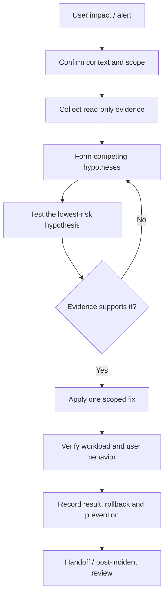

# Unit 11 — Production Cluster Troubleshooting

## Lesson metadata

| Field | Value |
|---|---|
| Exact target filename | `11-production-cluster-troubleshooting.md` |
| Unit | Unit 11 — Production Cluster Troubleshooting |
| Estimated time | 10–14 hours: 4 hours concepts, 4–7 hours staged gauntlet, 2–3 hours evidence and review |
| Prerequisites | Linux, Git, Docker, basic Pods/Deployments, `kubectl`, resource requests/limits, Services, ConfigMaps and Secrets |
| Core tools | `kubectl`, `kind`, Docker or compatible runtime, shell, `curl`/`wget` where available |
| Awareness-only tools | `jq`, `stern`, `k9s`, `crictl`, Prometheus/Grafana, provider support bundles |
| Last reviewed | 2026-10-25 |
| Kubernetes baseline | **[VERIFY]** Check `kubectl version`, the server version, kind version, node image digest, enabled APIs, and supported flags before executing version-sensitive examples. |
| Environment | Zero-budget laptop-first lab, WSL2 Ubuntu or native Linux, approximately 4 CPU, 8 GB RAM and 30 GB disk |
| Lab safety | Unique disposable multi-node kind cluster, dedicated namespace, one broken fixture at a time, explicit context checks, bounded load, exact cleanup |
| Source/repository fidelity | **NOT VERIFIED.** The supplied Unit 11 prompt was used. The complete authoritative roadmap tree, full operations folder tree, and M03 syllabus were not independently inspected in this run. |
| Execution status | No Kubernetes lab or fault scenario was executed while authoring. Sample observations are illustrative, not observed output. |

> **Safety contract:** investigate read-only first. Do not apply broken manifests, inject faults, drain nodes, or delete resources in a shared or production cluster. Use only the unique lab cluster created for this unit. Stop if the active context, cluster identity, namespace, or original node state is unclear.

### Measurable learning objectives

1. **[L1]** Apply `observe → hypothesize → test → fix → verify → document` and capture a useful incident note before changing state.
2. **[L1]** Use `get`, `describe`, current/previous logs, events, `top`, `exec`, `debug`, and `port-forward`, while explaining their permissions and limitations.
3. **[L1/L2]** Distinguish Pod phase from container waiting/termination reasons and use evidence to diagnose common workload symptoms.
4. **[L2]** Diagnose scheduling, image pull, configuration, probes, memory, DNS/Service, RBAC, quota/admission, PVC, ephemeral-container, and node-condition failures.
5. **[L3]** Correlate workload symptoms with node, storage, networking, admission, control-plane, and etcd dependencies without prematurely declaring root cause.
6. **[L3]** Run a bounded, read-only-first diagnostic bundle that scopes collection, reports failures, avoids Secret data, and warns about log privacy.
7. **[L3/L4]** Complete at least 12 staged fault scenarios with evidence, hypothesis, fix, verification, prevention, and scoped cleanup.
8. **[L4]** Use label/field selectors and JSONPath safely, design bounded fault drills, and write an actionable on-call handoff and blameless review.

## Why this matters in production

Production Kubernetes failures rarely arrive labeled with their root cause. A `CrashLoopBackOff` can be the visible effect of a bad deployment, missing configuration, unavailable dependency, incorrect probe, resource limit, or a node-level problem. A `Pending` Pod can be blocked by resource requests, taints, affinity, topology constraints, or storage. A `Forbidden` error is a control-plane authorization decision, not a reason to bypass RBAC. A Service with no endpoints may have a selector mismatch, unready Pods, or a failed controller path.

A disciplined investigation narrows the search space using evidence. The operator records the impact and recent changes, collects current and previous logs, events, object configuration, resource state, and relevant dependency health, then tests one hypothesis at a time. A fix is not complete until the workload and user-facing behavior are verified.

A local `kind` cluster is a useful learning environment, but it does not reproduce all production conditions: cloud load balancers and IAM, real multi-zone failure, provider-managed control planes, production CSI/storage semantics, provider audit logs, large-scale API load, or vendor support diagnostics. Treat kind results as evidence about the tested local setup only.

## Learning objectives

Use the measurable objectives in Lesson metadata as the completion contract. The evidence standard is: record actual outputs, timestamps, hypothesis, distinguishing test, fix, verification, rollback decision, and prevention action. Do not report a root cause unless the collected evidence supports it. The diagnostic bundle is a helper, not a vendor-specific must-gather replacement.

## Concept map and glossary

### Diagnostic flow



### Glossary

| Term | Precise definition | Common misconception |
|---|---|---|
| Symptom | Observable behavior such as errors, restarts, latency, or missing endpoints. | A symptom is not automatically the root cause. |
| Hypothesis | A testable explanation for observed evidence. | A plausible story is not a confirmed cause. |
| Root cause | A causal condition supported by evidence that explains the failure in context. | The first error in a log is always the root cause. |
| Mitigation | A controlled action that reduces impact, possibly before the full cause is known. | Mitigation necessarily fixes the underlying cause. |
| Verification | Evidence that the expected recovery condition has been met. | A successful `kubectl apply` proves the application is healthy. |
| Incident timeline | Ordered observations, actions, results, and owners with timestamps. | Reconstructed times should be presented as exact if they are estimates. |
| Pod phase | High-level Pod lifecycle phase, such as Pending, Running, Succeeded, Failed, or Unknown. | `CrashLoopBackOff` is a Pod phase. |
| Container state/reason | Container-level waiting, running, or terminated state and associated reason. | All strings shown by `kubectl get pods` are Pod phases. |
| `Pending` | Pod accepted by the API but not yet fully bound/started; includes scheduling and setup delays. | It always means insufficient CPU. |
| `CrashLoopBackOff` | A container restart is being delayed after repeated failures. | It identifies the application's root cause. |
| `ImagePullBackOff` | Kubelet is backing off after an image pull failure. | It always means an invalid tag; credentials/network can also fail. |
| `OOMKilled` | A termination reason associated with memory exhaustion/kill behavior. | `kubectl top` always captures the peak that caused it. |
| `Evicted` | Pod removed by kubelet, commonly under node pressure or other eviction conditions. | It is identical to a container OOM kill. |
| `Terminating` | A resource is being deleted and may be waiting for graceful shutdown/finalizers/dependencies. | Force deletion is the routine solution. |
| Requests | Resource amount used for scheduling and resource allocation decisions. | A request is a hard runtime ceiling. |
| Limits | Runtime-enforced resource ceiling/constraint for supported resources. | Raising limits always fixes performance problems. |
| QoS class | Kubernetes classification based on container requests/limits. | QoS alone predicts every eviction outcome. |
| Node pressure | Node condition such as MemoryPressure, DiskPressure, or PIDPressure. | A Pod-level change can always fix host pressure. |
| Taint | Node property that repels Pods unless they tolerate it. | A toleration guarantees a Pod will schedule there. |
| Toleration | Pod rule allowing scheduling onto nodes with matching taints. | It forces placement onto a particular node. |
| Node selector | Simple key/value constraint matching node labels. | A valid selector proves matching nodes have capacity. |
| Affinity | More expressive scheduling preference/requirement rules. | Preferred affinity is always a hard requirement. |
| Readiness probe | Determines whether a container should receive Service traffic. | A failed readiness probe necessarily restarts the container. |
| Liveness probe | Detects a container considered unhealthy and can trigger restart behavior. | It should be used to test every external dependency. |
| Startup probe | Allows slow-starting containers time to start before liveness/readiness checks take effect as configured. | Increasing every probe threshold is the correct fix. |
| ConfigMap | Kubernetes API object for non-confidential configuration data. | It should store passwords or tokens. |
| Secret | Kubernetes API object intended for confidential values; protection depends on cluster configuration and access controls. | Base64 encoding is encryption. |
| Service | Stable API abstraction for selecting/exposing backend Pods. | A Service guarantees it has ready endpoints. |
| Selector | Label criteria used to identify matching objects/Pods. | Similar-looking labels automatically match. |
| EndpointSlice | API resource representing network endpoints associated with a Service. | A Service with no endpoints is necessarily a CNI failure. |
| PVC | Claim for persistent storage. | A PVC object contains the volume's application data. |
| StorageClass | Describes a storage provisioning class and parameters. | Every cluster has the same provisioner or default class. |
| RBAC | Kubernetes authorization system using Roles/ClusterRoles and bindings. | `Forbidden` should be fixed by granting cluster-admin. |
| `Forbidden` | API authorization denial for a request identity/action/resource. | It means the API server is unreachable. |
| ResourceQuota | Namespace-level aggregate constraints on resource usage/counts. | It is a node-capacity metric. |
| LimitRange | Namespace policy for default/min/max resource constraints. | It replaces workload resource planning. |
| Admission webhook | API admission extension that can mutate or reject requests. | A webhook timeout is always an application bug. |
| CoreDNS | Common cluster DNS implementation, usually exposed through the `kube-dns` Service name for compatibility. | DNS failure necessarily means CoreDNS itself is down. |
| CNI | Container Network Interface plugin mechanism and network implementation. | CNI and CoreDNS are the same component. |
| API latency | Delay in API request processing; can be caused by load, storage, admission, network, or dependencies. | Slow `kubectl` alone proves etcd is the cause. |
| etcd | Consistent key-value store for Kubernetes API state. | It contains PV bytes and all external application data. |
| kubelet | Node agent that supervises Pods/containers and static Pods. | It is the same process as the container runtime. |
| Container runtime | Software that runs/manages containers for kubelet. | Runtime failure and API-server failure are indistinguishable. |
| Finalizer | Metadata mechanism that delays deletion until a controller or actor completes cleanup. | Removing finalizers is harmless in every case. |
| Owner reference | Metadata relationship used by Kubernetes garbage collection and controllers. | It is a replacement for labels/selectors. |
| PDB | PodDisruptionBudget that limits voluntary disruption of selected Pods. | It prevents all Pod loss, including node failures. |
| Ephemeral container | Debug container added to an existing Pod through the supported API, with limitations. | It changes the original application image or persists forever. |
| `kubectl debug` | CLI workflow for debug containers, copied Pods, or node debugging depending on target and flags. | It always works without extra permissions or version support. |
| Field selector | API-supported filtering on selected object fields. | Every field is selectable. |
| Label selector | Filter matching object labels. | Labels are guaranteed unique identifiers. |
| JSONPath | Output templating syntax used by kubectl. | Every JSONPath query works identically in every shell. |
| Audit log | Record of API requests under configured audit policy and available retention. | Every cluster exposes complete audit logs to every operator. |
| Diagnostic bundle | Bounded collection of selected troubleshooting evidence. | It is safe to share without review/redaction. |
| RPO/RTO | Recovery Point Objective / Recovery Time Objective. | They are substitutes for diagnosis and validation. |
| `kind` | Runs Kubernetes nodes as containers for local learning/testing. | It reproduces cloud-managed infrastructure or production failure domains. |
| Production cluster | Environment serving real workloads under operational, security, and availability constraints. | A local reproduction proves production root cause. |
| Managed control plane | Control plane operated by a provider with service-specific access and support boundaries. | Customers necessarily have host access or raw etcd access. |

## L1 — Beginner: systematic troubleshooting and kubectl

### The operating method

Use this sequence for every incident:

1. **Observe:** capture user impact, exact time, scope, recent change, context, object state, events, logs, and dependency signals.
2. **Hypothesize:** list at least two or three plausible causes. Do not start with the most dramatic one just because it is familiar.
3. **Test:** choose the lowest-risk diagnostic that separates hypotheses.
4. **Fix:** make one scoped change with authorization and a rollback plan.
5. **Verify:** confirm object state, workload readiness, dependencies, and user-visible behavior.
6. **Document:** record the result, uncertainty, remaining risks, and prevention/follow-up.

If evidence contradicts the hypothesis, stop and revise the hypothesis. Do not stack several changes; doing so makes causality harder to establish and rollback less reliable.

### Confirm context and scope first

```bash
kubectl config current-context
kubectl config get-contexts
kubectl version
kubectl get nodes -o wide
kubectl get namespaces
```

These are read-only queries, but still expose operational information. Confirm the context is the intended environment. If the API is unavailable, these commands may fail; move to the `kubectl`-unavailable playbook rather than assuming the cluster is empty.

### Core `kubectl` toolkit

| Command | What it helps answer | Access/limitations |
|---|---|---|
| `kubectl get` | What objects exist, their status, labels, and selected fields? | Requires list/get permissions. A `Running` Pod may still fail application health checks. |
| `kubectl describe` | What events, conditions, resource requests, and controller details explain the current state? | Often useful for scheduling/image/mount errors; output may include sensitive metadata. |
| `kubectl logs --previous` | What did the last terminated container instance log before restarting? | Requires logs permission and a previous container instance; only available log history is shown. |
| `kubectl get events --sort-by=.lastTimestamp` | What events were emitted recently, in approximate time order? | **[VERIFY]** sort field support/output depends on API object fields and client behavior. Events are not a complete durable audit trail. |
| `kubectl top pods` / `kubectl top nodes` | What resource usage is visible through the Metrics API now? | Requires Metrics Server or compatible metrics provider; sampled/current usage may miss transient peaks and historical trends. |
| `kubectl exec` | Can I run a command inside a running container? | Requires exec permission, a running target, and the binary to exist in the image. Minimal/distroless images may have no shell. |
| `kubectl debug` | Can I add a debug container, copy a Pod, or debug a node? | Permissions, feature support, security policy, target-process support, and CLI version matter. See official command reference. |
| `kubectl port-forward` | Can I test a selected Pod/Service port from a local client? | Requires appropriate access; proves only a local tunnel to that target/port, not full external ingress behavior. |
| `kubectl rollout status` | Has a workload rollout reached its expected controller state? | Does not prove application business transactions work. |
| `kubectl auth can-i` | Is the current identity authorized for a verb/resource? | Useful for RBAC triage; check the identity and namespace. |

Examples:

```bash
kubectl -n <NAMESPACE> get pods -o wide
kubectl -n <NAMESPACE> describe pod <POD>
kubectl -n <NAMESPACE> logs <POD> -c <CONTAINER> --tail=200
kubectl -n <NAMESPACE> logs <POD> -c <CONTAINER> --previous --tail=200
kubectl -n <NAMESPACE> get events --sort-by=.lastTimestamp
kubectl -n <NAMESPACE> top pods
kubectl -n <NAMESPACE> exec <POD> -c <CONTAINER> -- <COMMAND> <ARGUMENTS>
kubectl -n <NAMESPACE> debug <POD> -it --image=<APPROVED_DEBUG_IMAGE>
kubectl -n <NAMESPACE> port-forward pod/<POD> 18080:<CONTAINER_PORT>
```

Replace placeholders; these are templates, not commands to run blindly. Do not put secrets in command-line arguments or shell history. Use an approved debug image and follow least privilege.

### Pod phase versus container reason

Pod phases are a small set: `Pending`, `Running`, `Succeeded`, `Failed`, and `Unknown`. Strings such as `CrashLoopBackOff`, `ImagePullBackOff`, `ContainerCreating`, and `OOMKilled` usually describe container state/reason or are display summaries, not Pod phases.

| Displayed symptom | What it usually means | First evidence |
|---|---|---|
| `Pending` | Pod accepted but not fully scheduled/started; may be waiting for scheduling, volume, or setup | `describe pod`, scheduling events, PVC state, node capacity |
| `ContainerCreating` | Kubelet/runtime is preparing container; image, volume, sandbox, or network setup may be delayed | Pod events, node condition, runtime/kubelet evidence |
| `CrashLoopBackOff` | Container repeatedly exits and restart is being delayed | Current and `--previous` logs, exit code/reason, probe events |
| `ImagePullBackOff` / `ErrImagePull` | Image pull failed and retries are backing off | Exact image reference, event message, registry auth/network |
| `OOMKilled` | Container was terminated after memory exhaustion/kill behavior | Last termination reason, limits, node pressure, historical metrics |
| `Evicted` | Kubelet evicted a Pod, often under node pressure | Pod status/events and node conditions |
| `Terminating` | Deletion is in progress or blocked by graceful shutdown/finalizer/dependency | Deletion timestamp, finalizers, owner, kubelet/storage/controller evidence |
| `Error` | Broad container/pod display state indicating failure; inspect exact status | `describe`, logs, exit code and reason |
| `Completed` | Container/process finished successfully, commonly for Jobs | Job condition and expected exit behavior |

A Pod with no readiness probe may be considered ready once its containers are running, so `Running` alone is not a health check. A completed batch Pod is often correct behavior.

### Evidence before remediation

Capture a compact note before changing anything:

```text
Incident ID:
Start time and timezone:
User-visible impact:
Affected cluster/context/namespace:
Affected workloads/nodes/dependencies:
Recent deployments/config/secret/network/storage changes:
Observed facts (with source and timestamp):
Hypothesis A / evidence for / evidence against:
Hypothesis B / evidence for / evidence against:
Lowest-risk test and expected distinguishing result:
Change approved / exact command / operator:
Rollback plan:
Verification of technical state:
Verification of user-visible behavior:
Remaining risks / next owner / follow-up due date:
```

Do not include Secret values, bearer tokens, kubeconfig credentials, private keys, or sensitive environment variables in notes or shared bundles.

## L2 — Intermediate: failure-class decision trees

For each class, follow the same order: **symptom → evidence → likely causes → next safe diagnostic → scoped fix → verification → prevention**. The first visible error may be downstream of a different component. For example, image pulls can fail because of registry DNS/networking even when the image tag is correct.

### 1. Scheduling failures

**Symptom:** Pod remains `Pending` and has no assigned node.

1. Inspect `kubectl describe pod` and recent events. `FailedScheduling` messages often distinguish resource fit, taints, affinity, topology spread, and PVC constraints.
2. Check `kubectl get nodes -o wide`, `kubectl describe node`, and `kubectl top nodes` if metrics are available.
3. Compare **requests**, not only limits, to allocatable capacity and existing scheduled requests. Check quota and `LimitRange`.
4. Inspect `nodeSelector`, required node affinity, topology spread constraints, taints/tolerations, and PVC binding.
5. Mitigate by correcting a proven selector/resource request, adding appropriate capacity through the approved platform process, or resolving storage binding. Do not remove taints or lower requests without understanding the policy and impact.
6. Verify the Pod is scheduled and ready, and that workload latency/capacity meets its target.

### 2. Image pull failures

**Symptom:** `ErrImagePull` or `ImagePullBackOff`.

1. Record the exact image repository, tag/digest, and event message.
2. Check for typos, missing tags, unsupported architecture, registry auth, image pull secret reference, DNS, egress, registry outage, and possible rate limits.
3. Do not print `.dockerconfigjson` or credential values. Verify the Secret exists and the Pod's `imagePullSecrets` reference is correct without dumping its data.
4. Correct the image reference or credentials using the approved secret-management process. Do not make a private registry public as a workaround.
5. Verify a fresh pull succeeds and the actual application starts.

### 3. ConfigMaps and Secrets

**Symptom:** Pod creation fails, a volume is not mounted, a required environment variable is missing, or behavior remains stale after a config change.

1. Inspect Pod events and the Pod template references. Check object name, namespace, key, `items`, optionality, and mount path.
2. A ConfigMap/Secret reference is namespace-scoped; same name in another namespace does not satisfy it.
3. Verify only metadata/key existence, never Secret values. For sensitive changes, use the approved secret manager and rotation path.
4. For environment variables, a new Pod is generally needed to pick up updated values; mounted files may update asynchronously depending on volume/mount pattern, but `subPath` mounts do not update the same way. **[VERIFY]** confirm exact behavior for the selected volume/mount configuration.
5. Correct the reference, then roll out in a controlled way. Verify the new Pod template/revision and application behavior.

### 4. Probe failures

- **Readiness** failure removes the Pod from normal Service endpoints; it does not by itself restart the container.
- **Liveness** failure can cause a container restart.
- **Startup** probes protect slow startup by delaying liveness/readiness behavior as configured.

Check path, port, scheme, command, timeout, thresholds, startup duration, dependency coupling, and whether the probe tests the right property. A liveness probe that depends on a transient external database can restart healthy application processes during a dependency incident and amplify the outage. Increasing thresholds without evidence may only delay detection. Fix the incorrect endpoint or startup model, then verify readiness, restart count, and user-facing traffic.

### 5. OOM and resource limits

Inspect the exact last termination reason and exit code, memory request/limit, node conditions, and historical metrics. `kubectl top` is sampled and may miss a short peak. Check whether the process has a leak, unexpected batch size, model loading spike, cache growth, or concurrent work amplification. Increase a limit only when capacity and node headroom support it; otherwise fix the workload profile or reduce concurrency. Avoid unbounded memory experiments in a shared cluster.

### 6. DNS and Service connectivity

1. Confirm Service exists and inspect `spec.selector`, `port`, `targetPort`, and protocol.
2. Inspect EndpointSlices: `kubectl -n <NAMESPACE> get endpointslices -l kubernetes.io/service-name=<SERVICE>`.
3. Compare selector labels with ready Pod labels. A selector mismatch often creates no endpoints.
4. Check DNS from an approved test Pod, CoreDNS Pods and the `kube-dns` Service/EndpointSlices in `kube-system`, and network policy where applicable.
5. If DNS fails but direct Pod IP works, inspect DNS configuration/CoreDNS; if Service IP fails but Pod IP works, inspect Service routing/kube-proxy/CNI/network policy. These are clues, not proof.
6. M04 covers deeper CNI, Ingress, and service-mesh debugging; this unit stays at first-response diagnosis.

### 7. RBAC `Forbidden`

Capture the full API error: identity, verb, API group/resource, namespace, and subresource. Check current identity and `kubectl auth can-i <VERB> <RESOURCE> -n <NAMESPACE>`. Inspect Roles/ClusterRoles and bindings, including subject namespace for ServiceAccounts. Grant only the required verb/resource/scope through reviewed policy. Never resolve a `Forbidden` by granting `cluster-admin` reflexively or bypassing admission/security controls. Forward-reference M03 Unit 9.

### 8. Quota and admission rejection

Read the API error and events. Inspect `ResourceQuota`, `LimitRange`, Pod template resource requests/limits, and any configured admission policies/webhooks. Admission webhooks can reject requests or time out; a timeout may affect unrelated workloads if a webhook is configured with a broad scope. Do not disable a webhook or security policy as a debugging shortcut. Escalate policy changes to the policy owner; validate with a narrow test and restore guardrails immediately.

### 9. Ephemeral debug containers

`kubectl debug` can add an ephemeral container to a running Pod, create a modified copy of a Pod, or create a node debugging Pod, depending on invocation. Ephemeral containers are useful for minimal/distroless images without a shell. They do not rewrite the original image and have lifecycle/security constraints. The feature/API availability, CLI flags, debug profiles, target process namespace behavior, and required permissions are **[VERIFY]**. Debug containers can have security implications and may persist in the Pod spec until that Pod is replaced. Use an approved image and authorized scope. Forward-reference M01 Unit 2.

### 10. Node conditions and kubelet

Inspect node `Ready`, `MemoryPressure`, `DiskPressure`, `PIDPressure`, events, and affected Pod distribution. A node can be NotReady because of kubelet, runtime, network, disk, certificates, or control-plane connectivity. If host access is authorized, inspect kubelet/runtime logs and disk/inode pressure. Do not cordon/drain a node without assessing workload replicas, PDBs, StatefulSets, local storage, and capacity on remaining nodes. Kind node containers do not reproduce cloud node replacement exactly.

### Failure-class summary

| Class | Symptoms | Evidence | Safe mitigation | Prevention |
|---|---|---|---|---|
| Scheduling | Pending, FailedScheduling | Events, requests, taints, affinity, PVC | Correct proven constraint or capacity issue | Capacity policy, placement tests, realistic requests |
| Image pull | ErrImagePull, ImagePullBackOff | Exact event, image ref, registry/auth/network | Fix tag/digest, registry access or secret reference | Immutable tags, image validation, registry monitoring |
| Config/Secret | Create/mount failure, stale config | Pod template references, events, object metadata | Correct name/key/mount and roll out safely | Config schema checks, secret rotation workflow |
| Probes | Unready/restarts | Probe config, events, app logs/metrics | Fix path/port/startup/dependency design | Probe tests and service-specific SLOs |
| Memory | OOMKilled, restarts, node pressure | Last state, limits, node metrics/history | Fix memory profile or justified limit/concurrency | Load tests, historical metrics, resource budgets |
| DNS/Service | Resolution/connection failure | Service, EndpointSlices, CoreDNS, test Pod | Fix selector/ports or proven DNS/network issue | Service contract tests and monitoring |
| RBAC | Forbidden | Exact identity and authorization error | Least-privilege Role/Binding correction | Policy tests and access review |
| Quota/admission | Request rejected | API error, quota, LimitRange, webhook logs | Adjust valid quota/workload or fix policy safely | Admission test suite, quota alerts |
| PVC/storage | Pending claim, mount failure | PVC/PV/StorageClass/events/node CSI evidence | Correct claim/class or storage backend issue | StorageClass tests, CSI monitoring, data DR |
| Node/runtime | NotReady, widespread failures | Conditions/events/runtime/kubelet logs | Authorized node recovery; controlled drain/replace | Node health, capacity and runtime monitoring |

## L3 — Advanced: correlation, evidence, and safe remediation

### Correlate across layers

A production incident can span several layers. Build a timeline from workload events, node conditions, rollout history, admission/webhook logs, CoreDNS, CNI, storage/CSI, API-server latency, and etcd status where authorized. The sequence of observations matters: a node disk filling up may cause kubelet failures, Pod setup errors, and application timeouts; those symptoms may look unrelated until their timestamps are correlated.

Useful questions:
- Did failures begin immediately after a deployment, config/Secret rotation, policy change, node replacement, or certificate rotation?
- Are failures confined to one Pod, one node, one namespace, one dependency, or the entire cluster?
- Are healthy replicas serving traffic? Are Service endpoints correct?
- Is the API server responsive? Are admission requests waiting on a webhook? Is etcd latency suspected? Unit 10 covers deeper etcd diagnosis.
- Are errors correlated with storage mounts, CNI/DNS, or resource pressure?
- Are monitoring gaps hiding a transient spike?

### Stuck `Terminating` Pods and namespaces

Inspect deletion timestamp, finalizers, owner references, controller health, events, volume attachments, and API reachability. Finalizers exist to let an actor perform cleanup before object removal. If the actor is unavailable, deletion can wait. A namespace can remain Terminating while namespaced resources/finalizers remain.

Force deletion is not a routine first-line fix. It may remove the API object's record without proving the process has stopped, can create duplicate actors, or risk stateful data consistency. Escalate when finalizer ownership is unclear, storage is attached, StatefulSets or singleton workers are involved, or an API/control-plane issue prevents normal cleanup. Only remove a finalizer after the owner understands the cleanup it represents and has a recovery plan.

### Node failure handling

1. Capture node conditions, events, workloads, labels/taints, and relevant timestamps.
2. Determine whether this is an application issue isolated to the node or a broader node/runtime/network/storage problem.
3. Check replica capacity, PDBs, StatefulSet identities, local volumes, topology spread, and remaining cluster capacity.
4. Cordon only when authorized and when preventing new placements is appropriate.
5. Drain only after reviewing disruption and storage consequences; use the correct documented command for the Kubernetes version and workload.
6. In cloud/managed clusters, node replacement and provider diagnostics are distribution-specific. In kind, node containers are local test artifacts and are not equivalent to real cloud nodes.
7. Verify replacement workloads, storage attachment, traffic, and application state.

### Safe change boundaries

- Start read-only. Mark every mutation in the incident timeline.
- Make one change at a time; state the hypothesis it tests.
- Identify blast radius: container, Pod, workload, namespace, node, control plane, or cluster.
- Obtain the right approval for production and define rollback before applying the change.
- Stop if new evidence contradicts the hypothesis, if the target context is ambiguous, or if a proposed action risks data integrity/security.
- Verify user-visible recovery, not just Kubernetes object status.

### Audit logs and observability limits

Kubernetes audit logging records API activity only when configured and retained according to the cluster's policy. Access and availability vary by distribution/provider; some managed services expose logs through provider logging integrations, while others require explicit configuration or retention settings. Audit logs can help identify who changed an object and when, but they do not replace application logs, controller logs, storage logs, or a complete distributed trace. Events can expire; metrics are sampled; logs may be incomplete or contain sensitive data.

### Multi-symptom examples

**Example A: Deployment rollout stalls, Pods Pending, Service has fewer endpoints.** These can be one chain: new Pods cannot schedule because requests/affinity/PVC constraints are impossible; old replicas may still serve or may be scaled down depending on rollout strategy. Start with rollout status, ReplicaSets, Pod events, node capacity, and PVC state before changing the Service.

**Example B: Pods restart across several nodes, readiness fails, CoreDNS appears slow.** Hypotheses include application dependency timeouts, cluster DNS failure, node pressure, a bad deployment, or a broad network issue. Compare start time, node distribution, current/previous logs, DNS Service/EndpointSlices, and node conditions. Do not assume DNS is the cause because it is visible in logs.

**Example C: API requests time out and webhook-related errors appear.** Check whether a configured admission webhook is reachable and healthy, its timeout/failure policy, and scope. An unhealthy webhook can block API writes. Do not disable security policy as the first response; coordinate with its owner and use the supported recovery path.

### Diagnostic bundle script and privacy principles

The complete script is in its own required section. It uses read-only `kubectl` commands, explicit destination selection, confirmation for cluster-wide collection, bounded logs, best-effort collection, and a warning to review/redact before sharing. It avoids requesting Secret objects or printing Secret data. Logs and object descriptions can still contain credentials or sensitive application details; a heuristic redactor is not a guarantee. Store bundles in a restricted directory, inspect them manually, and follow retention/privacy rules.

## L4 — Expert: troubleshooting at scale and incident leadership

### Scaled triage

Use labels and field selectors to narrow queries. Confirm the fields are supported for the resource kind and API version; not every field is selectable.

```bash
kubectl get pods -n <NAMESPACE> -l app=<APP_LABEL> -o wide
kubectl get pods -A --field-selector=status.phase=Pending
kubectl get events -n <NAMESPACE> --sort-by=.lastTimestamp
kubectl get deploy,rs,sts,job -n <NAMESPACE>
kubectl get pods -n <NAMESPACE> -o jsonpath='{range .items[*]}{.metadata.name}{"\t"}{.status.phase}{"\n"}{end}'
```

For structured analysis, `jq` can filter JSON. Example:

```bash
kubectl get pods -n <NAMESPACE> -o json |
  jq -r '.items[] | [.metadata.name, .status.phase,
    ([.status.containerStatuses[]?.restartCount] | add // 0)] | @tsv'
```

This uses JSON fields that may be absent; optional chaining/defaults prevent missing container statuses from breaking the query. **[VERIFY]** JSONPath behavior and shell quoting in PowerShell/Windows shells differ; the examples assume a POSIX shell.

Do not run a huge cluster-wide query repeatedly during API degradation. Scope by namespace/label, cap output, and coordinate collection. A large diagnostic request can add load to a stressed API server.

### Debugging the debugger: when `kubectl` or the API is unavailable

1. Confirm kubeconfig path/context and local connectivity; distinguish wrong context/credentials from server unavailability.
2. Check provider control-plane status/maintenance for managed clusters. Do not assume control-plane host access.
3. If self-managed and authorized, inspect the host/container runtime, kubelet, static-Pod manifests and logs, disk/time/certificates, and network.
4. Preserve local logs and timestamps before restarting components or changing manifests.
5. If managed, open provider support with cluster/resource identifiers, timestamps, impact, errors, and sanitized evidence; use supported provider diagnostics.
6. Do not assume `kubectl get pods` returning nothing means the cluster has no workloads. An API connection failure means the query did not establish state.

### Safe fault-drill design

A fault drill needs a written hypothesis, a disposable environment, bounded scope, explicit stop conditions, rollback, expected evidence, and post-drill validation. Use one named fixture at a time. Do not prescribe unbounded CPU/memory exhaustion, broad network disruption, cluster-wide deletion, or production fault injection. The gauntlet in this unit uses broken manifests and narrow namespace-scoped fixtures rather than uncontrolled chaos.

Forward references:
- M01 Unit 2: minimal/distroless images and debug tooling.
- M03 Unit 3: probes and health checks.
- M03 Unit 5: PDBs and graceful shutdown.
- M03 Unit 7: node placement.
- M03 Unit 9: RBAC and Pod Security.
- M03 Unit 10: etcd and control-plane troubleshooting.
- M04: deep networking/CNI/Ingress/service mesh.
- M10: incident/SRE practices.

## Worked example: diagnosing a failing data/ML workload

**Illustrative scenario; no commands were executed and no actual root cause is asserted.**

An internal inference API begins returning intermittent 503s after a deployment. The Deployment reports fewer available replicas than desired; one Pod is `CrashLoopBackOff`, one is unready, and a batch worker in another namespace reports DNS timeout. The first visible symptom is not enough to establish a shared cause.

### Step 1 — Confirm impact and target

```bash
kubectl config current-context
kubectl -n ml-serving get deploy,pods,rs -o wide
kubectl -n ml-serving rollout status deployment/inference-api --timeout=10s
kubectl -n ml-serving get events --sort-by=.lastTimestamp
```

Record the actual context, rollout revision, timestamps, and whether healthy replicas remain. If the API is slow, avoid repeatedly polling and coordinate evidence collection.

### Step 2 — Gather workload evidence

```bash
kubectl -n ml-serving describe deployment inference-api
kubectl -n ml-serving describe pod <FAILING_POD>
kubectl -n ml-serving logs <FAILING_POD> -c api --tail=200
kubectl -n ml-serving logs <FAILING_POD> -c api --previous --tail=200
kubectl -n ml-serving get pods -o json
```

Inspect requests/limits, probe configuration, config references, image reference, node placement, restarts, last termination reason, and Pod events. Redact logs before sharing.

### Step 3 — Competing hypotheses

| Hypothesis | Supporting evidence to seek | Lowest-risk distinguishing test |
|---|---|---|
| H1: bad deployment/config caused process crash | New ReplicaSet started at incident time; previous logs show config parse/import error | Compare old/new Pod template and current/previous logs |
| H2: memory limit causes OOM | Last termination reason indicates OOM; restarts correlate with load; memory history peaks | Inspect last state/limits and historical metrics; avoid inducing load |
| H3: DNS/dependency issue causes readiness timeout | DNS errors across workloads/nodes; CoreDNS/Service endpoints unhealthy | Inspect `kube-dns` Service/EndpointSlices and run approved DNS test |
| H4: probe path/port changed | Probe events show HTTP failure; app listens on different port/path | Compare manifest to application health endpoint and local logs |

### Step 4 — Evidence-supported fix

Suppose the actual evidence in a learner's run proves the new Deployment changed the readiness path while the application still serves the old path. The safe fix would be a reviewed correction to the probe configuration or a rollback to the known-good revision, followed by rollout and application-level verification. This is a **conditional example**, not a claim about the hypothetical incident's true cause.

```bash
# Read-only history first:
kubectl -n ml-serving rollout history deployment/inference-api
kubectl -n ml-serving get deployment inference-api -o yaml
```

Only after confirming the exact revision and obtaining authorization would an operator run a scoped rollback or patch. Record the exact command and rollback option. Verify:
- desired and available replicas match expectations;
- Pods are ready and restart counts stabilize;
- Service endpoints include the intended ready Pods;
- a smoke test succeeds through the same route clients use;
- error rate and latency recover;
- DNS/dependency symptoms are either explained or investigated separately.

### Step 5 — Document

Record impact, start/end times, evidence, hypotheses rejected, exact change, verification, rollback, remaining risks, and prevention action such as probe contract tests in CI. Do not declare the issue resolved merely because Pods say `Running`.

## Troubleshooting decision trees and pattern-recognition table

### Decision tree: Pod is not healthy

```text
Pod not healthy
├── Pending?
│   ├── FailedScheduling events → requests/capacity, taints, affinity, topology, quota
│   └── Scheduled but setup stalled → PVC, image pull, CNI/sandbox, mount, kubelet/runtime
├── Container waiting?
│   ├── ErrImagePull/ImagePullBackOff → image reference, auth, registry network/DNS
│   └── ContainerCreating → events, volume, sandbox, node/runtime
├── Container terminated/restarting?
│   ├── OOMKilled → limit, workload peak, node memory pressure
│   ├── Non-zero exit → current + previous logs, command/args/config/dependency
│   └── Probe failures → startup/readiness/liveness semantics, path/port/timeouts
└── Pod Running but service broken?
    ├── Not Ready → readiness conditions/probe
    ├── Service no endpoints → selector/labels/readiness/EndpointSlices
    ├── DNS failure → DNS service/CoreDNS/pod resolv.conf/network policy
    └── User path fails → Service ports, Ingress/LB/provider/network, app dependencies
```

### Decision tree: `kubectl` is unavailable

```text
kubectl request fails
├── Confirm current context and kubeconfig endpoint
├── Is the API endpoint reachable/authenticating?
│   ├── No: distinguish DNS/network/credential/certificate/provider outage
│   └── Yes but slow: inspect request latency, admission/webhook, control-plane health
├── Managed control plane?
│   ├── Yes: provider health/support workflow; no assumed host/etcd access
│   └── No: authorized host/runtime/kubelet/static-Pod inspection
└── Preserve evidence → choose supported recovery → validate service behavior
```

### Pattern-recognition table

| Symptom | Three likely causes | First safe check/command |
|---|---|---|
| Pod `Pending` | Capacity/request mismatch; taint/affinity; PVC not bound | `kubectl -n <NS> describe pod <POD>` |
| `ContainerCreating` | Image pull; volume/mount; sandbox/CNI/runtime | `kubectl -n <NS> describe pod <POD>` |
| `CrashLoopBackOff` | App exits; probe restart; OOM/resource issue | `kubectl -n <NS> logs <POD> -c <CONTAINER> --previous --tail=200` |
| `ImagePullBackOff` | Bad tag/repo; credentials; registry DNS/network | `kubectl -n <NS> describe pod <POD>` |
| `OOMKilled` | Container memory ceiling; transient peak; node pressure | `kubectl -n <NS> get pod <POD> -o yaml` (inspect last state/limits; redact before sharing) |
| Probe failures | Wrong path/port; startup too slow; unhealthy dependency coupling | `kubectl -n <NS> describe pod <POD>` |
| Missing ConfigMap/Secret | Wrong name/namespace/key; invalid volume/env reference; stale rollout | `kubectl -n <NS> describe pod <POD>` |
| Stalled rollout | New Pods unready; insufficient capacity; quota/admission/PVC | `kubectl -n <NS> rollout status deployment/<DEPLOYMENT> --timeout=10s` |
| Service no endpoints | Selector mismatch; Pods not Ready; wrong namespace/labels | `kubectl -n <NS> get svc <SERVICE> -o yaml` |
| DNS failure | CoreDNS unhealthy; DNS service endpoints absent; network policy/CNI | `kubectl -n kube-system get pods,svc,endpointslices` |
| `Forbidden` | Missing verb/resource; wrong identity; namespace/binding mismatch | `kubectl auth can-i <VERB> <RESOURCE> -n <NS>` |
| Quota/admission denied | Quota exhausted; LimitRange violation; webhook/policy rejection | `kubectl -n <NS> describe resourcequota` and inspect exact API error |
| PVC Pending/mount failure | No compatible StorageClass; provisioner issue; access/attachment issue | `kubectl -n <NS> describe pvc <PVC>` |
| Node NotReady/pressure | Kubelet/runtime down; disk/memory/PID pressure; network/cert issue | `kubectl describe node <NODE>` |
| Pod/namespace Terminating | Finalizer actor unavailable; volume cleanup; API/node issue | `kubectl -n <NS> get pod <POD> -o yaml` (inspect metadata only; avoid dumping Secret data) |
| CoreDNS/CNI/webhook/control-plane-wide | Component outage; node/network issue; dependency latency | Start with scoped component status/events and provider/control-plane status |
| API server/etcd appears unavailable | Wrong context/network; API/control-plane failure; storage/TLS issue | `kubectl config current-context`; then authorized host/provider diagnostics |
| `kubectl` unusable | Wrong kubeconfig/context; DNS/network/cert; API/provider outage | `kubectl config current-context` and inspect the exact client error |

For every tree, classify commands as read-only or mutating, state stop/escalation conditions, and verify both the technical change and customer-facing outcome. A force deletion, node drain, admission-policy change, or finalizer removal requires a stronger impact and approval review than a read-only query.

## Mandatory troubleshooting gauntlet — broken manifests

### Gauntlet safety and workflow

**Use only a unique disposable kind cluster and dedicated namespace.** The scenarios below are designed to be staged. Do not apply them all at once. Some outcomes depend on Kubernetes version, node image, storage provisioner, registry access, admission configuration, and scheduling behavior; those dependencies are marked `[VERIFY]`.

Before starting:

```bash
kind version
kubectl version
docker version
docker info
df -h
free -h
kind get clusters
kubectl config get-contexts
kubectl config current-context
```

Choose a unique name and verify it does not already exist:

```bash
export TROUBLESHOOTING_LAB_CLUSTER_NAME="troubleshooting-lab-$(date +%Y%m%d%H%M%S)"
export TROUBLESHOOTING_LAB_CONTEXT="kind-${TROUBLESHOOTING_LAB_CLUSTER_NAME}"
export TROUBLESHOOTING_LAB_NAMESPACE="troubleshoot-${RANDOM}-$(date +%H%M%S)"
kind get clusters
```

If the name already exists, stop and choose another. Create a multi-node local cluster using a verified kind node image tag/digest from the [kind configuration](https://kind.sigs.k8s.io/docs/user/configuration/) and [quick start](https://kind.sigs.k8s.io/docs/user/quick-start/) docs.

Example `kind-troubleshoot.yaml` (replace the image placeholder; do not run it literally):

```yaml
kind: Cluster
apiVersion: kind.x-k8s.io/v1alpha4
nodes:
  - role: control-plane
    image: kindest/node:<VERIFY_SUPPORTED_TAG_AND_DIGEST>
  - role: worker
    image: kindest/node:<VERIFY_SAME_SUPPORTED_TAG_AND_DIGEST>
  - role: worker
    image: kindest/node:<VERIFY_SAME_SUPPORTED_TAG_AND_DIGEST>
```

**[VERIFY]** Pin an actual published image tag and digest. Then create only the unique lab cluster:

```bash
if kind get clusters | grep -Fxq "$TROUBLESHOOTING_LAB_CLUSTER_NAME"; then
  echo "STOP: cluster name already exists"; exit 1
fi
kind create cluster --name "$TROUBLESHOOTING_LAB_CLUSTER_NAME" --config ./kind-troubleshoot.yaml
kubectl config current-context
kubectl --context "$TROUBLESHOOTING_LAB_CONTEXT" get nodes -o wide
```

If the context is not exactly the expected kind context, stop. Create and verify the namespace:

```bash
kubectl --context "$TROUBLESHOOTING_LAB_CONTEXT" create namespace "$TROUBLESHOOTING_LAB_NAMESPACE"
kubectl --context "$TROUBLESHOOTING_LAB_CONTEXT" get namespace "$TROUBLESHOOTING_LAB_NAMESPACE"
```

Save baseline node labels/taints/conditions before any node-level scenario:

```bash
kubectl --context "$TROUBLESHOOTING_LAB_CONTEXT" get nodes -o wide
kubectl --context "$TROUBLESHOOTING_LAB_CONTEXT" get nodes -o json
```

Keep this evidence in personal notes; do not commit it if it contains sensitive environment details.

### Scenario execution protocol

For each scenario:
1. Verify `kubectl config current-context` equals `TROUBLESHOOTING_LAB_CONTEXT`.
2. Verify the dedicated namespace exists.
3. Apply only that scenario's named manifest.
4. Observe and record events/status/logs before reading the answer key.
5. Use Hint 1, then Hint 2, then Hint 3 only as needed.
6. State a diagnosis and evidence that distinguishes it from alternatives.
7. Apply the exact corrective fix; verify resolution.
8. Delete only that scenario's named fixture after rechecking context and namespace.
9. Move to the next scenario only after cleanup and namespace health check.

A manifest marked intentionally broken is not a recommended production pattern.

### Scenario 1 — Wrong image tag (`ImagePullBackOff`) [L1]

**Objective:** Use events to distinguish image-reference failure from registry credentials/network.

**Preconditions:** disposable cluster and namespace; registry egress may affect the exact message.

**Manifest:**

```yaml
apiVersion: apps/v1
kind: Deployment
metadata:
  name: lab-s01-imagepull
  namespace: TROUBLESHOOTING_LAB_NAMESPACE
  labels:
    app: lab-s01-imagepull
spec:
  replicas: 1
  selector:
    matchLabels:
      app: lab-s01-imagepull
  template:
    metadata:
      labels:
        app: lab-s01-imagepull
    spec:
      containers:
        - name: web
          image: registry.k8s.io/pause:unit11-tag-does-not-exist
          imagePullPolicy: Always
```

Replace `TROUBLESHOOTING_LAB_NAMESPACE` with the actual namespace before applying.

**Learner hints**
- Hint 1: Look at the container's waiting reason and the Pod event message.
- Hint 2: Check the exact image reference; compare repository and tag.
- Hint 3: `kubectl -n "$TROUBLESHOOTING_LAB_NAMESPACE" describe pod <POD>` should expose the failed image pull message.

**Illustrative expected observation:** Pod reports `ErrImagePull`/`ImagePullBackOff`; event wording depends on runtime, registry, and version. A network or registry failure can produce a similar symptom, so collect the exact error before concluding.

**Instructor answer key — hidden cause:** deliberately invalid image tag.

**Diagnosis rubric:** cite the image field and event; distinguish `manifest unknown`/not found from unauthorized or timeout.

**Fix:** patch to a verified reachable image tag/digest:

```bash
kubectl -n "$TROUBLESHOOTING_LAB_NAMESPACE" set image deployment/lab-s01-imagepull \
  web=registry.k8s.io/pause:3.10
kubectl -n "$TROUBLESHOOTING_LAB_NAMESPACE" rollout status deployment/lab-s01-imagepull --timeout=120s
```

**Verify/prevent:** `kubectl get pods -l app=lab-s01-imagepull`; use immutable digests and validate image references in CI.

**Scoped cleanup gate:** verify context and namespace, then `kubectl -n "$TROUBLESHOOTING_LAB_NAMESPACE" delete deployment lab-s01-imagepull --wait=true`.

### Scenario 2 — Missing ConfigMap [L1]

**Objective:** Diagnose a Pod blocked by a missing configuration object.

```yaml
apiVersion: v1
kind: Pod
metadata:
  name: lab-s02-missing-config
  namespace: TROUBLESHOOTING_LAB_NAMESPACE
  labels:
    app: lab-s02-missing-config
spec:
  containers:
    - name: app
      image: registry.k8s.io/pause:3.10
      env:
        - name: MODE
          valueFrom:
            configMapKeyRef:
              name: lab-s02-settings-missing
              key: mode
```

Replace namespace placeholder.

**Preconditions:** verified image available; no real config values.

**Hints:** (1) inspect events; (2) inspect `env` reference and namespace; (3) `kubectl describe pod lab-s02-missing-config`.

**Illustrative observation:** Pod setup/start is blocked because a required ConfigMap/key is absent; exact reason may appear as `CreateContainerConfigError` or event text depending on version.

**Instructor answer key:** referenced ConfigMap does not exist.

**Diagnosis rubric:** name the missing object/key from the event and manifest, not merely “configuration issue.”

**Fix:**

```bash
kubectl -n "$TROUBLESHOOTING_LAB_NAMESPACE" create configmap lab-s02-settings-missing --from-literal=mode=demo
kubectl -n "$TROUBLESHOOTING_LAB_NAMESPACE" get pod lab-s02-missing-config -o wide
```

**Verify/prevent:** confirm Pod reaches expected state; add schema/reference validation to deployment checks.

**Cleanup:** context/namespace check, then delete exact Pod and ConfigMap.

### Scenario 3 — Impossible node selector [L2]

**Objective:** Use scheduling events to diagnose a selector that matches no node.

```yaml
apiVersion: v1
kind: Pod
metadata:
  name: lab-s03-no-node-match
  namespace: TROUBLESHOOTING_LAB_NAMESPACE
  labels:
    app: lab-s03-no-node-match
spec:
  nodeSelector:
    lab.example.invalid/never-present: "true"
  containers:
    - name: app
      image: registry.k8s.io/pause:3.10
```

**Hints:** (1) inspect Pod events; (2) compare selector with node labels; (3) `kubectl get nodes --show-labels` and `describe pod`.

**Illustrative observation:** `FailedScheduling` reports no nodes matching selector/affinity; wording varies.

**Instructor answer key:** selector key is intentionally absent from the nodes.

**Diagnosis rubric:** show node label inventory and selector mismatch.

**Fix:** remove the invalid selector from this Pod by replacing it with a corrected manifest that has no `nodeSelector`, or use an existing verified node label. Recreate the Pod with corrected spec; Pod spec fields may be immutable.

**Verify/prevent:** Pod scheduled and ready; validate selector values against cluster inventory or policy before deployment.

**Cleanup:** delete only `lab-s03-no-node-match` after gate.

### Scenario 4 — PVC waits for an unavailable storage class [L2, environment-dependent]

**Objective:** Inspect storage prerequisites instead of assuming kind's provisioner behavior.

First inspect:

```bash
kubectl get storageclass
kubectl get csidrivers
kubectl -n "$TROUBLESHOOTING_LAB_NAMESPACE" get pvc
```

**[VERIFY]** Do not apply this scenario until the actual StorageClass/provisioner has been inspected. This fixture names a deliberately absent class and is designed to remain unbound on ordinary clusters that do not define it; if a matching class exists, choose a unique nonexistent class name instead.

```yaml
apiVersion: v1
kind: PersistentVolumeClaim
metadata:
  name: lab-s04-unbound-pvc
  namespace: TROUBLESHOOTING_LAB_NAMESPACE
  labels:
    app: lab-s04-unbound-pvc
spec:
  accessModes:
    - ReadWriteOnce
  storageClassName: unit11-no-such-storage-class
  resources:
    requests:
      storage: 1Mi
```

**Hints:** (1) inspect PVC status/events; (2) inspect `storageClassName`, StorageClasses and provisioners; (3) `kubectl describe pvc lab-s04-unbound-pvc`.

**Illustrative observation:** PVC remains `Pending` with a storage-class/provisioning event. Do not assume exact wording or dynamic provisioning behavior.

**Instructor answer key:** no StorageClass exists with the deliberately chosen name, and no matching provisioner can satisfy it.

**Diagnosis rubric:** actual StorageClass inventory and PVC event prove the mismatch.

**Fix:** change to a verified StorageClass supported by this lab, or remove `storageClassName` only if the lab's documented default class is intended. Do not silently create a production StorageClass.

**Verify/prevent:** PVC binds and Pod mounts only after actual storage is available; test StorageClass requirements in environment-specific deployment checks.

**Cleanup:** verify context/namespace and delete only `lab-s04-unbound-pvc`. If storage resources were created by the learner, inventory them before cleanup.

### Scenario 5 — Failing readiness probe [L2]

**Objective:** Distinguish readiness failure from a process restart.

```yaml
apiVersion: apps/v1
kind: Deployment
metadata:
  name: lab-s05-readiness
  namespace: TROUBLESHOOTING_LAB_NAMESPACE
  labels:
    app: lab-s05-readiness
spec:
  replicas: 1
  selector:
    matchLabels:
      app: lab-s05-readiness
  template:
    metadata:
      labels:
        app: lab-s05-readiness
    spec:
      containers:
        - name: web
          image: nginx:1.27
          ports:
            - name: http
              containerPort: 80
          readinessProbe:
            httpGet:
              path: /not-a-real-health-path
              port: http
            initialDelaySeconds: 1
            periodSeconds: 3
            timeoutSeconds: 1
            failureThreshold: 2
```

**[VERIFY]** Use a currently available pinned image tag/digest approved for the lab. The example tag is not a guarantee of current availability.

**Hints:** (1) compare Ready status with restart count; (2) inspect readiness probe path/port and events; (3) `kubectl describe pod`.

**Illustrative observation:** container can remain running while Pod is unready; readiness failures do not by themselves restart it.

**Instructor answer key:** probe requests a nonexistent path.

**Fix:** patch the path to `/` or another verified endpoint served by the container:

```bash
kubectl -n "$TROUBLESHOOTING_LAB_NAMESPACE" patch deployment lab-s05-readiness --type=json \
  -p='[{"op":"replace","path":"/spec/template/spec/containers/0/readinessProbe/httpGet/path","value":"/"}]'
kubectl -n "$TROUBLESHOOTING_LAB_NAMESPACE" rollout status deployment/lab-s05-readiness --timeout=120s
```

**Verify/prevent:** Ready becomes true and endpoints include the Pod; test probe paths and application startup behavior in CI.

**Cleanup:** delete exact Deployment after gate.

### Scenario 6 — Bounded memory-limit failure [L2; run only if resources permit]

**Objective:** Connect termination reason to resource configuration without unbounded stress.

This scenario is optional on a constrained laptop. It uses a small bounded allocation request and must not be scaled up. **[VERIFY]** actual memory accounting/termination behavior varies by runtime/node image; skip if the environment cannot safely support the fixture.

```yaml
apiVersion: v1
kind: Pod
metadata:
  name: lab-s06-bounded-memory
  namespace: TROUBLESHOOTING_LAB_NAMESPACE
  labels:
    app: lab-s06-bounded-memory
spec:
  restartPolicy: Never
  containers:
    - name: memory-test
      image: python:3.12-alpine
      command: ["python", "-c"]
      args:
        - "x = bytearray(96 * 1024 * 1024); print(len(x)); import time; time.sleep(5)"
      resources:
        requests:
          memory: 16Mi
          cpu: 10m
        limits:
          memory: 32Mi
          cpu: 100m
```

This intentionally attempts a bounded 96 MiB allocation under a 32 MiB limit. It is not guaranteed to display exactly `OOMKilled` on every runtime; the scenario is to inspect actual termination reason. Do not increase the allocation or run many copies.

**Hints:** (1) inspect last state/exit reason; (2) compare requested allocation with limit; (3) `kubectl describe pod` and `kubectl get pod -o json` lastState.

**Instructor answer key:** allocation is deliberately larger than the memory limit.

**Diagnosis rubric:** actual last termination reason/exit code and manifest limit support the conclusion; if the process fails differently, report observed behavior and mark the fixture inconclusive rather than asserting OOM.

**Fix:** remove the fixture after recording evidence. For real services, size from measured workload behavior and node capacity; do not simply raise the limit without analysis.

**Verify/prevent:** no test Pod remains; use load tests, memory profiles, historical metrics and appropriate requests/limits.

**Cleanup:** delete only `lab-s06-bounded-memory` after context/namespace gate.

### Scenario 7 — ResourceQuota exceeded [L2]

**Objective:** Interpret quota rejection as a namespace policy decision.

Apply the quota first:

```yaml
apiVersion: v1
kind: ResourceQuota
metadata:
  name: lab-s07-quota
  namespace: TROUBLESHOOTING_LAB_NAMESPACE
spec:
  hard:
    pods: "1"
```

Then attempt to create two distinct Pods (one succeeds; the second is rejected). Use harmless pause image and no sensitive values:

```yaml
apiVersion: v1
kind: Pod
metadata:
  name: lab-s07-pod-a
  namespace: TROUBLESHOOTING_LAB_NAMESPACE
  labels:
    app: lab-s07-quota
spec:
  containers:
    - name: pause
      image: registry.k8s.io/pause:3.10
---
apiVersion: v1
kind: Pod
metadata:
  name: lab-s07-pod-b
  namespace: TROUBLESHOOTING_LAB_NAMESPACE
  labels:
    app: lab-s07-quota
spec:
  containers:
    - name: pause
      image: registry.k8s.io/pause:3.10
```

**Hints:** (1) inspect exact create error; (2) inspect ResourceQuota usage/hard limits; (3) `kubectl describe resourcequota lab-s07-quota`.

**Illustrative observation:** second Pod create is denied because the namespace Pod count quota is exhausted.

**Instructor answer key:** quota `pods: "1"` permits only one Pod object in this namespace under the applicable quota accounting.

**Fix:** delete the extra fixture Pod or remove the quota after completing the test. Do not teach quota bypass.

**Verify/prevent:** inspect quota usage after cleanup; size quotas intentionally and monitor headroom.

**Cleanup:** context/namespace check; delete exact Pods and `lab-s07-quota`.

### Scenario 8 — RBAC denial for a deliberately limited identity [L2]

**Objective:** Diagnose `Forbidden` and use least privilege.

Create a ServiceAccount and Role that intentionally permits only `get` on ConfigMaps, then test whether it can list Pods. This is namespace-scoped.

```yaml
apiVersion: v1
kind: ServiceAccount
metadata:
  name: lab-s08-limited
  namespace: TROUBLESHOOTING_LAB_NAMESPACE
---
apiVersion: rbac.authorization.k8s.io/v1
kind: Role
metadata:
  name: lab-s08-configmap-reader
  namespace: TROUBLESHOOTING_LAB_NAMESPACE
rules:
  - apiGroups: [""]
    resources: ["configmaps"]
    verbs: ["get"]
---
apiVersion: rbac.authorization.k8s.io/v1
kind: RoleBinding
metadata:
  name: lab-s08-limited-binding
  namespace: TROUBLESHOOTING_LAB_NAMESPACE
subjects:
  - kind: ServiceAccount
    name: lab-s08-limited
    namespace: TROUBLESHOOTING_LAB_NAMESPACE
roleRef:
  apiGroup: rbac.authorization.k8s.io
  kind: Role
  name: lab-s08-configmap-reader
```

**Hints:** (1) capture the exact Forbidden error; (2) identify the ServiceAccount and requested verb/resource; (3) `kubectl auth can-i list pods -n "$TROUBLESHOOTING_LAB_NAMESPACE" --as=system:serviceaccount:<NAMESPACE>:lab-s08-limited`.

**Instructor answer key:** the Role allows only `get configmaps`, not `list pods`.

**Diagnosis rubric:** state the identity, verb, resource and namespace; verify binding subject and Role rules.

**Fix:** the safe lab fix is to use the intended permitted action or, if the exercise specifically requires listing Pods, add only the narrow `list pods` rule after review. Do not grant cluster-admin.

**Verify/prevent:** `kubectl auth can-i` reflects the intended policy; keep role tests in CI.

**Cleanup:** delete exact RoleBinding, Role and ServiceAccount after context/namespace check.

### Scenario 9 — Service selector mismatch [L2]

**Objective:** Diagnose a Service with no matching endpoints.

```yaml
apiVersion: apps/v1
kind: Deployment
metadata:
  name: lab-s09-backend
  namespace: TROUBLESHOOTING_LAB_NAMESPACE
  labels:
    app: lab-s09-backend
spec:
  replicas: 1
  selector:
    matchLabels:
      app: lab-s09-backend
  template:
    metadata:
      labels:
        app: lab-s09-backend
    spec:
      containers:
        - name: web
          image: nginx:1.27
          ports:
            - containerPort: 80
---
apiVersion: v1
kind: Service
metadata:
  name: lab-s09-service
  namespace: TROUBLESHOOTING_LAB_NAMESPACE
spec:
  selector:
    app: lab-s09-backend-typo
  ports:
    - port: 80
      targetPort: 80
```

**[VERIFY]** Pin a currently available image tag/digest.

**Hints:** (1) inspect Service endpoints/EndpointSlices; (2) compare selector to Pod labels; (3) `kubectl get svc lab-s09-service -o yaml` and `kubectl get pods --show-labels`.

**Instructor answer key:** Service selector does not match the Deployment's Pod labels.

**Fix:**

```bash
kubectl -n "$TROUBLESHOOTING_LAB_NAMESPACE" patch service lab-s09-service \
  --type=merge -p '{"spec":{"selector":{"app":"lab-s09-backend"}}}'
kubectl -n "$TROUBLESHOOTING_LAB_NAMESPACE" get endpointslices \
  -l kubernetes.io/service-name=lab-s09-service
```

**Verify/prevent:** EndpointSlice has the ready Pod endpoint; add selector/Service contract tests.

**Cleanup:** delete only Service and Deployment after gate.

### Scenario 10 — Taint with no matching toleration [L2; node mutation guard]

**Preferred safe variant:** use a Pod with a toleration that cannot match any existing node taint? This is not guaranteed to be unschedulable. The primary fixture is an impossible node selector (Scenario 3). A true taint exercise mutates a node and is optional.

**Before node mutation:** record all node names, labels, taints, and conditions. Select a worker by inspecting `kubectl get nodes -o wide`; never hardcode a node name. If original taints cannot be captured and restored exactly, skip this scenario.

Illustrative command sequence only after selecting a worker and obtaining approval:

```bash
kubectl config current-context
kubectl --context "$TROUBLESHOOTING_LAB_CONTEXT" get nodes -o wide
kubectl --context "$TROUBLESHOOTING_LAB_CONTEXT" describe node <DISCOVERED_WORKER_NODE>
# Record the full original taint list before continuing.
kubectl --context "$TROUBLESHOOTING_LAB_CONTEXT" taint node <DISCOVERED_WORKER_NODE> unit11.example.invalid/trap=true:NoSchedule
```

Then apply a Pod whose `nodeSelector` matches the selected worker's existing label but which has no toleration for the new taint. Since scheduling and node labels differ by cluster, construct the fixture only after verifying the worker labels.

**Hints:** (1) inspect `FailedScheduling`; (2) compare node taints to Pod tolerations; (3) `kubectl describe node` and `describe pod`.

**Instructor answer key:** the added `NoSchedule` taint repels the Pod because it has no matching toleration.

**Fix/restoration:** delete the exact test Pod, then remove only the taint added by this lab:

```bash
kubectl --context "$TROUBLESHOOTING_LAB_CONTEXT" taint node <DISCOVERED_WORKER_NODE> unit11.example.invalid/trap:NoSchedule-
```

**Verify:** compare node taints to the saved baseline. If anything differs, stop and restore from the captured exact state; do not remove other taints. This scenario is **NOT SAFE TO RUN** if the target node or baseline is ambiguous.

**Prevention:** treat node taints as platform policy and review changes; do not add broad tolerations to bypass placement rules.

### Scenario 11 — Bad probe port [L2]

**Objective:** Identify a probe targeting a port that the container does not listen on.

```yaml
apiVersion: apps/v1
kind: Deployment
metadata:
  name: lab-s11-bad-port
  namespace: TROUBLESHOOTING_LAB_NAMESPACE
  labels:
    app: lab-s11-bad-port
spec:
  replicas: 1
  selector:
    matchLabels:
      app: lab-s11-bad-port
  template:
    metadata:
      labels:
        app: lab-s11-bad-port
    spec:
      containers:
        - name: web
          image: nginx:1.27
          ports:
            - name: http
              containerPort: 80
          readinessProbe:
            httpGet:
              path: /
              port: 8081
            periodSeconds: 3
            timeoutSeconds: 1
            failureThreshold: 2
```

**[VERIFY]** Use an approved image tag/digest.

**Hints:** (1) inspect readiness events and Pod readiness; (2) compare probe port to actual listening port; (3) `describe pod` and inspect `containerPort`/probe configuration.

**Instructor answer key:** probe uses 8081 while nginx serves port 80.

**Fix:** patch the probe port to 80, verify rollout and readiness.

**Verify/prevent:** Pod becomes ready and endpoint is present; validate probe port/path with an integration test.

**Cleanup:** delete exact Deployment after gate.

### Scenario 12 — Service targetPort mismatch [L2]

**Objective:** Distinguish a healthy Pod from a Service that forwards to the wrong port.

```yaml
apiVersion: apps/v1
kind: Deployment
metadata:
  name: lab-s12-service-port
  namespace: TROUBLESHOOTING_LAB_NAMESPACE
  labels:
    app: lab-s12-service-port
spec:
  replicas: 1
  selector:
    matchLabels:
      app: lab-s12-service-port
  template:
    metadata:
      labels:
        app: lab-s12-service-port
    spec:
      containers:
        - name: web
          image: nginx:1.27
          ports:
            - name: http
              containerPort: 80
---
apiVersion: v1
kind: Service
metadata:
  name: lab-s12-service
  namespace: TROUBLESHOOTING_LAB_NAMESPACE
spec:
  selector:
    app: lab-s12-service-port
  ports:
    - name: http
      port: 8080
      targetPort: 8081
```

**[VERIFY]** Pin an approved image.

**Hints:** (1) inspect endpoint presence and connectivity; (2) compare Service targetPort with container listener; (3) `kubectl get svc lab-s12-service -o yaml` and inspect EndpointSlice ports.

**Instructor answer key:** the Service forwards to 8081, but the application listens on 80.

**Fix:**

```bash
kubectl -n "$TROUBLESHOOTING_LAB_NAMESPACE" patch service lab-s12-service \
  --type=merge -p '{"spec":{"ports":[{"name":"http","port":8080,"targetPort":80,"protocol":"TCP"}]}}'
```

**Verify:** run an approved in-cluster request to the Service or use a scoped `port-forward`; confirm HTTP response and application behavior. EndpointSlice presence alone does not prove the target port is correct.

**Prevention:** define named ports consistently and test Service-to-container routing.

**Cleanup:** delete exact Service and Deployment after gate.

### Scenario 13 — Admission/security policy denial [L3; optional extension]

Default kind does not guarantee that a third-party policy engine is installed. Do not install a cluster-wide webhook as a hidden prerequisite.

**Default alternative:** use a Pod Security Admission restricted-profile namespace only if the selected Kubernetes version supports the intended namespace labels and behavior. **[VERIFY]** confirm the version and profile. A rejected Pod can be created with a clearly disallowed privileged setting, but do not apply it outside the disposable namespace.

Illustrative namespace label (only after version verification):

```bash
kubectl --context "$TROUBLESHOOTING_LAB_CONTEXT" label namespace "$TROUBLESHOOTING_LAB_NAMESPACE" \
  pod-security.kubernetes.io/enforce=restricted --overwrite
```

Then apply a test Pod requesting `securityContext.privileged: true`. It should be rejected only if the profile is enforced and the API server supports the configured policy.

**Hints:** (1) read the API create error; (2) inspect namespace policy labels and server version; (3) compare Pod security context to the profile.

**Instructor answer key:** configured admission policy rejects the requested security context.

**Fix:** remove the disallowed privileged setting; do not weaken the policy to make the Pod run.

**Verify/prevent:** apply a compliant Pod and verify admission; use policy tests in CI.

**Cleanup/restoration:** context/namespace gate, delete exact fixture, then restore the namespace's original PSA labels from the recorded baseline. If labels were not recorded, do not overwrite them blindly. This scenario is optional and must be skipped if the required policy behavior is not verified.

### Scenario 14 — Invalid environment variable reference [L2; optional extra]

**Objective:** Diagnose a required ConfigMap key reference that does not exist.

```yaml
apiVersion: v1
kind: ConfigMap
metadata:
  name: lab-s14-env
  namespace: TROUBLESHOOTING_LAB_NAMESPACE
data:
  present-key: "demo"
---
apiVersion: v1
kind: Pod
metadata:
  name: lab-s14-env-pod
  namespace: TROUBLESHOOTING_LAB_NAMESPACE
  labels:
    app: lab-s14-env-pod
spec:
  containers:
    - name: app
      image: registry.k8s.io/pause:3.10
      env:
        - name: REQUIRED_MODE
          valueFrom:
            configMapKeyRef:
              name: lab-s14-env
              key: missing-key
```

**Hints:** (1) inspect Pod events; (2) compare referenced key to ConfigMap data keys; (3) `kubectl get configmap lab-s14-env -o yaml` is safe for this non-sensitive fixture.

**Instructor answer key:** the required key `missing-key` does not exist.

**Fix:** correct the key to `present-key` and recreate the Pod if necessary.

**Verify/prevent:** Pod starts; add configuration schema/key validation.

**Cleanup:** delete exact Pod and ConfigMap after gate.

### Scenario answer key: evidence standard

For each scenario, a good diagnosis must include:
- exact context/namespace and object name;
- the observed event/status/log or configuration field;
- at least one alternative cause and evidence that rules it out or keeps it open;
- the minimal fix and why it addresses the evidence;
- post-fix status plus a functional verification where applicable;
- prevention and cleanup confirmation.

Do not claim all 14 scenarios were run. The lesson includes manifests and procedures; execution status must be recorded from the learner's actual run.

### Suggested staged execution order

1. S01 image pull → fix and cleanup.
2. S02 missing ConfigMap → fix and cleanup.
3. S03 impossible selector → fix/recreate and cleanup.
4. S04 PVC/storage class (environment-dependent) → record and cleanup.
5. S05 readiness path → fix and cleanup.
6. S06 bounded memory fixture (optional) → record and cleanup.
7. S07 quota → remove test Pods/quota.
8. S08 RBAC denial → test authorization and cleanup.
9. S09 Service selector → fix and cleanup.
10. S10 taint mutation (optional, only with saved baseline) → restore original state.
11. S11 bad probe port → fix and cleanup.
12. S12 Service targetPort → fix and cleanup.
13. S13 admission policy (optional, only if verified) → restore namespace labels.
14. S14 environment key → fix and cleanup.

## Diagnostic bundle script and evidence capture

### What the bundle does and does not do

The script below performs best-effort, read-only collection for a chosen namespace or explicitly confirmed cluster-wide scope. It records command timestamps and exit status, caps logs, skips commands that fail, and does not request Secret objects or Secret `.data`. It avoids collecting full Pod environment values. It does collect logs and descriptions that may contain sensitive information; heuristic redaction cannot guarantee safety. Inspect every file and redact manually before sharing. It is not equivalent to a vendor-specific must-gather bundle.

Prerequisites: Bash, `kubectl`, a working kubeconfig for the target cluster, and sufficient read permissions. `jq` is optional; the script uses only standard shell tools and `kubectl`. The destination directory must not already exist. The script does not mutate cluster resources.

Save as `k8s-diagnostic-bundle.sh` in your personal lab workspace:

```bash
#!/usr/bin/env bash
set -u
# Read-only-first diagnostic bundle. No cluster mutations.
# Usage:
#   ./k8s-diagnostic-bundle.sh <namespace|--all-namespaces> <new-output-directory>
# Example:
#   ./k8s-diagnostic-bundle.sh troubleshooting-lab-abc ./bundle-20261025
#
# Review/redact the resulting files before sharing. Logs can contain secrets.

NAMESPACE_ARG="${1:-}"
OUT_DIR="${2:-}"

if [[ -z "$NAMESPACE_ARG" || -z "$OUT_DIR" ]]; then
  echo "Usage: $0 <namespace|--all-namespaces> <new-output-directory>" >&2
  exit 2
fi

if [[ -e "$OUT_DIR" ]]; then
  echo "Refusing to overwrite existing destination: $OUT_DIR" >&2
  exit 2
fi

if ! command -v kubectl >/dev/null 2>&1; then
  echo "kubectl not found; no collection attempted." >&2
  exit 2
fi

CONTEXT="$(kubectl config current-context 2>&1)"
printf 'Current context: %s\n' "$CONTEXT"
if [[ "$CONTEXT" == *"error"* || -z "$CONTEXT" ]]; then
  echo "Could not determine current context; aborting." >&2
  exit 2
fi

if [[ "$NAMESPACE_ARG" == "--all-namespaces" ]]; then
  read -r -p "Type the exact current context to confirm cluster-wide collection: " CONFIRM
  if [[ "$CONFIRM" != "$CONTEXT" ]]; then
    echo "Confirmation mismatch; aborting." >&2
    exit 2
  fi
  SCOPE="cluster-wide"
else
  SCOPE="namespace:${NAMESPACE_ARG}"
  if ! kubectl get namespace "$NAMESPACE_ARG" >/dev/null 2>&1; then
    echo "Namespace '$NAMESPACE_ARG' is absent or not readable; aborting." >&2
    exit 2
  fi
fi

umask 077
mkdir -p "$OUT_DIR" || exit 2
chmod 700 "$OUT_DIR" 2>/dev/null || true
LOG="$OUT_DIR/collection.log"
README="$OUT_DIR/README.txt"

cat > "$README" <<EOF
Kubernetes diagnostic bundle
Created: $(date -Is 2>/dev/null || date)
Context: $CONTEXT
Scope: $SCOPE

Read-only intent: this script issues kubectl get/describe/logs/top/version commands only.
It does not create, patch, delete, exec into, or debug cluster resources.
Secret objects and Secret .data are not requested.
Logs/descriptions can still contain tokens, URLs, identifiers, or application secrets.
A heuristic redactor is not a guarantee. Inspect every file and redact before sharing.
Collection may be incomplete because of RBAC restrictions, API unavailability, timeouts,
missing metrics, or resources that do not exist. This is not a vendor support bundle.
EOF

# Capture only a few common credential-like text patterns. This is best-effort and
# must not be treated as proof that every sensitive value has been removed.
redact_stream() {
  sed -E \
    -e 's/(Bearer )[A-Za-z0-9._~+\/=-]+/\1[REDACTED]/g' \
    -e 's/((token|password|passwd|secret|api[_-]?key|client[_-]?secret)[=:][[:space:]]*)[^[:space:]]+/\1[REDACTED]/Ig' \
    -e 's/(-----BEGIN [A-Z ]*PRIVATE KEY-----).*/\1 [REDACTED]/g'
}

run_capture() {
  local name="$1"; shift
  local file="$OUT_DIR/${name}.txt"
  {
    echo "timestamp_start=$(date -Is 2>/dev/null || date)"
    printf 'command='
    printf '%q ' "$@"
    echo
    "$@" 2>&1 | redact_stream
    local rc=${PIPESTATUS[0]}
    echo "exit_status=$rc"
    echo "timestamp_end=$(date -Is 2>/dev/null || date)"
    return "$rc"
  } > "$file"
}

# Keep failures visible without terminating the entire best-effort collection.
best_effort() {
  local name="$1"; shift
  if run_capture "$name" "$@"; then
    echo "$(date -Is 2>/dev/null || date) PASS $name" >> "$LOG"
  else
    local rc=$?
    echo "$(date -Is 2>/dev/null || date) SKIPPED_OR_FAILED $name exit=$rc" >> "$LOG"
  fi
}

echo "bundle_start=$(date -Is 2>/dev/null || date)" > "$LOG"
echo "context=$CONTEXT" >> "$LOG"
echo "scope=$SCOPE" >> "$LOG"

best_effort client-version kubectl version --client
best_effort server-version kubectl version
best_effort nodes kubectl get nodes -o wide
best_effort node-conditions kubectl get nodes -o json
best_effort namespaces kubectl get namespaces

if [[ "$NAMESPACE_ARG" == "--all-namespaces" ]]; then
  best_effort pods kubectl get pods -A -o wide
  best_effort deployments kubectl get deployments -A -o wide
  best_effort replicasets kubectl get replicasets -A -o wide
  best_effort statefulsets kubectl get statefulsets -A -o wide
  best_effort jobs kubectl get jobs -A -o wide
  best_effort events kubectl get events -A --sort-by=.lastTimestamp
  best_effort services kubectl get services -A -o wide
  best_effort pvc kubectl get pvc -A -o wide
else
  NS="$NAMESPACE_ARG"
  best_effort namespace-pods kubectl -n "$NS" get pods -o wide
  best_effort namespace-deployments kubectl -n "$NS" get deployments -o wide
  best_effort namespace-replicasets kubectl -n "$NS" get replicasets -o wide
  best_effort namespace-statefulsets kubectl -n "$NS" get statefulsets -o wide
  best_effort namespace-jobs kubectl -n "$NS" get jobs -o wide
  best_effort namespace-events kubectl -n "$NS" get events --sort-by=.lastTimestamp
  best_effort namespace-services kubectl -n "$NS" get services -o wide
  best_effort namespace-pvc kubectl -n "$NS" get pvc -o wide
  best_effort namespace-quota kubectl -n "$NS" get resourcequota,limitrange
fi

# Workload YAML is deliberately not collected wholesale. A selected object can
# still contain sensitive literal env values, so prefer describe/get summaries.
# Logs are bounded by --tail and best-effort redaction; review them manually.
if [[ "$NAMESPACE_ARG" != "--all-namespaces" ]]; then
  mapfile -t PODS < <(kubectl -n "$NAMESPACE_ARG" get pods -o name 2>/dev/null | head -n 20)
  idx=0
  for pod in "${PODS[@]}"; do
    idx=$((idx + 1))
    safe_name="$(printf '%s' "$pod" | tr '/:' '__')"
    best_effort "pod-${idx}-describe" kubectl -n "$NAMESPACE_ARG" describe "$pod"
    # Do not fetch environment variables or Secret objects. Logs can still
    # contain application-specific sensitive values; cap and inspect them.
    best_effort "pod-${idx}-logs" kubectl -n "$NAMESPACE_ARG" logs "$pod" --all-containers=true --tail=100 --timestamps=true
    best_effort "pod-${idx}-previous-logs" kubectl -n "$NAMESPACE_ARG" logs "$pod" --all-containers=true --previous --tail=100 --timestamps=true
  done
fi

echo "bundle_end=$(date -Is 2>/dev/null || date)" >> "$LOG"
echo "Collection finished. Inspect '$OUT_DIR' and redact manually before sharing."
echo "Collection log: $LOG"
echo "No cluster resources were intentionally mutated."
```

**Important script review notes:**
- `kubectl logs --previous` can fail for Pods without a previous container; this is recorded as a best-effort failure.
- Namespace-wide collection does not dump Secret data. `describe` and logs can still contain sensitive values, so review manually.
- Cluster-wide scope asks for confirmation by typing the exact current context; it may still be incomplete if RBAC or API health prevents access.
- The script records command/exit status for each capture, but it cannot collect node host logs without authorized host access.
- Do not share the bundle until it has been reviewed, redacted, and approved.

### Evidence capture checklist

- [ ] Exact cluster name/context, Kubernetes client/server version, kind/node image.
- [ ] Timestamp and time zone, user-visible impact and scope.
- [ ] Nodes, conditions, taints/labels, Pods, workload controller state, events.
- [ ] Current and previous logs where available, with sensitive data redacted.
- [ ] Relevant object fields and recent changes, without Secret values.
- [ ] Resource metrics and known limitations of sampling/retention.
- [ ] Hypotheses, evidence for/against, tests and results.
- [ ] Exact change, authorization, rollback and post-change verification.
- [ ] Bundle destination permissions and redaction review.
- [ ] Remaining gaps, owner, escalation and follow-up.

## Incident walkthrough and on-call handoff

### Incident: rollout stalls and data pipeline freshness degrades

**Illustrative only:** no real cluster was inspected and no root cause is claimed.

**Impact:** a batch feature-generation workload misses its freshness objective and an inference API starts returning stale predictions. One new worker Pod is Pending, another is unready, and the Deployment rollout stalls.

| Timestamp | Observation | Action | Result | Owner |
|---|---|---|---|---|
| `<time>` | Alert says freshness objective missed | Declare incident scope and confirm context | `<actual result>` | Incident commander |
| `<time>` | New rollout revision; one Pod Pending | Describe Pod and inspect events | `<actual event>` | Platform on-call |
| `<time>` | Pending event suggests PVC/affinity/resource issue | Compare node capacity, selectors, quota, PVC state | `<actual evidence>` | Platform on-call |
| `<time>` | New Pod unready | Capture current/previous logs and probe config | `<actual evidence>` | Application owner |
| `<time>` | Hypotheses narrowed | Apply one approved, scoped mitigation | `<actual result>` | Change owner |
| `<time>` | Rollout status improves | Verify endpoints and application smoke test | `<actual result>` | Service owner |
| `<time>` | Freshness restored or still degraded | Record remaining risks and follow-up | `<actual result>` | Incident commander |

### Hypotheses and evidence

Possible causes include:
- new resource requests exceed schedulable capacity;
- PVC is unbound or mount/attachment is failing;
- node affinity/taint prevents scheduling;
- new config/probe causes readiness failure;
- external data dependency or DNS is failing;
- rollout capacity/strategy and PDB constraints prevent progress.

Do not choose one without evidence. Record which test distinguishes each hypothesis and what was actually observed.

### Safe containment and escalation

- Preserve current and previous logs, events, rollout revision, object state, and timestamps.
- Avoid deleting the Pending Pod repeatedly; that usually discards useful evidence without changing the constraint.
- Do not remove taints, loosen security policy, or force-delete stateful resources to make the rollout progress.
- Escalate when the API/control plane is unavailable, storage data integrity is at risk, a node drain would violate disruption constraints, or the next action exceeds the on-call operator's authorization.
- If a mitigation is approved, state its expected effect and rollback before applying it.

### Stakeholder communications

Use concise updates: current user impact, confirmed facts, action underway, next update time, and risks. Separate confirmed observations from hypotheses. Do not invent a recovery time estimate before the team has evidence.

### On-call handoff template

```text
Incident / service:
Current user impact and severity:
Start time / timezone:
Affected cluster/context, namespaces, workloads, nodes:
Current state:
Evidence location (sanitized):
Commands already run and results:
Changes made, approvals, timestamps:
Hypotheses supported / ruled out / still open:
What has been verified (including user-visible behavior):
Rollback plan and trigger:
Remaining risks / stop conditions:
Next action and expected evidence:
Current owner:
Next owner / handoff time:
Escalation route (use actual team/contact; do not invent):
Next stakeholder update:
```

Forward-reference M10 for incident command, SRE practices, and blameless response. This unit provides the troubleshooting-specific handoff contract.

## Production troubleshooting runbook template

```text
Runbook title / symptom:
Service owner / on-call owner:
Last reviewed / version:
Impact and severity criteria:
Scope boundaries (namespace/workload/node/control plane):
Prerequisites and required RBAC:
Read-only first commands:
Expected evidence (illustrative, version-qualified):
Decision points and alternative hypotheses:
Safe mitigation and approval required:
Rollback command/conditions:
Verification (object state + user-visible behavior):
Escalation trigger and route:
Sensitive-data/redaction guidance:
Known limitations / provider-specific steps:
Post-incident evidence and follow-up:
```

A runbook should be executable by another on-call engineer who was not present during the incident. Avoid ambiguous commands, hidden assumptions, unbounded queries, and steps that silently bypass security controls.

## Post-incident review template

```text
Incident title and date:
Service / user impact:
Detection source and time:
Timeline (timestamp, observation, action, result, owner):
Confirmed root cause and supporting evidence:
Contributing factors:
Hypotheses rejected and evidence:
What worked:
What failed or delayed diagnosis:
Mitigation and rollback details:
Technical and user-facing verification:
RPO/RTO or SLO impact, if applicable:
Blameless analysis:
Corrective action | Owner | Due date | Measurable success criterion:
Retest plan/date:
```

A follow-up must have an owner, due date, and measurable completion criterion. “Improve monitoring” is not complete enough; specify the signal, alert condition, owner, and test.

## Production readiness checklist

- [ ] Operators confirm context, namespace, impact and recent changes before remediation.
- [ ] Runbooks start with read-only evidence and state explicit mutation/approval boundaries.
- [ ] Pod phases are distinguished from container waiting/termination reasons.
- [ ] Current and previous logs are collected where available, with redaction.
- [ ] Requests/limits, probes, node conditions, quota, taints/affinity, PVCs and selectors are checked before changing a workload.
- [ ] Service/EndpointSlice/CoreDNS/CNI diagnosis separates different failure layers.
- [ ] RBAC `Forbidden` is fixed through least privilege, never broad cluster-admin grants.
- [ ] Admission policies are not bypassed as a shortcut.
- [ ] `kubectl top` is treated as current sampled usage, not historical peak evidence.
- [ ] Finalizers, force deletion, node drain and storage actions have explicit risk review.
- [ ] Diagnostic bundles are scoped, bounded, permission-aware, and reviewed before sharing.
- [ ] Fault drills use a unique disposable cluster and namespace, with bounded impact and exact cleanup.
- [ ] Optional admission/storage/node mutation scenarios are run only after prerequisites are verified.
- [ ] Node baseline taints/labels are recorded and restored exactly after optional mutations.
- [ ] Managed-cluster procedures use provider-supported access and escalation.
- [ ] Incident timelines distinguish facts from hypotheses and include owners.
- [ ] Post-incident actions are blameless, measurable, owned, and time-bound.

## Common mistakes and anti-patterns

1. **Changing several things at once.** It obscures cause and makes rollback harder.
2. **Treating status as root cause.** `CrashLoopBackOff` and `Pending` are starting points for investigation.
3. **Ignoring previous logs.** The current container may have just restarted and contain little useful evidence.
4. **Assuming `kubectl top` captures peaks.** Metrics may be sampled and transient spikes can be missed.
5. **Fixing `Forbidden` with cluster-admin.** Correct the narrow identity/verb/resource binding.
6. **Disabling admission/security policy to get a Pod running.** Read the denial and fix the workload or approved policy.
7. **Increasing probe thresholds without understanding the endpoint.** A wrong port/path remains wrong.
8. **Assuming a Service with no traffic has a CNI problem.** Check selectors, readiness and EndpointSlices first.
9. **Assuming PVC behavior is identical across clusters.** Inspect actual StorageClass/provisioner and CSI capabilities.
10. **Force-deleting a stuck Pod as first response.** Finalizers, node state, storage and process identity may matter.
11. **Draining a node without checking PDBs/stateful storage/capacity.** This can cause avoidable disruption or data risk.
12. **Dumping Secrets or environment variables into a diagnostic bundle.** Capture metadata and redact; never request Secret `.data` for general triage.
13. **Assuming a bundle is safe because it has a redactor.** Redaction is heuristic; manually inspect before sharing.
14. **Running fault injection in the wrong context.** Always verify the unique lab context and namespace.
15. **Treating kind as cloud production.** Provider IAM, load balancers, storage and control-plane visibility differ.
16. **Calling an API timeout “etcd down” without evidence.** Network, admission webhook, certificate, API load and provider incidents are alternatives.
17. **Using broad deletion selectors for cleanup.** Delete exact lab object names only after context/namespace checks.
18. **Claiming a scenario was tested because its manifest is written.** Record only actual observations.
19. **Removing finalizers without understanding their cleanup contract.** Escalate if ownership/data implications are unclear.
20. **Handing off without the next action and owner.** Include current impact, evidence, changes, risks, rollback and explicit next owner.

## Self-check questions and answer key

1. **Is `CrashLoopBackOff` a Pod phase?**  
   **Answer:** No. It is a displayed container waiting/backoff reason associated with repeated restarts. Inspect Pod phase, container state/last termination, events and current/previous logs.

2. **A Pod is Pending. Should you immediately increase node CPU?**  
   **Answer:** No. Inspect scheduling events, requests, node allocatable/capacity, taints/tolerations, affinity/topology, quota and PVC state. The evidence identifies which constraint matters.

3. **Why use `kubectl logs --previous`?**  
   **Answer:** It retrieves logs from the previous terminated container instance when available, which may contain the crash cause absent from the current instance.

4. **Does `kubectl top pods` prove a container never exceeded its memory limit?**  
   **Answer:** No. It is current sampled usage and may miss transient peaks. Combine last termination reason with historical metrics/profiling.

5. **What is the difference between readiness and liveness failures?**  
   **Answer:** Readiness controls whether the Pod is considered ready for Service traffic; liveness can trigger a restart. Startup probes can protect slow initialization.

6. **A Service has no endpoints. Is the CNI necessarily broken?**  
   **Answer:** No. Check Service selector, Pod labels/readiness, namespace and EndpointSlices before investigating deeper networking.

7. **How should you respond to `Forbidden`?**  
   **Answer:** Capture the identity and requested verb/resource/namespace; inspect `kubectl auth can-i`, Roles/ClusterRoles and bindings; apply only reviewed least-privilege changes.

8. **When is force deletion of a Terminating Pod risky?**  
   **Answer:** When a process may still run, finalizer cleanup is unfinished, storage is attached, or stateful/singleton work may duplicate or corrupt state. Investigate and escalate before force deletion.

9. **What should you do if `kubectl` is unavailable?**  
   **Answer:** Confirm context/kubeconfig/network and exact error; check provider status for managed clusters; use authorized host/runtime/kubelet/static-Pod diagnostics for self-managed clusters; preserve evidence and avoid assuming host access.

10. **Does a successful manifest apply prove the service is recovered?**  
    **Answer:** No. Verify rollout, ready replicas, Service endpoints, dependencies, application smoke tests, and user-visible SLO behavior.

## Senior interview and design-review questions

1. **Describe an evidence-first troubleshooting process for a cluster-wide increase in `CrashLoopBackOff`.**  
   **Model-answer rubric:** establish impact/time/scope; correlate rollout/config/node/dependency changes; collect current/previous logs, events, exit reasons, resource/probe data; form multiple hypotheses; use low-risk tests; one scoped change; verify application behavior; preserve timeline and follow-up.

2. **A Pod is `Pending`; how do you distinguish capacity, taints/affinity, and PVC binding?**  
   **Model-answer rubric:** `describe` events; compare requests to allocatable/scheduled demand; inspect taints/tolerations and required affinity/selectors/topology; inspect PVC/PV/StorageClass/events; distinguish each from evidence; avoid removing policy without approval.

3. **Design a safe diagnostic bundle for a production incident where logs may contain secrets and RBAC is restricted.**  
   **Model-answer rubric:** explicit scope/context confirmation; no Secret data or credentials; bounded logs and queries; timestamps/exit status; tolerate denied commands; restrictive destination permissions; manual redaction and retention; explain bundle limitations.

4. **`kubectl` is unavailable and workloads are failing; how do you troubleshoot without assuming control-plane host access?**  
   **Model-answer rubric:** validate kubeconfig/context/network/certificate; inspect provider control-plane status and supported diagnostics for managed services; only use authorized host/runtime/kubelet/static-Pod access for self-managed control planes; preserve evidence and escalate with precise impact/timestamps.

5. **Design a production troubleshooting/chaos game day with blast-radius controls, abort conditions, and post-incident follow-up.**  
   **Model-answer rubric:** hypothesis and measurable objective; disposable target and narrow namespace; bounded fault; preflight/baseline; abort and rollback conditions; observed evidence; post-drill health validation; cleanup; blameless review with owner/due date/success criterion.

## Evidence artifacts and completion criteria

Retain evidence in personal lab notes or the repository's existing evidence location. Do not create extra repository files solely because this lesson names them. Redact all Secret values, tokens, private keys and sensitive environment data.

| Artifact | What it proves | Actual evidence to record | Pass criteria |
|---|---|---|---|
| Cluster/context inventory | Tests targeted the intended disposable environment | Exact cluster/context, kind version, client/server versions, node image | Values match and are recorded |
| Baseline node state | Node mutations can be safely restored | Node names, labels, taints, conditions | Original state recorded before optional mutation |
| Scenario evidence | Diagnosis is based on observed facts | Manifest name, status/events/logs and timestamps | Evidence distinguishes cause from alternatives |
| Hypothesis/test record | Reasoning was testable | Competing hypotheses, test and result | Root cause claimed only when evidence supports it |
| Fix/verification | Remediation resolved the intended symptom | Exact patch/manifest, rollout status, endpoints/smoke test | Technical and user-facing checks pass |
| Rollback/prevention | Change is operationally safe | Rollback trigger/command, prevention control | Rollback is understood and prevention is actionable |
| Diagnostic bundle | Collection is scoped and privacy-aware | Output directory, skipped commands, redaction review | No Secret data requested; files reviewed before sharing |
| Gauntlet completion | At least 12 scenarios were worked through | Per-scenario diagnosis/fix/verify/cleanup record | At least 12 records contain actual results |
| Post-lab cluster state | Fixtures and node mutations are cleaned up | Namespace/object inventory, node baseline comparison | No scenario fixture remains; baseline restored |
| Incident timeline/handoff | Incident can be continued by another engineer | Impact, start time, evidence, changes, risks, next owner | Next action and escalation route are explicit |
| Post-incident review | Learning becomes operational improvement | Action, owner, due date, measurable criterion | Every action is trackable and testable |

### Completion criteria

- Explain the troubleshooting loop and why symptoms are not root causes.
- Correctly distinguish Pod phases from container reasons.
- Complete at least 12 scenarios, or document clearly why environment-dependent optional scenarios were skipped.
- Record actual evidence before fixes and verify each fix.
- Run the diagnostic bundle only in the intended scope and inspect/redact the output.
- Restore any node taint/label or namespace policy to its captured baseline.
- Confirm no test fixture remains and the disposable cluster is healthy before cleanup.
- Write a handoff and review record with actual timestamps, owners and follow-up criteria.
- Do not claim execution for any scenario not run.

## Sources, version notes, and claim register

### Authoritative references

1. [Debugging running Pods](https://kubernetes.io/docs/tasks/debug/debug-application/debug-running-pod/)
2. [kubectl debug command reference](https://kubernetes.io/docs/reference/kubectl/generated/kubectl_debug/)
3. [Pod lifecycle and phases](https://kubernetes.io/docs/concepts/workloads/pods/pod-lifecycle/)
4. [Debugging DNS resolution](https://kubernetes.io/docs/tasks/administer-cluster/dns-debugging-resolution/)
5. [Debugging Services](https://kubernetes.io/docs/tasks/debug/debug-application/debug-service/)
6. [Configure liveness, readiness and startup probes](https://kubernetes.io/docs/tasks/configure-pod-container/configure-liveness-readiness-startup-probes/)
7. [Resource management for Pods and containers](https://kubernetes.io/docs/concepts/configuration/manage-resources-containers/)
8. [Resource quotas](https://kubernetes.io/docs/concepts/policy/resource-quotas/)
9. [Limit ranges](https://kubernetes.io/docs/concepts/policy/limit-range/)
10. [Kubernetes RBAC](https://kubernetes.io/docs/reference/access-authn-authz/rbac/)
11. [Ephemeral containers](https://kubernetes.io/docs/concepts/workloads/pods/ephemeral-containers/)
12. [Node-pressure eviction](https://kubernetes.io/docs/concepts/scheduling-eviction/node-pressure-eviction/)
13. [Pod disruptions and PDBs](https://kubernetes.io/docs/concepts/workloads/pods/disruptions/)
14. [Finalizers](https://kubernetes.io/docs/concepts/overview/working-with-objects/finalizers/)
15. [Kubernetes audit logging](https://kubernetes.io/docs/tasks/debug/debug-cluster/audit/)
16. [kind configuration](https://kind.sigs.k8s.io/docs/user/configuration/)
17. [kind quick start](https://kind.sigs.k8s.io/docs/user/quick-start/)
18. [Kubernetes API reference](https://kubernetes.io/docs/reference/kubernetes-api/)

Documentation and behavior change over time. Verify the live reference for the target server/client version before relying on exact flags, fields, default behavior, debug support, or admission policy behavior.

### Version and environment notes

- **[VERIFY]** exact Kubernetes server/client and kind versions, node image tag/digest, supported CLI flags, JSONPath/shell quoting, and API fields.
- **[VERIFY]** `kubectl get events --sort-by=.lastTimestamp` output/sort behavior for the chosen client/server.
- **[VERIFY]** Metrics Server availability, `kubectl top` support, sampling/retention, and whether the metric source is healthy.
- **[VERIFY]** `kubectl debug` profiles, ephemeral container support, target-process behavior, permissions and security policy.
- **[VERIFY]** storage classes, default provisioner, CSI drivers, PVC binding and volume attach behavior in the selected kind image.
- **[VERIFY]** optional Pod Security Admission label behavior and any third-party admission policy/webhook. Do not install a policy controller as a hidden prerequisite.
- **[VERIFY]** image tags/digests and registry access. Example tags in broken fixtures may need replacement with verified, approved references.
- **[VERIFY]** audit log enablement, retention, and access path in a production/managed cluster.
- **[VERIFY]** provider-specific control-plane, node, storage, IAM, load balancer and support diagnostics.
- **NOT EXECUTED:** no lab scenarios or diagnostic bundle were run while authoring.
- **NOT VERIFIED:** authoritative roadmap tree, complete operations folder tree, and M03 syllabus were not independently inspected.
- **NOT INSPECTED:** no repository checkout/diff was available; no claim is made about repository-wide changes.

### Claim register

| ID | Claim or decision | Type | Authoritative source | Verification required | Lesson section |
|---|---|---|---|---|---|
| C01 | Pod phase and container state/reason are distinct concepts | Kubernetes core | [Pod lifecycle](https://kubernetes.io/docs/concepts/workloads/pods/pod-lifecycle/) | Inspect exact status fields for server version | L1 |
| C02 | `kubectl logs --previous` retrieves previous terminated-container logs when available | Kubernetes core | [Debugging Pods](https://kubernetes.io/docs/tasks/debug/debug-application/debug-running-pod/) | Confirm container/restart state and client flags | L1 |
| C03 | Events provide recent diagnostic clues but are not a complete durable audit history | Operational recommendation | [Debugging Pods](https://kubernetes.io/docs/tasks/debug/debug-application/debug-running-pod/) | Check event retention/provider settings | L1/L3 |
| C04 | Event sorting with `.lastTimestamp` is version/client dependent | Version-sensitive | [kubectl reference](https://kubernetes.io/docs/reference/kubectl/) | Verify current field and sort behavior | L1 |
| C05 | `kubectl top` depends on a Metrics API provider and sampled current usage is not historical peak evidence | Kubernetes core/operational | [Resource management](https://kubernetes.io/docs/concepts/configuration/manage-resources-containers/) | Check metrics provider and sampling | L1/L2 |
| C06 | `kubectl exec` needs an executable in the target container and authorization | Kubernetes core | [Debugging Pods](https://kubernetes.io/docs/tasks/debug/debug-application/debug-running-pod/) | Verify target image and RBAC | L1 |
| C07 | `kubectl debug` supports multiple modes with distinct permission/security requirements | Version-sensitive | [kubectl debug](https://kubernetes.io/docs/reference/kubectl/generated/kubectl_debug/) | Verify flags/profile and server support | L2 |
| C08 | Readiness failure removes readiness but does not itself restart a container | Kubernetes core | [Probe configuration](https://kubernetes.io/docs/tasks/configure-pod-container/configure-liveness-readiness-startup-probes/) | Inspect actual probe and controller state | L2 |
| C09 | Liveness probe failure can cause container restart; startup probes affect probe sequencing | Kubernetes core | [Probe configuration](https://kubernetes.io/docs/tasks/configure-pod-container/configure-liveness-readiness-startup-probes/) | Verify exact probe configuration | L2 |
| C10 | Requests and limits have different scheduling/runtime roles | Kubernetes core | [Resource management](https://kubernetes.io/docs/concepts/configuration/manage-resources-containers/) | Verify resource and runtime behavior | L2 |
| C11 | `ImagePullBackOff` can arise from image reference, auth, registry/network conditions | Kubernetes core/operational | [Debugging Pods](https://kubernetes.io/docs/tasks/debug/debug-application/debug-running-pod/) | Use exact event/error text | L2 |
| C12 | ConfigMap/Secret references are namespace-scoped | Kubernetes core | [ConfigMaps](https://kubernetes.io/docs/concepts/configuration/configmap/); [Secrets](https://kubernetes.io/docs/concepts/configuration/secret/) | Verify object/key and namespace | L2 |
| C13 | `kubectl top` can miss transient peaks due to sampling/retention | Operational recommendation | [Resource management](https://kubernetes.io/docs/concepts/configuration/manage-resources-containers/) | Check telemetry sampling/history | L2 |
| C14 | Service selector mismatch can result in no matching endpoints | Kubernetes core | [Debugging Services](https://kubernetes.io/docs/tasks/debug/debug-application/debug-service/) | Inspect selectors, labels and EndpointSlices | L2 |
| C15 | CoreDNS Service is commonly named `kube-dns` for compatibility | Kubernetes core | [DNS debugging](https://kubernetes.io/docs/tasks/administer-cluster/dns-debugging-resolution/) | Verify cluster DNS deployment | L2 |
| C16 | CNI and DNS are different layers and should be diagnosed separately | Kubernetes core/operational | [DNS debugging](https://kubernetes.io/docs/tasks/administer-cluster/dns-debugging-resolution/) | Verify networking implementation | L2 |
| C17 | `Forbidden` should be investigated through identity and RBAC permissions | Kubernetes core | [RBAC](https://kubernetes.io/docs/reference/access-authn-authz/rbac/) | Verify exact identity/verb/resource | L2 |
| C18 | ResourceQuota can reject resource creation when a hard quota is exceeded | Kubernetes core | [Resource quotas](https://kubernetes.io/docs/concepts/policy/resource-quotas/) | Inspect actual quota and usage | L2 |
| C19 | LimitRange and admission policy may constrain Pod requests/limits or reject objects | Kubernetes core/version-sensitive | [Limit ranges](https://kubernetes.io/docs/concepts/policy/limit-range/) | Verify configured policies and API error | L2 |
| C20 | PVC behavior depends on StorageClass/provisioner/CSI environment | Kubernetes core/environment-dependent | [Storage concepts](https://kubernetes.io/docs/concepts/storage/) | Inspect actual class/driver | L2 |
| C21 | Node conditions include MemoryPressure, DiskPressure, PIDPressure and Ready | Kubernetes core | [Node status](https://kubernetes.io/docs/reference/node/node-status/) | Verify node status schema | L2/L3 |
| C22 | Finalizers delay deletion until cleanup is completed by responsible actors | Kubernetes core | [Finalizers](https://kubernetes.io/docs/concepts/overview/working-with-objects/finalizers/) | Inspect finalizer owner and cleanup contract | L3 |
| C23 | Force deletion can risk duplicate actors/state consistency when process termination is not confirmed | Operational recommendation | [Pod termination](https://kubernetes.io/docs/concepts/workloads/pods/pod-lifecycle/) | Assess workload/storage semantics | L3 |
| C24 | PDBs constrain voluntary disruptions but do not prevent all failures | Kubernetes core | [Pod disruptions](https://kubernetes.io/docs/concepts/workloads/pods/disruptions/) | Check workload and eviction conditions | L3 |
| C25 | Audit logging depends on configured policy and accessible retention | Kubernetes core/managed-service | [Audit logging](https://kubernetes.io/docs/tasks/debug/debug-cluster/audit/) | Verify provider/cluster configuration | L3/L4 |
| C26 | Diagnostic bundles can expose sensitive data through logs/descriptions even if Secret objects are omitted | Operational security recommendation | Lesson script and privacy review | Manually inspect and redact every file | L3 |
| C27 | A best-effort script must record skipped/failed collection rather than imply completeness | Operational recommendation | Lesson script design | Review exit-status records and RBAC | L3 |
| C28 | kind runs nodes as containers and is not equivalent to cloud infrastructure failure domains | kind simulation | [kind configuration](https://kind.sigs.k8s.io/docs/user/configuration/) | Check topology and local runtime | Metadata/L4 |
| C29 | Multi-node kind can test selected scheduling/rollout behaviors but is not production-equivalent capacity | kind simulation | [kind configuration](https://kind.sigs.k8s.io/docs/user/configuration/) | Confirm actual nodes/image/config | Lab |
| C30 | Taint/label mutation requires baseline capture and exact restoration | Operational recommendation | [Taints and tolerations](https://kubernetes.io/docs/concepts/scheduling-eviction/taint-and-toleration/) | Inspect node baseline before mutation | Scenario 10 |
| C31 | PVC fixture behavior must be adapted to the actual StorageClass/provisioner | Environment-dependent | [Storage classes](https://kubernetes.io/docs/concepts/storage/storage-classes/) | Inspect provisioner before applying | Scenario 4 |
| C32 | Default kind does not guarantee a third-party admission controller is installed | kind simulation | [kind configuration](https://kind.sigs.k8s.io/docs/user/configuration/) | Inspect actual admission configuration | Scenario 13 |
| C33 | Pod Security Admission behavior and labels are version-sensitive | Version-sensitive | [Pod Security Admission](https://kubernetes.io/docs/concepts/security/pod-security-admission/) | Verify server version and namespace baseline | Scenario 13 |
| C34 | Managed providers may limit host, control-plane and audit-log access | Managed-service | Provider docs and support contract | Verify selected provider/service | L3/L4 |
| C35 | A successful `kubectl apply` does not prove application/user-visible health | Operational recommendation | Kubernetes workload/service concepts | Verify endpoints and smoke tests | L1/L3 |
| C36 | Repository fidelity and repository diff were not independently verified | Execution limitation | Current execution environment | Compare authoritative tree/syllabus and inspect diff when available | Metadata/audit |

## Ten-pass authenticity and completeness audit

| # | Audit item | Status | Supporting section / finding |
|---|---|---|---|
| 1 | Roadmap fidelity: target filename and Unit 11 scope match actual repository tree and authoritative M03 syllabus | **NOT VERIFIED** | Metadata and C36: full tree/syllabus were not independently inspected in this run. |
| 2 | Coverage completeness: L1–L4 and every specified failure class are covered | **PASS — prompt coverage checked** | L1–L4, failure-class table, decision trees, and 14 scenario sections are present. This is not a repository comparison. |
| 3 | Diagnostic accuracy: command syntax, status interpretation, events, probes, resources, selectors and API concepts are correct | **PASS WITH VERSION CHECKS** | L1/L2 and claim register; version-sensitive fields/commands are marked `[VERIFY]`. |
| 4 | Version/source authenticity: volatile commands, fields, debug behavior and component details are verified or marked `[VERIFY]` | **PASS WITH UNRESOLVED [VERIFY] ITEMS** | Official documentation entry points linked; exact lab image and cluster version are not pinned. |
| 5 | Gauntlet completeness: at least 12 scenarios with manifest, hints, evidence rubric, fix, verification, prevention and cleanup | **PASS — structural review** | 14 scenario sections included; some scenarios are intentionally optional/environment-dependent. |
| 6 | Lab safety: unique cluster/context/namespace checks, bounded faults, exact cleanup and node restoration | **PASS — procedure review; not executed** | Gauntlet safety protocol and per-scenario cleanup; node mutation is explicitly optional and guarded. |
| 7 | Diagnostic bundle privacy/safety: read-only, bounded output, failure tolerance, confirmation and redaction | **PASS WITH MANUAL REVIEW REQUIRED** | Script avoids Secret objects and records failures; logs/descriptions still require human review before sharing. |
| 8 | Cross-layer reasoning: workload, node, storage, network, RBAC, admission and control-plane symptoms are correlated | **PASS — content review** | L2/L3, decision trees, pattern table, and worked example. |
| 9 | SRE/incident quality: safe changes, evidence, rollback, timeline, handoff and owned follow-ups | **PASS — content review** | Incident walkthrough, handoff/runbook/review templates and production checklist. |
| 10 | Editorial/evidence quality: exact heading order, 8–10 self-checks, exactly five senior questions, ≥20 claims, templates, honest limitations and one-file-only rule | **PASS — structural checks** | 24 required headings, 10 self-checks, exactly five senior questions, 36 claim-register entries. No repository diff was available to verify repository-level one-file-only changes. |

## Sign-off and known limitations

This lesson provides a structured first-response and advanced troubleshooting curriculum with decision trees, safe diagnostics, a staged gauntlet, privacy-aware evidence collection, and incident handoff artifacts.

**Known limitations:**
- **Repository fidelity:** the supplied Unit 11 prompt was used, but the authoritative roadmap tree, complete operations folder tree, and M03 syllabus were not independently inspected. Do not claim full roadmap fidelity until those files are compared.
- **One-file/diff claim:** this lesson was created as a standalone artifact. No repository checkout was available to inspect a diff, so no claim is made that a repository-wide diff is clean or that no neighboring repository file changed.
- **Lab execution:** no kind cluster, diagnostic bundle, or broken scenario was run while authoring. All observations are illustrative.
- **[VERIFY] items:** exact Kubernetes/kind version, node image digest, event sorting, metrics provider, debug/ephemeral container behavior, storage provisioner, optional admission policy, registry image tags, audit log access, and provider-specific diagnostics.
- **Scenario portability:** the PVC, OOM, node taint, and admission scenarios are explicitly environment-dependent/optional. Do not force them to behave identically across different clusters.
- **Diagnostic bundle privacy:** heuristic redaction is not a guarantee. Manually inspect and redact all output before sharing; logs may contain application secrets.
- **Safety:** do not use the gauntlet in production/shared clusters. Follow context checks and exact-name cleanup.

**Completion status:** artifact drafted and structurally checked against the supplied Unit 11 prompt. Before execution, pin and verify the kind node image, inspect the cluster's actual capabilities, run fixtures one at a time, retain actual evidence, and compare this file against the authoritative repository tree and syllabus.
