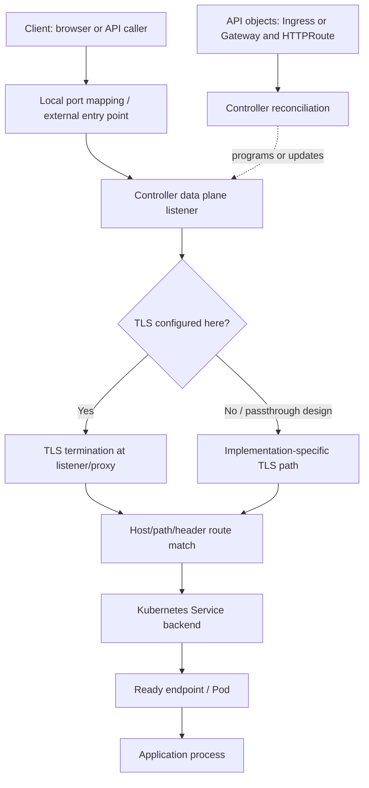

# Unit 3 — Ingress Controllers and Gateway API

**Abstract:** This lesson explains how Kubernetes Ingress and Gateway API route north–south application traffic, how controllers turn API objects into data-plane configuration, and how to test, secure, observe, and migrate those routes. It uses a zero-budget local `kind` lab and distinguishes API-level evidence from actual request success.

**Target file:** `03-ingress-controllers-and-gateway-api.md`  
**Stage:** Stage 2E — Production DevOps & Platform Engineering  
**Module:** M04 — Kubernetes Networking, Ingress, and Service Mesh  
**Unit:** 3  
**Estimated time:** 12–16 hours (reading 5–6 h, labs 5–8 h, review 1–2 h)  
**Prerequisites:** Stages 0–2D; M01 container images, M02 CI/CD, M03 production Kubernetes operations; basic TCP/IP, DNS, HTTP, TLS, Pods, Deployments, Services, readiness, RBAC, and shell usage.  
**Core tools:** `kubectl`, `kind`, Docker, `curl`, `jq` (optional), shell, YAML editor.  
**Awareness:** Gateway API conformance suites, `helm`, policy engines, load generators, Prometheus, access-log/trace systems, WAF and rate-limiting extensions.  
**Last reviewed:** 2026-10-28 (authoring date; not a claim that every upstream project was independently checked live).  
**Kubernetes/tool baseline assumed:** Kubernetes API `networking.k8s.io/v1` for Ingress and `gateway.networking.k8s.io/v1` for standard Gateway API resources when supported by the selected implementation. Exact Kubernetes, controller, Gateway API CRD channel, conformance, feature, and installation versions are `[VERIFY]`; confirm them before installing.

## Table of contents

- [3.0 Why this matters in production](#30-why-this-matters-in-production)
- [3.1 Learning objectives](#31-learning-objectives)
- [3.2 Concept map and vocabulary](#32-concept-map-and-vocabulary)
- [3.3 Level 1 — Beginner](#33-level-1--beginner)
- [3.4 Level 2 — Intermediate](#34-level-2--intermediate)
- [3.5 Level 3 — Advanced](#35-level-3--advanced)
- [3.6 Level 4 — Expert](#36-level-4--expert)
- [3.7 SRE lens](#37-sre-lens)
- [3.8 Security lens](#38-security-lens)
- [3.9 Production checklist](#39-production-checklist)
- [3.10 Hands-on lab set](#310-hands-on-lab-set)
- [3.11 Self-check questions](#311-self-check-questions)
- [3.12 Evidence artifacts](#312-evidence-artifacts)
- [3.13 Common interview and design-review questions](#313-common-interview-and-design-review-questions)
- [3.14 Sources and verification notes](#314-sources-and-verification-notes)

## 3.0 Why this matters in production

Ingress is a shared edge dependency: a wrong route, missing backend endpoint, incompatible controller upgrade, or mis-scoped annotation can turn a healthy API into a 502, 503, or 504 outage. A body-size limit or timeout that is too restrictive can break model uploads, while an overly permissive setting can expose the platform to resource exhaustion. A route that accidentally publishes an internal feature service can cross a tenant boundary even when the application Pods themselves are private. The Ingress API and Gateway API describe desired routing, but a controller must implement them and program a data plane; successful API admission alone does not prove traffic works.

## 3.1 Learning objectives

- **L1:** Trace a client request through the local port mapping or external entry point, listener, selected route, Service, and ready endpoint.
- **L1:** Explain why an Ingress object alone does not implement routing and distinguish `Exact`, `Prefix`, and `ImplementationSpecific` path matching.
- **L2:** Deploy and verify a selected kind-compatible ingress controller using its official, version-matched installation instructions.
- **L2:** Configure equivalent host/path routes using `Ingress` and Gateway API `Gateway`/`HTTPRoute` resources.
- **L2:** Inspect route status, events, controller logs, Service selectors, and EndpointSlices to diagnose an invalid route.
- **L2/L3:** Configure and measure a manual weighted 90/10 split between two API versions while explaining sampling variation.
- **L3:** Select an ingress/Gateway architecture using maintenance, security, conformance, compatibility, protocol, operational, and migration evidence.
- **L3/L4:** Design tenant boundaries, trusted proxy handling, timeout ladders, streaming behavior, and safe change/rollback procedures.
- **L4:** Build CI checks for schema compatibility, route policy, unsafe configuration, and runtime route status without confusing static validation with end-to-end proof.

## 3.2 Concept map and vocabulary

| Term | Precise definition | Common misconception |
|---|---|---|
| North–south traffic | Traffic entering or leaving a cluster/service environment | All traffic to a Service is ingress traffic |
| East–west traffic | Traffic between workloads/services inside an environment | An ingress controller is required for every internal call |
| L4 | Transport-layer handling, commonly TCP/UDP connections | L4 routing understands HTTP paths or headers |
| L7 | Application-layer handling, such as HTTP host, path, headers, and methods | Every proxy supports every HTTP feature identically |
| Reverse proxy | Server-side intermediary that accepts client requests and forwards them to an upstream | It is necessarily a Kubernetes API object |
| Ingress resource | Kubernetes API object declaring HTTP(S) routing rules | Creating it alone installs a listener or data plane |
| Ingress controller | Implementation that watches Ingress and related objects and configures routing | Every controller uses the same annotations or defaults |
| `IngressClass` | API resource associating Ingress resources with a controller class | A class name by itself installs a controller |
| `pathType` | Ingress path matching mode: `Exact`, `Prefix`, or `ImplementationSpecific` | `Prefix` always means raw string prefix |
| Gateway API | Kubernetes API family for role-oriented networking configuration | CRDs alone implement packet/request routing |
| `GatewayClass` | Describes a class of Gateways handled by a controller | It is interchangeable with `IngressClass` |
| `Gateway` | Declares listeners and policy attachment points for a gateway instance | It is necessarily one cloud load balancer |
| `HTTPRoute` | Declares HTTP matching and forwarding rules | Every implementation supports every optional feature |
| Parent reference | Route reference to a parent such as a Gateway/listener | A reference guarantees attachment |
| Backend reference | Route reference to a backend such as a Kubernetes Service | It proves the Service has ready endpoints |
| Listener | Gateway entry point with protocol, port, hostname, and TLS-related configuration | A listener is automatically reachable from a laptop |
| Route attachment | Controller's acceptance of a Route onto a Gateway/listener under attachment rules | API admission means the route is attached |
| `ReferenceGrant` | Gateway API mechanism permitting specified cross-namespace references where required | It grants general access to a namespace |
| Status conditions | Controller/API status reporting acceptance, programming, or reference problems | `Accepted=True` guarantees successful application requests |
| Implementation-specific annotation | Controller-specific configuration attached to Kubernetes objects | An annotation is portable across controllers |
| Controller conformance | Evidence that an implementation passes specified Gateway API conformance profiles/features | Conformance means every optional feature or extension is supported |

### Request and control path



The diagram is conceptual. Depending on the controller and platform, a cloud load balancer, node NAT, host-networked proxy, or other hop may exist. TLS may terminate at a cloud load balancer, controller, or application; do not assume one universal packet path. API/control-plane reconciliation is separate from request/data-plane forwarding.

## 3.3 Level 1 — Beginner

### North–south, east–west, L4, and L7

A Pod calling another Pod or Service inside the cluster is usually east–west. A client outside the cluster calling a public API is north–south. A Service provides a stable backend abstraction, while an ingress/gateway implementation provides an HTTP-aware edge entry point.

L4 forwarding can choose a destination based on network/transport information such as IP address and port. L7 HTTP routing can inspect hostname, path, and other HTTP request properties. A reverse proxy accepts a request on one side and opens or reuses a connection to an upstream. It may terminate TLS, apply timeouts, log requests, and select a backend. Exact behavior is implementation-specific.

### Ingress object versus controller

An `Ingress` is declarative configuration. An ingress controller watches that configuration and implements it. Without a compatible controller watching the intended class, the object can exist in the API while no route is programmed. A controller may require an `IngressClass`, specific annotations, or an implementation-specific configuration object.

### Host and path rules

- `host` selects a hostname, e.g. `api.local.test`.
- `pathType: Exact` matches the exact path.
- `pathType: Prefix` uses path-element prefix matching. For example `/models` can match `/models/v1`, but `/models` does not match `/modelsmith` merely because the characters share a prefix.
- `pathType: ImplementationSpecific` delegates matching semantics to the controller. It is less portable; verify the selected controller's documented behavior.

Minimal Ingress API example (backend names/ports must exist in the same namespace):

```yaml
apiVersion: networking.k8s.io/v1
kind: Ingress
metadata:
  name: model-api
  namespace: ml-platform
spec:
  ingressClassName: lab-ingress
  rules:
    - host: api.local.test
      http:
        paths:
          - path: /v1
            pathType: Prefix
            backend:
              service:
                name: model-api-v1
                port:
                  number: 8000
```

The class `lab-ingress` must match an installed controller's `IngressClass`; this example alone is not runnable until that controller and backend are installed.

### Gateway API concepts

Gateway API separates infrastructure-facing and application-facing responsibilities:

- **Infrastructure provider:** may operate the underlying load-balancer/network substrate.
- **Cluster operator:** installs/configures the GatewayClass/controller and defines permitted listeners/policies.
- **Application developer:** creates an HTTPRoute and backend reference within granted boundaries.

`GatewayClass` identifies the implementation/controller. `Gateway` defines listeners. `HTTPRoute` defines matches and backend references. `parentRefs` attaches the route to a Gateway; the Gateway listener's `allowedRoutes` controls which namespaces/kinds can attach. `backendRefs` identify backend Services and ports. `ReferenceGrant` permits certain cross-namespace references where required by the API model. Inspect `Accepted`, `Programmed`, `ResolvedRefs`, and listener status conditions where present; condition availability and details depend on resource and implementation.

### Beginner lab: understand the route path

This first lab is a planning/inspection lab before installing a controller. It creates a namespace and backend, then demonstrates the API objects separately from routing.

```bash
kind create cluster --name m04-u3 --wait 120s
kubectl config current-context
kubectl get nodes -o wide
kubectl create namespace ml-platform
```

Create `backend.yaml`:

```yaml
apiVersion: apps/v1
kind: Deployment
metadata:
  name: model-api-v1
  namespace: ml-platform
spec:
  replicas: 1
  selector:
    matchLabels:
      app: model-api
      version: v1
  template:
    metadata:
      labels:
        app: model-api
        version: v1
    spec:
      containers:
        - name: app
          image: hashicorp/http-echo:1.0.0
          args: ["-listen=:8000", "-text=model-api-v1"]
          ports:
            - name: http
              containerPort: 8000
          readinessProbe:
            tcpSocket:
              port: http
            initialDelaySeconds: 2
            periodSeconds: 5
          resources:
            requests:
              cpu: 10m
              memory: 16Mi
            limits:
              cpu: 200m
              memory: 64Mi
---
apiVersion: v1
kind: Service
metadata:
  name: model-api-v1
  namespace: ml-platform
spec:
  selector:
    app: model-api
    version: v1
  ports:
    - name: http
      port: 8000
      targetPort: http
```

Apply and inspect:

```bash
kubectl apply -f backend.yaml
kubectl rollout status -n ml-platform deploy/model-api-v1 --timeout=120s
kubectl get pods,svc -n ml-platform -o wide
kubectl get endpointslices -n ml-platform -l kubernetes.io/service-name=model-api-v1 -o wide
```

Expected output (representative): the Deployment becomes available; the Service gets a dynamic ClusterIP; EndpointSlices list the ready Pod address and port 8000. This proves backend objects exist, not that any external route works.

**What just happened?** The Service selector matches only Pods with both `app=model-api` and `version=v1`. The controller-managed EndpointSlice represents the ready backend. Once an ingress/gateway controller and route are installed, the data plane can forward an incoming request to that Service. The actual Pod IP and ClusterIP must be read from the cluster; never assume values from examples.

### Common beginner mistakes

| Mistake | Symptom | Diagnosis | Fix |
|---|---|---|---|
| Create Ingress but no controller | Host request cannot reach backend | Inspect `IngressClass`, controller Pods/logs, route status | Install a compatible controller and set the correct class |
| Wrong Service name/port | 502/503 or no route | `kubectl describe ingress`; inspect Service and EndpointSlices | Correct backend reference and port |
| Use `ImplementationSpecific` without checking | Different path behavior after controller change | Compare controller docs and test cases | Prefer `Exact`/`Prefix` where sufficient |
| Expose `feature-service` by accident | Internal API becomes reachable from edge | Review all rules/routes and test external paths | Omit route; use namespace/host policy and network controls |
| Treat route acceptance as success | Route status looks good but HTTP fails | Test end-to-end request and inspect backend readiness | Validate status, endpoints, logs, and actual response separately |
| Use `localhost` from the wrong environment | Connection refused or wrong service | Identify Windows, WSL2, node-container, or Pod context | Test from the correct network namespace and mapped port |

## 3.4 Level 2 — Intermediate

### Controller choice and installation gate

This lesson does not name a controller as “currently maintained” without a fresh compatibility and maintenance check. Before selecting one, verify the project's official release page, supported Kubernetes versions, security advisories, installation docs, Gateway API conformance profile/features, licensing, and kind instructions. The selected controller must support the Kubernetes version in the kind cluster and the Gateway API resources/features used below. Mark any unresolved item `[VERIFY]`.

For a zero-budget lab, prefer a controller with a documented local/kind install and a small enough footprint for a 4-core/8-GB laptop. Measure actual resource usage instead of relying on guessed numbers:

```bash
kubectl top pods -A 2>/dev/null || echo "Metrics API unavailable; use kubectl describe and node/container metrics."
kubectl get pods -A -o wide
docker stats --no-stream
```

`kubectl top` requires a working metrics API; `docker stats` is container-level and does not isolate per-Pod resource usage perfectly.

**Installation workflow (do not skip verification):**

1. Create a dedicated cluster and record `kind version`, `kubectl version`, and node image.
2. Choose one controller from its official current installation page. Pin an exact release and image digest where supported.
3. Follow the controller's official kind/local installation method. Do not combine manifests from different releases.
4. If its official method uses `extraPortMappings`, configure them in the kind cluster before creation. The mapping exposes a port through the Docker/kind-node environment; it is not a production cloud load balancer.
5. If the official pattern requires an `ingress-ready` node label or node selector, apply only the documented label/configuration for that release. Do not assume it is universal.
6. Verify controller Pods are Ready, class resources exist, logs show reconciliation, and a test route works.

A common kind config shape for a controller that explicitly documents host port mapping is:

```yaml
kind: Cluster
apiVersion: kind.x-k8s.io/v1alpha4
nodes:
  - role: control-plane
    extraPortMappings:
      - containerPort: 30080
        hostPort: 8080
        protocol: TCP
      - containerPort: 30443
        hostPort: 8443
        protocol: TCP
```

This is **not a universal ingress-controller installation**. It only maps host ports to ports in the kind node container. The controller must be configured to listen/reach those ports according to its official instructions. If the chosen controller's supported install uses NodePort, host networking, or another arrangement, follow that documented pattern instead. Recreate the cluster if the chosen design requires mappings that were not configured at creation.

WSL2 reminder: `localhost` in a Pod is the Pod itself; in a kind node it is the node container; in WSL2 it is the WSL environment; and in Windows it is Windows' loopback. Docker/WSL2 forwarding behavior depends on the installation. A successful request to `localhost:8080` proves only the configured local path, not cloud load-balancer behavior.

### Complete backend example for the data/ML platform

The example uses small HTTP echo workloads so the lab does not depend on a custom application image or undeclared endpoint. The echo response identifies the selected version. Replace the sample with FastAPI in a later project after route mechanics are verified.

Create `ml-backends.yaml`:

```yaml
apiVersion: v1
kind: Namespace
metadata:
  name: ml-platform
---
apiVersion: apps/v1
kind: Deployment
metadata:
  name: model-api-v1
  namespace: ml-platform
spec:
  replicas: 2
  selector:
    matchLabels:
      app: model-api
      version: v1
  template:
    metadata:
      labels:
        app: model-api
        version: v1
    spec:
      containers:
        - name: app
          image: hashicorp/http-echo:1.0.0
          args: ["-listen=:8000", "-text=model-api-v1"]
          ports:
            - name: http
              containerPort: 8000
          readinessProbe:
            tcpSocket:
              port: http
            periodSeconds: 5
          resources:
            requests:
              cpu: 10m
              memory: 16Mi
            limits:
              cpu: 200m
              memory: 64Mi
---
apiVersion: v1
kind: Service
metadata:
  name: model-api-v1
  namespace: ml-platform
spec:
  selector:
    app: model-api
    version: v1
  ports:
    - name: http
      port: 8000
      targetPort: http
---
apiVersion: apps/v1
kind: Deployment
metadata:
  name: model-api-v2
  namespace: ml-platform
spec:
  replicas: 2
  selector:
    matchLabels:
      app: model-api
      version: v2
  template:
    metadata:
      labels:
        app: model-api
        version: v2
    spec:
      containers:
        - name: app
          image: hashicorp/http-echo:1.0.0
          args: ["-listen=:8000", "-text=model-api-v2"]
          ports:
            - name: http
              containerPort: 8000
          readinessProbe:
            tcpSocket:
              port: http
            periodSeconds: 5
          resources:
            requests:
              cpu: 10m
              memory: 16Mi
            limits:
              cpu: 200m
              memory: 64Mi
---
apiVersion: v1
kind: Service
metadata:
  name: model-api-v2
  namespace: ml-platform
spec:
  selector:
    app: model-api
    version: v2
  ports:
    - name: http
      port: 8000
      targetPort: http
---
apiVersion: apps/v1
kind: Deployment
metadata:
  name: feature-service
  namespace: ml-platform
spec:
  replicas: 1
  selector:
    matchLabels:
      app: feature-service
  template:
    metadata:
      labels:
        app: feature-service
    spec:
      containers:
        - name: app
          image: hashicorp/http-echo:1.0.0
          args: ["-listen=:8000", "-text=internal-feature-service"]
          ports:
            - name: http
              containerPort: 8000
          readinessProbe:
            tcpSocket:
              port: http
            periodSeconds: 5
          resources:
            requests:
              cpu: 10m
              memory: 16Mi
            limits:
              cpu: 200m
              memory: 64Mi
---
apiVersion: v1
kind: Service
metadata:
  name: feature-service
  namespace: ml-platform
spec:
  selector:
    app: feature-service
  ports:
    - name: http
      port: 8000
      targetPort: http
```

Apply and verify:

```bash
kubectl apply -f ml-backends.yaml
kubectl rollout status -n ml-platform deploy/model-api-v1 --timeout=120s
kubectl rollout status -n ml-platform deploy/model-api-v2 --timeout=120s
kubectl rollout status -n ml-platform deploy/feature-service --timeout=120s
kubectl get svc,endpointslices,pods -n ml-platform -o wide
```

The `feature-service` is not included in the edge route examples. It remains internal by intent. Postgres and Redis should normally remain internal ClusterIP services with credentials managed separately (M09); they are dependencies, not edge backends. ETL workers calling external APIs need egress controls (M15), not ingress routes. Metrics endpoints should be exposed only through an explicitly reviewed monitoring path, not added to public routing by convenience.

### Ingress route example

After installing the selected controller and confirming its `IngressClass`, apply this portable Ingress example:

```yaml
apiVersion: networking.k8s.io/v1
kind: Ingress
metadata:
  name: model-api
  namespace: ml-platform
spec:
  ingressClassName: lab-ingress
  rules:
    - host: api.local.test
      http:
        paths:
          - path: /v1
            pathType: Prefix
            backend:
              service:
                name: model-api-v1
                port:
                  number: 8000
          - path: /v2
            pathType: Prefix
            backend:
              service:
                name: model-api-v2
                port:
                  number: 8000
```

Replace `lab-ingress` with the actual installed class. The API does not guarantee a default backend for all controller-specific unmatched-host behavior; inspect controller docs and test a path that matches no rule. No feature-service route is declared.

### Gateway API installation gate

Gateway API CRDs define API types; they do not create a data plane. A controller implementation must reconcile `GatewayClass`, `Gateway`, and `HTTPRoute`. Use the official Gateway API installation instructions and the selected implementation's compatibility matrix. The CRD release/channel and implementation must match the cluster version and required features.

- Standard API resources commonly use `gateway.networking.k8s.io/v1` for `GatewayClass`, `Gateway`, and `HTTPRoute` in implementations supporting the standard channel; confirm the current API docs and installed CRDs `[VERIFY]`.
- Experimental resources/features may use a different channel and require experimental CRDs; do not install them unless explicitly needed.
- Verify conformance profile and feature support for the implementation; conformance to a profile does not guarantee all optional features or extensions.
- Install CRDs first, then the compatible controller, using the official release instructions. Avoid copying a floating `latest` URL into a reproducible lab.

Useful preflight:

```bash
kubectl api-resources --api-group=gateway.networking.k8s.io
kubectl get crd | grep gateway.networking.k8s.io
kubectl get gatewayclass
```

If resources are absent, CRDs are not installed or the API discovery is not ready. If CRDs exist but no `GatewayClass` is accepted, the controller may be absent, misconfigured, or not claiming that class.

### Gateway API example

This example assumes a selected implementation supports the standard `Gateway`/`HTTPRoute` API and a class named `lab-gateway-class`. The class name is a placeholder that must be replaced with the controller's actual class. Listener address/exposure is implementation-specific.

```yaml
apiVersion: gateway.networking.k8s.io/v1
kind: Gateway
metadata:
  name: ml-edge
  namespace: ml-platform
spec:
  gatewayClassName: lab-gateway-class
  listeners:
    - name: http
      protocol: HTTP
      port: 80
      hostname: api.local.test
      allowedRoutes:
        namespaces:
          from: Same
---
apiVersion: gateway.networking.k8s.io/v1
kind: HTTPRoute
metadata:
  name: model-api
  namespace: ml-platform
spec:
  parentRefs:
    - name: ml-edge
      sectionName: http
  hostnames:
    - api.local.test
  rules:
    - matches:
        - path:
            type: PathPrefix
            value: /v1
      backendRefs:
        - name: model-api-v1
          port: 8000
    - matches:
        - path:
            type: PathPrefix
            value: /v2
      backendRefs:
        - name: model-api-v2
          port: 8000
```

This uses same-namespace attachment and backends to avoid cross-namespace complexity in the core lab. A controller must program the Gateway and provide a reachable entry point. Check:

```bash
kubectl get gatewayclass
kubectl get gateway,httproute -n ml-platform -o yaml
kubectl describe gateway ml-edge -n ml-platform
kubectl describe httproute model-api -n ml-platform
```

Look at conditions and messages rather than assuming a resource is accepted. Common conditions include `Accepted`, `Programmed`, and `ResolvedRefs`, but their exact presence and scope vary by resource/API version. A route may be accepted by the API server yet rejected by the controller or not attached to the intended listener.

### Cross-namespace references and `ReferenceGrant`

For a route in namespace `ml-apps` referencing a backend Service in `ml-platform`, Gateway API implementations require the appropriate cross-namespace permission model. `ReferenceGrant` is created in the **target** namespace and limits which source namespace/kind can refer to which target kind/name. Verify the exact API schema and implementation support before using it.

Illustrative standard-channel pattern (not used in the core same-namespace lab):

```yaml
apiVersion: gateway.networking.k8s.io/v1beta1
kind: ReferenceGrant
metadata:
  name: allow-ml-apps-to-reference-model-api
  namespace: ml-platform
spec:
  from:
    - group: gateway.networking.k8s.io
      kind: HTTPRoute
      namespace: ml-apps
  to:
    - group: ""
      kind: Service
      name: model-api-v1
```

**`[VERIFY]`**: confirm that `ReferenceGrant` is served at `gateway.networking.k8s.io/v1beta1` by the selected CRD release; do not assume its version remains unchanged. Use `kubectl explain referencegrant --api-version=gateway.networking.k8s.io/v1beta1` and inspect installed CRDs. Do not create a cross-namespace reference unless the target namespace owner explicitly grants it. If a reference is rejected, inspect `ResolvedRefs` condition/message and controller logs; do not “fix” it by broadening permissions to all namespaces.

### Weighted 90/10 routing

Gateway API `HTTPRoute` supports weighted backend references in implementations that support the relevant standard feature. The weights are relative routing intent, not a guarantee that every short sample will be exactly 90/10. Connection reuse, client behavior, balancing strategy, and sample size affect observed distribution.

```yaml
apiVersion: gateway.networking.k8s.io/v1
kind: HTTPRoute
metadata:
  name: model-api-canary
  namespace: ml-platform
spec:
  parentRefs:
    - name: ml-edge
      sectionName: http
  hostnames:
    - api.local.test
  rules:
    - matches:
        - path:
            type: PathPrefix
            value: /score
      backendRefs:
        - name: model-api-v1
          port: 8000
          weight: 90
        - name: model-api-v2
          port: 8000
          weight: 10
```

This route assumes the controller supports weighted `backendRefs` for the installed API version. Apply it only after the Gateway API conformance/feature check. For the Ingress API, weighted routing is not a portable core Ingress feature; implementations may offer non-portable annotations or separate resources. Do not invent a controller annotation to imitate this example.

### Deliberately invalid route and diagnosis

Create an invalid route by referencing a nonexistent Service port or Service name in a throwaway namespace. Example Gateway API route:

```yaml
apiVersion: gateway.networking.k8s.io/v1
kind: HTTPRoute
metadata:
  name: broken-model-route
  namespace: ml-platform
spec:
  parentRefs:
    - name: ml-edge
      sectionName: http
  hostnames:
    - api.local.test
  rules:
    - backendRefs:
        - name: does-not-exist
          port: 8000
```

Apply and inspect:

```bash
kubectl apply -f broken-model-route.yaml
kubectl describe httproute broken-model-route -n ml-platform
kubectl get httproute broken-model-route -n ml-platform -o yaml
kubectl get events -n ml-platform --sort-by=.lastTimestamp
kubectl -n <controller-namespace> logs deploy/<controller-deployment> --since=10m
kubectl get svc,endpointslices -n ml-platform -o wide
```

Replace controller namespace/deployment placeholders with observed names. The route may show `ResolvedRefs=False` or a related condition, depending on implementation/version. Do not rely on one exact status string; use the message and controller logs. The API server accepting the YAML means only schema/admission passed. It does not mean the route was programmed or traffic succeeds. Delete or correct the invalid route after capturing evidence.

### Portable and implementation-specific behavior

The Ingress API standardizes core host/path/backend structure; many useful features (rewrites, body-size limits, timeouts, rate limiting, WAF, custom snippets) are controller-specific. Gateway API standardizes a broader role-oriented resource model, but feature availability is tied to API channel, implementation support, and conformance profile. Never transfer annotations between controllers by name similarity.

- **Body-size limits:** configure only with a verified controller setting or supported extension; test just below and above the configured limit with a harmless payload.
- **Timeouts:** confirm whether a setting controls connection idle, request processing, upstream response, or per-try timeout. These are not interchangeable.
- **Rewrites and redirects:** verify matching and path rewrite semantics; test query strings, encoded paths, and application base paths.
- **HTTP/2 and gRPC:** ensure client-to-proxy and proxy-to-backend protocol behavior is supported and configured correctly. HTTP/2 at the edge does not automatically imply HTTP/2 to the backend.
- **WebSockets/SSE:** long-lived connections may need longer idle timeouts and correct upgrade/streaming handling; verify buffering and flush behavior in the selected controller.
- **Large model payloads:** consider body limits, buffering memory/disk, upstream timeout, backpressure, and client disconnects. Do not disable safeguards without capacity/security review.
- **Default backend:** unmatched host/path behavior is controller-specific; explicitly test unknown host and path.
- **Annotations:** label every example with controller and version and cite its official docs. This lesson intentionally avoids prescribing an unverified annotation.

### Pattern catalogue

| Pattern | When to use | When NOT to use |
|---|---|---|
| Shared Gateway with centrally governed listeners | Many teams need common TLS, policy, and observability | Tenants need hard isolation and cannot safely share config blast radius |
| Per-team Gateway | Teams need independent route ownership within platform guardrails | Each team cannot operate or fund the additional gateway capacity |
| Per-environment Gateway | Development/staging/production require different exposure and change policies | It creates needless duplication without a security or operational reason |
| `Exact`/`Prefix` path matching | Portable path behavior is important | The application requires regex semantics not supported by the chosen API/controller |
| Same-namespace backend references | Minimize cross-namespace permission complexity | Backend ownership genuinely belongs in another namespace and a reviewed grant is required |
| Gateway API weighted backendRefs | Controller supports the relevant feature and a manual split is useful | You need automated analysis/rollback; defer orchestration to M08 |
| Controller-specific annotation | Required feature is absent from portable API and controller is pinned | Portability or migration is a priority and a standard alternative exists |
| Local kind port mapping | Learn routing with no cloud spend | Prove production load-balancer, firewall, source-IP, or multi-zone behavior |

### Anti-pattern catalogue

| Bad configuration | Production consequence | Corrected approach |
|---|---|---|
| Create Ingress without checking controller/class | Route never programmed | Verify controller ownership, class, status, logs, and HTTP result |
| Route internal `feature-service` to a public listener | Unintended exposure | Keep internal Service unreferenced by edge routes and test external paths |
| Trust all client-supplied `X-Forwarded-For` values | Spoofed client identity and incorrect rate/audit policy | Define trusted proxy hops and sanitize/overwrite forwarding headers |
| Use unreviewed snippet annotations | Configuration injection or shared-controller impact | Deny risky annotation classes by policy; allow exceptions through review |
| Set a single short timeout for all traffic | Long model requests/streams fail | Define a timeout ladder by protocol and workload class |
| Use unlimited request body size | Memory/disk/CPU exhaustion risk | Set measured limits, stream where supported, and load-test safely |
| Assume route status proves traffic works | Hidden data-plane/backend failure | Verify conditions, endpoints, logs, and representative HTTP requests |
| Copy annotations to a different controller | Ignored or differently interpreted configuration | Use the target controller's versioned docs and migration tests |
| Use weighted routing with too few requests | Misleading canary conclusion | Use a sufficient sample, report raw counts, and account for correlation |
| Upgrade controller without CRD/config compatibility review | Rejected resources or routing outage | Stage, pin versions, diff config, canary, and preserve rollback |

### Before/after verification lab

After installing a selected controller using its official guide, apply `ml-backends.yaml`, then apply the Ingress manifest and test it using the controller's documented entry point. If a local host mapping is used:

```bash
curl -i -H 'Host: api.local.test' http://127.0.0.1:8080/v1
curl -i -H 'Host: api.local.test' http://127.0.0.1:8080/v2
curl -i -H 'Host: api.local.test' http://127.0.0.1:8080/unknown
```

These commands assume the controller's documented local mapping reaches a listener on host port 8080. Adapt only after confirming the selected installation pattern. Expected responses should identify `model-api-v1` and `model-api-v2`; unmatched path behavior depends on the controller. Then apply the Gateway and HTTPRoute manifests and repeat through the Gateway's documented local entry point. Save both outputs. A successful local request does not prove production load-balancer behavior.

## 3.5 Level 3 — Advanced

### Ingress versus Gateway API and deployment patterns

| Option | Benefit | Cost | Risk | Choose when |
|---|---|---|---|---|
| Kubernetes Ingress | Familiar, simple host/path routing, broad ecosystem | Feature gaps often filled by annotations | Portability and configuration drift | Existing controller is supported and requirements are simple |
| Gateway API | Role-oriented API, richer standard route model, explicit attachment and policy concepts | CRD/controller compatibility and learning effort | Feature/channel mismatch or implementation gaps | Platform needs clearer ownership, richer routing, and supported conformance |
| Shared gateway | Central policy, fewer gateway instances, consistent observability | Shared capacity and operational coupling | One bad change can affect many teams | Strong platform ownership and admission guardrails exist |
| Per-team gateway | Smaller team blast radius and independent changes | More resources, duplicated policy/operations | Inconsistent security and cost drift | Teams need justified autonomy and platform standards remain enforceable |
| Per-environment gateway | Isolates dev/stage/prod changes and exposure | More configuration and maintenance | Drift between environments | Environment-specific policy and risk justify separation |

### Migration approach and controller selection

Do not select by popularity alone. Score candidates using evidence:

1. **Maintenance/support:** recent release history, published support policy, governance, security advisories, CVE response, deprecation announcements, and project health.
2. **Compatibility:** supported Kubernetes versions, CRD/API channel, upgrade order, Gateway API conformance profile, required features, IPv4/IPv6 support, and kind documentation.
3. **Protocol/features:** HTTP/1.1, HTTP/2, gRPC, WebSockets/SSE, body-size limits, timeout semantics, rewrites, redirects, rate limiting/WAF extensions, and TLS modes.
4. **Operability:** status conditions, logs/metrics/traces, configuration diff/reload semantics, resource use, rollout behavior, and debugging access.
5. **Security/governance:** RBAC scope, secret access, annotation/snippet surface, policy integrations, multi-tenant attachment controls, and secure defaults.
6. **Economics/licensing:** license, support model, operational complexity, and expected load/capacity cost.
7. **Migration path:** Ingress compatibility, conversion tooling (current status `[VERIFY]`), config mapping, test coverage, rollback, and exit strategy.

Every named controller's current maintenance and support status is `[VERIFY]` until checked in authoritative current sources. Check the project's official release page, security advisory page, supported Kubernetes matrix, documentation version selector, governance/maintenance statements, license, and Gateway API conformance results. Record URLs and review dates in an ADR.

Migration sequence: inventory routes and annotations; classify portable versus controller-specific behavior; translate to Gateway API in a staging cluster; compare status and requests; run protocol/timeout/body-size tests; shadow or canary where supported; migrate a small route cohort; monitor; then expand. Keep the old route/controller available until rollback criteria are met. Do not assume automated conversion preserves semantics.

### Header/query matching, redirects, rewrites, and weighted routes

Gateway API route matching can include path, headers, query parameters, and method depending on API version and implementation feature support. Confirm schema and feature support with installed CRDs and the implementation's conformance matrix. Use the standard API fields where available; do not copy experimental fields into a standard-only CRD installation.

Weighted `backendRefs` express relative weights. With weights 90 and 10, expected proportions over a large set of independent requests approach 90%/10%, but the sample will vary and persistent connections/client reuse can make observations correlated. For a measured test, report raw counts, request count, version response, elapsed time, and whether connections were reused. Redirects and rewrites must be tested against the app's expected base path, query parameters, encoded characters, and canonical URL. Incorrect rewrites can break OAuth callbacks, API clients, or model endpoints.

Rate limiting and WAF are usually implementation-specific features or extensions, not universal guarantees of the core Ingress/Gateway API. `[VERIFY]` exact support, extension API, license, and failure mode. A rate limiter that fails open has different security and availability properties from one that fails closed.

### Real client IP and trust boundaries

`X-Forwarded-For` is an HTTP header and can be supplied by a client unless a trusted proxy overwrites/appends it according to a defined policy. Applications should trust only known proxy hops and should not interpret an arbitrary leftmost value as authenticated client identity. PROXY protocol is a separate transport-level convention that must be enabled consistently between sender and receiver; enabling it on only one side can break traffic.

`externalTrafficPolicy: Local` can affect source-IP preservation and node-local endpoint behavior for applicable Service paths; its exact consequences depend on the Service type, controller, and external load-balancer integration. Detailed load-balancer/source-IP behavior belongs to [Unit 4](04-load-balancers-and-external-traffic-management.md). Test the actual path and document which hop is trusted. Do not assume a local kind request models a provider's source-address behavior.

### High availability and controller behavior

- Run enough replicas to meet availability goals and schedule them across suitable nodes where the environment supports it.
- Use readiness probes and resource requests/limits; test startup and overload behavior.
- Review PodDisruptionBudget interaction with upgrades and voluntary disruptions (M03). A PDB does not guarantee availability during node failure or protect against every involuntary disruption.
- Leader election, configuration propagation, and data-plane reload behavior vary by controller; `[VERIFY]` the implementation's official docs.
- Control-plane/controller availability and existing data-plane traffic availability are different. Some data planes may continue forwarding their last programmed config during controller outage; others may behave differently. Test and document rather than assuming.
- Validate configuration before rollout and monitor rejected resources, reload failures, and data-plane health.

### Timeout ladder, protocols, and large requests

Design timeout values as a coherent ladder, not isolated numbers:

1. Client deadline.
2. External load-balancer connection/idle/request limits (Unit 4).
3. Gateway/ingress connection idle and request/upstream timeouts.
4. Application server request deadline and graceful shutdown.
5. Dependency timeouts (feature service, Postgres, Redis, external APIs).

The exact ordering depends on streaming and retry behavior. If the edge times out before the application, clients may see 504 while the backend continues expensive work. If application deadlines are shorter, the client may see an application error instead. Retries can multiply load; only retry operations that are safe/idempotent and within a bounded budget.

For HTTP/2 and gRPC, verify client-to-edge and edge-to-backend protocol modes and gRPC status/log handling. WebSockets require correct upgrade handling; SSE and model token streams need a timeout policy that permits long-lived responses and avoids buffering that delays flushes. Large payloads require explicit body limits, buffering strategy, backpressure, memory/disk capacity, and disconnect behavior. Test with representative payload sizes and long-lived streams, not just small `curl` responses.

### Performance measurement and defended decision

A repeatable test plan should capture:

- Controller/cluster versions, node resources, replica count, request path, host, payload size, concurrency, duration, client connection reuse, and route weights.
- Request success/error rates by status code and backend version.
- p50/p95/p99 latency, throughput, controller CPU/memory, and upstream connection failures.
- Warm-up, number of samples, test tool version, and any resource contention.
- Before/after data from the same environment and test parameters.

Use a bounded load test against local echo workloads first; do not use expensive model inference or real customer data in the core lab. `hey`, `wrk`, or similar tools are optional and must be installed from their official sources with pinned versions. A loop of `curl` calls is enough to validate routing but is not a rigorous performance benchmark. Do not invent performance gains or declare one controller faster without comparable evidence.

**Decision exercise:** Given simple host/path routing, a team-shared platform, and a requirement for weighted 90/10 routing, write an ADR comparing the installed Ingress controller and Gateway API implementation. Include compatibility/conformance evidence, route ownership, security policy, test results, migration cost, rollback, and unresolved `[VERIFY]` items. Choose based on evidence and operating constraints, not preference.

## 3.6 Level 4 — Expert

### Failure-analysis table

| Symptom | Hypotheses | Test | Root cause evidence | Mitigation | Prevention |
|---|---|---|---|---|---|
| 502: upstream connection failure | No ready endpoints, wrong Service port, backend listener failure, protocol mismatch, reset | Inspect route status, Service/EndpointSlices, Pod readiness/logs, direct in-cluster request, controller logs | Empty/unready endpoint set, wrong port, connection refused/reset, reproducible protocol mismatch | Restore endpoints/port/listener or roll back protocol config; verify end-to-end | Named ports, readiness tests, route smoke tests, compatibility tests |
| 503: no eligible backend | Zero endpoints, route rejected, backend policy/health condition, overload or implementation-specific rejection | Inspect route conditions, events, Service and EndpointSlices, controller metrics/logs | No eligible backend or explicit route/backend rejection | Correct reference/selector/readiness or revert recent route change; scale only with evidence | CI validation, readiness, capacity alerts, safe rollout |
| 504: timeout | Client/LB/gateway/app timeout mismatch, slow inference/dependency, upstream stall | Compare timestamps and timeout settings per hop; inspect app/dependency latency and request logs | Failure consistently aligns with a specific timeout boundary or slow dependency | Correct the specific budget, optimize dependency, or return bounded application deadline | Timeout ladder tests, latency SLOs, cancellation and retry policy |
| Route API accepted but not attached/programmed | Wrong parent/listener, hostname mismatch, `allowedRoutes`, controller class mismatch | Inspect Gateway/HTTPRoute conditions, listener status, parentRefs, events, controller logs | `Accepted=False`, `Programmed=False`, or rejected attachment message | Correct parent/listener/hostname/namespace policy; verify request | Status checks in CI and post-deploy probes |
| Cross-namespace backend reference rejected | Missing/wrong `ReferenceGrant`, unsupported API version, typo or port mismatch | Inspect `ResolvedRefs`, target namespace grant, Service and CRD schema | Condition message identifies unresolved/forbidden reference | Add narrowly scoped grant with owner approval or keep same-namespace backend | Policy review, ownership and reference inventory |
| Tenant annotation impacts shared controller | Risky snippet/config, malformed global config, shared reload/reconcile behavior | Freeze changes, identify last actor/object diff, controller logs/config dump, compare unaffected routes | Reproducible config change and correlated failures across tenants | Revert annotation/config, pause tenant writes, restore known-good config, verify all routes | Admission denylist/allowlist, tenant quotas, canary, RBAC |
| Controller end of maintenance / upgrade failure | Unsupported Kubernetes/API version, security issue, breaking config/CRD change | Review release/security advisories, compatibility matrix, deprecation notes, staging upgrade | Vendor/project support notice or reproducible incompatibility | Select supported target, migrate in cohorts, keep rollback within supported window | Lifecycle calendar, pinned versions, quarterly support review |

### Admission validation and policy-as-code

Use layered controls:

1. **Schema validation:** run `kubectl apply --dry-run=server` against a compatible non-production cluster; this validates against that cluster's API schema but does not prove runtime routing.
2. **Static linting:** use a pinned version of a YAML/Kubernetes manifest validator in CI; validate both Kubernetes and Gateway API schemas with the CRDs corresponding to the target cluster.
3. **Policy checks:** restrict unapproved hostnames, `ImplementationSpecific` path use where portability is required, unapproved ingress classes, risky annotation prefixes/snippets, arbitrary backend namespaces, wildcard listener hostnames, and cross-namespace grants.
4. **Runtime status:** after deployment, check `Accepted`, `Programmed`, `ResolvedRefs`, listener status, events, controller logs, and a synthetic request.
5. **Ownership:** require an exception owner and expiry for approved non-portable features.

A policy-engine-specific syntax is intentionally not prescribed because the installed engine/version and policy APIs have not been verified. The following CI-friendly Python example uses PyYAML (pin and install it in the CI image) to reject unapproved hosts and any annotation key containing `snippet`. It is a deliberately narrow guardrail, not a complete Kubernetes policy engine.

```python
#!/usr/bin/env python3
"""check_routes.py — reject unapproved hosts and snippet-style annotations.
Requires Python 3 and PyYAML. Input may contain multi-document YAML.
Exit 0: pass; 1: policy violation; 2: usage/dependency/parse error.
"""
import sys
from pathlib import Path

try:
    import yaml
except ImportError:
    print("ERROR: PyYAML is required in the pinned CI environment", file=sys.stderr)
    raise SystemExit(2)

if len(sys.argv) != 2 or not Path(sys.argv[1]).is_file():
    print(f"usage: {sys.argv[0]} <manifest.yaml>", file=sys.stderr)
    raise SystemExit(2)

allowed_hosts = {"api.local.test"}
violations = []
try:
    with open(sys.argv[1], encoding="utf-8") as stream:
        docs = list(yaml.safe_load_all(stream))
except Exception as exc:
    print(f"ERROR: YAML parse failed: {exc}", file=sys.stderr)
    raise SystemExit(2)

for index, obj in enumerate(docs, start=1):
    if not isinstance(obj, dict):
        continue
    kind = obj.get("kind")
    meta = obj.get("metadata") or {}
    annotations = meta.get("annotations") or {}
    for key in annotations:
        if "snippet" in key.lower():
            violations.append(f"document {index}: snippet-like annotation {key!r} is not allowed")
    if kind == "Ingress":
        for rule in (obj.get("spec") or {}).get("rules") or []:
            host = rule.get("host")
            if host and host not in allowed_hosts:
                violations.append(f"document {index}: unapproved Ingress host {host!r}")
    if kind == "HTTPRoute":
        for host in (obj.get("spec") or {}).get("hostnames") or []:
            if host not in allowed_hosts:
                violations.append(f"document {index}: unapproved HTTPRoute hostname {host!r}")

if violations:
    print("\n".join(f"ERROR: {v}" for v in violations), file=sys.stderr)
    raise SystemExit(1)
print("Route policy checks passed; runtime behavior remains unverified.")
```

Test the script with a valid fixture, a forbidden hostname, a snippet-like annotation, invalid YAML, and a missing file before gating releases. The allowlist is a sample policy; replace it with a governed inventory. A real platform must also validate backend namespace permissions, classes, listeners, grants, body/timeouts, and route status.

### CI validation and runtime checks

Example sequence (commands run in a controlled CI job with the target CRDs and credentials for a non-production cluster):

```bash
set -euo pipefail
python3 check_routes.py rendered-routes.yaml
kubectl apply --dry-run=server -f rendered-routes.yaml
# After deployment to a test cluster:
kubectl get ingress,gateway,httproute -A -o yaml
kubectl get events -A --sort-by=.lastTimestamp
# Replace names with discovered controller objects:
kubectl -n <controller-namespace> logs deploy/<controller-deployment> --since=10m
curl -fsS -H 'Host: api.local.test' http://<verified-local-entry-point>/v1
```

The final request is runtime evidence for that exact test path only. Static checks cannot prove controller reconciliation, DNS, listener reachability, TLS correctness, backend health, or production load-balancer behavior.

### Upgrade and fleet operations

1. Review project release notes, security advisories, support policy, deprecations, and Kubernetes/Gateway API compatibility.
2. Inventory all Ingress/Gateway resources, annotations, CRDs, extensions, TLS secrets, class names, and owners.
3. Compare old/new CRD schemas and API channels. Apply CRDs in the documented order and verify conversion/webhook behavior where applicable.
4. Reproduce representative host/path, body, timeout, gRPC/HTTP/2, WebSocket/SSE, client-IP, and weighted-routing tests in staging.
5. Capture config/status before and after; verify controller reconciliation and whether data-plane reload is graceful.
6. Canary a small route cohort or separate environment. Define stop conditions for 5xx, p95/p99, rejected routes, restarts, and connection resets.
7. Preserve a known-good version/configuration and documented rollback. Rollback itself must be tested and must account for CRD/API compatibility.
8. Coordinate a maintenance window and owner handoff; publish incident and escalation contacts.

Fleet standards should define route ownership, approved hosts, namespace-to-team mapping, controller versions, golden-path templates, exception process, TLS boundary, trusted proxy chain, observability labels, deprecation calendar, and change windows. Reusable route templates are a forward reference to M16. Metrics, access logs, traces, and dashboards are a forward reference to M11.

### Incident runbook: tenant annotation breaks shared ingress

**Alert:** Multiple routes fail or controller config/reload errors rise shortly after a tenant route change.

1. **Triage:** identify affected routes/tenants, time window, controller replicas, 5xx rates, route status, recent object changes, and logs.
2. **Containment:** pause further route changes; revert the last offending manifest/configuration through the normal change path. Do not hand-edit node rules as a first response.
3. **Discriminate:** compare controller logs/configuration and route conditions before/after; test unaffected and affected hosts; inspect whether the failure is controller-wide or backend-specific.
4. **Mitigate:** restore known-good config and verify all critical routes with synthetic requests. If a tenant's object remains harmful, temporarily restrict its write permission or route attachment under incident authorization.
5. **Follow-up:** add/adjust admission policy, reduce annotation privileges, add tenant-scoped canary tests, and document blast radius and recovery time.

### Incident runbook: controller reaches end of maintenance

**Trigger:** project announces end of support, critical unpatched vulnerability, or compatibility gap.

1. Confirm the official announcement, affected versions, CVEs, support window, and current Kubernetes compatibility.
2. Inventory features, annotations, extensions, CRDs, route owners, and undocumented dependencies.
3. Evaluate supported candidates using the controller selection matrix; verify licensing, security, conformance, protocol needs, and migration tooling.
4. Build a staging environment and test parity for routes, TLS boundary, body limits, timeout ladder, gRPC/streaming, source IP, status conditions, and load.
5. Canary by route cohort; watch 5xx, latency, rejected routes, resource use, and logs. Keep rollback criteria explicit.
6. Migrate in a controlled window, verify requests and status, and remove the old controller only after the rollback window closes.
7. Record new ownership, version pin, upgrade calendar, runbook, and exception/deprecation process.

## 3.7 SRE lens

### SLIs and SLO method

| SLI | Numerator / denominator or measurement | Telemetry | Caveat |
|---|---|---|---|
| Request success by route | Successful requests / eligible requests, with success definition documented | Controller access logs/metrics plus synthetic requests | Define whether 3xx, client errors, and application errors count as success |
| p95/p99 latency | Distribution of request duration for a named route and status class | Controller metrics/logs and application telemetry | Avoid mixing unrelated routes, payload sizes, and streaming durations |
| 502/503/504 rate | Count per status / total requests over window | Controller logs/metrics | Status meanings vary by implementation; correlate upstream evidence |
| Controller availability | Ready replicas / desired replicas, plus synthetic route success | Kubernetes status and probes | Ready Pods alone do not prove route correctness |
| Configuration propagation time | Time from object update to programmed status and successful request | Kubernetes timestamps/events and synthetic probes | API update and data-plane behavior are different events |
| Rejected/unattached routes | Count and age of route/listener conditions not accepted/programmed | `kubectl get/describe` and controller metrics if available | Some metrics are implementation-specific |
| Upstream connection failures | Failure count and ratio per backend/route | Controller logs/metrics and backend telemetry | Distinguish no endpoints, refusal, timeout, reset, and application errors |

Illustrative example, not a universal target: for a latency-sensitive internal scoring API, an owner might choose a 28-day objective of at least 99.9% successful eligible edge requests and a route-specific p95 latency budget derived from observed inference and dependency latency. Choose targets from user impact, contractual commitments, and measured baseline. Explicitly define whether planned maintenance, synthetic traffic, client errors, streaming duration, and retries are included.

### Failure modes, blast radius, and capacity

- A shared controller configuration error can affect many namespaces at once.
- A bad host/path match can shadow or misroute requests.
- Zero endpoints or an invalid backend can cause 502/503 behavior depending on controller.
- Timeout mismatch or slow inference can create 504s while the application continues working.
- Excessive body buffering, long-lived connections, or connection churn can exhaust memory/file descriptors/CPU.
- Excessive metrics labels (full URL, user ID, request ID) can explode cardinality and storage costs.
- Noisy neighbors can consume shared connection pools or controller resources.

Size replicas, requests/limits, connection capacity, and log volume from load tests. Test bursts and failure conditions; include headroom for rollout when one replica is unavailable. Use bounded retries with jitter only when semantically safe; edge retries on non-idempotent scoring/training operations can duplicate work. Tie alerts to user-facing request success and latency, using controller health as a diagnostic signal.

### SRE runbook snippet

**Alert → triage → mitigation → follow-up:** For a 5xx or latency alert, scope by route/status/backend; inspect Gateway/Ingress conditions, controller logs, Service/EndpointSlices, and application latency; identify the failing hop; roll back the last route/controller change or restore backend readiness; verify with repeated end-to-end requests; save a timeline and add a targeted regression test. Escalate to Unit 4 if the failure is at the external load-balancer path, Unit 6 for certificate lifecycle, or M11 for missing telemetry.

## 3.8 Security lens

| Threat | Control | Verification |
|---|---|---|
| Internal feature service exposed accidentally | Keep it out of edge route rules; restrict host/path ownership; use internal Service and network policy where supported | `kubectl get ingress,gateway,httproute -A -o yaml`; test the edge for the feature-service path and expect no unintended route |
| Host/path confusion or takeover | Govern host allocation, prevent duplicate/conflicting ownership, verify DNS and certificate names | CI host allowlist; inspect all route hostnames and test unmatched host behavior |
| Spoofed `X-Forwarded-For` | Trust only known proxy hops; strip/overwrite untrusted values at edge | Send a test request with a forged header in the lab and verify the application sees the expected sanitized chain |
| Risky annotations/snippets | Deny or tightly allowlist snippet/config injection and high-impact settings | Run the CI policy script; inspect RBAC and admission policy; review exceptions |
| Cross-namespace reference abuse | Restrict `allowedRoutes`, use narrowly scoped `ReferenceGrant`, control write access | Inspect Gateway listener namespace rules and all ReferenceGrants; test unauthorized reference is rejected |
| Oversized bodies/expensive requests | Explicit size/concurrency/time budgets; application validation and rate controls | Test payloads below/above configured threshold; monitor 4xx/5xx and resource use |
| Request smuggling/parser disagreement | Keep proxy/backend protocol parsing aligned; patch components; test defensively using approved security test suite in an isolated environment | Review official advisories and supported parsing behavior; do not perform exploit testing against production |
| Long-lived connection DoS | Bound connection/resource budgets, idle timeouts, concurrency and client behavior | Controlled lab test with a bounded number of streams; observe resource consumption and timeout outcomes |
| TLS trust-boundary mistake | Document where TLS terminates and which hops are encrypted/trusted; use approved backend encryption policy | Inspect Gateway listener TLS config and controller docs; test certificate/hostname behavior in local lab |
| Excessive controller permissions | Least-privilege service account/RBAC; restrict Secret access and config writes | `kubectl auth can-i --as=<subject> get secrets -A`; inspect RoleBindings/ClusterRoleBindings and service account |
| Misplaced belief that ingress is authorization | Application authentication/authorization; NetworkPolicy where supported | Attempt an unauthenticated application request and verify application policy; test NetworkPolicy separately in Unit 5 |

Ingress routing is not by itself application authentication, authorization, WAF, DDoS protection, or NetworkPolicy. NetworkPolicy enforcement depends on the CNI and policy implementation. TLS termination and certificate lifecycle are covered in [Unit 6](06-tls-termination-and-certificate-lifecycle-with-cert-manager.md); mTLS and service-to-service identity are covered in [Units 7–8](07-service-mesh-fundamentals-istio-and-linkerd.md).

## 3.9 Production checklist

- [ ] **Controller maintenance:** record official release page, support policy, security advisories, license, compatibility matrix, and review date.
- [ ] **Version pinning:** pin controller release/image digest and Gateway API CRD channel; record install reference and rollback version.
- [ ] **Class ownership:** verify each Ingress `ingressClassName` and each Gateway's `gatewayClassName`; confirm the intended controller claims it.
- [ ] **Route status:** inspect `kubectl describe ingress`, `kubectl describe gateway`, `kubectl describe httproute`; require accepted/programmed/reference conditions appropriate to the resource.
- [ ] **Backend correctness:** verify Service ports/selectors and `kubectl get endpointslices -n <ns> -l kubernetes.io/service-name=<svc>`.
- [ ] **Internal-only services:** scan all routes and test that `feature-service`, Postgres, Redis, and metrics endpoints are not unintentionally exposed.
- [ ] **Host/path governance:** run host allowlist/policy checks; test expected and unmatched hosts/paths.
- [ ] **TLS boundary:** document termination point, certificate owner, upstream encryption expectations, and certificate verification; detailed lifecycle is Unit 6.
- [ ] **Trusted proxy configuration:** document trusted hops and header sanitation; test forged `X-Forwarded-For`.
- [ ] **Body/timeouts:** test normal and oversized payloads, slow backend, client disconnect, and timeout behavior using documented controller settings.
- [ ] **gRPC/HTTP/2/streaming:** test required protocol paths, WebSocket/SSE, flush behavior, and long-lived connections.
- [ ] **HA:** verify replica readiness, scheduling, PDB intent, resource requests/limits, and behavior during a controlled replica restart.
- [ ] **Observability:** verify request logs, status code, latency, route/backend identity, controller health, and alert coverage; control metric cardinality.
- [ ] **Admission/CI:** run YAML/schema checks, host/backend policy, risky annotation checks, and route status smoke tests.
- [ ] **Rollback:** preserve manifests, CRD/controller versions, previous config, explicit abort thresholds, and a tested restoration procedure.
- [ ] **Lab fidelity:** record kind/WSL2 limitations; do not use local success as evidence of production LB, source-IP, or multi-zone behavior.
- [ ] **Ownership:** assign route owner, Gateway/listener owner, exception approver, deprecation owner, and escalation contact.
- [ ] **Cross-module checks:** CI/CD promotion (M02), graceful shutdown/PDB (M03), packaging (M06), progressive delivery (M08), SLOs (M10), observability (M11), supply chain (M12), multi-cluster (M14), cost (M15), and golden paths (M16).

## 3.10 Hands-on lab set

All labs are local-only and require no cloud account, paid service, public DNS, or public certificate. Before running, verify the selected controller and Gateway API implementation's official installation docs, Kubernetes compatibility, CRD versions, and feature support. Controller install commands are intentionally not hard-coded here because no specific controller's current release/maintenance compatibility has been independently verified for this document. This is a deliberate `[VERIFY]` gate, not a claim that CRDs alone are sufficient.

| ID | Goal | Steps | Expected evidence | Cleanup | Stretch | kind-simulation caveat |
|---|---|---|---|---|---|---|
| A | Serve the same routes through Ingress and Gateway API | Create cluster/backends; install verified controller; apply Ingress; test `/v1` and `/v2`; install verified Gateway API CRDs/controller; apply Gateway/HTTPRoute; repeat tests | Manifests, class/listener/route status, Service/EndpointSlices, raw request outputs | Delete route objects, namespace, controller and CRDs only if no other resources depend on them; delete dedicated cluster | Add host/path edge cases and compare API status | Port mappings are Docker/kind-node mappings, not cloud LB behavior |
| B | Measure weighted 90/10 routing | Apply `model-api-canary`; send ≥1,000 requests if laptop resources allow; capture raw version counts and calculate percentage | Command, sample size, counts, ratio, elapsed time, controller/route versions | Restore prior route or delete canary route | Repeat with connection reuse vs new connections if tool supports it | Request distribution depends on implementation and connection behavior |
| C | Misconfigure and diagnose route | Point a route at a nonexistent backend; inspect conditions/events/logs/Services/EndpointSlices; restore valid reference | Before/after YAML, status messages, logs, test response | Delete invalid route or reapply known-good manifest | Misconfigure listener hostname/parentRef in a separate test | Exact status text is implementation/version-dependent |
| D | Exercise body limit, timeout, or streaming behavior | Select one verified controller feature; record current behavior; apply documented test config; send bounded payload or long-lived test request; compare before/after | Config diff, request sizes/timings/status, controller logs, resource observations | Revert config and verify baseline | Test SSE/gRPC only if supported by selected setup | Kind does not model provider LB idle timeout or production network conditions |

### Lab A — Ingress and Gateway API side by side

**Goal/level/time:** Serve the same `/v1` and `/v2` application routes through both APIs; L2; 90–150 minutes depending on installation.

**Preflight:** Confirm the current context is the dedicated `kind-m04-u3` cluster. Record `kubectl version`, `kind version`, node image, selected controller release, Gateway API CRD release/channel, and official install URLs. Select a controller only after verifying maintenance, security, Kubernetes compatibility, Gateway API support, and kind instructions. Pin the release; do not use floating `latest`.

1. Create the cluster. If the selected controller's official kind instructions require `extraPortMappings`, create the cluster with those mappings before installing. If it requires another local exposure method, follow that method instead.

```bash
kind create cluster --name m04-u3 --wait 120s
kubectl config current-context
kubectl version
kind version
kubectl get nodes -o wide
```

2. Apply the `ml-backends.yaml` manifest from §3.4. Wait for all three Deployments, then save Pod/Service/EndpointSlice evidence.

```bash
kubectl apply -f ml-backends.yaml
kubectl rollout status -n ml-platform deploy/model-api-v1 --timeout=120s
kubectl rollout status -n ml-platform deploy/model-api-v2 --timeout=120s
kubectl rollout status -n ml-platform deploy/feature-service --timeout=120s
kubectl get pods,svc -n ml-platform -o wide
kubectl get endpointslices -n ml-platform -o yaml
```

3. Install the selected ingress controller using its official pinned-release instructions. Confirm controller Pods are Ready, and record its `IngressClass` and any required node labels. Apply the Ingress manifest from §3.4, replacing `lab-ingress` with the actual class. Test the documented local entry point:

```bash
curl -i -H 'Host: api.local.test' http://127.0.0.1:8080/v1
curl -i -H 'Host: api.local.test' http://127.0.0.1:8080/v2
```

The host port is illustrative and must match the verified local mapping. Expected responses identify `model-api-v1` and `model-api-v2`. Save raw outputs, `kubectl describe ingress`, controller logs, and backend slices.

4. Install the Gateway API CRDs and a compatible Gateway API implementation using their official pinned-release instructions. Verify the CRDs and accepted GatewayClass. Apply the Gateway and HTTPRoute examples from §3.4, replacing the class name and entry point with actual implementation values. Test both routes again. Save `kubectl get gateway,httproute -o yaml`, conditions, logs, and responses.

5. Compare route intent, status conditions, and actual HTTP behavior. If the Gateway API implementation cannot be verified as compatible or the required route feature is not supported, stop and record the gap rather than pretending the route works.

**What happened?** Ingress and Gateway API objects express routing intent through different resource models. A controller reconciles them and programs its data plane. Only actual requests demonstrate that the selected listener/route/Service/backend path works.

**Troubleshooting:** No route status or class → controller installation/class mismatch. Accepted route but request fails → check listener exposure, local port mapping, Service/EndpointSlices, logs, and host header. DNS is not required for this local host-header test. Do not expose `feature-service`.

**Cleanup:** Save evidence first. Delete the Ingress/HTTPRoute/Gateway and namespace. Remove controller and CRDs only according to the official uninstall instructions and only if no other resources depend on them. Finally `kind delete cluster --name m04-u3`. The cluster is dedicated; verify context before cleanup.

**Stretch:** Add a deliberate bad backend reference, then compare route conditions and HTTP behavior before/after correction.

### Lab B — Weighted 90/10 canary

**Goal/level/time:** Measure a manual weighted route between API versions; L2–L3; 45–75 minutes after Lab A.

**Preflight:** Verify the selected Gateway API implementation supports weighted `backendRefs` in the installed API channel. Do not use a controller-specific Ingress annotation unless you have verified its name, version, semantics, and docs. Ensure both Services have ready endpoints.

1. Apply `model-api-canary` from §3.4, ensuring `ml-edge` listener and route host are correct.
2. Check `kubectl describe httproute model-api-canary -n ml-platform`, route conditions, and both Services/EndpointSlices.
3. Issue at least 1,000 requests if resource limits permit. This portable shell loop creates a new `curl` process/request each time; connection behavior may differ from a production client:

```bash
mkdir -p evidence-m04-u3/lab-b
: > evidence-m04-u3/lab-b/canary-responses.txt
for i in $(seq 1 1000); do
  curl -fsS -H 'Host: api.local.test' \
    http://127.0.0.1:8080/score \
    >> evidence-m04-u3/lab-b/canary-responses.txt || echo "REQUEST_FAILED" \
    >> evidence-m04-u3/lab-b/canary-responses.txt
done
printf 'v1='
grep -c 'model-api-v1' evidence-m04-u3/lab-b/canary-responses.txt || true
printf 'v2='
grep -c 'model-api-v2' evidence-m04-u3/lab-b/canary-responses.txt || true
printf 'failed='
grep -c 'REQUEST_FAILED' evidence-m04-u3/lab-b/canary-responses.txt || true
```

The command assumes the same local entry point as Lab A. If requests fail, do not calculate a misleading ratio; first diagnose the route. If `seq` is unavailable, use a shell loop. For a more controlled performance test, use a pinned HTTP load tool and record connection reuse/concurrency settings.

4. Calculate observed share: `v1 / (v1 + v2)` and `v2 / (v1 + v2)`; exclude failed requests from backend share but report failures separately. The sum should be checked against successful responses. Do not expect exactly 900/100: weighted routing is probabilistic/implementation-dependent, and requests may not be independent.

**Evidence:** Route YAML/status, raw responses, command, request count, v1/v2/failure counts, calculated percentages, elapsed time, versions, and a note about connection behavior.

**Cleanup:** Reapply the normal `model-api` HTTPRoute or delete `model-api-canary`. Verify `/v1` and `/v2` routes still work.

**Stretch:** Repeat with a different sample size and explain how sampling uncertainty changes; do not use a small sample to approve a production canary.

### Lab C — Deliberately invalid route

**Goal/level/time:** Diagnose a route accepted by the API server but rejected/unusable at reconciliation/runtime; L2–L4; 30–45 minutes.

1. Save a known-good route and request output.
2. Apply `broken-model-route.yaml` from §3.4 with nonexistent Service `does-not-exist`.
3. Capture:

```bash
kubectl get httproute broken-model-route -n ml-platform -o yaml \
  > evidence-m04-u3/broken-route.yaml
kubectl describe httproute broken-model-route -n ml-platform \
  > evidence-m04-u3/broken-route-describe.txt
kubectl get events -n ml-platform --sort-by=.lastTimestamp \
  > evidence-m04-u3/events.txt
kubectl get svc,endpointslices -n ml-platform -o wide \
  > evidence-m04-u3/backend-state.txt
kubectl -n <controller-namespace> logs deploy/<controller-deployment> --since=10m \
  > evidence-m04-u3/controller-logs.txt
```

Replace the controller placeholders with observed values. A missing Service may result in a `ResolvedRefs` condition or other implementation-specific status. Capture the actual message; do not hard-code expected text.

4. Issue the request and compare route status with actual behavior. Correct the reference to `model-api-v1`, reapply, wait for status convergence, and verify the request again.

**Expected evidence:** bad route manifest, condition/message, events/logs, backend state, failed request, corrected route, successful request. The API server's acceptance proves only schema/admission; the controller and data plane must still resolve and program the route.

**Cleanup:** Delete the broken route and retain only the known-good route.

**Stretch:** Break the parent/listener reference separately, restore it, and compare attachment-related conditions.

### Lab D — Body-size, timeout, or streaming behavior

**Goal/level/time:** Establish evidence for one controller-specific behavior; L3; 45–90 minutes.

1. Select a behavior that the chosen controller's official versioned documentation explicitly supports. Record the setting's exact scope and semantics (request vs idle vs upstream timeout, or body-size limit). Do not copy an unverified annotation.
2. Save the current route/controller config and baseline response timing. Use the echo backends for routing validation; for a body-size test, select an approved local endpoint that actually reads the request body. The `http-echo` workload in this lesson is not a reliable body-size acceptance test.
3. Apply the documented test configuration in a disposable cluster. Send a harmless payload just below and above the configured limit, or issue a bounded slow/streaming request using a test endpoint designed for that behavior. Capture status, duration, logs, and resource use.
4. Revert the setting and repeat the same request. Compare before/after; distinguish a controller-generated rejection from an application-generated response.

**Expected evidence:** exact controller/version, official setting reference, configuration diff, request parameters/payload size, response status/timing, controller logs, resource observations, and limitations. If the selected implementation's feature cannot be verified, mark the lab outcome OPEN rather than inventing configuration.

**Safety:** no unbounded body, concurrency, or stream test; no real model payload or customer data.

**Cleanup:** restore the saved configuration, verify baseline route behavior, then remove temporary test resources.

**Stretch:** Test SSE or gRPC only after confirming the controller, backend, client tool, and protocol configuration support it.

## 3.11 Self-check questions

1. **Why does creating an Ingress object not guarantee an external route?**  
   **Answer:** A compatible ingress controller must watch the class and program a data plane, and the entry point must be reachable. **Tempting wrong answer:** API admission can be mistaken for runtime implementation.

2. **Trace a request to `/v1` from `api.local.test`. What evidence validates each hop?**  
   **Answer:** Verify local/external entry point, listener/controller, host/path rule, Service/port, EndpointSlice readiness, and application response; inspect controller logs/status for reconciliation. **Tempting wrong answer:** A valid route YAML skips listener reachability and backend health.

3. **What is the difference between `IngressClass` and a controller?**  
   **Answer:** The class associates an Ingress with an implementation; the controller is the running implementation. **Tempting wrong answer:** A class resource may look like a controller registration but does not run a data plane.

4. **When is `ImplementationSpecific` risky?**  
   **Answer:** Its path semantics depend on the controller and may change during migration. Prefer portable path types when possible and test edge cases. **Tempting wrong answer:** The name sounds like a standard regex or prefix mode, but it delegates semantics.

5. **What does Gateway API add conceptually?**  
   **Answer:** A role-oriented model with GatewayClass, Gateway, listeners, HTTPRoute, parent/backend references, attachment policy, and status. **Tempting wrong answer:** Treating it as merely renamed Ingress and ignoring controller/CRD compatibility.

6. **A route is accepted but does not receive traffic. What do you inspect?**  
   **Answer:** Route and parent conditions, listener hostname/allowedRoutes, controller logs, Service/EndpointSlices, entry-point exposure, and an actual request. **Tempting wrong answer:** `Accepted=True` is not end-to-end proof.

7. **Why might a cross-namespace backend reference fail?**  
   **Answer:** Missing or incorrect ReferenceGrant, unsupported API schema, typo, port mismatch, or controller limitations. Inspect `ResolvedRefs` and the target namespace grant. **Tempting wrong answer:** Assuming namespaces are automatically trusted because both are in one cluster.

8. **Does a 90/10 weight guarantee exactly 900 v1 and 100 v2 responses out of 1,000?**  
   **Answer:** No. Weights are relative intent; sample variation and connection/client behavior affect counts. **Tempting wrong answer:** Confusing a routing weight with deterministic per-request allocation.

9. **Can the application trust the first `X-Forwarded-For` address?**  
   **Answer:** Not without a documented trusted-proxy chain and header sanitation. Clients can supply forged headers. **Tempting wrong answer:** Assuming the header is authenticated because it was seen at the application.

10. **How do you distinguish 502, 503, and 504 causes?**  
    **Answer:** Correlate route status, endpoint readiness, Service port, controller logs, upstream connection errors, and per-hop timeouts. Exact status semantics depend on implementation. **Tempting wrong answer:** Mapping each status to one universal root cause without evidence.

## 3.12 Evidence artifacts

Save under `evidence-m04-u3/`; redact credentials, private keys, tokens, internal customer names, and sensitive addresses.

- `environment-inventory.txt` — context, Kubernetes/kind/Docker versions, node image, WSL2/native Linux, and resource baseline.
- `controller-selection-adr.md` — official release/security/support links, compatibility, conformance, license, required features, resource measurement, unresolved `[VERIFY]` items, and rollback.
- `controller-install-reference.txt` — exact official installation URL, release/version, checksum/digest if available, and install date.
- `ml-backends.yaml` — Deployments/Services for v1, v2, and internal feature service.
- `ingress-route.yaml`, `gateway.yaml`, `httproute.yaml` — side-by-side route manifests.
- `ingress-status.txt`, `gateway-status.yaml`, `httproute-status.yaml` — resource status/conditions.
- `services-endpointslices.yaml` — backend ports, addresses, readiness conditions.
- `ingress-request-results.txt`, `gateway-request-results.txt` — representative HTTP requests/responses.
- `canary-command.txt`, `canary-responses.txt`, `canary-counts.txt` — request count, raw results, v1/v2/failure counts, percentages, elapsed time, and sampling caveats.
- `broken-route.yaml`, `broken-route-status.txt`, `events.txt`, `controller-logs.txt` — deliberate failure and recovery.
- `timeout-body-test.md` — exact setting/source, test parameters, before/after output, and limitations.
- `policy-check-output.txt` — Python/PyYAML versions and valid/invalid fixture results.
- `cleanup-verification.txt` — resources removed and dedicated cluster deleted.
- `architecture-decision-record.md` — Ingress vs Gateway API decision, ownership, blast radius, SLOs, security, migration, and rollback.

Do not save production credentials or real customer payloads. Label each artifact as control-plane status, controller evidence, data-plane/request evidence, or application evidence.

## 3.13 Common interview and design-review questions

### 1. What is the difference between an Ingress object and an ingress controller?

**Model answer:** Ingress is an API resource describing host/path routing intent. A controller watches it, interprets class and implementation-specific configuration, and programs a data plane. Diagnose failures by checking the class/controller, route status, controller logs, Services/EndpointSlices, entry-point exposure, and an actual request. A syntactically valid Ingress is not proof of traffic success.

### 2. When would you choose Gateway API instead of Ingress?

**Model answer:** Compare requirements for role separation, listener/route ownership, weighted routing and other required features, controller conformance, support lifecycle, compatibility, and migration cost. Ingress can remain appropriate for simple stable routing with a supported controller; Gateway API can better express platform/app boundaries where the implementation supports the needed standard features. Test route parity and rollback before migration; do not assume all extensions or features are portable.

### 3. How would you isolate multiple teams sharing one Gateway?

**Model answer:** Assign listener/host ownership, restrict `allowedRoutes`, scope backend references and ReferenceGrants, enforce hostname/annotation policy at admission, limit RBAC, and monitor per-route status. Prefer a separate Gateway or environment when the shared blast radius is unacceptable. Verify an unauthorized namespace cannot attach a route or reference a backend, and document exceptions and owners.

### 4. How do you diagnose 502/503/504?

**Model answer:** Start with the route and status code, but do not infer a single cause from the code alone. Check Gateway/Ingress status and logs, Service/port/selectors, EndpointSlice readiness, backend listener/protocol, and per-hop timeout settings. Test backend directly from an authorized in-cluster client and then through the edge. Mitigate the proven failure, roll back recent config if correlated, and verify repeated end-to-end requests while monitoring error rate and latency.

### 5. How do you migrate a controller safely when it is no longer maintained?

**Model answer:** Confirm official maintenance/support and security status, inventory APIs/annotations/extensions, and select a supported target using compatibility, conformance, protocol, licensing, operability, and migration evidence. Translate routes in staging, test body/timeouts/streaming/client IP/status, canary a route cohort, and set explicit 5xx/latency/rejected-route rollback thresholds. Keep known-good controller/config and CRD/API compatibility in mind; document owner, deprecation calendar, runbook, and post-migration verification.

## 3.14 Sources and verification notes

### Official sources and intended use

These are official documentation entry points to consult. This authoring pass did not independently verify current controller maintenance, current release numbers, CRD release/channel compatibility, or installation command sequences live; those items remain `[VERIFY]`. Do not interpret this list as proof that a controller or feature is currently supported.

1. **Kubernetes Ingress** — https://kubernetes.io/docs/concepts/services-networking/ingress/  
   Ingress API behavior, host/path rules, IngressClass, and the requirement for a controller.
2. **Kubernetes Ingress API reference** — https://kubernetes.io/docs/reference/kubernetes-api/service-resources/ingress-v1/  
   `networking.k8s.io/v1` schema, path types, backend references.
3. **Gateway API documentation** — https://gateway-api.sigs.k8s.io/  
   Gateway API concepts, resource model, listener/route attachment, and standard API guidance.
4. **Gateway API API specification** — https://gateway-api.sigs.k8s.io/reference/spec/  
   API field semantics and status conditions; verify the installed release/channel.
5. **Gateway API conformance** — https://gateway-api.sigs.k8s.io/concepts/conformance/  
   Conformance profiles and feature support; check the exact implementation/release.
6. **Gateway API guides and installation** — https://gateway-api.sigs.k8s.io/guides/  
   Official CRD installation and route examples; pin the selected release rather than using a floating URL.
7. **kind Quick Start** — https://kind.sigs.k8s.io/docs/user/quick-start/  
   Local cluster lifecycle and node images.
8. **kind Configuration** — https://kind.sigs.k8s.io/docs/user/configuration/  
   `extraPortMappings` and cluster configuration.
9. **Kubernetes Services** — https://kubernetes.io/docs/concepts/services-networking/service/  
   Service and endpoint behavior; this lesson's backend verification relies on Service/EndpointSlice inspection.
10. **Kubernetes EndpointSlices** — https://kubernetes.io/docs/concepts/services-networking/endpoint-slices/  
    Endpoint membership and readiness evidence.
11. **Kubernetes NetworkPolicy** — https://kubernetes.io/docs/concepts/services-networking/network-policies/  
    Policy concepts and implementation caveats; full design is Unit 5.
12. **Kubernetes RBAC** — https://kubernetes.io/docs/reference/access-authn-authz/rbac/  
    Least-privilege access to route/controller configuration.
13. **Controller-specific official docs:** after choosing a controller, add its versioned install, configuration, security advisory, release, compatibility, Gateway API conformance, license, and upgrade URLs to `controller-selection-adr.md`. Do not fill these with unverified or guessed URLs.

### Verification table

| Claim | Source to check | Verification method | Status |
|---|---|---|---|
| Ingress object requires a controller to implement routing | Kubernetes Ingress docs | Confirm controller/class and perform an HTTP test | Verified conceptually from official API documentation; live controller not checked |
| `networking.k8s.io/v1` Ingress schema and path types | Kubernetes Ingress API reference | `kubectl explain ingress.spec.rules.http.paths.pathType` on target cluster | `[VERIFY]` target cluster schema |
| Gateway API standard resource versions and channel status | Gateway API release docs/spec and installed CRDs | `kubectl get crd`; `kubectl explain gateway/httproute`; match release | `[VERIFY]` release/channel |
| Gateway API controller conformance | Gateway API conformance reports and implementation docs | Match implementation version/profile/features | `[VERIFY]` |
| Controller is maintained and supported | Official project release/support/security pages | Check recent releases, advisories, support matrix, license, governance | `[VERIFY]` controller not selected in this lesson |
| `ReferenceGrant` served version and schema | Gateway API spec and installed CRDs | `kubectl explain referencegrant --api-version=...` | `[VERIFY]` |
| Weighted `backendRefs` supported | Gateway API spec and implementation conformance/features | Apply in staging and inspect route status/request distribution | `[VERIFY]` implementation feature |
| Controller-specific body/timeouts/rewrite annotations | Selected controller's versioned docs | Confirm exact key, scope, default, reload behavior, and test | `[VERIFY]` |
| kind `extraPortMappings` behavior | kind Configuration docs | Create dedicated cluster with mapping and test the local path | `[VERIFY]` local environment |
| Trusted client IP and `externalTrafficPolicy` behavior | Kubernetes Service docs and selected LB/controller docs | Test actual proxy chain and inspect observed source/forwarding headers | `[VERIFY]` platform-specific |
| Controller config reload and data-plane continuity | Controller operational docs | Staging change with status/log/traffic checks | `[VERIFY]` implementation-specific |

### Pre-delivery audit report

Audit date: 2026-10-28  
Auditor: AI self-audit (requires human verification)  
Content status: **DRAFT-AUDITED**  
Unresolved `[VERIFY]` items: **10 grouped verification areas** (the table above enumerates them).

| Pass | Result (PASS/FIXED/OPEN) | Defects found | Fixes applied | Residual risk |
|---|---|---|---|---|
| 1 — Roadmap coverage | FIXED | Controller install details cannot be selected responsibly without verified current support/compatibility | Explicit installation gate and complete verification workflow added | Selected controller/implementation must be chosen and verified before labs can be executed end to end |
| 2 — Structure | PASS | None identified in self-review | Required headings 3.0–3.14 present in order | Human check recommended |
| 3 — API/schema correctness | OPEN | API/channel/ReferenceGrant versions depend on installed Gateway API release | Version-specific claims marked `[VERIFY]`; schema checks provided | Target cluster CRDs not installed or tested here |
| 4 — Controller claims | OPEN | No named controller's current maintenance or feature support was independently verified | Avoided declaring a controller maintained/recommended; required official evidence | A specific implementation still must be selected |
| 5 — Manifest consistency | FIXED | Controller class and entry point are implementation-dependent | Same-namespace backend names/ports/selectors are consistent; placeholders are called out | GatewayClass and local entry point must be substituted from actual install |
| 6 — Lab reproducibility | OPEN | Exact install commands depend on the selected controller and CRD release | Four labs include steps, evidence, cleanup, and stop conditions | Labs cannot be considered copy/paste complete until implementation is selected |
| 7 — Routing correctness | OPEN | Runtime route behavior cannot be established without controller execution | Side-by-side manifests and explicit runtime checks provided | Actual routing untested |
| 8 — Failure diagnosis | PASS | None identified in scenario coverage | 502/503/504 and route/reference failures include discriminating evidence | Status text varies by implementation |
| 9 — Security review | PASS | None identified in required threat coverage | Host, headers, snippets, references, RBAC, payloads, and trust boundaries covered | Actual cluster policies require human review |
| 10 — SRE review | PASS | None identified in core SLI/runbook coverage | SLI/SLO method, timeout ladder, capacity, blast radius, and runbooks included | Targets must be calibrated to service baseline |
| 11 — Environment honesty | PASS | Local simulation could be confused with cloud LB behavior | kind/WSL2 limitations stated throughout | Windows/Docker networking differs by setup |
| 12 — Scope and repository safety | PASS | None identified | Only this target lesson is provided; sibling modules are linked/deferred | Human must place file at the requested repository path |

### Human verification checklist

- [ ] Choose one controller after checking its official maintenance/support statement, releases, security advisories, license, Kubernetes compatibility, and kind installation guide. Record the exact version/digest.
- [ ] Verify its `IngressClass`, controller args, node-label requirements, installation method, port mapping, and default-backend behavior against the versioned docs.
- [ ] Verify Gateway API CRD release/channel, `GatewayClass` support, standard/experimental features, and implementation conformance for the exact Kubernetes version.
- [ ] Verify `ReferenceGrant` API version/schema with installed CRDs before applying the cross-namespace example.
- [ ] Confirm weighted `backendRefs`, query/header matches, redirects/rewrites, and route status conditions are supported by the selected implementation.
- [ ] Verify controller-specific settings for body size, timeouts, rewrites, gRPC/HTTP/2, WebSockets/SSE, rate limiting/WAF, real client IP, and config reload; do not use undocumented annotations.
- [ ] Execute Lab A and confirm both Ingress and Gateway API routes work through the actual local entry point.
- [ ] Execute at least 1,000 weighted requests if resources permit; save raw counts and report the measured ratio and limitations.
- [ ] Execute the invalid-route test; save actual status conditions, events, controller logs, and recovery evidence.
- [ ] Execute the selected body-size/timeout/streaming test with bounded load and restore the baseline config.
- [ ] Verify cleanup removes only resources created in the dedicated lab cluster.
- [ ] Run the policy script against valid and invalid fixtures and pin the Python/PyYAML toolchain.
- [ ] Replace placeholder controller namespaces, Deployment names, class names, ports, and local entry points with values discovered from the actual installation.
- [ ] Confirm no internal feature, database, cache, or metrics endpoint is accidentally exposed.

**AI self-audit does not replace running the labs on the target kind/WSL2 environment.** This document is a reviewed teaching draft, not a claim of live execution or production readiness.
