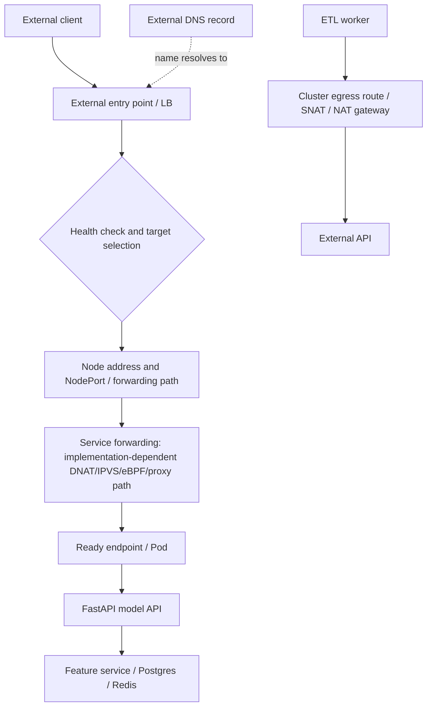

# Unit 4 — Load balancers and external traffic management

**Target file:** `04-load-balancers-and-external-traffic-management.md` | **Module:** M04 | **Stage:** 2E  
**Estimated time:** 10–14 hours  
**Prerequisites:** Stages 0–2D; M01 container images, M02 CI/CD, M03 production Kubernetes operations; working knowledge of Linux, TCP/IP, DNS, HTTP/TLS, Pods, Deployments, Services, readiness, and rollout behavior.  
**Core tools:** `kubectl`, `kind`, Docker, `curl`, shell, `ip`, `ip route`, `docker network inspect`, `ss`, `tcpdump` (optional, lab-only).  
**Awareness tools:** MetalLB, cloud-provider-kind, external-dns, cloud-provider load balancers, NAT gateways, egress gateways, Prometheus, packet-analysis tools.  
**Last reviewed:** 2026-10-28 (authoring date; not a claim of live upstream verification).  
**Verification status:** Reasoned review only; not executed. Current provider versions, installation commands, API support, health-check behavior, and platform-specific guarantees remain `[VERIFY]`.

## Table of Contents

- [4.0 Why this matters in production](#40-why-this-matters-in-production)
- [4.1 Learning objectives](#41-learning-objectives)
- [4.2 Concept map and vocabulary](#42-concept-map-and-vocabulary)
- [4.3 Level 1 — Beginner: Foundations](#43-level-1--beginner-foundations)
- [4.4 Level 2 — Intermediate: Working Practice](#44-level-2--intermediate-working-practice)
- [4.5 Level 3 — Advanced: Production Engineering](#45-level-3--advanced-production-engineering)
- [4.6 Level 4 — Expert: Operating at Scale and Under Failure](#46-level-4--expert-operating-at-scale-and-under-failure)
- [4.7 SRE lens](#47-sre-lens)
- [4.8 Security lens](#48-security-lens)
- [4.9 Production checklist](#49-production-checklist)
- [4.10 Hands-on lab set](#410-hands-on-lab-set)
- [4.11 Self-check questions](#411-self-check-questions)
- [4.12 Evidence artifacts](#412-evidence-artifacts)
- [4.13 Common interview and design-review questions](#413-common-interview-and-design-review-questions)
- [4.14 Sources and verification notes](#414-sources-and-verification-notes)
- [Appendix A — Claim Register](#appendix-a--claim-register)
- [Appendix B — Audit Report](#appendix-b--audit-report)
- [Appendix C — Human Verification Checklist](#appendix-c--human-verification-checklist)
- [Appendix D — Known Limitations and Assumptions](#appendix-d--known-limitations-and-assumptions)
- [Appendix E — Sign-off](#appendix-e--sign-off)

## 4.0 Why this matters in production

A `LoadBalancer` Service can remain without an external address when the cluster has no compatible load-balancer integration, and an allocated address can still be unreachable because the route, advertisement, health check, or node forwarding path is wrong. Source-IP loss can break audit attribution or IP-based policy, while poor readiness and connection draining can cause 502s or dropped requests only during a rollout. IP-pool exhaustion, overlapping Docker/VPN networks, or egress SNAT/conntrack pressure can turn a small networking change into a wider outage. Production diagnosis therefore starts with the packet path and observable evidence, not with the Service YAML alone.

## 4.1 Learning objectives

- **L1:** Trace an inbound request through an external/L4 entry point, node forwarding/NAT, Kubernetes Service, endpoint, and Pod; save the command output in Lab A evidence.
- **L1:** Explain why `type: LoadBalancer` needs a compatible implementation and diagnose a pending address using Service events and provider state.
- **L2:** Create and validate a local `LoadBalancer` Service with a selected local provider, without guessing an address pool; complete Lab A.
- **L2:** Compare `externalTrafficPolicy: Cluster` and `Local`, recording endpoint locality and observed source address where the local path permits a meaningful observation; complete Lab B.
- **L2/L3:** Measure request failures during a rolling deployment before and after readiness/termination adjustments, reporting raw counts and a defined denominator; complete Lab C.
- **L3:** Defend a load-balancing architecture using source-IP, health-check, timeout, availability, security, cost, and operational trade-offs; complete Lab E.
- **L3/L4:** Diagnose pending addresses, deployment-only 502s, unexpected node source IPs, health-check failures, new-connection failures, and ETL egress failures using discriminating tests.
- **L4:** Build a safe change/rollback plan for address pools, local LB providers, node drains, and external traffic configuration with explicit ownership and verification.

## 4.2 Concept map and vocabulary

| Term | Precise definition | Common misconception |
|---|---|---|
| L4 load balancer | Distributes transport connections/packets using addresses, ports, and transport protocol | It necessarily understands HTTP paths or terminates TLS |
| L7 load balancer | Understands application protocols such as HTTP and can route using host/path/headers when supported | Every L7 implementation supports the same features |
| `Service` `type: LoadBalancer` | Kubernetes Service type requesting external load-balancer integration where one is available | Kubernetes universally provisions a cloud LB by itself |
| NodePort | Service exposure through a port on cluster nodes, commonly used by some LB integrations | NodePort always means the user should connect directly to a node |
| External traffic policy | Service setting that affects external traffic forwarding/locality and source-address handling | `Local` is always more available or always preserves the original client address in every topology |
| `healthCheckNodePort` | Service field used in applicable `LoadBalancer`/external traffic policy scenarios for node health checks | Every provider uses it identically |
| Source IP | Network-layer address observed at a given hop | The application always sees the original client IP |
| DNAT | Destination network address translation | It is the same as an HTTP reverse-proxy operation |
| SNAT | Source network address translation | It is only used for inbound traffic |
| Conntrack | Kernel connection-tracking state used by networking/NAT paths | Every connection failure is a conntrack problem |
| Ephemeral port | Temporary source port used for an outgoing connection | The port range is identical on all operating systems |
| Egress | Traffic leaving a workload/cluster toward external destinations | It is governed by ingress configuration |
| External DNS | DNS records mapping names to external entry points | Creating a Service always creates a public DNS record |
| Connection draining | Allowing existing connections/requests to finish or close gracefully during endpoint removal | A Pod becoming NotReady instantly terminates every active request |
| Regional/global LB | Provider/topology-dependent distribution across zones/regions or globally | DNS failover is instantaneous |
| Direct-to-Pod/NEG-style routing | Provider-specific integration that may target workload endpoints more directly | It is a portable Kubernetes behavior |
| PROXY protocol | A transport-level convention for conveying connection metadata to a compatible receiver | It is interchangeable with `X-Forwarded-For` |
| Timeout ladder | Coordinated client, LB, proxy/mesh, and application deadlines | One long timeout setting fixes all timeout failures |

### Packet path before configuration



Control-plane actions (Service admission, provider reconciliation, address allocation, route advertisement, endpoint updates, and health-check configuration) determine how the data plane forwards traffic. The actual path varies by provider, CNI, kube-proxy mode, Service implementation, and external LB integration. DNAT/SNAT may happen at different hops; an L7 proxy terminates/forwards application connections rather than merely rewriting packet addresses.

### Three common inbound patterns

```text
Pattern A — Cloud LB to node forwarding
Client -> provider LB -> selected node:NodePort -> Service forwarding -> ready Pod
                     health checks may target node/NodePort or provider-specific endpoint

Pattern B — External LB to ingress/gateway
Client -> external LB -> ingress/Gateway controller listener -> Service -> ready Pod
        LB health check and proxy health are distinct from application route success

Pattern C — Direct-to-Pod / NEG-style integration (awareness)
Client -> provider-managed target group / endpoint integration -> Pod or node network endpoint
         provider-, CNI-, and platform-specific; not portable Kubernetes behavior
```

### Load-balancing algorithms

Round-robin distributes selections across targets in sequence; least-connections prefers a target with fewer active connections; hashing can provide affinity based on a key such as source or request attributes. These are conceptual examples, not guarantees. Availability, algorithm, persistence, health behavior, and whether balancing is per connection or request depend on the actual implementation. Long-lived gRPC/WebSocket/SSE connections can make request counts differ from connection counts.

## 4.3 Level 1 — Beginner: Foundations

### What `type: LoadBalancer` means

A Kubernetes Service provides a stable virtual endpoint for a group of Pods. `type: LoadBalancer` asks an external integration to make that Service reachable from outside the cluster. In many managed clusters, a cloud controller/provider integration provisions the external LB. In a local `kind` cluster, a separate local provider is needed if you want an external address and a working external path. Without one, `EXTERNAL-IP` may remain `<pending>`; this does not necessarily mean the Service selector or Pods are broken.

A Service's address status is control-plane evidence. Test reachability separately. Likewise, a reachable IP does not prove correct host/path routing, TLS, application health, or production high availability.

### L4 versus L7

- **L4:** forwards TCP/UDP flows based on transport-level properties. TLS may pass through without termination, depending on the design.
- **L7:** understands application protocol messages, such as HTTP host/path and headers. It may terminate TLS and create an upstream connection.
- **Kubernetes Service:** distributes traffic to Service endpoints according to the cluster's networking implementation; it is not the same thing as an HTTP Ingress/Gateway route.
- **Ingress/Gateway API:** declares application-layer routes and requires a controller implementation; see [Unit 3](03-ingress-controllers-and-gateway-api.md).
- **Service VIP and Pod networking:** see [Unit 1](01-kubernetes-networking-model-cni-and-pod-networking.md) and [Unit 2](02-services-kube-proxy-and-cluster-dns.md).

### First safe inspection lab — Lab A

**ID:** A — Service status and packet-path inventory  
**Goal:** Discover the local environment and identify the first hop that could fail.  
**Prerequisites:** Docker, `kind`, `kubectl`; no public endpoints or credentials.  
**Context guard:** This inspection is read-only. Before creating resources later, verify the dedicated context name `kind-m04-u4`.  
**Resource estimate:** negligible; no new cluster required for the read-only portion.

Run in WSL2 Ubuntu or native Linux:

```bash
kubectl config current-context
kubectl get nodes -o wide
kubectl get svc -A
docker network ls
ip -brief address
ip route
```

**Expected output (example — yours will differ):** a context name, one or more Kubernetes nodes, Service types/addresses, Docker network names, local interfaces, and route entries. No particular IP or subnet is expected.

**Interpretation:** The context tells you which cluster the next command would affect. `docker network ls` lists candidate networks but not their subnets; inspect the actual network before selecting an address pool. `ip route` shows routes visible in this Linux environment, not necessarily every Windows/VPN route. On WSL2, also inspect Windows routes using Windows' own network tools if relevant.

For a known kind cluster, inspect its node container and networks:

```bash
kind get clusters
docker ps --format 'table {{.Names}}\t{{.Networks}}\t{{.Ports}}'
docker network inspect kind
```

**Expected output (example — yours will differ):** Docker network JSON includes its actual subnet/gateway; the node container names identify which containers belong to the cluster. The network name may not be `kind` in a customized setup.

**What just happened?** You mapped the host/container network boundary before choosing an LB provider. This prevents the unsafe assumption that a memorized private subnet is available. An IP pool must not overlap Docker, host, VPN, cluster, or reachable LAN routes.

**Common mistakes**

| Symptom | Likely cause | Safe fix |
|---|---|---|
| `EXTERNAL-IP` is `<pending>` | No compatible LB integration, provider not ready, or allocation failure | Inspect Service events and provider logs/status; install only one verified provider in the dedicated lab |
| External address assigned but request fails | Route advertisement, port, firewall, listener, health, or endpoint problem | Trace hop by hop; verify provider and Service endpoints |
| Host cannot reach local address | Docker/WSL2 NAT or route/advertisement limitation | Test from the intended network namespace and consult provider docs |
| Address pool overlaps VPN or Docker subnet | Pool selected without route inventory | Stop; choose a verified non-overlapping pool before enabling advertisement |
| Node IP is logged instead of client IP | SNAT/forwarding path or proxy trust configuration | Compare traffic policy and each hop; do not trust arbitrary forwarding headers |

### Local provider choice for the mandatory lab

The required hands-on work needs a local `LoadBalancer` implementation. This lesson chooses **MetalLB Layer 2 mode as the planned lab option** because it exposes address allocation and L2 advertisement concepts that can be inspected, while staying local and avoiding a cloud account. This is a plan, not a claim that a particular current MetalLB release is compatible with every kind/Kubernetes version. The exact installation version and commands are `[VERIFY]`; consult the official MetalLB installation and configuration documentation and verify the supported Kubernetes version before proceeding.

Do **not** also install cloud-provider-kind for the same mandatory lab. Mixing providers makes address ownership and troubleshooting ambiguous. If MetalLB's documented Layer 2 prerequisites cannot be satisfied on the learner's network, stop and document that constraint; an alternative lab using cloud-provider-kind requires its own official compatibility/install verification and a clean dedicated cluster.

Before choosing any address pool, inspect actual network ranges and routes. Example commands:

```bash
docker network ls
docker network inspect kind
ip -brief address
ip route
```

On Windows PowerShell, if WSL2/VPN routes matter:

```powershell
Get-NetRoute | Sort-Object -Property DestinationPrefix
Get-NetIPAddress | Sort-Object -Property InterfaceAlias
```

**Expected output (example — yours will differ):** actual subnets and routes. Do not copy a sample pool from this lesson. Choose a pool only after confirming it is unused and reachable/advertisable under the provider's official Layer 2 model. Address selection is environment-specific.

### `EXTERNAL-IP` pending: first-response commands

```bash
kubectl get svc -A
kubectl describe svc <service-name> -n <namespace>
kubectl get events -n <namespace> --sort-by=.lastTimestamp
kubectl get pods -A -o wide
```

**Expected output (example — yours will differ):** Service events may show allocation or integration clues; if no relevant event exists, that is not proof of a healthy provider. Inspect the selected provider's Pods/logs and configuration next. Replace placeholders only with names discovered from the cluster.

## 4.4 Level 2 — Intermediate: Working Practice

### A complete workload and `LoadBalancer` Service

The sample below is a lab workload, not a production FastAPI image. The image reference is an illustrative pinned tag, and its current provenance/support must be checked before use `[VERIFY]`. For production, build and pin a reviewed non-root image under M01 and promote it through M02.

Create `manifests/loadbalancer/api-service.yaml`:

```yaml
# File: manifests/loadbalancer/api-service.yaml
apiVersion: v1
kind: Namespace
metadata:
  name: ml-platform
---
apiVersion: v1
kind: ServiceAccount
metadata:
  name: api-lab
  namespace: ml-platform
automountServiceAccountToken: false
---
apiVersion: apps/v1
kind: Deployment
metadata:
  name: api-lab
  namespace: ml-platform
spec:
  replicas: 2
  selector:
    matchLabels:
      app: api-lab
  strategy:
    type: RollingUpdate
    rollingUpdate:
      maxUnavailable: 0
      maxSurge: 1
  template:
    metadata:
      labels:
        app: api-lab
    spec:
      serviceAccountName: api-lab
      terminationGracePeriodSeconds: 30
      securityContext:
        runAsNonRoot: true
        seccompProfile:
          type: RuntimeDefault
      containers:
        - name: http
          image: hashicorp/http-echo:1.0.0
          args: ["-listen=:8080", "-text=api-lab-ok"]
          ports:
            - name: http
              containerPort: 8080
          readinessProbe:
            tcpSocket:
              port: http
            initialDelaySeconds: 2
            periodSeconds: 3
            failureThreshold: 2
          lifecycle:
            preStop:
              exec:
                command: ["/bin/sh", "-c", "sleep 5"]
          resources:
            requests:
              cpu: 10m
              memory: 16Mi
            limits:
              cpu: 200m
              memory: 64Mi
          securityContext:
            allowPrivilegeEscalation: false
            readOnlyRootFilesystem: true
            capabilities:
              drop: ["ALL"]
---
apiVersion: v1
kind: Service
metadata:
  name: api-lab
  namespace: ml-platform
spec:
  type: LoadBalancer
  externalTrafficPolicy: Cluster
  selector:
    app: api-lab
  ports:
    - name: http
      port: 80
      targetPort: http
      protocol: TCP
```

This manifest uses a named target port and consistent selectors. However, **validate the image's runtime UID and filesystem behavior before enforcing `runAsNonRoot`/read-only root filesystem**; a tag may not support these settings. If it fails, use a reviewed image with a documented non-root configuration rather than silently weakening security. `preStop: sleep 5` is an educational delay, not a universal graceful-drain solution; application shutdown semantics and LB health-check timing must be measured.

Apply only after verifying the context:

```bash
kubectl config current-context
kubectl config current-context | grep -Fx 'kind-m04-u4'
```

If the second command fails, stop. Then:

```bash
kubectl apply -f manifests/loadbalancer/api-service.yaml
kubectl rollout status -n ml-platform deploy/api-lab --timeout=120s
kubectl get svc api-lab -n ml-platform -o wide
kubectl describe svc api-lab -n ml-platform
kubectl get endpointslices -n ml-platform -l kubernetes.io/service-name=api-lab -o wide
kubectl get pods -n ml-platform -o wide
```

**Expected output (example — yours will differ):** two ready Pods and an EndpointSlice with ready endpoints. Without a working local LB provider, the Service's external address may remain `<pending>`. After a compatible provider allocates an address, the status may show an address, but reachability still needs testing.

### Safe local-provider installation gate

Before installing MetalLB:

1. Create a dedicated `kind-m04-u4` cluster with a Kubernetes version supported by the chosen MetalLB release.
2. Record exact `kind`, Kubernetes, Docker, and MetalLB versions.
3. Read the official MetalLB installation/configuration guide for that release.
4. Inspect actual Docker subnets, host/VPN routes, and LAN routes. Select a non-overlapping address pool that is valid for the chosen L2 environment.
5. Apply only the official version-matched installation method and documented configuration.
6. Verify MetalLB controller/speaker health, address-pool configuration, Service events, and advertised address from the host.
7. If any prerequisite is unclear, do not guess a pool or paste an unverified installation URL. Mark the lab blocked pending verification.

Official source entry point: https://metallb.universe.tf/  
**[VERIFY]** Exact release, install commands, supported Kubernetes versions, L2 advertisement requirements, and configuration schema must be confirmed from the official documentation before use. A URL is provided as a source entry point, not evidence that the current install sequence was tested.

### `externalTrafficPolicy: Cluster` versus `Local`

- **`Cluster`:** external traffic can be forwarded to eligible endpoints across nodes; this may introduce another forwarding hop and can cause the backend to observe a translated/node address in some paths. Exact source-IP behavior depends on the provider and networking implementation.
- **`Local`:** external traffic is restricted to node-local endpoints for the relevant Service path. This can preserve source addresses in supported topologies, but nodes without local ready endpoints must not be treated as valid traffic targets. Distribution can become uneven if endpoints are unevenly placed.
- **`healthCheckNodePort`:** Kubernetes documents this field for applicable `LoadBalancer` Services using `externalTrafficPolicy: Local`; its actual role depends on the provider's health-check integration. Verify the API reference and selected provider docs rather than assuming every provider consumes it identically.
- A provider health check is not the same as application readiness, and a TCP check is not the same as an HTTP route/application check.

#### Packet path with `Cluster`

```text
Client -> external/local LB -> node A -> Service forwarding
       -> endpoint on node A OR node B
       -> backend may observe translated source address, depending on path
```

#### Packet path with `Local`

```text
Client -> external/local LB -> node with local eligible endpoint
       -> local Service forwarding -> local Pod
       -> source address may be preserved in supported paths
       -> nodes without local endpoints should fail the applicable health check
```

These diagrams are conceptual. Confirm the selected provider, CNI, Service implementation, and external path. Do not infer source-IP preservation from the policy value alone.

### Source-IP experiment — Lab B

**Goal:** Compare observed client address and endpoint locality under both policies.  
**Prerequisites:** Dedicated kind cluster, chosen local LB provider verified, two or more backend replicas; no public exposure.  
**Context guard:** require `kind-m04-u4`.  
**Resource estimate:** 2 small Pods plus provider components; resource footprint depends on versions and cluster.

The echo workload above returns a fixed body, not the client address. To observe the source address, use a reviewed diagnostic HTTP image/application that logs the peer address or returns it in a response. Select and pin an image after reviewing its source and security properties `[VERIFY]`; do not assume `hashicorp/http-echo` provides a client-IP endpoint.

1. Save the original Service YAML.
2. Verify the selected local provider's documented support for the test topology and source-IP behavior.
3. Set `externalTrafficPolicy: Cluster`, apply, and send requests from the host to the assigned address. Capture the application-observed peer address and provider/network evidence.
4. Change only the traffic policy to `Local`, apply, and repeat. Ensure the test can reach nodes with local endpoints; inspect endpoint placement.
5. Compare observations without assuming the local provider reproduces a cloud provider's source-IP path.

**Expected output (example — yours will differ):** request logs may show different peer addresses across modes. If both show the same address, investigate host NAT, Docker bridge, provider forwarding, and diagnostic endpoint behavior; do not fabricate a difference.

### Pattern catalogue

| Pattern | When to use | When NOT to use |
|---|---|---|
| `LoadBalancer` Service for a TCP/UDP service | Service needs a dedicated external L4 entry point | HTTP host/path routing is better handled by an existing governed ingress/Gateway tier |
| External LB → ingress/Gateway → Service | Central TLS, HTTP routing, policy, and observability are needed | The extra proxy hop is incompatible with required latency/protocol behavior |
| `externalTrafficPolicy: Cluster` | Endpoint reachability across nodes and distribution are priorities | Original source IP is mandatory and the path cannot preserve it |
| `externalTrafficPolicy: Local` | Source IP/locality requirements justify node-local routing | Endpoints are unevenly placed and LB health checks cannot correctly exclude empty nodes |
| Direct-to-Pod/NEG-style integration | A provider explicitly supports and operates endpoint integration | Portability or local-kind parity is required |
| Local MetalLB L2 in kind | Demonstrate address allocation/advertisement on a compatible local network | You need proof of cloud health checks, multi-AZ resilience, or provider source-IP guarantees |

### Anti-pattern catalogue

| Bad configuration | Consequence | Corrected approach |
|---|---|---|
| Guess an LB pool from a tutorial | Overlap with Docker/VPN/LAN routes or unreachable advertisements | Inspect real networks/routes and choose a non-overlapping pool |
| Assume Kubernetes always provisions external LBs | Service remains pending and incident is misdiagnosed | Identify and verify provider/controller integration |
| Set `Local` without endpoint placement/health-check plan | Some nodes have no local endpoint; traffic can fail or become uneven | Inspect locality, test health-check semantics, and schedule replicas deliberately |
| Trust client-provided `X-Forwarded-For` | Spoofed identity and bad audit/rate-limit decisions | Sanitize headers and trust only configured proxy hops |
| Use one timeout for every hop | Premature disconnects or excess work after clients time out | Design and test a timeout ladder |
| Treat `preStop: sleep` as graceful shutdown | Active requests may still be dropped | Implement app-aware shutdown and verify LB/endpoint drain sequence |
| Install two local LB providers in one lab | Ambiguous address ownership and conflicting control loops | Use one provider in the mandatory lab |
| Treat kind measurements as cloud benchmarks | Unsupported availability/performance conclusions | Record topology limitations and validate on a representative environment |

### Rolling-deployment request test — Lab C

Use only the dedicated local endpoint. This bounded script makes a finite number of local requests and records success/failure; it is not a production load test.

Create `scripts/repeat-local-requests.sh`:

```bash
# File: scripts/repeat-local-requests.sh
#!/usr/bin/env bash
set -u

URL="${1:?usage: $0 http://127.0.0.1:PORT/health [count]}"
COUNT="${2:-200}"
CONNECT_TIMEOUT="${CONNECT_TIMEOUT:-1}"
MAX_TIME="${MAX_TIME:-3}"

case "$COUNT" in
  ''|*[!0-9]*) echo "COUNT must be an integer" >&2; exit 2 ;;
esac
if [ "$COUNT" -lt 1 ] || [ "$COUNT" -gt 5000 ]; then
  echo "COUNT must be between 1 and 5000" >&2
  exit 2
fi

success=0
failed=0
out="${OUT_FILE:-requests.csv}"
printf 'index,result,http_code,time_total\n' > "$out"

for i in $(seq 1 "$COUNT"); do
  tmp="$(mktemp)"
  metrics="$(curl -sS -o "$tmp" -w '%{http_code},%{time_total}' \
    --connect-timeout "$CONNECT_TIMEOUT" --max-time "$MAX_TIME" \
    "$URL" 2>/dev/null)"
  rc=$?
  if [ "$rc" -eq 0 ]; then
    code="${metrics%%,*}"
    timing="${metrics#*,}"
    if [ "$code" -ge 200 ] && [ "$code" -lt 400 ]; then
      result="success"
      success=$((success + 1))
    else
      result="failed"
      failed=$((failed + 1))
    fi
  else
    code="000"
    timing="timeout-or-connect-error"
    result="failed"
    failed=$((failed + 1))
  fi
  printf '%s,%s,%s,%s\n' "$i" "$result" "$code" "$timing" >> "$out"
  rm -f "$tmp"
done

total=$((success + failed))
awk -v s="$success" -v f="$failed" -v t="$total" \
  'BEGIN { printf "total=%d success=%d failed=%d failure_rate=%.4f\n", t, s, f, (t ? f/t : 0) }'
echo "raw_results=$out"
[ "$failed" -eq 0 ]
```

The script intentionally exits non-zero if any request fails; preserve the output file before interpreting the exit status. It requires `curl`, `awk`, `mktemp`, and `seq`. It only contacts the URL supplied by the learner; pass a local lab endpoint, never a public or third-party target.

**Context guard before the test and rollout:**

```bash
kubectl config current-context | grep -Fx 'kind-m04-u4'
kubectl get nodes
kubectl get svc api-lab -n ml-platform -o wide
```

If the context assertion fails, stop. Record a baseline run, then trigger a controlled rolling update of the lab Deployment and repeat the test. The `api-lab` container responds at `/`, so use the local mapped/exposed URL path that actually reaches it; do not assume a port that has not been configured.

Before changing probes or termination settings, inspect `kubectl describe pod`, events, rollout strategy, and controller/provider drain docs. Change one variable at a time in the disposable cluster. A correct experiment records the raw failure counts before and after; do not claim that a fixed `preStop` sleep or readiness probe guarantees zero dropped requests.

Required result table (fill with actual measurements):

| Run | Traffic policy | Readiness/drain configuration | Total requests | Failed/dropped requests | Failure rate | Observed client IP | Notes |
|---|---|---|---:|---:|---:|---|---|
| Baseline | Cluster | Initial | learner fills | learner fills | learner calculates | learner fills | |
| Comparison | Local | Initial | learner fills | learner fills | learner calculates | learner fills | |
| Before fix | chosen mode | Original | learner fills | learner fills | learner calculates | learner fills | |
| After fix | same mode | Corrected | learner fills | learner fills | learner calculates | learner fills | |

**Failure-rate denominator:** failed requests divided by all attempted requests in that run. A request counts as failed if `curl` exits non-zero or returns a status outside the documented success range 200–399. Report connection errors/timeouts separately if useful. Laptop results are noisy and local-provider behavior is not a cloud performance benchmark.

## 4.5 Level 3 — Advanced: Production Engineering

### Architecture trade-offs

| Option | Benefit | Cost | Risk | Choose when |
|---|---|---|---|---|
| Cloud-managed L4 LB → node/NodePort path | Provider-managed external address and integration | Provider cost and provider-specific health/network configuration | Node forwarding/source-IP behavior misunderstood | Service needs external TCP/UDP reachability and provider support is appropriate |
| External LB → ingress/Gateway → Service | Central HTTP routing, TLS policy, logs, and host/path control | Extra hop and proxy capacity/configuration | Shared-controller blast radius or timeout mismatch | Many HTTP APIs need governed edge policy |
| Direct-to-Pod/NEG-style | May avoid an extra node-forwarding hop and integrate with provider health checks | Provider/CNI-specific configuration and portability cost | Endpoint registration drift or platform coupling | Provider explicitly supports the model and its operations are understood |
| `Cluster` traffic policy | Can reach endpoints across nodes | Source address may be translated; forwarding path can be longer | Client IP assumptions fail | Endpoint flexibility is more important than source-IP preservation |
| `Local` traffic policy | Can preserve source IP in supported paths and avoid cross-node forwarding | Requires endpoint locality and correct health checks; uneven distribution possible | Nodes without local endpoints remain selected if health integration is wrong | Source-IP requirement is real and node/endpoint placement is controlled |
| Single shared external LB | Central operations and fewer public entry points | Shared capacity and change domain | One misconfiguration affects many services | Platform team has ownership, guardrails, and clear SLOs |
| Separate LB per service/team | Isolation and independent lifecycle | More IPs, cost, DNS, certificates, and operations | Fleet sprawl and inconsistent controls | Distinct security/compliance or traffic needs justify separation |

### Health checks: control plane and data plane

Health-check configuration is a control-plane contract between the LB/provider and its targets. Data-plane forwarding still depends on the selected target's actual path to a ready backend. A TCP health check may prove that a port accepts a connection but not that an HTTP route, TLS handshake, or model dependency is healthy. An HTTP health check can test a path/status, but the path and expected response must be meaningful and safe.

Do not assume the provider uses `healthCheckNodePort`, a node port, a Pod IP, or an HTTP endpoint in a particular way. Verify the provider's official documentation and inspect its actual configuration/events. Local provider health-check behavior may not match a cloud provider.

### Performance and reliability measurement protocol

1. Record versions, cluster topology, provider mode, number/location of replicas, Service policy, request path, client location, concurrency, payload, request count, and duration.
2. Use a finite repeated request test and save raw request outcomes. For latency analysis, use a pinned load tool and document connection reuse/concurrency.
3. Measure success/failure ratio and latency percentiles only when the sample and tooling support them; include the denominator and test window.
4. Compare before/after with one configuration change at a time.
5. Record background CPU/memory, provider logs/events, endpoint readiness, and any rollout events.
6. Repeat the test to assess noise. Do not claim statistically meaningful improvement from a single laptop run.

### Reliability methods

- Separate LB target health from application readiness; align health checks with a real serving path.
- Keep replicas across nodes where possible, and test `Local` policy with the actual endpoint placement.
- Define drain behavior jointly across Service endpoint removal, proxy/provider connection draining, application shutdown, and M03 rollout operations.
- Keep retries bounded and avoid retrying non-idempotent operations without an idempotency strategy.
- Use a rollback threshold based on request success/latency and route health, not only Pod readiness.
- Avoid layering multiple LBs/proxies without a documented reason; extra hops can introduce duplicate NAT, source-IP loss, timeout mismatches, and confusing health checks.

### Defended design exercise — Lab E

**Objective:** Choose a design for a FastAPI model-scoring API, internal feature service, Postgres/Redis dependencies, an ETL worker calling external APIs, and a metrics endpoint.

**Prerequisites:** Completed Labs A–C; architecture notes and actual measurements; no cloud account required.  
**Context guard:** This is a design exercise; do not create provider resources or expose public endpoints.  
**Resource estimate:** no additional cluster resources.

Compare:
1. Local MetalLB L2 `LoadBalancer` Service.
2. Managed cloud L4 LB to Service/node path.
3. External LB to ingress/Gateway controller and ClusterIP backend.
4. Provider-specific direct-to-Pod/NEG-style integration.

For each, fill a decision table with source-IP behavior, health-check model, timeout/draining support, protocol requirements (TCP/UDP, HTTP/2/gRPC, streaming), failure domain, multi-zone capability, cost ownership, operational burden, and migration/rollback. Mark unverified provider features `[VERIFY]`.

**Pass criteria:** the ADR identifies a recommended pattern, rejects at least one alternative with evidence, states assumptions and residual risks, keeps the feature service/database/cache/metrics internal unless explicitly approved, and distinguishes local-lab evidence from production requirements.

**Stretch:** Add an external-DNS ownership and TTL/failover section without creating a public DNS record.

## 4.6 Level 4 — Expert: Operating at Scale and Under Failure

### Failure diagnosis matrix

| Symptom | Hypotheses | Discriminating tests | Root-cause evidence | Fix | Prevention |
|---|---|---|---|---|---|
| `EXTERNAL-IP` pending | No LB integration; provider not ready; no free address; invalid pool/config | `kubectl describe svc`; events; provider Pods/logs/config; address pool state | Explicit allocation/config error or provider unavailable | Correct provider/config after confirming non-overlapping pool; restore known-good configuration | Version-pinned provider, pool inventory/capacity alert, runbook |
| 502 only during deploy | Readiness flips too early; endpoint removal races with drain; app exits before requests finish; LB has stale target | Correlate request timestamps with rollout, endpoint conditions, Pod termination, provider/controller logs | Failures align with endpoint removal or process shutdown | Roll back deployment/config; correct readiness and app-aware graceful shutdown; verify drain | Repeat rollout test, safe maxUnavailable/surge, PDB and termination review |
| Client IP appears as node IP | SNAT at a hop; `Cluster` policy; host/Docker NAT; proxy header trusted incorrectly | Compare packet/log addresses at each hop; test policy modes; inspect provider path | First hop where source changes is identified | Select supported traffic policy/proxy config; sanitize trusted headers | Document trust chain and source-IP acceptance test |
| All health checks fail | Wrong port/path/protocol; target not reachable; health-check source blocked; Local mode has no local endpoint | Inspect provider health config/logs, node endpoints, firewall/policy, direct target probe | Health probe's actual destination and failure match the config issue | Correct target/path/policy or restore local endpoints | Staging health-check test and change review |
| New connections fail but existing survive | New target/route health broken; pool exhausted; stale/failed address advertisement; firewall or conntrack pressure | Compare existing/new connections; inspect Service events, provider state, routes, `ss`, relevant kernel counters where available | New flow fails at a distinct hop; existing established state persists | Restore target/route or capacity; avoid broad network flushes | Connection churn tests, capacity monitoring, staged changes |
| ETL egress fails | DNS failure, egress policy, route/SNAT/NAT gateway, ephemeral ports, conntrack, external API outage | Resolve DNS from worker; test approved endpoint; inspect policy/routes/counters; compare other destinations | First failing step is reproducible and scoped | Restore DNS/policy/route/NAT capacity; retry only with bounded backoff | Egress runbook, connection pooling, destination allowlist, M15 capacity review |
| Address pool exhausted | Services consume all allocatable addresses or addresses unavailable/conflicting | Provider allocation status, pool inventory, Services and events | No free usable addresses or conflicting ownership | Add a reviewed non-overlapping pool or release stale allocations under change control | Capacity threshold, address ownership, periodic inventory |
| Traffic loops through multiple LBs | Backend points to same public endpoint; duplicated proxy/NAT routes | Trace DNS, target configuration, headers, hop counts and flow path | Repeated target path or recurring requests across the same tiers | Break the loop and restore a single intended path | Architecture diagram and config linting |

### Egress, SNAT, ephemeral ports, and conntrack

An ETL worker calling an external API follows an egress path, not an ingress path. DNS resolves the destination; routing and policy decide whether traffic may leave; SNAT may translate the Pod/node source address to an address accepted by the external network. A NAT gateway or egress gateway can provide a stable egress identity but adds cost, capacity planning, and another failure domain (see M15).

Many concurrent connections to the same destination can consume ephemeral source ports and connection-tracking state. Symptoms can include intermittent connect failures, resets, or new connections failing while established connections remain. These symptoms are not proof of port/conntrack exhaustion: inspect DNS, routes, policy, remote service health, socket state, and available counters before concluding. A kind laptop cannot faithfully model cloud NAT capacity or all kernel/provider limits.

Useful local inspection commands (read-only):

```bash
ss -s
ss -tan state established
ip route
ip -s link
```

Kernel conntrack tools/counters may not be installed or accessible in WSL2. If unavailable, record the limitation rather than installing unverified kernel modules or flushing connection state. Never run a broad conntrack flush as a first-line mitigation on a shared host.

### DNS and failover

External DNS systems such as external-dns can reconcile DNS records from cluster resources or other sources, depending on configured providers and ownership policies. They require explicit credentials/permissions and careful ownership boundaries. This lesson does not install external-dns or create public records. Verify supported source types, provider, ownership registry, TXT/record policy, TTL, and cleanup behavior in the official docs before use.

DNS-based failover is not instantaneous: resolvers, applications, and clients may cache answers, and TTL is not a universal hard cutoff for all client behavior. Global/regional load balancing and multi-cluster routing belong mainly to [M14 — Multi-cluster Networking](../). Do not promise that changing a DNS record immediately moves all active connections.

### Timeout ladder, keep-alive, and connection draining

Review the full path:

**client → external LB → ingress/Gateway → mesh (if present) → application → dependencies**

Each layer may have request deadlines, idle timeouts, keep-alive settings, retries, and graceful-termination rules. A client deadline shorter than the server's work can leave expensive processing running after the caller has abandoned it. A proxy idle timeout shorter than a streaming response can close an otherwise healthy stream. A termination deadline shorter than the longest permitted request can drop in-flight requests.

Do not invent universal defaults. Record each actual setting and test it with the chosen provider/controller. For TCP/UDP, gRPC, TLS passthrough, WebSockets, SSE, and long-lived connections, protocol support and timeout semantics depend on the LB and mode. An L4 LB does not inherently terminate TLS; an L7 proxy may terminate TLS if configured to do so. Connection draining and node-drain behavior must be tested together with M03 probes, PDBs, rollout strategy, and application shutdown.

### Fleet-safe operations and policy

- Maintain an inventory of LoadBalancer Services, external addresses, owner, hostname/DNS record, traffic policy, backend, provider, and decommission date.
- Require a reviewed IP allocation record and non-overlap check before modifying a pool.
- Restrict who may create externally exposed Services; use namespace/cluster policy and admission controls appropriate to the platform.
- Make traffic-policy, health-check, source-IP, timeout, and drain changes through version-controlled configuration.
- Stage provider/controller upgrades in a disposable or staging cluster; pin versions and preserve a rollback configuration.
- Use canary/maintenance windows and define abort thresholds before rollout.
- Keep controller/provider permissions minimal and log administrative changes.
- Avoid automated bulk changes across clusters until compatibility, rollback, and blast radius are demonstrated.
- Treat external DNS and fixed egress IP as separately owned capabilities with distinct permissions and costs.

### Incident runbooks

#### Runbook 1 — `EXTERNAL-IP` remains pending

**Alert:** Service has no external address beyond the expected provisioning window (define this window from provider behavior; no universal duration is assumed).

1. **Triage:** capture context, Service YAML/status, events, provider Pod readiness/logs, and pool allocation state.
2. **Discriminate:** confirm whether the cluster has an LB integration; inspect the provider's exact allocation/config error; verify address pool overlap and capacity.
3. **Mitigate:** do not invent or immediately widen a pool. Restore the last known-good provider config or choose a verified non-overlapping range under change control.
4. **Validate:** confirm address assignment, route/advertisement, endpoint readiness, and a local request.
5. **Follow-up:** add an address inventory/capacity alert and document provider version, pool owner, and rollback.

#### Runbook 2 — 502s occur only during deployment

**Alert:** Request failures correlate with a Deployment rollout while steady-state requests succeed.

1. **Triage:** save request failures with timestamps; inspect Deployment rollout, Pod readiness/termination, EndpointSlice conditions, Service events, and LB/controller logs.
2. **Discriminate:** compare endpoint removal time, application shutdown, health-check state, and connection drain; determine whether new connections or in-flight requests fail.
3. **Mitigate:** pause/rollback the rollout; restore healthy endpoints; adjust readiness and app-aware shutdown only after identifying the race.
4. **Validate:** rerun the bounded request test during another controlled rollout; compare counts and ensure no unrelated traffic was tested.
5. **Follow-up:** add deployment-time request-failure SLI, a regression lab, and documented drain/readiness ownership.

#### Runbook 3 — client IP is wrong or health checks all fail

**Alert:** Logs show node addresses unexpectedly, or all targets are unhealthy.

1. **Triage:** identify the first hop that sees a different source address; capture provider target/health-check config and endpoint locality.
2. **Discriminate:** test Cluster/Local behavior, check target port/protocol/path, and inspect whether the provider sends checks from an allowed source.
3. **Mitigate:** correct the verified policy/target/config; do not trust a client-provided forwarding header to compensate for an unknown path.
4. **Validate:** perform a controlled local request and record source address and health status.
5. **Follow-up:** document trust boundaries, provider semantics, and a regression test.

#### Runbook 4 — ETL egress fails

**Alert:** ETL worker cannot reach an approved external API.

1. **Triage:** check DNS resolution from the worker, error type, egress policy, routes, and whether other destinations work.
2. **Discriminate:** separate name-resolution, TCP connect, TLS, remote application, and SNAT/connection-state failures.
3. **Mitigate:** restore the specific DNS/policy/route/NAT dependency; use bounded retries and avoid broad host networking changes.
4. **Validate:** repeat the approved request and inspect error rate and connection behavior.
5. **Follow-up:** add egress dependency ownership and capacity review under M15.

## 4.7 SRE lens

### SLIs and SLOs

| SLI | Definition and denominator | Window/source | Interpretation risk |
|---|---|---|---|
| Successful external request ratio | Successful eligible requests / all eligible attempted requests; explicitly define status codes and client-abort handling | Service owner-defined rolling window; app/proxy logs or synthetic probes | Provider health alone is not a user-success measure |
| LB/Service reachability | Successful probe attempts / all scheduled probe attempts | Probe interval and target path documented; synthetic monitor/provider health | A TCP port check may not prove application correctness |
| Rollout failure rate | Failed requests during rollout window / all requests attempted in that window | Timestamped request script and deployment events | Low traffic yields noisy ratios; compare equal windows and load |
| Time to detect/mitigate | Incident detection time and recovery time from a declared start/end definition | Incident timeline and alert system | Different teams may define start/end inconsistently |
| Source-IP correctness | Requests whose observed source identity matches the documented trust model / eligible test requests | Controlled tests and application/proxy logs | Node/host NAT can make local results differ from production |
| Drain outcome | Failed/reset requests during termination window / requests attempted during that window | Request logs, proxy/provider logs, rollout events | Some resets are client-initiated; correlate timestamps and codes |

Do not prescribe unsupported numeric SLO targets. Derive an objective from user impact, contractual needs, observed baseline, acceptable error budget, and dependency budgets. Define the measurement window and eligible request population. Separate provider/LB telemetry from application metrics; both are needed to explain a failure.

### Failure modes and blast radius

- A shared LB/provider configuration or IP pool can affect many Services.
- One unhealthy node or incorrect Local policy can reduce eligible targets.
- Long-lived connections may survive while new connections fail, obscuring the incident.
- NAT/conntrack or ephemeral-port pressure can affect many outbound clients sharing a node/NAT path.
- DNS record ownership mistakes can direct clients to the wrong endpoint or delay failover.
- Excessive per-request logs/labels can raise cost or expose sensitive addresses and request metadata.
- Overlapping LBs/proxies can add latency, NAT, source-IP ambiguity, and loops.

Capacity planning should consider concurrent connections, connection churn, expected payload/stream duration, address pool size, endpoint locality, SNAT port usage, conntrack state, and logging volume. Measure in a representative environment; do not extrapolate laptop measurements to cloud throughput or availability.

### Compact runbook

**Alert → triage → mitigation → follow-up:** scope the failing Service and time window; inspect Service status/events, provider health/config, endpoints, DNS, routes, and logs; locate the first failing hop; restore a known-good config or healthy target; verify with a bounded request test; then add a regression test, owner, and capacity/policy control.

## 4.8 Security lens

| Threat | Control | Verification |
|---|---|---|
| Accidental public exposure | Restrict creation of LoadBalancer Services and external hosts; use explicit ownership/approval | `kubectl get svc -A -o wide`; compare each external address to the approved inventory |
| Source-IP spoofing | Trust only actual transport peer or configured proxy chain; sanitize forwarded headers | Send a lab request with a forged `X-Forwarded-For`; verify the app does not treat it as authenticated identity |
| PROXY protocol trust mismatch | Enable only when both endpoints support it and the sender is trusted | Inspect both configs and test a controlled connection; mismatched protocol may break traffic |
| DNS takeover/misconfiguration | Least-privilege DNS credentials, ownership records, TTL/change review, stale-record cleanup | Review provider permissions and DNS change audit; no public record needed in the lab |
| Unsafe IP pool | Inspect Docker/host/VPN/LAN routes; use approved non-overlapping pool | Compare provider pool with `docker network inspect`, `ip route`, and Windows routes where applicable |
| Egress misuse | Restrict destinations and credentials; use NetworkPolicy/egress controls where supported | Inspect policy and test only approved destination from lab workload |
| SNAT/conntrack exhaustion | Connection pooling, bounded concurrency, capacity monitoring, documented NAT limits | Observe `ss -s`, available counters, and application connect errors; local limits are not cloud proof |
| DDoS/resource exhaustion | Layer provider protection, network controls, rate limits, application budgets, and monitoring | Verify configured controls and run only bounded, authorized load tests |
| Sensitive packet capture | Capture only lab-owned traffic, limit scope, protect and delete capture files | Review command interface/filter and file permissions; redact before sharing |
| False belief that LB secures app | Application authn/authz, TLS, NetworkPolicy, WAF where required, and threat review | Test unauthenticated application behavior; verify Unit 5 policy and Unit 6 TLS separately |

A load balancer does **not** inherently provide application authentication, authorization, complete WAF/DDoS protection, encryption by itself, or zero-trust segmentation. Link network segmentation to [Unit 5](05-network-policies-and-zero-trust-segmentation.md) and TLS/certificate lifecycle to [Unit 6](06-tls-termination-and-certificate-lifecycle-with-cert-manager.md). Use only approved, lab-scoped traffic tests; never probe external networks not owned by the learner.

## 4.9 Production checklist

- [ ] Service type and external exposure are justified and documented.
- [ ] Selected provider/controller maintenance, supported Kubernetes versions, security advisories, and install instructions have been checked against official docs.
- [ ] Address pool was derived from actual Docker/host/VPN/LAN routes and is non-overlapping; capacity and ownership are recorded.
- [ ] Service status, events, endpoint readiness, and external reachability are tested independently.
- [ ] `externalTrafficPolicy` choice is documented with source-IP and endpoint-locality evidence.
- [ ] `healthCheckNodePort` and provider health-check behavior are verified for the exact Service/policy/provider.
- [ ] Health-check protocol/port/path and failure behavior are documented.
- [ ] Trusted proxy chain and `X-Forwarded-For` sanitation are tested; PROXY protocol is configured only with matching trusted endpoints.
- [ ] Timeout ladder is reviewed from client through LB/Ingress/Gateway/mesh/app/dependencies.
- [ ] Connection draining, readiness, termination grace, PDBs, and rollout behavior are tested together.
- [ ] DNS record ownership, TTL, stale-record cleanup, and failover limitations are documented.
- [ ] Egress DNS, policy, SNAT/NAT capacity, ephemeral ports, and conntrack have an owner/runbook.
- [ ] SLO/SLI denominator, measurement window, alert, escalation, and rollback criteria are explicit.
- [ ] Shared-LB blast radius, multi-LB routing loops, and address exhaustion are reviewed.
- [ ] Packet captures/logs avoid unnecessary sensitive payloads and have retention controls.
- [ ] Local-vs-cloud fidelity limits are recorded; no kind test is represented as a cloud guarantee.
- [ ] All lab resources and temporary files are cleaned up and verified absent.

## 4.10 Hands-on lab set

Four labs are specified below. They are instructional plans and have **not** been executed. Before any mutation, confirm the target is a disposable `kind-m04-u4` cluster. If that exact context is not active, stop. Provider installation and pool configuration are gated on current official documentation and local network inspection.

### Lab A — Packet path and Service status

- **Goal:** Identify which hop owns the external address and trace a request to a ready endpoint.
- **Prerequisites:** Docker, kind, kubectl, curl.
- **Context guard:** Read-only inspection first; before mutation require `kubectl config current-context | grep -Fx 'kind-m04-u4'`.
- **Resource estimate:** read-only phase negligible; cluster/workload phase two small Pods plus local provider.
- **Steps:** complete §4.3 inventory; create the dedicated cluster; inspect Docker network and routes; select and install one verified local provider; apply the manifest in §4.4; inspect status/events/EndpointSlices; test only the verified local entry point.
- **Expected output (example — yours will differ):** two ready Pods and ready EndpointSlice endpoints; external address may remain pending until the provider is installed/configured. Once allocated, connectivity may still fail if advertisement/routing is wrong.
- **Interpretation:** separate allocation, advertisement, node forwarding, Service endpoint selection, and application response.
- **Evidence:** environment inventory, Service YAML/status/events, provider logs/config, endpoint state, request output.
- **Pass criteria:** learner can name the first unverified/failing hop and support it with evidence.
- **Cleanup:** delete `ml-platform` resources; remove provider resources only using the official uninstall steps and only in the dedicated cluster; delete the cluster; verify it is absent.
- **Stretch:** capture a narrowly filtered packet trace of lab traffic if tools and permissions are available.
- **Cannot prove:** cloud provider health checks, source-IP guarantees, multi-zone behavior, or production throughput.

### Lab B — Source IP and external traffic policy

- **Goal:** Compare Cluster/Local policy and record the observed peer address and endpoint locality.
- **Prerequisites:** Lab A complete, a diagnostic endpoint that reports/logs the peer address, and verified provider support.
- **Context guard:** confirm `kind-m04-u4` and no external/public target.
- **Resource estimate:** same two-Pod backend plus local provider; exact footprint must be measured.
- **Steps:** save original Service; apply Cluster policy and send bounded requests; save observed addresses and EndpointSlice placement; change to Local; repeat and compare.
- **Expected output (example — yours will differ):** observed source address may differ between modes, or remain the same because host/Docker NAT obscures the distinction.
- **Interpretation:** the experiment describes this local path only. If the diagnostic endpoint cannot expose peer address, record the lab as blocked rather than inferring it from `X-Forwarded-For`.
- **Evidence:** policy YAML, endpoint placement, diagnostic logs, request results, network topology.
- **Pass criteria:** explain where source identity changes or why the local path cannot establish the provider behavior.
- **Cleanup:** restore original policy and remove diagnostic resources.
- **Stretch:** repeat with endpoints deliberately scheduled on different nodes, if the cluster has sufficient nodes.
- **Cannot prove:** cloud source-IP preservation or health-check behavior.

### Lab C — Rolling deployment and drain experiment

- **Goal:** Measure failures before and after a controlled readiness/termination adjustment.
- **Prerequisites:** Lab A, bounded request script from §4.4, dedicated disposable cluster.
- **Context guard:** verify exact context and target Service; do not run against production.
- **Resource estimate:** 2 replicas and one temporary surge Pod; no external load.
- **Steps:** save baseline manifests; run 200–500 local requests; initiate a controlled Deployment rollout while repeating the request test; capture failures/timestamps; inspect readiness/termination/EndpointSlice events; change one setting at a time and rerun.
- **Expected output (example — yours will differ):** CSV rows of status/timing, plus success/failure counts. No expected failure count is promised.
- **Interpretation:** correlate request errors with Pod readiness, endpoint removal, termination, and provider/controller logs. A lower count in one run may be noise; repeat comparable runs.
- **Evidence:** before/after manifests, script, raw CSVs, rollout/events/logs, filled results table.
- **Pass criteria:** denominator is explicit; before/after counts are actual measurements; cause is supported by timing/evidence or marked unresolved.
- **Cleanup:** restore original Deployment/Service configuration, stop any test processes/port-forwards, delete evidence only after retaining needed records.
- **Stretch:** test an application-aware shutdown hook rather than a fixed delay.
- **Cannot prove:** zero drops under production load or cloud LB drain semantics.

### Lab D — Safe failure injection

- **Goal:** Diagnose a backend-readiness mismatch or invalid provider configuration without creating an IP collision.
- **Prerequisites:** Dedicated cluster and a known-good saved configuration.
- **Context guard:** confirm `kind-m04-u4`; capture baseline; do not alter host routes or introduce overlapping pools.
- **Resource estimate:** one test Deployment/Service; no extra provider if the existing lab provider is healthy.
- **Steps:** scale the test backend to zero or make a throwaway backend's readiness fail; observe endpoint state, Service/provider status, and requests; restore replicas/readiness. Do not intentionally create an address conflict.
- **Expected output (example — yours will differ):** EndpointSlice has no ready endpoints and requests fail or time out according to provider/path behavior.
- **Interpretation:** distinguish allocation/health state from backend readiness. A local provider may not surface application health in the same way as a cloud provider.
- **Evidence:** before/after endpoint state, events, provider logs, request results, recovery verification.
- **Pass criteria:** failure is induced only in the throwaway workload and fully reversed.
- **Cleanup:** restore replicas and readiness; delete test resources; verify Service has ready endpoints.
- **Stretch:** compare TCP-level provider health checks with a controller/application-level probe only where documented.
- **Cannot prove:** provider-specific health-check timing or fail-open/fail-closed behavior.

### Lab E — Architecture decision exercise

- **Goal:** Defend a local LB, cloud LB, LB-to-Ingress/Gateway, or direct-to-Pod/NEG-style choice.
- **Prerequisites:** Labs A–C evidence; no cloud account required.
- **Context guard:** design-only; do not create provider resources.
- **Resource estimate:** none.
- **Steps:** complete the decision matrix in §4.5; record source-IP, health-check, timeout/drain, protocol, failure domain, cost, and migration assumptions; mark unverified provider behavior.
- **Expected output (example — yours will differ):** an ADR with chosen/rejected options and explicit evidence gaps; no numerical performance claim is expected.
- **Interpretation:** a defensible decision states assumptions and residual risk, not just a preferred product.
- **Evidence:** ADR, claim/source references, risk register, rollback and ownership plan.
- **Pass criteria:** addresses internal-only feature/database/cache/metrics services, ETL egress, model API streaming, and local-vs-cloud limits.
- **Cleanup:** no cluster changes; ensure any notes contain no credentials.
- **Stretch:** add DNS TTL/failover and fixed egress-IP considerations under M14/M15.
- **Cannot prove:** cloud costs, provider SLA, or actual failover performance.

### Mandatory results table

| Run | Traffic policy | Readiness/drain configuration | Total requests | Failed/dropped requests | Failure rate | Observed client IP | Notes |
|---|---|---|---:|---:|---:|---|---|
| Baseline | Cluster | Initial | learner fills | learner fills | learner calculates | learner fills | |
| Comparison | Local | Initial | learner fills | learner fills | learner calculates | learner fills | |
| Before fix | chosen mode | Original | learner fills | learner fills | learner calculates | learner fills | |
| After fix | same mode | Corrected | learner fills | learner fills | learner calculates | learner fills | |

**No results have been fabricated.** Failure rate = failed/dropped requests divided by all attempted requests in the same run. Record curl-level connect/timeout failures and non-success HTTP responses separately where possible. Laptop results are noisy; local provider behavior is not a cloud performance benchmark.

## 4.11 Self-check questions

1. **Why can `EXTERNAL-IP` remain pending?**  
   **Answer:** No compatible LB integration may be installed/ready, or the provider may be unable to allocate an address. Inspect events/provider state before changing the Service. **Tempting wrong answer:** Assuming the Deployment is broken; backend readiness and address allocation are separate.

2. **Does `type: LoadBalancer` automatically mean a public cloud LB exists?**  
   **Answer:** No. It requests integration; the cluster/platform must supply a compatible implementation. **Tempting wrong answer:** Confusing the Kubernetes API declaration with a cloud provider's control plane.

3. **How does an L4 LB differ from an L7 LB?**  
   **Answer:** L4 operates on transport flows; L7 understands application protocols such as HTTP and may route by host/path. **Tempting wrong answer:** Assuming every L4 LB terminates TLS or understands HTTP paths.

4. **What is the practical trade-off between `externalTrafficPolicy: Cluster` and `Local`?**  
   **Answer:** Cluster can forward to endpoints across nodes but may alter observed source address; Local restricts to node-local endpoints and may preserve source address in supported paths but requires careful health checks and endpoint placement. **Tempting wrong answer:** Assuming Local is universally safer or always preserves IP in every topology.

5. **What does a TCP health check prove?**  
   **Answer:** That a TCP connection to the checked target/port succeeded at that moment. It does not prove the application route or dependencies work. **Tempting wrong answer:** Equating open port with healthy application.

6. **Why must an address pool be selected only after route inspection?**  
   **Answer:** It must not overlap Docker, host, VPN, cluster, or relevant LAN networks and must fit the provider's advertisement model. **Tempting wrong answer:** Copying a private range from a tutorial because it appears unused.

7. **What is the difference between ingress and egress?**  
   **Answer:** Ingress is inbound traffic to the service; egress is traffic leaving workloads/cluster, such as an ETL worker calling an external API. Egress may involve DNS, routing, policy, SNAT, and NAT capacity. **Tempting wrong answer:** Assuming ingress configuration controls outbound connectivity.

8. **Why might existing connections survive while new ones fail?**  
   **Answer:** Established connection state can remain valid while new target selection, routing, address advertisement, firewall policy, ephemeral ports, or conntrack allocation fails. Test each hop. **Tempting wrong answer:** Concluding the whole path is healthy because one long-lived connection still works.

9. **Why is DNS failover not instantaneous?**  
   **Answer:** Resolvers and clients cache records and may retain connections; TTL is not a universal hard cutoff. **Tempting wrong answer:** Assuming record update instantly moves all users and active sessions.

10. **What causes deployment-only 502s?**  
    **Answer:** Possible races between readiness, endpoint removal, process termination, connection draining, and LB/controller target state. Correlate timestamps and logs before changing settings. **Tempting wrong answer:** Increasing every timeout without finding the failed hop.

11. **What evidence supports a conntrack/SNAT exhaustion hypothesis?**  
    **Answer:** Reproducible new-connection failures plus relevant socket/kernel/provider counters and route/NAT evidence, after excluding DNS, policy, remote endpoint, and application causes. **Tempting wrong answer:** Treating any timeout as proof of conntrack exhaustion.

12. **What does a successful kind LoadBalancer lab prove?**  
    **Answer:** Only that the tested local topology works under those versions/configuration. It does not prove cloud health checks, source-IP behavior, multi-AZ resilience, provider SLA, or production throughput. **Tempting wrong answer:** Extrapolating a laptop test directly to a managed cloud environment.

## 4.12 Evidence artifacts

Save local lab evidence under `evidence-m04-u4/`, not in the repository. Redact credentials, tokens, customer data, and sensitive packet payloads.

- `environment-inventory.txt` — OS/WSL2/native Linux, Docker/kind/Kubernetes versions, current context, nodes, actual Docker subnets, host/VPN routes.
- `provider-selection.md` — selected provider, official install/configuration URL, exact version, compatibility/support evidence, known limitations.
- `address-pool-review.md` — actual inspected routes/subnets, chosen pool, non-overlap rationale, owner, capacity, and rollback.
- `api-service.yaml` — workload and LoadBalancer Service manifests.
- `service-status.yaml`, `service-events.txt`, `endpointslices.yaml` — status, events, endpoint readiness.
- `provider-logs.txt` and sanitized provider config — evidence of address allocation/advertisement and failures.
- `request-baseline.csv`, `request-rollout-before.csv`, `request-rollout-after.csv` — raw request status/timing, counts, denominator, and calculation.
- `source-ip-cluster.txt`, `source-ip-local.txt` — observed peer addresses and endpoint placement for each policy.
- `packet-path.md` — hop-by-hop diagram, NAT/source address observations, unresolved hops.
- `architecture-decision-record.md` — option matrix, rationale, assumptions, residual risks, rollback, ownership.
- `incident-timeline.md` — alert, triage, mitigation, follow-up, and timestamps.
- `cleanup-verification.txt` — context, resources removed, provider/cluster removal, and confirmation no lab state remains.
- `claim-register-review.md` — source references and resolved/unresolved `[VERIFY]` items.

## 4.13 Common interview and design-review questions

### 1. What happens when a Kubernetes Service has `type: LoadBalancer`?

**Model answer:** The API declares the desired external exposure and asks the platform's compatible LB integration to provision/configure an external path. The actual path may involve a provider LB, node/NodePort forwarding, Service endpoint selection, or provider-specific direct endpoint integration. Kubernetes does not universally create a cloud LB without a suitable implementation. Verify status/events, provider health, endpoints, and actual reachability separately.

### 2. How would you choose `externalTrafficPolicy: Cluster` versus `Local`?

**Model answer:** Start from the source-IP requirement, provider topology, endpoint placement, health-check behavior, and availability needs. Cluster can use eligible endpoints across nodes but may introduce source translation or an extra hop. Local limits forwarding to node-local endpoints and can preserve source addresses in supported paths, but empty nodes must be excluded and uneven placement can skew traffic. Validate exact behavior with official provider docs and a controlled source-address experiment.

### 3. How do you investigate a pending external address?

**Model answer:** Confirm cluster context and Service type, inspect Service events/status, verify a compatible provider exists and is healthy, inspect allocation/pool state, compare pool addresses with actual Docker/host/VPN routes, and review provider logs. Do not guess a new address pool or install a second provider as an immediate workaround. Restore a known-good configuration and test address reachability after allocation.

### 4. Why can a rollout cause 502s even when replicas are available?

**Model answer:** Readiness, endpoint removal, application shutdown, external health-check convergence, and connection draining are separate processes. A Pod can be Ready but not drain active requests correctly; an endpoint may disappear before the LB stops selecting it. Correlate request timestamps with Pod/EndpointSlice events and provider/controller logs, then adjust app-aware graceful shutdown and probes in a controlled test. Validate with repeated requests and define rollback criteria.

### 5. How would you design reliable ingress and egress for a data/ML platform?

**Model answer:** Use a governed external LB plus Ingress/Gateway for HTTP host/path/TLS policy where appropriate; keep feature-service, Postgres, Redis, and metrics internal unless approved. Define source-IP trust, timeout ladder, streaming/body limits, readiness/drain behavior, and route-level SLOs. For ETL egress, govern DNS, egress policy, stable egress IP/NAT capacity, connection pooling, and failure handling. Separate local-lab evidence from provider-specific guarantees and assign owners for LB, DNS, egress, and application behavior.

## 4.14 Sources and verification notes

### Official source entry points

The lesson was authored without live browsing or live cluster execution in this pass. The following are source entry points for human verification, not a claim that their current contents were consulted or that a particular provider version was tested.

1. **Kubernetes Services** — https://kubernetes.io/docs/concepts/services-networking/service/  
   Service types, LoadBalancer integration concepts, NodePort and external traffic behavior.
2. **Kubernetes Service API reference** — https://kubernetes.io/docs/reference/kubernetes-api/service-resources/service-v1/  
   Service fields including `externalTrafficPolicy` and `healthCheckNodePort`; verify the target Kubernetes version.
3. **Kubernetes EndpointSlices** — https://kubernetes.io/docs/concepts/services-networking/endpoint-slices/  
   Endpoint membership/readiness inspection.
4. **kind Quick Start** — https://kind.sigs.k8s.io/docs/user/quick-start/  
   Local cluster lifecycle and node images.
5. **kind Configuration** — https://kind.sigs.k8s.io/docs/user/configuration/  
   Node configuration and port mappings; these are not cloud LB semantics.
6. **MetalLB official documentation** — https://metallb.universe.tf/  
   Installation, address pools, L2 advertisement, compatibility, and troubleshooting. Exact release/config schema remains `[VERIFY]`.
7. **cloud-provider-kind project** — https://github.com/kubernetes-sigs/cloud-provider-kind  
   Alternative local provider awareness only; not installed in this lesson's planned mandatory lab. Verify current maintenance, release, compatibility, and official setup before choosing it.
8. **external-dns documentation** — https://kubernetes-sigs.github.io/external-dns/  
   DNS record reconciliation, provider configuration, ownership and cleanup behavior; exact source/provider options are `[VERIFY]`.
9. **Linux `ip-route` manual** — https://man7.org/linux/man-pages/man8/ip-route.8.html  
   Local route inspection; behavior and visibility vary by environment.
10. **Linux `ss` manual** — https://man7.org/linux/man-pages/man8/ss.8.html  
    Socket-state inspection; it does not prove provider-side NAT health.
11. **Google SRE Book** — https://sre.google/sre-book/table-of-contents/  
    SLI/SLO, monitoring, incident response, and reliability concepts; use the relevant chapter for a deeper study.
12. **M04 cross-module lessons:** [Unit 1](01-kubernetes-networking-model-cni-and-pod-networking.md), [Unit 2](02-services-kube-proxy-and-cluster-dns.md), [Unit 3](03-ingress-controllers-and-gateway-api.md), [Unit 5](05-network-policies-and-zero-trust-segmentation.md), [Unit 6](06-tls-termination-and-certificate-lifecycle-with-cert-manager.md), [Unit 7](07-service-mesh-fundamentals-istio-and-linkerd.md), [Unit 8](08-mtls-traffic-shifting-retries-and-circuit-breaking.md), and [Unit 10](10-network-troubleshooting-dns-latency-and-packet-loss.md).

### Verification table

| Claim | Source document + section/title | Verification method | Status |
|---|---|---|---|
| `type: LoadBalancer` needs platform integration to provision an external path | Kubernetes Services docs | Inspect target cluster/provider and Service events | `[VERIFY]` target platform |
| `externalTrafficPolicy` and `healthCheckNodePort` behavior | Kubernetes Service API reference and provider docs | `kubectl explain service.spec.externalTrafficPolicy`; inspect provider health-check config and test | `[VERIFY]` version/provider-specific |
| MetalLB L2 installation and address-pool configuration | MetalLB official installation/configuration docs | Pin release; verify compatibility; inspect Docker/host/VPN routes before pool selection | `[VERIFY]` current release and network |
| kind network and host port mapping | kind configuration docs | Inspect actual Docker network and test local path | `[VERIFY]` local environment |
| Source-IP preservation in Cluster/Local modes | Kubernetes Service docs plus selected provider/network implementation docs | Compare observed peer address under both policies and trace NAT hops | `[VERIFY]` topology-specific |
| External LB health-check protocol/port | Provider's official docs | Inspect target config/logs and perform controlled health test | `[VERIFY]` provider-specific |
| External-dns ownership/TTL/cleanup | external-dns docs and DNS provider docs | Review exact source/provider flags and test in non-public environment | `[VERIFY]` provider-specific |
| SNAT/ephemeral-port/conntrack diagnosis | Linux networking docs and platform/NAT provider docs | Inspect sockets/routes/counters and correlate with connection failures | `[VERIFY]` host/provider-specific |
| Cloud LB multi-zone, direct endpoint/NEG, and failover behavior | Selected cloud provider's official docs | Verify topology, target registration, health checks, SLA, and failover test | `[VERIFY]` cloud-specific |
| Timeout/drain defaults and protocol support | Selected LB/controller/mesh/app docs | Record actual settings and run bounded streaming/rollout tests | `[VERIFY]` implementation-specific |

## Appendix A — Claim Register

Confidence refers to the general concept, not verification of a specific provider/version.

| ID | Claim | Source document + section/title | Confidence (High/Med/Low) | Tag |
|---|---|---|---|---|
| C01 | A LoadBalancer Service requires a compatible external integration for an external path | Kubernetes Services — LoadBalancer type | High | `[VERIFY]` target integration |
| C02 | Service status/address assignment and actual reachability are separate checks | Kubernetes Services; operational inference | High | General |
| C03 | NodePort may participate in a provider LB path | Kubernetes Services; provider docs | High | `[VERSION-SENSITIVE]` provider topology |
| C04 | Cluster/Local policy affects external forwarding and locality/source-IP behavior | Kubernetes Service API reference | High | `[VERIFY]` exact provider/CNI path |
| C05 | `healthCheckNodePort` applies only in documented Service configurations | Kubernetes Service API reference | Med | `[VERIFY]` exact API/provider |
| C06 | MetalLB L2 can provide a local address advertisement model | MetalLB official docs | Med | `[VERIFY]` release and network |
| C07 | Address pools must not overlap reachable host/Docker/VPN networks | Network routing principles; MetalLB config docs | High | General; validate locally |
| C08 | L4 does not inherently provide HTTP path routing or TLS termination | Networking layer model; implementation docs | High | General |
| C09 | L7 features depend on implementation and configuration | Selected LB/controller docs | High | `[VERIFY]` implementation |
| C10 | A TCP health check does not prove full application health | Health-check design principle; provider docs | High | General |
| C11 | DNS failover is affected by caching and active connections | DNS behavior; external-dns/provider docs | High | `[VERIFY]` actual TTL/client behavior |
| C12 | ETL egress may use SNAT/NAT and consume ephemeral ports/conntrack state | Linux networking docs; platform NAT docs | High | `[VERIFY]` host/provider details |
| C13 | Existing connections may behave differently from new connections after a path change | TCP/connection-state principles; provider docs | Med | `[VERIFY]` specific incident |
| C14 | Readiness, endpoint removal, termination, and LB drain are separate operations | Kubernetes probes/rollout docs and provider docs | High | `[VERIFY]` exact timing |
| C15 | Local kind results do not prove cloud LB behavior | kind and provider docs; environment boundary | High | General |
| C16 | Rate limiting/DDoS protection must be layered and is not guaranteed by a generic LB | Provider/security architecture docs | High | `[VERIFY]` selected services |
| C17 | external-dns permissions/ownership affect DNS record lifecycle | external-dns official docs | Med | `[VERIFY]` provider/source configuration |
| C18 | Timeout ladder must be coherent across client/LB/proxy/mesh/app | SRE design recommendation | High | Engineering recommendation |
| C19 | Fixed egress IP/NAT adds capacity, cost, and operational dependencies | Cloud/NAT provider docs | High | `[VERIFY]` provider-specific |
| C20 | `X-Forwarded-For` cannot be trusted without a defined proxy trust boundary | HTTP proxy/security design principle | High | General; verify implementation |

## Appendix B — Audit Report

Audit date: 2026-10-28  
Auditor: AI self-audit (requires human verification)  
Execution status: **reasoned review only; not executed**

| Pass | Audit | Result (PASS/FIXED/OPEN) | Defects found | Fixes applied | Residual risk |
|---|---|---|---|---|---|
| 1 | Roadmap completeness | FIXED | Provider installation cannot be responsibly finalized without live compatibility checks | Included local provider gate, required traffic-policy comparison, five labs, runbooks, and appendices | Current official provider guidance must be checked before lab execution |
| 2 | Technical accuracy | OPEN | Source-IP and health-check behavior varies by provider/CNI | Marked provider-specific claims `[VERIFY]`; separated control plane/data plane | Cannot validate a concrete topology without running it |
| 3 | Executability | OPEN | Exact provider commands and pool values intentionally omitted pending safe local inspection | Included context guards, complete workload manifest, bounded request script, cleanup process | Provider installation and diagnostic image need concrete verified choices |
| 4 | Currency | OPEN | Current MetalLB version/support and schema not checked live | Version-sensitive steps explicitly marked `[VERIFY]` | Human must pin and validate release |
| 5 | Security correctness | FIXED | A guessed address pool or untrusted forwarding header would be unsafe | No copyable safe pool; explicit route inspection and proxy trust controls | Actual local route inventory and production policies require review |
| 6 | Fabrication scan | FIXED | Example outputs/measurements could be mistaken for actual results | Outputs labeled “example — yours will differ”; result table remains blank; no execution claimed | Human must not fill results without measurements |
| 7 | Pedagogy | PASS | None identified in section sequence | Packet path precedes Service YAML; L1–L4 progression included | Learner feedback may identify gaps |
| 8 | Cross-file consistency | PASS | Unit boundaries could be blurred | Links to Units 1–3, 5–8, 10 and M03/M08/M10/M11/M14/M15 responsibilities | Verify relative links against actual repository tree |
| 9 | Adversarial review | OPEN | Cloud-provider source-IP, health-check, and drain behavior cannot be generalized | Added failure matrix, trust boundaries, runbooks, and explicit provider caveats | Needs human review against chosen platform |
| 10 | Lab safety/feasibility | FIXED | Pool overlap and wrong-cluster mutations are high risk | Dedicated context guard, read-only inventory, one provider only, bounded local requests, no address collision injection | The learner must verify context and network inventory before any mutation |

## Appendix C — Human Verification Checklist

### Kubernetes Service semantics
- [ ] Check the target Kubernetes Service API documentation for `type: LoadBalancer`, `externalTrafficPolicy`, and `healthCheckNodePort`.
- [ ] Run `kubectl explain service.spec.externalTrafficPolicy` and `kubectl explain service.spec.healthCheckNodePort` against the target cluster.
- [ ] Verify NodePort allocation and forwarding behavior for the cluster's Service implementation.

### kind and Docker
- [ ] Record `kind version`, Kubernetes node image, Docker version, and `kubectl version`.
- [ ] Inspect `docker network ls`, `docker network inspect <actual-network>`, `ip -brief address`, and `ip route`.
- [ ] If WSL2/VPN routes matter, inspect Windows `Get-NetRoute` and `Get-NetIPAddress`.
- [ ] Verify any `extraPortMappings` against kind's current configuration docs; do not treat them as a cloud LB.

### Selected local LB provider
- [ ] Verify the selected provider's current maintenance/support, release, Kubernetes compatibility, install sequence, and cleanup instructions.
- [ ] For the planned MetalLB L2 lab, verify its official install/configuration docs and address advertisement requirements for the exact version.
- [ ] Confirm no second LB provider is installed in the mandatory lab.
- [ ] Inspect provider logs/status and prove address allocation/advertisement with a local request.

### Docker network and IP pool
- [ ] Compare candidate pool with every relevant Docker subnet, host route, VPN route, cluster range, and reachable LAN range.
- [ ] Confirm the pool is unused, non-overlapping, and compatible with the provider's L2 model.
- [ ] Document address ownership, capacity, allocation failures, and rollback.
- [ ] Do not copy a sample pool from an online tutorial without checking local routes.

### `externalTrafficPolicy` and source IP
- [ ] Confirm provider/CNI behavior for Cluster and Local modes.
- [ ] Confirm endpoint locality and behavior when a node has no local ready endpoint.
- [ ] Verify `healthCheckNodePort` applicability and actual provider use.
- [ ] Test observed peer addresses with a diagnostic endpoint; do not substitute `X-Forwarded-For` for transport-level source evidence.

### Health checks, timeouts, and draining
- [ ] Record health-check protocol, port/path, source, interval/thresholds, and failure action from the provider's own config/docs.
- [ ] Record client/LB/Ingress/Gateway/mesh/app timeout and keep-alive settings.
- [ ] Test bounded requests during rollout and correlate errors with readiness, EndpointSlice changes, termination, and target health.
- [ ] Verify graceful shutdown and drain semantics for the selected app/provider; do not rely on a fixed sleep as a guarantee.

### External DNS
- [ ] If external-dns is considered, verify source/provider flags, record ownership, credential scope, TTL, stale-record cleanup, and supported resource sources.
- [ ] Use a private/non-public test setup or design-only review; no public DNS is required by this lesson.
- [ ] Document cache/failover caveats and DNS record owner.

### Egress/SNAT/conntrack
- [ ] Verify ETL worker DNS, egress policy, routing, and NAT path independently from ingress.
- [ ] Check `ss -s`, `ss -tan state established`, `ip route`, and relevant provider/kernel counters where available.
- [ ] Verify provider-specific SNAT port/capacity limits and egress-IP behavior from official docs.
- [ ] Avoid broad conntrack flushes or host networking changes as first-line mitigation.

### Observability and operations
- [ ] Define success/failure denominator, measurement window, and status-code treatment for each SLI.
- [ ] Verify provider metrics, Service events, proxy logs, app logs, and incident timeline are correlated.
- [ ] Establish alert owner, mitigation steps, change window, rollback criteria, and follow-up process.
- [ ] Store only sanitized logs/packet captures and remove temporary lab files.
- [ ] Verify cleanup by checking the dedicated cluster and all resources are absent.

## Appendix D — Known Limitations and Assumptions

- The lesson's planned local provider is MetalLB Layer 2, but its exact version, compatibility, installation, and network prerequisites remain `[VERIFY]`.
- No actual Docker network, host/VPN route, or IP pool was inspected in the learner's environment; no safe pool is prescribed.
- No cluster commands, manifests, or labs were executed. All expected output is illustrative.
- kind has no real multi-AZ cloud network or provider load-balancer integration by default. A local provider does not establish cloud source-IP, health-check, failover, SLA, or throughput guarantees.
- WSL2/Docker NAT can change source addresses and make `localhost`/routing behavior differ among Windows, WSL2, kind node containers, and Pods.
- The sample `hashicorp/http-echo` image tag and non-root/read-only filesystem compatibility must be checked before use; replace it with a reviewed pinned image if needed.
- The source-IP experiment needs a diagnostic backend that exposes the transport peer address; the echo sample does not do this.
- A fixed `preStop` sleep is illustrative, not a complete graceful-drain solution. Correct behavior depends on app shutdown, readiness, endpoints, proxy/provider target health, and protocol.
- Cloud-provider LB, direct-to-Pod/NEG, health-check intervals, SNAT limits, DNS TTL behavior, and provider maintenance are not universal and must be verified from the selected platform's official docs.
- Laptop request tests are noisy and resource-limited; they are suitable for learning the measurement method, not for claiming production performance.
- Cross-module scope is deliberately limited: Ingress/Gateway routing is Unit 3; NetworkPolicy/zero-trust segmentation is Unit 5; TLS/certificate lifecycle is Unit 6; mesh retry/mTLS behavior is Units 7–8; progressive rollout automation is M08; SLOs are M10; observability is M11; multi-cluster is M14; egress/LB cost is M15.

## Appendix E — Sign-off

- **Content status:** `DRAFT-AUDITED`
- **Audit date:** 2026-10-28 (authoring date; live source review not performed)
- **Auditor:** `AI self-audit (requires human verification)`
- **Execution status:** `not executed` — reasoned review only; not executed.
- **Unresolved `[VERIFY]` items:**
  1. Current MetalLB release, maintenance/support, Kubernetes compatibility, and installation/configuration commands.
  2. Actual Docker/host/VPN/LAN routes and a safe, non-overlapping address pool.
  3. MetalLB Layer 2 advertisement and reachability behavior on the learner's local network.
  4. Sample image provenance, pinned digest, and non-root/read-only filesystem compatibility.
  5. Exact `externalTrafficPolicy` and `healthCheckNodePort` behavior for the selected provider/CNI/version.
  6. Diagnostic endpoint/image that safely reports the transport peer address.
  7. Provider health-check and connection-draining semantics.
  8. External-dns provider/source/ownership behavior if later used.
  9. Cloud-specific source-IP, direct endpoint, multi-zone, DNS failover, NAT/SNAT, and capacity behavior.
  10. Timeout, gRPC/streaming, and protocol behavior for the actual production LB/proxy/mesh/application chain.

**AI self-audit does not replace running the labs on the target kind/WSL2 environment or reviewing the selected provider's current official documentation.** No repository files other than this requested lesson should be created or modified.
