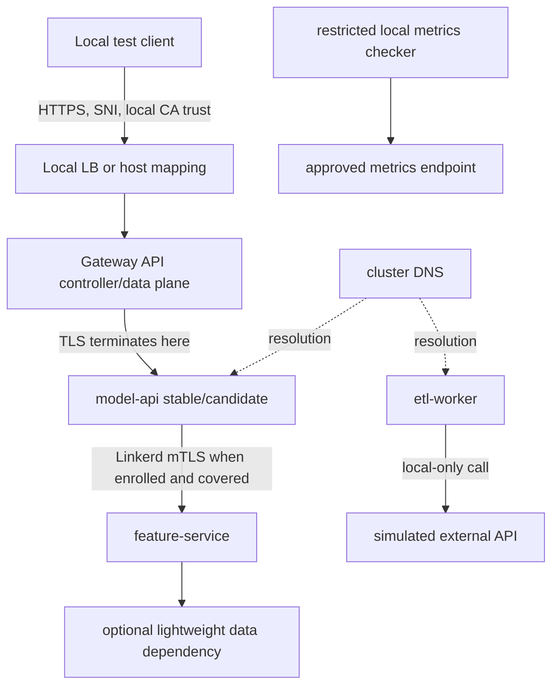

# Secure Ingress and mTLS for Data and ML APIs

## Abstract and metadata

This capstone specifies a local-only Kubernetes networking architecture for a model-scoring API, an internal feature service, a lightweight data dependency, an ETL worker calling a simulated external API, and a restricted metrics path. It integrates Gateway API, an Ingress comparison, NetworkPolicy, local PKI/cert-manager, Linkerd sidecar mTLS, weighted canary measurement, bounded retry experiments, DNS measurement, troubleshooting and SRE runbooks.

| Field | Value |
|---|---|
| Stage | Stage 2E — Production DevOps & Platform Engineering |
| Module | M04 — Kubernetes Networking, Ingress, and Service Mesh |
| Target | `Projects/01-secure-ingress-and-mtls-for-data-and-ml-apis.md` |
| Estimated active time | 24–40 hours; installation time depends on the environment |
| Resource target | Approximately 4 CPU cores, 8 GB RAM, 30 GB disk |
| Version baseline | Record actual versions; placeholders only until compatibility is checked |
| Status | DRAFT-AUDITED — human verification required |
| Authoring date | 2026-10-28; not a claim of live documentation review |

**Execution status:** This document was authored as a specification and starter bundle. No cluster was created, no command or test was run, and no measurements were collected. Results are acceptance criteria or blank templates unless explicitly labelled illustrative.

## Table of contents

1. [Source Coverage and Limitations](#source-coverage-and-limitations)
2. [Project brief and outcomes](#project-brief-and-outcomes)
3. [Prerequisites and safety](#prerequisites-and-safety)
4. [Architecture and request path](#architecture-and-request-path)
5. [Threat model and design decisions](#threat-model-and-design-decisions)
6. [Resource budget and milestones](#resource-budget-and-milestones)
7. [Embedded starter files](#embedded-starter-files)
8. [Acceptance criteria](#acceptance-criteria)
9. [Incident drills](#incident-drills)
10. [Runbooks](#runbooks)
11. [Measurements and evidence](#measurements-and-evidence)
12. [Rubric and readiness review](#rubric-and-readiness-review)
13. [Appendix A — Traceability](#appendix-a--traceability)
14. [Appendix B — Claim/source register](#appendix-b--claimsource-register)
15. [Appendix C — Ten-pass audit](#appendix-c--ten-pass-audit)
16. [Appendix D — Human verification](#appendix-d--human-verification)
17. [Appendix E — Sign-off](#appendix-e--sign-off)

## Source Coverage and Limitations

### Inspected sources

- `Roadmap(5).md`: M04 repository tree, unit ordering and target project names.
- `PROMPT-Kubernetes-Networking-Ingress-and-Service-Mesh(9).md`: available M04 syllabus-generation prompt, including capstone deliverables.
- Sibling lessons `01-kubernetes-networking-model-cni-and-pod-networking.md` through `10-network-troubleshooting-dns-latency-and-packet-loss.md`.
- `practice-questions.md`: generated M04 assessment and its stated source limitations.

### Unavailable sources

`Projects/README.md`, an existing capstone file at the exact target path, and the exact copy-paste prompt pack referenced by the workflow were not available as separate files. M01–M03 source files were not separately inspected for this task; their prerequisite boundaries are stated in the accessible M04 prompt. No unavailable file content has been inferred.

### Source decisions and open items

- **[SOURCE-SUPPORTED]** Unit 7 selects Linkerd sidecar mode for hands-on work; Unit 8 preserves it. Istio is comparison/awareness, not a second simultaneous mesh.
- **[DESIGN INFERENCE]** The baseline uses a tiny local HTTP `data-store`-style dependency only if added by the learner. This document prioritizes a lightweight feature service and local mock to fit the laptop budget. If a concrete database is mandatory in a later authoritative source, add it as a separate, budgeted extension.
- **[VERIFY]** Kubernetes/kind compatibility, CNI install method, Gateway API CRDs/controller, local LoadBalancer provider, cert-manager version and Linkerd policy/routing APIs must be verified against the learner's installed versions. No live verification was performed.
- **[OPEN — SOURCE GAP]** The exact project README and capstone source were unavailable.
- **[OPEN — EXECUTION]** All code blocks are unexecuted starter content. No manifests were applied, scripts linted, tests run or benchmarks collected.

## Project brief and outcomes

The current-state anti-pattern is direct exposure of internal services, plaintext internal calls, absent NetworkPolicy, manually copied certificates, replica-count-based canary assumptions, retries that multiply load, inefficient DNS search behavior, and no packet-path explanation. The target is a locally verifiable design with internal-only feature/data dependencies, explicit policy, local CA, staged Linkerd mTLS, identity authorization, Gateway API as the primary path, Ingress comparison, measured canary, bounded retry behavior and safe incident drills.

### Outcomes by teaching level

| Level | Outcome |
|---|---|
| L1 — Beginner | Explain Pod IP/Service IP, DNS, Gateway vs controller, TLS termination and the distinction between mTLS and authorization. |
| L2 — Intermediate | Deploy sample services, inspect endpoints/route status, validate a local certificate and test positive/negative paths. |
| L3 — Advanced | Design default-deny policies, verify Linkerd identity, measure canary split, reason about retries/timeouts and count DNS queries. |
| L4 — Expert | Defend architecture decisions, correlate evidence across layers, identify lab fidelity gaps and produce a safe rollback/readiness review. |

## Prerequisites and safety

Learners should know Linux shell, TCP/IP, DNS, HTTP/TLS, container images, CI/CD basics, Kubernetes Pods/Deployments/Services, probes, RBAC, Pod Security and context management. Read M04 Units 1–10 before attempting the integrated capstone.

Zero-budget environment: WSL2 Ubuntu or native Linux, Docker, kind, kubectl, about 4 CPU cores/8 GB RAM/30 GB disk. No managed cloud, paid service, public domain, public endpoint, public ACME account or production credential. All certificates are lab-only. Any simulated external dependency is a local mock. Never probe third-party networks or production clusters.

### Kind/WSL2 fidelity limits

- The default kind CNI may not enforce NetworkPolicy; verify a policy-capable CNI and test allow/deny behavior.
- Local LoadBalancer support needs a local implementation/helper; it is not a cloud LB.
- `extraPortMappings` are not a production ingress/LB path.
- kind does not reproduce multi-AZ networks, cloud health checks, managed NAT or production egress IP guarantees.
- `localhost` differs inside a Pod, kind node container, WSL2 and Windows.
- `tcpdump`, `tc`, `conntrack`, eBPF and `iproute2` vary by kernel/image. Use a read-only conceptual alternative if unsupported.
- Do not run Linkerd, Cilium/Hubble and a full observability stack simultaneously on the 8 GB baseline.

### Context safety

For every mutation, assert the current context equals `kind-m04-secure-net`; do not merely print it. `down`, CNI replacement, mesh removal and fault injection are destructive/disruptive. Restrict them to a throwaway cluster, preserve evidence, and verify cleanup. Never print Secret data, private keys or sensitive environment variables.

## Architecture and request path



The diagram is logical, not a packet capture. Exact NAT points, listeners, proxy placement and endpoint selection depend on the chosen CNI, local LB, Gateway controller and Linkerd release.

### Request walk

1. The local client resolves a lab hostname. Host/WSL2 resolver and port behavior may differ from native Linux.
2. Traffic reaches a local host mapping or local LoadBalancer helper. This is not a cloud LB.
3. A compatible controller reconciles `Gateway` and `HTTPRoute`. An API object without a controller does not serve traffic.
4. The gateway chooses a backend Service/EndpointSlice. Configured weights are intent; the canary script measures observed version identity.
5. If the API Pod is meshed, Linkerd proxy handling depends on actual injection/interception. Verify live Pod state.
6. The API calls `feature-service` over an internal Service. mTLS protects only the workload path actually covered by the mesh. Authentication and authorization remain separate.
7. The feature service calls its internal data dependency if enabled.
8. ETL calls only `mock-external`; no public hostname is probed.
9. Metrics remain internal and restricted to the intended local checker/scraper.

| Hop | Main control | Security statement | Evidence |
|---|---|---|---|
| Client → Gateway | local route/LB mapping | TLS server certificate is validated by the local CA; this does not imply client identity | CA-validated curl, SAN/chain and Gateway status |
| Gateway → API | Service/EndpointSlice | Backend encryption is **not assumed**; verify whether this hop is encrypted | controller docs, runtime path and TLS boundary notes |
| API → feature | Service and policy | Linkerd mTLS only if both ends and path are covered; authorization is separate | proxy/identity status, positive/negative requests |
| Feature → data | internal Service | Depends on the selected dependency; do not claim DB TLS for a mock | endpoint and policy evidence |
| ETL → mock | local Service/DNS | local simulated external path only | mock log and DNS query counts |
| Checker → metrics | internal policy | no public metrics route | allowed scraper test and denied unrelated source |

## Threat model and design decisions

Assets include API availability/integrity, internal feature/data reachability, local CA keys, mesh identity/policy and diagnostic evidence. Threats include unintended exposure, lateral movement, plaintext paths, unauthorized authenticated workloads, certificate expiry, retry amplification, DNS query amplification and evidence leakage.

| Threat | Control | Residual risk |
|---|---|---|
| Public exposure | local-only mapping; inspect Service types and Gateway listeners | host forwarding may expose unexpected interfaces |
| Lateral movement | default-deny plus narrow allows; verify CNI enforcement | selectors/labels can drift |
| Plaintext internal traffic | staged Linkerd mTLS and negative test | non-meshed paths may bypass mesh |
| Unauthorized caller | identity-based policy where supported | authentication alone is not authorization |
| Expired certificate | cert-manager lifecycle, served-cert test and expiry rule | local trust distribution remains limited |
| Retry storm | bounded retry budget, idempotent route and attempt counts | layered retries may still multiply load |
| DNS amplification | controlled local query count before/after | cache/background traffic affects counts |
| Secret leakage | no key output, restrictive file permissions | local backups/logs may retain artifacts |

### ADR-001 — CNI choice

- **Context:** kind's default networking may not enforce NetworkPolicy.
- **Decision:** choose one kind-compatible policy-enforcing CNI from current official docs; do not assume one is installed.
- **Alternatives:** use a fresh cluster with a verified CNI, or complete policy concepts read-only if compatibility fails.
- **Trade-offs:** custom CNI adds installation and rollback complexity.
- **Verification:** CNI health plus one allowed and one denied connection.
- **Reconsider when:** kernel/kind compatibility is unsupported or enforcement tests fail.
- **Status:** [VERIFY].

### ADR-002 — Gateway API vs Ingress

- **Decision:** Gateway API is primary; keep Ingress equivalent for comparison. Select controller only after maintenance/security status, compatibility and feature support checks.
- **Alternatives:** another verified controller or read-only design exercise.
- **Trade-offs:** Gateway API needs CRDs/controller; Ingress annotations are often non-portable.
- **Verification:** status conditions and local request for both paths.
- **Reconsider when:** selected implementation lacks required fields or cannot fit the lab.
- **Status:** [VERIFY] controller, CRDs and maintenance.

### ADR-003 — Service mesh

- **Decision:** Linkerd sidecar mode for hands-on work, matching Units 7/8; Istio is awareness/comparison only.
- **Alternatives:** no-mesh conceptual path if incompatible.
- **Trade-offs:** proxy resource overhead and extra debugging hops.
- **Verification:** version compatibility, proxy injection, identity, negative test and baseline/meshed measurement.
- **Reconsider when:** unsupported release or laptop budget exceeded.
- **Status:** selection source-supported; exact APIs [VERIFY].

### ADR-004 — TLS/PKI

- **Decision:** local CA and cert-manager for local ingress certificate, after API/controller compatibility check.
- **Alternatives:** manually generated local certificate for a conceptual fallback; optional Pebble only as a separate verified stretch.
- **Trade-offs:** clients must explicitly trust the local CA; this is not enterprise trust distribution.
- **Verification:** SAN/chain/expiry, trusted success and wrong-host failure.
- **Reconsider when:** chosen Gateway cannot reference the certificate as expected.
- **Status:** [VERIFY].

### ADR-005 — Egress control

- **Decision:** ETL accesses a local mock and only required Service/port plus DNS. Vanilla NetworkPolicy is treated as L3/L4, not portable FQDN policy.
- **Alternatives:** CNI-specific FQDN policy only after checking docs/CRDs.
- **Trade-offs:** mock traffic does not reproduce internet NAT.
- **Verification:** mock call allowed, unrelated egress denied, DNS query count recorded.
- **Reconsider when:** actual architecture requires a verified egress gateway or CNI extension.

## Resource budget and milestones

| Phase | Components | Resource rule |
|---|---|---|
| A | kind, CNI, apps, Gateway | minimal replicas; no mesh or full metrics stack |
| B | policy tests | remove temporary clients after tests |
| C | cert-manager/local CA | no Prometheus server required |
| D | Linkerd | no Cilium/Hubble/full observability |
| E | canary/retry/DNS | short bounded tests only |
| F | optional Cilium | separate fresh cluster after mesh stack is stopped |
| G | teardown | verify cluster, ports, processes, captures and faults are gone |

### Seven milestones

1. **Safe bootstrap (1–2 active hours):** inspect versions, choose compatible policy CNI, create named cluster, confirm nodes/CNI health. Evidence: versions and status. Cleanup: remove only verified throwaway cluster on failure.
2. **App and ingress (3–5 hours):** build/load local images, deploy apps, install verified Gateway controller, add HTTPRoute and Ingress comparison. Evidence: endpoints, route status and local response. Cleanup: remove test clients/port-forward.
3. **NetworkPolicy (3–5 hours):** confirm CNI enforcement, default-deny, DNS/app/metrics/mock allows, positive/negative matrix. Evidence: report with non-zero on drift. Cleanup: restore policy baseline.
4. **TLS lifecycle (3–5 hours):** install compatible cert-manager, local CA/certificate, SAN/chain checks, renewal test and alert rule syntax validation. Evidence: metadata only, never key material. Cleanup: remove temporary keys/certs.
5. **Linkerd (4–7 hours):** verify compatibility, install, enroll sample namespace, prove proxies, staged authenticated policy and strict mTLS, authorized/unauthorized tests. Evidence: identity and request results. Cleanup: restore only lab policy changes.
6. **Canary/resilience/DNS/drills (5–8 hours):** ≥1,000 requests, observed split, bounded retry/fault test, local mock DNS counts, six drills. Evidence: real counts. Cleanup: remove fault and captures.
7. **Readiness/teardown (3–5 hours):** five ADRs/runbooks, readiness review, close or disclose OPEN items, tear down named cluster. Evidence: readiness review and cleanup transcript.

Times are estimates, not benchmarks. Installation duration and memory use depend on host and versions. Keep a fresh-cluster path for CNI replacement; never casually replace CNI in an existing cluster.


## Embedded starter files

The code blocks below are embedded in this one Markdown document; this generation does not create separate repository files. They are starter examples, not verified execution results. Replace placeholders only after inspecting the installed versions and controller/CNI documentation.

### 1. kind configuration

This is only a cluster shell. A policy-enforcing CNI must be installed using the selected CNI's current kind-compatible instructions. Do not assume this file installs the CNI, Gateway API or a LoadBalancer.

```yaml
# File: kind-m04.yaml
kind: Cluster
apiVersion: kind.x-k8s.io/v1alpha4
name: m04-secure-net
nodes:
  - role: control-plane
    extraPortMappings:
      # Local convenience mapping, not a cloud LB or production ingress path.
      - containerPort: 30080
        hostPort: 18080
        protocol: TCP
      - containerPort: 30443
        hostPort: 18443
        protocol: TCP
  - role: worker
  - role: worker
# [VERIFY] Install the selected policy-enforcing CNI using its official kind-compatible procedure.
```

If the chosen controller requires node labels, scheduling constraints or other port mappings, add them only after checking the controller's current official instructions.

### 2. Bootstrap and context guard

```bash
# File: scripts/bootstrap.sh
#!/usr/bin/env bash
set -euo pipefail
readonly CLUSTER_NAME="m04-secure-net"
readonly EXPECTED_CONTEXT="kind-${CLUSTER_NAME}"
readonly CONFIG_FILE="${1:-kind-m04.yaml}"
fail() { printf 'ERROR: %s\n' "$*" >&2; exit 1; }

for tool in kind kubectl docker; do command -v "$tool" >/dev/null 2>&1 || fail "$tool is required"; done
[[ -f "$CONFIG_FILE" ]] || fail "Config not found: $CONFIG_FILE"
current="$(kubectl config current-context 2>/dev/null || true)"
printf 'Current context: %s\n' "${current:-<none>}"

if kind get clusters 2>/dev/null | grep -Fxq "$CLUSTER_NAME"; then
  [[ "$current" == "$EXPECTED_CONTEXT" ]] || fail "Named cluster exists but context differs; inspect manually"
  printf 'Named cluster already exists; refusing to recreate it.\n'
  exit 0
fi

printf 'About to create only kind cluster %s\n' "$CLUSTER_NAME"
read -r -p "Type CREATE-${CLUSTER_NAME} to continue: " confirmation
[[ "$confirmation" == "CREATE-${CLUSTER_NAME}" ]] || fail "Confirmation did not match"
kind create cluster --name "$CLUSTER_NAME" --config "$CONFIG_FILE"
actual="$(kubectl config current-context)"
[[ "$actual" == "$EXPECTED_CONTEXT" ]] || fail "Expected $EXPECTED_CONTEXT but current context is $actual"
kubectl cluster-info
kubectl get nodes -o wide
printf 'Cluster created. CNI/controller compatibility still needs verification.\n'
```

This script does not install a CNI, Gateway controller, cert-manager, local LoadBalancer provider or mesh. If creation partially fails, inspect `kind get clusters` and context before cleanup.

### 3. Version inventory

```bash
# File: scripts/record-versions.sh
#!/usr/bin/env bash
set -euo pipefail
out="${1:-versions.txt}"
tmp="$(mktemp)"
trap 'rm -f "$tmp"' EXIT
{
  printf '# Actual observed versions only; no compatibility approval implied.\n'
  printf 'OS_RELEASE='; . /etc/os-release; printf '%s\n' "${PRETTY_NAME:-unknown}"
  printf 'KERNEL='; uname -r
  printf 'DOCKER_CLIENT='; docker version --format '{{.Client.Version}}' 2>/dev/null || echo unavailable
  printf 'DOCKER_SERVER='; docker version --format '{{.Server.Version}}' 2>/dev/null || echo unavailable
  printf 'KIND='; kind version 2>/dev/null | head -n1 || echo unavailable
  printf 'KUBECTL_CLIENT='; kubectl version --client 2>/dev/null | head -n1 || echo unavailable
  printf 'KUBERNETES_SERVER='; kubectl version 2>/dev/null | head -n1 || echo unavailable
  printf 'PYTHON='; python3 --version 2>&1 || echo unavailable
  printf 'CURL='; curl --version 2>/dev/null | head -n1 || echo unavailable
  printf 'CNI=<record actual name/version>\nGATEWAY_API_CRDS=<record actual API versions>\n'
  printf 'GATEWAY_CONTROLLER=<record implementation/version>\nLOCAL_LB=<implementation/version or NONE>\n'
  printf 'CERT_MANAGER=<actual version>\nLINKERD=<CLI/control-plane/proxy versions>\n'
} >"$tmp"
chmod 600 "$tmp"
mv "$tmp" "$out"
printf 'Wrote %s; fill component fields from actual tools and official compatibility docs.\n' "$out"
```

The inventory is not a compatibility check. Confirm each component against official compatibility documentation.

### 4. FastAPI model-scoring API

```python
# File: apps/model_api/main.py
import os
import time
from typing import Any
import httpx
from fastapi import FastAPI, HTTPException
from fastapi.responses import PlainTextResponse
from pydantic import BaseModel

APP_VERSION = os.getenv("APP_VERSION", "stable")
FEATURE_URL = os.getenv("FEATURE_URL", "http://feature-service.ml-app.svc.cluster.local:8081")
FEATURE_TIMEOUT = float(os.getenv("FEATURE_TIMEOUT_SECONDS", "1.5"))
app = FastAPI(title="M04 Model Scoring API", version=APP_VERSION)
started = time.monotonic()

class ScoreRequest(BaseModel):
    record_id: str
    value: float

@app.get("/healthz")
def healthz() -> dict[str, str]:
    return {"status": "ok", "version": APP_VERSION}

@app.get("/readyz")
def readyz() -> dict[str, str]:
    # Process readiness, not a guarantee that all dependencies meet their SLOs.
    return {"status": "ready", "version": APP_VERSION}

@app.get("/version")
def version() -> dict[str, str]:
    return {"version": APP_VERSION}

@app.get("/features/{record_id}")
async def features(record_id: str) -> dict[str, Any]:
    try:
        async with httpx.AsyncClient(timeout=httpx.Timeout(FEATURE_TIMEOUT)) as client:
            response = await client.get(f"{FEATURE_URL}/features/{record_id}")
            response.raise_for_status()
        return {"version": APP_VERSION, "feature": response.json()}
    except httpx.HTTPError as exc:
        raise HTTPException(status_code=502, detail="feature dependency unavailable") from exc

@app.post("/score")
def score(request: ScoreRequest) -> dict[str, Any]:
    # Deterministic, idempotent demo calculation; no real model is loaded.
    return {"version": APP_VERSION, "record_id": request.record_id, "score": round(request.value * 0.5, 6)}

@app.get("/metrics", response_class=PlainTextResponse)
def metrics() -> str:
    uptime = max(0.0, time.monotonic() - started)
    return (
        "# HELP m04_model_api_up Whether the demo process is responding.\n"
        "# TYPE m04_model_api_up gauge\n"
        "m04_model_api_up 1\n"
        "# HELP m04_model_api_uptime_seconds Process uptime in seconds.\n"
        "# TYPE m04_model_api_uptime_seconds gauge\n"
        f"m04_model_api_uptime_seconds {uptime:.3f}\n"
    )
```

```text
# File: apps/model_api/requirements.txt
fastapi
uvicorn[standard]
httpx
pydantic
```

```dockerfile
# File: apps/model_api/Dockerfile
FROM python:3.12-slim
ENV PYTHONDONTWRITEBYTECODE=1 PYTHONUNBUFFERED=1
WORKDIR /app
COPY requirements.txt .
RUN pip install --no-cache-dir -r requirements.txt
COPY main.py .
RUN useradd --create-home --uid 10001 appuser
USER 10001:10001
EXPOSE 8080
CMD ["uvicorn", "main:app", "--host", "0.0.0.0", "--port", "8080"]
```

The base image tag is illustrative and not digest-pinned. Resolve an actual supported digest before treating the image as reproducible; do not invent a digest.

### 5. Internal feature service

```python
# File: apps/feature_service/main.py
from fastapi import FastAPI
app = FastAPI(title="M04 Internal Feature Service")

@app.get("/healthz")
def healthz():
    return {"status": "ok"}

@app.get("/features/{record_id}")
def feature(record_id: str):
    return {"record_id": record_id, "feature_value": 0.25, "source": "local-fixture"}
```

```text
# File: apps/feature_service/requirements.txt
fastapi
uvicorn[standard]
```

```dockerfile
# File: apps/feature_service/Dockerfile
FROM python:3.12-slim
ENV PYTHONDONTWRITEBYTECODE=1 PYTHONUNBUFFERED=1
WORKDIR /app
COPY requirements.txt .
RUN pip install --no-cache-dir -r requirements.txt
COPY main.py .
RUN useradd --create-home --uid 10001 appuser
USER 10001:10001
EXPOSE 8081
CMD ["uvicorn", "main:app", "--host", "0.0.0.0", "--port", "8081"]
```

### 6. Local simulated external API

```python
# File: apps/mock_external/main.py
from fastapi import FastAPI
app = FastAPI(title="M04 Local Simulated External API")

@app.get("/healthz")
def healthz():
    return {"status": "ok"}

@app.get("/lookup/{key}")
def lookup(key: str):
    return {"key": key, "result": "local-mock", "source": "offline-fixture"}
```

```text
# File: apps/mock_external/requirements.txt
fastapi
uvicorn[standard]
```

```dockerfile
# File: apps/mock_external/Dockerfile
FROM python:3.12-slim
ENV PYTHONDONTWRITEBYTECODE=1 PYTHONUNBUFFERED=1
WORKDIR /app
COPY requirements.txt .
RUN pip install --no-cache-dir -r requirements.txt
COPY main.py .
RUN useradd --create-home --uid 10001 appuser
USER 10001:10001
EXPOSE 8090
CMD ["uvicorn", "main:app", "--host", "0.0.0.0", "--port", "8090"]
```

### 7. ETL worker — local mock only

```python
# File: apps/etl_worker/etl_once.py
import os
import sys
import httpx

MOCK_URL = os.getenv("MOCK_URL", "http://mock-external.ml-app.svc.cluster.local:8090")
KEY = os.getenv("MOCK_KEY", "demo-record")

def main() -> int:
    try:
        with httpx.Client(timeout=httpx.Timeout(2.0)) as client:
            response = client.get(f"{MOCK_URL}/lookup/{KEY}")
            response.raise_for_status()
            print({"status": "ok", "response": response.json()})
        return 0
    except httpx.HTTPError as exc:
        print(f"ETL mock request failed: {type(exc).__name__}", file=sys.stderr)
        return 1

if __name__ == "__main__":
    raise SystemExit(main())
```

```text
# File: apps/etl_worker/requirements.txt
httpx
```

```dockerfile
# File: apps/etl_worker/Dockerfile
FROM python:3.12-slim
ENV PYTHONDONTWRITEBYTECODE=1 PYTHONUNBUFFERED=1
WORKDIR /app
COPY requirements.txt .
RUN pip install --no-cache-dir -r requirements.txt
COPY etl_once.py .
RUN useradd --create-home --uid 10001 appuser
USER 10001:10001
CMD ["python", "/app/etl_once.py"]
```

Never configure the worker to call a public host. Its sole external-like target is the in-cluster mock.

### 8. Kubernetes namespaces, service accounts, app Deployments and Services

Images below are local placeholders. Build/load them into the named kind cluster or use a verified local registry before applying. This manifest provides the stable/candidate API, feature service and local mock; a real database and scraper are optional extensions and must be added with matching policies if chosen.

```yaml
# File: manifests/apps.yaml
apiVersion: v1
kind: Namespace
metadata:
  name: ml-app
  labels:
    app.kubernetes.io/part-of: m04-secure-net
---
apiVersion: v1
kind: Namespace
metadata:
  name: ml-edge
  labels:
    app.kubernetes.io/part-of: m04-secure-net
---
apiVersion: v1
kind: Namespace
metadata:
  name: ml-observe
  labels:
    app.kubernetes.io/part-of: m04-secure-net
---
apiVersion: v1
kind: ServiceAccount
metadata:
  name: model-api
  namespace: ml-app
automountServiceAccountToken: false
---
apiVersion: v1
kind: ServiceAccount
metadata:
  name: feature-service
  namespace: ml-app
automountServiceAccountToken: false
---
apiVersion: v1
kind: ServiceAccount
metadata:
  name: etl-worker
  namespace: ml-app
automountServiceAccountToken: false
---
apiVersion: v1
kind: ServiceAccount
metadata:
  name: mock-external
  namespace: ml-app
automountServiceAccountToken: false
---
apiVersion: apps/v1
kind: Deployment
metadata:
  name: model-api-stable
  namespace: ml-app
  labels: {app: model-api, version: stable}
spec:
  replicas: 1
  selector:
    matchLabels: {app: model-api, version: stable}
  template:
    metadata:
      labels: {app: model-api, version: stable}
    spec:
      serviceAccountName: model-api
      automountServiceAccountToken: false
      securityContext:
        runAsNonRoot: true
        runAsUser: 10001
        seccompProfile: {type: RuntimeDefault}
      containers:
        - name: api
          image: m04-model-api:local
          imagePullPolicy: IfNotPresent
          ports: [{name: http, containerPort: 8080}]
          env:
            - {name: APP_VERSION, value: stable}
            - {name: FEATURE_URL, value: "http://feature-service.ml-app.svc.cluster.local:8081"}
          readinessProbe:
            httpGet: {path: /readyz, port: http}
            initialDelaySeconds: 2
            periodSeconds: 5
          livenessProbe:
            httpGet: {path: /healthz, port: http}
            initialDelaySeconds: 5
            periodSeconds: 10
          resources:
            requests: {cpu: 50m, memory: 96Mi}
            limits: {cpu: 300m, memory: 256Mi}
          securityContext:
            allowPrivilegeEscalation: false
            readOnlyRootFilesystem: true
            capabilities: {drop: ["ALL"]}
---
apiVersion: apps/v1
kind: Deployment
metadata:
  name: model-api-candidate
  namespace: ml-app
  labels: {app: model-api, version: candidate}
spec:
  replicas: 1
  selector:
    matchLabels: {app: model-api, version: candidate}
  template:
    metadata:
      labels: {app: model-api, version: candidate}
    spec:
      serviceAccountName: model-api
      automountServiceAccountToken: false
      securityContext:
        runAsNonRoot: true
        runAsUser: 10001
        seccompProfile: {type: RuntimeDefault}
      containers:
        - name: api
          image: m04-model-api:local
          imagePullPolicy: IfNotPresent
          ports: [{name: http, containerPort: 8080}]
          env:
            - {name: APP_VERSION, value: candidate}
            - {name: FEATURE_URL, value: "http://feature-service.ml-app.svc.cluster.local:8081"}
          readinessProbe:
            httpGet: {path: /readyz, port: http}
            initialDelaySeconds: 2
            periodSeconds: 5
          livenessProbe:
            httpGet: {path: /healthz, port: http}
            initialDelaySeconds: 5
            periodSeconds: 10
          resources:
            requests: {cpu: 50m, memory: 96Mi}
            limits: {cpu: 300m, memory: 256Mi}
          securityContext:
            allowPrivilegeEscalation: false
            readOnlyRootFilesystem: true
            capabilities: {drop: ["ALL"]}
---
apiVersion: v1
kind: Service
metadata: {name: model-api-stable, namespace: ml-app}
spec:
  selector: {app: model-api, version: stable}
  ports: [{name: http, port: 8080, targetPort: http}]
---
apiVersion: v1
kind: Service
metadata: {name: model-api-candidate, namespace: ml-app}
spec:
  selector: {app: model-api, version: candidate}
  ports: [{name: http, port: 8080, targetPort: http}]
---
apiVersion: apps/v1
kind: Deployment
metadata: {name: feature-service, namespace: ml-app}
spec:
  replicas: 1
  selector:
    matchLabels: {app: feature-service}
  template:
    metadata:
      labels: {app: feature-service}
    spec:
      serviceAccountName: feature-service
      automountServiceAccountToken: false
      securityContext:
        runAsNonRoot: true
        runAsUser: 10001
        seccompProfile: {type: RuntimeDefault}
      containers:
        - name: feature
          image: m04-feature-service:local
          imagePullPolicy: IfNotPresent
          ports: [{name: http, containerPort: 8081}]
          readinessProbe: {httpGet: {path: /healthz, port: http}}
          livenessProbe: {httpGet: {path: /healthz, port: http}}
          resources:
            requests: {cpu: 25m, memory: 64Mi}
            limits: {cpu: 200m, memory: 160Mi}
          securityContext:
            allowPrivilegeEscalation: false
            readOnlyRootFilesystem: true
            capabilities: {drop: ["ALL"]}
---
apiVersion: v1
kind: Service
metadata: {name: feature-service, namespace: ml-app}
spec:
  selector: {app: feature-service}
  ports: [{name: http, port: 8081, targetPort: http}]
---
apiVersion: apps/v1
kind: Deployment
metadata: {name: mock-external, namespace: ml-app}
spec:
  replicas: 1
  selector:
    matchLabels: {app: mock-external}
  template:
    metadata:
      labels: {app: mock-external}
    spec:
      serviceAccountName: mock-external
      automountServiceAccountToken: false
      securityContext:
        runAsNonRoot: true
        runAsUser: 10001
        seccompProfile: {type: RuntimeDefault}
      containers:
        - name: mock
          image: m04-mock-external:local
          imagePullPolicy: IfNotPresent
          ports: [{name: http, containerPort: 8090}]
          readinessProbe: {httpGet: {path: /healthz, port: http}}
          resources:
            requests: {cpu: 20m, memory: 48Mi}
            limits: {cpu: 150m, memory: 128Mi}
          securityContext:
            allowPrivilegeEscalation: false
            readOnlyRootFilesystem: true
            capabilities: {drop: ["ALL"]}
---
apiVersion: v1
kind: Service
metadata: {name: mock-external, namespace: ml-app}
spec:
  selector: {app: mock-external}
  ports: [{name: http, port: 8090, targetPort: http}]
```

### 8a. Optional lightweight data dependency

The following local fixture closes the feature-service → data dependency path without a database server. It is intentionally a tiny HTTP fixture, not a production database or durable store.

```python
# File: apps/data_store/main.py
from fastapi import FastAPI
app = FastAPI(title="M04 Local Data Fixture")

@app.get("/healthz")
def healthz():
    return {"status": "ok"}

@app.get("/records/{record_id}")
def record(record_id: str):
    return {"record_id": record_id, "payload": {"label": "local-fixture"}, "durable": False}
```

```text
# File: apps/data_store/requirements.txt
fastapi
uvicorn[standard]
```

```dockerfile
# File: apps/data_store/Dockerfile
FROM python:3.12-slim
ENV PYTHONDONTWRITEBYTECODE=1 PYTHONUNBUFFERED=1
WORKDIR /app
COPY requirements.txt .
RUN pip install --no-cache-dir -r requirements.txt
COPY main.py .
RUN useradd --create-home --uid 10001 appuser
USER 10001:10001
EXPOSE 8091
CMD ["uvicorn", "main:app", "--host", "0.0.0.0", "--port", "8091"]
```

```yaml
# File: manifests/data-store.yaml
apiVersion: v1
kind: ServiceAccount
metadata: {name: data-store, namespace: ml-app}
automountServiceAccountToken: false
---
apiVersion: apps/v1
kind: Deployment
metadata: {name: data-store, namespace: ml-app}
spec:
  replicas: 1
  selector:
    matchLabels: {app: data-store}
  template:
    metadata:
      labels: {app: data-store}
    spec:
      serviceAccountName: data-store
      automountServiceAccountToken: false
      securityContext:
        runAsNonRoot: true
        runAsUser: 10001
        seccompProfile: {type: RuntimeDefault}
      containers:
        - name: data-store
          image: m04-data-store:local
          imagePullPolicy: IfNotPresent
          ports: [{name: http, containerPort: 8091}]
          readinessProbe: {httpGet: {path: /healthz, port: http}}
          livenessProbe: {httpGet: {path: /healthz, port: http}}
          resources:
            requests: {cpu: 20m, memory: 48Mi}
            limits: {cpu: 100m, memory: 128Mi}
          securityContext:
            allowPrivilegeEscalation: false
            readOnlyRootFilesystem: true
            capabilities: {drop: ["ALL"]}
---
apiVersion: v1
kind: Service
metadata: {name: data-store, namespace: ml-app}
spec:
  selector: {app: data-store}
  ports: [{name: http, port: 8091, targetPort: http}]
```

To make this path live, update the feature service in your working copy to call `http://data-store.ml-app.svc.cluster.local:8091`, add the narrow feature-service → data-store egress and data-store ingress rules, and test both the allowed path and direct model-api → data-store denial. Do not claim this path works until those changes are applied and tested.

### Local image build/load workflow

Run this only from your own working directory containing the copied starter files. It builds local images and loads them into the named disposable cluster. Check Docker's active context first and stop if the context is unexpected.

```bash
# File: commands/build-load-local-images.sh
#!/usr/bin/env bash
set -euo pipefail
readonly CLUSTER="m04-secure-net"
readonly EXPECTED_CONTEXT="kind-${CLUSTER}"
[[ "$(kubectl config current-context)" == "$EXPECTED_CONTEXT" ]] || {
  echo "Wrong Kubernetes context" >&2; exit 2;
}
[[ "$(kind get clusters | grep -Fx "$CLUSTER" || true)" == "$CLUSTER" ]] || {
  echo "Named kind cluster does not exist" >&2; exit 2;
}
docker context show
printf 'Confirm the Docker context above targets the intended local daemon before proceeding.\n'
read -r -p "Type BUILD-LOAD-${CLUSTER} to continue: " confirm
[[ "$confirm" == "BUILD-LOAD-${CLUSTER}" ]] || exit 2

docker build -t m04-model-api:local apps/model_api
docker build -t m04-feature-service:local apps/feature_service
docker build -t m04-mock-external:local apps/mock_external
docker build -t m04-etl-worker:local apps/etl_worker
docker build -t m04-data-store:local apps/data_store
kind load docker-image m04-model-api:local --name "$CLUSTER"
kind load docker-image m04-feature-service:local --name "$CLUSTER"
kind load docker-image m04-mock-external:local --name "$CLUSTER"
kind load docker-image m04-etl-worker:local --name "$CLUSTER"
kind load docker-image m04-data-store:local --name "$CLUSTER"
```

### 9. ETL Job and DNS tuning template

```yaml
# File: manifests/etl-job.yaml
apiVersion: batch/v1
kind: Job
metadata:
  name: etl-once
  namespace: ml-app
spec:
  backoffLimit: 0
  activeDeadlineSeconds: 30
  template:
    metadata:
      labels: {app: etl-worker}
    spec:
      restartPolicy: Never
      serviceAccountName: etl-worker
      automountServiceAccountToken: false
      securityContext:
        runAsNonRoot: true
        runAsUser: 10001
        seccompProfile: {type: RuntimeDefault}
      dnsPolicy: ClusterFirst
      dnsConfig:
        options:
          # Hypothesis to test, not a universal setting.
          - {name: ndots, value: "2"}
      containers:
        - name: etl
          image: m04-etl-worker:local
          imagePullPolicy: IfNotPresent
          command: ["python", "/app/etl_once.py"]
          env:
            - {name: MOCK_URL, value: "http://mock-external.ml-app.svc.cluster.local:8090"}
          resources:
            requests: {cpu: 20m, memory: 48Mi}
            limits: {cpu: 100m, memory: 128Mi}
          securityContext:
            allowPrivilegeEscalation: false
            readOnlyRootFilesystem: true
            capabilities: {drop: ["ALL"]}
```

Measure actual resolver behavior before/after. A trailing-dot FQDN and `ndots` change are alternatives to test, not automatic improvements. Record cache conditions and use only the local mock.

### 10. Gateway API and Ingress comparison

**[VERIFY before applying]** Install Gateway API CRDs and a controller compatible with the installed Kubernetes release. Confirm exact API versions, GatewayClass, listener certificate integration, route status semantics and current maintenance/conformance. The HTTPRoute below is a schema-shaped template; validate against installed CRDs.

```yaml
# File: manifests/gateway/httproute.template.yaml
# [VERIFY] Confirm API version and fields against installed Gateway API CRDs.
apiVersion: gateway.networking.k8s.io/v1
kind: HTTPRoute
metadata:
  name: model-api
  namespace: ml-app
spec:
  parentRefs:
    - name: m04-gateway
      namespace: ml-edge
  hostnames: ["model.m04.test"]
  rules:
    - matches:
        - path: {type: PathPrefix, value: /}
      backendRefs:
        - {name: model-api-stable, port: 8080, weight: 90}
        - {name: model-api-candidate, port: 8080, weight: 10}
```

The `Gateway` and `GatewayClass` resources are controller-sensitive and intentionally not guessed. Create them from the selected controller's official docs. Confirm the controller supports the required listener, TLS secret and weighted backend features.

```yaml
# File: manifests/ingress/ingress-comparison.template.yaml
# [VERIFY] Confirm an installed Ingress controller and supported API version/class.
apiVersion: networking.k8s.io/v1
kind: Ingress
metadata:
  name: model-api-comparison
  namespace: ml-app
spec:
  ingressClassName: "<VERIFIED-INGRESS-CLASS>"
  tls:
    - hosts: ["model-ingress.m04.test"]
      secretName: model-api-tls
  rules:
    - host: model-ingress.m04.test
      http:
        paths:
          - path: /
            pathType: Prefix
            backend:
              service:
                name: model-api-stable
                port: {number: 8080}
```

The Ingress example uses stable only. Weighted routing is tested through Gateway API if supported. Ingress annotations are omitted because they are implementation-specific. Check the chosen controller's maintenance/security status, HTTP/2/gRPC/streaming behavior, timeouts and feature support.


### 11. NetworkPolicy default deny and required paths

**Precondition:** verify that the chosen CNI enforces Kubernetes NetworkPolicy. Confirm the actual DNS Pod labels/namespace before applying. The following is a baseline to review, not a claim that policy is already enforced.

```yaml
# File: manifests/policy/default-deny-and-minimum-allows.yaml
apiVersion: networking.k8s.io/v1
kind: NetworkPolicy
metadata: {name: default-deny-ingress, namespace: ml-app}
spec:
  podSelector: {}
  policyTypes: ["Ingress"]
---
apiVersion: networking.k8s.io/v1
kind: NetworkPolicy
metadata: {name: default-deny-egress, namespace: ml-app}
spec:
  podSelector: {}
  policyTypes: ["Egress"]
---
apiVersion: networking.k8s.io/v1
kind: NetworkPolicy
metadata: {name: allow-api-to-feature-ingress, namespace: ml-app}
spec:
  podSelector:
    matchLabels: {app: feature-service}
  policyTypes: ["Ingress"]
  ingress:
    - from:
        - podSelector:
            matchLabels: {app: model-api}
      ports:
        - {protocol: TCP, port: 8081}
---
apiVersion: networking.k8s.io/v1
kind: NetworkPolicy
metadata: {name: allow-api-to-feature-egress, namespace: ml-app}
spec:
  podSelector:
    matchLabels: {app: model-api}
  policyTypes: ["Egress"]
  egress:
    - to:
        - podSelector:
            matchLabels: {app: feature-service}
      ports:
        - {protocol: TCP, port: 8081}
---
apiVersion: networking.k8s.io/v1
kind: NetworkPolicy
metadata: {name: allow-etl-to-mock-ingress, namespace: ml-app}
spec:
  podSelector:
    matchLabels: {app: mock-external}
  policyTypes: ["Ingress"]
  ingress:
    - from:
        - podSelector:
            matchLabels: {app: etl-worker}
      ports:
        - {protocol: TCP, port: 8090}
---
apiVersion: networking.k8s.io/v1
kind: NetworkPolicy
metadata: {name: allow-etl-to-mock-egress, namespace: ml-app}
spec:
  podSelector:
    matchLabels: {app: etl-worker}
  policyTypes: ["Egress"]
  egress:
    - to:
        - podSelector:
            matchLabels: {app: mock-external}
      ports:
        - {protocol: TCP, port: 8090}
---
apiVersion: networking.k8s.io/v1
kind: NetworkPolicy
metadata: {name: allow-cluster-dns-egress, namespace: ml-app}
spec:
  podSelector: {}
  policyTypes: ["Egress"]
  egress:
    # [VERIFY] Namespace/Pod labels must match the actual CoreDNS deployment.
    - to:
        - namespaceSelector:
            matchLabels: {kubernetes.io/metadata.name: kube-system}
          podSelector:
            matchLabels: {k8s-app: kube-dns}
      ports:
        - {protocol: UDP, port: 53}
        - {protocol: TCP, port: 53}
```

The baseline does not include a database Deployment or metrics scraper Deployment. If one is selected, add its Service, ServiceAccount, resource bounds, probes and matching source/destination policies. Likewise, the Gateway controller may live in another namespace and require a controller-specific source rule; inspect actual labels and path rather than guessing them. Default-deny is not accepted until the positive and negative matrix passes.

| Source | Destination | Protocol/port | Expected | Rationale |
|---|---|---|---|---|
| Local client | Gateway listener | TCP/HTTPS | Allow | Controlled local ingress |
| Gateway data plane | model API stable/candidate | TCP/8080 | Allow | Routed backend |
| model API | feature service | TCP/8081 | Allow | Required internal call |
| Unauthorized test Pod | feature service | TCP/8081 | Deny | Lateral-movement negative test |
| Feature service | optional data dependency | verified port | Allow only if enabled | Minimum dependency path |
| model API | optional data dependency directly | verified port | Deny by default | Preserve service boundary unless explicitly justified |
| ETL worker | mock-external | TCP/8090 | Allow | Local simulated external API |
| ETL worker | unrelated destination | test port | Deny | Egress restriction |
| App Pods | actual cluster DNS endpoint | UDP/TCP 53 | Allow | Name resolution |
| Approved scraper | metrics target | actual port | Allow | Restricted monitoring |
| Arbitrary Pod | metrics target | actual port | Deny | Prevent broad metrics access |

### 12. Policy matrix test harness

This harness fails closed until actual positive/negative cases have been implemented against verified source Pod identities. That is deliberate: a placeholder must not report a false green result.

```bash
# File: scripts/matrix-test.sh
#!/usr/bin/env bash
set -euo pipefail
readonly EXPECTED_CONTEXT="kind-m04-secure-net"
readonly NS="ml-app"
fail() { printf 'ERROR: %s\n' "$*" >&2; exit 2; }

actual="$(kubectl config current-context)"
[[ "$actual" == "$EXPECTED_CONTEXT" ]] || fail "Wrong context: $actual"
kubectl get namespace "$NS" >/dev/null
kubectl get networkpolicy -n "$NS" >/dev/null
printf 'Policy objects exist, but object existence does not prove enforcement.\n'
printf 'Implement tests for every allow/deny row using verified test identities.\n'
printf 'Fail-closed status: matrix cases are not implemented in this starter.\n'
exit 2
```

Before declaring this test complete, add each matrix case to a disposable working copy. Each test must time out, record expected vs observed, and exit non-zero on missing resources or mismatch. Include DNS over UDP and TCP where required by actual resolver behavior.

### 13. Local CA and cert-manager templates

Use the installed cert-manager docs for exact API version and supported fields. These templates must be validated against installed CRDs before applying. Do not use public ACME or real credentials.

```yaml
# File: manifests/tls/local-ca.template.yaml
# [VERIFY] Confirm apiVersion and fields for the installed cert-manager release.
apiVersion: cert-manager.io/v1
kind: Issuer
metadata: {name: m04-selfsigned, namespace: ml-edge}
spec:
  selfSigned: {}
---
apiVersion: cert-manager.io/v1
kind: Certificate
metadata: {name: m04-local-ca, namespace: ml-edge}
spec:
  isCA: true
  commonName: "M04 Local Lab CA - NOT FOR PRODUCTION"
  secretName: m04-local-ca-secret
  privateKey:
    algorithm: ECDSA
    size: 256
  issuerRef:
    name: m04-selfsigned
    kind: Issuer
---
apiVersion: cert-manager.io/v1
kind: Issuer
metadata: {name: m04-local-ca-issuer, namespace: ml-edge}
spec:
  ca:
    secretName: m04-local-ca-secret
---
apiVersion: cert-manager.io/v1
kind: Certificate
metadata: {name: model-api-tls, namespace: ml-edge}
spec:
  secretName: model-api-tls
  issuerRef:
    name: m04-local-ca-issuer
    kind: Issuer
  dnsNames: ["model.m04.test", "model-ingress.m04.test"]
  duration: 24h
  renewBefore: 8h
  privateKey:
    rotationPolicy: Always
```

**[VERIFY]** Check duration/renewBefore constraints, private-key rotation semantics, Secret namespace/reference behavior and Gateway controller certificate integration. A self-signed issuer plus local CA is a training pattern, not a production PKI recommendation.

Certificate metadata inspection must not print private keys:

```bash
# Read-only; certificate file must be a public certificate, not a private key.
openssl x509 -in local-certificate.pem -noout -subject -issuer -dates -ext subjectAltName
```

Use a trusted request with correct hostname/SNI, for example after mapping the verified listener to localhost:

```bash
curl --fail --show-error --cacert ./m04-local-ca.crt \
  --resolve model.m04.test:18443:127.0.0.1 \
  https://model.m04.test:18443/version
```

The exact port depends on the selected controller and local path. The negative test must fail for a deliberately wrong hostname or untrusted CA. Do not use `curl -k` as a solution.

#### Certificate expiry alert rule

```yaml
# File: manifests/observability/certificate-expiry.rules.yaml
# [VERIFY] Metric name and labels must match the installed cert-manager release/configuration.
groups:
  - name: m04-certificate-lifecycle
    rules:
      - alert: M04CertificateExpiringSoon
        expr: certmanager_certificate_expiration_timestamp_seconds - time() < 7 * 24 * 60 * 60
        for: 10m
        labels:
          severity: warning
          scope: local-lab
        annotations:
          summary: "M04 lab certificate expires within seven days"
          description: "Check Certificate status, issuer readiness and the certificate actually served by the Gateway."
```

Validate the rule with a compatible Prometheus rule checker if available. If no checker is installed, leave syntax validation OPEN; do not claim it passed. Verify the metric name against installed cert-manager documentation/metrics.

#### Renewal test

1. Record Certificate/Issuer status and public certificate metadata.
2. Use the installed cert-manager-supported renewal trigger; do not guess a command or alter system clocks.
3. Inspect reconciliation events and metadata without printing Secret contents.
4. Verify the served certificate changes and the trusted request still succeeds.
5. Record detection/recovery times. If a safe renewal trigger cannot be verified, mark the test OPEN and document the reconciliation flow.

### 14. Linkerd mTLS and authorization

The selected hands-on mesh is Linkerd sidecar mode, matching Units 7 and 8. Do not copy an unverified policy manifest from another release.

1. Verify CLI/control-plane/proxy versions and Kubernetes compatibility.
2. Install using current official instructions in the throwaway cluster.
3. Enroll only `ml-app` initially and inspect live Pods to prove injection.
4. Record baseline request success, latency and resource use.
5. Inspect the actual workload identities with the selected release's supported tools.
6. Add an identity-based authorization policy from the selected release's official API; restrict feature-service to the intended model API identity and required path/port semantics supported by that release.
7. Verify an authorized meshed request succeeds and a non-meshed or unauthorized request fails for the documented reason.
8. Transition to strict mTLS in the smallest supported scope, following the current release's rollout guidance.
9. Record supported identity/telemetry evidence for the encrypted hop. Packet capture showing ciphertext alone does not prove peer identity or authorization.
10. Keep a rollback to the last known-good policy for the lab namespace.

**[VERIFY — OPEN]** Exact Linkerd policy YAML/CLI flags are not asserted because no release was selected and no live official docs were checked. Before implementation, use the official Linkerd policy docs and installed CRD schema, record the exact source, and validate positive/negative tests. Do not substitute Istio `PeerAuthentication` or `AuthorizationPolicy` resources.

### 15. Canary measurement script

This script measures actual response version counts from a local Gateway endpoint. It requires a correct CA file and an endpoint that returns `{"version":"stable"}` or `{"version":"candidate"}`. It is not a test result until executed.

```bash
# File: scripts/canary-test.sh
#!/usr/bin/env bash
set -euo pipefail
readonly EXPECTED_CONTEXT="kind-m04-secure-net"
readonly URL="${CANARY_URL:-https://model.m04.test:18443/version}"
readonly CA_FILE="${CA_FILE:-./m04-local-ca.crt}"
readonly REQUESTS="${REQUESTS:-1000}"
readonly STABLE_WEIGHT="${STABLE_WEIGHT:-90}"
readonly CANDIDATE_WEIGHT="${CANDIDATE_WEIGHT:-10}"
fail() { printf 'ERROR: %s\n' "$*" >&2; exit 2; }

[[ "$(kubectl config current-context)" == "$EXPECTED_CONTEXT" ]] || fail "Wrong context"
command -v curl >/dev/null || fail "curl required"
command -v python3 >/dev/null || fail "python3 required"
[[ -r "$CA_FILE" ]] || fail "CA unreadable: $CA_FILE"
[[ "$REQUESTS" =~ ^[0-9]+$ ]] && (( REQUESTS >= 1000 && REQUESTS <= 5000 )) || fail "REQUESTS must be 1000..5000"
[[ "$STABLE_WEIGHT" =~ ^[0-9]+$ && "$CANDIDATE_WEIGHT" =~ ^[0-9]+$ ]] || fail "weights must be integers"
(( STABLE_WEIGHT + CANDIDATE_WEIGHT == 100 )) || fail "weights must sum to 100"

stable=0; candidate=0; unknown=0
for ((i=1; i<=REQUESTS; i++)); do
  body="$(curl --silent --show-error --fail --cacert "$CA_FILE" \
    --connect-timeout 2 --max-time 5 "$URL")" || {
      printf 'Request %s failed; aborting rather than hiding errors.\n' "$i" >&2
      exit 1
    }
  version="$(printf '%s' "$body" | python3 -c 'import json,sys; print(json.load(sys.stdin).get("version","unknown"))')"
  case "$version" in
    stable) stable=$((stable+1)) ;;
    candidate) candidate=$((candidate+1)) ;;
    *) unknown=$((unknown+1)) ;;
  esac
done

python3 - "$REQUESTS" "$STABLE_WEIGHT" "$CANDIDATE_WEIGHT" "$stable" "$candidate" "$unknown" <<'PY'
import sys
n, sw, cw, stable, candidate, unknown = map(int, sys.argv[1:])
sp, cp = 100*stable/n, 100*candidate/n
print(f"total={n} stable={stable} candidate={candidate} unknown={unknown}")
print(f"stable_pct={sp:.3f} candidate_pct={cp:.3f}")
print(f"stable_abs_error_pp={abs(sp-sw):.3f} candidate_abs_error_pp={abs(cp-cw):.3f}")
print("Compare with the predeclared threshold; discuss sampling and connection reuse.")
PY
```

**Acceptance:** at least 1,000 successful requests, no unknown version responses, failed requests separately reported, split error calculated. A starting ±5 percentage-point threshold is a **[DESIGN INFERENCE]**, not a guarantee. Sticky connections, persistence and balancing semantics may affect counts. Repeat the run and disclose measurement noise.

### 16. Bounded retry/fault test

The `/score` endpoint is deliberately idempotent. Do not retry arbitrary writes. Configure mesh retries only through the selected Linkerd release's verified API. The following script bounds client attempts; it does **not** prove mesh retry behavior. Count backend arrivals separately for the mesh experiment.

```python
# File: scripts/retry-budget-test.py
import json, os, sys, time, urllib.error, urllib.request

url = os.getenv("FAULT_URL", "http://127.0.0.1:18080/score")
max_attempts = int(os.getenv("MAX_ATTEMPTS", "2"))
deadline = float(os.getenv("DEADLINE_SECONDS", "2.0"))
if max_attempts < 1 or max_attempts > 2:
    print("MAX_ATTEMPTS must be 1 or 2", file=sys.stderr)
    raise SystemExit(2)

payload = json.dumps({"record_id": "lab-1", "value": 2.0}).encode()
start = time.monotonic()
attempts = 0
last_error = None
while attempts < max_attempts and time.monotonic() - start < deadline:
    attempts += 1
    request = urllib.request.Request(
        url, data=payload, headers={"Content-Type": "application/json"}, method="POST"
    )
    try:
        with urllib.request.urlopen(request, timeout=max(0.1, deadline-(time.monotonic()-start))) as response:
            print(json.dumps({"status": response.status, "attempts": attempts,
                              "elapsed_seconds": round(time.monotonic()-start, 3)}))
            raise SystemExit(0)
    except (urllib.error.URLError, TimeoutError) as exc:
        last_error = type(exc).__name__
        if attempts < max_attempts:
            time.sleep(min(0.1, max(0.0, deadline-(time.monotonic()-start))))
print(json.dumps({"result": "failed_within_budget", "attempts": attempts,
                  "elapsed_seconds": round(time.monotonic()-start, 3),
                  "last_error_type": last_error}))
raise SystemExit(1)
```

Example policy budget for a local experiment: one initial attempt plus at most one retry for a selected transient failure, a two-second overall caller deadline, and a shorter per-try budget. This is a test value, not a universal production recommendation. Acceptance requires backend-observed attempts to stay within the declared budget and a normal request to succeed after the fault is removed.

### 17. DNS query measurement

```bash
# File: scripts/dns-measurement.sh
#!/usr/bin/env bash
set -euo pipefail
readonly EXPECTED_CONTEXT="kind-m04-secure-net"
[[ "$(kubectl config current-context)" == "$EXPECTED_CONTEXT" ]] || {
  echo "Wrong context; expected $EXPECTED_CONTEXT" >&2; exit 2;
}
kubectl get namespace ml-app >/dev/null
echo "Target only: mock-external.ml-app.svc.cluster.local"
echo "Use identical ETL call count, resolver, cache conditions and observation window."
echo "Count queries from verified CoreDNS metrics/logs or a short lab-only capture."
echo "Do not query a public hostname or claim reduction without before/after counts."
```

| Run | ETL calls | DNS query count | Queries/call | Cache/resolver notes |
|---|---:|---:|---:|---|
| Baseline | TO BE MEASURED | TO BE MEASURED | TO BE MEASURED | TO BE MEASURED |
| Tuned `dnsConfig` | TO BE MEASURED | TO BE MEASURED | TO BE MEASURED | TO BE MEASURED |

`queries/call = observed DNS queries / completed ETL calls`. If baseline is non-zero, `reduction % = 100 × (baseline ratio − tuned ratio) / baseline ratio`. Repeat trials; zero or negative reduction is a valid outcome. Verify whether the chosen CoreDNS metrics/logging path exists before relying on it.

### 18. `netcheck` script

```bash
# File: scripts/netcheck.sh
#!/usr/bin/env bash
set -euo pipefail
readonly EXPECTED_CONTEXT="kind-m04-secure-net"
readonly APP_NS="ml-app"
failures=0
skips=0
check() {
  local label="$1"; shift
  printf '[CHECK] %s\n' "$label"
  if "$@"; then printf '[PASS] %s\n' "$label"
  else printf '[FAIL] %s\n' "$label"; failures=$((failures+1)); fi
}
skip() { printf '[SKIP] %s\n' "$*"; skips=$((skips+1)); }
actual="$(kubectl config current-context 2>/dev/null || true)"
[[ "$actual" == "$EXPECTED_CONTEXT" ]] || {
  printf '[FAIL] expected context=%s actual=%s\n' "$EXPECTED_CONTEXT" "${actual:-<none>}" >&2
  exit 2
}
check "namespace exists" kubectl get namespace "$APP_NS"
check "nodes listed" kubectl get nodes
check "stable Service exists" kubectl get service model-api-stable -n "$APP_NS"
check "feature Service exists" kubectl get service feature-service -n "$APP_NS"
check "feature EndpointSlice exists" bash -c 'kubectl get endpointslice -n ml-app -l kubernetes.io/service-name=feature-service -o name | grep -q .'
if kubectl get httproute -A >/dev/null 2>&1; then
  echo "[PASS] HTTPRoute API query available"
else
  echo "[FAIL] HTTPRoute API unavailable or query failed"
  failures=$((failures+1))
fi
if command -v curl >/dev/null 2>&1; then echo "[INFO] curl available; run CA-validated request separately"
else skip "curl unavailable; TLS test not performed"; fi
if command -v dig >/dev/null 2>&1; then echo "[INFO] dig available; use only approved local DNS target"
else skip "dig unavailable; use approved Pod resolver test"; fi
if command -v tcpdump >/dev/null 2>&1; then echo "[INFO] tcpdump available; no capture started"
else skip "tcpdump unavailable; packet capture not performed"; fi
printf 'SUMMARY failures=%s skips=%s\n' "$failures" "$skips"
(( failures == 0 )) || exit 1
```

This script does not prove TLS, mTLS, NetworkPolicy enforcement, canary distribution or SLOs. The HTTPRoute query is a required check during the Gateway milestone; missing CRDs are not silently treated as success. Optional tools degrade to SKIP, not PASS. No capture is started by default.

### 19. Makefile — required target names

The targets exist, but several deliberately fail closed until version-specific test implementations are completed. Do not grade target existence as a successful test.

```makefile
# File: Makefile
SHELL := /usr/bin/env bash
.SHELLFLAGS := -euo pipefail -c
EXPECTED_CONTEXT := kind-m04-secure-net
CLUSTER_NAME := m04-secure-net
.PHONY: up deploy verify matrix-test cert-test canary-test chaos down guard

guard:
	@actual="$$(kubectl config current-context 2>/dev/null || true)"; \
	[[ "$$actual" == "$(EXPECTED_CONTEXT)" ]] || { \
	  echo "Refusing: context=$$actual expected=$(EXPECTED_CONTEXT)" >&2; exit 2; }

up:
	@./scripts/bootstrap.sh kind-m04.yaml

deploy: guard
	@echo "Review image availability, CNI enforcement and controller/CRD versions first."
	@echo "This starter deliberately does not auto-apply version-sensitive manifests."
	@exit 2

verify: guard
	@./scripts/netcheck.sh

matrix-test: guard
	@./scripts/matrix-test.sh

cert-test: guard
	@echo "Run only after cert-manager/Gateway API versions and local CA integration are verified."
	@echo "Capture Certificate status, SAN/chain/expiry, trusted success and wrong-host failure."
	@exit 2

canary-test: guard
	@./scripts/canary-test.sh

chaos: guard
	@echo "No fault is injected automatically. Review target, duration, rollback and cleanup first."
	@exit 2

down:
	@actual="$$(kubectl config current-context 2>/dev/null || true)"; \
	[[ "$$actual" == "$(EXPECTED_CONTEXT)" ]] || { \
	  echo "Refusing: context=$$actual expected=$(EXPECTED_CONTEXT)" >&2; exit 2; }; \
	echo "⚠ DESTRUCTIVE: removes only named throwaway cluster $(CLUSTER_NAME)"; \
	read -r -p "Type DELETE-$(CLUSTER_NAME) to continue: " confirm; \
	[[ "$$confirm" == "DELETE-$(CLUSTER_NAME)" ]] || { echo "Cancelled"; exit 2; }; \
	kind delete cluster --name "$(CLUSTER_NAME)"; \
	if kind get clusters | grep -Fxq "$(CLUSTER_NAME)"; then echo "Cluster still exists" >&2; exit 1; fi; \
	echo "Named cluster absent."
```

`deploy`, `matrix-test`, `cert-test` and `chaos` are not complete runnable acceptance targets in this starter; they fail closed rather than falsely reporting success. Before project completion, implement and run the actual tests in a disposable working copy. `down` is destructive and requires both context assertion and typed confirmation. Check CRD deletion consequences before any component removal; this target deletes only the named kind cluster.


## Acceptance criteria

Run only after checking context. These commands are read-only, but still confirm the named cluster before collecting evidence.

```bash
# File: commands/inspect-baseline.sh
#!/usr/bin/env bash
set -euo pipefail
test "$(kubectl config current-context)" = "kind-m04-secure-net"
kubectl get nodes -o wide
kubectl get pods -A -o wide
kubectl get svc,endpointslice -n ml-app
kubectl get networkpolicy -A
kubectl get gatewayclass,gateway,httproute -A
kubectl get certificates,issuers -n ml-edge
```

If a CRD is missing, the corresponding `kubectl get` may fail. Record the missing dependency and stop that milestone; do not interpret an error as a successful empty result.

| Gate | Acceptance criteria | Evidence |
|---|---|---|
| G1 Environment | Expected context, nodes Ready, CNI health and policy enforcement compatibility documented | versions, node and CNI output |
| G2 App | Stable/candidate API and feature Service have ready endpoints; ports/selectors match | health/version response, Services and EndpointSlices |
| G3 Ingress | Gateway API primary route accepted/programmed; Ingress comparison inspected; local HTTPS request reaches expected backend | route conditions, controller evidence, request transcript |
| G4 Policy | Every allow/deny case passes and test exits non-zero on mismatch | matrix report plus CNI enforcement evidence |
| G5 TLS | Correct hostname/trusted CA succeeds; wrong hostname or untrusted CA fails; certificate lifecycle status recorded | public certificate metadata, Certificate status and rule lint evidence |
| G6 Mesh | Proxy injection and identity evidence exist; authorized meshed call succeeds; non-meshed/unauthorized call is denied for expected reason | Linkerd status, policy and request results |
| G7 Canary | At least 1,000 requests; counts and split error recorded; unknown version count is zero | actual script output and environment versions |
| G8 Resilience | Client and backend attempt counts stay within declared budget; normal traffic recovers after fault cleanup | attempt-count evidence and post-fault test |
| G9 DNS | Before/after query/call ratio measured under comparable conditions or explicitly OPEN | query counts, ETL calls and resolver notes |
| G10 Operations | netcheck, at least six drills, five ADRs and five runbooks completed | reports and worksheets |
| G11 Cleanup | Named cluster gone after teardown; no temporary fault, port-forward, process or capture remains | cleanup transcript and process/cluster check |

**Illustrative output format only — not actual results:**

```text
Example output — illustrative; yours will differ
[PASS] namespace exists
[PASS] stable Service exists
[FAIL] feature EndpointSlice exists
SUMMARY failures=1 skips=2
```

Interpret a failed endpoint check by inspecting labels, readiness, Service selector/targetPort and listener before restarting workloads. Never report illustrative output as your own.

## Incident drills

Complete at least six drills. Use only the disposable local cluster. For each, record expected and observed evidence before applying the fix, then verify cleanup. Do not use a public endpoint for any fault or test.

### D1 — DNS failure

- **Objective:** distinguish DNS failure from Service/application failure.
- **Starting state/prerequisites:** local ETL worker and `mock-external`; create a lab-only omission of the DNS allowance or a controlled resolver setting.
- **Expected symptom:** ETL reports a name-resolution failure.
- **Hints:** (1) inspect the exact exception and `/etc/resolv.conf`; (2) compare selected and known-good Pods; (3) inspect policy selector, DNS endpoint labels and UDP/TCP 53.
- **Investigation:** context assertion → exact-name query → CoreDNS health/Service/EndpointSlices → policy enforcement → ETL request.
- **Root cause (answer key):** DNS was blocked or resolver configuration did not match the path.
- **Safe fix:** restore only the required DNS allowance or known-good resolver setting.
- **Verification:** exact query resolves, ETL→mock succeeds, unrelated egress remains denied.
- **Prevention:** DNS positive test in policy CI and query/call baseline.
- **Expected/observed worksheet:** DNS result expected ___ observed ___; ETL result expected ___ observed ___; unrelated egress expected deny observed ___.
- **Cleanup:** restore baseline policy, remove temporary test Pod and confirm no fault remains.
- **Kind caveat:** only meaningful if the selected CNI actually enforces NetworkPolicy.

### D2 — NetworkPolicy selector/port block

- **Objective:** distinguish selector/port mismatch from routing failure.
- **Starting state/prerequisites:** policy-enforcing CNI, model API and feature service.
- **Expected symptom:** feature Service exists but model API cannot call it.
- **Hints:** (1) inspect Service port/targetPort; (2) compare live labels with selectors; (3) test approved and unauthorized sources.
- **Investigation:** inspect endpoints/listener, policy objects, CNI status and source/destination labels.
- **Root cause (answer key):** selector or allowed port did not match the live workload path.
- **Safe fix:** correct the narrow policy selector/port; retain default deny.
- **Verification:** approved model API request succeeds; unauthorized Pod remains blocked.
- **Prevention:** automated allow/deny matrix and label governance.
- **Expected/observed worksheet:** approved source expected allow observed ___; unauthorized source expected deny observed ___.
- **Cleanup:** restore original policy and remove test Pod.
- **Kind caveat:** an accepted API object is not enforcement evidence.

### D3 — Certificate expiry/hostname/chain mismatch

- **Objective:** identify the certificate actually served and the exact validation failure.
- **Starting state/prerequisites:** local CA, Gateway/API endpoint; use wrong hostname or untrusted CA as the safe negative test. Do not alter host clocks or use real certs.
- **Expected symptom:** TLS verification fails before a trusted HTTP response.
- **Hints:** (1) record exact client error; (2) check SNI/SAN/expiry/issuer; (3) compare cert-manager resource status with served certificate metadata.
- **Investigation:** inspect public certificate metadata, issuer/certificate events, Secret reference and correct hostname.
- **Root cause (answer key):** choose from evidence—wrong SNI/certificate, expiry, incomplete chain or untrusted CA.
- **Safe fix:** correct hostname/reference/issuer or reissue via the verified local workflow.
- **Verification:** correct hostname and trusted CA succeed; wrong hostname/untrusted CA fails.
- **Prevention:** expiry alert and served-certificate synthetic test.
- **Expected/observed worksheet:** valid request expected success observed ___; invalid hostname expected failure observed ___.
- **Cleanup:** restore valid lab certificate; remove temporary certificate only after target verification.
- **Kind caveat:** local trust is not enterprise trust distribution.

### D4 — mTLS mismatch/authorization denial

- **Objective:** distinguish missing mesh enrollment, identity mismatch, strict-mode rejection and authorization denial.
- **Starting state/prerequisites:** Linkerd release verified, one meshed caller and one non-meshed/unauthorized test caller.
- **Expected symptom:** authorized meshed request succeeds while the controlled negative request fails.
- **Hints:** (1) inspect proxy injection; (2) inspect workload identity/policy status; (3) compare endpoint, DNS and NetworkPolicy evidence.
- **Investigation:** verify live proxy artifacts, identity, policy, and positive/negative request path.
- **Root cause (answer key):** missing enrollment, peer policy mismatch or authorization denial; use evidence to distinguish.
- **Safe fix:** correct the narrow identity/policy or enroll the intended lab workload; do not disable strict mode globally.
- **Verification:** authorized request succeeds and non-meshed/unauthorized request fails for the expected reason.
- **Prevention:** staged rollout with Job/probe/scraper negative tests.
- **Expected/observed worksheet:** authorized expected success observed ___; unauthorized expected deny observed ___.
- **Cleanup:** restore last known-good lab policy and verify normal traffic.
- **Kind caveat:** proxy resource use/control-plane behavior differ from production.

### D5 — LoadBalancer/source-IP surprise

- **Objective:** reason about source IP and path differences without overclaiming cloud fidelity.
- **Starting state/prerequisites:** local LoadBalancer helper or documented kind port mapping.
- **Expected symptom:** observed source address differs between paths, or node-local endpoint behavior differs.
- **Hints:** (1) draw each hop; (2) inspect `externalTrafficPolicy` and endpoint placement; (3) account for Docker/WSL2 NAT and proxying.
- **Investigation:** compare same bounded request across local paths; inspect helper/controller config, endpoints and trusted proxy behavior.
- **Root cause (answer key):** NAT/proxy hops or traffic policy changed the visible source/path.
- **Safe fix:** document intended trust boundary and configure trusted proxy handling only where supported.
- **Verification:** repeat the same request and record the observation point and source metadata.
- **Prevention:** source-IP expectations in architecture/security tests; never trust arbitrary forwarded headers.
- **Expected/observed worksheet:** path A expected ___ observed ___; path B expected ___ observed ___.
- **Cleanup:** remove test resources/port-forwards and check no process remains.
- **Kind caveat:** not cloud LB health checks or multi-AZ failover.

### D6 — MTU/latency fault

- **Objective:** distinguish transport impairment from application latency.
- **Starting state/prerequisites:** disposable cluster and verified local tools. `tc netem` is optional only if scope/rollback is known.
- **Expected symptom:** latency rises or larger payload stalls while small payload may work.
- **Hints:** (1) compare `curl -w` phases; (2) compare payload size and MTU; (3) inspect retransmits, drops and routes.
- **Investigation:** capture baseline timing; inspect `ss`, `ip -s link`, routes and MTU; use short filtered capture only if permitted.
- **Root cause (answer key):** controlled impairment or path MTU issue; distinguish it from proxy body limits and slow app.
- **Safe fix:** remove the impairment or correct only a verified lab MTU setting.
- **Verification:** baseline behavior returns and no fault remains.
- **Prevention:** document MTU assumptions and safe test scope.
- **Expected/observed worksheet:** small request expected ___ observed ___; large request expected ___ observed ___; post-cleanup expected normal observed ___.
- **Cleanup:** restore recorded original qdisc/interface state, remove capture files and verify no fault process remains.
- **Kind caveat:** host, node container and WSL2 interfaces are not interchangeable. If scope is uncertain, use read-only analysis.

### D7 — Wrong targetPort/selector

- **Objective:** show that a Service object does not guarantee usable endpoints.
- **Starting state:** alter a selector or targetPort in a disposable working copy.
- **Expected symptom:** Service exists but has no ready endpoints or requests fail.
- **Hints:** (1) inspect Service; (2) inspect EndpointSlices; (3) inspect Pod labels and listener.
- **Investigation:** compare port/targetPort/named port, live labels, readiness and EndpointSlice port.
- **Root cause:** Service selector/port does not match the workload.
- **Safe fix:** restore the intended selector/port.
- **Verification:** ready endpoints exist and request succeeds.
- **Prevention:** manifest lint plus post-deploy smoke request.
- **Expected/observed:** endpoints expected ___ observed ___; request expected success observed ___.
- **Cleanup:** restore original manifest and remove temporary artifacts.

### D8 — HTTPRoute not accepted/wrong class

- **Objective:** distinguish API acceptance from controller programming.
- **Starting state:** use a disposable wrong parent/class reference on an installed, verified controller.
- **Expected symptom:** route exists but does not serve the backend.
- **Hints:** (1) inspect route status; (2) inspect parent/listener/hostnames; (3) inspect controller events/logs.
- **Investigation:** verify CRDs, class, parent reference, hostnames, backend Service and EndpointSlices.
- **Root cause:** route not accepted/programmed or backend reference invalid.
- **Safe fix:** restore a valid reference using installed controller docs.
- **Verification:** expected status conditions and local request success.
- **Prevention:** version-gated route test.
- **Expected/observed:** route status expected ___ observed ___; request expected success observed ___.
- **Cleanup:** remove broken route and confirm good route remains.

### D9 — Timeout ladder mismatch

- **Objective:** find the first timeout boundary and avoid work continuing after caller deadline.
- **Starting state:** local test has a client deadline shorter than downstream work.
- **Expected symptom:** client stops waiting while backend continues, or a gateway emits a timeout.
- **Hints:** (1) compare curl phase timing; (2) correlate request IDs; (3) list connect/per-try/idle/total timeouts.
- **Investigation:** timestamp client/gateway/mesh/app events; inspect retries, cancellation and downstream completion.
- **Root cause:** inconsistent timeout budgets or retries/backoff consuming the overall deadline.
- **Safe fix:** align budgets, bound retries and propagate cancellation where supported.
- **Verification:** result stays within declared budget and attempts remain bounded.
- **Prevention:** timeout-ladder review and regression test.
- **Expected/observed:** deadline expected ___ observed ___; backend attempts expected ≤___ observed ___.
- **Cleanup:** restore timeout settings and confirm normal path.

### Drill worksheet

| Field | Learner entry |
|---|---|
| Drill ID/date/versions | TO BE FILLED |
| Context assertion | TO BE FILLED |
| Expected and observed symptom | TO BE FILLED |
| Ranked hypotheses | TO BE FILLED |
| Discriminating test/result | TO BE FILLED |
| Root-cause evidence | TO BE FILLED |
| Fix/scope/rollback | TO BE FILLED |
| Positive and negative verification | TO BE FILLED |
| Cleanup confirmation | TO BE FILLED |
| Prevention action/owner | TO BE FILLED |

## Runbooks

### RB-01 — Expired or invalid certificate

- **Alert/symptom:** expiry, hostname mismatch, chain error or unexpected certificate.
- **Read-only checks:** verify context; inspect Certificate/Issuer status/events; inspect SAN/expiry/issuer; inspect the certificate served by the Gateway.
- **Decision tree:** served cert differs from Secret → Gateway reference/reload; Secret stale → cert-manager reconciliation; SAN mismatch → hostname/SNI; trust failure → local CA distribution.
- **Safe mitigation:** restore last known-good lab certificate or reissue through verified local issuer. Never disable verification.
- **Verification:** correct-host trusted request succeeds; wrong-host/untrusted-CA test fails.
- **Rollback/escalation:** restore verified local reference; stop if controller integration is unknown.
- **Follow-up:** expiry alert, served-cert synthetic check, owner and review date.

### RB-02 — DNS outage

- **Alert/symptom:** ETL/API cannot resolve an in-cluster name.
- **Read-only checks:** Pod resolver config, exact query from same namespace, CoreDNS health/Service/EndpointSlices and applicable egress policy.
- **Decision tree:** all Pods fail → DNS service/upstream; selected Pods fail → policy/labels/dnsConfig; one name fails → name/search/record behavior.
- **Safe mitigation:** restore narrow DNS allow or known-good resolver setting; do not restart CoreDNS without evidence.
- **Verification:** exact query resolves, ETL→mock succeeds, unrelated egress remains denied.
- **Rollback/escalation:** revert the lab DNS change and redact logs.
- **Follow-up:** synthetic probe and query/call baseline.

### RB-03 — 502/503 during deploy

- **Alert/symptom:** Gateway request fails during rollout.
- **Read-only checks:** identify emitting hop; inspect Gateway/route status, Service/EndpointSlices, readiness and controller/app logs.
- **Decision tree:** no endpoints → selector/readiness; endpoints but connect failure → targetPort/listener/policy; route not programmed → class/reference/status; timeout → timeout ladder/app latency.
- **Safe mitigation:** pause lab rollout or route to known-good stable version; do not delete all Pods.
- **Verification:** stable path works, candidate errors are understood and readiness is healthy.
- **Rollback/escalation:** restore last known-good route with context guard.
- **Follow-up:** draining/readiness checks and deployment SLO.

### RB-04 — Default-deny policy outage

- **Alert/symptom:** in-cluster requests fail after policy change.
- **Read-only checks:** context, labels/selectors, policies, EndpointSlices, DNS and CNI status.
- **Decision tree:** DNS failure → DNS allow; one pair fails → selector/port; broad outage → policy scope/CNI.
- **Safe mitigation:** add a reviewed minimal allow or revert the last lab change; do not remove all policies indiscriminately.
- **Verification:** full positive/negative matrix passes.
- **Rollback/escalation:** revert the specific policy and preserve evidence.
- **Follow-up:** staged rollout, CI matrix and label governance.

### RB-05 — Mesh control-plane failure

- **Alert/symptom:** Linkerd status degrades, new Pods fail injection or configuration stops updating.
- **Read-only checks:** version compatibility, control-plane Pod health/events, proxy status, identity/issuer health and recent changes.
- **Decision tree:** new Pods fail → injection/webhook; identity errors → trust/issuer/time; existing traffic persists → verify actual cached-state behavior for this release.
- **Safe mitigation:** stop onboarding/upgrade and follow current Linkerd recovery docs.
- **Verification:** control plane healthy, sample Pod enrolled, authorized and negative requests behave correctly.
- **Rollback/escalation:** use version-matched rollback instructions; do not uninstall blindly.
- **Follow-up:** control-plane alerting, staged upgrades and ownership.

## Measurements and evidence

Leave result cells blank until measured.

| Measurement | Baseline | After change | Method/notes |
|---|---|---|---|
| API p50 latency without mesh | TO BE MEASURED | — | same request shape, repeated samples |
| API p95 latency without mesh | TO BE MEASURED | — | record sample size and errors |
| API p50 latency with mesh | — | TO BE MEASURED | record Linkerd version and resource use |
| API p95 latency with mesh | — | TO BE MEASURED | report laptop noise |
| DNS queries per mock call | TO BE MEASURED | TO BE MEASURED | cache/resolver notes required |
| Canary split error (pp) | — | TO BE MEASURED | ≥1,000 requests; actual version identity |
| Certificate expiry time-to-detect | TO BE MEASURED | TO BE MEASURED | local renewal/expiry event |
| Requests dropped during deploy | TO BE MEASURED | TO BE MEASURED | bounded client loop |
| Lateral movement attempts blocked | TO BE MEASURED | TO BE MEASURED | positive/negative matrix |
| Retry amplification | TO BE MEASURED | TO BE MEASURED | client attempts vs backend arrivals |

Repeat comparable runs; record host/kernel/tool versions, warm-up, concurrency, request count, errors and timestamps. A single request cannot establish p50/p95. Do not infer causality from one noisy run.

### Evidence folder structure (instructions only)

```text
evidence/
├── environment/{versions.txt,context-and-nodes.txt,cni-health.txt}
├── architecture/{packet-path.md,adr-001-cni.md,adr-002-gateway-vs-ingress.md,adr-003-mesh.md,adr-004-pki.md,adr-005-egress.md}
├── policy/{allow-deny-matrix.txt,enforcement-evidence.txt}
├── tls-mesh/{certificate-metadata.txt,trusted-and-negative-tls-tests.txt,mesh-identity-status.txt}
├── resilience-dns/{canary-counts.txt,retry-budget.txt,dns-before-after.csv}
├── incidents/{D1-dns.md,D2-policy.md,D3-certificate.md,D4-mtls.md,D5-load-balancer.md,D6-mtu-latency.md}
├── runbooks/{RB-01-certificate.md,RB-02-dns.md,RB-03-deploy-502-503.md,RB-04-policy-outage.md,RB-05-mesh-control-plane.md}
└── cleanup/{cluster-removal.txt,port-forward-processes.txt,capture-and-fault-cleanup.txt}
```

Do not create these evidence files in the repository as part of this artifact-generation task. In your own working area, never include private keys, Secret data, real credentials or unredacted packet captures.

### Submission checklist

- [ ] Actual versions recorded and checked against compatibility docs.
- [ ] CNI health and NetworkPolicy enforcement proven.
- [ ] Gateway API route and Ingress comparison tested or explicitly OPEN.
- [ ] Positive/negative policy matrix and non-zero-on-failure behavior recorded.
- [ ] Trusted TLS request and negative hostname/CA test recorded.
- [ ] Expiry rule syntax validated or marked OPEN.
- [ ] Linkerd injection/identity and authorized/unauthorized tests recorded.
- [ ] ≥1,000 canary requests measured and split error calculated.
- [ ] Retry/backend attempt counts stay within budget.
- [ ] DNS query ratio measured before/after or left TO BE MEASURED.
- [ ] Six or more drills, five ADRs and five runbooks reviewed.
- [ ] No secret/key material exposed; all faults/captures/port-forwards cleaned.


## Rubric and readiness review

### 100-point grading rubric

| Dimension | Points | Poor | Adequate | Strong | Exemplary |
|---|---:|---|---|---|---|
| Architecture/manifests | 12 | Broken selectors/ports or exposed internals | Main path works with gaps disclosed | Namespaces, routes and ports align | Complete traceability and clear implementation boundaries |
| Packet-path explanation | 8 | Cannot identify hops | Main hops described | Routing/NAT/TLS/policy points marked | Actual vs conceptual path distinguished with evidence |
| NetworkPolicy | 10 | Object only, no enforcement proof | Some positive tests | CNI verified, negative tests pass | Automated matrix fails closed on drift |
| TLS lifecycle | 10 | Uses insecure bypass/copies keys | Local certificate works | SAN/chain/expiry/renewal evidence | Trust, alert and served-certificate checks |
| mTLS/authorization | 10 | Treats mTLS as authorization | Mesh installed and request works | Identity and negative test separated | Staged strict rollout, rollback and evidence |
| Canary/retry/timeouts | 10 | Replica count treated as split | Basic traffic shift | ≥1,000 measured requests and retry budget | Statistical caveats and backend attempt proof |
| DNS evidence | 6 | Claims tuning helped without data | Basic DNS check | Query/call ratio measured | Repeated controlled trials and resolver notes |
| Troubleshooting/automation | 10 | Random restarts/unsafe scripts | Basic checks | Context guards, exit codes and cleanup | Discriminating evidence and safe runbooks |
| Runbooks/ADRs | 8 | Missing/generic | Core docs present | Five ADRs and five runbooks | Owners, rollback, triggers and reconsideration |
| Evidence quality | 8 | Unsupported success claims | Some outputs recorded | Timestamped/versioned evidence | Reproducible evidence, uncertainty and negative tests |
| Safety/resource discipline | 8 | Wrong-context risk/secrets/unbounded faults | Basic local-only awareness | Guards, sequencing and cleanup | Fail-closed controls and explicit residual risks |
| **Total** | **100** |  |  |  |  |

**Minimum gates:** 70/100 and no critical safety violation. G1–G10 must pass or be explicitly OPEN with an environment limitation and safe fallback. Missing required positive/negative tests are not passes. Any unguarded destructive action, public exposure, real credential use, secret disclosure or third-party probing invalidates the submission until remediated. A grade is not a claim of production readiness.

### Production-readiness review

| Domain | Review question | Status/evidence |
|---|---|---|
| Unit 1 — CNI/Pod networking | Are CIDRs, MTU, IPAM and CNI upgrade risks understood? | TO BE FILLED |
| Unit 2 — Services/DNS | Do ports, EndpointSlices and resolver behavior match observed state? | TO BE FILLED |
| Unit 3 — Gateway/Ingress | Are controller support, route status and migration trade-offs verified? | TO BE FILLED |
| Unit 4 — Load balancing | Are source-IP, health checks, draining and local-vs-cloud limits documented? | TO BE FILLED |
| Unit 5 — NetworkPolicy | Is enforcement proven and least privilege tested? | TO BE FILLED |
| Unit 6 — TLS/PKI | Are SAN/chain/expiry/renewal and key/RBAC controls validated? | TO BE FILLED |
| Unit 7 — Mesh | Is Linkerd justified, compatible, observable and removable? | TO BE FILLED |
| Unit 8 — Resilience | Are mTLS/authz distinct, retries bounded and canary measured? | TO BE FILLED |
| Unit 9 — eBPF/Cilium | Are kernel/resource limits and optional-lab boundaries documented? | TO BE FILLED |
| Unit 10 — Troubleshooting | Are runbooks evidence-first with cleanup and prevention? | TO BE FILLED |
| Security | Are internal dependencies private and secrets protected? | TO BE FILLED |
| Reliability | Are readiness, draining, rollback and SLOs explicit? | TO BE FILLED |
| Performance | Are measurements repeated and caveated? | TO BE FILLED |
| Observability | Can requests be correlated across available signals? | TO BE FILLED |
| Ownership | Are owners, review dates and follow-up actions recorded? | TO BE FILLED |
| Known gaps | Are `[VERIFY]`/`[OPEN]` items visible with next steps? | TO BE FILLED |

### Self-review checklist

- [ ] I can explain the packet path before presenting YAML.
- [ ] I can identify which component routes each hop and where NAT/encapsulation may occur.
- [ ] I have separated TLS termination, backend encryption, mTLS and authorization.
- [ ] I verified NetworkPolicy enforcement instead of trusting object creation.
- [ ] I measured canary split instead of inferring it from replicas or configured weights.
- [ ] I bounded retries and considered idempotency, deadlines and amplification.
- [ ] I measured DNS queries against a local mock only.
- [ ] I recorded actual versions and checked official compatibility docs.
- [ ] All mutations use the named throwaway context and explicit scope.
- [ ] Faults, captures, processes and temporary resources are cleaned up.
- [ ] Results remain blank when not measured; unresolved items are documented.

### Stretch goals (not required)

1. **Cilium L7/FQDN policy:** fresh disposable cluster; verify kernel, Cilium version, CRDs and exact syntax. Do not run beside Linkerd/full observability on the baseline laptop. Fallback: read-only flow/policy analysis.
2. **Pebble ACME simulation:** local-only test server; no real public domain/account. Verify current compatibility and cleanup. Fallback: local CA renewal.
3. **Istio-vs-Linkerd comparison:** separate runs/clusters, compare feature needs and measured resource/latency; do not run both simultaneously. Fallback: decision matrix.
4. **External-DNS simulation:** local fake zone/provider only; no real DNS account. Verify current provider support and cleanup. Fallback: record-lifecycle design.
5. **SSE/streaming:** add a bounded real stream test and verify controller/mesh timeout, buffering, draining and cancellation. The baseline `/stream` response is not SSE; acceptance remains OPEN until a real test exists.

## Appendix A — Requirements-to-evidence traceability matrix

| Requirement ID | Source requirement | Project section/code | Acceptance check | Evidence artifact | Cleanup | Status |
|---|---|---|---|---|---|---|
| R01 | kind config, policy CNI, bootstrap, versions | Milestone 1; config/scripts | G1 | versions/context/CNI output | named cluster only | CNI install VERIFY |
| R02 | Local LB, Gateway API primary, Ingress equivalent | Architecture/Gateway templates | G3 | route status/request | remove port-forward | controller VERIFY |
| R03 | API, feature, ETL/mock, data choice, metrics | embedded app/manifests | G2/G10 | health/version/feature/mock evidence | remove test Jobs/Pods | data/scraper extension |
| R04 | probes, resources, non-root, ServiceAccounts | `manifests/apps.yaml` | inspect live objects | security-context evidence | normal teardown | review required |
| R05 | local CA/cert-manager, renewal, expiry alert | TLS section/templates | G5 | cert metadata, renewal, rule validation | remove temp keys/certs | API VERIFY |
| R06 | default-deny and explicit paths | policy section | G4 | CNI proof and matrix | restore baseline policy | CNI/labels VERIFY |
| R07 | automated allow/deny test | `scripts/matrix-test.sh` | each case implemented; non-zero on mismatch | report | remove test Pod | OPEN, fail-closed |
| R08 | staged strict mTLS and identity authorization | Linkerd section | G6 | identity/proxy/positive/negative evidence | restore known-good policy | API VERIFY |
| R09 | measured weighted canary ≥1,000 requests | `scripts/canary-test.sh` | G7 | actual counts/split error | temp resources cleanup | controller VERIFY |
| R10 | retries, budget, breaker/outlier, timeout ladder | retry script and timeout design | G8 | client/backend attempts | remove fault | mesh features VERIFY |
| R11 | DNS tuning and measured query change | ETL Job/DNS section | G9 | before/after query/call ratio | remove captures/logs | metric path VERIFY |
| R12 | netcheck | `scripts/netcheck.sh` | G10 | pass/fail/skip summary | no default capture | partial scope disclosed |
| R13 | six or more incident drills | D1–D9 | each includes hints, fix, verification, cleanup | completed worksheets | restore baseline | learner completion pending |
| R14 | eight Make targets | Makefile | inspect targets; run only reviewed targets | output and test report | `down` gated | some targets intentionally fail closed |
| R15 | five ADRs | ADR-001–005 | decision/review fields present | decision records | none | initial ADRs |
| R16 | five runbooks | RB-01–05 | tabletop review and local evidence | runbook review | none | learner review pending |
| R17 | packet/request path | Architecture section | review TLS/policy/NAT points | diagram/notes | none | conceptual; runtime verification pending |
| R18 | before/after measurements | measurement tables | measured or left blank | results table | delete captures | pending |
| R19 | resource budget/sequencing | budget/milestones | no over-budget stack combination | host/resource notes | stop optional components | host-dependent |
| R20 | readiness/safety | readiness/checklist | all evidenced or OPEN | readiness review | final teardown | pending |
| R21 | claim register/audit | Appendices B–E | human checklist reviewed | sign-off | none | DRAFT-AUDITED |

## Appendix B — Claim and source register

| Claim ID | Section | Technical claim | Source document + section | Confidence | Tag | Verification action |
|---|---|---|---|---|---|---|
| C01 | Mesh decision | Linkerd sidecar mode is selected hands-on mesh | M04 Units 7–8 and syllabus prompt | Source-supported | — | preserve unless authoritative source changes |
| C02 | kind config | `extraPortMappings` is a local mapping, not cloud LB | kind configuration docs; M04 Units 3–4 | Conceptual | [VERIFY] | inspect current kind docs and host path |
| C03 | NetworkPolicy | Enforcement depends on CNI | Kubernetes NetworkPolicy docs; M04 Unit 5 | Source-supported | [VERIFY] | run positive/negative tests |
| C04 | Gateway API | CRD fields/status/controller behavior are version-sensitive | Gateway API spec/conformance; M04 Unit 3 | Source-supported | [VERSION-SENSITIVE] | inspect installed CRDs/controller docs |
| C05 | Ingress | Ingress resource requires a controller; annotations vary | Kubernetes Ingress docs; M04 Unit 3 | Source-supported | [VERIFY] | check maintenance/security status |
| C06 | cert-manager | Issuance/renewal fields depend on installed release | cert-manager docs; M04 Unit 6 | Concept supported | [VERIFY] | validate CRDs and duration constraints |
| C07 | TLS | Issuance does not automatically establish client trust | TLS concepts; M04 Unit 6 | High-level concept | — | verify served cert and negative test |
| C08 | Linkerd | Exact policy API/flags are release-sensitive | Linkerd official policy/identity docs; M04 Units 7–8 | Exact syntax not verified | [OPEN] | select release, inspect docs and CRDs |
| C09 | Canary | Configured weight differs from observed request proportion | M04 Units 3/8 and practice questions | Concept supported | [ILLUSTRATIVE] threshold | measure ≥1,000 requests |
| C10 | Retry | Nested retries can amplify load; idempotency/deadlines matter | M04 Unit 8 | Concept supported | [VERIFY] implementation | count client and backend attempts |
| C11 | DNS | `ndots`/search behavior affects queries | Kubernetes DNS docs; M04 Units 2/10 | Concept supported | [VERIFY] resolver | measure local mock queries |
| C12 | Alert metric | cert-manager expiry metric name/labels may vary | cert-manager metrics docs; M04 Unit 6 | Not live-verified | [VERIFY] | check installed metric and lint rule |
| C13 | CNI installation | Policy-capable CNI must be selected for kind | selected CNI official docs; M04 Units 1/5/9 | Not selected here | [OPEN] | choose and validate before bootstrap |
| C14 | Resource budget | Sequencing reduces resource pressure | M04 syllabus constraints | Planning guidance | [ASSUMPTION] | record actual host footprint |
| C15 | Local CA | Local CA validates lab trust path, not enterprise trust distribution | M04 Unit 6 | Concept supported | — | correct-host and negative test |
| C16 | netcheck | A check proves only what it actually tests | M04 Unit 10 and project rules | Engineering principle | — | review every exit condition |
| C17 | Data dependency | Lightweight baseline defers full database | Design decision in this document | Explicit inference | [DESIGN INFERENCE] | revisit if authoritative project requires DB |
| C18 | Streaming | Baseline `/stream` is not a real SSE implementation | code in this document | Directly disclosed | [OPEN] | add and run bounded SSE test |

### Official documentation to consult

No live official-document check is claimed in this authoring pass. Consult the docs matching installed versions: Kubernetes Services, DNS, NetworkPolicy, Ingress, probes, security context and kube-proxy; Gateway API specification/conformance; kind and selected CNI compatibility; CoreDNS; cert-manager local CA, renewal and metrics; selected Gateway/Ingress controller and local LB provider; Linkerd installation, identity, policy, upgrade and removal; optional Cilium; and installed `curl`, OpenSSL, `tcpdump`, `iproute2`, `conntrack` and `tc` documentation. Use official source landing pages to obtain canonical URLs; do not guess URLs.

## Appendix C — Ten-pass audit report

| Pass | Status | Defects found | Corrections | Residual risk / human verification |
|---|---|---|---|---|
| 1. Source fidelity | FIXED | Exact capstone file/Projects README absent; no live doc check | gaps disclosed; Linkerd selection preserved | compare with repo if sources become available |
| 2. Deliverable completeness | OPEN | Some implementation-specific deliverables cannot be made fully runnable without selecting component versions | embedded apps, templates, scripts, drills, ADRs, runbooks, rubric and appendices included | complete policy matrix/cert/deploy targets in disposable copy |
| 3. Architecture consistency | OPEN | Data dependency and scraper not fully deployed; Gateway source labels vary | gaps explicitly disclosed; no guessed controller labels | align live labels/ports and add chosen dependency |
| 4. Syntax/compatibility | OPEN | Gateway, cert-manager, Linkerd versions not established | version-sensitive items marked `[VERIFY]`; guessed Linkerd CRD omitted | validate every manifest against installed CRDs/docs |
| 5. Executability/test quality | OPEN | Matrix/cert/deploy targets intentionally fail closed; netcheck is partial | no false-green success claim | implement and execute actual acceptance tests |
| 6. Security correctness | FIXED | Potential confusion between TLS, mTLS and authorization | boundaries explained; no secrets included; negative tests required | verify actual paths and RBAC |
| 7. Resource/lab safety | PASS WITH LIMITATION | Combined stacks may exceed laptop budget; WSL2 differs | sequential plan, context guards, no automatic chaos | measure actual footprint and avoid simultaneous stacks |
| 8. Evidence/pedagogy | FIXED | Unrun labs could be mistaken for passed tests | all results blank/illustrative/pending; drills include verification/cleanup | learner must collect real evidence |
| 9. Traceability | OPEN | Some behaviors remain templates/OPEN gates | matrix maps deliverables to evidence/status | close OPEN rows before declaring complete |
| 10. Adversarial review | OPEN | CNI/controller/LB unselected; cert and Linkerd APIs unverified; images need build/load; data/scraper and SSE incomplete; matrix harness incomplete | all are listed openly and fail-closed where possible | human review and disposable-cluster tests required |

### Ten likely production-review objections and disposition

1. **CNI is not installed by the kind config.** Correct; select and verify a supported CNI installation path.
2. **Gateway controller/GatewayClass are missing.** Correct; choose a maintained compatible controller using current docs.
3. **Local LoadBalancer is not provisioned.** Correct; provider/helper is environment-dependent and not cloud behavior.
4. **cert-manager templates may not match installed release.** Correct; validate CRDs and renewal constraints before applying.
5. **Linkerd authorization manifest is not embedded as executable YAML.** Deliberate: exact API was not live-verified; implement from the selected release's official docs.
6. **Matrix harness has no positive/negative cases yet.** Correct; it exits non-zero to avoid false green.
7. **Database and scraper are not deployed in the baseline.** Correct; the lightweight dependency choice is disclosed and concrete scraper path remains an open integration.
8. **`/stream` is not SSE.** Correct; streaming acceptance remains OPEN until a real bounded test exists.
9. **Certificate metric name may differ.** Correct; verify installed metrics and lint the rule.
10. **No test has passed yet.** Correct; no cluster or command was executed during authoring.

## Appendix D — Human verification checklist

| Area | What to check | Official docs / safe test | Evidence |
|---|---|---|---|
| kind/CNI/bootstrap | Kubernetes/kind/kernel compatibility, CNI, IPAM and policy support | kind + chosen CNI docs; fresh disposable cluster and positive/negative test | versions, node/CNI health, allow/deny result |
| Gateway API/Ingress | CRDs, API versions, GatewayClass, controller status/conformance/maintenance | Gateway API spec and selected controller docs; local route request | CRDs, route conditions, controller evidence |
| Local LB | helper/provider, address allocation, source-IP and host mapping | local provider docs; local-only request | observed local path/source |
| NetworkPolicy | labels/selectors, DNS endpoints and CNI enforcement | Kubernetes/CNI docs; matrix test | non-zero-on-mismatch report |
| cert-manager/local CA | API fields, renewal, duration constraints and metric names | cert-manager docs; metadata/renewal test | Certificate status, SAN/chain/expiry, lint result |
| Linkerd/mTLS/authz | compatibility, injection, identity, policy API and rollback | Linkerd docs for selected release; positive/negative requests | proxy/identity/policy evidence |
| Canary/retry/timeout | weighting support, persistence, retry semantics, timeout fields | selected controller/mesh docs; ≥1,000 requests and backend attempt count | split/error and attempt evidence |
| DNS/CoreDNS | resolver path, `ndots`, search domains, metrics/logging | Kubernetes DNS/CoreDNS docs; local mock-only query count | before/after ratio and resolver config |
| Troubleshooting tools | `curl`, `tcpdump`, `tc`, `conntrack`, `ss`, `iproute2` availability/syntax | installed man pages/official docs; read-only checks first | SKIP/PASS/FAIL and no default capture |
| Shell/Python/Makefile | quoting, guards, exit codes, cleanup and test behavior | static review then run in disposable cluster | test log and cleanup proof |
| Resource budget | actual CPU/RAM/disk and sequencing | host resource tools; one stack at a time | measured host footprint |
| Source completion | detailed Projects README/capstone if later available | inspect source before revising | gap closed or OPEN |

## Appendix E — Sign-off and known limitations

- **Content status:** DRAFT-AUDITED
- **Audit date:** 2026-10-28
- **Auditor:** AI self-audit (human verification required)
- **Required tests actually executed:** NONE
- **Open verification items:** 12 groups — source files; CNI install; Gateway/controller/LB selection; cert-manager APIs/metrics; Linkerd policy API; matrix implementation; concrete data dependency/scraper; streaming; image build/load; canary route compatibility; DNS measurement backend; shell/Makefile execution.

Known limitations: kind does not reproduce multi-AZ, managed cloud LB, cloud NAT or production egress guarantees. WSL2/Docker add NAT and host-network layers. Local CA is not enterprise PKI. NetworkPolicy requires a verified enforcing CNI. `extraPortMappings` are not cloud ingress. Prometheus is optional but rule syntax/metric must be verified. Image names are placeholders. Gateway controller/LB provider are not selected because compatibility/maintenance were not live-verified. Linkerd is source-selected but exact release policy APIs remain OPEN. Several Make targets deliberately fail closed. The baseline defers a concrete database and scraper. The baseline `/stream` route is not SSE. No commands, manifests, tests, cluster creation, benchmarks, current-doc checks or cleanup actions were executed during authoring.

**Final sign-off:** This is a standalone capstone specification and starter bundle with explicit OPEN gates, not a declaration that the project is runnable or passed. Human verification must close compatibility gaps, run tests in a throwaway local cluster, preserve actual evidence and verify cleanup before grading completion.
