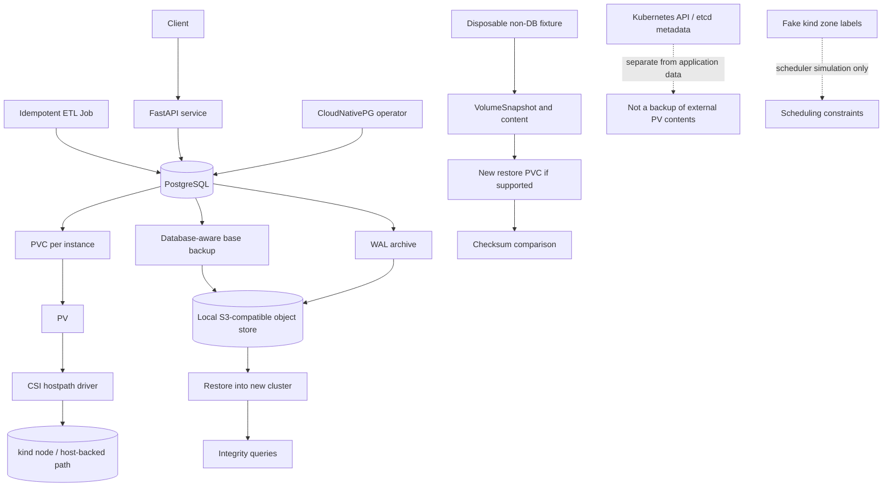

# Stateful Data Platform with Snapshots and Recovery

**Stage:** Stage 2E — Production DevOps & Platform Engineering  
**Module:** M05 — `05-Kubernetes-Storage-and-Stateful-Data-Workloads/`  
**Target:** `Projects/01-stateful-data-platform-with-snapshots-and-recovery.md`  
**Status:** Guided project specification. No cluster deployment, backup, restore, benchmark, or failure drill is claimed to have been executed.

> **Core principle:** A system is not recoverable because a backup or snapshot object exists. Recoverability is demonstrated only when a restore completes into a safe target and integrity is verified against an explicit recovery objective.

## Table of contents

1. [Project overview and why this capstone exists](#1-project-overview-and-why-this-capstone-exists)
2. [Scenario and incident history](#2-scenario-and-incident-history)
3. [Prerequisites, local resource budget, and version verification](#3-prerequisites-local-resource-budget-and-version-verification)
4. [Learning outcomes and completion gates](#4-learning-outcomes-and-completion-gates)
5. [Threat model, data-safety contract, and destructive-action policy](#5-threat-model-data-safety-contract-and-destructive-action-policy)
6. [Architecture and end-to-end data-flow diagram](#6-architecture-and-end-to-end-data-flow-diagram)
7. [Data-location map and lifecycle/failure matrix](#7-data-location-map-and-lifecyclefailure-matrix)
8. [Repository-local project structure (proposed)](#8-repository-local-project-structure-proposed)
9. [Implementation roadmap and staged resource schedule](#9-implementation-roadmap-and-staged-resource-schedule)
10. [Stage-by-stage guided implementation](#10-stage-by-stage-guided-implementation)
11. [StorageClass catalog and ADR](#11-storageclass-catalog-and-adr)
12. [PostgreSQL/CloudNativePG, API, and ETL implementation](#12-postgresqlcloudnativepg-api-and-etl-implementation)
13. [Backup, WAL archive, PITR, and restore verification](#13-backup-wal-archive-pitr-and-restore-verification)
14. [Volume snapshot, restore-test, and retention pruning](#14-volume-snapshot-restore-test-and-retention-pruning)
15. [Failure drill cards with expected-versus-observed record templates](#15-failure-drill-cards-with-expected-versus-observed-record-templates)
16. [Performance, capacity forecasting, alerting, and expansion](#16-performance-capacity-forecasting-alerting-and-expansion)
17. [Governance, RBAC, policy, and orphan audit](#17-governance-rbac-policy-and-orphan-audit)
18. [Makefile interface and command contract](#18-makefile-interface-and-command-contract)
19. [Troubleshooting matrix and incident runbooks](#19-troubleshooting-matrix-and-incident-runbooks)
20. [Acceptance tests and `make verify` report contract](#20-acceptance-tests-and-make-verify-report-contract)
21. [Grading rubric and final completion gate](#21-grading-rubric-and-final-completion-gate)
22. [Cleanup, rollback, and data-retention implications](#22-cleanup-rollback-and-data-retention-implications)
23. [Production-readiness review and what this local lab cannot prove](#23-production-readiness-review-and-what-this-local-lab-cannot-prove)
24. [Requirement-to-deliverable-to-evidence traceability matrix](#24-requirement-to-deliverable-to-evidence-traceability-matrix)
25. [Glossary](#25-glossary)
26. [Source notes, version ledger, and independent technical audit](#26-source-notes-version-ledger-and-independent-technical-audit)

---

## 1. Project overview and why this capstone exists

This capstone integrates M05 Units 1–8 into one evidence-driven platform. The goal is not to make every Pod green. The goal is to trace where data lives, establish which failures each mechanism can withstand, restore a database into a separate target, verify its contents, and record what was and was not demonstrated.

The full target includes a `kind` cluster with one control plane and three workers, a test CSI hostpath driver and snapshot components where supported, StorageClasses with different lifecycle intent, CloudNativePG-managed PostgreSQL, a small FastAPI service, an idempotent ETL Job, a local S3-compatible object store, database-aware backups and point-in-time recovery (PITR), volume snapshots for suitable non-database data, bounded performance tests, governance examples, and an orphan audit.

Key distinctions:

- Pod restart/recreation may recover a process; it does not restore deleted data.
- A StatefulSet provides stable identity and storage association; it does not implement database replication, leader election, backup or application-aware failover.
- A PVC being `Bound` proves a binding relationship, not a successful mount or correct application data.
- Snapshot `readyToUse` is not an application-level restore test.
- Database-aware base backup plus write-ahead log (WAL) archiving can support PITR only when configured correctly and the restore chain is tested.
- `Retain` reduces some automatic deletion risk; it is not a backup or guaranteed recoverability.
- A local object store on the same machine is useful for learning, but is not independent off-site disaster recovery.
- Fake zone labels in `kind` test scheduler constraints only. They do not create independent failure domains.

### Project outputs

Produce evidence for versions, cluster context and labels, storage capabilities, database/operator status, idempotent ETL, base backup and WAL freshness, separate-target PITR, snapshot restore of non-database data where supported, failure drills, bounded performance tests, capacity forecasting, governance/RBAC, orphan audit, a `make verify` report, five Architecture Decision Records (ADRs), five incident runbooks, and the final readiness review.

Related M05 lessons:
- `01-volumes-persistentvolumes-and-persistentvolumeclaims.md`
- `02-storageclasses-dynamic-provisioning-and-csi-drivers.md`
- `03-volume-snapshots-cloning-and-expansion.md`
- `04-statefulset-storage-patterns-and-stable-identity.md`
- `05-running-databases-and-brokers-with-operators.md`
- `06-storage-performance-iops-throughput-and-latency.md`
- `07-data-locality-zonal-failure-and-volume-affinity.md`
- `08-storage-troubleshooting-and-orphaned-volumes.md`
- `practice-questions.md`

Work in order and complete each stage's gate before moving on. Use synthetic disposable data only. If a feature is unsupported, unavailable or too expensive locally, record `NOT DEMONSTRATED`; do not replace an assumption with a claimed pass.

## 2. Scenario and incident history

A data team runs PostgreSQL, a cache, and an extract-transform-load (ETL) pipeline on Kubernetes. It has a hand-written StatefulSet, one default StorageClass, `Delete` reclaim behavior everywhere, no tested snapshots, no proven backups, no disk alerts, and orphaned volumes accumulating.

Recent incidents:
1. Namespace deletion destroyed a volume.
2. A full disk caused a database outage.
3. Nobody has restored from backup.
4. The team cannot explain what happens to data after Pod, PVC, namespace, node, or cluster deletion.

For each data-bearing component, answer:
- What process writes the data and which container path is mounted?
- Which PVC/PV, StorageClass and provisioner back that path?
- Which driver/backend implements it?
- What physical lab storage location was actually observed?
- Where is snapshot content stored, and is it independent of the source?
- Is there a database-aware backup and complete WAL archive chain?
- Has a restore completed into a new target?
- Which deterministic query/checksum proves integrity?
- What recovery point and elapsed recovery time were measured?
- Who owns the data and approves deletion?

This is a single-cluster learning capstone, not a complete production disaster-recovery platform. It does not promise cross-region failover, real availability zones, enterprise key management or a fully production-hardened multi-tenant policy system.

## 3. Prerequisites, local resource budget, and version verification

### Baseline and constraints

- Primary: `kind` on WSL2 Ubuntu; secondary: native Linux.
- Approximate machine budget: 4 CPU cores, 8 GB RAM, 30 GB free disk.
- Maximum: one control-plane node plus three workers.
- No paid cloud account, managed database or paid storage.
- Synthetic, disposable data only.
- Stage heavy components; do not run all of them concurrently.
- WSL2 virtual disk space may not shrink automatically after deleting files or clusters.
- Use bounded waits and explicit cleanup.

### Tools

Required: `kind`, `kubectl`, Docker or another supported container runtime, `git`, `make`, Python 3 and a shell. Optional: `helm`, `jq`, `yq`, `fio`, `psql`, `curl`.

```bash
set -eu
command -v kind
command -v kubectl
command -v docker
command -v git
command -v make
python3 --version
kubectl version --client
kind version
docker version
df -h .
```

**Expected output (representative; not executed here):** required commands resolve, versions print, and free disk is sufficient. Adapt runtime checks if using a different supported provider and document that choice.

### Resource schedule (estimates, not guarantees)

| Stage | Approximate budget | Notes |
|---|---|---|
| Preflight | negligible | No cluster mutation |
| Four-node kind cluster | 2–4 CPU, 3–5 GB RAM, 5–10 GB disk | Image/node layers add overhead |
| CSI + snapshot control plane | 0.5–1 CPU, 0.5–1.5 GB RAM | Verify selected versions |
| One PostgreSQL instance + operator | 1–2 CPU, 1–2 GB RAM, 2–5 GB disk | Start reduced profile if needed |
| Three database instances | Additional 1–3 GB RAM and disk | `[VERIFY]` actual footprint |
| Local object store + WAL | 0.5–1.5 GB RAM, 2–8 GB disk | Stop when not needed |
| API/ETL | workload-dependent, generally low | Small synthetic batches |
| fio/failure drills | variable | One at a time; bounded disposable target |

Keep a meaningful free-space margin. **[DESIGN DECISION]** Use 5 GB as the minimum host free-space reserve before starting another heavy stage; adjust upward for actual image/data growth. Stop if the reserve would be breached.

### Version ledger

Capture versions in `evidence/versions.txt`. Example read-only capture:

```bash
mkdir -p evidence
{
  echo "captured_at_utc=$(date -u +%Y-%m-%dT%H:%M:%SZ)"
  echo "kind:"; kind version
  echo "kubectl:"; kubectl version --client
  echo "context:"; kubectl config current-context
  echo "nodes:"; kubectl get nodes -o wide
  echo "storageclasses:"; kubectl get storageclass
  echo "snapshot CRDs:"
  kubectl get crd volumesnapshots.snapshot.storage.k8s.io volumesnapshotcontents.snapshot.storage.k8s.io volumesnapshotclasses.snapshot.storage.k8s.io 2>&1 || true
} > evidence/versions.txt
```

Add actual driver, external-snapshotter, CloudNativePG operator, PostgreSQL image, object-store, fio and Python dependency versions after installation. This is inventory, not a compatibility test.

**[VERIFY]** Use official docs and compatibility matrices for exact Kubernetes, kind, CSI hostpath, external-snapshotter, CloudNativePG, PostgreSQL and object-store versions. If current documentation cannot be checked, do not pin guessed versions or URLs.

## 4. Learning outcomes and completion gates

The learner must be able to trace data to physical lab storage; distinguish ephemeral storage, PVC/PV, snapshots, database backups, WAL archives, replicas and etcd snapshots; design lifecycle policies; verify CSI/snapshot capabilities; deploy CloudNativePG/PostgreSQL; implement deterministic API/ETL writes; restore PITR into a new cluster; validate data integrity; run controlled failure drills; interpret bounded fio metrics; forecast capacity; test expansion or document unsupported capability; audit orphans safely; and defend the local lab's limits.

Completion gates:
- **Gate 0:** tools, disk budget and context guard ready.
- **Gate 1:** storage/CSI/snapshot capabilities observed or marked not demonstrated.
- **Gate 2:** operator-managed database and idempotent ETL verified.
- **Gate 3:** separate-target PITR restore and integrity evidence, or explicitly not demonstrated.
- **Gate 4:** non-database snapshot restore verified, or capability gap recorded.
- **Gate 5:** performance, capacity, alert, expansion and drill evidence recorded.
- **Gate 6:** governance, orphan audit, five ADRs, five runbooks and traceability complete.
- **Gate 7:** truthful `make verify` report and guarded cleanup.

## 5. Threat model, data-safety contract, and destructive-action policy

### Threats

Accidental PVC/PV/namespace/cluster deletion; `Delete` reclaim removing a backend resource; retained data being deleted as an apparent orphan; snapshots without usable restores; incomplete WAL chains; logical corruption replicated to all instances; host/WSL2 disk failure; byte or inode exhaustion; permissions changed by image updates; wrong context/namespace; CSI outages or stale attachment; leaked credentials; orphan-audit false positives.

### Mandatory data-safety sequence

Before a storage-affecting mutation, record:
1. current context and cluster name;
2. namespace, exact resource name and UID;
3. owner and synthetic/disposable status;
4. PVC/PV/snapshot/content/backend IDs;
5. application health and whether writes are active;
6. backup status and last tested recovery point;
7. blast radius and recovery/rollback path;
8. report-only inventory and approval.

If ownership, attachment, writer state or data safety is unknown, **stop**, preserve evidence and escalate. No routine finalizer removal, force deletion, arbitrary force-detach or wildcard storage deletion.

### Context guard pattern

```bash
require_lab_context() {
  expected_context="${EXPECTED_CONTEXT:-kind-stateful-lab}"
  actual_context="$(kubectl config current-context)"
  if [ "$actual_context" != "$expected_context" ]; then
    echo "REFUSING: expected '$expected_context', got '$actual_context'." >&2
    return 1
  fi
  if ! kind get clusters | grep -Fxq "${LAB_CLUSTER:-stateful-lab}"; then
    echo "REFUSING: named kind cluster was not found." >&2
    return 1
  fi
}
```

This is a guard example, not a complete security boundary. Also verify namespace, exact target, owner and data-safety declaration. Test failure paths before using the helper in mutating scripts.

Never commit real credentials or print Secret values. Use local-only disposable credentials, record Secret names/metadata only, and redact evidence.

## 6. Architecture and end-to-end data-flow diagram



| Component | Responsibility | Does not guarantee |
|---|---|---|
| kind | Local Kubernetes | Production storage or real zones |
| StorageClass | Provisioning policy | Provisioner existence/capability |
| PVC/PV | Claim/resource association | Successful mount or correct data |
| CSI components | Driver operations | Uniform features across drivers |
| Snapshot API/controller/driver | Snapshot lifecycle when compatible | DB consistency or independent backup |
| CloudNativePG | Database lifecycle reconciliation | Tested backup/restore correctness |
| PostgreSQL | Transactions, WAL and database recovery | Independent off-host protection |
| Local object store | Backup/WAL target | Survival of host/WSL2 failure |
| FastAPI/ETL | Application write path | Storage durability by itself |

For every arrow, record the relevant resource and identifier. Inspect the deployed driver and its mounts/arguments before naming the physical path. Do not invent a host directory from a generic example.

```bash
kubectl get pods,pvc,svc -n data-platform -o wide
kubectl get pv -o wide
kubectl get storageclass
kubectl get volumeattachment
kubectl get events -A --sort-by=.lastTimestamp
```

## 7. Data-location map and lifecycle/failure matrix

Create `evidence/data-location-map.md` with one row per data-bearing component.

| Data | Container path | PVC/PV | Class/driver | Physical location observed? | Backup/snapshot | Owner | Restore proof |
|---|---|---|---|---|---|---|---|
| PostgreSQL | Record actual configured path | Record IDs | Record actual class | Yes/No + evidence | Base backup + WAL | Data team | SQL report |
| Cache if persistent | Record actual path | Record IDs | Record class | Yes/No + evidence | Rebuildable or explicit policy | App team | Rebuild/test |
| ETL scratch | Record actual path | Record IDs if any | Scratch/ephemeral | Yes/No + evidence | Usually disposable | Pipeline owner | Idempotency test |
| Non-DB fixture | `/test-data` in test Pod | Record IDs | Record class/driver | Yes/No + evidence | VolumeSnapshot if supported | Capstone owner | Checksum |
| Backup/WAL objects | Object-store bucket/prefix | Not normally a PVC claim | Object-store config | Record local backing path if known | Base backup + WAL | Data owner | PITR report |

| Event | Possible effect | What may survive | Required verification/recovery |
|---|---|---|---|
| Pod deletion | Process/writable layer lost | PVC-backed data depending on backend | Verify claim/PV and application data |
| StatefulSet scale-down | Ordinal Pod removed | Claim may remain | Inspect retention policy and owner |
| PVC deletion | Backend outcome depends on reclaim policy/driver | Retain may preserve; Delete may remove | Check IDs and actual backend |
| Namespace deletion | Namespaced claims/workloads deleted | Depends on policy/driver | Reconcile backend inventory |
| PV Delete policy | Provisioner may delete backend | No guaranteed survival | Use for disposable data unless protected |
| PV Retain policy | Backend may remain | Data may remain but claimRef can block reuse | Owner review and controlled reclaim |
| Snapshot deletion | Content/backend result depends on deletion policy | May be retained or removed | Inspect snapshot, content, class and backend |
| Worker loss | Node-local data unavailable/lost | Real replicas/backups if independent | Check fencing, affinity, quorum and restore |
| kind cluster deletion | Node containers/local data may be destroyed | Independent host files/copies may remain | Inventory first; treat as destructive |
| Host/WSL2 disk failure | Cluster and local store may fail together | Only independent copy | Local lab cannot prove off-host recovery |
| Logical DB corruption | May replicate | Earlier valid backup/PITR point | Restore and validate integrity |
| WAL archive gap | PITR range incomplete | Earlier valid recovery point | Check archive freshness and range |
| Local object-store deletion | Backup/WAL objects may be lost | Independent copies only | Test recovery and inventory copies |

**[VERIFY]** Actual behavior depends on Kubernetes version, driver, provisioner, backend, operator and policy. Confirm using disposable tests and observed identifiers.

## 8. Repository-local project structure (proposed)

This structure is a proposal, not a claim that the files already exist.

```text
Projects/
├── README.md
└── 01-stateful-data-platform-with-snapshots-and-recovery.md
stateful-data-platform/
├── Makefile
├── README.md
├── .gitignore
├── versions.txt
├── kind/stateful-lab.yaml
├── manifests/
│   ├── namespaces.yaml
│   ├── storageclasses.yaml
│   ├── volumesnapshotclass.yaml
│   ├── postgres-cluster.yaml
│   ├── api-deployment.yaml
│   ├── api-service.yaml
│   ├── api-networkpolicy.yaml
│   ├── etl-job.yaml
│   ├── snapshot-fixture.yaml
│   └── governance/{storage-rbac.yaml,policy-sketches.md}
├── app/{Dockerfile,requirements.txt,main.py}
├── etl/load_synthetic.py
├── sql/{schema.sql,seed.sql,verify_integrity.sql}
├── scripts/
│   ├── preflight.sh
│   ├── bootstrap-kind.sh
│   ├── capture-versions.sh
│   ├── verify-storage-capabilities.sh
│   ├── backup-status.sh
│   ├── restore-test.sh
│   ├── snapshot-test.sh
│   ├── prune-snapshots.py
│   ├── fio-benchmark.sh
│   ├── forecast_capacity.py
│   ├── orphan_audit.py
│   ├── guarded-delete.sh
│   ├── verify.sh
│   └── safe-down.sh
├── tests/{fixtures/,test_etl_idempotency.py,test_forecast_capacity.py,test_orphan_audit.py}
├── adr/{ADR-001-storage-classes-and-reclaim-policy.md,ADR-002-database-operator.md,ADR-003-backup-pitr.md,ADR-004-topology-and-failure-domains.md,ADR-005-retention-and-orphan-cleanup.md}
├── runbooks/{volume-full.md,database-failover-stuck.md,accidental-pvc-deletion.md,backup-wal-failure.md,orphaned-volume-cleanup.md}
└── evidence/
    ├── versions.txt
    ├── data-location-map.md
    ├── storage-capability-report.md
    ├── backup-report.md
    ├── pitr-report.md
    ├── snapshot-restore-report.md
    ├── performance-report.json
    ├── capacity-forecast.json
    ├── orphan-audit.json
    ├── verification-report.md
    └── drills/DRILL-<id>-<date>.md
```

`manifests/` contains reviewed Kubernetes manifests; operator custom resources must match the installed CRD. `scripts/` contains guarded automation; mutation defaults to report-only. `evidence/` must be redacted. Do not create guessed CSI parameters, snapshot class settings, CloudNativePG fields or backup configuration.

## 9. Implementation roadmap and staged resource schedule

| Stage | Goal | Heavy components | Gate |
|---|---|---|---|
| A | Preflight/threat model | None | Disk/context guard passes |
| B | kind/topology simulation | kind | Named cluster and fake zones documented |
| C | CSI/snapshot capabilities | CSI + snapshot controller | Capability tested or not demonstrated |
| D | Database/API/ETL | Operator + DB | Deterministic writes verified |
| E | Backup/WAL/PITR | DB + object store | Separate-target restore passes |
| F | Non-DB snapshot | CSI + snapshot controller | Checksum restore or capability gap |
| G | Performance/capacity | fio/optional monitoring | Bounded report and forecast |
| H | Failure drills | One component under test | Evidence and recovery per drill |
| I | Governance/orphan audit | Low | Report-only candidate and owner workflow |
| J | Acceptance/cleanup | Varies | Truthful report and guarded teardown |

Stop object store and database when not required. Do not run full three-instance database, object store, monitoring and fio concurrently on the baseline laptop. If one database instance is used, mark three-instance HA and replica-spread acceptance `NOT DEMONSTRATED`; do not silently waive it.

## 10. Stage-by-stage guided implementation

### Stage A — Preflight and threat model

**Objective:** prove workspace readiness and define mutation boundaries. **Resources:** negligible CPU/RAM; adequate disk headroom. **Files:** `scripts/preflight.sh`, `.gitignore`, `evidence/versions.txt`, `evidence/data-location-map.md`.

```gitignore
.env
*.secret
evidence/*credentials*
evidence/*environment-dump*
__pycache__/
.venv/
```

Run Section 3 read-only checks. Record context, expected cluster, free disk, versions, synthetic-data confirmation and destructive-action boundaries.

**Evidence:** preflight record, version ledger and threat model. **Pass:** tools resolve, no real data/secrets, disk guard passes. **Failure:** install missing tools from official sources, stop on low disk, or correct context before mutation. **Cleanup:** none. **Proves:** readiness only, not storage capability.

### Stage B — Bootstrap kind and fake topology

**Objective:** create a named local cluster and label simulated zones. **Resources:** approximately 2–4 CPU, 3–5 GB RAM, 5–10 GB disk.

Proposed `kind/stateful-lab.yaml`:

```yaml
kind: Cluster
apiVersion: kind.x-k8s.io/v1alpha4
name: stateful-lab
nodes:
  - role: control-plane
  - role: worker
  - role: worker
  - role: worker
```

**[VERIFY]** Confirm the current kind config API. Create only this named cluster:

```bash
kind create cluster --config kind/stateful-lab.yaml
kubectl config current-context
kubectl get nodes -o wide
```

After confirming the expected context, inspect node names and label the actual workers; do not assume names.

```bash
kubectl get nodes --show-labels
kubectl label node <observed-worker-a> topology.kubernetes.io/zone=a
kubectl label node <observed-worker-b> topology.kubernetes.io/zone=b
kubectl label node <observed-worker-c> topology.kubernetes.io/zone=c
kubectl get nodes --show-labels
```

**Evidence:** node/context/version outputs. **Pass:** one control plane, three workers, labels and fake-zone caveat documented. **Failures:** insufficient memory/disk, image pull or wrong context. **Cleanup:** cluster deletion is destructive and is handled only in Section 22. **Proves:** scheduler simulation only, not physical zones.

### Stage C — Verify CSI hostpath and snapshot capabilities

**Objective:** discover actual installed driver and snapshot support. **Resources:** roughly 0.5–1 CPU and 0.5–1.5 GB RAM plus images.

```bash
kubectl get storageclass
kubectl get csidrivers
kubectl get pods -A
kubectl get crd | grep -E 'volumesnapshots|snapshotcontents|snapshotclasses' || true
```

**[VERIFY] Installation:** use the official CSI hostpath and external-snapshotter instructions for compatible versions. Check driver release, install method, CRDs/controller, sidecars, class fields, and support for snapshots, restore, cloning, expansion and topology. Do not guess URLs or copy another provider's parameters.

The read-only `scripts/verify-storage-capabilities.sh` should capture context, driver images, classes, snapshot CRDs/controller and a capability report. Then test on disposable data: write a unique token, create snapshot, restore into a new claim, mount it separately, compare checksum. Use only the schema from verified documentation.

**Pass:** actual provisioner/class observed and test passes, or capability marked `NOT DEMONSTRATED`. **Failures:** missing CRDs/controller, incompatible versions, unsupported driver. **Cleanup:** remove only reviewed test resources. **Proves:** this test path/version only, not database consistency or production durability.

### Stage D — Storage catalog and operator-managed database

**Objective:** apply reviewed storage policy and deploy CloudNativePG-managed PostgreSQL. **Resources:** database/operator is heavy; do not run object store or fio concurrently.

Create namespaces such as `data-platform`, `app`, and `restore-test` only after context checks. Verify NetworkPolicy enforcement in the selected CNI.

For CloudNativePG, verify current install method, CRD/API group/version, fields, images, backup support and failover behavior. Inspect operator-generated resources; do not manually patch them as the normal configuration path. Use resource requests/limits, supported non-root posture, probes/PDB where appropriate, explicit storage class and Secret references.

Full target: three instances spread across fake zones if resources permit. Reduced profile: one instance, with full HA explicitly `NOT DEMONSTRATED`.

Create deterministic SQL records with primary keys and idempotent upserts. Record row count, representative keys, stable checksum and UTC capture time.

**Pass:** operator/DB ready according to docs, instance count recorded, SQL evidence exists, access tested from allowed and denied paths where practical. **Failures:** CRD mismatch, Pending Pods, mount/permission errors, non-enforcing NetworkPolicy. **Cleanup:** preserve source DB for recovery stage. **Proves:** observed operator/database path, not production HA.

### Stage E — API, ETL, backup, WAL and PITR

**Objective:** demonstrate recovery before failure drills. **Resources:** DB + object store; small synthetic data only.

FastAPI should expose bounded read/write endpoints and health behavior, use parameterized SQL, load credentials from Secret-injected environment variables, and never echo credentials. ETL should use deterministic keys, bounded batches, retries and upsert semantics; rerunning identical input must not increase logical row count.

Use the current supported CloudNativePG backup/WAL integration and local S3-compatible object store only after verifying version compatibility. Do not assume an older `ScheduledBackup` or plugin example matches the installed release.

Required sequence:
1. Capture baseline counts, representative IDs, checksum and timestamp.
2. Create database-aware base backup and record status.
3. Verify expected object metadata without exposing credentials.
4. Generate test records after the backup.
5. Verify WAL archive freshness using the documented method.
6. Select a target timestamp inside the proven recovery window.
7. Restore to a **new cluster name and new target storage**.
8. Query the restored database.
9. Prove pre-target records exist and post-target markers are absent where designed.
10. Compare integrity values and preserve evidence.

Never overwrite the source. A restore is not accepted because a Pod is Ready.

RPO (Recovery Point Objective) is the acceptable data-loss window relative to the last expected committed write. RTO (Recovery Time Objective) is elapsed time from incident declaration to verified service recovery. Record target and measured values separately; unmeasured values are `NOT DEMONSTRATED`.

**Pass:** backup status, WAL freshness, new-target PITR, SQL integrity and measured/unmeasured RPO/RTO are recorded. **Failures:** missing WAL, wrong target, credentials or object-store mismatch. Preserve source and failure evidence.

### Stage F — Non-database snapshot and restore

**Objective:** test a snapshot of a disposable file fixture. **Resources:** CSI + snapshot controller and a tiny PVC.

Verify CRDs/class/driver first. Create a test file and checksum; record PVC/PV IDs; create snapshot using verified API; wait with a bounded timeout; restore to a new claim; mount separately; compare checksum and ownership; save evidence; then clean only test resources.

If unsupported, report `NOT DEMONSTRATED`. Do not substitute `cp` and call it a CSI snapshot test. Database-aware backup remains necessary.

### Stage G — Performance, capacity and expansion

**Objective:** run bounded fio against a disposable file, forecast capacity, validate an alert rule or disclose the validation gap, and test expansion only if supported.

Before fio, verify installed flags and target path. Capture version, class, node, file size, runtime, block size, read/write mix, queue depth, repeats, latency percentiles, IOPS, throughput, CPU throttling, I/O wait and free disk. Never write to an unknown block device, database path or host filesystem.

Example shape (verify flags; illustrative, not executed):

```bash
fio --name=bounded-randread \
  --filename=/test-volume/fio-test.bin \
  --size=128m --rw=randread --bs=4k \
  --iodepth=1 --numjobs=1 --runtime=30 --time_based \
  --group_reporting --output-format=json \
  --output=evidence/performance-report.json
```

IOPS counts operations/second; throughput is bytes/time; latency percentiles reveal tail behavior; queue depth and block size influence results. A single run does not prove causation or predict cloud performance.

Capacity formula: `forecast_used = current_used + observed_growth_rate × horizon`. Guard zero/negative growth and units; note bursts, WAL, compaction and inode exhaustion are not modeled by simple linear extrapolation.

For expansion, verify class `allowVolumeExpansion`, driver/filesystem support, PVC conditions/events and actual filesystem size. Do not shrink or recreate the source PVC as a shortcut.

### Stage H — Failure drills

Run each drill separately using Section 15. Before mutation, confirm context/target, synthetic-only data, baseline IDs, blast radius and recovery path. Start report-only, require explicit opt-in, execute the smallest action, validate application data, record observed result and clean only test-created resources. Stop if any precondition fails.

### Stage I — Governance and orphan audit

Inspect RBAC with `kubectl auth can-i`; test both allowed and denied policy requests. Run report-only orphan inventory. Create a controlled disposable candidate, detect it, reconcile owner and backend ID, quarantine/recheck, and require explicit approval before exact-target deletion. Missing owner means stop. Kubernetes API inventory alone cannot discover every hostpath leftover.

### Stage J — Final acceptance and cleanup

Run `make verify`; inspect every FAIL/SKIPPED/NOT DEMONSTRATED item; verify ADRs/runbooks; redact evidence; inventory all storage and object-store resources; stop workloads; and show the exact cluster and data-loss warning before explicit teardown approval.

**Pass:** statuses are truthful, evidence is preserved, and cleanup is scoped. **Proves:** documented local run only, not production readiness.


## 11. StorageClass catalog and ADR

### Catalog intent

Names express policy categories, not measured performance.

| Class | Intended policy | Reclaim intent | Binding mode | Expansion/snapshot | Anti-pattern |
|---|---|---|---|---|---|
| `fast-retain` | Recovery-oriented retained data | `Retain` where supported | Choose after topology test | `[VERIFY]` | Calling it fast without a benchmark |
| `standard-delete` | Disposable standard workloads | `Delete` where supported | Choose after scheduling test | `[VERIFY]` | Using for irreplaceable data without a backup |
| `scratch` | Short-lived scratch | May be ephemeral instead of a class | Workload-dependent | Not assumed | Treating scratch as durable |

A StorageClass is cluster-scoped; PVCs are namespaced and PVs cluster-scoped. Explicit class selection reduces dependence on an unknown default. Confirm the actual default annotation and provisioner.

### StorageClass template (not ready to apply)

```yaml
# TEMPLATE ONLY. Replace with the actual installed provisioner and verified fields.
apiVersion: storage.k8s.io/v1
kind: StorageClass
metadata:
  name: fast-retain
provisioner: REPLACE_WITH_VERIFIED_PROVISIONER
reclaimPolicy: Retain
volumeBindingMode: WaitForFirstConsumer
allowVolumeExpansion: false # Set true only after support is verified and tested.
---
apiVersion: storage.k8s.io/v1
kind: StorageClass
metadata:
  name: standard-delete
provisioner: REPLACE_WITH_VERIFIED_PROVISIONER
reclaimPolicy: Delete
volumeBindingMode: WaitForFirstConsumer
allowVolumeExpansion: false
```

This is an intent template, not a deployable manifest. Do not apply until the provisioner, parameters, binding mode and capabilities are verified. `scratch` may be a class only if the driver supports the intended semantics; `emptyDir` may be more accurate for Pod-lifetime scratch.

### VolumeSnapshotClass

Do not write a driver-specific VolumeSnapshotClass until the installed CRDs and driver support are verified. Confirm the API schema, driver string, deletion policy, source/restore support and what happens when the snapshot/content object is deleted. Capture evidence.

```bash
kubectl get storageclass -o wide
kubectl describe storageclass fast-retain
kubectl describe storageclass standard-delete
kubectl get csidrivers
kubectl get pv,pvc -A
```

**Expected output (representative; not executed here):** classes and fields match the reviewed intent and actual installed provisioner. Provisioner strings are environment-specific.

### ADR-001 — StorageClass catalog and reclaim policy

- **Context:** one default class and `Delete` behavior everywhere caused unclear lifecycle.
- **Decision:** distinguish retained recovery-oriented data from disposable workloads; require explicit classes for important workloads.
- **Alternatives:** one shared default, static PVs for every workload, provider-specific catalog.
- **Trade-offs:** `Retain` creates reconciliation work; `Delete` simplifies disposal but can destroy data; class names do not guarantee speed or durability.
- **Consequences:** ownership and retention records become mandatory.
- **Validation:** test each class with disposable data and inspect actual PV/backend behavior.

## 12. PostgreSQL/CloudNativePG, API, and ETL implementation

### Operator choice and database design

CloudNativePG is the required hands-on operator. Verify its installation method, CRD/API version, fields, images, backup configuration and failover behavior against the current official documentation for the selected version. Do not substitute a hand-written StatefulSet.

The verified database resource must have an explicit namespace/name, bounded resource requests/limits, storage size/class, supported non-root posture, appropriate probes/PDB, Secret references, and topology rules only after the schema and fake node labels are checked. Three instances across fake zones are the full target if resources allow. One instance is a reduced learning profile; three-instance HA is then `NOT DEMONSTRATED`.

Inspect the installed resource kinds rather than copying placeholders:

```bash
kubectl get crd | grep -i postgresql
kubectl get pods -A
kubectl get events -A --sort-by=.lastTimestamp
kubectl get <verified-cloudnativepg-resource-kind> -n data-platform
kubectl describe <verified-cloudnativepg-resource-kind> <cluster-name> -n data-platform
```

Replace placeholders with the exact installed CRD kind. Save redacted status, events and operator logs. Do not manually patch operator-generated resources as the normal configuration interface.

### Deterministic schema and test data

`sql/schema.sql` should define a small table with a deterministic primary key such as `record_id`, `source_name`, `sequence_no`, `payload`, and an optional batch identifier. `sql/seed.sql` and `etl/load_synthetic.py` should use deterministic keys and idempotent PostgreSQL upsert semantics.

Capture before backup:
- row count;
- representative stable IDs;
- deterministic checksum/aggregate over normalized fields;
- UTC capture time;
- last committed test batch.

Avoid volatile timestamps in checksum inputs unless normalized.

### FastAPI service

`app/main.py` should expose a liveness endpoint, a readiness endpoint with clearly defined database semantics, and a narrow read/write endpoint. Use parameterized SQL, bounded connection/timeouts and Secret-injected credentials. Do not echo secrets or raw environment variables. Return useful errors without connection strings. Pin and record dependencies and image digest/version; use a non-root image user where compatible.

### Idempotent ETL

`etl/load_synthetic.py` must generate deterministic keys, use bounded batches and transactions, retry transient errors with a maximum retry count, use upserts, exit non-zero on failed integrity expectations, and log batch IDs/counts without credentials.

**Acceptance test:** run identical input twice. Logical row count for those keys must not increase on the second run. Save row counts, representative rows and query results.

### NetworkPolicy and access

Limit database ingress to intended API/ETL labels and namespaces. Verify that the selected CNI actually enforces NetworkPolicy. Test an allowed request and a denied request. If enforcement is not present, record the gap; a manifest existing is not proof.

Strimzi/Kafka is Awareness/optional only. Do not run a heavyweight broker stack concurrently with PostgreSQL, the object store, fio and all drills on the baseline laptop.

## 13. Backup, WAL archive, PITR, and restore verification

### Required recovery chain

1. Choose a local S3-compatible store (for example MinIO) only after checking current compatibility and resource needs.
2. Configure a bucket/prefix and disposable local-only credentials.
3. Configure the current supported CloudNativePG backup/WAL mechanism from official docs for the installed release.
4. Create a database-aware base backup.
5. Verify reported status and expected object metadata without exposing credentials.
6. Verify WAL archive freshness using the documented method for that version.
7. Generate test records before and after a selected recovery point.
8. Restore into a **new cluster with a distinct name and target storage**.
9. Query the restored database.
10. Prove pre-target records exist and post-target test markers are absent where the exercise is designed to test that boundary.
11. Compare counts/checksums and preserve the report.

**[VERIFY]** Exact backup custom resource, plugin/object-store integration, recovery target fields and restore procedure vary by CloudNativePG release and integration. Do not assume an older `ScheduledBackup` example matches the installed version. Check installed CRDs and official docs.

### PITR boundary test

Create deterministic markers such as `before_target_001` and `after_target_001`, committed with a sufficient time gap around the target. Capture commit timing and UTC assumptions. If timing is ambiguous, the test does not prove the intended boundary.

### PITR checklist

- [ ] Source cluster and database identified.
- [ ] Backup ID/status recorded.
- [ ] WAL archive freshness/completeness evidence recorded.
- [ ] Target time lies inside the proven recovery window.
- [ ] Restore uses a new cluster and separate storage.
- [ ] Source is not overwritten or deleted.
- [ ] Restored database accepts a query.
- [ ] Pre-target markers exist.
- [ ] Post-target markers are absent where expected.
- [ ] Row counts and deterministic checksums match.
- [ ] Observed RPO/RTO measured or marked `NOT DEMONSTRATED`.
- [ ] Evidence is redacted.

**RPO** is the acceptable data-loss window measured against expected committed writes. **RTO** is elapsed time from incident declaration to verified recovery. Record target values separately from observed values.

`evidence/backup-report.md` and `evidence/pitr-report.md` must contain versions, source/target names, backup identifiers, status/errors, object metadata, archive freshness method, target timestamp, integrity queries and values, elapsed recovery time, RPO/RTO calculation, limitations and open items.

A backup object existing is not enough. If WAL is incomplete, target time is outside the recovery range, or integrity fails, report `FAIL` or `NOT DEMONSTRATED`. Preserve source data and first-failure evidence.

## 14. Volume snapshot, restore-test, and retention pruning

Use snapshots for a small non-database fixture, such as a file containing a deterministic token/checksum. Do not use this path as a substitute for database-aware backup.

Procedure:
1. verify CRDs, controller, class, driver capability and compatibility;
2. create a dedicated disposable namespace/PVC;
3. write a test file and record checksum;
4. capture source PVC/PV IDs;
5. create a VolumeSnapshot using the verified API;
6. wait with a bounded timeout for the verified ready state;
7. restore into a new PVC using the supported method;
8. mount it in a separate test Pod;
9. compare checksum, ownership and mode;
10. save evidence and clean only resources created by this test.

If unsupported, report `NOT DEMONSTRATED`; do not replace a CSI test with a file copy and claim success.

### Retention pruning contract

The script defaults to report-only. It lists snapshot name/namespace, content ID, age, class deletion policy, owner, retention rule and recommendation. Age alone is not deletion authority.

Apply mode requires `--apply`, verified context/cluster, exact namespace and named IDs, owner/retention approval, reference and restore-dependency checks, pre-delete inventory, and post-delete audit. Do not remove finalizers automatically. A stuck delete requires inspection of controller events, content references, policy and backend state.

## 15. Failure drill cards with expected-versus-observed record templates

### Universal drill contract

Each drill is independent. Never chain destructive drills into one shell script. Every record contains drill ID/date, context/cluster/namespace, exact resource IDs, synthetic-only confirmation, objective/blast radius, DATA-SAFETY PREFACE, baseline, approval, action, expected and observed result, integrity checks, rollback, cleanup, status and prevention action.

### Drill 01 — Primary database Pod termination/recreation

- **Objective:** observe operator reconciliation and persistence across Pod loss.
- **Blast radius:** one disposable database instance; may trigger failover.
- **Prerequisites:** healthy database, baseline SQL checks, backup evidence.
- **DATA-SAFETY PREFACE:** verify exact Pod and database role; understand the operator's expected response before terminating a primary.
- **Baseline/action:** capture instance roles, PVC/PV IDs, row count/checksum and last marker; use the installed operator's documented test method and exact target.
- **Expected:** operator reconciles the Pod or supported role transition.
- **Observed evidence:** event timeline, Pod identity, volume association, database role and SQL integrity.
- **Pass:** data checks and recovery succeed; timing recorded.
- **Rollback/cleanup:** follow operator runbook; stop if role/consistency is ambiguous. No unrelated resource cleanup.
- **Limit:** does not prove node or zone tolerance.

### Drill 02 — Worker/node loss

- **Objective:** inspect scheduling and recovery after worker unavailability.
- **Blast radius:** local kind worker; node-local data may be unavailable or lost.
- **Prerequisites:** synthetic data, source inventory and known backup path.
- **DATA-SAFETY PREFACE:** never use the only copy of important data.
- **Baseline/action:** record node, Pod, PV affinity, PVC and database health; use a documented reversible kind simulation method, not improvised container deletion.
- **Expected:** Pods may remain Pending if affinity/data locality prevents rescheduling.
- **Observed:** node status, events, attachment, database role and post-recovery integrity.
- **Pass:** failure is explained and recovery demonstrated or marked not demonstrated.
- **Rollback:** restore node availability or use a verified replica/backup runbook.
- **Limit:** not a physical cloud node-failure test.

### Drill 03 — Simulated zone loss

- **Objective:** demonstrate scheduler constraints using fake labels.
- **Blast radius:** scheduling of a disposable workload.
- **Prerequisites:** labels, placement and PV affinity recorded.
- **DATA-SAFETY PREFACE:** fake labels do not create real zones.
- **Baseline/action:** change only a disposable workload's eligible scheduling constraints using a reversible documented step.
- **Expected:** scheduler follows labels/constraints; PV affinity may still block placement.
- **Observed:** pending reason, eligible nodes, placement and data checks.
- **Pass:** simulation explained and reverted.
- **Rollback:** restore the exact recorded label/constraint.
- **Limit:** no physical failure domain or cross-zone latency.

### Drill 04 — Bounded full-volume incident

- **Objective:** distinguish bytes, inodes, quota and host pressure.
- **Blast radius:** dedicated disposable PVC only.
- **Prerequisites:** explicit maximum file size, host free-space reserve and cleanup plan.
- **DATA-SAFETY PREFACE:** never fill the host filesystem, WSL2 disk or database volume.
- **Baseline/action:** record `df -h`, `df -i`, PVC size and host free space; write bounded test data only within the disposable volume and stop before the reserve.
- **Expected:** capacity threshold or controlled write failure occurs before host exhaustion.
- **Observed:** byte/inode metrics, application error, alert and cleanup.
- **Pass:** cause correctly identified; host safety margin preserved.
- **Rollback:** stop writer, remove only the known test file and verify capacity.
- **Limit:** does not reproduce every backend's full-disk behavior.

### Drill 05 — Accidental PVC deletion/recovery

- **Objective:** recover a disposable fixture from retained storage, snapshot or backup.
- **Blast radius:** dedicated test PVC only.
- **Prerequisites:** tested recovery path and captured IDs.
- **DATA-SAFETY PREFACE:** never delete the source database PVC.
- **Baseline/action:** record PVC/PV UIDs, reclaim policy, backend ID and checksum; first test a guard/dry-run, then delete only the named disposable claim if approved.
- **Expected:** actual result follows reclaim policy/driver; retained PV may not be automatically reusable.
- **Observed:** phases, backend ID, restored checksum.
- **Pass:** new target restored and integrity matches.
- **Rollback:** use supported recovery; no blind claimRef/finalizer edits.
- **Limit:** does not prove recovery if every independent copy is lost.

### Drill 06 — Namespace deletion protection

- **Objective:** test a safety guard or policy in an isolated namespace.
- **Blast radius:** disposable policy-test namespace.
- **Prerequisites:** policy installed and its enforcement boundary understood.
- **DATA-SAFETY PREFACE:** never test namespace deletion against shared/source data.
- **Baseline/action:** capture namespace labels/resources/policy; use dry-run or controlled denied request. A real deletion test must use a throwaway namespace with synthetic data only.
- **Expected:** guard denies protected request or isolated namespace is deleted as intended.
- **Observed:** API response, audit event and remaining resources.
- **Pass:** allowed/denied boundary tested.
- **Rollback/cleanup:** inventory PVC/PV/backend resources before removing leftovers.
- **Limit:** policy schema/enforcement depends on version and admission configuration.

### Drill 07 — CSI controller interruption

- **Objective:** observe driver behavior when controller-side operations are unavailable.
- **Blast radius:** provisioning/attach/resize/snapshot operations.
- **Prerequisites:** driver owner identified, manifests saved, source data protected.
- **DATA-SAFETY PREFACE:** do not interrupt a driver holding irreplaceable data.
- **Baseline/action:** record controller/node Pods, PVC events, mounted test workload and backend inventory; follow only a documented driver test procedure.
- **Expected:** new operations may stall/fail; existing mounts are driver/operation-specific.
- **Observed:** events/logs, pending operations and recovery behavior.
- **Pass:** behavior recorded without universal claims.
- **Rollback:** restore through the owning deployment/Helm/operator method and reconcile partial resources.
- **Limit:** not proof of every CSI failure mode.

### Drill 08 — Backup/WAL archive failure

- **Objective:** detect incomplete recovery chain and restore archive progress.
- **Blast radius:** synthetic database backup path.
- **Prerequisites:** baseline backup and restore evidence.
- **DATA-SAFETY PREFACE:** do not delete valid backup objects or break the only recovery chain.
- **Baseline/action:** record backup status and archive freshness; use a documented fault injection or isolated invalid endpoint.
- **Expected:** failure/stale progress is visible; recovery yields fresh archive evidence.
- **Observed:** status, lag, logs and restored marker.
- **Pass:** fault detected and recovery chain revalidated.
- **Rollback:** restore valid configuration; preserve existing backups.
- **Limit:** not proof of independent object-store survival.

### Drill 09 — Failed restore/integrity check

- **Objective:** reject a restore that starts but fails integrity.
- **Blast radius:** separate disposable restore target.
- **Prerequisites:** valid source backup retained and expected values documented.
- **DATA-SAFETY PREFACE:** never overwrite the source or delete the only good target before saving evidence.
- **Baseline/action:** use a controlled mismatch fixture or invalid target in an isolated test; do not corrupt source data.
- **Expected:** verification reports `FAIL` even if database starts.
- **Observed:** infrastructure status, query result and mismatch.
- **Pass:** false recovery claim rejected; source preserved.
- **Rollback:** create a fresh target after diagnosis.
- **Limit:** tests verification logic, not every corruption mode.

### Drill 10 — Expansion or capability investigation

- **Objective:** verify actual PVC and filesystem growth.
- **Blast radius:** disposable claim.
- **Prerequisites:** class, driver and filesystem support verified.
- **DATA-SAFETY PREFACE:** never test shrink/recreate against the source database.
- **Baseline/action:** record request, PV capacity, `df -h`, `df -i` and events; expand only if supported.
- **Expected:** backend and filesystem stages complete, or unsupported capability is recorded.
- **Observed:** request, PV capacity, filesystem size, conditions/events.
- **Pass:** actual filesystem size verified or item marked `NOT DEMONSTRATED`.
- **Rollback:** normal PVC expansion does not imply shrink support; delete test resources only after inspection.
- **Limit:** driver/filesystem-specific.

### Drill 11 — Orphan discovery and safe cleanup

- **Objective:** distinguish candidate orphan from disposable data.
- **Blast radius:** report-only first; optional exact-target fixture cleanup after approval.
- **Prerequisites:** inventory, owner records and backend lookup.
- **DATA-SAFETY PREFACE:** `Released` or absent Pod does not prove orphan status.
- **Baseline/action:** record PV/PVC/snapshot/content/attachment inventory; create a disposable retained fixture, run report-only audit, reconcile IDs/owner, quarantine and recheck.
- **Expected:** report includes evidence, confidence and recommended action without deletion.
- **Observed:** before/after inventory and approval record.
- **Pass:** report-only default and exact-target opt-in demonstrated.
- **Rollback/cleanup:** reconcile Kubernetes and backend inventory.
- **Limit:** API-only inventory cannot discover all host-local leftovers.

### Drill 12 — Database primary failover

- **Objective:** observe operator-specific failover and verify data.
- **Blast radius:** database role transition.
- **Prerequisites:** official operator runbook, replica health, baseline SQL checks and backup.
- **DATA-SAFETY PREFACE:** do not force-delete or terminate a primary without documented procedure and fencing assumptions.
- **Baseline/action:** record roles, replica lag/quorum, last committed marker; use the installed operator's documented test method.
- **Expected:** role transition follows operator/database semantics.
- **Observed:** role timeline, replication evidence, SQL result and elapsed time.
- **Pass:** data verified and RPO/RTO measured or marked unmeasured.
- **Rollback:** stop if fencing or role is ambiguous.
- **Limit:** fake zones do not prove real multi-zone failover.

### Expected-versus-observed template

```markdown
# Drill <ID> — <Title>
- Date/time UTC:
- Operator:
- Context / cluster / namespace:
- Target resources and UIDs:
- Synthetic-only data confirmed: YES/NO
- Objective / blast radius:
- DATA-SAFETY PREFACE:
- Baseline evidence paths:
- Mutation approval:
- Action performed:
- Expected result:
- Observed result:
- Integrity checks (expected vs observed):
- Recovery / rollback:
- Cleanup and post-cleanup inventory:
- Status: PASS / FAIL / SKIPPED / NOT DEMONSTRATED
- Follow-up and limitations:
```


## 16. Performance, capacity forecasting, alerting, and expansion

### Bounded fio harness

Use a pre-created disposable file/volume only. Verify flags with the installed `fio --help`. Never target an unknown block device, database directory or host filesystem.

```bash
# TEMPLATE ONLY; verify flags and target safety before use.
fio --name=bounded-randread \
  --filename=/test-volume/fio-test.bin \
  --size=128m --rw=randread --bs=4k \
  --iodepth=1 --numjobs=1 --runtime=30 --time_based \
  --group_reporting --output-format=json \
  --output=evidence/performance-report.json
```

These limits are examples, not measurements or targets. Confirm that the file exists on the disposable test volume and the volume has capacity. Any write test requires a separate disposable file and explicit approval.

Capture fio version, storage class/PV/PVC, node/environment, size/runtime, block size, read/write mix, queue depth, warm-up, repeats, IOPS, throughput, latency percentiles, CPU throttling, I/O wait, backend telemetry and limitations.

- **IOPS:** operations per second.
- **Throughput:** bytes per unit time.
- **Latency percentiles:** expose tail behavior that an average can hide.
- **Queue depth:** outstanding operations; higher depth can raise throughput and latency.
- **Block size and read/write mix:** make unlike workloads incomparable.
- **Cache effects:** buffered/cached results may not represent backend performance.

`kubectl top` primarily reports CPU/memory resource metrics, not disk IOPS or latency. Use suitable OS/backend telemetry and correlate with application latency. Local numbers do not predict production cloud performance.

### Capacity forecast

`scripts/forecast_capacity.py` should accept current used bytes, total capacity, observed growth bytes per unit time, forecast horizon, reserve threshold, optional inode metrics, timestamp and units.

Simple linear model:

`forecast_used = current_used + observed_growth_rate × horizon`

`estimated_time_to_threshold = (threshold_bytes - current_used_bytes) / growth_rate_bytes_per_unit`

Guard zero/negative growth and threshold values below current usage. Include inputs, units, formula, source timestamp and assumptions in JSON. The model does not capture sudden WAL bursts, compaction, file churn or inode exhaustion.

### Alerting and expansion

Choose a monitoring backend only if resource budget allows. For Prometheus, verify metric names and rule syntax against the actual exporter and validate with the official tool if available. Otherwise state `NOT DEMONSTRATED`. Alert intent should cover bytes/inodes, PVC expansion pending, WAL archive freshness, backup/restore-test age, Pending Pods/mount errors and orphan candidates.

For expansion:
1. inspect class `allowVolumeExpansion`;
2. verify driver/backend/filesystem support;
3. record PVC request, PV capacity, `df -h`, `df -i` and events;
4. expand only a disposable claim;
5. wait with bounded timeout;
6. verify filesystem size, not just YAML;
7. record controller/node resize evidence;
8. if unsupported, document the capability investigation.

Normal PVC expansion is not a shrink mechanism.

## 17. Governance, RBAC, policy, and orphan audit

### RBAC and policy

```bash
kubectl auth can-i get persistentvolumeclaims -n data-platform
kubectl auth can-i delete persistentvolumeclaims -n data-platform
kubectl auth can-i delete persistentvolumes
kubectl auth can-i delete volumesnapshots.snapshot.storage.k8s.io -n data-platform
```

Run as the identity being evaluated. These checks test authorization, not admission policies, backend cleanup or data safety.

Awareness-level policy examples may cover requiring explicit StorageClass, protecting selected PVCs, restricting `hostPath`, limiting delete operations and requiring owner labels. Optional ValidatingAdmissionPolicy, Kyverno or Gatekeeper schemas are `[VERIFY]` until exact versions are checked. A policy passes only after both allowed and denied requests are tested. Do not lock the operator out of cleanup or create unrecoverable finalizer situations.

### Orphan audit

The audit script defaults to report-only and classifies **candidate orphan**, not **confirmed safe-to-delete**, unless all checks pass. Include resource kind/name/namespace/UID, phase/policy, claimRef, owner, snapshot/content/attachment references, backend ID, last-seen timestamp, evidence source/confidence, retention state, next action and approval ID.

Signals include PVCs without expected consumers, PVs in `Released`/unexpected phases, retained PVs missing owners, snapshot/content without obvious owner, stale VolumeAttachment, class/label mismatch and hostpath leftovers discovered through separate read-only host/node inventory.

Workflow:
1. capture Kubernetes and backend inventory;
2. correlate stable IDs, claim UIDs, owners and snapshot references;
3. check operator/restore/backup jobs and retention holds;
4. unknown owner → `STOP / INVESTIGATE`;
5. quarantine and wait/recheck;
6. verify a tested recovery copy or formal disposability declaration;
7. obtain independent approval for exact resource/backend ID;
8. use exact-target guarded action only;
9. verify post-cleanup Kubernetes and backend inventory;
10. preserve audit evidence.

`scripts/orphan_audit.py` defaults to report-only and should use read-only permissions where possible. Any apply mode requires exact IDs, `--apply`, context checks and owner approval. If the script cannot safely identify a target, it stops.

### ADR-005 — Retention and orphan cleanup

- **Context:** retained resources accumulate without reliable ownership records.
- **Decision:** report-only inventory, owner reconciliation, quarantine, recheck and explicit exact-target approval.
- **Alternatives:** age-based deletion, deleting every Released PV, manual finalizer removal.
- **Trade-off:** slower cleanup in exchange for lower data-loss risk.
- **Validation:** create a disposable candidate, detect it, prove report-only mode makes no mutation, then test approved cleanup and post-cleanup inventory.

## 18. Makefile interface and command contract

| Target | Purpose | Mutates? | Preconditions/evidence | Cleanup behavior |
|---|---|---:|---|---|
| `up` | Preflight and create named kind cluster | Yes | Context/runtime/disk checks | Never deletes an existing cluster |
| `deploy` | Apply reviewed manifests | Yes | Correct context; CRDs/classes verified | No implicit storage deletion |
| `seed-data` | Run synthetic ETL | Yes, DB rows | Correct source DB and synthetic-only data | Idempotent upsert |
| `backup` | Request/check database backup | Yes | Backup API/store verified | Preserve source |
| `snapshot` | Create non-DB snapshot | Yes | Capability proven | No automatic pruning |
| `restore-test` | Restore snapshot to new claim | Yes | Unique target namespace | Deletes only test-created target after approval |
| `pitr-test` | PITR to new cluster | Yes | Distinct cluster and storage | Never overwrites source |
| `chaos` | Invoke one drill | Depends | Explicit drill ID and preface | Never chains drills |
| `audit` | Inventory suspicious resources | No by default | Read-only inventory | Cleanup is separate |
| `verify` | Emit status/evidence report | Read-only by default | Evidence directory | No source mutation |
| `down` | Teardown named lab after confirmation | Yes | Exact context/cluster and approval | Shows impact before teardown |

### Makefile skeleton

This is an interface skeleton; referenced scripts must be implemented and tested before the targets can be called functional.

```makefile
SHELL := /usr/bin/env bash
.DEFAULT_GOAL := help
.PHONY: help up deploy seed-data backup snapshot restore-test pitr-test chaos audit verify down

help:
	@printf '%s\n' 'Targets: up deploy seed-data backup snapshot restore-test pitr-test chaos audit verify down'

up:
	@./scripts/preflight.sh
	@./scripts/bootstrap-kind.sh

deploy:
	@./scripts/preflight.sh
	@kubectl apply -f manifests/namespaces.yaml

seed-data:
	@./scripts/preflight.sh
	@python3 etl/load_synthetic.py

backup:
	@./scripts/preflight.sh
	@./scripts/backup-status.sh

snapshot:
	@./scripts/preflight.sh
	@./scripts/snapshot-test.sh --report-only

restore-test:
	@./scripts/preflight.sh
	@./scripts/restore-test.sh --report-only

pitr-test:
	@./scripts/preflight.sh
	@./scripts/restore-test.sh --pitr --report-only

chaos:
	@./scripts/preflight.sh
	@test -n "$(DRILL)" || (echo "Set DRILL=<one-drill-id>"; exit 2)
	@echo "Review and invoke only the selected guarded drill: $(DRILL)"

audit:
	@python3 scripts/orphan_audit.py --report-only --output evidence/orphan-audit.json

verify:
	@./scripts/verify.sh

down:
	@./scripts/safe-down.sh --report-only
	@echo "Review inventory; use documented explicit confirmation only if intended."
```

The skeleton's backup/snapshot/restore targets are report-only/status placeholders until implemented against the verified operator/driver API. A completed Makefile must pass arguments consistently and require explicit opt-in for destructive actions.

`evidence/verification-report.md` must contain timestamp/version ledger, criterion ID, requirement, command/inspection, evidence path, status (`PASS`, `FAIL`, `SKIPPED`, `NOT DEMONSTRATED`), reason/remediation and whether runtime execution occurred. `verify.sh` should exit non-zero for hard failures while writing the report when possible.

## 19. Troubleshooting matrix and incident runbooks

### Troubleshooting matrix

| Symptom | Likely causes | Read-only evidence | Data-safety check | Safe next action / prevention |
|---|---|---|---|---|
| PVC Pending: no/wrong class | No default, typo, incompatible class | `kubectl get pvc,sc -A`, `describe pvc` | Confirm owner/class intent | Correct reviewed class; require explicit class |
| Provisioning failure | Driver/controller down, bad parameters, capacity/auth | PVC events, CSI logs, backend inventory | Check partial backend resource before deleting claim | Restore driver/config; add capability checks |
| WFFC mistaken for hang | No schedulable consumer | Pod/PVC events and class mode | Confirm intended consumer | Check taints/resources/affinity; don't delete reflexively |
| Quota/capacity mismatch | Namespace quota or backend full | `describe pvc`, ResourceQuota, backend telemetry | Don't expand unrelated volumes | Resolve approved capacity issue; forecast |
| Access-mode mismatch | Claim/PV requirements incompatible | PV/PVC YAML, events, driver docs | Check active writers | Use supported design; review access semantics |
| PV Released/claimRef blocks reuse | Retain lifecycle, old UID | PV YAML, claimRef UID, backend ID | Confirm owner and restore copy | Controlled reclaim procedure |
| Mount/permission failure | UID/GID/mode, subPath, driver behavior | Pod events, securityContext, CSI node logs | Avoid recursive chown on source | Test copy; narrow permission fix |
| Full volume/inodes | Bytes, inode, WAL/log growth | `df -h`, `df -i`, DB logs | Never fill host/source DB | Safe DB-supported remediation; alerts |
| Expansion pending/unsupported | Class/driver/filesystem | PVC conditions/events, actual filesystem | Don't recreate/shrink source | Verify support or record limitation |
| Snapshot APIs missing | CRDs/controller/class absent | CRDs, Pods/logs, class list | Preserve source | Install verified compatible components or mark not demonstrated |
| Snapshot/restore fails | Unsupported capability/controller/backend | Snapshot/content status and events | Do not treat object as backup | Verify driver and use disposable target |
| Pod Pending on topology | PV affinity, fake labels, resource limits | Pod events, node labels, PV affinity | Don't remove affinity blindly | Restore eligible capacity or use supported recovery |
| CSI controller/node plugin down | Rollout/version/node issue | Driver Pods/logs and events | Existing mount behavior is driver-specific | Follow driver runbook and reconcile residue |
| Multi-Attach/stale attachment | Old node still attached/writing | VolumeAttachment, node/backend state | Verify fencing/single writer | Follow exact driver procedure; escalate ambiguity |
| PVC/finalizer stuck | Live references/controller outage | References, events and finalizers | Don't remove finalizer first | Resolve references/controller; documented recovery |
| Operator failover stalls | Replica lag, quorum, operator/storage issue | Operator status/logs, DB role/replication | Don't force-delete primary without fencing | Follow operator/database runbook |
| WAL archive lag/failure | Credentials, store, permissions, capacity | Operator status/logs and freshness method | Preserve valid chain | Fix path and verify fresh progress |
| PITR starts but integrity fails | Wrong target, incomplete WAL, logical mismatch | Restore logs and SQL checks | Preserve source and failed-target evidence | Mark failed; new target after diagnosis |
| Orphaned PV/snapshot/backend path | Missing owner, retention, stale controller | Kubernetes + backend stable-ID inventory | Candidate is not disposable | Quarantine, approval, recheck |
| DiskPressure/WSL2 growth | Images/layers/volumes retained | `df -h`, container disk usage, kind inventory | Don't prune unknown resources | Remove only known disposable artifacts |

### Runbook 1 — Volume full

1. Declare impact and identify workload.
2. Capture `df -h`, `df -i`, PVC/PV size, events, database logs and write state.
3. Distinguish bytes, inodes, quota, backend capacity and WAL/log growth.
4. Never manually delete PostgreSQL WAL files.
5. Use database-supported retention/archiving; expand only if support is verified.
6. Verify writes, replication and integrity after mitigation.
7. Record recovery time, cause and alert/forecast follow-up.

### Runbook 2 — Failed failover/stuck operator Pod

1. Capture operator status/events/logs, Pod events, database role/replica health and PV topology.
2. Identify primary and whether old node could still write.
3. Do not force-delete/detach before fencing and exact runbook checks.
4. Follow the installed operator/database procedure.
5. Verify roles, read/write behavior, deterministic records and backup status.
6. If consistency is ambiguous, stop and escalate.

### Runbook 3 — Accidental PVC deletion

1. Stop cleanup; preserve audit/events.
2. Record claim/PV UIDs, reclaim policy, backend ID, snapshots and backup IDs.
3. Determine actual backend survival; do not infer from PV phase alone.
4. Confirm owner and recovery point.
5. Restore to a new target using supported method.
6. Validate records/checksums and RPO/RTO.
7. Reconcile inventory and add prevention.

### Runbook 4 — Backup/WAL failure

1. Record last successful backup and archive freshness.
2. Inspect operator status/logs, object-store reachability, Secret references (not values), bucket/prefix and capacity.
3. Determine complete recoverable WAL range; do not promise PITR outside it.
4. Fix via verified operator/store procedure.
5. Verify fresh archive and run separate-target restore.
6. Record recovery range and RPO gap.

### Runbook 5 — Orphan cleanup

1. Run report-only audit and capture Kubernetes/backend inventories.
2. Reconcile PV UID, claimRef UID, backend ID, snapshots/content, attachments, operator workflows and retention holds.
3. Unknown owner/reference → quarantine and stop.
4. Verify tested recovery copy or formal disposability declaration.
5. Obtain independent approval for exact resource/backend ID.
6. Run guarded exact-target action only.
7. Verify post-cleanup inventory and preserve audit evidence.

## 20. Acceptance tests and `make verify` report contract

| ID | Requirement | Inspection/test | Evidence | Pass condition / failure status |
|---|---|---|---|---|
| A01 | Preflight/context | Run guard, inspect context | `versions.txt`, preflight | Named target/disk guard; wrong target is FAIL |
| A02 | Four-node/fake zones | Inspect nodes/labels | Node output | Full topology or NOT DEMONSTRATED reduced profile |
| A03 | CSI/snapshot | Disposable create/restore | Capability report | Tested or explicitly not demonstrated |
| A04 | Storage catalog | Class output and disposable test | YAML/describe | Actual behavior matches intent |
| A05 | CloudNativePG | Operator status and SQL | Redacted status/query | Operator-managed DB queryable |
| A06 | API/ETL idempotency | Run identical input twice | Logs and SQL | No duplicate logical rows |
| A07 | Backup/WAL | Status/freshness | Backup report | Verified backup and archive evidence |
| A08 | PITR | New target and marker queries | PITR report | Integrity and boundary pass |
| A09 | Snapshot restore | New claim/checksum | Snapshot report | Checksum pass or unsupported gap |
| A10 | Failure drills | Individual records | `evidence/drills/` | Each attempted drill has evidence; skips are not passes |
| A11 | Performance | Bounded fio | JSON/report | Target, caps, profile and limits recorded |
| A12 | Forecast/alert | Test math and validate rule if possible | Forecast/rule evidence | Units/formula explicit; validation gap disclosed |
| A13 | Expansion | Check actual filesystem size | Expansion report | Actual size verified or not demonstrated |
| A14 | Governance | RBAC and allowed/denied policy tests | Access report | Boundary tested |
| A15 | Orphan audit | Detect controlled candidate | Orphan report | Report-only default; no automatic deletion |
| A16 | Makefile/verify | Inspect targets and report | Verification report | Truthful statuses and guards |
| A17 | ADRs/runbooks | Inspect file inventory | `adr/`, `runbooks/` | Five each |
| A18 | Cleanup | Inventory/approval/post-check | Cleanup report | Only named targets affected |
| A19 | Data map | Review map/matrix | `data-location-map.md` | Unknown locations marked unknown |
| A20 | Production limits | Review readiness section | Final review | No fake-zone/backup overclaim |

Status meanings:
- `PASS`: execution/inspection and evidence support the requirement.
- `FAIL`: evidence contradicts the requirement or finds unsafe conditions.
- `SKIPPED`: intentionally not attempted, with reason.
- `NOT DEMONSTRATED`: no execution evidence or capability cannot be proven.

A Pod status is not an integrity test. Unsupported capability is not a learner failure if honestly documented, but it is not a demonstrated pass.

## 21. Grading rubric and final completion gate

| Category | Points | Evidence |
|---|---:|---|
| Reproducible cluster/preflight/context safety | 8 | Version ledger, node/context evidence, guard |
| Storage catalog and CSI/snapshot capability | 12 | Class inventory, compatibility ledger, capability test/gap |
| Operator PostgreSQL and API/ETL | 12 | Operator status, idempotency and access evidence |
| Database backup and PITR | 18 | Base backup, WAL freshness, new-target restore, integrity, RPO/RTO |
| Volume snapshot/restore | 8 | Non-DB restore/checksum or capability gap |
| Failure drills/runbooks | 10 | Individual records and recovery evidence |
| Performance/capacity/expansion | 8 | Bounded fio, forecast, alert validation/gap |
| Governance/RBAC/policy | 6 | Access checks and policy tests |
| Orphan audit | 6 | Report-only candidate, owner reconciliation, guarded cleanup |
| Documentation, ADRs, evidence | 7 | Five ADRs, five runbooks, map, traceability |
| `make verify` and cleanup | 5 | Truthful statuses, guards, post-cleanup inventory |
| **Total** | **100** | |

### Safety gate

A learner cannot pass if they delete/overwrite source data without an approved safety plan, expose credentials, use unsafe wildcard deletion or routine finalizer removal, force-detach without fencing/driver checks, claim recovery without integrity evidence, report skipped/not-demonstrated work as pass, or claim fake-zone labels prove production resilience. This gate overrides nominal points. Remediation requires incident review, safe rerun in disposable environment and corrected evidence.

### Final checklist

**Mandatory and demonstrated**
- [ ] Context/disk guard and version ledger.
- [ ] Storage catalog behavior inspected.
- [ ] Operator-managed PostgreSQL and idempotent ETL verified.
- [ ] Backup/WAL/PITR restore into a new target and integrity checks.
- [ ] Non-database snapshot restore if supported.
- [ ] Attempted drill records with observed outcomes.
- [ ] Performance/capacity/expansion report.
- [ ] Governance, orphan audit and safe cleanup evidence.
- [ ] Five ADRs, five runbooks, traceability and verification report.

**Mandatory but not demonstrated**
- [ ] Full three-instance profile if reduced profile was used.
- [ ] Any driver-blocked or unexecuted capability, with evidence and next step.

**Optional/awareness-only**
- [ ] Strimzi/Kafka architecture review; no heavyweight broker install required.

**Blocked by resource/driver capability**
- [ ] Exact limitation, version, evidence and environment needed to demonstrate it.

**Open `[VERIFY]`**
- [ ] CSI hostpath/snapshot compatibility.
- [ ] CloudNativePG backup/WAL/PITR fields and restore procedure.
- [ ] Object-store integration and credential flow.
- [ ] Expansion/clone/snapshot support.
- [ ] NetworkPolicy enforcement.
- [ ] Monitoring metrics and alert syntax.

## 22. Cleanup, rollback, and data-retention implications

Cleanup order:
1. stop new API/ETL writes;
2. capture final integrity and backup status;
3. preserve redacted evidence;
4. inventory PVCs/PVs/snapshots/contents/attachments and object-store resources;
5. delete only test-created Pods/Jobs and disposable fixtures after owner verification;
6. preserve source data until restore evidence is reviewed;
7. stop object store/database when no longer needed;
8. run report-only orphan audit;
9. review retained PVs/backend directories separately;
10. tear down the named kind cluster only after explicit approval.

`scripts/safe-down.sh` must default to report-only, show context and expected cluster, list namespaces and storage resources, explain data loss, refuse mismatched context/cluster, require `--apply` plus explicit confirmation containing the exact cluster name, save pre/post inventory, and separately identify host/node-local leftovers. It must not wildcard-delete storage or remove finalizers to make teardown appear clean.

Deleting a kind cluster/container images may free logical filesystem space without shrinking the WSL2 virtual disk file. Verify the current Windows/WSL procedure before compacting; do not run prune/compaction commands blindly.

Rollback may require restoring a known-good backup to a new target, controlled database failback or preserving data for investigation. It is not always “recreate the old Pod.” If consistency is unknown, stop writes and escalate.

## 23. Production-readiness review and what this local lab cannot prove

### What a successful local capstone can demonstrate

Basic storage lifecycle/binding; observed driver behavior for the exact installed version; a tested local snapshot/restore path if supported; operator-managed PostgreSQL; database-aware backup/WAL/PITR if actually completed; deterministic data validation; controlled troubleshooting; bounded local performance; and safe orphan governance.

### What it cannot prove

- independent physical availability zones or cross-zone failure tolerance;
- cloud block-storage durability, attachment mobility or latency;
- off-site disaster recovery when source and backup share the host;
- production performance from laptop fio measurements;
- enterprise key management, compliance or full multi-tenant security;
- host/WSL2 failure recovery without an independently stored and tested copy;
- production SLOs from one local drill;
- support for component versions beyond those tested.

Before production adoption, require a real backend support matrix, representative performance/capacity tests, backups in an independent failure domain, periodic restore drills and measured RPO/RTO, real quorum/failure-domain design, tested monitoring, retention governance, least privilege, secret management, encryption, and incident/change procedures.

## 24. Requirement-to-deliverable-to-evidence traceability matrix

| Requirement | Section/deliverable | Evidence | Acceptance rule |
|---|---|---|---|
| Data path to physical location | 6–7 | `data-location-map.md` | Unknown path marked unknown |
| Ephemeral vs persistent and reclaim | 7, 11, 15 | Lifecycle matrix, PV/PVC inventory | Driver behavior observed or `[VERIFY]` |
| StorageClass/CSI compatibility | 10C, 11 | Capability report/class output | No invented parameters |
| Snapshot API/restore/retention | 10C/F, 14 | Snapshot checksum report | Tested or not demonstrated |
| StatefulSet/operator boundaries | 12, drills 01/12 | Operator status and SQL | Identity not equated with replication |
| CloudNativePG/PostgreSQL | 12–13 | CR status and SQL | Exact API verified |
| API/idempotent ETL | 12 | ETL logs and row counts | Duplicate logical rows fail |
| Backup/WAL/PITR | 13 | Backup/PITR report | New target and integrity required |
| Recovery point/integrity | 13, 15 | Checksums/markers | Readiness alone never passes |
| Node/fake-zone failure | Drill 02/03 | Drill record | Simulation labelled fake |
| Full volume/expansion | Drill 04/10, 16 | Bounded test/resize report | Never fill host/source DB |
| CSI interruption/attachment | Drill 07, troubleshooting | Events/logs/inventory | Driver-specific behavior verified |
| Backup/WAL/restore failures | Drills 08/09 | Failure/recovery records | No unsupported recovery claim |
| RBAC/policy | 17 | `auth can-i`, allowed/denied evidence | Policy tested |
| Orphan audit/cleanup | 17, drill 11 | Report, approval, post-inventory | Report-only default |
| Performance/capacity | 16 | Performance JSON/forecast | Local measurements only |
| Makefile | 18 | Target contract/logs | Mutation targets guarded |
| Five ADRs/runbooks | 11, 17, 19, 26 | `adr/`, `runbooks/` | Required files reviewed |
| Rubric/safety gate | 21 | Grading sheet | Gate overrides points |
| Cleanup/WSL2 | 22 | Cleanup report/disk measurements | No arbitrary-context deletion |
| Units 1–8 | 24 and related lessons | Evidence links | Gaps declared |
| M03 scheduling/RBAC and M04 NetworkPolicy | 10, 12, 17 | Placement/access tests | Enforcement observed |
| Handoff to later DR work | 23, 26 | Open-items register | No false completeness claim |

## 25. Glossary

- **ADR:** Architecture Decision Record.
- **API:** Application Programming Interface.
- **CSI:** Container Storage Interface.
- **CRD:** Custom Resource Definition.
- **ETL:** Extract, Transform, Load.
- **IOPS:** Input/Output Operations Per Second.
- **PDB:** PodDisruptionBudget; constrains certain voluntary disruptions, not backup or quorum.
- **PITR:** Point-in-Time Recovery.
- **PVC:** PersistentVolumeClaim, a namespaced storage request.
- **PV:** PersistentVolume, a cluster-scoped storage resource.
- **RPO:** Recovery Point Objective, the acceptable data-loss window.
- **RTO:** Recovery Time Objective, time to verified service recovery.
- **S3-compatible store:** Object store exposing an S3-like API; integration must be verified.
- **SRE:** Site Reliability Engineering.
- **WAL:** Write-Ahead Log, used by PostgreSQL for recovery and PITR when the archive chain is complete.
- **WFFC:** WaitForFirstConsumer, a binding mode that defers binding/provisioning until a consumer can inform scheduling.
- **kind:** Local Kubernetes clusters using containers; not a production storage platform.

## 26. Source notes, version ledger, and independent technical audit

### Source hierarchy and availability

1. `Pasted markdown(20261027-202754).md` — supplied in this conversation and inspected. It defines the target, scenario, 13 deliverables, 26 required sections, safety contract, M05 traceability and audit checklist.
2. `PROMPT-Kubernetes-Storage-and-Stateful-Data-Workloads.md` — found in the Library through content search. Its opening curriculum and unit ordering were retrieved; the full 68 KB file was not inspected line-by-line.
3. Exact `Roadmap_ptree.md` — not located in available search results. Target path and neighboring lesson names are grounded in the supplied prompt; the exact tree file was not inspected.
4. Unit lessons and practice questions — referenced by the supplied prompt and earlier context, but full contents of all lessons were not reread for this guide. This is a capstone synthesis, not a line-by-line lesson audit.
5. Live official documentation — not opened during this artifact generation. Links below are verification targets, not claims of live checking.

### Official verification targets

- Kubernetes Persistent Volumes: https://kubernetes.io/docs/concepts/storage/persistent-volumes/
- Kubernetes StorageClasses: https://kubernetes.io/docs/concepts/storage/storage-classes/
- Kubernetes Volume Snapshots: https://kubernetes.io/docs/concepts/storage/volume-snapshots/
- Kubernetes StatefulSets: https://kubernetes.io/docs/concepts/workloads/controllers/statefulset/
- Kubernetes NetworkPolicy: https://kubernetes.io/docs/concepts/services-networking/network-policies/
- Resource metrics / `kubectl top`: https://kubernetes.io/docs/tasks/debug/debug-cluster/resource-metrics-pipeline/
- kind: https://kind.sigs.k8s.io/
- CSI hostpath: https://github.com/kubernetes-csi/csi-driver-host-path
- external-snapshotter: https://github.com/kubernetes-csi/external-snapshotter
- CloudNativePG: https://cloudnative-pg.io/documentation/
- PostgreSQL: https://www.postgresql.org/docs/
- fio: https://fio.readthedocs.io/
- MinIO: https://min.io/docs/

**[VERIFY]** Confirm links, current pages, component compatibility and exact versions before installation. Verify API groups, CRD schemas, charts/manifests, backup/object-store integration, restore workflow, snapshot parameters and expansion. This list does not replace version-specific checks.

### Claim register

| Claim/behavior | Category | Evidence/source | Verification | Risk if wrong |
|---|---|---|---|---|
| PVC namespaced; PV cluster-scoped | KUBERNETES CORE | Kubernetes storage API docs | Current docs not live-checked here | Wrong inventory/RBAC scope |
| `Retain` is not backup | KUBERNETES CORE / DESIGN | Reclaim lifecycle doctrine | Static review | False recovery confidence |
| WFFC can defer binding until consumer scheduling | KUBERNETES CORE | StorageClass docs | `[VERIFY]` exact driver/scheduler | Misdiagnosed Pending claim |
| CSI capabilities vary | DRIVER-SPECIFIC | Driver docs and actual resources | No live cluster test | Unsupported manifest |
| Snapshot readiness is not restore validation | DRIVER-SPECIFIC / APPLICATION | Snapshot API + integrity requirements | Static review only | Invalid recovery claim |
| CloudNativePG fields are version-sensitive | OPERATOR-SPECIFIC | Official docs/installed CRDs | `[VERIFY]` exact release | Invalid backup/restore |
| Fake zones do not prove real zones | LOCAL SIMULATION | kind model | Design limitation | False HA claim |
| Local object store on same host is not off-site | ASSUMPTION / FAILURE-DOMAIN ANALYSIS | Physical placement map | Depends on observed path | Common-mode backup loss |
| fio only characterizes tested workload | LOCAL SIMULATION | Benchmark method | No benchmark executed | Misleading performance claims |
| RPO/RTO must be measured | SOURCE REQUIREMENT | Supplied capstone prompt | Static review | False readiness |
| Orphan candidate is not disposable | SOURCE REQUIREMENT / SAFETY | Supplied prompt | Static review | Irrecoverable deletion |
| WSL2 disk may not shrink after deletion | LOCAL ENVIRONMENT | Supplied prompt; verify WSL docs | `[VERIFY]` installed version | Unsafe disk management |

### Open `[VERIFY]` items

| Item | Verify | Authority | Risk if wrong |
|---|---|---|---|
| kind config/version | Config API and node roles | kind docs | Cluster differs/fails |
| CSI hostpath | Supported release, driver name and install method | Driver docs | Wrong provisioner/capability |
| external-snapshotter | CRDs/controller/sidecar compatibility | Official repo/docs | Snapshot remains pending |
| VolumeSnapshotClass | Driver, deletion policy and schema | Installed CRD + driver docs | Unexpected retention/deletion |
| StorageClass catalog | Provisioner, binding, expansion and reclaim | Kubernetes + driver docs | Failed claim or data deletion |
| CloudNativePG | Install, CRDs, fields, image and backup support | Official docs | Invalid database/backup config |
| Backup/WAL/PITR | Backup API, object-store settings, target restore | CNPG/PostgreSQL docs | Incomplete recovery chain |
| Object store | Version, endpoint, credentials and persistence | Official object-store docs | Backup inaccessible/lost |
| Non-root permissions | UID/GID/fsGroup and driver behavior | Kubernetes security context + driver docs | Mount/write failure |
| NetworkPolicy | CNI enforcement | Kubernetes/CNI docs | DB remains reachable |
| Snapshot/clone/expansion | Capability and disposable test | Driver docs + test evidence | False capability claim |
| fio flags | Installed CLI flags/output schema | fio docs/help | Invalid test |
| Alert rule | Metric names and validator | Selected monitoring docs | Alert invalid/non-firing |
| WSL2 disk compaction | Current safe procedure | Official WSL docs | Data loss |
| Safe teardown | Context, cluster and backend effects | kind/driver docs + inventory | Wrong-target deletion |

### Independent technical audit

**Audit A — Source fidelity**
- Title/target filename: **PASS** against supplied prompt.
- Stage 2E/M05 placement and neighboring names: **PASS** against supplied prompt; exact tree not inspected.
- Zero-budget constraints/fake-zone caveat: **PASS**.
- All 13 deliverables represented: **PASS by static mapping**—bootstrap; CSI/snapshot; class catalog/ADR; CloudNativePG; API/ETL; backup/PITR; snapshot restore; 12 drills; performance/capacity; governance; orphan audit; Makefile/verify; documentation/evidence.
- Capstone scope retained: **PASS**.

**Audit B — Technical authenticity**
- Version-sensitive details use templates/placeholders and `[VERIFY]`: **PASS by static review**.
- Illustrative outputs are labelled representative/not executed: **PASS**.
- Snapshot, database backup, WAL, PITR, replication and `Retain` are distinguished: **PASS**.
- Recovery claims require integrity checks: **PASS**.
- Fake-zone claims remain simulated: **PASS**.
- Live official docs/runtime validation: **NOT DEMONSTRATED**.

**Audit C — Safety**
- All 12 drills contain data-safety prefaces: **PASS by static review**.
- Context guards and explicit opt-in are specified: **PASS as design**, but scripts are not implemented/tested in this artifact.
- Report-only orphan/pruning defaults: **PASS as contract**.
- No routine wildcard deletion/finalizer removal/force deletion: **PASS by static review**.
- Host/WSL2 leftovers addressed: **PASS**, exact procedure `[VERIFY]`.
- No real secrets embedded: **PASS**.

**Audit D — Completeness**
- All 26 major sections present: **PASS**.
- 13 deliverables represented and 12 drill cards present: **PASS**.
- Five ADRs and five runbooks specified: **PASS**.
- Required Makefile targets documented: **PASS**.
- Rubric totals exactly 100 and has a safety gate: **PASS**.
- Glossary, version ledger, source notes, cleanup and limitations included: **PASS**.

**Audit E — Reproducibility**
- Proposed paths are defined: **PASS by static inspection**.
- Commands/manifests live-validated: **NOT DEMONSTRATED**.
- Referenced scripts are implemented and tested: **NOT DEMONSTRATED**; skeletons/contracts only.
- No runtime result is claimed: **PASS**.

**Audit F — Claims register**
- Claim register/open items included: **PASS**.
- External pages opened during this run: **NO**; links are verification targets only.

**Audit G — Honest final status**
- This is a guided specification, not a deployed platform.
- No cluster, driver, operator, database, object store, backup, restore, benchmark or drill was executed.
- No measured RPO/RTO or performance number is claimed.
- Unexecuted behavior remains `NOT DEMONSTRATED`.

### Required ADR files to complete

The proposed repository includes:
- **ADR-001 — StorageClass catalog and reclaim policy:** retained versus disposable classes; Retain/Delete trade-offs.
- **ADR-002 — Database operator choice:** CloudNativePG for the required hands-on path; compare hand-written StatefulSet/other operators and verify release support/footprint.
- **ADR-003 — Backup/PITR strategy:** database-aware base backup + WAL to local S3-compatible store; restore to new cluster; local store is not off-host DR.
- **ADR-004 — Topology/failure-domain design:** fake zones are scheduler-only; storage affinity and application replication are separate; document full/reduced profiles.
- **ADR-005 — Retention and orphan cleanup:** report-only, owner reconciliation, quarantine, approval, exact-target cleanup and post-delete verification.

**Final audit conclusion:** Structure, safety doctrine, required deliverables and acceptance contracts were statically reviewed against the supplied prompt. Exact Roadmap-tree inspection, full lesson-by-lesson source alignment, live official-version verification and implementation/runtime validation remain open. Do not report a runtime capability as `PASS` until recorded evidence demonstrates it.
