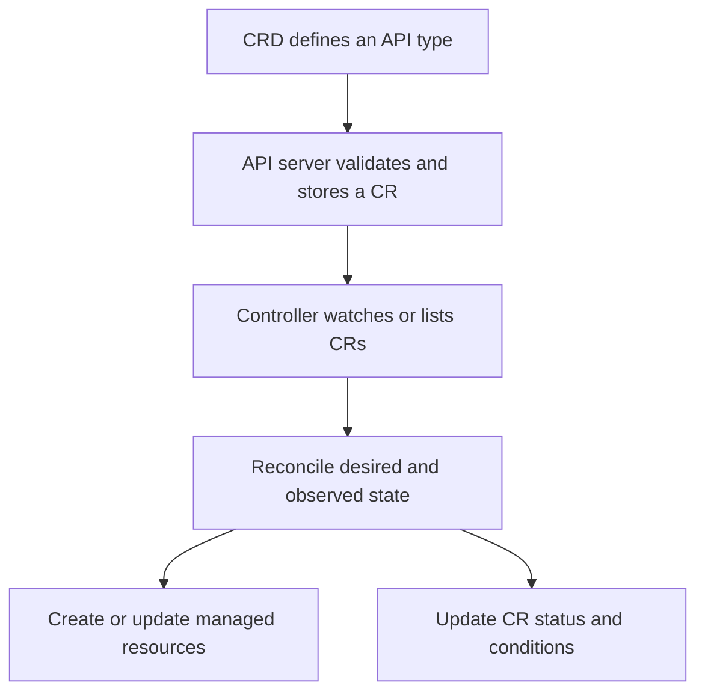
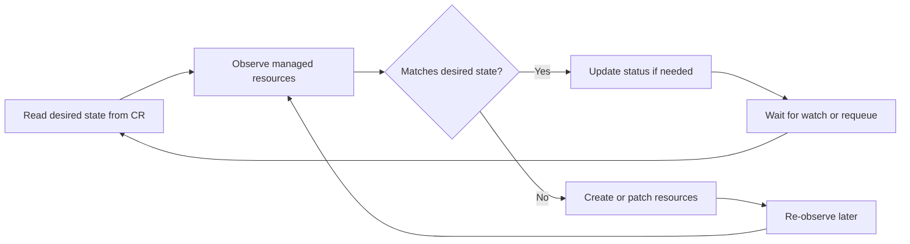

# Operators, CRDs, and Custom Controllers Overview

**Stage:** Stage 2E — Production DevOps & Platform Engineering  
**Module:** M06 — Helm, Kustomize, and Kubernetes Packaging  
**Unit:** 8 — Operators, CRDs, and custom controllers overview  
**Target file:** `08-operators-crds-and-custom-controllers-overview.md`

> **Source verification:** The detailed Unit 8 prompt supplied with this task was available and used as the scope authority. The separate `Roadmap_ptree.md` and full M06 syllabus were not independently available for inspection in this authoring context. Candidate-specific chart paths, versions, and API behavior are therefore not asserted as verified facts. This chapter marks version-sensitive details and tells the learner what to inspect locally.

> **Execution status:** Commands and code are instructional examples and have not been run against your cluster. Expected outcomes are described without fabricated terminal output. Record actual results in the evidence tables.

## 1. Title and M06 placement

This unit introduces Kubernetes API extensions and controllers, then moves from CRD schema design to a small educational controller and production operator due diligence. It builds on Kubernetes workloads and Helm/Kustomize packaging from M06 Units 1–7.

The central distinction is that a CRD extends the API; a custom resource (CR) is an instance of that API; a controller continuously observes and reconciles resources; and an operator combines a controller with domain-specific operational knowledge. Installing a CRD does not install the controller that acts on its objects.

Forward references:
- **M03 Unit 1:** webhook networking, service reachability, and TLS dependencies.
- **M06 Unit 2:** Helm's `crds/` directory and CRD lifecycle limitations.
- **M09:** secrets, identity, and controller credential handling.
- **M16:** platform API design and user-facing contracts.

## 2. Why CRDs, controllers, and operators exist

Kubernetes is an extensible control plane. Built-in resources such as `Deployment`, `Service`, and `CronJob` describe desired state using a common API. Controllers observe these declarations and attempt to make actual state converge toward desired state.

A CRD lets a platform team define a domain-specific resource, such as `DataPipeline`, `Certificate`, or a database `Cluster`. A controller can then translate that high-level intent into lower-level Kubernetes resources and operational actions. The operator pattern goes further by encoding domain knowledge such as backups, failover, upgrades, recovery, and health management.

Why production teams care:

- **API contract:** users need stable fields, validation, compatibility rules, and meaningful status.
- **Continuous reconciliation:** manual changes and partial failures must be detected and handled.
- **Security:** controllers may have permission to create, update, or delete many resources.
- **Lifecycle:** CRD schema upgrades, controller upgrades, webhooks, and stored CRs must remain compatible.
- **Operational burden:** an operator is a software product to maintain, monitor, upgrade, and eventually retire.

A controller is not merely a Deployment. It is a privileged process with a continuous control loop and potentially a large blast radius.

## 3. Prerequisites, lab safety, and version recording

### 3.1 Tool and resource requirements

Primary environment: WSL2 Ubuntu or native Linux, with an approximate laptop budget of 4 CPU cores, 8 GB RAM, and 30 GB disk. The labs use a disposable `kind` cluster, `kubectl`, Helm for chart inspection, Python 3, and optionally a Kubernetes Python client. No paid service or managed cluster is required.

| Lab | Cluster? | Network? | Other requirements | Approximate impact |
|---|---|---|---|---|
| A: CRD schema | Yes, disposable `kind` | No external network after tools are installed | `kubectl`, `kind` | Small cluster resource use |
| B: operator chart inspection | No | Usually yes to fetch the official chart unless already cached | Helm, text/YAML tools | Temporary files only |
| C: toy controller | Yes, disposable `kind` | Only if installing Python package/image dependencies | Python 3; Kubernetes Python client or documented `kubectl` fallback | Small controller process and one CronJob per CR |

Record actual versions before beginning:

```bash
mkdir -p evidence

{
  date -Is
  kubectl version --client
  kind version
  helm version
  python3 --version
  python3 -m pip show kubernetes 2>/dev/null || true
} > evidence/versions.txt
```

After creating the disposable cluster, add the server version:

```bash
kubectl version
```

If the installed `kubectl` version prints a different format or a server version is not available, record the actual output and the reason. Do not guess versions.

### 3.2 Safe cluster context

Before **every** lab action that changes cluster state, check:

```bash
kubectl config current-context
kubectl get namespaces
```

Create an explicitly named disposable cluster if required:

```bash
kind create cluster --name m06-operators-lab
kubectl config current-context
kubectl get nodes
```

These commands require Docker or another supported container runtime for `kind`. Confirm the current context identifies the disposable cluster before applying or deleting resources. If an existing cluster is reused, verify it is disposable and not shared.

Use the namespace `operators-lab` for namespaced lab resources:

```bash
kubectl create namespace operators-lab
kubectl get namespace operators-lab
```

**Critical data-lifecycle warning:** deleting a CRD deletes all custom resources stored under that CRD. Never use `kubectl delete crd --all`. Only delete the explicitly named lab CRD after confirming that all CRs it owns are disposable and that required evidence has been captured.

## 4. Learning objectives and success criteria

After this unit, the learner should be able to:

- Explain CRD, CR, controller, and operator and how they relate.
- Inspect available APIs using `kubectl get crd`, `kubectl api-resources`, and `kubectl explain`.
- Define a namespaced `DataPipeline` CRD with a structural OpenAPI v3 schema, defaults, validation, printer columns, and status subresource.
- Observe the API server rejecting invalid CRs and explain unknown-field pruning.
- Inspect a real operator chart without installing it, review RBAC and webhook configuration, and write a risk assessment with at least five findings.
- Explain reconciliation, idempotency, backoff, leader election, conditions, owner references, finalizers, and webhooks.
- Understand CRD versioning, conversion, storage versions, Helm CRD lifecycle, and deletion risks.
- Run a minimal educational controller that reconciles `DataPipeline` CRs into CronJobs, while understanding its limitations.
- Evaluate whether to use Helm/Kustomize, an existing operator, a custom operator, Crossplane, or admission/policy controls.
- Plan safe upgrades, multi-tenant operation, incident response, and evidence collection.

Completion requires actual observations: valid/invalid CR results, API discovery, a rendered operator chart and written review, controller test results, and an honest record of limitations.

## 5. L1 — Kubernetes extension model

### 5.1 CRD, CR, controller, and operator

- **CustomResourceDefinition (CRD):** declares a new API resource type, including its group, names, scope, versions, and schema.
- **Custom resource (CR):** an object created using the type declared by a CRD.
- **Controller:** a process that observes resources and reconciles actual state toward the desired state.
- **Operator:** a controller (or set of controllers) that automates domain-specific operational knowledge, often including installation, upgrades, backup, recovery, and lifecycle tasks.

A CRD makes the API server understand a resource kind; it does not automatically run a controller. The API server can accept and store a valid `DataPipeline` object while no CronJob is created because no controller is watching it.

### 5.2 Built-in controllers as the mental model

A Deployment declares a desired replica count and pod template. The Deployment controller observes the Deployment and coordinates ReplicaSets; the ReplicaSet controller helps maintain the requested Pods. This is a reconciliation model: users declare intent, controllers repeatedly compare intent to observed state and take corrective action.

Custom controllers use the same broad pattern. The difference is the domain logic and the resources they manage.

### 5.3 API inspection commands

```bash
kubectl get crd
kubectl api-resources
kubectl get crd <CRD_NAME> -o yaml
kubectl explain deployment.spec
kubectl explain <KIND> --recursive
```

Replace placeholders with exact resource names. `kubectl explain` consults the API schema published by the target cluster; a custom kind is available only after its CRD/API is installed and established. If a command cannot find a kind, check the context, CRD name, API group/version, and installation state.

Examples used in this stage:

- cert-manager `Certificate`;
- CloudNativePG `Cluster`;
- Gateway API `HTTPRoute`;
- `VolumeSnapshot`.

These types depend on their respective CRDs/controllers and may not exist in a clean cluster. **[VERIFY]** Confirm their availability and supported API versions from the installed cluster and official project documentation; do not assume the kind exists merely because `kubectl` is installed.

## 6. CRD versus CR versus controller versus operator

The relationship is:



The API server validates the request against the CRD schema and stores an accepted object. A controller then observes that object and attempts to act. The status reports what the controller has observed, not simply what the user requested. An operator includes domain-specific operational behavior around this loop.

This separation helps isolate failures:

- CR rejected: schema, API version, or admission failure.
- CR accepted but no managed object: controller absent, unhealthy, watching another namespace, or blocked by RBAC/logic.
- Managed object exists but is wrong: reconciliation logic, desired-state interpretation, or downstream API failure.
- CR reports stale status: status update failure, controller outage, or status logic bug.

## 7. L2 — CRD anatomy and schema validation

A CRD uses `apiextensions.k8s.io/v1`. Important fields:

| Field | Purpose |
|---|---|
| `group` | API group that namespaces the custom API |
| `names` | Kind, plural, singular, and optional short names/list kind |
| `scope` | Whether CRs are `Namespaced` or `Cluster` scoped |
| `versions` | API versions and whether each is served or the storage version |
| `schema.openAPIV3Schema` | Structural schema for types, required fields, validation, defaults, and pruning |
| `subresources.status` | Enables status updates through the status subresource |
| `subresources.scale` | Optional scale interface when the resource has a meaningful replica/scale contract |
| `additionalPrinterColumns` | Adds columns to human-readable `kubectl get` output |
| `x-kubernetes-validations` | CEL-based validations, subject to Kubernetes-version and schema restrictions |

### 7.1 Structural schema, validation, and pruning

A structural schema declares the types and shape of objects. Fields can be required, constrained, or defaulted. Unknown fields may be pruned from stored objects unless the schema or an explicitly supported preservation setting says otherwise. Pruning is not a substitute for a strict API design: define the fields clients are allowed to set and verify the stored object.

**[VERSION-SENSITIVE]** CEL validation (`x-kubernetes-validations`) availability, supported expressions, and exact semantics depend on the Kubernetes version and schema context. Check the official Kubernetes CRD validation documentation and the server version. A schema-only fallback is provided below.

### 7.2 Defaults and validation

Defaults fill fields omitted by a client when the API server's defaulting rules apply. Validation constrains input. Defaults should be unsurprising and stable; they are part of the API contract. Changing a default can change behavior for newly created objects and, depending on the operation/version and stored object, may not retroactively make every existing object behave as expected.

### 7.3 Status subresource and printer columns

`subresources.status: {}` separates controller-owned status updates from user-owned spec updates. A status field should represent observed state, such as whether a desired CronJob has been reconciled. Printer columns expose useful fields without requiring users to inspect full YAML. Use only fields present in the schema.

### 7.4 CEL validation

A CEL rule can express a relationship between fields that is awkward to express using simple types and required lists. The exact rule syntax and availability must be checked against the cluster version. The CRD example below includes a basic schedule/image shape and uses conservative schema validation; an optional CEL rule is shown separately and must be validated against the target Kubernetes version before applying.

## 8. Build the `DataPipeline` CRD and valid/invalid custom resources

### Lab A — CRD schema validation

**Prerequisites:** `kind`, `kubectl`, shell, and a disposable cluster. No Helm, GPG, Cosign, Python package, or external service is required. After the cluster is created, no network is required to apply the local YAML. The cluster consumes some RAM/disk.

Before proceeding:

```bash
kubectl config current-context
kubectl get namespaces
```

Create the cluster if needed:

```bash
kind create cluster --name m06-operators-lab
kubectl config current-context
kubectl get nodes
kubectl create namespace operators-lab
```

Record actual versions in `evidence/versions.txt`.

### 8.1 CRD file

Save as `datapipeline-crd.yaml` in the lab workspace:

```yaml
apiVersion: apiextensions.k8s.io/v1
kind: CustomResourceDefinition
metadata:
  name: datapipelines.platform.example.com
spec:
  group: platform.example.com
  scope: Namespaced
  names:
    plural: datapipelines
    singular: datapipeline
    kind: DataPipeline
    listKind: DataPipelineList
    shortNames:
      - dp
  versions:
    - name: v1alpha1
      served: true
      storage: true
      schema:
        openAPIV3Schema:
          type: object
          required:
            - spec
          properties:
            apiVersion:
              type: string
            kind:
              type: string
            metadata:
              type: object
            spec:
              type: object
              required:
                - schedule
                - source
                - image
              properties:
                schedule:
                  type: string
                  minLength: 1
                  maxLength: 100
                  description: Cron schedule used by the generated CronJob.
                source:
                  type: string
                  minLength: 1
                  maxLength: 2048
                  description: Illustrative source identifier or URL.
                image:
                  type: string
                  minLength: 1
                  maxLength: 512
                  description: Container image reference used by the generated CronJob.
              additionalProperties: false
            status:
              type: object
              properties:
                observedGeneration:
                  type: integer
                  format: int64
                conditions:
                  type: array
                  items:
                    type: object
                    required:
                      - type
                      - status
                      - reason
                      - message
                    properties:
                      type:
                        type: string
                      status:
                        type: string
                        enum: ["True", "False", "Unknown"]
                      reason:
                        type: string
                      message:
                        type: string
                      lastTransitionTime:
                        type: string
                        format: date-time
                  x-kubernetes-list-type: map
                  x-kubernetes-list-map-keys:
                    - type
      subresources:
        status: {}
      additionalPrinterColumns:
        - name: Schedule
          type: string
          jsonPath: .spec.schedule
        - name: Source
          type: string
          jsonPath: .spec.source
        - name: Ready
          type: string
          jsonPath: .status.conditions[?(@.type=="Ready")].status
```

The API group `platform.example.com` is illustrative and does not claim ownership of a real public API. The schema deliberately uses simple strings for `schedule`, `source`, and `image`; Kubernetes will not prove that a cron expression is semantically valid or that an image exists. Those checks belong in a controller, policy, or other validation mechanism.

`additionalProperties: false` under `spec` is intended to reject unknown spec fields when the structural schema is accepted as written. Check the installed server behavior; if the schema fails to establish, inspect the CRD status and API-server error rather than assuming it was installed.

**[VERIFY] Optional CEL rule:** if supported by the target Kubernetes version, you may add a `x-kubernetes-validations` entry under the `spec` schema, for example a rule requiring `source` to be non-empty. Validate the exact CEL syntax and supported fields against the official docs before applying. The schema's `minLength` already supplies a non-empty constraint, so CEL is not required for this base lab.

### 8.2 Apply and inspect the CRD

```bash
kubectl apply -f datapipeline-crd.yaml
kubectl wait --for=condition=Established \
  crd/datapipelines.platform.example.com --timeout=60s

kubectl get crd datapipelines.platform.example.com
kubectl get crd datapipelines.platform.example.com -o yaml \
  > evidence/datapipeline-crd-applied.yaml
kubectl api-resources --api-group=platform.example.com
kubectl explain datapipeline
kubectl explain datapipeline.spec --recursive
```

Expected observable outcome: the CRD should become established and the new kind should appear in API discovery. If it does not, inspect:

```bash
kubectl describe crd datapipelines.platform.example.com
kubectl get crd datapipelines.platform.example.com -o yaml
```

Capture the actual status and error messages in your evidence.

### 8.3 Valid custom resource

Save as `datapipeline-valid.yaml`:

```yaml
apiVersion: platform.example.com/v1alpha1
kind: DataPipeline
metadata:
  name: nightly-ingest
  namespace: operators-lab
spec:
  schedule: "0 2 * * *"
  source: "s3://example-data/landing"
  image: "registry.example.invalid/data-pipeline:1.0.0"
```

Both source and image are illustrative identifiers. The `.invalid` domain is deliberately non-routable and must be replaced with a real approved image before any attempt to run the resulting CronJob. For the schema-only lab, no image pull is performed.

```bash
kubectl apply -f datapipeline-valid.yaml
kubectl get datapipeline -n operators-lab
kubectl get datapipeline nightly-ingest -n operators-lab -o yaml \
  > evidence/datapipeline-valid-stored.yaml
```

The API server should accept this CR if the CRD is established and no other admission control rejects it. No controller has been installed yet, so do not expect a CronJob to appear.

### 8.4 Invalid CR examples

Missing required field, `spec-missing-image.yaml`:

```yaml
apiVersion: platform.example.com/v1alpha1
kind: DataPipeline
metadata:
  name: missing-image
  namespace: operators-lab
spec:
  schedule: "0 2 * * *"
  source: "s3://example-data/landing"
```

Wrong field type, `spec-wrong-type.yaml`:

```yaml
apiVersion: platform.example.com/v1alpha1
kind: DataPipeline
metadata:
  name: wrong-type
  namespace: operators-lab
spec:
  schedule: 42
  source: "s3://example-data/landing"
  image: "registry.example.invalid/data-pipeline:1.0.0"
```

Run each separately and capture the real output:

```bash
kubectl apply -f spec-missing-image.yaml
kubectl apply -f spec-wrong-type.yaml
```

Expected observable outcome: the API server rejects the first because `image` is required and rejects the second because `schedule` is a string field. The exact error text is version-sensitive; do not copy an invented error into the evidence file.

### 8.5 Unknown fields and stored-object inspection

Create a disposable test CR with an extra field under `spec`, such as `unexpectedField: true`. With the shown strict `spec` schema, the API server should reject the unknown field if the schema is accepted as intended. Other schema configurations may prune unknown fields rather than reject them.

To inspect stored data, compare the submitted file with:

```bash
kubectl get datapipeline nightly-ingest -n operators-lab -o yaml
```

Never infer pruning from the command's exit code alone. Inspect the stored object and record whether the field was rejected or omitted.

### 8.6 Evidence and cleanup

Record:

| Evidence | Actual observation |
|---|---|
| `versions.txt` | [RECORD YOUR RESULT] |
| CRD YAML and establishment status | [RECORD YOUR RESULT] |
| `kubectl api-resources` result | [RECORD YOUR RESULT] |
| `kubectl explain` result | [RECORD YOUR RESULT] |
| Valid CR acceptance and stored YAML | [RECORD YOUR RESULT] |
| Missing-field rejection | [RECORD YOUR RESULT] |
| Wrong-type rejection | [RECORD YOUR RESULT] |
| Unknown-field behavior | [RECORD YOUR RESULT] |
| Confirmation that no controller exists yet | [RECORD YOUR RESULT] |

Cleanup warning: deleting the CRD deletes every custom resource of this kind in the cluster. First verify the disposable context and inspect all CRs:

```bash
kubectl config current-context
kubectl get datapipelines --all-namespaces
```

Delete only the lab CR and namespace after saving evidence. Then, only if this CRD is exclusively for the disposable lab and no valuable CRs remain, delete the named CRD:

```bash
kubectl delete datapipeline nightly-ingest -n operators-lab
kubectl delete namespace operators-lab
# DESTRUCTIVE: deleting this CRD deletes all DataPipeline custom resources
# stored under it. Confirm disposable cluster and no remaining valuable CRs.
kubectl get datapipelines --all-namespaces
kubectl delete crd datapipelines.platform.example.com
```

If other `DataPipeline` resources exist, do not delete the CRD.

## 9. Finalizers, owner references, garbage collection, and status conditions

### 9.1 Owner references and garbage collection

An owner reference tells Kubernetes that a dependent object is owned by another object. When the owner is deleted, garbage collection can remove dependent objects according to Kubernetes ownership and propagation rules. Scope rules matter: a namespaced dependent generally cannot have an invalid cross-namespace owner reference, and cluster-scoped/namespaced combinations have constraints.

A controller should use owner references only when the dependent truly belongs to the owner and the reference is valid. For the toy controller, a CronJob in the same namespace as a namespaced `DataPipeline` can use a controller owner reference to that CR.

### 9.2 Finalizers are a deletion handshake

A finalizer is a string in `metadata.finalizers` that delays actual deletion while a controller performs cleanup. When deletion is requested, the object receives a deletion timestamp; the controller observes it, performs idempotent cleanup, and removes its finalizer only after cleanup succeeds.

Finalizers are not generic “keep this object forever” markers. If the controller is down, lacks permissions, or cannot reach an external service, the object may remain terminating. Before considering manual removal, identify the finalizer owner and cleanup contract, inspect logs, and determine whether external resources would be orphaned or data lost. Manual removal is a controlled last resort, not the first fix.

### 9.3 Status conditions

`spec` is user intent; `status` is controller-observed state. Conditions commonly have a type, status (`True`, `False`, or `Unknown`), reason, message, and transition time. A `Ready=True` condition should mean something documented and testable, not merely “the controller process is running.”

A status update may conflict if another update changes the object between read and write. Controllers should re-read/retry safely and avoid writing status repeatedly when nothing changed.

## 10. Operator installation and inspection lab

Operator installation options include:

- **Helm chart:** convenient packaging and values, but CRD upgrade behavior needs explicit review.
- **Plain manifests:** direct resources; the operator owns upgrade ordering and configuration management.
- **Operator Lifecycle Manager (OLM):** an ecosystem for packaging, cataloging, and managing operators; availability and operating model depend on the cluster and distribution.

Installing an operator may add CRDs, a Deployment, ServiceAccounts, RBAC, Services, webhook configurations, certificates, and other resources. It may have cluster-wide privileges. Rendering and reviewing first is safer than immediately installing.

### Lab B — Inspect a real operator chart without installing it

**Prerequisites:** Helm and internet access or a cached chart. No Kubernetes cluster is required. The default is not to install the operator. Disk impact is limited to the downloaded chart and rendered files.

#### B1. Locate the CloudNativePG chart from M05

The roadmap suggests reusing CloudNativePG from M05 where possible, but this chapter does not have a verified repository URL or chart version. Locate the exact reference and version in your existing M05 material. Confirm it against CloudNativePG's official documentation and chart source/release notes.

If the M05 reference cannot be found, begin at the project's official documentation site and follow its chart installation instructions. Do not take a chart reference from an arbitrary search result without validating the publisher and version. Record the exact source, chart name, version, and date checked.

#### B2. Pull metadata and render without installation

Once you have the verified chart reference and version, define placeholders:

- `<CHART_REFERENCE>`: exact chart reference from M05 or the official project documentation.
- `<CHART_VERSION>`: exact version you verified.
- `<LAB_DIR>`: temporary review directory.

```bash
mkdir -p <LAB_DIR>
helm show chart <CHART_REFERENCE> --version <CHART_VERSION> \
  > <LAB_DIR>/chart-metadata.yaml
helm show values <CHART_REFERENCE> --version <CHART_VERSION> \
  > <LAB_DIR>/default-values.yaml
helm pull <CHART_REFERENCE> --version <CHART_VERSION> \
  --untar --untardir <LAB_DIR>/chart
helm template operator-review <CHART_REFERENCE> \
  --version <CHART_VERSION> \
  > <LAB_DIR>/rendered.yaml
```

**[VERSION-SENSITIVE]** Verify the exact `helm show`, `helm pull`, and `helm template` options with installed Helm help. If the chart reference is OCI, use the appropriate OCI reference syntax. Do not run `helm install` as part of this lab.

#### B3. Inspect the archive and rendered resources

A chart may store CRDs under a special `crds/` directory that is not rendered by `helm template` in the same way as ordinary templates. Inspect both the extracted tree and rendered output:

```bash
find <LAB_DIR>/chart -maxdepth 4 -type f -print
grep -nE 'kind: (CustomResourceDefinition|Deployment|ServiceAccount|Role|RoleBinding|ClusterRole|ClusterRoleBinding|ValidatingWebhookConfiguration|MutatingWebhookConfiguration|Service)' \
  <LAB_DIR>/rendered.yaml
```

The `grep` command is a quick inventory, not a complete YAML parser. Also inspect:
- CRD schema, served/storage versions, status subresources, and validation.
- Controller Deployment: image, command/args, resource requests/limits, probes, security context, and namespace.
- ServiceAccount and all Role/ClusterRole rules: API groups, resources, verbs, resource names, and scope.
- RoleBindings/ClusterRoleBindings and their subjects.
- Admission/conversion webhook configuration, service endpoints, selectors, timeout, failure policy, and certificate assumptions where present.
- Services, certificate resources, and configuration that support webhook TLS.
- Images and pull policies.
- Cluster-wide permissions and possible mass-delete capability.

#### B4. Written risk review — at least five findings

Use this table and complete at least five rows with evidence from the chart you inspected:

| Finding | Evidence (file/path and rule/resource) | Risk and severity rationale | Mitigation or follow-up question |
|---|---|---|---|
| RBAC scope | [RECORD YOUR RESULT] | [RECORD YOUR RESULT] | [RECORD YOUR RESULT] |
| Webhook availability/failure policy | [RECORD YOUR RESULT] | [RECORD YOUR RESULT] | [RECORD YOUR RESULT] |
| CRD version/upgrade lifecycle | [RECORD YOUR RESULT] | [RECORD YOUR RESULT] | [RECORD YOUR RESULT] |
| Controller image/security context | [RECORD YOUR RESULT] | [RECORD YOUR RESULT] | [RECORD YOUR RESULT] |
| Resource requests/limits/observability | [RECORD YOUR RESULT] | [RECORD YOUR RESULT] | [RECORD YOUR RESULT] |
| Certificate and trust assumptions | [RECORD YOUR RESULT] | [RECORD YOUR RESULT] | [RECORD YOUR RESULT] |
| Backup/restore and exit strategy | [RECORD YOUR RESULT] | [RECORD YOUR RESULT] | [RECORD YOUR RESULT] |

Do not mark a risk as absent because a quick text search found nothing; inspect the whole chart and its CRDs. Candidate-specific statements about CloudNativePG's current support matrix, release cadence, or feature behavior remain `[VERIFY]` until confirmed against current official documentation and release notes.

No operator is installed by this lab. If you later choose to install it, first complete the risk review and use a separate disposable cluster with a documented cleanup plan.

## 11. L3 — Controller reconciliation internals

### 11.1 Desired state versus observed state

Reconciliation is the repeated process of comparing a user's declared desired state with the state that exists and applying changes to reduce the difference.



The controller should not assume an event contains the full truth. Events may be duplicated, coalesced, delayed, or missed during restart. A watch event is a reason to reconcile; the controller should read current state and make a safe decision.

### 11.2 Informers, caches, watches, and lists

Many controller frameworks use watches and cached representations to avoid repeatedly listing every object from the API server. An initial list establishes current state; watch events indicate changes after a resource version. A cache may be briefly stale. Controllers must handle not-found results, conflicts, retries, and transient API errors.

A work queue separates event delivery from processing. Keys are queued, then reconciled. If many events arrive for the same key, queue implementations may coalesce work. **[VERSION-SENSITIVE]** Exact informer, cache, and queue APIs depend on the framework and library version.

### 11.3 Level-triggered reconciliation and idempotency

A level-triggered controller asks “what should be true now?” rather than “what one-time action should I execute because I saw an event?” This makes recovery after restarts possible. Re-running reconciliation should not create duplicate CronJobs or repeatedly write unchanged status.

Idempotency means that applying the same desired state repeatedly converges on the same result. Use deterministic resource names, compare desired and observed fields, and update only what needs changing. Handle partial failure: a CronJob might be created while the status update fails. A later reconciliation should discover the existing CronJob and safely update status.

### 11.4 Requeue, backoff, rate limiting, and hot loops

Transient failures should be retried with bounded exponential backoff or the framework's supported rate limiter. Permanent invalid input should produce a clear status condition/event and avoid immediate tight-loop retries until relevant input changes. Avoid no-op updates that trigger more watch events and create a feedback loop.

Observe:
- reconciliation duration;
- reconcile errors and retry count;
- work-queue depth;
- API request volume and throttling;
- condition transitions;
- logs and Events;
- webhook latency and failure rates.

### 11.5 Leader election

If multiple controller replicas can perform the same actions, they may conflict or duplicate work. Frameworks may support leader election so one replica actively performs selected reconciliation work while others are standby. This is not universally required for every controller, and it is not a substitute for idempotency. Verify the framework's leader-election configuration and lease permissions before enabling it.

### 11.6 Status, Events, and observability

Status conditions communicate controller-observed outcomes. Kubernetes Events are useful diagnostic hints but are not durable audit records; they expire and can be rate-limited. Logs should be structured enough to connect a reconcile attempt to a resource key, result, and error. Metrics should expose errors and latency, not just process liveness.

## 12. CRD versions, conversion, storage version, and migration

A CRD may expose multiple API versions. For each version, `served: true` means clients can use that version; `storage: true` identifies the version used for persistence by the API server. These are separate concepts. A CRD can serve multiple versions while storing objects in one selected version.

Illustrative progression:

```text
v1alpha1  →  v1beta1  →  v1
early API     pre-stable    stable API
```

This is a conceptual example, not a claim that a particular CRD has these versions.

### 12.1 Conversion strategies

A CRD may use a conversion strategy that does not transform fields (`None`) or a conversion webhook that translates objects between served versions. Exact semantics and compatibility requirements are **[VERSION-SENSITIVE]**; verify the Kubernetes CRD documentation for the target server version. Do not assume changing `served` flags automatically migrates all stored data or that a conversion webhook can be unavailable without consequence.

A conversion webhook adds a service, TLS/certificate, and API availability dependency. If it is broken, clients using affected versions may fail to read or write resources.

### 12.2 Storage-version migration

Changing the storage version and ensuring existing objects are rewritten into the desired version is a data migration. Merely editing a CRD's `storage` flag is not a complete migration plan. Determine which stored objects need conversion, how migration is triggered and observed for the installed Kubernetes version, and how rollback is handled. Use official Kubernetes storage-version migration documentation and test on an ephemeral cluster.

### 12.3 Compatibility and deprecation

Before removing a field or API version:
- identify consumers and stored CRs;
- introduce replacement fields and clear deprecation notices;
- preserve conversion behavior for the supported transition window;
- validate existing resources against the new schema;
- test defaults, pruning, and validation changes;
- document a migration and rollback plan;
- publish release notes and support timelines.

A CRD schema change can affect existing objects: invalid fields may be rejected on updates, unknown fields may be pruned, defaults may change, and conversion may fail. A controller binary rollback does not necessarily reverse stored API changes or restore pruned data.

## 13. CRD lifecycle with Helm

Helm chart CRDs placed in the special `crds/` directory have different lifecycle behavior from ordinary templated resources. Helm's documented CRD handling is intentionally limited: do not assume chart upgrades automatically update or migrate CRDs, and do not assume a chart uninstall removes them. **[VERSION-SENSITIVE]** Verify the installed Helm release's official CRD documentation and the specific chart's upgrade instructions.

Safe CRD upgrade principles:

1. Read chart release notes and CRD migration instructions.
2. Back up custom resources before the change.
3. Review schema/version diffs and validate existing CRs.
4. Apply CRD changes using the documented supported procedure.
5. Upgrade the controller only when its expected API schema is available.
6. Monitor reconciliation, conversion webhooks, conditions, and API errors.
7. Keep a recovery plan that accounts for data/schema changes, not just a previous controller image.

A `kubectl get <resource> -o yaml` export is useful evidence, but it is not a complete etcd backup: it may omit internal metadata and does not by itself guarantee restoration of external state, ordering, secrets, or controller-managed dependencies. etcd and Velero backup/restore are forward references, not a complete backup lesson here.

**Immediate warning before deletion:** deleting a CRD deletes all custom resources of that kind stored under it. Treat it as a data-lifecycle operation. Require explicit approval, inventory, backup, ownership records, and proof that no valuable CRs remain. Never casually use `kubectl delete crd --all`.

## 14. Toy `DataPipeline` controller lab

### Lab C — Educational controller, not production-ready software

This lab demonstrates the controller pattern with Python and the Kubernetes Python client. The controller polls `DataPipeline` resources, creates or updates a deterministic CronJob, and updates status. Polling is chosen to keep the teaching example compact; it is less efficient than a production watch/cache/work-queue architecture.

**Important:** the code is an educational toy, not production code. It does not implement a robust informer/work queue, leader election, metrics, production-grade Events, sophisticated retry/backoff, comprehensive conflict handling, webhook validation, or a complete finalizer-based external cleanup protocol. Use it only in a disposable cluster.

**Prerequisites:** a working disposable `kind` cluster, `kubectl`, Python 3, and the Kubernetes Python client. Installing the client may require network access unless it is already installed. The controller runs locally using your kubeconfig; no controller container image is required. It creates one CronJob per `DataPipeline` and consumes modest resources.

#### 14.1 Verify context and create namespace

```bash
kubectl config current-context
kubectl get namespaces
kubectl get crd datapipelines.platform.example.com
kubectl create namespace operators-lab
```

If the CRD from Lab A is not installed, apply it first. Confirm that the current context is the disposable cluster. Do not proceed in a production/shared context.

Install the Python client in a virtual environment:

```bash
python3 -m venv .venv
. .venv/bin/activate
python -m pip install kubernetes
python -m pip show kubernetes
```

**[VERIFY]** Record the exact client version. The code below uses the common Kubernetes Python client APIs `config.load_kube_config`, `CustomObjectsApi`, `BatchV1Api`, and `CoreV1Api`; verify method signatures against the installed package documentation if the client changes.

#### 14.2 RBAC manifest for in-cluster deployment

The primary toy runs locally using kubeconfig credentials, so the following RBAC is a reviewable example of the permissions an in-cluster controller would need. Do not apply it unless you intentionally deploy the controller inside the lab cluster.

Save as `toy-controller-rbac.yaml`:

```yaml
apiVersion: v1
kind: ServiceAccount
metadata:
  name: datapipeline-controller
  namespace: operators-lab
---
apiVersion: rbac.authorization.k8s.io/v1
kind: Role
metadata:
  name: datapipeline-controller
  namespace: operators-lab
rules:
  - apiGroups: ["platform.example.com"]
    resources: ["datapipelines"]
    verbs: ["get", "list", "watch"]
  - apiGroups: ["platform.example.com"]
    resources: ["datapipelines/status"]
    verbs: ["get", "update", "patch"]
  - apiGroups: ["batch"]
    resources: ["cronjobs"]
    verbs: ["get", "list", "watch", "create", "update", "patch", "delete"]
  - apiGroups: [""]
    resources: ["events"]
    verbs: ["create", "patch"]
---
apiVersion: rbac.authorization.k8s.io/v1
kind: RoleBinding
metadata:
  name: datapipeline-controller
  namespace: operators-lab
subjects:
  - kind: ServiceAccount
    name: datapipeline-controller
    namespace: operators-lab
roleRef:
  apiGroup: rbac.authorization.k8s.io
  kind: Role
  name: datapipeline-controller
```

This is namespace-scoped and intentionally avoids `cluster-admin`. The `delete` verb on CronJobs is included for a possible controller cleanup policy, but the code below relies primarily on owner references and does not need broad cluster deletion permissions. Review whether each verb is required before deploying an actual controller. A production controller may need a different Event API/permission set depending on the library version.

#### 14.3 Toy controller source

Save as `datapipeline_controller.py`:

```python
#!/usr/bin/env python3
"""
Educational DataPipeline -> CronJob reconciler.
NOT production-ready. Run only against a disposable lab cluster.
"""
import hashlib
import json
import logging
import os
import time
from datetime import datetime, timezone

from kubernetes import client, config
from kubernetes.client.rest import ApiException

logging.basicConfig(
    level=os.environ.get("LOG_LEVEL", "INFO"),
    format="%(asctime)s %(levelname)s %(message)s",
)
LOG = logging.getLogger("datapipeline-controller")

GROUP = "platform.example.com"
VERSION = "v1alpha1"
PLURAL = "datapipelines"
NAMESPACE = os.environ.get("LAB_NAMESPACE", "operators-lab")
POLL_SECONDS = int(os.environ.get("POLL_SECONDS", "10"))
FINALIZER = "platform.example.com/cleanup"


def deterministic_name(cr_name):
    # Kubernetes resource names must remain within length constraints.
    base = cr_name.lower().replace("_", "-")
    suffix = hashlib.sha1(cr_name.encode("utf-8")).hexdigest()[:6]
    return f"dp-{base[:45].strip('-')}-{suffix}"


def condition(status, reason, message):
    return {
        "type": "Ready",
        "status": status,
        "reason": reason,
        "message": message[:1024],
        "lastTransitionTime": datetime.now(timezone.utc).isoformat(),
    }


def cronjob_body(cr, name):
    spec = cr.get("spec", {})
    metadata = cr.get("metadata", {})
    uid = metadata.get("uid")
    if not uid:
        raise ValueError("DataPipeline has no metadata.uid yet")

    image = spec.get("image")
    schedule = spec.get("schedule")
    source = spec.get("source")
    if not all(isinstance(v, str) and v.strip() for v in (image, schedule, source)):
        raise ValueError("spec.schedule, spec.source, and spec.image must be non-empty strings")

    return {
        "apiVersion": "batch/v1",
        "kind": "CronJob",
        "metadata": {
            "name": name,
            "namespace": metadata.get("namespace", NAMESPACE),
            "labels": {
                "app.kubernetes.io/managed-by": "datapipeline-controller",
                "platform.example.com/datapipeline": metadata.get("name", ""),
            },
            "ownerReferences": [{
                "apiVersion": f"{GROUP}/{VERSION}",
                "kind": "DataPipeline",
                "name": metadata["name"],
                "uid": uid,
                "controller": True,
                "blockOwnerDeletion": False,
            }],
        },
        "spec": {
            "schedule": schedule,
            "concurrencyPolicy": "Forbid",
            "jobTemplate": {
                "spec": {
                    "template": {
                        "metadata": {
                            "labels": {
                                "platform.example.com/datapipeline": metadata.get("name", "")
                            }
                        },
                        "spec": {
                            "restartPolicy": "Never",
                            "containers": [{
                                "name": "pipeline",
                                "image": image,
                                "imagePullPolicy": "IfNotPresent",
                                "env": [{
                                    "name": "PIPELINE_SOURCE",
                                    "value": source,
                                }],
                            }],
                        },
                    }
                }
            },
        },
    }


def set_status(custom_api, cr, status, reason, message):
    metadata = cr.get("metadata", {})
    name = metadata.get("name")
    namespace = metadata.get("namespace", NAMESPACE)
    generation = metadata.get("generation", 0)
    body = {
        "status": {
            "observedGeneration": generation,
            "conditions": [condition(status, reason, message)],
        }
    }
    try:
        custom_api.patch_namespaced_custom_object_status(
            group=GROUP,
            version=VERSION,
            namespace=namespace,
            plural=PLURAL,
            name=name,
            body=body,
        )
    except ApiException as exc:
        # A real controller should distinguish conflicts, retry with a fresh read,
        # and avoid tight-loop status writes.
        LOG.warning("status update failed for %s/%s: %s", namespace, name, exc)


def reconcile_one(custom_api, batch_api, cr):
    metadata = cr.get("metadata", {})
    name = metadata.get("name", "")
    namespace = metadata.get("namespace", NAMESPACE)
    deletion_timestamp = metadata.get("deletionTimestamp")
    cron_name = deterministic_name(name)

    if deletion_timestamp:
        # This toy uses owner references for dependent CronJob cleanup and has
        # no external resource to clean up. The finalizer is therefore removed
        # only after confirming the owned CronJob is absent or cleanup has
        # been delegated to Kubernetes garbage collection.
        try:
            batch_api.delete_namespaced_cron_job(
                name=cron_name, namespace=namespace
            )
        except ApiException as exc:
            if exc.status != 404:
                LOG.warning("cleanup failed for %s/%s: %s", namespace, name, exc)
                return
        if FINALIZER in metadata.get("finalizers", []):
            try:
                custom_api.patch_namespaced_custom_object(
                    group=GROUP,
                    version=VERSION,
                    namespace=namespace,
                    plural=PLURAL,
                    name=name,
                    body={"metadata": {"finalizers": [
                        f for f in metadata.get("finalizers", []) if f != FINALIZER
                    ]}},
                )
            except ApiException as exc:
                LOG.warning("finalizer removal failed for %s/%s: %s", namespace, name, exc)
        return

    try:
        body = cronjob_body(cr, cron_name)
    except (KeyError, ValueError) as exc:
        set_status(custom_api, cr, "False", "InvalidSpec", str(exc))
        LOG.warning("invalid DataPipeline %s/%s: %s", namespace, name, exc)
        return

    # Add the finalizer before creating managed resources. A production controller
    # must handle resourceVersion conflicts and finalizer updates robustly.
    if FINALIZER not in metadata.get("finalizers", []):
        try:
            custom_api.patch_namespaced_custom_object(
                group=GROUP,
                version=VERSION,
                namespace=namespace,
                plural=PLURAL,
                name=name,
                body={"metadata": {"finalizers": metadata.get("finalizers", []) + [FINALIZER]}},
            )
            # Re-fetch on the next poll to avoid relying on stale metadata.
            return
        except ApiException as exc:
            LOG.warning("could not add finalizer for %s/%s: %s", namespace, name, exc)
            return

    try:
        existing = batch_api.read_namespaced_cron_job(cron_name, namespace)
        # Merge patch only the fields managed by this toy. Avoid replacing fields
        # owned by other controllers, and do not write if desired state is equal.
        desired = body["spec"]
        current = existing.to_dict()
        current_spec = current.get("spec") or {}
        if current_spec.get("schedule") != desired["schedule"] or \
           current_spec.get("job_template") != desired["job_template"] or \
           current_spec.get("concurrency_policy") != desired["concurrencyPolicy"]:
            batch_api.patch_namespaced_cron_job(
                name=cron_name,
                namespace=namespace,
                body={"spec": desired, "metadata": {"labels": body["metadata"]["labels"]}},
            )
        set_status(custom_api, cr, "True", "Reconciled", f"CronJob {cron_name} is present")
    except ApiException as exc:
        if exc.status != 404:
            LOG.warning("read/patch CronJob failed for %s/%s: %s", namespace, name, exc)
            set_status(custom_api, cr, "False", "ReconcileError", str(exc))
            return
        try:
            batch_api.create_namespaced_cron_job(namespace=namespace, body=body)
            set_status(custom_api, cr, "True", "Created", f"CronJob {cron_name} created")
        except ApiException as create_exc:
            LOG.warning("create CronJob failed for %s/%s: %s", namespace, name, create_exc)
            set_status(custom_api, cr, "False", "ReconcileError", str(create_exc))


def main():
    # Use local kubeconfig for this teaching lab. An in-cluster deployment would
    # use load_incluster_config() and a narrowly scoped ServiceAccount.
    config.load_kube_config()
    custom_api = client.CustomObjectsApi()
    batch_api = client.BatchV1Api()

    LOG.info("starting toy controller namespace=%s poll=%ss", NAMESPACE, POLL_SECONDS)
    while True:
        try:
            items = custom_api.list_namespaced_custom_object(
                group=GROUP,
                version=VERSION,
                namespace=NAMESPACE,
                plural=PLURAL,
            ).get("items", [])
            for cr in items:
                reconcile_one(custom_api, batch_api, cr)
        except ApiException as exc:
            LOG.error("list/reconcile loop API error: %s", exc)
        except Exception:
            LOG.exception("unexpected loop error")
        time.sleep(max(POLL_SECONDS, 2))


if __name__ == "__main__":
    main()
```

**Important API/version notes:** Python client model attribute names, patch semantics, status patch behavior, and Kubernetes server behavior are **[VERIFY]** against the installed `kubernetes` package and server version. The code is intentionally small and should be reviewed before execution. A production controller should use a proper queue/watch framework and conflict-safe reconciliation rather than this polling loop.

#### 14.4 Run the controller and test

First confirm the CRD and valid CR from Lab A exist. Use a real approved image if you plan to allow CronJobs to run; the illustrative `.invalid` image is suitable only for schema/controller-object testing and will not pull successfully.

In terminal A:

```bash
kubectl config current-context
kubectl get datapipelines -n operators-lab
. .venv/bin/activate
LAB_NAMESPACE=operators-lab POLL_SECONDS=10 python datapipeline_controller.py
```

In terminal B, observe the generated CronJob and CR status:

```bash
kubectl get cronjobs -n operators-lab
kubectl get datapipeline nightly-ingest -n operators-lab -o yaml
kubectl describe cronjob -n operators-lab
```

Expected outcome: after a poll/reconcile cycle, the controller should create a deterministically named CronJob and update the CR status if the installed API/client methods behave as expected. If it does not, collect controller logs, CRD status, API errors, and the CronJob list; do not invent a success result.

#### 14.5 Drift-correction experiment

Change the generated CronJob schedule manually to a different valid value, then wait for a reconcile cycle and inspect whether the controller restores the schedule from the CR. Use the exact CronJob name observed in your cluster.

```bash
kubectl get cronjobs -n operators-lab
kubectl get cronjob <OBSERVED_CRONJOB_NAME> -n operators-lab -o yaml
```

Patch only the lab object using a documented command for the installed `kubectl`; then compare before/after YAML. The toy compares a limited set of fields, so do not expect it to restore every possible field or label. Record the exact fields it does and does not manage.

#### 14.6 Stop/restart and invalid-spec experiments

- Stop the controller with `Ctrl+C`.
- Change a lab CR's schedule or image and observe that no controller reconciliation occurs while the process is stopped.
- Restart the controller and observe whether it converges to the latest CR state.
- Create an invalid object using a schema-accepted but semantically invalid value, such as a malformed cron expression. Because the CRD schema only checks a string, the API server may accept it; the toy does not fully parse cron syntax, so this exposes a production gap. Record the controller behavior rather than assuming it rejects the schedule.
- To test a schema-invalid CR, use the invalid examples from Lab A; the API server should reject them before the controller sees them.

#### 14.7 Deletion and finalization

The toy adds a finalizer and removes it after attempting to delete its deterministically named CronJob. Owner references are also set so Kubernetes garbage collection can remove the dependent. This is deliberately redundant teaching behavior, not a recommendation to add finalizers without a cleanup need.

Delete the lab CR while the controller is running and inspect the deletion lifecycle:

```bash
kubectl delete datapipeline nightly-ingest -n operators-lab
kubectl get datapipeline nightly-ingest -n operators-lab -o yaml
kubectl get cronjobs -n operators-lab
```

Then repeat only in the disposable namespace with the controller stopped to observe how a finalizer can leave an object terminating. Restore the controller and inspect whether it completes cleanup.

If the toy fails to remove a finalizer, do not immediately strip it. Inspect the finalizer value, controller logs, CronJob state, and whether any external cleanup is required. Manual finalizer removal is a last resort after understanding the consequences.

#### 14.8 Test matrix and evidence

| Test | Procedure | Expected observation to verify | Actual result |
|---|---|---|---|
| Create | Apply valid CR | One deterministic CronJob appears | [RECORD YOUR RESULT] |
| Update | Change schedule in CR | CronJob schedule converges | [RECORD YOUR RESULT] |
| Invalid spec | Apply schema-invalid CR | API server rejects it | [RECORD YOUR RESULT] |
| Semantically invalid schedule | Apply schema-valid invalid cron string | Controller limitation is observable; no false claim of cron validation | [RECORD YOUR RESULT] |
| Drift | Manually alter managed schedule | Reconcile restores managed field | [RECORD YOUR RESULT] |
| Delete | Delete CR while controller runs | Cleanup/finalizer/owner-reference behavior observed | [RECORD YOUR RESULT] |
| Controller restart | Stop, mutate CR, restart | Reconciliation resumes toward current state | [RECORD YOUR RESULT] |
| API conflict | Cause or observe update conflict if safely reproducible | Error is logged and retried/reconciled on later poll | [RECORD YOUR RESULT] |
| Cleanup | Delete only lab resources | No unrelated CRs/resources deleted | [RECORD YOUR RESULT] |

**Production gaps:** proper queueing and watches, retry/backoff, leader election, metrics, structured logs, Events, comprehensive conflict handling, unit/integration/envtest tests, security hardening, packaging, rollout, compatibility testing, robust finalizer semantics, and operator lifecycle documentation.

## 15. Frameworks, alternatives, maturity, and build-versus-buy decision

### 15.1 Framework awareness

| Framework/tool | Language/model | Awareness-level use case | Verification note |
|---|---|---|---|
| Kubebuilder / controller-runtime | Go | Common framework for Kubernetes APIs/controllers | Verify current official docs and compatibility |
| Operator SDK | Primarily Go ecosystem and operator tooling | Operator scaffolding and lifecycle patterns | Verify current framework options and release docs |
| Kopf | Python | Python-based Kubernetes operators | Verify installed package version and handler APIs |
| Metacontroller | Controller composition/delegation model | Extend controller behavior with less custom control-loop code | Verify current project maintenance and compatibility |
| shell-operator | Shell-oriented hooks and event-driven automation | Operational integrations and scripts | Verify current docs and production suitability |

These tools do not have identical maturity, APIs, deployment models, or support guarantees. Do not select a framework solely because it is familiar. Evaluate maintainer activity, release cadence, tests, security practices, compatibility, observability, and team expertise.

### 15.2 Alternatives to writing an operator

- **Helm:** package and parameterize resources; appropriate when lifecycle behavior is mostly install/upgrade/configuration.
- **Kustomize:** compose and patch manifests across environments; appropriate for declarative differences without continuous domain reconciliation.
- **Crossplane Compositions:** compose infrastructure/platform APIs using existing providers and managed resources; evaluate its own control plane and operational footprint.
- **Policy engines/admission controls:** validate or mutate requests; appropriate for enforcing constraints at API admission rather than continuously managing external lifecycle.
- **Existing operator:** prefer a maintained, compatible operator when it satisfies requirements and its risks are acceptable.
- **Custom operator:** justified when repeated complex day-2 operations, continuous reconciliation, and a stable domain-specific API create enough value to offset long-term maintenance and compatibility obligations.

### 15.3 Build-versus-not-build matrix

| Need | Preferred starting point | Why | Reconsider when |
|---|---|---|---|
| Install/configure a set of ordinary resources | Helm or Kustomize | Less custom code and lower lifecycle burden | Repeated day-2 workflows require domain logic |
| Operate a supported database/service with complex lifecycle | Existing operator after due diligence | Reuses domain knowledge | Support/compatibility or trust is inadequate |
| Continuously reconcile a unique domain API | Custom operator | API and reconciliation behavior are tailored | Team cannot own testing, upgrades, security, and support |
| Compose external infrastructure APIs | Crossplane Compositions, if ecosystem fit is proven | Reuses provider/control-plane model | Provider coverage or operational complexity is unsuitable |
| Reject or mutate invalid resource submissions | Schema, CEL, admission policy/webhook | Enforces rules at admission | Requirement needs ongoing reconciliation after creation |

Operator maturity models are sometimes described in levels, from basic installation to more advanced lifecycle management such as upgrades, backup/restore, and failure recovery. **[VERIFY]** The exact labels and expectations depend on the ecosystem and project; do not assume a maturity badge guarantees production suitability.

## 16. L4 — Production operator due diligence and blast-radius controls

### 16.1 Reusable due-diligence table

Every candidate-specific finding must be based on current primary-source documentation, chart contents, source code, release notes, and observed test evidence. Mark unverified statements `[VERIFY]`.

| Area | Questions/evidence to inspect | Risk signal | Mitigation/decision | Verified source/version |
|---|---|---|---|---|
| Maintenance | Recent releases, issue/PR activity, response to security issues? | Abandoned project or unresolved critical bugs | Require ownership and support plan | [VERIFY] |
| Governance/ownership | Who maintains it and how are changes reviewed? | Unclear ownership or single unaccountable maintainer | Confirm governance/escalation path | [VERIFY] |
| Release cadence | Are releases predictable and security fixes published? | Irregular releases with unclear support | Establish compatibility/support policy | [VERIFY] |
| Kubernetes compatibility | Supported server versions and API deprecations? | Target cluster outside support matrix | Test on supported version in `kind` | [VERIFY] |
| CRD migration | Are schema changes and migration steps documented? | Destructive schema change or no upgrade guide | Stage and test migration; back up CRs | [VERIFY] |
| RBAC | Which verbs/resources/groups and scopes are granted? | Broad wildcard or cluster-wide write/delete | Reduce permissions or reject adoption | [VERIFY] |
| Webhooks | Service, certificates, failure policy, timeout, selectors? | Unavailable endpoint can block API requests | Test outage behavior and recovery | [VERIFY] |
| Security | Image provenance, vulnerability handling, security context? | Untrusted images or unnecessary privilege | Verify image/source and harden runtime | [VERIFY] |
| Resource footprint | Requests/limits, scaling, API pressure? | Unbounded memory or frequent API writes | Set limits, load-test, monitor | [VERIFY] |
| Observability | Logs, metrics, Events, conditions, alerts? | No way to detect reconcile failures | Add monitoring/runbooks or reject | [VERIFY] |
| Test evidence | Unit/integration/upgrade tests? | No regression or migration evidence | Test upgrade/downgrade scenarios | [VERIFY] |
| Backup/restore | Are CRs and domain data recoverable? | No tested restore path | Define backup/restore and RPO/RTO | [VERIFY] |
| Exit strategy | Can data/resources be exported and operator removed? | Proprietary state or unclear deletion behavior | Test migration and decommission plan | [VERIFY] |

### 16.2 Blast-radius safeguards

- **Cluster-wide RBAC:** review each rule; prefer namespace-scoped access where feasible.
- **Webhooks:** failure policy, selectors, timeout, TLS, and service availability determine how a webhook outage affects API writes. A fail-closed webhook may preserve policy but block operations; fail-open may preserve availability but permit unvalidated requests.
- **Mass deletion:** identify controller code paths that delete resources based on labels, owner references, or missing parent objects. Require explicit protections for destructive operations.
- **Finalizers:** cleanup must be idempotent and observable. A finalizer should not remain indefinitely without alerts and an owner.
- **Dry-run/preview:** use only if the operator genuinely supports it; do not assume a chart's `--dry-run` predicts controller behavior.
- **Deletion approval:** require explicit review for CRD deletion and destructive CR changes.
- **Rate limits and backoff:** bound retries and avoid API-server hot loops.
- **Resource quotas/limits:** constrain controller and managed workload consumption.
- **Namespace scoping:** scope watch and RBAC intentionally; a namespaced CRD does not neutralize a controller with cluster-wide permissions.

## 17. Safe upgrades, multi-tenancy, policy-as-code, and API design

### 17.1 Safe upgrade procedure

1. Read official release notes and compatibility matrices.
2. Render and diff the new chart/manifests against the current release.
3. Back up CRs with `kubectl get <resource> -A -o yaml`; understand this is an export, not a complete etcd backup.
4. Review CRD schema/version changes and validate existing resources against the new schema.
5. Test in an ephemeral `kind` cluster using representative CRs.
6. Check conversion webhooks, admission behavior, defaults, pruning, and status updates.
7. Stage rollout across clusters and monitor reconciliation latency/errors, conditions, Events, API pressure, and webhook health.
8. Prepare rollback and recovery plans that account for schema/storage migrations and external side effects.
9. Confirm consumers and support teams know the migration sequence.
10. Keep evidence and stop if an unexpected validation or conversion failure appears.

A controller image rollback may not reverse data already pruned, stored-version changes, external actions, or CRD schema changes.

### 17.2 Multi-tenancy and scope

CRD **scope** determines whether each CR is namespaced or cluster-scoped. Controller **watch scope** determines which namespaces the controller observes. RBAC determines which resources it can read/write. These are separate choices.

A namespaced CRD does not guarantee tenant isolation if the controller has cluster-wide write privileges or can act on resources in other namespaces. Review:
- whether the controller watches one namespace, an explicit set, or all namespaces;
- whether it can read secrets or modify RBAC;
- whether a CR can cause cross-namespace resource creation;
- owner-reference scope rules;
- whether tenant-controlled fields can inject arbitrary images, commands, URLs, or resource names.

### 17.3 Platform CRD API design

A good CRD API should have:
- clear `spec` (user intent) and `status` (observed state);
- declarative, repeatable semantics;
- a narrow structural schema with required fields and meaningful constraints;
- safe defaults and explicit immutability rules;
- versioning, deprecation, and migration policy;
- clear status conditions and actionable error messages;
- no embedded credentials when a supported Secret reference is more appropriate;
- documentation and compatibility guarantees appropriate to platform users.

Forward reference: M16 covers broader platform API design.

### 17.4 Policy-as-code for CRs

Validation can happen at multiple layers:

| Layer | Best fit | Limitations |
|---|---|---|
| CRD OpenAPI schema | Types, required fields, ranges, enums, structural constraints | Limited cross-object and external-state checks |
| CEL validation | Expressive validations within supported API/schema context | Version-sensitive and bounded by supported CEL features |
| Admission policy/webhook | Contextual validation or mutation at request time | Adds policy/runtime dependencies and possible API blast radius |
| Controller logic | Reconciliation, operational preconditions, ongoing state checks | Occurs after admission; cannot replace API-level rejection for all cases |

**[VERIFY]** Check CEL, admission policy, and webhook availability and syntax for the target Kubernetes version. Use schema validation for simple invariants; use admission for policy that must block an API request; use the controller for ongoing reconciliation.

## 18. Five incident playbooks

### Incident 1 — Operator upgrade changed CRD schema and existing CRs became invalid

**Symptoms and impact:** updates fail, controllers report validation errors, existing CRs cannot be edited, or conversions fail after an operator/CRD upgrade.

**Likely causes:** removed/renamed fields, tightened validation, changed defaults, unknown-field pruning, incompatible served/storage versions, or unavailable conversion webhook.

**Immediate containment:** stop further rollout; preserve CRD YAML, old/new manifests, representative CR exports, controller logs, Events, and release notes. Avoid repeated writes that might trigger pruning or worsen state.

**Diagnosis:**

```bash
kubectl get crd <CRD_NAME> -o yaml > evidence/crd-current.yaml
kubectl get <RESOURCE> -A -o yaml > evidence/custom-resources-current.yaml
kubectl describe crd <CRD_NAME>
kubectl get events -A --sort-by=.lastTimestamp
```

Replace placeholders with exact names. Review schema diffs and the operator's official migration guide. The export is useful evidence but not a full cluster backup.

**Recovery:** follow the project's supported migration/rollback path; restore a compatible CRD/controller combination if documented; repair or migrate stored CRs; validate conversion and existing objects in an ephemeral cluster before resuming rollout.

**Prevention:** staged CRD migrations, schema compatibility tests, release notes, representative CR fixtures, backups, and upgrade/rollback drills.

**Uncertainty:** a controller image rollback alone may not reverse stored data/schema changes or restore fields that were pruned. Restore feasibility depends on available backups and the exact API migration.

### Incident 2 — Deleting the CRD deleted every database object/custom resource

**Symptoms and impact:** the custom kind disappears from API discovery and its CRs are no longer available. For a database operator, this may remove Kubernetes API objects describing database clusters; the actual database storage/data impact depends on the operator's resource and storage lifecycle.

**Immediate containment:** stop further deletion or cleanup automation. Preserve audit logs, manifests, backups, storage resources, and operator documentation. Do not recreate the CRD and assume the old objects will reappear.

**Diagnosis:** review change history and audit logs, identify the exact CRD and its resources, inspect persistent volumes/storage claims and backups, and determine whether external resources were deleted by the controller or only the CR objects disappeared.

**Recovery:** restore the CRD from a known-good manifest/version, then restore CRs from a verified backup if feasible. Reconcile carefully; recreating CRs may trigger new resource creation or destructive actions. Follow the operator's official recovery procedure.

**Prevention:** deletion policy/approval, inventory of CRDs and CR counts, backups, explicit ownership records, protected lifecycle automation, and tests that verify uninstall behavior.

**Uncertainty:** deleting a CRD deletes its custom resources, but whether database data or external infrastructure is also deleted depends on the operator's finalizers, owner references, storage policy, and actions already taken.

### Incident 3 — A bad webhook blocked all Pod creation

**Symptoms and impact:** Pod creation or other API requests fail with webhook timeout, TLS, connection, or validation errors.

**Immediate containment:** engage the platform incident procedure and stop rollout of the broken webhook/operator. Inspect configuration before changing failure policy; changing it can restore availability but may weaken validation/security. Perform configuration changes only in a disposable lab or under approved incident authorization.

**Diagnosis:**

```bash
kubectl get validatingwebhookconfigurations,mutatingwebhookconfigurations
kubectl get services,endpoints -A
kubectl get pods -A
kubectl describe <WEBHOOK_RESOURCE> <WEBHOOK_NAME>
```

Exact resource names and `describe` syntax depend on the discovered configuration. Inspect `clientConfig.service`, service namespace/port/path, CA bundle/certificate, timeout, selectors, and `failurePolicy`. Check controller/webhook logs and certificate validity.

**Recovery:** restore webhook Deployment/Service/certificates and compatible configuration; verify endpoint readiness and a controlled API request. If policy-approved containment requires changing failure policy or selectors, document the temporary security trade-off and restore the intended policy after service recovery.

**Prevention:** webhook availability SLOs, certificate rotation tests, rollout readiness gates, timeout/failure-policy review, and tests for endpoint outage.

**Uncertainty:** a webhook configuration may affect only selected requests; the scope depends on rules, selectors, namespace/object selectors, and the API operations that match.

### Incident 4 — Controller hot-looped and hammered the API server

**Symptoms and impact:** high API request rate, repeated identical log errors, CPU usage, queue growth, throttling, and noisy status updates.

**Immediate containment:** pause rollout or scale down the controller through the approved incident process if safe; avoid making the entire API unavailable. Preserve logs, metrics, Events, and recent config changes.

**Diagnosis:** inspect repeated reconcile keys, no-op updates, status patch frequency, retry timing, conflicts, and API throttling. Compare controller logs with API server request metrics where available.

**Recovery:** fix the reconcile condition, avoid writes when desired state already matches, add bounded exponential backoff/rate limiting, and handle conflicts by re-reading current state. Test the fix in `kind` before restoring normal replicas.

**Prevention:** metrics for reconcile duration/error rate, retry counts, queue depth, API requests, no-op write tests, bounded backoff, and load tests.

**Uncertainty:** a spike can come from one hot key, many resources, a watch/cache failure, or another component. Correlate controller logs with API server metrics before attributing all traffic to one cause.

### Incident 5 — Finalizer never removed; namespace stuck terminating

**Symptoms and impact:** a CR or namespace remains in `Terminating`; an object has a deletion timestamp and one or more finalizers.

**Immediate containment:** stop repeated deletion attempts and inspect the responsible controller. Do not default to manually removing finalizers.

**Diagnosis:**

```bash
kubectl get namespace <NAMESPACE> -o yaml
kubectl get <RESOURCE> -n <NAMESPACE> -o yaml
kubectl get pods -A
kubectl logs <CONTROLLER_POD> -n <CONTROLLER_NAMESPACE>
```

Check finalizer names, deletion timestamp, controller health, RBAC, Events, and external cleanup obligations. The exact resource names must be discovered first.

**Recovery:** restore the controller or required external connectivity; allow it to perform idempotent cleanup and remove its finalizer. If manual removal is considered, first document the finalizer's owner and cleanup contract, prove what resources may be orphaned, assess data-loss risks, obtain approval, and preserve evidence. Manual removal is a last-resort decision.

**Prevention:** finalizer-specific alerts, idempotent cleanup, timeout/escalation procedures, owner documentation, and tests for controller downtime during deletion.

**Uncertainty:** a stuck finalizer does not prove cleanup is unnecessary. External resources may remain even after the Kubernetes object is removed.

## 19. Mandatory end-to-end lab checklist and evidence bundle

Complete Labs A–C in sequence. Do not install a real operator by default. Before any cluster operation, confirm the disposable context and namespace.

### End-to-end sequence

1. Record tool versions in `evidence/versions.txt`.
2. Create or verify the disposable `kind` cluster and namespace.
3. Apply the `DataPipeline` CRD and wait for `Established`.
4. Capture `kubectl api-resources`, `kubectl explain`, and CRD YAML.
5. Apply a valid CR and capture its stored YAML.
6. Apply invalid examples and record actual API-server rejection evidence.
7. Inspect unknown-field behavior in the stored object.
8. Locate the actual CloudNativePG chart reference/version in M05 or official docs; render with `helm template` without installing.
9. Complete at least five evidence-backed operator risk-review findings.
10. Run the toy controller with least-privilege design reviewed; test create/update, invalid input, status, owner reference, drift, stop/restart, deletion/finalizer behavior, and cleanup.
11. Capture logs, Events, before/after resource YAML, status, and test matrix results.
12. Write incident notes for any failures encountered and explain what remains uncertain.
13. Clean up only the disposable resources and cluster.

### Evidence bundle

| Required evidence | Path or actual observation |
|---|---|
| Tool versions | `evidence/versions.txt` — [RECORD YOUR RESULT] |
| CRD YAML | [RECORD YOUR RESULT] |
| Valid CR YAML and stored object | [RECORD YOUR RESULT] |
| Invalid CR files and actual rejection evidence | [RECORD YOUR RESULT] |
| `kubectl explain` and API discovery | [RECORD YOUR RESULT] |
| Operator chart reference/version and rendered manifest | [RECORD YOUR RESULT] |
| Written operator risk review (at least five findings) | [RECORD YOUR RESULT] |
| Controller source and RBAC manifest | [RECORD YOUR RESULT] |
| Test matrix and observed results | [RECORD YOUR RESULT] |
| Controller logs and Events | [RECORD YOUR RESULT] |
| Drift correction before/after | [RECORD YOUR RESULT] |
| Status and owner-reference evidence | [RECORD YOUR RESULT] |
| Deletion/finalizer observations | [RECORD YOUR RESULT] |
| Incident notes | [RECORD YOUR RESULT] |
| Cleanup confirmation | [RECORD YOUR RESULT] |

## 20. Troubleshooting guide

| Symptom | Likely causes | Checks | Remediation and prevention |
|---|---|---|---|
| `kubectl api-resources` lacks expected kind | CRD absent, not established, wrong context/group/version | `kubectl get crd`; `kubectl config current-context` | Apply correct CRD in disposable cluster; verify group and scope |
| CRD not established | Invalid schema, unsupported field, API validation error | `kubectl describe crd`; inspect status conditions | Fix schema for target version; reapply and wait |
| `kubectl explain` cannot find kind | CRD not installed/served, wrong spelling or API version | `kubectl api-resources`; `kubectl get crd` | Use exact kind and served version |
| Invalid CR accepted | Schema too permissive or validation rule not applied | Inspect CRD schema and stored object | Add correct schema constraints; test against server version |
| Unknown fields pruned/rejected unexpectedly | Structural schema or preservation configuration | Compare submitted and stored YAML | Make schema intent explicit; test pruning behavior |
| CEL validation not applied | Unsupported server version or invalid rule path/syntax | Check server version, CRD conditions, official CEL docs | Use supported rule syntax or schema-only fallback |
| CR accepted but no CronJob | No controller, wrong watch namespace, controller error | Check controller process/logs and `kubectl get cronjobs` | Deploy/run controller in lab; inspect logs/RBAC |
| Controller cannot list/watch CRs | RBAC missing or wrong ServiceAccount | `kubectl auth can-i list datapipelines --as=system:serviceaccount:operators-lab:datapipeline-controller -n operators-lab` | Grant only required namespace-scoped permissions |
| Controller repeatedly reconciles without progress | Permanent error, stale cache, no-op writes, retry loop | Logs, Events, retry timing, API metrics | Add idempotency, backoff, and error conditions |
| Duplicate CronJobs | Nondeterministic names or create-only logic | List CronJobs and compare owner refs/labels | Deterministic name and read-before-create reconciliation |
| Status update conflicts | Concurrent writers/resourceVersion changes | Controller logs and CR status | Re-read and retry with bounded backoff; avoid no-op status writes |
| Owner reference does not garbage-collect dependent | Invalid scope/reference, owner UID mismatch, GC behavior | Inspect ownerReferences and object scope | Correct reference; verify API/GC rules for the version |
| Finalizer remains after deletion | Controller down, RBAC failure, cleanup error | Inspect deletionTimestamp, finalizers, logs | Restore cleanup path; manual removal only after risk review |
| Webhook blocks requests | Endpoint down, selector/rule scope, failure policy | Inspect webhook config, service/endpoints, logs | Restore endpoint; approved temporary policy change only if necessary |
| Webhook TLS/certificate failure | CA bundle mismatch, expired cert, wrong service name | Inspect cert/configuration and service endpoint | Rotate/fix certificate using documented operator procedure |
| CRD conversion fails | Webhook unavailable or incompatible conversion | CRD conversion config, webhook health, logs | Restore compatible webhook and follow migration runbook |
| Helm upgrade did not update CRD | CRD is in `crds/` lifecycle path or chart has separate procedure | Inspect chart tree and official Helm docs | Follow documented CRD upgrade procedure; do not assume automatic migration |
| CRD upgrade breaks existing CRs | Schema incompatibility, changed defaults, pruning, conversion | Diff CRD, inspect CRs and release notes | Stop rollout; restore/migrate according to tested plan |
| Operator chart requests broad privileges | ClusterRole wildcards or broad verbs | Inspect RBAC manifests and bindings | Reduce permissions or reject adoption |
| Controller hot-loops/API overload | Repeated writes, no backoff, bad event handling | Logs, metrics, API request rate | Pause safely, fix idempotency/backoff, test before rollout |
| Cleanup targets wrong cluster | Wrong current context or ambiguous namespace | `kubectl config current-context`; inspect cluster identity | Stop immediately; require context checks and explicit lab name |

Distinguish schema errors from RBAC failures, controller logic, stale cache/retries, webhook availability, and CRD lifecycle problems before applying a fix.

## 21. SRE/security operational checklists

### CRD/API design

- [ ] Narrow, well-typed structural schema.
- [ ] Explicit required fields and safe defaults.
- [ ] Validation and compatibility policy.
- [ ] Versioning and deprecation plan.
- [ ] Clear spec/status separation.
- [ ] Intentional unknown-field pruning/preservation behavior.
- [ ] No embedded secrets unless the API explicitly supports a secure secret reference.
- [ ] Status conditions have documented meanings.

### Controller implementation

- [ ] Least-privilege RBAC.
- [ ] Idempotent reconciliation.
- [ ] Bounded retries, backoff, and rate limiting.
- [ ] Conflict handling and re-read behavior.
- [ ] Resource requests/limits.
- [ ] Leader election where required.
- [ ] Structured logs, metrics, Events, and conditions.
- [ ] Safe finalizer/owner-reference behavior.
- [ ] Tests for deletion, drift, retries, upgrades, and invalid input.
- [ ] No uncontrolled mass deletion.

### Operator adoption

- [ ] Verify source and maintainers.
- [ ] Verify supported Kubernetes version matrix.
- [ ] Render manifests and review RBAC/webhooks.
- [ ] Review CRD lifecycle and upgrade plan.
- [ ] Test backup/restore and exit strategy.
- [ ] Stage rollout in an ephemeral cluster.
- [ ] Define monitoring and incident runbook.

### SRE operations

- [ ] Reconciliation latency and error rate.
- [ ] API server request pressure.
- [ ] Webhook availability and certificate expiry.
- [ ] Stuck-finalizer alerts.
- [ ] CRD/operator upgrade monitoring.
- [ ] Resource limits and rate limits.
- [ ] Rollback/recovery boundaries documented.

## 22. Common mistakes and anti-patterns

1. Assuming a CRD automatically includes a working controller.
2. Treating API-server acceptance as proof that the desired operation succeeded.
3. Giving a toy controller `cluster-admin`.
4. Treating events as a complete source of truth instead of reconciling current state.
5. Creating a new managed resource on every reconcile instead of using deterministic names.
6. Writing status repeatedly when nothing changed.
7. Removing finalizers without understanding cleanup obligations.
8. Assuming owner references work across every namespace/scope combination.
9. Assuming a Helm chart upgrade automatically migrates CRDs.
10. Deleting a CRD without inventory, backup, and explicit approval.
11. Assuming `kubectl get -o yaml` is a complete etcd/DR backup.
12. Installing a real operator before inspecting its CRDs, RBAC, webhooks, and images.
13. Assuming namespace separation protects tenants from a cluster-wide privileged controller.
14. Treating CEL syntax, conversion semantics, or Python client methods as version-independent.
15. Rolling back only a controller image after a schema/data migration.
16. Treating a webhook failure-policy change as risk-free.
17. Assuming a maturity label guarantees operator quality.
18. Claiming the toy controller is production-ready.

## 23. Knowledge checks with answer key

### Questions

1. What does a CRD add to Kubernetes?
2. How is a CR different from a CRD?
3. Why can the API server accept a CR while no CronJob appears?
4. What is the Deployment controller's role as a mental model?
5. What does `kubectl api-resources` show?
6. Why are structural schemas important?
7. What is the difference between `served` and `storage` versions?
8. What is unknown-field pruning, and how can you observe it?
9. Why is CEL availability/version-sensitive?
10. What is the purpose of the status subresource?
11. Why should reconciliation be idempotent?
12. Why should a watch event enqueue reconciliation rather than dictate the entire action?
13. What problem do backoff and rate limiting solve?
14. How do owner references differ from finalizers?
15. Why can a webhook outage block API operations?
16. Why does a Helm upgrade not necessarily upgrade a CRD?
17. Why is CRD deletion a data-lifecycle operation?
18. What must be inspected before installing a third-party operator?
19. How can a namespace-scoped CR still have cross-tenant impact?
20. Why is a controller image rollback insufficient after a schema migration?

### Answer key

1. A CRD declares a new API resource type, including names, scope, versions, and schema; it does not provide reconciliation by itself.
2. The CRD defines the type; a CR is an individual instance stored by the API server.
3. No controller may be installed, healthy, watching that namespace, or authorized to create the CronJob.
4. The Deployment controller repeatedly reconciles desired replica state with observed ReplicaSets/Pods, illustrating the control-loop model.
5. It lists resource types the API server currently exposes, subject to permissions and discovery state.
6. Structural schemas define allowed fields/types and support validation, defaulting, pruning, and client discovery.
7. `served` controls whether clients can use a version; `storage` identifies the persistence version. They are not interchangeable.
8. Unknown fields may be omitted from stored objects or rejected depending on schema/configuration. Compare submitted YAML with the object retrieved from the API server.
9. CEL support and supported expressions depend on Kubernetes version and schema context; verify against official docs and the actual server.
10. It separates controller-owned status updates from user spec updates and provides a clearer API contract.
11. Reconciliation may run repeatedly after retries, duplicate events, or restart; idempotency prevents duplicates and converges safely.
12. Events can be duplicated, delayed, or coalesced. Current API state is the source of truth.
13. They prevent transient failures from causing tight retry loops and API-server overload.
14. Owner references support garbage collection; finalizers delay deletion while a controller performs explicit cleanup.
15. A matching webhook can be invoked during API requests. If it is unavailable and configured to fail closed, requests may be rejected.
16. Helm treats CRDs in `crds/` specially and does not provide a universal automatic schema migration; chart-specific procedures matter.
17. Deleting a CRD deletes its stored custom resources and may trigger additional controller lifecycle consequences; it requires backup and explicit review.
18. Source/maintainers, supported Kubernetes versions, CRDs, RBAC, webhooks, images, resource limits, upgrades, backup/restore, tests, observability, and exit strategy.
19. The controller may have cluster-wide RBAC or create resources outside the tenant's namespace; CR scope alone does not define the controller's permissions.
20. Stored CRs may have been pruned or migrated and external actions may have occurred. Rolling back a binary does not automatically reverse those changes.

## 24. Exactly 6 senior-level interview questions with answer outlines

### 1. Explain CRD versus CR versus controller versus operator.

**Answer outline:** Define the API type, instance, reconcile process, and domain-specific operational automation. Explain that CRD acceptance does not mean the controller is installed or the operation is complete. Use status and managed resources as separate evidence.

### 2. Explain reconciliation, idempotency, and retry/backoff.

**Answer outline:** Desired state versus observed state; event triggers enqueue work; reconcile reads current state; idempotent create/patch; conflict-safe updates; bounded backoff/rate limiting; avoid hot loops and no-op writes; metrics for latency/errors/queue depth.

### 3. How would you design a safe CRD schema/version migration?

**Answer outline:** Review release notes and schema diffs; inventory existing CRs and consumers; test structural schema/default/pruning/conversion behavior; maintain served versions and conversion as needed; migrate storage version deliberately; back up data; stage in `kind`; monitor and define rollback limits.

### 4. Compare finalizers with owner references and explain deletion safety.

**Answer outline:** Owner references express ownership for garbage collection; finalizers hold deletion until cleanup completes. Check namespace/scope constraints, cleanup idempotency, controller availability, and external resource risk. Manual finalizer removal is a last resort after evidence and approval.

### 5. How do you review an operator's RBAC and webhook blast radius?

**Answer outline:** Render chart before install; enumerate CRDs, Deployment, ServiceAccount, Roles/ClusterRoles and bindings, webhook configurations, Services/certificates, images, and resources. Review verbs/groups/scope, webhook selectors/failure policy/TLS/timeout, failure behavior, and mitigation. Require a written risk review.

### 6. When should you build an operator instead of using Helm/Kustomize or an existing controller?

**Answer outline:** Build only when recurring complex day-2 operations, continuous reconciliation, and a stable domain-specific API justify the lifecycle burden. Use Helm/Kustomize for packaging/configuration; prefer a vetted existing operator when fit and trust are acceptable; consider Crossplane for infrastructure composition and admission/policy for request-time constraints.

## 25. Glossary

- **CRD:** CustomResourceDefinition; declares a custom API resource type.
- **CR:** Custom resource; an instance of a CRD-defined type.
- **API group:** Namespace for a family of API resource types.
- **Kind:** The type name used in an API object, such as `DataPipeline`.
- **Scope:** Whether custom resources are namespaced or cluster-scoped.
- **Served version:** A CRD version exposed for client requests.
- **Storage version:** The version used to persist custom resources.
- **Structural schema:** A typed schema describing the shape of a custom resource.
- **Pruning:** Removal of fields not preserved/recognized by the schema.
- **CEL validation:** Expression-based validation using Common Expression Language, subject to Kubernetes version/schema constraints.
- **Reconcile loop:** Repeated process of comparing desired and observed state and taking corrective action.
- **Informer/cache:** Framework machinery that lists/watches resources and provides a local view.
- **Work queue:** Queue of resource keys awaiting reconciliation.
- **Finalizer:** Metadata marker that delays deletion until a cleanup handshake completes.
- **Owner reference:** Metadata that expresses object ownership and supports garbage collection.
- **Garbage collection:** Kubernetes cleanup of dependent objects according to ownership and deletion rules.
- **Condition:** Structured status describing a particular aspect of observed state.
- **Admission webhook:** External service invoked during API admission for validation or mutation.
- **Conversion webhook:** Service that converts custom resources between served API versions.
- **Operator:** Controller-based automation that encodes domain-specific operational knowledge.
- **OLM:** Operator Lifecycle Manager, an operator packaging/management ecosystem used in some Kubernetes distributions.
- **RBAC:** Role-based access control for API permissions.
- **Storage-version migration:** Process to migrate persisted objects to the intended storage API version.
- **Blast radius:** Scope of impact a component or failure can affect.
- **Idempotency:** Repeating an operation produces the same intended state without duplicate side effects.
- **Webhook failure policy:** Behavior when a webhook call fails, commonly affecting whether the API request is allowed or rejected.

## 26. Official references and version-verification notes

Use primary documentation and verify exact pages/behavior against your installed versions. Do not infer candidate-specific support from an old blog post.

| Topic | Official reference | What to verify |
|---|---|---|
| CustomResourceDefinitions | Kubernetes docs: `https://kubernetes.io/docs/tasks/extend-kubernetes/custom-resources/custom-resource-definitions/` | CRD fields, structural schemas, pruning, defaults, CEL, subresources, versions |
| Custom resources | Kubernetes docs: `https://kubernetes.io/docs/concepts/extend-kubernetes/api-extension/custom-resources/` | API extension model and CR behavior |
| Controllers | Kubernetes docs: `https://kubernetes.io/docs/concepts/architecture/controller/` | Reconciliation/controller concepts |
| Garbage collection and owner references | Kubernetes docs: `https://kubernetes.io/docs/concepts/architecture/garbage-collection/` | Scope rules and propagation behavior |
| Finalizers | Kubernetes docs: `https://kubernetes.io/docs/concepts/overview/working-with-objects/finalizers/` | Deletion lifecycle and finalizer behavior |
| Admission webhooks | Kubernetes docs: `https://kubernetes.io/docs/reference/access-authn-authz/extensible-admission-controllers/` | Failure policy, timeout, selectors, TLS, availability |
| Helm CRDs | Helm docs: `https://helm.sh/docs/chart_best_practices/custom_resource_definitions/` | `crds/` behavior, upgrades, lifecycle limitations |
| CloudNativePG | Official project documentation: `https://cloudnative-pg.io/documentation/` | Actual chart reference/version, support matrix, CRD upgrade and migration guidance |
| cert-manager | Official docs: `https://cert-manager.io/docs/` | `Certificate` API and supported version |
| Gateway API | Official docs: `https://gateway-api.sigs.k8s.io/` | `HTTPRoute` API versions and installation |
| VolumeSnapshot | Kubernetes docs: `https://kubernetes.io/docs/concepts/storage/volume-snapshots/` | CSI driver and CRD availability |
| Kubebuilder/controller-runtime | `https://book.kubebuilder.io/` and `https://github.com/kubernetes-sigs/controller-runtime` | Framework API/version compatibility |
| Operator SDK | `https://sdk.operatorframework.io/` | Current scaffolding and supported framework options |
| Kopf | `https://kopf.readthedocs.io/` | Current Python handler APIs and compatibility |
| Metacontroller | `https://metacontroller.github.io/metacontroller/` | Current project status and compatibility |
| shell-operator | `https://github.com/flant/shell-operator` | Current API and production suitability |
| Crossplane | `https://docs.crossplane.io/` | Composition model and current APIs |
| CEL | Kubernetes CRD docs above and official CEL/admission policy docs | Exact supported expressions and version availability |

### Version-verification table

| Component | Installed version | Behavior/feature to verify | Command or official source | Learner result |
|---|---|---|---|---|
| `kubectl` | [FILL IN] | Client/server compatibility, explain syntax | `kubectl version --client`; `kubectl version` | [RECORD YOUR RESULT] |
| Kubernetes server | [FILL IN] | CEL, pruning/defaulting, conversion, status/scale, admission | Server version and Kubernetes docs | [RECORD YOUR RESULT] |
| `kind` | [FILL IN] | Cluster creation and node image compatibility | `kind version` | [RECORD YOUR RESULT] |
| Helm | [FILL IN] | `crds/` lifecycle, template/show syntax | `helm version`; official Helm docs | [RECORD YOUR RESULT] |
| Python | [FILL IN] | Runtime used by toy controller | `python3 --version` | [RECORD YOUR RESULT] |
| Kubernetes Python client | [FILL IN] | CustomObjectsApi/BatchV1Api methods and patch semantics | `python -m pip show kubernetes`; official client docs | [RECORD YOUR RESULT] |
| CloudNativePG chart/operator | [FILL IN] | Actual chart version, CRD/RBAC/webhook resources, support matrix | M05 material and official project docs | [RECORD YOUR RESULT] |
| cert-manager/Gateway API/VolumeSnapshot, if present | [FILL IN] | CRD presence and served versions | `kubectl get crd`; official docs | [RECORD YOUR RESULT] |

Mark CEL syntax/availability, schema pruning/defaulting, CRD conversion/storage migration, status/scale subresources, Helm CRD upgrade behavior, Python client APIs, operator chart/RBAC/webhook content, owner-reference scope/GC, and webhook failure-policy behavior as version-sensitive until verified.

## 27. Roadmap coverage audit

Statuses reflect the chapter's instructional coverage, not successful execution. Candidate-specific and version-dependent behavior remains **Needs local verification** until the learner records evidence.

| Roadmap item | Chapter section | Lab/evidence | Status | Notes/gap |
|---|---|---|---|---|
| CRDs, CRs, controllers, operator pattern | 2, 5, 6 | API model and diagram | Covered | — |
| Built-in Deployment controller model | 5.2 | Desired/observed-state explanation | Covered | — |
| `kubectl get crd`, `kubectl explain`, `kubectl api-resources` | 5.3, 8 | Lab A evidence | Covered | Actual output must be recorded |
| cert-manager `Certificate`, CloudNativePG `Cluster`, Gateway API `HTTPRoute`, VolumeSnapshot | 5.3 | API availability check | Needs local verification | CRDs depend on installed extensions |
| CRD anatomy: `apiextensions.k8s.io/v1`, group, names, scope, versions, served/storage | 7, 8, 12 | CRD YAML and explain output | Covered | Storage migration needs local/version verification |
| OpenAPI schema, status/scale subresources, printer columns, defaults, validation, CEL | 7, 8 | CRD schema and optional CEL review | Needs local verification | Scale is explained; not configured for this API because no scale contract exists |
| Structural schemas and unknown-field pruning | 7, 8.5 | Submitted vs stored YAML | Needs local verification | Server behavior must be observed |
| Finalizers, owner references/GC, status conditions | 9, 14 | Controller deletion/status evidence | Covered | Actual GC behavior must be observed |
| `DataPipeline` CRD and valid/invalid CRs | 8 | Lab A files and rejection evidence | Covered | Command results not executed here |
| Helm/plain manifests/OLM installation approaches | 10 | Installation options | Covered | OLM is awareness-level |
| Render real operator chart and inspect CRDs/Deployment/RBAC/webhooks/ServiceAccount | 10 | Lab B rendered manifest | Needs local verification | Chart reference/version must come from M05 or official docs |
| Written RBAC/webhook review before installation | 10.4 | At least five risk-review findings | Covered | Findings require learner evidence |
| Informers/caches, work queues, level-triggered reconciliation, idempotency, backoff, leader election | 11 | Conceptual controller design | Covered | Toy uses polling, not production informer/queue |
| Status, Events, finalizers, owner references | 9, 11, 14 | Toy controller and evidence | Covered | Client behavior must be tested |
| Admission/conversion webhooks and blast radius; M03 Unit 1 | 12, 16, 18 | Due diligence and incident playbook | Covered | Candidate-specific config is `[VERIFY]` |
| CRD versioning/conversion/storage migration/`None` strategy | 12 | Version migration review | Needs local verification | Exact semantics depend on Kubernetes version |
| Helm `crds/` behavior and safe CRD upgrades/deletion; M06 Unit 2 | 13 | Upgrade procedure and deletion warning | Needs local verification | Verify installed Helm behavior |
| Frameworks: Kubebuilder/controller-runtime, Operator SDK, Kopf, Metacontroller, shell-operator | 15 | Framework comparison | Needs local verification | Current maturity/API details require official docs |
| Toy controller reconciles CR to CronJob, status, owner reference, deletion and drift | 14 | Lab C test matrix | Needs local verification | Code is educational and must be tested against installed client |
| Alternatives: Helm, Kustomize, Crossplane, policy engines, admission mutation | 15 | Decision matrix | Covered | Crossplane is awareness-level |
| Build-versus-not-build and maturity awareness | 15.2–15.3 | Decision framework | Covered | Maturity labels vary by ecosystem |
| Due diligence: maintenance/governance/release cadence/compatibility/migration/RBAC/webhooks/security/footprint/observability/tests/backup/exit | 16.1 | Due-diligence table | Covered | Candidate-specific facts need current sources |
| Blast-radius safeguards: finalizers, dry-run, deletion protection, rate limits, quotas | 16.2 | Safeguard checklist | Covered | Dry-run only where genuinely supported |
| Safe upgrades: release notes, render-diff, CR backup, etcd/Velero awareness, kind, staged rollout | 13, 17.1 | Upgrade checklist | Covered | Full backup/DR lesson is out of scope |
| Multi-tenancy: CR scope and controller watch scope | 17.2 | Scope/RBAC review | Covered | Verify actual operator configuration |
| CRD API design: spec/status, declarative semantics, validation, immutability, versioning; M16 | 17.3 | API design checklist | Covered | M16 is a forward reference |
| Policy-as-code: CEL and admission policy | 17.4 | Validation-layer table | Needs local verification | Exact support and syntax vary |
| Incident: CRD schema upgrade breaks existing CRs | 18.1 | Incident evidence/runbook | Covered | Recovery depends on backups/migration |
| Incident: CRD deletion removes custom resources | 18.2 | Inventory/restore playbook | Covered | External data impact is operator-specific |
| Incident: bad webhook blocks Pod creation | 18.3 | Webhook checks/runbook | Covered | Changes require approved procedure |
| Incident: controller hot-loop overloads API server | 18.4 | Metrics/logs and recovery | Covered | API metrics availability varies |
| Incident: finalizer stuck and namespace terminating | 18.5 | Finalizer diagnosis | Covered | Manual removal is last resort |
| CRD validation lab and controller behavior tests | 8, 14, 19 | Test matrix and evidence bundle | Needs local verification | Execute and record actual results |
| Operator inspection and five findings | 10 | Written risk review | Needs local verification | Depends on actual chart inspection |
| Cleanup warning that CRD deletion deletes all CRs | 3.2, 8.6, 13 | Explicit pre-deletion warning | Covered | Never use `kubectl delete crd --all` |

### Final practical evidence checklist

- [ ] Actual versions recorded in `evidence/versions.txt`.
- [ ] Disposable cluster/context verified before every mutating lab.
- [ ] CRD YAML applied and established; API discovery and `kubectl explain` captured.
- [ ] Valid CR accepted; invalid CRs rejected; unknown-field behavior observed and documented.
- [ ] CloudNativePG chart reference/version verified from M05 or official documentation.
- [ ] Operator chart rendered without installation and inspected for CRDs, Deployment, RBAC, webhooks, certificates, images, and resources.
- [ ] Written operator review contains at least five evidence-backed findings.
- [ ] Toy controller tested for create/update, status, drift, invalid input, owner reference, deletion/finalizer, stop/restart, and cleanup.
- [ ] Controller source, RBAC manifest, logs/Events, test matrix, and before/after YAML saved as evidence.
- [ ] Five incident playbooks understood and any observed lab failures documented.
- [ ] Cleanup confirms no valuable CRs remain before the lab CRD is deleted.
- [ ] No command or result is marked successful without actual observation.

**Unit completion criterion:** the learner can distinguish API declaration from controller behavior, demonstrate schema validation, review an operator's permissions and webhook dependencies before installation, explain CRD upgrade/deletion risks, and provide evidence that a small controller converges desired state safely within a disposable environment.
