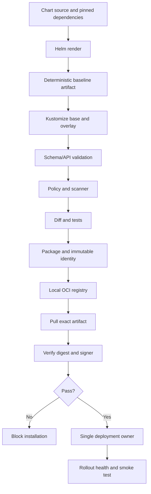

# Reusable Chart and Overlays for Multi-Environment Delivery

**Stage:** Stage 2E — Production DevOps & Platform Engineering  
**Module:** M06 — Helm, Kustomize, and Kubernetes Packaging  
**Unit:** Unit 10 — Capstone Project  
**Estimated effort:** 24–36 hours lean; 40–55 hours deliberate  
**Resource budget:** 4 CPU cores, 8 GB RAM, 30 GB free disk; no paid cloud required  
**Evidence status:** This is a project specification/workbook. Commands and sample output are illustrative and have not been executed here.

> **Safety contract:** Use only fixtures and a specifically named disposable `kind` cluster. Never mutate a work, shared, or production context. Never commit real secrets or private keys. Deleting a CRD removes all custom resources of that type in the cluster; never use CRD deletion as a routine rollback.

## 1. Project Overview

Build a release system for a data/ML platform containing a scoring API, worker, ETL `CronJob`, and development-only database option. Integrate one reusable Helm chart, Kustomize overlays for development/staging/production, deterministic CI and policy gates, immutable chart versioning, local OCI distribution, Cosign signing/verification before installation, and a toy `DataPipeline` CRD/controller.

The project is complete only when defects are injected, detected, recovered, retested, and evidenced. Files merely existing in Git do not prove the system works.

**Outcomes:** maintain a typed chart values API; render deterministic manifests; customize only approved fields; test selectors, image digests, security and critical diffs; exercise install/upgrade/hook failure/immutable-field/stale-values/rollback; package and sign an exact artifact; demonstrate CRD validation/reconciliation/least privilege; produce evidence, ADRs, runbooks, measurements and a final defense.

**Readiness check:** learner can read Deployments, Services, CronJobs, ConfigMaps and ServiceAccounts; use Git/Bash/YAML; distinguish render, apply, rollout readiness and application health; and inspect the current Kubernetes context.

**Source alignment:** `PROMPT-Helm-Kustomize-and-Kubernetes-Packaging.md` was available and inspected. The uploaded capstone prompt defines the 13 deliverables and target path. `Roadmap_ptree.md` and full Unit 1–8 chapter contents were not independently available for complete repository/chapter verification. No command, render, cluster, OCI operation, signature, or controller test was executed to produce this workbook.

## 2. Scenario and Baseline Defects

The team has copied dev/staging/prod manifests. Preserve all six original defects:

| ID | Root cause | Safe reproduction | Detection | Prevention and recovery evidence |
|---|---|---|---|---|
| `SEC-01` | Production lost `securityContext` | Remove non-root setting in a disposable fixture | Final policy reports workload/container path | Assert non-root/no privileged; restore baseline and capture diff/log |
| `IMG-01` | Staging image stale or tag-based | Use old fixture digest or `:latest` | Image/variance test fails | Promote approved digest; save final render |
| `CFG-01` | Hostname duplicated | Change one hostname only | Host contract detects mismatch | One hostname input per overlay; save test output |
| `SEC-02` | Real secret committed in values | Use only fake marker `LAB_SECRET_DO_NOT_USE` | Secret scanner fails | No secret values in Git/manifests; M09 hand-off; rotate any real exposed secret |
| `HELM-01` | `--reuse-values` carried stale input | Isolated disposable release with known stale value | Effective/rendered image differs from intended digest | Inspect history/values/manifest; upgrade with complete explicit values |
| `API-01` | Vendor chart changed Service name or immutable selector | Change name/selector in test branch | Critical diff or API error | Stable names/selectors, SemVer and consumer test; restore or plan resource/traffic migration |

Every defect needs baseline state, injection, first failing gate, diagnosis, recovery, passing retest, and evidence. Never use real credentials to simulate a leak.

## 3. Learning Outcomes and M06 Unit Mapping

| Outcome | Unit | Evidence |
|---|---|---|
| Manifest duplication and desired-state boundaries | U1 | Baseline register and architecture |
| Chart, values, schema, helpers | U2 | Chart and schema tests |
| Hooks, dependencies, subcharts | U3 | Hook failure and dependency inventory |
| Testing, CI, SemVer | U4 | `make ci`, compatibility matrix |
| Bases, overlays, patches | U5 | Three builds and reviewed diff |
| Composition and ownership | U6 | ADR and pipeline |
| OCI, digest identity, signing | U7 | Artifact manifest, signature and tamper logs |
| CRDs/controllers | U8 | CRD, controller and RBAC tests |
| Integration | U10 | Evidence bundle, runbooks and defense |

## 4. Scope, Non-Goals, and Assumptions

**In scope:** local-first vertical slice, three environments, local OCI chart distribution, throwaway key-based signing, disposable kind lifecycle tests, and a deliberately non-production toy controller.

**Out of scope:** production database operations, production secrets lifecycle (M09), GitOps internals (M08), production-grade operator development, paid cloud, and compliance claims.

**Chosen pattern:** Helm renders a neutral common baseline; Kustomize overlays transform only approved environment fields; final output is validated, policy-checked, diffed, packaged and signed. One documented deployment mechanism owns applying final manifests. `helm template` does not create Helm release history. Do not install the same workload as a Helm-managed release and independently apply it through Kustomize.

## 5. Architecture and Ownership Boundaries



| Layer | Owner | Avoid |
|---|---|---|
| Chart source/API | `charts/scoring-platform/` | Hand-editing rendered output |
| Common render | `scripts/render.sh` | Maintaining independent copies |
| Environment differences | `deploy/overlays/` | Duplicating full manifests |
| Validation | CI/policy scripts | Treating render as runtime health |
| Artifact identity | Version + digest + source/tool inputs | Trusting filename/tag alone |
| Trust decision | Verification gate and trust root | Treating signature-file existence as verification |
| Live resources | One apply owner | Competing Helm, direct apply and GitOps ownership |

Rollback in render-then-patch mode means redeploying the prior approved final artifact through the same owner path, then verifying readiness and smoke checks. It does not reverse database state, PVC contents, external systems, or every CRD effect.

## 6. Prerequisites, Resource Budget, and Version Pins

| Task | Cluster? | Network? |
|---|---:|---:|
| Chart lint/schema/render | No | Usually no after setup |
| Kustomize/policy/diff | No | No |
| kubeconform schemas / Trivy DB | No cluster | Sometimes |
| OCI/signing | No Kubernetes cluster | Registry reachable; initial downloads may need network |
| kind lifecycle/controller | Yes, disposable kind | Image pulls may need network |

**`versions.txt`** (replace placeholders only with actually verified versions):
```text
helm=<PINNED_VERSION>
kustomize=<PINNED_VERSION>
kubectl=<PINNED_VERSION>
kind=<PINNED_VERSION>
kubernetes=<PINNED_VERSION>
kubeconform=<PINNED_VERSION>
helm-unittest=<PINNED_VERSION_OR_NOT_INSTALLED>
trivy=<PINNED_VERSION>
cosign=<PINNED_VERSION>
python=<PINNED_VERSION>
```

Official references: Helm https://helm.sh/docs/ ; Kustomize https://kubectl.docs.kubernetes.io/references/kustomize/ ; Kubernetes https://kubernetes.io/docs/ ; kind https://kind.sigs.k8s.io/ ; kubeconform https://github.com/yannh/kubeconform ; helm-unittest https://github.com/helm-unittest/helm-unittest ; Trivy https://trivy.dev/ ; Cosign https://docs.sigstore.dev/cosign/ ; OCI https://github.com/opencontainers/distribution-spec .

**`scripts/require-kind-context.sh`:**
```bash
#!/usr/bin/env bash
set -euo pipefail
expected="${EXPECTED_CONTEXT:-}"
namespace="${EXPECTED_NAMESPACE:-m06-capstone}"
[[ -n "$expected" ]] || { echo "Set EXPECTED_CONTEXT explicitly" >&2; exit 2; }
command -v kubectl >/dev/null || { echo "kubectl required" >&2; exit 2; }
actual="$(kubectl config current-context)"
[[ "$actual" == "$expected" ]] || { echo "Refusing mutation: $actual != $expected" >&2; exit 3; }
[[ "$actual" == kind-* ]] || { echo "Expected disposable kind context" >&2; exit 3; }
printf 'Context assertion passed: %s; namespace target: %s\n' "$actual" "$namespace"
```

Read-only preflight:
```bash
pwd
git status --short
command -v helm || true
command -v kubectl || true
command -v kustomize || true
command -v kind || true
df -h .
free -h 2>/dev/null || true
kubectl config current-context 2>/dev/null || true
```
Do not let a generic bootstrap script silently create or switch clusters.

## 7. Target Repository Layout

```text
.
├── charts/
│   ├── scoring-platform/{Chart.yaml,values.yaml,values.schema.json,.helmignore,templates/}
│   └── datapipeline-operator/{Chart.yaml,values.yaml,templates/}
├── deploy/
│   ├── base/kustomization.yaml
│   ├── overlays/{dev,staging,prod}/kustomization.yaml
│   └── components/{monitoring,network-policy}/kustomization.yaml
├── ci/{policy.py,check-no-secrets.sh,check-version-not-published.sh}
├── docs/{architecture.md,values-api.md,compatibility.md,adr/,runbooks/}
├── tests/{fixtures/,test-policy.py,test-values-schema.sh,test-chart-contract.sh}
├── scripts/{preflight.sh,require-kind-context.sh,render.sh,build-final.sh,package-chart.sh,publish-local.sh,sign-chart.sh,verify-chart.sh,install-verified.sh,lifecycle-lab.sh}
├── evidence/{00-preflight/,01-baseline-defects/,02-chart/,03-overlays/,04-ci/,05-lifecycle-tests/,06-supply-chain/,07-crd-controller/,08-adr-runbooks/,09-final-review/}
├── versions.txt
├── Makefile
└── README.md
```

`charts/` owns templates and chart API; `deploy/base/` references generated Helm output; overlays contain only approved differences; components are opt-in; `ci/` owns gates; `docs/` owns ADRs/runbooks; `tests/` owns contracts; `scripts/` owns repeatable operations; `evidence/` contains sanitized proof only.

## 8. Milestone 0 — Baseline Audit and Preflight

**Time:** 1–2 hours; **cluster:** no. Create the tree, record OS/tool versions and context, simulate six defects in fixtures, and define acceptance tests. Save the defect register. Use fake secret markers only.

**Pass:** all defects have root cause, injection, signal, gate, recovery and evidence; no credentials/private keys are present.

## 9. Milestone 1 — Reusable Helm Chart

**Time:** 5–8 hours; **cluster:** no for lint/render/schema tests.

### Chart metadata and defaults

**`charts/scoring-platform/Chart.yaml`:**
```yaml
apiVersion: v2
name: scoring-platform
description: Reusable scoring API, worker and ETL CronJob
type: application
version: 0.1.0
appVersion: "0.1.0"
```

**`charts/scoring-platform/values.yaml`:**
```yaml
nameOverride: ""
fullnameOverride: ""
image:
  repository: ghcr.io/example-org/scoring-api
  digest: "sha256:REPLACE_WITH_APPROVED_64_HEX_DIGEST"
  pullPolicy: IfNotPresent
api:
  replicas: 2
  port: 8080
  service: {port: 80}
  hostname: scoring.dev.example.test
  ingress: {enabled: false, className: "", path: "/", pathType: Prefix}
worker:
  replicas: 1
etl:
  schedule: "17 */6 * * *"
  suspend: true
serviceAccount:
  create: true
  name: ""
config:
  logLevel: INFO
  environmentName: dev
resources:
  api: {requests: {cpu: 100m, memory: 128Mi}, limits: {cpu: 500m, memory: 256Mi}}
  worker: {requests: {cpu: 100m, memory: 128Mi}, limits: {cpu: 500m, memory: 256Mi}}
  etl: {requests: {cpu: 100m, memory: 128Mi}, limits: {cpu: 500m, memory: 256Mi}}
security:
  runAsNonRoot: true
  runAsUser: 10001
  readOnlyRootFilesystem: true
  allowPrivilegeEscalation: false
  dropCapabilities: [ALL]
pdb: {enabled: false, minAvailable: 1}
hpa: {enabled: false, minReplicas: 2, maxReplicas: 5, targetCPUUtilizationPercentage: 70}
networkPolicy: {enabled: false}
migration:
  enabled: false
  image:
    repository: ghcr.io/example-org/scoring-migrator
    digest: "sha256:REPLACE_WITH_APPROVED_64_HEX_DIGEST"
  activeDeadlineSeconds: 120
  backoffLimit: 1
database:
  mode: external
  developmentOnly: {enabled: false}
```
Digest strings are placeholders and will fail policy until replaced. CronJob is suspended by default. HPA, PDB, NetworkPolicy, Ingress, migration and database toggles are off until prerequisites are verified. Never put credentials in values files; Helm release values can be visible to principals able to read release storage.

### Values schema

**`charts/scoring-platform/values.schema.json`** — schema starter; verify JSON Schema support in pinned Helm:
```json
{
  "$schema": "https://json-schema.org/draft-07/schema#",
  "type": "object",
  "additionalProperties": false,
  "required": ["image", "api", "worker", "etl", "serviceAccount", "config", "resources", "security", "pdb", "hpa", "networkPolicy", "migration", "database"],
  "properties": {
    "nameOverride": {"type": "string"},
    "fullnameOverride": {"type": "string"},
    "image": {
      "type": "object", "additionalProperties": false,
      "required": ["repository", "digest", "pullPolicy"],
      "properties": {
        "repository": {"type": "string", "minLength": 1},
        "digest": {"type": "string", "pattern": "^sha256:[a-f0-9]{64}$"},
        "pullPolicy": {"type": "string", "enum": ["Always", "IfNotPresent", "Never"]}
      }
    },
    "api": {
      "type": "object", "additionalProperties": false,
      "required": ["replicas", "port", "service", "hostname", "ingress"],
      "properties": {
        "replicas": {"type": "integer", "minimum": 1, "maximum": 20},
        "port": {"type": "integer", "minimum": 1, "maximum": 65535},
        "service": {"type": "object", "additionalProperties": false, "required": ["port"], "properties": {"port": {"type": "integer", "minimum": 1, "maximum": 65535}}},
        "hostname": {"type": "string", "minLength": 1},
        "ingress": {
          "type": "object", "additionalProperties": false,
          "required": ["enabled", "className", "path", "pathType"],
          "properties": {
            "enabled": {"type": "boolean"},
            "className": {"type": "string"},
            "path": {"type": "string", "minLength": 1},
            "pathType": {"type": "string", "enum": ["Exact", "Prefix", "ImplementationSpecific"]}
          }
        }
      }
    },
    "worker": {"type": "object", "additionalProperties": false, "required": ["replicas"], "properties": {"replicas": {"type": "integer", "minimum": 1, "maximum": 20}}},
    "etl": {"type": "object", "additionalProperties": false, "required": ["schedule", "suspend"], "properties": {"schedule": {"type": "string", "minLength": 1}, "suspend": {"type": "boolean"}}},
    "serviceAccount": {"type": "object", "additionalProperties": false, "required": ["create", "name"], "properties": {"create": {"type": "boolean"}, "name": {"type": "string"}}},
    "config": {"type": "object", "additionalProperties": false, "required": ["logLevel", "environmentName"], "properties": {"logLevel": {"type": "string", "enum": ["DEBUG", "INFO", "WARN", "ERROR"]}, "environmentName": {"type": "string", "minLength": 1}}},
    "resources": {"type": "object", "additionalProperties": false, "required": ["api", "worker", "etl"], "properties": {
      "api": {"$ref": "#/definitions/resourceRequirements"},
      "worker": {"$ref": "#/definitions/resourceRequirements"},
      "etl": {"$ref": "#/definitions/resourceRequirements"}
    }},
    "security": {"type": "object", "additionalProperties": false, "required": ["runAsNonRoot", "runAsUser", "readOnlyRootFilesystem", "allowPrivilegeEscalation", "dropCapabilities"], "properties": {
      "runAsNonRoot": {"const": true},
      "runAsUser": {"type": "integer", "minimum": 1},
      "readOnlyRootFilesystem": {"type": "boolean"},
      "allowPrivilegeEscalation": {"const": false},
      "dropCapabilities": {"type": "array", "items": {"type": "string"}, "contains": {"const": "ALL"}}
    }},
    "pdb": {"type": "object", "additionalProperties": false, "required": ["enabled", "minAvailable"], "properties": {
      "enabled": {"type": "boolean"},
      "minAvailable": {"oneOf": [{"type": "integer", "minimum": 0}, {"type": "string", "minLength": 1}]}
    }},
    "hpa": {"type": "object", "additionalProperties": false, "required": ["enabled", "minReplicas", "maxReplicas", "targetCPUUtilizationPercentage"], "properties": {
      "enabled": {"type": "boolean"},
      "minReplicas": {"type": "integer", "minimum": 1},
      "maxReplicas": {"type": "integer", "minimum": 1},
      "targetCPUUtilizationPercentage": {"type": "integer", "minimum": 1, "maximum": 100}
    }},
    "networkPolicy": {"type": "object", "additionalProperties": false, "required": ["enabled"], "properties": {"enabled": {"type": "boolean"}}},
    "migration": {"type": "object", "additionalProperties": false, "required": ["enabled", "image", "activeDeadlineSeconds", "backoffLimit"], "properties": {
      "enabled": {"type": "boolean"},
      "image": {"type": "object", "additionalProperties": false, "required": ["repository", "digest"], "properties": {
        "repository": {"type": "string", "minLength": 1},
        "digest": {"type": "string", "pattern": "^sha256:[a-f0-9]{64}$"}
      }},
      "activeDeadlineSeconds": {"type": "integer", "minimum": 1, "maximum": 600},
      "backoffLimit": {"type": "integer", "minimum": 0, "maximum": 2}
    }},
    "database": {"type": "object", "additionalProperties": false, "required": ["mode", "developmentOnly"], "properties": {
      "mode": {"type": "string", "enum": ["external", "development-only"]},
      "developmentOnly": {"type": "object", "additionalProperties": false, "required": ["enabled"], "properties": {"enabled": {"type": "boolean"}}}
    }}
  },
  "definitions": {
    "resourceRequirements": {"type": "object", "additionalProperties": false, "required": ["requests", "limits"], "properties": {
      "requests": {"type": "object", "additionalProperties": false, "required": ["cpu", "memory"], "properties": {
        "cpu": {"type": "string", "minLength": 1},
        "memory": {"type": "string", "minLength": 1}
      }},
      "limits": {"type": "object", "additionalProperties": false, "required": ["cpu", "memory"], "properties": {
        "cpu": {"type": "string", "minLength": 1},
        "memory": {"type": "string", "minLength": 1}
      }}
    }}
  }
}
```

### Helpers and workload templates

**`templates/_helpers.tpl`:**
```gotemplate
{{- define "scoring-platform.name" -}}
{{- default .Chart.Name .Values.nameOverride | trunc 63 | trimSuffix "-" -}}
{{- end -}}
{{- define "scoring-platform.fullname" -}}
{{- if .Values.fullnameOverride -}}
{{- .Values.fullnameOverride | trunc 63 | trimSuffix "-" -}}
{{- else -}}
{{- printf "%s-%s" .Release.Name (include "scoring-platform.name" .) | trunc 63 | trimSuffix "-" -}}
{{- end -}}
{{- end -}}
{{- define "scoring-platform.labels" -}}
app.kubernetes.io/name: {{ include "scoring-platform.name" . }}
app.kubernetes.io/instance: {{ .Release.Name }}
app.kubernetes.io/managed-by: {{ .Release.Service }}
helm.sh/chart: {{ printf "%s-%s" .Chart.Name .Chart.Version | replace "+" "_" }}
{{- end -}}
{{- define "scoring-platform.selectorLabels" -}}
app.kubernetes.io/name: {{ include "scoring-platform.name" . }}
app.kubernetes.io/instance: {{ .Release.Name }}
{{- end -}}
{{- define "scoring-platform.serviceAccountName" -}}
{{- if .Values.serviceAccount.create -}}
{{- default (include "scoring-platform.fullname" .) .Values.serviceAccount.name -}}
{{- else -}}
{{- required "serviceAccount.name is required when serviceAccount.create=false" .Values.serviceAccount.name -}}
{{- end -}}
{{- end -}}
{{- define "scoring-platform.image" -}}
{{- printf "%s@%s" .Values.image.repository .Values.image.digest -}}
{{- end -}}
```

**`templates/serviceaccount.yaml`:**
```gotemplate
{{- if .Values.serviceAccount.create }}
apiVersion: v1
kind: ServiceAccount
metadata:
  name: {{ include "scoring-platform.serviceAccountName" . }}
  labels:
    {{- include "scoring-platform.labels" . | nindent 4 }}
automountServiceAccountToken: false
{{- end }}
```

**`templates/configmap.yaml`:**
```gotemplate
apiVersion: v1
kind: ConfigMap
metadata:
  name: {{ include "scoring-platform.fullname" . }}-config
  labels:
    {{- include "scoring-platform.labels" . | nindent 4 }}
data:
  LOG_LEVEL: {{ .Values.config.logLevel | quote }}
  ENVIRONMENT_NAME: {{ .Values.config.environmentName | quote }}
```

**`templates/api-deployment.yaml`:**
```gotemplate
apiVersion: apps/v1
kind: Deployment
metadata:
  name: {{ include "scoring-platform.fullname" . }}-api
  labels:
    {{- include "scoring-platform.labels" . | nindent 4 }}
    app.kubernetes.io/component: api
spec:
  replicas: {{ .Values.api.replicas }}
  selector:
    matchLabels:
      {{- include "scoring-platform.selectorLabels" . | nindent 6 }}
      app.kubernetes.io/component: api
  template:
    metadata:
      labels:
        {{- include "scoring-platform.selectorLabels" . | nindent 8 }}
        app.kubernetes.io/component: api
    spec:
      serviceAccountName: {{ include "scoring-platform.serviceAccountName" . }}
      automountServiceAccountToken: false
      securityContext:
        runAsNonRoot: {{ .Values.security.runAsNonRoot }}
        runAsUser: {{ .Values.security.runAsUser }}
        seccompProfile: {type: RuntimeDefault}
      containers:
        - name: api
          image: {{ include "scoring-platform.image" . | quote }}
          imagePullPolicy: {{ .Values.image.pullPolicy }}
          ports: [{name: http, containerPort: {{ .Values.api.port }}}]
          envFrom:
            - configMapRef:
                name: {{ include "scoring-platform.fullname" . }}-config
          readinessProbe:
            httpGet: {path: /readyz, port: http}
            initialDelaySeconds: 3
            periodSeconds: 5
          livenessProbe:
            httpGet: {path: /healthz, port: http}
            initialDelaySeconds: 10
            periodSeconds: 10
          resources:
            {{- toYaml .Values.resources.api | nindent 12 }}
          securityContext:
            allowPrivilegeEscalation: {{ .Values.security.allowPrivilegeEscalation }}
            readOnlyRootFilesystem: {{ .Values.security.readOnlyRootFilesystem }}
            capabilities:
              drop:
                {{- toYaml .Values.security.dropCapabilities | nindent 16 }}
```

**`templates/api-service.yaml`:**
```gotemplate
apiVersion: v1
kind: Service
metadata:
  name: {{ include "scoring-platform.fullname" . }}-api
  labels:
    {{- include "scoring-platform.labels" . | nindent 4 }}
spec:
  type: ClusterIP
  selector:
    {{- include "scoring-platform.selectorLabels" . | nindent 4 }}
    app.kubernetes.io/component: api
  ports:
    - name: http
      port: {{ .Values.api.service.port }}
      targetPort: http
```

**`templates/worker-deployment.yaml`:**
```gotemplate
apiVersion: apps/v1
kind: Deployment
metadata:
  name: {{ include "scoring-platform.fullname" . }}-worker
  labels:
    {{- include "scoring-platform.labels" . | nindent 4 }}
    app.kubernetes.io/component: worker
spec:
  replicas: {{ .Values.worker.replicas }}
  selector:
    matchLabels:
      {{- include "scoring-platform.selectorLabels" . | nindent 6 }}
      app.kubernetes.io/component: worker
  template:
    metadata:
      labels:
        {{- include "scoring-platform.selectorLabels" . | nindent 8 }}
        app.kubernetes.io/component: worker
    spec:
      serviceAccountName: {{ include "scoring-platform.serviceAccountName" . }}
      automountServiceAccountToken: false
      securityContext: {runAsNonRoot: true, runAsUser: 10001, seccompProfile: {type: RuntimeDefault}}
      containers:
        - name: worker
          image: {{ include "scoring-platform.image" . | quote }}
          envFrom:
            - configMapRef:
                name: {{ include "scoring-platform.fullname" . }}-config
          resources:
            {{- toYaml .Values.resources.worker | nindent 12 }}
          securityContext:
            allowPrivilegeEscalation: false
            readOnlyRootFilesystem: {{ .Values.security.readOnlyRootFilesystem }}
            capabilities: {drop: ["ALL"]}
```

**`templates/etl-cronjob.yaml`:**
```gotemplate
apiVersion: batch/v1
kind: CronJob
metadata:
  name: {{ include "scoring-platform.fullname" . }}-etl
  labels:
    {{- include "scoring-platform.labels" . | nindent 4 }}
spec:
  schedule: {{ .Values.etl.schedule | quote }}
  suspend: {{ .Values.etl.suspend }}
  concurrencyPolicy: Forbid
  startingDeadlineSeconds: 300
  successfulJobsHistoryLimit: 1
  failedJobsHistoryLimit: 2
  jobTemplate:
    spec:
      backoffLimit: 1
      activeDeadlineSeconds: 900
      template:
        metadata:
          labels:
            {{- include "scoring-platform.selectorLabels" . | nindent 12 }}
            app.kubernetes.io/component: etl
        spec:
          restartPolicy: Never
          serviceAccountName: {{ include "scoring-platform.serviceAccountName" . }}
          automountServiceAccountToken: false
          securityContext: {runAsNonRoot: true, runAsUser: 10001, seccompProfile: {type: RuntimeDefault}}
          containers:
            - name: etl
              image: {{ include "scoring-platform.image" . | quote }}
              resources:
                {{- toYaml .Values.resources.etl | nindent 16 }}
              securityContext: {allowPrivilegeEscalation: false, readOnlyRootFilesystem: true, capabilities: {drop: ["ALL"]}}
```

**`templates/pdb.yaml`:**
```gotemplate
{{- if .Values.pdb.enabled }}
apiVersion: policy/v1
kind: PodDisruptionBudget
metadata:
  name: {{ include "scoring-platform.fullname" . }}-api
spec:
  minAvailable: {{ .Values.pdb.minAvailable }}
  selector:
    matchLabels:
      {{- include "scoring-platform.selectorLabels" . | nindent 6 }}
      app.kubernetes.io/component: api
{{- end }}
```

**`templates/hpa.yaml`:**
```gotemplate
{{- if .Values.hpa.enabled }}
apiVersion: autoscaling/v2
kind: HorizontalPodAutoscaler
metadata:
  name: {{ include "scoring-platform.fullname" . }}-api
spec:
  scaleTargetRef: {apiVersion: apps/v1, kind: Deployment, name: {{ include "scoring-platform.fullname" . }}-api}
  minReplicas: {{ .Values.hpa.minReplicas }}
  maxReplicas: {{ .Values.hpa.maxReplicas }}
  metrics:
    - type: Resource
      resource:
        name: cpu
        target: {type: Utilization, averageUtilization: {{ .Values.hpa.targetCPUUtilizationPercentage }}}
{{- end }}
```

**`templates/networkpolicy.yaml`:**
```gotemplate
{{- if .Values.networkPolicy.enabled }}
apiVersion: networking.k8s.io/v1
kind: NetworkPolicy
metadata:
  name: {{ include "scoring-platform.fullname" . }}-api-ingress
spec:
  podSelector:
    matchLabels:
      {{- include "scoring-platform.selectorLabels" . | nindent 6 }}
      app.kubernetes.io/component: api
  policyTypes: [Ingress]
  ingress:
    - from:
        - podSelector:
            matchLabels: {app.kubernetes.io/component: worker}
      ports:
        - {protocol: TCP, port: {{ .Values.api.port }}}
{{- end }}
```

**`templates/ingress.yaml`:**
```gotemplate
{{- if .Values.api.ingress.enabled }}
apiVersion: networking.k8s.io/v1
kind: Ingress
metadata:
  name: {{ include "scoring-platform.fullname" . }}-api
spec:
  {{- with .Values.api.ingress.className }}
  ingressClassName: {{ . | quote }}
  {{- end }}
  rules:
    - host: {{ .Values.api.hostname | quote }}
      http:
        paths:
          - path: {{ .Values.api.ingress.path | quote }}
            pathType: {{ .Values.api.ingress.pathType }}
            backend:
              service:
                name: {{ include "scoring-platform.fullname" . }}-api
                port:
                  number: {{ .Values.api.service.port }}
{{- end }}
```

**`templates/migration-job.yaml`:**
```gotemplate
{{- if .Values.migration.enabled }}
apiVersion: batch/v1
kind: Job
metadata:
  name: {{ include "scoring-platform.fullname" . }}-migration-{{ .Release.Revision }}
  annotations:
    "helm.sh/hook": pre-upgrade
    "helm.sh/hook-weight": "-5"
    "helm.sh/hook-delete-policy": before-hook-creation,hook-succeeded
spec:
  backoffLimit: {{ .Values.migration.backoffLimit }}
  activeDeadlineSeconds: {{ .Values.migration.activeDeadlineSeconds }}
  template:
    spec:
      restartPolicy: Never
      serviceAccountName: {{ include "scoring-platform.serviceAccountName" . }}
      automountServiceAccountToken: false
      securityContext: {runAsNonRoot: true, runAsUser: 10001, seccompProfile: {type: RuntimeDefault}}
      containers:
        - name: migration
          image: {{ printf "%s@%s" .Values.migration.image.repository .Values.migration.image.digest | quote }}
          args: ["migrate", "--mode=backward-compatible"]
          resources:
            requests: {cpu: 100m, memory: 128Mi}
            limits: {cpu: 500m, memory: 256Mi}
          securityContext: {allowPrivilegeEscalation: false, readOnlyRootFilesystem: true, capabilities: {drop: ["ALL"]}}
{{- end }}
```

Render/inspect:
```bash
helm lint charts/scoring-platform
helm template scoring charts/scoring-platform --namespace m06-capstone > evidence/02-chart/rendered.yaml
helm template scoring charts/scoring-platform --set image.digest=not-a-digest
```
The last command should fail schema validation; record actual exit code/output. Illustrative rendered excerpt (not executed):
```yaml
kind: Service
metadata:
  name: scoring-scoring-platform-api
spec:
  selector:
    app.kubernetes.io/name: scoring-platform
    app.kubernetes.io/instance: scoring
    app.kubernetes.io/component: api
```
Selectors must match Pod labels. The chosen app image must really serve `/readyz` and `/healthz`, listen on the configured port, and support the worker/ETL command. If the app needs writable temp storage, add a bounded `emptyDir`; do not silently remove hardening.

**Prerequisites:** HPA requires metrics API and requests; Ingress requires an installed controller; NetworkPolicy requires enforcing CNI and verified traffic; migration must be idempotent/backward-compatible. These resources stay off until checked. The development DB option must be implemented as an optional local dependency or remain explicitly external; it must never become a production database by default.

**Values API policy:** optional safe default = usually minor; remove/rename key or change Service/selector = breaking unless compatibility shim and migration exist. Security-default tightening may be operationally breaking and needs notes/tests. Do not assume every template change is a patch.

**Pass gate:** lint/render pass; invalid digest/unknown key/unsafe non-root override fail; selector and Service contracts pass; secure defaults persist.

## 10. Milestone 2 — Kustomize Base, Overlays, and Components

**Time:** 3–5 hours; **cluster:** no. `deploy/base` references deterministic generated `build/helm-base.yaml`; regenerate it every run and never hand-edit it.

**`deploy/base/kustomization.yaml`:**
```yaml
apiVersion: kustomize.config.k8s.io/v1beta1
kind: Kustomization
resources:
  - ../../build/helm-base.yaml
```

**`deploy/overlays/dev/kustomization.yaml`:**
```yaml
apiVersion: kustomize.config.k8s.io/v1beta1
kind: Kustomization
namespace: m06-capstone
resources: [../../base]
patches:
  - target:
      group: apps
      version: v1
      kind: Deployment
      name: scoring-scoring-platform-api
    patch: |-
      - op: replace
        path: /spec/replicas
        value: 1
images:
  - name: ghcr.io/example-org/scoring-api
    newName: ghcr.io/example-org/scoring-api
    digest: sha256:REPLACE_WITH_APPROVED_64_HEX_DIGEST
```

**`deploy/overlays/staging/kustomization.yaml`:**
```yaml
apiVersion: kustomize.config.k8s.io/v1beta1
kind: Kustomization
namespace: m06-capstone
resources: [../../base]
patches:
  - target:
      group: apps
      version: v1
      kind: Deployment
      name: scoring-scoring-platform-api
    patch: |-
      - op: replace
        path: /spec/replicas
        value: 2
images:
  - name: ghcr.io/example-org/scoring-api
    newName: ghcr.io/example-org/scoring-api
    digest: sha256:REPLACE_WITH_APPROVED_64_HEX_DIGEST
```

**`deploy/overlays/prod/kustomization.yaml`:**
```yaml
apiVersion: kustomize.config.k8s.io/v1beta1
kind: Kustomization
namespace: m06-capstone
resources: [../../base]
patches:
  - target:
      group: apps
      version: v1
      kind: Deployment
      name: scoring-scoring-platform-api
    patch: |-
      - op: replace
        path: /spec/replicas
        value: 3
images:
  - name: ghcr.io/example-org/scoring-api
    newName: ghcr.io/example-org/scoring-api
    digest: sha256:REPLACE_WITH_APPROVED_64_HEX_DIGEST
```
Replace digest placeholders before policy passes. Promotion should normally use the same tested digest in staging and prod. Patch targets must match actual rendered names; if an optional resource is disabled, remove its patch or enable it deliberately. Do not create an independent duplicate.

Create `deploy/components/monitoring/kustomization.yaml` and `deploy/components/network-policy/kustomization.yaml` as opt-in components only if supported by the pinned Kustomize version. Empty shells do not provide monitoring or enforcement. Add real resources only when prerequisites are tested; otherwise use a supported base/overlay alternative.

**`scripts/render.sh`:**
```bash
#!/usr/bin/env bash
set -euo pipefail
root="$(cd "$(dirname "${BASH_SOURCE[0]}")/.." && pwd)"
cd "$root"
command -v helm >/dev/null || { echo "helm required" >&2; exit 2; }
mkdir -p build evidence/02-chart
helm lint charts/scoring-platform
helm template scoring charts/scoring-platform --namespace m06-capstone \
  --values charts/scoring-platform/values.yaml > build/helm-base.yaml
test -s build/helm-base.yaml
```

**`scripts/build-final.sh`:**
```bash
#!/usr/bin/env bash
set -euo pipefail
root="$(cd "$(dirname "${BASH_SOURCE[0]}")/.." && pwd)"
cd "$root"
env_name="${1:-}"
case "$env_name" in dev|staging|prod) ;; *) echo "usage: $0 dev|staging|prod" >&2; exit 2 ;; esac
command -v kustomize >/dev/null || { echo "kustomize required" >&2; exit 2; }
test -s build/helm-base.yaml || { echo "run scripts/render.sh first" >&2; exit 2; }
mkdir -p "build/final/$env_name"
kustomize build "deploy/overlays/$env_name" > "build/final/$env_name/manifests.yaml"
test -s "build/final/$env_name/manifests.yaml"
```

```bash
./scripts/render.sh
./scripts/build-final.sh dev
./scripts/build-final.sh staging
./scripts/build-final.sh prod
diff -u build/final/staging/manifests.yaml build/final/prod/manifests.yaml > evidence/03-overlays/staging-prod.diff || test "$?" -eq 1
```
A non-empty diff is not automatically failure; compare it with an explicit allowlist. Distinguish diff exit 1 (differences) from command errors. Use structured checks for identity, selectors, security and image digests. Strategic merge fits structured patches; JSON 6902 fits exact operations/paths. Verify target kind/name/namespace/path against rendered output. Do not casually mutate selectors with broad global labels.

**Pass gate:** all three builds use one generated base, only approved fields vary, security and selector invariants hold.

## 11. Milestone 3 — CI, Validation, and Policy Gates

**Time:** 4–6 hours; **cluster:** no for base CI.

**`ci/policy.py`:**
```python
#!/usr/bin/env python3
import re, sys
from pathlib import Path
import yaml

DIGEST = re.compile(r"@sha256:[a-f0-9]{64}$")
def main():
    if len(sys.argv) != 2:
        print(f"usage: {sys.argv[0]} FINAL.yaml", file=sys.stderr); return 2
    path = Path(sys.argv[1])
    if not path.is_file():
        print(f"missing manifest: {path}", file=sys.stderr); return 2
    try:
        docs = [d for d in yaml.safe_load_all(path.read_text()) if isinstance(d, dict)]
    except Exception as exc:
        print(f"YAML parse failed: {exc}", file=sys.stderr); return 2
    errors = []
    for doc in docs:
        kind, spec = doc.get("kind"), doc.get("spec") or {}
        if kind == "Deployment":
            template = spec.get("template") or {}
            pod = template.get("spec") or {}
            labels = (template.get("metadata") or {}).get("labels") or {}
        elif kind == "CronJob":
            template = (((spec.get("jobTemplate") or {}).get("spec") or {}).get("template") or {})
            pod = template.get("spec") or {}
            labels = (template.get("metadata") or {}).get("labels") or {}
        else:
            continue
        name = (doc.get("metadata") or {}).get("name", "<unnamed>")
        if (pod.get("securityContext") or {}).get("runAsNonRoot") is not True:
            errors.append(f"{name}: runAsNonRoot must be true")
        for c in pod.get("containers") or []:
            cn, image = c.get("name", "<unnamed>"), str(c.get("image", ""))
            if ":latest" in image or not DIGEST.search(image):
                errors.append(f"{name}/{cn}: image must be digest-pinned")
            sc = c.get("securityContext") or {}
            if sc.get("privileged") is True:
                errors.append(f"{name}/{cn}: privileged forbidden")
            if sc.get("allowPrivilegeEscalation") is not False:
                errors.append(f"{name}/{cn}: allowPrivilegeEscalation must be false")
            if "ALL" not in ((sc.get("capabilities") or {}).get("drop") or []):
                errors.append(f"{name}/{cn}: drop ALL capabilities")
            rr = c.get("resources") or {}
            for field in ("requests", "limits"):
                for key in ("cpu", "memory"):
                    if (rr.get(field) or {}).get(key) is None:
                        errors.append(f"{name}/{cn}: missing {field}.{key}")
            if sc.get("readOnlyRootFilesystem") is not True:
                errors.append(f"{name}/{cn}: readOnlyRootFilesystem must be true or approved exception")
            if kind == "Deployment" and labels.get("app.kubernetes.io/component") == "api":
                if not any(k in c for k in ("readinessProbe", "startupProbe")):
                    errors.append(f"{name}/{cn}: API needs readiness/startup probe")
        for volume in pod.get("volumes") or []:
            if "hostPath" in volume:
                errors.append(f"{name}: hostPath forbidden")
    raw = path.read_text()
    for marker in ("LAB_SECRET_DO_NOT_USE", "PRIVATE_KEY_MATERIAL"):
        if marker in raw:
            errors.append(f"forbidden secret marker: {marker}")
    if any(d.get("kind") == "Secret" for d in docs):
        errors.append("rendered output includes a Secret; review for leakage")
    if errors:
        print("POLICY FAIL")
        print("\n".join(f"- {e}" for e in errors))
        return 1
    print(f"POLICY PASS: inspected {len(docs)} documents in {path}")
    return 0
if __name__ == "__main__":
    raise SystemExit(main())
```
This starter policy is not comprehensive: extend it for initContainers, approved registries, resource syntax, secret encodings, CRD schemas, and critical diff classes. Pin PyYAML and test positive/negative fixtures.

**`tests/test-values-schema.sh`:**
```bash
#!/usr/bin/env bash
set -euo pipefail
chart=charts/scoring-platform
tmp="$(mktemp)"
trap 'rm -f "$tmp"' EXIT
if helm template schema-test "$chart" --set image.digest=not-a-digest >"$tmp" 2>&1; then
  echo "ERROR: invalid digest rendered" >&2; cat "$tmp" >&2; exit 1
fi
echo "PASS: invalid digest rejected"
if helm template schema-test "$chart" --set security.runAsNonRoot=false >"$tmp" 2>&1; then
  echo "ERROR: unsafe non-root override rendered" >&2; cat "$tmp" >&2; exit 1
fi
echo "PASS: non-root override rejected"
```

**`tests/test-chart-contract.sh`:**
```bash
#!/usr/bin/env bash
set -euo pipefail
file="${1:-build/final/dev/manifests.yaml}"
test -s "$file" || { echo "missing $file" >&2; exit 2; }
python ci/policy.py "$file"
grep -q 'kind: Deployment' "$file"
grep -q 'kind: CronJob' "$file"
grep -q 'kind: Service' "$file"
echo "PASS: basic resource contract"
```

Validate final output:
```bash
kubeconform -strict -summary build/final/dev/manifests.yaml
kubeconform -strict -summary build/final/staging/manifests.yaml
kubeconform -strict -summary build/final/prod/manifests.yaml
trivy config --severity HIGH,CRITICAL build/final/prod/manifests.yaml
```
Flags/schema resolution depend on pinned versions. Network or schema cache may be needed; CRD-backed objects need CRD schemas. Scanner output is supplementary.

Required CI order: Helm lint → schema positive/negative tests → render every environment → Kustomize builds → kubeconform → helm-unittest or shell/Python fallback → final-output policies → approved diff gate → Trivy/equivalent → summary with non-zero exit on any required failure.

**`Makefile`:**
```makefile
SHELL := /usr/bin/env bash
.SHELLFLAGS := -euo pipefail -c
PYTHON ?= python3
EXPECTED_CONTEXT ?=
EXPECTED_NAMESPACE ?= m06-capstone
KIND_CLUSTER ?= m06-capstone
CHART := charts/scoring-platform

.PHONY: up lint render validate diff test install upgrade rollback package publish-local verify-signature ci down verify
lint:
	helm lint $(CHART)
render:
	./scripts/render.sh
	./scripts/build-final.sh dev
	./scripts/build-final.sh staging
	./scripts/build-final.sh prod
validate: render
	kubeconform -strict -summary build/final/dev/manifests.yaml
	kubeconform -strict -summary build/final/staging/manifests.yaml
	kubeconform -strict -summary build/final/prod/manifests.yaml
diff: render
	./scripts/check-rendered-diff.sh
test: render
	./tests/test-values-schema.sh
	$(PYTHON) ci/policy.py build/final/dev/manifests.yaml
	$(PYTHON) ci/policy.py build/final/staging/manifests.yaml
	$(PYTHON) ci/policy.py build/final/prod/manifests.yaml
	./tests/test-chart-contract.sh build/final/dev/manifests.yaml
ci: lint test validate diff
	./ci/check-no-secrets.sh
	trivy config --severity HIGH,CRITICAL build/final/prod/manifests.yaml
	@echo "CI PASS: required local gates completed"
up:
	./scripts/up-kind.sh "$(KIND_CLUSTER)"
install:
	: "$${EXPECTED_CONTEXT:?Set EXPECTED_CONTEXT}"
	EXPECTED_CONTEXT="$(EXPECTED_CONTEXT)" EXPECTED_NAMESPACE="$(EXPECTED_NAMESPACE)" ./scripts/install-verified.sh
upgrade:
	: "$${EXPECTED_CONTEXT:?Set EXPECTED_CONTEXT}"
	EXPECTED_CONTEXT="$(EXPECTED_CONTEXT)" ./scripts/lifecycle-lab.sh upgrade
rollback:
	: "$${EXPECTED_CONTEXT:?Set EXPECTED_CONTEXT}"
	EXPECTED_CONTEXT="$(EXPECTED_CONTEXT)" ./scripts/lifecycle-lab.sh rollback
package:
	./scripts/package-chart.sh
publish-local:
	./scripts/publish-local.sh
verify-signature:
	./scripts/verify-chart.sh
verify: ci
	@echo "Local CI done. Verify cluster, signature, tamper, CRD and cleanup evidence separately."
down:
	: "$${EXPECTED_CONTEXT:?Set EXPECTED_CONTEXT}"
	EXPECTED_CONTEXT="$(EXPECTED_CONTEXT)" ./scripts/down-kind.sh "$(KIND_CLUSTER)"
```
Referenced diff/install/lifecycle/registry scripts must be implemented before targets can be considered complete. `verify` must never imply unrun checks passed.

**`ci/check-no-secrets.sh`:**
```bash
#!/usr/bin/env bash
set -euo pipefail
if git grep -n -I -E 'LAB_SECRET_DO_NOT_USE|PRIVATE_KEY_MATERIAL' -- ':!evidence/**'; then
  echo "ERROR: forbidden marker in tracked files" >&2; exit 1
fi
echo "No configured secret marker found"
```
This checks only configured markers; add an approved scanner.

**GitHub Actions `.github/workflows/m06-ci.yml`** (illustrative; replace placeholders only after verification):
```yaml
name: m06-ci
on:
  pull_request:
  push:
    branches: [main]
permissions:
  contents: read
jobs:
  validate:
    runs-on: ubuntu-latest
    permissions:
      contents: read
    steps:
      - uses: actions/checkout@<VERIFY_FULL_40_HEX_COMMIT_SHA>
      - uses: actions/setup-python@<VERIFY_FULL_40_HEX_COMMIT_SHA>
        with:
          python-version: "<PINNED_PYTHON_VERSION>"
      - name: Install pinned tools
        run: ./scripts/install-ci-tools.sh
      - name: Run local gates
        run: make ci
      - name: Upload sanitized evidence
        if: always()
        uses: actions/upload-artifact@<VERIFY_FULL_40_HEX_COMMIT_SHA>
        with:
          name: m06-evidence
          path: evidence/04-ci/
          retention-days: 14
```
Never invent action SHAs. Do not expose signing secrets to untrusted PR code. Validate workflow syntax; `act` is optional and differs from hosted runners.

## 12. Milestone 4 — Install, Upgrade, Rollback, and Failure Drills

**Time:** 4–7 hours; **cluster:** disposable kind only.

**`scripts/up-kind.sh`:**
```bash
#!/usr/bin/env bash
set -euo pipefail
name="${1:-m06-capstone}"
command -v kind >/dev/null || { echo "kind required" >&2; exit 2; }
if kind get clusters | grep -Fxq "$name"; then
  echo "Cluster already exists; refusing to reuse automatically" >&2; exit 3
fi
kind create cluster --name "$name"
expected="kind-$name"
actual="$(kubectl config current-context)"
[[ "$actual" == "$expected" ]] || { echo "Unexpected context $actual" >&2; exit 4; }
kubectl create namespace m06-capstone
printf 'Disposable cluster ready: %s\n' "$expected"
```

Every mutation begins with:
```bash
EXPECTED_CONTEXT=kind-m06-capstone EXPECTED_NAMESPACE=m06-capstone ./scripts/require-kind-context.sh
kubectl --context kind-m06-capstone get namespace m06-capstone
```
Stop if context differs; do not auto-switch.

Use an isolated Helm lifecycle release/namespace; never let Helm and Kustomize own the same resources:
```bash
kubectl --context kind-m06-capstone create namespace m06-helm-lab
helm --kube-context kind-m06-capstone upgrade --install scoring-lifecycle charts/scoring-platform \
  --namespace m06-helm-lab --version 0.1.0 --values charts/scoring-platform/values.yaml
helm --kube-context kind-m06-capstone status scoring-lifecycle -n m06-helm-lab
helm --kube-context kind-m06-capstone history scoring-lifecycle -n m06-helm-lab
kubectl --context kind-m06-capstone -n m06-helm-lab get deploy,svc,cronjob
```
Verify exact flags for pinned Helm and ensure the image is available to kind. This is a separate lifecycle lab, not the final render-then-patch deployment path.

**Required drills:** install N and capture history/live state; upgrade N+1; trigger a bounded deterministic hook failure and inspect partial side effects; trigger an immutable-field failure and capture the API error; inject stale `--reuse-values` and compare effective image; roll back to a known revision and verify readiness/selectors/endpoints/smoke test; clean up and verify. Read-only diagnosis first:
```bash
kubectl --context kind-m06-capstone -n m06-helm-lab get events --sort-by=.lastTimestamp
kubectl --context kind-m06-capstone -n m06-helm-lab get deploy,rs,pod,job,cronjob,svc
helm --kube-context kind-m06-capstone -n m06-helm-lab status scoring-lifecycle
helm --kube-context kind-m06-capstone -n m06-helm-lab history scoring-lifecycle
helm --kube-context kind-m06-capstone -n m06-helm-lab get values scoring-lifecycle --all
helm --kube-context kind-m06-capstone -n m06-helm-lab get manifest scoring-lifecycle
```
Helm rollback does not reverse database state, PVC data, external systems or all CRD effects. Hook and reuse-values behavior is version-sensitive.

**⚠ DESTRUCTIVE — disposable cluster only.** Inspect first:
```bash
kind get clusters
kubectl config current-context
kubectl --context kind-m06-capstone get namespaces
```
Only if it is the lab-created cluster:
```bash
EXPECTED_CONTEXT=kind-m06-capstone ./scripts/require-kind-context.sh
kind delete cluster --name m06-capstone
kind get clusters
```
This deletes all resources/data in that cluster. Never use against a non-lab context.

## 13. Milestone 5 — Versioning, OCI, Signing, Verification

**Time:** 3–5 hours; **cluster:** no for artifact tests.

### SemVer classification

| Change | Typical impact | Required control |
|---|---|---|
| Whitespace-only template change | Patch | Render regression |
| Template bug fix | Usually patch | Regression test |
| Optional safe-default field | Minor | Schema/docs/test |
| Optional resource disabled by default | Minor | Prerequisite and compatibility test |
| Values key removal/rename | Breaking unless shim | Major/deprecation/migration |
| New required key without default | Breaking or staged migration | Consumer inventory |
| Replica default change | Depends on impact | Release note/resource review |
| Service/resource rename | Breaking | Consumer/traffic migration |
| Selector change | Breaking/high risk | New-resource migration plan |
| Security-default tightening | May be operationally breaking | Compatibility test/notes |
| Dependency bump | Depends on behavior | Review rendered RBAC/hooks/CRDs |
| Drop Kubernetes compatibility | Breaking for affected users | Compatibility matrix |
| Default image digest change | Depends on app compatibility | Record app/chart/digest |
| CRD schema/storage change | Lifecycle migration | Backup/conversion/staged upgrade |
| Hostname default change | Potentially breaking | Consumer contract test |

`appVersion` is not chart `version`. Never overwrite a published version.

**`ci/check-version-not-published.sh`:**
```bash
#!/usr/bin/env bash
set -euo pipefail
chart="${1:-charts/scoring-platform}"
version="$(awk '$1=="version:" {gsub(/"/,"",$2); print $2; exit}' "$chart/Chart.yaml")"
[[ -n "$version" ]] || { echo "Could not read chart version" >&2; exit 2; }
package="build/$(basename "$chart")-$version.tgz"
[[ ! -e "$package" ]] || { echo "Package already exists: $package" >&2; exit 1; }
if [[ "${CHECK_REGISTRY:-0}" == 1 ]]; then
  echo "Implement registry-specific duplicate-version/digest check before publishing" >&2
  exit 2
fi
echo "Local package path unused for $version"
```
This is only a local guard. Registry-specific uniqueness must be implemented and tested before release.

**`scripts/package-chart.sh`:**
```bash
#!/usr/bin/env bash
set -euo pipefail
mkdir -p build evidence/06-supply-chain
./ci/check-version-not-published.sh charts/scoring-platform
helm lint charts/scoring-platform
helm package charts/scoring-platform --destination build
shopt -s nullglob
files=(build/scoring-platform-*.tgz)
[[ "${#files[@]}" -eq 1 ]] || { echo "Expected exactly one package" >&2; exit 1; }
sha256sum "${files[0]}" | tee evidence/06-supply-chain/package.sha256
```

Use the M01 local OCI registry if available. `localhost` on the host is not automatically `localhost` inside kind nodes. Verify exact Helm/Cosign syntax for pinned versions:
```bash
helm registry login localhost:5001
helm push build/scoring-platform-0.1.0.tgz oci://localhost:5001/m06
helm pull oci://localhost:5001/m06/scoring-platform --version 0.1.0
```
Illustrative only; record actual registry path and digest and compare pulled bytes to approved digest.

**Cosign key-based lab flow** (version-sensitive; throwaway keys only):
```bash
cosign generate-key-pair
cosign sign-blob --key cosign.key --output-signature scoring-platform.sig build/scoring-platform-0.1.0.tgz
cosign verify-blob --key cosign.pub --signature scoring-platform.sig build/scoring-platform-0.1.0.tgz
```
Verify syntax/key formats. Keep `cosign.key` outside Git/evidence and delete during cleanup. Document exactly which bytes are signed; local blob signing is not automatically the same as registry-native signing.

**`scripts/verify-chart.sh`:**
```bash
#!/usr/bin/env bash
set -euo pipefail
artifact="${1:-build/scoring-platform-0.1.0.tgz}"
signature="${2:-build/scoring-platform-0.1.0.tgz.sig}"
public_key="${3:-cosign.pub}"
for f in "$artifact" "$signature" "$public_key"; do
  [[ -s "$f" ]] || { echo "Missing file: $f" >&2; exit 2; }
done
cosign verify-blob --key "$public_key" --signature "$signature" "$artifact"
sha256sum "$artifact"
echo "Signature command passed; compare digest to independently approved manifest."
```
This is not a complete install gate until digest equality and signer/trust policy are enforced. The wrapper must refuse installation on verification/digest mismatch. Tamper test: modify a copy or select wrong digest, prove non-zero verification, restore approved artifact and verify success. On key compromise: freeze signing/promotion, preserve logs, scope affected artifacts, rotate/revoke trust, rebuild from reviewed source, re-sign/re-verify, notify consumers. Signatures do not prove safety or vulnerability-free content.

## 14. Milestone 6 — DataPipeline CRD and Toy Controller

**Time:** 4–7 hours; **cluster:** disposable kind for API/controller behavior.

**`charts/datapipeline-operator/templates/datapipeline-crd.yaml`:**
```yaml
apiVersion: apiextensions.k8s.io/v1
kind: CustomResourceDefinition
metadata:
  name: datapipelines.platform.example.test
spec:
  group: platform.example.test
  scope: Namespaced
  names:
    plural: datapipelines
    singular: datapipeline
    kind: DataPipeline
    shortNames: [dp]
  versions:
    - name: v1alpha1
      served: true
      storage: true
      schema:
        openAPIV3Schema:
          type: object
          required: [spec]
          properties:
            spec:
              type: object
              additionalProperties: false
              required: [schedule, image]
              properties:
                schedule: {type: string, minLength: 1}
                image: {type: string, pattern: '.+@sha256:[a-f0-9]{64}$'}
                suspend: {type: boolean, default: true}
            status:
              type: object
              properties:
                observedGeneration: {type: integer, format: int64}
                phase: {type: string}
                lastError: {type: string}
      subresources:
        status: {}
      additionalPrinterColumns:
        - name: Phase
          type: string
          jsonPath: .status.phase
        - name: Schedule
          type: string
          jsonPath: .spec.schedule
```
Verify schema/printer-column/defaulting behavior against target Kubernetes version.

**`tests/fixtures/datapipeline-valid.yaml`:**
```yaml
apiVersion: platform.example.test/v1alpha1
kind: DataPipeline
metadata:
  name: nightly-scoring
  namespace: m06-capstone
spec:
  schedule: "0 2 * * *"
  image: "ghcr.io/example-org/pipeline@sha256:aaaaaaaaaaaaaaaaaaaaaaaaaaaaaaaaaaaaaaaaaaaaaaaaaaaaaaaaaaaaaaaa"
  suspend: true
```

**`tests/fixtures/datapipeline-invalid.yaml`:**
```yaml
apiVersion: platform.example.test/v1alpha1
kind: DataPipeline
metadata:
  name: invalid-pipeline
  namespace: m06-capstone
spec:
  schedule: ""
  image: "ghcr.io/example-org/pipeline:latest"
  unknownField: true
```
Install the CRD only in the disposable context; apply valid object and server-side dry-run invalid one. Expected rejection is illustrative; capture actual API diagnostics.

**`charts/datapipeline-operator/templates/rbac.yaml`:**
```yaml
apiVersion: rbac.authorization.k8s.io/v1
kind: Role
metadata:
  name: datapipeline-controller
  namespace: {{ .Release.Namespace }}
rules:
  - apiGroups: ["platform.example.test"]
    resources: ["datapipelines"]
    verbs: ["get", "list", "watch"]
  - apiGroups: ["platform.example.test"]
    resources: ["datapipelines/status"]
    verbs: ["get", "update", "patch"]
  - apiGroups: ["batch"]
    resources: ["cronjobs"]
    verbs: ["get", "list", "watch", "create", "update", "patch", "delete"]
---
apiVersion: rbac.authorization.k8s.io/v1
kind: RoleBinding
metadata:
  name: datapipeline-controller
  namespace: {{ .Release.Namespace }}
subjects:
  - kind: ServiceAccount
    name: datapipeline-controller
    namespace: {{ .Release.Namespace }}
roleRef:
  apiGroup: rbac.authorization.k8s.io
  kind: Role
  name: datapipeline-controller
```
The chart must also create the ServiceAccount and controller Deployment. Remove unused verbs after testing; do not grant cluster-admin.

**Controller implementation requirement:** include a complete runnable script using a pinned Kubernetes Python client or selected framework; namespace-scoped watch/poll; schedule/image validation; deterministic CronJob name; idempotent create/patch; status phase/observed generation/errors; owner reference; drift correction; bounded retries/backoff; deletion handling; requirements file, startup command, and tests. Test valid input, invalid input, controller down, drift, deletion and RBAC denial. Validate actual client serialization/patch behavior. The toy controller is not production-ready: no leader election, robust work queue, metrics, admission/conversion webhooks, or complete multi-tenant model. Do not claim it works until executed.

CRD upgrade runbook: inventory and back up custom resources across namespaces; compare schema and served/storage versions; test old objects; stage compatible controller/schema; document conversion and rollback limits. Helm `crds/` has install-only limitations for normal upgrade/rollback; verify pinned Helm docs.

**⚠ DESTRUCTIVE — CRD deletion:** it removes all custom resources of that type. Read-only checks:
```bash
kubectl --context kind-m06-capstone get datapipelines.platform.example.test -A
kubectl --context kind-m06-capstone get crd datapipelines.platform.example.test -o yaml
```
Do not delete the CRD as a shortcut.

| Test | Injection | Expected signal | Recovery/evidence |
|---|---|---|---|
| Valid | Apply valid fixture | CronJob created/status updated | `evidence/07-crd-controller/valid.log` |
| Invalid | Dry-run invalid fixture | API schema rejection | Fix spec; `invalid.log` |
| Controller down | Stop process and change owned CronJob | Drift remains until restart | Restart; `controller-down.log` |
| Drift | Change CronJob schedule | Reconciler restores desired value | `drift.log` |
| Delete | Delete custom resource in lab | Owner reference/cleanup removes child | `delete.log` |
| RBAC denied | Separate underprivileged account | Forbidden signal, no silent privilege expansion | `rbac.log` |

## 15. Architecture Decision Record — Helm/Kustomize Approach

**ADR-0001: render-then-patch** (proposed until tested). Options considered:

| Option | Benefit | Cost/risk |
|---|---|---|
| Helm values per environment | Helm lifecycle/history remains authoritative | Values API can grow; diffs still need review |
| Render then patch | Plain final output is easy to test/review | Helm release history does not own applied resources |
| Kustomize `helmCharts` | One Kustomize build may inflate and patch | Version/setup/dependency behavior must be verified |
| Helm post-renderer | Helm may retain lifecycle ownership | Executable post-renderer is trusted supply-chain input |
| Separate Helm vendor release | Separate lifecycle boundary | Dependencies/order still need management |

Decision: Helm owns chart source/package; Kustomize owns approved environment transformations; CI owns eligibility; one deployment process owns apply. Record chart version, source commit, tool pins, values-input digest, final-manifest digest and signature. Rollback redeploys prior approved artifact and verifies health; data/CRD state needs separate recovery.

Required additional ADRs:
1. `0002-values-api.md` — fields, defaults, schema, deprecation/SemVer.
2. `0003-crd-lifecycle.md` — delivery, backup, versions, conversion, rollback limits.
3. `0004-signing-trust.md` — trust roots, digest binding, key custody/rotation.
4. `0005-promotion.md` — same-artifact promotion, approvals, variance and drift.

Every ADR needs context, options, trade-offs, decision, consequences, evidence and reconsideration triggers.

## 16. Test Plan and Failure-Injection Matrix

All tests use fixtures or disposable kind. Detection **and recovery** are required.

| ID | Condition | Safe injection | Signal/gate | Recovery | Evidence |
|---|---|---|---|---|---|
| `SEC-01` | Missing security context | Fixture edit | Final policy fails | Restore baseline | `evidence/01-baseline-defects/sec-01/` |
| `IMG-01` | Stale image | Old digest/`:latest` fixture | Image gate fails | Promote approved digest | `.../img-01/` |
| `CFG-01` | Host mismatch | Change one host | Contract fails | Correct overlay | `.../cfg-01/` |
| `SEC-02` | Secret in values | Fake marker only | Scanner fails | Remove; rotate real exposure | `.../sec-02/` |
| `HELM-01` | Stale reuse values | Isolated Helm release | Effective image mismatch | Explicit reviewed values | `evidence/05-lifecycle-tests/helm-01/` |
| `API-01` | Immutable field | Test branch/lab release | Diff/API error | Restore or resource migration | `.../api-01/` |
| `HOOK-01` | Hook failure/timeout | Failing lab image | Failed Job/release state | Inspect side effects before retry | `.../hook-01/` |
| `KUS-01` | Wrong patch target | Rename target in fixture | Output assertion fails | Fix target | `evidence/03-overlays/kus-01/` |
| `KUS-02` | Selector mutation | Broad labels fixture | Selector invariant fails | Narrow label strategy | `.../kus-02/` |
| `CI-01` | Invalid values | Invalid digest/unknown key | CI non-zero | Fix schema/input | `evidence/04-ci/ci-01/` |
| `POL-01` | privileged/hostPath/latest/missing resource | Mutate fixture | Policy/scanner fails | Restore secure config | `.../pol-01/` |
| `SUP-01` | Tampered artifact/wrong digest | Modify copy or wrong digest | Verification fails | Restore approved artifact | `evidence/06-supply-chain/sup-01/` |
| `REL-01` | Duplicate version | Publish/package twice | No-overwrite guard blocks | Bump version | `.../rel-01/` |
| `CRD-01` | Incompatible schema | Old CR against candidate | Validation/conversion error | Staged migration | `evidence/07-crd-controller/crd-01/` |
| `CRD-02` | CRD deletion with CRs | Inventory guard; do not delete | Guard blocks existing objects | Migrate, don't casually delete | `.../crd-02/` |
| `CTRL-01` | Controller down | Stop process and introduce drift | Drift persists, then reconciles | Restart and verify | `.../ctrl-01/` |
| `CTRL-02` | Invalid CR | Dry-run invalid fixture | API rejects schema | Correct spec | `.../ctrl-02/` |

## 17. Acceptance Criteria by Deliverable

| Deliverable | Objective acceptance criteria |
|---|---|
| 1. Layout/bootstrap/pins | Required tree, preflight, verified versions, compatibility note, safe no-cluster mode |
| 2. Helm chart | Metadata, values/schema/helpers, API Deployment/Service, worker, CronJob, ServiceAccount, ConfigMap, probes/resources/security, optional resources off, digest support, bounded hook, tests |
| 3. Kustomize | Base, three overlays, two opt-in components, render-then-patch, digest image, approved variance only, stable selectors |
| 4. Local CI/policy | Ordered lint/schema/render/build/kubeconform/unit-or-fallback/policy/diff/scan; non-zero failures |
| 5. GitHub Actions | Local CI parity, least privilege, verified full action SHAs, no signing secrets in untrusted PRs |
| 6. kind lifecycle | Context guard, install N/upgrade N+1, hook/immutable/stale-value drills, rollback/health/cleanup evidence |
| 7. Versioning | 10+ SemVer cases, changelog, older-values tests, local and registry no-overwrite checks |
| 8. OCI/signing | Publish/pull exact artifact, digest, sign, verify before install, tamper test, key runbook |
| 9. CRD/controller | Structural schema, valid/invalid CRs, status/owner refs/drift/deletion, least-privilege RBAC and tests |
| 10. ADR | Compare render-then-patch with another Unit 6 pattern; lifecycle/security/CI/rollback/evidence |
| 11. Makefile/report | Required targets or equivalents; truthful pass/fail and evidence paths |
| 12. Docs/runbooks | Architecture, five ADRs, five runbooks, M08/M09 boundaries |
| 13. Measurements | Repeatable method; observed values or `NOT MEASURED` |

## 18. Evidence Submission Layout

```text
evidence/
├── 00-preflight/{environment.txt,versions.txt}
├── 01-baseline-defects/{defect-register.md,before-after/}
├── 02-chart/{lint.log,schema-negative-tests.log,rendered.yaml}
├── 03-overlays/{dev.yaml,staging.yaml,prod.yaml,reviewed-diffs/}
├── 04-ci/{ci-summary.txt,policy.log,scanner.log}
├── 05-lifecycle-tests/{install-history.txt,upgrade-history.txt,hook-failure.log,immutable-field.log,stale-values.log,rollback-health.log}
├── 06-supply-chain/{artifact-manifest.md,package.sha256,verify-success.log,tamper-failure.log}
├── 07-crd-controller/{valid.log,invalid.log,drift.log,deletion.log}
├── 08-adr-runbooks/{adr-index.md,runbook-index.md}
└── 09-final-review/{coverage-matrix.md,measurements.md,defense-notes.md}
```
Each evidence item records command/test, tool versions, what it proves, pass/fail, sanitization, and acceptance ID. Exclude keys, tokens, credentials, real secret values and sensitive paths. Prefer machine-readable logs to screenshots.

## 19. Runbooks and Troubleshooting

Use **impact → stop condition → read-only diagnosis → containment → recovery → verification → prevention → escalation → evidence**.

**Failed/stuck Helm release:** stop repeat upgrades; inspect status/history, redacted values, manifest, hook Jobs/logs, events, Pods and rollout. Classify template/API rejection, hook side effect, scheduling/image/probe/app failure. Fix inputs or roll back to known compatible revision; verify readiness/smoke test and add regression test. Rollback does not reverse data.

**Immutable-field failure:** capture API error and before/after render; confirm field immutability; stop retries; restore field or plan a new resource/traffic migration; test in kind and assert endpoints.

**Bad chart published:** stop promotion; record version/digest/source/registry/signature/logs; never overwrite version; publish corrected new version and notes. Assess data/hook/CRD impact before deployed rollback.

**Signing key compromise:** freeze signing/promotion, preserve logs, scope affected artifacts, rotate/revoke trust, rebuild from reviewed source, sign and verify with protected key, notify consumers, assess deployments. Never include private key in evidence.

**CRD upgrade invalidates CRs:** stop rollout; do not delete CRD; inventory/back up resources, compare schema/versions/conversion/controller/webhook health, reproduce in disposable kind, stage compatible migration and verify old/new CRs.

| Symptom | Inspect first | Safe next step |
|---|---|---|
| Render passes, apply fails | Final YAML/API error | Validate target API; render is not runtime proof |
| Resource missing after Kustomize | Base output, target, toggle | Compare resource inventory and patch target |
| Environment image differs | Final digest and overlay | Trace chart → render → overlay |
| Service has no endpoints | Selector, Pod labels/readiness | Compare selectors and events |
| Signature passes but chart unsafe | Signer/digest and rendered resources | Independently review/scan |
| Controller hot-loops | Logs, repeated writes, backoff | Make reconciliation idempotent |
| Namespace stuck terminating | Finalizers/events/controller | Restore cleanup; manual removal last resort |
| kind cannot reach registry | Host/container network | Use documented local-registry setup |

## 20. Before/After Measurements

Use learner-observed values only; leave blank or mark `NOT MEASURED`.

| Metric | Before | After | Method | Evidence |
|---|---|---|---|---|
| Drift defects across environments | ____ | ____ | Resource inventory and variance contract | `measurements.md` |
| Diff size for image-only change | ____ | ____ | Change digest, render/build, structured diff | `evidence/03-overlays/` |
| Defect classes caught pre-apply | ____ | ____ | Run matrix; count unique gate classes | `evidence/04-ci/` |
| Time to restore/rollback | ____ | ____ | Stop decision to verified health; define boundary | `evidence/05-lifecycle-tests/` |
| Render/validation time per env | ____ | ____ | Three runs; report median and pins | `evidence/04-ci/` |
| Places image digest is defined | ____ | ____ | Search source/overlays; document source of truth | `measurements.md` |
| Test duration/signal quality | ____ | ____ | Wall time and specificity of failure message | `evidence/04-ci/` |
| Manually edited environment copies | ____ | ____ | Compare repository inventory | `evidence/01-baseline-defects/` |

## 21. 100-Point Grading Rubric

| Area | Points | Poor | Adequate | Strong | Exemplary |
|---|---:|---|---|---|---|
| Baseline diagnosis/architecture | 8 | Lists only | Six defects mapped | Causes/owners clear | Detection and recovery evidenced |
| Chart/API/schema/security | 14 | Incomplete/unsafe | Core chart/schema | Negative tests, stable selectors, secure defaults | Compatibility proven |
| Kustomize/drift prevention | 10 | Duplicated manifests | Three builds | Narrow patches/variance list | Structured diff gate |
| CI/policy | 12 | Lint only/false green | Most gates | Ordered fail-closed checks | Strong diagnostics/negative fixtures |
| Lifecycle/rollback | 14 | No safe test | Install/rollback | Hook/immutable/stale-value drills | Recovery limits and regressions |
| SemVer/compatibility | 6 | Labels only | Basic policy | 10+ cases/older-values tests | Consumer migration proven |
| OCI/signing/verification | 14 | Signature file only | Publish/verify | Digest/tamper/verify-before-install | Trust and compromise response evidenced |
| CRD/controller/RBAC | 10 | CRD only/cluster-admin | Basic reconcile | Drift/status/delete/RBAC tests | Migration/backup plan defended |
| Docs/ADRs/runbooks/evidence | 12 | Missing | Required docs exist | Five ADRs/runbooks, sanitized evidence | Measured results and precise defense |
| **Total** | **100** |  |  |  |  |

**Pass threshold:** 70/100 and at least 50% in every area; supply-chain and lifecycle each at least 50%. Hard blockers override score: real secret committed or included in evidence; non-disposable cluster mutated without context checks; verification not required before install; published version overwritten; or CRD casually deleted with live custom resources. Fix and retest before passing.

## 22. Self-Review and Production-Readiness Checklist

- [ ] Values/schema/templates/tests agree; optional resources off by default.
- [ ] Workloads have probes where appropriate, requests/limits, explicit ServiceAccount and secure context.
- [ ] Image digests are approved; selectors stable and tested.
- [ ] Hook is bounded, idempotent, backward-compatible and failure-tested.
- [ ] Three overlays derive from one generated baseline and differ only on approved fields.
- [ ] Final output is validated, scanned, diffed and policy-checked.
- [ ] CI fails closed; tool versions/action SHAs are verified.
- [ ] Every cluster mutation asserts exact disposable context.
- [ ] Install/upgrade/hook/immutable/stale-values/rollback/cleanup evidence exists.
- [ ] Artifact version cannot be overwritten; exact digest/signer verified before install.
- [ ] No private keys or real secrets in Git/evidence.
- [ ] CRD/controller valid/invalid/drift/down/delete/RBAC tests exist.
- [ ] Five ADRs and five runbooks exist; M08/M09 boundaries are explicit.
- [ ] Measurements are observed or `NOT MEASURED`; `[VERIFY]` items are tracked.

## 23. Final Defense Questions

1. Why render-then-patch rather than Helm values or a post-renderer? What evidence could change your choice?
2. How do you prove Service selectors match Pod labels after transformations?
3. How do you prevent republishing a chart version? What if the registry contains different bytes?
4. What does signature verification establish and not establish?
5. How does the install wrapper bind verification to the exact artifact installed?
6. Why can `--reuse-values` preserve stale inputs?
7. Which values/resource changes are breaking and how do consumers migrate?
8. Why does Helm rollback not restore database, PVC or CRD state?
9. What if a CRD schema rejects existing custom resources?
10. How does the toy controller avoid needless writes and correct drift?
11. Which policy checks are incomplete and how would you improve them?
12. What evidence most influenced your release decision and what uncertainty remains?

Strong answers name exact files, versions, observed output, failure modes, trade-offs and evidence—not generic “best practices.”

## 24. Cleanup and Resource Decommissioning

Inspect `pwd` and `git status --short` before removing generated output. `rm -rf build/` removes project-local render/package files; archive sanitized evidence first.

**⚠ DESTRUCTIVE — disposable cluster only.** Inspect first:
```bash
kind get clusters
kubectl config current-context
kubectl --context kind-m06-capstone get namespaces
```
Only if it is the cluster created for this lab:
```bash
EXPECTED_CONTEXT=kind-m06-capstone ./scripts/require-kind-context.sh
kind delete cluster --name m06-capstone
kind get clusters
```
This deletes all resources/data in the cluster. Never use against another context. Do not delete CRDs as cleanup. Remove throwaway signing keys from their local location after retaining sanitized verification evidence; never commit/upload them.

## 25. Official References and Version-Sensitive Verification Log

| Topic | Official reference | Verify |
|---|---|---|
| Helm charts/values/hooks/rollback/OCI/CRDs | https://helm.sh/docs/ | Flags, hook lifecycle, value merge and CRD limitations |
| Kustomize | https://kubectl.docs.kubernetes.io/references/kustomize/ | `patches`, components, images, labels |
| Kubernetes CRDs | https://kubernetes.io/docs/tasks/extend-kubernetes/custom-resources/custom-resource-definitions/ | Schema, pruning/defaulting, conversion, printer columns |
| Security context | https://kubernetes.io/docs/tasks/configure-pod-container/security-context/ | Image compatibility |
| NetworkPolicy | https://kubernetes.io/docs/concepts/services-networking/network-policies/ | CNI enforcement/traffic |
| kind | https://kind.sigs.k8s.io/docs/user/quick-start/ | Context, image loading, registry topology |
| kubeconform | https://github.com/yannh/kubeconform | Flags/schema sources/CRDs |
| helm-unittest | https://github.com/helm-unittest/helm-unittest | Plugin and assertion syntax |
| Trivy | https://trivy.dev/ | Scanner flags/database behavior |
| Cosign | https://docs.sigstore.dev/cosign/ | Signing/verification syntax and trust |
| OCI distribution | https://github.com/opencontainers/distribution-spec | Registry behavior/artifact identity |
| Kubernetes Python client | https://github.com/kubernetes-client/python | Model serialization, patch/status APIs |

Record installed version, URL, date, tested behavior and result in `docs/version-verification.md`.

### Final coverage matrix

| Requirement ID | Source requirement | Sections | Acceptance evidence | Status | Notes |
|---|---|---|---|---|---|
| `SCOPE-01` | Six drift failures | 2, 16 | Register and injections | COVERED | Learner must execute |
| `DEL-01` | Layout/bootstrap/tool pins | 6–8 | Preflight and versions | PARTIAL | Actual pins/bootstrap completion needed |
| `DEL-02` | Chart/schema/security/hooks | 9 | Lint/render/negative tests | PARTIAL | App image and integration needed |
| `DEL-03` | Base/three overlays/two components | 10 | Builds/diff | PARTIAL | Components need real opt-in resources; digest placeholders |
| `DEL-04` | Ordered CI/policy gates | 11 | CI and negative fixtures | PARTIAL | Diff helper/full policy coverage remains |
| `DEL-05` | GitHub Actions pinned references | 11 | Workflow run | PARTIAL | SHA/version placeholders |
| `DEL-06` | kind lifecycle drills | 12 | Install/upgrade/failure/rollback logs | PARTIAL | Execute and finish helper scripts |
| `DEL-07` | SemVer/no-overwrite | 13 | Version/registry checks | PARTIAL | Registry guard remains |
| `DEL-08` | OCI/sign/tamper/verify-before-install | 13 | Digest/verification logs | PARTIAL | Complete digest-bound gate |
| `DEL-09` | CRD and toy controller | 14 | Valid/invalid/drift/delete/RBAC logs | PARTIAL | Complete runnable controller needed |
| `DEL-10` | Comparison ADR | 15 | ADR and measured evidence | COVERED | Proposed until tested |
| `DEL-11` | Make targets/truthful report | 11 | `make verify` | PARTIAL | Referenced scripts must exist |
| `DEL-12` | Diagram, five ADRs/runbooks | 5, 15, 19 | Docs index and reviews | PARTIAL | Individual files still to create |
| `DEL-13` | Measurements | 20 | Measurement sheet | COVERED | Blank until executed |
| `OPS-01` | Context/secret/cleanup safety | 6, 12, 14, 24 | Guard and sanitized logs | PARTIAL | Must run and inspect |
| `RUBRIC-01` | 100-point rubric | 21 | Score sheet | COVERED | Hard blockers override score |
| `EVIDENCE-01` | Evidence layout | 18 | Evidence manifest | COVERED | Learner populates |
| `VERSION-01` | No fabricated results | Throughout | Verification log | COVERED | Examples illustrative |

### Final consistency audit

- Intended curriculum target: `Stage 2E — Production DevOps & Platform Engineering/06-Helm-Kustomize-and-Kubernetes-Packaging/Projects/01-reusable-chart-and-overlays-for-multi-environment-delivery.md`.
- This is one standalone Markdown deliverable; no other curriculum file was modified.
- This is a scaffold, **not a fully executable end-to-end repository**. Complete and test the registry-specific no-overwrite guard, digest-bound fail-closed install gate, missing lifecycle scripts, full toy controller/operator chart, individual ADR/runbook files, structured diff gate, and final overlay/component integration.
- Replace all digest/version/action-SHA placeholders and close `[VERIFY]` items before release/installation.
- No command, render, cluster, registry, signature, controller, or deployment execution is claimed.
