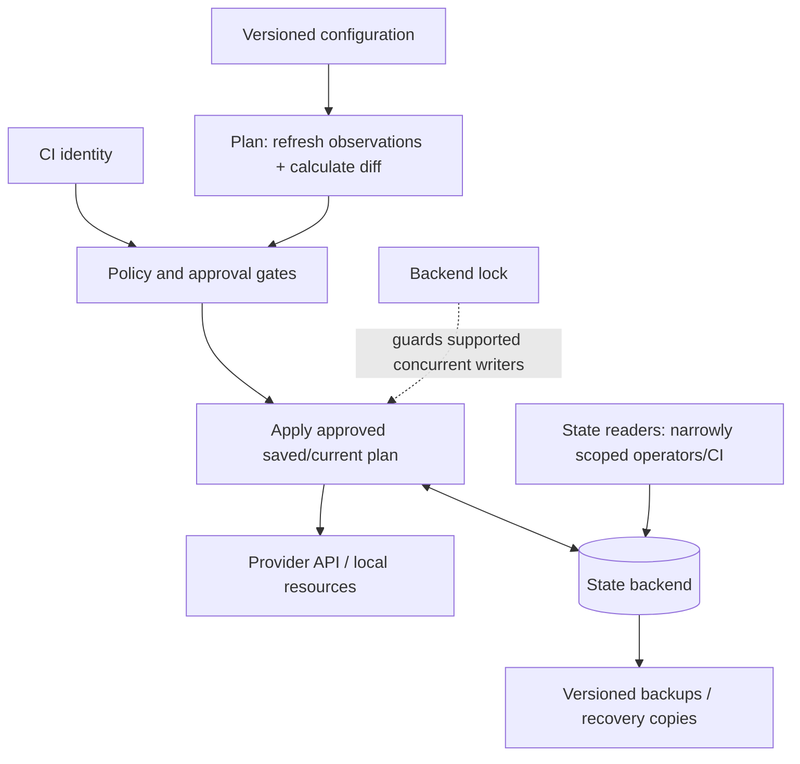
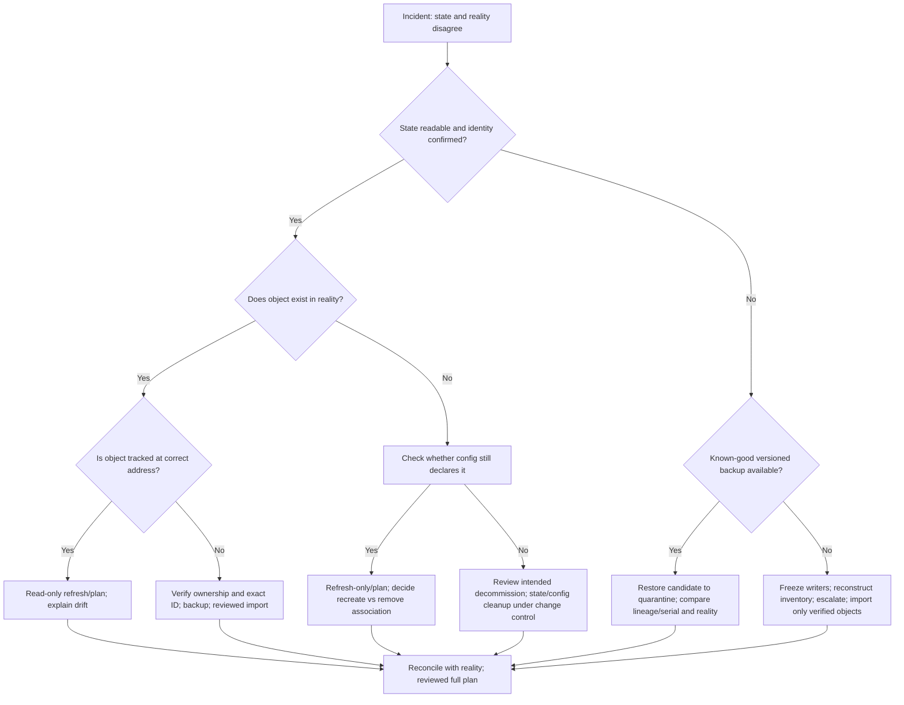

# Terraform State, Backends, Locking, and Recovery

**Abstract.** Terraform/OpenTofu state is the coordination record connecting declared resource addresses to objects the engine believes it manages. State failures can cause duplicate creation, accidental replacement, secret disclosure, or destructive plans. This unit teaches safe inspection, remote backends, locking, environment boundaries, state recovery, and operational runbooks. Labs use disposable local resources and an optional local S3-compatible emulator; they do not require paid cloud resources.

- **Module:** M07 — Advanced Infrastructure as Code and Cloud Operations
- **Stage:** 2E — Production DevOps & Platform Engineering
- **Unit:** 1
- **Target file:** `01-terraform-state-backends-locking-and-recovery.md`
- **Estimated study time:** 18–24 hours, including labs and review
- **Prerequisites:** Git, Linux shell, CI/CD basics, introductory HCL/IaC, reading a plan, least privilege
- **Core tools:** Terraform or OpenTofu (record exact binary/version), Git, shell, local provider resources
- **Awareness tools:** LocalStack or MinIO, object-store CLI/API, CI concurrency controls, external secret manager
- **Last reviewed:** 2026-10-28
- **Tool baseline assumed:** Terraform/OpenTofu and provider versions are intentionally not pinned here; install a current supported release and record exact versions in `versions.txt`. All backend flags, provider resources, and examples marked `[VERIFY]` must be checked against installed versions and official documentation before execution.
- **Substrate:** local-only by default; optional LocalStack/MinIO; **Touches real cloud: no** for required labs.

## Table of contents

- [Unit 1](#unit-1--terraform-state-backends-locking-and-recovery)
- [1.0 Why this matters in production](#10-why-this-matters-in-production)
- [1.1 Learning objectives](#11-learning-objectives)
- [1.2 Concept map and vocabulary](#12-concept-map-and-vocabulary)
- [1.3 Level 1 — Beginner](#13-level-1--beginner)
- [1.4 Level 2 — Intermediate](#14-level-2--intermediate)
- [1.5 Level 3 — Advanced](#15-level-3--advanced)
- [1.6 Level 4 — Expert](#16-level-4--expert)
- [1.7 SRE lens](#17-sre-lens)
- [1.8 Security lens](#18-security-lens)
- [1.9 Production checklist](#19-production-checklist)
- [1.10 Hands-on lab set](#110-hands-on-lab-set)
- [1.11 Self-check questions](#111-self-check-questions)
- [1.12 Evidence artifacts](#112-evidence-artifacts)
- [1.13 Common interview and design-review questions](#113-common-interview-and-design-review-questions)
- [1.14 Sources and verification notes](#114-sources-and-verification-notes)
- [1.15 Claim register](#115-claim-register)
- [1.16 Audit report](#116-audit-report)
- [1.17 Human verification checklist](#117-human-verification-checklist)
- [1.18 Known limitations and assumptions](#118-known-limitations-and-assumptions)
- [1.19 Sign-off](#119-sign-off)

## Unit 1 — Terraform State, Backends, Locking, and Recovery

### 1.0 Why this matters in production

State is operationally critical because an IaC engine uses it to correlate configuration with real object identities. If two writers update the same state concurrently, or if a stale snapshot replaces a current one, a later plan can propose duplicate resources, replacements, or deletions. State and saved plans can also contain sensitive resource attributes even when terminal output is redacted. A remote backend, locking, versioned recovery, least-privilege access, and a rehearsed incident procedure reduce these risks; none removes the need to inspect every consequential plan.

### 1.1 Learning objectives

By the end of this unit, the learner can:

1. **[L1]** Distinguish configuration, state, plan, and real infrastructure, and explain why they may disagree.
2. **[L1]** Run `init`, `validate`, `plan`, and a guarded `apply` against disposable provider-free resources; explain why `destroy` is destructive.
3. **[L1]** Inspect resource addresses and a sanitized state copy without hand-editing state JSON.
4. **[L2]** Configure a remote S3-compatible backend using partial configuration and non-secret authentication settings.
5. **[L2]** Explain lock acquisition, contention, timeout, stale locks, and why routine `-lock=false` is unsafe.
6. **[L2]** Design separate state locations for dev, staging, prod, and independently managed components.
7. **[L3]** Identify secret-bearing copies of state and plans and apply controls for access, encryption, retention, and rotation.
8. **[L3]** Select among refresh-only plans, import, state operations, and backend-version recovery based on evidence.
9. **[L4]** Execute a recovery runbook with a documented blast-radius check, rollback path, peer review, and post-remediation proof.
10. **[L4]** Propose state-boundary, backup, CI serialization, and state-surgery governance suitable for a shared platform team.

### 1.2 Concept map and vocabulary

| Term | Precise definition | Common misconception |
|---|---|---|
| Configuration | HCL declarations describing desired resources, providers, inputs, and relationships. | It is not a live inventory of everything in the account. |
| State | Engine-managed record correlating resource addresses with object IDs and recorded attributes/metadata. | It is not authoritative proof that every recorded object still exists. |
| Plan | A proposed set of actions based on configuration, state, provider observations, and engine behavior at plan time. | It is not a promise that apply will have the same result. |
| Backend | The mechanism that stores state and, depending on backend/engine, coordinates access. | It is not the same thing as a provider. |
| Provider | Plugin that communicates with an API or platform to manage resource types. | It does not own the state storage decision. |
| Lock | Coordination mechanism intended to prevent concurrent state writers for a supported backend. | It does not protect against every out-of-band cloud change. |
| Drift | Difference between declared/recorded intent and observed reality. | A refresh does not automatically make every drift safe to accept. |
| Import | Associate an existing object with a configuration resource address and state. | Import does not necessarily generate correct configuration or validate ownership. |
| State lineage | Identifier used to distinguish a state history/family. `[VERIFY]` exact format and semantics for selected engine. | It is not a human-readable environment name. |
| State serial | A monotonically changing state snapshot counter in common state formats. `[VERIFY]` exact semantics for selected engine. | It is not a substitute for backups or locking. |
| Sensitive output | A value marked for reduced display in supported CLI contexts. | It does not encrypt or remove the underlying value from state. |
| State surgery | Manual, exceptional use of state commands to change tracked resource associations. | It is not routine maintenance or a replacement for configuration fixes. |

#### System flow



The backend is writable only by approved identities; reviewers inspect the plan before the approved apply. Locking coordinates writers only when supported and configured. A lock does not enforce approval policy or stop a person from making out-of-band changes in a cloud console.

#### Relationship and mismatch model

```text
Configuration             State                     Real infrastructure
resource.bucket.raw  <--> address + object ID <--> bucket may exist
       |                         |                       |
       | config removed           | stale record          | object deleted manually
       v                         v                       v
Plan may propose delete    State may reference      Refresh/plan may detect
                           an absent object         a missing object

Unmanaged object: exists in reality, but has no state association.
State is the source of truth for what the engine believes it manages—not for everything that exists.
```

#### Operational vocabulary

- **Backend location/key:** where one state snapshot is stored. Document environment, component, owner, and recovery path; do not rely on a workspace name as a security boundary.
- **Partial backend configuration:** non-secret values supplied separately at initialization rather than embedding credentials in HCL. Backend configuration generally cannot use ordinary input variables because backend initialization happens before normal evaluation.
- **Blast radius:** the resources, environments, teams, and data that one operation could affect.
- **Convergence:** a reviewed plan shows no unexplained changes after the intended repair.
- **Rollback check:** confirm what can actually be restored. Reverting state alone does not revert infrastructure.

### 1.3 Level 1 — Beginner

#### 1.3.1 What state is and why it exists

A resource block such as `resource "local_file" "manifest"` declares a desired object. The engine must remember which real/local object was created for that address, record relevant attributes, and understand dependencies between objects. State provides that association and avoids having to rediscover every identity from scratch on every run.

State is **not** a cloud-wide asset inventory. A bucket created manually may not be in state. A resource recorded in state may have been deleted outside the engine. Therefore, always distinguish these four views:

1. **Configuration:** what the repository declares.
2. **State:** what this working directory/backend believes it manages.
3. **Plan:** proposed actions after evaluating configuration and observations.
4. **Reality:** objects actually present in the local system or remote platform.

A common failure is to delete a local state file and assume infrastructure has been deleted. It has not. The opposite failure is to restore an old state snapshot and assume the old infrastructure has also returned. It has not.

#### 1.3.2 Core workflow and side effects

| Command | Purpose | Typical effect | Safety note |
|---|---|---|---|
| `<iac> init` | Initialize the working directory, backend, and providers/modules as applicable. | Writes local metadata under `.terraform/`; may configure/migrate backend if explicitly requested. | Confirm the intended directory and backend first. |
| `<iac> validate` | Check configuration structure and internal consistency. | Normally no infrastructure mutation. | Does not prove credentials, policy, or real API operations will succeed. |
| `<iac> plan` | Calculate proposed actions. | May refresh/read provider data and writes no intended resource changes; `-out` creates a saved plan file. | Plan files may contain sensitive data; protect them. |
| `<iac> apply` | Execute a reviewed set of changes. | Can mutate real/local infrastructure and state. | Review target, identity, and full plan first. |
| `<iac> destroy` | Propose and execute removal of managed resources. | Destructive infrastructure and state changes. | Use only in a disposable lab after asserting the target and reviewing the destroy plan. |
| `<iac> state list` | List addresses in state. | Read-only inspection. | Confirms tracked addresses, not complete real-world inventory. |
| `<iac> state show ADDRESS` | Show recorded attributes for one tracked address. | Read-only inspection. | Output may expose secrets; use a controlled terminal. |
| `<iac> output` | Display root outputs. | Read-only inspection. | Sensitive values may still be exposed by options or stored in state. |
| `<iac> show` | Show current state or a plan, depending on arguments. | Inspection. | Distinguish a saved plan from a state view. |

`<iac>` means the chosen `terraform` or `tofu` executable only where behavior has been verified as equivalent for installed versions.

#### 1.3.3 Provider-free starter example

Create a disposable directory, not a production repository:

```text
state-lab/
├── main.tf
├── versions.tf
├── .gitignore
└── versions.txt
```

`versions.txt` must record the selected binary and exact output of its version command. Do not copy a version number from this document.

`versions.tf` (provider requirement syntax and supported versions: `[VERIFY]`):

```hcl
terraform {
  required_providers {
    local = {
      source = "hashicorp/local"
    }
  }
}
```

`main.tf`:

```hcl
resource "local_file" "manifest" {
  filename = "${path.module}/out/platform-manifest.txt"
  content  = <<-EOT
  platform=training
  environment=dev
  owner=learner
  EOT
}

output "manifest_path" {
  description = "Path of the disposable local manifest."
  value       = local_file.manifest.filename
}
```

Before running, verify the local provider source and current version constraints in its official registry documentation. Create `out/` if needed only if the selected provider requires it; `[VERIFY]` provider behavior for parent-directory creation. Safer explicit setup:

```bash
mkdir -p out
<iac> version
<iac> init
<iac> validate
<iac> plan -out=lab.tfplan
<iac> show lab.tfplan
```

Inspect the full plan. It should propose creating `local_file.manifest`; exact formatting and attributes vary by version. Only in this disposable directory, and only after confirming the plan has no unexpected actions:

```bash
<iac> apply lab.tfplan
cat out/platform-manifest.txt
<iac> state list
<iac> state show local_file.manifest
<iac> output
<iac> show
```

Representative—not executed—result:

```text
$ <iac> state list
local_file.manifest

$ cat out/platform-manifest.txt
platform=training
environment=dev
owner=learner
```

**Trace:** HCL declares the file → plan predicts its creation → apply calls the local provider → the file appears on disk → state records the address and provider-returned attributes. If the file is removed manually, the next plan may propose recreating it; inspect before applying.

Cleanup requires a target assertion and a destroy plan:

```bash
pwd
<iac> workspace show
<iac> plan -destroy -out=cleanup.tfplan
<iac> show cleanup.tfplan
# Proceed only if the plan targets this disposable lab and only expected resources.
<iac> apply cleanup.tfplan
 test ! -e out/platform-manifest.txt && echo "cleanup verified"
```

If the selected engine lacks or differs in a shown flag, stop and verify official CLI help before adapting it. Never run a copied `destroy` command from an unknown working directory.

#### 1.3.4 Read state JSON safely

A local backend commonly creates `terraform.tfstate` in the working directory. It is JSON and can include IDs, attributes, outputs, provider metadata, and sensitive values. **Never hand-edit state JSON.** To inspect, first ensure the lab contains only throwaway data, then create a sanitized copy that removes secrets and identifiers before attaching it to notes or a ticket. Keep original state in a restricted location.

A typical state format has a version field, a lineage-like identifier, a serial-like counter, outputs, and resource instances. Exact schema and semantics are engine/version-dependent: `[VERIFY: inspect the state-format documentation for the installed engine; never infer compatibility from JSON looking similar]`.

- `serial`: useful as a snapshot-generation indicator in supported formats; not a backup system.
- `lineage`: useful for identifying a state history; not a guarantee that two files are safe to merge.
- Resource addresses and IDs are useful for mapping; recorded attributes may be stale.

Use the engine's state commands for supported operations. Manual text edits can break invariants that are not obvious from the JSON.

#### 1.3.5 Local backend: appropriate use and limits

The local backend is suitable for an individual disposable lab and for bootstrap workflows that are deliberately migrated later. It stores state locally and does not provide shared team coordination by default. A shared filesystem, ad hoc copying, or committing state to Git is not a safe substitute for a designed remote backend and concurrency controls. Laptop loss, disk failure, accidental deletion, broad local permissions, and leaked backups are real risks. Local history depends on the surrounding backup process; do not assume automatic version history.

#### 1.3.6 `.terraform/`, lock file, and Git hygiene

- `.terraform/`: working-directory metadata, downloaded provider/module material, and backend initialization data as applicable. Do not commit it.
- `.terraform.lock.hcl`: provider dependency selections and checksums in Terraform; verify exact behavior for OpenTofu and the selected platform. Normally commit it so team members use reviewed provider selections.
- State, state backups, saved plan files, and secret-bearing variable files: do not commit.

Example `.gitignore`:

```gitignore
# Working directory and state
.terraform/
*.tfstate
*.tfstate.*
*.tfstate.backup

# Saved plans and crash/debug output
*.tfplan
plan.out
crash.log
crash.*.log

# Local-only overrides and secrets
override.tf
override.tf.json
*_override.tf
*_override.tf.json
*.tfvars
*.tfvars.json
!example.tfvars

# Local lab output
out/
versions.txt
```

If `versions.txt` is intended to be reviewed evidence, do not ignore it; choose one policy and document it. The snippet above shows a local-only variant, so remove that line when version evidence is committed. Do not add a broad ignore rule that accidentally excludes `.terraform.lock.hcl`.

**Beginner mistakes → symptom → fix**

| Mistake | Symptom | Fix / verification |
|---|---|---|
| Assuming state equals reality | Plan surprises after manual changes. | Inspect state and provider reality separately; review refreshed plan. |
| Committing state | Secret/resource metadata visible in Git history. | Restrict repository, remove current tracked copies, treat historical copies as exposed, rotate secrets. |
| Deleting state to “reset” | Engine proposes recreating objects or loses associations. | Stop; restore/import/reconcile using a reviewed runbook. |
| Trusting `sensitive = true` as encryption | Secret appears in state JSON. | Treat state/plan as secret and enforce backend access controls. |
| Applying without reading plan | Unexpected replacement/deletion. | Save and inspect plan; assert workspace/backend and identity. |
| Ignoring lock file | Provider selections differ across machines. | Commit provider lock file and review dependency updates. |

### 1.4 Level 2 — Intermediate

#### 1.4.1 Backend versus provider

A **backend** controls where state is stored and may provide coordination features such as locking. A **provider** translates resource declarations into API operations for a platform. Changing providers does not automatically migrate state storage; changing backends does not automatically change the provider responsible for a resource. Backend configuration is initialized early and generally cannot reference ordinary input variables or provider-computed values.

#### 1.4.2 Remote backend design

For a shared team, choose a remote backend that supports the required availability, access controls, encryption, auditability, version recovery, and locking for the selected engine. An S3-compatible backend can be studied with LocalStack or MinIO, but compatibility varies. LocalStack is partial emulation, not AWS; it does not prove real IAM, quotas, Organizations/SCP behavior, networking, billing, regional behavior, or all consistency semantics. Verify exact endpoint and backend arguments against official documentation for the exact engine and emulator versions.

A backend design record should state:

- backend type and object-store/account ownership;
- environment/component-to-key mapping;
- who may read state and who may write it;
- encryption in transit and at rest;
- object versioning and retention controls;
- locking implementation and verified engine support;
- recovery procedure and restore-test evidence;
- bootstrap owner and deletion protection;
- audit trail and alerting owner.

Object versioning helps recover an earlier object version, but does not alone protect against deletion of all versions, compromised credentials, regional outage, or a flawed recovery operation. Keep a separate, access-controlled recovery copy where justified and test restoration.

#### 1.4.3 Partial backend configuration and credentials

Keep backend configuration free of credentials. Example structure (illustrative; the actual arguments and endpoints are `[VERIFY]`):

`backend.hcl`:

```hcl
bucket = "training-state"
key    = "data-platform/dev/storage/terraform.tfstate"
region = "us-east-1"
```

The values above are examples, not a claim that the bucket exists or that the region/endpoint is correct for a local emulator. A backend block in HCL declares the backend type but leaves deployment-specific values to initialization:

```hcl
terraform {
  backend "s3" {}
}
```

Initialize only after verifying the backend's required fields and endpoint options for the selected tool:

```bash
<iac> init -backend-config=backend.hcl
```

Use an environment/profile/workload identity mechanism supported by the selected backend. Never put static access keys in `backend.hcl`, HCL source, shell history, logs, or committed variable files. Initialization metadata may persist backend configuration locally; inspect the selected engine's behavior and protect local working directories accordingly.

#### 1.4.4 State locking and timeout

Locking is a coordination mechanism intended to prevent two operations from writing the same state simultaneously. A typical operation acquires a lock, reads/updates state, and releases the lock. A second contender waits or fails. With a configured timeout, it may continue if the lock becomes available within the window; if the timeout expires, it fails rather than safely “taking over.” Exact output, timeout syntax, backend support, and lock semantics are `[VERSION-SENSITIVE]` and must be confirmed against the selected engine.

```mermaid
sequenceDiagram
  participant A as Apply A
  participant B as Apply B
  participant L as Backend lock
  participant S as State backend
  A->>L: Acquire lock
  L-->>A: Granted
  B->>L: Acquire lock
  L-->>B: Busy / wait
  alt lock released before timeout
    A->>S: Write state
    A->>L: Release lock
    L-->>B: Grant lock
    B->>S: Read current state and continue
  else timeout expires
    L-->>B: Timeout error
    Note over B: Stop; inspect owner and retry deliberately
  end
```

`-lock=false` bypasses a supported lock mechanism and can permit concurrent writes. Do not use it to “fix” contention. A **real conflict** means an operation is active or a lock is legitimately held; a **stale lock** is suspected only after evidence shows its owner is no longer active. Do not infer stale status from elapsed time alone.

#### 1.4.5 Backend lock implementation: version-sensitive

| Mechanism | What to understand | Verification required |
|---|---|---|
| Historical S3 backend + DynamoDB lock table | Some Terraform versions used a separate table for lock coordination. | `[VERSION-SENSITIVE]` Check current official S3 backend docs and the installed engine's supported arguments; do not assume this is universally required. |
| Native S3 lockfile | Some newer engine/backend combinations support an object lockfile. | `[VERSION-SENSITIVE]` Verify exact version, argument name, permissions, migration implications, and compatibility with every writer. |
| OpenTofu backend behavior | Similar concepts do not prove exact CLI/backend parity. | `[VERIFY]` Compare current OpenTofu backend documentation with Terraform docs and test with the chosen versions. |

Do not enable two competing lock strategies or migrate lock mechanisms during an incident without a reviewed compatibility plan. Backend lock support is not established merely because an emulator accepts a configuration field.

#### 1.4.6 `init -migrate-state` versus `init -reconfigure`

- `init -migrate-state` is intended for a deliberate backend change where existing state should be copied/migrated to the newly configured backend. Back up first, freeze writes, verify both endpoints, and validate destination state after migration.
- `init -reconfigure` tells the engine to initialize with the current backend configuration rather than using previously initialized backend settings; it is not a substitute for state migration and can point the working directory at a different state location.

Exact prompts and behavior are version-sensitive. Before either command, capture the current backend identity, state backup, workspace/environment, and expected destination key. Afterward, verify the destination state and run a plan; do not retire the old backend until sign-off. If unsure which operation is appropriate, stop and consult the installed engine's official `init` documentation.

#### 1.4.7 State layout for dev/staging/prod

Example logical layout; exact keys/paths depend on backend:

```text
state-root/
  data-platform/dev/storage.tfstate
  data-platform/dev/metadata.tfstate
  data-platform/staging/storage.tfstate
  data-platform/staging/metadata.tfstate
  data-platform/prod/storage.tfstate
  data-platform/prod/metadata.tfstate
```

Separate state by environment and component/lifecycle/failure domain where the reduction in blast radius justifies the added coordination. Production should also have stronger identity and account boundaries; a different key alone is not a security boundary if the same identity can write every environment.

| Approach | Benefits | Costs/risks | Use when |
|---|---|---|---|
| Directory per environment + separate backend | Explicit code/config boundaries; easy review. | Repeated files unless modules are used carefully. | Environments need different policy, identity, or change cadence. |
| Workspace per environment | Convenient shared configuration. | Same backend config and permissions may be shared; easy to target wrong workspace; not a security boundary. | Similar environments with controls external to the workspace and low isolation requirements. |
| Separate backend keys/paths | Isolates state objects and recovery units. | Access control may still be broad; key mistakes can target wrong state. | Components/environments need separate state and permission policy. |
| One huge state | Fewer cross-state outputs and dependencies. | Larger blast radius, slower plans, team coupling. | Small tightly owned stacks with common lifecycle. |
| Many tiny states | Narrow changes and ownership. | Dependency orchestration, more pipelines, output coupling. | Independent lifecycle/security boundaries justify the overhead. |

**Pattern catalogue**

| Pattern | When to use | When not to use |
|---|---|---|
| Reusable child module + distinct root per environment | Common resource standards with explicit environment configuration. | When modules hide critical behavior or become over-parameterized. |
| One state per component/lifecycle boundary | Different teams or different recovery/approval needs. | When components are inseparable and require constant cross-state coordination. |
| Publish a small explicit contract | Consumers need a few stable values. | When values are secrets or no access boundary exists. |
| `terraform_remote_state` | A trusted consumer needs root outputs and state access is appropriately controlled. | When consumer permissions should not expose the entire state object. |

`terraform_remote_state` exposes root outputs through its data source, but the consumer generally needs access to the underlying state snapshot. Do not assume it can read only harmless fields at the storage-permission layer. Alternatives include provider data lookups or publishing only required values to a dedicated parameter/configuration service. Service names and permission details are cloud-specific `[VERIFY]`.

#### 1.4.8 Sensitive outputs are not encrypted outputs

```hcl
variable "training_token" {
  type      = string
  sensitive = true
}

output "training_token" {
  value     = var.training_token
  sensitive = true
}
```

This is an illustrative warning example, not a recommendation to manage credentials in state. `sensitive = true` asks supported CLI surfaces to redact the value in ordinary display. It does **not** encrypt state, erase the value from state, guarantee redaction from every diagnostic/artifact, or grant/revoke authorization. Treat state and saved plans as sensitive data. Prefer external secret management and short-lived identity where appropriate; M09 covers secret-management depth.

### 1.5 Level 3 — Advanced

#### 1.5.1 Complete running example: environment-aware data platform

A real data platform might contain raw/curated/model-artifact object storage, metadata storage, a queue/topic, registry references, and a Kubernetes consumer. This unit models only the state boundary and local resources; it does not provision a real cloud data platform. Keep the lab provider-free and treat the following layout as a design artifact:

```text
infra/
  modules/
    state-demo/            # reusable resource declarations
  environments/
    dev/storage/            # root module + backend.hcl
    staging/storage/
    prod/storage/
  versions.txt
  docs/state-ownership.md
```

For each environment, document a distinct backend key/location and separate identity policy. Dev may have short retention and smaller capacity; staging approximates production; prod has tighter approvals, restricted state readers/writers, stronger retention, and independent recovery controls. Do not copy a dev backend config into prod without reviewing identity, endpoint, key, encryption, retention, and approval controls.

#### 1.5.2 Secrets in state and artifacts

State may include resource attributes, generated passwords, private keys, tokens, connection strings, and database credentials depending on resource/provider behavior. A value marked sensitive can still be present in state JSON or saved plan data. The exposure surface includes:

- current state object and all retained versions;
- state backups and `state pull` output;
- saved plan files and plan JSON output;
- CI artifacts, caches, workspace snapshots, and job logs;
- debug traces, shell history, terminal recordings, and local downloads;
- ticket attachments, chat uploads, and copied snippets.

Controls: encrypt backend storage and transport; narrowly scope read and write access; separate read from write roles where practical; prevent state and plan artifacts from unrestricted CI retention; audit reads/writes; restrict retention and deletion; rotate/revoke any exposed credential; and avoid storing secret material in managed resource attributes where a safer external secret-management design exists. OpenTofu client-side state encryption is awareness-only here: `[VERSION-SENSITIVE] [VERIFY: check the current official OpenTofu state-encryption documentation, key management, migration and recovery behavior, and whether every state/plan copy is covered]`. Never assume it protects downloaded copies or all artifacts automatically.

#### 1.5.3 State pull/push and state commands

- `<iac> state pull`: retrieve a state snapshot to stdout. Redirecting it to a file creates a sensitive copy; protect permissions and remove it only under a documented retention process.
- `<iac> state push`: upload/replace the state snapshot for the current backend. This can overwrite newer associations. Do not use without a fresh backup, lineage/serial review, peer review, and an explicit recovery plan. Any force override and safeguards are `[VERIFY]` for the installed engine.
- `<iac> state list`: lists tracked addresses.
- `<iac> state show ADDRESS`: inspects one tracked object; may expose sensitive attributes.
- `<iac> state mv SOURCE DEST`: changes an address association; it does not itself move the real object. Review configuration/address mapping and plan afterward.
- `<iac> state rm ADDRESS`: removes the association from state but does not destroy the real object. A later plan may propose creating another object unless configuration/import is reconciled.
- `<iac> state replace-provider`: changes provider source association in state; use only as a planned provider migration, verify syntax and compatibility for the engine, and review the subsequent plan.

State operations are exceptional administrative actions. Capture the exact command, target backend, state identity, backup checksum/location, operator, reviewer, and resulting plan in an audit log without including secret values.

#### 1.5.4 Refresh-only and partial apply

A refresh-only plan asks the engine to reconcile recorded state with observations from providers without proposing ordinary configuration-driven changes in the same way as a normal plan. Review it carefully; it does not automatically repair all mismatches or recover deleted infrastructure. Where supported, a reviewed `apply -refresh-only` records the chosen observation changes. The standalone `terraform refresh` workflow has been discouraged/deprecated in modern practice; `[VERIFY: check exact status and behavior in the installed Terraform/OpenTofu CLI docs]`.

After a partial apply, possible realities include:

- object was created, but state update failed before association was committed;
- state was updated, but a later object operation failed;
- a previously tracked object was deleted out of band;
- provider API succeeded but client timed out, leaving outcome uncertain.

Do not blindly rerun apply, remove state, or import. First hold writers, inspect logs and current state, query the actual object through a read-only provider/API path, back up state, then select the smallest repair. Import only after proving object identity and ownership. Follow with a full plan and explain every action.

#### 1.5.5 State version recovery

With an object-store backend, object versioning may permit recovery of a previous state object version. A provider-neutral recovery process is:

1. Freeze all writers and record the incident timeline.
2. Identify the exact backend, key, environment, workspace, lineage, and current version identifier.
3. Copy the current object and candidate historical versions to a restricted recovery location; do not overwrite the only copy.
4. Compare timestamps, serial/lineage metadata where supported, expected resource addresses, and known infrastructure changes. Sanitize only for review; preserve the protected original for recovery.
5. Select a candidate with a peer-reviewed rationale. Restore to a quarantine key/location first when possible; do not immediately overwrite production state.
6. Reconcile candidate state with reality using read-only inspection and a reviewed plan. State restoration alone does not restore real infrastructure.
7. If a push/restore is required, label it as state-changing, get approval, preserve pre-change state, and verify a clean plan or explain every remaining action.
8. Keep the old backend/version protected until the incident owner signs off.

Exact version-list/copy/restore commands differ by object store. `[VERIFY: use the selected backend provider's official documentation; do not paste guessed CLI commands]`. Object versioning is not a complete backup/DR strategy: add separate protected copies and test restoration (full DR belongs to M13).

#### 1.5.6 Backend bootstrap choices

| Approach | Procedure | Advantages | Risks and controls |
|---|---|---|---|
| Bootstrap stack with temporary local state | Create the backend prerequisites using a small disposable/bootstrap configuration; back up local state; configure remote backend; migrate with the verified migration workflow. | Repeatable and can be reviewed as code. | Bootstrap state is itself sensitive and can be lost; document ownership and protect it. |
| Documented manual/bootstrap provisioning | An authorized administrator creates the state bucket/object store and controls before application stacks begin. | Minimal bootstrap dependency. | Click-ops drift and undocumented settings; require a checklist, audit record, and independent review. |
| Per-account bootstrap | A governed account/platform process creates backend and identities in every account/environment. | Centralized standards and boundaries. | More platform complexity; changes to bootstrap can affect many accounts. |

A safe bootstrap exercise uses local-only resources to model the order: create backend prerequisites, verify access/retention/locking settings, back up current local state, migrate in a disposable lab, inspect the remote state, and prove the plan is clean. Do not claim LocalStack proves real cloud IAM or durability.

#### 1.5.7 State splitting and performance

Split state when lifecycle, ownership, failure domain, access requirements, or change frequency differ materially. Avoid splitting solely to achieve a small file: each boundary introduces orchestration and data-contract responsibilities. Cross-state references can couple deployment order and leak outputs. A state that contains unrelated production and dev resources increases the chance that a routine change has a broad impact.

`-parallelism` controls the degree of concurrent operations in supported workflows; reducing it may help a diagnosed provider/API bottleneck but does not fix state design or locking. Verify exact flag behavior for the engine/version. `-target` restricts a plan to selected resources/dependencies and can leave a partially converged system; it is an exceptional recovery/debugging tool, not a normal deployment strategy. Always run a full plan after targeted work.

#### 1.5.8 CI serialization

Require at most one state-mutating pipeline per state key. A CI concurrency group should include the actual environment/component/backend identity—not merely a generic workflow name. Example concept (syntax is CI-provider-specific and must be verified):

```yaml
# Illustrative pseudocode; adapt to the CI provider's documented syntax.
concurrency:
  group: iac-${environment}-${component}-${backend_key}
  cancel-in-progress: false
```

Do not cancel a live apply just to release a queue slot. A canceled runner may leave an uncertain operation or lock. Use queueing, approvals, backend locking, and post-job diagnostics together. M02 covers the full CI/CD approval model.

### 1.6 Level 4 — Expert

#### 1.6.1 State recovery decision tree



Before each remediation, document: **target and blast radius**, **backup/rollback option**, **active writer status**, **expected plan**, **approval owner**, and **stop condition**. There is no universal undo button. Reverting configuration, restoring state, and restoring real infrastructure are separate operations.

#### 1.6.2 Runbook template

Every incident follows this order:

`Symptom → Immediate safety hold → Hypotheses → Read-only tests → Backup/rollback check → Root cause → Remediation (state-changing steps labelled) → Post-remediation proof → Prevention/follow-up`.

**Immediate safety hold:** pause CI applies, tell owners not to run local applies, preserve logs, confirm the target backend/key/workspace, and do not delete or overwrite state. If the target or lineage is uncertain, stop and escalate to the platform/state owner.

#### 1.6.3 Twelve incident runbooks

##### Incident 1 — State file lost

- **Symptom:** backend object or local state file is missing; plan may show many creates.
- **Immediate safety hold:** disable all applies and confirm no one initialized a new state at the same key.
- **Hypotheses / read-only tests:** accidental deletion, wrong key/workspace, backend outage, local path mistake; inspect backend identity, object versions, audit logs, workspace, and recent pipeline runs.
- **Blast-radius and rollback check:** enumerate every component/environment using the key; copy any remaining current/versioned state; identify last known-good version and its time relative to infrastructure changes.
- **Root cause:** determine whether state is merely at another location or truly unavailable.
- **Remediation — STATE-CHANGING:** restore a candidate to quarantine, compare its lineage/serial and resource IDs with reality, then migrate/restore only with peer approval. If no backup exists, reconstruct inventory and import only individually verified objects.
- **Proof:** read-only inventory, reviewed full plan with no unexplained create/destroy/replace, and owner sign-off.
- **Prevention:** versioning, protected offsite copy, restore drills, deletion controls, and monitoring.

##### Incident 2 — State malformed or corrupted

- **Symptom:** parser error or implausible state structure.
- **Immediate safety hold:** stop writers; preserve the exact bytes and diagnostic output in a restricted location.
- **Hypotheses / read-only tests:** interrupted copy, manual edit, truncated artifact, wrong engine, incompatible migration; compare checksums and prior versions; verify engine/backend identity.
- **Blast-radius and rollback check:** ensure a candidate backup belongs to this state lineage and is not older than unaccounted infrastructure changes.
- **Remediation — STATE-CHANGING:** restore a known-good candidate in quarantine, then reconcile with reality. Do not hand-edit JSON. If no trusted copy exists, escalate and reconstruct through verified import/state operations.
- **Proof:** engine can read state; plan is reviewed; every proposed action is explained.
- **Prevention:** no manual editing, atomic transfer procedures, protected versions, tested restore.

##### Incident 3 — Wrong or stale state snapshot pushed

- **Symptom:** unexpected resource changes after `state push` or an operation used a stale download.
- **Immediate safety hold:** pause applies and preserve the pushed snapshot plus prior state versions.
- **Hypotheses / read-only tests:** wrong environment/key, old serial, wrong lineage, concurrent writer, incorrect recovery candidate; inspect audit logs, metadata, and infrastructure inventory.
- **Blast-radius and rollback check:** compare candidate and current state object-by-object; confirm whether infrastructure changed since candidate snapshot.
- **Remediation — STATE-CHANGING:** restore a reviewed pre-incident version only if it matches reality sufficiently; otherwise reconcile deliberately. Do not blindly force-push.
- **Proof:** clean or fully explained plan, correct backend identity, second-person review.
- **Prevention:** restrict push permission, require peer approval, backup and command logs for state surgery.

##### Incident 4 — Backend bucket/object store deleted or unavailable

- **Symptom:** backend initialization/read/write fails or state key is missing.
- **Immediate safety hold:** stop applies; do not create a replacement bucket/key with the same name and assume it contains correct state.
- **Hypotheses / read-only tests:** service outage, permission change, wrong endpoint, deletion, networking failure; inspect provider status, audit logs, configuration, and version/recovery copies.
- **Blast-radius and rollback check:** identify all state keys/components sharing the backend and confirm the recovery destination has access controls/encryption.
- **Remediation — STATE-CHANGING:** if unavailable, wait/restore service rather than reinitialize blindly. If deleted, restore from a protected copy/version into a controlled destination and reconcile. Recreate backend infrastructure only through an approved bootstrap procedure.
- **Proof:** read state, confirm key/workspace, run reviewed plan, verify lock and access policy.
- **Prevention:** deletion protection/retention where supported, separate admin role, audit alerts, offsite backup.

##### Incident 5 — Lock mechanism unavailable or lock appears stuck

- **Symptom:** lock acquisition fails, lock service/table/object is unavailable, or an old lock ID appears.
- **Immediate safety hold:** do not use `-lock=false`; pause retries that could add noise.
- **Hypotheses / read-only tests:** real active apply, crashed runner, permission/network issue, lock service outage; inspect lock metadata, local processes, CI jobs, and backend health.
- **Blast-radius and rollback check:** determine which state is locked and whether any writer could still commit; back up state before state-changing recovery.
- **Remediation — STATE-CHANGING:** fix backend/permissions if unavailable. Consider `force-unlock LOCK_ID` only after independently confirming the owner is dead and no apply/plan can still write; verify exact syntax and lock ownership semantics for the installed engine.
- **Proof:** one controlled plan succeeds, lock is acquired/released normally, and state is consistent.
- **Prevention:** stable backend availability, runner cleanup, alerts, serialized CI, documented lock ownership.

##### Incident 6 — Two applies ran concurrently after lock bypass

- **Symptom:** state diverges, unexpected duplicate resources, stale state writes, or contradictory logs.
- **Immediate safety hold:** stop all writers and preserve both job logs, plans, state snapshots, and timestamps.
- **Hypotheses / read-only tests:** lock bypass, separate backend keys accidentally targeting same real objects, CI concurrency mis-keyed; compare operation IDs, state serial/lineage, and real object IDs.
- **Blast-radius and rollback check:** list every object each apply could create/delete/replace; do not select a state file solely because its serial is larger.
- **Remediation — STATE-CHANGING:** reconstruct the correct resource-to-address mapping and restore/reconcile with owner approval. Import missing associations or remove stale associations only after verifying reality and configuration.
- **Proof:** reviewed full plan has no unexplained actions; backend locking tested; duplicate/orphan objects accounted for.
- **Prevention:** prohibit routine `-lock=false`, serialize CI per actual state, restrict backend write access.

##### Incident 7 — CI artifact exposes database password/private key

- **Symptom:** secret appears in state/plan artifact, log, cache, or build download.
- **Immediate safety hold:** restrict artifact access and stop further publication; preserve minimal audit metadata without redistributing the secret.
- **Hypotheses / read-only tests:** sensitive output misinterpreted, provider stored credential, plan JSON/log leaked, broad artifact retention; inventory all accessible copies and viewers.
- **Blast-radius and rollback check:** identify systems/accounts using the credential and assess whether immediate revocation could disrupt production; coordinate rotation window.
- **Remediation — SECURITY-CHANGING:** revoke/rotate credential, update external secret store and consumers, restrict/delete accessible copies according to policy, and preserve audit evidence. Treat object versions, backups, downloads, and caches as potentially compromised; deleting one copy does not erase historical exposure.
- **Proof:** old credential fails, new credential works for authorized consumers, access is restricted, artifact retention is corrected.
- **Prevention:** avoid secret-bearing resources in state where possible, minimize artifacts, least privilege, scanning/redaction, short retention.

##### Incident 8 — `force-unlock` used while apply still active

- **Symptom:** another writer begins while the original operation is running; state may contain interleaved or stale writes.
- **Immediate safety hold:** halt new applies immediately; do not attempt repeated unlocks or push state.
- **Hypotheses / read-only tests:** original runner still alive, lock ownership misunderstood, second pipeline acquired lock after forced release; inspect both job logs, processes, backend audit trail, and snapshots.
- **Blast-radius and rollback check:** preserve all state versions and enumerate every real object affected by both operations; identify which writes may still complete.
- **Remediation — STATE-CHANGING:** wait until all writers are confirmed stopped; compare state snapshots and reality; restore/reconcile through a reviewed recovery plan. Escalate if object identity cannot be determined safely.
- **Proof:** one serialized writer resumes only after a clean plan and sign-off.
- **Prevention:** require stale-lock evidence, lock ID verification, peer approval, and an explicit no-live-writer check before force-unlock.

##### Incident 9 — Partial apply created object missing from state

- **Symptom:** provider/API shows an object, but state has no matching address; next plan proposes duplicate creation.
- **Immediate safety hold:** stop apply and identify the object by stable ID.
- **Hypotheses / read-only tests:** process crash after create, API timeout, wrong state key, failed import; query actual object and audit logs.
- **Blast-radius and rollback check:** confirm ownership, environment, tags, dependencies, and whether another stack already manages it.
- **Remediation — STATE-CHANGING:** if configuration should manage it, import the exact object into the intended address using verified provider import syntax; otherwise document and decommission only through owner-approved procedure. Back up state first.
- **Proof:** `state show` matches real object ID; full plan contains no unexplained duplicate create or destructive change.
- **Prevention:** recoverable runners, post-apply verification, idempotent operations, incident alerts.

##### Incident 10 — State tracks object deleted out of band

- **Symptom:** refresh/plan reports object missing or proposes replacement.
- **Immediate safety hold:** do not automatically apply; confirm whether deletion was intentional or malicious.
- **Hypotheses / read-only tests:** manual deletion, provider/API visibility issue, wrong account/region, temporary outage; verify identity and platform read-only inventory.
- **Blast-radius and rollback check:** determine whether recreation is safe, whether data was lost, and whether replacement changes IDs/dependencies.
- **Remediation — STATE-CHANGING:** if deletion was accidental and recreation is approved, review the plan and apply; if intentionally decommissioned, update configuration/state through reviewed workflow. Do not use `state rm` merely to silence an error.
- **Proof:** actual object status, reviewed plan, downstream health and owner approval.
- **Prevention:** restrict console delete permissions, audit changes, backups/data protection, drift monitoring.

##### Incident 11 — `terraform_remote_state` couples staging to prod outputs

- **Symptom:** staging plan depends on production state or an access policy grants staging broad production state reads.
- **Immediate safety hold:** stop staging apply and avoid copying prod state to staging.
- **Hypotheses / read-only tests:** shared backend config, wrong key/workspace, cross-environment output reference; inspect data-source config, backend permissions, and plan dependencies.
- **Blast-radius and rollback check:** map what prod values are consumed and whether any secret or sensitive metadata is exposed.
- **Remediation — CONFIGURATION/ACCESS-CHANGING:** correct the environment/key reference, separate identities/permissions, and publish only required non-secret values through an approved interface. Review the staging plan before apply.
- **Proof:** staging plan references intended staging contracts; staging identity cannot read prod state unless explicitly authorized.
- **Prevention:** independent environment roots, explicit contracts, access tests and CI policy.

##### Incident 12 — Migration seems successful but next plan shows unexplained changes

- **Symptom:** post-migration plan proposes broad creates/deletes/replacements.
- **Immediate safety hold:** do not apply; keep old backend protected and pause writes.
- **Hypotheses / read-only tests:** wrong destination key, wrong workspace, incomplete migration, provider/version change, stale state, endpoint/identity mismatch.
- **Blast-radius and rollback check:** compare source and destination snapshots, resource IDs, lineage/serial metadata where meaningful, and actual infrastructure; identify the rollback source.
- **Remediation — STATE-CHANGING:** if destination is incorrect, freeze writers and execute a reviewed reverse migration or restore path. Do not simply reconfigure to another key and assume state moved. If state is correct, investigate provider/config changes separately.
- **Proof:** backend identity is verified, state object list and critical IDs match, full plan is clean or explained, owner signs off.
- **Prevention:** rehearsed migration, freeze window, checksums, independent validation, explicit retirement approval.

#### 1.6.4 Backend migration runbook

1. **Plan and communicate:** identify owners, source/destination, environments, change window, approver, rollback criteria, and dependencies.
2. **Freeze writes:** pause CI and request no local applies. Verify active operations are complete.
3. **Backup:** capture source state through a protected version/copy procedure; record timestamp, key, lineage/serial where supported, and checksum.
4. **Preflight:** verify destination exists, access is least privilege, encryption/retention/locking are configured, and endpoint/key are correct.
5. **Migrate:** run the installed engine's verified `init -migrate-state` workflow; treat it as state-changing. Do not use `-reconfigure` as a substitute for migration.
6. **Verify:** inspect destination state, critical IDs, workspace/environment, and backend configuration. Run a full plan without applying; investigate all unexplained changes.
7. **Rollback decision:** if destination identity/content is wrong, keep writes frozen and use the documented reverse-migration/recovery procedure. State restoration does not revert infrastructure.
8. **Sign-off:** obtain platform and component-owner approval; retain source backend protected for the agreed recovery window.
9. **Retire:** only after a separately approved decommissioning change, remove old access/resources and verify no consumers remain.

#### 1.6.5 State surgery governance

Only named platform/state owners may authorize `state mv`, `state rm`, `state push`, `replace-provider`, or `force-unlock` in shared environments. Require: incident/change ticket; exact target key/workspace and resource address; read-only diagnosis; backup and restore test; second-person review; maintenance window; recorded command/version/operator; no-live-writer check; blast-radius and rollback check; post-operation plan; and audit evidence. `state push` and force overrides are break-glass operations, not normal deployment steps.

#### 1.6.6 Terraform versus OpenTofu divergence table

| Area | Safe statement | Required verification |
|---|---|---|
| Core HCL/provider/state workflow | Concepts overlap, but similarity does not prove full compatibility. | `[VERSION-SENSITIVE]` Run `version`, inspect current migration/compatibility docs, and test with disposable state. |
| S3 locking | Supported arguments and lock implementations can differ by version. | `[VERIFY]` Compare current official backend docs and lock support for both binaries before shared-state use. |
| State encryption | OpenTofu has documented state-encryption capabilities in some releases; exact behavior and syntax are not asserted here. | `[VERSION-SENSITIVE] [VERIFY]` Check encryption, key rotation, recovery, and artifact coverage in official docs. |
| State format/migration | Do not assume every state snapshot or migration is safely interchangeable. | `[VERIFY]` Back up, test migration on a copy, compare resources and run plan. |
| Provider/module compatibility | Registry sources, constraints, and provider support must be confirmed for selected engine. | `[VERIFY]` Initialize a disposable root and inspect provider/module release docs. |
| Registry endpoints | Default endpoints and override behavior may differ. | `[VERSION-SENSITIVE]` Check engine configuration and registry docs. |
| CLI flags/state commands | Similar command names may have different flags or safeguards. | `[VERIFY]` Use installed `help` and official docs before state-changing operations. |
| Test framework | Test syntax/features vary by engine/version. | `[VERIFY]` Check official `test` docs and run a minimal test before relying on it. |
| Licensing/governance | No legal/governance conclusion is made here. | Read each project's current official license and governance documents. |

### 1.7 SRE lens

#### 1.7.1 Useful indicators

| Indicator | Definition | Example operational use |
|---|---|---|
| Infrastructure change failure rate | Fraction of changes requiring rollback, hotfix, or incident response. | Identify risky module/backend changes. |
| Plan-to-apply elapsed time | Time from plan creation to approved apply completion. | Detect stale plans or approval bottlenecks; re-plan when context changes. |
| Drift count and age | Number of detected deviations and time unresolved. | Prioritize unowned manual changes. |
| Lock contention rate | Lock wait/failure frequency per state. | Detect concurrent pipeline pressure or stuck runners. |
| State recovery time | Time to restore a trusted state view and reconcile with reality. | Validate recovery objectives through drills. |
| Policy rejection rate | Plans rejected by state/security policy. | Distinguish useful guardrails from noisy rules. |
| Backend restore-test success | Successful rehearsed restores / planned restores. | Validate recoverability rather than assuming versioning works. |

Set targets from measured baseline, risk, and service needs; do not invent universal SLO values. A state backend can be available while the infrastructure is unhealthy, and infrastructure can be healthy while state is unrecoverable. Track both separately.

#### 1.7.2 Runbook snippet

**Alert:** repeated lock contention or state read/write failure.

1. **Triage:** identify backend/key, current owner, operation ID, CI run, and whether a writer is active.
2. **Mitigate:** pause new applies; preserve logs and state versions; do not bypass lock.
3. **Recover:** restore backend service/permissions or resolve the owning operation; use force-unlock only with stale-lock proof and approval.
4. **Verify:** one controlled read/plan succeeds; state and reality are reconciled; no unexplained changes remain.
5. **Follow up:** fix concurrency key, runner cleanup, backend availability, alerts, and runbook gaps.

#### 1.7.3 Capacity and cost

State operations consume backend requests, CI time, provider/API calls, and operator time. Very large states can slow plans and increase failure coupling; many tiny states increase orchestration and contract overhead. Local emulators use laptop CPU, memory, and disk. Real cloud is not required. If a learner optionally uses real cloud, verify current costs and free-tier terms in official billing docs first: budgets are alerts, not spending caps; billing data may lag; exposed credentials can create resources before alerts fire.

### 1.8 Security lens

| Threat / failure path | Preventive control | Detective control and verification | Residual risk / not addressed |
|---|---|---|---|
| State read exposes secrets or sensitive topology | Encrypt storage/transport; least-privilege read access; minimize stored secrets. | Inspect IAM/access policy and audit logs; test denied access with a non-privileged identity. | Authorized readers can still copy data; provider may store secret attributes. |
| State write permits tampering or dangerous plans | Separate write identity; approval gates; branch protections; protected backend versions. | Audit write events; review plan diff and state metadata. | Compromised privileged identity can still act within its permissions. |
| Lock bypass permits concurrent writers | Avoid routine `-lock=false`; serialize CI; backend lock where supported. | Test contention in a disposable backend; inspect pipeline concurrency configuration. | Locking does not stop out-of-band changes or broken emulation. |
| CI identity is overprivileged | Per-environment workload identity and least privilege. | Review effective role permissions and attempt expected denied operations in a safe account/test. | Permission-model complexity and policy drift. |
| Plan/state artifact is broadly retained | Do not publish by default; restrict access and retention. | Enumerate artifact permissions, retention settings, caches, and logs. | Copies already downloaded may persist. |
| Static credential in backend config/source | Use profile/environment/workload identity; secret scanner and review. | Scan repository and CI config; inspect history and job logs. | Secret may already exist in Git history or forks. |
| Backend/version deletion or replacement | Retention/versioning, protected admin role, separate recovery copy. | Audit deletion events; scheduled restore drills. | Malicious admin or correlated loss can defeat controls. |
| Secret leak without rotation | Document rotation and incident ownership. | Verify old credential is revoked and enumerate all copies. | Historical exposure cannot be undone. |
| Cross-environment state coupling | Separate identities/backends; explicit non-secret contracts. | Plan review and access tests proving staging cannot read prod state. | Misconfigured shared permissions can reintroduce coupling. |
| Provider/engine supply-chain uncertainty | Pin reviewed versions, commit lock file where applicable, review changes. | CI dependency diff and provenance checks. | Pinning does not guarantee a dependency is vulnerability-free. |

Controls do **not** replace M09 secret-management depth, M12 supply-chain depth, M02 CI approval design, M10 incident management, or M13 backup/DR. This unit establishes the state-specific interfaces and failure modes.

### 1.9 Production checklist

- [ ] Selected executable (`terraform` or `tofu`) and exact version are recorded in `versions.txt` and match CI.
- [ ] Backend type, environment/component key, owner, recovery location, and workspace are documented.
- [ ] The provider dependency lock file is committed when supported and reviewed; `.terraform/`, state, backups, saved plans, and secret-bearing tfvars are excluded from Git.
- [ ] Repository history and CI logs/artifacts have been checked for previously committed state or secrets; any exposure has a rotation record.
- [ ] Backend state and plan data are classified as sensitive; encryption and transport protections are verified for the chosen backend.
- [ ] Read and write access are least-privilege; prod and non-prod permissions are tested separately.
- [ ] Versioning/retention and a separate recovery copy are enabled where supported; a restore test is documented.
- [ ] Exact locking mechanism, supported arguments, and engine versions are verified against official docs.
- [ ] CI runs are serialized per actual state key; cancel behavior cannot silently leave a live writer.
- [ ] Routine `-lock=false`, blind `force-unlock`, blind `state push`, and routine `-target` are prohibited by written policy/review.
- [ ] Environment/backend target and identity are asserted before every state-changing operation.
- [ ] State surgery has a backup, reviewer, change/incident record, command log, and post-operation plan.
- [ ] Secret-bearing resources, outputs, saved plans, logs, and artifacts are identified and mitigated.
- [ ] State recovery and backend migration runbooks have been rehearsed in a disposable environment.
- [ ] A clean or fully explained plan and actual cleanup verification are recorded after every lab.
- [ ] LocalStack/MinIO evidence is explicitly labelled as emulator evidence, not real-cloud parity.

### 1.10 Hands-on lab set

**Safety contract for all labs:** disposable directory, no real cloud credentials, no real cloud resources, no production state. **Touches real cloud: no.** Commands are templates where `<iac>` is the selected binary. Verify current syntax and provider/backend support before execution. Never put actual secrets in these labs. Save sanitized evidence only.

#### Lab 1 — Local state, inspect, and safely clean up

- **Goal:** trace configuration → plan → apply → state → local artifact.
- **Substrate:** local backend + local provider. **Touches real cloud: no.**
- **Steps:** use the starter example in L1; record engine version; initialize; validate; save and inspect plan; assert current directory and workspace; apply only expected creation; inspect `state list`, `state show`, output, and file; remove the file manually only after documenting that this simulates drift; plan again and explain the proposed action; then create and inspect a destroy plan before applying cleanup.
- **Representative expected evidence:** state lists `local_file.manifest`; output identifies the disposable path; local file content matches configuration. Exact CLI text is version-dependent and representative, not execution evidence.
- **Cleanup verification:** file is absent; no unexpected addresses remain; document the final state view. Keep state only until evidence is sanitized.
- **Stretch:** create a sanitized state excerpt and explain why the original state remains sensitive.

#### Lab 2 — Local-to-remote backend migration and lock contention

- **Goal:** practice migration and understand real lock contention without using real cloud.
- **Substrate:** LocalStack or MinIO with an S3-compatible backend; container runtime. **Touches real cloud: no.**
- **Prerequisite:** verify emulator image/version, bucket/object versioning setup, endpoint, path-style/region requirements, and backend lock arguments from official documentation for the selected engine. LocalStack/MinIO is not proof of AWS parity.
- **Steps:** (1) Start the emulator and create a disposable bucket with versioning enabled using the emulator's documented API/CLI. (2) Verify versioning via the emulator's documented read-only command. (3) Create a provider-free/local-resource stack with local state; run validate and plan. (4) Back up local state with restrictive file permissions. (5) Configure the verified S3-compatible backend and non-secret `backend.hcl`; migrate using the installed engine's documented `init -migrate-state` workflow. (6) Inspect remote state and verify resource addresses/IDs; run a full plan and expect no unexplained changes. (7) In a separate disposable copy of this state, hold a real operation/lock using a documented safe method; have a second process attempt a plan/apply with a short `-lock-timeout` value supported by the engine. Do not force unlock or use `-lock=false`. (8) Observe contention; release the first operation normally and verify the second proceeds only after the lock is available, or allow timeout and record the failure. Avoid creating concurrent mutations; plans/read operations may not lock in every same way, so use a carefully controlled state-writing operation on disposable resources and verify exact semantics first.
- **Expected evidence:** versioning enabled; migration destination key recorded; state object/addresses match; clean plan; first contender owns lock; second contender waits/fails according to verified timeout semantics. Do not fabricate exact emulator output.
- **Cleanup:** stop processes, inspect active locks, destroy only disposable local resources after plan review, then delete emulator bucket/object versions using the documented cleanup procedure. Verify no resources/processes remain and note that versioned objects may require explicit deletion.
- **Stretch:** compare locking behavior on a second engine/version in an isolated copy; never share one state between engines without an explicit compatibility test.

#### Lab 3 — State recovery and reconciliation

- **Goal:** distinguish restoring state from restoring infrastructure and prove convergence.
- **Substrate:** local provider-free resources plus a versioned disposable backend from Lab 2, or local state with timestamped copies. **Touches real cloud: no.**
- **Steps:** (1) Create a local resource and save a known-good state copy/version. (2) Apply a harmless configuration change and preserve the new state as well. (3) Simulate loss by moving the active state aside only in this disposable lab; do not delete the sole backup. (4) Freeze writes and identify which state version matches the actual local object. (5) Restore the candidate to a quarantine path first; inspect lineage/serial where supported. (6) Reconcile against reality with read-only inspection and a reviewed plan. (7) For a missing association, test import only if the selected resource/provider supports import and exact syntax is verified; otherwise demonstrate the decision and record `[VERIFY]` rather than inventing a command. (8) For an object missing from reality, compare a refresh-only plan with a normal plan and decide whether recreation or configuration/state change is intended. (9) Restore the working state only through the selected engine's documented workflow; run a full plan and explain every remaining action.
- **Expected evidence:** before/after state metadata captured securely; recovery decision log; verified object ID; clean plan or explained residual diff; explicit statement that state restoration did not recreate the file/object.
- **Cleanup:** review destroy plan for the lab-only resource, apply it only after target assertion, verify actual artifact is absent, and protect/delete temporary state copies according to local policy.
- **Stretch:** write a recovery decision tree for state loss with no known-good backup; include a stop/escalate condition.

#### Lab 4 — Secrets in state and backend bootstrap

- **Goal:** demonstrate sensitive-value persistence and practice safe backend bootstrap sequencing.
- **Substrate:** provider-free `random` and `tls` providers plus local backend or disposable S3-compatible emulator. **Touches real cloud: no.**
- **Secrets segment:** use a throwaway `random_password` and `tls_private_key` only if supported by the selected provider versions; verify resource schema/docs. Mark outputs `sensitive = true`, apply in the disposable environment, and inspect `state show` and a restricted state JSON copy to demonstrate that display redaction is not encryption. Never use real credentials or upload the state. Record the value only as `[REDACTED]` in evidence. Rotate/revoke is not needed for generated throwaway values if they were never used externally, but delete the lab and ensure no artifact copies were shared.
- **Bootstrap segment:** compare (a) temporary local-state bootstrap then migration, (b) documented manual creation, and (c) per-account bootstrap. Implement option (a) only in the disposable emulator: create backend prerequisites; verify endpoint, versioning, access, and locking support; back up local state; migrate with verified flags; inspect remote state; run a clean plan. Document the bootstrap state recovery path and who owns it.
- **Expected evidence:** redacted terminal transcript proving sensitive values are present in state without displaying their literal values; backend design decision matrix; migration proof; clean plan.
- **Cleanup:** destroy only disposable generated resources after plan review; delete lab keys/state/plan files according to documented procedure; stop emulator and verify no container/process remains. Never claim deleting one local file removes any copies already shared.
- **Stretch:** compare state encryption features for Terraform/OpenTofu by reading current official docs; do not enable an unverified configuration.

#### Lab record template

For every lab, record:

```text
Lab ID:
Engine and exact version:
Provider/backend/emulator versions:
Substrate:
Touches real cloud: no
Target directory/backend/key/workspace asserted:
Plan reviewed by:
Expected changes:
Observed evidence (sanitized):
Unexpected behavior and diagnosis:
Cleanup plan reviewed:
Cleanup verified:
Remaining [VERIFY] items:
```

### 1.11 Self-check questions

#### Question 1 — State versus reality (short answer)

**Prompt:** State lists `local_file.manifest`, but the file is absent on disk. Does state prove the file exists? What should you do next?

**Answer:** No. State records what the engine believes it manages. Confirm directory/path and provider context, inspect a plan/refresh observation, and decide whether recreation is intended before applying.

**Why the wrong answer is tempting:** State looks like an inventory, but it can be stale after out-of-band changes.

#### Question 2 — Multiple choice: `sensitive = true`

What does `sensitive = true` guarantee?

A. The value is encrypted in the state file.  
B. The value is removed from saved plans.  
C. Supported CLI display surfaces redact the value in ordinary output.  
D. Only administrators can read the state object.

**Correct: C.** A is wrong because redaction is not encryption. B is wrong because plans/state can still contain sensitive data. D is wrong because access is controlled by backend permissions, not the output flag.

#### Question 3 — Interpret the plan

A plan shows `-/+` replacement for a production database and an unrelated local tag update. What is the safe response?

**Answer:** Do not apply. Confirm backend/account/environment, inspect why replacement is planned, check data-loss and dependency impact, verify whether the plan is stale, and get the required review. The local change does not make the database replacement safe.

**Why a wrong answer is tempting:** A mostly small plan can hide one high-blast-radius action.

#### Question 4 — Multiple choice: lock timeout

A second operation waits for a lock. Its configured timeout expires before the first operation releases it. What should happen?

A. It should bypass the lock automatically.  
B. It should fail/wait no longer according to verified engine semantics; investigate ownership before retry.  
C. It should force-unlock the first operation.  
D. It should overwrite state with the latest local copy.

**Correct: B.** A and C defeat coordination. D risks stale-state overwrite. Exact error text and flag semantics must be checked for the selected engine.

#### Question 5 — Code/config review: find at least three defects

```hcl
terraform {
  backend "s3" {
    bucket = "company-prod-state"
    key    = "shared.tfstate"
    access_key = "AKIA_EXAMPLE"
    secret_key = "example-secret"
  }
}
output "db_password" {
  value     = var.db_password
  sensitive = true
}
```

**Answer:** (1) Credentials are hardcoded in source; use approved identity/profile/workload identity and remove/rotate exposed credentials. (2) A single ambiguous key risks environment/component collision; design explicit per-environment/component boundaries and verify target. (3) Password output/state exposure remains possible despite `sensitive`; avoid storing secret material in state where possible and use external secret management. Also review permissions, encryption, versioning, locking, and backend argument validity for the installed engine.

**Why a wrong answer is tempting:** The output is marked sensitive and the backend is remote, but neither fact fixes credential handling or authorization.

#### Question 6 — Incident troubleshooting

Two CI applies ran after locking was bypassed. One plan shows duplicate resource creation. State serials differ. Give the safe sequence.

**Answer:** Freeze writers; preserve both logs, plans, state snapshots, and timestamps; confirm backend key/workspace and real object inventory; compare IDs and lineage as supported; assess blast radius and rollback before any state mutation; reconstruct the correct mapping with owner review; import or reconcile only verified objects; run a full plan and verify no unexplained changes; then fix CI serialization and prohibit routine lock bypass.

**Why a wrong answer is tempting:** Picking the highest serial or running apply again feels decisive but may cement the wrong mapping.

#### Question 7 — When are `force-unlock`, `state rm`, `state push`, and `-lock=false` unsafe?

**Answer:** `force-unlock` is unsafe while the owner may still be active; `state rm` is unsafe when the real object still should be managed; `state push` is unsafe without backup and reviewed lineage/serial/real-world comparison; `-lock=false` is unsafe for shared state because concurrent writers can race. Each needs a specific, documented exception and post-operation plan.

#### Question 8 — Design question with rubric

Design state boundaries for dev, staging, and prod with storage and metadata components managed by different teams.

**Model answer:** Use separate roots and backend locations per environment and component where lifecycle/ownership justify it; enforce separate identities and approvals for prod; publish explicit non-secret contracts rather than broad state access; serialize CI per state key; version and separately back up state; document bootstrap and recovery ownership. Avoid relying on workspace names as security boundaries.

**Scoring rubric (0–2 each; 10 total):** environment isolation; component/failure-domain reasoning; identity/approval boundary; output/contract safety; backup/locking/recovery. 0 = omitted/unsafe, 1 = partially justified, 2 = explicit and verifiable.

#### Question 9 — Where can a secret persist?

**Answer:** Current state, prior object versions, backups, `state pull` files, saved plan files/JSON, CI artifacts/caches/logs, debug traces, shell history, and copies in tickets/chats. Rotate/revoke after exposure, restrict copies, and retain necessary audit evidence without redistributing the secret. Deleting one copy does not erase historical exposure.

#### Question 10 — Migration and recovery distinction

A backend migration completes, but the next plan proposes broad replacements. Should you apply or immediately run `init -reconfigure`?

**Answer:** Neither automatically. Freeze writes, preserve source and destination state, verify backend key/workspace/identity, compare state metadata and critical IDs with reality, and establish a rollback path. Use a reviewed reverse migration/restore only if evidence supports it; otherwise diagnose provider/config differences. State recovery is separate from infrastructure recovery.

### 1.12 Evidence artifacts

Save only sanitized evidence. Never commit raw state, plan files, private keys, passwords, backend credentials, or unredacted logs.

1. `versions.txt` — exact engine/provider/emulator versions and platform.
2. `lab-1/plan-summary.md` — intended actions, sanitized plan summary, state addresses, and cleanup verification.
3. `lab-2/backend-design.md` — backend endpoint/key mapping, lock mechanism and official-doc verification notes, versioning check, migration before/after IDs, lock contention result, cleanup proof.
4. `lab-3/recovery-timeline.md` — state snapshots identified by secure reference/checksum (not raw contents), decision tree, blast-radius check, selected recovery action, clean-plan evidence.
5. `lab-4/secret-exposure-redacted.md` — proof that sensitive values remain in state with every value redacted; bootstrap comparison and migration proof.
6. `state-ownership.md` — state-to-environment/component owner map, read/write roles, CI concurrency key, backup/recovery owner.
7. `incident-runbook-review.md` — review of the 12 scenarios and escalation/stop conditions.
8. `cleanup-checklist.md` — reviewed destroy plan, actual resource/file removal check, emulator shutdown, temporary copy disposition.

A saved plan can contain sensitive data. Do not attach it to an ordinary ticket or repository; if exact plan evidence must be retained, use a restricted approved artifact store and follow the organization's retention policy.

### 1.13 Common interview and design-review questions

1. **Why does Terraform need state if providers can query resources?** State maintains stable address-to-object associations, attributes, and dependency metadata; rediscovery is not a reliable substitute for ownership mapping and efficient operations. State still does not represent every object in the account.
2. **How do you design state boundaries for a multi-environment ML platform?** Separate by environment, ownership, lifecycle, and failure domain; enforce independent identities/approval boundaries; publish narrow non-secret contracts; serialize writes per state; test recovery and account for cross-state orchestration cost.
3. **What is your response to a stuck lock?** Identify exact backend/key and lock ID, inspect local processes and CI jobs, confirm no live owner, preserve state, assess blast radius/rollback, then consider verified `force-unlock` with approval; prove subsequent plan and fix the cause.
4. **How do you recover after a partial apply?** Freeze writers, preserve logs/state, inspect actual resources read-only, determine whether object identity is missing from state or reality is missing, back up, choose import/refresh-only/state operation/recreation based on evidence, and require a full reviewed plan afterward.
5. **How do you prevent state from leaking secrets?** Minimize secret-bearing resource attributes; use external secret management/workload identity; restrict backend read/write permissions; encrypt and audit storage; prevent broad plan/state artifacts; rotate on exposure; verify historical copies and practice restore/incident procedures.

### 1.14 Sources and verification notes

This document is a learning guide. Exact commands and backend details must be verified against official documentation for the installed engine, provider, and emulator. No live commands were executed while authoring; all outputs labelled representative are examples, not test evidence.

**Official documentation to consult by name/section:**

- HashiCorp Terraform documentation: *State*; *Backend Configuration*; *S3 Backend*; *State Locking*; *State Commands*; *Import*; *Refresh-only mode*; *CLI `init` command*; *CLI `plan` command*; *CLI `apply` command*; *Sensitive Data in State*; *Dependency Lock File*; *Testing Terraform Configuration*.
- OpenTofu documentation: *State*; *Backend Configuration*; *S3 Backend*; *State Encryption*; *State Commands*; *Testing*; plus current project license and governance documentation.
- Local provider documentation for `local_file`; Random provider documentation for `random_password`; TLS provider documentation for `tls_private_key` (use only throwaway keys); current provider registry and version constraints.
- LocalStack documentation for the selected S3 service and endpoint configuration, and MinIO documentation for bucket versioning, access policy, and object version operations, if used.
- The selected CI provider's official documentation for concurrency groups, cancellation semantics, and protected environments.

**Verification discipline:** open the official documentation for the exact installed version where versioned docs are available; inspect `<iac> version` and `<iac> <command> -help`; run experiments only in disposable state; capture exact observed behavior; mark unresolved behavior `[VERIFY]`; do not infer parity from similar commands or a successful emulator request.

### 1.15 Claim register

The following register makes material technical assumptions auditable. Items labelled `[VERIFY]` are not assertions of universal behavior.

| ID | Claim | Status / verification action |
|---|---|---|
| C01 | State maps resource addresses to objects and recorded attributes. | General concept; verify state documentation for selected engine. |
| C02 | State does not inventory every object in reality. | General concept; demonstrate unmanaged object case in a disposable lab. |
| C03 | A plan is a prediction based on current inputs/observations. | General concept; re-plan after context changes. |
| C04 | `init` initializes backend/provider/module metadata. | Verify exact side effects for installed version. |
| C05 | `validate` does not prove a live API apply will succeed. | Verify with official CLI docs and conceptual scope. |
| C06 | `plan -out` writes a saved plan file. | Verify exact syntax; protect file as sensitive. |
| C07 | `destroy` can delete managed resources. | Verify plan and target in disposable lab before applying. |
| C08 | Local backend state is stored locally. | Verify path/behavior for selected engine and working directory. |
| C09 | Local backend lacks shared remote coordination by default. | Verify local backend docs; do not assume network filesystem behavior. |
| C10 | `.terraform/` should not be committed. | Verify engine docs and repository hygiene. |
| C11 | `.terraform.lock.hcl` records provider selections/checksums in Terraform. | Verify selected engine behavior and platform-specific lock-file details. |
| C12 | State JSON may contain sensitive resource values. | Demonstrate with throwaway values; never publish raw state. |
| C13 | State `serial` and `lineage` have operational meaning. | `[VERIFY]` exact semantics/format for installed engine. |
| C14 | Remote backend can centralize shared state. | Verify selected backend access and durability properties. |
| C15 | Backend configuration is initialized before ordinary variable evaluation. | Verify backend configuration docs for selected engine. |
| C16 | Locking can prevent concurrent writers when supported/configured. | Test contention on selected backend and engine. |
| C17 | Lock implementation/arguments vary across versions. | `[VERSION-SENSITIVE]` verify official Terraform/OpenTofu docs. |
| C18 | `-lock-timeout` behavior is engine/backend dependent. | `[VERIFY]` inspect CLI help and run controlled contention lab. |
| C19 | `-lock=false` can allow unsafe concurrent writes. | Treat as prohibited in shared state; verify lock docs. |
| C20 | `force-unlock` can be dangerous if owner remains active. | Verify official command docs and runbook controls. |
| C21 | `init -migrate-state` is for backend state migration. | `[VERIFY]` inspect current `init` docs and rehearse. |
| C22 | `init -reconfigure` is not a substitute for copying state. | `[VERIFY]` inspect current `init` docs; confirm destination state explicitly. |
| C23 | Object versioning can help recover a prior state object. | Verify backend storage feature and test restore. |
| C24 | Object versioning alone is not a complete DR strategy. | Add protected independent copy and restore drill. |
| C25 | `sensitive = true` is not encryption/access control. | Verify sensitive data docs and demonstrate redacted output versus state. |
| C26 | `state rm` removes association, not the real object. | Verify state command docs and lab with disposable object. |
| C27 | `state mv` changes resource address association. | Verify syntax and resulting plan for selected engine. |
| C28 | `state push` can overwrite backend state. | `[VERIFY]` inspect safeguards/flags; require backup and review. |
| C29 | `replace-provider` changes provider source association in state. | `[VERIFY]` inspect exact syntax and migration docs. |
| C30 | Refresh-only can reconcile observations into state when applied. | `[VERIFY]` inspect current CLI docs; does not solve every mismatch. |
| C31 | Standalone `terraform refresh` is discouraged/deprecated in modern practice. | `[VERIFY]` verify exact status for installed release. |
| C32 | Partial apply can leave real objects absent from state. | Reproduce only in a disposable lab or use documented incident evidence. |
| C33 | `terraform_remote_state` consumer access can expose full state snapshot. | Verify backend permission model; do not rely on output-level filtering for storage access. |
| C34 | Workspaces are not a security boundary. | Verify workspace docs and enforce account/identity separation. |
| C35 | CI should serialize writes per state. | Test concurrency group against actual backend key and CI semantics. |
| C36 | `-target` is an exceptional tool, not routine workflow. | Verify CLI docs and require full plan afterward. |
| C37 | OpenTofu state encryption behavior is version-sensitive. | `[VERIFY]` current official docs; test migration/recovery on disposable copy. |
| C38 | LocalStack is partial emulation, not AWS parity. | Verify current LocalStack service coverage; never claim IAM/SCP/quota parity. |
| C39 | MinIO S3 API compatibility does not prove all backend semantics. | Verify the exact feature/locking/versioning setup with the selected engine. |
| C40 | `random_password` and `tls_private_key` may store generated values in state. | Verify selected provider schemas; use throwaway values and redact evidence. |
| C41 | Backend credentials should not be hardcoded in HCL. | Enforce identity/profile/workload identity; scan repo/history. |
| C42 | Real-cloud budget alerts are not hard spending caps. | Verify current cloud billing docs before optional cloud usage. |
| C43 | State restore and infrastructure restore are separate operations. | Include this distinction in every recovery review. |
| C44 | A higher state serial alone does not prove a snapshot is correct. | Compare lineage, timeline, resource IDs, and reality. |
| C45 | Provider/module registry and compatibility can differ by engine. | `[VERIFY]` test initialization and review current official docs. |

### 1.16 Audit report

Self-audit results below reflect a document review, not execution of commands or infrastructure tests. No live provider/backend operation was executed during authoring.

| Pass | Result (PASS / FIXED / OPEN) | Defects found | Fixes applied | Residual risk |
|---|---|---|---|---|
| 1. Required structure and heading order | PASS | None identified in self-review. | All required headings included. | Human must verify final file rendering and anchors. |
| 2. L1 fundamentals and local lab | PASS | Provider-specific local-file behavior can vary. | Marked version-sensitive and included verification. | Lab not executed. |
| 3. Remote backend and locking | OPEN | Exact S3-compatible endpoints, versioning and lock arguments vary. | Clearly labelled `[VERIFY]`; no guessed endpoint recipe. | Must verify selected engine/emulator docs and run lab. |
| 4. Secret handling | PASS | Exact resource attributes depend on provider. | Redaction-only warning and throwaway-only lab included. | Provider-specific state evidence unexecuted. |
| 5. Recovery and state operations | OPEN | State flags/import syntax may vary by engine/provider. | Required backups, review, and verification gates specified. | Must validate exact commands in disposable state. |
| 6. Twelve incident runbooks | PASS | Root cause differs by platform. | Each scenario includes hold, read-only diagnosis, blast-radius/rollback, remediation, proof, prevention. | Operational owner should adapt contacts/escalation. |
| 7. Four mandatory labs | OPEN | Emulator setup and lock-contention mechanics are not verified here. | Local-only constraints, plan-before-apply, cleanup, and expected evidence specified. | Must execute with pinned versions; no real cloud parity claim. |
| 8. Security/SRE/checklist | PASS | Organization-specific SLOs and retention policy unknown. | Metrics are defined without fabricated universal targets. | Team-specific thresholds remain to be set. |
| 9. Sources and claim register | PASS | Official pages were not live-checked in this authoring pass. | Sources listed by documentation name; claims carry verification actions. | Human must check current docs and record exact versions. |
| 10. Output scope and sign-off | PASS | No repository files other than this requested artifact are intended. | Single target file content produced. | Human must place it at the requested repository path. |

### 1.17 Human verification checklist

Do not use this unit against shared or real infrastructure until the applicable checks are complete.

- **Terraform/OpenTofu CLI and state format:** record exact binary/version; check `version`, `init`, `state`, `show`, `pull`, `push`, `mv`, `rm`, `replace-provider`, `import`, `refresh-only`, `-parallelism`, and `-target` help/docs. Test on disposable state and compare resource IDs/lineage/serial where supported.
- **S3-compatible backend arguments and lock support:** read the official S3 backend docs for the chosen engine/version; verify endpoint, region, path-style behavior, credentials chain, versioning, encryption, lockfile/DynamoDB support and permissions. Do not infer support from an accepted config alone.
- **LocalStack/MinIO fidelity:** check current service/feature coverage, image version, bucket versioning, object-version restore, policy enforcement, endpoint reachability from WSL2 and containers. State explicitly what is not emulated.
- **Migration and force-unlock:** check exact `init -migrate-state`, `init -reconfigure`, `force-unlock`, `state pull/push`, and any force override syntax in official docs; rehearse with backup and no live writer.
- **Refresh-only/import:** verify current refresh-only behavior and selected resource import syntax; confirm the object ID belongs to the intended account/environment before importing.
- **State encryption divergence:** read current OpenTofu documentation; verify key management, migration, decryption recovery, and coverage of downloaded state/plan artifacts. Do not assume encryption follows every copy.
- **CI concurrency:** verify CI provider syntax and cancellation semantics; prove the group key is unique per actual backend state and that apply jobs cannot overlap.
- **Provider versions/resources:** verify `local_file`, `random_password`, and `tls_private_key` resource schemas and import support; record lock-file changes. Use only throwaway values.
- **WSL2 and Docker connectivity:** verify shell-to-container endpoints, ports, file permissions, line endings, and that cleanup stops containers/processes. Do not store state in a shared path with unclear locking semantics.
- **Backend protection:** verify encryption, read/write policy, versioning, retention, audit logging, and independent recovery copy; perform a restore drill before production adoption.
- **Evidence hygiene:** inspect every saved screenshot/transcript/plan excerpt; redact resource IDs and secrets where required; never upload raw state or saved plans to public locations.

### 1.18 Known limitations and assumptions

- The local lab does not prove real cloud IAM, SCP, quota, networking, billing, regional behavior, or service parity.
- Outputs and plans shown in teaching examples are representative unless actual execution evidence exists. No commands, migrations, locks, or cleanup operations were executed as part of authoring this document.
- Real-cloud use is optional and outside the required lab path. If used later, first install account guardrails and follow current cost-safety rules; budgets are alerts, billing can lag, and exposed credentials can create costs before an alert fires.
- Secret-management depth is deferred to M09; full backup/DR to M13; cost/FinOps to M15; CI/CD policy/approval depth to M02; incident-management depth to M10.
- Crossplane, Kubernetes consumers, and broader platform workflows are deferred to later M07 units and related modules; this unit covers state/backends and their operational interface only.
- Exact engine/provider/emulator versions, backend arguments, endpoint behavior, lock support, state-format compatibility, encryption features, import syntax, and test framework syntax remain version-sensitive until verified in the learner's lab.
- The provider-free starter depends on selected provider availability and schema. The S3-compatible lab requires local emulator setup and is optional if the laptop cannot run it; do not substitute real cloud to satisfy completion.
- `.gitignore` is a starting policy. Adjust it to repository conventions and ensure no rule unintentionally excludes the provider lock file or required non-secret evidence.
- State backups, downloaded snapshots, and plan files may contain secrets; local deletion cannot guarantee erasure from every filesystem, backup, or synced folder.
- The document is not production certification and does not replace the organization's change policy, cloud architecture, security review, or tested incident procedures.

### 1.19 Sign-off

- **Content status:** DRAFT-AUDITED
- **Audit date:** 2026-10-28
- **Auditor:** AI self-audit; human verification required
- **Unverified items count:** 9 audit-pass areas remain partially open or require environment-specific verification; the human checklist contains additional individual checks. Do not interpret this as a count of every version-sensitive claim.
- **Sign-off statement:** This document has been reviewed for scope, safety language, required headings, recovery coverage, and explicit uncertainty markers. AI self-audit is not a substitute for running the commands, plans, backend operations, contention tests, and cleanup against the installed versions in a disposable lab. The document is **not production-certified**. Production use requires human review, verified tool documentation, an approved change process, and a successful recovery drill.
