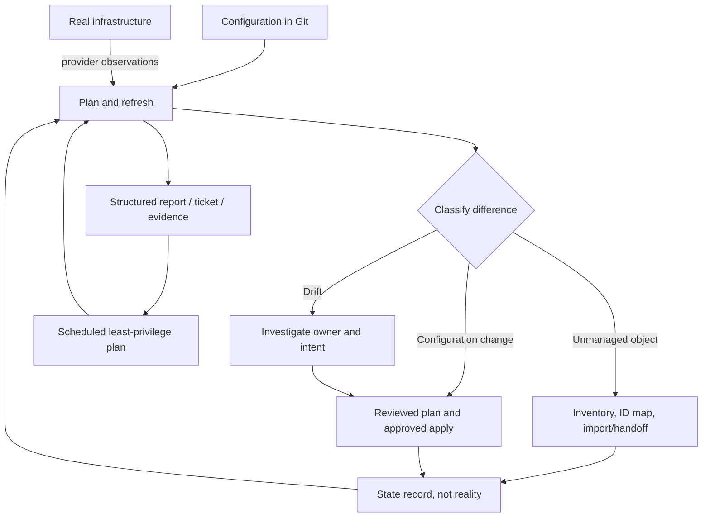

# Unit 3 — State Migration, Import, and Drift Detection

**Target file:** `03-state-migration-import-and-drift-detection.md`  
**Module:** M07  
**Stage:** 2E — Production DevOps & Platform Engineering  
**Estimated time:** 18–26 hours including five labs and evidence review  
**Prerequisites:** Unit 1 state/backends/locking/recovery; Unit 2 modules/environment reuse; M02 CI/CD foundations; cloud/IaC fundamentals  
**Core tools:** Terraform/OpenTofu (`<iac>`), Git, shell, Python, provider-free resources; LocalStack/MinIO optional  
**Awareness:** AWS Config, Azure Policy/configuration recording, Terraformer, cloud-side inventory tools  
**Last reviewed:** 2026-10-28  
**Tool baseline assumed:** Exact versions are intentionally unspecified. Record the selected binary (`terraform` or `tofu`), exact version, OS, provider lock-file hash, and documentation version in `versions.txt`. Verify every `[VERSION-SENSITIVE]` item against the installed engine.  
**Substrate:** local-only / LocalStack optional; no paid cloud required

> **Safety status:** Teaching artifact, not a production change plan. Labs use provider-free resources, local files, or synthetic fixtures. Outputs are representative/illustrative, not captured execution. Never use production credentials, production state, or a shared backend for these exercises. A state backup protects the management record; it does not reverse changes to real infrastructure.

## Contents

- [3.0 Why this matters in production](#30-why-this-matters-in-production)
- [3.1 Learning objectives](#31-learning-objectives)
- [3.2 Concept map and vocabulary](#32-concept-map-and-vocabulary)
- [3.3 Level 1 — Beginner](#33-level-1--beginner)
- [3.4 Level 2 — Intermediate](#34-level-2--intermediate)
- [3.5 Level 3 — Advanced](#35-level-3--advanced)
- [3.6 Level 4 — Expert](#36-level-4--expert)
- [3.7 SRE lens](#37-sre-lens)
- [3.8 Security lens](#38-security-lens)
- [3.9 Production checklist](#39-production-checklist)
- [3.10 Hands-on lab set](#310-hands-on-lab-set)
- [3.11 Self-check questions](#311-self-check-questions)
- [3.12 Evidence artifacts](#312-evidence-artifacts)
- [3.13 Common interview and design-review questions](#313-common-interview-and-design-review-questions)
- [3.14 Sources and verification notes](#314-sources-and-verification-notes)

## 3.0 Why this matters in production

A platform team splits a monolithic state so storage and metadata can be owned by different teams. An address typo leaves a database in the old state while the new stack plans to create another; a second engineer imports a bucket using an identifier copied from the wrong environment. At the same time, a scheduled plan reports drift after an emergency security change, and an unattended remediation job is about to revert it. Risks include data loss, duplicate ownership, security exposure, unplanned cost, and an incident in which nobody can prove which state owns each object. The safe response is to stop mutations, establish target identity and ownership, inspect state and reality, and reconcile only through reviewed plans with preserved evidence.

The running example is a data platform with an object-storage bucket and a metadata/artifact resource, conceptually separated into `storage` and `metadata` component stacks across `dev`, `staging`, and `prod`. Labs remain local-only; cloud examples are awareness-level.

## 3.1 Learning objectives

- **[L1]** Explain configuration, state, and real infrastructure as three separate realities; classify mismatches without treating state as a live inventory.
- **[L1]** Read representative plan symbols and distinguish refresh-discovered differences from configuration-driven changes.
- **[L2]** Inventory an existing object, verify its resource-specific ID, import it, inspect state, and reconcile configuration until the plan is understood.
- **[L2]** Choose among `state mv`, `moved`, `state rm`/`removed`, `state replace-provider`, and `-replace`, with backups and stop conditions.
- **[L2]** Explain refresh-only plan versus apply and implement `-detailed-exitcode` handling that separates no-change, changes-present, and error.
- **[L3]** Design a state split/merge, workspace-to-directory migration, provider-source migration, or Terraform/OpenTofu transition without overlapping active ownership.
- **[L3]** Build a structured drift report that classifies severity, owner, and next action while accounting for provider schema/default changes and transient reads.
- **[L4]** Define risk-based drift SLIs/SLOs, ticketing and escalation, an import-at-scale program, and boundaries for automated remediation.

## 3.2 Concept map and vocabulary

### Three realities

- **Configuration:** desired model—HCL, variables, module calls, provider configuration, and lifecycle rules in version control.
- **State:** the engine's record of configuration-address bindings, remote identities, and last-known attributes. State is a record, not reality and not a complete inventory.
- **Real infrastructure:** what exists now. A plan observes it only to the extent provider reads, permissions, API consistency, and resource schema permit.



A plan is a prediction, not a guarantee that infrastructure will remain unchanged until apply. Refresh can miss objects or attributes; it does not prove complete inventory, security, or ownership.

| Term | Precise definition | Common misconception |
|---|---|---|
| Configuration | Desired model and resource addresses in HCL | Code inventories everything that exists |
| State | Record of bindings and last-known attributes | State is a real-time cloud inventory |
| Drift | Provider-observed reality differs from expected/recorded values, often after out-of-band change | Every plan diff is drift |
| Configuration change | Desired model changed, potentially causing create/update/destroy | Any update was done in a console |
| Unmanaged resource | Existing object not tracked by the relevant state/configuration | Clean plan proves no unmanaged resources exist |
| Import | Bind an existing object to a state address | Import creates the object or writes perfect HCL |
| Resource address | Configuration path, e.g. `module.storage.local_file.manifest` | Address is the provider object ID |
| Import ID | Provider/resource-specific locator | IDs have a universal format |
| Refresh-only plan | Preview recording provider-observed changes into state | It fixes infrastructure |
| `moved` block | Declarative address mapping for a state refactor | It transfers objects between independent states |
| State split | Controlled transfer of ownership into component states | Changing directories divides state automatically |
| `ignore_changes` | Suppresses planning changes for specified attributes after creation | Universal drift repair |
| Blast radius | Potential scope of damage from command, identity, state boundary, or automation | Small diff means small risk |
| Ownership handoff | Explicit agreement on the single active state/team that manages an object | Two states can manage it safely if plans look clean |

### Mismatch classification

| Observation | Likely category | First safe action | Avoid as first move |
|---|---|---|---|
| HCL changed, remote object did not | Configuration change | Review normal plan/dependencies | Automatically call it drift |
| Console edit is visible to refresh | Drift | Identify actor, intent, impact, and approval | Blind apply or refresh-only apply |
| Object exists without state binding | Unmanaged/orphan/owned elsewhere | Inventory and confirm owner across states | Import into a second active state |
| Diff appears after provider upgrade | Possible default/schema/read change | Compare lockfile, changelog, JSON plan, pinned baseline | Assume console edit |
| Computed/autoscaled field differs | Potential expected variation | Confirm provider/controller semantics | Suppress without an exception record |

## 3.3 Level 1 — Beginner

### 3.3.1 Plan symbols and representative output

| Symbol / phrase | Typical meaning | Review question |
|---|---|---|
| `+` | Create | Is it missing, and is the target correct? |
| `~` | Update in place | Which security/data/cost-sensitive attributes change? |
| `-/+` | Replacement in common Terraform plan renderings | Why is replacement required; can data be lost? Verify exact rendering for installed version. |
| `-` | Destroy | Is deletion intended, approved, and reversible? |
| `<=` | Data-source/read operation in applicable output | Is it reading from the expected provider/account? |
| `Objects have changed outside of Terraform` | Diagnostic emitted by some versions when refresh detects external changes | Which object/attributes changed, and who made the change? |

Exact wording/symbols vary. Do not parse human-readable plan text as a stable machine interface; use structured JSON and verify its schema.

**Representative/illustrative — not captured execution:**

```text
# Output wording and ordering vary by tool/version
  # local_file.metadata_manifest will be updated in-place
  ~ resource "local_file" "metadata_manifest" {
      ~ content  = "schema=1" -> "schema=2"
        filename = "./artifacts/metadata.txt"
    }
Plan: 0 to add, 1 to change, 0 to destroy.
```

This may be a configuration change; it does not by itself prove an out-of-band edit. Compare HCL, state, refresh observations, and provider changes before assigning cause.

**Representative/illustrative replacement:**

```text
  # local_file.metadata_manifest must be replaced
-/+ resource "local_file" "metadata_manifest" {
      ~ filename = "./artifacts/old.txt" -> "./artifacts/new.txt" # forces replacement
    }
Plan: 1 to add, 0 to change, 1 to destroy.
```

A replacement is high risk even for a local fixture. Inspect why the attribute forces replacement, whether the file carries data, and whether the directory is correct.

### 3.3.2 Refresh: what it proves and what it does not

During planning, providers read managed objects and compare observations with state/configuration. Results depend on provider implementation, permissions, API consistency, schema, and readable fields. Refresh cannot prove all resources were discovered, all fields are compliant, unmanaged resources do not exist, or the object will remain unchanged until apply.

Triage sequence: (1) record directory, binary/version, workspace, backend and environment; (2) identify deletes/replacements first; (3) compare plan with Git diff; (4) inspect addresses/IDs read-only; (5) establish owner and break-glass/controller context; (6) decide whether to revert reality, accept an intentional change, import, or investigate further.

```bash
# Disposable lab only; replace terraform with tofu if that is your recorded binary.
terraform version
terraform workspace show
terraform state list
terraform state show local_file.metadata_manifest
terraform plan -refresh-only
```

State inspection and plans can reveal sensitive values or contact provider APIs. Do not print raw state/plan JSON into public logs.

### 3.3.3 Decision tree

```text
Plan differs
  ├─ Configuration changed? yes → review desired-state plan
  └─ no / unclear
      ├─ Provider observation authorized/reliable? no → investigate API/permissions/schema
      ├─ Owner/state known? no → stop and establish ownership
      └─ yes → classify and reconcile with reviewed plan
```

A clean plan does not prove all infrastructure is managed: it covers the configured/state-tracked scope and the observations available to that run.

## 3.4 Level 2 — Intermediate

### 3.4.1 Import is adoption, not creation

Import binds an existing object to a state address. It does not universally create the object and does not guarantee complete/correct configuration. Always use the exact ID format from the official provider/resource documentation. Maintain a mapping of environment, provider/resource, external ID, target address, owner, approval, and evidence.

| Mapping field | Synthetic example | Rule |
|---|---|---|
| Environment | `dev` | Must match explicit target assertion |
| Resource | `local_file` | Must exist in the locked provider |
| External ID | `./artifacts/existing.txt` | Local-file illustration only, not a cloud ID template |
| Address | `local_file.adopted_manifest` | Must match configuration exactly |
| Owner/approval | `platform-data / LAB-LOCAL` | Real change records must be genuine, not invented |
| Evidence | fixture checksum and plan summary | Sanitize secrets and paths |

Safe workflow: inventory → verify tool/directory/backend/workspace/provider alias/endpoint/account/region → confirm no other active state owns the object → write matching config → back up and checksum state → import → inspect state → run normal plan → reconcile every proposed operation → record ownership and evidence.

### 3.4.2 CLI import and declarative import blocks

```bash
# Illustrative only; check provider-specific ID format and selected engine docs.
terraform import local_file.adopted_manifest ./artifacts/existing.txt
```

Never copy this local ID pattern for S3 or databases. Declarative import makes target address and ID reviewable:

```hcl
# File: lab-01-import/main.tf
terraform {
  required_providers {
    local = { source = "hashicorp/local" }
  }
}
resource "local_file" "adopted_manifest" {
  filename = "${path.module}/artifacts/existing.txt"
  content  = "metadata_schema=1\nowner=platform-data\n"
}
import {
  to = local_file.adopted_manifest
  id = "${path.module}/artifacts/existing.txt"
}
```

**[VERSION-SENSITIVE][VERIFY]** `-generate-config-out` availability, constraints, and exact invocation depend on engine/version. Check the selected engine's official import docs and `plan -help`; if unverified, write minimal configuration manually. Generated HCL is only a starting point. Review defaults, computed fields, sensitive values, naming/tags, lifecycle, provider aliases, dependencies, endpoint/account/region, and the first normal plan for update/delete/replace. Do not make generated configuration a required success path.

### 3.4.3 `state mv` and `moved`

Use `state mv` for a controlled imperative address change; use `moved` blocks for declarative, reviewed refactors. Neither transfers an object automatically between independent state files. Retain `moved` blocks according to team migration policy so older deployed states can consume newer configuration where supported; remove only when supported state/release/rollback policy no longer needs them.

```hcl
# File: lab-04-moved/main.tf
terraform {
  required_providers { local = { source = "hashicorp/local" } }
}
moved {
  from = local_file.manifest
  to   = module.metadata.local_file.manifest
}
module "metadata" { source = "./modules/metadata" }
```

```bash
# Copy-only rehearsal after target assertion and verified backup.
terraform state mv local_file.manifest module.metadata.local_file.manifest
```

A typo can orphan a binding or cause create/destroy proposals. Verify exact source/destination addresses, inspect state lists, and plan every affected stack before proceeding.

### 3.4.4 `state rm`, `removed`, and `replace-provider`

`state rm` removes a binding; it does not destroy the remote object. If configuration still declares it, a future plan may propose creating it again. **[VERIFY]** Confirm `removed` block syntax and `destroy` behavior for the selected engine/version; do not treat `lifecycle { destroy = false }` as a universal substitute for a correct handoff.

`state replace-provider` changes the provider source address recorded in state; it does not prove schema or behavior equivalence. Back up state, confirm exact provider addresses, review compatibility, test on a copy, inspect state and plan, and stop on unexplained diffs.

```bash
# Placeholder source addresses only; never execute literally.
terraform state replace-provider registry.terraform.io/old-namespace/old-provider registry.terraform.io/new-namespace/new-provider
```

### 3.4.5 Replacement and lifecycle

Prefer `-replace=ADDRESS` where supported; treat `taint` as legacy/deprecated or version-sensitive context, not the primary workflow. **[VERSION-SENSITIVE][VERIFY]** Check current CLI guidance.

| Mechanism | Purpose | Limits / risks |
|---|---|---|
| `-replace=ADDRESS` | Request replacement in the next plan | Full plan review still required; data loss/dependency risk remains |
| `prevent_destroy` | Reject destroy while rule remains present | Not access control; removing config can remove the guard |
| `create_before_destroy` | Prefer new object before old destruction when graph/provider permit | Unique names, fixed addresses, quotas/capacity, dependencies, data-bearing resources can make it impossible or risky; temporary cost may double |
| `ignore_changes` | Ignore selected attributes for update planning after creation | Can hide security/network/encryption/tag drift; document every exception |
| `replace_triggered_by` | Trigger replacement based on referenced changes where supported | Exact syntax/support is version-sensitive and can broaden replacement |

Never suppress unknown drift with broad `ignore_changes`. For controller/autoscaler-owned attributes, document source of truth, exact fields, owner, alerting, expiry/review date, and removal condition.

### 3.4.6 Refresh-only and scheduled drift checks

`plan -refresh-only` previews recording provider-observed changes into state. Reviewing it is not the same as applying it. `apply -refresh-only` writes those observations into state; it does not roll infrastructure back to HCL and can normalize an unauthorized change into state if used blindly.

| Situation | First move | Why |
|---|---|---|
| Unknown/security-sensitive change | Stop; inspect normal and refresh-only plans; identify actor | Do not accept/revert before intent is known |
| Approved emergency change should remain | Update config, review plan, reconcile deliberately | Code and reality need an approved common target |
| Unauthorized change should be reverted | Review normal plan restoring approved config; apply with approval | Correct the infrastructure deliberately |
| Transient/computed observation | Check provider docs/API consistency and safely re-read | Avoid false-positive remediation |
| Object exists but is not in state | Confirm owner; import/handoff | Refresh-only does not discover all unmanaged objects |

Common Terraform `plan -detailed-exitcode`: `0` no changes, `1` error, `2` changes present. **[VERSION-SENSITIVE][VERIFY]** Test exact binary/version. Never treat all nonzero codes as drift.

```bash
# File: scripts/drift-check.sh
#!/usr/bin/env bash
set -u
set -o pipefail
IAC_BIN="${IAC_BIN:-terraform}"
if [[ "$IAC_BIN" != terraform && "$IAC_BIN" != tofu ]]; then echo "unexpected binary" >&2; exit 64; fi
set +e
"$IAC_BIN" plan -detailed-exitcode -no-color
rc=$?
set -e
case "$rc" in
  0) echo NO_CHANGES; exit 0 ;;
  1) echo PLAN_ERROR >&2; exit 1 ;;
  2) echo CHANGES_PRESENT; exit 2 ;;
  *) echo "UNEXPECTED_EXIT=$rc" >&2; exit 70 ;;
esac
```

This is a minimal pattern. A production wrapper needs target assertions, sanitized outputs, safe artifact retention, least-privilege identity, and ticketing rather than automatic apply. Keep plan status and report-parser status as separate fields.

## 3.5 Level 3 — Advanced

### 3.5.1 Migration scenario comparison

| Scenario | Approach | Main risk | Required proof |
|---|---|---|---|
| Split monolithic state | Supported state move or destination import then source release | Missing/duplicate ownership | Inventory, checksums, mapping, both states and plans |
| Merge states | Confirm owner/address collisions; coordinate destination | Duplicate addresses and unexpected destroy/create | Collision analysis, backups, plans, handoff |
| Move/rename module addresses | `moved` or `state mv` within same state | Typo or incomplete map | Before/after addresses; no unexpected replacement |
| Change provider source | `state replace-provider` after compatibility review | Different schema/behavior | Provider addresses, versions, plan review |
| Workspaces to env directories/backends | Freeze; map each workspace/state to one directory/backend | Wrong environment/backend | Assertions, independent backups and per-env plans |
| Terraform ↔ OpenTofu | Copy-only rehearsal with exact versions | One-way or unsupported state/features | Official docs, checksums, state and plan comparison |
| Adopt click-ops resources | Inventory, owner approval, pilot imports, then waves | Wrong ID/dependencies/duplicate manager | Discovery denominator, mapping, owner sign-off |
| Import at scale | Validated mapping, idempotent batches, checkpoints | Partial import, rate limits, poor generated HCL | Batch ledger, counts, no-overlap checks, plans |

### 3.5.2 State split methods and safe protocol

**Supported state movement:** Some workflows support cross-state options such as `state mv -state-out`. **[VERSION-SENSITIVE][VERIFY]** Do not assume the flag exists or behaves identically across Terraform/OpenTofu versions. Check official CLI docs and rehearse on copies.

**Destination import, then source removal:** Import into destination, inspect it, then remove the source binding during a controlled handoff. This creates temporary duplicate ownership. Freeze all applies/writers in both stacks and enforce a short, monitored handoff window. Never leave both states actively managing the same real resource.

**Exceptional state surgery:** Pull/edit/push is a last resort requiring exact backups/checksums, lineage/serial understanding, offline rehearsal, reviewed diff, access controls, no concurrent writers, and post-operation plans. Never use production `state push`, `-force`, `-lock=false`, or direct JSON editing as a learning exercise.

A `moved` block does not transfer objects across independent state files. State backups do not reverse provider-side changes.

**Migration protocol:** (1) inventory addresses, IDs, owners, dependencies, data-bearing status and remote-state consumers; (2) freeze changes; (3) assert binary/version, directory, workspace, backend, endpoint, identity/account/profile, region and environment; (4) back up both states, checksum, protect and verify restore procedure; (5) rehearse on isolated copies; (6) sign off address/ID map and expected counts; (7) transfer in small batches; (8) inspect both states; (9) run plans for old and new stacks and stop on unexplained create/destroy/replace; (10) document single owner, update pipeline/output consumers, unfreeze and monitor.

**Rollback decision:** if only state ownership changed and no provider-side apply occurred, use a rehearsed reverse ownership procedure after testing on a copy. If infrastructure changed, restoring state alone is insufficient; assess and reverse provider-side changes with reviewed plans/service-specific recovery. Stop if lineage, serial, addresses, or IDs cannot be reconciled.

### 3.5.3 Terraform/OpenTofu compatibility

Shared HCL/workflow concepts do not guarantee state portability. Releases may differ in state encryption, language evaluation, provider-defined functions, registry endpoints, test syntax, provider/module compatibility, licensing/governance, or migration paths. Read current official release/migration docs for both projects. Treat conversion as potentially one-way until a disposable-copy rehearsal proves the needed rollback path; successful read is not a migration guarantee.

| Question | Verification |
|---|---|
| Can target engine read source state? | Exact versions, official docs, copy-only test |
| Can target-written state be read safely by source? | Never infer from read success; docs and disposable round-trip only |
| Provider versions compatible? | Lockfile, source address, changelog, schema and plan diff |
| CLI/features match? | Help output, versioned docs, isolated acceptance test |
| Governance/licensing relevant? | Read each project's current official license/governance material |

### 3.5.4 Drift classification program

Every report should include environment, address/type, action, severity, owner, detected time, age/first-seen, category, confidence, evidence pointer, and next step.

| Category | Example | Handling |
|---|---|---|
| Break-glass edit | Emergency network rule | Link incident, confirm expiry, reconcile code after stabilization |
| Controller/autoscaler field | Replica count changed by controller | Verify source of truth; avoid reconciliation loop |
| Cost/tagging automation | Approved cost tag | Confirm owner/policy; update code or time-bound exception |
| Other automation | Deployment controller writes field | Identify system of record and boundary |
| Provider default/schema | Upgrade changes planned default | Compare changelog/schema and test upgrade separately |
| Computed/volatile field | Generated endpoint/timestamp | Check provider semantics; avoid fragile suppression |
| Transient API observation | Stale value | Safely retry/compare evidence; don't remediate one observation blindly |
| Security-sensitive drift | Public access, firewall, encryption, IAM | High priority; validate exposure and incident process |
| Unknown | Actor/intent unclear | Freeze remediation and investigate audit trail/owner |

### 3.5.5 Structured reporting and cloud-side detection

Use `<iac> show -json` or documented equivalent. **[VERSION-SENSITIVE][VERIFY]** Check JSON schema and sensitive-value behavior. Parse `resource_changes[].change.actions` structurally; do not grep human-readable text. Protect JSON plans like state.

| Actions | Classification | Default treatment |
|---|---|---|
| `[]` / no change | No-op | Informational; inventory completeness still unknown |
| `create` | Create | Check target, ownership, cost and policy |
| `update` | Update | Severity depends on attributes/type/environment |
| `delete` | Destroy | High for data-bearing/critical resources |
| `delete` + `create` | Replacement | High until proven safe |
| Unknown action/shape | Unknown | Fail closed and require human inspection |

AWS Config and Azure Policy/configuration recording can add cloud-side history/compliance signals but do not replace plan-based drift detection. Coverage, supported resources, permissions, and time windows differ. **[VERIFY]** Check current official docs before production design. LocalStack is partial emulation, not AWS parity for IAM, SCPs, quotas, networking, billing, consistency, or regions.

## 3.6 Level 4 — Expert

### 3.6.1 Drift SLOs and risk tiers

Set thresholds by business and technical risk, not a universal number. Public-access/encryption drift may need a shorter detection and triage window than a low-risk metadata tag. Define measurement, exclusions, clock start/stop, owner, and alert routing before publishing targets.

- **Detection latency:** time from change becoming observable to successful detection.
- **Unresolved drift age by severity:** first-seen to approved resolution or monitored exception.
- **IaC coverage:** `resources under IaC / in-scope discovered resources`; publish discovery source, freshness, duplicates, exclusions and gaps.
- **Migration failure rate:** migrations requiring recovery or producing unexpected ownership/plan outcomes divided by total migrations.
- **Unexpected replacement rate:** unapproved/unexpected replacements per change window.
- **Mean time to recover state/ownership:** time to re-establish one verified active owner and known-good state record.

State-only coverage can undercount unmanaged objects; triangulate with independent inventory.

### 3.6.2 Ticketing and cautious automation

Scheduled least-privilege plans should distinguish clean, changes-present and error outcomes; produce structured events; deduplicate by environment/address/category (accounting for moved addresses); route to owners; escalate by severity/age; record acknowledgement, intent, approval, action, resulting plan and closure evidence. Close only after resolution or an approved time-bounded exception.

Never auto-apply production drift by default. Any low-risk allow-list needs target assertions, owner, policy checks, change record, bounded blast radius, concurrency controls, cooldown, loop prevention, monitoring and human override. Exclude identity, public access, encryption, data-bearing resources, deletion/replacement, unknown types, provider-upgrade diffs and active incidents unless formally governed. Do not silently revert emergency fixes.

### 3.6.3 Import-at-scale program

1. Discover from authoritative inventories, recorders, APIs and existing states; document blind spots.
2. Normalize/deduplicate IDs; tag environment/type/dependencies/current owner/system of record.
3. Pilot low-risk independent resources; defer data-bearing/security-critical/poorly understood objects.
4. Obtain owner sign-off and resolve competing automation.
5. Review imported state and normal plans; inspect generated HCL and measure error types.
6. Execute small waves with checkpoints, idempotency and pause/rollback criteria; respect actual rate limits.
7. Quarantine unsupported resources, missing IDs and ownership conflicts rather than forcing them.
8. Report `managed in IaC / in-scope discovered`, with denominator, source freshness, unsupported types, exclusions and confidence.
9. Retain sanitized mapping, approvals, plan summaries, checksums and handoff records.

Terraformer and other generators are optional aids only. **[VERIFY]** Check maintenance, provider support and output quality; generated code is not production-ready until reviewed, validated and planned.

### 3.6.4 State-split design review factors

Map blast radius; dependency edges/remote-state outputs; data-bearing resources; locks and concurrent writers; backend/identity boundaries; partial failure recovery; drift owner/alert routing; CI runtime/API limits; output contracts and rollback limits. Split on lifecycle/ownership boundaries, not folder aesthetics. If two components must always change atomically, separate states may increase coordination risk.

### 3.6.5 Five expert incident analyses

All cases are illustrative. Use **symptom → hypotheses → safe tests → root cause → remediation → prevention → evidence**.

**A. Wrong import target.** Symptom: import succeeds but plan threatens production-like bucket/replacement. Hypotheses: wrong account/region, copied ID, wrong address/provider alias/endpoint, config mismatch. Safe tests: freeze applies; assert binary/workspace/backend/identity/account/region/endpoint; compare state ID with authoritative inventory/audit logs; inspect sanitized plan JSON. Root cause: no independent ID confirmation. Remediation: do not apply; obtain owner approval and correct mapping/binding via rehearsed procedure; treat any provider-side change as an incident. Prevention: two-person mapping review, assertions, pilot cohort, plan gate. Evidence: sanitized mapping, state addresses, assertions, plan and change record.

**B. `state mv` typo appears to orphan a database.** Symptom: new stack plans to create DB and old stack proposes destroy or loses address. Hypotheses: typo/module path/wrong workspace/directory/read failure. Safe tests: freeze both stacks; verify backups/checksums; inspect both `state list` outputs and external IDs; plan only. Root cause: wrong address or state context. Remediation: rehearse reverse move on a copy; use approved recovery with owner coordination; never apply until ownership reconciles. Prevention: reviewed address map, assertions, small batches, both-stack plan gate. Evidence: pre/post addresses, hashes, mapping, plans and approval.

**C. `ignore_changes` hid a security-group change for six months.** Symptom: plan stays clean but security review finds permissive rule. Hypotheses: broad ignored attribute, unmanaged object, unreadable field, missing permission, wrong account. Safe tests: inspect lifecycle/exceptions; query authoritative inventory/audit with read-only access; verify identity and coverage. Root cause: suppression lacked owner/expiry/security review. Remediation: treat as security incident, validate exposure, coordinate containment, update HCL, narrow/remove exception after reviewed plan. Prevention: attribute-level allow-list, owner/expiry, periodic review, independent detection. Evidence: rule diff, timeline, approved config, sanitized plan/audit and closure.

**D. Provider upgrade creates diffs across environments.** Symptom: all environments show updates after upgrade. Hypotheses: default/schema normalization/computed field/API permissions or coincident real drift. Safe tests: freeze rollout; compare lockfiles/changelog; reproduce old/new versions on copies; inspect JSON plans/schema and sample read-only API. Root cause: upgrade bundled with infrastructure changes without baseline. Remediation: separate upgrade, pin/roll back only if supported and compatibility understood, approve smallest reviewed fix. Prevention: upgrade CI lane, canary, version pinning, replacement thresholds. Evidence: lockfile, version matrix, plan comparison, changelog, approval.

**E. Drift bot reverts emergency fix.** Symptom: break-glass rule is removed during outage. Hypotheses: auto-apply all drift, no incident context, no cooldown/dedup, bad routing. Safe tests: disable writes while retaining read-only detection; inspect identity/audit logs and incident state. Root cause: convergence logic ignored incident ownership. Remediation: restore service through incident process, document emergency change, reconcile HCL after stabilization. Prevention: ticket-first production drift, incident-linked break-glass window, low-risk allow-list, cooldown, loop prevention, human override. Evidence: timeline, identity review, incident record, policy change and postmortem.

### 3.6.6 Senior design review

Defend splitting monolithic data-platform state into `storage` and `metadata` across `dev`, `staging`, `prod`: who owns each resource; which dependencies/data-bearing resources make the split risky; how to choose supported movement versus destination import/source removal; how overlap is frozen; which drift severities page/ticket/require approval; what never auto-remediates; and what proves no unexpected create/destroy/replace. A strong answer includes target assertions, checksummed backups, isolated rehearsal, bounded batches, both-state inspection/plans, owner sign-off, handoff, monitoring and explicit stop conditions. “The plan looked fine” is not sufficient evidence.

## 3.7 SRE lens

### 3.7.1 SLIs/SLOs

| SLI | Measurement | Design note |
|---|---|---|
| Detection latency | Observable change to successful detection | Risk-tiered; include schedule and API blind spots |
| Unresolved drift age | First-seen to approved resolution/exception by severity | Set with owners/on-call capacity, not universal values |
| IaC coverage | Managed / in-scope discovered | Publish denominator, inventory source, freshness and exclusions |
| Migration failure rate | Recovery/ownership failures / migrations | Define failure and measurement window |
| Unexpected replacement rate | Unapproved replacements per change window | Data-bearing replacement is high severity until proven safe |
| State/ownership recovery time | Time to verified single owner and known-good state | Measure evidence, not merely file restoration |

### 3.7.2 Failure modes and runbook

Failure modes: wrong backend/workspace/account; duplicate/missing ownership after split; provider read failures mistaken for deletion; broad `ignore_changes`; bot reverting break-glass; excessive CI/API use or too-slow detection.

**Runbook — alert → triage → mitigation → follow-up:** (1) Preserve run ID, environment, version, exit code, summary and timestamp; never attach raw state. (2) Assert target; distinguish exit 1 error from exit 2 changes; prioritize deletes/replacements/security. (3) Pause writes if owner/intent unknown; use read-only evidence and owner review. (4) Reconcile code/state/reality, record time-bounded exceptions, verify plans/inventory, add prevention tests and close with evidence.

### 3.7.3 Cost/capacity

Drift checks consume CI runtime, artifact storage and provider API calls. Large imports may be throttled or exceed execution windows. Use bounded batches, concurrency controls, safe retries and observability; do not invent quotas or assume LocalStack reproduces cloud throttling. M11 covers telemetry; M15 covers FinOps/quotas.

## 3.8 Security lens

### 3.8.1 State and plans are sensitive

State/saved plans can contain secrets, identifiers and topology even when outputs are marked `sensitive`. That flag is not encryption or access control. Apply least privilege, encryption where supported, audit access, justified retention, sanitization and secure sharing. Never commit raw state, saved plans, credentials or secret-bearing logs. If exposed, contain access, preserve evidence, identify affected secrets, rotate/revoke credentials, assess provider-side impact and follow M09/M10.

### 3.8.2 Identity separation

- **Drift identity:** minimum read permissions; verify what fields are invisible due to missing permission.
- **Migration identity:** time-bounded approved state-operation permissions, second-person review and controlled window.
- **Apply identity:** separate write authority invoked through approved workflows.
- **Human operator:** narrow, audited access to backend/state.

Read-only plans can still expose sensitive outputs. Sanitize and protect artifacts.

### 3.8.3 Target assertions and handoffs

Before every import/state surgery/apply/cleanup, assert binary/version, directory, backend, workspace, endpoint, account/profile, region and environment. Local labs must contain no cloud provider block or production credentials. Do not assume LocalStack namespaces isolate accounts unless verified. Pin versions, review lockfiles and use approved registries. A clean plan, `sensitive = true`, `prevent_destroy`, or LocalStack is not a complete security control.

- **M09:** secrets, identity/OIDC, rotation, state-secret exposure response.
- **M10:** incident command, severity, break-glass, change failure and post-incident review.
- **M12:** provider/module trust, version pinning, provenance and artifact integrity.
- **M13:** backend backup, restore drills, state recovery and rebuild strategy.

## 3.9 Production checklist

- [ ] Binary/version matches recorded `versions.txt`.
- [ ] Directory, workspace, backend, environment, endpoint, identity/account/profile and region are asserted before mutations.
- [ ] Every resource has owner, external ID, target address and lifecycle classification.
- [ ] No other active state/system owns the object without a documented handoff.
- [ ] Source/destination backups are access-controlled, checksummed and restore-rehearsed.
- [ ] Migration was rehearsed on an isolated copy with matching engine/provider versions.
- [ ] Address map and expected counts were independently reviewed.
- [ ] Every import ID is verified against official resource documentation.
- [ ] First post-import normal plan is reviewed; every update/delete/replace is explained.
- [ ] State splits/merges include pre/post inspection and plans for all stacks.
- [ ] `moved` retention follows policy and does not imply cross-state transfer.
- [ ] `ignore_changes` exceptions have exact fields, owner, rationale, expiry/review and monitoring.
- [ ] Scheduled checks distinguish exit 0/1/2 and fail closed on unknown outcomes.
- [ ] Tickets include environment/address/type/action/severity/owner/age/next step without sensitive artifacts.
- [ ] High-risk/unknown drift cannot auto-apply; emergency changes have an incident-linked path.
- [ ] JSON parser tests clean/low/high/malformed/missing/unknown/empty cases.
- [ ] State/plans/logs are protected and excluded from Git.
- [ ] Local emulation limitations are explicit; no cloud parity inferred.
- [ ] Evidence, approvals, cleanup proof and residual risks are retained.

## 3.10 Hands-on lab set

### Lab overview

Every lab is local-only and must state **`Touches real cloud: no`**. Outputs below are representative/illustrative; commands were not executed while authoring. Do not configure a remote backend or production credentials. Record the selected engine/version and commit the generated provider lock file for repeatability.

| Lab | Goal | Substrate | Touches real cloud | Evidence | Cleanup verification |
|---|---|---|---|---|---|
| 1. Discover/import/adopt | Inventory and import an existing local file | Local filesystem + local provider | **no** | ID map, owner record, state addresses and plans | Directory absent |
| 2. Drift both ways | Detect local-file drift; revert or accept intentionally | Local filesystem + local provider | **no** | Refresh-only/normal plan, exit status, decision | Directory absent |
| 3. Split state | Rehearse storage/metadata ownership transfer | Local provider and local state files | **no** | Checksums, address maps, both-stack plans | Directory absent |
| 4. `moved` refactor | Move resource into a module without replacement | Local provider | **no** | Before/after addresses and plan | Directory absent |
| 5. JSON report | Classify synthetic plan JSON and test failures | Python standard library | **no** | Markdown report and tests | Directory and temp files absent |

### Lab safety preflight

For each lab: assert `pwd`, selected binary/version, and exact local directory; inspect the tree and ensure there is no remote backend; avoid cloud credentials; back up and checksum state before state surgery; review the plan before every `apply`; stop on unexplained create/destroy/replace or any target mismatch. A checksum proves byte identity, not restore validity. Never commit raw state or saved plans.

### Lab 1 — Discover, import, and adopt an unmanaged resource

**Goal:** inventory, ID mapping, declarative import, state inspection, clean-plan reconciliation and incorrect-ID failure path. **Prerequisites:** shell and chosen IaC binary. **Substrate:** local file. `Touches real cloud: no`.

#### File tree

```text
lab-01-import/
├── versions.txt
├── inventory/id-map.csv
├── inventory/ownership.md
├── artifacts/existing.txt
├── main.tf
└── README-evidence.md
```

#### Complete file contents

```text
# File: lab-01-import/versions.txt
chosen_binary=terraform-or-tofu
engine_version=record-actual-version-output
provider_lockfile=generated-after-init
```

```csv
# File: lab-01-import/inventory/id-map.csv
environment,provider,resource_type,external_id,target_address,owner,approval,evidence
local-lab,hashicorp/local,local_file,./artifacts/existing.txt,local_file.adopted_manifest,learner,LAB-LOCAL,fixture-sha256
```

```markdown
# File: lab-01-import/inventory/ownership.md
- Environment: local-lab only
- Owner: learner
- Object: artifacts/existing.txt
- Intended address: local_file.adopted_manifest
- External ID: absolute path resolved from this lab; verify local-provider import docs
- Other active states checked: yes, disposable lab only
- Approval: LAB-LOCAL
- Stop if: remote backend, cloud credentials, wrong path, or unexplained delete/replace
```

```text
# File: lab-01-import/artifacts/existing.txt
metadata_schema=1
owner=platform-data
```

```hcl
# File: lab-01-import/main.tf
terraform {
  required_providers {
    local = { source = "hashicorp/local" }
  }
}
resource "local_file" "adopted_manifest" {
  filename = "${path.module}/artifacts/existing.txt"
  content  = "metadata_schema=1\nowner=platform-data\n"
}
import {
  to = local_file.adopted_manifest
  id = "${path.module}/artifacts/existing.txt"
}
```

```markdown
# File: lab-01-import/README-evidence.md
Record actual binary/version, pwd, workspace, backup checksum, state address list, import-plan summary and final normal plan. Do not paste raw state or plan JSON.
```

#### Commands in order

1. Create the exact tree/files. Set `IAC_BIN=terraform` or `IAC_BIN=tofu` explicitly.
2. Assert target and inspect tree:

```bash
pwd
find . -maxdepth 3 -type f -print | sort
"$IAC_BIN" version
```

Representative output lists only this lab and the chosen binary/version. If a cloud profile or remote backend appears, stop.

3. Initialize and validate:

```bash
"$IAC_BIN" init
"$IAC_BIN" validate
```

Representative output: init completes and validation succeeds. This is not claimed execution. If import-block support differs, consult official docs for the exact engine/version.

4. Checksum the existing object and backup:

```bash
sha256sum artifacts/existing.txt
cp artifacts/existing.txt /tmp/lab-01-existing.txt.backup
sha256sum /tmp/lab-01-existing.txt.backup
```

Representative output: identical hashes. Stop if they differ.

5. Review the plan. Before import it may propose creation because the file is not tracked. **Do not apply this pre-import plan.**

```bash
"$IAC_BIN" plan
```

6. Use the declarative import workflow only if supported by the selected version. Review the import plan and confirm address/path. **[VERSION-SENSITIVE][VERIFY]** Check whether import requires applying the reviewed plan for your engine. If import blocks are unavailable, use the official CLI import workflow after verifying the local provider's ID format.

```bash
"$IAC_BIN" plan
```

Representative output should show an import action for `local_file.adopted_manifest`; exact wording differs. Apply only the reviewed local plan if the selected engine workflow requires it:

```bash
"$IAC_BIN" apply
"$IAC_BIN" state list
"$IAC_BIN" state show local_file.adopted_manifest
"$IAC_BIN" plan
```

Expected final state contains the address and the normal plan is clean if provider behavior is stable. A clean plan does not prove there are no other unmanaged files.

7. Negative path: in a disposable copy, set the import ID to `./artifacts/does-not-exist.txt`, run plan/import validation, capture the error, and do not apply. Restore the correct ID and verify the clean plan.

**Expected output:** all output is illustrative; IDs/order/timing differ. The incorrect-ID path must fail or otherwise be safely diagnosed before any apply. If the provider behaves differently, stop and inspect its documentation rather than guessing.

**Checkpoint questions:** Why doesn't import prove config is correct? Why is the ID provider-specific? What proves the target is local-only? Why inspect the first normal plan?

**Evidence:** sanitized version record, ID map, ownership record, fixture/backup checksums, before/after state addresses, import plan summary, final plan summary, wrong-ID error.

**Cleanup and verification:** assert parent path and save sanitized evidence first; then remove only the lab:

```bash
cd ..
rm -rf lab-01-import
 test ! -e lab-01-import && echo "cleanup verified"
rm -f /tmp/lab-01-existing.txt.backup
```

Expected output: `cleanup verified`. If path assertion fails, do not run `rm`. No cloud resources were involved.

**Failure/recovery:** unsupported import block → verify version and use documented CLI path or mark blocked; wrong ID → do not apply; unexpected replacement → inspect path/config and restore local fixture from checksum-matched backup; wrong address → stop and inspect state before any state move. **Stretch:** add a mapping validator that rejects duplicate IDs and target addresses.

### Lab 2 — Induce, detect, classify, and reconcile drift both ways

**Goal:** induce a local-file out-of-band change; use refresh-only and detailed exit code; practice reverting reality, accepting intentional change, and investigating unknown ownership. **Prerequisites:** shell/local provider. **Substrate:** local file. `Touches real cloud: no`.

#### File tree and complete contents

```text
lab-02-drift/
├── main.tf
├── scripts/drift-check.sh
└── README-evidence.md
```

```hcl
# File: lab-02-drift/main.tf
terraform {
  required_providers {
    local = { source = "hashicorp/local" }
  }
}
resource "local_file" "metadata_manifest" {
  filename = "${path.module}/metadata.txt"
  content  = "schema=1\nowner=platform-data\n"
}
```

```bash
# File: lab-02-drift/scripts/drift-check.sh
#!/usr/bin/env bash
set -u
set -o pipefail
IAC_BIN="${IAC_BIN:-terraform}"
if [[ "$IAC_BIN" != terraform && "$IAC_BIN" != tofu ]]; then echo "unexpected binary" >&2; exit 64; fi
set +e
"$IAC_BIN" plan -detailed-exitcode -no-color
rc=$?
set -e
case "$rc" in
  0) echo NO_CHANGES; exit 0 ;;
  1) echo PLAN_ERROR >&2; exit 1 ;;
  2) echo CHANGES_PRESENT; exit 2 ;;
  *) echo "UNEXPECTED_EXIT=$rc" >&2; exit 70 ;;
esac
```

```markdown
# File: lab-02-drift/README-evidence.md
Record approved/out-of-band content, refresh-only and normal plan summaries, actual exit status, reconciliation branch/owner, and final plan. Do not save raw state or plan files in Git.
```

#### Commands in order

1. Create files, `chmod +x scripts/drift-check.sh`, set `IAC_BIN`, assert `pwd` and version, inspect files, then `init` and `validate`.
2. Review `"$IAC_BIN" plan`; apply only if it creates the expected local `metadata.txt` inside this lab. Then record file checksum.
3. Induce local drift after backing up:

```bash
cp metadata.txt metadata.approved.txt
printf 'schema=1\nowner=unknown-operator\n' > metadata.txt
cat metadata.txt
sha256sum metadata.txt metadata.approved.txt
```

Representative output shows different hashes. This simulates an out-of-band change only in the disposable lab.

4. Detect and preserve actual status:

```bash
"$IAC_BIN" plan -refresh-only
set +e
./scripts/drift-check.sh
rc=$?
set -e
printf 'drift_check_exit=%s\n' "$rc"
```

The provider's read semantics determine what refresh-only detects; the normal plan is also needed to compare the configured content. **[VERIFY]** Check `local_file` provider behavior. Do not claim a detection result until run.

5. **Branch A — revert reality:** if current HCL is approved, review normal plan; apply only if it targets the local fixture and only expected content changes are proposed; verify contents and re-plan.

```bash
"$IAC_BIN" plan
"$IAC_BIN" apply
cat metadata.txt
"$IAC_BIN" plan
```

Expected content returns to `schema=1` and `owner=platform-data`; clean plan is expected only if provider behavior is stable.

6. **Branch B — accept intentional reality:** edit the HCL content to `"schema=1\nowner=unknown-operator\n"`, review plan, apply only the reviewed local change, then plan again. Do not merely apply refresh-only; the accepted desired state must be represented in code.

```bash
"$IAC_BIN" plan
"$IAC_BIN" apply
"$IAC_BIN" plan
```

7. **Unknown ownership:** do not choose A or B. Preserve diff, pause writes, inspect owner/audit evidence, and record an investigation.

| Exit | Common Terraform meaning | Action |
|---|---|---|
| `0` | No changes | Record result; inventory completeness still unproven |
| `1` | Error | Investigate command/provider/auth/config; not drift |
| `2` | Changes present | Sanitize summary and route for classification; do not auto-apply |

**[VERSION-SENSITIVE][VERIFY]** Test the exact engine. **Checkpoint:** refresh-only vs normal plan; revert vs accept; unknown owner; provider false positives. **Evidence:** checksums, sanitized plans, actual exit status, owner/approval, chosen branch and final plan.

**Cleanup:** after asserting parent path, save evidence then run `rm -rf lab-02-drift`; verify `test ! -e lab-02-drift && echo "cleanup verified"`. Stop if the path differs.

**Failure/recovery:** exit 1 mislabeled as drift → fix exit branching; no change detected → inspect provider schema and normal plan; unexpected file path → stop and restore backup; intent unknown → investigate, don't blindly refresh/apply. **Stretch:** emit structured JSON with environment, timestamp, exit category and sanitized summary.

### Lab 3 — Split a monolithic state into two states

**Goal:** rehearse storage/metadata ownership transfer for two independent provider-free resources. **Prerequisites:** state inspection, checksums and ownership handoff. **Substrate:** local provider/state files. `Touches real cloud: no`.

#### File tree

```text
lab-03-split/
├── monolith/main.tf
├── storage/main.tf
├── metadata/main.tf
├── inventory/address-map.csv
└── README-evidence.md
```

#### Complete file contents

```hcl
# File: lab-03-split/monolith/main.tf
terraform {
  required_providers { local = { source = "hashicorp/local" } }
}
resource "local_file" "storage_contract" {
  filename = "${path.module}/storage-contract.txt"
  content  = "bucket_contract=local-demo\nowner=storage-team\n"
}
resource "local_file" "metadata_manifest" {
  filename = "${path.module}/metadata-manifest.txt"
  content  = "schema=1\nowner=metadata-team\n"
}
```

```hcl
# File: lab-03-split/storage/main.tf
terraform {
  required_providers { local = { source = "hashicorp/local" } }
}
resource "local_file" "storage_contract" {
  filename = "${path.module}/../monolith/storage-contract.txt"
  content  = "bucket_contract=local-demo\nowner=storage-team\n"
}
import {
  to = local_file.storage_contract
  id = "${path.module}/../monolith/storage-contract.txt"
}
```

```hcl
# File: lab-03-split/metadata/main.tf
terraform {
  required_providers { local = { source = "hashicorp/local" } }
}
resource "local_file" "metadata_manifest" {
  filename = "${path.module}/../monolith/metadata-manifest.txt"
  content  = "schema=1\nowner=metadata-team\n"
}
import {
  to = local_file.metadata_manifest
  id = "${path.module}/../monolith/metadata-manifest.txt"
}
```

```csv
# File: lab-03-split/inventory/address-map.csv
source_address,external_id,destination_stack,destination_address,owner,approval
local_file.storage_contract,monolith/storage-contract.txt,storage,local_file.storage_contract,storage-team,LAB-LOCAL
local_file.metadata_manifest,monolith/metadata-manifest.txt,metadata,local_file.metadata_manifest,metadata-team,LAB-LOCAL
```

```markdown
# File: lab-03-split/README-evidence.md
Record source/destination address inventories, SHA-256 state-backup checksums, binary/version and directory assertions, all stack plan summaries, and handoff decision. Keep raw state out of Git and delete it after sanitized evidence capture.
```

#### Commands in order

1. Create tree; assert `pwd`, inspect files and verify no remote backend. Set `IAC_BIN` consistently and record version.
2. In `monolith`, initialize, validate, review plan, then apply only if it creates exactly two local files. Confirm state lists `local_file.storage_contract` and `local_file.metadata_manifest`.
3. Back up and checksum the local state; do not print or commit it:

```bash
cd monolith
"$IAC_BIN" state pull > ../monolith-state.backup.json
sha256sum ../monolith-state.backup.json
"$IAC_BIN" state list > ../source-addresses-before.txt
```

**[VERSION-SENSITIVE][VERIFY]** Confirm `state pull` availability/handling for selected engine. If backup/checksum fails, stop.

4. Initialize each destination stack, validate, review import plan, and confirm it targets the expected local file and address before applying. For `storage`:

```bash
cd ../storage
"$IAC_BIN" init
"$IAC_BIN" validate
"$IAC_BIN" plan
```

Representative plan should show import of `local_file.storage_contract`. Apply only after review, then inspect `state list`. Repeat in `metadata` for `local_file.metadata_manifest`. Verify file checksums and destination ownership. Until source bindings are released, this is a deliberate duplicate-ownership window: freeze all applies/writers.

5. Inspect all three states and plans. Assert destination address/ID/checksum matches the signed-off map. Then, only in the disposable local lab, release source bindings:

```bash
cd ../monolith
pwd
"$IAC_BIN" state list
# Preconditions: disposable monolith directory, local state, verified backup/checksum.
# Read-only alternative: inspect state list/show and stop.
# Blast radius: removes bindings only; local files remain. Stop on any destination mismatch.
"$IAC_BIN" state rm local_file.storage_contract
"$IAC_BIN" state rm local_file.metadata_manifest
"$IAC_BIN" state list
```

`state rm` does not destroy files. The old monolith config still declares them, so its subsequent plan may propose recreations. **Do not apply the old monolith.** Retire its declarations only via a reviewed change in a real migration.

6. Failure scenario: make a copy of the lab, change one map address to a nonexistent address, and prove the precondition check stops before `state rm`. Do not corrupt the original lab.

#### Rollback decision tree

- Before destination import: no ownership transfer; restore/recreate source fixture if needed.
- After destination import but before source release: stop writers; either complete reviewed handoff or remove destination binding after inspection; do not apply either stack.
- After source release but before old config retirement: never apply old monolith; rehearse reverse ownership on a copy first.
- After provider-side changes: state backup alone cannot reverse them; use service-specific recovery and reviewed plans.

**Checkpoint:** why is import-then-remove not the same as native cross-state move? Why freeze writes during overlap? Why must the old stack not be applied? What can't a state backup undo?

**Evidence:** address maps, checksums, pre/post state listings, plans for all stacks, approvals, failure-copy evidence, cleanup proof. **Cleanup:** assert parent and no remote backend; save evidence; `rm -rf lab-03-split lab-03-split-failure-copy`; verify both paths absent. Stop on path mismatch.

**Failure/recovery:** wrong destination path → keep source untouched; wrong destination address → repair copy and rerun plans; source plan proposes creates after `state rm` → expected with old config, never apply; backup unreadable → recreate lab, no state surgery. **Stretch:** migration ledger with states `planned`, `imported`, `verified`, `source-released`, `closed`.

### Lab 4 — Rename/move a resource using `moved`

**Goal:** move `local_file.manifest` to `module.metadata.local_file.manifest` without replacing the local file. **Prerequisites:** modules and state addresses. **Substrate:** local provider. `Touches real cloud: no`.

#### File tree and complete contents

```text
lab-04-moved/
├── main.tf
└── modules/metadata/main.tf
```

```hcl
# File: lab-04-moved/main.tf
terraform {
  required_providers { local = { source = "hashicorp/local" } }
}
moved {
  from = local_file.manifest
  to   = module.metadata.local_file.manifest
}
module "metadata" { source = "./modules/metadata" }
```

```hcl
# File: lab-04-moved/modules/metadata/main.tf
resource "local_file" "manifest" {
  filename = "${path.root}/metadata.txt"
  content  = "schema=1\nowner=platform-data\n"
}
```

#### Before-refactor file content

Use this complete initial root file before replacing it with the moved-block version above:

```hcl
# File: lab-04-moved/main.tf (before-refactor version only)
terraform {
  required_providers { local = { source = "hashicorp/local" } }
}
resource "local_file" "manifest" {
  filename = "${path.module}/metadata.txt"
  content  = "schema=1\nowner=platform-data\n"
}
```

#### Commands in order

1. Assert local directory, binary/version and no remote backend; initialize and validate.
2. Save the complete before-refactor file above as `main.tf`. Review plan, apply in this disposable lab, inspect `state list`, and checksum state/file. Then replace `main.tf` with the moved-block version and create `modules/metadata/main.tf` as shown above.
3. Replace root configuration with the file above and module file. Review before any apply:

```bash
"$IAC_BIN" plan
```

Representative plan should show address movement and no unexpected create/destroy/replace. Exact rendering is version-sensitive. Stop on replacement and compare address, filename, content and provider configuration.

4. Apply only after review if required by selected engine, then inspect:

```bash
"$IAC_BIN" state list
"$IAC_BIN" state show module.metadata.local_file.manifest
"$IAC_BIN" plan
```

Expected address is `module.metadata.local_file.manifest`, the file remains at the same path, and final plan is clean if provider behavior is stable.

5. Negative example in a disposable copy: remove the `moved` block but keep the module address. The plan may propose creation at the new address and removal of the old address. Do not apply; restore the block and verify again.

`moved` handles address migration in the state workflow; it does not coordinate independent backends. `state mv` may be appropriate for an imperative refactor but requires exact addresses, backup, lock/concurrency control, and post-move plans. Neither mechanism automatically transfers resources between independent states.

**Checkpoint:** before/after addresses; evidence of no replacement; `state mv` trade-offs; why separate backends need a coordinated transfer. **Evidence:** state checksum, address listings, plans, file checksum before/after, negative-copy plan. **Cleanup:** assert parent, remove only `lab-04-moved`, verify path absent. **Failure/recovery:** replacement → stop and inspect path/address/config; module source wrong → validate tree; old address remains → inspect state and plan, don't shortcut with `state rm`. **Stretch:** define policy for retaining moved blocks across releases.

### Lab 5 — Drift report from structured plan JSON

**Goal:** parse synthetic JSON structurally and classify actions/severity; test malformed and incomplete inputs. **Prerequisites:** Python 3 standard library. **Substrate:** synthetic fixtures only. `Touches real cloud: no`.

#### File tree

```text
lab-05-report/
├── report.py
├── fixtures/clean.json
├── fixtures/low-risk.json
├── fixtures/high-risk.json
└── test_report.py
```

#### Complete file contents

```json
{
  "format_version": "synthetic-fixture-v1",
  "resource_changes": []
}
```

Save that object as `fixtures/clean.json`. The `format_version` is deliberately synthetic; it is not an engine-produced plan schema.

```json
{
  "format_version": "synthetic-fixture-v1",
  "resource_changes": [
    {"address":"local_file.metadata_manifest","type":"local_file","change":{"actions":["update"],"before":{"content":"schema=1"},"after":{"content":"schema=2"}}}
  ]
}
```

Save as `fixtures/low-risk.json`.

```json
{
  "format_version": "synthetic-fixture-v1",
  "resource_changes": [
    {"address":"aws_s3_bucket.raw_data","type":"aws_s3_bucket","change":{"actions":["delete","create"],"before":{"force_destroy":false},"after":{"force_destroy":true}}},
    {"address":"aws_security_group.ingress","type":"aws_security_group","change":{"actions":["update"],"before":{"ingress":"restricted"},"after":{"ingress":"public"}}}
  ]
}
```

Save as `fixtures/high-risk.json`. These are synthetic teaching fixtures, not real provider outputs.

```python
# File: lab-05-report/report.py
"""Classifier for synthetic/sanitized IaC plan JSON; standard library only."""
import argparse, json, sys
from pathlib import Path

SECURITY = ("security_group", "iam", "policy", "encryption", "public_access", "key")
DATA = ("bucket", "database", "volume", "storage", "table", "snapshot")

def classify(item, env, owner, age):
    address, rtype, change = item.get("address"), item.get("type"), item.get("change")
    if not isinstance(address, str) or not isinstance(rtype, str) or not isinstance(change, dict):
        raise ValueError("resource change missing address/type/change object")
    actions = change.get("actions")
    if not isinstance(actions, list) or not all(isinstance(a, str) for a in actions):
        raise ValueError(f"invalid actions for {address}")
    if not actions or actions == ["no-op"]:
        action, severity, next_step = "no-op", "info", "record clean result; inventory completeness remains unknown"
    elif "delete" in actions:
        action = "replacement" if "create" in actions else "destroy"
        severity, next_step = "high", "block automation; inspect data/dependencies and require owner approval"
    elif "create" in actions:
        action, severity, next_step = "create", "medium", "verify target, ownership, naming, cost and policy"
    elif "update" in actions:
        action = "update"
        key = f"{rtype} {address}".lower()
        if any(word in key for word in SECURITY):
            severity, next_step = "high", "review security-sensitive values and audit trail before apply"
        elif any(word in key for word in DATA):
            severity, next_step = "medium-high", "check retention, encryption, lifecycle and service impact"
        else:
            severity, next_step = "low", "confirm owner intent and inspect before/after values"
    else:
        action, severity, next_step = "+".join(actions), "high", "unknown action: fail closed and inspect"
    return [env, address, rtype, action, severity, owner, age, next_step]

def main():
    p = argparse.ArgumentParser()
    p.add_argument("fixture", type=Path); p.add_argument("--environment", default="dev")
    p.add_argument("--owner", default="unassigned"); p.add_argument("--age", default="unknown")
    args = p.parse_args()
    try:
        data = json.loads(args.fixture.read_text(encoding="utf-8"))
        if not isinstance(data, dict) or not isinstance(data.get("resource_changes"), list):
            raise ValueError("expected top-level object with resource_changes list")
        rows = []
        for item in data["resource_changes"]:
            if not isinstance(item, dict): raise ValueError("each resource_changes item must be an object")
            rows.append(classify(item, args.environment, args.owner, args.age))
        if not rows:
            print("No resource changes in fixture. Inventory completeness is not established by an empty plan.")
        else:
            cols = ["environment","address","resource_type","action","severity","owner","age","next_step"]
            print("| " + " | ".join(cols) + " |")
            print("| " + " | ".join(["---"] * len(cols)) + " |")
            for row in rows:
                safe = [str(v).replace("|", "\\|").replace("\n", " ") for v in row]
                print("| " + " | ".join(safe) + " |")
        return 0
    except (OSError, json.JSONDecodeError, ValueError) as e:
        print(f"ERROR: {e}", file=sys.stderr); return 1

if __name__ == "__main__": raise SystemExit(main())
```

```python
# File: lab-05-report/test_report.py
import unittest
from report import classify

class ReportTests(unittest.TestCase):
    def test_clean(self):
        self.assertEqual(classify({"address":"local_file.x","type":"local_file","change":{"actions":[]}},"dev","team","0d")[4], "info")
    def test_low_update(self):
        self.assertEqual(classify({"address":"local_file.x","type":"local_file","change":{"actions":["update"]}},"dev","team","1d")[4], "low")
    def test_security_update(self):
        self.assertEqual(classify({"address":"aws_security_group.x","type":"aws_security_group","change":{"actions":["update"]}},"prod","net","1h")[4], "high")
    def test_replacement(self):
        row = classify({"address":"aws_s3_bucket.x","type":"aws_s3_bucket","change":{"actions":["delete","create"]}},"prod","data","1h")
        self.assertEqual(row[3], "replacement"); self.assertEqual(row[4], "high")
    def test_missing_fields(self):
        with self.assertRaises(ValueError): classify({"address":"x","change":{"actions":["update"]}},"dev","team","unknown")
    def test_unknown_action_fails_closed(self):
        self.assertEqual(classify({"address":"custom.x","type":"custom","change":{"actions":["surprise"]}},"dev","team","unknown")[4], "high")

if __name__ == "__main__": unittest.main()
```

#### Commands in order

1. Create the files exactly as listed; JSON files must contain only JSON, without comment lines.
2. Assert path and run tests:

```bash
pwd
python3 --version
python3 -m unittest -v
```

Representative output: six tests pass. This is an expected target, not claimed execution.

3. Run fixtures:

```bash
python3 report.py fixtures/clean.json --environment dev --owner metadata-team
python3 report.py fixtures/low-risk.json --environment staging --owner metadata-team --age 2h
python3 report.py fixtures/high-risk.json --environment prod --owner platform-security --age 1h
```

Representative output: clean says no resource changes plus inventory caveat; low-risk shows an update row; high-risk shows high-severity replacement and security update. Output is illustrative.

4. Malformed/missing-field tests:

```bash
printf '{bad json' > /tmp/lab-05-malformed.json
python3 report.py /tmp/lab-05-malformed.json
printf '{"resource_changes":[{"address":"x"}]}' > /tmp/lab-05-missing.json
python3 report.py /tmp/lab-05-missing.json
```

Representative behavior: both return code `1` with `ERROR:`. Record the report parser status separately from the IaC plan status; parser error is not drift. Test unknown resource types/actions and empty change lists too.

**Checkpoint:** why structured JSON; why synthetic fixtures; why empty changes don't prove inventory completeness; how missing/unknown fields fail closed. **Evidence:** Python version, test output, three reports, malformed/missing errors, fixture disclaimer. **Cleanup:** assert path, save sanitized evidence, remove `lab-05-report` and the two `/tmp` files; verify all paths absent. **Failure/recovery:** invalid JSON comments → remove comments; unknown action low severity → fail closed; missing field crash → validate schema; parser status confused with plan status → separate them. **Stretch:** persist first-seen age and deduplicate findings with moved-address handling.

## 3.11 Self-check questions

### Questions

1. **[L1]** A normal plan shows `~` after a configuration commit. Is it necessarily drift?
2. **[L1]** State and plan are clean. Does that prove no unmanaged resources exist?
3. **[L2]** What must be verified before import, and why must import IDs never be guessed?
4. **[L2]** When use `moved` versus `state mv`, and what can neither do across independent state files?
5. **[L2]** What do detailed exit codes 0, 1 and 2 mean in the common Terraform workflow?
6. **[L2]** Difference between reviewing `plan -refresh-only` and applying `apply -refresh-only`?
7. **[L2/L3]** Why is `ignore_changes` not a general drift fix? Give a security example.
8. **[L3]** Why prevent both stacks applying while ownership overlaps during a state split?
9. **[L3/L4]** Provider upgrade creates diffs in every environment. What are first safe tests?
10. **[L4]** Drift bot will revert a break-glass fix during an incident. What should happen now and what governance prevents recurrence?

### Answer key and why tempting alternatives are wrong

1. **No.** A configuration change can cause an update without drift. Compare code, refresh observations and plan. “Every diff is drift” confuses desired-model changes with reality changes.
2. **No.** A plan covers configured/state-tracked objects and observations available to that run. Independent inventory is needed to discover unmanaged resources. “Clean plan means complete inventory” is false.
3. Verify target identity/environment, owner, external ID, resource type, address, other states, provider-specific ID, backup and approval. IDs differ by resource; guessing can bind the wrong object.
4. `moved` is declarative for address refactors in a state workflow; `state mv` is imperative and needs exact addresses/backups/coordination. Neither transfers objects between independent states. Folder changes alone do not migrate state.
5. Common Terraform: `0` no changes, `1` error, `2` changes. Verify selected engine/version. Treating all nonzero codes as drift hides failures.
6. Refresh-only plan previews state updates; apply refresh-only writes observed values into state. Neither rolls infrastructure back to HCL. Blind apply can normalize unauthorized changes.
7. It suppresses planned changes for selected attributes and can hide a manually broadened security-group rule. Exceptions need owner, scope, rationale, expiry and independent monitoring.
8. Two active states can make conflicting changes to the same real object. Freeze writers and enforce one-owner handoff; inspect both states and plans.
9. Freeze rollout; compare lockfiles/changelog; test old/new provider versions on copies; inspect structured plan/schema; check permissions/API behavior. Do not bulk-apply.
10. Pause write-capable remediation but keep detection; notify incident owner; inspect audit trail and service state; reconcile after stabilization. Prevent recurrence with high-risk exclusions, incident-linked break-glass, allow-lists, cooldown, deduplication, ownership, approval and human override.

## 3.12 Evidence artifacts

- [ ] Tool/version record, OS, lockfile hash, and command context.
- [ ] Target assertions: directory, workspace, backend, environment, endpoint, account/profile and region where applicable.
- [ ] State backup checksum and protected retention/access metadata; raw backup never in Git.
- [ ] Inventory/ID map with source, type, external ID, target address, owner, approval and status.
- [ ] Before/after address lists and sanitized state excerpts.
- [ ] Import and post-import normal plan summaries; explanation for every update/delete/replace.
- [ ] Migration checklist, source/destination map, expected counts, batch ledger and handoff approval.
- [ ] Plan summaries for all affected stacks proving no unexplained operation.
- [ ] Drift report with environment/address/type/action/severity/owner/detection time/age/next step.
- [ ] Tests for clean/low/high/malformed/missing/unknown/empty JSON cases.
- [ ] Evidence separating plan exit code from report parser exit code.
- [ ] Cleanup verification and local fixture removal proof.
- [ ] `ignore_changes` and unresolved-drift exceptions with owner and review/expiry date.
- [ ] Incident timeline, hypotheses, safe tests, root cause, remediation, prevention and sanitized approvals.

Never attach raw state, unredacted plan JSON or credentials to a broadly visible ticket. A checksum proves byte identity, not restore validity; restoration must be rehearsed in an isolated environment.

## 3.13 Common interview and design-review questions

1. **How do you distinguish drift, configuration change and provider-upgrade effects?**  
   **Model answer:** Confirm target and tool/provider versions; compare Git diff with state and refresh observations; inspect structured plan JSON; review provider changelog/schema for default/computed changes; verify permissions/API consistency; identify owner/actor and classify before reconciliation. A diff alone does not establish cause.

2. **How do you adopt a click-ops resource that might already belong to another state?**  
   **Model answer:** Inventory object/ID, search relevant states and provisioning systems, obtain owner approval, assert environment/account/region/endpoint, back up, write matching config, pilot import, inspect state and normal plan, reconcile every action, and document single-owner handoff. Never import into a second active state without controlled transfer.

3. **Trade-offs between `moved`, `state mv`, and import/remove for state split?**  
   **Model answer:** `moved` is declarative for address refactors within a state workflow; `state mv` is imperative and requires exact mapping, backup, lock/concurrency control and plan review. Destination import then source removal can work when supported cross-state movement is unavailable but creates temporary duplicate ownership. Neither a moved block nor a folder change transfers between independent states.

4. **Design drift detection at scale without reverting emergency changes.**  
   **Model answer:** Scheduled least-privilege plans; target assertions; distinct 0/1/2 status; structured JSON classification; severity/owner/age/evidence; deduplicated tickets and risk-based escalation; incident-linked break-glass; production human review by default; narrow low-risk allow-list only with policy checks, cooldown, loop prevention, audit and override. Track detection latency and unresolved age.

5. **A Terraform/OpenTofu migration reads state but shows a different plan. Is that proof of incompatibility?**  
   **Model answer:** It is a difference, not a diagnosis. Compare exact engine versions, provider source/version/lockfile, state features, schema/default behavior and official migration docs. Reproduce on copies, compare addresses and structured plans, and test rollback without writing original backend. Read success is not a supported migration guarantee or bidirectional portability proof.

## 3.14 Sources and verification notes

### Source status

This artifact was authored from the supplied M07 syllabus prompt and project-tree context. **External official documentation was not live-checked while preparing this file.** The references below are documentation to consult, not a claim that external verification occurred. Commands and outputs are illustrative unless independently executed. Check current page paths, version selectors and exact feature behavior before use.

### Official documentation to consult

**Terraform official docs (verify current URLs/sections):**

- CLI import: https://developer.hashicorp.com/terraform/cli/commands/import
- Import blocks/configuration generation: https://developer.hashicorp.com/terraform/language/import
- State commands: https://developer.hashicorp.com/terraform/cli/commands/state
- Plan, refresh-only and detailed exit code: https://developer.hashicorp.com/terraform/cli/commands/plan
- Apply and refresh-only: https://developer.hashicorp.com/terraform/cli/commands/apply
- Moved blocks: https://developer.hashicorp.com/terraform/language/moved
- Lifecycle meta-argument: https://developer.hashicorp.com/terraform/language/meta-arguments/lifecycle
- JSON output format: https://developer.hashicorp.com/terraform/internals/json-format
- Provider requirements/source addresses: https://developer.hashicorp.com/terraform/language/providers/requirements
- State and sensitive-data considerations: https://developer.hashicorp.com/terraform/language/state

**OpenTofu:** **[VERIFY: exact current official URL/section]** for import CLI/blocks, `-generate-config-out`, state commands, `moved`/`removed`, lifecycle, refresh-only, detailed exit codes, JSON format, state compatibility, releases, licensing and governance. Terraform docs do not guarantee OpenTofu behavior.

**Provider/cloud/emulation sources:** verify the `hashicorp/local` provider page matching the lock file for `local_file` arguments/import ID/read semantics; official provider page for any cloud resource ID; LocalStack/MinIO exact version/edition docs; AWS Config/Azure Policy current coverage and permissions; Terraformer maintenance status, supported providers and output quality. No cloud resource import ID is prescribed here.

### Version-sensitive claims table

| Claim | Why it matters | Official source to check | Verification command/test |
|---|---|---|---|
| CLI import prerequisites/semantics | Wrong object can be bound | Import docs | `<iac> import -help`; disposable import |
| Import blocks and `-generate-config-out` | Version support/output differs | Import/config-generation docs | `<iac> plan -help`; copy-only test |
| Resource-specific import IDs | Wrong ID can target wrong object | Exact provider/resource page | Compare authoritative inventory; wrong-ID local test |
| `state mv` and `-state-out` | Unsupported flags threaten ownership | State command docs | `<iac> state mv -help`; copy-only rehearsal |
| `moved` support/retention | Refactor may propose create/destroy | Moved-block docs | Before/after plan and state addresses |
| `state rm` / `removed` semantics | Detach is not destroy | State/removed docs | Help/docs and copy-only plan test |
| `state replace-provider` | Provider source affects recorded resources | State command docs | Inspect source addresses; test copied state |
| `-replace` vs `taint` | Legacy workflow risk | Plan/deprecation docs | `<iac> plan -help`; plan only |
| Lifecycle options | Replacement/protection behavior varies | Lifecycle docs | Validate and inspect disposable plans |
| Refresh-only plan/apply | State record changes differ from infra rollback | Plan/apply docs | Compare plans and state on copy |
| Detailed exit codes | Error must not equal drift | Plan docs | Test no-change, change, and error cases |
| JSON plan schema | Parser can break on schema change | JSON format/release docs | Validate against selected version and synthetic fixtures |
| Terraform/OpenTofu state portability | Read success isn't migration guarantee | Both projects' release/migration docs | Exact-version copy-only test; compare plans |
| Provider source equivalence | Same resource label doesn't prove schema equivalence | Provider requirements/provider docs | Compare address, version, schema and plan |
| Local provider import/read behavior | Lab outcome depends on provider | Local provider docs | Validate/import/plan in clean fixture |
| LocalStack/MinIO fidelity | Emulation isn't cloud parity | Official emulator docs | Verify endpoint/API support; never infer IAM/quotas parity |
| AWS Config/Azure Policy coverage | Cloud detector scope varies | Official cloud docs | Compare supported resources/regions/permissions |
| Terraformer maintenance | Generated code may be stale/insecure | Project releases/provider docs | Check maintenance; validate generated code and plan |
| State backup/restore | Backend semantics differ | Backend/state docs | Restore only in isolated copy; compare addresses/plan |
| `state pull` safety | Output may contain secrets | State command docs | Help/docs and local-backend test |
| Workspace/backend selection | Wrong target can change unrelated infra | Workspace/backend docs | Assert workspace, backend and identity |
| Read permission effects | Partial visibility mimics drift/absence | Provider/cloud API docs | Authorized read-only test; fail closed on errors |
| Sensitive data in state/plans | Artifact leakage | State/JSON/backend security docs | Scan artifacts; inspect ACLs/retention |
| Provider default changes | Upgrade can cause fleet-wide diffs | Provider changelog/schema | Old/new provider plans on copy |
| Import batch throttling | Partial imports and retries | Provider/cloud API docs | Small-batch/idempotency test; don't invent quotas |

### Claim register

Confidence is about the claim's conceptual stability, not a substitute for version verification. External docs were not live-checked for this artifact; entries tagged `[VERIFY]` remain open.

| ID | Claim | Official documentation source (title/section) | Confidence | Tag | Verification method |
|---|---|---|---|---|---|
| C01 | Configuration, state and real infrastructure are separate | Terraform state overview/provider docs | High concept | — | Explain three-way comparison |
| C02 | State is not a complete real-time inventory | State overview | High concept | — | Compare with independent inventory |
| C03 | Refresh visibility depends on provider reads and permissions | Provider resource/plan docs | Medium | [VERIFY] | Test known change with read-only identity |
| C04 | `+`, `~`, `-`, `-/+`, `<=` are common plan symbols | Plan output docs | Medium | [VERSION-SENSITIVE] | Inspect installed output; never parse text as API |
| C05 | Import binds an existing object; doesn't universally create it | Import CLI/blocks docs | High concept | [VERIFY] | Disposable import rehearsal |
| C06 | Import IDs are resource-specific | Provider import docs | High concept | — | Confirm exact resource docs and mapping |
| C07 | Generated HCL needs review | Import/config-generation docs | High concept | [VERIFY] | Review defaults, computed fields, lifecycle, secrets and plan |
| C08 | `-generate-config-out` is version-sensitive | Import/config-generation docs | Unverified | [VERSION-SENSITIVE][VERIFY] | Versioned docs and help output |
| C09 | `state mv` changes state address, not object itself | State command docs | High concept | [VERIFY] | Copy-only move; compare external ID |
| C10 | `moved` is declarative address refactor | Moved-block docs | High concept | [VERIFY] | Plan and compare addresses |
| C11 | `moved` doesn't transfer independent state files | Moved/state docs | High concept | — | Two-state handoff rehearsal |
| C12 | `state rm` removes binding without destroying object | State command docs | High concept | [VERIFY] | Disposable local test and inspect object |
| C13 | `removed` syntax/behavior varies by engine/version | Removed-block docs | Unverified | [VERSION-SENSITIVE][VERIFY] | Official docs and copy-only plan |
| C14 | `state replace-provider` changes provider source in state | State command docs | Medium | [VERIFY] | Inspect provider addresses; test copy |
| C15 | `-replace` is preferred to legacy `taint` in current workflows | Plan/deprecation docs | Medium | [VERSION-SENSITIVE][VERIFY] | Current help and release notes |
| C16 | `prevent_destroy` is not access control | Lifecycle docs | High concept | — | Review IAM/policy separately |
| C17 | `create_before_destroy` can fail due to names/dependencies/capacity | Lifecycle/provider docs | High concept | — | Synthetic conflict and provider review |
| C18 | `ignore_changes` can conceal security drift | Lifecycle docs | High concept | — | Audit ignored fields against security policy |
| C19 | `replace_triggered_by` support/syntax is version-sensitive | Lifecycle docs | Unverified | [VERSION-SENSITIVE][VERIFY] | Validate and plan on installed version |
| C20 | Refresh-only plan previews state updates; apply writes them | Plan/apply docs | High concept | [VERIFY] | Compare plan and state in copy |
| C21 | Refresh-only is not infrastructure rollback | Plan/apply docs | High concept | — | Reconcile HCL and reality separately |
| C22 | Common Terraform detailed codes are 0/1/2 for clean/error/changes | Plan docs | Medium | [VERSION-SENSITIVE][VERIFY] | Test all three cases |
| C23 | Plan errors must not be classified as drift | Plan docs | High concept | — | Unit-test exit handling |
| C24 | Structured JSON beats parsing human-readable plan | JSON format docs | High concept | [VERIFY] | Test parser against selected schema |
| C25 | Plan/state artifacts may contain sensitive values | State/JSON docs | High concept | — | Review ACL, logs and retention |
| C26 | Split must not leave two active state owners | State migration/locking docs | High concept | — | Ownership audit and handoff rehearsal |
| C27 | State backup cannot reverse provider-side changes | Recovery/backend docs | High concept | — | Separate state restore from infra recovery |
| C28 | Pull/edit/push is exceptional high-risk surgery | State command docs | High concept | [VERIFY] | Copy-only rehearsal and review |
| C29 | Terraform/OpenTofu portability is not assumed bidirectionally | Both projects' migration/release docs | Medium | [VERSION-SENSITIVE][VERIFY] | Exact-version copy test |
| C30 | Provider-source change doesn't prove schema equivalence | Provider requirements/docs | High concept | — | Compare schema/version/plan |
| C31 | Workspace-to-directory migration needs explicit mapping | Workspace/backend docs | High concept | — | Assert and compare each environment |
| C32 | Clean plan doesn't prove unmanaged resources absent | State/inventory docs | High concept | — | Compare independent discovery inventory |
| C33 | Drift classification must include ownership and intent | Operational governance design | High practice | — | Review ticket and owner sign-off |
| C34 | Controller-owned fields may need different reconciliation | Provider/controller docs | Medium | [VERIFY] | Identify source of truth and test loop |
| C35 | Provider defaults/schema can cause diffs without console edits | Provider changelog/schema | Medium | [VERIFY] | Compare pinned versions on copy |
| C36 | `ignore_changes` needs scope/owner/rationale/review date | Lifecycle/team policy | High practice | — | Audit exception register |
| C37 | Production auto-remediation defaults to human review for unknown/high risk | SRE/security governance | High practice | — | Review allow-list and permissions |
| C38 | IaC coverage needs declared discovery denominator | Measurement design | High practice | — | Publish source/freshness/exclusions |
| C39 | LocalStack does not prove AWS parity | LocalStack docs | High concept | [VERIFY] | Check current coverage/edition |
| C40 | AWS Config/Azure Policy complement plan-based detection | Cloud config recording docs | Medium | [VERIFY] | Compare coverage/permissions/windows |
| C41 | Terraformer output is candidate code requiring review | Project/provider docs | Medium | [VERIFY] | Check maintenance, validate and plan |
| C42 | Read-only plans can still expose sensitive outputs | State/plan security docs | High concept | — | Audit artifact/log access |
| C43 | `sensitive = true` is not encryption or access control | Sensitive-data docs | High concept | — | Verify storage controls independently |
| C44 | `prevent_destroy`/clean plan are not complete security controls | Lifecycle/state docs | High concept | — | Review identity, policy, inventory and approvals |
| C45 | Wrong backend/workspace/account can make valid command dangerous | Backend/workspace docs | High concept | — | Target assertion and negative test |
| C46 | Migration should be rehearsed on copies | State recovery guidance | High practice | — | Preserve rehearsal and rollback evidence |
| C47 | Import-at-scale requires batches/checkpoints/ownership | Import/provider API docs | High practice | [VERIFY] | Pilot and idempotent retry test |
| C48 | Drift reports need severity/owner/age/next action | Operational design | High practice | — | Validate report schema/ticket |
| C49 | Drift SLOs should be risk-based | SRE measurement design | High practice | — | Owner-approved SLO and measurement window |
| C50 | Plan is a prediction, not a promise of unchanged reality | Plan/provider API docs | High concept | — | Document race window and concurrency |
| C51 | Read failure must not automatically mean object deletion | Provider/API docs | High concept | [VERIFY] | Simulate auth/read failure; fail closed |
| C52 | JSON parser should reject malformed/missing/unknown structures | JSON format/test design | High practice | — | Run fixture tests |
| C53 | Raw state should not be committed to source control | State security guidance | High practice | — | Git ignore and secret scan |
| C54 | Checksum proves byte identity, not restorable state validity | Backup/DR practice | High concept | — | Isolated restore drill |
| C55 | Budgets are alerts, not guaranteed hard caps | Cloud billing docs | Medium | [VERIFY] | Current official billing docs before cloud use |
| C56 | CI cadence balances detection latency, runtime and API use | Operational design/API docs | High practice | — | Measure actual latency/throttling |
| C57 | `state pull`/backup commands need backend-specific verification | State/backend docs | Unverified | [VERSION-SENSITIVE][VERIFY] | Help and isolated backend test |
| C58 | `-state-out` is not assumed portable | State command docs | Unverified | [VERSION-SENSITIVE][VERIFY] | Exact engine help and copy rehearsal |
| C59 | Local provider import/read semantics depend on provider version | Local provider docs | Unverified | [VERIFY] | Docs matching lockfile and lab test |
| C60 | Report parser exit status differs from IaC plan status | Script in this unit | High artifact claim | — | Run unit/integration tests |

### Human verification checklist

Record reviewer, date, tool version, source section and test result for each item.

| Area | Verify | Official source | Concrete command/test |
|---|---|---|---|
| CLI/language versions | Binary, version, HCL/features, lock compatibility | Selected engine release docs | `<iac> version`; clean `validate` |
| Import blocks / generation | Syntax, availability, generated HCL limitations | Versioned import docs | `<iac> plan -help`; copy-only import |
| Import IDs | Exact resource-specific ID and target | Exact provider resource page | Compare inventory; negative ID test |
| `state mv`, `state rm`, `removed`, `replace-provider`, split | Flags, semantics, locking and compatibility | Selected engine state/removed docs | Command help, copy rehearsal, both-state plans |
| Lifecycle/refresh-only | Lifecycle semantics and refresh-only behavior | Lifecycle/plan/apply docs | Validate and compare normal/refresh-only plans |
| Exit code/JSON | 0/1/2 behavior and action schema | Plan/JSON docs | Test clean/change/error and malformed fixtures |
| LocalStack/MinIO | Endpoint, credentials, APIs, edition and fidelity | Exact emulator docs | Assert endpoint and disposable API test only |
| Python tests | Runtime and error handling | Python docs for chosen runtime | `python3 --version`; `python3 -m unittest -v` |
| Sibling links | Exact paths for Units 1/2/4/6/8/11 and M09/10/12/13/15/16 | Roadmap tree | Check each path exists in repository |
| Terraform ↔ OpenTofu | Direction, state features, provider compatibility, rollback | Both migration/release docs | Copy-only test; compare addresses/plans |
| Provider upgrades | Changelog/schema/lockfile effects | Provider release docs | Old/new version plan on copy |
| Backup/restore | Backend method, retention and recovery | Backend/state docs | Restore in isolated backend; compare inventory |
| Terraformer | Maintenance/support/output quality | Project repo/provider docs | Review releases; validate and plan generated code |
| Cloud detection awareness | Coverage, regions, permissions, gaps | AWS Config/Azure Policy docs | Coverage matrix against IaC inventory |

### Ten-pass audit report

Static audit only. Terraform/OpenTofu commands, provider operations and labs were not executed here. Outputs are illustrative; official docs were not live-checked. `[VERIFY]` items remain open for human validation.

| Pass | Status | Evidence / residual risk |
|---|---|---|
| 1. Roadmap completeness | PASS | Sections 3.0–3.14; L1–L4; eight migration scenarios; five labs and five incidents present. |
| 2. Technical accuracy | FIXED | Distinguishes mismatch types and covers import, address moves, lifecycle, refresh-only, exit codes and state ownership. Exact engine/version behavior remains `[VERIFY]`. |
| 3. Executability | OPEN | File trees/code/commands/recovery are provided; commands and provider-specific import behavior not executed. |
| 4. Currency | OPEN | No exact versions asserted; version-sensitive claims tagged; official docs not live-checked. |
| 5. Safety/security | PASS | Local-only labs, assertions, checksums, stop conditions, sensitive-artifact controls and cleanup steps included. |
| 6. Fabrication scan | FIXED | No invented cloud import IDs, quotas, prices or test results; synthetic/illustrative output labeled. URLs should be checked for current sections. |
| 7. Pedagogy | PASS | Three realities precede workflows; beginner-to-expert progression, examples, incidents and answer key included. |
| 8. Cross-consistency | OPEN | Sibling paths must be checked against repository tree; `<iac>` convention used consistently. |
| 9. Adversarial SRE/security review | PASS | Wrong target/ID, duplicate ownership, typo/orphan, hidden drift, provider changes, bot reversal, secrets, stale reads and replacement risks addressed. |
| 10. Lab feasibility/cleanup | OPEN | Local/synthetic design fits modest machine; exact engine/provider compatibility, scripts and cleanup not executed. |

### Ten high-risk failure modes and residual controls

1. Wrong environment/backend → target assertions, identity checks, second-person review.
2. Wrong import ID → authoritative inventory, provider-specific map, pilot and plan review.
3. Duplicate active owners → change freeze, single-owner handoff, both-state inspection.
4. `state mv` typo → checksum, address map, copy rehearsal, stop before apply on unexpected plan.
5. Backup mistaken for infra rollback → separate state and provider-side recovery plans.
6. `ignore_changes` hides security drift → exact allow-list, owner/expiry, independent detection.
7. Provider upgrade fleet-wide diff → separate upgrade lane, lockfile comparison, canary and structured plan.
8. Exit error mislabeled drift → strict 0/1/2 handling and separate report status.
9. Bot reverses emergency fix → ticket-first, incident link, high-risk exclusions, cooldown and override.
10. State/plan secret leakage → restricted storage, sanitized logs, retention and credential rotation on exposure.

### Sign-off

- **Artifact status:** `DRAFT-AUDITED` — static review, not production-certified.
- **Human reviewer:** ____________________
- **Selected engine/version and provider lockfile:** ____________________
- **Lab execution date/environment:** ____________________
- **Official docs/version-sensitive review complete:** yes / no
- **Outstanding blockers:** import semantics, cross-state command support, Terraform/OpenTofu divergence, JSON plan schema, LocalStack/MinIO setup if used, and sibling-link verification.
- **Approval for use beyond local labs:** not granted; requires environment-specific review and normal change governance.
