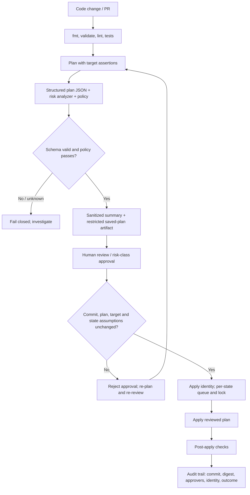

# Unit 4 — Safe Infrastructure Plans and Change Approval

**Target file:** `04-safe-infrastructure-plans-and-change-approval.md`  
**Module:** M07  
**Stage:** 2E — Production DevOps & Platform Engineering  
**Estimated time:** 18–26 hours including labs and review  
**Prerequisites:** Unit 1 state/backends/locking/recovery; Unit 2 modules/environment reuse; Unit 3 state migration/import/drift detection; M02 CI/CD foundations; cloud/IaC fundamentals  
**Core tools:** Terraform/OpenTofu (`<iac>`), Git, shell, Python, provider-free resources  
**Awareness:** Atlantis, HCP Terraform, Spacelift-class platforms, optional cost-estimation integrations  
**Last reviewed:** 2026-10-28  
**Tool baseline assumed:** No exact version is asserted. Record the installed binary and version locally; verify all `[VERSION-SENSITIVE]` behavior against that exact version before production use.  
**Substrate:** local-only/provider-free; no paid cloud required

> **Status and safety boundary:** This is a learning tutorial and static/mental review artifact. Commands and outputs are illustrative unless explicitly described as executed. No lab execution is claimed. Never run these labs against production or a shared backend. State, saved plans, plan JSON, and logs can contain sensitive values; do not commit them.

## Contents

- [4.0 Why this matters in production](#40-why-this-matters-in-production)
- [4.1 Learning objectives](#41-learning-objectives)
- [4.2 Concept map and vocabulary](#42-concept-map-and-vocabulary)
- [4.3 Level 1 — Beginner](#43-level-1--beginner)
- [4.4 Level 2 — Intermediate](#44-level-2--intermediate)
- [4.5 Level 3 — Advanced](#45-level-3--advanced)
- [4.6 Level 4 — Expert](#46-level-4--expert)
- [4.7 SRE lens](#47-sre-lens)
- [4.8 Security lens](#48-security-lens)
- [4.9 Production checklist](#49-production-checklist)
- [4.10 Hands-on lab set](#410-hands-on-lab-set)
- [4.11 Self-check questions](#411-self-check-questions)
- [4.12 Evidence artifacts](#412-evidence-artifacts)
- [4.13 Common interview and design-review questions](#413-common-interview-and-design-review-questions)
- [4.14 Sources and verification notes](#414-sources-and-verification-notes)

## 4.0 Why this matters in production

A refactor changes an immutable attribute and a production plan proposes replacing an object-storage bucket alongside routine tag updates. The plan is hundreds of lines long, the pipeline posts only “plan succeeded,” and a reviewer approves without noticing the destructive action. The apply threatens data availability and may lose objects if provider-side protection, versioning, backups, or recovery procedures are absent. A plan is a prediction based on current configuration, state, provider observations, and tool behavior—not a guarantee about what will exist at apply time. Production safety requires a valid plan, structured risk analysis, correct target identity, restricted artifact handling, informed approval, application of the exact reviewed artifact where supported, and post-apply verification.

## 4.1 Learning objectives

1. **[L1]** Interpret create, update, replace, delete, read, and no-op actions and explain why a plan is not a guarantee.
2. **[L1]** Create, inspect, and apply a saved plan with the selected `<iac>` tool while protecting plan artifacts.
3. **[L2]** Design a PR-based workflow with static checks, risk summary, approval, state locking, and separated plan/apply identities.
4. **[L2]** Handle `-detailed-exitcode`, `-lock-timeout`, `-target`, `-destroy`, `prevent_destroy`, and secret variables with explicit caveats.
5. **[L3]** Parse structured plan JSON defensively and classify high-risk actions without treating a simple analyzer as a complete security review.
6. **[L3]** Define risk-based approver gates, environment promotion, concurrency controls, and blast-radius limits.
7. **[L3]** Respond safely to stale plans and partial applies without assuming infrastructure has a universal rollback.
8. **[L4]** Design auditable pipeline-as-code with pinned actions, least-privilege permissions, restricted artifacts, environment approvals, and per-state serialization.
9. **[L4]** Analyze plan/apply incidents using evidence, safe tests, remediation, prevention, and explicit stop conditions.

## 4.2 Concept map and vocabulary

### Workflow map



A plan is a prediction; approval is an authorization decision, not proof of correctness. State locking serializes cooperating operations against a state when the backend supports it; it does not prevent every out-of-band provider change.

### Glossary

| Term | Precise definition | Common misconception |
|---|---|---|
| Configuration | HCL, module inputs, and provider configuration expressing intended management. | Configuration alone inventories all existing infrastructure. |
| State | Tool-maintained bindings and last-known attributes for managed objects. | State is the live cloud inventory. |
| Plan | Proposed operations computed from configuration, state, provider reads, and tool behavior. | A successful plan guarantees apply success. |
| Saved plan | Artifact intended to preserve a specific proposal for later inspection/application. | Binary means safe to share. |
| Plan JSON | Structured representation from the selected tool's JSON-output capability. | Schema and sensitivity behavior are identical across all versions. |
| Plan identity | Identity used to read state and provider observations needed for planning. | Read-only means no backend permissions are required. |
| Apply identity | Identity authorized to perform approved mutations. | Broad admin credentials should be shared by plan and apply jobs. |
| Stale plan | Plan whose applicability or assumptions are invalidated by intervening changes or tool-specific checks. | If the file exists, it is still valid. |
| Blast radius | Resources, data, services, environments, and teams potentially affected. | Few changed lines means low impact. |
| `-detailed-exitcode` | Where supported, distinguishes no changes, error, and changes present. | Every nonzero result means drift. |
| `-target` | Exceptional request to focus operations on selected addresses and dependencies. | Targeted plans show the complete desired change set. |
| `prevent_destroy` | Configuration lifecycle guard that can reject planned destruction while in effect. | Provider-side deletion lock or security boundary. |
| Partial apply | Some provider operations succeeded while others failed or state recording failed. | Retrying the command is always safe. |

### The three realities

The three realities are **configuration**, **state**, and **real infrastructure**. Planning observes provider attributes where supported and permitted, then predicts convergence. Provider-side changes may occur after planning; controllers may mutate attributes; and a saved plan cannot freeze the outside world. Bind approval to a specific commit, artifact/digest, environment, state/backend assumptions, risk summary, approvers, and time window.

## 4.3 Level 1 — Beginner

### 4.3.1 Why plan before apply

A plan provides a review surface before provider-side mutations. It can still be incomplete because of missing permissions, provider read semantics, eventual consistency, computed/volatile attributes, resource coverage gaps, or changes that happen after planning. A clean plan does not prove every resource is managed, correctly owned, secure, or compliant.

Safe loop: (1) assert directory, binary, environment, backend/state, endpoint, and identity; (2) run formatting, validation, and tests; (3) generate a plan and inspect both full detail and structured risk summary; (4) stop for unknown actions, unexplained replacements, security-sensitive changes, or unexpected targets; (5) obtain required approval and apply the reviewed proposal; (6) verify state and service behavior, then record evidence.

### 4.3.2 Plan symbols and action interpretation

Representative/illustrative output; exact wording, ordering, and symbols depend on tool version and provider.

```text
# terraform_data.metadata will be updated in-place
~ resource "terraform_data" "metadata" {
    id    = "..."
  ~ input = "schema-v1" -> "schema-v2"
}
Plan: 0 to add, 1 to change, 0 to destroy.
```

- `~` commonly indicates an in-place update.
- `+` commonly indicates creation.
- `-` commonly indicates destruction.
- `-/+` commonly indicates replacement; exact order/rendering is tool/provider-dependent.
- `<=` can indicate a data-source/read operation where applicable.
- A replacement may be create-then-destroy or destroy-then-create depending on lifecycle/provider semantics. Inspect detailed actions, attributes, and dependencies; never infer safety from the symbol alone.

A safe update might change a metadata label or `terraform_data` input. Replacing a bucket, database, or volume can affect data, endpoints, identities, availability, and downstream dependencies.

### 4.3.3 Replacement and deletion examples

```text
# terraform_data.metadata will be updated in-place
~ input = "schema-v1" -> "schema-v2"

# terraform_data.artifact must be replaced
-/+ resource "terraform_data" "artifact" {
      input = "artifact-v1" -> "artifact-v2"
    }

# Illustrative only; not runnable provider configuration
- resource "example_bucket" "data" {
      name = "analytics-prod"
    }
```

A planned deletion of a data-bearing resource is a stop-and-investigate event until ownership, retention requirements, snapshots/exports, provider-side protections, and recovery evidence are verified. `create_before_destroy` does not guarantee data safety or overcome naming constraints.

### 4.3.4 Destroy plans versus destroy execution

`<iac> plan -destroy` (or the version-supported equivalent) proposes destruction; it does not itself execute the destroy. `[VERSION-SENSITIVE]` Verify exact syntax and saved-plan behavior in the selected engine docs.

```bash
# Illustrative; only in a disposable local lab after target assertions
<iac> plan -destroy -out=destroy.plan
<iac> show destroy.plan
# Do not apply unless the lab explicitly requires it and scope is verified.
```

Representative output: `Plan: 0 to add, 0 to change, N to destroy.` The count depends on actual lab state. Reject the operation if the target directory/backend/identity is not the disposable lab.

### 4.3.5 Saved-plan workflow: reviewed plan is applied plan

```bash
# Illustrative local-only workflow
<iac> fmt -check -recursive
<iac> validate
<iac> plan -out=plan.bin
<iac> show plan.bin
<iac> show -json plan.bin > plan.json
# Human/policy review occurs here; keep plan.bin restricted and short-lived.
<iac> apply plan.bin
```

The **reviewed-plan-is-the-applied-plan** invariant means applying the reviewed saved artifact rather than generating a new proposal at apply time. If the reviewer approved commit A and the pipeline applies commit B or a newly generated plan, the original approval does not authorize the new change. Saved-plan applicability and serialization details vary by engine/version/backend; verify before production use.

### 4.3.6 `-target` is an exception

Targeting can help in narrow recovery/troubleshooting, but it can omit unrelated changes and dependencies that a full plan would reveal. Do not use targeted plans as the standard deployment path or to silence an uncomfortable diff. Record why targeting is needed, review a full plan afterward, and remove the exception from routine automation. `[VERSION-SENSITIVE]` Verify exact target semantics for the selected tool.

## 4.4 Level 2 — Intermediate

### 4.4.1 PR workflow and required gates

Normal flow: `fmt/validate/lint/test on PR → plan → structured risk analysis → sanitized summary → required review/approval → apply exact reviewed plan → post-apply verification`. Fail closed if parsing fails, the schema is unknown, the target cannot be proved, or policy detects forbidden actions. Green CI is not enough if the summary omitted a replacement or apply uses another commit.

### 4.4.2 Saved-plan handoff and stale-plan handling

Use a short-lived, access-restricted artifact and bind approval to commit SHA, plan digest, target environment, state identity, summary, policy result, and approvers. A plan can become stale because state/configuration/provider reality changed. Exact stale-plan rejection behavior is engine/version/backend-specific `[VERIFY]`.

1. Reject an artifact whose commit, environment, digest, or target differs from the approval record.
2. If the tool reports the saved plan is no longer applicable, do not bypass the error; create a new plan.
3. Compare the new summary and high-risk changes with the reviewed proposal.
4. Require renewed approval for material differences according to policy.
5. Apply only the approved artifact and record the outcome.

A saved plan does not freeze provider reality. A provider may reject an operation or another actor may change infrastructure between plan and apply.

### 4.4.3 Plan identity versus apply identity

| Identity | Minimum intent | Common required access | Must not have by default |
|---|---|---|---|
| Plan | Read current objects and compute proposal | Provider reads, state/backend access, lock operations, module/provider/artifact reads | Broad write permissions or production mutation rights |
| Apply | Execute approved proposal | Scoped provider write permissions, state/backend write/lock access, artifact read | Organization-wide admin where narrower role exists |
| Reviewer | Evaluate technical/business risk | Sanitized summary and enough restricted detail to understand impacts | Unnecessary raw-state or secret access |

“Read-only” does not mean “no permissions”: planning needs backend/state access and provider reads. Exact API permissions depend on provider, backend, and workflow. Separate identities where feasible; never expose production write credentials to an untrusted PR.

### 4.4.4 Detailed exit codes, lock timeout, concurrency

Where supported, `-detailed-exitcode` commonly means **0 = no changes, 1 = error, 2 = changes present**. `[VERSION-SENSITIVE]` Verify for the selected binary/version. Do not treat 1 and 2 as equivalent.

```bash
# Illustrative Bash; capture the status explicitly.
set +e
<iac> plan -detailed-exitcode -out=plan.bin
rc=$?
set -e
case "$rc" in
  0) echo "NO_CHANGES" ;;
  1) echo "PLAN_ERROR" >&2; exit 1 ;;
  2) echo "CHANGES_PRESENT" ;;
  *) echo "UNEXPECTED_EXIT_CODE=$rc" >&2; exit 1 ;;
esac
```

Representative output is one of `NO_CHANGES`, `PLAN_ERROR`, or `CHANGES_PRESENT`; the actual case depends on the plan. Preserve the tool status; do not convert errors into policy results.

`-lock-timeout` can wait for a state lock where supported. It does not make concurrent applies safe if locking is bypassed or the backend does not coordinate them. Serialize applies per state in CI and retain backend locking. Do not routinely use `-lock=false` to “fix” contention.

### 4.4.5 PR and repository protections

Use protected default branches, required checks, infrastructure CODEOWNERS, required reviewers, restricted environment deployment permissions, short-lived credentials, and an audit trail. Keep plan-job permissions minimal; consider workload identity/OIDC instead of long-lived keys where supported. Pin third-party actions to verified full commit SHAs or placeholders that must be resolved. Never invent SHA pins.

### 4.4.6 Variables, secrets, and artifacts

`TF_VAR_name` can supply an input variable but does not protect it from logs, state, provider APIs, or saved plans. Prefer a CI secret store or workload identity; avoid shell history and `set -x` around secrets. Masking can hide a value in logs but does not secure an artifact that all contributors can download. Restrict access, retention, storage, and audit logging for plans, state, JSON, and logs. Never commit raw state or saved plan files.

### 4.4.7 `prevent_destroy` and `auto-approve`

`lifecycle.prevent_destroy` is a configuration guardrail, not a universal security boundary. It may not protect a resource when the configuration containing it is removed or changed, and does not block every provider-side deletion path. Pair it with review, provider-side deletion protection where available, backups, and authorization controls.

`apply -auto-approve` removes interactive confirmation; it is not inherently unsafe in every controlled pipeline, but unsafe when mutable or unreviewed inputs can be applied. Safer automation binds approval to a specific artifact, restricts apply identity, enforces policy, serializes state operations, and preserves evidence. Never use it to bypass review.

## 4.5 Level 3 — Advanced

### 4.5.1 Structured plan analysis

Prefer `<iac> show -json plan.bin` and parse the documented schema for the exact tool/version. Common JSON representations include resource addresses/types and action lists; exact keys, sensitivity markers, unknown values, and schema versions must be checked. `[VERSION-SENSITIVE]` The Lab 1 fixtures are synthetic and do not claim to represent every tool's full schema.

A risk analyzer should count create/update/replace/delete/read/no-op actions where represented; flag stateful replacement/destruction, IAM/policy broadening, public network exposure, encryption/KMS changes, and unexpected environment-wide changes; fail on malformed JSON, unsupported schema, missing fields, or unknown action shapes; and report address, type, actions, severity, rationale, owner/unknown, and next step. It must separate **parser/tool error** from **policy violation**. A policy pass is a decision aid, not proof of safety.

### 4.5.2 Risk matrix and approval policy

This is a sample framework, not a universal standard. Set thresholds based on data classification, regulatory duties, service criticality, and recovery capability.

| Risk class | Examples | Minimum review | Evidence / stop condition |
|---|---|---|---|
| Low | Documented metadata update with no replacement or permission expansion | Service owner/designated reviewer | Summary and post-apply check; stop if actions differ from expectation |
| Medium | Routine update, non-prod replacement with tested recovery | Service owner plus platform review as policy dictates | Full plan, tests, target assertion, recovery note |
| High | Production network exposure, IAM expansion, encryption change, stateful replacement | Platform and security reviewers plus owner | Risk memo, backup/restore proof, bounded window; stop on unknown semantics |
| Critical/destructive | Production data deletion/replacement, broad privilege escalation, cross-environment change | Two-person approval including accountable owner | Verified restore, explicit impact statement, independent plan review, abort criteria |

No static analyzer can fully infer business criticality, data loss, provider behavior, dependencies, or every policy expansion. Unknown resource types or fields should increase uncertainty, not silently downgrade risk.

### 4.5.3 Blast-radius controls and promotion

Use small state boundaries, component-specific pipelines, change-count thresholds, maintenance windows, non-prod rehearsals, canary/progressive application, and environment assertions. Promote the same module version from dev to staging to prod, while reviewing environment-specific variables. Provider versions, backend identities, policy inputs, and variable values can still differ.

Coordinate cross-stack ordering through explicit outputs/dependencies or CI stages. Avoid hidden remote-state coupling and concurrent changes to shared dependencies. Apply queues are per state; independent states may run concurrently only when dependencies and shared resources are understood.

### 4.5.4 Rollback is not universal undo

- **Roll forward:** correct the defect with a new reviewed plan.
- **Revert commit and apply:** restore code, then generate/review a new plan; not a byte-for-byte infrastructure rollback.
- **Restore data:** use verified snapshots, backups, exports, or service-specific recovery.
- **Blue/green/parallel resource strategy:** shift traffic only when naming, data consistency, identity, and dependencies permit it.

Reverting code cannot recreate deleted data. `create_before_destroy` may be impossible with unique names, constrained capacity, exclusive dependencies, or provider limitations. Snapshots help only if retention, restore permissions, RPO/RTO, and restore testing are established.

### 4.5.5 Partial apply and safe retry decision tree

An apply may succeed on some provider operations and fail on others or while recording state. Never blindly rerun. Stop concurrent changes, preserve logs/status, assert target identity, inspect state and real resources read-only, identify completed and failed operations, and compare a fresh plan after determining actual state.

```text
Apply fails
  ├─ Target/backend/identity confirmed? No → stop; investigate wrong-target risk
  └─ Yes → preserve logs, digest, state/lock evidence
      ├─ Inspect state and provider objects read-only
      ├─ Identify completed provider operations and failed operations
      ├─ Reconcile ownership/state using approved recovery procedure
      └─ Generate fresh plan; review all create/replace/delete before retry
```

Do not edit or push state as a first response. State recovery is covered in Unit 1/Unit 3; backup and disaster recovery design is handed to M13.

### 4.5.6 Cost estimation and optional tools

Cost integrations (for example, an Infracost-style helper) can estimate proposed deltas but may not model every provider, usage pattern, discount, transfer, or runtime. `[VERIFY]` Confirm supported resources, pricing methodology, data-sharing boundary, and permissions in current official docs. See M15 for FinOps. Do not invent prices or treat estimates as invoices.

### 4.5.7 Platform comparison (awareness)

| Platform class | Potential capabilities to evaluate | Trade-offs / verification questions |
|---|---|---|
| Atlantis | PR-driven plan/apply, locking/workspace integration depending on setup | Who can trigger commands? How are credentials scoped? What is the PR-code trust boundary? |
| HCP Terraform | Managed runs/workspaces, policy/approval/state features depending on product tier | Which features are included? Where are state and artifacts stored? |
| Spacelift-class platform | Policy, orchestration, drift, approvals depending on configuration | What integrations are enabled? What are RBAC, retention, data sharing, and costs? |

These products are not interchangeable. Verify current feature sets, pricing, retention, policy, RBAC, and Terraform/OpenTofu support from official product docs before selection. Managed platforms shift operational burden but introduce vendor trust, access, exposure, and cost considerations.

## 4.6 Level 4 — Expert

### 4.6.1 Pipeline-as-code reference design

The GitHub Actions example is illustrative. Resolve every placeholder to a verified full commit SHA before use. Environment protection/reviewer rules must be configured and inspected in repository settings; YAML alone does not prove they are active. Local labs do not require GitHub, OIDC, or cloud credentials.

```yaml
# File: .github/workflows/iac-plan-apply.yml
# ILLUSTRATIVE TEMPLATE. Replace every placeholder with a verified full SHA.
# Configure production environment required reviewers in repository settings.
name: infrastructure-change
on:
  pull_request:
    paths: ["infra/**", ".github/workflows/iac-plan-apply.yml"]
  push:
    branches: [main]
    paths: ["infra/**"]
permissions:
  contents: read
concurrency:
  group: iac-production-${{ github.event.pull_request.number || github.ref }}
  cancel-in-progress: false
jobs:
  checks:
    runs-on: ubuntu-latest
    permissions:
      contents: read
    steps:
      - uses: actions/checkout@<VERIFIED_FULL_COMMIT_SHA>
        with:
          persist-credentials: false
      - uses: hashicorp/setup-terraform@<VERIFIED_FULL_COMMIT_SHA>
        with:
          terraform_version: ${{ vars.TERRAFORM_VERSION }}
      - name: Record tool and commit
        run: |
          terraform version
          git rev-parse HEAD
      - name: Format and validate
        working-directory: infra/dev
        run: |
          terraform fmt -check -recursive
          terraform init -backend=false -input=false
          terraform validate
  plan:
    if: github.event_name == 'push' && github.ref == 'refs/heads/main'
    needs: checks
    runs-on: ubuntu-latest
    permissions:
      contents: read
      # Add id-token: write only when a reviewed read-only OIDC trust policy is configured.
    steps:
      - uses: actions/checkout@<VERIFIED_FULL_COMMIT_SHA>
        with:
          ref: ${{ github.sha }}
          persist-credentials: false
      - uses: hashicorp/setup-terraform@<VERIFIED_FULL_COMMIT_SHA>
        with:
          terraform_version: ${{ vars.TERRAFORM_VERSION }}
      - name: Assert commit and create plan
        working-directory: infra/dev
        run: |
          test "$(git rev-parse HEAD)" = "$GITHUB_SHA"
          terraform version
          # Configure the provider's read-only identity here if the stack needs cloud reads.
          terraform init -input=false
          terraform plan -input=false -out=plan.bin
          terraform show -json plan.bin > plan.json
          python ../../scripts/plan_risk.py plan.json > plan-summary.md
          # Keep full output out of routine logs; this file is sensitive too.
          terraform show -no-color plan.bin > plan-full.txt
          sha256sum plan.bin > plan.sha256
          printf '%s\n' "$GITHUB_SHA" > plan.commit
      - name: Upload restricted, short-lived reviewed-plan artifact
        uses: actions/upload-artifact@<VERIFIED_FULL_COMMIT_SHA>
        with:
          name: reviewed-plan-${{ github.sha }}
          path: |
            infra/dev/plan.bin
            infra/dev/plan.sha256
            infra/dev/plan.commit
            infra/dev/plan-summary.md
            infra/dev/plan-full.txt
          retention-days: 1
          if-no-files-found: error
  apply:
    if: github.event_name == 'push' && github.ref == 'refs/heads/main'
    needs: plan
    runs-on: ubuntu-latest
    environment: production
    permissions:
      contents: read
      actions: read
      # Add id-token: write only with reviewed, scoped apply-identity trust configuration.
    steps:
      - uses: actions/checkout@<VERIFIED_FULL_COMMIT_SHA>
        with:
          ref: ${{ github.sha }}
          persist-credentials: false
      - uses: hashicorp/setup-terraform@<VERIFIED_FULL_COMMIT_SHA>
        with:
          terraform_version: ${{ vars.TERRAFORM_VERSION }}
      - uses: actions/download-artifact@<VERIFIED_FULL_COMMIT_SHA>
        with:
          name: reviewed-plan-${{ github.sha }}
          path: infra/dev
      - name: Verify artifact, target and approval context
        working-directory: infra/dev
        run: |
          test "$(git rev-parse HEAD)" = "$GITHUB_SHA"
          test "$(cat plan.commit)" = "$GITHUB_SHA"
          sha256sum -c plan.sha256
          terraform version
          # Assert backend/workspace/account/region here; never print credentials.
          # Configure a scoped apply identity here; never expose it to PR code.
          terraform init -input=false
      - name: Apply exact reviewed plan
        working-directory: infra/dev
        run: terraform apply -input=false plan.bin
```

Configure the repository variable `TERRAFORM_VERSION` to the reviewed exact version, and pin the setup action as well as checkout/upload/download actions. The template demonstrates a saved-plan handoff: on a main-branch push, the plan job creates the artifact; the `production` environment job waits for required reviewer approval configured in repository settings, downloads the same run's artifact, checks commit/digest, shows the saved plan, and applies that file. The reviewer must inspect `plan-summary.md` and restricted `plan-full.txt` before approving. These files and `plan.bin` may contain sensitive data; do not echo them into broad logs. This remains illustrative: configure and test provider-specific read-only/apply OIDC identities, backend/target assertions, artifact ACLs, action SHA pins, and approval settings. The artifact contains sensitive material and must be access-restricted. Backend state locking is still required; workflow concurrency does not coordinate other pipelines or external operators. The PR job above runs static checks; a PR plan can be added with a read-only identity if organizational policy supports it. Do not claim environment approval is active until repository settings are inspected.

The template intentionally does **not** implement a production artifact promotion. A real pipeline must securely bind the PR's reviewed plan to the exact commit, verify artifact provenance/digest, assert backend and environment, reject stale plans, and apply with a restricted identity only after required approval. Retention settings do not guarantee confidentiality or provenance. Workflow syntax, action pins, approvals, concurrency, and OIDC are `[VERIFY]` against current GitHub docs and actual settings.

### 4.6.2 Plan/apply divergence monitoring

Before apply, compare approval record with execution context: commit SHA/repository/ref; saved-plan artifact and digest; environment, directory, backend/state, workspace, endpoint/account/profile/region; tool/provider versions and lock file; plan summary/policy result; approvers and timestamp; apply identity and lock/concurrency evidence. Reject mismatches. A matching commit alone does not guarantee a matching plan because state, provider observations, variables, versions, and backend context matter.

### 4.6.3 Organization approval policy

Define accountable service owner, platform reviewer, security reviewer, and independent approver for destructive production actions. This unit recommends two-person approval for production destructive changes, but the exact matrix is organization policy. Emergency exceptions must be narrow, documented, time-limited, audited, and followed by reconciliation and review.

### 4.6.4 Five incident analyses

#### Incident A — Refactor threatens a production database-equivalent resource

- **Symptom:** A long plan proposes replacement/deletion of a stateful resource among routine changes.
- **Hypotheses:** Address/module refactor lost stable mapping; immutable attribute changed; provider schema/default changed; wrong environment/backend selected.
- **Safe tests:** Stop approval/apply; assert commit, directory, backend/workspace, identity and provider versions; inspect full plan and structured actions; compare address history; confirm backup/restore evidence with owner.
- **Root cause:** Illustrative incident: resource address changed without correct migration mapping, so the tool interpreted it as a new/removed object.
- **Remediation:** Preserve evidence, add correct address migration (`moved` or approved state operation as appropriate), create a fresh plan, and prove the resource is not replaced. Unit 3 covers state-address migration.
- **Prevention:** Stable addresses, refactor tests, resource-action thresholds, owner review, and destructive-change approval.
- **Evidence:** Sanitized before/after summaries, commit diff, address evidence without raw state, approval record, backup/restore reference.

#### Incident B — Apply used a different plan or commit

- **Symptom:** Production run includes changes absent from the approved PR summary.
- **Hypotheses:** Mutable branch checkout; new plan generated in apply job; artifact/commit mismatch; environment variables differ; approval not tied to digest.
- **Safe tests:** Compare commit SHAs, artifact digest, run IDs, target assertions, state identity, tool lock file, and timestamps. Do not apply again while mismatched.
- **Root cause:** Approval was associated with a branch/PR rather than exact artifact and target context.
- **Remediation:** Stop pipeline; if already applied, inspect provider/state and invoke incident procedures; otherwise reject artifact and re-plan/re-review.
- **Prevention:** Immutable commit checkout, artifact provenance, digest checks, short retention, approval binding, post-apply record.
- **Evidence:** Approval record, digest, run logs, commit IDs, policy result, state-safe verification.

#### Incident C — Sensitive plan artifact readable by all contributors

- **Symptom:** Contributors can download a saved plan or JSON they do not need.
- **Hypotheses:** Broad artifact ACL; public logs; overlong retention; masking mistaken for access control.
- **Safe tests:** Review workflow permissions and artifact ACLs; identify downloads; inspect through approved secret-handling procedures without copying values into tickets.
- **Root cause:** Artifact access and retention optimized for convenience rather than least privilege.
- **Remediation:** Restrict/revoke access, expire/delete exposed artifacts where possible, assess exposure, rotate credentials if confidentiality may be lost, and follow M09/incident process.
- **Prevention:** Separate restricted artifact from sanitized summary, short retention, access logging, secret scanning, threat-model review.
- **Evidence:** Access review, incident ticket, revocation/rotation record, updated retention policy, sanitized tests.

#### Incident D — Apply failed halfway and retry risked duplicates

- **Symptom:** Pipeline exits nonzero after some operations succeeded; rerun proposes more creates/replacements.
- **Hypotheses:** Provider operation succeeded but state write failed; partial dependency creation; transient API failure; lock/backend issue; wrong target.
- **Safe tests:** Freeze concurrent changes; preserve logs/digest; verify identity/backend; inspect state and real objects read-only; compare completed operations with a fresh plan.
- **Root cause:** Operator assumed apply was atomic across all provider operations.
- **Remediation:** Reconcile state and actual objects with owner; repair through approved procedure; review a fresh plan before retry.
- **Prevention:** Small batches, idempotent definitions, state locking, retries only for known-safe operations, recovery drills.
- **Evidence:** Timeline, provider operation IDs where available, sanitized logs, before/after summaries, recovery approval, post-apply verification.

#### Incident E — `-auto-approve` applied a destructive bad merge

- **Symptom:** Production destruction follows a merge without meaningful human plan review.
- **Hypotheses:** Branch protection bypass; policy gate missing; auto-approve mistaken for approval; compromised action/credential; analyzer failed open.
- **Safe tests:** Stop further runs; verify commit, approvals, actor, action pins, permissions, environment protection, and policy logs; inspect actual resources.
- **Root cause:** Authorization and risk review were conflated; apply could execute an unreviewed/mutable proposal.
- **Remediation:** Invoke incident/recovery process, restore data if necessary, revoke compromised credentials, suspend unsafe pipeline path.
- **Prevention:** Immutable reviewed artifacts, least privilege, two-person destructive approval, fail-closed policy checks, pinned actions, protected environments.
- **Evidence:** Timeline, run metadata, plan/policy summary, approval record, credential rotation, recovery test, control-remediation ticket.

### 4.6.5 Ten staff-level review objections

1. **Does the summary cover all resources?** Prove it came from the same artifact; report parser/schema errors and unknown types; require full-plan review for high risk.
2. **Can an attacker alter the artifact after approval?** Verify provenance, permissions, digest, and immutable run linkage; a hash alone is insufficient.
3. **Can PR code exfiltrate credentials?** Do not expose production write credentials to untrusted PR jobs; restrict tokens/actions and review OIDC claims.
4. **What if the provider changes after planning?** Plans are predictions; use short-lived artifacts, reject stale plans, re-plan/re-review changed assumptions.
5. **What if JSON schema changes?** Record tool versions, validate schema, fail closed, and test fixtures on upgrades.
6. **What if the plan targets the wrong account?** Assert endpoint/account/profile/region/backend/workspace before plan and apply; record identity evidence.
7. **What if analyzer misses IAM semantics?** Treat automation as triage, use policy-as-code and security review, and test provider-specific semantics.
8. **What if apply partially succeeds?** Inspect state and real resources before retry; use a recovery runbook and fresh plan.
9. **What if reviewer cannot read the full plan?** Provide grouped summaries, but do not hide details or use line count as approval criterion.
10. **What if rollback would delete data?** Require verified backup/restore and owner-approved recovery strategy before destructive changes.

## 4.7 SRE lens

### SLIs and SLO design

Define measurements before targets; thresholds are risk-based policy, not universal values.

| SLI | Definition / denominator | Why it matters / SLO design note |
|---|---|---|
| Change failure rate | Changes causing rollback, incident, or corrective deployment / completed changes | Segment by environment and severity; define failure consistently. |
| Plan-to-apply age | Time from plan creation to apply attempt | Set shorter limits for volatile/high-risk stacks; reject expired artifacts by policy. |
| Stale-plan rejection rate | Rejected stale plans / saved-plan apply attempts | Investigate state churn and approval latency; zero is not always the right target. |
| Destructive-change detection rate | Known destructive actions flagged / all known destructive actions in a curated test/audit set | Requires an independent test set; cannot prove all hazards are detected. |
| Approval latency | Time from ready-for-review to final decision | Separate routine/high-risk flows; never weaken controls solely to reduce latency. |
| Partial-apply rate | Apply runs with partial provider success / apply attempts | Separate provider failures from state-recording failures. |
| Post-apply verification failure rate | Applies failing defined checks / completed applies | Include service-level checks, not only tool exit code. |
| MTTR for IaC ownership/recovery | Detection to verified safe ownership/convergence | Define timestamps and avoid closing tickets while drift remains unresolved. |
| Rollback/roll-forward rate | Changes requiring revert or corrective deployment / completed changes | Interpret with incident severity; roll-forward is not inherently worse. |

### Failure modes and blast radius

Failure modes include wrong environment/backend, stale plan, incorrect identity, broad IAM, hidden destructive action, schema/parser failure, artifact substitution, concurrent applies, partial provider success, leaked state/plan, and unsafe auto-remediation. Bound blast radius with small states, scoped identities, target assertions, policy gates, reviewed windows, resource-action thresholds, and per-state queues. Count is only one signal: one IAM or encryption change can be more consequential than dozens of metadata updates.

### Runbook: alert → triage → mitigation → follow-up

1. **Alert:** Forbidden action, plan/apply mismatch, unexpected production change, failed post-apply check, or artifact exposure.
2. **Triage:** Pause the affected state queue; verify environment/backend/account/identity/commit; preserve sanitized logs, plan digest, and audit record; classify data/security/availability impact.
3. **Mitigation:** Do not blindly reapply or revert. If unapplied, reject artifact and re-plan. If applied, inspect real resources and state, engage owner, and use verified restore/roll-forward procedure.
4. **Follow-up:** Reconcile code/state/reality; validate service health; rotate exposed credentials if needed; document timeline, approvals, root cause, evidence, and control changes.

### Cost and capacity

Plan jobs can be slow due to provider reads, large states, dependency graphs, remote backends, and API rate limits. Avoid parallel runs against the same state; use bounded concurrency across independent states. Pin provider/module versions intentionally. Cost estimates may omit provider coverage, usage patterns, discounts, transfer, and runtime. No quota or price is asserted here.

## 4.8 Security lens

### Sensitive artifacts and access

State, saved plans, plan JSON, debug logs, and even sanitized-looking output can contain sensitive values or reveal topology. Marking a variable/output `sensitive` does not guarantee every artifact representation is secret-free. Do not commit raw state, `plan.bin`, or raw plan JSON. Restrict downloads, minimize retention, encrypt storage/transport, enable access logs, sanitize summaries, and avoid printing provider responses. If exposure is suspected, follow incident procedures and rotate credentials/secrets when confidentiality may be lost.

### Identity and target assertions

- Use a plan identity with minimum provider-read/backend/lock access and a separate scoped apply identity where feasible.
- Do not expose production write credentials to untrusted PRs or arbitrary scripts.
- Assert binary/version, working directory, environment, backend/state, workspace, endpoint, account/profile, region where relevant, and commit before plan/apply.
- Use workload identity/OIDC only with reviewed trust conditions that restrict repository, branch, workflow, and environment claims as supported by the provider.
- Require approvals and audit logs for break-glass; time-limit access and reconcile the emergency change afterward.

### Supply chain, approval bypass, and destructive controls

Pin third-party CI actions to verified full SHAs, review provider/module sources and lock files, protect workflow files, and limit token permissions. A compromised workflow can misuse its job's permissions. `prevent_destroy`, policy pass, saved plan, or green CI badge is not a complete security control. Use provider-side deletion protection where available, backups with tested restore, explicit destructive approval, and post-apply checks.

### Handoffs and scope boundaries

- **M02 CI/CD:** branch protection, workflow trust, build identities, artifact handling, deployment approvals.
- **M09 identity/secrets:** credential lifecycle, workload identity, secret storage, rotation.
- **M10 SRE/incident response:** incident command, communications, postmortems, recovery execution.
- **M12 supply chain:** action/provider/module provenance, pinning, dependency risk.
- **M13 backup/DR:** backup policy, restore tests, RPO/RTO, data recovery.
- **M15 FinOps:** cost estimation, tagging, budget governance, financial controls.

This unit teaches plan/change-approval safety; it does not fully implement IAM threat modeling, secrets platforms, provider-specific recovery, or supply-chain verification.

## 4.9 Production checklist

- [ ] Selected binary/version recorded in tool decision record.
- [ ] Directory, commit, environment, backend/state, workspace, endpoint/account/profile/region assertions are visible without exposing credentials.
- [ ] Provider/module versions are constrained; lock-file changes reviewed.
- [ ] Formatting, validation, tests, and policy checks run before approval.
- [ ] Summary is generated from the same saved plan that reviewers inspect.
- [ ] Analyzer rejects malformed JSON, unknown schema, missing fields, and unknown action shapes.
- [ ] Creates, updates, replacements, deletions, data-bearing changes, IAM/network/encryption changes, and cross-environment effects are visible.
- [ ] Plan/apply identities are separate and least-privileged where feasible.
- [ ] Saved-plan access is restricted, short-lived, integrity-checked, and never committed.
- [ ] Approval is bound to commit, artifact/digest, environment, state, and policy result.
- [ ] Stale plans and material re-plan differences trigger rejection and fresh approval.
- [ ] Per-state applies are serialized; locking is not disabled as routine workaround.
- [ ] Production destructive changes have owner approval and two-person review under defined policy.
- [ ] Data-bearing changes have verified backup/restore, owner, RPO/RTO, and stop conditions.
- [ ] `-target` and `-auto-approve` are prohibited by default or governed exceptions.
- [ ] CI action SHA pins are verified; workflow token permissions are least-privileged.
- [ ] Apply outcome and post-apply checks are recorded; partial apply uses a runbook.
- [ ] Break-glass access expires and is followed by reconciliation/review.
- [ ] Local cleanup is verified; raw state/saved plans are excluded from evidence bundles.

## 4.10 Hands-on lab set

All four labs are local-only and use synthetic fixtures or provider-free `terraform_data`. **Touches real cloud: no** for every lab. Labs are authored for repeatability but have not been executed here. Record your tool/version and verify version-sensitive commands before running.

| Lab | Goal | Substrate | Touches real cloud | Evidence | Cleanup verification |
|---|---|---|---|---|---|
| 1. Plan-risk analyzer | Parse JSON fixtures and classify risky changes | Python + synthetic JSON | no | test output, risk tables, exit codes | remove temporary lab; no resources created |
| 2. Saved plan and stale-plan failure | Inspect/apply a saved local plan; rehearse stale rejection | `terraform_data`; optional synthetic harness | no | summary, digest, approval record, stale behavior note | local state/artifacts removed after review |
| 3. Local PR-plan/approve/apply | Simulate checks, approval/denial, apply and audit | shell + `terraform_data` | no | audit logs, summaries, post-apply check | destroy only disposable local state; verify cleanup |
| 4. Read a 300-line plan | Identify destructive/high-risk changes | synthetic excerpt | no | annotated review memo and risk matrix | no resources created; remove notes if desired |

### Lab 1 — Build and test a plan-risk analyzer

**Goal:** Parse structured plan JSON, produce a risk table, distinguish parser errors from policy violations, and test safe update, bucket replacement, and IAM-style policy broadening. **Prerequisites:** Python 3. **Substrate:** local files/synthetic fixtures. **Touches real cloud: no.**

#### File tree

```text
lab-01-plan-risk-analyzer/
├── plan_risk.py
├── fixtures/safe-update.json
├── fixtures/bucket-replacement.json
├── fixtures/iam-broadening.json
└── test_plan_risk.py
```

#### `plan_risk.py`

```python
# File: lab-01-plan-risk-analyzer/plan_risk.py
"""Teaching analyzer only; not a complete security policy engine."""
import json
import sys
from pathlib import Path
ERROR, POLICY_VIOLATION, OK = 1, 2, 0
STATEFUL = {"aws_s3_bucket", "aws_db_instance", "aws_ebs_volume", "example_bucket"}
IDENTITY = {"aws_iam_policy", "aws_iam_role_policy", "aws_iam_role_policy_attachment"}
NETWORK = {"aws_security_group", "aws_vpc_security_group_ingress_rule"}

def classify(doc):
    if not isinstance(doc, dict) or not isinstance(doc.get("resource_changes"), list):
        raise ValueError("missing resource_changes or unsupported schema")
    rows, violations = [], []
    for item in doc["resource_changes"]:
        if not isinstance(item, dict):
            raise ValueError("resource change must be an object")
        address, rtype, change = item.get("address"), item.get("type"), item.get("change")
        if not isinstance(address, str) or not isinstance(rtype, str) or not isinstance(change, dict):
            raise ValueError("resource change lacks address/type/change")
        actions = change.get("actions")
        if not isinstance(actions, list) or not all(isinstance(a, str) for a in actions):
            raise ValueError(f"invalid actions for {address}")
        before, after = change.get("before"), change.get("after")
        if actions in (["no-op"], ["read"]):
            severity, why = "INFO", "no-op/read action"
        elif "delete" in actions and "create" in actions:
            severity, why = ("CRITICAL" if rtype in STATEFUL else "HIGH"), "replacement action"
        elif actions == ["delete"]:
            severity, why = ("CRITICAL" if rtype in STATEFUL else "HIGH"), "destruction action"
        elif actions == ["create"]:
            severity, why = "MEDIUM", "resource creation"
        elif actions == ["update"]:
            severity, why = "LOW", "in-place update; inspect attributes"
        else:
            raise ValueError(f"unknown action shape for {address}: {actions!r}")
        if rtype in IDENTITY:
            severity, why = "HIGH", "identity/policy change; inspect privilege semantics"
            if isinstance(before, dict) and isinstance(after, dict) and before != after:
                violations.append(f"{address}: identity/policy change requires review")
        if rtype in NETWORK:
            severity, why = "HIGH", "network change; inspect exposure"
        if rtype in STATEFUL and any(a in actions for a in ("delete", "create")):
            violations.append(f"{address}: stateful replacement/destruction")
        rows.append((address, rtype, "+".join(actions), severity, why))
    return rows, violations

def main(argv):
    if len(argv) != 2:
        print("usage: python plan_risk.py PLAN.json", file=sys.stderr); return ERROR
    try:
        doc = json.loads(Path(argv[1]).read_text(encoding="utf-8"))
        rows, violations = classify(doc)
    except (OSError, UnicodeError, json.JSONDecodeError, ValueError) as exc:
        print(f"ANALYZER_ERROR: {exc}", file=sys.stderr); return ERROR
    print("| Address | Type | Actions | Severity | Rationale |")
    print("|---|---|---|---|---|")
    for row in rows: print("| " + " | ".join(row) + " |")
    if violations:
        print("POLICY_VIOLATION:")
        for v in violations: print(f"- {v}")
        return POLICY_VIOLATION
    print("POLICY_RESULT: no configured forbidden action detected; human review remains required")
    return OK

if __name__ == "__main__":
    raise SystemExit(main(sys.argv))
```

#### Lab 1 fixture files

```json
{
  "format_version": "synthetic-v1",
  "resource_changes": [
    {"address":"terraform_data.metadata","type":"terraform_data","change":{"actions":["update"],"before":{"input":"schema-v1"},"after":{"input":"schema-v2"}}}
  ]
}
```

```json
{
  "format_version": "synthetic-v1",
  "resource_changes": [
    {"address":"example_bucket.data","type":"example_bucket","change":{"actions":["delete","create"],"before":{"name":"analytics-dev","versioning":true},"after":{"name":"analytics-dev-new","versioning":true}}}
  ]
}
```

```json
{
  "format_version": "synthetic-v1",
  "resource_changes": [
    {"address":"example_iam_policy.pipeline","type":"aws_iam_policy","change":{"actions":["update"],"before":{"policy":"allow:read-specific-object"},"after":{"policy":"allow:all-actions-all-resources"}}}
  ]
}
```

#### `test_plan_risk.py`

```python
# File: lab-01-plan-risk-analyzer/test_plan_risk.py
import importlib.util
import json
import unittest
from pathlib import Path
HERE = Path(__file__).parent
spec = importlib.util.spec_from_file_location("plan_risk", HERE / "plan_risk.py")
plan_risk = importlib.util.module_from_spec(spec)
spec.loader.exec_module(plan_risk)

class AnalyzerTests(unittest.TestCase):
    def load(self, name):
        return json.loads((HERE / "fixtures" / name).read_text(encoding="utf-8"))
    def test_safe_update(self):
        rows, violations = plan_risk.classify(self.load("safe-update.json"))
        self.assertEqual(rows[0][3], "LOW"); self.assertEqual(violations, [])
    def test_bucket_replacement(self):
        rows, violations = plan_risk.classify(self.load("bucket-replacement.json"))
        self.assertEqual(rows[0][3], "CRITICAL"); self.assertTrue(violations)
    def test_iam_change(self):
        rows, violations = plan_risk.classify(self.load("iam-broadening.json"))
        self.assertEqual(rows[0][3], "HIGH"); self.assertTrue(violations)
    def test_malformed_schema(self):
        with self.assertRaises(ValueError): plan_risk.classify({"planned_values": {}})
    def test_unknown_action(self):
        doc = {"resource_changes":[{"address":"x.y","type":"x","change":{"actions":["mystery"]}}]}
        with self.assertRaises(ValueError): plan_risk.classify(doc)
    def test_empty_changes(self):
        rows, violations = plan_risk.classify({"resource_changes": []})
        self.assertEqual(rows, []); self.assertEqual(violations, [])

if __name__ == "__main__": unittest.main()
```

#### Commands, expected output, interpretation

```bash
# Run from the lab root. No credentials or provider endpoints are needed.
cd lab-01-plan-risk-analyzer
python --version
python -m unittest -v
python plan_risk.py fixtures/safe-update.json
python plan_risk.py fixtures/bucket-replacement.json; rc=$?; test "$rc" -eq 2
python plan_risk.py fixtures/iam-broadening.json; rc=$?; test "$rc" -eq 2
```

Representative/illustrative output: six tests pass; safe fixture prints a `LOW` update and policy result without a configured forbidden action; bucket fixture prints `CRITICAL` and exits `2`; IAM fixture prints `HIGH` and exits `2`. `ANALYZER_ERROR`/exit `1` means parser/tool failure, not policy violation. Output is illustrative and not captured from execution here.

**Target assertion:** verify the working directory is the lab root; Python runs local files only. **Checkpoint:** Why are parser error and policy violation different? Why is bucket replacement critical? What can this simple analyzer miss? **Evidence:** source, fixtures, tests, test output, risk tables, limitations note. **Cleanup:** remove the lab directory after evidence is saved. **Cleanup verification:** confirm no state/cloud resources were created and the temporary directory is gone. **Failure/recovery:** run from the lab root; fix malformed fixtures but preserve malformed-input tests; never silently accept unknown action shapes. **Stretch:** add schema allow-list and public-network ingress test.

### Lab 2 — Saved-plan workflow, stale-plan failure, and fix

**Goal:** Create/inspect a saved plan for a provider-free resource, apply that exact plan, and rehearse stale-plan rejection without pretending a synthetic test proves CLI behavior. **Prerequisites:** Terraform or OpenTofu installed. **Substrate:** built-in `terraform_data`, no cloud provider. **Touches real cloud: no.**

`terraform_data` availability and exact CLI behavior are `[VERSION-SENSITIVE]`; verify official language docs first. If unsupported, do not add a cloud provider; use the synthetic harness below and record the limitation.

#### File tree and complete files

```text
lab-02-saved-plan/
├── main.tf
├── .gitignore
├── workflow-record.md
└── stale_harness.py
```

```hcl
# File: lab-02-saved-plan/main.tf
terraform {
  required_version = ">= 1.4.0" # [VERIFY] against selected engine baseline
}
resource "terraform_data" "metadata" {
  input = "schema-v1"
}
```

```gitignore
# File: lab-02-saved-plan/.gitignore
.terraform/
*.tfstate
*.tfstate.*
*.plan
plan.bin
plan.json
crash.log
```

```markdown
<!-- File: lab-02-saved-plan/workflow-record.md -->
# Saved-plan evidence record
- Tool and version:
- Working directory and disposable state identity:
- Commit/local change identifier:
- Plan artifact digest:
- Sanitized summary reviewed by:
- Apply outcome:
- CLI stale-plan behavior observed OR synthetic simulation used:
- Cleanup verification:
```

```python
# File: lab-02-saved-plan/stale_harness.py
from dataclasses import dataclass
@dataclass(frozen=True)
class Approval:
    commit: str
    plan_digest: str
    environment: str
    state_id: str

def may_apply(approved, actual):
    mismatches = [f for f in ("commit", "plan_digest", "environment", "state_id")
                  if getattr(approved, f) != getattr(actual, f)]
    return (not mismatches, mismatches)

if __name__ == "__main__":
    approved = Approval("abc123", "digest-A", "dev", "local-state-1")
    print("same:", may_apply(approved, approved))
    changed = Approval("abc123", "digest-B", "dev", "local-state-1")
    print("changed:", may_apply(approved, changed))
```

#### Commands in order

```bash
# Target assertion: run only inside this disposable lab directory.
cd lab-02-saved-plan
test -f main.tf && pwd
<iac> version
# Stop if any cloud credentials are set; do not print their values.
for v in AWS_ACCESS_KEY_ID AWS_SECRET_ACCESS_KEY AWS_SESSION_TOKEN ARM_CLIENT_SECRET GOOGLE_APPLICATION_CREDENTIALS; do
  if printenv "$v" >/dev/null 2>&1; then echo "STOP: $v is set; unset it"; exit 1; fi
done
<iac> init -backend=false
<iac> validate
<iac> plan -out=plan.bin
<iac> show plan.bin
<iac> show -json plan.bin > plan.json
sha256sum plan.bin
# Human checkpoint: only terraform_data.metadata creation is expected.
<iac> apply plan.bin
<iac> state list
<iac> show -no-color
python stale_harness.py
```

Representative/illustrative output: initialization completes without cloud-provider configuration; validation succeeds; first plan proposes one `terraform_data.metadata` creation; `state list` contains that address after apply. Harness prints `same: (True, [])` and `changed: (False, ['plan_digest'])`. IDs/order vary. If a cloud provider, endpoint, backend, or unexpected resource appears, stop. The harness validates only its own comparison logic.

#### Stale-plan branch

1. Create/inspect `plan.bin` while `input = "schema-v1"`.
2. Change `input` to `schema-v2` without generating a new plan.
3. Attempt to apply the old plan only if the selected engine's docs and disposable local state make this a safe test. Capture actual behavior/version; do not assume exact error text.
4. If CLI behavior cannot be induced reliably, report that and use the synthetic harness, clearly labeled simulation.
5. Never bypass a stale-plan error. Generate a new plan, inspect differences, and obtain fresh approval.

**Checkpoint:** Why apply `plan.bin`? Which fields bind approval? Why is a digest not enough without trusted provenance? **Evidence:** sanitized summary, tool version, digest, approval record, CLI observation or labeled simulation, post-apply state listing. **Cleanup commands (only after target assertion and plan review):**

```bash
# Assert this exact disposable directory and chosen tool before cleanup.
test "$(basename "$PWD")" = "lab-02-saved-plan"
<iac> version
<iac> plan -destroy -out=cleanup.plan
<iac> show cleanup.plan
# Review the full plan; proceed only if it affects this local terraform_data object.
<iac> apply cleanup.plan
<iac> state list
# Expected after cleanup: empty managed-resource list (exact output may be blank).
rm -f plan.bin plan.json cleanup.plan
rm -rf .terraform
rm -f terraform.tfstate terraform.tfstate.backup
```

Representative output: destroy plan proposes only `terraform_data.metadata`; after apply, `state list` is empty. Then `test ! -e terraform.tfstate && test ! -e plan.bin && test ! -d .terraform && echo CLEAN` should print `CLEAN`. If the plan includes anything else, stop. **Failure/recovery:** if cleanup fails, inspect state and local resource read-only; do not blindly retry. **Stretch:** add tests rejecting environment and commit mismatch.

### Lab 3 — Local PR-plan/approve/apply workflow

**Goal:** Simulate checks, plan generation, sanitized summary, reviewer approval/denial, apply of the reviewed plan, post-apply verification, and audit record. **Prerequisites:** selected `<iac>` and Python 3. **Substrate:** `terraform_data` and local state. **Touches real cloud: no.**

#### File tree and complete files

```text
lab-03-local-pr-workflow/
├── main.tf
├── .gitignore
└── run-workflow.sh
```

```hcl
# File: lab-03-local-pr-workflow/main.tf
terraform {
  required_version = ">= 1.4.0" # [VERIFY] against selected baseline
}
variable "environment" {
  type    = string
  default = "dev"
  validation {
    condition     = contains(["dev", "staging", "prod"], var.environment)
    error_message = "environment must be dev, staging, or prod"
  }
}
resource "terraform_data" "artifact" {
  input = { environment = var.environment, artifact = "metadata-v1" }
}
```

```gitignore
# File: lab-03-local-pr-workflow/.gitignore
.terraform/
*.tfstate
*.tfstate.*
plan.bin
plan.json
plan-summary.md
workflow-audit.log
```

```bash
# File: lab-03-local-pr-workflow/run-workflow.sh
#!/usr/bin/env bash
set -euo pipefail
mode="${1:-}"
if [[ "$mode" != "approve" && "$mode" != "deny" ]]; then
  echo "usage: ./run-workflow.sh approve|deny" >&2; exit 1
fi
ROOT="$(cd "$(dirname "$0")" && pwd)"; cd "$ROOT"
[[ -f main.tf ]] || { echo "STOP: main.tf missing" >&2; exit 1; }
[[ "$(basename "$PWD")" == "lab-03-local-pr-workflow" ]] || { echo "STOP: unexpected directory" >&2; exit 1; }
TOOL="${IAC_BIN:-terraform}"
case "$TOOL" in terraform|tofu) ;; *) echo "STOP: IAC_BIN must be terraform or tofu" >&2; exit 1;; esac
command -v "$TOOL" >/dev/null || { echo "STOP: $TOOL not found" >&2; exit 1; }
for v in AWS_ACCESS_KEY_ID AWS_SECRET_ACCESS_KEY AWS_SESSION_TOKEN ARM_CLIENT_SECRET GOOGLE_APPLICATION_CREDENTIALS AWS_ENDPOINT_URL AWS_ENDPOINT_URL_S3; do
  if printenv "$v" >/dev/null 2>&1; then echo "STOP: $v is set; unset it first" >&2; exit 1; fi
done
"$TOOL" version
printf 'target_dir=%s\nenvironment=dev-local\ntool=%s\n' "$PWD" "$TOOL" > workflow-audit.log
printf 'commit=%s\nreviewer=%s\n' "${GIT_COMMIT:-LOCAL-SYNTHETIC-COMMIT}" "${REVIEWER_ID:-local-reviewer-example}" >> workflow-audit.log
"$TOOL" fmt -check
"$TOOL" init -backend=false -input=false
"$TOOL" validate
"$TOOL" plan -input=false -out=plan.bin
"$TOOL" show -json plan.bin > plan.json
python - <<'PY' > plan-summary.md
import json
from pathlib import Path
p = json.loads(Path("plan.json").read_text(encoding="utf-8"))
changes = p.get("resource_changes", [])
print("# Sanitized local plan summary")
print(f"Resource changes represented: {len(changes)}")
for r in changes:
    c = r.get("change", {})
    print(f"- `{r.get('address','UNKNOWN')}` ({r.get('type','UNKNOWN')}): `{c.get('actions',['UNKNOWN'])}`")
PY
DIGEST="$(sha256sum plan.bin | awk '{print $1}')"
printf 'plan_digest=%s\napproval_mode=%s\n' "$DIGEST" "$mode" >> workflow-audit.log
cat plan-summary.md
if [[ "$mode" == "deny" ]]; then
  printf 'decision=DENIED\n' >> workflow-audit.log
  echo "DENIED: no apply performed"; exit 0
fi
echo "LOCAL SIMULATION: reviewer approved digest $DIGEST for dev-local"
printf 'decision=APPROVED_LOCAL_SIMULATION\n' >> workflow-audit.log
# Plan has been shown and reviewed; apply the exact saved plan.
"$TOOL" show plan.bin
"$TOOL" apply -input=false plan.bin
"$TOOL" state list
printf 'apply=completed\npost_apply_verification=state-list-reviewed\n' >> workflow-audit.log
cat workflow-audit.log
```

#### Commands, expected output, explanation

```bash
cd lab-03-local-pr-workflow
chmod +x run-workflow.sh
./run-workflow.sh deny
# Re-run from a clean disposable state after review:
./run-workflow.sh approve
```

Representative/illustrative output: deny path prints summary and `DENIED: no apply performed`; the audit log has `decision=DENIED` and no `apply=completed`. Approve path prints the plan, records a local simulated approval tied to digest, applies saved plan, and lists `terraform_data.artifact`. This simulation is not authenticated production approval and does not implement immutable artifact provenance, enterprise authorization, or secure CI handoff.

**Target assertion:** verify `pwd`, binary/version, absence of cloud credentials/endpoints, and provider-free `backend=false`; stop if any provider or endpoint is configured. **Checkpoint:** What is missing from simulated approval? Why show the saved plan? Why is summary not enough for high-risk changes? **Evidence:** deny/approve logs, sanitized summary, digest, post-apply check, critique of simulation limits. **Cleanup commands (only after target assertion and plan review):**

```bash
test "$(basename "$PWD")" = "lab-03-local-pr-workflow"
"${IAC_BIN:-terraform}" version
"${IAC_BIN:-terraform}" plan -destroy -out=cleanup.plan
"${IAC_BIN:-terraform}" show cleanup.plan
# Proceed only if the reviewed plan affects this disposable local terraform_data resource.
"${IAC_BIN:-terraform}" apply cleanup.plan
"${IAC_BIN:-terraform}" state list
rm -f cleanup.plan plan.bin plan.json plan-summary.md workflow-audit.log
rm -rf .terraform
rm -f terraform.tfstate terraform.tfstate.backup
# Verify expected local cleanup:
test ! -e terraform.tfstate && test ! -e plan.bin && test ! -d .terraform && echo CLEAN
```

Representative output: cleanup plan shows only `terraform_data.artifact`; after apply, `state list` is empty and final command prints `CLEAN`. If any other resource or backend appears, stop. **Failure/recovery:** preserve errors; inspect state/current plan before retry; unset credential/endpoints and restart if target assertion fails. **Stretch:** require approved digest as input and test that a changed digest blocks apply.

### Lab 4 — “Read this 300-line plan” exercise

**Goal:** Identify all destructive/high-risk changes and defend the approval decision. **Prerequisites:** none. **Substrate:** synthetic plan excerpt. **Touches real cloud: no.**

The next excerpt is intentionally synthetic and human-readable, not a captured provider plan. It includes six high-risk changes plus routine metadata and dashboard actions. Read every line; do not rely on the summary embedded at the end of the excerpt.

**Learner tasks:** count create/update/replace/delete actions; identify every data-bearing, identity/policy, network exposure, encryption, and unusual blast-radius risk; distinguish safe candidates from items needing investigation; recommend reviewers, backup/restore evidence, non-prod rehearsal/canary, window, and abort criteria; state what the plan alone cannot prove.

```text
SYNTHETIC / ILLUSTRATIVE PLAN REVIEW EXERCISE — NOT CAPTURED FROM A REAL TOOL RUN
Target: conceptual prod environment; do not execute. Review every resource block.
Plan renderer and resource types are illustrative, not provider-specific CLI output.
Owner names and actions are synthetic; confirm ownership and impact before approval.
# High-risk change 1: DATA-BEARING OBJECT STORAGE replacement; backup/retention not proven
module.storage.example_bucket.raw will be replaced or changed
  address = "module.storage.example_bucket.raw"
  action = "replace"
  change = "name: analytics-prod -> analytics-prod-v2"
  owner = "UNKNOWN - verify inventory"
  note = "Plan does not prove restore capability or approval"
  stop = "Require owner/platform/security review"
# High-risk change 2: DATA-BEARING DATABASE deletion; critical stop
module.database.example_database.primary will be deleted or changed
  address = "module.database.example_database.primary"
  action = "delete"
  change = "retention_policy: 30d -> null"
  owner = "UNKNOWN - verify inventory"
  note = "Plan does not prove restore capability or approval"
  stop = "Require owner/platform/security review"
# High-risk change 3: IDENTITY POLICY BROADENING; inspect effective permissions
module.identity.example_iam_policy.pipeline will be updated or changed
  address = "module.identity.example_iam_policy.pipeline"
  action = "update"
  change = "resource scope: bucket-specific -> wildcard"
  owner = "UNKNOWN - verify inventory"
  note = "Plan does not prove restore capability or approval"
  stop = "Require owner/platform/security review"
# High-risk change 4: NETWORK EXPOSURE; public CIDR added
module.network.example_security_group.ingress will be updated or changed
  address = "module.network.example_security_group.ingress"
  action = "update"
  change = "cidr_blocks: [10.0.0.0/8] -> [0.0.0.0/0]"
  owner = "UNKNOWN - verify inventory"
  note = "Plan does not prove restore capability or approval"
  stop = "Require owner/platform/security review"
# High-risk change 5: ENCRYPTION KEY replacement; ciphertext/data access impact
module.crypto.example_kms_key.data will be replaced or changed
  address = "module.crypto.example_kms_key.data"
  action = "replace"
  change = "key alias: data-key-v1 -> data-key-v2"
  owner = "UNKNOWN - verify inventory"
  note = "Plan does not prove restore capability or approval"
  stop = "Require owner/platform/security review"
# High-risk change 6: AUDIT LOGGING DATA LOSS / retention risk
module.storage.example_bucket.audit will be deleted or changed
  address = "module.storage.example_bucket.audit"
  action = "delete"
  change = "retention: 365d -> resource removed"
  owner = "UNKNOWN - verify inventory"
  note = "Plan does not prove restore capability or approval"
  stop = "Require owner/platform/security review"
# Routine metadata resource 1
module.metadata.terraform_data.catalog_01 will be updated in-place
  address = "module.metadata.terraform_data.catalog_01"
  type = "terraform_data"
  action = "update"
  before = "catalog-v01"
  after = "catalog-v01-rev2"
  owner = "data-platform"
  note = "Low risk only if no hidden dependency"
# Routine metadata resource 2
module.metadata.terraform_data.catalog_02 will be updated in-place
  address = "module.metadata.terraform_data.catalog_02"
  type = "terraform_data"
  action = "update"
  before = "catalog-v02"
  after = "catalog-v02-rev2"
  owner = "data-platform"
  note = "Low risk only if no hidden dependency"
# Routine metadata resource 3
module.metadata.terraform_data.catalog_03 will be updated in-place
  address = "module.metadata.terraform_data.catalog_03"
  type = "terraform_data"
  action = "update"
  before = "catalog-v03"
  after = "catalog-v03-rev2"
  owner = "data-platform"
  note = "Low risk only if no hidden dependency"
# Routine metadata resource 4
module.metadata.terraform_data.catalog_04 will be updated in-place
  address = "module.metadata.terraform_data.catalog_04"
  type = "terraform_data"
  action = "update"
  before = "catalog-v04"
  after = "catalog-v04-rev2"
  owner = "data-platform"
  note = "Low risk only if no hidden dependency"
# Routine metadata resource 5
module.metadata.terraform_data.catalog_05 will be updated in-place
  address = "module.metadata.terraform_data.catalog_05"
  type = "terraform_data"
  action = "update"
  before = "catalog-v05"
  after = "catalog-v05-rev2"
  owner = "data-platform"
  note = "Low risk only if no hidden dependency"
# Routine metadata resource 6
module.metadata.terraform_data.catalog_06 will be updated in-place
  address = "module.metadata.terraform_data.catalog_06"
  type = "terraform_data"
  action = "update"
  before = "catalog-v06"
  after = "catalog-v06-rev2"
  owner = "data-platform"
  note = "Low risk only if no hidden dependency"
# Routine metadata resource 7
module.metadata.terraform_data.catalog_07 will be updated in-place
  address = "module.metadata.terraform_data.catalog_07"
  type = "terraform_data"
  action = "update"
  before = "catalog-v07"
  after = "catalog-v07-rev2"
  owner = "data-platform"
  note = "Low risk only if no hidden dependency"
# Routine metadata resource 8
module.metadata.terraform_data.catalog_08 will be updated in-place
  address = "module.metadata.terraform_data.catalog_08"
  type = "terraform_data"
  action = "update"
  before = "catalog-v08"
  after = "catalog-v08-rev2"
  owner = "data-platform"
  note = "Low risk only if no hidden dependency"
# Routine metadata resource 9
module.metadata.terraform_data.catalog_09 will be updated in-place
  address = "module.metadata.terraform_data.catalog_09"
  type = "terraform_data"
  action = "update"
  before = "catalog-v09"
  after = "catalog-v09-rev2"
  owner = "data-platform"
  note = "Low risk only if no hidden dependency"
# Routine metadata resource 10
module.metadata.terraform_data.catalog_10 will be updated in-place
  address = "module.metadata.terraform_data.catalog_10"
  type = "terraform_data"
  action = "update"
  before = "catalog-v10"
  after = "catalog-v10-rev2"
  owner = "data-platform"
  note = "Low risk only if no hidden dependency"
# Routine metadata resource 11
module.metadata.terraform_data.catalog_11 will be updated in-place
  address = "module.metadata.terraform_data.catalog_11"
  type = "terraform_data"
  action = "update"
  before = "catalog-v11"
  after = "catalog-v11-rev2"
  owner = "data-platform"
  note = "Low risk only if no hidden dependency"
# Routine metadata resource 12
module.metadata.terraform_data.catalog_12 will be updated in-place
  address = "module.metadata.terraform_data.catalog_12"
  type = "terraform_data"
  action = "update"
  before = "catalog-v12"
  after = "catalog-v12-rev2"
  owner = "data-platform"
  note = "Low risk only if no hidden dependency"
# Routine metadata resource 13
module.metadata.terraform_data.catalog_13 will be updated in-place
  address = "module.metadata.terraform_data.catalog_13"
  type = "terraform_data"
  action = "update"
  before = "catalog-v13"
  after = "catalog-v13-rev2"
  owner = "data-platform"
  note = "Low risk only if no hidden dependency"
# Routine metadata resource 14
module.metadata.terraform_data.catalog_14 will be updated in-place
  address = "module.metadata.terraform_data.catalog_14"
  type = "terraform_data"
  action = "update"
  before = "catalog-v14"
  after = "catalog-v14-rev2"
  owner = "data-platform"
  note = "Low risk only if no hidden dependency"
# Routine metadata resource 15
module.metadata.terraform_data.catalog_15 will be updated in-place
  address = "module.metadata.terraform_data.catalog_15"
  type = "terraform_data"
  action = "update"
  before = "catalog-v15"
  after = "catalog-v15-rev2"
  owner = "data-platform"
  note = "Low risk only if no hidden dependency"
# Routine metadata resource 16
module.metadata.terraform_data.catalog_16 will be updated in-place
  address = "module.metadata.terraform_data.catalog_16"
  type = "terraform_data"
  action = "update"
  before = "catalog-v16"
  after = "catalog-v16-rev2"
  owner = "data-platform"
  note = "Low risk only if no hidden dependency"
# Routine metadata resource 17
module.metadata.terraform_data.catalog_17 will be updated in-place
  address = "module.metadata.terraform_data.catalog_17"
  type = "terraform_data"
  action = "update"
  before = "catalog-v17"
  after = "catalog-v17-rev2"
  owner = "data-platform"
  note = "Low risk only if no hidden dependency"
# Routine metadata resource 18
module.metadata.terraform_data.catalog_18 will be updated in-place
  address = "module.metadata.terraform_data.catalog_18"
  type = "terraform_data"
  action = "update"
  before = "catalog-v18"
  after = "catalog-v18-rev2"
  owner = "data-platform"
  note = "Low risk only if no hidden dependency"
# Routine metadata resource 19
module.metadata.terraform_data.catalog_19 will be updated in-place
  address = "module.metadata.terraform_data.catalog_19"
  type = "terraform_data"
  action = "update"
  before = "catalog-v19"
  after = "catalog-v19-rev2"
  owner = "data-platform"
  note = "Low risk only if no hidden dependency"
# Routine metadata resource 20
module.metadata.terraform_data.catalog_20 will be updated in-place
  address = "module.metadata.terraform_data.catalog_20"
  type = "terraform_data"
  action = "update"
  before = "catalog-v20"
  after = "catalog-v20-rev2"
  owner = "data-platform"
  note = "Low risk only if no hidden dependency"
# New observability object 1
module.observability.terraform_data.dashboard_01 will be created
  address = "module.observability.terraform_data.dashboard_01"
  type = "terraform_data"
  action = "create"
  input = "dashboard-01-v2"
  owner = "platform-observability"
  note = "Check naming, cost, duplicate alert routing"
# New observability object 2
module.observability.terraform_data.dashboard_02 will be created
  address = "module.observability.terraform_data.dashboard_02"
  type = "terraform_data"
  action = "create"
  input = "dashboard-02-v2"
  owner = "platform-observability"
  note = "Check naming, cost, duplicate alert routing"
# New observability object 3
module.observability.terraform_data.dashboard_03 will be created
  address = "module.observability.terraform_data.dashboard_03"
  type = "terraform_data"
  action = "create"
  input = "dashboard-03-v2"
  owner = "platform-observability"
  note = "Check naming, cost, duplicate alert routing"
# New observability object 4
module.observability.terraform_data.dashboard_04 will be created
  address = "module.observability.terraform_data.dashboard_04"
  type = "terraform_data"
  action = "create"
  input = "dashboard-04-v2"
  owner = "platform-observability"
  note = "Check naming, cost, duplicate alert routing"
# New observability object 5
module.observability.terraform_data.dashboard_05 will be created
  address = "module.observability.terraform_data.dashboard_05"
  type = "terraform_data"
  action = "create"
  input = "dashboard-05-v2"
  owner = "platform-observability"
  note = "Check naming, cost, duplicate alert routing"
# New observability object 6
module.observability.terraform_data.dashboard_06 will be created
  address = "module.observability.terraform_data.dashboard_06"
  type = "terraform_data"
  action = "create"
  input = "dashboard-06-v2"
  owner = "platform-observability"
  note = "Check naming, cost, duplicate alert routing"
# Network metadata annotation 1
module.network.terraform_data.route_annotation_01 will be updated in-place
  address = "module.network.terraform_data.route_annotation_01"
  type = "terraform_data"
  action = "update"
  before = "route-note-1"
  after = "route-note-1-reviewed"
  owner = "network-platform"
# Network metadata annotation 2
module.network.terraform_data.route_annotation_02 will be updated in-place
  address = "module.network.terraform_data.route_annotation_02"
  type = "terraform_data"
  action = "update"
  before = "route-note-2"
  after = "route-note-2-reviewed"
  owner = "network-platform"
# End-of-excerpt reviewer context: do not treat this as a real provider plan.
# Independent action counts, risk classification, and approval recommendation are required.
```

#### Model answer for Lab 4

**Risk summary:** Six explicitly marked high-risk changes are present: bucket replacement, database deletion, IAM-style policy broadening, public network exposure, encryption-key replacement, and audit-log bucket deletion. The metadata updates and dashboard creates are lower-risk candidates only if their type/dependency/ownership assumptions are confirmed. The excerpt is synthetic; report counts from its explicit action labels and do not assume it matches a real tool renderer.

**Recommended response:** Stop production approval. Confirm target, owner, provider, backend/state, commit, and exact artifact. Verify database/bucket backup and restore evidence; inspect effective IAM permissions and network exposure; verify encryption/key migration and audit retention; obtain service-owner, platform, and security review; require two-person destructive approval under the proposed policy; rehearse in a representative non-production environment; define abort criteria and post-apply checks. Database deletion, storage replacement, and audit bucket deletion remain blocked until ownership, retention, restore, and lifecycle intent are proven.

**What cannot be concluded:** The plan cannot prove backups are restorable, inventory is complete, deletion is authorized, effective IAM permissions are acceptable, provider-side changes will not occur before apply, service health will remain within SLO, or rollback is feasible. It cannot replace data classification, threat modeling, or an operational runbook.

**Evidence / stop conditions:** Save sanitized summary and digest, risk memo, owner/reviewer approvals, restore-test evidence, policy results, target assertion, and post-apply checks. Abort on unknown owner, artifact mismatch, absent restore proof, unexpected replacement/deletion, unknown resource type, or target mismatch.

## 4.11 Self-check questions

### Questions

1. Why is a successful plan not a guarantee that apply will produce the predicted result?
2. What does reviewed-plan-is-the-applied-plan require when the commit or saved plan changes?
3. Where supported, what do `-detailed-exitcode` values 0, 1, and 2 mean?
4. Why are saved plans and plan JSON sensitive even when outputs are marked sensitive?
5. Why should `-target` be exceptional rather than the default deployment strategy?
6. A plan replaces a data-bearing bucket and updates 40 metadata objects. What is the correct review response?
7. Why is analyzer “pass” not proof of safety, and how should unknown schema/actions be handled?
8. What differs between plan and apply identities, including backend permissions?
9. After an apply fails halfway, why is blind retry dangerous and what happens first?
10. Why is reverting the Git commit not a universal infrastructure rollback?

### Answer key and tempting wrong answers

1. **Answer:** A plan uses current observations and assumptions; provider behavior and real infrastructure can change before/during apply. **Wrong:** “Plan is a transaction lock.” It does not freeze provider-side reality.
2. **Answer:** Bind approval to exact commit, artifact/digest, environment/state identity, and policy summary; reject mismatches and re-review material changes. **Wrong:** “Same branch name is enough.” Branches move.
3. **Answer:** Commonly 0 = no changes, 1 = error, 2 = changes present, where supported; verify the chosen version. **Wrong:** “Any nonzero means drift.” Exit 1 is an error.
4. **Answer:** Artifacts may contain inputs, provider attributes, identifiers, topology, or secrets; masking does not secure downloads/storage. **Wrong:** “Binary is opaque and safe.” Binary does not mean confidential.
5. **Answer:** Targeting may omit unrelated desired changes/dependencies; reserve it for documented recovery and follow with a full plan. **Wrong:** “Smaller scope always means safer.” Context can be hidden.
6. **Answer:** Stop and investigate owner, data, retention, backups, provider semantics, and intent; obtain explicit high-risk approval. **Wrong:** “40 updates outweigh one replacement.” Impact is not a simple count.
7. **Answer:** Analyzer coverage is limited; malformed/unknown schemas or actions must fail closed and require investigation. **Wrong:** “No flagged rows means secure.” Coverage is incomplete.
8. **Answer:** Plan needs provider reads and backend/state access; apply needs scoped mutation and state write/lock access. **Wrong:** “Read-only plan needs no backend permissions.” It still reads state.
9. **Answer:** Some provider operations may have succeeded; inspect logs, state, and real resources read-only, identify partial success, then make a fresh reviewed plan. **Wrong:** “Retry until green.” Duplicates or state drift may worsen.
10. **Answer:** Code revert changes desired configuration but does not restore deleted provider-side data. Use verified backup/restore, roll-forward, or service-specific recovery. **Wrong:** “Git is the infrastructure undo log.” Git does not snapshot provider data.

## 4.12 Evidence artifacts

Save a sanitized completion bundle outside the repository or in an approved evidence store:

- [ ] Tool decision record: selected binary/version, platform, verified feature set.
- [ ] Lab 1 analyzer, three synthetic fixtures, tests, and test output.
- [ ] Lab 1 risk tables for safe update, bucket replacement, and IAM-style broadening.
- [ ] Lab 2 sanitized summary, plan digest, approval record, and stale-plan CLI observation or labeled synthetic-harness result.
- [ ] Lab 2 post-apply state listing and cleanup proof, without raw state or saved plan.
- [ ] Lab 3 denial and approval simulation logs, summary, digest, post-apply check, and critique of simulation limitations.
- [ ] Lab 4 annotated review memo with action counts, high-risk findings, approver matrix, stop conditions, and backup evidence requirements.
- [ ] Risk matrix and organization-specific approval policy draft.
- [ ] Sample change record linking commit, plan digest, environment/state, reviewers, policy result, apply identity, timestamps, outcome, and verification.
- [ ] Cleanup proof: disposable state/artifacts removed and no cloud resources/credentials used.

**Never commit raw state, saved-plan binaries, raw plan JSON, credentials, or sensitive provider output.** Sanitize identifiers and values before sharing evidence.

## 4.13 Common interview and design-review questions

### 1. How do you enforce that the reviewed plan is the one applied?

**Model answer:** Bind approval to exact commit SHA, saved-plan digest, environment, backend/state identity, tool/provider lock context, and policy summary. Store the artifact in a restricted short-lived location with trusted provenance; verify digest and context immediately before apply. Reject mismatches and stale-plan errors; if a new plan is required, regenerate the summary and require approval for material changes. A hash alone does not prove who produced the artifact or whether approval is trustworthy.

### 2. How do you classify risk when a plan changes hundreds of resources?

**Model answer:** Parse structured plan data, group by action/type/environment/owner/attributes, and flag stateful replacement/deletion, IAM expansion, network exposure, encryption changes, public access, unknown types, and unexpected blast radius. Provide a resource-level summary and restricted full details. Fail closed on schema/parser errors, apply organization-defined thresholds, and require human review for semantic uncertainty. Count alone is not a risk score.

### 3. What should happen when apply fails after partial success?

**Model answer:** Stop automated retries and concurrent operations for the affected state. Preserve sanitized logs, run ID, plan digest, lock evidence, and exit status. Confirm target identity and inspect state/real resources read-only. Identify completed operations and state-recording failures; reconcile through an approved procedure and fresh plan. Retry only when failure is understood and operation is safe/idempotent; verify service health.

### 4. How would you design approvals for production IAM, network, encryption, and data deletion?

**Model answer:** Define a risk matrix based on impact, reversibility, data classification, exposure, and criticality. Require platform/security review for identity, exposure, and encryption; service-owner approval and two-person review for destructive production changes; and verified backup/restore for data-bearing resources. Policy gates are early detectors, not the sole decision-maker. Document emergency exceptions, expiry, audit trail, and reconciliation.

### 5. When is automatic apply appropriate, and how do you keep it safe?

**Model answer:** It may suit bounded low-risk changes where organizational policy explicitly accepts the risk. Use protected branches, trusted workflows, least privilege, immutable reviewed artifacts, policy gates, per-state concurrency, short retention, and post-apply checks. Do not expose production write credentials to untrusted PR code. Destructive/high-risk production changes require explicit human approval. `-auto-approve` is an interaction flag, not a governance system.

## 4.14 Sources and verification notes

### Source status

No live official documentation was consulted while authoring this artifact. The guidance below must be checked against the selected tool, version, provider, and CI platform before production adoption. URLs are well-known official entry points but current titles/sections and exact behavior remain `[VERIFY]`.

### Official documentation to consult

| Topic | Official source / section to verify | URL / status |
|---|---|---|
| Plan/apply/saved plans | Terraform CLI `plan`, `apply`, and `show` | [VERIFY] https://developer.hashicorp.com/terraform/cli/commands/plan ; https://developer.hashicorp.com/terraform/cli/commands/apply ; https://developer.hashicorp.com/terraform/cli/commands/show |
| JSON plan format | Terraform JSON output format / `show -json` | [VERIFY] https://developer.hashicorp.com/terraform/internals/json-format |
| Detailed exit code | Terraform `plan` options and exit codes | [VERIFY] https://developer.hashicorp.com/terraform/cli/commands/plan |
| State locking | Terraform state locking and backend docs | [VERIFY] https://developer.hashicorp.com/terraform/language/state/locking |
| Lifecycle | `prevent_destroy`, `create_before_destroy`, and other lifecycle arguments | [VERIFY] https://developer.hashicorp.com/terraform/language/meta-arguments/lifecycle |
| `terraform_data` | Built-in `terraform_data` resource | [VERIFY] https://developer.hashicorp.com/terraform/language/resources/terraform-data |
| OpenTofu differences | OpenTofu CLI/language docs for plan, apply, show, state, JSON | [VERIFY] https://opentofu.org/docs/ |
| GitHub Actions syntax/security | Workflow syntax, token permissions, environments, concurrency, artifacts, OIDC, SHA pinning | [VERIFY] https://docs.github.com/en/actions ; https://docs.github.com/en/actions/security-for-github-actions/security-guides/security-hardening-for-github-actions |
| Atlantis | PR workflow, locking, authorization | [VERIFY] https://www.runatlantis.io/docs/ |
| HCP Terraform | Runs, policy, RBAC, artifacts, state | [VERIFY] https://developer.hashicorp.com/terraform/cloud-docs |
| Spacelift | Current RBAC, policy, artifacts, integrations | [VERIFY] https://docs.spacelift.io/ |
| Cost estimation | Current chosen tool's resource coverage, methodology, and data handling | [VERIFY] Check official vendor docs before use |

### Version-sensitive claims register

Confidence describes the stability of the general claim, not whether this exact version was tested. **No official source was live-checked during authoring**; every tool-specific claim still needs human verification.

| ID | Claim | Official documentation source (title/section) | Confidence | Tag | Verification method |
|---|---|---|---|---|---|
| C01 | A plan predicts operations from current configuration, state, and provider observations. | Terraform `plan` docs | High | [VERIFY] | Read docs and compare with disposable fixture |
| C02 | Planning does not freeze provider reality until apply. | Terraform plan/apply docs | High | Conceptual | Review provider-change race and stale-plan behavior |
| C03 | Saved plan can be inspected and applied where supported. | Terraform `plan`, `show`, `apply` | High | [VERSION-SENSITIVE] | Run local provider-free lab |
| C04 | Saved plan may contain sensitive values. | Terraform plan/sensitive-data docs | High | Security | Review artifact handling; inspect only in secure lab |
| C05 | `show -json` emits structured plan data. | Terraform JSON output format | High | [VERSION-SENSITIVE] | Generate and validate JSON on selected version |
| C06 | JSON schema/details may differ by tool/version. | Terraform JSON format; OpenTofu docs | High | [VERSION-SENSITIVE] | Pin versions; run schema contract tests |
| C07 | `-detailed-exitcode` commonly distinguishes no changes/error/changes. | Terraform `plan` docs | Medium | [VERIFY] | Test no-change, changed, and error cases |
| C08 | Exit 1 must not be treated as successful drift detection. | Terraform `plan` docs | High | [VERIFY] | Test wrapper for all documented exit codes |
| C09 | `-lock-timeout` behavior is tool/backend-dependent. | CLI and selected backend docs | Medium | [VERSION-SENSITIVE] | Check help; test lock contention locally |
| C10 | Backend locking coordinates cooperating operations where supported. | Terraform state locking docs | High | [VERIFY] | Confirm selected backend guarantees |
| C11 | `-target` can omit unrelated changes/dependencies. | Terraform `plan` targeting docs | High | [VERIFY] | Compare targeted/full plans in disposable stack |
| C12 | Destroy plan proposes deletion; it does not itself execute deletion. | Terraform `plan` docs | High | [VERIFY] | Verify syntax and inspect only disposable plan |
| C13 | Applying saved plan differs from creating a fresh plan at apply time. | Terraform `apply` docs | High | [VERSION-SENSITIVE] | Verify saved-plan mode locally |
| C14 | Stale-plan rejection specifics must be verified per engine/backend/version. | Terraform/OpenTofu plan/apply docs | Medium | [VERIFY] | Rehearse on a copy and record actual behavior |
| C15 | Plan identity needs backend/state access in addition to provider reads. | Backend and provider IAM docs | High | Provider-specific | Map required API/backend permissions |
| C16 | Plan/apply identities should be scoped separately where feasible. | Provider IAM and CI security docs | High | Governance | Inspect policy and permissions tests |
| C17 | `prevent_destroy` is not a provider-side universal deletion lock. | Terraform lifecycle docs | High | [VERIFY] | Review docs; test configuration removal only locally |
| C18 | `create_before_destroy` can be constrained by names/dependencies/provider behavior. | Lifecycle and provider docs | High | Provider-specific | Review replacement semantics in non-prod |
| C19 | `sensitive` does not make every artifact representation secret-free. | Terraform sensitive-data docs | High | Security | Review plan/state/log handling with approved test secret |
| C20 | CI action SHA pinning reduces mutable-reference supply-chain risk. | GitHub secure-use docs | High | [VERIFY] | Verify every external action uses full verified SHA |
| C21 | Workflow `permissions` can scope token capabilities. | GitHub workflow syntax | High | [VERSION-SENSITIVE] | Inspect test workflow's effective token permissions |
| C22 | Environment approval depends on platform settings as well as YAML. | GitHub environments docs | High | Platform-specific | Inspect actual repository protection settings |
| C23 | CI concurrency is not a substitute for backend state locking. | GitHub concurrency and backend docs | High | [VERIFY] | Test queue and backend lock separately |
| C24 | Artifact retention alone does not guarantee confidentiality/provenance. | CI artifact/security docs | High | Security | Test ACLs, access logs, expiry, provenance |
| C25 | OIDC requires correctly scoped trust conditions. | GitHub OIDC and provider federation docs | High | Provider-specific | Validate subject/audience/branch/environment claims |
| C26 | `auto-approve` bypasses interactive confirmation, not governance. | Terraform `apply` docs | High | [VERIFY] | Inspect CLI docs and pipeline gates |
| C27 | Failed apply may leave provider-side changes. | Apply/provider-operation docs | High | Provider-specific | Rehearse failure locally and inspect state |
| C28 | Code revert does not restore deleted provider-side data by itself. | Provider backup/restore docs | High | Conceptual | Verify service-specific restore test and RPO/RTO |
| C29 | Analyzer pass does not prove plan safety. | Plan JSON docs and internal policy design | High | Governance | Adversarial fixtures plus human review |
| C30 | Unknown schema/action shapes should fail closed. | Selected plan JSON docs / policy design | High | Design choice | Unit-test malformed/missing/unknown fixtures |
| C31 | `terraform_data` is built-in in supported Terraform versions. | Terraform `terraform_data` docs | Medium | [VERSION-SENSITIVE] | Verify version and run provider-free test |
| C32 | Terraform/OpenTofu CLI and saved plan artifacts are not assumed interchangeable. | Official Terraform and OpenTofu docs | High | [VERIFY] | Test separately; do not transfer plan files between engines |
| C33 | Provider/module compatibility depends on locked versions. | Provider requirements and dependency lock docs | High | [VERIFY] | Review lock diff; validate in isolated workspace |
| C34 | Summary must derive from the exact plan artifact reviewed. | Workflow design requirement | High | Governance | Check artifact digest and summary input |
| C35 | Approval should bind commit, artifact, environment, and state assumptions. | Internal change-control policy | High | Governance | Test approval record mismatch handling |
| C36 | Two-person destructive approval is a recommended baseline, not universal law. | Organization policy | High | Policy choice | Obtain security/platform owner sign-off |
| C37 | Concurrency should be per state with cross-stack dependencies considered. | State locking and CI docs | High | Architecture | Review state boundary map and concurrency tests |
| C38 | Cost estimates are not a guaranteed invoice or complete runtime forecast. | Chosen cost tool methodology | High | [VERIFY] | Review resource coverage and pricing assumptions |
| C39 | Atlantis, HCP Terraform, and Spacelift capabilities differ by product/configuration. | Official product docs | High | [VERIFY] | Compare current features, tiers, security and pricing |
| C40 | Provider-free labs do not prove cloud IAM, quota, network, or provider parity. | Provider/cloud docs and lab scope | High | Scope limitation | Validate controls in approved non-production environment |

### Human verification checklist

| Area | What to verify | Official source | Concrete command/test |
|---|---|---|---|
| Terraform/OpenTofu baseline | Binary, language/resource support, saved-plan semantics | Official CLI/language docs | `<iac> version`; `<iac> plan -help`; record output |
| Saved plans | Create/inspect/apply and stale behavior | `plan`, `show`, `apply` docs | Run Lab 2 in disposable directory; record exact behavior |
| Plan JSON | Schema version, actions, before/after, unknown/sensitive representation | JSON output format docs | `<iac> show -json plan.bin > plan.json`; validate against tests |
| Exit codes | 0/1/2 behavior where supported | `plan` command docs | Test no-change, change-present, and invalid config; capture `$?` |
| Locking / `-lock-timeout` | CLI support and backend coordination | CLI/backend docs | Check `<iac> plan -help`; run two processes against disposable state |
| `-target` / destroy plan | Syntax and limitations | `plan` docs | Compare targeted/full plans in disposable stack only |
| Lifecycle | `prevent_destroy`, `create_before_destroy` | Lifecycle and provider docs | Review docs; test only with disposable resources |
| Workflow syntax | Permissions, concurrency, artifacts, environment approvals | GitHub Actions docs | Validate in test repository; inspect repository settings |
| Action SHA pins | Full verified SHA for every external action | GitHub secure-use docs/action release | Check workflow references and SHA provenance |
| OIDC | Trust conditions for repository/ref/workflow/environment | GitHub OIDC and provider federation docs | Use non-production trust; test allowed and denied claims |
| Artifact security | ACL, retention, access logs, provenance, secret exposure | CI platform artifact/security docs | Test unauthorized download denial and expiry in test repo |
| Analyzer | Fixtures, malformed JSON, unknown fields/actions, exit codes | Plan JSON docs and script tests | `python -m unittest -v`; check return statuses 0/1/2 |
| Local labs | No provider endpoints/cloud credentials; provider-free resource support | `terraform_data`/OpenTofu docs | Inspect env var names without printing values; `init -backend=false` |
| Cost tool | Resource coverage, pricing methodology, data handling | Chosen vendor docs | Test with synthetic fixture/sandbox; don't infer actual bill |
| Sibling links | Actual paths and unit numbering | Roadmap/project tree | Check each relative link exists; only adjust this target file |

### Cross-unit links and boundaries

Retain these relative links only if the files exist at the same unit-directory level in the actual repository; paths are `[VERIFY: confirm repository path]` until checked.

- [Unit 1 — Terraform state, backends, locking, and recovery](01-terraform-state-backends-locking-and-recovery.md) — state and lock foundations.
- [Unit 2 — Terraform modules and environment reuse](02-terraform-modules-and-environment-reuse.md) — modules, environment layouts, stable addresses.
- [Unit 3 — State migration, import, and drift detection](03-state-migration-import-and-drift-detection.md) — address moves, import, drift, ownership transitions.
- [Unit 6 — Policy as code for infrastructure guardrails](06-policy-as-code-for-infrastructure-guardrails.md) — deeper policy implementation/testing.
- [Unit 7 — Cloud quotas, service limits, and resource governance](07-cloud-quotas-service-limits-and-resource-governance.md) — quota preflight.

M02 owns general CI/CD foundations. M09 owns identity/secrets, M10 SRE/incident handling, M12 supply chain, M13 backup/DR, M15 FinOps, and M16 platform engineering/governance. This unit integrates those concerns into plan/change approval but does not replace their full lessons.

### Ten-pass audit report

| Pass | Status | Evidence / limitation |
|---|---|---|
| 1. Roadmap completeness | PASS | Sections 4.0–4.14, L1–L4 topics, and four mandatory labs are present. |
| 2. Technical accuracy | FIXED | Saved-plan, JSON, exit-code, lifecycle, identity, and rollback caveats are explicit; version-specific behavior remains for human verification. |
| 3. Executability | OPEN | Static/mental review only; scripts and labs were not executed in this environment. |
| 4. Currency | OPEN | Official docs were not live-consulted; versions, workflow syntax, and product capabilities need checking. |
| 5. Safety and security | PASS | Local-only labs, target assertions, restricted artifacts, approvals, no-cloud-credential checks, and cleanup requirements are specified. |
| 6. Fabrication scan | FIXED | No exact action SHA or test result is fabricated; workflow SHA values are placeholders and outputs are illustrative. |
| 7. Pedagogy | PASS | Beginner-to-expert sequence, glossary, risk matrix, answer key, and provider-free running example included. |
| 8. Cross-consistency | OPEN | Sibling links and actual repository paths require confirmation against the full tree. |
| 9. Adversarial review | PASS | Ten staff-level objections and five incident analyses cover artifact mismatch, exfiltration, partial apply, destructive actions, and schema errors. |
| 10. Lab feasibility | OPEN | Labs are designed for local execution, but compatibility, output, and cleanup have not been observed. |

**Audit status:** `DRAFT-AUDITED`, not production-certified. `PASS` means content/control requirements are present in the document, not that a production system is secure. `FIXED` means a known risk is handled with a caveat, guard, or fallback. `OPEN` means human verification or execution remains.

### Human sign-off

- [ ] Selected binary/version recorded and version-sensitive commands verified.
- [ ] All four labs executed in disposable local directories; output and cleanup reviewed.
- [ ] Analyzer tests pass, including malformed JSON and unknown action/schema cases.
- [ ] Workflow YAML validated in a test repository; SHA pins and settings independently reviewed before production use.
- [ ] Official docs checked and source table updated with exact titles/sections and verification date.
- [ ] Relative links confirmed against actual repository tree.
- [ ] Security/platform/service owners approved risk matrix and destructive-change policy.
- [ ] No raw state, saved plans, secrets, or sensitive JSON included in committed evidence.

**Final rule:** A plan is evidence for a decision, not a promise. If target, artifact, ownership, risk, or recovery path is unclear, stop and investigate rather than applying optimistically.
