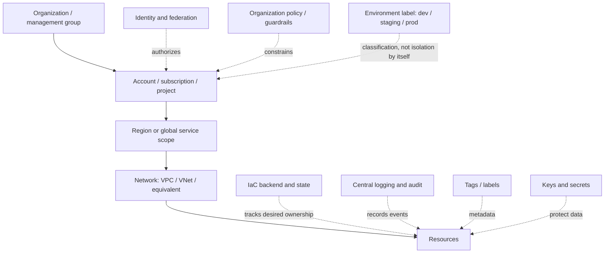
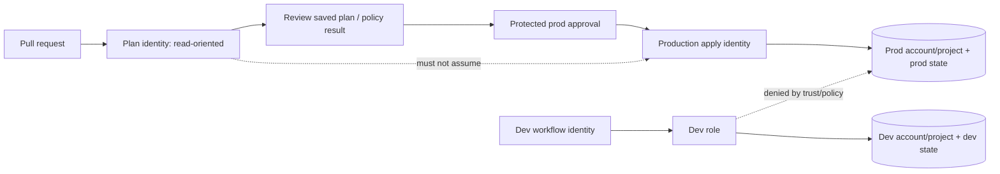

# Unit 5 — Cloud Account and Environment Boundaries

**Target file:** `05-cloud-account-and-environment-boundaries.md`  
**Module:** M07  
**Stage:** 2E — Production DevOps & Platform Engineering  
**Estimated time:** 8–12 hours, including four local labs and review  
**Prerequisites:** Units 1–4 and M02 CI/CD foundations; cloud/IaC basics  
**Core tools:** Git, shell, Python 3, Terraform/OpenTofu concepts, provider-free local fixtures  
**Awareness:** AWS Organizations/SCPs, Azure management groups/Policy, Google Cloud organization/folders/projects/policies, account factory concepts, cloud-side configuration inventory  
**Last reviewed:** 2026-10-28  
**Tool baseline assumed:** Python 3.10+ syntax; shell examples target Bash on Linux/WSL2. No Terraform/OpenTofu binary is required for the labs. Verify exact installed versions before adapting provider-specific examples.  
**Lab substrate:** local-only/provider-free; no paid cloud required

> **Status:** DRAFT-AUDITED. This file contains provider-neutral guidance and local simulations. The linked official pages listed in §5.14 were accessed for the specific claims noted there; every provider-specific behavior still marked `[VERIFY]` requires confirmation against the exact provider, service, account type, and tool version before production use. Only Lab A's checker/tests are intended to be runnable as written; no lab execution is claimed in this document unless separately recorded in the delivery report.

## Contents

- [5.0 Why boundaries matter in production](#50-why-boundaries-matter-in-production)
- [5.1 Learning objectives](#51-learning-objectives)
- [5.2 Concept map and glossary](#52-concept-map-and-glossary)
- [5.3 Level 1 — Beginner](#53-level-1--beginner)
- [5.4 Level 2 — Intermediate](#54-level-2--intermediate)
- [5.5 Level 3 — Advanced](#55-level-3--advanced)
- [5.6 Level 4 — Expert](#56-level-4--expert)
- [5.7 SRE lens](#57-sre-lens)
- [5.8 Security lens](#58-security-lens)
- [5.9 Production checklist](#59-production-checklist)
- [5.10 Hands-on lab set](#510-hands-on-lab-set)
- [5.11 Self-check questions](#511-self-check-questions)
- [5.12 Evidence artifacts](#512-evidence-artifacts)
- [5.13 Common interview and architecture-review questions](#513-common-interview-and-architecture-review-questions)
- [5.14 Sources and verification notes](#514-sources-and-verification-notes)

## 5.0 Why boundaries matter in production

A development pipeline was configured with a production-capable identity and selected the production state path after a workspace/environment mismatch. The pipeline applied a harmless-looking development change to a production resource, causing an outage and requiring incident response. The root problem was not just a typo: the design allowed one routine development workflow to reach production. Separate accounts/projects, state, identities, approval gates, and explicit target assertions make this class of error less likely and reduce its blast radius. None of those controls is sufficient alone; the control set must be layered and tested.

## 5.1 Learning objectives

After completing this unit, the learner can:

1. **[L1]** Explain why environment labels, cloud accounts/projects, regions, networks, IaC state, workspaces, clusters, and namespaces are different concepts.
2. **[L1]** Draw the conceptual hierarchy from organization to resources and explain provider-specific differences.
3. **[L2]** Compare single-account, account-per-environment, workload-per-environment, and shared-services patterns using explicit trade-offs.
4. **[L2]** Design environment-specific state/backend and plan/apply identity boundaries without storing long-lived credentials in source control.
5. **[L2]** Describe OIDC/workload identity federation, cross-account trust, provider aliases, region strategy, and data-classification-driven isolation.
6. **[L3]** Distinguish IAM authorization from organization-level guardrails and design a staged, recoverable guardrail rollout.
7. **[L3]** Specify break-glass, centralized audit logging, key/network boundaries, sandbox cleanup, account vending, and DR handoffs.
8. **[L3]** Build provider-free policy tests that detect obvious cross-environment references while stating what they cannot prove.
9. **[L4]** Produce an account-strategy decision record and migration-wave plan with dependencies, owners, validation, cutover, rollback, and decommissioning gates.
10. **[L4]** Triage the five prescribed boundary incidents using safe checks, containment, recovery ownership, evidence preservation, and prevention actions.

## 5.2 Concept map and glossary

### Concept map

The following is a **conceptual** hierarchy, not a literal resource tree shared by every provider. Organizations, management groups, accounts, subscriptions, projects, regions, and network objects have different meanings and inheritance rules across platforms.



### Glossary

| Term | Precise definition | Common misconception |
|---|---|---|
| Environment | A lifecycle/use classification such as dev, staging, or prod. | A string called `prod` automatically creates isolation. |
| Organization | A provider-level grouping and governance root, with provider-specific semantics. | All providers implement the same hierarchy. |
| Management group | An Azure grouping layer for subscriptions and policy/management inheritance. | It is equivalent to an AWS account. |
| Cloud account | A provider-specific administrative, billing, identity, and resource boundary; exact semantics vary. | An account is a universal security guarantee. |
| Subscription | Azure resource and billing container managed in a tenant and optionally grouped by management groups. | It maps one-to-one to an AWS account in every behavior. |
| Project | A Google Cloud resource container and key organizing/billing/permission scope. | A project is just a folder name. |
| Region | A geographic deployment scope for regional services. | Every cloud resource is regional. |
| Zone | A location within a region, where the service exposes zones. | A zone is a separate account boundary. |
| Network boundary | Segmentation using constructs such as VPC/VNet and routes/firewalls. | Network separation replaces identity controls. |
| IaC state | A mapping between configuration-managed resource addresses and observed real objects. | State is the cloud account or an authorization boundary. |
| Backend | Storage and coordination mechanism for IaC state. | A different state filename guarantees access isolation. |
| CLI workspace | A named state instance associated with a Terraform working directory. | Workspaces provide separate credentials and strong environment isolation. |
| Provider alias | A named provider configuration used to select credentials/region/endpoint settings. | An alias automatically prevents wrong-account deployments. |
| Trust policy | A rule describing which principals or contexts may assume/use an identity, according to provider semantics. | A trust relationship itself grants all target resource permissions. |
| OIDC federation | Exchange of identity-provider proof for short-lived cloud credentials, subject to trust and authorization configuration. | OIDC removes the need to constrain token claims. |
| Organization guardrail | A higher-level constraint/policy that limits allowed configurations or actions, depending on provider semantics. | It replaces resource-level IAM permissions. |
| Permission boundary | A limit on the permissions an identity can exercise, where supported. | It grants permissions by itself. |
| Break-glass | A tightly controlled emergency access path with approval, time limits, monitoring, and post-use review. | A permanent admin account is a break-glass process. |
| Data classification | A documented sensitivity/impact category that informs controls and handling. | A tag alone makes data compliant. |
| Account vending | A governed process for creating and configuring accounts/projects consistently. | It means an unreviewed script that creates empty accounts. |
| Detective control | A control that identifies a violation after or as it occurs. | Detection prevents every violation. |
| Preventive control | A control designed to block an unsafe action before it succeeds. | Preventive controls make monitoring unnecessary. |
| Blast radius | The set and severity of systems/data affected by a failure or compromise. | Separate accounts eliminate all shared dependencies. |
| Landing zone | A governed baseline for identity, networking, logging, policy, billing, and ownership. | A landing zone is only a folder layout. |

### Boundary/control comparison

| Boundary/control | Primary purpose | Strong isolation it provides | What it does not guarantee | Example failure if relied on alone |
|---|---|---|---|---|
| Separate cloud accounts/projects | Split administration, permissions, quotas/cost scopes where supported | A meaningful administrative boundary when identities and policies are correctly separated | No protection from central identity compromise, shared dependencies, or every shared quota | Same CI principal can still write to prod and dev |
| Separate subscriptions / accounts | Resource administration and billing separation, provider-specific | Independent scope for many resource operations | Not semantically identical across clouds; tenant/org admins may still control both | Tenant-wide principal can alter multiple subscriptions |
| Separate region | Geographic placement, latency, resilience | Regional fault isolation for regional services | Global resources and shared identities/control planes may cross regions | A global IAM or DNS mistake impacts multiple regions |
| Separate VPC/VNet | Network segmentation | Network path isolation when routes and policy are correct | Does not prevent authorized API calls or compromised identities | Dev CI modifies prod via cloud API despite network separation |
| Separate state/backend | Reduce state coupling; control read/write access to state | Independent state access when backend IAM and storage policy differ | Does not isolate real resources if same identity can access them | Wrong provider configuration applies to prod from dev state |
| Separate CLI workspace | Multiple state instances in one working directory | State selection separation only | Separate IAM, credentials, backend permissions, policy, or accounts | Operator selects `prod` workspace with dev assumptions |
| Names/tags | Discovery, ownership, cost attribution, automation inputs | Metadata organization | Authorization or hard security boundary | Tag says `environment=dev` but role can modify prod |
| Kubernetes namespace | Logical cluster-level resource grouping and some policy attachment points | Scoped names and selected controls when RBAC/network policies are configured | Separate cluster/control plane or complete isolation by default | Namespace admin reads a secret via overbroad RBAC |
| Organization policy / SCP / Azure Policy | Constrain resource operations/configuration at higher scope, service-specific | Broad guardrails within documented semantics | Not a universal replacement for IAM; exceptions and service gaps exist | Bad deny policy blocks deployment or recovery |
| Central audit account/project | Protect and aggregate evidence | Separation of log administration from workload administration if roles are split | Complete event coverage, immutability, or retention by default | Workload admin can delete logs it controls |

## 5.3 Level 1 — Beginner

### 5.3.1 Why boundaries exist

Boundaries serve six related goals:

- **Blast-radius reduction:** an error or compromised workload should affect fewer environments and datasets.
- **Access control:** developers and automated pipelines receive only the permissions needed for their target environment.
- **Billing and ownership:** costs can be attributed to teams/workloads and owners can be held accountable.
- **Compliance and data handling:** sensitive data may require stronger access, retention, network, and evidence controls.
- **Resilience:** quota exhaustion, destructive operations, or noisy workloads should be less likely to impact critical services.
- **Operational clarity:** each state, identity, alert, and resource set has an accountable owner.

A boundary is only useful if the controls are independent enough to prevent a single mistake from crossing it. For example, three folders named `dev`, `staging`, and `prod` inside one account are organizationally clear but not strong security isolation if the same principal can alter all three.

### 5.3.2 Conceptual hierarchy and provider mapping

| Conceptual layer | AWS mapping | Azure mapping | Google Cloud mapping | Caveat |
|---|---|---|---|---|
| Governance root | AWS Organization / management account | Microsoft Entra tenant and management-group hierarchy | Organization resource | Not equivalent objects; inheritance and administration differ. `[VERIFY]` |
| Grouping | Organizational units (OUs) | Management groups | Folders | Grouping/policy behavior is provider-specific. |
| Main workload container | AWS account | Azure subscription | Google Cloud project | Useful comparison points, not semantic equivalents. |
| Location | Region and Availability Zones | Region and availability zones where supported | Region and zones | Global and zonal resources exist; confirm per service. |
| Network | VPC, subnets, routes, security groups/NACLs | VNet, subnets, routes, NSGs | VPC networks, subnets, firewall rules | Network models and global/regional semantics differ. |
| Identity | IAM roles/policies, STS federation/assumption | Entra identities, Azure RBAC, workload federation | IAM principals/service accounts, Workload Identity Federation | Exact token claims and trust setup require current docs. `[VERIFY]` |
| Org-level guardrail | Service Control Policies and other Organizations policy types | Azure Policy and management-group scope | Organization Policy and hierarchy-based IAM controls | Different evaluation models and exceptions. `[VERIFY]` |
| Audit/config inventory | CloudTrail and AWS Config | Azure Activity Log, Azure Policy compliance, Resource Graph | Cloud Audit Logs and Cloud Asset Inventory | Coverage, retention, and configuration recording differ. `[VERIFY]` |
| Cost metadata | Cost allocation tags and budgets | Tags, Cost Management budgets/alerts | Labels, budgets/alerts | Metadata is not authorization; alerts are not necessarily hard caps. |
| IaC state | Terraform/OpenTofu backend external to AWS account model | External to subscription model | External to project model | Backend access itself needs authorization, encryption, and recovery. |

### 5.3.3 Environment labels versus real boundaries

`dev`, `staging`, and `prod` are useful classifications. They become enforceable only when mapped to controls such as distinct accounts/projects, state storage, roles, approval rules, network policies, keys, and logging. A label is an input to policy, not proof that policy ran correctly.

- **Cloud account/project/subscription:** an administrative scope with provider-specific identity, resource, and billing behavior.
- **Region:** location scope; global resources may not obey regional assumptions.
- **VPC/VNet:** network boundary; does not stop all cloud control-plane/API access.
- **Backend/state:** IaC ownership and coordination; can contain sensitive data.
- **Workspace:** state selection; not a substitute for independent credentials and permissions.
- **Cluster/namespace:** Kubernetes control-plane and logical grouping; namespace isolation depends on RBAC, admission, network, secret, and node controls.

### 5.3.4 Shared responsibility

The cloud provider secures parts of the underlying infrastructure and service, while the customer remains responsible for configuration, identities, data access, network rules, workload security, and appropriate evidence/retention. The division changes by service model and service configuration. Never assume “managed” means “secure by default for this workload.”

## 5.4 Level 2 — Intermediate

### 5.4.1 Strategy spectrum

| Strategy | Benefits | Costs/risks | Appropriate when |
|---|---|---|---|
| 1. One account/project with prefixes | Lowest initial overhead; simple shared services | Weak isolation; shared quotas, permissions, and operational blast radius; naming mistakes are easy | Small non-sensitive experiments with tightly scoped identity and explicit exit criteria |
| 2. Account/project per environment | Clear environment boundary; independent identity and state policies; easier cost attribution | More duplicated setup, networking, and governance; account vending required | Common baseline for teams with production workloads and meaningful separation needs |
| 3. Workload per environment | Stronger workload-level isolation and ownership; better independent quota/cost boundaries where supported | More accounts/projects and policy operations; cross-service integrations become more complex | High-criticality, regulated, or independently owned workloads |
| 4. Dedicated security/logging/shared/network/sandbox boundaries | Separates evidence and central services from workload admins; controlled shared connectivity | Requires platform team, role design, central service ownership, and failure-mode planning | Organizations with multiple teams, compliance needs, or significant production criticality |

Do not choose an account count from a generic rule. Select the smallest model that meets explicit isolation, compliance, cost attribution, operational ownership, quota, and recovery requirements.

### 5.4.2 Landing-zone layout example

Fictional company `Northstar Data` operates an analytics platform. Production includes sensitive customer data; dev uses synthetic or de-identified datasets; staging uses controlled test data. A possible conceptual layout is:

```text
Organization
├── Security and Audit
│   └── central log storage, security monitoring, key administration
├── Shared Services
│   └── artifact registry, approved network services, CI federation configuration
├── Nonproduction
│   ├── analytics-dev
│   └── analytics-staging
├── Production
│   └── analytics-prod
└── Sandbox
    └── short-lived experiments with constrained permissions and cleanup
```

This is a design illustration, not a mandated provider hierarchy. The security/logging area must have separate write, read, retention, and administration roles. Shared services should not become a single uncontrolled path into every environment.

### 5.4.3 Naming and tags

Example naming convention: `<org>-<workload>-<environment>-<region>-<purpose>`, subject to each provider's character rules and global-name requirements.

| Metadata key | Example | Intended use | Security warning |
|---|---|---|---|
| `environment` | `prod` | filtering, policy input, deployment checks | A mutable tag is not an access boundary |
| `owner` | `data-platform` | escalation and lifecycle ownership | Must point to a maintained group/contact |
| `cost-center` | `CC-042` | showback/chargeback | Missing or wrong tag can distort reporting |
| `data-classification` | `restricted` | handling controls and reviews | Tag must be backed by enforcement and inventory |
| `managed-by` | `terraform` | identify automation ownership | Does not prove the resource is actually in state |

Define required keys, allowed values, inheritance/defaulting behavior where supported, and remediation for untagged resources. Do not put secrets or personal data in tags.

### 5.4.4 State/backend separation

Recommended baseline: separate state access and state objects per environment, with backend permissions constrained to that environment and a separate recovery/admin path. Keep state locking where the selected backend supports it, encrypt state at rest/in transit, restrict read access, audit access, and test recovery.

A different directory or state key alone is not enough if every pipeline identity can read and write every backend. A separate state is also not a substitute for cloud resource permissions. Never allow two independent states to manage the same real object concurrently. State migration/import details belong to Unit 3; backend locking and recovery belong to Unit 1.

### 5.4.5 Environment-specific identities and OIDC

Use a separate role/service principal/workload identity for each environment and workload class. A development pipeline should not be able to assume the production apply identity. Prefer short-lived credentials obtained through OIDC/workload identity federation over long-lived access keys when the CI platform and provider support a suitable integration. Trust conditions should bind to the expected repository, organization/tenant, branch or protected environment, workflow identity, audience, and other relevant token claims. Exact claim names and provider syntax are `[VERIFY]`.



Plan permissions should be read-oriented where feasible, but planning may need read access and state access that vary by provider/resource. Apply requires narrowly scoped write permissions. State backend permissions are separate from resource permissions. Do not assume a read-only plan role is trivial to implement for every provider: test it against the resources and data sources actually used.

### 5.4.6 Provider aliases and role assumption

The general pattern is to make target selection explicit, keep each provider configuration associated with a declared environment, and assert the resolved account/project/tenant and region before any state-changing action. Provider aliases can represent multiple configurations in one root module, but they do not independently enforce a boundary. Exact provider blocks, alias propagation, role assumption arguments, and identity-chain behavior are `[VERIFY]` against the selected Terraform/OpenTofu and provider versions.

Illustrative pseudocode only:

```hcl
# [ILLUSTRATIVE] provider configuration; do not copy into a live root module
# Replace placeholders only after verifying the exact provider schema/version.
provider "example" {
  alias       = "development"
  region      = var.development_region
  environment = "dev" # conceptual field; not a generic provider argument
}
```

The block above is intentionally not a valid cloud provider configuration; `example` and `environment` illustrate intent, not supported syntax. A real AWS `assume_role` example must be checked against the exact AWS provider version and the current AWS IAM/STS docs before use. Keep provider aliases explicit in module calls and test that no production resource is accidentally bound to a development alias.

### 5.4.7 Region strategy

Choose regions based on service availability, latency, data-residency requirements, recovery objectives, connectivity, quota capacity, and operational maturity. Inventory regional, zonal, and global resources separately. A global identity, DNS, registry, or policy surface can affect resources in multiple regions. Verify the scope for each service rather than assuming a region argument applies to everything.

### 5.4.8 Cross-account trust

A cross-account flow typically has two distinct decisions: (1) is the source principal allowed to obtain/use the target identity under the trust rules, and (2) what actions may the resulting target identity perform? A successful role assumption does not mean every resource action is authorized. Restrict trusted principals, constrain token/session context where supported, use short sessions appropriate to the deployment, audit assumption events, and prevent development identities from reaching production identities.

### 5.4.9 Environment parity and data classification

Promote the same reviewed code and module version through dev → staging → prod. Keep intended differences in reviewed variables and per-environment configuration, not ad hoc edits. Isolate state and identities, test policy in each stage, and document intentional differences. For PII, regulated, or high-impact datasets, apply data-classification-driven controls across identity, network, key management, logging, backup, retention, and operator access. An account boundary is one layer of the control system, not a complete compliance program.

## 5.5 Level 3 — Advanced

### 5.5.1 Organization guardrails versus IAM

IAM generally answers who may perform which action on which resource under its evaluation model. Organization-level controls add constraints at a broader scope. They are not interchangeable and their exact behavior differs:

- **AWS Organizations SCPs — Awareness:** AWS documents SCPs as setting maximum available permissions for IAM principals in member accounts; they do not grant permissions, and their applicability has important scope/exception rules, including the management account. See the official SCP documentation linked in §5.14. Verify current semantics before changing a production policy.
- **Azure Policy — Awareness:** Azure Policy evaluates resources against policy definitions/initiatives and can audit or deny selected configurations depending on effect and scope. It is not simply a replacement for Azure RBAC. Exact effects, exemptions, remediation, and evaluation timing are `[VERIFY]` against Microsoft Learn.
- **Google Cloud Organization Policy — Awareness:** Organization policies constrain selected resource configurations through the Google Cloud resource hierarchy. They are distinct from IAM allow/deny authorization policy. Constraint types, inheritance, exceptions, and enforcement behavior must be verified for each constraint.

No real organization-level policy lab is required. The local labs below test synthetic rules only; they do not prove that SCPs, Azure Policy, Organization Policy, or cloud IAM enforce anything.

### 5.5.2 Safe guardrail rollout

Use this progression where the service supports the relevant modes:

1. **Discover:** inventory current resources, principals, exceptions, and dependencies.
2. **Draft:** define policy intent, scope, owner, exception process, and recovery path.
3. **Evaluate:** run static tests and provider-supported audit/monitor/dry-run mode; record false positives.
4. **Pilot:** apply to a nonproduction scope with a named owner and rollback plan.
5. **Enforce gradually:** expand by workload group or account wave; monitor denied actions and operational signals.
6. **Prove recovery:** verify a break-glass/recovery route still works without silently bypassing the guardrail.
7. **Review exceptions:** each exception needs owner, reason, compensating controls, expiry, and renewal approval.

A policy can block the deployment identity, state recovery, logging, or incident response. Never make a broad deny change without understanding inheritance, exception behavior, and a safe rollback path. The person who authors a guardrail should not be the only person who can approve and recover it.

### 5.5.3 Pipeline permission design

| Principal | Typical allowed scope | Explicitly avoid |
|---|---|---|
| Plan identity | Read target metadata and state needed to produce a plan; access only its environment backend | Production write permission for nonproduction workflows; broad organization admin |
| Apply identity | Write only to the intended environment/workload and required backend; short-lived federation | Reusable across dev and prod without strong trust and policy conditions |
| State recovery identity | Narrow, audited state backup/restore operations | Routine deployment use or unlogged broad data access |
| Security/logging administrator | Manage audit configuration and retention under separation-of-duties rules | Workload deploy role that can delete its own evidence |
| Break-glass identity | Emergency recovery scope with approval and alerting | Permanent daily use, shared secrets, no expiry |

Do not use `*:*` or provider-wide administrator permissions as the default design. Some bootstrap operations may temporarily require broader rights; document why, scope it, time-box it, monitor it, and remove it after baseline setup.

### 5.5.4 Central logging and audit

Centralized audit storage should be administered separately from workload deployment identities. Separate log ingestion/write permissions from retention, delete, and administrative permissions. Configure coverage and retention to meet the intended objective; verify which events each service records, where they are stored, whether delivery can be delayed, and which principal can alter the configuration. “Central logging enabled” is not evidence that all relevant events are captured or immutable.

### 5.5.5 Network, secrets, keys, and sandbox controls

- **Network:** use VPC/VNet separation, routing boundaries, firewalls/security groups, private endpoints, and controlled transit where appropriate. Validate both ingress and egress paths. Network separation complements identity separation; cloud APIs may be reachable independently of workload data-plane networks.
- **Secrets and KMS keys:** use environment-appropriate keys and access policies. Separate key administration from routine data use where warranted. A key policy and an identity policy have different roles and provider semantics; test effective access. Never put secrets in tags, user data, source code, or unprotected state.
- **Sandbox:** isolate experiments, restrict allowed services/regions and identity scopes, attach ownership/expiry metadata, and automate cleanup with a dry-run/review step. Budget alerts are generally notifications, not guaranteed hard spending caps; confirm exact provider behavior.
- **Quota:** know the scope of each quota (account/project, region, service, organization, or shared dependency). Separate accounts may not isolate every regional or service quota. Alert on headroom and have a documented quota-increase/mitigation owner.
- **Account vending:** create accounts/projects through approved templates that establish identity, logging, network, policy, billing, metadata, and ownership. Verify drift after creation and maintain the template version. This concept hands off to M16 platform engineering.
- **DR:** decide which boundaries are regional, account-level, identity-level, and central-service dependencies. Backup and restore across account boundaries must preserve access, keys, evidence, and tested recovery permissions. See M13 backup/DR and M14 networking.

### 5.5.6 Detective versus preventive controls

| Control | Class | Example | Limitation |
|---|---|---|---|
| CI policy test that rejects `prod` referencing a `dev` identifier | Preventive for the checked pattern | Unit test before merge | Can miss aliases, generated names, indirection, or cloud-side changes |
| Cloud organization guardrail | Preventive or constraining, depending on semantics | Disallow selected risky resource configurations | Coverage, exceptions, and provider-specific evaluation vary |
| Cloud configuration inventory/compliance service | Detective | Report resource settings that violate baseline | Detection latency and coverage are service-specific; may not prevent deployment |
| Audit log alert | Detective | Alert on unusual role assumption or policy edit | Needs event coverage, alert ownership, and response runbook |
| Tag compliance report | Detective | Find missing owner/data classification tags | Tags are mutable metadata and not authorization |

Provider services commonly used for inventory/compliance include AWS Config, Azure Policy compliance/Resource Graph, and Google Cloud Asset Inventory. These names and capabilities were checked at a high level only where cited; exact service scope, feature availability, region coverage, and pricing are `[VERIFY]` for the intended environment. Do not assume a recorder or inventory API covers every resource type.

### 5.5.7 Local simulation and its fidelity boundary

The local labs use directory layout, synthetic JSON, and Python policy checks. They can prove that the checker rejects the fixtures it was written to reject. They cannot prove real cloud IAM, SCP/organization policy, Azure Policy, quota enforcement, network isolation, event delivery, billing, or eventual consistency. LocalStack is not required; no claim about multi-account emulation is made. If a future optional LocalStack extension is added, verify exact service and feature support and document the gap to real cloud.

## 5.6 Level 4 — Expert

### 5.6.1 Account-strategy decision matrix

Use qualitative scoring (`Low`, `Medium`, `High`) relative to the organization rather than pretending there is a universal numeric threshold.

| Decision factor | Single account + prefixes | Account/project per environment | Workload per environment + shared security/logging boundaries |
|---|---|---|---|
| Team size / ownership diversity | Low overhead; ownership collisions grow with teams | Moderate operational model; clear environment owners | Highest governance overhead, best fit for many independent teams |
| Sensitive/regulated data | Weakest separation; needs compensating controls | Better environment separation; workload controls still required | Stronger separation options and clearer separation of duties |
| Blast-radius tolerance | Suitable only where impact is low and tightly bounded | Better for production-critical services | Strong fit for high-impact workloads with mature platform support |
| Cost allocation | Tags/prefixes carry more burden | Environment-level allocation is clearer | More granular allocation, but shared-service allocation must be designed |
| Shared-service needs | Easy to share, risk of coupling | Requires explicit cross-account services | Dedicated shared-services/network/security model; complexity increases |
| Quota needs | Shared capacity risk | Better separation for account/project-scoped quotas only | More options for workload-specific quota scopes; shared service limits remain |
| Operational capacity | Lowest setup effort | Requires account vending and identity/state automation | Requires mature platform engineering, inventory, and on-call ownership |
| Network/DR complexity | Low initially, high blast radius | Cross-environment connectivity must be controlled | Explicit shared network/DR design; more failure modes to operate |
| Default recommendation | Temporary/simple low-risk workloads only | Practical baseline for many production systems | Use when sensitivity, criticality, or independent ownership justifies cost |

### 5.6.2 Migration from single-account sprawl

Do not begin by moving resources. First create a trustworthy inventory and define the destination boundary model.

1. **Inventory:** resource IDs, owners, dependencies, data classification, identities, trust paths, routes, quotas, regions, cost centers, tags, logging coverage, state addresses, and recovery dependencies.
2. **Define target:** account/project strategy, landing-zone controls, environment mapping, exceptions, ownership, and target identity matrix.
3. **Build baseline:** provision destination accounts/projects through the approved process; establish policy, logging, keys, network, billing, and monitoring.
4. **Establish IaC:** create per-environment backends/state, lock/recovery access, CI federation, plan/apply roles, and target assertions.
5. **Choose migration method:** rebuild where safe/repeatable; import existing resources where supported and appropriate; migrate state when resource identity and ownership can be preserved; separately plan data migration for stateful services.
6. **Order dependencies:** identity and network foundations before dependent workloads; keys/secrets and data paths before cutover; DNS/traffic switch only after health and consistency checks.
7. **Validate:** service behavior, data integrity/consistency, permissions, security policy, logs, alerts, cost ownership, backups, DR, and rollback rehearsal.
8. **Cut over:** use a named change owner, freeze window if needed, explicit go/no-go gates, and a bounded rollback window.
9. **Observe:** monitor error rate, latency, data freshness, permission denials, quota headroom, and spend. Compare to the pre-migration baseline.
10. **Decommission:** verify no dependencies, export required evidence, remove obsolete trust/routes/secrets, back up/retire state correctly, and delete old resources only through a reviewed plan.

**Avoid dual ownership:** never let two active states manage the same object. A migration runbook must specify which state is authoritative at each step, who locks changes, how import/state move is verified, and how to recover from partial failure. State migration is not the same as data migration or resource recreation. See Unit 3 for detailed state migration/import/drift behavior.

### 5.6.3 Five incident runbooks

All runbooks use `symptom → hypotheses → safe checks → root cause → containment → recovery → prevention → evidence`. Do not make unreviewed emergency changes; preserve logs and record who authorized each action.

#### Incident A — Dev pipeline can write to production

- **Symptom:** unexpected production write from a development workflow or a policy test shows a dev principal with prod scope.
- **Hypotheses:** shared static key; permissive federation claims; broad trust relationship; role chaining; reused apply identity; policy exception; wrong account ID in configuration.
- **Safe checks:** inspect CI run identity and token claims without printing secrets; inspect role-assumption/audit events; compare the principal to the approved identity matrix; verify target account/project ID and state backend; review trust-policy changes.
- **Root-cause candidates:** dev and prod share an identity, trust conditions are too broad, or the production apply role is exposed to unprotected branches.
- **Containment:** security incident commander pauses affected workflows; revoke or narrow the compromised credential/trust path using the approved emergency procedure; protect production state and logs; avoid disabling the only recovery principal.
- **Recovery owner:** cloud IAM/security owner plus production service owner; platform on-call coordinates CI changes.
- **Recovery:** validate remaining authorized deploy path in a safe test, restore narrowly scoped trust, run a reviewed plan, and apply only with change approval.
- **Prevention/evidence:** short-lived OIDC with repository/environment claims, separate roles, target assertions, access reviews, audit events, CI run ID, plan digest, approval record, and post-incident action items.

#### Incident B — Shared account quota exhaustion starves production

- **Symptom:** production provisioning or scale-out fails after a nonproduction job consumes a shared quota.
- **Hypotheses:** quota scope is broader than assumed; autoscaling surge; leaked loop; sandbox cleanup failed; multiple workloads share a regional service limit.
- **Safe checks:** inspect service quota metrics/errors and recent changes; identify resource owners and creation timestamps; verify actual quota scope from official docs; compare capacity with expected workload peaks.
- **Root cause:** a dev workload and production depend on a shared quota or shared service capacity.
- **Containment:** stop the runaway producer, pause nonessential jobs, scale down only after impact review, and use a preapproved quota-increase route if available. Do not delete unknown resources blindly.
- **Recovery owner:** service capacity owner with production SRE and workload owner.
- **Recovery:** restore production capacity, validate service SLOs and queues/backlogs, and confirm the offending workload is bounded.
- **Prevention/evidence:** quota inventory by scope, headroom alerts, load testing, per-environment separation where it changes the relevant quota scope, cleanup reports, error timeline, and capacity review.

#### Incident C — Wrong profile/account applies staging configuration to production

- **Symptom:** plan/apply output names the wrong account, project, subscription, region, workspace, or backend.
- **Hypotheses:** stale shell profile; wrong provider alias; inherited environment variable; backend key mismatch; workflow input tampering; account ID copied from staging.
- **Safe checks:** stop before apply if possible; inspect current directory, executable/version, selected workspace, backend metadata, non-secret identity metadata, provider alias wiring, and planned resource addresses. Use read-only identity inspection commands only after verifying their syntax for the provider.
- **Root cause:** target selection is implicit or not asserted against the approved environment.
- **Containment:** cancel deployment, freeze subsequent applies for affected stack, preserve plan/log evidence, and determine whether any mutation occurred from audit events.
- **Recovery owner:** deployment approver and environment owner, with incident commander if production changed.
- **Recovery:** if no change occurred, correct target configuration and generate a new plan; if a change occurred, assess impact and apply a separately reviewed corrective plan. Never assume rerunning the prior plan is safe.
- **Prevention/evidence:** immutable environment-to-account mapping, account/project assertions, protected production environment, explicit backend and provider configuration, saved-plan review, and incident record with run ID and target metadata.

#### Incident D — Organization policy change locks out the pipeline role

- **Symptom:** previously valid deployment or recovery operations start receiving authorization/constraint failures after a guardrail change.
- **Hypotheses:** deny policy too broad; inheritance misunderstood; service action missing; wrong scope; exception expired; recovery role also affected.
- **Safe checks:** identify the exact failing action and policy evaluation evidence; inspect policy diff, scope, inheritance, exceptions, and deployment timeline; verify the provider's current evaluation semantics. Avoid broadening permissions blindly.
- **Root cause:** rollout lacked staged evaluation or a tested recovery path.
- **Containment:** pause further rollout, preserve policy version and audit logs, and invoke the preapproved break-glass/rollback procedure with a second approver.
- **Recovery owner:** policy owner and cloud security lead; platform owner verifies deployment restoration.
- **Recovery:** revert or narrow only the offending policy scope through a reviewed change, validate recovery/deployment roles, then resume rollout in audit mode/pilot.
- **Prevention/evidence:** staged rollout, policy tests, exception expiry, independent recovery role, pre-change simulation, approvals, and documented scope/impact analysis.

#### Incident E — Production state bucket readable by a development role

- **Symptom:** access review or audit event shows a development identity can read production IaC state.
- **Hypotheses:** shared backend policy; wildcard object permissions; inherited role; broad cross-account trust; copied credentials; public or misconfigured storage ACL.
- **Safe checks:** preserve audit logs; inspect effective storage and key permissions; determine whether access occurred; treat state as potentially containing secrets; do not download state into a general-purpose workstation.
- **Root cause:** backend permissions were shared or not scoped to environment, or encryption-key access was broader than expected.
- **Containment:** revoke unauthorized access through approved change control, rotate affected secrets if exposure is plausible, preserve state backups/evidence, and verify authorized recovery access remains available.
- **Recovery owner:** state/backend owner and security incident lead; application owners rotate exposed credentials as required.
- **Recovery:** validate environment-specific backend policy, key access, locking, and recovery procedure using a controlled test; inspect state access logs and assess downstream secret exposure.
- **Prevention/evidence:** separate backend paths/roles, least-privilege object access, key policy review, state access logging, secret minimization, and periodic cross-environment access tests.

### 5.6.4 Compliance mapping as an evidence model

This is educational, not legal advice and not a claim of certification.

| Control objective | Boundary mechanism | Policy/configuration | Evidence artifact | Owner | Review frequency |
|---|---|---|---|---|---|
| Only production operators can deploy production | Separate prod identity and protected approval | Trust policy, RBAC/IAM, CI environment rules | Role matrix, workflow config, audit events | Platform + security | Each release and quarterly access review |
| Production state is confidential | Separate backend permissions and key access | Storage IAM, encryption/key policy, logging | Access review, storage policy, restore test | IaC platform owner | Quarterly and after backend change |
| Sensitive data stays in approved locations | Data classification plus location controls | Provider-specific policy and service configuration | Inventory report, policy compliance, exception register | Data owner + security | Per change and scheduled review |
| Audit evidence is protected | Central logging boundary and separated administration | Log destination, retention, write/delete roles | Configuration export, access logs, retention test | Security operations | Monthly and after logging changes |
| Exceptions do not become permanent | Expiry-bound exception process | Policy exception metadata and review workflow | Exception register, expiry report | Control owner | Monthly |

## 5.7 SRE lens

Environment separation is a reliability control because it limits accidental coupling and clarifies ownership. It does not remove shared regional service limits, central identity, network transit, DNS, artifact registries, or deployment control-plane dependencies. Model these shared dependencies explicitly.

### Boundary indicators

Define each metric locally and use it to drive an action. Targets should come from business impact and observed baseline; there is no universal SLO for these metrics.

| Indicator | Numerator / denominator or formula | Collection source | Owner / response |
|---|---|---|---|
| Wrong-target deployment rate | Deployments with target mismatch ÷ all deployments in period | CI assertions, deployment metadata, incident records | Platform SRE; block release and investigate every confirmed mismatch |
| Cross-environment access violations | Count of confirmed unauthorized cross-environment access events | Cloud audit logs, backend access logs, identity alerts | Security on-call; incident process |
| Boundary-policy violation rate | Violations found ÷ evaluated resources or policy checks | CI policy tests and cloud compliance inventory; report each denominator separately | Policy owner; remediate and track exception age |
| Quota-related incidents | Count of incidents with quota/service-limit as a causal factor | Incident system, service errors, quota dashboards | Capacity owner; revise headroom and workload placement |
| Migration failure rate | Failed migration waves ÷ attempted migration waves | Change records and migration checklist | Migration lead; pause next wave and perform review |
| Time to detect boundary violation | Detection timestamp − first known violation timestamp | Audit event and alert timeline | Security operations; improve signal coverage |
| Time to contain violation | Containment timestamp − detection timestamp | Incident timeline | Incident commander; review playbook and authority |
| Break-glass frequency | Break-glass sessions per period, segmented by reason | Identity logs and access workflow | Security lead; investigate unexpected trend, not automatically punish valid use |
| Stale exceptions | Open exceptions past expiry ÷ all open exceptions | Exception register/policy platform | Control owner; expire/revoke or reapprove with evidence |
| Ownership/tag coverage | In-scope resources with valid owner/classification ÷ all in-scope resources | Cloud inventory and tag/label query | FinOps/platform owner; route unknown ownership to remediation queue |

Use both counts and rates. Small denominators can make a rate misleading, so show counts and period alongside percentages. Keep a known source-of-truth for deployments, inventory, incidents, and exceptions; do not combine incompatible denominators.

### Runbook pattern

1. **Detect:** alert, CI assertion, access log, policy violation, or quota failure.
2. **Classify:** security breach, availability risk, cost/quota issue, or configuration defect; assign severity by impact.
3. **Contain:** stop the offending workflow or narrow access without destroying evidence or blocking all recovery.
4. **Restore:** use reviewed changes and known-good configuration; verify health and data consistency.
5. **Validate:** confirm target identity, state ownership, SLOs, audit logging, and remaining access paths.
6. **Learn:** document cause, controls that failed, owner, due date, and evidence that remediation works.

Escalation should name a primary on-call, cloud/IAM owner, state/backend owner, workload owner, security incident lead, and executive/customer communication role where impact warrants. Post-incident actions need owners and due dates, not only narrative conclusions.

## 5.8 Security lens

### Required layered controls

- **Identity separation:** distinct workload identities by environment and workload; constrained OIDC trust claims; short-lived credentials; separate plan and apply permissions.
- **State/backend:** environment-specific access policy, encryption, locking where supported, recovery tests, audit logs, and least-privilege state readers. State and plan files may expose secrets; do not commit or broadly distribute them.
- **Key/secret controls:** distinguish key administration from data use; scope secret access to the workload; review rotation and recovery procedures.
- **Network segmentation:** restrict routes and private access where needed, but do not treat network separation as a replacement for cloud API authorization.
- **Organization guardrails:** test in audit/monitor modes where supported, stage enforcement, document exceptions, and keep recovery paths independently reviewable.
- **Wrong-target prevention:** assert the intended account/project/subscription, region, provider alias/profile, workspace, backend/state path, and environment before state-changing commands; require protected production approval and inspect the plan.
- **Break-glass:** restricted membership, explicit approval, time-boxing, session logging, alerting, expiry/revocation, and post-use reconciliation.
- **Separation of duties:** workload operators should not silently control the only audit destination or the only identity capable of restoring access.

### Threats and defenses

| Threat | Failure mechanism | Primary defenses | Residual risk / detection |
|---|---|---|---|
| Compromised CI runner | Attacker steals token or executes authorized pipeline actions | Short-lived federated credentials, claim constraints, environment approval, isolated runners, scoped roles | Alert on unusual identity use; rotate/revoke trust; preserve runner and audit evidence |
| Overbroad dev credentials | Dev can write prod or read prod state | Separate identities, trust restrictions, backend permissions, policy tests | Central admin/identity compromise can still cross boundaries |
| Malicious policy change | New guardrail weakens controls or locks out deployment | Protected policy repo, peer review, staged enforcement, audit events, tested break-glass | Emergency process itself can be abused; monitor and review |
| State leakage | State/plan contains secrets or resource metadata | Restricted backend/artifact access, encryption, retention, secret minimization | Assume exposure is real until evidence says otherwise; rotate affected secrets |
| Misconfigured central logging | Workload admins can delete evidence or events are missing | Separate logging administration, delivery monitoring, retention checks | Service coverage and delivery lag vary; test end-to-end evidence |
| Over-permissive cross-account trust | Unintended source principal assumes target identity | Narrow principal and claims, session context, least privilege, access analyzer/review where available | Provider-specific evaluation details must be verified |
| Wrong provider alias/profile/region | Plan targets the wrong scope | Explicit configuration, preflight assertions, protected environment, reviewed plan | A compromised CI control plane can bypass checks; cloud-side guardrails remain useful |
| Tag/name manipulation | Attacker changes metadata to appear compliant | Authorization/policy on actual identity and resource fields; inventory validation | Metadata can be missing or stale; treat as an indicator, not proof |

### Scope handoffs

- **M02 CI/CD foundations:** protected branches, identity claims, approvals, plan artifacts, and pipeline hardening.
- **Unit 1 — state/backends/locking/recovery:** backend security, locks, backups, recovery drills, and state access.
- **Unit 4 — safe plans/change approval:** plan review, saved-plan integrity, target assertions, and apply approval.
- **Unit 6 — policy-as-code:** executable preventive rules, policy tests, and exception handling.
- **M09 identity/secrets:** federation, secrets lifecycle, key/identity implementation details.
- **M13 backup/DR:** recovery objectives and tested restoration.
- **M14 networking:** routes, private endpoints, network segmentation, and cross-environment connectivity.
- **M16 platform engineering/account vending:** account/project creation, approved baselines, ownership metadata, and lifecycle automation.

## 5.9 Production checklist

Use this as a release gate. A checked box means there is inspectable evidence, not merely a verbal assertion.

- [ ] Organization/tenant hierarchy and policy inheritance are documented and verified for the selected provider.
- [ ] Each account/subscription/project has a named business owner, technical owner, billing owner, and escalation route.
- [ ] Workloads and datasets have a documented classification and approved location/handling rules.
- [ ] Environment boundaries are explicit; production does not rely only on prefixes, tags, workspaces, or namespaces.
- [ ] State/backend objects and permissions are separated by environment; access and recovery have been tested.
- [ ] Plan and apply identities are distinct where feasible; dev identity cannot assume production apply identity.
- [ ] OIDC/workload federation trust claims are constrained and verified against actual CI tokens.
- [ ] Provider alias/profile, account/project/subscription, region, workspace, and backend assertions run before changes.
- [ ] Network paths, private access, and shared transit dependencies are documented and tested.
- [ ] Key/secret policies separate administration and data use where appropriate.
- [ ] Central audit logs cover relevant identity, policy, resource, and state-access events; retention and deletion roles are reviewed.
- [ ] Quota scopes and headroom alerts are documented; shared regional/service limits are accounted for.
- [ ] Organization guardrails have a staged rollout, exception expiry, and recovery/rollback procedure.
- [ ] Break-glass access is approved, time-limited, logged, alerted, revoked, and reviewed after use.
- [ ] Sandbox budgets/alerts and automated cleanup exist; nobody assumes an alert is a hard cap without verification.
- [ ] Required tags/labels are checked for completeness and validity; no secrets are stored in metadata.
- [ ] Migration dependencies, data consistency, DNS/network cutover, rollback window, and decommission gates are recorded.
- [ ] Preventive and detective controls have owners, runbooks, and measurable indicators.
- [ ] Evidence artifacts are sanitized; no real credentials, unredacted state, or secret-bearing plan files are committed.
- [ ] Cross-unit references and implementation-specific `[VERIFY]` items have been resolved for the actual tool/provider versions.

## 5.10 Hands-on lab set

These are **recommended local-only labs derived from the roadmap themes**, not a claim that the authoritative syllabus enumerates them as named mandatory labs. They use synthetic fixtures and do not prove real cloud isolation.

| Lab | Objective | Substrate | Touches real cloud | Evidence | Cleanup verification |
|---|---|---|---|---|---|
| A — Environment boundary policy tests | Reject cross-environment identifiers, wrong state path, missing metadata, and missing target assertion | Python + JSON files | no | test output, policy report | remove only lab-owned temporary directory after path assertion |
| B — Separate state and least-privilege simulation | Show distinct local state directories and plan/apply role matrix | Python + local JSON state markers | no | role-matrix report, state directory listing | script verifies lab root before deleting generated state markers |
| C — Strategy decision exercise | Compare at least three account strategies and produce a migration sequence | Markdown worksheet | no | completed decision record and assumptions | no resources created; retain or remove worksheet manually |
| D — Cross-account trust and wrong-target tabletop | Validate synthetic source/target/trust combinations and produce incident record | Python + synthetic JSON | no | test output and incident record | script path guard before removal of generated output |

### Lab A — Environment boundary policy tests

**Goal:** build a provider-free checker that rejects four classes of unsafe configuration.  
**Prerequisites:** Python 3.10+ and a shell.  
**Touches real cloud: no.** No credentials, cloud SDK, Terraform, Docker, or network access is required.

#### File tree

```text
lab-a-boundary-policy/
├── setup.sh
├── checker.py
├── test_checker.py
├── fixtures/
│   ├── good.json
│   ├── prod_references_dev.json
│   ├── dev_uses_prod_state.json
│   ├── missing_metadata.json
│   └── missing_assertion.json
└── evidence/
    └── (generated reports go here)
```

Create the directory and files exactly as below.

```bash
# file: lab-a-boundary-policy/setup.sh
set -eu
mkdir -p lab-a-boundary-policy/fixtures lab-a-boundary-policy/evidence
cd lab-a-boundary-policy
python3 --version
```

`checker.py`:

```python
# file: lab-a-boundary-policy/checker.py
"""Synthetic environment-boundary policy checker; not cloud IAM enforcement."""
import json
import sys
from pathlib import Path

ENVIRONMENTS = {"dev", "staging", "prod"}
REQUIRED_METADATA = {"environment", "owner", "cost-center", "data-classification", "managed-by"}

class InvalidInput(Exception):
    pass


def load(path: Path) -> dict:
    try:
        data = json.loads(path.read_text(encoding="utf-8"))
    except (OSError, json.JSONDecodeError) as exc:
        raise InvalidInput(f"cannot read valid JSON: {exc}") from exc
    if not isinstance(data, dict):
        raise InvalidInput("top-level JSON value must be an object")
    return data


def check(data: dict) -> list[str]:
    errors = []
    env = data.get("environment")
    if not isinstance(env, str) or env not in ENVIRONMENTS:
        raise InvalidInput("environment must be one of dev, staging, prod")
    metadata = data.get("metadata")
    if not isinstance(metadata, dict):
        raise InvalidInput("metadata must be an object")
    missing = sorted(REQUIRED_METADATA - set(metadata))
    if missing:
        errors.append("missing metadata keys: " + ", ".join(missing))
    for key in REQUIRED_METADATA & set(metadata):
        if not isinstance(metadata[key], str) or not metadata[key].strip():
            errors.append(f"metadata {key!r} must be a non-empty string")
    if metadata.get("environment") != env:
        errors.append("metadata environment does not match top-level environment")

    state_path = data.get("state_path")
    if not isinstance(state_path, str) or not state_path.strip():
        raise InvalidInput("state_path must be a non-empty string")
    state_parts = [part.lower() for part in state_path.replace("\\", "/").split("/")]
    if env == "dev" and "prod" in state_parts:
        errors.append("dev configuration selects a production state path")
    if env == "prod" and "dev" in state_parts:
        errors.append("prod configuration references a dev state path")

    refs = data.get("resource_ids", [])
    if not isinstance(refs, list) or any(not isinstance(item, str) for item in refs):
        raise InvalidInput("resource_ids must be a list of strings")
    if env == "prod" and any("dev" in item.lower() for item in refs):
        errors.append("prod configuration references a dev resource identifier")
    if env == "dev" and any("prod" in item.lower() for item in refs):
        errors.append("dev configuration references a prod resource identifier")

    assertion = data.get("apply_target_assertion")
    if not isinstance(assertion, bool):
        raise InvalidInput("apply_target_assertion must be a boolean")
    if not assertion:
        errors.append("required apply target-environment assertion is absent")
    return errors


def main(argv: list[str]) -> int:
    if len(argv) != 2:
        print("usage: python3 checker.py FIXTURE.json", file=sys.stderr)
        return 1
    try:
        errors = check(load(Path(argv[1])))
    except InvalidInput as exc:
        print(f"INVALID_INPUT: {exc}", file=sys.stderr)
        return 1
    if errors:
        print("POLICY_VIOLATION")
        for error in errors:
            print(f"- {error}")
        return 2
    print("POLICY_OK: synthetic checks passed; real cloud isolation is not tested")
    return 0

if __name__ == "__main__":
    raise SystemExit(main(sys.argv))
```

`test_checker.py`:

```python
# file: lab-a-boundary-policy/test_checker.py
import json
import tempfile
import unittest
from pathlib import Path
from checker import InvalidInput, check, load

BASE = {
    "environment": "dev",
    "metadata": {
        "environment": "dev", "owner": "data-platform", "cost-center": "CC-042",
        "data-classification": "synthetic", "managed-by": "fixture"
    },
    "state_path": "state/dev/terraform.tfstate",
    "resource_ids": ["northstar-dev-bucket-example"],
    "apply_target_assertion": True
}

class CheckerTests(unittest.TestCase):
    def test_good_fixture_passes(self):
        self.assertEqual(check(BASE), [])

    def test_prod_referencing_dev_fails(self):
        data = dict(BASE, environment="prod", state_path="state/prod/state.json",
                    resource_ids=["northstar-dev-bucket-example"])
        data["metadata"] = dict(BASE["metadata"], environment="prod")
        self.assertIn("prod configuration references a dev resource identifier", check(data))

    def test_dev_prod_state_path_fails(self):
        data = dict(BASE, state_path="state/prod/state.json")
        self.assertIn("dev configuration selects a production state path", check(data))

    def test_missing_metadata_fails(self):
        data = dict(BASE, metadata={"environment": "dev"})
        self.assertTrue(any("missing metadata keys" in e for e in check(data)))

    def test_missing_assertion_fails(self):
        data = dict(BASE, apply_target_assertion=False)
        self.assertIn("required apply target-environment assertion is absent", check(data))

    def test_unknown_environment_is_invalid_input(self):
        with self.assertRaises(InvalidInput):
            check(dict(BASE, environment="qa"))

    def test_wrong_type_is_invalid_input(self):
        with self.assertRaises(InvalidInput):
            check(dict(BASE, resource_ids="not-a-list"))

    def test_malformed_json_is_invalid_input(self):
        with tempfile.TemporaryDirectory() as tmp:
            path = Path(tmp) / "bad.json"
            path.write_text("{broken", encoding="utf-8")
            with self.assertRaises(InvalidInput):
                load(path)

if __name__ == "__main__":
    unittest.main()
```

Fixtures:

**File:** `lab-a-boundary-policy/fixtures/good.json`

```json
{
  "environment": "dev",
  "metadata": {"environment":"dev", "owner":"data-platform", "cost-center":"CC-042", "data-classification":"synthetic", "managed-by":"fixture"},
  "state_path": "state/dev/terraform.tfstate",
  "resource_ids": ["northstar-dev-bucket-example"],
  "apply_target_assertion": true
}
```

**File:** `lab-a-boundary-policy/fixtures/prod_references_dev.json`

```json
{
  "environment": "prod",
  "metadata": {"environment":"prod", "owner":"data-platform", "cost-center":"CC-042", "data-classification":"restricted", "managed-by":"fixture"},
  "state_path": "state/prod/terraform.tfstate",
  "resource_ids": ["northstar-dev-bucket-example"],
  "apply_target_assertion": true
}
```

**File:** `lab-a-boundary-policy/fixtures/dev_uses_prod_state.json`

```json
{
  "environment": "dev",
  "metadata": {"environment":"dev", "owner":"data-platform", "cost-center":"CC-042", "data-classification":"synthetic", "managed-by":"fixture"},
  "state_path": "state/prod/terraform.tfstate",
  "resource_ids": ["northstar-dev-bucket-example"],
  "apply_target_assertion": true
}
```

**File:** `lab-a-boundary-policy/fixtures/missing_metadata.json`

```json
{
  "environment": "staging",
  "metadata": {"environment":"staging", "owner":"data-platform"},
  "state_path": "state/staging/terraform.tfstate",
  "resource_ids": [],
  "apply_target_assertion": true
}
```

**File:** `lab-a-boundary-policy/fixtures/missing_assertion.json`

```json
{
  "environment": "dev",
  "metadata": {"environment":"dev", "owner":"data-platform", "cost-center":"CC-042", "data-classification":"synthetic", "managed-by":"fixture"},
  "state_path": "state/dev/terraform.tfstate",
  "resource_ids": [],
  "apply_target_assertion": false
}
```

**Important:** JSON does not permit comments. The `// file:` lines above are documentation labels, not part of the file contents. Remove those label lines when saving each `.json` file.

#### Run and interpret

```bash
# from lab-a-boundary-policy/
python3 -m unittest -v
python3 checker.py fixtures/good.json
python3 checker.py fixtures/prod_references_dev.json; test "$?" -eq 2
python3 checker.py fixtures/dev_uses_prod_state.json; test "$?" -eq 2
python3 checker.py fixtures/missing_metadata.json; test "$?" -eq 2
python3 checker.py fixtures/missing_assertion.json; test "$?" -eq 2
```

Representative/illustrative output — actual ordering may differ:

```text
Ran 8 tests ... OK
POLICY_OK: synthetic checks passed; real cloud isolation is not tested
POLICY_VIOLATION
- prod configuration references a dev resource identifier
POLICY_VIOLATION
- dev configuration selects a production state path
```

Exit codes: `0` means the fixture passes these local rules; `1` means invalid input or invocation; `2` means a valid input violates policy. The checker deliberately rejects unknown environments and malformed types instead of treating them as a clean pass.

**Before state-changing actions:** this lab has no state-changing cloud commands. Confirm the working directory is the lab directory, Python is the intended executable, and no provider endpoint or credentials are configured. Do not add real credentials. Static substring checks can have false positives and false negatives; this is an educational policy test, not a complete parser or cloud security proof.

**Checkpoint questions:** Why is a successful fixture not proof of IAM isolation? What other ways could a prod configuration refer to a dev resource without the substring `dev`? Why are invalid input and policy violation different exit codes?

**Evidence:** test output, five fixture results, and a short note listing checker limitations. **Cleanup:** from the parent directory, verify the target before removal: `test "$(basename "$PWD")" = "lab-a-boundary-policy"` is appropriate only when currently inside that directory; then `cd ..`, inspect `pwd`, and remove only `lab-a-boundary-policy` if it is the directory you created for this lab. Never run a wildcard cleanup from an uncertain directory. Verify cleanup with `test ! -e lab-a-boundary-policy` from the parent. **Stretch:** replace substring checks with a schema-validated resource-reference format and add tests for path normalization and unknown metadata keys.

### Lab B — Separate state and least-privilege simulation

**Goal:** show that distinct local state paths and a synthetic role matrix reduce accidental coupling, while not enforcing real cloud IAM.  
**Touches real cloud: no.**

#### File tree and complete file

```text
lab-b-state-simulation/
├── simulate.py
├── roles.json
└── state/                 (generated)
```

`roles.json`:

```json
{
  "plan-dev": {"environment":"dev", "permissions":["state:read", "resource:read"]},
  "apply-dev": {"environment":"dev", "permissions":["state:read", "state:write", "resource:read", "resource:write"]},
  "plan-prod": {"environment":"prod", "permissions":["state:read", "resource:read"]},
  "apply-prod": {"environment":"prod", "permissions":["state:read", "state:write", "resource:read", "resource:write"]}
}
```

`simulate.py`:

```python
# file: lab-b-state-simulation/simulate.py
import json
import sys
from pathlib import Path

ROOT = Path(__file__).resolve().parent
STATE_ROOT = ROOT / "state"
ENVS = {"dev", "staging", "prod"}


def load_roles():
    data = json.loads((ROOT / "roles.json").read_text(encoding="utf-8"))
    if not isinstance(data, dict):
        raise ValueError("roles.json must be an object")
    for name, role in data.items():
        if not isinstance(role, dict) or role.get("environment") not in ENVS:
            raise ValueError(f"invalid role definition: {name}")
        if not isinstance(role.get("permissions"), list):
            raise ValueError(f"permissions must be a list: {name}")
    return data


def main():
    if len(sys.argv) != 3:
        print("usage: python3 simulate.py ENV ROLE", file=sys.stderr)
        return 1
    env, role_name = sys.argv[1], sys.argv[2]
    if env not in ENVS:
        print("INVALID_INPUT: unknown environment", file=sys.stderr)
        return 1
    roles = load_roles()
    if role_name not in roles:
        print("INVALID_INPUT: unknown role", file=sys.stderr)
        return 1
    role = roles[role_name]
    # Preflight: intended environment and resolved local state path are printed before writing.
    state_path = STATE_ROOT / env / "state-marker.json"
    print(f"working_directory={ROOT}")
    print("executable=python3")
    print(f"intended_environment={env}")
    print(f"synthetic_role={role_name} role_environment={role['environment']}")
    print(f"state_path={state_path}")
    print("provider_endpoint=none (provider-free simulation)")
    print("real_cloud_credentials=not used")
    if role["environment"] != env:
        print("POLICY_VIOLATION: role environment mismatch")
        return 2
    if "state:write" not in role["permissions"]:
        print("PLAN_ONLY: state is not modified")
        return 0
    # Guard writes to the lab-owned directory only.
    if STATE_ROOT not in state_path.parents:
        print("SAFETY_ERROR: path escaped lab state root", file=sys.stderr)
        return 1
    state_path.parent.mkdir(parents=True, exist_ok=True)
    state_path.write_text(json.dumps({"environment": env, "synthetic": True}, indent=2) + "\n", encoding="utf-8")
    print("SIMULATED_STATE_WRITE: marker created; no cloud resource was changed")
    return 0

if __name__ == "__main__":
    raise SystemExit(main())
```

#### Commands

```bash
cd lab-b-state-simulation
python3 simulate.py dev plan-dev
python3 simulate.py dev apply-dev
python3 simulate.py prod apply-dev; test "$?" -eq 2
python3 simulate.py prod plan-prod
find state -type f -maxdepth 3 -print
```

Representative output:

```text
working_directory=.../lab-b-state-simulation
executable=python3
intended_environment=dev
synthetic_role=plan-dev role_environment=dev
state_path=.../state/dev/state-marker.json
provider_endpoint=none (provider-free simulation)
real_cloud_credentials=not used
PLAN_ONLY: state is not modified
```

The mismatch case should print `POLICY_VIOLATION: role environment mismatch` and return `2`. The role file is only metadata; it does not enforce cloud IAM. The local state marker is not Terraform state and should not be used by Terraform.

**Checkpoint questions:** What changes if all environment state is in one file? What does separate state fail to prevent? Why must backend read permissions be separately reviewed? **Evidence:** command output, `roles.json`, generated marker listing, and a paragraph on limitations. **Cleanup:** verify `pwd` ends in `/lab-b-state-simulation`; confirm `state` resolves beneath `ROOT`; remove only the generated `state/` directory, not the entire parent repository. Verify with `test ! -e state`. **Stretch:** add `staging` roles and a test that `apply-prod` is rejected for `dev`.

### Lab C — Account/environment strategy decision exercise

**Goal:** make a defensible boundary decision from explicit fictional constraints.  
**Touches real cloud: no.** This is a design exercise; it creates no accounts and requires no CLI.

#### Scenario

Northstar Data has 7 engineers, one platform engineer, one security lead shared across teams, 3 data products, one production pipeline processing restricted customer records, a staging environment with controlled test data, and dev environments using synthetic data. Finance needs costs attributed to product teams. Production availability is business-critical. A shared regional analytics quota has caused a near miss. The company has limited operational capacity and cannot maintain a highly customized control plane without automation.

#### Worksheet (save as `lab-c-strategy-decision.md`)

```markdown
# Northstar Data — Account Strategy Decision Record

## Context and assumptions
- Team size and operating capacity:
- Data classifications and workloads:
- Availability/blast-radius requirement:
- Cost allocation requirement:
- Shared services and quota dependencies:
- Provider-specific assumptions that still need verification:

## Strategies compared
1. Single account/project with prefixes:
   - Benefits:
   - Risks:
   - Required compensating controls:
2. Account/project per environment:
   - Benefits:
   - Risks:
   - Required controls:
3. Workload-per-environment plus shared security/logging boundaries:
   - Benefits:
   - Risks:
   - Required controls:

## Decision and rationale
- Selected baseline:
- Alternatives rejected and why:
- Operational costs accepted:
- Residual risks:
- Decision owner / reviewers / date:

## Migration sequence
1. Inventory and classify.
2. Define target hierarchy and owners.
3. Create destination baseline and central audit.
4. Establish environment-specific identity and state.
5. Migrate one low-risk workload; validate.
6. Migrate sensitive workload with data-consistency and cutover plan.
7. Monitor, retain rollback window, then decommission safely.

## Go/no-go evidence
- Service/data integrity:
- Identity and policy checks:
- Logs/alerts and quota headroom:
- Cost ownership:
- Rollback rehearsal:
```

#### Model answer

A reasonable first decision is **account/project per environment**, with a separately administered central logging/security boundary and explicit ownership for shared networking, because production data sensitivity, production criticality, cost allocation, and quota risk make a single shared account a poor long-term default. A full workload-per-environment pattern may be justified for the restricted production data product if it has independent ownership, compliance constraints, or quota needs, but the organization should not adopt it universally before it can automate account vending, identity, logging, and cleanup. The shared quota must be investigated by its actual scope; creating accounts may not solve a regional/service-level limit. Keep the design adaptable: start with clear environment boundaries, measure operational burden, then split further when risk or ownership requires it.

**Assumptions:** exact quota scope and provider policy inheritance are not yet verified; “central logging boundary” requires separate administration and tested retention; account/project creation is automated or supported by a documented manual baseline.

**Checkpoint questions:** Which fact would cause you to split the production workload into a dedicated account/project? What is the cost of extra accounts? Which controls must exist before the first migration wave? **Evidence:** completed worksheet, scored trade-off table, named decision owner, migration wave plan, and unresolved assumptions. **Cleanup:** no resources are created; retain the decision record as learning evidence or delete it manually. **Stretch:** add a fourth strategy that isolates production data but shares non-sensitive compute, then discuss key/network/logging implications.

### Lab D — Cross-account trust and wrong-target incident tabletop

**Goal:** test synthetic trust/target metadata combinations and produce a safe incident record.  
**Touches real cloud: no.** The fixtures do not emulate IAM or mint credentials.

#### File tree

```text
lab-d-trust-tabletop/
├── tabletop.py
├── cases.json
└── incident-record.md
```

`cases.json`:

```json
{
  "cases": [
    {"name":"valid-prod-release", "source_environment":"prod", "target_environment":"prod", "target_id":"fake-prod-project-999", "trust_subject":"repo:northstar/platform:environment:production", "required_subject":"repo:northstar/platform:environment:production", "state_environment":"prod", "expected":"allow"},
    {"name":"dev-tries-prod", "source_environment":"dev", "target_environment":"prod", "target_id":"fake-prod-project-999", "trust_subject":"repo:northstar/platform:ref:refs/heads/dev", "required_subject":"repo:northstar/platform:environment:production", "state_environment":"prod", "expected":"deny"},
    {"name":"wrong-profile-target", "source_environment":"staging", "target_environment":"prod", "target_id":"fake-staging-project-123", "trust_subject":"repo:northstar/platform:environment:production", "required_subject":"repo:northstar/platform:environment:production", "state_environment":"prod", "expected":"deny"},
    {"name":"trust-typo", "source_environment":"prod", "target_environment":"prod", "target_id":"fake-prod-project-999", "trust_subject":"repo:northstar/platform:environment:production", "required_subject":"repo:northstar/platform:environment:prodution", "state_environment":"prod", "expected":"deny"},
    {"name":"state-mismatch", "source_environment":"staging", "target_environment":"staging", "target_id":"fake-staging-project-123", "trust_subject":"repo:northstar/platform:environment:staging", "required_subject":"repo:northstar/platform:environment:staging", "state_environment":"prod", "expected":"deny"}
  ]
}
```

`tabletop.py`:

```python
# file: lab-d-trust-tabletop/tabletop.py
import json
import sys
from pathlib import Path

ROOT = Path(__file__).resolve().parent
ALLOWED_ENVS = {"dev", "staging", "prod"}


def evaluate(case):
    required = {"name", "source_environment", "target_environment", "target_id", "trust_subject", "required_subject", "state_environment", "expected"}
    if not isinstance(case, dict) or not required.issubset(case):
        raise ValueError("case missing required keys")
    for key in ("source_environment", "target_environment", "state_environment"):
        if case[key] not in ALLOWED_ENVS:
            raise ValueError(f"invalid {key}")
    if not isinstance(case["target_id"], str) or not case["target_id"].startswith("fake-"):
        raise ValueError("target_id must be an unmistakably synthetic fake-* identifier")
    reasons = []
    if case["source_environment"] != case["target_environment"]:
        reasons.append("source environment differs from target environment")
    if case["trust_subject"] != case["required_subject"]:
        reasons.append("trust subject does not match required subject")
    if case["state_environment"] != case["target_environment"]:
        reasons.append("state environment differs from target environment")
    if not reasons:
        return "allow", ["synthetic checks matched; this is not actual IAM authorization"]
    return "deny", reasons


def main():
    try:
        data = json.loads((ROOT / "cases.json").read_text(encoding="utf-8"))
        if not isinstance(data, dict) or not isinstance(data.get("cases"), list):
            raise ValueError("top-level object must contain a cases list")
        failures = 0
        for case in data["cases"]:
            decision, reasons = evaluate(case)
            expected = case.get("expected")
            passed = decision == expected
            print(f"{case['name']}: decision={decision} expected={expected} test={'PASS' if passed else 'FAIL'}")
            for reason in reasons:
                print(f"  - {reason}")
            failures += not passed
        return 1 if failures else 0
    except (OSError, json.JSONDecodeError, ValueError, KeyError) as exc:
        print(f"INVALID_INPUT: {exc}", file=sys.stderr)
        return 2

if __name__ == "__main__":
    raise SystemExit(main())
```

`incident-record.md`:

```markdown
# Synthetic boundary incident record

- Incident ID: LAB-D-SYNTHETIC-001
- Date/time (local exercise):
- Reporter / incident commander:
- Source environment / synthetic identity:
- Target environment / fake target ID:
- Expected vs observed decision:
- Evidence collected (no tokens, secrets, or state contents):
- Symptom:
- Hypotheses:
- Safe checks performed:
- Root cause:
- Containment action and approver:
- Recovery owner and verification:
- Preventive action / owner / due date:
- Residual risk and follow-up:
```

#### Run

```bash
cd lab-d-trust-tabletop
python3 tabletop.py
```

Representative output:

```text
valid-prod-release: decision=allow expected=allow test=PASS
  - synthetic checks matched; this is not actual IAM authorization
dev-tries-prod: decision=deny expected=deny test=PASS
  - source environment differs from target environment
  - trust subject does not match required subject
```

**Interpretation:** the exercise catches a mismatch in synthetic metadata. Real trust evaluation can include provider-specific issuer, audience, subject claims, conditions, principal IDs, session context, role chaining, and authorization policies that this simple checker does not model.

**Safe diagnostic checklist:** stop before deployment; record the CI run and non-secret target metadata; verify expected source identity, target account/project/subscription ID, trust policy, region, provider alias/profile, state backend/environment, approval record, and recent policy changes; inspect audit logs with the security owner; do not paste tokens or state into the incident ticket; if unauthorized access is confirmed, contain through the approved incident process and preserve evidence.

**Checkpoint questions:** Why can trust be valid but the target action still be denied? Why can the local test pass while cloud access remains unsafe? Which audit evidence would prove the actual principal and target? **Evidence:** output, completed incident record, and a list of cloud-specific checks required before a real deployment. **Cleanup:** no cloud resources exist. If you create extra output files, confirm `pwd` is the lab directory and the destination is within `ROOT` before removal; verify the files are gone. **Stretch:** add an audience field and an allow-list of approved workflow refs, with positive and negative tests.

## 5.11 Self-check questions

### Questions

1. **[L1]** Why is `environment=prod` on a resource not a security boundary?
2. **[L1]** How do an account/project, a region, an IaC workspace, and a Kubernetes namespace differ?
3. **[L2]** When is account/project-per-environment a better baseline than a single account with prefixes, and what does it cost?
4. **[L2]** Why should backend/state permissions be separated from cloud resource permissions?
5. **[L3]** Explain the difference between IAM and organization-level policies. Why is it inaccurate to assume AWS SCPs, Azure Policy, and Google Cloud Organization Policy work identically?
6. **[L2/L3]** What should an OIDC trust policy constrain, and why is a short-lived token not automatically safe?
7. **[L2]** Why must regional and global resources be inventoried separately?
8. **[L1/L2]** What are tags useful for, and what must they never be treated as?
9. **[L3]** Why can separate accounts still experience quota-related production incidents? What metric and alert would you add?
10. **[L3]** A production plan names a staging account. What do you do before applying?
11. **[L4]** Outline a safe migration wave from a shared account into a new production boundary, including rollback and state ownership.
12. **[L4]** What evidence is required to claim that a boundary control works in production, beyond a passing local fixture?

### Answer key and explanations

1. **Answer:** A tag is mutable metadata and does not itself authorize or deny actions. **Why plausible alternatives are wrong:** a policy may use tags as an input, but that policy must be correctly scoped, enforced, and resistant to bypass or tag manipulation.
2. **Answer:** Account/project is a provider administrative/resource scope; region is a location scope; CLI workspace selects a state instance; namespace is a logical Kubernetes grouping inside a cluster. **Wrong answer:** calling all four equivalent “environments” hides their different failure modes and controls.
3. **Answer:** Choose per-environment boundaries when production risk, identity separation, quota/cost ownership, or data sensitivity justify the extra setup. Costs include duplicated services, cross-account networking, account vending, and operational monitoring. **Wrong answer:** “always use one account” ignores blast radius; “always split every workload” ignores operating capacity.
4. **Answer:** State may contain sensitive values and metadata; backend read/write access is distinct from cloud API authorization. A pipeline can be denied resource writes yet still leak state, or have state access while lacking permissions to create resources. **Wrong answer:** separate state filenames do not create access control.
5. **Answer:** IAM grants/denies resource actions according to its model; org policies add broader constraints with provider-specific evaluation, inheritance, and exceptions. **Wrong answer:** assuming identical semantics risks incorrect allow/deny reasoning and lockout.
6. **Answer:** Constrain issuer, audience, subject/repository/workflow/environment claims, branch or protected context, and target role; verify exact provider syntax. Short-lived tokens can still have excessive permissions or overly broad trust. **Wrong answer:** “OIDC means no credentials risk” ignores token theft and trust misconfiguration.
7. **Answer:** Some resources are regional, zonal, or global; a region setting may not constrain global resources. **Wrong answer:** assuming every resource follows the selected region can create collisions or incomplete DR/security coverage.
8. **Answer:** Tags support inventory, ownership, cost allocation, and policy inputs. They must not be treated as authorization or proof of compliance. **Wrong answer:** metadata can be missing, stale, or altered.
9. **Answer:** Some quotas are regional/service-level or depend on shared network/service capacity. Track quota incidents and headroom by verified quota scope; alert on remaining capacity relative to expected peak demand. **Wrong answer:** account separation only helps quotas that are actually scoped to the separated account/project.
10. **Answer:** Stop before apply, preserve plan evidence, verify account/project/subscription, region, provider alias/profile, workspace, backend, and workflow identity; regenerate and review a correct plan. If any mutation occurred, inspect audit logs and follow incident/change control. **Wrong answer:** switching the profile and applying the old plan assumes the old plan is still valid.
11. **Answer:** Inventory/classify, define target, baseline identity/logging/network/state, migrate dependencies in waves, validate data/service/security/cost/monitoring, cut over with a bounded rollback window, and decommission only after dependency checks. Define which state owns each object at every step. **Wrong answer:** running two active states against one object creates competing ownership.
12. **Answer:** Evidence should include provider-side identity/audit events, policy evaluation/config inventory, access reviews, tested denial/allow cases in a controlled real environment, monitoring coverage, and recovery tests. **Wrong answer:** a static local test proves only its local rule and fixtures, not cloud enforcement.

## 5.12 Evidence artifacts

A learner's evidence pack should contain:

- [ ] Environment-boundary matrix mapping environment → account/project/subscription → region(s) → backend/state → identity → approver → owner.
- [ ] Account-strategy decision record with assumptions, trade-offs, residual risks, and review date.
- [ ] Naming/tagging convention with allowed values and remediation ownership.
- [ ] Identity/role matrix separating plan, apply, state recovery, logging administration, and break-glass.
- [ ] Local policy checker, positive/negative fixtures, tests, and captured output.
- [ ] Synthetic incident records for wrong-target, cross-environment access, trust mismatch, and quota/policy lockout.
- [ ] Migration wave plan with dependencies, state ownership, data consistency, cutover, rollback, and decommission gates.
- [ ] Cleanup proof showing only lab-owned files were removed.
- [ ] Provider verification checklist with exact versions, documentation links, and test results.
- [ ] Review sign-off from a human who has tested actual provider behavior in a nonproduction environment.

Do **not** include real secrets, live tokens, cloud credentials, unredacted state, or sensitive saved plans. Redact identifiers where necessary and keep evidence access-controlled.

## 5.13 Common interview and architecture-review questions

### 1. How would you choose between account-per-environment and workload-per-environment?

**Model answer:** Start from data sensitivity, impact radius, ownership independence, quota scope, cost attribution, compliance objectives, shared-service dependencies, and platform operating capacity. Account-per-environment is often a workable baseline; split individual workloads when risk, ownership, or quotas justify it. Quantify both benefits and operational burden, and avoid an arbitrary universal account count. Verify whether the specific quota and policy scopes are actually changed by the proposed split.

### 2. Does using Terraform workspaces make dev and prod isolated?

**Model answer:** No. CLI workspaces select separate state instances associated with a working directory; they do not inherently create separate cloud identities, backend permissions, network boundaries, or organization policies. Use independent state access and environment-specific identities, explicit target assertions, and protected approvals. Workspaces can be useful for some cases, but are not a substitute for independent access controls in complex deployments.

### 3. How do you prevent a dev CI workflow from assuming a production role?

**Model answer:** Use separate identities and short-lived federation, constrain trust to the expected issuer/audience and repository/workflow/environment claims, restrict the production role's permissions, require protected environment approval, and audit role assumptions. Test actual claims and provider evaluation in a safe environment. Add CI target assertions and cloud-side guardrails, recognizing that assertions can be bypassed if the pipeline itself is compromised.

### 4. What would you do if an organization policy blocks the only deployment pipeline?

**Model answer:** Stop the rollout, identify the denied action and exact policy scope/inheritance, preserve the policy version and audit evidence, and invoke a preapproved break-glass or rollback path with independent approval. Make the smallest reviewed correction, verify the deployment and recovery identities, then resume in audit/pilot mode. Prevention includes staged enforcement, policy tests, exception expiry, and an independently tested recovery role.

### 5. How would you migrate a sensitive production workload out of a shared account without downtime or dual state ownership?

**Model answer:** Inventory dependencies and data classification; establish the target account/project, network, identity, keys, logs, backend, and alerts first; choose rebuild/import/state migration based on resource and service behavior; freeze or coordinate writes; preserve data consistency; cut over with health checks and a rollback window; and ensure exactly one state is authoritative for each object at every step. Decommission only after dependency and evidence checks. Rehearse the sequence in a nonproduction environment and define abort criteria before the change.

## 5.14 Sources and verification notes

### Source categories

**Roadmap-derived requirements:** Unit 5 scope and L1–L4 progression from the supplied M07 syllabus prompt; the requested file location and sibling-unit relationships from the supplied repository tree. The four labs in this file are explicitly recommended instructional design, not named mandatory labs quoted from the syllabus excerpt.

**Official pages accessed for this document:**

1. AWS, **“Service control policies (SCPs) - AWS Organizations”**, covering SCP scope and maximum-permission semantics: <https://docs.aws.amazon.com/organizations/latest/userguide/orgs_manage_policies_scps.html>
2. Google Cloud, **“About resource hierarchy”**, covering organization → folders → projects and inheritance concepts: <https://docs.cloud.google.com/resource-manager/docs/cloud-platform-resource-hierarchy>
3. Google Cloud, **“Workload Identity Federation”**, covering external identity federation and avoiding service account keys: <https://docs.cloud.google.com/iam/docs/workload-identity-federation>
4. HashiCorp Terraform, **“Manage Workspaces Overview”**, distinguishing CLI workspaces from HCP Terraform workspaces and noting CLI workspace limitations for complex deployments: <https://developer.hashicorp.com/terraform/cli/workspaces>
5. HashiCorp Terraform, **“State”**, covering state sensitivity and remote backend considerations: <https://developer.hashicorp.com/terraform/language/state>

These pages were accessed at a high level for the specific concepts described. They do not constitute a full verification of every provider/version-specific assertion in this unit.

### Provider mapping and verification status

| Provider/topic | Summary used here | Status / official source to check |
|---|---|---|
| AWS organization and SCP | SCPs constrain maximum permissions for member-account principals; do not grant permissions; scope exceptions matter | High-level official page accessed. Recheck current scope, management-account behavior, policy types, and exceptions before change: AWS Organizations SCP docs above. |
| AWS account/OU, IAM/STS, assumed role | Useful boundary/identity concepts; exact trust and session behavior depends on configuration | `[VERIFY]` AWS Organizations, IAM role trust policy, STS AssumeRole, session tags/source identity docs. |
| Azure tenant/management groups/subscriptions | Hierarchy and policy/RBAC behavior differ from AWS and Google Cloud | `[VERIFY]` Microsoft Learn: management groups, subscriptions, Azure Policy scope/effects/exemptions, Microsoft Entra workload identity federation, Activity Log, Resource Graph, Cost Management budgets. |
| Google Cloud organization/folders/projects | Organization root, optional folders, projects as resource containers; policies/permissions can inherit through hierarchy | High-level official resource hierarchy page accessed. Verify current hierarchy/inheritance, Organization Policy constraint semantics, and IAM allow/deny behavior for the target use case. |
| Google Cloud workload identity federation | External identity can be federated rather than relying on service-account keys | Official overview accessed. Verify exact issuer/audience/attribute mapping and CI provider configuration for the target workflow. |
| Terraform CLI workspaces | Separate state instances in one working directory; not a replacement for separate credentials/access controls in complex deployments | Official Terraform workspace page accessed. OpenTofu behavior and version-specific differences require separate verification. |
| Terraform state/backend | State can contain sensitive values; backend security/locking/access must be designed | Official Terraform state page accessed. Verify selected backend's locking, encryption, access control, and recovery behavior. |
| Provider aliases / `assume_role` | Explicit multi-provider configurations can route resources to different targets; aliases alone do not enforce isolation | `[VERIFY]` exact Terraform/OpenTofu provider docs and AWS provider version before copying configuration. No valid live provider block is asserted in this unit. |
| Cloud configuration inventory | AWS Config, Azure Policy/Resource Graph, Google Cloud Asset Inventory are relevant concepts | `[VERIFY]` service coverage, supported resource types, regional availability, recording/evaluation delay, retention, pricing, and export permissions. |
| Budgets and quotas | Budget alerts and quota limits have different semantics and scopes | `[VERIFY]` official billing/budget docs and service-specific quota pages for exact hard-cap behavior, scope, reset window, and notifications. |
| LocalStack | Not required in this unit | No feature support claimed or verified. No local lab claims cloud parity. |

### Version-sensitive claims table

| Claim | Why it matters | Official source to check | Verification method |
|---|---|---|---|
| SCP evaluation and scope | A mistaken assumption can lock out or over-permit a principal | AWS Organizations SCP docs | Review current docs and test a representative policy in a nonproduction organization/account |
| Azure Policy effects and exemptions | Audit/deny/deploy effects and remediation differ | Microsoft Learn Azure Policy docs | Check exact effect, assignment scope, exemption, and compliance timing |
| Google Cloud Organization Policy inheritance | Constraints and inheritance vary | Google Cloud Organization Policy docs | Inspect effective policy at target resource and test a nonproduction constraint |
| Role trust claim names and audience | Federation may trust the wrong workflow | Provider IAM/STS/Entra/WIF docs and CI provider docs | Decode a test token without publishing it; assert issuer/audience/subject claims and test denied cases |
| AWS role assumption and session context | Role chaining/session duration/source identity affect deployment | AWS IAM and STS docs | Verify current limits and inspect CloudTrail events in a test account |
| Terraform/OpenTofu workspace semantics | Wrong state may be selected | Terraform/OpenTofu workspace docs | Record binary/version, test workspace and backend selection in a disposable local directory |
| Provider alias propagation | A child module may use the wrong provider configuration | Terraform/OpenTofu provider configuration docs | Validate module provider mapping and inspect a plan without credentials |
| State backend locking and recovery | Concurrent writes or inaccessible state can block recovery | Selected backend docs and Unit 1 | Run a controlled lock/recovery test and record results |
| Region/global resource scope | Wrong assumptions can cause collisions or incomplete DR | Per-service official docs | Inventory each resource type's scope and verify configuration/plan |
| Quota scope and reset | Account split may not isolate shared limits | Provider/service quota docs | Confirm quota identifier, scope, region, reset window, and metrics |
| Budget alert versus hard cap | Spending may continue after alert | Official billing/budget docs | Verify enforcement semantics and test notifications; never assume alert is a cap |
| Configuration inventory coverage | Blind spots can leave violations undetected | AWS Config, Azure Resource Graph/Policy, Google Cloud Asset Inventory docs | Compare inventory output against a known resource sample and inspect unsupported types |
| Central log retention/deletion | Workload admins may delete evidence | Provider audit/logging docs | Test roles and retention controls with a controlled event and recovery plan |
| LocalStack multi-account behavior | Emulation may be mistaken for cloud isolation | Official LocalStack docs for exact edition/version/service | Verify feature and test only the exact documented behavior; keep claims explicitly limited |

### Claim register

Confidence describes the current confidence in the general statement, not production approval. `[VERIFY]` means implementation-specific validation remains open.

| ID | Claim | Official source title/section | Confidence | Tag | Verification method |
|---|---|---|---|---|---|
| C01 | Provider hierarchy concepts are not semantically identical across AWS, Azure, and Google Cloud | Provider resource hierarchy docs | High | General principle | Compare official hierarchy docs before architecture sign-off |
| C02 | Google Cloud hierarchy uses organization, optional folders, projects, and resources | About resource hierarchy | High | Verified high-level | Check hierarchy for target organization and inheritance |
| C03 | Google Cloud policies and IAM permissions may inherit through the resource hierarchy | About resource hierarchy / Resource Manager overview | High | Verified high-level | Inspect effective policy at target project/folder |
| C04 | AWS SCPs constrain maximum permissions for member-account principals and do not grant permissions | Service control policies (SCPs) | High | Verified high-level | Recheck exact current scope and exceptions before change |
| C05 | SCP applicability differs for management account and member accounts | Service control policies (SCPs) | High | Verified high-level | Review official scope section and test in nonproduction |
| C06 | Azure Policy and Azure RBAC are different control layers | Microsoft Learn Azure Policy and RBAC docs | High | `[VERIFY]` exact effects | Test exact policy effect and RBAC permission separately |
| C07 | Google Cloud Organization Policy is distinct from IAM authorization | Google Cloud Organization Policy / IAM docs | High | `[VERIFY]` constraint | Inspect current constraint and inherited effective policy |
| C08 | CLI workspaces represent separate state instances in a working directory | Manage Workspaces Overview | High | Verified high-level | Confirm selected IaC engine/version and workspace behavior |
| C09 | CLI workspaces are not a substitute for separate credentials and access controls in complex deployments | Manage Workspaces Overview | High | Verified high-level | Review actual identity/backend permissions independently |
| C10 | IaC state may contain sensitive values and should not be broadly exposed | Terraform State | High | Verified high-level | Inspect state sensitivity and backend access controls |
| C11 | Backend/state storage is external to the cloud account/project concept | Terraform/OpenTofu backend docs | High | General principle | Verify actual backend placement and access policies |
| C12 | Different state files alone do not guarantee real resource isolation | IaC state/identity design | High | Design inference | Test effective cloud identity and backend permissions separately |
| C13 | Tags are metadata and not authorization by themselves | Provider tag/label and IAM docs | High | General principle | Verify which policies actually enforce resource properties |
| C14 | Accounts/projects are useful isolation units but not a complete security program | Provider IAM/resource hierarchy docs | High | General principle | Threat-model central identity, shared services, and control-plane access |
| C15 | Separate accounts may not isolate every regional/service quota | Service-specific quota docs | High | `[VERIFY]` per quota | Identify quota name and documented scope for each workload |
| C16 | Budgets and alerts must not be assumed to be hard spending caps | Provider billing/budget docs | High | `[VERIFY]` provider behavior | Confirm enforcement semantics and test notification behavior |
| C17 | OIDC/WIF can reduce dependence on long-lived service-account keys | Workload Identity Federation | High | Verified high-level for Google Cloud | Verify target CI issuer, audience, claim mapping, and role binding |
| C18 | Short-lived federated credentials can still be over-permissioned | Identity and authorization design | High | General principle | Review effective permissions and trust conditions |
| C19 | Role trust and target resource permissions are separate authorization decisions | Provider IAM/STS docs | High | General principle | Test assumption and resource action separately |
| C20 | Provider aliases can help select provider configurations but do not independently enforce security boundaries | Terraform provider configuration docs | High | `[VERIFY]` exact propagation | Inspect module provider mappings and plan target metadata |
| C21 | Not all resources are regional | Per-service provider docs | High | `[VERIFY]` per resource | Record global/regional/zonal scope for each resource type |
| C22 | Network isolation complements, but does not replace, cloud identity controls | Cloud network and IAM docs | High | General principle | Test control-plane API access and data-plane routes separately |
| C23 | Central log administration should be separated from workload deployment where feasible | Provider audit/logging docs | High | Design recommendation | Review write/delete/retention permissions and test log delivery |
| C24 | Configuration inventory tools may have resource-type and region coverage limits | AWS Config/Azure Resource Graph/Google Cloud Asset Inventory docs | Medium | `[VERIFY]` coverage | Compare inventory against known resource sample and docs |
| C25 | Account vending should establish baseline identity, logging, policy, billing, and ownership | Landing-zone/account factory design | High | Design recommendation | Review template outputs and verify post-provisioning compliance |
| C26 | A guardrail can cause an operational lockout if its scope/evaluation is misunderstood | Provider policy docs and incident practice | High | General principle | Simulate denied deployment/recovery path before enforcement |
| C27 | Audit/monitor rollout before enforcement can expose false positives | Provider policy docs | High | `[VERIFY]` supported modes | Confirm provider supports the mode/effect and evaluate real findings |
| C28 | Break-glass access should be approved, time-bounded, logged, and reviewed | Security operating model | High | Design recommendation | Rehearse access workflow and expiry/revocation |
| C29 | State migration must avoid concurrent ownership by two active states | Terraform/OpenTofu state docs | High | General principle | Rehearse with a disposable resource and verify state ownership |
| C30 | Resource migration, state migration, and data migration are distinct tasks | IaC and service migration design | High | General principle | Create separate runbooks and success criteria for each |
| C31 | OIDC trust conditions depend on provider and CI token claim semantics | Provider IAM/CI docs | High | `[VERIFY]` exact claim syntax | Inspect token claims in a test workflow and verify official docs |
| C32 | Local static policy tests prove only the rules encoded by their fixtures | Test design principle | High | Lab limitation | Add adversarial fixtures and document blind spots |
| C33 | LocalStack is not used or claimed to prove real organization-policy/IAM behavior in this unit | No LocalStack claim | High | Explicit scope | No emulator required; if added later, verify exact documented feature |
| C34 | AWS Config/Azure policy inventory/Google Cloud Asset Inventory are relevant detective-control concepts | Official service docs | Medium | `[VERIFY]` exact capability | Confirm coverage, timing, retention, pricing, and regions |
| C35 | Plan identity should be read-oriented where feasible, but needs vary by provider/resource | Provider API and IaC docs | Medium | Design recommendation | Test a representative plan role against all resources/data sources |
| C36 | Separate plan and apply identities reduce routine privilege exposure | CI/CD security design | High | Design recommendation | Inspect actual workflow identity and permissions per environment |
| C37 | A saved plan or state artifact may contain sensitive values | Terraform State and plan docs | High | `[VERIFY]` engine/version | Inspect documentation and restrict artifact access |
| C38 | Account separation does not remove central identity or shared-service compromise risk | Threat modeling | High | General principle | Threat-model central roles, registries, networks, and CI control plane |
| C39 | Environment promotion should preserve reviewed code/module version while varying intended configuration | Release engineering | High | Design recommendation | Compare version digest and approved environment variables across stages |
| C40 | Compliance evidence should map objective to control, configuration, artifact, owner, and review frequency | Governance design | High | Educational model, not certification | Review against the organization's actual control framework and auditor requirements |

### Human verification checklist

| Item | What to verify | Official source to consult | Validation step |
|---|---|---|---|
| AWS Organizations/account/IAM/STS/SCP | Current policy scope, management-account behavior, role trust, session context, and service-specific exceptions | AWS Organizations, IAM, STS official docs | Test a narrow allow/deny and role-assumption flow in a nonproduction account; inspect audit events |
| Azure hierarchy and policy | Management-group/subscription inheritance, Azure Policy effects/exemptions, Entra workload identity | Microsoft Learn management groups, Azure Policy, Entra federation docs | Review effective assignment and test audit/deny behavior in a nonproduction subscription |
| Google Cloud hierarchy/IAM/Org Policy | Organization/folder/project inheritance and constraint behavior | Google Cloud Resource Manager, IAM, Organization Policy docs | Inspect effective policies and test a narrow constraint in a test project |
| Provider resource scope | Which resources are global, regional, zonal, or account/project scoped | Official service docs for each resource type | Add scope column to resource inventory and verify examples in a plan |
| Terraform/OpenTofu workspaces/backend/provider aliases | Exact workspace/state/backend and provider mapping semantics | Official Terraform/OpenTofu docs for the selected engine/version | Record binary/version; run local-only workspace/backend tests and inspect module provider mapping |
| OIDC/workload federation and CI trust | Issuer, audience, subject, branch/environment, workflow claims, session duration | Provider identity docs and CI platform OIDC docs | Run test workflow, inspect non-secret claim metadata, and verify wrong-claim denial |
| State storage cross-account access and encryption | Effective object/state permissions, key access, locking, retention, recovery | Selected backend and key-management docs | Run controlled access tests and a restore rehearsal; capture results without exposing state |
| Quota scope and budget semantics | Actual quota scope, reset behavior, metrics, and whether any control is a hard cap | Service quota and billing/budget docs | Confirm quota identifier and test alert delivery; do not infer hard caps from alert setup |
| Policy/config inventory services | Supported resource types, regions, delays, retention, exports, and pricing | AWS Config, Azure Policy/Resource Graph, Google Cloud Asset Inventory docs | Compare known resource sample to inventory and test detection/alert ownership |
| LocalStack if later used | Exact service/feature support and edition/version requirements | Official LocalStack docs | Verify feature before design; document untested real-cloud semantics; no claim of IAM/SCP parity |
| Lab scripts/tests/cleanup | Python version, fixtures, expected exit codes, path safety, and cleanup | Local project files | Run all tests in a disposable directory and review generated/deleted paths |
| Sibling-unit links | Actual names and scope of Units 1–4 and 6–7; module cross-references | Repository tree and sibling units | Check link targets exist; resolve any filename discrepancy without modifying neighbors |
| Guardrail recovery | Whether emergency principal and logging remain available under proposed deny policy | Provider policy and break-glass docs | Conduct a tabletop and a nonproduction rollback drill before enforcement |
| Compliance mapping | Actual control language, evidence retention, and audit expectations | Organization's approved framework and assessor guidance | Have security/compliance owner validate; this tutorial is not legal advice or certification |

### Ten-pass authenticity and quality audit

| Pass | Audit | Status | Evidence / limitation |
|---|---|---|---|
| 1 | Roadmap completeness | PASS | Sections 5.0–5.14 are present in order; L1–L4 themes, provider mapping, five incident scenarios, and Labs A–D are included. |
| 2 | Provider accuracy | OPEN | High-level AWS SCP, Google Cloud hierarchy/WIF facts checked against official docs; Azure behavior and many service-specific details remain `[VERIFY]`. |
| 3 | IaC accuracy | PASS | Workspaces/state distinction grounded in official Terraform docs; provider alias and assume-role syntax intentionally not presented as verified live configuration. |
| 4 | Executability | OPEN | Lab A has complete checker/tests/fixtures and representative commands; labs B–D are local simulation/exercise content. No lab execution is claimed here. JSON fixture labels must be removed when saving raw JSON. |
| 5 | Security | PASS | Covers least privilege, trust, state/log confidentiality, wrong-target controls, break-glass, staged guardrails, and emulator/static-check limits. Requires human deployment review. |
| 6 | Currency | OPEN | Current official pages were accessed for selected claims, but not every provider/version-sensitive claim was verified. Explicit checklist and `[VERIFY]` tags remain. |
| 7 | Fabrication scan | PASS | No real account IDs, credentials, costs, quotas, or test execution claims are presented. Outputs are labelled representative. Provider-specific sample is marked illustrative and intentionally not valid provider syntax. |
| 8 | Pedagogy | PASS | Glossary, concept map, comparison/decision tables, progression, answer explanations, model answers, and incident runbooks are included. |
| 9 | Cross-unit consistency | OPEN | Expected sibling names were located in the provided roadmap tree; this artifact was generated standalone, and repository link targets were not all independently inspected. |
| 10 | Adversarial/feasibility review | PASS | Labs are provider-free and do not require cloud, Docker, LocalStack, or paid services. Residual risk: static substring checks are deliberately limited and no actual cloud boundary is proven. |

### Adversarial reviewer objections and responses

1. **“A tag-based check is easy to bypass.”** Correct; tags are metadata. The local checker is a narrow training exercise, and cloud authorization/guardrails must enforce actual resource and identity constraints.
2. **“The conceptual hierarchy hides provider differences.”** Correct; the diagram is explicitly conceptual, and the provider table plus verification checklist calls out inheritance and scope differences.
3. **“Account-per-environment may not isolate quotas.”** Correct; quota scope must be verified service by service, and shared regional/service limits are explicitly called out.
4. **“The trust fixture does not model IAM.”** Correct; it validates synthetic source/target metadata only and says so in output and explanation.
5. **“The provider example cannot be applied.”** Correct by design; it is pseudocode illustrating intent, not a copyable provider configuration. Exact syntax must be verified.
6. **“Budgets might not stop spending.”** Correct; alerts are not assumed to be hard caps, and official semantics must be checked.
7. **“Central logging can still be incomplete.”** Correct; the tutorial requires coverage, retention, delivery, access, and known-resource validation.
8. **“Break-glass can itself become a backdoor.”** Correct; approval, time bounds, logging, alerts, expiry, and post-use review are required.
9. **“Migration can create duplicate ownership.”** Correct; the migration sequence requires a single authoritative state for each object at every step.
10. **“A green local test says nothing about the cloud.”** Correct; local fixtures prove only the encoded checks and are not presented as cloud isolation evidence.
11. **“A policy rollback can be blocked by the same policy.”** Correct; an independently tested recovery path and separate approval are required before enforcement.
12. **“Eight to twelve hours may be too short for production-grade implementation.”** Correct; the estimate is for learning and exercises, not building and certifying a real landing zone. Production rollout requires provider-specific design, testing, and review.

### Honest execution report

- **Actual file creation:** the Markdown artifact was created as a standalone file in the working container.
- **Repository inspection:** the supplied roadmap tree and authoritative M07 syllabus prompt were inspected in the available mounted files. A complete repository checkout and repository-wide status were not available for this artifact, so no claim is made that the repository is clean or that no other repository file was modified.
- **Official documentation:** selected AWS SCP, Google Cloud resource hierarchy, Google Cloud Workload Identity Federation, Terraform CLI workspaces, and Terraform state pages were accessed at a high level and are listed above. Other provider-specific items remain `[VERIFY]`.
- **Commands/tests:** no lab commands or tests are claimed as executed during authoring. All outputs labelled representative are illustrative. Run the scripts and tests locally before relying on them.
- **Human review:** required before production use, including provider/version verification, exact CI token claims, backend access, quota scope, logging coverage, guardrail recovery, and all cleanup procedures.

### Sign-off

- **Content status:** DRAFT-AUDITED
- **Audit date:** 2026-10-28
- **Auditor:** AI self-audit; human verification required
- **Unverified items:** see `[VERIFY]` tags, version-sensitive claims table, and human verification checklist
- **Approval:** not approved for direct production implementation until a qualified engineer validates the exact provider, CI, IaC, policy, and backend behavior in a disposable/nonproduction environment.
