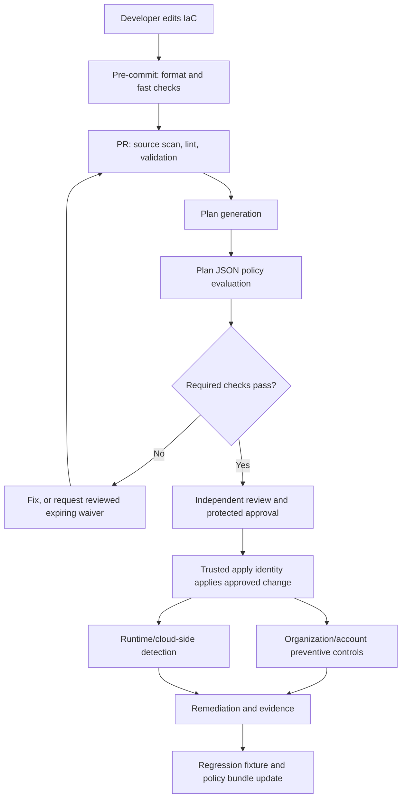
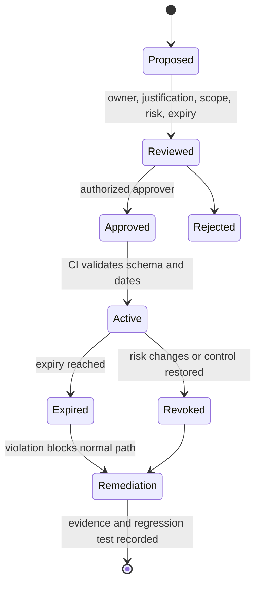

# Unit 6 — Policy as code for infrastructure guardrails

**Target file:** `06-policy-as-code-for-infrastructure-guardrails.md`  
**Module:** Advanced Infrastructure as Code and Cloud Operations (M07 in the supplied task prompt; confirm the module-number mapping in the current roadmap)  
**Stage:** 2E — Production DevOps & Platform Engineering  
**Estimated time:** 18–26 hours, including all six labs/tabletops and review  
**Prerequisites:** Earlier Stage 2E modules M01–M06; Git, Linux, CI/CD, cloud/IaC fundamentals, Terraform/OpenTofu concepts, and basic Kubernetes familiarity  
**Core tools:** Git, Python 3, Terraform or OpenTofu concepts, Checkov, OPA/Rego, Conftest, pre-commit, tflint; tool installation is optional for reading the provider-free fixtures  
**Awareness-only tools/services:** HCP Terraform/Sentinel, AWS Config, Azure Policy, Google Cloud Organization Policy, CIS Benchmarks, NIST SP 800-53 and SP 800-190, Kyverno, Gatekeeper, gitleaks, TruffleHog  
**Last reviewed:** 2026-10-28  
**Tool baseline assumed:** Python 3.10+ for the waiver example; Rego v1 syntax is illustrated; exact Terraform/OpenTofu, Checkov, OPA, Conftest, pre-commit, tflint, hook, and provider versions are `[VERIFY]` against the installed versions and official documentation before operational use.  
**Lab substrate:** Local-only and provider-free by default; no paid cloud, real cloud credentials, or real infrastructure required. All expected outputs are representative unless explicitly identified as executed evidence.

> **Scope, assumptions, and verification status.** This lesson follows the Unit 6 requirements in the supplied task prompt and the module tree entries available in the conversation. The supplied prompt identifies `06-policy-as-code-for-infrastructure-guardrails.md` as the target and notes a folder-name discrepancy (`02-Advanced-Infrastructure-as-Code-and-Cloud-Operations` versus `07-Advanced-Infrastructure-as-Code-and-Cloud-Operations`). Do not rename the repository folder based on that discrepancy. The available source tree confirms the target filename among sibling units, but a full live repository checkout/status was not available for a repository-wide audit. Tool binaries for Terraform/OpenTofu, Checkov, OPA, Conftest, pre-commit, and tflint were not available in the authoring shell; therefore, commands and outputs for those tools are illustrative and have not been executed here. The Python waiver implementation and tests are provided for local execution; this document does not claim they were executed unless the audit appendix says so.

## 6.0 Why policy as code matters in production

A data platform team adds a new storage bucket for raw customer events. The HCL looks ordinary, but a value is computed from an environment variable and the bucket's public-access posture is not obvious in the source. A source scanner misses the final value; a reviewer approves the pull request; after deployment, a cloud-side detector reports the bucket as publicly exposed. The incident is not proof that scanning is useless: it shows that source analysis, plan evaluation, preventive cloud controls, and runtime detection have different visibility. The durable response is layered policy, a protected apply path, evidence retention, and tests for the failure mode—not merely adding another scanner and declaring the problem solved.

Policy as code turns an operational requirement into a versioned, reviewable, testable rule that can run repeatedly at a defined point in the delivery lifecycle. It reduces dependence on individual memory and makes enforcement outcomes explainable. It does not make policy perfect: an incorrect rule can block all delivery, a permissive rule can miss a dangerous change, and a green scan says only that the configured checks passed for the input they observed.

**Running example:** a fictional data/ML platform has `dev`, `staging`, and `prod` environments, storage for raw and curated data, model artifacts, compute instances, network ingress, and stateful data services. Production data is sensitive. We want encryption, public access restrictions, owner/cost/data-classification tags, approved regions and sizes, no broad ingress on sensitive ports, and explicit approval before destructive changes to stateful resources.

## 6.1 Learning objectives

By the end of the unit, the learner should be able to:

- **[L1]** Explain the difference between preventive, detective, and corrective controls and place each in the IaC lifecycle.
- **[L1]** Describe the visibility limits of pre-commit checks, source scanning, plan-based policy, organization controls, and runtime detection.
- **[L2]** Run a source scanner and interpret a finding using resource identity, severity, evidence, and remediation rather than relying on a pass/fail summary.
- **[L2]** Explain Terraform/OpenTofu validation, preconditions, postconditions, and check blocks without confusing them with organization-level policy.
- **[L2]** Write and test Rego v1 policies against a documented normalized plan fixture for encryption, public access, tags, region/size, ingress, and deletion approval.
- **[L2]** Place policy checks before apply in CI and protect the check's ownership and required status.
- **[L3]** Design block/warn/audit severities, expiring waivers, policy ownership, regression tests, and evidence mapping.
- **[L3]** Compare source, plan, organization-level, and runtime controls for a concrete risk and state the residual gap.
- **[L4]** Roll out a centrally versioned policy bundle through audit → warn → block with measurable entry/exit criteria and rollback.
- **[L4]** Diagnose policy incidents, preserve evidence, avoid unsafe bypasses, and measure operational outcomes without gaming metrics.

## 6.2 Concept map and glossary



The diagram is conceptual. Organization controls may evaluate at request time, continuously, or through provider-specific workflows; they do not all sit at one literal pipeline step. An organization guardrail can reject an API operation even after local CI policy passes.

| Term | Precise definition | Common misconception |
|---|---|---|
| Policy as code | A rule expressed in a machine-evaluable form, versioned and tested like software. | A scanner alone is a complete governance program. |
| Preventive control | A control that blocks a prohibited action before or during the attempted change. | Every policy tool prevents deployment. |
| Detective control | A control that identifies a prohibited or unexpected state after it exists or after an event. | Detection prevents the initial exposure. |
| Corrective control | A workflow that remediates a detected condition or restores a safe state. | Auto-remediation is always safe. |
| Static source scan | Analysis of source/configuration before values are fully resolved. | It sees every final value. |
| Plan JSON | A machine-readable representation of a planned IaC change. | It is harmless to publish because it is JSON. |
| Unknown value | A value the plan cannot yet resolve, often until apply. | Unknown means false or safe. |
| OPA | Open Policy Agent, a general policy engine. | OPA automatically understands every Terraform resource schema. |
| Rego | OPA's policy language. | Rego syntax and semantics never change. |
| Conftest | A tool for testing configuration using OPA/Rego policies. | Conftest itself creates the infrastructure plan. |
| Checkov | A static-analysis/security policy tool that can inspect supported IaC inputs. | A zero-finding result proves security. |
| Waiver/exception | A scoped, approved, time-bounded allowance for a named policy violation. | A suppression comment is a permanent risk acceptance. |
| Baseline | A recorded set of existing findings managed under an explicit remediation plan. | Baseline means all existing findings are acceptable forever. |
| False positive | A finding that does not represent the risk the rule intends to detect in that context. | All inconvenient findings are false positives. |
| False negative | A real violation that the configured rule fails to detect. | A green result proves there are no false negatives. |
| Policy bundle | A versioned set of policy code and related data/configuration consumed by pipelines. | Every pipeline can safely track the latest bundle automatically. |
| Required status check | A CI result that branch protection requires before a change can merge. | A required check is secure if the change author can remove the workflow. |
| Drift | A difference between intended/configured state and observed state; policy drift also includes inconsistent rule versions or enforcement across layers. | IaC state is a complete inventory of the cloud. |
| Evidence artifact | A retained record of the input, policy version, result, reviewer, and relevant decision. | Logs should contain complete secrets and raw state for debugging. |
| SARIF | A standard format for static-analysis results that some code-hosting platforms can display. | Every policy tool emits identical SARIF fields. |

### Policy execution points: strengths and limits

| Layer | Typical input | Useful for | Cannot guarantee | Control type |
|---|---|---|---|---|
| IDE/pre-commit | Local source files | Fast feedback, formatting, obvious unsafe patterns | A developer cannot bypass it; final values are resolved | Advisory/early preventive within local workflow |
| Source scanner | HCL and related files | Source-visible misconfiguration, hardcoded patterns, known rules | Runtime state, all computed values, every custom organization rule | Detective before merge; CI can make it blocking |
| Plan policy | Plan JSON or normalized planned values | Planned create/update/delete actions and resolved values | All runtime conditions, out-of-band changes, values still unknown | Preventive for the apply path if required and protected |
| Organization/account control | API request, resource context, policy scope (provider-specific) | Central guardrails independent of a single repo | All application-level intent, every provider service/exception equally | Often preventive, semantics vary |
| Cloud-side inventory/detection | Deployed resources/events/configuration | Actual deployed posture and out-of-band drift | Prevention before initial exposure | Detective; may feed corrective workflows |
| Kubernetes admission | Kubernetes API request/object | Cluster resource admission constraints | Cloud account/IAM controls or non-Kubernetes resources | Preventive for covered API requests |
| Corrective workflow | Finding plus context | Revert, quarantine, disable exposure, open incident | Safe remediation without ownership/context | Corrective; often human-approved |

**Key rule:** state describes what IaC believes it manages; a plan is a prediction, not a promise; deletion is as risky as creation; policy output is only as good as the input and protected enforcement path.

## 6.3 Level 1 — Beginner / Foundations

### 6.3.1 What policy as code is

A policy has four parts: **scope** (what it evaluates), **predicate** (the condition), **decision** (block/warn/audit), and **evidence** (why it decided). For example: “For production storage, encryption must be enabled; if the planned value is explicitly false or absent in the normalized contract, block the change and report the resource address.” A usable rule needs a documented treatment for unknown values, missing fields, and unsupported resource types. Do not silently treat unknown as compliant.

Manual review remains important for context, but manual-only rules are inconsistent and difficult to test. Code-based policy allows the team to add regression fixtures for a previously missed incident and evaluate the same rule on each pull request.

### 6.3.2 Preventive, detective, and corrective controls

- **Preventive:** a protected CI policy gate rejects a plan; a cloud API guardrail denies a prohibited request. The control must be attached to a path the actor cannot casually bypass.
- **Detective:** a source scanner flags an unsafe expression; a cloud inventory system reports a public resource. Detection can happen before or after exposure depending on the layer.
- **Corrective:** a team disables public access, restores an approved configuration, rotates exposed credentials, or reverts a policy bundle. Auto-correction should be scoped, idempotent, observable, and tested; destructive auto-remediation can amplify an incident.

Use multiple layers because no layer observes everything. For example, a source rule can catch a hardcoded credential string before a plan exists; plan policy can catch a resolved forbidden region; an organization guardrail may deny an unsupported API request; runtime detection may find manual drift after deployment.

### 6.3.3 Shift-left trade-offs

“Earlier” is not automatically “more accurate.” Pre-commit is cheap and fast but can be skipped. Source analysis sees declared configuration and syntax patterns but may not know computed values. Plan policy can see resolved values and actions when present in the plan, but plan JSON may include sensitive values and unknowns remain unknown. Cloud-side detection observes deployed reality but may alert only after the risk exists. Organization-level controls are independent of a single pipeline, but their scope, exceptions, and evaluation semantics differ by provider.

### 6.3.4 Control flow and failure handling

A required policy job should fail closed for **invalid or unparseable policy input** when the risk of silently skipping evaluation is high. Do not conflate that with every policy violation: a warn-mode rollout may intentionally allow a violation while recording it. Record at least commit, plan artifact digest or identifier, policy bundle version, engine version, result, and reviewer decision. Keep plan JSON and saved plans in access-controlled, short-retention artifacts; never commit them to Git.

### 6.3.5 What a green result means

A green source scan means the enabled source rules found no blocking issue in the files and patterns they analyzed. A green plan-policy run means the configured policy accepted the supplied plan representation. Neither means the infrastructure is compliant, free from secrets, correctly isolated, or unchanged after apply. Evidence of deployed posture requires additional controls and observation.

## 6.4 Level 2 — Intermediate / Working Practice

### 6.4.1 Distinguish the toolchain

| Tool/check | Primary question | Input | Does not replace |
|---|---|---|---|
| `terraform fmt -check` / engine equivalent | Is configuration formatted consistently? | IaC source | Validation, security, policy |
| `terraform validate` / engine equivalent | Is configuration structurally valid under initialized providers/modules? | IaC configuration | Final planned-value policy or cloud control |
| tflint | Are there provider-aware or configuration lint findings under configured rules/plugins? | IaC source | Complete security policy or runtime detection |
| Checkov | Do supported static checks identify known misconfigurations? | Source or supported plan representation | Organization controls, human review, complete assurance |
| OPA + Rego | Does data satisfy explicitly authored rules? | JSON or other structured input | Input generation and schema correctness |
| Conftest | Do Rego policies accept the supplied configuration/plan input? | Files/JSON passed to Conftest | Plan generation, secure CI ownership |
| Native language validation | Does configuration meet local type/condition invariants? | Variables/resources/expressions | Cross-repository or org-wide governance |
| Pre-commit | Can developers get quick local feedback? | Local files | Protected CI enforcement |

Exact commands and supported flags depend on the installed engine and tool versions. Check the official documentation before copying version-sensitive commands into a production pipeline.

### 6.4.2 Checkov: source and plan scanning

A source scan inspects HCL and supported file structures. A plan scan inspects a supported machine-readable representation of a plan and may expose resolved values not obvious in source. A typical workflow creates a plan, converts it to JSON using the selected IaC engine's documented command, and passes that file to the scanner's supported plan mode. Exact flags are `[VERIFY]` against the current Checkov CLI documentation; do not infer a flag from a blog post or another version.

Representative command shapes (not executed here):

```bash
# Illustrative only; confirm the installed Checkov CLI syntax.
checkov -d ./infra

# Terraform plan JSON conversion; run only in a disposable local fixture or approved CI workspace.
terraform plan -out=tfplan
terraform show -json tfplan > tfplan.json
# Then use the current documented Checkov plan-scan mode: [VERIFY]
```

A finding review should capture: check ID as emitted by the installed tool, severity, resource address/type, source file and line when available, evidence that triggered the check, remediation guidance, and disposition. Verify the exact check ID in that version's output; this lesson intentionally does not invent IDs or an exact finding count.

An inline suppression such as the following is a **shape example**, not a claim that the ID exists or is valid:

```hcl
# Example only: replace CHECK_ID with a verified emitted ID and link a real ticket.
#checkov:skip=CHECK_ID:Temporary exception for migration CHG-EXAMPLE; expires 2026-11-30; owner platform-security
```

A suppression must have a concrete reason, owner, ticket, expiry, compensating control, and reviewer. If the chosen Checkov version does not support expiry metadata in the suppression itself, enforce expiry in a separate waiver registry; a comment alone is not an expiry mechanism. Baseline and custom-check syntax is `[VERIFY]` against the installed version. Never use blanket suppression to obtain a green build.

### 6.4.3 Native Terraform/OpenTofu guardrails

The following examples illustrate concepts. Confirm exact support and syntax for the chosen Terraform/OpenTofu version before use; some language features and behavior are version-sensitive.

**Typed variable plus validation:** reject invalid inputs early.

```hcl
# main.tf — illustrative; no provider required to understand the expression.
variable "environment" {
  type = string

  validation {
    condition     = contains(["dev", "staging", "prod"], var.environment)
    error_message = "environment must be dev, staging, or prod."
  }
}
```

**Precondition:** assert an assumption before a resource or output operation proceeds. For example, a resource-specific precondition could require an approved environment/region combination. A precondition can fail the operation when the condition is false; it is not a substitute for an account-level policy, and it can be bypassed if a different deployment path does not use the same configuration.

**Postcondition:** assert a property of a resource after its values are known. It can catch a condition that did not hold as expected, but it is not a universal substitute for cloud-side monitoring and does not undo an already-created resource automatically.

**Check block:** express an assertion about a condition and report a failed check according to the engine's semantics. Check-block failure behavior differs from hard preconditions/variable validation and is `[VERSION-SENSITIVE]`; verify whether the condition is advisory or blocks the operation in the selected engine/version. Do not use a check block as the only control for a high-impact security requirement unless its semantics are confirmed and enforced by the delivery system.

| Mechanism | Best use | Evaluation/failure note | Limitation |
|---|---|---|---|
| Variable validation | Validate an input contract | Evaluated when inputs can be evaluated; invalid input fails validation/operation | Does not inspect every resource or organization rule |
| Precondition | Assert assumptions before a resource/output action | Failed condition can stop the operation | Only applies where authored and supported |
| Postcondition | Verify a resource/output result | Failure surfaces a violated postcondition; exact lifecycle semantics are version-sensitive | May occur after an action has already had side effects |
| `check` block | Monitor a configuration assertion under the language's check semantics | `[VERSION-SENSITIVE]` failure behavior must be verified | Not interchangeable with hard validation or cloud guardrails |

### 6.4.4 OPA, Rego, Conftest, and plan input

OPA evaluates structured input against Rego policy. Conftest provides a convenient workflow for evaluating configuration files using OPA/Rego. Terraform/OpenTofu plan JSON is produced from a plan; it has a documented schema, but provider resource attributes and unknown values vary. The six rules in Lab 2 intentionally consume a **normalized policy contract** rather than pretending every provider has identical field names. A production adapter must map the exact engine/provider plan JSON into that contract, preserve action semantics, and fail closed if required fields are missing or ambiguous.

A typical conceptual flow is:

```text
IaC source -> plan file -> documented plan-to-JSON conversion -> schema-checked normalization
           -> Conftest/OPA policy evaluation -> required CI status -> approval -> apply approved change
```

Treat plan JSON and saved plans as sensitive: they can include values marked sensitive in configuration and other confidential metadata. Do not commit them, paste them into public logs, or retain them indefinitely. Redaction must not remove fields required for policy evaluation; restrict access rather than assuming redaction is complete.

### 6.4.5 CI integration and output

The policy job belongs after source checkout/initial validation and plan generation, and **before any apply**. It should be a required status check, run from a protected workflow definition, use the intended policy bundle version, and produce a machine-readable result plus a human-readable summary. SARIF is one possible findings interchange format where the tool and platform support it; field mapping and upload behavior are `[VERIFY]` for the selected tools.

A pull-request author must not be able to make the check disappear by editing the workflow in the same change being evaluated. Protect workflow files, branch rules, reusable workflows, action references, environment approvals, and apply-role trust. Only trusted protected pipelines should be able to obtain the apply identity. A required check is not meaningful if a contributor can rename it, remove it, or weaken its conditions without independent review.

Policy output should separate:

- **Block:** merge/apply prohibited; owner is the change author and policy owner for disputed semantics.
- **Warn:** delivery may proceed only under the rollout's documented rules; findings are tracked and reviewed.
- **Audit:** observe and collect baseline evidence; no enforcement decision yet.

### 6.4.6 Formatting, validation, tflint, and pre-commit

Formatting checks enforce style. `validate` checks configuration consistency within the engine's model. tflint can add configured provider-aware lint rules. Checkov performs supported security/misconfiguration checks. OPA/Conftest evaluates authored policies against structured input. These tools overlap, but they do not answer the same question.

A complete illustrative pre-commit configuration appears in Lab 4. Exact hook repositories, IDs, and revisions are `[VERIFY]`; do not copy guessed revisions. Local hooks are a developer-experience layer. CI must repeat critical checks with controlled tool versions because hooks can be skipped or not installed.

## 6.5 Level 3 — Advanced / Production Engineering

### 6.5.1 Policy catalogue and severity ownership

| Severity | Meaning | Required action | Accountable owner | Evidence |
|---|---|---|---|---|
| Block | Material risk that must not proceed through the normal path | Reject merge/apply until fixed or a valid scoped exception is approved | Control owner + change owner | Failed policy result, rule version, remediation, approval if waived |
| Warn | Risk needs attention but is not yet an enforced blocker in this rollout | Create/track a finding; document why it may proceed | Workload owner | Finding, due date, ticket, review record |
| Audit | Measurement/learning mode before enforcement | Collect findings and validate rule quality | Policy owner | Baseline, false-positive review, rollout decision |

A policy catalogue should include rule ID, intent, risk, scope, severity, owner, input schema, test fixtures, remediation, exception criteria, effective date, version, and evidence mapping. Map controls to CIS Benchmarks for the relevant platform, NIST SP 800-53 or SP 800-190 families, and internal standards as **awareness-level references**. A scanner result does not prove certification, audit readiness, or compliance. Framework mappings need a qualified control owner and the current authoritative publication.

### 6.5.2 Exception/waiver lifecycle



A waiver is a time-limited risk decision, not a policy rewrite. It should identify the control, resource scope, business justification, owner, approver, creation/expiry dates, change/ticket reference, and compensating control. It must be narrow enough that it cannot waive unrelated resources. A separate enforcement script must reject malformed or expired entries. The sample in Lab 3 uses ISO dates and UTC date comparison by calendar day; the organization should define whether expiry is date-inclusive or timestamp-specific and apply that rule consistently.

### 6.5.3 False positives and baseline management

A finding is a false positive only after evidence shows that the rule's intended risk is absent in the relevant context. Do not classify a finding as false positive merely because it blocks a deadline. Tuning options include correcting rule logic, narrowing the resource scope, documenting an approved exception, or moving a rule from block to warn during a staged rollout. Baselines should have an owner, count, age, remediation plan, and exit criteria. Track whether a rule's precision improves after tuning.

### 6.5.4 Defense in depth and a worked example

**Source-visible example:** a literal public ingress CIDR in HCL may be easy for a source scanner to identify before a plan exists. Plan policy still adds value by evaluating the actual planned ingress value and delete/update actions, but may not add much new information for that exact literal. Source scanning is the faster first layer.

**Computed-value example:** a region or ingress CIDR can come from a variable, module output, or workspace input. Static scanning may see the expression but not the final value. If the plan resolves the value, plan policy can evaluate the normalized resolved field and catch a forbidden region or sensitive-port ingress. If the value remains unknown in the plan, the policy must report unknown/indeterminate rather than declare it safe; a cloud preventive control and runtime detector remain necessary.

### 6.5.5 Cost and governance controls

Useful rules include resource-size allow-lists, sandbox TTL requirements, forbidden regions, tags for owner/cost center/data classification, prohibiting unmanaged public endpoints, requiring encryption, limiting the number of high-impact resources changed in one plan, separating environment changes, and requiring independent approval for IAM/KMS changes. Each rule needs a clear owner and exception path. A cost rule based on size or tags is not a hard budget cap; budget alert semantics differ by provider and are covered more deeply in the quota/FinOps unit.

### 6.5.6 IaC source governance

Policy should flag or block unpinned providers/modules, `latest` references, hardcoded credentials, and `local-exec` provisioners unless there is an approved use case. Provider/module pinning improves reproducibility but requires deliberate upgrade automation. A `local-exec` provisioner can execute commands in an environment that has credentials or network access; it expands the execution surface and complicates idempotence. Secret scanners such as gitleaks or TruffleHog-class tools are useful additional layers; exact installation, rule configuration, and exit semantics are `[VERIFY]`. Secret scanning is not a substitute for credential rotation after exposure.

### 6.5.7 Provider-native and hosted policy comparison (awareness only)

| System | Execution point | Preventive/detective behavior | Input/context | Scope and strength | Limitation | Required local lab? |
|---|---|---|---|---|---|---|
| Sentinel in HCP Terraform | Hosted Terraform workflow/policy stage; exact enforcement point depends on workflow | Can enforce policy decisions in supported workflow stages | Terraform run context and supported policy inputs | Central policy for governed workspaces | Hosted product semantics, edition, and input details must be verified; not equivalent to OPA in every respect | No |
| AWS Config rules | Cloud-side configuration evaluation | Primarily detects configuration compliance; remediation is separate/optional | Recorded resource configuration and rule context | Observes supported deployed AWS resources | Not the same as an API-time deny; coverage depends on supported resources/recording setup | No |
| Azure Policy | Azure resource governance and evaluation/enforcement workflows | Effects vary; can deny, modify, audit, or deploy related configuration where supported | Resource requests, resource properties, assignments, scope | Inheritance across supported management scopes | Effects and exemptions differ; exact policy definition/effect must be checked | No |
| Google Cloud Organization Policy | Organization/folder/project constraint evaluation | Prevents disallowed configurations for supported constraints; details vary | Resource hierarchy and supported constraint/resource context | Central guardrails over supported Google Cloud services | Not a general arbitrary Rego engine; supported constraints and inheritance matter | No |
| OPA/Conftest | Local or CI policy evaluation | Can block a protected pipeline when CI enforces its result | JSON/configuration supplied to the evaluator | Portable authored policy over chosen input shape | No automatic visibility into deployed reality or provider API enforcement | Yes, provider-free fixtures |

Do not assume these systems have identical semantics or scope. Real organization controls are awareness-only in this unit; no cloud account or paid service is required.

### 6.5.8 Kubernetes admission as a sibling pattern

Kyverno and Gatekeeper/OPA can evaluate Kubernetes API objects at admission time. The analogy is that policy evaluates an object at a defined control point and returns an allow/deny or audit outcome. The difference is the input, lifecycle, and enforcement boundary: Kubernetes admission policy does not replace cloud account/IAM controls or IaC plan policy. See M03/M12 for Kubernetes-specific policy and admission implementation; this unit does not teach a full cluster policy program.

### 6.5.9 Test strategy

For every rule, include at least one positive and one negative fixture. Add regression fixtures for production incidents, schema validation tests, policy-engine tests, golden plan inputs for supported provider versions, and contract tests for plan normalization. When a provider schema changes, re-run adapter tests. Avoid only testing that a policy returns a non-empty deny list; assert the expected rule ID/message and the exact fixture that should fail. Use a policy bundle release candidate in audit mode before block mode.

## 6.6 Level 4 — Expert / Scale and Failure

### 6.6.1 Central policy repository and versioned bundles

A central policy repository should define owners, review requirements, semantic versioning or an equivalent release scheme, supported engine versions, compatibility notes, changelog, tests, and deprecation policy. Consumer pipelines should pin a policy bundle version or immutable digest rather than automatically pulling an unreviewed latest version. Bundle releases should be reproducible and have a known rollback version. Policy data (allow-lists, approved regions, exception registry) should be versioned and reviewed like code.

**Release record example:**

```yaml
# illustrative policy-release.yaml — inline example only
bundle: data-platform-guardrails
version: 1.4.2
engine: opa
rego_language: v1
compatibility:
  plan_contract: normalized-plan-v1
change: "Reject production storage without encryption"
rollout: audit
owner: platform-security
rollback_version: 1.4.1
```

The file is a conceptual record, not a standardized tool format. The exact OPA bundle manifest and version syntax must follow the selected tool's official docs.

### 6.6.2 Staged rollout: audit → warn → block

| Phase | Entry criteria | Exit criteria | Rollback trigger |
|---|---|---|---|
| Audit | Rule has owner, intent, positive/negative tests, known input schema | Findings reviewed across representative repos; false-positive causes understood; metrics baseline recorded | Input is malformed, coverage is poor, or findings cannot be explained |
| Warn | Audit findings are understood; remediation docs exist; owners and due dates assigned | Teams have a documented remediation path; exception process works; protected pipeline has stable output | Warning volume causes alert fatigue or a serious false positive disrupts work |
| Block | Rule precision and coverage validated; exceptions and break-glass reviewed; required status check protected | Blocking behavior and incident runbook exercised; rollback bundle pinned; ownership/on-call assigned | Unexpected broad block, unsafe false negative, policy engine outage without agreed fail behavior |

Rollback must use a pre-approved mechanism controlled by the policy/platform owner. Do not ask the same contributor whose change is being evaluated to disable the check. Preserve the failing bundle, input digest, findings, timestamps, affected pipelines, and approval record before rollback.

### 6.6.3 Metrics and SLAs

| Metric | Definition (numerator / denominator) | Collection source | Misleading interpretation to avoid |
|---|---|---|---|
| Policy violation rate | Plans with at least one violation / plans evaluated, reported by rule and severity | CI policy results | A lower rate may mean checks were disabled or scope shrank |
| Time to fix | Median and tail time from first finding to verified remediation | Finding/ticket timestamps | Closing tickets without changing the underlying condition |
| Waiver count and age | Active waivers; age = current date minus creation date; report percent expiring soon | Versioned waiver registry | Fewer waivers may reflect unrecorded informal bypasses |
| Bypass attempts | Observed attempts to skip/disable required checks / evaluated changes or repository-month | Branch/workflow audit events | Absence of telemetry is not proof of no attempts |
| False-positive rate | Findings adjudicated false positive / findings adjudicated in the same period | Review disposition records | Teams may under-report false positives to make the rule look accurate |
| Signal/noise | Actionable findings / total findings reviewed | Finding triage | Depends on consistent triage and sampling |
| Evaluation duration | p50/p95 duration per plan size band | CI timings | Faster evaluation may reflect reduced coverage |
| Evaluation failure rate | Evaluations failing due to tool/input/runtime errors / evaluations attempted | CI job status and logs | Do not mix policy denials with engine failures |
| Waiver review SLA | Waivers reviewed before expiry / waivers due for review | Waiver registry | A completed review is not automatically a risk reduction |

Set targets from the organization's baseline and risk tolerance; do not invent universal SLO values. Policy failures need a defined support route. For example, urgent block failures can page the platform policy owner during supported release windows, while non-urgent waiver reviews can have a documented business-hours SLA.

### 6.6.4 Bypass resistance and conflict resolution

- Require policy status checks on protected branches and protected deployment environments.
- Protect workflow definitions and reusable workflows; restrict who can alter policy bundle references and apply-role trust.
- Ensure only the trusted protected pipeline can assume the apply identity. A developer's local credentials must not have equivalent production write access.
- Prevent policy disablement by the same change author whose change is under evaluation; require independent review for policy engine, workflow, and exception-registry changes.
- Pin policy bundles, tool versions, and action/hook revisions where the system supports immutable references; verify exact syntax and trust semantics.
- Resolve conflicting policies explicitly: document rule precedence, scope, and exception behavior. “Deny overrides” is a policy design pattern, not a universal property of all tools. Avoid broad exception rules that neutralize unrelated controls.
- For large plans, profile by input size and rule; avoid repeated expensive traversals, but never cache a result across materially different input, policy, or data versions. Measure before optimizing.
- Detect policy drift by recording the policy bundle version in every result and comparing it with the approved version. Compare local, CI, organization, and runtime layers for mismatched scope and behavior.

### 6.6.5 Four required incident analyses

#### Incident 1 — Public bucket passes static scanning because access is computed

- **Timeline/symptoms:** A PR passes source scanning; after apply, cloud detection reports public access. The source used a variable/module output and the static rule did not resolve its value.
- **Detection gap:** The source rule treated expression shape as sufficient and did not require a plan-based decision for the final public-access state.
- **Root cause:** A missing plan-policy layer and/or an unsafe unknown-value default. The exact root cause must be proven from the plan, provider schema, and deployed configuration.
- **Immediate containment:** Incident commander assigns a cloud/security owner; restrict public access through an approved emergency path; preserve the plan, source revision, CI result, cloud audit event, and resource configuration. Avoid unreviewed broad changes.
- **Durable correction:** Add a normalized plan rule for explicit public access, fail closed when the relevant field is missing/unknown for a resource in scope, and add positive/negative fixtures reproducing the exact resource type.
- **Tests/guardrails:** Golden plan fixture, source scanner test, plan adapter contract test, required CI status, cloud-side detection alert.
- **Evidence/follow-up metrics:** policy bundle version, plan digest, review record, remediation timestamp, recurrence rate for computed-value misses.

#### Incident 2 — Waiver without expiry hides a violation for a year

- **Timeline/symptoms:** A known violation remains in a suppression registry across multiple releases; no review date is recorded.
- **Detection gap:** The exception process validated presence of a reason but not expiry, owner, approver, or scope.
- **Root cause:** The waiver was treated as a permanent suppression and no periodic review metric existed.
- **Immediate containment:** Inventory all waivers; prioritize high-risk production exceptions; preserve the current registry and approvals; block new malformed waivers.
- **Durable correction:** Enforce schema and expiry checks in CI, use narrow resource scope, require accountable owner/approver, and create alerts for expiring/overdue exceptions.
- **Tests/guardrails:** valid, expired, malformed, missing-owner, invalid-date, and overbroad-scope tests; protected registry ownership.
- **Evidence/follow-up metrics:** waiver age distribution, percent with owner/approver, expired waiver count, remediation completion.

#### Incident 3 — Policy update blocks most pipelines

- **Timeline/symptoms:** A central bundle release causes a sudden spike in denied plans across unrelated repositories.
- **Detection gap:** No representative audit/warn rollout or canary cohort was used; policy engine errors and genuine denials were not separated.
- **Root cause:** A rule/schema incompatibility or false-positive pattern was released broadly without staged validation.
- **Immediate containment:** Freeze rollout; preserve bundle digest, input samples, evaluation errors, and affected repository list; compare with the last known-good bundle; invoke the pre-approved rollback or warn-mode switch controlled by the policy owner.
- **Durable correction:** Add representative golden plans, compatibility tests, canary cohorts, and release exit criteria; make rollout mode/version explicit in results.
- **Tests/guardrails:** regression fixture from the failing plan, policy bundle compatibility suite, rollback tabletop.
- **Evidence/follow-up metrics:** affected pipeline count, time to contain, false-positive rate, rollback duration, recurrence.

#### Incident 4 — Developer disables the policy job in the workflow

- **Timeline/symptoms:** A PR changes a workflow condition or removes the policy job and still reaches a merge/deploy path.
- **Detection gap:** Branch protection did not require the stable policy check, or the author could modify the workflow/branch rules without independent review.
- **Root cause:** Enforcement and its ownership were controlled by the same untrusted change path.
- **Immediate containment:** Pause deployment, revoke or constrain compromised workflow permissions if warranted, restore a trusted workflow version through the protected recovery process, and review merges/deployments since the bypass began.
- **Durable correction:** Protect workflow files, require stable status checks, use protected reusable workflows, constrain apply identity to trusted branches/environments, and alert on required-check configuration changes.
- **Tests/guardrails:** adversarial PR test that attempts to remove the job; audit of branch protection and environment approval settings.
- **Evidence/follow-up metrics:** workflow diff, branch-rule audit, identity events, affected deployment inventory, bypass attempts.

## 6.7 Practical labs

All labs are **recommended instructional labs derived from the Unit 6 themes** and are local-only. They are not claims that the source syllabus prescribed a particular lab number. Do not apply the deliberately insecure fixture to real cloud infrastructure.

| Lab | Objective | Substrate | Touches real cloud | Evidence | Cleanup verification |
|---|---|---|---|---|---|
| 1. Deliberately bad module | Compare Checkov source findings with plan-policy visibility | Insecure HCL shown inline; no apply | no | Sanitized source-scan report and detection matrix | Remove local temp fixture and verify path |
| 2. Rego controls | Test six control categories against normalized positive/negative fixtures | OPA/Conftest if installed; provider-free JSON | no | Policy file, fixtures, test summary | Delete only the lab temp directory after path assertion |
| 3. Waiver expiry | Validate waiver schema and expiry behavior | Python 3.10+ standard library | no | Test output, sample waiver, review record | Remove only the lab temp directory after path assertion |
| 4. Pre-commit | Configure local feedback hooks | Inline YAML example | no | Config review and hook run record if installed | Remove temporary copied config/repo |
| 5. Layered policy matrix | Map risks to policy layer and evidence | Written analysis | no | Completed matrix | No resource cleanup required |
| 6. Rollout tabletop | Respond to a broad policy rollout failure | Written tabletop | no | Incident timeline, rollback decision, regression plan | No resource cleanup required |

### Lab 1 — Deliberately bad module: Checkov vs Conftest

**Goal:** Understand which planted defects are visible in source, which need planned values, and what evidence each layer can produce. **Touches real cloud: no.** Do not initialize a provider or run apply. This fixture is intentionally insecure.

**Prerequisites:** Git and a text editor. Checkov installation is optional; use only the official install instructions for your OS/version. Do not install packages into a production environment for this lab.

**Illustrative file tree (copy locally only if you want to run it):**

```text
lab1-insecure-module/
├── main.tf
├── variables.tf
└── README.md
```

`main.tf` — intentionally insecure fixture; AWS provider/resource semantics and attributes are illustrative and must be verified before any use. It must never be applied to real infrastructure.

```hcl
# lab1-insecure-module/main.tf
# INTENTIONALLY INSECURE LAB FIXTURE — NEVER APPLY TO REAL CLOUD.
terraform {
  # Deliberately unpinned provider source/version for scanner demonstration.
  required_providers {
    aws = {
      source = "hashicorp/aws"
    }
  }
}

provider "aws" {
  region = var.region
}

resource "aws_s3_bucket" "raw" {
  bucket = "synthetic-raw-bucket-example"
  tags = {
    Name = "raw-data"
  }
}

resource "aws_s3_bucket_public_access_block" "raw" {
  bucket                  = aws_s3_bucket.raw.id
  block_public_acls       = false
  block_public_policy     = false
  ignore_public_acls      = false
  restrict_public_buckets = false
}

resource "aws_security_group" "database" {
  name = "synthetic-database-example"
  ingress {
    description = "INTENTIONALLY INSECURE LAB RULE"
    from_port   = 5432
    to_port     = 5432
    protocol    = "tcp"
    cidr_blocks = ["0.0.0.0/0"]
  }
}
```

`variables.tf`:

```hcl
# lab1-insecure-module/variables.tf
variable "region" {
  type    = string
  default = "us-east-1"
}
```

`README.md`:

```text
INTENTIONALLY INSECURE LAB FIXTURE. Static-analysis practice only.
Do not run terraform/tofu apply. No real credentials or endpoints are needed.
```

**Steps**

1. Create the files only in a disposable local directory if you want to run a scanner. Confirm the path is a temporary lab path and that no production credentials are configured.
2. Run the installed Checkov's documented Terraform source scan command against that directory. The command shape below is illustrative; verify CLI syntax and output format for your installed version.

```bash
# Representative command shape; not executed here.
checkov -d ./lab1-insecure-module
```

3. Inspect every reported finding. Record the emitted check ID (do not guess it), resource address/type, file/line if provided, severity, evidence, and remediation. If a finding is absent, investigate tool version, rule coverage, resource support, and configuration; do not assume the resource is safe.
4. For plan-based evaluation, use a **synthetic normalized fixture** from Lab 2 or a disposable local plan created only with the tool's documented workflow. Never apply this insecure fixture. The provider-backed plan may require provider installation and schema access, so it is optional and not required to complete the lab.
5. If testing a suppression, use the installed tool's verified suppression syntax, a real emitted check ID, a specific reason, owner, ticket, expiry, and independent review. Never suppress all checks or leave the exception indefinite.
6. Save only a sanitized report: remove sensitive paths/values before sharing. Plan JSON and saved plans can contain secrets; do not commit them.

**Planted-defect detection matrix**

| Planted defect | Source scan | Plan JSON policy | Evidence | Why a layer may miss it |
|---|---|---|---|---|
| No encryption configuration shown | May detect if a supported rule recognizes this resource/config pattern | Can detect only if the adapter exposes encryption state for this resource | Finding ID and resource address; negative normalized fixture in Lab 2 | Provider/schema differences or separate encryption resource may make source rule incomplete |
| Public access explicitly not blocked | May detect supported public-access configuration | Can detect if normalized values include the effective public-access posture | Resource-specific finding and plan-policy result | Scanner rule coverage and provider attributes vary; an incomplete adapter can drop fields |
| Required tags absent | May detect missing tag keys | Can inspect resolved tags | Finding/deny message listing missing keys | Tags may be inherited or merged from modules/locals; policy must define whether inherited values count |
| Sensitive port open to `0.0.0.0/0` | Often source-visible in this literal fixture if supported | Can inspect resolved ingress in normalized plan | Source location plus negative plan fixture | Dynamic CIDRs or nested blocks may be missed by simplistic text patterns |
| Provider version not pinned | Source/config policy is the natural layer | Plan JSON may not be the best evidence of source pinning | Source scan or dedicated IaC source rule | Provider selection can be represented differently across files; plan is not a source-governance substitute |

**Expected interpretation:** findings are version-dependent and representative, not a promised exact list/count. A scanner that reports zero findings may be misconfigured or may lack a rule; confirm the check was actually executed and inspect the tool's coverage.

**Failure modes:** command not found, unsupported flag, no rules for a resource type, false positives, missing plan attributes, or accidental attempt to initialize/apply a provider-backed fixture. Stop before apply; this lab does not require apply.

**Cleanup:** Before deleting anything, print and assert the intended temporary directory. Delete only that directory after verifying the path is not empty, not `/`, not the repository root, and matches the exact lab path. If the fixture was created in the repository, remove only the lab directory you created and inspect `git status --short`; do not discard unrelated changes.

**Checkpoint questions:** Which defect was source-visible? Which policy depends on resolved values? What does a zero-finding scan actually prove? What is the safest way to handle a suppression? **Stretch:** add a deliberate missing TTL tag and document which layer can detect it.

### Lab 2 — Six or more Rego rules with unit tests

**Goal:** Test the six mandatory policy families against a stable, documented normalized input contract. **Touches real cloud: no.** The normalized contract is a teaching adapter, not Terraform's raw plan JSON schema.

**Input contract:**

```json
{
  "environment": "prod",
  "resources": [
    {
      "address": "module.data.aws_s3_bucket.raw",
      "type": "storage_bucket",
      "actions": ["update"],
      "values": {
        "encrypted": true,
        "public_access": false,
        "tags": {"owner":"data-platform","cost-center":"CC-042","data-classification":"sensitive","environment":"prod"},
        "region": "us-east-1",
        "size_class": "small",
        "ingress": [{"protocol":"tcp","port":5432,"cidr":"10.20.0.0/16"}],
        "stateful": true,
        "deletion_approval": "CHG-EXAMPLE-001"
      }
    }
  ]
}
```

The six policy families are encryption, public access, required tags, allowed region, allowed size, sensitive-port ingress, and stateful deletion approval (seven independent deny conditions, so each concern is testable). `deletion_approval` is synthetic metadata in this normalized contract; actual plan JSON does not automatically contain an approval ticket. A trusted pipeline must supply and validate approval metadata from an authenticated workflow context, not accept a label that any contributor can self-assert.

**Illustrative file tree:**

```text
lab2-policy/
├── policy.rego
├── policy_test.rego
├── good.json
├── bad.json
└── README.md
```

`policy.rego` — Rego v1 illustration; verify syntax and engine compatibility for the installed OPA/Conftest version. This package expects `input.resources` as defined above.

```rego
# lab2-policy/policy.rego
package terraform.guardrails

import rego.v1

required_tags := {"owner", "cost-center", "data-classification", "environment"}
allowed_regions := {"us-east-1", "us-west-2"}
allowed_sizes := {"small", "medium"}
sensitive_ports := {22, 3389, 5432, 3306}

# 1. Encryption required.
deny contains msg if {
  some r in input.resources
  r.type == "storage_bucket"
  not r.values.encrypted
  msg := sprintf("%s: storage encryption must be explicitly true", [r.address])
}

# 2. Public access forbidden.
deny contains msg if {
  some r in input.resources
  r.type == "storage_bucket"
  r.values.public_access != false
  msg := sprintf("%s: public_access must be explicitly false", [r.address])
}

# 3. Required tags present and non-empty.
deny contains msg if {
  some r in input.resources
  some tag in required_tags
  object.get(r.values.tags, tag, "") == ""
  msg := sprintf("%s: required tag %q is missing or empty", [r.address, tag])
}

# 4a. Region allow-list.
deny contains msg if {
  some r in input.resources
  r.type != "global_resource"
  not allowed_regions[r.values.region]
  msg := sprintf("%s: region is missing or not allowed", [r.address])
}

# 4b. Size allow-list for resources with a size_class field.
deny contains msg if {
  some r in input.resources
  "size_class" in object.keys(r.values)
  not allowed_sizes[r.values.size_class]
  msg := sprintf("%s: size_class is missing from the allow-list", [r.address])
}

# 5. No broad ingress on sensitive ports.
deny contains msg if {
  some r in input.resources
  some rule in object.get(r.values, "ingress", [])
  rule.cidr == "0.0.0.0/0"
  sensitive_ports[rule.port]
  msg := sprintf("%s: 0.0.0.0/0 is forbidden on sensitive port %v", [r.address, rule.port])
}

# 6. Stateful deletion requires approved metadata.
deny contains msg if {
  some r in input.resources
  r.values.stateful == true
  "delete" in r.actions
  object.get(r.values, "deletion_approval", "") == ""
  msg := sprintf("%s: stateful deletion requires validated approval metadata", [r.address])
}
```

**Important policy-review notes:** The example uses `object.get` for optional maps and explicitly rejects missing encryption/public-access values. The region rule must be refined for global resources and resource types that do not expose a region. The size rule only applies to normalized objects carrying `size_class`. Real Terraform plan JSON commonly represents resource changes under a `resource_changes` structure with `change.actions` and `change.after`, but the resource attributes and unknowns vary by provider. Build and test a versioned adapter that maps raw plan JSON to this contract. Never pass raw plan JSON to this policy and assume it matches `input.resources` without an adapter.

`good.json`:

```json
{
  "environment": "prod",
  "resources": [{
    "address": "module.data.storage.raw",
    "type": "storage_bucket",
    "actions": ["update"],
    "values": {
      "encrypted": true,
      "public_access": false,
      "tags": {"owner":"data-platform","cost-center":"CC-042","data-classification":"sensitive","environment":"prod"},
      "region": "us-east-1",
      "size_class": "small",
      "ingress": [{"protocol":"tcp","port":5432,"cidr":"10.20.0.0/16"}],
      "stateful": true,
      "deletion_approval": "CHG-EXAMPLE-001"
    }
  }]
}
```

`bad.json`:

```json
{
  "environment": "prod",
  "resources": [{
    "address": "module.data.storage.raw",
    "type": "storage_bucket",
    "actions": ["delete"],
    "values": {
      "encrypted": false,
      "public_access": true,
      "tags": {"owner":"","environment":"prod"},
      "region": "moon-1",
      "size_class": "xlarge",
      "ingress": [{"protocol":"tcp","port":5432,"cidr":"0.0.0.0/0"}],
      "stateful": true,
      "deletion_approval": ""
    }
  }]
}
```

`policy_test.rego` — Rego v1 test illustration. Exact test syntax and package/import requirements must be checked against the selected OPA version.

```rego
# lab2-policy/policy_test.rego
package terraform.guardrails

import rego.v1

# Fixture-relative paths depend on the test runner's working directory.
test_good_fixture_has_no_denials if {
  count(deny) == 0 with input as data.good
}

test_bad_fixture_has_expected_denials if {
  count(deny) >= 6 with input as data.bad
}
```

The tests above illustrate the intended assertions, but a runnable test setup must load fixtures as `data.good` and `data.bad` through the chosen runner's documented data-loading mechanism. Because OPA/Conftest versions and fixture-loading conventions differ, the exact command/configuration is `[VERIFY]`; do not claim the test file works unchanged until it is executed with the selected version. A more deterministic CI setup can use Conftest against each fixture and assert that the good fixture passes and the bad fixture fails, with exit semantics verified for that version.

**Commands (representative; not executed):**

```bash
# Verify the installed version and official CLI syntax first.
opa version
opa test ./lab2-policy -v
conftest test ./lab2-policy/good.json -p ./lab2-policy
conftest test ./lab2-policy/bad.json -p ./lab2-policy
```

Expected behavior: the good fixture produces no deny messages; the bad fixture produces denials for encryption, public access, missing tags, region, size, sensitive ingress, and deletion approval. Exact command exit codes and output format are tool/version-sensitive. If the good fixture fails, inspect package path, fixture loading, missing fields, Rego version, and the contract. If the bad fixture passes, confirm that policy is loaded, input is actually the normalized fixture, and CI does not ignore the evaluator's exit status.

**Plan conversion:** Use the selected engine's documented plan-to-JSON command, then transform `resource_changes` into the normalized contract. The transformation must preserve actions (`create`, `update`, `delete`, and replacements), resolved `after` values, unknown markers, resource addresses/types, and any trusted approval metadata. Do not infer approval from a resource tag alone. Store the raw plan and JSON as sensitive artifacts, not in Git. A provider-free synthetic fixture is sufficient to complete the policy unit tests; no plan/apply is required.

**Checkpoint questions:** Why is the contract normalized? What should happen when encryption is missing? Why can a user-controlled label not be trusted as approval? What does a passing policy test prove? **Stretch:** add a rule that forbids a `ttl` tag from being absent for resources in the sandbox environment and add positive/negative fixtures.

### Lab 3 — Waiver with expiry and enforcement

**Goal:** Reject malformed or expired waivers before policy evaluation. **Touches real cloud: no.** The example uses Python 3.10+ and only the standard library. It compares ISO calendar dates against UTC's current date; organizations requiring exact time-of-day expiry should use explicit UTC timestamps and a documented clock policy.

**Illustrative file tree:**

```text
lab3-waivers/
├── check_waivers.py
├── waivers.json
└── test_check_waivers.py
```

`waivers.json`:

```json
[
  {
    "id": "WAIVER-EXAMPLE-001",
    "policy_id": "storage-encryption-required",
    "resource_scope": ["module.legacy_import.storage.raw"],
    "business_justification": "Temporary migration window; data remains private and access is restricted by an approved compensating control.",
    "owner": "data-platform-oncall",
    "approver": "platform-security-reviewer",
    "created_date": "2026-10-28",
    "expiry_date": "2026-11-30",
    "ticket": "CHG-EXAMPLE-042",
    "compensating_control": "Private network access; daily inventory review; migration ticket due before expiry"
  }
]
```

`check_waivers.py`:

```python
# lab3-waivers/check_waivers.py
"""Validate waiver JSON schema and calendar-date expiry. Python 3.10+; stdlib only."""
from __future__ import annotations

import json
import sys
from datetime import date, datetime, timezone
from pathlib import Path
from typing import Any

REQUIRED = {
    "id", "policy_id", "resource_scope", "business_justification", "owner",
    "approver", "created_date", "expiry_date", "ticket", "compensating_control"
}


def parse_date(value: Any, field: str, index: int) -> date:
    if not isinstance(value, str):
        raise ValueError(f"waiver[{index}].{field}: expected YYYY-MM-DD string")
    try:
        parsed = date.fromisoformat(value)
    except ValueError as exc:
        raise ValueError(f"waiver[{index}].{field}: invalid ISO date {value!r}") from exc
    if parsed.isoformat() != value:
        raise ValueError(f"waiver[{index}].{field}: use canonical YYYY-MM-DD format")
    return parsed


def validate(document: Any, today: date) -> list[str]:
    errors: list[str] = []
    if not isinstance(document, list):
        return ["top-level JSON value must be an array"]
    seen: set[str] = set()
    for index, waiver in enumerate(document):
        if not isinstance(waiver, dict):
            errors.append(f"waiver[{index}]: expected object")
            continue
        missing = sorted(REQUIRED - set(waiver))
        if missing:
            errors.append(f"waiver[{index}]: missing fields: {', '.join(missing)}")
            continue
        for field in ("id", "policy_id", "business_justification", "owner", "approver", "ticket", "compensating_control"):
            value = waiver[field]
            if not isinstance(value, str) or not value.strip():
                errors.append(f"waiver[{index}].{field}: must be a non-empty string")
        scope = waiver["resource_scope"]
        if not isinstance(scope, list) or not scope or any(not isinstance(x, str) or not x.strip() for x in scope):
            errors.append(f"waiver[{index}].resource_scope: expected non-empty array of non-empty strings")
        waiver_id = waiver["id"]
        if isinstance(waiver_id, str) and waiver_id.strip():
            if waiver_id in seen:
                errors.append(f"waiver[{index}].id: duplicate identifier {waiver_id!r}")
            seen.add(waiver_id)
        try:
            created = parse_date(waiver["created_date"], "created_date", index)
            expiry = parse_date(waiver["expiry_date"], "expiry_date", index)
            if expiry < created:
                errors.append(f"waiver[{index}]: expiry_date precedes created_date")
            if expiry < today:
                errors.append(f"waiver[{index}]: expired on {expiry.isoformat()}")
        except ValueError as exc:
            errors.append(str(exc))
    return errors


def main(argv: list[str]) -> int:
    if len(argv) != 2:
        print("usage: python check_waivers.py WAIVERS.json", file=sys.stderr)
        return 2
    path = Path(argv[1]).resolve()
    try:
        document = json.loads(path.read_text(encoding="utf-8"))
    except (OSError, json.JSONDecodeError) as exc:
        print(f"input error: {exc}", file=sys.stderr)
        return 2
    today = datetime.now(timezone.utc).date()
    errors = validate(document, today)
    if errors:
        for error in errors:
            print(f"ERROR: {error}")
        return 1
    print(f"OK: {len(document)} waiver(s) valid as of {today.isoformat()}")
    return 0


if __name__ == "__main__":
    raise SystemExit(main(sys.argv))
```

`test_check_waivers.py`:

```python
# lab3-waivers/test_check_waivers.py
import unittest
from datetime import date
from check_waivers import validate

BASE = {
    "id": "W-1", "policy_id": "encryption", "resource_scope": ["module.a.bucket"],
    "business_justification": "Temporary migration exception.", "owner": "team-a",
    "approver": "security-reviewer", "created_date": "2026-10-01",
    "expiry_date": "2026-11-01", "ticket": "CHG-123",
    "compensating_control": "Private access and daily review"
}

class WaiverTests(unittest.TestCase):
    def test_valid_waiver(self):
        self.assertEqual(validate([BASE], date(2026, 10, 28)), [])

    def test_expired_waiver(self):
        item = {**BASE, "expiry_date": "2026-10-01"}
        self.assertTrue(any("expired" in e for e in validate([item], date(2026, 10, 28))))

    def test_missing_owner_and_justification(self):
        item = {k: v for k, v in BASE.items() if k not in {"owner", "business_justification"}}
        errors = validate([item], date(2026, 10, 28))
        self.assertTrue(any("owner" in e for e in errors))
        self.assertTrue(any("business_justification" in e for e in errors))

    def test_invalid_date_format(self):
        item = {**BASE, "expiry_date": "11/01/2026"}
        self.assertTrue(any("invalid ISO date" in e for e in validate([item], date(2026, 10, 28))))

    def test_duplicate_id(self):
        self.assertTrue(any("duplicate identifier" in e for e in validate([BASE, BASE], date(2026, 10, 28))))

if __name__ == "__main__":
    unittest.main()
```

**Run and interpret:**

```bash
# Run from a disposable lab directory. These commands have not been executed here.
python3 --version
python3 -m unittest -v
python3 check_waivers.py waivers.json
```

Expected behavior: tests pass; the sample waiver is valid only while its expiry is not earlier than the current UTC date; an expired or malformed waiver returns exit code `1`; an unreadable/invalid JSON file or usage error returns `2`. Since the sample dates will age, update `created_date`/`expiry_date` for your exercise and keep the dates realistic; do not change the code to make an expired waiver pass. The tests use a fixed date for determinism.

**CI integration:** Run this checker as a required step before policy evaluation. On any non-zero exit, fail the job. A waiver only permits the exact policy/resource scope after authenticated approval; it must not bypass unrelated rules. The example validates fields and dates but does not verify ticket existence, approver authorization, signature authenticity, or whether a compensating control actually works. Those checks require integration with the organization's trusted workflow.

**Cleanup:** Before removing the lab directory, assert its resolved path is exactly the temporary directory you created and is not the repository root or a parent. Remove only that directory; retain a sanitized test summary if it is needed as learning evidence. Do not retain secrets or real production plan/state files.

**Checkpoint questions:** Why is expiry checked in CI rather than trusted to a comment? What timezone/date convention is used? What does this checker not validate? **Stretch:** add a maximum waiver duration rule and tests.

### Lab 4 — Pre-commit configuration

**Goal:** Provide fast local feedback in the same broad order as CI. **Touches real cloud: no.** This file is illustrative and must not be created in the repository by the authoring process; copy it into a disposable lab only if desired.

`.pre-commit-config.yaml` (hook repositories, IDs, and revisions are placeholders requiring verification):

```yaml
# .pre-commit-config.yaml — ILLUSTRATIVE; VERIFY each repo, hook ID, and revision.
repos:
  - repo: https://github.com/pre-commit/pre-commit-hooks
    rev: <VERIFIED_IMMUTABLE_REVISION>
    hooks:
      - id: check-yaml
      - id: end-of-file-fixer
      - id: trailing-whitespace

  - repo: <VERIFIED_TERRAFORM_FORMAT_HOOK_REPOSITORY>
    rev: <VERIFIED_IMMUTABLE_REVISION>
    hooks:
      - id: <VERIFIED_TERRAFORM_FORMAT_HOOK_ID>

  - repo: <VERIFIED_CHECKOV_HOOK_REPOSITORY>
    rev: <VERIFIED_IMMUTABLE_REVISION>
    hooks:
      - id: <VERIFIED_CHECKOV_HOOK_ID>
```

**Steps:**

1. Review each repository's official hook manifest and immutable revision; placeholders intentionally make this template non-runnable until verified.
2. In a temporary repository, install pre-commit using the official installation instructions and validate the configuration using the installed version's documented command.
3. Run hooks against a harmless fixture and record versions/results. A hook failure should be actionable and identify the file/rule.
4. Add plan-based policy in CI, not as a claim that a local pre-commit hook can always produce a full plan. Local hooks can be skipped and may lack provider credentials/plugins.

**Expected evidence:** configuration review, pinned revision record, local hook output, and CI workflow showing equivalent critical checks. **Failure modes:** invalid hook ID/revision, hook network unavailable, local tool mismatch, or a hook that scans source but not plan values. **Cleanup:** remove only the temporary repository after path assertion. **Stretch:** demonstrate that a skipped local hook is still caught by the required CI status check.

### Lab 5 — Layered policy matrix

**Goal:** For each risk, identify the best control point, evidence, and false-negative path. **Touches real cloud: no.** Complete the last column for your own platform after reviewing actual tool coverage.

| Defect or risk | Pre-commit/source scan | Plan JSON policy | Org/account preventive control | Runtime/cloud detection | Required evidence | Limitations/false negatives |
|---|---|---|---|---|---|---|
| Storage encryption missing | May detect source-visible missing configuration | Evaluate resolved encryption if adapter/provider exposes it | May enforce supported encryption constraints | Detect actual deployed encryption posture if covered | Source finding, normalized plan result, deployed inventory | Encryption can be configured through a separate resource or service default; verify semantics |
| Public endpoint/access | Detect literal public configuration | Evaluate resolved public setting | Deny supported public configurations where available | Detect actual exposure | Plan digest, rule result, cloud finding | Unknown values and service-specific exceptions |
| Required owner/cost/data tags | Source-level tag map check | Check merged/resolved tag set | Provider policy may require tags for supported resource types | Inventory missing tags | Tag keys and policy version | Inheritance/merge behavior differs by resource/provider |
| `0.0.0.0/0` on sensitive port | Catch literal CIDR and port | Evaluate resolved ingress tuples | Network/API guardrail where supported | Network exposure scanner/flow/audit telemetry | Rule finding and security-group state | CIDR may be computed; static regex is weak |
| Provider/module unpinned | Best layer for source references | Plan may not prove source pinning | Generally not an organization resource-property control | Not usually detected by resource inventory | Source check and dependency lock/manifest evidence | Dynamic source references and registry semantics require exact parser |
| Forbidden region | Detect literal region, sometimes | Evaluate resolved region for regional resources | Organization policy can restrict supported services/locations | Inventory deployed resources by location | Planned region and deployed location | Global resources and service-specific region behavior differ |
| Oversized instance | Check literal type/size | Evaluate resolved instance class | Native policy may restrict supported resource types | Cost/asset inventory detects deployed size | Planned class and owner approval | Cost is not determined by size alone; policy list needs ownership |
| Missing sandbox TTL | Source scan tag map | Check resolved TTL metadata | Tag policy/guardrail where supported | Scheduled inventory detects expired resources | TTL value, cleanup event, exception record | Tags alone do not delete resources; cleanup controller can fail |
| Stateful deletion | Inspect source-level `destroy` patterns imperfectly | Evaluate planned `delete`/replacement actions and trusted approval metadata | Provider guardrail may not know business approval intent | Audit log detects deletion after request/event | Plan actions, approval record, apply identity, audit event | Replacement can include delete; approval label must come from trusted context |
| Broad IAM/KMS change | Source policy flags risky constructs | Evaluate policy document/actions where exposed | IAM/org controls may restrict grant operations | Audit detections for policy changes | Diff, reviewer, policy result, identity event | Effective permissions can depend on inheritance and external policies |
| Hardcoded credential | Secret scanner and source scan | Plan may leak the value but is not the preferred control | Secret/identity controls may limit use | Credential use/audit signals | Scanner finding and rotation evidence | Entropy scanners have false positives/negatives; rotate if exposed |
| Unknown/computed value | May see expression but not result | Must mark unknown/indeterminate or require safe default | Preventive API guardrail may still block final request | Runtime detector sees final resource | Unknown-field report and control disposition | Never equate unknown with compliant |
| Mixed dev/prod change | Check environment labels/source paths | Check plan resource/environment scope | Account boundary and separate apply identities constrain impact | Audit identifies cross-environment activity | Environment assertion, plan summary, identity context | Labels alone do not prove target account |
| Too many resources in one change | Source count is approximate | Count planned creates/updates/deletes | Organization controls rarely express repo change boundaries | Runtime monitoring sees effects after deployment | Plan summary and approval | Count is a risk heuristic, not a universal threshold |

**Interpretation exercise:** choose one row and write: (1) what the control can prevent, (2) what it only detects, (3) who owns the alert, (4) the evidence to retain, and (5) what happens when the input is unknown. Do not mark a layer as preventive unless the control is actually enforced on the deployment path.

### Lab 6 — Production rollout tabletop

**Scenario:** Policy bundle `2.3.0` is promoted to block mode. Within 15 minutes, 62% of pipelines fail. The 62% figure is synthetic tabletop data, not a benchmark or observed production metric. Some failures are legitimate region violations; others appear to be caused by a plan-adapter change that treats missing region fields on global resources as forbidden.

**Objective:** Write the incident record and execute the runbook on paper. **Touches real cloud: no.**

1. **Freeze rollout.** Stop promotion of `2.3.0` to new cohorts. Do not disable all policy checks globally. Record who declared the freeze and at what time.
2. **Determine scope.** Group failures by repository, bundle version, engine version, resource type, rule ID, and input schema version. Separate policy denials from evaluation errors/timeouts.
3. **Preserve evidence.** Save bundle digest, sanitized failing input/plan identifier, policy result, timestamps, change ticket, affected pipeline list, and reviewer notes. Do not place raw secrets or unredacted plan JSON in the incident channel.
4. **Compare versions.** Diff `2.3.0` against last known-good `2.2.4`; inspect policy and adapter changes; reproduce against golden plans. Verify whether the global-resource rule had an explicit exception/normalization contract.
5. **Contain safely.** Use the pre-approved rollback to `2.2.4` or switch the affected cohort to warn/audit if the approved incident procedure permits it. The policy owner—not the change author acting alone—makes and records this decision. Continue independent organization-level guardrails.
6. **Communicate.** Notify pipeline owners, security/platform on-call, and release management; state scope, workaround, next update time, and any residual risk. Avoid telling teams to bypass the check manually.
7. **Correct and test.** Add fixtures for global resources with absent region, regional resources with allowed region, and regional resources with forbidden region. Test missing/unknown values separately. Verify the adapter contract and policy output across representative plan versions.
8. **Resume staged rollout.** Re-run audit mode on a representative cohort, then warn mode, then block only after exit criteria pass. Pin the bundle version and keep a rollback path.
9. **Close the incident.** Record root cause, detection gap, time to contain, false-positive count, affected release windows, tests added, owner, due date, and follow-up metrics.

**Required tabletop artifacts:** timeline, severity decision, affected-scope list (synthetic), rollback approval, evidence checklist, regression tests to add, communication note, and a resume criteria checklist. **Pass condition:** the team preserves evidence, does not remove all controls, and resumes only after validating the corrected policy against representative fixtures.

## 6.8 Troubleshooting and common mistakes

| Symptom | Likely causes | Safe diagnostic | Safer correction |
|---|---|---|---|
| Scanner reports no findings on known-bad fixture | Tool not installed, wrong path, unsupported resource/rule, disabled checks | Confirm version, command help, scanned file count, and a known negative fixture | Pin verified tool version and add regression fixture; never assume green means covered |
| Conftest/OPA returns no deny messages for bad fixture | Policy path/package mismatch, wrong input shape, fixture not loaded, rule not selected | Run the evaluator on the exact synthetic fixture; inspect package and input schema | Add schema/contract checks and assert expected rule IDs/messages |
| Rego parse error | Rego v0/v1 syntax mixed, missing import, unsupported version | Check `opa version` and official Rego migration/syntax docs | Choose one syntax generation and align engine/tests |
| Policy unexpectedly blocks global resource | Region/size rule assumes all resource types have the same attributes | Inspect normalized resource type and field presence | Make scope explicit; model unknown/missing separately and add tests |
| Waiver passes after expiry | Checker not in required CI, clock/date policy unclear, alternate path bypasses checker | Verify job status, UTC clock, input file, and branch protection | Make the checker a required status; define expiry semantics and protected registry ownership |
| CI policy job is skipped | Workflow condition, changed job name, branch protection misconfigured | Inspect workflow diff and protected-branch settings | Protect workflow and require stable check; independent review for enforcement changes |
| Plan JSON leaks values | Artifact access too broad, logs print full JSON, artifact retention excessive | Review access policy and artifact/log retention | Restrict access, avoid printing raw JSON, set short retention, rotate exposed secrets |
| Local and CI results differ | Tool/bundle version drift, different input normalization, different provider schema | Compare version, bundle digest, input contract and result metadata | Pin versions and test contract compatibility |
| A suppression becomes permanent | No expiry/owner review or baseline exit criteria | Report waiver age and suppression count by owner/rule | Require expiry, periodic review, and removal criteria |
| A check block does not stop a change as expected | Misunderstood engine/version semantics | Verify official language docs for exact feature/version | Use a confirmed hard gate in protected CI and/or native preventive control |

## 6.9 Security and safety checklist

Before enabling a blocking policy in production, verify the following:

- [ ] Policy source and bundle references are versioned and reviewed by an owner independent of the change author.
- [ ] Positive, negative, malformed-input, missing-field, unknown-value, and regression fixtures exist.
- [ ] Plan JSON and saved plans are treated as sensitive artifacts, access-controlled, not committed, and short-retention.
- [ ] CI evaluates the intended plan and policy bundle before apply; the result is bound to the approved change/plan as designed.
- [ ] Required status checks and protected workflow settings prevent a contributor from silently removing the policy job.
- [ ] Only a trusted protected pipeline can assume the apply identity; plan/apply permissions are separated where feasible.
- [ ] Waivers include control ID, resource scope, justification, owner, approver, created date, expiry, ticket, and compensating control; malformed/expired waivers fail.
- [ ] Unknown or missing values do not silently become compliant.
- [ ] Exceptions are narrow, time-boxed, auditable, and reviewed; expired exceptions cannot bypass enforcement.
- [ ] Runtime detection and provider-native controls complement CI policy; passing a scanner is not represented as compliance certification.
- [ ] Suppressions and baselines have owners and removal criteria; false-positive trends are measured.
- [ ] Tool, policy, adapter, and provider schema versions are recorded with each result.
- [ ] No real credentials, account identifiers, sensitive plan values, or raw state are embedded in lab fixtures.
- [ ] Emergency rollback preserves evidence and does not become a permanent global bypass.

### Threat model and limitations

Threats include a compromised CI runner, untrusted pull-request code attempting to access secrets, a developer weakening the policy workflow, a broad waiver, a policy bundle with a false negative, leaked plan/state artifacts, malicious policy changes, an overly permissive apply identity, and out-of-band resource changes. Mitigations include least privilege, trusted workflow isolation, immutable references where supported, independent reviews, scoped waivers, artifact access controls, runtime detection, and incident drills. No single control eliminates all of these threats.

## 6.10 Cross-module links and scope boundaries

Use relative links only when the sibling file actually exists in the checked-out repository. The supplied project-tree excerpt lists the following sibling unit filenames under the IaC/cloud-operations folder; confirm exact folder spelling before adding repository-relative links:

- `01-terraform-state-backends-locking-and-recovery.md` — state/backend confidentiality, locking, recovery; this unit only treats state and plan artifacts as sensitive inputs/evidence.
- `02-terraform-modules-and-environment-reuse.md` — module structure and environment configuration; this unit governs policies applied to those configurations.
- `03-state-migration-import-and-drift-detection.md` — state moves/import/drift; this unit adds policy evidence and controls, not a full migration procedure.
- `04-safe-infrastructure-plans-and-change-approval.md` — plan review, approval, target assertions, and apply workflow; this unit adds the policy decision before apply.
- `05-cloud-account-and-environment-boundaries.md` — account boundaries and organization controls; this unit explains how policy-as-code complements them.
- `07-cloud-quotas-service-limits-and-resource-governance.md` — quotas/FinOps; this unit covers size/region/tag/TTL policy patterns, not provider quota administration.

Forward references from the task prompt: **M02 CI/CD** (required checks and protected workflows), **M03/M12 Kubernetes** (Kyverno/Gatekeeper admission), **M05 cloud boundaries**, **M09 secrets/identity**, **M10 SRE**, **M12 supply chain**, **M15 quotas/FinOps**, **M16 platform engineering**, and **M17 capstone**. Module numbering is `[VERIFY]` against the authoritative syllabus and roadmap because numbering can differ between source versions. Do not invent missing sibling links. This unit teaches policy lifecycle and testing; it does not replace identity architecture, Kubernetes admission engineering, supply-chain provenance, quota operations, or cloud compliance programs.

## 6.11 Review questions and answer key

### Questions

1. What is the difference between preventive, detective, and corrective policy controls? Give one example of each in the data-platform scenario.
2. Why can a source scanner miss a forbidden region that a plan-based rule catches? What happens if the plan still marks the region unknown?
3. What does a green Checkov scan prove, and what does it not prove?
4. Why is plan JSON sensitive even when configuration uses a `sensitive` marking?
5. How do Terraform/OpenTofu variable validation, preconditions, postconditions, and check blocks differ from organization-level guardrails?
6. Why does the Lab 2 policy use a normalized input contract instead of assuming all raw provider plan fields are uniform?
7. Why is a resource tag such as `approval=CHG-123` insufficient evidence of an authorized deletion approval by itself?
8. What must a time-boxed waiver contain, and why must the expiry checker be a required CI step?
9. How can a policy job be bypassed even if a repository has branch protection? Name at least two defenses.
10. Why should policy rollout use audit → warn → block instead of immediate global enforcement?
11. Which layers are best for detecting a hardcoded credential, a computed planned region, and an out-of-band public resource?
12. During a broad policy outage, what evidence should be preserved before rollback and what criteria should be met before enforcement resumes?

### Answer key with explanations

1. **Preventive** blocks before/during the action (protected plan gate or supported cloud deny); **detective** identifies a source/deployed violation; **corrective** remediates or restores a safe state. A scanner finding alone does not necessarily block anything unless the delivery path enforces it.
2. Source analysis may see only a variable or expression, not its resolved value. A plan rule can inspect a resolved value when available. If unknown, it must report indeterminate and use an explicit safe disposition; treating unknown as allowed is a false-negative path.
3. It proves only that the configured scanner evaluated the supplied files under its version/rules and returned its result. It does not prove deployed compliance, full rule coverage, absence of unknown values, or certification.
4. Sensitive marking is generally a display/handling signal, not a guarantee that values never exist in plan/state/artifacts. Restrict access and retention; do not print or commit raw artifacts.
5. Validation checks input contracts; preconditions assert assumptions before an operation; postconditions check a resulting property; check blocks have engine-specific semantics. Organization controls apply centrally at provider-supported scopes and can reject requests independently of one repository. Verify exact version semantics.
6. Provider resource schemas and plan fields differ. A normalized contract makes the rule's expected fields explicit, but the adapter must be tested and must preserve unknowns/actions. Normalization does not prove provider parity.
7. A contributor may write an arbitrary label. Approval must come from authenticated workflow context or an independently controlled approval record, then be bound to the change/plan.
8. Control ID, exact scope, justification, owner, approver, creation/expiry dates, ticket, and compensating control. CI enforcement ensures malformed/expired records do not silently remain active; comments alone do not enforce expiry.
9. The author may edit the workflow, alter job conditions/names, or weaken a required check if protection is incomplete. Protect workflow ownership, require stable checks, independently review policy/workflow changes, and restrict apply identity to trusted protected pipelines.
10. Audit mode exposes coverage/false positives; warn mode gives owners time to remediate; block mode is enabled after rule precision and rollback are validated. Immediate enforcement can cause broad delivery failure from a bad rule.
11. Hardcoded credentials: secret/source scanning before merge plus credential-use monitoring; computed planned region: plan policy; out-of-band public resource: cloud-side inventory/detection and provider preventive controls where supported. No single layer is sufficient.
12. Preserve bundle digest/version, sanitized input/plan identifiers, policy results, timestamps, affected repositories, workflow and approval records, and error/denial classification. Resume after regression fixtures, representative cohort validation, owner sign-off, and staged rollout criteria pass.

## 6.12 Evidence artifacts

A completed unit should produce a reviewable evidence package without secrets or raw state:

- [ ] Sanitized source-scan report showing the tool version, scanned path, emitted check IDs, and findings disposition.
- [ ] Detection-layer matrix for the intentionally insecure fixture.
- [ ] Normalized plan contract and documented adapter assumptions, including unknown/missing-value handling.
- [ ] Rego policy and positive/negative test summary with exact engine version if run.
- [ ] Waiver schema, sample waiver, checker source, unit-test summary, and expiry-review evidence.
- [ ] Pre-commit configuration review with verified hook IDs/revisions if installed.
- [ ] Layered policy matrix with owners, evidence, and limitations.
- [ ] Policy catalogue with rule ID, severity, owner, tests, remediation, version, and framework mapping marked awareness-only.
- [ ] Policy rollout plan with audit/warn/block entry and exit criteria plus rollback owner.
- [ ] Synthetic incident tabletop record and regression fixtures to add.
- [ ] Human verification checklist completed against installed tool versions and official documentation.
- [ ] Cleanup verification confirming only the temporary lab directory was removed.

Do not commit credentials, real account IDs, raw state, saved plan files, unredacted plan JSON, sensitive CI artifacts, or real production resource identifiers.

## 6.13 Common interview and architecture-review questions

### 1. How would you decide whether a control belongs in source scanning, plan policy, an organization guardrail, or runtime detection?

Start with the risk and the decision point. Source scanning is best for source-visible patterns such as hardcoded credentials, unpinned dependencies, or literal public CIDRs. Plan policy is better when the decision depends on resolved values, planned actions, replacements, or blast radius. Organization-level guardrails provide an independent preventive boundary for supported cloud operations. Runtime detection observes deployed posture and out-of-band changes. Use multiple layers for high-impact risks, define unknown-value behavior, and ensure each layer has an owner and evidence. Avoid duplicating rules blindly: overlap should be intentional and tests should explain the different input and enforcement semantics.

### 2. A policy bundle blocks 40% of deployments after a release. What do you do first?

Freeze rollout and classify failures into real policy denials, false positives, malformed inputs, and engine/runtime failures. Preserve the bundle digest, sanitized failing inputs, timestamps, policy outputs, and affected pipeline scope. Compare with the previous known-good version and reproduce using golden fixtures. Use the pre-approved rollback or limited warn-mode path controlled by the policy owner; do not globally disable all guardrails. Add regression tests, validate against a canary cohort, communicate impact, and resume only when explicit exit criteria are met.

### 3. Why not let each application team own and change its own security policy?

Teams should own application-specific constraints, but cross-platform high-impact controls need consistent policy ownership and a protected release path. A useful model separates a central baseline (encryption, public access, identity-risk changes, auditability) from approved team extensions. Require ownership, tests, versioning, compatibility contracts, and a controlled exception path. Avoid a central team becoming a bottleneck by documenting SLAs, self-service templates, and contribution review expectations.

### 4. How do you prevent waiver systems from becoming a permanent bypass mechanism?

Require a narrow control/resource scope, justification, accountable owner and approver, ticket, compensating control, creation/expiry dates, and an enforced expiry check. Track waiver count and age by rule/team, alert before expiry, and require remediation or re-approval with fresh evidence. Protect the registry and approval workflow from the same author whose change is being waived. Test malformed and expired records and verify that CI fails closed when the registry cannot be parsed.

### 5. What does policy-as-code evidence prove to an auditor or incident reviewer?

It can show which policy bundle and engine version evaluated which sanitized input/plan identifier, the decision and findings, who approved an exception, and whether the protected workflow allowed the change. It does not by itself prove the deployed resource stayed compliant or that the policy covers every risk. Correlate it with cloud audit/configuration evidence, deployment identity, review records, and runtime detection. Framework mapping is an aid to traceability, not a certification claim.

## 6.14 Sources and verification notes

### Official documentation to consult

The following are authoritative source families and document titles to check. The authoring environment did not have the relevant CLI tools installed, and official documentation pages were not live-verified during this artifact's creation; therefore these are **verification targets**, not a claim that every page was consulted or every detail is current. Use the exact version of the installed tool and the corresponding official documentation.

| Area | Official documentation/document title to check | Verification focus |
|---|---|---|
| Terraform language | HashiCorp Terraform documentation: Input Variables, Custom Conditions, `check` blocks, `terraform validate`, `terraform show`, JSON Output Format | Version support and failure semantics for validation/precondition/postcondition/check; plan JSON schema and sensitivity |
| OpenTofu | OpenTofu language and CLI documentation for variables, conditions, plan, show/JSON output | Compatibility and syntax differences from Terraform; do not assume every version is identical |
| Checkov | Bridgecrew/Checkov official documentation: Terraform scanning, plan scanning, skip comments, baselines, custom policies | Exact CLI flags, suppression syntax, custom check support, plan input format |
| OPA/Rego | Open Policy Agent documentation: Rego language, policy testing, Rego v1 migration/syntax | Current syntax, `opa test`, imports, rule definitions, test data loading |
| Conftest | Conftest official documentation: policy testing, input formats, verification workflow | CLI syntax, policy directory/package conventions, exit codes, verification support |
| pre-commit | pre-commit official documentation and each selected hook repository's manifest | Hook IDs, immutable revisions, config validation and install commands |
| tflint | TFLint official documentation and provider plugin docs | Plugin initialization, provider-specific rules, command syntax |
| HCP Terraform/Sentinel | HashiCorp documentation: Sentinel policies and run enforcement | Execution point, supported inputs, product/edition constraints |
| AWS Config | AWS documentation: AWS Config rules and recording | Supported resources, rule evaluation timing, remediation boundaries |
| Azure Policy | Microsoft Learn: Azure Policy overview, definitions, effects, assignments, exemptions | Scope/inheritance and effect semantics for the exact policy |
| Google Cloud | Google Cloud documentation: Organization Policy constraints and resource hierarchy | Supported constraints, inheritance, exceptions, organization/folder/project behavior |
| Framework mappings | CIS Benchmark for the relevant cloud; NIST SP 800-53; NIST SP 800-190 | Correct control family/version and whether a mapping is merely illustrative |
| Kubernetes | Kubernetes admission control docs; Kyverno and Gatekeeper official docs | Admission lifecycle and limits of analogy with IaC policy |
| Secret scanning | Official gitleaks and TruffleHog documentation | Current configuration, exit behavior, safe redaction and scanning scope |

### Version-sensitive claims table

| Claim | Why it matters | Official source to check | Verification method |
|---|---|---|---|
| Terraform/OpenTofu support and semantics for validation/preconditions/postconditions/check | Determines whether a rule blocks or only reports | Terraform/OpenTofu language docs for the exact version | Run a minimal local negative fixture with the pinned binary; inspect exit/output |
| Plan JSON fields and unknown-value representation | Wrong paths create false negatives | Terraform/OpenTofu JSON output format docs | Compare adapter output with a sanitized plan fixture from the pinned engine/provider |
| Checkov plan-scan flags and supported inputs | Wrong invocation may skip intended scan | Checkov CLI and Terraform plan-scan docs | Inspect installed help/version and run a known-negative fixture |
| Checkov skip-comment syntax and baseline behavior | Suppression may not work as intended | Checkov suppression/baseline docs | Verify emitted ID and prove suppression is scoped to one finding |
| Custom Checkov check schema | Incorrect rule schema may never load | Checkov custom policy docs | Run a positive and negative fixture; inspect loaded checks |
| Rego v1 syntax/import/test behavior | Mixed syntax can fail or silently differ | OPA Rego v1 and migration docs | Run `opa version`, `opa check`, and `opa test` with pinned version |
| Conftest input/package/exit behavior | CI may not fail on a policy violation as expected | Conftest official docs | Run known-good and known-bad fixtures; assert process exit codes |
| Normalized plan adapter | Provider schema changes can omit critical fields | Engine JSON docs and provider resource docs | Contract tests for missing, null, unknown, replacement, and delete actions |
| Pre-commit hook IDs and revisions | Placeholder config is intentionally not runnable | pre-commit docs and hook repo manifests | Pin immutable verified revisions and run config validation in a disposable repo |
| tflint plugin setup | Provider-aware checks may not be loaded | TFLint and provider plugin docs | Initialize and run on a known-positive/negative fixture |
| Sentinel enforcement point/inputs | Product workflow and available inputs vary | HCP Terraform/Sentinel docs | Inspect current workspace/run settings and official policy docs |
| AWS Config coverage/evaluation | Detection depends on recording and resource support | AWS Config docs | Confirm recorder, rule support, evaluation history, and remediation behavior in a governed environment (awareness only here) |
| Azure Policy effect and inheritance | Policy effects vary by definition and scope | Microsoft Learn Azure Policy docs | Review definition/assignment/exemption and test in a safe non-production scope if authorized |
| Google Cloud Organization Policy constraints | Only supported constraints are enforceable | Google Cloud Organization Policy docs | Check the exact constraint and scope behavior in official docs |
| CIS/NIST mapping | Framework versions and wording change | CIS/NIST primary publications | Record publication version and qualified control-owner review |
| gitleaks/TruffleHog command/config semantics | Secret scanning may be misconfigured | Official project docs | Run synthetic secret fixture only; verify exit behavior and safe redaction |

### Appendix A — Claim Register

Confidence describes this lesson's current evidence, not a guarantee of provider behavior. Items tagged `[VERIFY]` require the named source check before production adoption.

| ID | Section | Claim | Source (official document + section/title) | Confidence | Tag |
|---|---|---|---|---|---|
| C01 | 6.0–6.3 | Policy as code makes rules reviewable, repeatable, and testable | Design recommendation; validate against organization's governance standard | High | Recommendation |
| C02 | 6.2 | Source scanning and plan evaluation have different input visibility | Terraform/OpenTofu plan JSON docs; Checkov Terraform/plan docs | High | `[VERIFY]` exact tool coverage |
| C03 | 6.2 | Plan JSON can contain sensitive values | Terraform/OpenTofu JSON output and sensitive-data docs | High | `[VERIFY]` handling details per version |
| C04 | 6.4 | Checkov can scan supported Terraform source | Checkov official Terraform scanning docs | Medium | `[VERIFY]` current support and CLI |
| C05 | 6.4 | Checkov supports plan-based scanning for supported inputs | Checkov official plan scanning docs | Medium | `[VERIFY]` exact invocation and format |
| C06 | 6.4 | Inline skip syntax uses a check ID and reason in documented forms | Checkov official suppression docs | Medium | `[VERIFY]` exact syntax/version |
| C07 | 6.4 | Baseline behavior and flags are version-sensitive | Checkov official baseline docs | Medium | `[VERSION-SENSITIVE]` |
| C08 | 6.4 | Native variable validation can reject invalid input | Terraform/OpenTofu input variable validation docs | High | `[VERIFY]` exact version semantics |
| C09 | 6.4 | Preconditions and postconditions express resource/output conditions | Terraform/OpenTofu custom conditions docs | High | `[VERIFY]` exact lifecycle semantics |
| C10 | 6.4 | Check-block failure semantics must not be assumed identical to hard validation | Terraform/OpenTofu `check` block docs | Medium | `[VERSION-SENSITIVE]` |
| C11 | 6.4 | OPA evaluates structured input using Rego policies | OPA official documentation: Rego and policy evaluation | High | `[VERIFY]` installed syntax |
| C12 | 6.4 | Conftest evaluates configuration with OPA/Rego policies | Conftest official documentation | High | `[VERIFY]` CLI behavior |
| C13 | 6.4 | Rego v1 syntax should not be silently mixed with legacy syntax | OPA Rego v1/migration docs | High | `[VERSION-SENSITIVE]` |
| C14 | 6.4 | Terraform plan JSON exposes planned actions and resource changes under a documented format | Terraform JSON output format docs | High | `[VERIFY]` schema/version and OpenTofu parity |
| C15 | 6.4 | Provider resource attributes and unknown values vary, so adapters need contract tests | Engine JSON docs and provider docs | High | Recommendation + `[VERIFY]` per provider |
| C16 | 6.4 | tflint provides configured linting, including provider-aware rules/plugins | TFLint official docs | Medium | `[VERIFY]` plugin setup |
| C17 | 6.4 | Formatting, validation, linting, security scanning, and policy evaluation are distinct functions | Terraform CLI, TFLint, Checkov, OPA/Conftest docs | High | `[VERIFY]` exact tool behavior |
| C18 | 6.4 | Pre-commit hooks can be skipped and do not replace protected CI | pre-commit official docs; CI platform branch protection docs | High | Recommendation |
| C19 | 6.4 | SARIF is a machine-readable static-analysis result format | OASIS SARIF specification and platform docs | High | `[VERIFY]` upload support |
| C20 | 6.5 | A waiver should have owner, justification, scope, approver, and expiry | Governance recommendation; organization's exception policy | High | Recommendation |
| C21 | 6.5 | Expiry must be enforced by a checker, not just written in a comment | Governance recommendation | High | Recommendation |
| C22 | 6.5 | CIS/NIST mappings are not proof of certification | CIS Benchmarks and NIST publications; organizational audit requirements | High | Awareness only |
| C23 | 6.5 | A static scan may not know computed values available in a plan | Checkov source/plan docs and engine plan docs | High | `[VERIFY]` concrete rule coverage |
| C24 | 6.5 | Plan policy cannot observe all runtime or out-of-band changes | Engine plan docs; provider config inventory docs | High | Recommendation + `[VERIFY]` per system |
| C25 | 6.5 | HCP Terraform Sentinel semantics differ from local OPA/Conftest | HCP Terraform/Sentinel official docs | Medium | `[VERIFY]` product/edition |
| C26 | 6.5 | AWS Config is a cloud-side configuration evaluation service | AWS Config official docs | Medium | `[VERIFY]` resource coverage/recording |
| C27 | 6.5 | Azure Policy effects and scopes are definition-specific | Microsoft Learn Azure Policy docs | Medium | `[VERIFY]` exact effect/inheritance |
| C28 | 6.5 | Google Cloud Organization Policy enforces supported constraints at resource hierarchy scopes | Google Cloud Organization Policy docs | Medium | `[VERIFY]` exact constraint/inheritance |
| C29 | 6.5 | Kubernetes admission policies are a sibling control pattern, not a replacement for cloud IAM | Kubernetes, Kyverno, Gatekeeper docs | High | Scope boundary |
| C30 | 6.6 | Policy bundles should be versioned and rollback-capable | Platform engineering recommendation | High | Recommendation |
| C31 | 6.6 | Audit → warn → block reduces broad rollout risk | SRE change-management recommendation | High | Recommendation |
| C32 | 6.6 | Required CI checks can be bypassed if authors can weaken workflow or protection | CI platform branch protection and workflow security docs | High | `[VERIFY]` exact platform settings |
| C33 | 6.6 | Only trusted protected pipelines should obtain apply identities | CI/IAM least-privilege design recommendation; M02/M09 handoff | High | `[VERIFY]` trust configuration |
| C34 | 6.6 | A user-authored resource tag is not independent evidence of approval | Threat-model inference | High | Recommendation |
| C35 | 6.6 | Metrics need explicit numerator/denominator and gaming analysis | SRE measurement recommendation | High | Recommendation |
| C36 | Lab 2 | The sample Rego rules consume a normalized contract, not raw plan JSON | This lesson's explicit contract | High | Illustrative |
| C37 | Lab 2 | Missing/unknown fields require explicit policy handling | Policy safety recommendation | High | Recommendation |
| C38 | Lab 3 | The sample waiver checker uses UTC calendar date and Python standard library | Code shown in this lesson | High | Local code; execute before use |
| C39 | Lab 3 | The waiver checker does not validate ticket existence or approver authorization | Limitation of the sample code | High | Explicit limitation |
| C40 | Lab 4 | Hook revisions and IDs must be verified and pinned before operational use | pre-commit and hook repository docs | High | `[VERIFY]` |
| C41 | Lab 1 | The intentionally insecure module must never be applied to real cloud | Lab safety requirement | High | Safety constraint |
| C42 | Lab 5 | A TTL tag does not itself delete expired resources | Cloud governance design principle; provider-specific cleanup docs | High | `[VERIFY]` cleanup mechanism |
| C43 | 6.8 | A missing policy job or engine failure must not be silently treated as success | CI security design recommendation | High | Recommendation |
| C44 | 6.9 | A scanner pass does not establish compliance certification | CIS/NIST and tool scope | High | Awareness only |
| C45 | 6.14 | Tool-specific command syntax and exit codes must be verified against installed versions | Official tool CLI docs | High | `[VERSION-SENSITIVE]` |

### Appendix B — Ten-pass audit report

| Pass | Result | Defects found | Fixes applied | Residual risk |
|---|---|---|---|---|
| 1. Completeness | PASS | Risk of compressing the mandatory scope into an outline | Added L1–L4, seven policy conditions, all six labs/tabletops, appendices, and cross-module scope | Full authoritative syllabus skeleton was not independently extracted from a repository checkout; compare against current source before merge |
| 2. Technical accuracy | OPEN | Provider schemas, Checkov flags, Rego test fixture loading, and cloud product semantics depend on versions | Normalized plan contract used; unverified syntax is marked; no invented check IDs | Run tools with pinned versions; verify Rego tests/fixture loading and provider mapping |
| 3. Executability | OPEN | OPA/Conftest and cloud/IaC binaries unavailable in authoring shell; pre-commit uses placeholders | Included full fixtures, commands, waiver checker, and tests; labeled representative outputs | Rego test harness and all external tool examples must be run locally; no execution claimed |
| 4. Currency | OPEN | Current exact versions and hook revisions were not live-verified | Marked version-sensitive claims and provided official verification targets | Human must confirm current docs and installed tool versions |
| 5. Security and safety | PASS | Risk of accidental application of insecure HCL and exposure of plan data | Prominent insecure-fixture warning; no apply required; sensitive artifact handling and local-only constraints included | Human must maintain safe artifact ACLs and never run the insecure fixture against real cloud |
| 6. Fabrication scan | PASS | Risk of inventing check IDs, hook IDs, exact outputs, or citations | Used placeholders and representative outputs; official docs are listed as verification targets, not falsely claimed as consulted | Re-check all external commands/claims before production use |
| 7. Pedagogical progression | PASS | Many tool concepts could be introduced without context | Added glossary, control-flow diagram, concept tables, examples, checkpoint questions, and answer key | Learner should still practice with pinned tools and instructor review |
| 8. Cross-consistency | OPEN | Module numbering/folder name differs across supplied source wording | Preserved filename, documented discrepancy, used sibling filenames from available tree and marked module numbers `[VERIFY]` | Confirm exact module numbers and relative paths in current repository |
| 9. Adversarial review | PASS | Likely bypasses include workflow removal, self-approved waiver, unknown-value pass, global rollback, raw artifact leakage, and schema drift | Added bypass defenses, trusted approval note, unknown handling, staged rollback, artifact controls, and incident cases | CI/platform-specific implementation requires review and adversarial test |
| 10. Lab safety/feasibility | PASS | Some optional tools require installation or provider schemas | Core fixtures are provider-free; no paid cloud or credentials; cloud controls awareness-only | Tool installation may require network access; optional commands not executed; cleanup must be followed exactly |

**Adversarial staff SRE/security objections considered:**

1. “The policy says public access is false, but missing fields pass.” — The sample rule explicitly rejects non-false values and the adapter contract requires missing/unknown handling; add schema validation before evaluation.
2. “The developer can set their own approval label.” — The document states approval metadata must come from authenticated, independently controlled workflow context.
3. “The policy test only checks count, so the wrong rule might fail.” — The sample test is a starter and requires exact rule/message assertions for production-grade tests; test harness loading is `[VERIFY]`.
4. “A region allow-list breaks global resources.” — The example has a `global_resource` exception and requires resource-type-aware normalization; this is an OPEN validation item.
5. “A waiver can remain forever.” — CI expiry/schema enforcement, owner/approver, metrics, and expiry tests are included.
6. “A contributor can delete the policy job.” — Protect workflow definitions, required status checks, and apply identity trust independently.
7. “A scanner passed but runtime drift still occurs.” — Cloud-side detection and organization controls remain separate layers.
8. “The policy bundle update blocks all teams.” — Audit/warn/block rollout, canaries, evidence preservation, and controlled rollback are defined.
9. “Plan JSON contains secrets.” — Artifacts are treated as sensitive, access restricted, retention limited, and raw files kept out of Git/logs.
10. “The lab falsely claims real cloud isolation.” — All labs state `Touches real cloud: no`; provider-free fixtures do not prove cloud-side enforcement.
11. “The policy rules may use unsupported Rego syntax.” — Rego v1 is identified and current OPA/Conftest compatibility is explicitly OPEN pending execution.
12. “The hook configuration cannot run because revisions are placeholders.” — It is intentionally a review template; exact hook IDs/revisions must be verified rather than fabricated.

### Appendix C — Human verification checklist

| System | What to verify | Official source | Suggested command/inspection | Expected evidence | Priority |
|---|---|---|---|---|---|
| Terraform/OpenTofu language | Version support and exact failure semantics for validation, pre/postconditions, and check blocks | Official language docs for the installed version | Run minimal positive/negative local fixtures with the pinned binary | Version output, exit status, and documented behavior | Blocking for any native guardrail used to block production |
| Plan JSON | Resource-change/action schema, unknown fields, sensitive values | Terraform/OpenTofu JSON output docs | Create a disposable plan only if provider-free setup permits; inspect sanitized JSON | Adapter contract and fixtures for create/update/delete/replacement/unknown | Blocking for plan policy |
| Checkov source/plan | Exact flags, supported input, check IDs, skip syntax, baselines, custom checks | Checkov official docs | `checkov --version`; inspect `--help`; run known-bad fixture | Sanitized report, emitted IDs, command/version | Blocking if Checkov is required in CI |
| OPA/Rego | Rego v1 support, imports, set/object operations, `opa test` and test data loading | OPA Rego v1 and testing docs | `opa version`; `opa check`; `opa test` on positive/negative fixtures | Test log and exact policy bundle digest | Blocking for Rego rules |
| Conftest | Input path, policy directory/package behavior, exit codes, verify support | Conftest official docs | Run against good and bad normalized fixtures; assert exits | Good fixture accepted; bad fixture rejected; output retained | Blocking for Conftest CI |
| Plan adapter | Maps raw plan fields without dropping unknowns/actions; approval context trusted | Engine JSON docs and provider resource docs | Unit/contract tests on sanitized plan fixtures | Mapping tests for every supported resource type | Blocking for production use |
| Waiver checker | Date/UTC behavior, malformed JSON, duplicate IDs, authorization integration | Python docs and organizational exception policy | `python3 -m unittest -v`; run valid/expired/malformed fixtures | Test summary and required CI status | Blocking for waiver enforcement |
| pre-commit | Hook repository, IDs, immutable revisions, setup/validation commands | pre-commit and hook repository manifests | Verify manifest and run config validation in disposable repo | Resolved hook versions and output | Informational locally; CI remains blocking |
| tflint | Provider plugin and configured rule coverage | TFLint official docs | Version/plugin inspection and known-positive/negative fixture | Plugin/version record and findings | Blocking only if adopted as required gate |
| HCP Terraform/Sentinel | Product/edition, policy inputs, hard/soft enforcement, workflow location | HCP Terraform/Sentinel docs | Review workspace/run policy settings | Documented execution point and policy result | Informational awareness here |
| AWS Config | Recording scope, supported resource/rule, evaluation and remediation | AWS Config docs | Review current rule/recorder settings in authorized environment | Supported-resource list and evaluation history | Informational awareness here |
| Azure Policy | Assignment scope, effect, exemptions, inheritance | Microsoft Learn Azure Policy docs | Review policy definition and assignment | Definition/version, scope, effect, exemption evidence | Informational awareness here |
| Google Cloud Organization Policy | Exact constraint, hierarchy inheritance, supported services | Google Cloud Organization Policy docs | Inspect the constraint documentation and hierarchy scope | Constraint name, supported resource types, inheritance behavior | Informational awareness here |
| CIS/NIST | Correct benchmark/publication version and mapping | CIS/NIST official publications | Have control owner review mapping table | Approved mapping and version | Informational; no certification claim |
| Secret scanning | Current config and safe synthetic test behavior | gitleaks/TruffleHog official docs | Scan a fake test token in a disposable repo | Detection and sanitized output; no real token | Blocking if secret scanning is a required gate |
| CI bypass protection | Required status, workflow ownership, protected environments, apply identity trust | Chosen CI provider's official security docs | Adversarial PR test in a safe test repository; inspect settings | Failed attempt to remove/skip gate; audit evidence | Blocking for production deployment |
| Artifact handling | Access, retention, log redaction for plan JSON/saved plans | CI platform docs and internal data policy | Inspect artifact ACLs and retention settings | Restricted access, expiry, no raw artifacts in public logs | Blocking for plan-based CI |
| Lab cleanup | Temporary path assertions and safe deletion | Local shell/Python behavior | Verify resolved path before deletion; inspect status | Empty/removed temp path; unrelated files preserved | Blocking before cleanup |
| Sibling links | Exact folder and filenames | Current `Roadmap_ptree.md` | Check file paths in repository | All links resolve; no unrelated tree edits | Blocking before repository merge |

### Appendix D — Known limitations and assumptions

- All six labs are local-only and do not create or modify cloud resources. They do not prove real IAM, organization-policy, account isolation, cloud API, or runtime detection behavior.
- The Checkov fixture is intentionally insecure and must never be applied. Its AWS resource attributes and scanner results depend on the chosen provider/tool versions.
- The Rego rules use a normalized contract; the adapter from actual Terraform/OpenTofu plan JSON is a separate, security-critical component. The included tests show intended behavior but require execution and may need syntax/fixture-loading adjustments for the installed OPA/Conftest version.
- The sample waiver checker validates schema, dates, duplicate IDs, and non-empty fields; it does not authenticate approvers, validate tickets, verify compensating controls, or enforce resource-scope semantics against actual plans. Those require trusted CI integration.
- No real cloud enforcement test was performed. Sentinel, AWS Config, Azure Policy, Google Cloud Organization Policy, Kubernetes admission, and runtime inventory are awareness-level comparisons only.
- Exact Terraform/OpenTofu language behavior, Checkov flags/IDs, Rego v1 compatibility, Conftest CLI semantics, pre-commit hook IDs/revisions, tflint plugin setup, and cloud service names/coverage must be verified against current official docs.
- Static source scans, plan policies, organization preventive controls, and runtime detection observe different inputs and points in time. None alone establishes comprehensive security or compliance.
- Plan JSON and saved plans can expose sensitive data; access and retention controls are mandatory.
- Module numbering and the folder name are source-version-sensitive. The supplied prompt explicitly notes `02-...` versus `07-...` naming. Preserve the actual tree and do not rename directories to match this lesson.
- Deep dives into state recovery, account boundaries, CI/CD implementation, secrets, SRE incident operations, supply chain, FinOps, and platform vending are deferred to sibling units; this lesson only covers their policy handoffs.

### Appendix E — Sign-off

**Content status:** DRAFT-AUDITED  
**Audit date:** 2026-10-28  
**Auditor:** AI self-audit (requires human verification)  
**Unverified items count:** Not mechanically counted across all prose; the verification tables enumerate the principal tool/provider-sensitive areas. Exact command syntax, versions, hook revisions, policy semantics, and test execution remain open until validated against the installed environment.

AI self-audit is not external certification and does not replace a human running the policy tests with the exact installed versions, validating the plan adapter, reviewing the protected CI path, and checking current official documentation. Representative output is not evidence of an actual run. No OPA/Conftest/Checkov/Terraform/OpenTofu/pre-commit/tflint execution is claimed in this artifact.
