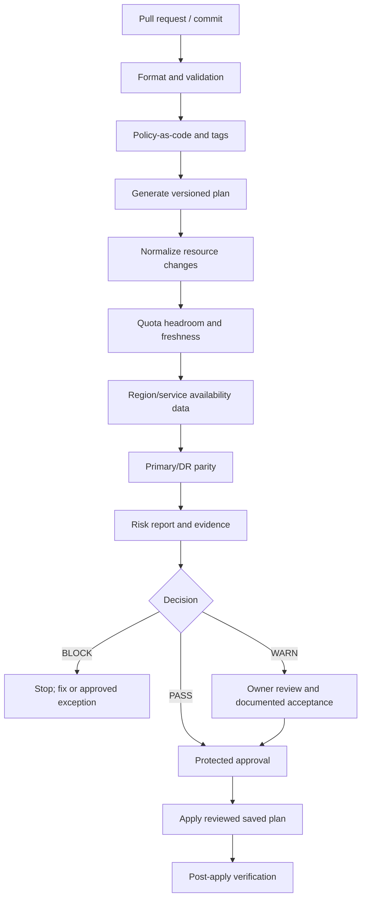

# Production DevOps & Platform Engineering — Unit 7

## Unit 7 — Cloud quotas, service limits, and resource governance

**Target file:** `07-cloud-quotas-service-limits-and-resource-governance.md` | **Estimated time:** 12–18 hours | **Prerequisites:** Stages 0–2D and Stage 2E M01–M06; Git, Linux, CI/CD, JSON, Python basics, Terraform/OpenTofu plan/state fundamentals

**Core tools:** Python 3 standard library, Git, JSON tooling; Terraform/OpenTofu optional for plan inspection | **Awareness:** AWS Service Quotas, Azure quotas/limits, Google Cloud quotas, LocalStack, provider SDK retry behavior, capacity reservations, organization policy systems | **Last reviewed:** 2026-10-28 | **Tool baseline assumed:** Python 3.10+; IaC/provider versions must be recorded and verified `[VERIFY]` | **Substrate:** local-only synthetic data and localhost API stub; real cloud is not required

> **Safety and evidence statement:** All lab quotas, quantities, request rates, thresholds, and sample outcomes are `[SYNTHETIC]`. No required lab provisions or mutates cloud resources. Provider-specific commands, flags, service coverage, and version behavior are `[VERIFY]` unless explicitly tested against current official documentation. Representative output is not a claim of execution. Live official documentation was not independently verified during authoring.

## Scope and assumptions

The running example is a data/ML platform with `dev`, `staging`, and `prod`; raw, curated, and model-artifact object storage; metadata/database services; queues/topics; compute and autoscaling; region failover; tags; and shared account/project/subscription quotas.

This lesson covers quota semantics, local inventory and headroom arithmetic, pre-flight checks, retries, governance, and incident response. It does not predict provider capacity or guarantee apply success. It links rather than duplicates: M03 Unit 2 (Kubernetes quotas/limit ranges), M06/Unit 6 (policy as code), Unit 3 (state/import/drift), Unit 8 (decommission/orphans), M11 (monitoring), M13/M14 (DR/multi-region), M15 (FinOps/reservations), M02 (CI/CD), M09 (secrets/identity), M10 (SRE incidents), M16 (platform engineering), and M17 (capstone). The supplied roadmap tree shows `Stage 2E — Production DevOps & Platform Engineering/07-Advanced-Infrastructure-as-Code-and-Cloud-Operations/`; this lesson does not alter that tree.

---

### 7.0 Why this matters in production

A configuration can validate and produce a plausible plan yet fail during apply because a regional quota is exhausted, an API is throttling, or provider capacity is unavailable. Partial apply can leave infrastructure inconsistent. A DR region may be configured but lack quota for the recovery workload. A shared quota can let one team’s unbounded autoscaling starve a critical service. Quota governance makes constraints visible before launch while recognizing that a pre-flight check reduces risk; it does not guarantee provider acceptance.

### 7.1 Learning objectives

1. **[L1]** Distinguish quota, service limit, API rate limit/throttling, cost budget, and capacity.
2. **[L1]** Explain scope and why DR may have less usable headroom than primary.
3. **[L2]** Validate synthetic quota/inventory data and calculate headroom/utilization safely.
4. **[L2]** Build a plan-aware pre-flight gate from a defined normalized plan schema.
5. **[L2]** Describe a quota-increase process without live mutation.
6. **[L2]** Explain bounded retries, backoff/jitter, timeouts, idempotency, and retry classification.
7. **[L3]** Forecast demand with uncertainty and define local alert/headroom policy.
8. **[L3]** Design tags, TTL, showback, shadow-IT discovery, and multi-tenant fairness controls.
9. **[L4]** Design an IaC pre-flight gate with pass/warn/block outcomes and auditable evidence.
10. **[L4]** Apply a quota-exhaustion runbook and analyze five governance/incident scenarios.

### 7.2 Concept map and vocabulary

#### 7.2.1 Quota vs limit vs rate limit vs capacity vs budget

| Concept | Definition | Typical failure signal | Response | Does not prove |
|---|---|---|---|---|
| **Quota** | Provider-enforced allocation/allowed quantity scoped by account/project/subscription, region, service, family, or another dimension. Adjustable status varies. | Requested allocation exceeds the quota. | Confirm exact quota, scope, unit, usage, and adjustability; reduce demand, request increase, or redesign. | Provider capacity exists or caller has permission. |
| **Service limit** | Product constraint on size, configuration, or entity count; provider terminology varies. | One object/configuration exceeds a service maximum. | Verify service documentation; split/batch/redesign if hard. | Account quota increase can raise the limit. |
| **API rate limit / throttling** | Request-rate or concurrency constraint for an API/operation/identity/service. | Throttle response or delayed/rejected API calls. | Bounded retries, backoff/jitter, batching, caching, concurrency controls. | Resource quota is exhausted. |
| **Cost budget** | Spending target, forecast, or alert threshold. | Budget/forecast notification. | Detect, notify, and trigger separately guarded responses. | Hard spend cap; billing data may lag. |
| **Capacity** | Provider’s actual ability to allocate a requested resource at a time and placement. | Capacity/availability error despite positive headroom. | Approved alternate family/zone/region, reduce demand, or suitable reservation. | Quota is insufficient. |
| **Usage** | Measured consumption for a quota’s unit and scope at a point in time. | Provider telemetry or reconciled inventory. | Record source/timestamp and reconcile. | Reading is fresh or complete. |
| **Headroom** | Limit minus usage, when units and scope match. | Remaining allocation under recorded limit. | Compare projected demand plus reserve to headroom. | Headroom can all be used or capacity exists. |

“Soft” often means requestable; “hard” often means not requestable through the normal process. These are not universal provider labels. Never assume adjustability. Quota names, units, scopes, default values, and request procedures vary by provider and service. This lesson does not state real provider default values.

#### 7.2.2 Scope and relationship diagram

```text
Demand / planned change / autoscaling forecast
        |
        +--> Quota limit vs usage --> headroom = limit - usage --> pass/warn/block
        |
        +--> API request pressure --> rate limit / throttling --> bounded retry
        |
        +--> Placement request --> provider capacity may still be unavailable
        |
        +--> Spend forecast --> budget alert (detection, not hard cap)
```

#### 7.2.3 Glossary

| Term | Precise definition | Common misconception |
|---|---|---|
| Quota inventory | Records of critical quota, scope, unit, limit, usage, owner, source, freshness, and policy. | A spreadsheet is authoritative forever. |
| Utilization | Usage / limit for a known positive limit. | Unknown or zero limit means zero utilization. |
| Projected usage | Estimated usage after a planned change/forecast window. | One IaC resource always consumes one quota unit. |
| Reserve headroom | Deliberately unused allocation for bursts/recovery/critical workloads. | Unused quota is necessarily waste. |
| Idempotency | Repeating an operation does not create unintended additional effects. | Every API operation is safe to retry. |
| Exponential backoff | Retry delay increases after failures. | Backoff without jitter prevents synchronized retries. |
| Eventual consistency | A successful write may not immediately appear in every read path. | An immediate missing read proves the write failed. |
| Noisy neighbor | One workload consumes a shared pool and harms others. | Team boundaries align with cloud quota boundaries. |
| Showback / chargeback | Cost visibility / financial allocation under an organizational process. | They mean the same thing. |
| Shadow IT | Resources created outside the approved inventory/process. | Every resource missing from one state is safe to delete. |
| DR parity | Evidence that DR has quota and dependencies for planned recovery demand. | Primary and DR raw limits must be identical. |

#### 7.2.4 Arithmetic and example

- `headroom = limit - current_usage`
- `utilization = current_usage / limit` when limit is known and positive
- `projected_usage = current_usage + planned_increment`
- `projected_headroom = limit - projected_usage`
- `required_capacity = forecast_demand + reserve`
- `quota_gap = max(0, required_capacity - limit)`

If limit is unknown, stale, zero, or in a different unit/scope, utilization is **unknown**, not zero. Negative headroom means recorded usage exceeds the limit or data is inconsistent; do not silently clamp it to zero.

Example `[SYNTHETIC]`: limit 100 worker units, usage 72, so headroom is `100 - 72 = 28`. A scale-out adds 20: projected usage `72 + 20 = 92`; projected headroom `100 - 92 = 8`; projected utilization is 92%. An 85% warning threshold `[SYNTHETIC]` would warn without blocking. Thresholds are design choices, not universal standards.

### 7.3 Level 1 — Beginner

#### 7.3.1 First-principles model

The provider may reject a request because quota is exhausted, a service limit is exceeded, the API is throttling, permission is missing, a dependency is unavailable, or placement capacity is absent. Diagnose the error class before acting. In the data platform, compute scale-out may fail on a regional quota; it may also fail with quota headroom if the provider cannot place that family in the selected zone. A burst of read calls can be throttled even with ample resource quota. A budget alert may arrive later and does not stop resource creation by itself.

#### 7.3.2 Incident patterns

- **Autoscaling fails:** desired capacity rises but new resources cannot be allocated; confirm quota/family/region and exact error.
- **Deployment fails midway:** earlier resources succeed; later operations fail. Reconcile state and provider reality before retrying.
- **Launch blocked:** forecast and quota-request lead time were omitted from planning.
- **DR fails:** secondary region exists but cannot accommodate recovery demand.
- **Shared quota starvation:** a batch workload consumes a pool needed by a critical API.

#### 7.3.3 Guided classification

All values are `[SYNTHETIC]`.

| Observation | Likely class | First check | Unsafe assumption |
|---|---|---|---|
| Requested count exceeds regional allocation | Quota | Exact quota, scope, unit, usage, adjustability | “Retry until it works.” |
| Burst of API calls receives throttle responses | Rate limiting | Operation-specific retry guidance/concurrency | “Request a resource quota increase.” |
| Positive headroom but placement fails | Capacity/availability | Family, zone/region, permissions, dependencies | “Headroom guarantees allocation.” |
| One object exceeds maximum size | Service limit | Current service-specific object limit | “Account quota increase fixes it.” |
| Spend alert fires while resources keep running | Budget detection | Alert semantics/latency and separate controls | “Budget is a hard cap.” |

#### 7.3.4 What just happened?

A quota source reports a limit and usage for a particular scope. The proposed change adds demand. The calculator subtracts projected usage from the same scoped limit, then compares utilization with a team-defined threshold. The output is a decision signal, not a provider reservation: the provider may see other concurrent consumption, a different hidden dependency, or a capacity problem.

#### 7.3.5 Beginner mistakes

| Mistake | Symptom | Correction |
|---|---|---|
| Store number without region/unit | False headroom | Record scope and unit for every quota. |
| Treat missing limit as unlimited | Gate allows risky plan | Critical unknown data blocks or requires explicit bounded exception. |
| Retry every failure | Longer outage/request storm | Retry only transient errors, bounded, with jitter. |
| Assume DR inherits primary quota | Failover stalls | Inventory and test each region independently. |
| Treat budget as cap | Unexpected spend continues | Combine alerts with identity, policy, and scale controls. |

### 7.4 Level 2 — Intermediate

#### 7.4.1 Safe quota discovery

Use provider consoles, documented quota APIs/CLIs, and service documentation. Capture exact provider, service, quota name/ID, scope, unit, limit, usage source, adjustability, timestamp, and request process. Read-only discovery is distinct from requesting or changing a quota. Verify identity, account/project/subscription, region, permissions, and syntax before any optional real-account command.

- AWS: Service Quotas console and service-specific quota docs; read-only CLI/API syntax `[VERIFY]`.
- Azure: portal quota pages and service-specific limits docs; read-only CLI/API syntax `[VERIFY]`.
- Google Cloud: Quotas & System Limits and service docs; read-only CLI/API syntax `[VERIFY]`.
- LocalStack is partial emulation and does **not** model real cloud quotas. Exact service coverage/edition is version-sensitive `[VERIFY]`; required labs simulate quota behavior directly.

No live quota mutation command is required. Optional real-account discovery must be read-only, identity-confirmed, and verified against current official documentation.

#### 7.4.2 Synthetic quota and resource inventory fixtures

All values below are `[SYNTHETIC]`. The calculator validates exact scope/unit matches and reconciles the fixture’s inventory sums with usage. Real provider usage may include resources absent from an IaC state; use a trustworthy usage source and document its semantics.

`quota-inventory.json`:

```json
{
  "schema_version": 1,
  "generated_at": "2026-10-28T04:00:00Z",
  "max_age_minutes": 180,
  "quotas": [
    {"quota_id":"compute-workers-primary","service":"compute-workers","region":"region-primary","scope_key":"account-demo|region-primary|compute-workers","unit":"worker_units","limit":100,"usage":72,"alert_threshold":0.85,"critical":true,"owner":"platform-sre","adjustable":"verify"},
    {"quota_id":"compute-workers-dr","service":"compute-workers","region":"region-dr","scope_key":"account-demo|region-dr|compute-workers","unit":"worker_units","limit":80,"usage":18,"alert_threshold":0.85,"critical":true,"owner":"platform-sre","adjustable":"verify"},
    {"quota_id":"queue-throughput-primary","service":"queue-throughput","region":"region-primary","scope_key":"account-demo|region-primary|queue-throughput","unit":"messages_per_second","limit":1000,"usage":540,"alert_threshold":0.80,"critical":false,"owner":"data-platform","adjustable":"verify"},
    {"quota_id":"object-count-primary","service":"object-count","region":"region-primary","scope_key":"account-demo|region-primary|object-count","unit":"objects","limit":100000,"usage":24000,"alert_threshold":0.90,"critical":false,"owner":"data-platform","adjustable":"verify"}
  ]
}
```

`resource-inventory.json`:

```json
{
  "schema_version": 1,
  "generated_at": "2026-10-28T04:05:00Z",
  "max_age_minutes": 180,
  "resources": [
    {"resource_id":"prod-training-pool","service":"compute-workers","region":"region-primary","scope_key":"account-demo|region-primary|compute-workers","unit":"worker_units","quantity":50,"owner":"ml-platform","tags":{"environment":"prod","owner":"ml-platform","cost-center":"CC-ML","managed-by":"terraform","data-classification":"internal","lifecycle":"persistent"}},
    {"resource_id":"staging-etl-pool","service":"compute-workers","region":"region-primary","scope_key":"account-demo|region-primary|compute-workers","unit":"worker_units","quantity":22,"owner":"data-platform","tags":{"environment":"staging","owner":"data-platform","cost-center":"CC-DATA","managed-by":"terraform","data-classification":"internal","lifecycle":"ttl","ttl-hours":"24"}},
    {"resource_id":"dr-warm-pool","service":"compute-workers","region":"region-dr","scope_key":"account-demo|region-dr|compute-workers","unit":"worker_units","quantity":18,"owner":"platform-sre","tags":{"environment":"dr","owner":"platform-sre","cost-center":"CC-PLATFORM","managed-by":"terraform","data-classification":"internal","lifecycle":"persistent"}},
    {"resource_id":"queue-prod","service":"queue-throughput","region":"region-primary","scope_key":"account-demo|region-primary|queue-throughput","unit":"messages_per_second","quantity":540,"owner":"data-platform","tags":{"environment":"prod","owner":"data-platform","cost-center":"CC-DATA","managed-by":"terraform","data-classification":"internal","lifecycle":"persistent"}},
    {"resource_id":"raw-store","service":"object-count","region":"region-primary","scope_key":"account-demo|region-primary|object-count","unit":"objects","quantity":24000,"owner":"data-platform","tags":{"environment":"prod","owner":"data-platform","cost-center":"CC-DATA","managed-by":"terraform","data-classification":"restricted","lifecycle":"persistent"}}
  ]
}
```

#### 7.4.3 Lab 1 — quota-headroom calculator and plan-aware gate

**Freshness note:** the timestamps in the sample fixtures are illustrative. Before running, set each `generated_at` to the current UTC time; preserve the old timestamp in a separate stale-data test. This avoids a fixture becoming stale simply because the lesson is reused later.

**Substrate:** local filesystem + Python standard library. **Touches real cloud:** no. **Cost:** zero. **Cleanup:** delete the temporary directory after saving sanitized evidence.

Create `quota_lab.py`:

```python
#!/usr/bin/env python3
"""Synthetic quota calculator and normalized-plan pre-flight gate."""
import argparse, json, sys
from datetime import datetime, timezone
from pathlib import Path

class InputError(ValueError): pass

def load(path):
    try: data=json.loads(Path(path).read_text(encoding="utf-8"))
    except (OSError,json.JSONDecodeError) as e: raise InputError(f"invalid {path}: {e}")
    if not isinstance(data,dict): raise InputError(f"{path}: top-level JSON must be object")
    return data

def number(obj,key,minimum=0):
    x=obj.get(key)
    if isinstance(x,bool) or not isinstance(x,(int,float)) or x<minimum:
        raise InputError(f"{key} must be numeric and >= {minimum}")
    return float(x)

def fresh(doc,label,now):
    try: stamp=datetime.fromisoformat(doc["generated_at"].replace("Z","+00:00"))
    except (KeyError,ValueError,TypeError) as e: raise InputError(f"{label}: invalid generated_at: {e}")
    if stamp.tzinfo is None: raise InputError(f"{label}: timezone required")
    age=(now-stamp.astimezone(timezone.utc)).total_seconds()/60
    max_age=number(doc,"max_age_minutes")
    if age < -5 or age>max_age: raise InputError(f"{label}: stale/future data age={age:.1f}m")

def quotas_index(doc):
    if doc.get("schema_version")!=1 or not isinstance(doc.get("quotas"),list): raise InputError("invalid quota schema")
    out={}
    for q in doc["quotas"]:
        if not isinstance(q,dict): raise InputError("quota entry must be object")
        for k in ("quota_id","service","region","scope_key","unit","owner"):
            if not isinstance(q.get(k),str) or not q[k].strip(): raise InputError(f"quota missing {k}")
        if q["quota_id"] in out: raise InputError(f"duplicate quota_id {q['quota_id']}")
        limit=number(q,"limit"); usage=number(q,"usage"); threshold=number(q,"alert_threshold")
        if limit<=0: raise InputError("limit must be > 0; unknown is not unlimited")
        if threshold>1: raise InputError("alert_threshold must be ratio <= 1")
        if q.get("critical") not in (True,False): raise InputError("critical must be boolean")
        out[q["quota_id"]]=q
    return out

def inventory_records(doc):
    if doc.get("schema_version")!=1 or not isinstance(doc.get("resources"),list): raise InputError("invalid inventory schema")
    seen=set()
    for r in doc["resources"]:
        if not isinstance(r,dict): raise InputError("resource must be object")
        for k in ("resource_id","service","region","scope_key","unit","owner"):
            if not isinstance(r.get(k),str) or not r[k].strip(): raise InputError(f"resource missing {k}")
        if r["resource_id"] in seen: raise InputError(f"duplicate resource_id {r['resource_id']}")
        seen.add(r["resource_id"]); number(r,"quantity")
        if not isinstance(r.get("tags"),dict): raise InputError(f"{r['resource_id']}: tags must be object")
    return doc["resources"]

def calculate(qpath,ipath,now):
    qdoc,idoc=load(qpath),load(ipath); fresh(qdoc,"quota",now); fresh(idoc,"inventory",now)
    qs=quotas_index(qdoc); resources=inventory_records(idoc); sums={k:0.0 for k in qs}; alerts=[]
    scopes={(q["scope_key"],q["unit"],q["service"],q["region"]):qid for qid,q in qs.items()}
    for r in resources:
        key=(r["scope_key"],r["unit"],r["service"],r["region"])
        if key not in scopes: raise InputError(f"{r['resource_id']}: no exact quota scope/unit match")
        sums[scopes[key]]+=float(r["quantity"])
    for qid,q in qs.items():
        usage=float(q["usage"]); limit=float(q["limit"]); head=limit-usage; util=usage/limit
        if head<0: alerts.append(f"BLOCK {qid}: negative headroom {head:g}")
        if util>=float(q["alert_threshold"]): alerts.append(f"WARN {qid}: utilization {util:.1%} >= {q['alert_threshold']:.1%}")
        if abs(sums[qid]-usage)>1e-9: raise InputError(f"{qid}: inventory sum {sums[qid]:g} != usage {usage:g}; reconcile source definitions")
        print(f"{qid}: usage={usage:g} {q['unit']}, limit={limit:g}, headroom={head:g}, utilization={util:.1%}")
    return qs,alerts

def check_plan(path,qs):
    doc=load(path)
    if doc.get("schema_version")!=1 or not isinstance(doc.get("changes"),list): raise InputError("normalized plan schema invalid")
    seen=set(); deltas={}
    for c in doc["changes"]:
        if not isinstance(c,dict): raise InputError("change must be object")
        for k in ("change_id","quota_id","unit","scope_key","action"):
            if not isinstance(c.get(k),str) or not c[k].strip(): raise InputError(f"change missing {k}")
        if c["change_id"] in seen: raise InputError(f"duplicate change_id {c['change_id']}")
        seen.add(c["change_id"])
        if c["action"] not in ("create","increase","no-op","delete"): raise InputError("unsupported action")
        amount=number(c,"quota_units"); qid=c["quota_id"]
        if qid not in qs: raise InputError(f"unknown quota {qid}; fail closed")
        q=qs[qid]
        if c["unit"]!=q["unit"] or c["scope_key"]!=q["scope_key"]: raise InputError(f"{c['change_id']}: unit/scope mismatch")
        delta=amount if c["action"] in ("create","increase") else (-amount if c["action"]=="delete" else 0)
        deltas[qid]=deltas.get(qid,0.0)+delta
    violations=[]
    for qid,delta in deltas.items():
        q=qs[qid]; projected=float(q["usage"])+delta; head=float(q["limit"])-projected
        print(f"PLAN {qid}: delta={delta:g}, projected={projected:g}, projected_headroom={head:g}")
        if projected>float(q["limit"]): violations.append(f"BLOCK {qid}: projected {projected:g} > limit {q['limit']}")
        elif projected / float(q["limit"]) >= float(q["alert_threshold"]): print(f"WARN {qid}: projected utilization {projected/float(q['limit']):.1%} >= {q['alert_threshold']:.1%}")
        if projected<0: raise InputError(f"{qid}: projected usage negative")
    return violations

def main():
    p=argparse.ArgumentParser(); p.add_argument("--quotas",default="quota-inventory.json"); p.add_argument("--inventory",default="resource-inventory.json"); p.add_argument("--plan"); a=p.parse_args()
    try:
        qs,alerts=calculate(a.quotas,a.inventory,datetime.now(timezone.utc)); violations=check_plan(a.plan,qs) if a.plan else []
        for x in alerts+violations: print(x)
        return 3 if violations or any(x.startswith("BLOCK") for x in alerts) else 0
    except InputError as e: print(f"INPUT ERROR: {e}",file=sys.stderr); return 2
if __name__=="__main__": raise SystemExit(main())
```

`normalized-plan-pass.json`:

```json
{"schema_version":1,"changes":[{"change_id":"small-batch","quota_id":"compute-workers-primary","unit":"worker_units","scope_key":"account-demo|region-primary|compute-workers","action":"create","quota_units":10}]}
```

`normalized-plan-warn.json`:

```json
{"schema_version":1,"changes":[{"change_id":"near-limit","quota_id":"compute-workers-primary","unit":"worker_units","scope_key":"account-demo|region-primary|compute-workers","action":"create","quota_units":18}]}
```

`normalized-plan-fail.json`:

```json
{"schema_version":1,"changes":[{"change_id":"oversized","quota_id":"compute-workers-primary","unit":"worker_units","scope_key":"account-demo|region-primary|compute-workers","action":"create","quota_units":35}]}
```

Run the base report and each plan:

```bash
python3 quota_lab.py --quotas quota-inventory.json --inventory resource-inventory.json
python3 quota_lab.py --quotas quota-inventory.json --inventory resource-inventory.json --plan normalized-plan-pass.json
python3 quota_lab.py --quotas quota-inventory.json --inventory resource-inventory.json --plan normalized-plan-warn.json
python3 quota_lab.py --quotas quota-inventory.json --inventory resource-inventory.json --plan normalized-plan-fail.json
```

**Fixture reconciliation:** the compute primary inventory sums to 72 (`50 + 22`); DR sums to 18; queue sums to 540; object count sums to 24,000. Those equal the synthetic `usage` fields. Representative behavior (not executed): pass plan projects `72 + 10 = 82`, headroom 18, exit 0; warning plan projects 90, headroom 10 and warns at the 85% policy threshold but does not block; fail plan projects 107, headroom -7 and exits 3. The base script warns when current utilization crosses the threshold and blocks negative headroom.

**Failure injection:** duplicate an ID, change a region or unit, set limit to zero, use a negative quantity, corrupt JSON, or set a stale timestamp. Invalid data should exit 2, not be treated as unlimited. Restore fixtures after testing.

**Plan JSON contract:** the plan fixtures are simplified normalized data, not actual Terraform/OpenTofu plan JSON. Raw plan JSON is version-coupled, may include sensitive values and unknowns, and has no universal quota-consumption field. A tested adapter must map resource types/actions/attributes into `change_id`, `quota_id`, `scope_key`, `unit`, `action`, and `quota_units`; unknown mappings must remain unknown. Keep plan artifacts restricted and never print secrets. A successful plan/pre-flight cannot guarantee apply success because quota usage and provider conditions can change.

A Terraform/OpenTofu `precondition` can check quota data only when trustworthy data is available to the configuration. A checked-in static file can be stale. Do not invent provider quota data sources; verify exact provider/service availability and syntax `[VERIFY]`. Use a pipeline gate for cross-resource correlation. Preconditions are unsuitable when the quota source is unavailable, stale, or not comparable to the resource’s actual consumption.

#### 7.4.4 Pattern catalogue and anti-pattern catalogue

| Pattern | Use when | Do not use when |
|---|---|---|
| Central quota inventory with freshness | Several teams/services share scopes and need common reporting | It would be treated as authoritative without a source/timestamp or ownership. |
| Resource-specific normalized plan mapping | The resource type and quota-consumption rule are known and tested | Unknown attributes or resource types are guessed as zero. |
| Report-only governance rollout | Legacy resources need ownership/tag remediation before enforcement | A known critical risk requires immediate blocking; use an explicit approved transition plan. |
| Reserved headroom for critical workloads | A shared quota must preserve recovery/critical service capacity | The reserve is undocumented or no one owns arbitration. |
| Bounded retry with jitter | A documented transient API error is retryable | Error is permanent, operation is unsafe to repeat, or retry budget is exhausted. |

| Anti-pattern | How it causes damage | Corrected version |
|---|---|---|
| Unknown limit means unlimited | Gate passes on missing evidence | Fail closed for critical data; explicit bounded exception only where policy allows. |
| Retry every failed apply | Duplicate creates, retry storms, longer incident | Classify errors, inspect partial state/reality, retry bounded transient failures. |
| Same quota value copied into DR | Failover fails at scale | Query and test each region against recovery demand plus reserve. |
| Budget treated as cap | Spend continues despite alert | Separate detection from identity/policy/autoscaling controls. |
| One quota unit per IaC resource | Projected demand is understated or overstated | Use resource-specific mapping with unknown handling and tests. |

#### 7.4.5 Quota increase process

1. Identify exact provider, service, quota name/ID, scope, region, unit, and account/project/subscription.
2. Verify adjustability and any separate hard service limit.
3. Capture current usage/limit/headroom, forecast demand, uncertainty, and reserve.
4. State launch/incident impact and required-by date.
5. Evaluate primary and DR together.
6. Submit through the documented provider process and approvals.
7. Track request ID, owner, status, request value `[ILLUSTRATIVE]`, and review date.
8. Plan for lead time or denial; identify a fallback.
9. After approval, re-read the quota and verify the exact scope/unit before relying on it.

Some limits cannot be raised; requests may be delayed or denied. Automated quota-request IaC resources are awareness-only and exist only where a provider explicitly supports them. Do not fabricate resource types or imply all providers support them.

#### 7.4.6 Throttling, retries, and eventual consistency

Use bounded exponential backoff with jitter, request timeouts, a maximum attempt count, an overall retry/time budget, concurrency control, batching, and safe caching of reads. Retry only documented transient errors; do not retry authentication, validation, unsupported operations, or permanent quota errors indefinitely. A typical model is `delay = min(max_delay, base_delay * 2^attempt) + jitter`. Honor documented retry hints where supported. Idempotency keys help only if the service actually enforces their semantics; after an ambiguous timeout, reconcile before repeating a non-idempotent operation.

Reducing Terraform/OpenTofu `-parallelism` may reduce concurrent provider calls but does not fix every per-second limit, identity-specific limit, single-operation bottleneck, or provider retry issue. Exact flags and provider settings such as `max_retries` are provider-/version-specific `[VERIFY]`. Avoid repeated full refreshes and competing applies against one state. Eventual consistency/IAM propagation can delay visibility; retry a specific condition within a deadline. `depends_on` defines ordering but not remote convergence; `time_sleep` is not the default fix for poor dependency/retry design.

#### 7.4.7 Lab 2 — localhost rate-limited API stub

**Substrate:** Python standard library, loopback only. **Touches real cloud:** no. **Cleanup:** Ctrl-C the server and verify the port is closed. All rate/window values are `[SYNTHETIC]`.

Create `rate_limit_lab.py`:

```python
#!/usr/bin/env python3
import argparse,json,random,threading,time
from collections import deque
from http.server import BaseHTTPRequestHandler,ThreadingHTTPServer
from urllib.error import HTTPError,URLError
from urllib.request import Request,urlopen
WINDOW=2.0; MAX_REQUESTS=4  # [SYNTHETIC] 4 requests per rolling 2 seconds
hits=deque(); lock=threading.Lock()
class Handler(BaseHTTPRequestHandler):
    def do_POST(self):
        key=self.headers.get("Idempotency-Key",""); body=self.rfile.read(int(self.headers.get("Content-Length","0")))
        now=time.monotonic()
        with lock:
            while hits and now-hits[0]>=WINDOW: hits.popleft()
            if len(hits)>=MAX_REQUESTS:
                self.send_response(429); self.send_header("Retry-After","1"); self.send_header("Content-Type","application/json"); self.end_headers(); self.wfile.write(b'{"error":"synthetic_throttle"}'); return
            hits.append(now)
        # This stub does NOT persist/deduplicate idempotency keys.
        self.send_response(200); self.send_header("Content-Type","application/json"); self.end_headers()
        self.wfile.write(json.dumps({"accepted":True,"key_seen":bool(key),"bytes":len(body)}).encode())
    def log_message(self,fmt,*args): print("SERVER",fmt%args)
def serve():
    s=ThreadingHTTPServer(("127.0.0.1",8765),Handler); print("[SYNTHETIC] localhost:8765; Ctrl-C to stop")
    try: s.serve_forever()
    except KeyboardInterrupt: pass
    finally: s.server_close(); print("server stopped")
def one(i,timeout):
    data=json.dumps({"operation_id":f"lab-op-{i}"}).encode(); req=Request("http://127.0.0.1:8765/submit",data=data,method="POST",headers={"Content-Type":"application/json","Idempotency-Key":f"lab-op-{i}"})
    try:
        with urlopen(req,timeout=timeout) as r: return r.status
    except HTTPError as e: return e.code
    except (URLError,TimeoutError) as e: return f"NETWORK_ERROR:{type(e).__name__}"
def client(count,concurrency,retries,timeout,seed):
    rng=random.Random(seed); sem=threading.Semaphore(concurrency); results=[]
    def run(i):
        with sem:
            attempt=0
            while True:
                status=one(i,timeout)
                if status==200: results.append((i,"OK",attempt)); return
                retryable=status==429 or (isinstance(status,str) and status.startswith("NETWORK_ERROR"))
                if not retryable or attempt>=retries: results.append((i,f"FAIL:{status}",attempt)); return
                delay=min(1.5,.15*(2**attempt))+rng.uniform(0,.10) # deterministic injectable jitter
                print(f"op={i} attempt={attempt+1} status={status}; sleep={delay:.2f}s"); time.sleep(delay); attempt+=1
    threads=[threading.Thread(target=run,args=(i,)) for i in range(count)]; start=time.monotonic()
    for t in threads:t.start()
    for t in threads:t.join()
    results.sort(); print(f"summary concurrency={concurrency} retries={retries} elapsed={time.monotonic()-start:.2f}s ok={sum(s=='OK' for _,s,_ in results)} failed={sum(s!='OK' for _,s,_ in results)}")
    for row in results:print(row)
def main():
    p=argparse.ArgumentParser(); p.add_argument("mode",choices=["server","client"]); p.add_argument("--count",type=int,default=12); p.add_argument("--concurrency",type=int,default=8); p.add_argument("--retries",type=int,default=0); p.add_argument("--timeout",type=float,default=1.0); p.add_argument("--seed",type=int,default=7); a=p.parse_args()
    if a.count<1 or a.concurrency<1 or a.retries<0 or a.timeout<=0:p.error("count/concurrency positive, retries non-negative, timeout positive")
    serve() if a.mode=="server" else client(a.count,a.concurrency,a.retries,a.timeout,a.seed)
if __name__=="__main__":main()
```

Terminal A: `python3 rate_limit_lab.py server`. Terminal B:

```bash
python3 rate_limit_lab.py client --count 12 --concurrency 8 --retries 0
# Wait at least the synthetic window, then compare low concurrency.
python3 rate_limit_lab.py client --count 12 --concurrency 2 --retries 5 --seed 7
# Reset the window and compare higher concurrency with bounded retries.
python3 rate_limit_lab.py client --count 12 --concurrency 8 --retries 5 --seed 7
```

Expected interpretation (not measured): the first burst likely gets 429 responses; lower concurrency reduces pressure but may take longer; bounded retries can improve success but cannot guarantee it if attempts expire or offered load exceeds sustainable throughput. High concurrency can improve throughput under available capacity but increases throttling/tail latency risk. Results vary by scheduling; this is not a benchmark. Stop server with Ctrl-C. Run client with server stopped to test bounded network errors, then restart. The unique idempotency key is only sent, not deduplicated by this stub; production APIs must enforce/document idempotency. No credentials are used and the server binds only to `127.0.0.1`.

#### 7.4.8 Basic resource governance

Recommended tags/labels for the data platform:

| Key | Synthetic example | Purpose / control |
|---|---|---|
| `owner` | `data-platform` | Approved accountable team; validate against owner registry. |
| `environment` | `dev`, `staging`, `prod`, `dr` | Allowed-value policy and environment reporting. |
| `cost-center` | `CC-DATA` | Cost attribution; validate format/owner mapping. |
| `data-classification` | `internal`, `restricted` | Data-handling context. |
| `managed-by` | `terraform` | Expected management system; not proof of state membership. |
| `lifecycle` | `persistent`, `ttl` | Lifecycle policy. |
| `ttl-hours` | `24` | Required, positive, bounded for disposable resources. |

Naming should identify service/environment without secrets or sensitive customer data. Enforce required tags through Unit 6 (`06-policy-as-code-for-infrastructure-guardrails.md`). Tags are metadata, not authorization boundaries. TTL controls start report-only, notify owners, use allow-lists, require reviewed deletion, cap deletions, log decisions, and verify dependencies/retention. Budgets are detection, not caps; pair them with least privilege, policy, autoscaling bounds, quotas, and response procedures.

### 7.5 Level 3 — Advanced

#### 7.5.1 Capacity planning and forecasting

A capacity review compares current usage, forecast demand, requested growth, and reserve headroom. Forecast trends, seasonality, release schedules, batch windows, backfills, training jobs, autoscaling bounds, and uncertainty. Use low/base/high scenarios rather than false precision.

`required_limit = forecast_peak_usage + reserve` and `gap = max(0, required_limit - current_limit)`. Example `[SYNTHETIC]`: current usage 72 units, launch increment 20, batch/seasonal increment 8, reserve 15. Estimated requirement is `72 + 20 + 8 + 15 = 115`. With a limit of 100, the estimated gap is 15. This does not guarantee approval or physical capacity. Verify scope, unit, service capacity, and assumptions independently.

Thresholds such as 80% or 85% `[SYNTHETIC]` are local policy choices, not standards. Define warning/critical thresholds by criticality, growth rate, ability to shed load, and quota-request lead time. Forecast per account/project and region; compare DR against failover demand plus reserve, not simply against primary's raw limit. Relevant quota categories include compute families, storage objects/throughput, network addresses, load balancers, security rules, IAM policies, queues/topics, API operations, managed databases, and object sizes. These are categories only; exact values are `[VERIFY]`.

#### 7.5.2 Monitoring and alerting

Track quota ID, scope, unit, limit, usage, headroom, utilization, trend, forecast, source, timestamp, freshness limit, owner, criticality, threshold, and DR relevance. Distinguish provider-reported telemetry from synthetic lab metrics and estimated inventory sums. Do not invent metric names or assume every provider exposes usage as a metric; some require API polling `[VERIFY]`.

Every alert needs severity, owner, response target, escalation route, and runbook. Stale data must be visible; a green status from an old snapshot is not current evidence. Polling too frequently can cause throttling. An actionable alert includes the exact quota/scope, current values, trend, affected workloads, source timestamp, and next action.

#### 7.5.3 Preventing runaway creation

Layer controls: policy-as-code for allowed regions/resource types/sizes/counts/tags (Unit 6); least-privilege pipeline identities and environment separation; organization-level restrictions (awareness, provider behavior `[VERIFY]`); autoscaling bounds and load-shedding rules; fresh quota pre-flight; and budgets as detection only. A policy count limit differs from provider quota. A policy might permit 100 workers while other workloads have already consumed 90 quota units; policy passing does not prove headroom. Stale policy or quota data can create false confidence. Critical unknowns should block.

#### 7.5.4 Multi-tenant fairness

Provider quota scopes may span teams. One batch workload can consume a shared pool and starve critical inference. Options include separate accounts/projects/subscriptions, per-team allocations, workload scheduling and priorities, reserved headroom, autoscaling bounds, and admission controls. Kubernetes `ResourceQuota` and `LimitRange` constrain namespace-level usage but do not increase cloud quotas; see M03 Unit 2.

A noisy-neighbor policy defines pool owner, workload classes, burst behavior, reserve, shedding order, alert thresholds, and escalation. Separate cloud boundaries where benefits outweigh cross-account/network/identity complexity.

#### 7.5.5 Cost allocation and showback

Showback reports costs to teams; chargeback allocates financial responsibility under organizational policy. Tags help attribution, ownership, lifecycle, and incident response. Provider billing may require cost-allocation tag activation and ingestion; changes may not appear immediately and historical behavior is provider-specific `[VERIFY]`. Never invent prices or claim instant billing visibility. A compliance report should include resource, owner, environment, cost center, missing/invalid tags, lifecycle/TTL, discovery source, last-seen timestamp, severity, and remediation owner. Deeper FinOps is M15.

#### 7.5.6 Shadow IT and unmanaged resources

Distinguish out-of-band creation, state omission/removal, controller-managed resources, and resources intentionally owned by another stack/team. Missing from one IaC state does not mean safe to delete. Discover owner, dependencies, data classification, activity, controller, and retention requirements. Start report-only/quarantine, then use reviewed import/adoption or decommission plans. Unit 3 covers state/import/drift; Unit 8 covers decommissioning.

#### 7.5.7 Rate-limit-aware automation and service-limit-aware modules

Reduce redundant API calls, cache safe reads, batch where supported, stagger schedules, serialize operations against the same state, and avoid refresh storms. Splitting state can reduce refresh scope and blast radius but adds cross-state dependencies and sequencing complexity; split only where lifecycle, ownership, failure domain, or request pressure justifies it.

Modules should validate safe bounds and document service-limit constraints. Examples include maximum security rules, policies per role, object size, or resource count; these are illustrative categories without numeric values. After an ambiguous failure, inspect state and provider reality before repeating a create. `depends_on` is ordering, not readiness; `time_sleep` is not the default solution for poor dependency or retry design.

#### 7.5.8 Launch checklist

- [ ] Fresh quota inventory with scope, unit, source, timestamp, usage, limit, and headroom.
- [ ] Forecast covers peak, release overlap, batch work, autoscaling maximum, and uncertainty.
- [ ] Quota gap/request has owner, lead time, and fallback.
- [ ] Capacity and region/service availability checked separately from quota.
- [ ] API throttling, timeouts, bounded retries, and concurrency reviewed.
- [ ] Tags/policies pass; exceptions have owner, expiry, and evidence.
- [ ] Autoscaling bounds, priority, queueing/shedding are defined.
- [ ] Primary/DR quotas support the recovery workload and dependencies.
- [ ] Telemetry has ownership and freshness (M11).
- [ ] Saved plan is tied to commit, tool/provider versions, and approval (M02).
- [ ] Rollback/reconciliation and partial-apply steps are documented.
- [ ] Budget alerts are not treated as a hard cap.

#### 7.5.9 DR readiness checklist

- [ ] Critical services and units listed for primary and DR.
- [ ] DR quota values sourced and fresh; no assumed defaults.
- [ ] Forecast includes production recovery, traffic surge, data recovery, and reserve.
- [ ] DR headroom meets recovery demand.
- [ ] Resource family/region availability verified.
- [ ] Identity/permissions and policy controls work in DR.
- [ ] Networking, traffic switching, dependencies, and data availability verified.
- [ ] API rate limits and request budgets understood.
- [ ] Quota request lead times and escalation contacts documented.
- [ ] DR exercise proves recovery at target scale and preserves evidence.
- [ ] Owner, last-test date, gaps, and next action recorded.

#### 7.5.10 Defended design decision: quota governance for a new launch

Write a one-page decision memo for a `[SYNTHETIC]` launch whose forecast peak is 115 worker units plus an uncertainty reserve, while the current quota limit is 100. Compare (a) request an increase, (b) cap or queue non-critical work, (c) use an approved alternate family/region, and (d) redesign/shard. For each, state assumptions, dependencies, risks, DR implications, lead time, rollback, and evidence. Choose one primary path and one fallback. A strong answer does not equate quota with capacity, includes the DR region, names owners, and states what data would block the decision.

#### 7.5.11 Lab 3 — Tag-compliance audit

**Substrate:** Python standard library and synthetic JSON. **Touches real cloud:** no. **Default mode:** report-only; no mutation/deletion. **Cleanup:** remove temporary directory.

`tag-audit-inventory.json`:

```json
{
  "schema_version": 1,
  "known_owners": ["data-platform", "ml-platform", "platform-sre"],
  "resources": [
    {"id":"raw-store","environment":"prod","owner":"data-platform","tags":{"environment":"prod","owner":"data-platform","cost-center":"CC-DATA","managed-by":"terraform","lifecycle":"persistent"}},
    {"id":"temp-debug","environment":"dev","owner":"unknown-team","tags":{"environment":"development","owner":"","managed-by":"console","lifecycle":"ttl","ttl-hours":"0"}},
    {"id":"staging-queue","environment":"stage","owner":"data-platform","tags":{"environment":"stage","owner":"data-platform","cost-center":"","managed-by":"terraform"}},
    {"id":"shared-registry","environment":"prod","owner":"platform-sre","tags":{"environment":"prod","owner":"platform-sre","cost-center":"CC-PLATFORM","managed-by":"terraform"}}
  ]
}
```

`tag_audit.py`:

```python
#!/usr/bin/env python3
import argparse,json,sys
from pathlib import Path
REQUIRED=("environment","owner","cost-center","managed-by")
ENVS={"dev","staging","prod","dr"}
def main():
    p=argparse.ArgumentParser(); p.add_argument("inventory",nargs="?",default="tag-audit-inventory.json"); p.add_argument("--strict",action="store_true"); p.add_argument("--apply",action="store_true"); a=p.parse_args()
    if a.apply: print("ERROR: report-only tool has no mutation mode",file=sys.stderr); return 2
    try: d=json.loads(Path(a.inventory).read_text(encoding="utf-8"))
    except (OSError,json.JSONDecodeError) as e: print(f"INPUT ERROR: {e}",file=sys.stderr); return 2
    if d.get("schema_version")!=1 or not isinstance(d.get("resources"),list): print("INPUT ERROR: schema invalid",file=sys.stderr); return 2
    owners=set(d.get("known_owners",[])); seen=set(); findings=[]
    for r in d["resources"]:
        if not isinstance(r,dict) or not isinstance(r.get("id"),str) or not isinstance(r.get("tags"),dict): print("INPUT ERROR: malformed resource",file=sys.stderr); return 2
        rid,tags=r["id"],r["tags"]
        if rid in seen: print(f"INPUT ERROR: duplicate id {rid}",file=sys.stderr); return 2
        seen.add(rid)
        def add(sev,code,msg): findings.append((sev,rid,code,msg))
        for k in REQUIRED:
            if not isinstance(tags.get(k),str) or not tags[k].strip(): add("ERROR","MISSING_TAG",k)
        owner=tags.get("owner") or r.get("owner","")
        if owner and owner not in owners: add("ERROR","UNKNOWN_OWNER",owner)
        env=tags.get("environment","")
        if env not in ENVS: add("ERROR","INVALID_ENVIRONMENT",str(env))
        if r.get("environment")!=env: add("WARN","ENVIRONMENT_MISMATCH",f"record={r.get('environment')} tag={env}")
        lifecycle=tags.get("lifecycle","")
        if lifecycle not in ("persistent","ttl"): add("WARN","MISSING_LIFECYCLE",lifecycle or "unset")
        if lifecycle=="ttl":
            try: ttl=int(tags.get("ttl-hours",""))
            except (TypeError,ValueError): ttl=0
            if ttl<=0 or ttl>720: add("ERROR","INVALID_TTL",f"ttl-hours={tags.get('ttl-hours')!r}; synthetic policy range 1..720")
        if tags.get("managed-by")=="console": add("WARN","UNMANAGED_PROCESS","investigate owner; do not auto-delete")
    print("REPORT-ONLY TAG AUDIT — no resources modified")
    for f in findings: print(" ".join(f))
    errors=sum(f[0]=="ERROR" for f in findings); warns=sum(f[0]=="WARN" for f in findings)
    print(f"summary resources={len(seen)} errors={errors} warnings={warns}")
    return 3 if a.strict and errors else 0
if __name__=="__main__": raise SystemExit(main())
```

Run `python3 tag_audit.py` and `python3 tag_audit.py --strict`. Expected, not executed: `temp-debug` produces unknown owner, invalid environment, mismatch, invalid TTL, and unmanaged-process findings; `staging-queue` has missing cost center/invalid environment/lifecycle; `shared-registry` lacks lifecycle metadata. Strict mode exits 3 for errors. Positive test: fix tags/owner/environment/lifecycle. Negative test: duplicate an ID or corrupt JSON; input must fail. No deletion function exists.

**Optional LocalStack S3 audit:** only if the installed version supports the required S3 listing/tag APIs. Verify version/edition and current CLI/API syntax `[VERIFY]`; use a local endpoint and no cloud credentials. Keep the audit read-only. LocalStack does not prove real quota, IAM, tag-policy, or billing behavior. This extension is optional; the synthetic audit satisfies the lab.

#### 7.5.12 Quota governance inventory template

| Field | Required meaning |
|---|---|
| Quota ID/name, provider, service | Stable identifier and exact provider name. |
| Account/project/subscription, region, family/operation | Exact quota scope; protect sensitive identifiers. |
| Unit, limit, usage, headroom, utilization | Compatible values; unknown is not zero. |
| Source, `observed_at`, `generated_at`, max age | Traceability and freshness. |
| Adjustability and request process | Adjustable / not adjustable / verify, with evidence. |
| Owner, escalation path, criticality | Accountable team and response route. |
| Alert threshold and review cadence | Team policy and rationale; next review date. |
| Forecast, uncertainty, reserve | Scenario, assumptions, protected headroom. |
| DR relevance and secondary quota ID | Link to recovery dependency. |
| Exception, expiry, approver, evidence | Explicit, bounded exception; sanitized references. |

#### 7.5.13 Quota increase request template

```text
Request title: [service + quota + scope]
Owner / backup owner: [team alias]
Provider / account-project-subscription: [approved reference]
Exact service/quota ID: [verified]
Region / family / operation / unit: [verified]
Current limit / usage / headroom / observed_at: [values + source]
Forecast peak / uncertainty / time window: [assumptions]
Requested limit: [ILLUSTRATIVE; confirm provider unit/process]
Reserve policy after increase: [rationale]
Business impact if delayed/denied: [specific impact]
Required-by date and lead-time basis: [date/dependency]
Primary-region and DR-region impact: [assessment]
Alternatives considered: [shed/batch/family/region/architecture]
Capacity assessment: [separate from quota]
Approvals and evidence: [owners, sanitized plan/forecast/telemetry]
Provider request ID/status/submitted_at: [reference]
Post-approval read-only validation: [exact scope and unit]
Next review date and follow-up owner: [owner/date]
```

#### 7.5.14 Decision table

| Option | Use when | Prerequisites | Risk/trade-off |
|---|---|---|---|
| Request quota increase | Adjustable limit and justified demand | Exact scope, evidence, owner, lead time, DR review | Delayed/denied; no physical capacity guarantee. |
| Architecture change/sharding | Hard limit or recurring constraint | Design review, migration/test plan | Complexity and new failure modes. |
| Alternate region/family | Regional quota or capacity blocks work | Approved design, data/identity/network parity, DR quota | Latency, cost, compliance, and availability risks. |
| Shed/cap non-critical work | Protect critical service now | Priority policy, safe scale-down, communication | Delayed jobs or degraded service. |
| Queue/batch/cache/rate-shape | Bursts exceed sustainable throughput | Idempotent processing and backlog monitoring | More latency and queue operations. |
| Capacity reservation | Predictable placement and provider support | Exact scope/terms and FinOps review | Reservation differs from quota and may cover only specific placement. |
| Isolate tenant/account | Shared quota causes repeated starvation | Identity/network governance | More operational and cross-boundary complexity. |

#### 7.5.15 Governance maturity model (proposed, not an industry standard)

| Level | Operating model | Evidence |
|---|---|---|
| 1 — Ad hoc | Discover after failures; unclear ownership. | Critical quota list and named owners. |
| 2 — Documented | Inventory/request templates and manual reviews. | Scope/unit/source/freshness recorded. |
| 3 — Measured | Telemetry, forecasts, DR reviews, launch checklist. | Actionable alerts and tested runbooks. |
| 4 — Guarded | CI pre-flight, policy limits, bounded automation, expiry-based exceptions. | Tested plan adapter and fail-closed critical unknowns. |
| 5 — Continuously improved | Forecast accuracy, lead-time tracking, incident learning. | Metrics reviewed and corrective actions verified. |

#### 7.5.16 Failure-mode table

| Failure | Symptom | Safe response | Durable control |
|---|---|---|---|
| Stale quota data | Gate passes; apply rejects | Refresh, verify source time, stop rollout | Max-age check and fail-closed critical scope. |
| Quota API unavailable | Refresh fails | Mark cached data stale; block critical changes or use approved exception | Retry budget, snapshot age, owner/runbook. |
| Rate limiting | Throttling and partial apply | Reduce concurrency, bounded backoff/jitter | Request budget, batching, tests, staggered jobs. |
| Eventual consistency | New object/permission not visible | Retry condition-aware read within deadline | Correct dependency model and bounded retry. |
| Capacity shortage | Positive headroom, placement fails | Verify capacity; approved alternate or shed load | Separate capacity assessment and tested fallback. |
| Shared quota exhaustion | Critical service starved | Cap non-critical demand and protect critical path | Tenant allocation/reserve and shared-pool alert. |
| Partial apply | Some resources exist, later ones failed | Reconcile state and reality before retry | Recovery runbook and reviewed plan. |
| Bad tags | Attribution/ownership failure | Report-only audit, owner assignment, reviewed remediation | Unit 6 policy, staged rollout and waivers. |
| Unknown plan mapping | Quota units cannot be inferred | Block critical gate or approved exception | Versioned adapter and coverage tests. |
| Duplicate/unit mismatch | Headroom inconsistent | Reject and reconcile records | Schema, uniqueness, unit/scope checks. |

### 7.6 Level 4 — Expert

#### 7.6.1 Quota governance program

Maintain a critical-quota inventory by provider/service/region/account/project/subscription. Assign owners, request approvers, escalation paths, review dates, source timestamps, and maximum data age. Schedule quota reviews before launches and DR exercises; request increases early when lead time warrants it. Generate reports tied to commit, plan, environment, and approval. Distinguish unknown usage from low usage. For critical workloads, unknown/stale data blocks unless an accountable approver accepts a time-bounded exception. Non-critical exceptions still need scope, owner, expiry, rationale, and rollback.

Ownership: platform engineering owns schema/account vending/guardrails; workload owners own forecasts and scale bounds; SRE owns alerts/runbooks/DR exercises; security owns identity and policy boundaries; FinOps owns cost attribution and reservation review; account/project owners own quota requests and cross-team arbitration.

#### 7.6.2 Pipeline pre-flight gate



Place checks after a plan exists and before approval/apply; policy checks may also run earlier on configuration. The pipeline must bind commit, plan digest, tool/provider versions, normalized changes, quota source/timestamps, availability source, DR parity, policy results, exceptions, reviewer, apply result, and post-apply verification. Keep plan JSON restricted: it can contain sensitive values. Unknown mappings must remain unknown, not zero.

- **PASS:** required inputs valid/fresh; no hard breach; tags/policy pass; DR parity meets target.
- **WARN:** no hard violation but non-blocking threshold or explicitly approved non-critical uncertainty exists; name owner and expiry.
- **BLOCK:** projected breach, negative headroom, critical unknown mapping/data, stale critical data, scope/unit mismatch, critical DR gap, mandatory policy failure, or invalid schema.

The gate cannot freeze live quota usage. Another workload may consume headroom between pre-flight and apply; capacity, permissions, throttling, and eventual consistency can also change. Use reserve, deployment serialization where appropriate, and runtime monitoring. Do not claim plan success guarantees apply success.

#### 7.6.3 Quota-exhaustion incident runbook

Template only; verify provider-specific errors, paths, request process, and escalation contacts before adoption. Follow M10 incident process. **Before every remediation:** write down the blast radius (affected workloads, shared quotas, dependencies, data/state impact), the proposed action, the rollback trigger, who can roll it back, and what evidence will confirm recovery. If the blast radius or rollback path is unknown, pause destructive or broad changes and escalate to the incident lead.

1. **Detect/confirm:** capture exact error, service/quota, family, scope, region, request ID, timestamp, and source; distinguish quota from capacity, permissions, rate limiting, and outage.
2. **Map impact:** identify affected workloads, desired/actual capacity, headroom, critical dependencies, and shared consumers; check freshness/unit/scope.
3. **Protect critical workloads:** freeze uncontrolled scale-out/deployments where safe, set bounds, preserve critical capacity; do not blindly terminate resources.
4. **Mitigate safely:** shed/defer non-critical work, pause batch, queue where safe, or use approved alternate region/family only after validating capacity, data, identity, network, dependencies, and DR quota.
5. **Request increase if appropriate:** verify adjustability, use documented process, record request ID/owner/impact/target unit/lead time; do not assume immediate approval.
6. **Check DR before failover:** validate secondary headroom and dependencies; configured does not mean ready.
7. **Communicate:** incident lead, impact, mitigation, request owner, and next update time; no credentials/sensitive account data in public channels.
8. **Validate recovery/reconcile:** check health, scaling, queues, errors, and usage; inspect state and provider reality before retrying partial apply.
9. **Preserve evidence:** sanitized logs, request IDs, plan ID, quota snapshots/timestamps, approvals, timeline, workloads, and post-recovery checks.
10. **Review:** identify missed forecast/stale data/DR gap; assign owners, due dates, preventive tests, and metrics.

#### 7.6.4 Verification method and platform edge cases

Use this sequence for a real adoption: **format/static validation → configuration validation → plan generation → policy/tag evaluation → quota/availability/DR pre-flight → human review and approval → apply the reviewed plan → post-apply verification**. Capture the exact tool/provider versions, plan digest, quota source/timestamps, and gate decision at each transition. A later apply must use the reviewed plan according to the organization’s saved-plan workflow; if the plan must be regenerated, rerun the checks and approval rather than reusing stale evidence.

Platform considerations: keep fixture timestamps in UTC and test freshness behavior against the machine clock; run the rate-limit stub only on `127.0.0.1`; confirm the listener is stopped during cleanup. On WSL2, Windows/Linux clock or filesystem differences can affect timestamps and path handling; verify `python3 --version`, file permissions, and the current UTC clock before interpreting a stale-data result. LocalStack behavior differs from real cloud and is version/edition-specific `[VERIFY]`. Provider API behavior and Terraform/OpenTofu plan schemas are version-sensitive; pin and record versions and test the adapter against the installed versions. Do not infer real quota or capacity behavior from a local emulator.

#### 7.6.5 Organizational governance and reservations

Account/project vending should add baseline inventory, ownership, region restrictions, pipeline identities, budget alerts, and review cadence. Newly created accounts and regions must enter the inventory; defaults cannot be assumed to match production needs.

Capacity reservations are awareness-only here (M15 covers FinOps). A reservation may reserve specified provider capacity under provider-specific terms, but is not the same as quota headroom. Verify family, placement, region/zone, time, tenancy, cost, and commitment. Do not assert pricing or coverage without current official evidence.

#### 7.6.6 Five required incident analyses

**A. DR failure — secondary region had default/insufficient quota**
- **Symptoms/timeline:** DR exercise creates some base resources, then scale-out fails.
- **Detection gap:** checklist validated configuration/networking but not quota usage/limit, lead time, or target failover demand.
- **Root cause:** primary assumptions copied to DR; secondary quota was never tested at target scale.
- **Containment:** keep primary serving if healthy; avoid unsafe failover; reduce recovery target only with business approval; request increase or validate alternate if safe.
- **Durable correction:** region-specific inventory, failover forecast plus reserve, request deadline, DR pre-flight.
- **Evidence:** quota snapshots/timestamps, failed request IDs, forecast, plan, test timeline.
- **Owner/test/metric:** DR owner + SRE; quarterly failover-scale exercise; metric: critical DR quotas with fresh evidence and demonstrated headroom.

**B. Throttling/partial apply — half-built environment**
- **Symptoms/timeline:** some resources create, then provider operations throttle and job times out.
- **Detection gap:** high concurrency, repeated refreshes, no bounded retry budget or partial-apply process.
- **Root cause:** request pressure exceeded effective limit; pipeline assumed rerun was safe.
- **Containment:** stop concurrent applies; inspect state, provider reality, plan, and request IDs; retry only documented transient operations after reconciliation.
- **Durable correction:** bounded backoff/jitter, timeouts, provider retry review, batching, state-scoped CI concurrency.
- **Evidence:** sanitized logs, timestamps, error class, plan ID, request IDs, before/after inventory.
- **Owner/test/metric:** platform + SRE; rate-limit and partial-failure drills; throttling rate, retry exhaustion, recovery time.

**C. Slow quota increase blocks launch**
- **Symptoms/timeline:** launch date arrives while request remains pending or is denied.
- **Detection gap:** launch plan ignored request lead time and approval uncertainty.
- **Root cause:** quota increase treated as on-demand rather than a dependency.
- **Containment:** reduce launch scope, queue/batch, or use reviewed architecture alternative; communicate schedule risk.
- **Durable correction:** quota review at design/launch gate; track request lead time and fallback; check hard limits early.
- **Evidence:** request timestamps, forecast, business impact, fallback decision, approvals.
- **Owner/test/metric:** workload owner + quota owner; launch checklist test; percent of launch-critical requests approved/validated before freeze.

**D. Shared quota exhaustion starves critical service**
- **Symptoms/timeline:** batch/training workload scales unbounded; critical inference cannot scale.
- **Detection gap:** no shared-pool owner, reserve, priority, or cross-team alert.
- **Root cause:** provider scope spans teams and one tenant lacks a cap.
- **Containment:** cap/pause non-critical work, protect critical path, shed/queue, communicate scope.
- **Durable correction:** isolate accounts/pools where justified or enforce team allocations, priority, reserve, and autoscaling limits.
- **Evidence:** usage timeline, scaling events, affected workloads, policy state, quota source.
- **Owner/test/metric:** platform + workload owners; noisy-neighbor test; reserve violations/starvation minutes.

**E. Tag-policy rollout breaks legacy updates**
- **Symptoms/timeline:** new required-tag policy blocks updates to old untagged resources.
- **Detection gap:** no inventory/report-only phase, staged rollout, or exception path.
- **Root cause:** enforcement preceded legacy/module remediation and create/update tests.
- **Containment:** pause rollout or approve narrow, time-bounded exception; do not globally disable all policy without review.
- **Durable correction:** report-only audit, owner assignment, tag remediation, staged enforcement, waiver expiry, rollback plan.
- **Evidence:** policy logs, inventory, affected resources, approvals, commit/timeline.
- **Owner/test/metric:** policy owner + security + service owners; legacy inventory regression test; compliance percentage and policy-caused failed updates.

### 7.7 SRE lens

**Relevant service-level indicators (SLIs):** quota pre-flight failure rate; percentage of critical quota records within freshness objective; time from quota alert to owner acknowledgement; quota-related change failure rate; throttled API request rate; partial-apply recovery time; DR quota parity pass rate; and time from quota-increase request to verified approval. Define service-level objectives (SLOs) from workload criticality and request lead time rather than adopting a universal threshold. Lab metrics are synthetic; real telemetry names and coverage are `[VERIFY]`.

**Failure modes and blast radius:** a quota may be shared across several teams, regions, or critical workloads. Before remediation, check whether reducing one workload will affect shared dependencies; before failover, verify quota, capacity, identity, network, and data dependencies in the destination region. Do not use broad retries or mass scale-down without an impact assessment.

**Runbook loop:** alert → confirm exact quota and scope → assess affected workloads/headroom/freshness → protect critical service → mitigate or request increase → verify recovery → preserve evidence → assign post-incident actions. Cost/capacity note: headroom can be a resilience reserve, but it does not imply free physical capacity; budget alerts are not spending caps.

### 7.8 Security lens

**Threats addressed:** overprivileged automation can consume shared quotas or create unbounded resources; tag gaps hide ownership; stale quota data can bypass intended controls; plan artifacts may expose sensitive values; quota polling can leak account metadata into logs; unsafe cleanup can delete production resources; and a compromised pipeline identity can cause spend or availability incidents.

| Threat | Control | Concrete verification |
|---|---|---|
| Pipeline identity creates unapproved resources/regions | Least privilege, allowed resource types/regions, environment separation, approvals | Inspect role/policy and test denied resource/region in a sandbox; do not use production for negative tests. |
| Missing or forged ownership tags | Unit 6 policy, owner registry, report-only inventory audit | Run tag audit against positive/negative fixtures; verify unknown owners are flagged. |
| Stale quota snapshot bypasses gate | Max-age checks, source timestamps, fail-closed critical data | Set fixture timestamp stale and assert non-zero exit. |
| Sensitive plan or account details leak | Restricted artifacts, redacted logs, retention controls | Search sanitized evidence for tokens/account IDs; review artifact access. |
| Retry storm increases outage | Bounded retry/time budget, jitter, concurrency controls | Rate-limit stub test with retry limit and server shutdown. |
| Unsafe TTL or orphan cleanup | Report-only first, allow-list, deletion cap, approval, durable audit | Confirm no mutation path exists in this unit’s tag audit; use Unit 8 for deletion automation. |
| Shared quota denial of service | Workload bounds, reserve, isolation, criticality-aware alerting | Simulate noisy-neighbor case and confirm critical reserve alert. |

**Not addressed here:** this unit does not provide IAM policy templates for a particular cloud, guarantee that tags are trusted security attributes, or replace secrets/identity design (M09), policy-as-code (Unit 6), or incident management (M10). Never include credentials, access tokens, or private account identifiers in examples/logs.

#### Troubleshooting guide

| Symptom | Diagnostic order | Avoid |
|---|---|---|
| Quota exceeded during apply | Exact error → quota/scope/unit → usage/timestamp → projected demand → adjustability → partial-apply reconciliation | Blind retry or assuming increase is immediate. |
| Positive headroom but create fails | Capacity/family/zone, permissions, dependencies, service availability, consistency, throttling | Raising an unrelated quota. |
| Unknown quota in gate | Mapping coverage, freshness, API availability, schema | Defaulting unknown to zero/unlimited. |
| Quota API unavailable | Mark snapshot stale; critical fail policy or approved exception | Treating cached data as fresh. |
| Retry storm | Concurrency, attempts, delay/jitter, error class, timeout, duplicate effects | Unbounded retries. |
| DR mismatch | Units/scope, demand + reserve, missing critical service, timestamp | Requiring raw equality or accepting undersized DR. |
| Unknown tag owner | Owner registry/controller and dependency discovery | Deleting because owner is missing. |
| Plan passes, apply fails | Concurrent quota usage, capacity, API, permission, consistency | Treating plan as guarantee. |
| Missing cost attribution | Tags, billing activation/ingestion behavior `[VERIFY]`, reporting window | Claiming immediate historical correction. |

### 7.9 Production checklist

- [ ] Critical quota has ID, exact scope/unit, source, owner, adjustability, timestamp/max age, threshold, escalation.
- [ ] Unknown/zero limit, negative headroom, duplicates, stale data, and unit/scope mismatch fail safely.
- [ ] Provider usage is not conflated with partial IaC inventory sums.
- [ ] Forecast includes growth, seasonality, release/batch windows, autoscaling, and uncertainty.
- [ ] Thresholds are documented policy choices and reflect request lead time.
- [ ] Plan changes map through a tested resource-specific normalization adapter.
- [ ] Critical unknown mappings/data block or require bounded approved exception.
- [ ] Capacity is checked separately from quota.
- [ ] Retry attempts/timeouts/jitter/idempotency are reviewed.
- [ ] API pressure and state concurrency are controlled.
- [ ] Tags, owner registry, TTL safeguards, report-only remediation exist.
- [ ] Budgets are detection, not caps.
- [ ] Tenant fairness, critical reserve, and starvation response exist.
- [ ] DR parity is tested against recovery demand + reserve.
- [ ] Quota request has owner, lead time, evidence, post-approval verification.
- [ ] Launch/DR checklists include dependencies, permissions, telemetry, rollback.
- [ ] Partial apply is reconciled before retry.
- [ ] Evidence is sanitized; no credentials, tokens, private account IDs, or sensitive names.
- [ ] Provider commands/LocalStack coverage are version-verified.

### 7.10 Hands-on lab set

| Lab | Goal | Substrate / real cloud? | Evidence | Cleanup verification | Stretch |
|---|---|---|---|---|---|
| 1. Quota calculator/pre-flight | Calculate headroom, warn/block plans | Python/JSON; **no** | Base + pass/warn/fail + invalid data reports | Remove temp directory | CI exit-code tests. |
| 2. Rate-limited API | Compare retries/concurrency | Python localhost; **no** | Sanitized logs and comparison | Stop server, confirm port closed | Server-side idempotency store. |
| 3. Tag audit | Find missing/invalid tags | Synthetic JSON; **no** | Positive/negative reports | Remove temp directory; no mutation exists | Optional LocalStack read-only audit after verification. |
| 4. DR parity | Compare primary/DR quota headroom | Python/JSON; **no** | Parity report, checklist, go/no-go | Remove fixtures; no cloud resources exist | Add scenario forecasts. |

#### 7.10.1 Lab 4 — DR quota parity

**Freshness note:** update `generated_at` to current UTC before the normal run; set it deliberately old in the stale-data failure injection.

**Substrate:** Python standard library and synthetic JSON. **Touches real cloud:** no. All values are `[SYNTHETIC]`.

`dr-parity.json`:

```json
{
 "schema_version":1,"generated_at":"2026-10-28T04:00:00Z","max_age_minutes":180,
 "required_services":["compute-workers","queue-throughput","metadata-db-units"],
 "services":[
  {"service":"compute-workers","unit":"worker_units","critical":true,"owner":"platform-sre","primary":{"region":"region-primary","unit":"worker_units","limit":100,"usage":72},"dr":{"region":"region-dr","unit":"worker_units","limit":80,"usage":18},"forecast_failover_demand":55,"reserve":10},
  {"service":"queue-throughput","unit":"messages_per_second","critical":true,"owner":"data-platform","primary":{"region":"region-primary","unit":"messages_per_second","limit":1000,"usage":540},"dr":{"region":"region-dr","unit":"messages_per_second","limit":400,"usage":100},"forecast_failover_demand":350,"reserve":50},
  {"service":"metadata-db-units","unit":"db_units","critical":true,"owner":"data-platform","primary":{"region":"region-primary","unit":"db_units","limit":20,"usage":12},"dr":{"region":"region-dr","unit":"db_units","limit":0,"usage":0},"forecast_failover_demand":10,"reserve":2}
 ]
}
```

`dr_parity.py`:

```python
#!/usr/bin/env python3
import json,sys
from datetime import datetime,timezone
from pathlib import Path
def main(path="dr-parity.json"):
 try:d=json.loads(Path(path).read_text(encoding="utf-8"))
 except (OSError,json.JSONDecodeError) as e:print(f"INPUT ERROR: {e}",file=sys.stderr);return 2
 if d.get("schema_version")!=1 or not isinstance(d.get("services"),list):print("INPUT ERROR: schema",file=sys.stderr);return 2
 try:
  stamp=datetime.fromisoformat(d["generated_at"].replace("Z","+00:00"))
  if stamp.tzinfo is None:raise ValueError("timezone required")
  age=(datetime.now(timezone.utc)-stamp.astimezone(timezone.utc)).total_seconds()/60
  if age < -5 or age>float(d["max_age_minutes"]):print(f"BLOCK stale/future data age={age:.1f}m");return 3
 except (KeyError,ValueError,TypeError) as e:print(f"INPUT ERROR freshness: {e}",file=sys.stderr);return 2
 block=False;seen=set()
 if not isinstance(d.get("required_services"),list) or not all(isinstance(x,str) for x in d["required_services"]):print("INPUT ERROR: required_services manifest invalid",file=sys.stderr);return 2
 for s in d["services"]:
  try:
   name,unit=s["service"],s["unit"]
   if name in seen:raise ValueError(f"duplicate service {name}")
   seen.add(name);p,dr=s["primary"],s["dr"]
   if p.get("unit",unit)!=unit or dr.get("unit",unit)!=unit:raise ValueError(f"{name}: primary/DR unit mismatch")
   nums=[p["limit"],p["usage"],dr["limit"],dr["usage"],s["forecast_failover_demand"],s["reserve"]]
   if any(isinstance(x,bool) or not isinstance(x,(int,float)) or x<0 for x in nums):raise ValueError(f"{name}: invalid quantity")
   if p["region"]==dr["region"]:raise ValueError(f"{name}: regions must differ")
   if dr["limit"]<=0 and s["critical"]:print(f"BLOCK {name}: critical DR limit unknown/zero");block=True;continue
   ph=p["limit"]-p["usage"];dh=dr["limit"]-dr["usage"];required=s["forecast_failover_demand"]+s["reserve"]
   status="PASS" if dh>=required and ph>=0 else "BLOCK"
   if ph<0:print(f"BLOCK {name}: primary quota already exceeded")
   if status=="BLOCK":block=True
   print(f"{status} {name} [{unit}]: primary_headroom={ph:g}; DR_headroom={dh:g}; demand={s['forecast_failover_demand']:g}; reserve={s['reserve']:g}; required={required:g}; gap={max(0,required-dh):g}")
  except (KeyError,TypeError,ValueError) as e:print(f"INPUT ERROR: {e}",file=sys.stderr);return 2
 missing=set(d["required_services"])-seen
 if missing:print("BLOCK missing critical DR services: "+", ".join(sorted(missing)));block=True
 return 3 if block else 0
if __name__=="__main__":raise SystemExit(main())
```

Run `python3 dr_parity.py`. Expected, not executed: compute DR headroom is `80 - 18 = 62` versus demand plus reserve `55 + 10 = 65` (gap 3); queue DR headroom `400 - 100 = 300` versus `350 + 50 = 400` (gap 100); metadata DB has zero/unknown critical DR quota. Decision: **NO-GO** until the quota/service is verified or an approved alternative is proven. Raw DR limit need not equal primary, but DR headroom must meet recovery demand plus reserve.

**Failure injection:** raise queue DR limit to 500 with usage 100; headroom becomes 400. Set metadata DB limit to 15 and usage to 2; headroom becomes 13, enough for demand 10 plus reserve 2. Test stale timestamp, duplicate service, negative quantities, and missing service. **Known limitation:** this compact script checks listed services only; a production gate needs an authoritative critical-service manifest and must block missing critical entries and scope/unit mismatches. Link deeper design to M13/M14.

**DR parity checklist template:**

| Service/quota | Owner | Primary limit/usage/headroom | DR limit/usage/headroom | Forecast demand | Reserve | Status/evidence | Action owner |
|---|---|---|---|---|---|---|---|
| `[service]` | `[owner]` | `[limit/usage/headroom]` | `[limit/usage/headroom]` | `[forecast]` | `[reserve]` | `[timestamp/source/pass-block]` | `[owner/action/date]` |

### 7.11 Self-check questions

1. **[L1]** Quota is below limit but placement fails. **Answer:** check capacity/family/zone, permissions, and dependencies; headroom is not a capacity guarantee. **Tempting wrong answer:** request unrelated quota increase.
2. **[L1]** Why is a budget not a hard cap? **Answer:** alerting/detection and billing lag do not necessarily stop resource creation. **Wrong answer:** assume alert stops provisioning.
3. **[L2]** Limit 120, usage 90, proposed increment 20 `[SYNTHETIC]`; calculate headroom. **Answer:** current 30; projected usage 110; projected headroom 10. **Wrong answer:** call headroom a capacity guarantee.
4. **[L2]** Unknown plan resource mapping? **Answer:** mark unknown; block critical or require approved time-bounded exception. **Wrong answer:** assume zero quota consumption.
5. **[L2]** When is retry safe? **Answer:** documented transient error, bounded attempts/time, backoff/jitter, timeout, idempotency/reconciliation. **Wrong answer:** retry all failures.
6. **[L3]** Why split IaC state? **Answer:** may reduce refresh scope/blast radius, but adds cross-state dependencies and sequencing. **Wrong answer:** split every resource independently.
7. **[L3]** DR parity means? **Answer:** fresh matching-scope/unit DR headroom covers failover demand plus reserve. **Wrong answer:** raw limits must be identical.
8. **[L4]** Quota API unavailable and cache stale? **Answer:** mark stale; block critical or use explicit bounded exception if policy allows. **Wrong answer:** treat last-known as current.
9. **[L4]** Why not blindly rerun a throttled partial apply? **Answer:** resources may already exist and state may differ from reality; reconcile first. **Wrong answer:** assume failed apply rolled back.
10. **[L4]** Policy count limit vs provider quota? **Answer:** policy restricts what workloads may request; provider quota is external allocation; either may be tighter. **Wrong answer:** policy pass proves provider capacity.

### 7.12 Evidence artifacts

Save sanitized local evidence only: (1) `quota-calculator-report.txt`; (2) pass/warn/fail pre-flight output; (3) invalid-input tests; (4) rate-limit comparison with concurrency/retry parameters; (5) tag report; (6) DR parity report and go/no-go; (7) sanitized quota request draft; (8) launch/DR checklists; (9) incident review with owner/actions/metric; (10) `tool-versions.txt`. Do not commit credentials, raw sensitive plans/state, account IDs, tokens, or private resource names.

### 7.13 Common interview and design-review questions

1. **Why can plan pass but apply fail?** Plan reflects observed state at plan time; quota usage, capacity, permissions, throttling, and consistency can change.
2. **How distinguish quota from throttling?** Inspect exact error semantics, operation, scope, request ID, usage/limit, and timing; do not infer from a generic failure alone.
3. **Design quota-aware DR.** Per-region inventory, demand-plus-reserve forecast, capacity/dependency validation, request lead time, and failover at target scale.
4. **What makes retries safe?** Retry classification, bounded attempts/time, timeout, backoff/jitter, idempotency, reconciliation, and observability.
5. **Quotas and multi-tenancy?** Cloud quota scopes may span teams; isolate or allocate fairly, cap autoscaling, reserve critical headroom, and alert shared pools. Kubernetes quotas do not replace cloud quotas.

### 7.14 Sources and verification notes

**Source status:** aligned to the supplied syllabus prompt’s Unit 7 requirements and the supplied `Roadmap(8).md` tree. Live official docs were not independently consulted during authoring. The documentation families below are official references to inspect; exact page titles, sections, syntax, feature availability, and version compatibility remain `[VERIFY]`. No real quota default, price, capacity, or free-tier value is asserted.

| Topic | Official documentation family/title | Verify precisely |
|---|---|---|
| Plan JSON | HashiCorp Terraform JSON output format for plans; OpenTofu plan/JSON docs `[VERIFY]` | Format version, resource changes, unknown/sensitive values. |
| Preconditions | Terraform Custom Conditions / Preconditions and Postconditions; OpenTofu equivalent `[VERIFY]` | Syntax/version and trustworthy quota data source. |
| CLI parallelism/retries | Terraform/OpenTofu CLI docs and exact provider plugin docs `[VERIFY]` | Current `-parallelism`, provider retry setting, retryable errors. |
| AWS | AWS Service Quotas User Guide and service-specific quota/limit pages `[VERIFY]` | Quota ID, unit, scope, adjustability, read-only query and usage coverage. |
| Azure | Microsoft Azure quotas/limits/constraints and service docs `[VERIFY]` | Subscription/region/service scope, read-only query, request process. |
| Google Cloud | Google Cloud Quotas and System Limits and service docs `[VERIFY]` | Project/region scope, metric/API/CLI and request process. |
| LocalStack | LocalStack supported services/features docs `[VERIFY]` | Installed version/edition S3/tag coverage and limitations. |
| Kubernetes | Kubernetes Resource Quotas and Limit Ranges docs `[VERIFY]` | Namespace behavior/version fields; distinction from cloud quota. |
| Monitoring/billing | Official provider monitoring, quota telemetry, billing/cost-allocation docs `[VERIFY]` | Metric coverage, units, tag activation/ingestion lag. |
| Reservations | Provider capacity reservation docs `[VERIFY]` | Family/zone/region, terms, cost, relation to quota. |
| SRE | Google SRE Book/Workbook capacity planning and incident response chapters `[VERIFY]` | Match to internal escalation and incident process. |

### 7.15 Audit appendices

#### Appendix A — Claim Register

| ID | Section | Claim | Source (official document + section/title) | Confidence | Tag |
|---|---|---|---|---|---|
| C01 | 7.2 | Quota scope/terminology vary by provider/service. | AWS Service Quotas; Azure quotas/limits; Google Cloud Quotas `[VERIFY]` | High | General principle |
| C02 | 7.2 | Adjustability differs; soft/hard are not universal terms. | Service-specific limits docs `[VERIFY]` | High | General principle |
| C03 | 7.2 | Rate limiting is request-rate/concurrency control, not necessarily resource quota. | Provider API throttling docs `[VERIFY]` | High | General principle |
| C04 | 7.2 | Budget alerts do not guarantee hard spending caps. | Provider budget/billing docs `[VERIFY]` | High | General principle |
| C05 | 7.2 | Positive quota headroom does not guarantee placement capacity. | Provider capacity/availability docs `[VERIFY]` | High | General principle |
| C06 | 7.2 | Headroom requires compatible units and scope. | Arithmetic definition; provider quota schema `[VERIFY]` | High | Safe calculation |
| C07 | 7.2 | Unknown/zero limit means utilization is unknown. | Lesson’s mathematical handling | High | Safe implementation |
| C08 | 7.4 | Read-only quota discovery differs from request/mutation. | AWS/Azure/Google quota docs `[VERIFY]` | High | General principle |
| C09 | 7.4 | LocalStack cannot prove real cloud quota behavior. | LocalStack supported services/features docs `[VERIFY]` | High | Coverage `[VERIFY]` |
| C10 | 7.4 | Unknown limits must not silently mean unlimited. | Safe-gate design rule | High | Recommendation |
| C11 | 7.4 | Stale quota data can create false pre-flight confidence. | Snapshot-based control inference | High | Design inference |
| C12 | 7.4 | Plan JSON has no universal quota-consumption field across resource types. | Terraform plan JSON docs `[VERIFY]` | High | Schema/design fact |
| C13 | 7.4 | Plan JSON may contain sensitive values and requires restricted handling. | Terraform plan/sensitive-data docs `[VERIFY]` | High | Fields/version `[VERIFY]` |
| C14 | 7.4 | Pre-flight cannot guarantee apply success. | Terraform/OpenTofu plan/apply and provider API docs `[VERIFY]` | High | General principle |
| C15 | 7.4 | Preconditions help only with trustworthy condition data. | Terraform Custom Conditions docs `[VERIFY]` | High | Syntax `[VERIFY]` |
| C16 | 7.4 | Do not assume every provider exposes quota data sources. | Provider registry/service docs `[VERIFY]` | High | Do not invent sources |
| C17 | 7.4 | Quota requests may be delayed/denied; some limits cannot rise. | Provider request documentation `[VERIFY]` | High | Process `[VERIFY]` |
| C18 | 7.4 | Bounded backoff/jitter reduces synchronized retry pressure. | Provider SDK/API retry docs; SRE references `[VERIFY]` | High | Reliability practice |
| C19 | 7.4 | Retrying non-idempotent operations can duplicate effects. | Provider API idempotency docs `[VERIFY]` | High | API-specific `[VERIFY]` |
| C20 | 7.4 | Lower parallelism may reduce concurrent calls but is not universal fix. | Terraform/OpenTofu CLI/provider docs `[VERIFY]` | High | Flag `[VERIFY]` |
| C21 | 7.4 | Eventual consistency can delay read-after-write visibility. | Service/API consistency docs `[VERIFY]` | High | Service-specific `[VERIFY]` |
| C22 | 7.4 | `depends_on` expresses ordering, not remote readiness. | Terraform dependency meta-argument docs `[VERIFY]` | High | General principle |
| C23 | 7.4 | `time_sleep` should not be the default consistency fix. | Engineering recommendation | High | Recommendation |
| C24 | 7.4 | Tags support ownership, allocation, and lifecycle governance. | Provider tagging/cost docs `[VERIFY]` | High | General principle |
| C25 | 7.4 | TTL cleanup should be report-only first with safeguards. | Safe automation recommendation | High | Recommendation |
| C26 | 7.5 | Alert thresholds are local choices, not universal standards. | Governance design recommendation | High | Recommendation |
| C27 | 7.5 | Forecast should include seasonality, release/batch demand, and uncertainty. | SRE capacity planning references `[VERIFY]` | High | Practice recommendation |
| C28 | 7.5 | DR parity compares headroom with failover demand plus reserve. | DR/capacity design recommendation; M13/M14 | High | Synthetic framework |
| C29 | 7.5 | Monitoring coverage/metric names vary by provider/service. | Official monitoring/quota telemetry docs `[VERIFY]` | High | Coverage `[VERIFY]` |
| C30 | 7.5 | Policy count caps differ from provider quota. | Policy design and quota semantics | High | General principle |
| C31 | 7.5 | Kubernetes ResourceQuota is not a cloud quota increase. | Kubernetes Resource Quotas/Limit Ranges `[VERIFY]` | High | Version details `[VERIFY]` |
| C32 | 7.5 | Cost tag activation/ingestion may delay reporting. | Provider billing/cost-allocation docs `[VERIFY]` | High | Provider-specific `[VERIFY]` |
| C33 | 7.5 | Resource absent from one state is not automatically safe to delete. | Terraform/OpenTofu state/import docs `[VERIFY]`; Unit 3/8 | High | Operations principle |
| C34 | 7.5 | State splitting trades smaller scope for more dependencies. | IaC design trade-off | High | Recommendation |
| C35 | 7.6 | Critical unknown quota data should block or require bounded exception. | Governance recommendation | High | Proposed control |
| C36 | 7.6 | Gate should bind quota, plan, policy, approval, and apply evidence. | M02 pipeline practices and lesson design | High | Recommendation |
| C37 | 7.6 | A successful plan does not guarantee provider acceptance at apply. | Terraform/OpenTofu/provider docs `[VERIFY]` | High | General principle |
| C38 | 7.6 | Capacity reservation and quota headroom are not interchangeable. | Provider reservation docs `[VERIFY]` | High | Semantics `[VERIFY]` |
| C39 | 7.6 | New accounts/regions need explicit quota inventory. | Provider quota docs `[VERIFY]` | High | Verify scope |
| C40 | 7.9 | Quota/DR lab numbers are synthetic. | Embedded lesson fixtures | High | `[SYNTHETIC]` |
| C41 | 7.9 | Stub permits 4 requests per 2-second rolling window. | Lab 2 code constants | High | `[SYNTHETIC]` |
| C42 | 7.5 | Tag audit is report-only and has no deletion path. | Lab 3 code | High | Local implementation |
| C43 | 7.9 | DR script needs a critical-service manifest for missing entries. | Lab 4 code review | High | Known limitation |
| C44 | 7.13 | Provider syntax/feature coverage needs current verification. | Official docs listed in Section 7.13 | High | `[VERIFY]` |
| C45 | 7.13 | Live official docs were not independently consulted during authoring. | Authoring process record | High | Scope disclosure |

#### Appendix B — Audit Report

| Pass | Result | Defects found | Fixes applied | Residual risk |
|---|---|---|---|---|
| 1. Completeness | FIXED | Unit 7 requires L1–L4, four labs, governance artifacts, and incident analyses. | Added all major topic families, four local labs, templates, checklists, runbook, and five incidents. | Human should map every syllabus bullet to final rendered file. |
| 2. Technical accuracy | PASS | Risk of conflating quota, service limit, throttling, budget, and capacity. | Definitions and troubleshooting distinguish classes; units/scope/freshness explicit. | Provider-specific terminology needs current verification. |
| 3. Executability | OPEN | Scripts/fixtures not executed in this authoring session; Lab 4 needs critical-service manifest for production use. | Code is inline; limitations and expected cases documented. | Run all labs from a clean temporary directory and correct any defects before learner release. |
| 4. Currency | OPEN | Provider CLI/API, LocalStack coverage, plan JSON, retry flags not live-verified. | Marked `[VERIFY]`; exact verification targets listed. | Human must verify installed versions/current docs. |
| 5. Security/safety | PASS | Risk of live mutation, secret leakage, broad listener, unbounded retry, unsafe cleanup. | Synthetic fixtures, localhost-only stub, bounded retries, report-only audit, no cloud mutation. | Optional LocalStack exercise must stay read-only and local. |
| 6. Fabrication scan | PASS | Risk of presenting synthetic quota defaults/prices as real. | All lab numbers labelled `[SYNTHETIC]`; no real defaults/prices claimed. | Never reuse synthetic thresholds as provider defaults. |
| 7. Pedagogy | PASS | Advanced gates depend on basic concepts. | Progression from definitions/arithmetic to automation/governance/incidents. | Learner needs basic Python/JSON. |
| 8. Cross-consistency | OPEN | Strict calculator requires fixture sums to match quota usage; DR sample deliberately blocks. | Fixture sums aligned; DR calculations and limitations stated. | Execute fixtures and verify printed results. |
| 9. Adversarial review | FIXED | Stale data, unit mismatch, DR blind spot, retry storm, false plan confidence, unknown usage, budget/cap confusion, partial apply, missing mapping, unknown owners. | Addressed in gate, failure table, runbook, and limitations. | Local simulation cannot establish provider-specific behavior. |
| 10. Safety/feasibility | PASS | Local machine/tools vary; concurrency timing is nondeterministic. | Required labs use Python stdlib; LocalStack optional; timing not a benchmark. | Verify Python; confirm server shutdown; run only on loopback. |

#### Appendix C — Human Verification Checklist

| Area | Exact item | Official document/title | Inspection method | Evidence expected | Status |
|---|---|---|---|---|---|
| Terraform/OpenTofu | Binary/version and `plan`, `show -json`, validation/precondition compatibility | Terraform/OpenTofu CLI and language docs `[VERIFY]` | Record `terraform version` or `tofu version`; compare version-matched docs | Version record and supported syntax | Blocking for IaC integration |
| Terraform/OpenTofu | Precondition syntax/evaluation | Custom Conditions / Preconditions and Postconditions docs `[VERIFY]` | Run provider-free pass/fail fixture | Test output and version | Blocking if used |
| CLI parallelism | `-parallelism` behavior and CI state concurrency | CLI plan/apply docs `[VERIFY]` | Inspect local `plan -help`/`apply -help` and official docs | Captured help and approved setting | Blocking if tuned |
| Cloud quota APIs | Exact quota ID, unit, scope, adjustability, read-only query/request path | AWS Service Quotas; Azure quotas; Google Cloud Quotas `[VERIFY]` | Version-matched docs; optional read-only query after identity check | Sanitized result with scope/unit/timestamp | Blocking for production gate |
| Usage telemetry | Usage source and scope/freshness | Provider quota/monitoring docs `[VERIFY]` | Compare API schema, console, monitoring docs | Field/metric definition and refresh behavior | Blocking if gate relies on it |
| LocalStack | S3 listing/tag support in installed version/edition | LocalStack supported services/features `[VERIFY]` | Check installed version and docs; local read-only test | Version, support list, output | Informational; optional |
| Retry settings | Retryable errors, Retry-After, attempts/backoff | Provider SDK/API retry docs `[VERIFY]` | Inspect client docs and test local stub | Retry matrix/test log | Blocking for production |
| Plan JSON | Format version, unknown/sensitive values, resource-change schema | Terraform plan JSON/OpenTofu docs `[VERIFY]` | Generate provider-free plan; test parser | Adapter tests for unknown/sensitive cases | Blocking for gate |
| Monitoring/cost | Quota metrics, tag activation/ingestion lag | Provider monitoring/billing docs `[VERIFY]` | Inspect service docs and observed timestamps | Metric units/lag evidence | Blocking if operationally relied on |
| Capacity/DR | Reservation semantics, scope, terms, cost, quota relationship | Provider reservation docs `[VERIFY]`; M13/M14 | Review official terms and DR test | Coverage matrix and cost approval | Blocking if relied on |
| Governance | Waivers, owner registry, TTL safeguards, policy rollout | Unit 6, Unit 8, org policy docs `[VERIFY]` | Test report-only/enforcement on legacy inventory | Plan, expiry, tests, rollback | Blocking before enforcement |
| SRE | Incident roles, escalation, evidence retention | Google SRE Book/Workbook `[VERIFY]` + internal policy | Tabletop with owners/on-call | Approved runbook and tabletop record | Blocking before adoption |

#### Appendix D — Known Limitations and Assumptions

1. Local scripts validate synthetic JSON and normalized plan fixtures; they do not call quota APIs, provision resources, or predict capacity.
2. LocalStack is partial emulation and does not model real quotas; it cannot prove real IAM, tag policy, billing, organization policy, or capacity. Exact version/edition coverage `[VERIFY]`.
3. Lab 1 uses synthetic inventory sums matching synthetic usage. Real usage may include resources absent from one IaC state; define a trustworthy source and its semantics.
4. Normalized plan fixtures are simplified. Production adapters must be version-aware, resource-specific, sensitive-data-aware, and tested for unknown values/schema changes.
5. Timestamp checks do not prove source completeness; another workload can consume quota after pre-flight.
6. Real provider placement capacity is not modeled; quota and capacity are separate checks.
7. Names, units, scope, adjustability, request process, retry semantics, and telemetry vary by provider/service.
8. Billing tag activation/ingestion and historical attribution are provider-specific `[VERIFY]`; no instant visibility is promised.
9. Capacity reservations and automated quota requests are awareness-only; no resource types, prices, or guarantees are fabricated.
10. Lab 4 checks listed services only. Production requires a critical-service manifest and explicit checks for missing entries and mismatched scope/units.
11. Lab 2 is a synthetic localhost rate limiter. Its idempotency key is not deduplicated server-side; it is not a provider model.
12. Cross-module deep dives remain in M03 Unit 2, Unit 6, Unit 3, Unit 8, M11, M13/M14, M15, M02, M09, M10, M16, and M17.
13. Python standard library is the only required runtime; Terraform/OpenTofu, provider plugins, cloud CLIs, LocalStack, and monitoring tools are optional for the core labs.
14. Live official documentation was not independently consulted during authoring; exact version-sensitive details require human verification.

#### Appendix E — Sign-off

`Content status: DRAFT-AUDITED | Audit date: 2026-10-28 | Auditor: AI self-audit (requires human verification) | Unverified items count: not mechanically counted`

The AI audit is not a substitute for human validation of scripts, fixture consistency, provider-specific read-only commands, quota identifiers, and tool behavior against installed versions. Representative outputs are not evidence of actual execution. Repository-wide status was not checked; only the standalone target file was authored in the working directory.
