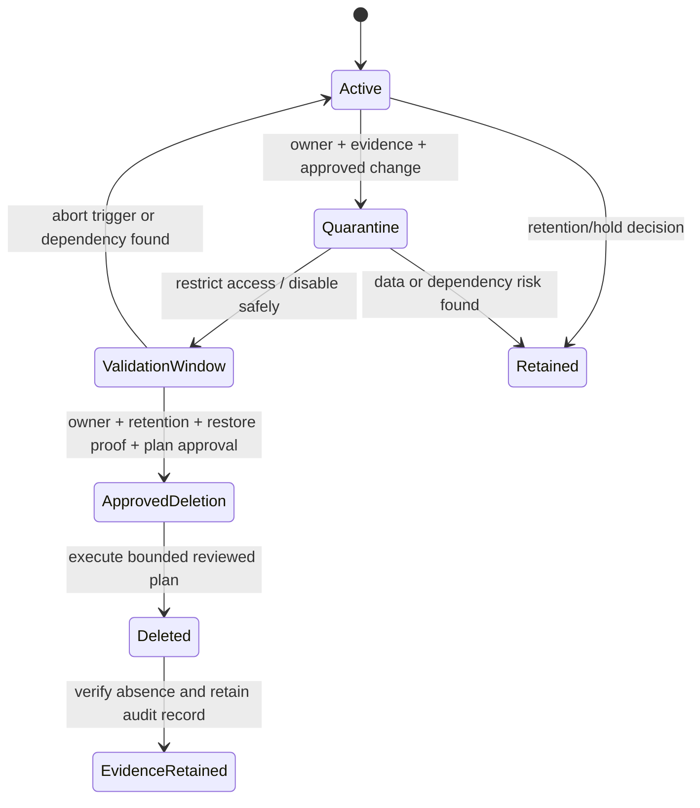

## Unit 8 — Infrastructure decommissioning and orphan cleanup

**Target file:** `08-infrastructure-decommissioning-and-orphan-cleanup.md`  |  **Estimated time:** 16–22 hours  |  **Prerequisites:** Stage 2E M01–M06; Git/Linux; CI/CD; Kubernetes fundamentals; Terraform/OpenTofu configuration, plan, apply, state, and least-privilege basics

**Core tools:** Terraform or OpenTofu (choose one and record its version), Git, Python 3.10+ standard library, shell, local filesystem  |  **Awareness:** LocalStack/MinIO, AWS CLI for optional emulator-only inspection, cloud resource inventory products, provider-side deletion protection, Kubernetes controllers/storage lifecycle  |  **Last reviewed:** 2026-10-28  |  **Tool baseline assumed:** Terraform `terraform_data` example assumes 1.4+ `[VERIFY]`; OpenTofu compatibility `[VERIFY]`; Python 3.10+; optional AWS CLI/LocalStack versions are unpinned and must be checked `[VERIFY]`; lifecycle, saved-plan, `removed` block, state command, and provider delete semantics are version/provider-sensitive  |  **Substrate:** local-only/synthetic; optional LocalStack/MinIO inspection; no mandatory real-cloud account/provisioning/deletion

### N.0 Why this matters in production

Decommissioning can be irreversible: a resource may look idle while still holding the only copy of training data, a shared encryption key, an audit trail, or a network dependency used by another team. An IaC destroy operation reasons about the selected configuration, state, provider behavior, and dependency graph; it is not a universal inventory-and-delete operation. That gap can leave expensive orphan resources behind—or delete shared resources another workload still needs. A disciplined retirement process uses ownership, dependency evidence, backups that have been restore-tested, a reviewed plan, bounded automation, and a durable record of what was removed and why.

#### Scope, assumptions, and verification status

This lesson follows the Unit 8 requirements supplied in the lesson-generation prompt and the mandatory unit structure in the module syllabus. The available `Roadmap_ptree` source identifies the actual module directory as `02-Advanced-Infrastructure-as-Code-and-Cloud-Operations/` under `Stage 2E — Production DevOps & Platform Engineering/`; the module syllabus uses `07-Advanced-Infrastructure-as-Code-and-Cloud-Operations/` in some places. This lesson does not rename or reconcile that discrepancy.

The roadmap tree and syllabus prompt were available through supplied files. No separately supplied lab-setup guide was independently inspected. Current official documentation was not live-verified during authoring. Tool/provider-specific details are therefore marked `[VERIFY]` or `[VERSION-SENSITIVE]`; source registers name documents and sections to inspect rather than pretending they were checked live. All example resource names, inventory entries, dates, IDs, costs, and output are synthetic unless stated otherwise. Representative outputs are not evidence that a command was executed.

**Safety boundary:** every required lab is local and simulated. Do not paste a lab command into a real cloud shell, production workspace, or directory whose target you cannot prove. No mandatory lab includes a real cloud delete command. Destructive concepts are demonstrated with throwaway local files, synthetic records, and provider-free Terraform/OpenTofu resources. Optional emulator instructions require local-endpoint verification and version-specific review first.

### N.1 Learning objectives

1. **L1:** Explain `create → operate → change → decommission` and distinguish configuration removal, state removal, resource deletion, and controller-driven cleanup.
2. **L1:** Predict what destroy may remove and identify residual resources and data-loss risks.
3. **L2:** Execute a safe decommission workflow with owner confirmation, usage/dependency evidence, announcement, backup/export, restore verification, quarantine, reviewed plan, deletion, verification, and audit record.
4. **L2:** Distinguish Terraform/OpenTofu `prevent_destroy` from provider-side deletion protection and implement a two-step unprotect workflow in an isolated lab.
5. **L2:** Compare expected state with a synthetic reality inventory and classify candidates without treating discovery as deletion approval.
6. **L3:** Build a report-only TTL cleanup script that fails closed, uses an allow-list and deletion cap, protects production, and emits an audit log.
7. **L3:** Assess retention, legal-hold, archive, restore, shared-key, Kubernetes-controller, and backend-retirement risks without making legal conclusions or assuming provider semantics.
8. **L4:** Design organization-level cleanup governance with accountable owners, KPIs, two-person review, kill switches, durable logs, and incident learning.
9. **L4:** Defend a rebuild-versus-clean-in-place decision using blast radius, state health, data preservation, recovery objectives, and evidence quality.

### N.2 Concept map and vocabulary

#### Lifecycle and inventory model

```text
Configuration ──plan/review──> Proposed change ──approval/apply──> IaC state
      │                                  │                            │
      ▼                                  ▼                            ▼
 desired resources                approved scope              recorded objects
                                          │
                                          ▼
                                Provider/controller reality
                                          │
                          inventory + dependency + usage evidence
                                          │
                         ┌────────────────┴─────────────────┐
                         ▼                                  ▼
                 confirmed managed                   orphan candidate
                 and still needed                   (not deletion approval)
                                                            │
                                             owner / retention / dependency
                                             / backup / restore checks
                                                            │
                                                   quarantine + review
                                                            │
                                               approved deletion + verify
```

State is the tool's record of what it believes it manages. It is not a complete inventory of reality. Provider inventory is not automatically complete either: it may omit another account, region, controller, service, or inventory time window. Use multiple evidence sources and normalize identifiers before comparison.

| Term | Precise meaning | Common misconception |
|---|---|---|
| Decommission | Controlled retirement after ownership, dependencies, data disposition, and verification are resolved | “Delete the Terraform folder.” |
| Destroy plan | Proposed deletions from selected configuration/state context; exact behavior is tool/version-sensitive | It discovers every cloud resource |
| Configuration removal | Removing a resource/module declaration | It always deletes the real resource immediately |
| State removal | Removing an object mapping from IaC state; underlying resource may remain | It equals provider deletion |
| Orphan candidate | Object found in reality but unmatched to expected inventory, or with uncertain owner/purpose | A candidate is safe to delete |
| Owned-unused | Known owner confirms no longer required, supported by evidence | One quiet metric proves non-use |
| Unknown-owner | Ownership/dependency unclear | Missing owner tag means abandoned |
| Managed-but-not-in-state | Real resource absent from expected state but may be used or managed elsewhere | It is unmanaged globally |
| Controller-owned resource | Created/reconciled by another controller, such as a cloud load balancer created from Kubernetes Service | Destroying the parent cluster always cleans it up |
| TTL | Time-to-live metadata that makes a resource eligible for review | Expiry is unconditional delete authorization |
| Quarantine | Controlled, time-bounded restriction/disable phase to detect dependencies | Quarantine is always reversible |
| Legal hold | Preservation instruction controlled by organizational legal/compliance process | An engineer can infer or waive it from age/cost |
| Restore verification | Test proving archived/exported data can be read or restored as required | A successful backup job proves recoverability |
| Blast radius | Scope of systems, data, teams, and services affected | Resource count alone captures risk |

#### Four operations that must not be conflated

| Operation | What changes | What may remain | Evidence required |
|---|---|---|---|
| Remove configuration block/module call | Configuration changes; future plan determines action under tool semantics | Real resource may remain, be destroyed, or require a migration/removal workflow | Diff, plan, owner and dependency review |
| Destroy through reviewed plan | Tool asks provider to delete selected managed resources | Untracked/controller resources, protected resources, cross-account objects, snapshots, data versions, DNS/IP/logs | Saved-plan review, approvals, provider results, post-delete inventory |
| Remove mapping from state | IaC stops tracking that address | Underlying resource normally remains | State backup, exact address, owner decision, reality inventory |
| Delete outside IaC/controller path | Provider/controller changes reality directly | IaC state may become stale; controller may recreate object | Correct owning path, change record, reconciliation and verification |

```text
Git configuration       State/backend               Provider reality
------------------      -------------               ----------------
resource/module blocks  address -> object ID        objects actually exist
desired attributes     recorded attributes         live attributes/status
reviews/approvals      state versions/history       inventory/usage/dependencies

                    Not guaranteed to be equal
                         │
       ┌─────────────────┴──────────────────┐
       ▼                                    ▼
state-only record                     reality-only object
(stale mapping / drift)               (orphan candidate / controller object)
```

A plan is a prediction based on inputs available at plan time. It cannot guarantee provider acceptance or prevent another controller from changing reality. State and plan files may contain sensitive attributes; protect them as secrets and do not commit them to Git.

### N.3 Level 1 — Beginner

#### 1. The lifecycle

- **Create:** provision a resource with purpose, owner, environment, metadata, and dependencies.
- **Operate:** monitor usage, access, failures, data freshness, security posture, and cost.
- **Change:** alter size, configuration, ownership, or dependencies through a reviewed process.
- **Decommission:** prove the resource is no longer needed, preserve required data, restrict/disable it safely, delete the approved scope, verify reality, and retain evidence.

The hardest step is often not deletion; it is proving deletion is safe. An object-storage bucket with no recent writes may still be read by a training pipeline. An IAM role with no recent interactive use may be assumed by a scheduled job. A key that appears unused may be needed to decrypt archived model artifacts.

#### 2. What `destroy` means—and does not mean

`terraform destroy`, `tofu destroy`, and destroy-plan workflows are tool commands, not organization-wide cleanup systems. Exact options and saved-plan syntax vary by tool/version and must be verified. `[VERIFY]`

A destroy operation generally targets resources represented in the selected state/configuration context and selected by the reviewed operation. It may not remove:
- resources absent from that state;
- resources removed from state before deletion;
- resources created by a controller or separate stack;
- resources in another account, project, subscription, or region;
- data versions, snapshots, backups, logs, DNS records, IP addresses, detached volumes, or cross-region copies unless separately managed and included;
- resources blocked by lifecycle or provider-side deletion protection;
- resources whose deletion fails because of dependencies, retention controls, permissions, or provider errors.

Do not treat `-target` as a routine decommission strategy. It can create a partial operation and leave a surprising graph. Use it only for a narrowly justified recovery/exception with expert review. `[VERIFY]`

A `removed` block or equivalent state-removal workflow can intentionally stop managing a resource without destroying it. Availability and exact semantics are version-sensitive. `[VERSION-SENSITIVE] [VERIFY]` Read the installed tool's official documentation before use.

#### 3. Why idle resources matter

Idle resources can continue to incur charges or increase risk:
- compute and managed endpoints can remain allocated;
- unattached volumes and old snapshots can persist;
- load balancers, IP addresses, DNS zones, and network gateways may have ongoing costs;
- logs and cross-region copies can grow;
- old identities and secrets expand attack surface;
- abandoned buckets may retain sensitive data with weak ownership.

Do not invent a cost estimate when billing data is missing. Record `unknown` and investigate.

#### 4. Running example

A fictional data/ML platform has `dev`, `staging`, and `prod`; raw and curated storage; model artifacts and metadata; queues/topics; compute and autoscaling; Kubernetes Services that may create load balancers and persistent storage; shared DNS, IAM-style roles, encryption keys, logs, and a separate IaC backend. Retiring `dev` does not authorize deleting the shared model registry, common key, DNS zone, or backend. Scope retirement to a named environment and prove shared dependencies are not in the delete set.

#### Guided lab: understand a provider-free resource plan

This lab uses a disposable directory and `terraform_data` as a local Terraform-managed object. It does not create cloud resources. `terraform_data` availability/semantics must be checked against the installed Terraform version; OpenTofu compatibility must also be verified. `[VERIFY]`

**Safety plan:** use only the new `lab1` directory; confirm no cloud provider or cloud credentials; back up configuration/state; read the complete plan; stop if any address besides the named lab resource appears.

```hcl
# File: lab1/main.tf
terraform {
  required_version = ">= 1.4.0" # [VERIFY] Check installed tool compatibility.
}

resource "terraform_data" "disposable_marker" {
  input = {
    lab         = "unit8-lab1"
    environment = "lab-only"
    owner       = "learner"
    purpose     = "decommission-training"
  }
}

output "lab_identity" {
  value = terraform_data.disposable_marker.output
}
```

```bash
# File: lab1/commands.sh
set -eu
test "$(basename "$PWD")" = "lab1" || { echo "ABORT: wrong directory" >&2; exit 2; }
test -f main.tf || { echo "ABORT: expected lab main.tf missing" >&2; exit 2; }
terraform version
terraform init
terraform validate
terraform plan -out=lab-create.tfplan
terraform show lab-create.tfplan
# Human checkpoint: one create for terraform_data.disposable_marker only.
terraform apply lab-create.tfplan
terraform state list
terraform state show terraform_data.disposable_marker
```

The binary above is illustrative; if using OpenTofu, substitute `tofu` only after verifying the relevant command behavior. Do not use both tools against the same state casually.

**Illustrative expected behavior — not executed:** the first plan proposes one create action for `terraform_data.disposable_marker`; after apply, state list contains that address. This proves only that the local IaC state records the lab object, not that cloud inventory is complete or provider deletion semantics are correct.

```bash
# File: lab1/destroy-review.sh
# [VERIFY] Confirm syntax for installed Terraform/OpenTofu version.
set -eu
test "$(basename "$PWD")" = "lab1" || { echo "ABORT: wrong directory" >&2; exit 2; }
test -f main.tf || { echo "ABORT: lab configuration missing" >&2; exit 2; }
terraform state list
terraform plan -destroy -out=lab-destroy.tfplan
terraform show lab-destroy.tfplan
# Do not apply until the reviewed plan contains only lab-owned resources.
```

Do not apply a destroy plan in a real account. The later lab adds more complete assertions and evidence.

#### “What just happened?” trace

1. Configuration defines a lab marker.
2. `plan` compares configuration with state and the provider behavior available to the tool.
3. `apply` records the result in state.
4. `state list` reports what the tool believes it manages.
5. The provider-free object is not a cloud inventory query.
6. A destroy plan proposes removing that managed object; it cannot discover arbitrary external resources.

#### Common beginner mistakes

| Mistake | Symptom | Safer correction |
|---|---|---|
| Delete configuration directory and assume cleanup occurred | Real resources remain or state becomes hard to manage | Inspect state, plan, inventory, and owner record |
| Remove a state address to “delete” resource | Object remains outside IaC | Understand state removal versus provider deletion |
| Trust one quiet metric | Scheduled/rare dependency is missed | Check access logs, schedules, dependencies, and owners |
| Treat missing owner tag as abandonment | Critical resource may be selected | Classify unknown-owner; investigate |
| Assume destroy removes related objects | Load balancer/snapshots remain | Inventory secondary and controller-owned resources |
| Treat backup job success as restore proof | Export exists but cannot be read | Restore/read-test before deletion approval |

### N.4 Level 2 — Intermediate

#### A. Required safe decommission sequence

**inventory → identify owner → confirm unused → announce → backup/snapshot/export → disable/quarantine (“scream test”) → delete → verify → record**

| Step | Purpose | Evidence required | Stop condition | Rollback/recovery |
|---|---|---|---|---|
| Inventory | Establish exact scope | IDs/types, account/project, region, tags, state membership, dependencies | Inventory stale or scope ambiguous | Refresh inventory; do not delete |
| Identify owner | Find accountable owner | Owner confirmation/service record | No owner or conflicting owners | Assign investigation owner; classify unknown-owner |
| Confirm unused | Check real consumers | Metrics, access logs, schedules, dependency scan, job history | Observation window too short | Extend observation and inspect consumers |
| Announce | Give teams time to object | Change notice, window, contact, escalation | Required owners not notified | Reschedule |
| Backup/export | Preserve required data | Export ID, manifest/checksum, retention decision | Data disposition unresolved | Preserve resource and escalate |
| Restore verification | Prove backup usable | Successful restore/read test, owner sign-off | Restore fails | Abort deletion; repair backup |
| Disable/quarantine | Detect hidden dependencies | Before/after telemetry, quarantine tag, rollback trigger | SLO impact or missing telemetry | Re-enable/restore if safe; record side effects |
| Delete | Remove approved scope | Reviewed plan, approval, environment assertion | Unexpected delete/shared dependency/wrong target | Abort |
| Verify | Confirm absence and no collateral damage | State/plan, provider inventory, controller inventory, application checks | Residual object or outage | Reconcile with owner; restore/rebuild if approved |
| Record | Preserve auditability | Ticket, plan hash, approvers, logs, outcome | Evidence missing | Keep ticket open and reconstruct evidence |

A **scream test** is a controlled disable/quarantine step that checks whether anything depends on a resource. It is not permission to abruptly remove production infrastructure. Use a rollback window, named decision authority, measurable abort criteria, and a safe re-enable path. Some effects—expired credentials, lost ephemeral state, DNS propagation, downstream cleanup—may not be fully reversible.

**Single resource versus whole environment:** a single resource can be highly critical (e.g., shared key or DNS record), so inspect shared dependencies. Whole-environment retirement must include application dependencies, data/retention, identity, networking, DNS, logs, secrets/keys, snapshots/backups, external integrations, controller-created resources, state/backends, and account/project boundaries.

#### B. Deletion protection

`prevent_destroy` is an IaC lifecycle guard. Provider-side deletion protection is a separate service/provider control. They can fail independently and have different scope and semantics. Exact behavior is `[VERIFY]`.

Two-step unprotect process:
1. **Decision/protection review:** approve intended deletion, owner, retention disposition, backup/export, restore proof, dependency map, maintenance window.
2. **Separate protection change:** make the narrowest protection change in a dedicated reviewed configuration change/plan. Apply only that approved change in the isolated lab. Then generate a new destroy plan, review the exact resource list, obtain deletion approval, and only then perform lab deletion.

Do not combine disabling protection and deleting into one unreviewed change. A single plan can hide why a guardrail disappeared among deletion actions.

#### C. Saved destroy plans and review

The safety pattern is: generate a plan artifact, inspect that exact artifact, approve it, then apply it in the intended context. Exact syntax and artifact compatibility are tool/version-sensitive. `[VERSION-SENSITIVE] [VERIFY]`

Review:
- workspace/directory, backend, account/project/subscription, region, provider endpoint and identity;
- resource addresses and real identifiers;
- all delete and replacement actions;
- data-bearing resources, keys/secrets, storage, backups, logs, DNS, shared networking and IAM;
- dependent/controller-owned resources;
- protected tags, allow-list, maximum delete count;
- state/backend resources (normally last);
- whether the plan is stale or provider reality changed since planning.

Saved plans and state files can contain sensitive values. Store them in restricted locations, apply retention, do not commit them to Git, and do not paste raw output into public tickets.

#### D. TTL tags and cleanup jobs

Example metadata (all `[SYNTHETIC]`):

```json
{
  "resource_id": "synthetic://sandbox/training-run-042",
  "environment": "dev",
  "owner": "team-ml-platform",
  "managed-by": "terraform",
  "purpose": "feature-experiment",
  "expires-on": "2026-11-15",
  "protected": "false",
  "lifecycle": "ephemeral"
}
```

`expires-on` is a policy input, not deletion authorization. Validate date/timezone; verify resource age and environment; notify owner; apply an organizational grace period; exclude protected and production resources; require allow-list, explicit apply flag, deletion cap and approval; check dependencies and inventory freshness; emit an audit decision per candidate. Report-only first. Missing owner, malformed expiry, stale inventory, unknown type, missing protection status, or ambiguous dependency must fail closed.

#### E. Orphan definition, causes, and classification

Orphan sources include failed/partial applies; resources removed from state/configuration; console-created objects; controller-created resources; snapshots/volumes/IPs/log groups/DNS/load balancers/buckets/cross-region copies; cross-account leftovers; temporary CI environments; and resources owned by another automation system/team.

| Classification | Definition | Default action |
|---|---|---|
| Owned-unused | Known owner confirms no longer required with supporting evidence | Quarantine and review |
| Unknown-owner | Owner/dependency unclear | Report/investigate; never auto-delete |
| Managed-but-not-in-state | Exists but absent from expected state; may be used/managed elsewhere | Reconcile ownership/controller/state |
| Controller-owned/dependent | Created/reconciled by another controller | Use owning controller lifecycle first |

Discovery methods include tag queries, state list, plan JSON, provider inventory, LocalStack/MinIO listings in local labs, resource explorer products, dependency mapping, and owner discovery. AWS Config/Resource Explorer, Azure Resource Graph/Policy inventory, and Google Cloud Asset Inventory are awareness examples; names, access and syntax are `[VERIFY]`.

No single inventory is complete. Normalize IDs with account/project, region, resource type, and canonical provider ID. Names are not globally unique. Plan JSON schemas vary by tool version, may include sensitive data/unknown values, and are not a universal inventory of real resources.

#### F. Dependency-order destruction

Destroy dependents before dependencies only when that order matches actual lifecycle. A data pipeline may need consumers stopped before queues/storage; Kubernetes-managed load balancers should generally be retired through their owning Service/controller path before cluster removal. Shared DNS, IAM roles, KMS keys, secrets, network components, and logging are high-risk. Never delete a shared dependency based only on one stack's view.

#### G. Pattern catalogue

| Pattern | Use when | Do not use when |
|---|---|---|
| Reviewed saved destroy plan | Scope understood and exact artifact reviewable | Plan stale, target unclear, provider reality changed materially |
| Quarantine with grace window | Resource can be safely disabled/restricted and restored | Disable risks irreversible side effects or no rollback exists |
| Report-only TTL scan | Discovering candidates and validating metadata | Never treat report output alone as deletion safety proof |
| Allow-list + max-delete cap | Automation needs bounded scope | IDs are noncanonical or allow-list expands without review |
| Archive then delete | Retention or restore is required | Archive has not passed readability/restore verification |
| Rebuild in parallel | Environment polluted and known-good IaC exists | Critical data/shared dependencies cannot be migrated safely |
| Remove from state | Intentionally hand off management or preserve object | Shortcut to avoid a deletion plan |
| `-target` | Exceptional recovery with written rationale/expert review | Routine decommission |

#### H. Anti-pattern catalogue

| Bad workflow | Why it causes damage | Corrected workflow |
|---|---|---|
| Delete folder and assume resources are gone | Configuration/reality diverge | Inspect state, plan, inventory and owner record |
| Destroy before exporting data | May destroy only usable copy | Decide retention, export, restore-test, approve |
| Remove `prevent_destroy` and delete in one change | Guardrail removal hidden in destructive plan | Separate protection change and deletion review |
| Delete cluster before Services/PVCs are handled | Controller-created resources may remain | Retire owning objects, verify residuals, cluster last |
| Delete backend to stop costs | Remaining infrastructure becomes hard to manage | Backend last after archive and dependency retirement |
| Broad tag query as target list | Bad selector can include production | Canonical IDs, allow-list, environment assertion, cap |
| Retry ambiguous delete blindly | Side effects/partial failures obscured | Re-read reality, reconcile, retry only when safe |
| Use `force_destroy` as normal cleanup | Can delete data/versions | Explicit data disposition and provider-specific verification |

#### Lab 1 — End-to-end local decommission checklist

**Substrate:** local filesystem + provider-free Terraform/OpenTofu object. **Real cloud:** no. **Verification:** state/plan inspection plus local directory check. Paths are illustrative and are not created separately by this lesson generator.

```text
lab1/
├── main.tf
├── inventory.json
├── change-record.md
└── evidence/
    ├── plan-review.txt
    └── post-delete-check.txt
```

`lab1/inventory.json`:

```json
{
  "lab": "unit8-decommission-lab",
  "environment": "lab-only",
  "owner": "learner",
  "resources": [
    {"id":"terraform_data.disposable_marker","type":"terraform_data","purpose":"decommission-training","state_membership":"managed","data_bearing":false,"shared":false,"approved_for_lab_delete":true}
  ]
}
```

`lab1/main.tf`:

```hcl
# File: lab1/main.tf
terraform {
  required_version = ">= 1.4.0" # [VERIFY] Confirm compatibility for chosen tool.
}
resource "terraform_data" "disposable_marker" {
  input = {
    lab = "unit8-decommission-lab"
    environment = "lab-only"
    owner = "learner"
    purpose = "decommission-training"
  }
}
```

**Safety plan:** assert directory `lab1`; confirm no cloud provider/backend or cloud credentials; copy configuration/inventory/state to private evidence before a state-changing test; review all plan actions; abort if anything besides the lab marker appears.

```bash
# File: lab1/run.sh
set -eu
test "$(basename "$PWD")" = "lab1" || { echo "ABORT: wrong directory"; exit 2; }
test -f main.tf && test -f inventory.json || { echo "ABORT: fixture missing"; exit 2; }
mkdir -p evidence
cp main.tf inventory.json evidence/
terraform version
terraform init
terraform validate
terraform plan -out=evidence/create.tfplan
terraform show evidence/create.tfplan
# Human checkpoint: one create for the lab marker only.
terraform apply evidence/create.tfplan
terraform state list
terraform state show terraform_data.disposable_marker > evidence/before-retirement-state.txt
```

Create a change record with owner, purpose, window, rollback trigger and reviewer. For this provider-free marker, quarantine is documented rather than simulated as a cloud mutation.

```bash
# File: lab1/review-destroy.sh
set -eu
test "$(basename "$PWD")" = "lab1" || { echo "ABORT: wrong directory"; exit 2; }
test -f evidence/before-retirement-state.txt || { echo "ABORT: evidence missing"; exit 2; }
terraform plan -destroy -out=evidence/destroy.tfplan
terraform show evidence/destroy.tfplan | tee evidence/plan-review.txt
# HUMAN CHECKPOINT: confirm the plan has exactly the approved lab marker and no other actions.
# Apply only this reviewed saved plan, in this isolated lab directory. [VERIFY] exact CLI syntax.
terraform apply evidence/destroy.tfplan
```

Only in this isolated lab, after reviewing the exact plan and confirming the target, apply the saved plan using syntax verified for the installed tool. `[VERIFY]`

```bash
# File: lab1/verify.sh
set -eu
test "$(basename "$PWD")" = "lab1" || { echo "ABORT: wrong directory"; exit 2; }
terraform state list > evidence/post-delete-check.txt
if grep -q 'terraform_data.disposable_marker' evidence/post-delete-check.txt; then
  echo "FAIL: lab object still appears in state"; exit 1
fi
terraform plan
```

**Illustrative expected behavior — not executed:** after destruction, state list no longer contains the marker. If the configuration remains, the next plan may propose recreating it; retire the final configuration only through a reviewed sequence and inspect the resulting plan. Do not assume a clean plan without inspecting it.

**Failure injection:** run outside `lab1` (assertion must abort) or inspect a plan containing an unexpected address (do not apply). Restore the saved configuration/state copy only after diagnosing the cause. Do not use a real cloud profile or endpoint.

**Optional LocalStack S3 exercise:** only if the installed LocalStack version supports the required S3 operations. `[VERIFY]` The endpoint is hard-pinned to loopback and every request passes the endpoint explicitly; never replace it with a real provider endpoint.

```bash
# File: lab1/localstack-s3-lab.sh
set -eu
ENDPOINT="${LOCALSTACK_ENDPOINT:-http://localhost:4566}"
case "$ENDPOINT" in
  http://localhost:*|http://127.0.0.1:*) ;;
  *) echo "ABORT: endpoint must be loopback only" >&2; exit 2 ;;
esac
export AWS_ACCESS_KEY_ID=test
export AWS_SECRET_ACCESS_KEY=test
export AWS_DEFAULT_REGION=us-east-1
aws --endpoint-url "$ENDPOINT" sts get-caller-identity >/dev/null 2>&1 || {
  echo "ABORT: local emulator is not responding at $ENDPOINT" >&2; exit 2;
}
# Unversioned object example: exact synthetic names, emulator endpoint only.
aws --endpoint-url "$ENDPOINT" s3api create-bucket --bucket unit8-lab-only-empty-bucket
printf 'synthetic training fixture\n' > training-fixture.txt
aws --endpoint-url "$ENDPOINT" s3api put-object --bucket unit8-lab-only-empty-bucket --key training-fixture.txt --body training-fixture.txt
aws --endpoint-url "$ENDPOINT" s3api list-objects-v2 --bucket unit8-lab-only-empty-bucket
# Inspect exact object key and bucket contents before deletion.
aws --endpoint-url "$ENDPOINT" s3api delete-object --bucket unit8-lab-only-empty-bucket --key training-fixture.txt
aws --endpoint-url "$ENDPOINT" s3api list-objects-v2 --bucket unit8-lab-only-empty-bucket
# Only if the list is empty and the bucket is the named lab bucket:
aws --endpoint-url "$ENDPOINT" s3api delete-bucket --bucket unit8-lab-only-empty-bucket
```

All commands above are **illustrative and `[VERIFY]`** against the installed AWS CLI and LocalStack version; they have not been executed here. The loopback assertion prevents an accidental non-loopback endpoint. If the local identity probe fails, stop rather than removing the guard.

**Empty versus versioned bucket:** for an unversioned bucket, list and delete the exact object keys, then confirm the listing is empty before deleting the bucket. For a versioned bucket, a normal delete may create a delete marker while older versions remain; the bucket may still contain data. Do not use a wildcard delete. First list all versions and delete markers, review the exact `Key`/`VersionId` inventory, and only then use a separately reviewed command naming one exact version ID at a time. Exact LocalStack/provider behavior is `[VERIFY]`. Do not assume LocalStack reproduces real cloud retention, object lock, IAM, billing, or recovery semantics.

**Cleanup:** retain only sanitized evidence and remove the lab directory. Never preserve raw state/plan in a public repository.

### N.5 Level 3 — Advanced

#### A. Retention, archive, legal holds, and data disposition

Operational cleanup, archival, retention, and deletion obligations are different:
- **Operational cleanup** removes unneeded compute or supporting resources.
- **Retention** preserves data for a defined organizational or contractual period.
- **Archive** moves data to a system/tier intended for longer-term preservation.
- **Deletion** removes data through an approved process.
- **Legal hold** is an organization-controlled preservation instruction. This lesson is awareness-only, not legal advice. Consult legal/compliance owners and applicable policy; do not infer jurisdiction-specific obligations.

For a data/ML platform, inventory raw and curated data, training datasets, feature snapshots, model artifacts, registry metadata, experiment outputs, database backups, audit logs, secrets/keys, and cross-region copies. “Delete everything” can destroy the only usable training dataset, model artifact, metadata required to interpret a model, or audit evidence.

An archive is not verified until a representative restore/readability test succeeds. Record export manifest, checksums where appropriate, destination, encryption/access controls, retention decision, restore steps/results, and accountable owner. A snapshot/export is not sufficient merely because a job reported success.

#### B. Soft delete and quarantine state machine



A quarantine delay is an organizational policy choice, not a universal standard. Some resources cannot be renamed or quarantined in place. Alternatives include traffic drain, access restriction, DNS withdrawal, a reversible configuration toggle, or a separately provisioned replacement—after verifying resource-specific behavior.

Rollback limitations must be explicit: ephemeral data may be lost even if a service is re-enabled; DNS/traffic changes may take time to reverse; credentials/leases may expire; downstream systems may react; controllers may recreate/mutate resources; backups may be incomplete or inaccessible.

#### C. Cleanup automation design

A safe cleanup job must be more conservative than an operator:
- report-only default;
- explicit `--apply` before simulated deletion;
- strict allow-list of canonical IDs/types or controlled lab namespace;
- maximum deletions per run;
- protected-tag and production exclusions;
- environment/endpoint assertions;
- expiry and age validation;
- owner and dependency checks;
- freshness timestamp and stale-data fail-closed behavior;
- pagination and bounded rate-limit-aware reads;
- idempotency and concurrency lock;
- audit log with candidate, decision, reason, owner, timestamp, and outcome;
- clear exit codes, kill switch, and recovery plan.

The required script in Lab 3 deletes only entries from an in-memory synthetic fixture. It is not a generic cloud deletion client and must not be adapted into production by merely adding an API call.

#### D. Cost-leakage prioritization

Use this triage model: **inventory × estimated cost × owner × last-used evidence**.

| Candidate | Why it may leak cost/risk | Evidence to collect | Caution |
|---|---|---|---|
| Idle compute/endpoint | Allocated capacity persists | utilization, request history, owner, schedules | Low average use may hide bursts or scheduled workloads |
| Unattached volume | Storage persists without a VM | attachment history, snapshot/backup relationship | May be a recovery artifact |
| Old snapshot/backup | Retained storage accumulates | retention policy, recovery point, restore test | Do not delete last valid restore point |
| Unused IP/load balancer | Network resource remains allocated | flow/traffic logs, DNS, dependency map | Can front a rarely used service |
| Excessive log retention | Storage grows and sensitive data persists | retention config, compliance owner, incident needs | Shortening retention can harm investigations |
| Cross-region copy | Replication/retention costs | source/target, RPO/RTO, restore test | May be only regional recovery copy |
| Orphan bucket | Data exposure and storage cost | object/version inventory, access logs, owner | Current listing may omit versions |
| Old identity/secret | Security exposure | last-used evidence, workload references | Quiet period may miss periodic jobs |

Pricing changes by provider, region, resource type, and usage; do not fabricate price rates. Missing billing tags and telemetry lower confidence. Link deeper cost allocation/showback to M15.

#### E. Shared dependencies and sensitive resources

High-risk shared dependencies include DNS zones/records, IAM roles/policies, KMS keys, secrets, network components, common buckets, logging/monitoring, registries, and identity integrations. Never delete one based only on a single stack's view.

KMS key deletion may involve scheduled-deletion semantics and can render encrypted data unreadable; exact behavior is `[VERIFY]`. Secrets may have recovery windows, versions, or staged rotation behavior; `[VERIFY]`. Do not state universal timing or reversibility.

For each shared dependency require: cross-stack/account consumer map; usage/access evidence; retention and restore decision; reversibility assessment; service/security/data owner approval; a reviewed PR removing the module call; a plan showing expected destroys and no unexpected shared-resource actions; scheduled apply window and post-change verification.

#### F. Kubernetes-created cloud resources

Deleting a Kubernetes cluster before retiring controller-managed objects can leave cloud load balancers, disks, snapshots, DNS records, and other resources. Safe general sequence:
1. inspect Services of type `LoadBalancer`, ingress controllers, PVCs/PVs, storage classes, reclaim policies, finalizers, and external controllers;
2. identify owning controller and real cloud resource IDs;
3. stop workloads and drain traffic in approved order;
4. delete owning Kubernetes objects through the correct controller path;
5. wait for and verify controller cleanup;
6. inspect residual cloud resources and storage/snapshot inventory;
7. preserve required data and remove only approved residuals;
8. retire the cluster last.

Controllers do not always delete every resource. Finalizers, reclaim policies, controller health, permissions, and provider behavior affect outcomes. `[VERIFY]` Link to M04/M05 for workload/controller depth and M03 Unit 2 for namespace resource governance.

#### G. State and backend retirement last

State/backend resources are not ordinary leftovers. Deleting a state bucket or lock mechanism too early can remove the team's ability to manage remaining resources safely. Backend retirement is the final infrastructure operation after every dependent stack/resource has been decommissioned and verified.

Safe sequence:
1. enumerate every stack, workspace, environment, lock mechanism, and consumer using the backend;
2. freeze new applies and cleanup automation;
3. confirm no pending changes, partial applies, or orphan candidates requiring IaC management;
4. finish all dependent stack/resource decommissioning;
5. archive final state, plan/evidence, and change logs to a restricted approved destination;
6. validate archive readability and restore procedure; sanitize shareable excerpts;
7. confirm retention/hold and access requirements with owners;
8. verify no remote-state/lock consumers remain;
9. obtain explicit backend deletion approval;
10. delete backend resources only through the approved process and verify final status.

State files can contain secrets and identifiers. Archive securely, restrict access, and do not commit them to Git.

#### Lab 2 — Orphan creation and discovery via inventory diff

**Substrate:** synthetic JSON + Python standard library. **Real cloud:** no. **Cleanup:** remove temporary lab files only.

`lab2/expected-state.json`:

```json
{
  "generated_at": "2026-10-28T10:00:00Z",
  "scope": {"account": "synthetic-account", "region": "region-a"},
  "resources": [
    {"id":"synthetic://region-a/dev/raw-bucket","type":"bucket","owner":"team-data","managed_by":"terraform","state_member":true},
    {"id":"synthetic://region-a/dev/queue-01","type":"queue","owner":"team-ml","managed_by":"terraform","state_member":true}
  ]
}
```

`lab2/actual-inventory.json`:

```json
{
  "generated_at": "2026-10-28T10:02:00Z",
  "scope": {"account": "synthetic-account", "region": "region-a"},
  "resources": [
    {"id":"synthetic://region-a/dev/raw-bucket","type":"bucket","owner":"team-data","managed_by":"terraform","last_used_days":1,"protected":true},
    {"id":"synthetic://region-a/dev/queue-01","type":"queue","owner":"team-ml","managed_by":"terraform","last_used_days":0,"protected":true},
    {"id":"synthetic://region-a/dev/old-snapshot-03","type":"snapshot","owner":"team-data","managed_by":"manual","last_used_days":120,"protected":false},
    {"id":"synthetic://region-a/prod/model-artifacts","type":"bucket","owner":"","managed_by":"unknown","last_used_days":90,"protected":true},
    {"id":"synthetic://region-a/dev/controller-lb-04","type":"load-balancer","owner":"team-platform","managed_by":"kubernetes-controller","last_used_days":3,"protected":true}
  ]
}
```

`lab2/diff_inventory.py`:

```python
# File: lab2/diff_inventory.py
import json
import sys
from datetime import datetime, timezone
from pathlib import Path

MAX_AGE_SECONDS = 3600  # [SYNTHETIC] freshness policy

def load(path):
    data = json.loads(Path(path).read_text(encoding="utf-8"))
    if not isinstance(data, dict) or not isinstance(data.get("resources"), list):
        raise ValueError(f"{path}: expected object with resources list")
    if not isinstance(data.get("scope"), dict) or not data.get("generated_at"):
        raise ValueError(f"{path}: scope/generated_at required")
    parsed = datetime.fromisoformat(data["generated_at"].replace("Z", "+00:00"))
    if parsed.tzinfo is None:
        raise ValueError(f"{path}: generated_at must include timezone")
    age = (datetime.now(timezone.utc) - parsed.astimezone(timezone.utc)).total_seconds()
    if age < -60 or age > MAX_AGE_SECONDS:
        raise ValueError(f"{path}: stale or future inventory; age_seconds={age:.0f}")
    seen = set()
    for r in data["resources"]:
        if not isinstance(r, dict) or not r.get("id") or not r.get("type"):
            raise ValueError(f"{path}: each resource needs id and type")
        key = (r["id"].strip().lower(), r["type"].strip().lower())
        if key in seen:
            raise ValueError(f"{path}: duplicate resource key {key}")
        seen.add(key)
    return data

def main():
    if len(sys.argv) != 3:
        print("usage: python diff_inventory.py expected-state.json actual-inventory.json", file=sys.stderr)
        return 2
    try:
        expected, actual = load(sys.argv[1]), load(sys.argv[2])
        if expected["scope"] != actual["scope"]:
            raise ValueError("scope mismatch: refusing comparison")
        em = {(r["id"].strip().lower(), r["type"].strip().lower()): r for r in expected["resources"]}
        am = {(r["id"].strip().lower(), r["type"].strip().lower()): r for r in actual["resources"]}
        print("REALITY-ONLY CANDIDATES (discovery does not authorize deletion):")
        for key in sorted(am.keys() - em.keys()):
            r = am[key]
            owner = (r.get("owner") or "").strip()
            controller = "controller" in str(r.get("managed_by", "")).lower()
            cls = "controller-owned/dependent" if controller else ("unknown-owner" if not owner else "managed-but-not-in-state")
            print(f"- {r['id']} | {r['type']} | {cls} | owner={owner or 'UNKNOWN'} | protected={r.get('protected', 'UNKNOWN')}")
        print("STATE-ONLY ENTRIES (may be stale state; investigate before action):")
        for key in sorted(em.keys() - am.keys()):
            print(f"- {em[key]['id']} | {em[key]['type']} | investigate state/reality mismatch")
        print("ACTION: report, resolve owner/dependencies, then create a reviewed cleanup plan.")
        return 0
    except (OSError, json.JSONDecodeError, ValueError) as exc:
        print(f"FAIL CLOSED: {exc}", file=sys.stderr)
        return 2

if __name__ == "__main__":
    raise SystemExit(main())
```

Fixture timestamps are examples. Refresh both timestamps to current UTC before a normal run, or test stale-data rejection intentionally.

**Illustrative expected output — not executed:**

```text
REALITY-ONLY CANDIDATES (discovery does not authorize deletion):
- synthetic://region-a/dev/controller-lb-04 | load-balancer | controller-owned/dependent | owner=team-platform | protected=True
- synthetic://region-a/dev/old-snapshot-03 | snapshot | managed-but-not-in-state | owner=team-data | protected=False
- synthetic://region-a/prod/model-artifacts | bucket | unknown-owner | owner=UNKNOWN | protected=True
STATE-ONLY ENTRIES (may be stale state; investigate before action):
ACTION: report, resolve owner/dependencies, then create a reviewed cleanup plan.
```

This assumes fresh timestamps, unique IDs, and matching scopes. The script never deletes anything.

**Two orphan paths:** (1) an IaC object removed from state/configuration while the underlying object remains—model with synthetic expected-state and actual-inventory fixtures; (2) an object created outside IaC—represented by `old-snapshot-03`. In a separate local-file extension, a `local_file` provider resource can create a file under the lab directory, then backed-up lab-only state removal can show that the file remains. Provider, command syntax and address must be verified first. `[VERIFY]` State removal does not delete the file. Never run state removal against a shared/production backend.

**Failure injection:** duplicate an ID, change scope, blank generated timestamp, or use a timestamp older than freshness policy. The script must fail closed. Missing owner is unknown-owner, never auto-delete. Naming differences need a reviewed normalization rule; do not silently fuzzy-match.

#### Lab 3 — TTL cleanup script with safety guardrails and bug-injection test

**Substrate:** Python standard library + synthetic JSON. **Real cloud:** no. **Deletion effect:** only removes selected entries from an in-memory list; the source fixture remains unchanged. Default mode is report-only.

`lab3/resources.json`:

```json
{
  "generated_at": "2026-10-28T10:00:00Z",
  "namespace": "unit8-sandbox",
  "resources": [
    {"id":"lab-dev-001","type":"sandbox","environment":"dev","owner":"team-a","expires_on":"2020-01-01","created_on":"2019-01-01","protected":false,"namespace":"unit8-sandbox"},
    {"id":"lab-dev-002","type":"sandbox","environment":"dev","owner":"team-b","expires_on":"2999-01-01","created_on":"2020-01-01","protected":false,"namespace":"unit8-sandbox"},
    {"id":"lab-prod-003","type":"sandbox","environment":"prod","owner":"team-c","expires_on":"2020-01-01","created_on":"2019-01-01","protected":false,"namespace":"unit8-sandbox"},
    {"id":"lab-protected-004","type":"sandbox","environment":"dev","owner":"team-a","expires_on":"2020-01-01","created_on":"2019-01-01","protected":true,"namespace":"unit8-sandbox"},
    {"id":"lab-unknown-005","type":"sandbox","environment":"dev","owner":"","expires_on":"2020-01-01","created_on":"2019-01-01","protected":false,"namespace":"unit8-sandbox"},
    {"id":"lab-bad-date-006","type":"sandbox","environment":"dev","owner":"team-a","expires_on":"not-a-date","created_on":"2019-01-01","protected":false,"namespace":"unit8-sandbox"}
  ]
}
```

`lab3/ttl_cleanup.py`:

```python
# File: lab3/ttl_cleanup.py
import argparse
import json
import sys
from datetime import date, datetime, timezone
from pathlib import Path

ALLOW_IDS = {"lab-dev-001", "lab-dev-002", "lab-prod-003", "lab-protected-004",
             "lab-unknown-005", "lab-bad-date-006", "lab-dev-extra"}
ALLOWED_TYPES = {"sandbox"}
PROTECTED_ENVIRONMENTS = {"prod", "production"}
MAX_DELETE_PER_RUN = 1
REQUIRED_NAMESPACE = "unit8-sandbox"
KNOWN_OWNERS = {"team-a", "team-b", "team-c"}

def parse_args():
    p = argparse.ArgumentParser()
    p.add_argument("--input", default="resources.json")
    p.add_argument("--apply", action="store_true", help="simulate removal from in-memory fixture only")
    p.add_argument("--max-deletes", type=int, default=MAX_DELETE_PER_RUN)
    p.add_argument("--namespace", default=REQUIRED_NAMESPACE)
    p.add_argument("--inject-broad-query-bug", action="store_true")
    p.add_argument("--audit-log", default="audit.jsonl")
    p.add_argument("--ledger", default="deleted-ledger.json", help="local idempotency ledger for simulated deletes")
    return p.parse_args()

def load_inventory(path):
    data = json.loads(Path(path).read_text(encoding="utf-8"))
    if not isinstance(data, dict) or not isinstance(data.get("resources"), list):
        raise ValueError("expected object with resources list")
    if not data.get("generated_at") or not data.get("namespace"):
        raise ValueError("generated_at and namespace are required")
    ts = datetime.fromisoformat(data["generated_at"].replace("Z", "+00:00"))
    if ts.tzinfo is None:
        raise ValueError("generated_at must include timezone")
    age = (datetime.now(timezone.utc) - ts.astimezone(timezone.utc)).total_seconds()
    if age < -60 or age > 3600:
        raise ValueError(f"inventory stale/future (age_seconds={age:.0f}); fail closed")
    if data["namespace"] != REQUIRED_NAMESPACE:
        raise ValueError("input namespace assertion failed")
    seen = set()
    for r in data["resources"]:
        if not isinstance(r, dict):
            raise ValueError("resource must be an object")
        for field in ("id", "type", "environment", "owner", "expires_on", "created_on", "protected", "namespace"):
            if field not in r:
                raise ValueError(f"resource missing required field {field}")
        for field in ("id", "type", "environment", "owner", "expires_on", "created_on", "namespace"):
            if not isinstance(r[field], str):
                raise ValueError(f"{r.get('id', 'UNKNOWN')}: {field} must be a string")
            if field != "owner" and not r[field].strip():
                raise ValueError(f"{r.get('id', 'UNKNOWN')}: {field} must not be empty")
        if not isinstance(r["protected"], bool):
            raise ValueError(f"{r.get('id', 'UNKNOWN')}: protected must be boolean")
        if r["id"] in seen:
            raise ValueError(f"duplicate id: {r['id']}")
        seen.add(r["id"])
    return data

def parse_date(value, field, resource_id):
    try:
        return date.fromisoformat(value)
    except (TypeError, ValueError):
        raise ValueError(f"{resource_id}: invalid {field}")

def decision(r, today):
    if r["id"] not in ALLOW_IDS:
        return "BLOCK: ID not in allow-list"
    if r["type"] not in ALLOWED_TYPES:
        return "BLOCK: unknown resource type"
    if r["namespace"] != REQUIRED_NAMESPACE:
        return "BLOCK: namespace mismatch"
    if r["environment"].strip().lower() in PROTECTED_ENVIRONMENTS:
        return "BLOCK: protected environment"
    if r["protected"]:
        return "BLOCK: protected tag/resource"
    if not r["owner"] or r["owner"] not in KNOWN_OWNERS:
        return "BLOCK: missing/unknown owner"
    expires = parse_date(r["expires_on"], "expires_on", r["id"])
    created = parse_date(r["created_on"], "created_on", r["id"])
    if created > today:
        return "BLOCK: created_on is in the future"
    if expires < created:
        return "BLOCK: expiry predates creation"
    if expires >= today:
        return "KEEP: TTL not expired"
    return "ELIGIBLE: expired TTL; approval still required"

def append_audit(path, decisions, outcome):
    now = datetime.now(timezone.utc).isoformat()
    with Path(path).open("a", encoding="utf-8") as f:
        for r, why in decisions:
            row_outcome = outcome if outcome != "completed" else (
                "simulated-delete" if why.startswith("ELIGIBLE:") else "not-selected")
            f.write(json.dumps({"timestamp": now, "candidate": r["id"], "owner": r.get("owner"),
                                "decision": why, "outcome": row_outcome}, sort_keys=True) + "\n")

def main():
    args = parse_args()
    if args.max_deletes < 1 or args.max_deletes > MAX_DELETE_PER_RUN:
        print(f"FAIL CLOSED: max-deletes must be 1..{MAX_DELETE_PER_RUN}", file=sys.stderr)
        return 2
    if args.namespace != REQUIRED_NAMESPACE:
        print("FAIL CLOSED: requested namespace assertion failed", file=sys.stderr)
        return 2
    try:
        data = load_inventory(args.input)
        ledger_path = Path(args.ledger)
        if ledger_path.exists():
            ledger = json.loads(ledger_path.read_text(encoding="utf-8"))
            if not isinstance(ledger, list) or any(not isinstance(x, str) for x in ledger):
                raise ValueError("idempotency ledger must be a JSON list of string IDs")
        else:
            ledger = []
        candidates = list(data["resources"])
        if args.inject_broad_query_bug:
            print("BUG INJECTED: selector is broad; independent guards remain active")
            # Intentionally propose every item; independent checks still run.
        decisions = []
        for r in candidates:
            if r["id"] in ledger:
                decisions.append((r, "KEEP: already simulated deleted (idempotency ledger)"))
            else:
                decisions.append((r, decision(r, date.today())))
        for r, why in decisions:
            print(f"{r['id']}: {why}")
        critical_blocks = [(r, why) for r, why in decisions
                           if why.startswith("BLOCK:") and why not in
                           ("BLOCK: protected environment", "BLOCK: protected tag/resource")]
        if critical_blocks:
            append_audit(args.audit_log, decisions, "blocked-run")
            print("FAIL CLOSED: ambiguous or unapproved candidate present; no simulated deletes performed", file=sys.stderr)
            return 2
        eligible = [r for r, why in decisions if why.startswith("ELIGIBLE:")]
        if len(eligible) > args.max_deletes:
            append_audit(args.audit_log, decisions, "blocked-cap")
            print(f"FAIL CLOSED: eligible={len(eligible)} exceeds cap={args.max_deletes}", file=sys.stderr)
            return 3
        if not args.apply:
            print(f"REPORT ONLY: eligible={len(eligible)}; no fixture entries removed")
            outcome = "report-only"
        else:
            remaining = [r for r in data["resources"] if r not in eligible]
            ledger = sorted(set(ledger) | {r["id"] for r in eligible})
            ledger_path.write_text(json.dumps(ledger, indent=2) + "\n", encoding="utf-8")
            print(f"SIMULATED APPLY: removed {len(eligible)} in-memory record(s); input file unchanged")
            print(f"remaining={len(remaining)}; ledger_entries={len(ledger)}")
            outcome = "simulated-delete"
        append_audit(args.audit_log, decisions, "completed")
        print(f"AUDIT: appended {len(decisions)} decisions to {args.audit_log}")
        return 0
    except (OSError, json.JSONDecodeError, ValueError) as exc:
        print(f"FAIL CLOSED: {exc}", file=sys.stderr)
        return 2

if __name__ == "__main__":
    raise SystemExit(main())
```

`lab3/test_ttl_cleanup.py`:

```python
# File: lab3/test_ttl_cleanup.py
import json
import subprocess
import sys
import tempfile
import unittest
from datetime import datetime, timezone
from pathlib import Path

SCRIPT = Path(__file__).with_name("ttl_cleanup.py")

def fixture():
    now = datetime.now(timezone.utc).isoformat().replace("+00:00", "Z")
    return {
        "generated_at": now, "namespace": "unit8-sandbox",
        "resources": [
            {"id":"lab-dev-001","type":"sandbox","environment":"dev","owner":"team-a","expires_on":"2020-01-01","created_on":"2019-01-01","protected":False,"namespace":"unit8-sandbox"},
            {"id":"lab-dev-002","type":"sandbox","environment":"dev","owner":"team-b","expires_on":"2999-01-01","created_on":"2020-01-01","protected":False,"namespace":"unit8-sandbox"},
            {"id":"lab-prod-003","type":"sandbox","environment":"prod","owner":"team-c","expires_on":"2020-01-01","created_on":"2019-01-01","protected":False,"namespace":"unit8-sandbox"},
            {"id":"lab-protected-004","type":"sandbox","environment":"dev","owner":"team-a","expires_on":"2020-01-01","created_on":"2019-01-01","protected":True,"namespace":"unit8-sandbox"},
            {"id":"lab-unknown-005","type":"sandbox","environment":"dev","owner":"","expires_on":"2020-01-01","created_on":"2019-01-01","protected":False,"namespace":"unit8-sandbox"}
        ]
    }

class CleanupTests(unittest.TestCase):
    def run_script(self, data, *args):
        with tempfile.TemporaryDirectory() as d:
            p = Path(d) / "resources.json"
            p.write_text(json.dumps(data), encoding="utf-8")
            audit = Path(d) / "audit.jsonl"
            ledger = Path(d) / "ledger.json"
            proc = subprocess.run([sys.executable, str(SCRIPT), "--input", str(p),
                                   "--audit-log", str(audit), "--ledger", str(ledger), *args],
                                  text=True, capture_output=True)
            return proc, p.read_text(encoding="utf-8"), audit.exists()

    def test_report_only_default(self):
        data = fixture()
        data["resources"] = [r for r in data["resources"] if r["id"] != "lab-unknown-005"]
        proc, source, audit_exists = self.run_script(data)
        self.assertEqual(proc.returncode, 0, proc.stderr)
        self.assertIn("REPORT ONLY", proc.stdout)
        self.assertTrue(audit_exists)
        self.assertIn("lab-dev-001", source)

    def test_expired_resource_simulated_delete(self):
        data = fixture()
        data["resources"] = [r for r in data["resources"] if r["id"] != "lab-unknown-005"]
        proc, source, _ = self.run_script(data, "--apply")
        self.assertEqual(proc.returncode, 0, proc.stderr)
        self.assertIn("SIMULATED APPLY", proc.stdout)
        self.assertIn("lab-dev-001", source)  # input file unchanged

    def test_production_and_protected_excluded(self):
        proc, _, _ = self.run_script(fixture())
        self.assertIn("lab-prod-003: BLOCK", proc.stdout)
        self.assertIn("lab-protected-004: BLOCK", proc.stdout)

    def test_unknown_owner_blocked(self):
        proc, _, audit_exists = self.run_script(fixture())
        self.assertNotEqual(proc.returncode, 0)
        self.assertIn("lab-unknown-005: BLOCK", proc.stdout)
        self.assertIn("no simulated deletes", proc.stderr)
        self.assertTrue(audit_exists)

    def test_invalid_expiry_fails_closed(self):
        data = fixture()
        data["resources"][0]["expires_on"] = "bad-date"
        proc, _, _ = self.run_script(data)
        self.assertNotEqual(proc.returncode, 0)
        self.assertIn("invalid expires_on", proc.stderr)

    def test_delete_cap_exceeded(self):
        data = fixture()
        data["resources"] = [r for r in data["resources"] if r["id"] != "lab-unknown-005"]
        extra = dict(data["resources"][0], id="lab-dev-extra", owner="team-a")
        data["resources"].append(extra)
        proc, _, _ = self.run_script(data)
        self.assertEqual(proc.returncode, 3)
        self.assertIn("exceeds cap", proc.stderr)

    def test_broad_selector_bug_does_not_expand_allowlist(self):
        data = fixture()
        extra = dict(data["resources"][0], id="unapproved-prod-like", environment="prod")
        data["resources"].append(extra)
        proc, _, _ = self.run_script(data, "--inject-broad-query-bug")
        self.assertEqual(proc.returncode, 2)  # unapproved ID fails closed
        self.assertIn("not in allow-list", proc.stdout)

    def test_apply_is_idempotent_with_ledger(self):
        with tempfile.TemporaryDirectory() as d:
            root = Path(d)
            p = root / "resources.json"
            data = fixture()
            data["resources"] = [r for r in data["resources"] if r["id"] != "lab-unknown-005"]
            p.write_text(json.dumps(data), encoding="utf-8")
            audit, ledger = root / "audit.jsonl", root / "ledger.json"
            cmd = [sys.executable, str(SCRIPT), "--input", str(p), "--audit-log", str(audit),
                   "--ledger", str(ledger), "--apply"]
            first = subprocess.run(cmd, text=True, capture_output=True)
            self.assertEqual(first.returncode, 0, first.stderr)
            second = subprocess.run(cmd, text=True, capture_output=True)
            self.assertEqual(second.returncode, 0, second.stderr)
            self.assertIn("already simulated deleted", second.stdout)
            self.assertIn("removed 0", second.stdout)

    def test_wrong_namespace_aborts(self):
        proc, _, _ = self.run_script(fixture(), "--namespace", "prod")
        self.assertEqual(proc.returncode, 2)
        self.assertIn("namespace assertion failed", proc.stderr)

if __name__ == "__main__":
    unittest.main()
```

Run from `lab3/`: `python ttl_cleanup.py --input resources.json` (report-only), then `python -m unittest -v test_ttl_cleanup.py`. The JSON fixture timestamp must be refreshed for a normal run; the tests generate a current timestamp. The strict cap is one. If more than one candidate is eligible, the run refuses rather than silently deleting a subset. `--apply` changes only an in-memory list; it never rewrites the source fixture or calls a cloud API.

**Failure injection/recovery:** wrong namespace, stale inventory, duplicate ID, malformed expiry, production/protected resource, unknown owner, unapproved ID, and too many eligible records must block or fail closed. For a production scheduler, add a process/distributed lock, notifications, approver identity, durable access-controlled audit shipping, and kill switch. The local script does not implement those controls.

**Representative output — not executed:**

```text
lab-dev-001: ELIGIBLE: expired TTL; approval still required
lab-dev-002: KEEP: TTL not expired
lab-prod-003: BLOCK: protected environment
lab-protected-004: BLOCK: protected tag/resource
lab-unknown-005: BLOCK: missing/unknown owner
```

This is an illustrative excerpt for a fixture without malformed dates; a negative malformed-date fixture should exit non-zero.

#### Lab 4 — `prevent_destroy` and two-step unprotect

**Substrate:** provider-free `terraform_data`. **Real cloud:** no. **Cleanup:** only the isolated lab marker after a separate protection-change review.

Step A:

```hcl
# File: lab4/step-a/main.tf
terraform {
  required_version = ">= 1.4.0" # [VERIFY]
}
resource "terraform_data" "protected_marker" {
  input = { lab = "unit8-lab4", environment = "lab-only", purpose = "prevent-destroy-exercise" }
  lifecycle { prevent_destroy = true }
}
```

Safety checkpoint: assert directory `step-a`; confirm no cloud provider/backend; initialize and apply only after reviewing a create plan; back up configuration and local state. Then inspect a separate destroy plan. Expected behavior is that the lifecycle guard prevents the deletion while the protected configuration remains; exact behavior/error is version-sensitive. `[VERIFY]` Do not bypass it with a target flag or unreviewed command.

```bash
# File: lab4/commands.sh
set -eu
test "$(basename "$PWD")" = "lab4" || { echo "ABORT: wrong lab root"; exit 2; }
cp step-a/main.tf main.tf
terraform init
terraform validate
terraform plan -out=create.tfplan
terraform show create.tfplan
# Human checkpoint: one create for the lab marker only.
terraform apply create.tfplan
cp main.tf main.tf.backup
terraform plan -destroy
```

Step B is a separate reviewed protection change and a second distinct destroy plan. The `step-a` and `step-b` paths above are **configuration snapshots only**: copy the selected snapshot into one `lab4/` working directory and preserve that one local state/backend across the steps. Do not initialize separate states for each snapshot and then assume they refer to the same object. Do not copy state casually between backends or lineages.

```hcl
# File: lab4/step-b/main.tf
terraform {
  required_version = ">= 1.4.0" # [VERIFY]
}
resource "terraform_data" "protected_marker" {
  input = { lab = "unit8-lab4", environment = "lab-only", purpose = "prevent-destroy-exercise" }
  # Protection removed in a separate reviewed change.
}
```

```bash
# File: lab4/step-b-commands.sh (run from the single lab4 root)
set -eu
test "$(basename "$PWD")" = "lab4" || { echo "ABORT: wrong lab root"; exit 2; }
test -f terraform.tfstate || { echo "ABORT: expected the same lab state is missing"; exit 2; }
cp main.tf main.tf.protected-backup
cp step-b/main.tf main.tf
terraform plan -out=unprotect.tfplan
terraform show unprotect.tfplan
# REVIEW: this change only removes the lifecycle guard from the lab marker.
# Apply this reviewed configuration change; a no-op plan is possible because lifecycle metadata is configuration-side.
terraform apply unprotect.tfplan
terraform plan -destroy -out=destroy.tfplan
terraform show destroy.tfplan
# HUMAN CHECKPOINT: only terraform_data.protected_marker may be deleted.
terraform apply destroy.tfplan
terraform state list
```

Safe sequence: back up state/config; review the plan that changes protection; apply only that change in the lab; create a new destroy plan; inspect all addresses; confirm only the lab marker; record approval; apply the reviewed plan using verified syntax. `step-a` and `step-b` are configuration snapshots only; use one `lab4/` root and one local state throughout. Do not initialize separate states for each snapshot or copy state casually between backends/lineages.

Provider-side deletion protection is separate and may still block deletion. Do not disable provider protection in a real environment as part of this lab. Abort if plan scope is unexpected; restore protected configuration if not approved. If deletion occurs, recovery may be rebuild rather than undo.

#### Lab 5 — Retention-versus-deletion decision memo

**Scenario:** fictional `dev` model-training experiment has a raw dataset copy, derived features, model artifact, metadata snapshot, logs, idle compute, and a shared encryption-key dependency. All details are `[SYNTHETIC]`.

```text
# File: lab5/retention-versus-deletion-decision.md
Change ID: CHG-SYNTH-2026-1042
Decision owner: Data Platform Service Owner
Technical owner: ML Platform Team
Security/data reviewer: Platform Security + Data Governance
Scope: dev training environment only; shared key and shared DNS are explicitly excluded.

Inventory:
- raw training dataset: synthetic://dev/raw-dataset-v7
- curated features: synthetic://dev/features-run-2026-09
- model artifact: synthetic://dev/model-artifact-exp-22
- metadata snapshot: synthetic://dev/metadata-snapshot-22
- job logs: synthetic://dev/training-logs-22
- compute allocation: synthetic://dev/compute-exp-22
- shared encryption key: synthetic://shared/key-data-platform (OUT OF SCOPE)

Business purpose:
Experiment ended. Compute appears idle, but data/model/metadata/logs may be needed to reproduce results or investigate a later incident.

Retention/hold checks:
Authorized data-governance and legal/compliance owners must confirm applicable internal retention rules and holds. This memo makes no legal conclusion. No deletion is approved until the decision is recorded.

Dependency map:
training pipeline -> raw dataset -> curated features
model artifact -> metadata snapshot -> registry references
logs -> incident/audit investigation
all encrypted objects -> shared key dependency (must remain available while retained data requires it)

Archive/export:
Export raw dataset manifest, model artifact, metadata snapshot, and required logs to the approved restricted archive destination. Record IDs, checksums where appropriate, access policy, retention metadata, and export timestamp.

Restore/readability verification:
Restore a dataset sample, load the model artifact, query metadata snapshot, and read representative logs in an isolated test. Record result and reviewer. Export-job success alone is insufficient.

Cost/security:
Compute is first candidate after owner confirmation. Retained data has storage cost, but premature deletion risks losing reproducibility and the only usable training copy. Restrict archive access and verify encryption/key dependency.

Quarantine:
14 days [POLICY CHOICE — SYNTHETIC, NOT A UNIVERSAL STANDARD]. During the window, disable experiment scheduling and restrict new writes; do not delete the shared key or archive.

Decision:
- compute allocation: QUARANTINE then DELETE after reviewed plan and owner approval;
- raw dataset, features, model artifact, metadata snapshot, required logs: ARCHIVE/RETAIN pending retention approval and restore test;
- shared key and shared DNS: RETAIN; out of scope;
- metadata references: retire only after archive and consumer checks.

Deletion scope:
Only enumerated compute allocation and environment-specific disposable resources after final plan review. No wildcard delete, no shared dependency deletion, no bucket-wide force-destroy.

Sequence:
1. Freeze new experiment runs.
2. Confirm owners and retention/hold decision.
3. Export and verify archive readability.
4. Notify users and start quarantine window.
5. Review saved plan with exact resource IDs.
6. Obtain service-owner and platform approval.
7. Apply only in approved change window.
8. Verify compute is absent and archive remains readable.
9. Reconcile state and actual inventory; retain evidence.

Evidence:
Plan artifact/hash, approvals, retention decision, export manifest, restore-test record, quarantine telemetry, apply log, post-delete inventory, audit record.

Residual risk:
Archived data could become unreadable if key/access dependencies change later; assign a periodic restore-test owner. Billing data may lag.
Follow-up owner: Data Platform Service Owner.
```

This memo does not state jurisdiction-specific retention rules. Actual organizations must consult legal/compliance and data-governance processes.

### N.6 Level 4 — Expert

#### A. Program-level cleanup governance

A mature program has an ownership registry, mandatory metadata, a risk-based audit cadence, TTL policy, separate discovery/deletion permissions, and durable evidence. Quarterly orphan audits are an example cadence from the syllabus, not a universal standard; increase frequency for high-risk/high-churn systems and adjust for inventory quality.

**Ownership model**
- **Platform engineering:** inventory schema, golden cleanup workflow, safe defaults, namespace/account boundaries, TTL policy.
- **Service owner:** confirms purpose, usage, dependencies, and retirement date.
- **Data owner/governance:** decides data disposition and retention workflow.
- **Security:** reviews identities, keys, secrets, access restrictions, and sensitive resources.
- **SRE/operations:** checks SLO impact, maintenance window, rollback, and incident readiness.
- **FinOps:** provides cost attribution and confidence, not sole deletion authority.
- **Change approver:** reviews exact target list/hash and plan; bulk deletions require two-person approval.

#### Cleanup KPIs

| KPI | Definition | Owner/source | Review | Caveat |
|---|---|---|---|---|
| Orphan candidate count | Reality inventory objects unmatched to expected inventory after normalization | Platform / inventory diff | Weekly/monthly by risk | False positives from stale/incomplete sources |
| Candidate age | Time since first observed unmatched | Platform / retained sightings | Monthly | Requires stable canonical IDs/history |
| Estimated orphan cost | Sum of reliable cost estimates for candidates | FinOps / billing data | Monthly | Missing tags and billing lag lower confidence |
| Owner-tag coverage | Resources with valid owner tag ÷ all in-scope resources | Platform / inventory | Monthly | Tag presence does not prove owner is current |
| Mean time-to-decommission | Time from approved retirement decision to verified completion | Service owner / change system | Quarterly | Scope complexity differs |
| Cleanup false-positive rate | Candidates later found to be required ÷ candidates acted on/quarantined | Platform/SRE / tickets | Quarterly | Requires explicit reporting |
| Deletion failure rate | Failed/partial approved deletions ÷ attempted deletes | Platform / change logs | Monthly | Normalize partial apply/provider errors |
| Restore/rollback events | Decommissions requiring restore/rebuild after impact | SRE / incidents | Quarterly | More reports can mean better detection |
| Audit evidence completeness | Completed records with required evidence ÷ all completed records | Governance / audit store | Monthly | Complete records may still contain wrong evidence |

These are proposed operational definitions, not universal standards. Track data quality and exclusions. Do not use raw orphan count as a performance target that encourages unsafe mass deletion.

#### B. Automation guardrails

Required controls for production-adjacent cleanup:
- report-only default and explicit apply flag;
- canonical allow-list plus deny-list;
- maximum deletions per run and two-person approval for bulk deletion;
- dry-run inventory diff reviewed before apply;
- protected-tag exclusions and production default-deny;
- environment/account/project/region/endpoint assertions;
- owner and dependency verification;
- backup/export and restore proof for data-bearing resources;
- undo/restore plan where possible, with irreversibility noted;
- durable, access-controlled deletion logs;
- concurrency locking to prevent overlapping jobs;
- idempotency, bounded retries, and safe partial-failure behavior;
- kill switch, abort criteria, and human escalation path;
- separate permissions for discovery/reporting and deletion;
- post-run reconciliation of state, provider reality, and controller-owned resources.

Some deletes cannot be undone. “Rollback” may mean restore from backup, rebuild from known-good IaC, or restore traffic/data from a separate copy—not reverse the original delete.

#### C. Account-level retirement awareness

Account/project closure is an organization-level workflow, not a command in this lesson. The safe awareness sequence is: inventory resources and dependencies; identify owners and retention/hold requirements; export and verify data; retire identities, network dependencies, DNS, logging, keys/secrets, and integrations in a controlled order; settle billing and wait for final billing evidence; verify no remaining resources/dependencies; preserve audit evidence; close the account/project only through the approved provider/organization process. There is no universal account-closing command or identical provider semantics.

#### D. Rebuild versus clean in place

| Factor | Clean in place | Rebuild in parallel | Decision signal |
|---|---|---|---|
| Ownership | Most owners/dependencies known | Ownership broadly unknown | Unknown ownership raises cleanup risk |
| Drift/state | State healthy and drift bounded | State inconsistent/contaminated | Broken state may favor rebuild after data migration |
| Security compromise | Scope narrow; credentials can be rotated confidently | Trust boundary compromised or extent unknown | Treat compromised control plane/state as high risk |
| Critical data | Data can be preserved and verified in place | Data can be migrated and restore-tested | Never delete the only usable copy |
| Shared dependencies | Clear dependency map | Parallel environment can isolate dependencies | Shared keys/DNS/IAM raise risk for both paths |
| RTO/RPO | Repair fits recovery objectives | Parallel build/migration fits objectives | Compare measured or defensible estimates |
| Cost | Lower short-term cost but potentially long cleanup | Temporary duplicate cost | Do not optimize only for short-term cost |
| Known-good IaC | Existing configuration/state trustworthy | IaC reproducible and tests pass | Rebuild requires tested reconstruction |
| Rollback | Changes reversible | Cutover reversible before old environment retires | Preserve old environment until acceptance |
| Evidence | Complete history exists | New environment can be proven clean | Evidence quality matters as much as cleanliness |

Never say “always rebuild” or “always clean in place.” Decide from facts and record why alternatives were rejected.

#### E. Incident runbook — unexpected deletion or suspected cleanup-job damage

1. **Stop automation:** disable scheduler/workflow and use the kill switch; freeze further deletion jobs.
2. **Establish scope:** identify job/run ID, identity, target environment, exact IDs, time range, provider responses, and whether controllers may recreate resources.
3. **Preserve evidence:** copy restricted logs, plan/state artifacts, approval record, inventory snapshots, and audit events. Do not leak secrets or publish raw state/plan files.
4. **Protect remaining data:** prevent retries or cleanup of related snapshots/versions; do not delete state/backend.
5. **Determine recoverability:** inspect backups/versions, key availability, dependencies, retention policy, and restore-test evidence.
6. **Contain impact:** notify incident commander, service/data owners, security, and affected users; follow M10 incident process.
7. **Choose restore/rebuild:** obtain explicit approval, restore into an isolated target first where feasible, validate integrity, and cut over only after checks.
8. **Reconcile state and reality:** inspect current state, provider inventory, and controller status; do not use state surgery as a substitute for understanding reality.
9. **Verify service/data:** run smoke tests, query checks, model-load tests, access checks, and observability validation.
10. **Post-incident review:** identify trigger, failed guardrails, detection gaps, owner/process gaps, and tests/metrics that prevent recurrence.

**Abort criteria:** target environment unclear; owner/retention decision unknown; restore proof missing; plan contains unexpected targets; approval absent; target outside allow-list; or audit logging unavailable. Stop and escalate.

#### F. Five required incident analyses

##### Incident 1 — Tag-query bug deleted production resources

- **Symptoms/timeline:** cleanup reports more candidates than expected; production errors begin after a delete batch.
- **Detection gap:** selector was not tested against positive/negative fixtures; no environment assertion or max-delete cap.
- **Root cause:** query assumed filter semantics that did not hold or used a broad fallback on missing tags.
- **Immediate containment:** stop scheduler, freeze further deletes, preserve request IDs/logs/plan/target list, notify owner and incident commander.
- **Durable correction:** canonical allow-list, explicit environment equality check, production default-deny, two-person approval, cap, report-only diff, tag-policy tests.
- **Evidence:** selector, evaluated candidate set, job identity, audit log, before/after inventory.
- **Preventive tests/metrics:** missing/empty tag tests, production fixture, selector regression test, candidate-count anomaly alert, false-positive rate.
- **Owner/follow-up:** Platform Engineering owns selector library; Security reviews permissions.
- **Residual risk:** inventory lag/query semantics can still produce false positives; independently validate targets.

##### Incident 2 — Shared KMS key removed; data became unreadable

- **Symptoms/timeline:** model artifact reads fail after stack retirement; encrypted objects exist but decryption fails.
- **Detection gap:** key treated as environment-local; cross-stack dependency map and consumer review missing.
- **Root cause:** destroy scope included shared key or its use was not recognized; provider key-deletion semantics were not validated.
- **Immediate containment:** stop cleanup, check key state/recovery window using current docs/support, preserve identifiers/audit logs; do not promise recovery.
- **Durable correction:** shared-key registry, consumer inventory, deletion protection, separate unprotect approval, key deletion only after data disposition and restore test.
- **Evidence:** plan, dependency graph, key audit events, encrypted object inventory, restore results.
- **Preventive tests/metrics:** policy denies shared-key deletion without approval; archived artifact readability test; alert on planned key deletion.
- **Owner/follow-up:** Security/key owner with Data Platform owner.
- **Residual risk:** some key deletion outcomes are irreversible; prevention is stronger than recovery.

##### Incident 3 — Cluster destroyed first; load balancers and volumes orphaned

- **Symptoms/timeline:** cluster is gone but inventory/billing still shows load balancers and storage; endpoints persist.
- **Detection gap:** cloud inventory not reconciled before cluster deletion; controller cleanup assumed.
- **Root cause:** Kubernetes-owned resources were not retired through their owning Service/PVC/PV/controller path, or finalizers/reclaim policy blocked cleanup.
- **Immediate containment:** inventory remaining objects; identify owner/dependencies; do not delete volumes before data disposition.
- **Durable correction:** checklist orders controller objects/storage first, verifies residual cloud inventory, then retires cluster last.
- **Evidence:** Kubernetes objects, finalizer/reclaim settings, cloud IDs, controller logs, inventory diff, approvals.
- **Preventive tests/metrics:** preflight detects active LoadBalancer Services/PVC/PVs; post-cluster residual inventory gate; orphan age/cost KPI.
- **Owner/follow-up:** Kubernetes/platform owner.
- **Residual risk:** controller/provider behavior differs by version; verify actual platform.

##### Incident 4 — `force_destroy` wiped the only training-data copy

- **Symptoms/timeline:** bucket deletion completes; training reproducibility/data access is lost.
- **Detection gap:** no data-classification/retention approval, version inventory, restore test, or data-bearing-resource review.
- **Root cause:** force-delete behavior treated as convenience; exact provider semantics not reviewed.
- **Immediate containment:** stop subsequent deletes; inspect versions, replicas, backups, retention controls, and key availability. Recovery remains unknown until verified.
- **Durable correction:** prohibit force-delete defaults; require data disposition memo, version-aware inventory, export/checksum, restore proof, and two-person approval.
- **Evidence:** plan, provider audit log, object/version inventory, archive manifest, restore test.
- **Preventive tests/metrics:** CI policy flags force-delete config; non-empty/versioned fixture test; restore-test coverage.
- **Owner/follow-up:** Data owner + platform/security.
- **Residual risk:** absent a recoverable copy, deletion may be irreversible.

##### Incident 5 — State backend deleted before dependent stacks

- **Symptoms/timeline:** backend bucket/lock resources deleted; remaining stacks cannot plan/apply cleanly and ownership is uncertain.
- **Detection gap:** backend dependency registry and retirement checklist absent; backend treated as ordinary cost leak.
- **Root cause:** state/backend removed before dependent resources and consumers were retired.
- **Immediate containment:** stop IaC automation; preserve local state copies, backups, plans, and logs; identify restore options.
- **Durable correction:** backend last; enumerate consumers; archive and restore-test final state; freeze pipelines; require explicit retirement approval.
- **Evidence:** consumer list, state archive/checksum, restore-test record, lock/pipeline logs, remaining-resource inventory.
- **Preventive tests/metrics:** governance check blocks backend deletion while consumers exist; restore drill; orphan count after retirement.
- **Owner/follow-up:** Platform Engineering/state owner.
- **Residual risk:** irrecoverable state loss may require import and extensive reconciliation.

### N.7 SRE lens

**Useful measures**
- **Decommission change-failure rate:** decommission changes causing rollback, restore, service impact, or unplanned follow-up divided by completed decommissions; define treatment of near-misses.
- **Mean time to decommission:** approved retirement decision to verified removal or documented retention disposition.
- **Orphan age:** first-seen timestamp to owner resolution or approved disposition.
- **Cleanup false-positive rate:** candidates acted on that later proved required divided by candidates acted on/quarantined.
- **Deletion failure rate:** failed/partial deletes divided by attempted deletes.
- **Restore verification coverage:** critical data classes with recent successful restore/readability evidence divided by all in-scope critical data classes.
- **Owner-tag coverage:** resources with valid current owners divided by in-scope resources.
- **Audit completeness:** completed records with required evidence divided by all completed records.

These are proposed definitions, not universal standards. Track data quality and exclusions. Do not use raw orphan count as a performance target that encourages unsafe mass deletion.

| Failure mode | Blast radius | First safe response |
|---|---|---|
| Wrong account/environment | Potentially broad production deletion | Stop; validate identity, endpoint, workspace, plan target |
| Shared dependency in delete plan | Cross-team outage/data loss | Abort; map consumers and owners |
| Stale inventory | Incorrect orphan classification | Fail closed and refresh |
| Bad selector | Large unintended target set | Stop automation; compare candidates to allow-list |
| Backup not restorable | Irrecoverable data loss | Abort deletion and repair restore path |
| Controller resource left behind | Cost/security exposure | Inspect owning controller and residual inventory |
| State/backend removed early | IaC recovery impaired | Freeze changes, preserve artifacts, restore/reconstruct |
| Partial provider failure | Mixed reality and IaC state | Re-read provider state and reconcile before retry |

**Runbook snippet:** alert on candidate-count anomaly → stop scheduler and disable apply mode → preserve logs/input/target list/plan hash → verify environment and successful actions → compare before/after reality and state → notify owners → do not rerun until partial result is understood → restore/rebuild only with approval and validated evidence → add regression test.

Cleanup can reduce idle cost, but premature deletion can create larger recovery cost or service impact. Cost is a prioritization signal, not authorization.

### N.8 Security lens

| Threat | Control | Verification |
|---|---|---|
| Wrong environment/account | Environment/account/endpoint assertions; protected pipeline identity | Inspect identity/endpoint before plan/apply |
| Broad selector deletes prod | Allow-list, deny-list, protected tags, cap, negative fixtures | Test prod/missing-tag/broad-query cases |
| Data loss | Retention decision, version-aware inventory, export and restore test | Read/restore sample; inspect versions/replicas |
| Shared key/secret dependency removed | Dependency registry and owner approval | Search cross-stack references; verify consumers |
| Cleanup job compromised | Least privilege; separate discovery and deletion identities | Confirm discovery identity cannot delete |
| Audit log tampering | Durable, access-controlled, append-only store where supported | Verify access controls and retention `[VERIFY]` |
| State/plan leakage | Restricted storage, sanitized evidence, no Git commits | Scan repo/artifact paths; inspect ACLs |
| Cleanup race | Concurrency lock and idempotency | Test overlapping non-destructive runs |
| Retry after partial delete | Re-read reality and reconcile before retry | Inject partial failure; assert no blind retry |
| Missing ownership/retention data | Fail-closed policy and escalation queue | Test missing/empty fields and stale inventory |

This unit does not implement cloud IAM, provider-native retention, legal review, immutable storage, or organization-level policy. Validate those against the actual platform and responsible owners.

### N.9 Production checklist

- [ ] Scope has canonical IDs, type, account/project, region, and environment.
- [ ] Inventory freshness and normalization rules are documented.
- [ ] Owner and business purpose are confirmed.
- [ ] Usage evidence includes schedules/rare access, not only average utilization.
- [ ] Dependencies across stacks, accounts, regions, and controllers are mapped.
- [ ] Data classification, retention, hold, and deletion obligations have an accountable decision.
- [ ] Backup/export is complete and restore/readability verified.
- [ ] Quarantine/scream test has rollback window, owner, and abort thresholds.
- [ ] Protection mechanisms are understood; unprotect change is separate and reviewed.
- [ ] Plan artifact is saved, inspected, and linked to approval.
- [ ] No unexpected delete/replacement/shared dependency appears.
- [ ] Target environment/account/endpoint assertions pass.
- [ ] Allow-list, deny-list, protected tags, deletion cap, and two-person bulk approval are applied.
- [ ] Kubernetes/controller resources are retired through owning path.
- [ ] State/backend preserved until dependent stacks/resources are retired.
- [ ] Post-delete verification checks state, provider inventory, controllers, data access, and SLOs.
- [ ] Audit record contains approvers, target-list hash, plan hash, backup/restore evidence, logs, and outcome.
- [ ] Cleanup automation has report-only default, concurrency lock, kill switch, bounded retries, and durable logs.
- [ ] Residual risk and follow-up owner are recorded.

### N.10 Hands-on lab set

All labs are local/synthetic, require no paid cloud service, and must not mutate real cloud infrastructure.

| Lab | Goal | Substrate / real cloud | Steps and evidence | Cleanup / stretch |
|---|---|---|---|---|
| 1. End-to-end decommission | Inventory→owner→usage→announce→backup/restore→quarantine→reviewed plan→delete→verify→record | Provider-free local Terraform/OpenTofu; no real cloud | Use Lab 1 fixtures; save plan review, state-before, post-delete verification, change record | Remove lab directory; optional LocalStack only after local endpoint/version verification |
| 2. Orphan inventory diff | Compare expected state to synthetic reality; classify candidates | Python/JSON only | Run `diff_inventory.py`; test stale/duplicate/scope mismatch; save report and owner-resolution notes | Delete temporary files; optional local-file state-removal demonstration after syntax verification |
| 3. TTL cleanup guardrails | Report-only TTL scan and safe simulated apply | Python/JSON only | Run tests, report-only, broad-selector injection, cap/owner/prod tests; save audit log | Delete temp directory; stretch: deterministic clock and concurrency lock |
| 4. `prevent_destroy` | Demonstrate protection and two-step unprotect with distinct plans | Provider-free Terraform/OpenTofu; no real cloud | Apply marker; inspect blocked destroy; back up state/config; separately review protection change and second destroy plan | Destroy only lab marker; stretch: policy test for shared-resource deletion |
| 5. Retention memo | Evidence-backed retain/archive/quarantine/delete decision | Written synthetic scenario | Complete memo and simulated owner/reviewer sign-off | Keep sanitized memo; stretch: restore-readability drill with synthetic sample data |

#### Troubleshooting

| Symptom | Likely cause | Safe response |
|---|---|---|
| Tool downloads provider | Resource needs external provider | Stop if lab was meant to be provider-free; inspect `required_providers`; don't assume offline |
| Destroy plan has unexpected address | Wrong state/workspace/configuration or dependency graph | Do not apply; inspect context |
| Inventory diff reports everything unmatched | Scope/ID normalization mismatch | Compare account/project, region, type, canonical IDs |
| TTL script rejects fixture | Stale timestamp, malformed date, duplicate ID, missing owner, namespace mismatch | Correct fixture intentionally; do not weaken safety |
| Cleanup jobs overlap | No concurrency lock or expired lock | Disable scheduler, reconcile partial work, add lock/idempotency |
| Kubernetes deletion hangs | Finalizer/controller/reclaim behavior | Inspect owner controller/docs; don't force-remove finalizers casually |
| Restore test fails | Archive incomplete, key/access unavailable, format unreadable | Abort deletion and repair archive |
| State/backend unavailable | Backend retired too early or access changed | Freeze changes; preserve artifacts; use Unit 1 recovery process |

### N.11 Self-check questions

1. **Why is `terraform state list` not a complete cloud inventory?**  
   **Answer:** It lists objects represented in selected state. Reality may include other accounts/regions, controller objects, and resources removed from state. A state list is not deletion authorization. The tempting answer “state is source of truth” confuses management record with reality.

2. **Difference between removing a configuration block and removing a state address?**  
   **Answer:** Configuration removal changes desired configuration and affects a future plan under tool semantics; state removal removes the mapping but normally leaves the underlying resource. Neither is a casual delete command.

3. **Why restore verification before deleting data?**  
   **Answer:** Backup/export can exist but be incomplete, unreadable, inaccessible, or dependent on a key being deleted. A restore/read test provides recoverability evidence.

4. **Safe response to missing owner tag?**  
   **Answer:** Classify unknown-owner, investigate dependencies, and never auto-delete. Missing metadata is a governance defect, not proof of abandonment.

5. **Why separate `prevent_destroy` removal from deletion?**  
   **Answer:** First plan makes guardrail removal visible; second plan makes deletion scope visible.

6. **Why use a reviewed saved plan?**  
   **Answer:** The exact artifact reviewed can be applied in intended context, reducing divergence from a fresh unreviewed plan. It still requires correct context and provider reality may change.

7. **Why handle Kubernetes Services/PVCs before cluster deletion?**  
   **Answer:** Controllers may create load balancers/volumes; cluster-first deletion can leave resources or remove the controller path. Exact behavior depends on controller/reclaim policy.

8. **Why retire state/backend last?**  
   **Answer:** Remaining stacks need state/locking to manage and reconcile resources. Early deletion makes cleanup/recovery harder.

9. **What should TTL cleanup do with stale inventory?**  
   **Answer:** Fail closed and refresh; never interpret missing/old data as safe-to-delete.

10. **Quarantine versus deletion?**  
    **Answer:** Quarantine is a time-bounded restriction/disable phase to observe dependencies and allow rollback; deletion removes a resource and may be irreversible. Quarantine itself can have side effects.

### N.12 Evidence artifacts

Save sanitized, access-controlled evidence only. Do not commit state/plan files or raw outputs containing sensitive values.

```text
evidence/unit8/
├── tool-versions.txt
├── lab1/
│   ├── inventory.json
│   ├── reviewed-destroy-plan-summary.txt
│   ├── state-before-sanitized.txt
│   ├── post-delete-verification.txt
│   └── change-record.md
├── lab2/
│   ├── inventory-diff-report.txt
│   ├── negative-test-results.txt
│   └── owner-resolution-record.md
├── lab3/
│   ├── unit-test-output.txt
│   ├── report-only-output.txt
│   ├── bug-injection-output.txt
│   └── audit-log-sanitized.jsonl
├── lab4/
│   ├── protected-destroy-plan-summary.txt
│   ├── unprotect-change-review.md
│   └── second-destroy-plan-review.md
├── lab5/
│   └── retention-versus-deletion-decision.md
└── final-review/
    ├── preflight-deletion-risk-analysis.md
    ├── approval-record.md
    └── self-review.md
```

Required evidence: tool/binary version; target assertions; sanitized plan summaries and reviewed IDs; state backup/restore evidence; inventory source/freshness; owner/retention decisions; restore-test result; TTL audit and negative tests; approvals, plan hash, change window/outcome; post-delete state/reality/controller verification; residual risks/follow-up owner.

### N.13 Common interview and design-review questions

1. **How prove a resource is an orphan?** No single signal proves it. Reconcile normalized provider inventory with IaC state/configuration and controller inventories; establish owner/purpose; inspect dependencies and usage over a suitable window; validate retention; quarantine/review before deletion. “Not in state” is a candidate condition, not proof of uselessness.
2. **How make TTL cleanup safe at scale?** Report-only default, canonical allow-list, production/protected exclusions, expiry/age/owner/namespace validation, stale-data fail-closed behavior, max-delete cap, two-person approval for bulk operations, concurrency locking, idempotency, durable audit, kill switch, and negative tests. Separate discovery and deletion permissions.
3. **What does `prevent_destroy` protect against?** An IaC lifecycle guard for operations evaluated by that tool/configuration. It is not provider-side protection and does not replace plan review, retention controls, account boundaries, or protections for resources managed elsewhere. Exact semantics are version-sensitive.
4. **Why retire backends last?** They enable management/recovery of remaining resources. Retire only after dependent stacks/resources are retired, final state/evidence is archived and restore-tested, consumers/locks are enumerated, and approval exists.
5. **When rebuild rather than clean in place?** Consider parallel rebuild when state/drift is contaminated, trust is compromised, ownership unknown, or tested known-good IaC exists—but only if critical data can be migrated/restore-tested and dependencies isolated. Clean in place may be safer when data/dependencies cannot move or rebuild risk is higher. Document trade-offs and recovery objectives.

### N.14 Sources and verification notes

The following official documentation titles/areas are intended verification sources. They were not live-checked during this authoring pass; inspect current versions before applying commands/provider-specific guidance.

| Topic | Official document/section to inspect | Exact item to verify | Blocking? |
|---|---|---|---|
| Terraform destroy planning | HashiCorp Terraform CLI: `terraform plan`, destroy mode, saved plans | Exact `-destroy`, `-out`, `show`, saved-plan apply syntax | Yes |
| OpenTofu CLI | OpenTofu CLI docs: plan/apply/destroy | Command and saved-plan semantics | Yes |
| Lifecycle protection | Terraform/OpenTofu language: lifecycle meta-argument and `prevent_destroy` | Guard behavior when configuration changes/removes block | Yes |
| Removed blocks/state commands | Terraform/OpenTofu docs: `removed` blocks and state commands | Version support, exact semantics, state-removal behavior | Yes |
| State/plan sensitivity | Terraform/OpenTofu state and plan docs | Sensitive content and safe handling | Yes |
| Object storage versions | AWS S3 user guide: deleting objects/versioning/retention; Azure/GCP equivalents if used | Versioned-object and bucket-delete behavior | Yes |
| `force_destroy` | Exact provider resource docs for pinned version | Argument availability and behavior with versions/retention | Yes |
| KMS key deletion | AWS KMS/Azure Key Vault/Google Cloud KMS docs | Scheduling, cancellation, recovery, ciphertext impact | Yes |
| Secrets recovery | Provider secret-manager docs | Version, soft-delete, purge, recovery-window semantics | Yes |
| Resource inventory | AWS Config/Resource Explorer, Azure Resource Graph, Google Cloud Asset Inventory docs | Current name, access scope, pagination, account/region coverage | Yes |
| Kubernetes lifecycle | Kubernetes Service, PV/reclaim policy/finalizer docs + cloud-controller docs | Controller cleanup and storage semantics | Yes |
| LocalStack/MinIO | Current service coverage docs for installed versions | S3 versioning/delete behavior and limitations | Yes for optional lab |
| Backup/restore | Organization backup docs and M13 material | Export integrity, retention, access, restore evidence | Yes |
| SRE incident response | Google SRE Book/Workbook: incident response/postmortem | Roles, timeline, evidence, post-incident process | Informational |
| Retention/hold | Organization legal/compliance and data-governance policy | Applicable decision for actual data | Yes |

#### Cross-module links and scope boundaries

- **Unit 1:** state, backend, locking, recovery, state archive; this unit retires backends last but does not re-teach recovery.
- **Unit 3:** import, drift, state migration, state-versus-reality comparison.
- **Unit 4:** saved plans, approval, blast-radius analysis.
- **Unit 5:** account/environment boundaries and wrong-environment prevention.
- **Unit 6:** policy as code, protected tags, TTL policy, guardrails.
- **Unit 7:** quotas, tagging, cost allocation, orphan discovery.
- **M02:** CI/CD gates, protected workflows, approvals, audit evidence.
- **M03 Unit 2:** Kubernetes namespaces, resource quotas, limit ranges.
- **M04/M05:** Kubernetes workload/controller and cloud resource lifecycle dependencies.
- **M09:** identity and secrets.
- **M10:** SRE incident response, change management, post-incident review.
- **M11:** metrics, logs, access evidence, observability.
- **M13:** backups, restore verification, immutability, disaster recovery.
- **M15:** FinOps, cost leakage, cost allocation, cost analysis.
- **M16:** platform governance and account vending.
- **M17 capstone:** governed multi-environment data platform; use same ownership, plan, cleanup, and evidence controls.

Exact neighboring filenames are not linked because the supplied tree is used as a directory-level source and not every cross-module path is needed to complete this unit.

---

## Appendix A — Claim Register

Confidence is for the general principle, not live verification of current tool/provider behavior. `[VERIFY]` claims must be checked against installed versions and provider documentation.

| ID | Section | Claim | Source (official document + section/title) | Confidence | Tag |
|---|---|---|---|---|---|
| C01 | N.2 | State represents what the tool believes it manages, not all reality | Terraform State docs; OpenTofu state docs | High | General principle |
| C02 | N.3 | Destroy targets managed resources in selected context, not all reality | Terraform CLI: destroy/plan destroy mode | High | `[VERIFY]` exact semantics |
| C03 | N.2 | Configuration removal and state removal differ | Terraform/OpenTofu state and configuration docs | High | General principle |
| C04 | N.3 | State removal does not itself delete underlying resource | Terraform/OpenTofu CLI state commands | High | `[VERIFY]` exact command |
| C05 | N.3 | `-target` is special-purpose and may leave partial changes | Terraform CLI: resource targeting | High | `[VERIFY]` version |
| C06 | N.4 | `prevent_destroy` is an IaC lifecycle guard | Terraform language: lifecycle meta-argument | High | `[VERIFY]` exact behavior |
| C07 | N.4 | Provider-side deletion protection is separate | Provider resource docs + Terraform lifecycle docs | High | `[VERIFY]` provider-specific |
| C08 | N.4 | Reviewed saved plan narrows review/apply divergence | Terraform/OpenTofu CLI: saved plans and apply | High | `[VERSION-SENSITIVE]` |
| C09 | N.4 | Saved plan does not guarantee provider acceptance or future reality | Terraform/OpenTofu CLI plan/apply docs | High | General principle |
| C10 | N.4 | State/plan artifacts can contain sensitive values | Terraform/OpenTofu state and plan docs | High | `[VERIFY]` handling |
| C11 | N.4 | Missing owner tag is not proof a resource is unused | Governance/inventory practice | High | Recommendation |
| C12 | N.4 | TTL should trigger review, not unconditional deletion | Cleanup governance design | High | Recommendation |
| C13 | N.4 | Stale inventory can create false positives | Inventory reconciliation practice | High | Recommendation |
| C14 | N.5 | Backup/export success does not prove recoverability | Backup/restore engineering; M13 | High | General principle |
| C15 | N.5 | Legal hold/retention decisions belong to authorized process | Applicable organizational policy/legal source | Medium | `[VERIFY]` actual policy |
| C16 | N.5 | Quarantine may have side effects and limited reversibility | SRE change-management practice | High | Recommendation |
| C17 | N.5 | Versioned-object deletion varies by provider/service | AWS S3/Azure Storage/Google Cloud Storage docs | High | `[VERIFY]` |
| C18 | N.5 | `force_destroy` is provider/resource-specific and risky | Exact provider resource docs | High | `[VERIFY]` |
| C19 | N.5 | Key deletion can make encrypted data unreadable | AWS KMS/Azure Key Vault/Google Cloud KMS docs | High | `[VERIFY]` recovery semantics |
| C20 | N.5 | Secret managers may have recovery/version semantics | Provider secret-manager docs | High | `[VERIFY]` |
| C21 | N.5 | Kubernetes LoadBalancer Services can provision external resources | Kubernetes Service docs + cloud-controller docs | High | `[VERIFY]` |
| C22 | N.5 | PV reclaim policy/finalizers affect cleanup | Kubernetes PV/finalizer docs | High | `[VERIFY]` controller |
| C23 | N.5 | Cluster-first deletion can leave controller-created resources | Kubernetes/provider controller docs | High | `[VERIFY]` platform |
| C24 | N.5 | State/backend should be retired after dependent resources | Terraform/OpenTofu backend/state docs; platform design | High | Recommendation |
| C25 | N.5 | Plan JSON is not a complete reality inventory | Terraform/OpenTofu plan JSON docs | High | General principle |
| C26 | N.5 | Plan JSON schema and unknown/sensitive values require version-aware handling | Terraform/OpenTofu JSON output format docs | High | `[VERSION-SENSITIVE]` |
| C27 | N.5 | IDs should be normalized with scope before inventory comparison | Inventory engineering recommendation | High | Recommendation |
| C28 | N.6 | Report-only, allow-list and cap reduce cleanup blast radius | Cleanup automation design | High | Recommendation |
| C29 | N.6 | Two-person bulk approval is a proposed governance control | Organizational change-control design | High | Recommendation |
| C30 | N.6 | Concurrency lock prevents overlapping cleanup races | Distributed job-control design | High | Implementation-specific |
| C31 | N.6 | Idempotency/re-reading reality are safer than blind destructive retries | SRE automation practice | High | General principle |
| C32 | N.6 | Separate discovery/deletion permissions reduce privilege blast radius | Least-privilege design | High | General principle |
| C33 | N.6 | Account closure differs by provider/organization | Provider account/project lifecycle docs | High | `[VERIFY]` |
| C34 | N.6 | Rebuild versus clean depends on state, data, ownership, RTO/RPO, and recovery | SRE/DR design practice | High | Recommendation |
| C35 | N.7 | Orphan count alone is a poor cleanup performance target | SRE metric design | High | Recommendation |
| C36 | N.7 | Cost attribution can be incomplete/delayed | Provider billing/cost allocation docs | Medium | `[VERIFY]` provider-specific |
| C37 | N.8 | State/plan should not be committed/shared broadly | Terraform/OpenTofu security/state docs | High | `[VERIFY]` current guidance |
| C38 | N.8 | Cleanup should fail closed on unknown owner/stale data/ambiguous scope | Secure automation recommendation | High | Recommendation |
| C39 | Lab 1 | `terraform_data` is a provider-free teaching resource | Terraform language/resource docs | Medium | `[VERIFY]` tool compatibility |
| C40 | Lab 4 | Protection change should be reviewed separately from deletion | Change-control recommendation | High | Recommendation |
| C41 | N.14 | LocalStack/MinIO emulation does not prove real deletion/IAM/billing | LocalStack/MinIO service coverage docs | High | `[VERIFY]` installed version |
| C42 | N.5 | Archive is not verified until restore/readability test succeeds | Backup/DR practice; M13 | High | General principle |
| C43 | N.5 | Shared dependencies must be checked across stacks/accounts | Dependency-management practice | High | Recommendation |
| C44 | N.6 | Durable deletion logs and target-list hashes improve auditability | Security/audit design | High | Recommendation |
| C45 | N.7 | Cleanup false-positive rate needs explicit definition/data caveats | SRE metric design | High | Recommendation |
| C46 | N.6 | Kill switch and abort criteria are required for automated deletion | Safe automation design | High | Recommendation |
| C47 | N.3 | `removed` block availability/behavior is version-sensitive | Terraform/OpenTofu language: removed blocks | Medium | `[VERSION-SENSITIVE] [VERIFY]` |
| C48 | N.5 | Provider key/secret recovery behavior is not universal | Provider key and secret docs | High | `[VERIFY]` |
| C49 | N.5 | Inventory tools have provider-specific scope/permissions/pagination | AWS/Azure/Google inventory docs | High | `[VERIFY]` |
| C50 | N.5 | Data/ML artifacts may be necessary for reproducibility/audit | Platform architecture/data governance practice | High | General principle |

## Appendix B — Audit Report

| Pass | Result (PASS/FIXED/OPEN) | Defects found | Fixes applied | Residual risk |
|---|---|---|---|---|
| 1. Completeness | FIXED | Broad requirements needed explicit mapping | Added L1–L4, five labs, templates, five incidents, governance, questions, appendices | Human should map every source bullet before production adoption |
| 2. Technical correctness | OPEN | Tool/provider delete semantics and exact commands not live-verified | Marked version/provider-specific behavior `[VERIFY]`; separated state/config/reality/controller lifecycle | Verify installed versions before destructive use |
| 3. Data safety | PASS | Backup-as-proof/shared-key deletion risk | Required retention memo, export, restore test, key/dependency checks, abort criteria | Organization-specific rules require owner/legal review |
| 4. Executability | OPEN | Snippets embedded in Markdown; no full clean-room Terraform/LocalStack run performed during authoring | Included complete Python fixtures/scripts/test harness and explicit safety steps | Human must copy/run all snippets; provider-free labs need installed-tool verification |
| 5. Currency | OPEN | Official docs and current provider behavior not live-verified | Added source titles, exact inspection items, blocking statuses | `[VERIFY]` items remain open |
| 6. Security/blast radius | PASS | Cleanup could otherwise expand scope | Report-only defaults, allow-list, cap, protected exclusions, namespace assertions, audit, stop conditions | Production IAM, durable logs, scheduler lock remain implementation requirements |
| 7. Fabrication scan | PASS | Risk of invented limits/prices/legal claims/output | No real quota/price claims; synthetic examples labelled; no legal conclusions; outputs marked illustrative | Human should validate source titles |
| 8. Pedagogical progression | PASS | Advanced deletion could precede definitions | Ordered lifecycle/glossary, workflow, automation, governance | Complete labs sequentially |
| 9. Cross-consistency/adversarial review | FIXED | Inconsistent fields and unsafe selector/state assumptions possible | Reused core concepts/fields; reviewed 18 objections below | Tool-specific differences remain open |
| 10. Lab safety/feasibility | OPEN | Tool/version availability and optional emulator coverage unverified | Required labs local/synthetic; no cloud delete command; assertions and cleanup included | Verify tool/Python versions and optional emulator coverage |

### Adversarial review — staff SRE/platform/security objections

| Objection | Resolution or residual risk |
|---|---|
| Wrong account/environment | Required labs use no cloud account; future adapter must assert identity/account/region/endpoint/environment before apply. |
| Stale or missing tags | Missing owner blocks auto-delete; tags are one evidence source, not the only one. |
| Shared KMS key in destroy graph | Plan review and dependency map stop change; key deletion requires separate approval. |
| Quiet metric misses monthly job | Confirm unused via schedules, access logs, dependency scans, and observation window appropriate to workload. |
| Kubernetes created load balancer outside IaC | Separate controller-owned class; retire through controller and verify cloud inventory. |
| State backend included in cleanup | Backend last; checklist requires consumers retired and archive restore-tested. |
| `force_destroy` deletes bucket data | Treat as high-risk; inspect versions/retention, archive, restore-test, explicit disposition/approval. |
| Owner unknown | Unknown-owner; no auto-delete; assign investigation owner. |
| Two cleanup jobs race | Require scheduler/distributed lock, idempotency, partial-failure reconciliation. |
| Backup exists but restore fails | Restore/readability is a precondition; failed test aborts deletion. |
| Inventory stale/partially paginated | Freshness, pagination completeness, scope, and source timestamp are gates. |
| Reviewed plan applied in another workspace | Recheck workspace/backend/identity/endpoint and artifact context before apply. |
| Partial provider failure | Do not blindly retry; read reality, reconcile state, preserve request IDs/logs. |
| Audit log unavailable | Run is incomplete; do not proceed if durable audit is required. |
| Archive depends on key being deleted | Key/archive dependency checks explicit; shared keys remain out of scope until all consumers resolved. |
| Broad selector includes unapproved types | Allow-list, type/environment checks, cap, and negative fixtures. |
| Cap can be raised casually | Sample cap is hard-coded; production cap changes must be separately reviewed and policy-protected. |
| Local labs cannot prove provider behavior | Limitation is explicit; labs prove workflow/control behavior only. |

## Appendix C — Human Verification Checklist

Before any destructive action outside local labs, complete applicable rows. “Blocking” means do not proceed until evidence exists.

| Area | Exact item to verify | Official document/section | Inspection method | Expected evidence | Status |
|---|---|---|---|---|---|
| Terraform | `plan -destroy`, saved plan output/apply syntax | Terraform CLI: `terraform plan`, `terraform apply`, saved plans | Record `terraform version`; inspect current docs/help | Version + documented behavior | Blocking |
| OpenTofu | Equivalent plan/apply/destroy semantics | OpenTofu CLI plan/apply/destroy | Record `tofu version`; inspect docs/help | Version + documented behavior | Blocking |
| `terraform_data` | Support/semantics in installed version | Terraform language/resource docs | Validate minimal local config | Validation and plan summary | Blocking for Labs 1/4 |
| Lifecycle | `prevent_destroy` behavior when config changes/removes block | Lifecycle meta-argument docs | Isolated test only | Protected plan and observed result | Blocking |
| State | `state rm`/`removed` exact semantics | CLI state commands; `removed` blocks | Inspect versioned docs; back up lab state | Backup + evidence resource remains | Blocking |
| Saved plan | Artifact context/sensitivity/compatibility | Terraform/OpenTofu plan docs | Inspect artifact metadata and ACLs | Plan hash, review, restricted storage | Blocking |
| Object storage | Versioned-object/bucket deletion behavior | AWS S3 guide; Azure/GCP equivalents | Read-only object/version inventory | Version inventory and data disposition | Blocking |
| `force_destroy` | Availability and deletion behavior | Exact provider resource docs | Inspect pinned provider docs; no real test | Version and behavior statement | Blocking |
| KMS/key | Deletion scheduling/recovery/ciphertext impact | Provider KMS/key-management docs | Read-only inventory and docs | Dependency map, recovery behavior, owner approval | Blocking |
| Secrets | Soft-delete/purge/version/recovery semantics | Provider secret-manager docs | Inspect current docs/config | Recovery behavior documented | Blocking |
| Inventory APIs | Scope/pagination/cross-account-region coverage | AWS Config/Resource Explorer; Azure Resource Graph; Google Cloud Asset Inventory | Read-only approved test if optional | Scope and pagination evidence | Blocking for inventory cleanup |
| Kubernetes | LoadBalancer controller lifecycle | Kubernetes Service + cloud-controller docs | Inspect Service/controller and cloud IDs | Owner-controller map and cleanup verification | Blocking |
| Kubernetes storage | Reclaim policy, finalizers, CSI/provider behavior | Kubernetes PV/finalizer + driver docs | Inspect PVC/PV/storage class | Data disposition and residual inventory | Blocking |
| LocalStack | S3/versioning/delete coverage | Current LocalStack docs for installed version | Record version; inspect coverage; local endpoint only | Version and supported operations | Blocking for optional lab |
| MinIO | Versioning/retention behavior | Current MinIO object versioning/retention docs | Local-only isolated test | Version and test evidence | Blocking for optional lab |
| Backup/retention | Archive readability and hold/retention decision | Organization policy and M13 | Restore to isolated target; obtain owner decision | Restore record + approval | Blocking |
| Audit store | Durable log retention/access semantics | Organization audit platform docs | Inspect retention and ACLs | ACL and retention evidence | Blocking |
| Scheduler | Concurrency lock, kill switch, retry behavior | Scheduler/CI platform docs | Overlapping non-destructive test | Evidence second run blocks/exits safely | Blocking for automation |
| Cost allocation | Tag ingestion/billing lag | Current provider cost-management docs | Compare inventory to billing in approved context | Lag note and confidence | Informational; never sole delete basis |
| Account retirement | Provider/organization closure process | Current provider account/project lifecycle docs | Follow approved runbook | Closure approval and final inventory | Blocking |
| Legal/compliance | Retention and hold for actual data | Organization policy and authorized legal/compliance advice | Obtain documented owner decision | Signed decision; no AI legal conclusion | Blocking |

## Appendix D — Known Limitations and Assumptions

1. **Local simulation vs provider reality:** labs demonstrate workflow/safety controls, not real provider deletion, IAM, billing, eventual consistency, or controller behavior.
2. **State/plan completeness:** neither state list nor plan JSON inventories all reality. Other accounts/regions, controller resources, and resources managed by other tools may be absent.
3. **Inventory freshness:** synthetic timestamps must be refreshed for normal runs. Stale data, missing tags, duplicates, scope mismatch, or incomplete pagination invalidate orphan conclusions.
4. **Identifier normalization:** sample scripts assume canonical synthetic IDs. Production IDs need provider-specific normalization including account/project, region, type, and canonical ID.
5. **TTL policy:** expiry dates, grace periods, thresholds, and caps are policy choices, not universal standards.
6. **Terraform/OpenTofu behavior:** exact CLI syntax, lifecycle semantics, `removed` blocks, state commands, saved plans, and `terraform_data` availability must be verified. Tools are not assumed identical.
7. **Provider deletion semantics:** object versioning, `force_destroy`, provider-side protection, key deletion, secret recovery, and retention vary by service/provider/version.
8. **Kubernetes lifecycle:** finalizers, reclaim policies, controller health, and cloud integration determine cleanup; never assume automatic removal.
9. **Data retention/legal holds:** awareness only; actual obligations require authorized organizational legal/compliance/data-governance owners.
10. **Restore limitations:** export is not proof of recoverability until restore/readability is tested; some deletions are irreversible.
11. **Cost estimates:** no pricing is supplied. Missing billing tags and delayed cost data lower confidence; cost is prioritization, not authorization.
12. **Optional emulators/inventory products:** LocalStack/MinIO and cloud inventory products are awareness-level; coverage, names, permissions, and syntax are `[VERIFY]`.
13. **Automation limitations:** TTL script operates on synthetic in-memory data; no production API client, distributed lock, notifications, IAM, durable external audit storage, or account guardrails are implemented.
14. **Backend retirement:** final state archives are sensitive; access, retention, encryption, restore verification, and explicit ownership are required.
15. **Deferred deep dives:** Unit 1 state/backend recovery; Unit 3 import/drift; Unit 4 plan approval; Unit 5 environment boundaries; Unit 6 policy; Unit 7 quotas/governance; M03–M05 Kubernetes; M09 identity/secrets; M10 incidents; M11 observability; M13 backup/DR; M15 FinOps; M16 platform governance; M17 capstone.

## Appendix E — Sign-off

**Content status: DRAFT-AUDITED | Audit date: 2026-10-28 | Auditor: AI self-audit (requires human verification) | Unverified items count: not mechanically counted**

This AI self-audit is not a substitute for a human validating scripts, Terraform/OpenTofu behavior, provider deletion semantics, versioned-object/key/secret behavior, and current documentation. No claim is made that all lab commands were executed. Outputs labelled illustrative are not evidence of actual execution. Before any real destructive operation, verify exact tool/provider versions, target identity/environment, complete inventory, owner/retention decision, backup restore evidence, reviewed plan, approvals, and recovery limitations.

## Additional production artifacts

The following are complete templates for controlled adaptation. They are not authorization to delete any real resource. Each must be completed with current inventory, owner decisions, evidence, and a reviewed plan.

### Artifact 1 — Single-resource decommission checklist

```markdown
# Single-resource decommission record
Change/ticket ID:
Canonical resource ID and type:
Account/project/subscription:
Region:
Environment:
Owner and business purpose:
Requestor / technical owner / approver:
Last-used evidence and observation window:
Dependency scan and dependent consumers:
State membership and owning controller:
Data-bearing? (yes/no/unknown):
Retention/hold decision and responsible reviewer:
Backup/export destination and evidence ID:
Restore/readability test result:
Quarantine action, start/end time, rollback trigger:
Plan artifact/hash and expected action summary:
Environment/account/endpoint assertion result:
Allow-list membership / protected-tag check:
Deletion cap impact:
Approval and scheduled window:
Post-delete provider inventory result:
Post-delete state/controller/application result:
Audit log location:
Rollback/restore/rebuild path and limitations:
Residual risks and follow-up owner:
STOP if any critical field is unknown, target is outside allow-list, restore fails, or plan has unexpected actions.
```

### Artifact 2 — Whole-environment decommission checklist

```markdown
# Whole-environment retirement
[ ] Enumerate applications, jobs, consumers, dependencies, owners, and service SLOs.
[ ] Freeze new deployments/runs and identify pending partial applies.
[ ] Inventory raw/curated data, training datasets, features, model artifacts, metadata, logs, backups, snapshots, versions, and replicas.
[ ] Obtain data retention/hold decision from authorized owner; record data disposition.
[ ] Export/archive required data and restore/read-test it in an isolated target.
[ ] Inventory identity: users, roles, service identities, workload identity, credentials, secrets, keys, and rotation dependencies.
[ ] Inventory networking: DNS, IPs, load balancers, ingress, firewall/security rules, private endpoints, routes, and shared network components.
[ ] Inventory queues/topics, registries, databases, scheduled jobs, CI environments, and external integrations/webhooks.
[ ] Inspect Kubernetes Services, controllers, PVC/PV, reclaim policies, finalizers, and residual cloud resources.
[ ] Confirm shared resources are excluded or have separately approved retirement plans.
[ ] Quarantine/disable in stages; monitor SLOs and keep a rollback window.
[ ] Review a saved plan and exact target list/hash; verify account/project, region, workspace/backend, endpoint, and identity.
[ ] Require two-person approval for bulk deletion; enforce allow-list, deny-list, cap, protected tags, and kill switch.
[ ] Retire dependent resources in verified order; cluster after controller-managed objects; state/backend last.
[ ] Verify no required data/dependencies remain and inventory reconciles.
[ ] Preserve final state securely, plan summaries, logs, approvals, and restore evidence.
[ ] Confirm billing/final charges using authoritative billing data; do not assume immediate zero-cost status.
[ ] Close the change only after post-delete checks, residual-risk assignment, and audit evidence are complete.
```

### Artifact 3 — Orphan inventory template

```csv
resource_id,resource_type,account_project,region,environment,owner,source,managed_by,state_membership,last_used_evidence,estimated_cost,dependency_status,risk,classification,proposed_action,approval,evidence
synthetic://region-a/dev/example-volume,volume,synthetic-account,region-a,dev,team-example,inventory-api,unknown,no,synthetic-last-used-report,unknown,unresolved,high,unknown-owner,investigate,not-approved,synthetic-ticket
```

Every row must identify the source and collection timestamp. `unknown` is a valid value; do not silently treat missing data as zero, false, or unused. Normalize resource IDs with account/project, region, and type. A row in this inventory is a candidate for investigation, not permission to delete.

### Artifact 4 — TTL cleanup safety policy

```yaml
# File: policy/ttl-cleanup-policy.yaml (illustrative policy; not executable as-is)
mode: report-only
apply_requires_explicit_flag: true
required_fields:
  - canonical_resource_id
  - resource_type
  - account_project
  - region
  - environment
  - owner
  - created_at
  - expires_on
  - managed_by
  - protection_status
  - inventory_generated_at
allowed_resource_types:
  - sandbox
  - disposable-test-environment
protected_environments:
  - prod
  - production
protected_tags:
  - protected=true
  - data-classification=restricted
  - lifecycle=retain
allow_list_required: true
max_deletions_per_run: 1 # policy example, not universal
owner_notification_required: true
grace_period: organization-defined
inventory_max_age: organization-defined
two_person_approval_for_bulk: true
durable_audit_log_required: true
concurrency_lock_required: true
kill_switch_required: true
fail_closed_on:
  - stale_inventory
  - missing_owner
  - invalid_expiry
  - unknown_resource_type
  - missing_protection_status
  - unresolved_dependency
  - scope_mismatch
  - unapproved_target
```

The values `1` and the example types are illustrative policy choices. A real policy must align with actual resource taxonomy, organization policy, scheduler behavior, and provider semantics. The file is a teaching artifact, not a validated production policy engine input.

### Artifact 5 — Kubernetes/cloud resource retirement sequence

1. Inventory cluster, Services of type `LoadBalancer`, ingress/controller objects, DNS automation, PVC/PV, storage classes, reclaim policies, finalizers, snapshots, and external cloud IDs.
2. Identify controller ownership and the person/team accountable for each resource.
3. Freeze workloads and scheduled jobs; drain traffic under a reviewed change plan.
4. Export required data and verify restore/readability.
5. Delete the owning Kubernetes Service/Ingress/PVC or controller-managed object using its intended lifecycle path; check finalizers and controller health rather than force-removing them.
6. Wait for and verify cloud load balancer/DNS/storage cleanup; do not assume success from a Kubernetes object disappearing.
7. Inventory residual volumes, snapshots, IPs, DNS, logs, and cross-region copies; classify and review each.
8. Retire the cluster only after required controller-created resources and data are resolved.
9. Reconcile IaC state with reality and retain evidence.
10. Verify provider/controller-specific semantics before applying this sequence to a real platform. `[VERIFY]`

### Artifact 6 — State/backend retirement checklist

- [ ] All workspaces, environments, stacks, lock mechanisms, pipeline references, remote-state consumers, and operators using the backend are inventoried.
- [ ] New applies and cleanup automation are frozen.
- [ ] No pending plans, partial applies, drift investigations, or orphan candidates require the backend.
- [ ] All dependent resources/stacks have been retired and verified.
- [ ] Final state and sanitized plan summaries/logs are archived to an approved restricted location.
- [ ] State archive is readable; restoration procedure has been tested in an isolated environment.
- [ ] Secret-bearing state is access-controlled and handled as sensitive data.
- [ ] Retention/hold requirements and evidence retention are resolved.
- [ ] Locking/concurrency and all remote-state references are accounted for.
- [ ] Backend deletion has explicit owner and approver authorization.
- [ ] Backend is deleted last through the approved provider/organization process.
- [ ] Final inventory proves expected backend retirement and no remaining dependent consumer.
- [ ] State/backend retirement evidence and residual risks are recorded.

### Artifact 7 — Deletion approval record

```yaml
# File: approval/deletion-approval.yaml (illustrative record)
change_id: CHG-SYNTH-0000
requester: synthetic-requester
resource_owner: synthetic-owner
technical_reviewer: synthetic-platform-reviewer
second_approver: synthetic-second-approver
target_environment: lab-only
account_project_scope: synthetic-account
region_scope: synthetic-region
target_list:
  - synthetic://lab/resource-001
target_list_sha256: "replace-with-hash-of-reviewed-canonical-target-list"
plan_artifact: "restricted-location/plan-summary"
plan_sha256: "replace-with-hash-of-reviewed-plan-artifact"
backup_export_evidence: "evidence-id-or-not-applicable-with-reason"
restore_test_evidence: "evidence-id-or-not-applicable-with-reason"
retention_hold_decision: "approved-by-authorized-owner"
environment_assertion: "passed"
allow_list_check: "passed"
protected_tag_check: "passed"
maximum_deletions: 1
approved_window_utc: "YYYY-MM-DDTHH:MM:SSZ"
outcome: "pending"
post_delete_verification: "pending"
residual_risk_owner: "synthetic-owner"
```

Never put credentials, account secrets, sensitive resource names, or raw state values in this record. Hashes identify reviewed artifacts; they do not prove the artifact itself was safe.

### Artifact 8 — Pre-flight deletion risk analysis

Before approval, score each item `PASS`, `WARN`, or `BLOCK` and attach evidence:

| Check | Block condition | Evidence |
|---|---|---|
| Unexpected deletes/replacements | Any target outside approved list or unexplained replacement | Reviewed plan and normalized target list |
| Shared dependency | Shared DNS/IAM/key/network/logging dependency has no owner approval | Dependency map and owner decision |
| Protected resource | Protected tag or provider protection is unknown/active without approved procedure | Tag/protection inspection |
| Environment mismatch | Workspace/account/region/endpoint does not match change record | Identity/context assertion |
| Large blast radius | Delete count or dependency fan-out exceeds approved cap | Count, graph, second approval |
| Unknown owner | Owner missing/conflicting | Ownership resolution ticket |
| Data-bearing resource | Retention/hold or restore proof missing | Data disposition memo and restore result |
| State/backend dependency | Backend or lock resource targeted before dependent stacks retired | Backend consumer inventory |
| Stale inventory | Source age/pagination/scope unknown | Source timestamp and collection-completeness evidence |
| Controller ownership | Kubernetes/other controller owns object but lifecycle path unresolved | Controller inventory and cleanup evidence |
| Audit unavailable | Required durable log cannot be written | Audit store health/ACL evidence |
| Recovery not feasible | No approved restore/rebuild path for critical data/service | Recovery decision and owner approval |

A single `BLOCK` stops the destructive operation. `WARN` requires a named owner and written disposition; it must not be silently converted to `PASS`.

### Artifact 9 — Decision table for common retirement options

| Option | Prerequisites | Benefits | Risks/trade-offs |
|---|---|---|---|
| Quota/cost reduction or scale-to-zero | Workload supports safe pause and has owner confirmation | May reduce spend while retaining recovery path | May leave storage/network costs; hidden jobs may fail |
| Quarantine/access restriction | Safe reversible control, telemetry, rollback window | Detects hidden dependencies | Some services cannot be quarantined in place |
| Archive then delete | Retention decision, destination, successful restore/read test | Preserves required data while retiring expensive compute | Archive still needs access/key governance and may cost money |
| Delete through reviewed IaC plan | Complete inventory, approved target list, backup/retention decision | Auditable managed change | Provider behavior can differ; partial apply possible |
| Controller-driven cleanup | Correct owning controller and healthy reconciliation | Uses intended lifecycle semantics | Controller may be unhealthy or leave residual resources |
| Rebuild in parallel | Known-good IaC, migration plan, isolated dependencies | Limits contamination and permits staged cutover | Temporary duplicate cost and migration complexity |
| Backend retirement | All consumers/resources retired, final state archive verified | Removes obsolete management infrastructure | Early deletion can impair recovery; must be last |

### Artifact 10 — Failure-mode and response table

| Failure mode | Detection | Immediate response | Durable control |
|---|---|---|---|
| Stale inventory | Timestamp/pagination/scope gate fails | Stop and refresh | Freshness SLO and source completeness checks |
| Inventory API unavailable | Query fails or partial results | Report-only; do not infer empty inventory | Retry boundedly, preserve last-known data as stale |
| Rate limiting | Throttling/errors | Stop destructive retry; backoff on reads | Concurrency limits, caching, request budget |
| Eventual consistency | Object absent/present inconsistently after change | Re-read after bounded condition-aware wait | Idempotent reconciliation and explicit verification |
| Provider capacity/availability issue | Delete/create/update API rejects operation | Preserve partial-state evidence; reconcile | Runbook and provider-specific failure tests |
| Shared quota/resource exhaustion | Critical service starved | Stop noncritical growth/cleanup changes; protect critical services | Ownership boundaries and reserved capacity (M07 Unit 7) |
| Partial apply | Some actions succeeded, others failed | Inspect actual reality before retry | Saved plans, idempotent operations, recovery runbook |
| Bad tags | Invalid/missing owner/environment/protection metadata | Fail closed and route for resolution | Policy as code and tag-compliance reports |
| Shared key removed | Decryption/read errors | Freeze changes, check recovery and backups | Key dependency inventory and deletion protection |
| Backend removed early | State/lock unavailable | Freeze all applies; preserve artifacts | Backend-last checklist and restore drill |
