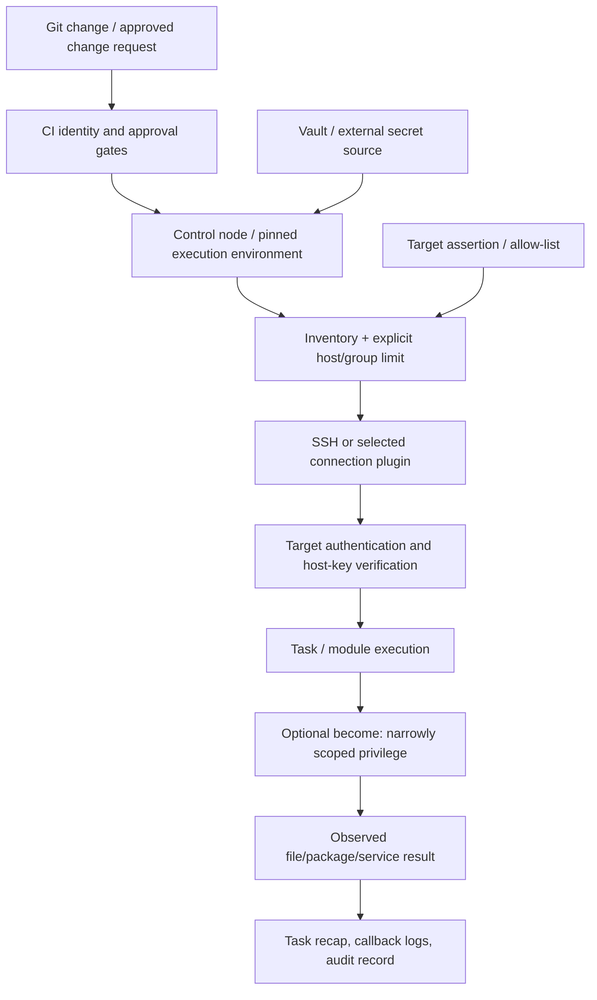

# Unit 10 — Configuration management with Ansible

**Target file:** `10-configuration-management-with-ansible.md` | **Estimated time:** 18–26 hours, including all labs and review | **Prerequisites:** Linux command line, SSH concepts, YAML basics, Git, introductory infrastructure as code (IaC)  
**Core tools:** Ansible CLI, SSH, YAML/Jinja2, local containers | **Awareness:** Ansible Galaxy, Vault, ansible-lint, yamllint, Molecule, pytest/testinfra/goss-style checks, ansible-navigator, AWX/AAP, Packer | **Last reviewed:** 2026-10-28; not yet human-verified against live official docs | **Tool baseline assumed:** Ansible Core, Python, Docker/Podman, and optional lint/test tools are installed at locally chosen pinned versions; exact versions and plugin compatibility are `[VERIFY]` before use | **Substrate:** local-only disposable containers and local files; no real cloud

> **Source and path note:** The available roadmap tree lists `Stage 2E — Production DevOps & Platform Engineering/02-Advanced-Infrastructure-as-Code-and-Cloud-Operations/`. The prompt also mentions a historical `07-...` path; this lesson follows the actual tree path and does not rename it. The authoritative syllabus prompt was available and its Unit 10 topics were inspected. A separate lab setup guide was not available for independent inspection. All code and outputs below are reviewed teaching examples unless explicitly identified as executed validation; no production system is a target.

---

### 10.0 Why this matters in production

A configuration playbook that targets the wrong inventory group can turn a routine package update into a fleet-wide outage, while a task that reports `changed` on every run can repeatedly restart a data-ingestion service and interrupt jobs. Ansible gives teams a repeatable way to configure existing hosts, but it does not make an unsafe target, unreviewed privilege escalation, or leaked secret safe. Idempotent tasks, narrow inventory boundaries, staged rollouts, and retained execution evidence make configuration changes easier to reason about and recover from. The correct operating model is a controlled change workflow—not “run a script and hope.”

### 10.1 Learning objectives

By the end of this unit, the learner can:

- **[L1]** Explain configuration management, Ansible’s control-node/managed-node model, inventory, modules, plays, tasks, handlers, roles, and idempotency.
- **[L1]** Establish an explicitly bounded local inventory, verify Ansible, run a connectivity module, and interpret recap outcomes without confusing Ansible `ping` with ICMP.
- **[L2]** Write a role-based playbook with variables, conditions, loops, registered results, tags, templates, handlers, and common modules.
- **[L2]** Explain variable precedence at a useful high level, pin collections, use Vault carefully, and review `--check`/`--diff` limitations.
- **[L3]** Demonstrate second-run idempotency, test failure paths, design dynamic inventory handoffs, and apply safe SSH and privilege controls.
- **[L3]** Design bounded rolling updates and test playbooks using syntax checks, linting, container tests, or a documented custom harness.
- **[L4]** Design fleet-scale inventory, CI approvals, execution environments, audit evidence, and an immutable-versus-mutable operating model.
- **[L4]** Analyze six required incidents, contain blast radius, preserve evidence, and turn findings into regression tests and governance controls.

### 10.2 Concept map and vocabulary

#### Glossary

| Term | Precise definition | Common misconception |
|---|---|---|
| Configuration management | Reproducibly configuring software, files, users, packages, and services on existing targets. | It is the same as provisioning a VM or creating a cloud network. |
| Control node | Machine or execution environment that runs Ansible commands and playbooks. | It must be the same machine as the target. |
| Managed node | Target configured by Ansible. | It always requires a resident Ansible agent. |
| Inventory | Static or dynamic description of hosts, groups, and related variables. | An inventory file is an authorization boundary by itself. |
| Dynamic inventory | Inventory generated or queried from an external source, often an API or script. | Freshly generated inventory guarantees the targets are correct. |
| Module | Unit of work invoked by Ansible, such as managing a file or package. | Every module supports check mode or behaves identically on every OS. |
| Play / task | A play maps tasks to selected hosts; a task invokes a module or action. | `hosts: all` is safe regardless of the inventory. |
| Handler | A task normally triggered by a `notify` event when a notifying task reports a change. | A handler runs after every task or makes a rollout transactional. |
| Role | Reusable structure for defaults, tasks, handlers, templates, files, and metadata. | A role is a security sandbox. |
| Collection | Distribution unit for Ansible content such as modules, plugins, and roles. | Popular community content is automatically trusted. |
| Idempotency | Repeating an operation with the same desired state should not cause additional unintended changes after convergence. | A successful exit code proves idempotency. |
| Convergence | A run moves observed configuration toward declared desired configuration. | Ansible push mode continuously reconciles between runs. |
| Drift | Difference between the intended configuration and the target’s observed configuration. | Drift is automatically repaired while no playbook is running. |
| Check mode | A simulation mode supported by Ansible and some modules to estimate changes. | It predicts all runtime effects and is equivalent to a successful test. |
| Diff mode | Displays certain before/after differences for supported tasks. | It is safe to enable for secret-bearing files or logs. |
| Vault | Ansible facility for encrypting sensitive data at rest in files or variables. | It prevents secrets from leaking into logs, arguments, artifacts, or target files. |
| `become` | Privilege escalation mechanism for a task/play, commonly to another user such as root. | Broad sudo access is acceptable because the playbook is reviewed. |
| Execution environment | Packaged runtime for Ansible and its dependencies, often containerized for reproducibility. | It automatically makes collections and playbooks trustworthy. |
| Push model | Control node initiates configuration runs against targets. | It is a continuously running reconciliation controller. |
| Immutable image | A built artifact promoted through environments rather than repeatedly modified in place. | An immutable image eliminates patching, secrets, or runtime configuration concerns. |

#### Execution flow



The control node selects hosts before the task runs. SSH authenticates the remote endpoint and the automation identity; `become` is a separate privilege boundary after connection. Secrets may be decrypted or retrieved at runtime, so encryption alone does not control every exposure path. Logs and artifacts need their own access and retention controls.

#### Four related but distinct operating models

```text
Provisioning (Terraform/OpenTofu/Cloud API)
    creates or changes infrastructure objects
        |
        v
Configuration management (Ansible push run)
    configures OS/software/files on selected existing targets
        |
        +--> alternative: bake configuration into an immutable image (Packer)
        |
        +--> Kubernetes workloads: use manifests/controllers for their desired-state loop
```

These approaches can coexist but should have explicit ownership. Provisioning should expose machine-readable outputs and an intentional handoff to configuration management. Ansible should not compete with a Kubernetes controller to manage the same application workload. Image baking is attractive when reproducibility and fast replacement matter; mutable configuration can be useful for bootstrap, urgent patching, and day-2 operations, but it creates drift and rollback complexity.

### 10.3 Level 1 — Beginner

#### 10.3.1 What Ansible does

Ansible is an automation framework that runs tasks from a control node against selected targets. In the common SSH model, targets generally need reachable SSH, suitable credentials, and a usable Python interpreter for most POSIX modules; “agentless” means no persistent Ansible agent is normally required, not that there are no prerequisites. Connection plugins can change those assumptions, so verify the selected connection type.

Use Ansible for configuring an existing ETL runner or PostgreSQL-client host: create a dedicated account, ensure directories exist, install packages when supported, place a configuration file, and notify a service supervisor when configuration changes. Use Terraform/OpenTofu for infrastructure lifecycle and a Kubernetes controller for Kubernetes-native desired-state management.

#### 10.3.2 Install and verify

Use an isolated Python environment or the organization’s approved execution image. Do not install an unpinned tool into a production control node just to follow this lesson.

```bash
# Illustrative Linux/WSL shell; choose a currently supported Python/Ansible pairing.
python3 --version
python3 -m venv .venv
. .venv/bin/activate
python -m pip install --upgrade pip
python -m pip install "ansible-core==<PINNED_VERSION>"
ansible --version
ansible-playbook --version
```

`<PINNED_VERSION>` is deliberately a placeholder, not an installable version. Select a real version from the official Ansible compatibility documentation and pin it in your controlled lab setup. Record the executable path, Python version, Ansible Core version, configuration file path, and collection paths shown by `ansible --version`. The install command above is a template and was not executed here.

#### 10.3.3 First inventory: safe target boundary

Create a disposable directory outside any production repository, for example `~/ansible-unit10-lab/`. The examples use only `localhost` for the beginner connectivity check. Do not point this inventory at a company inventory.

**`inventory.ini`**
```ini
[lab_local]
localhost ansible_connection=local
```

Before using it, inspect the file and verify that the only host is `localhost`:

```bash
cd ~/ansible-unit10-lab
cat inventory.ini
ansible-inventory -i inventory.ini --list
ansible lab_local -i inventory.ini -m ping
```

**[ILLUSTRATIVE EXPECTED OUTPUT — NOT EXECUTED]**

```text
localhost | SUCCESS => {
    "changed": false,
    "ping": "pong"
}
```

Ansible’s `ping` module checks Ansible connectivity and remote Python execution (or the local connection path in this example); it is not an ICMP/network ping test. The group is named `lab_local`, and the command explicitly selects that group rather than an uncontrolled `all`.

Equivalent YAML inventory:

**`inventory.yml`**
```yaml
all:
  children:
    lab_local:
      hosts:
        localhost:
          ansible_connection: local
```

Use one inventory format per lab to avoid ambiguity. `ansible-inventory --graph -i inventory.ini` is a useful way to inspect group membership. Inventory can include host variables, group variables, and nested groups; naming conventions must prevent staging and production hosts from colliding under ambiguous aliases.

#### 10.3.4 First playbook and task recap

**`hello.yml`**
```yaml
---
- name: Safe local configuration demonstration
  hosts: lab_local
  gather_facts: false
  tasks:
    - name: Ensure a lab marker directory exists
      ansible.builtin.file:
        path: "{{ lookup('env', 'HOME') }}/ansible-unit10-marker"
        state: directory
        mode: "0700"
```

Run a syntax check before executing:

```bash
ansible-playbook -i inventory.ini hello.yml --syntax-check
ansible-playbook -i inventory.ini hello.yml --check --diff
ansible-playbook -i inventory.ini hello.yml
ansible-playbook -i inventory.ini hello.yml
```

The play is deliberately local and creates one directory under the current user’s home. Check mode is an estimate; the first actual run should create the directory and the second should normally report no change for this task. The use of `lookup('env','HOME')` is convenient for a local demo but not a universal cross-platform path strategy.

**[ILLUSTRATIVE]** Typical recap terms:

| Outcome | Meaning | Review question |
|---|---|---|
| `ok` | Task completed and did not report a change. | Was the desired state already present? |
| `changed` | Task reported that it changed or would change something. | Was that change expected and necessary? |
| `failed` | Task failed according to Ansible/module semantics. | Did the failure happen on the intended host and at the intended step? |
| `skipped` | Task was not run, often due to a condition or tag selection. | Did the condition correctly express the intended scope? |

A playbook can succeed while doing the wrong business action. Always review selected hosts, task names, changes, and the resulting target state.

#### 10.3.5 First-principles trace

1. Desired configuration says the marker directory must exist with restrictive permissions.
2. Inventory selects only `lab_local`; the play names that group.
3. The `file` module inspects and converges the path.
4. Ansible reports `changed` if it created or corrected the directory; otherwise it reports `ok`.
5. The recap summarizes outcomes by host. It does not independently prove the application is healthy.

#### Beginner troubleshooting

| Symptom | Likely cause | Safe check | Fix |
|---|---|---|---|
| No hosts matched | Wrong inventory path or group name | `ansible-inventory -i inventory.ini --graph` | Correct the inventory or selected group; do not broaden to `all` as a shortcut. |
| SSH authentication failure | Wrong user/key or target identity | Inspect host alias, key permissions, and SSH verbose output without printing private keys | Fix credentials and confirm host identity. |
| Python/interpreter error | Missing or incompatible interpreter on target | Verify target OS and Python path | Install/use a supported interpreter through an approved process. |
| `become` permission denied | Insufficient privilege or missing sudo policy | Test only on the disposable target and inspect sudo policy | Grant only the required command/role, not wildcard sudo. |
| YAML parse error | Indentation, quoting, or type issue | `ansible-playbook --syntax-check` | Fix indentation and quote values where ambiguity exists. |
| Unexpected `changed` | Task semantics or desired state changed | Review diff and module documentation | Prefer declarative modules; test second run. |
| Ansible `ping` works but host is not reachable from another network | It is not an ICMP or application health check | Use an approved network/health check | Separate automation connectivity from service health. |

### 10.4 Level 2 — Intermediate

#### 10.4.1 Playbook anatomy

A play declares the host selection and execution context. Tasks call modules. Variables provide configuration inputs. Conditions and loops control task execution. Registered results capture task output for later logic. Handlers are notified by tasks that report changes and generally run at handler flush points.

```yaml
---
- name: Configure the disposable ETL client host
  hosts: etl_lab
  become: false
  gather_facts: false
  vars:
    etl_user: etlrunner
    etl_config_dir: /tmp/etl-lab/etc
    etl_state_dir: /tmp/etl-lab/state
  tasks:
    - name: Ensure configuration directory exists
      ansible.builtin.file:
        path: "{{ etl_config_dir }}"
        state: directory
        mode: "0750"
      tags: [config]

    - name: Check whether the configuration file exists
      ansible.builtin.stat:
        path: "{{ etl_config_dir }}/etl-client.ini"
      register: etl_config_stat
      tags: [config]

    - name: Report the existence check
      ansible.builtin.debug:
        msg: "Configuration file exists: {{ etl_config_stat.stat.exists | default(false) }}"
      tags: [diagnostics]
```

This is a local-safe pattern, not a full host-hardening playbook. Do not use `/tmp` for production secrets or persistent application configuration. For real Linux hosts, path, owner, package manager, service manager, and permissions must match the target platform.

#### 10.4.2 Common modules and command semantics

| Need | Prefer | Why / caveat |
|---|---|---|
| Package state | `ansible.builtin.package` or OS-specific package module | Declarative desired state; package name and support vary by OS. |
| File/directory ownership/mode | `ansible.builtin.file` | Expresses state directly and is usually idempotent. |
| Copy a static file | `ansible.builtin.copy` | Use controlled source content; review diffs for sensitive data. |
| Render a config | `ansible.builtin.template` with Jinja2 | Keep secrets out of templates and protect resulting files. |
| Edit a single line | `ansible.builtin.lineinfile` | Useful for narrow edits; can be brittle for complex structured configuration. |
| Manage a user | `ansible.builtin.user` | User/group behavior is OS-dependent; least privilege matters. |
| Manage a service | `ansible.builtin.service` or platform-specific module | Container images may lack systemd/init; verify the actual supervisor. |
| Execute a program without shell parsing | `ansible.builtin.command` | Avoids shell metacharacter interpretation; still needs idempotency reasoning. |
| Execute shell syntax | `ansible.builtin.shell` | More expressive but adds quoting/injection and idempotency risks. |

Avoid a task like this:

```yaml
- name: BAD - writes a new timestamp every run
  ansible.builtin.shell: "date > /tmp/last-run.txt"
```

It changes the file each run and introduces shell semantics. Prefer a declarative module for desired state. If the intent is a one-time operation, use a supported guard such as `creates` only when file existence reliably means the operation completed; document failure recovery if the command can partially execute.

```yaml
- name: Create a disposable one-time marker
  ansible.builtin.command:
    cmd: /usr/bin/touch /tmp/ansible-unit10-once
    creates: /tmp/ansible-unit10-once
```

This is safe only because it writes a lab marker. A marker is not a transaction or a universal proof that an external operation completed correctly.

#### 10.4.3 Variables and precedence

At a useful high level, role defaults are intended to be easy to override, inventory variables describe hosts/groups, play variables apply within a play, and extra variables supplied at invocation commonly have high precedence. The full precedence model has more layers and special cases; consult the official Ansible documentation topic **“Understanding variable precedence”** before relying on a specific override in production `[VERIFY]`.

Do not put secrets in defaults, source control, command-line extra vars, or debug output. Prefer an approved secret workflow and restrictive file permissions.

#### 10.4.4 Role structure

```text
roles/etl_client/
├── defaults/main.yml
├── vars/main.yml
├── tasks/main.yml
├── handlers/main.yml
├── templates/etl-client.ini.j2
├── files/README.txt
└── meta/main.yml
```

- `defaults/main.yml`: low-precedence defaults that consumers can override.
- `vars/main.yml`: role variables with stronger precedence; avoid using this to make every setting impossible to override.
- `tasks/main.yml`: task entry point.
- `handlers/main.yml`: tasks notified by change events.
- `templates/`: Jinja2 templates rendered on the control node and transferred to the target.
- `files/`: static files copied to targets.
- `meta/main.yml`: role metadata and dependencies; verify schema requirements for the chosen Ansible version.

#### 10.4.5 Complete role example for a PostgreSQL-client/ETL host

This role is designed for a Linux VM with a real service manager, but the main lab below uses minimal containers and intentionally does **not** assume systemd. The package name and service name are platform-specific and must be verified before using this against a VM.

**`roles/etl_client/defaults/main.yml`**
```yaml
---
etl_service_user: etlrunner
etl_config_dir: /etc/etl-client
etl_state_dir: /var/lib/etl-client
etl_log_level: INFO
etl_endpoint_host: "db.example.invalid"
etl_endpoint_port: 5432
etl_client_package: "postgresql-client"
etl_service_name: "etl-client"
```

**`roles/etl_client/tasks/main.yml`**
```yaml
---
- name: Ensure dedicated service account exists
  ansible.builtin.user:
    name: "{{ etl_service_user }}"
    system: true
    create_home: false
    shell: /usr/sbin/nologin
  become: true

- name: Ensure configuration directory exists
  ansible.builtin.file:
    path: "{{ etl_config_dir }}"
    state: directory
    owner: root
    group: "{{ etl_service_user }}"
    mode: "0750"
  become: true

- name: Ensure state directory exists
  ansible.builtin.file:
    path: "{{ etl_state_dir }}"
    state: directory
    owner: "{{ etl_service_user }}"
    group: "{{ etl_service_user }}"
    mode: "0750"
  become: true

- name: Render client configuration
  ansible.builtin.template:
    src: etl-client.ini.j2
    dest: "{{ etl_config_dir }}/etl-client.ini"
    owner: root
    group: "{{ etl_service_user }}"
    mode: "0640"
  notify: Validate or reload ETL client
  become: true
```

**`roles/etl_client/handlers/main.yml`**
```yaml
---
- name: Validate or reload ETL client
  ansible.builtin.command:
    argv:
      - /usr/local/bin/etl-client
      - validate-config
      - "{{ etl_config_dir }}/etl-client.ini"
  changed_when: false
  listen: Validate or reload ETL client
```

This handler is a validation example, not a real service restart. It deliberately does not claim that an `etl-client` binary exists. Replace it with the target platform’s documented validation/reload action after verifying the executable and service supervisor. If a validation command fails after a template update, the config file may already have changed; handler execution is not transactional.

**`roles/etl_client/templates/etl-client.ini.j2`**
```jinja2
[connection]
host = {{ etl_endpoint_host }}
port = {{ etl_endpoint_port }}

[client]
log_level = {{ etl_log_level }}
state_dir = {{ etl_state_dir }}
```

Never embed passwords, tokens, private keys, or database credentials in this template. Retrieve secrets through the approved secret system at runtime, avoid printing them, and ensure the resulting target file has appropriate permissions.

**`roles/etl_client/meta/main.yml`**
```yaml
---
galaxy_info:
  role_name: etl_client
  author: platform-team
  description: Example ETL client host configuration role
  license: MIT
  min_ansible_version: "2.14"
dependencies: []
```

The example metadata field set and minimum version are illustrative and require verification against the selected Galaxy/Ansible schema; do not infer that the role has been published or validated.

**`requirements.yml`**
```yaml
---
collections:
  - name: ansible.posix
    version: "<PINNED_REVIEWED_VERSION>"
```

The placeholder is not valid as a concrete collection version. Replace it with a reviewed version from the official collection index and commit the lock/pin decision through review. Do not install arbitrary community roles simply because they are popular.

#### 10.4.6 Check mode, diff mode, and sensitive output

`--check` asks supported modules to estimate changes. Some modules do not support check mode, and registered results or conditions may differ when the task is simulated. `--diff` shows before/after content for supported actions; it can expose secrets, credentials, or sensitive configuration in terminal logs and CI artifacts. Neither option proves that runtime behavior, external APIs, service health, or business outcomes are safe.

Use check/diff only against a controlled target, review inventory and credentials first, and disable or carefully scope diffs for secret-bearing tasks. Verify the exact options with the installed `ansible-playbook --help` and official CLI documentation `[VERIFY]`.

#### 10.4.7 Pattern catalogue

| Pattern | Use when | Do not use when |
|---|---|---|
| Declarative `file`, `copy`, `template`, `user` modules | Desired state is expressible as a resource/file/user attribute | The module cannot model the required operation; then document imperative behavior. |
| Handler with `notify` | A change should trigger one reload/validation after relevant tasks | Every task must run immediately or the operation requires transactional semantics. |
| `register` + `when` | A later step depends on a specific observed result | The condition depends on unstable human-readable output or masks failure. |
| `loop` | Multiple similar resources share a consistent task | Items require different safety/ownership logic that becomes opaque in a loop. |
| Tags | Operators need controlled subsets of a play | Tags are the only safety boundary or omission changes required ordering. |
| `command` + `creates` | A one-time command has a reliable completion marker | Marker can exist after partial failure or becomes stale. |
| `shell` + `changed_when` | Shell behavior is unavoidable and result semantics are carefully defined | Shell parsing is unnecessary or output matching is brittle. |
| Role defaults | Consumers should override ordinary settings | A security invariant must be overrideable without guardrails. |
| Vault-encrypted file | Encrypting sensitive source data at rest is useful | It is treated as the only secret protection control. |

#### 10.4.8 Anti-pattern catalogue

| Bad pattern | Failure mode | Corrected pattern |
|---|---|---|
| `hosts: all` against an uncontrolled inventory | Broad unintended fleet change | Explicit group, inventory assertion, environment confirmation, and bounded `--limit`. |
| `shell: echo ... >> file` | Repeated duplicate lines and shell-injection risk | `lineinfile`, `template`, or `copy` according to the intended state. |
| `ignore_errors: true` everywhere | Broken rollout appears successful | Fail closed; use `block`/`rescue` for deliberate recovery and report failure. |
| `become: true` on every play | Unnecessary privilege expansion | Escalate only tasks that need it. |
| `no_log: true` as sole secret strategy | Secret may still reach files, process args, external systems, or artifacts | Control secret source, result handling, target permissions, logs, and retention. |
| Disable host-key checking permanently | Host substitution may go undetected | Provision known hosts or use a verified host-certificate/known-hosts strategy. |
| Unpinned collection updates | Module behavior can change unexpectedly | Pin, review, test, and upgrade through a controlled PR. |

### 10.5 Level 3 — Advanced

#### 10.5.1 Proving idempotency with a structured check

The operational goal is not merely “the playbook exited zero.” The goal is that after the target has converged, a second run does not report unintended changes for the tasks under test. Ansible’s human recap is convenient but scraping it with brittle regular expressions can be error-prone. Where available and configured, use structured callback output or an API/job record; verify the callback plugin and output schema for the selected version `[VERIFY]`.

A small defensive wrapper can still parse a deliberately constrained recap format for a local exercise, but it should be labelled a teaching fallback, not a production-grade parser:

```python
#!/usr/bin/env python3
"""Assert a known one-host lab recap reports changed=0."""
import re
import sys

def main() -> int:
    if len(sys.argv) != 3:
        print("usage: assert_recap.py <recap-file> <expected-host>", file=sys.stderr)
        return 64
    text = open(sys.argv[1], encoding="utf-8").read()
    host = re.escape(sys.argv[2])
    matches = re.findall(
        rf"(?m)^{host}\s*:\s*.*?\bchanged=(\d+)\b.*$",
        text,
    )
    if len(matches) != 1:
        print("FAIL: expected exactly one matching host recap", file=sys.stderr)
        return 2
    if int(matches[0]) != 0:
        print(f"FAIL: expected changed=0, got changed={matches[0]}", file=sys.stderr)
        return 1
    print(f"PASS: {sys.argv[2]} recap changed=0")
    return 0

if __name__ == "__main__":
    raise SystemExit(main())
```

This parser is sensitive to recap formatting and locale; it asserts only the selected host’s aggregate `changed` count. It does not prove that the correct hosts were selected, that no unreported side effect occurred, or that the resulting service is healthy. In production, prefer a version-verified structured event/callback or controller API and assert the intended task/host set explicitly.

#### 10.5.2 Idempotency traps

- **Timestamps in templates:** embedding the current time changes the rendered file each run.
- **Non-deterministic iteration:** iteration order from external sources can create noisy diffs or inconsistent operations.
- **Generated random values:** regenerating an identifier each run causes repeated changes and may break dependencies.
- **Imperative shell:** appending lines, touching changing files, or invoking commands without guards repeats side effects.
- **Handler misuse:** unnecessary notifications cause repeated restarts; missing notifications leave services using stale configuration.
- **Incorrect `changed_when`:** forcing `changed_when: false` can hide real mutation; it is not a magic idempotency fix.
- **Bad `creates` marker:** a marker created before the real operation completes can suppress necessary retries after failure.

Test both the task outcome and the desired end state. For a configuration file, inspect content and mode; for a process, check process/health evidence appropriate to the service; for a package, verify installed version/state.

#### 10.5.3 Failure handling with `block`, `rescue`, and `always`

```yaml
---
- name: Demonstrate controlled failure handling on localhost only
  hosts: lab_local
  gather_facts: false
  tasks:
    - name: Run a controlled block
      block:
        - name: Record that the block started
          ansible.builtin.copy:
            dest: /tmp/ansible-unit10-block-started
            content: "started\n"
            mode: "0600"

        - name: Deliberately fail without destructive side effects
          ansible.builtin.command:
            argv: ["/usr/bin/false"]
          changed_when: false

        - name: This task should not run after the failure
          ansible.builtin.debug:
            msg: "unexpected continuation"

      rescue:
        - name: Record recovery path
          ansible.builtin.copy:
            dest: /tmp/ansible-unit10-rescue-ran
            content: "rescue ran\n"
            mode: "0600"

      always:
        - name: Record cleanup/finalization path
          ansible.builtin.copy:
            dest: /tmp/ansible-unit10-always-ran
            content: "always ran\n"
            mode: "0600"
```

**[ILLUSTRATIVE EXPECTED BEHAVIOR — NOT EXECUTED]** The controlled failing task stops the remaining normal tasks in the block; `rescue` runs for a rescuable task failure, and `always` is intended for finalization. Exact behavior for unreachable hosts, invalid task definitions, controller failures, and fatal errors has exceptions; verify the official Ansible playbook error-handling documentation for the chosen version `[VERIFY]`. `rescue` does not roll back changes already made and does not make a multi-task operation transactional.

`failed_when` should express a deliberate failure condition based on a documented result. Avoid broad `ignore_errors`; it suppresses normal task failure handling and can make CI incorrectly green. If a failure is intentionally tolerated, document why, emit a clear signal, and add a test that distinguishes expected failure from a broken rollout.

#### 10.5.4 Dynamic inventory and Terraform/OpenTofu handoff

Dynamic inventory commonly reads from a cloud API or a controlled output artifact. Freshness, identity, and scope must be checked before the resulting hosts are eligible for changes. An inventory script can be a source of executable code and API credentials; pin it, review it, and restrict its permissions.

A conceptual JSON inventory shape (not a complete plugin implementation):

```json
{
  "all": {
    "children": {
      "etl_staging": {
        "hosts": {
          "etl-lab-01": {
            "ansible_host": "127.0.0.1",
            "ansible_connection": "local",
            "lab_marker": true
          }
        }
      }
    }
  }
}
```

This is illustrative data, not a production cloud inventory. A dynamic inventory plugin or script must conform to the currently documented inventory schema and invocation contract `[VERIFY]`. Before any playbook run, assert the expected environment and allow-listed host identity. Do not trust a tag alone as authorization.

**Preferred handoff:**

1. Terraform/OpenTofu creates infrastructure through its own approved plan/apply workflow.
2. The provisioning stage emits a machine-readable output artifact containing non-secret connection metadata and stable resource identity.
3. A separate Ansible stage validates schema, environment, allowed host count, host identity, and credentials.
4. Ansible runs syntax/tests and a controlled check/review step.
5. A separate approval gate authorizes bounded configuration changes.
6. Logs and outputs are retained with secrets redacted.

`local-exec` provisioners used to orchestrate configuration are often fragile because they couple provisioning to external commands, local environment assumptions, credentials, retries, and partial failure. Prefer explicit pipeline stages with clear ownership. Never let Terraform/OpenTofu and Ansible both claim authoritative lifecycle management for the same setting without a documented ownership boundary.

#### 10.5.5 Push versus `ansible-pull`

| Model | Benefits | Costs / risks |
|---|---|---|
| Push (control node connects to targets) | Centralized approvals, inventory limits, credentials, logs, and change windows | Control node must reach targets; central credentials and inventory are high-value; concurrency must be bounded. |
| Pull (`ansible-pull`) | Targets initiate runs and may suit disconnected or distributed environments | Git/source trust, credential bootstrap, schedule control, reporting, drift visibility, and fleet coordination become harder. |

Use push mode for centrally governed fleet changes when network and identity design support it. Consider pull mode only with an explicit source-authentication, schedule, reporting, and rollback design; do not treat it as an automatic substitute for a controller-based reconciliation platform.

#### 10.5.6 Connection security and privilege

- Use SSH keys or approved short-lived identities, protect private key material, and rotate/revoke credentials deliberately.
- Keep host-key verification enabled. Populate `known_hosts` or use an approved host-certificate approach. Never permanently disable host-key checking to “fix” a lab.
- A jump host/bastion is a controlled connection path, not proof that the final target identity is valid.
- Use `become` only for tasks that require privilege. Sudoers should allow narrowly scoped commands and arguments; avoid wildcard commands and broad passwordless root.
- `no_log: true` is appropriate for tasks whose arguments/results contain secrets, but it is not a universal secrecy guarantee. A later debug task, registered result, shell output, target file, crash dump, or CI artifact can still leak data.
- Verify exact connection variables and SSH options against the current Ansible configuration/CLI documentation before deploying them `[VERIFY]`.

Example of a scoped task-level escalation pattern:

```yaml
- name: Ensure protected configuration directory exists
  become: true
  ansible.builtin.file:
    path: /etc/etl-client
    state: directory
    owner: root
    group: etlrunner
    mode: "0750"
```

Do not add `become: true` to the entire play unless every task truly needs it.

#### 10.5.7 Performance, rolling rollout, and coordination

- `forks` is a controller configuration setting that affects parallelism; higher concurrency increases pressure on targets, APIs, SSH, and shared services.
- Pipelining and fact caching are configuration-dependent and can change connection/privilege behavior or cache freshness. Verify exact settings and implications `[VERIFY]`.
- `gather_facts: false` avoids gathering facts when the play does not need them; do not disable facts if platform-specific logic depends on them.
- `strategy: free` changes host/task scheduling semantics; use only when task ordering and cross-host coordination permit it `[VERIFY]`.
- `serial` limits rollout batches; `max_fail_percentage` changes how failures affect rollout progression. Exact threshold semantics should be checked in the official playbook keywords reference `[VERIFY]`.
- `delegate_to` runs a task on another host, while `run_once` changes execution frequency in a play/batch context; their interaction with serial batches and strategies needs careful review `[VERIFY]`.
- Dynamic inventory should be checked for freshness, expected environment, stable identity, and allowed host count before each apply.
- Use bounded batches, health checks, maintenance windows, and stop conditions. A two-host demo illustrates mechanics but cannot prove high availability at fleet scale.

#### 10.5.8 Testing options

Always begin with syntax and target-scope validation. `ansible-lint` and `yamllint` can add static checks, but their installation and rules are version-sensitive `[VERIFY]`. Molecule and container drivers may be useful, but current maintenance, driver support, and syntax must be checked against official documentation before adopting them. If their compatibility is uncertain, use a custom disposable harness: launch known local containers, apply the role, run the playbook twice, inspect content/process behavior, inject a controlled failure, and remove the containers.

Example checks (reviewed examples; tool versions not pinned here):

```bash
ansible-playbook -i inventory.ini site.yml --syntax-check
ansible-inventory -i inventory.ini --graph
ansible-lint --version       # optional; verify install and supported syntax
yamllint --version           # optional; verify install and configuration
```

A passing syntax check proves parseability, not correct behavior, safe target scope, successful remote execution, or idempotency.

### 10.6 Level 4 — Expert

#### 10.6.1 Fleet-scale operating model

For a data/ML platform operating across development, staging, and production, use a hierarchy that encodes environment and ownership:

```text
inventory/
├── dev/
│   ├── hosts.yml
│   ├── group_vars/
│   └── host_vars/
├── staging/
│   ├── hosts.yml
│   ├── group_vars/
│   └── host_vars/
└── prod/
    ├── hosts.yml
    ├── group_vars/
    └── host_vars/
```

This is a conceptual layout, not a mandated plugin-specific structure. Enforce distinct CI identities and credentials per environment, stable host identity, explicit environment assertions, and an allow-list for every job. Avoid ambiguous aliases such as `etl-01` appearing in multiple environments without qualified identity. Inventory is a targeting mechanism, not a replacement for network controls or cloud IAM.

#### 10.6.2 Execution environments and automation controllers

An execution environment packages Ansible and dependencies into a repeatable runtime. `ansible-navigator` is associated with interacting with execution environments and Ansible content; AWX and Ansible Automation Platform (AAP) are controller/platform topics. Product terminology, packaging, RBAC, credential storage, execution-image support, job templates, audit/run records, and licensing/product capabilities can change and must be verified in current official documentation `[VERIFY]`.

Operationally, controller-side credential storage and RBAC can improve central governance, but introduce another service to patch, back up, monitor, and administer. A job template is not safe merely because it is centralized: restrict who can launch it, which inventory it may target, which credentials it can use, which execution image it uses, and whether launchers can override extra variables or limits.

#### 10.6.3 CI pipeline and change gates

A safe pipeline is typically:

```text
Pull request
  -> YAML/static lint
  -> syntax check
  -> role/container tests
  -> inventory schema + target assertion
  -> controlled check-mode review (not sufficient by itself)
  -> reviewer approval + change record
  -> bounded rollout with health checks
  -> post-change validation
  -> evidence retention and audit summary
```

The exact sequence depends on inventory plugins, modules, environment, and risk. Separate read/plan-like validation identities from write-capable apply identities where practical. Do not expose production credentials to untrusted pull requests. Protect workflows and artifact downloads; plan/check outputs and logs may contain sensitive values.

#### 10.6.4 Immutable image versus mutable configuration decision

| Criterion | Prefer image baking (e.g., Packer) | Prefer Ansible against existing hosts | Prefer Kubernetes controller/manifests |
|---|---|---|---|
| Reproducibility | Strong when builds are deterministic and image promotion is controlled | Depends on playbook idempotency and observed host baseline | Depends on manifests, controllers, admission/policy, and cluster state |
| Urgent patching | May require rebuild and promotion; image pipeline must be responsive | Can patch a bounded fleet during an approved window | OS patching of nodes is separate; workload rollout is controller-managed |
| Drift correction | Replace with known image, but runtime changes can still occur | Corrects on each controlled run; not continuously | Controller continuously reconciles supported declared resources |
| Rollback | Redeploy prior image if compatible and data/state permit | Often roll forward; package and schema changes may not be safely reversible | Roll back workload revision when supported; external state may remain changed |
| Bootstrapping | Image can contain base packages/config but not secrets | Useful for first boot and day-2 setup | Not a replacement for host/bootstrap configuration |
| Secret handling | Never bake live secrets into image layers | Retrieve at runtime and protect files/logs | Use approved secret integration; avoid unmanaged plaintext manifests |
| Best fit | Standardized fleet, immutable promotion, reproducible hosts | Existing VMs/bare metal, OS tasks, bootstrap, patching | Kubernetes application desired state and resources owned by controllers |

The right choice is often hybrid: bake baseline packages and hardening, use Ansible for bootstrap or controlled OS operations, and let Kubernetes controllers own Kubernetes workloads. Document who owns each setting to prevent competing automation.

#### 10.6.5 Compliance and patching

CIS-style hardening roles can provide a baseline but running a role does not prove certification or compliance. Collect evidence, independently validate controls, record exceptions, and tie the results to a defined policy/version. For OS patching, use canaries, maintenance windows, service health checks, and staged batches. Rollback may be limited by package dependencies, kernel updates, data migrations, and external side effects; a tested roll-forward/rebuild path is often more realistic than assuming every patch can be reversed.

#### 10.6.6 Audit and evidence model

For each execution, record who initiated it, approved change reference, code commit, Ansible/tool/collection versions, execution environment digest or identity, inventory source and freshness, selected hosts, credential identity (not secret), job/run identifier, start/end time, task outcomes, failure details with redaction, post-change health evidence, and cleanup/recovery action. Retain logs and artifacts under access controls and retention rules. Avoid recording secret values, private keys, Vault passwords, or unredacted task diffs.

#### 10.6.7 Six required incident analyses

| Incident | Symptom → timeline/evidence | Root cause | Immediate containment | Recovery | Prevention / regression test |
|---|---|---|---|---|---|
| 1. Bad `when` condition triggers destructive `rm -rf`-style behavior on wrong group | Unexpected directories disappear; job log shows an unintended host/group and a condition that evaluated true. | Broad target plus incorrect condition/path construction; destructive shell command bypassed declarative safety. | Stop rollout, revoke job launch, preserve logs and host identity, isolate affected hosts if required. Do not rerun cleanup. | Restore from verified backup/snapshot or rebuild data from authoritative source; validate application integrity and record gaps. | Replace destructive shell with declarative modules where possible; assert exact inventory group and approved path; tests use temp directories with sentinel files and reject paths outside an allow-list. |
| 2. `become` plus wildcard sudoers enables privilege escalation | A low-privilege automation account can execute unintended commands as root; sudo/audit logs show broad invocation. | Wildcard sudo rule and playbook-wide escalation granted more power than task required. | Disable affected automation credential/job and revoke broad sudo rule through approved access procedure. | Reissue narrow command-specific privilege after reviewing dependencies; verify service operation. | Test sudoers policy in staging; assert privilege is task-scoped; scan role changes for wildcard rules. |
| 3. Secret appears in CI logs | Secret string appears in task output, registered result, shell output, or diff artifact. | Task lacked `no_log`, a later debug emitted the result, or a downstream tool printed the secret. | Restrict log/artifact access, revoke/rotate the exposed secret, preserve redacted incident evidence. | Replace secret at source and target, verify old credential invalid, inspect copies/caches/retention. | Canary secret in test; assert it does not occur in logs/artifacts; review `no_log`, debug, diff, and command-line exposure. |
| 4. Non-idempotent playbook restarts production service every run | Restart count rises on each scheduled execution; jobs are interrupted despite no intended config change. | Imperative task always reports changed or a timestamp makes the template different each run; handler fires repeatedly. | Pause scheduled rollout and identify the specific notifying task. | Restore stable config; validate health and schedule a controlled restart if needed. | Run twice in disposable target and assert intended `changed=0`; assert restart only after real config change. |
| 5. Unpinned collection update changes module behavior | A previously passing task fails or changes results after dependency refresh. | Floating collection version or unreviewed dependency update changed semantics. | Freeze rollout and restore last reviewed dependency set in an isolated copy. | Validate old pinned version, inspect new release notes, test behavior and update intentionally. | Pin collection versions, review lock/requirements changes, run role tests in upgrade ring before broad rollout. |
| 6. SSH host-key checking disabled; host substitution/MITM goes unnoticed | Connection succeeds to an unexpected endpoint; host key differs from known identity but was not checked. | Persistent host-key-check bypass and weak endpoint identity controls. | Stop automation, revoke exposed credentials if compromise is plausible, preserve SSH/network evidence. | Re-establish endpoint identity through a trusted channel; rotate keys/credentials and inspect target integrity. | Test host-key mismatch failure; provision known_hosts or approved host certificates; prohibit permanent disabling in CI policy. |

#### 10.6.8 Fleet change policy

A production configuration change should specify: target environment and allow-listed host set; risk classification; expected change count; canary size; health signals and stop thresholds; maintenance window; secret/credential scope; approved code and collection versions; rollback/roll-forward plan; operator and reviewer; and evidence retention. The rollout operator must be able to stop the next batch without waiting for the whole playbook to finish. A failed canary should halt progression until the failure is understood.

### 10.7 SRE lens

#### Operational signals

| Signal | Why it matters | Anti-pattern |
|---|---|---|
| Number of selected hosts vs expected | Detects inventory scope mistakes | Reporting only the total fleet size |
| Changed-host and changed-task counts | Helps identify unexpected repeated changes | Treating “few changes” as proof of correctness |
| Failed/unreachable hosts by batch | Reveals connectivity or rollout failure | Hiding failures with `ignore_errors` |
| Duration and task latency | Identifies performance regression or API throttling | Optimizing duration while increasing blast radius |
| Service restart count | Detects handler churn and non-idempotency | Assuming every restart is harmless |
| Patch compliance evidence | Measures defined patch baseline against inventory | Claiming compliance because a playbook ran |
| Repeated convergence failures | Identifies persistent drift or task defects | Re-running without investigating the same failure |
| Post-change health | Confirms service-level outcome | Equating Ansible recap success with business health |

#### Incident runbook

1. **Stop further rollout:** cancel/disable the job or prevent next batch; do not blindly rerun.
2. **Identify exact targets:** preserve inventory source, selected host list, aliases, resolved addresses, and environment assertions.
3. **Preserve evidence:** retain job logs, commit, tool/collection versions, diffs with secrets redacted, and change approval.
4. **Contain:** revoke unsafe credentials, stop repeated scheduled execution, isolate impacted service/host where warranted.
5. **Recover:** use tested backup/rebuild/roll-forward procedures; do not assume OS package or data changes are reversible.
6. **Validate health:** test service endpoints, process state, data integrity, and business-level checks.
7. **Root-cause analysis:** distinguish triggering task, latent design defect, detection gap, and governance failure.
8. **Regression test:** add a test for target scope, idempotency, secret redaction, failure handling, or rollout stop behavior.
9. **Close the loop:** update role documentation, inventory policy, CI gate, and operator runbook.

Ansible is not transactional across a fleet. Earlier hosts can already be changed when a later host fails. OS package updates may require forward recovery, image replacement, or restoration from backup rather than a literal rollback.

### 10.8 Security lens

- **Least privilege:** use task-level `become`; narrow sudoers commands and arguments; avoid wildcard root access.
- **SSH identity:** keep host-key checking enabled; manage `known_hosts`/host certificates; rotate keys; do not print private key contents.
- **Inventory safety:** treat inventory as a sensitive targeting input. It does not replace cloud IAM, network segmentation, or target-side authorization.
- **Secret handling:** use Vault or an approved external secret store, protect Vault password retrieval, and never commit plaintext secrets. `no_log: true` reduces some task-log exposure but does not secure every output channel.
- **Supply chain:** pin collections and execution environment dependencies, review source/maintainer/release history/advisories, test upgrades, and preserve the last known-good dependency set.
- **CI identity:** separate credentials by environment; keep write credentials out of untrusted PR workflows; require approvals for production; protect artifacts and job logs.
- **Target controls:** check inventory freshness, stable identity, group membership, `--limit` semantics, and expected host count. Aliases and dynamic inventory can conceal unintended endpoints.
- **Hooks/plugins/external code:** review callbacks, lookup plugins, filters, inventory scripts, and shell tasks as executable code.
- **Diff/log redaction:** treat diffs and registered results as potentially sensitive; use least retention and access.
- **Exceptions:** any temporary relaxation must have an owner, expiry, compensating control, and evidence of removal.

### 10.9 Production checklist

#### 1. Target/inventory safety
- [ ] Inventory source and freshness are recorded.
- [ ] Selected host list matches the approved environment and allow-list.
- [ ] Host aliases resolve to expected stable identities.
- [ ] Job asserts expected environment and refuses unexpected groups/hosts.
- [ ] `--limit` is reviewed as an additional bound, not the only authorization control.
- [ ] Canary/batch size and stop conditions are explicit.

#### 2. Idempotency and task semantics
- [ ] Declarative modules are preferred where they express desired state.
- [ ] Every `command`/`shell` task has documented change/failure semantics and guards where appropriate.
- [ ] A second run is tested against the intended converged tasks.
- [ ] Handlers fire only on meaningful changes.
- [ ] `changed_when` does not hide real side effects.
- [ ] Check mode limitations and unsupported modules are documented.

#### 3. Credentials and privilege
- [ ] SSH identity and host keys are verified.
- [ ] No permanent host-key-check bypass is configured.
- [ ] `become` is limited to tasks requiring it.
- [ ] Sudoers rules are narrow and reviewed.
- [ ] CI credentials are environment-scoped and rotated.
- [ ] Dynamic inventory credentials have minimal read scope.

#### 4. Secrets and logging
- [ ] No real secret appears in source, command-line arguments, test output, or examples.
- [ ] Vault password retrieval is controlled.
- [ ] Secret-bearing tasks use appropriate redaction, including `no_log` where needed.
- [ ] Debug statements and registered results are reviewed for secret exposure.
- [ ] Diff output and CI artifacts are access-controlled and retained appropriately.
- [ ] Target secret files have restrictive ownership and modes.

#### 5. Testing and quality gates
- [ ] Syntax and inventory graph are checked.
- [ ] Lint tools and their rules are pinned/verified if used.
- [ ] Role tests cover desired state, idempotency, failure, and cleanup.
- [ ] Collection upgrades run through a test ring.
- [ ] A test verifies host-key mismatch is rejected.
- [ ] Expected failure paths have regression tests.

#### 6. Rollout/availability
- [ ] Change window, canary, serial batch size, and health checks are approved.
- [ ] Maximum failure threshold and stop conditions are explicit.
- [ ] Operators can halt progression between batches.
- [ ] Rollback versus roll-forward limits are documented.
- [ ] No assumption of fleet-wide transactionality is made.

#### 7. Version and collection supply chain
- [ ] Ansible Core/Python/runtime versions are pinned.
- [ ] Collection versions are pinned and reviewed.
- [ ] Execution environment identity/digest is recorded where used.
- [ ] Upgrade notes and compatibility have been checked against official docs.
- [ ] Dependency updates are reviewed via PR and tested before production.

#### 8. Observability, audit, and recovery
- [ ] Run ID, commit, actor, approval, inventory, target list, and versions are retained.
- [ ] Logs are redacted and access-controlled.
- [ ] Post-change service health is verified independently.
- [ ] Failure evidence is preserved before cleanup.
- [ ] Recovery steps are documented and tested.

#### 9. Ownership and documentation
- [ ] Terraform/OpenTofu owns infrastructure lifecycle; Ansible owns explicitly assigned host configuration.
- [ ] Kubernetes controllers own declared Kubernetes workloads where appropriate.
- [ ] Role API/defaults and exceptions are documented.
- [ ] Runbook names owner, reviewer, rollback/roll-forward, and escalation.
- [ ] Compliance claims are backed by independent evidence and validation.

### 10.10 Hands-on lab set

All labs use disposable local files and/or containers. **Touches real cloud: No.** Do not paste a company inventory, production SSH key, or real secret into these exercises. Container runtime and Ansible plugin compatibility are environment-dependent; verify versions before running. Representative outputs are not captured execution.

#### Lab A — Two local containers configured by an Ansible role

**Substrate:** local Docker/Podman containers with SSH; no cloud.  
**Target guard:** exactly `etl_lab_hosts` with `etl-lab-1` and `etl-lab-2`; both addresses must be loopback-only published ports.  
**Prerequisites:** Docker or Podman, Python, Ansible Core, and an SSH-enabled image pinned by a real reviewed tag/digest. Image reference below uses `<PINNED_SSH_IMAGE>` deliberately; replace only after verifying the image documentation, pinning a digest where supported. Do not assume this placeholder can run as-is.

**Illustrative lab tree** (copy into a disposable directory outside the repository):

```text
ansible-unit10-lab/
├── inventory.ini
├── site.yml
├── requirements.yml
└── roles/
    └── etl_lab/
        ├── defaults/main.yml
        ├── tasks/main.yml
        ├── handlers/main.yml
        ├── templates/etl-lab.conf.j2
        └── files/health-check.sh
```

**`inventory.ini`**
```ini
[etl_lab_hosts]
etl-lab-1 ansible_host=127.0.0.1 ansible_port=2221 ansible_user=labuser ansible_ssh_private_key_file=./keys/lab_ed25519 ansible_python_interpreter=/usr/bin/python3
etl-lab-2 ansible_host=127.0.0.1 ansible_port=2222 ansible_user=labuser ansible_ssh_private_key_file=./keys/lab_ed25519 ansible_python_interpreter=/usr/bin/python3

[etl_lab_hosts:vars]
ansible_ssh_common_args=-o StrictHostKeyChecking=yes -o UserKnownHostsFile=./known_hosts
lab_environment=local-only
```

The inventory references a throwaway key and known-hosts file that must be created only in the scratch directory. Never generate a reusable personal key for this lab. Populate host keys from the actual local containers through a trusted local bootstrap path; do not blindly trust unauthenticated `ssh-keyscan` output as identity proof. If your chosen container image cannot provide SSH, choose a documented SSH-enabled image or use the optional guided simulation; do not silently switch to the Docker connection plugin without verifying its current availability.

**`roles/etl_lab/defaults/main.yml`**
```yaml
---
etl_lab_config_dir: /tmp/etl-lab/etc
etl_lab_state_dir: /tmp/etl-lab/state
etl_lab_user: etlrunner
etl_lab_log_level: INFO
etl_lab_port: 5432
```

**`roles/etl_lab/tasks/main.yml`**
```yaml
---
- name: Assert lab-only inventory metadata
  ansible.builtin.assert:
    that:
      - inventory_hostname in ['etl-lab-1', 'etl-lab-2']
      - lab_environment | default('') == 'local-only'
    fail_msg: "Refusing to configure a host outside the explicit local lab allow-list."

- name: Verify the image's pre-created non-privileged ETL identity
  ansible.builtin.command:
    argv: ["/usr/bin/getent", "passwd", "{{ etl_lab_user }}"]
  changed_when: false

- name: Create lab config directory
  ansible.builtin.file:
    path: "{{ etl_lab_config_dir }}"
    state: directory
    mode: "0750"

- name: Create lab state directory
  ansible.builtin.file:
    path: "{{ etl_lab_state_dir }}"
    state: directory
    mode: "0750"

- name: Install rendered configuration
  ansible.builtin.template:
    src: etl-lab.conf.j2
    dest: "{{ etl_lab_config_dir }}/etl-lab.conf"
    mode: "0640"
  notify: Validate ETL lab configuration

- name: Install health check helper
  ansible.builtin.copy:
    src: health-check.sh
    dest: "{{ etl_lab_config_dir }}/health-check.sh"
    mode: "0750"
```

This is a training role, not an OS hardening role. The user task may fail in a minimal image if it lacks a user-management module prerequisite or the account already exists with incompatible settings. It intentionally does not use `become`; if the container login user cannot create these paths or a user, choose an image/configuration that supports the lesson or adapt the task with a narrowly scoped privilege model. Do not make the container privileged just to force success.

**`roles/etl_lab/handlers/main.yml`**
```yaml
---
- name: Validate ETL lab configuration
  ansible.builtin.command:
    argv:
      - /bin/sh
      - -c
      - "test -s /tmp/etl-lab/etc/etl-lab.conf"
  changed_when: false
  listen: Validate ETL lab configuration
```

The handler simulates a safe configuration validation, not a service restart. Minimal containers often do not run systemd; do not claim that `service` or `systemd` behaves as it would on a VM. In a real deployment, replace the handler with the application’s documented validation and reload mechanism.

**`roles/etl_lab/templates/etl-lab.conf.j2`**
```jinja2
[client]
environment = {{ lab_environment }}
log_level = {{ etl_lab_log_level }}
port = {{ etl_lab_port }}
state_dir = {{ etl_lab_state_dir }}
```

**`roles/etl_lab/files/health-check.sh`**
```bash
#!/bin/sh
set -eu
test -s /tmp/etl-lab/etc/etl-lab.conf
grep -q '^environment = local-only$' /tmp/etl-lab/etc/etl-lab.conf
printf '%s\n' 'lab configuration checks passed'
```

**`site.yml`**
```yaml
---
- name: Configure only the two disposable ETL lab hosts
  hosts: etl_lab_hosts
  gather_facts: false
  roles:
    - etl_lab
  post_tasks:
    - name: Verify rendered config and helper are present
      ansible.builtin.command:
        argv: ["/bin/sh", "-c", "test -s /tmp/etl-lab/etc/etl-lab.conf && /tmp/etl-lab/etc/health-check.sh"]
      changed_when: false
```

**`requirements.yml`**
```yaml
---
collections: []
```

No extra collection is required by the example role. Do not install community content without a specific need.

**Container image files and launch steps.** This lab uses a minimal Debian base and installs OpenSSH/Python inside the disposable image. `debian:bookworm-slim` is a human-readable tag, not an immutable digest; for repeatable use, resolve and pin a reviewed digest for your platform before building `[VERIFY]`. Package repository state and exact SSH/Python paths are also environment-sensitive. The Dockerfile is an inline teaching example, not a security-hardened production image.

**`Dockerfile`**
```dockerfile
FROM debian:bookworm-slim
RUN apt-get update \
 && DEBIAN_FRONTEND=noninteractive apt-get install -y --no-install-recommends openssh-server python3 passwd ca-certificates \
 && rm -rf /var/lib/apt/lists/* \
 && useradd --create-home --shell /bin/sh labuser \
 && useradd --system --no-create-home --shell /usr/sbin/nologin etlrunner \
 && install -d -m 0700 -o labuser -g labuser /home/labuser/.ssh \
 && install -d -m 0755 /run/sshd
COPY lab_ed25519.pub /home/labuser/.ssh/authorized_keys
RUN chown labuser:labuser /home/labuser/.ssh/authorized_keys \
 && chmod 0600 /home/labuser/.ssh/authorized_keys
EXPOSE 22
CMD ["/bin/sh", "-c", "ssh-keygen -A && exec /usr/sbin/sshd -D -e"]
```

The image pre-creates the non-privileged `etlrunner` identity; Ansible verifies it rather than trying to create a user without privilege. This example intentionally avoids password authentication and does not grant `labuser` sudo. Review the image and package installation before use.

```bash
# Run only from the disposable lab directory; do not run from a repository root.
pwd
docker --version
ansible --version
mkdir -p keys
chmod 700 keys
ssh-keygen -t ed25519 -f keys/lab_ed25519 -N '' -C 'disposable-ansible-unit10-lab'
# This is a throwaway public key; never reuse it.
cp keys/lab_ed25519.pub ./lab_ed25519.pub
docker build -t ansible-unit10-lab:local .
docker run -d --name ansible-unit10-etl-lab-1 -p 127.0.0.1:2221:22 ansible-unit10-lab:local
docker run -d --name ansible-unit10-etl-lab-2 -p 127.0.0.1:2222:22 ansible-unit10-lab:local
docker ps --filter name=ansible-unit10-etl-lab
docker port ansible-unit10-etl-lab-1
docker port ansible-unit10-etl-lab-2
```

**Establish host-key trust from the local container runtime.** Do not disable SSH host-key checking. The following reads the host public key from each exact disposable container through the local Docker control plane and writes a per-port known-hosts entry. Review the container names before executing:

```bash
for name_port in "ansible-unit10-etl-lab-1 2221" "ansible-unit10-etl-lab-2 2222"; do
  set -- $name_port
  name="$1"; port="$2"
  docker exec "$name" sh -c 'cat /etc/ssh/ssh_host_ed25519_key.pub' |
    awk -v endpoint="[127.0.0.1]:'"$port"'" '{print endpoint, $1, $2}' >> known_hosts
done
chmod 600 known_hosts
ssh-keygen -lf keys/lab_ed25519.pub
ssh-keygen -lf known_hosts
```

The key is trusted here because it is retrieved directly from the exact local container via the local runtime, not from an unauthenticated network scan. Check that `known_hosts` contains exactly the two expected endpoints before connecting. If your Docker CLI/host environment differs, adapt the shell syntax and verify the resulting file manually `[VERIFY]`.

Before playbook execution, assert inventory scope:

```bash
ansible-inventory -i inventory.ini --graph
ansible etl_lab_hosts -i inventory.ini -m ansible.builtin.ping
ansible-playbook -i inventory.ini site.yml --syntax-check
ansible-playbook -i inventory.ini site.yml --check --diff
ansible-playbook -i inventory.ini site.yml
ansible-playbook -i inventory.ini site.yml
```

Expected evidence: both host aliases are listed, the ping module succeeds on exactly two hosts, rendered files exist on each host, the health check prints `lab configuration checks passed`, and the second run reports no unintended change for converged file/directory tasks. The user-management task may behave differently depending on container user/database and should be reviewed separately.

**Failure recovery:** if inventory contains any unexpected host, do not run the playbook; correct the inventory and re-check its graph. If SSH host identity differs, stop and rebuild the disposable container/key/known_hosts through a trusted bootstrap path. If a task fails, preserve output and inspect the failing host before retrying. Do not add `ignore_errors` to make the run green.

**Cleanup:** verify the exact disposable container names, then remove only those containers. Do not use a broad name pattern that could match unrelated containers.

```bash
docker ps -a --filter name=ansible-unit10-etl-lab
docker rm -f ansible-unit10-etl-lab-1 ansible-unit10-etl-lab-2
docker ps -a --filter name=ansible-unit10-etl-lab
```

Expected cleanup verification: the final command returns no matching lab containers. Remove the scratch directory only after preserving needed evidence; confirm `pwd` and the exact path before deleting anything. The throwaway private key and image are sensitive lab artifacts; remove the key files and optionally the locally built image after confirming its exact name. Avoid a broad `rm -rf` command.

#### Lab B — Second-run idempotency assertion

**Substrate:** local-only files or the two Lab A containers. **Touches real cloud:** no. **Target guard:** only `lab_local` for the marker example, or exactly the two Lab A host aliases. **Prerequisites:** Python 3 and Ansible; versions `[VERIFY]`.

A safe minimal assertion can use the recap parser shown in 10.5.1. Save each run’s output to separate files, and do not overwrite the first run’s evidence:

```bash
# From the scratch directory with inventory.ini and hello.yml.
ansible-playbook -i inventory.ini hello.yml | tee run1.log
ansible-playbook -i inventory.ini hello.yml | tee run2.log
python assert_recap.py run2.log localhost
```

This exact parser expects the traditional recap line format and can fail when output is changed by callback plugins, localization, or formatting changes. Verify output format for the pinned version. For production, prefer structured callback events and assert both the exact host set and intended task-level change semantics.

**Expected evidence:** first run creates the marker directory; second run reports `changed=0` for the selected host. **Failure injection:** change the target directory mode in the lab, run once, then run again; the repair run may legitimately report changed, but the following run should converge. Do not use production files for this test.

**Recovery/cleanup:** inspect the path and mode before resetting. Remove only the named marker directory after confirming it is the lab-created path. Verify it is absent. The assertion proves only what the parser measured; it does not prove there were no hidden external side effects.

#### Lab C — Deliberate non-idempotent task and repair

**Substrate:** local-only marker file. **Touches real cloud:** no. **Target guard:** `lab_local`/localhost only. **Prerequisites:** Ansible and shell; versions `[VERIFY]`.

Bad example:

```yaml
- name: BAD - changes the file content on every run
  ansible.builtin.shell: "date +%s%N >> /tmp/ansible-unit10-non-idempotent.log"
```

It appends a new value on every execution, making a change every run and growing the file. Do not execute it outside the disposable local target.

Repair with a declarative state or a justified guard. If the objective is a one-time marker, use:

```yaml
- name: Create marker once
  ansible.builtin.command:
    argv: ["/usr/bin/touch", "/tmp/ansible-unit10-once"]
    creates: /tmp/ansible-unit10-once
```

Run the repaired playbook twice, inspect both recaps, and verify the marker exists. Then run it again and assert the selected host recap reports no change. `creates` is appropriate only if file existence is a reliable completion condition. For a real application migration or database operation, use application-level transaction/idempotency keys and explicit completion evidence rather than a marker file.

**Failure injection:** remove the marker within the disposable target and re-run; the task should recreate it once. **Recovery:** verify the exact path, then remove the lab marker using a narrowly scoped command and confirm absence. No target data is deleted.

#### Lab D — `block` / `rescue` / `always`

**Substrate:** local-only marker files. **Touches real cloud:** no. **Target guard:** `lab_local`/localhost. **Prerequisites:** Ansible. **Files:** use the playbook in 10.5.3 as `error-handling.yml`.

```bash
ansible-playbook -i inventory.ini error-handling.yml --syntax-check
ansible-playbook -i inventory.ini error-handling.yml
test -f /tmp/ansible-unit10-block-started
test -f /tmp/ansible-unit10-rescue-ran
test -f /tmp/ansible-unit10-always-ran
```

Expected evidence: the deliberate `/usr/bin/false` task fails, the following normal task is skipped, the rescue marker is written, and the always marker is written. This is representative expected behavior, not captured execution. Verify exact handling for the selected Ansible version. The rescue path does not undo the start marker or any earlier external side effect.

**Failure injection:** change the failure task to a nonexistent executable only if the error remains a normal task failure; unreachable hosts and invalid task definitions are different cases. **Recovery:** preserve output, identify which task failed, and do not suppress the failure globally. **Cleanup:** remove only the three named marker files after confirming their paths; verify they are absent.

#### Lab E — Rolling update with `serial`

**Substrate:** the two Lab A containers only. **Touches real cloud:** no. **Target guard:** exactly `etl_lab_hosts` with two aliases. **Prerequisites:** completed Lab A, pinned image/runtime, SSH verified.

```yaml
---
- name: Demonstrate bounded rolling configuration update
  hosts: etl_lab_hosts
  serial: 1
  gather_facts: false
  tasks:
    - name: Assert expected lab host identity
      ansible.builtin.assert:
        that:
          - inventory_hostname in ['etl-lab-1', 'etl-lab-2']
          - lab_environment | default('') == 'local-only'

    - name: Write this batch's rollout marker
      ansible.builtin.copy:
        dest: /tmp/ansible-unit10-rollout.txt
        content: "updated by a serial=1 lab rollout\n"
        mode: "0600"

    - name: Simulated health gate
      ansible.builtin.command:
        argv: ["/bin/sh", "-c", "test -s /tmp/ansible-unit10-rollout.txt"]
      changed_when: false
```

The inventory must define `lab_environment=local-only` as in Lab A. `serial: 1` makes the play process hosts in batches of one; it does not provide high availability by itself. A two-host demo cannot validate real load balancing, quorum, redundancy, or service SLOs.

Run syntax check, inspect the exact inventory graph, then run against only the lab group. For controlled abort, add a lab-only health assertion that intentionally fails on `etl-lab-2` using an explicit variable in the lab inventory. Verify that the second host is not configured after the batch failure under the chosen failure settings; do not extrapolate beyond the observed version-specific behavior. Do not use a real service or destructive command for the injection.

**Expected evidence:** host task ordering shows one host in a batch, health gate runs before the next batch proceeds, and the controlled failure is visible. **Recovery:** restore the lab variable and re-run only after inspecting both hosts. **Cleanup:** remove only the named marker from the two disposable containers and verify absence; then use Lab A container cleanup.

#### Lab F — Vault-encrypted variable file and `no_log` proof

**Substrate:** local scratch files and localhost. **Touches real cloud:** no. **Target guard:** `lab_local`/localhost. **Prerequisites:** Ansible Vault support in the installed Ansible CLI `[VERIFY]`.

Use a dummy value only. Create a password file with restrictive permissions and do not print its contents:

```bash
umask 077
mkdir -p vault-lab
cd vault-lab
python3 - <<'PY'
from pathlib import Path
import secrets
Path("vault-password.txt").write_text(secrets.token_urlsafe(32), encoding="utf-8")
Path("dummy-secret.yml").write_text(
    "---\ndummy_api_token: LAB_ONLY_NOT_A_REAL_SECRET\n",
    encoding="utf-8",
)
PY
chmod 600 vault-password.txt dummy-secret.yml
ansible-vault encrypt --vault-password-file vault-password.txt dummy-secret.yml
ansible-vault view --vault-password-file vault-password.txt dummy-secret.yml
```

`ansible-vault view` prints decrypted contents, so in a real environment do not send that output to shared logs or screen recordings. For this lab, inspect it locally and ensure the value is a dummy. Verify the installed CLI help and official Vault documentation before using exact flags `[VERIFY]`.

**`vault-proof.yml`**
```yaml
---
- name: Consume a dummy Vault value without logging it
  hosts: lab_local
  gather_facts: false
  vars_files:
    - dummy-secret.yml
  tasks:
    - name: Use dummy secret in a controlled task
      ansible.builtin.command:
        argv: ["/bin/sh", "-c", "test -n \"$DUMMY_TOKEN\""]
      environment:
        DUMMY_TOKEN: "{{ dummy_api_token }}"
      no_log: true
      changed_when: false

    - name: Report only that the dummy secret was supplied
      ansible.builtin.debug:
        msg: "Dummy secret task completed; value intentionally omitted."
```

Run with the password file, then inspect output for the literal dummy token. **[ILLUSTRATIVE EXPECTED BEHAVIOR — NOT EXECUTED]** Output should not disclose the task arguments/results covered by `no_log`; exact redaction formatting varies by version. This proves only that this task’s logged details were suppressed in this run. It does not protect a later debug, target file, shell tracing, process inspection, external API, or artifacts.

**Failure injection:** temporarily remove `no_log: true` only with the dummy token, inspect the local output, then restore it. Never use a real credential for this test. **Cleanup:** verify the exact scratch directory, delete the password file and encrypted fixture, and confirm the lab files are gone. Do not echo or cat the password file. Use secure disposal procedures appropriate to the filesystem and threat model; ordinary file deletion does not guarantee forensic erasure on every storage medium.

#### Lab G — Comparison memo

**Substrate:** written exercise only. **Touches real cloud:** no. **Target guard:** none; no execution. **Prerequisites:** completed 10.2 and 10.6.

**Scenario:** a team needs to update a CA certificate bundle and a client configuration used by a small ETL runner.

| Dimension | Ansible on existing mutable VM/container host | Rebuild immutable image | Kubernetes manifest/controller |
|---|---|---|---|
| Target type | Existing VM or compatible host/container | New image artifact promoted to environments | Kubernetes-managed workload/configuration resources |
| Desired-state mechanism | Push playbook converges when run | Reproducible image build plus promotion/deployment | Controllers reconcile supported declared resources |
| Drift | Detected/repaired when playbook is run and tasks inspect state | Replace instances with known image; runtime drift can still occur | Controller continuously reconciles supported objects |
| Rollout/rollback | Batches, health gates; rollback may be limited | Roll back to prior image if compatible; data/schema changes may not reverse | Roll back workload revision where supported; external effects can persist |
| Audit evidence | Job log, inventory, commit, recap, target health | Build provenance, image digest, promotion record, deployment | Git change, controller events/status, rollout health, cluster audit |
| Secrets | Runtime retrieval and protected files/logs | Never bake live secrets into image layers | Approved secret integration; avoid plaintext committed manifests |
| Failure modes | Wrong target, non-idempotent task, partial fleet update | Bad image promoted widely, stale image, rollback incompatibility | Reconciliation conflict, invalid manifest, controller/cluster issue |
| Ownership | Ansible owns explicit host configuration | Image pipeline owns baked baseline | Kubernetes controller owns declared Kubernetes resources |
| Appropriate when | Existing hosts need day-2 config, bootstrap, or patching | Repeatable baseline and image promotion are practical | Application workloads should be managed by Kubernetes |
| Poor fit | Competing with a controller or acting as a secret platform | Urgent one-off fix without a safe rebuild path | Managing host OS configuration or cloud infrastructure outside its scope |

**Recommendation:** choose based on target and ownership. The certificate bundle might be baked into a refreshed image for reproducibility, pushed by Ansible for an urgent bounded host update, or delivered through an approved Kubernetes configuration mechanism for workloads. None is universally best; the decision should consider urgency, rollback limits, blast radius, reproducibility, and audit evidence.

### 10.11 Self-check questions

1. **[L1] What is configuration management?**  
   **Answer:** Repeatable configuration of software and host settings on existing targets. It is distinct from provisioning infrastructure and from continuous Kubernetes reconciliation.  
   **Rationale:** Different tools should own different lifecycle boundaries.

2. **[L1] Does Ansible’s `ping` module test ICMP reachability?**  
   **Answer:** No. It tests Ansible connectivity and execution prerequisites.  
   **Rationale:** Network reachability and Ansible execution are different signals.

3. **[L1] A play reports `ok=5 changed=1 failed=0`. Is it safe?**  
   **Answer:** Not proven. Review the selected host, changed task, resulting state, and application health.  
   **Rationale:** Successful execution is not proof of correct business behavior.

4. **[L1] Define idempotency in operational terms.**  
   **Answer:** Repeating the same desired-state operation should not create further unintended changes after convergence.  
   **Rationale:** It reduces repeated side effects but must be tested.

5. **[L2] Why prefer `template` over a shell command that writes a configuration file?**  
   **Answer:** It models desired file content and metadata declaratively and is easier to diff and converge.  
   **Rationale:** Shell commands can repeat side effects and complicate quoting and idempotency.

6. **[L2] What is a handler and when does it run?**  
   **Answer:** A task notified by another task, normally when the notifying task reports a change; handlers run at defined flush points.  
   **Rationale:** They can avoid unnecessary restarts, but they are not transactional.

7. **[L2] Does Vault guarantee that a secret never appears in logs?**  
   **Answer:** No. Vault encrypts data at rest; decrypted values can leak through task output, debug, command arguments, target files, or artifacts.  
   **Rationale:** Secret safety spans the entire data path.

8. **[L2] Why is `ignore_errors: true` dangerous as a default?**  
   **Answer:** It can allow a broken rollout to appear successful and obscure the task that needs recovery.  
   **Rationale:** Failures should be explicit and intentionally handled.

9. **[L3] A second run reports `changed=0`. What does this prove?**  
   **Answer:** Only that the measured run/host/tasks reported no changes under that tool, inventory, and callback setup. It does not prove no hidden side effect or correct business outcome.  
   **Rationale:** Evidence must be scoped to what was measured.

10. **[L3] When should `creates` be used with `command`?**  
    **Answer:** When a stable marker reliably indicates the operation is complete and safe to skip.  
    **Rationale:** A stale or prematurely created marker can hide partial failure.

11. **[L3] What does `rescue` guarantee after a task fails?**  
    **Answer:** It can run for supported/rescuable task failures, but it does not undo prior changes or guarantee transactionality. Some unreachable/fatal cases differ.  
    **Rationale:** Recovery logic must be tested against real failure modes.

12. **[L3] Why is dynamic inventory freshness not enough?**  
    **Answer:** Fresh data can still include the wrong environment, stale aliases, unexpected hosts, or an overbroad scope.  
    **Rationale:** Assert identity, environment, allow-list, and expected host count.

13. **[L3] Design a safe two-host rolling update.**  
    **Answer:** Use explicit inventory, a one-host batch, a health gate, an approved maintenance window, a stop condition on failure, and independent post-change health checks.  
    **Rationale:** `serial` bounds batch size but does not create high availability.

14. **[L4] When is image baking preferable to Ansible in-place configuration?**  
    **Answer:** When a repeatable baseline, immutable promotion, and rebuild-based recovery outweigh the speed/flexibility of modifying existing hosts.  
    **Rationale:** The decision depends on patch urgency, drift, rollback, and fleet model.

15. **[L4] How should Ansible interact with Kubernetes controllers?**  
    **Answer:** Use Ansible for appropriate host/bootstrap tasks and let Kubernetes controllers own declared application resources; avoid competing owners.  
    **Rationale:** Duplicate desired-state authorities cause conflicts.

16. **[L4] A secret appears in CI logs. What is the immediate response?**  
    **Answer:** Restrict log access, preserve redacted evidence, revoke/rotate the exposed credential, inspect artifacts/caches, verify invalidation, and add a redaction regression test.  
    **Rationale:** Removing a log line does not invalidate the exposed credential.

17. **[L4] A collection upgrade changes module behavior. What is the safe response?**  
    **Answer:** Halt rollout, restore the last reviewed pinned set in a scratch copy, inspect release notes, test the new version in an upgrade ring, and promote only after approval.  
    **Rationale:** Dependency updates are production changes.

18. **[L4] A `when` expression unexpectedly selected the wrong host group and a destructive task ran. What should happen first?**  
    **Answer:** Stop further execution, preserve logs and the exact target list, contain access, assess damage, then recover from verified backups/rebuild sources.  
    **Rationale:** Rerunning or cleaning logs before preserving evidence can worsen the incident.

### 10.12 Evidence artifacts

Keep evidence in a protected scratch or approved CI artifact location—not in the repository as additional files for this lesson. Retain only what is needed and redact secrets.

- Inventory graph and the exact selected host list.
- Role tree and playbook used for the lab.
- Template/content diff and file mode/ownership checks.
- First and second run recaps, with the second-run idempotency assertion.
- Syntax/lint/test output and tool/collection versions.
- Controlled failure evidence showing normal-task stop, rescue, and always behavior.
- Serial rollout ordering and abort evidence.
- Vault-encrypted file proof and redacted task output; never retain the password file.
- Container identity/loopback port checks and cleanup verification.
- Comparison memo for Ansible vs image baking vs Kubernetes controller.
- Audit note separating verified commands from `[VERIFY]`/`[VERSION-SENSITIVE]` items.

Example evidence record (illustrative):

```yaml
run_id: "unit10-lab-2026-10-28T00:00Z"
environment: "local-only"
target_allowlist:
  - etl-lab-1
  - etl-lab-2
tool_versions:
  ansible_core: "<record-actual-version>"
  python: "<record-actual-version>"
result:
  syntax_check: "PASS"
  first_run: "reviewed"
  second_run_changed_count: "<record-actual-value>"
secrets_included: false
status: "ILLUSTRATIVE — replace with observed evidence"
```

### 10.13 Common interview and design-review questions

#### 1. Idempotency versus convergence
**Model answer:** Idempotency means repeated execution of an operation does not create additional unintended effects after desired state is reached. Convergence describes moving observed state toward the declared state during a run. A playbook can be convergent in intent but contain a non-idempotent shell task; prove the second-run behavior and inspect side effects rather than trusting exit status.

#### 2. Mutable versus immutable infrastructure
**Model answer:** Mutable configuration supports targeted day-2 changes and urgent patches but introduces drift and may have limited rollback. Immutable images improve repeatability and promotion but require a responsive build pipeline and do not remove runtime secret or data migration problems. A hybrid model often bakes baseline packages and uses controlled configuration for bootstrap or selected host operations.

#### 3. How should a role expose configuration?
**Model answer:** Put consumer-overridable settings in defaults, document variable contracts, keep secrets out of defaults, and avoid overusing high-precedence role vars that block legitimate overrides. Use explicit inputs and tests; check the full variable precedence documentation before relying on a subtle override.

#### 4. When is shell justified?
**Model answer:** When the required operation is not well represented by a declarative module and the command has stable arguments, documented exit semantics, safe quoting, and a clear idempotency guard. Prefer `command` over `shell` when shell parsing is unnecessary. `changed_when` must reflect actual side effects rather than merely silence repeated change reports.

#### 5. How do you protect secrets?
**Model answer:** Use approved secret retrieval, restrict identities and permissions, avoid command-line exposure, apply `no_log` to secret-bearing tasks, protect target files, and restrict logs/artifacts. Vault encrypts stored data but is not an end-to-end secret boundary. Test redaction using a dummy canary and inspect downstream artifacts.

#### 6. How should Terraform/OpenTofu hand off to Ansible?
**Model answer:** Use separate pipeline stages, machine-readable non-secret outputs, stable resource identity, environment/host-count assertions, and explicit approvals. Avoid tightly coupling configuration orchestration into `local-exec` because retries, local dependencies, credentials, and partial failures become harder to govern. Assign one authoritative owner to each resource/setting.

#### 7. How do you use dynamic inventory safely?
**Model answer:** Pin and review the plugin/script, validate schema and freshness, confirm environment and stable identity, restrict the allowed host set, and record the exact resolved target list. Dynamic inventory is discovery, not authorization.

#### 8. How do `serial` and failure thresholds affect a rollout?
**Model answer:** `serial` bounds the batch size; failure thresholds influence whether a rollout continues after failures. A smaller batch reduces blast radius but may extend the maintenance window. Define health gates and stop criteria, and test exact semantics with the selected version.

#### 9. How is Ansible different from Kubernetes reconciliation?
**Model answer:** Typical Ansible push runs execute when triggered and converge targets during that run. Kubernetes controllers continuously reconcile supported declared objects. Ansible may configure nodes or bootstrap a cluster, but should not compete with a controller over application workload ownership.

#### 10. What does role/collection testing need to prove?
**Model answer:** Parseability is only the first layer. Test target scope, expected content and permissions, handler behavior, second-run idempotency, failure handling, secret redaction, and cleanup. Pin dependencies and review upgrades through staged rings.

#### 11. What is the right response to a production playbook failure mid-rollout?
**Model answer:** Stop progression, identify exact hosts and completed tasks, preserve evidence, assess service health, contain further changes, then choose rollback or roll-forward based on reversibility. Do not assume Ansible provides fleet-wide transactionality.

#### 12. What controls belong in a fleet operating model?
**Model answer:** Inventory allow-lists, environment-separated credentials, protected CI, pinned execution environments and collections, canaries/serial batches, health gates, approval records, redacted logs, post-change validation, and a tested recovery plan. Controls should be enforceable and auditable, not merely documented.

### 10.14 Sources and verification notes

#### Official documentation consulted or identified for human review

The lesson was authored from the supplied Unit 10 prompt and the available syllabus prompt. No live web browsing was performed for this draft; the official references below are source targets for human verification, not claims that current pages were opened during this run.

- **Ansible Documentation — Getting Started / Installation Guide:** installation and supported Python/Ansible combinations `[VERIFY]`.
- **Ansible Documentation — Ansible command-line tools:** `ansible`, `ansible-playbook`, `ansible-inventory`, syntax check, check mode, and CLI options `[VERIFY]`.
- **Ansible Documentation — Working with inventory:** INI/YAML inventory, groups, host variables, dynamic inventory `[VERIFY]`.
- **Ansible Documentation — Ansible playbooks:** plays, tasks, conditions, loops, handlers, tags, registered variables, error handling, strategies, `serial`, and failure thresholds `[VERIFY]`.
- **Ansible Documentation — Understanding variable precedence:** exact precedence rules `[VERIFY]`.
- **Ansible Documentation — Using modules / module index:** module support and platform-specific behavior `[VERIFY]`.
- **Ansible Documentation — Roles:** role directory structure and metadata schema `[VERIFY]`.
- **Ansible Documentation — Collections and Ansible Galaxy:** collection installation, requirements, version pinning, and trust review `[VERIFY]`.
- **Ansible Documentation — Ansible Vault:** encrypting/decrypting files, password source, and runtime secret handling `[VERIFY]`.
- **Ansible Documentation — Connection plugins / SSH connection plugin:** connection prerequisites, host-key checking, and SSH options `[VERIFY]`.
- **Ansible Documentation — Privilege escalation:** `become` and privilege controls `[VERIFY]`.
- **Ansible Documentation — Configuration settings:** forks, pipelining, fact caching, and other settings `[VERIFY]`.
- **Ansible Documentation — Ansible best practices:** inventory structure, variables, role design, and operational patterns `[VERIFY]`.
- **Official ansible-lint and yamllint documentation:** installation, supported syntax, and rules `[VERIFY]`.
- **Official Molecule documentation:** current maintenance, driver support, and test workflow before adoption `[VERIFY]`.
- **Official Docker or Podman documentation:** loopback-only port publishing, image pinning, container lifecycle, and safe cleanup `[VERIFY]`.
- **Official Ansible Navigator / AWX / Ansible Automation Platform documentation:** execution environments, RBAC, credentials, job templates, and audit records `[VERIFY]`.
- **Terraform/OpenTofu documentation:** output handoff and provisioning/configuration ownership boundary `[VERIFY]`.
- **Kubernetes documentation — Controllers / Declarative Management:** reconciliation model and ownership distinction `[VERIFY]`.
- **Google SRE Book/Workbook — release engineering, change management, and incident response topics:** staged rollouts, blast radius, and post-incident learning.

Canonical URLs have intentionally not been guessed. A human reviewer should open the official documentation sites for the exact pinned tool versions and record the exact page/version used before treating version-sensitive examples as executable production instructions.

#### Human verification checklist

| Area | Exact claim/syntax to verify | Evidence to retain | Blocks production use? |
|---|---|---|---|
| CLI/version | `ansible --version`, `ansible-playbook --syntax-check`, check/diff options | Version output and official CLI reference for the pinned release | Yes, for command automation |
| Inventory | INI/YAML inventory syntax, dynamic inventory plugin contract, host/group resolution | `ansible-inventory --graph/--list` output from disposable inventory | Yes |
| Variable precedence | Defaults/inventory/play/extra-vars ordering and special cases | Official precedence reference for selected release plus a small override test | Yes where override affects safety |
| Modules | File, template, user, copy, command, shell, stat, assert, package/service behavior | Module docs for target OS and tests | Yes for target mutation |
| Handlers/error handling | Notify/flush behavior, `block`/`rescue`/`always`, unreachable/fatal behavior | Controlled failure test in local target | Yes |
| SSH/host keys | Exact connection variable/CLI settings; known-hosts and jump-host behavior | SSH configuration and a test that a changed host key fails closed | Yes |
| Vault | Encrypt/view/run options and password-file behavior | CLI help/docs and a redaction test with dummy value | Yes for secret-bearing jobs |
| `no_log` | Which task output is suppressed and what may still leak | Redacted logs and artifact scan | Yes |
| Containers | Image support for SSH/Python/user tools; loopback port publishing; cleanup syntax | Pinned image reference/digest and local-only port inspection | Yes for Lab A |
| Linting | ansible-lint/yamllint install and CLI syntax | Tool versions, config, CI result | No for awareness; yes if gate is mandatory |
| Molecule | Current support, driver and syntax | Official documentation plus a disposable smoke test | Yes before adopting it |
| Dynamic inventory/IaC handoff | Schema, output format, host identity, freshness | Schema validation, allow-list assertion, sample artifact | Yes |
| Navigator/AWX/AAP | Current product terminology, execution environment, RBAC, credentials, job records | Official docs for the deployed product/version | Yes for platform design |
| Collection supply chain | Collection version pins and compatibility | Requirements file, reviewed release notes, test results | Yes |
| Kubernetes comparison | Controller ownership and reconciliation semantics | Official Kubernetes controller docs | No for local lab; yes for design policy |

#### Claim register

| ID | Claim | Official source (document + section/topic) | Confidence | Tag |
|---|---|---|---|---|
| C01 | Typical Ansible execution is initiated from a control node and connects to managed targets. | Ansible Documentation — Getting Started / Connection plugins | High | `[VERIFY]` exact connection behavior |
| C02 | “Agentless” does not remove SSH, Python, or connection prerequisites. | Ansible Documentation — Managed node requirements / SSH connection | High | `[VERIFY]` per target OS |
| C03 | Ansible `ping` is an Ansible connectivity module, not ICMP ping. | Ansible Documentation — `ansible.builtin.ping` module | High | `[VERIFY]` module docs |
| C04 | Inventory supports host/group organization and variables. | Ansible Documentation — Working with inventory | High | `[VERIFY]` syntax |
| C05 | Declarative file modules can converge file state idempotently when used correctly. | Ansible Documentation — `ansible.builtin.file`, `copy`, `template` | High | `[VERIFY]` target behavior |
| C06 | `command` and `shell` tasks require deliberate change/failure semantics. | Ansible Documentation — `command` and `shell` modules | High | `[VERIFY]` parameters |
| C07 | `creates` can guard command execution based on path existence. | Ansible Documentation — `ansible.builtin.command` | High | `[VERIFY]` selected version |
| C08 | Handlers are notified by tasks and are not fleet-wide transactions. | Ansible Documentation — Handlers | High | `[VERIFY]` flush behavior |
| C09 | Full variable precedence is more nuanced than a short defaults-to-extra-vars summary. | Ansible Documentation — Understanding variable precedence | High | `[VERIFY]` exact order |
| C10 | Roles organize reusable tasks, handlers, templates, files, defaults, vars, and metadata. | Ansible Documentation — Roles | High | `[VERIFY]` role schema |
| C11 | Collections package Ansible content and should be reviewed/pinned for repeatable operation. | Ansible Documentation — Collections / Galaxy | High | `[VERIFY]` pin syntax |
| C12 | Vault encrypts stored data but does not secure every runtime exposure channel. | Ansible Documentation — Ansible Vault | High | `[VERIFY]` exact behavior |
| C13 | `no_log` can reduce task output exposure but is not universal secret protection. | Ansible Documentation — Logging / playbook keywords | High | `[VERIFY]` output behavior |
| C14 | Check mode is supported only by compatible modules and does not prove all runtime effects. | Ansible Documentation — Check mode | High | `[VERIFY]` module support |
| C15 | Diff mode can expose sensitive before/after content. | Ansible Documentation — `--diff` / check mode | High | `[VERIFY]` logging controls |
| C16 | `block`, `rescue`, and `always` support structured error handling with exceptions. | Ansible Documentation — Error handling in playbooks | High | `[VERIFY]` fatal/unreachable cases |
| C17 | `ignore_errors` can mask a task failure if used without explicit rationale. | Ansible Documentation — Error handling in playbooks | High | `[VERIFY]` failure semantics |
| C18 | Dynamic inventory may use plugins or scripts to describe targets. | Ansible Documentation — Dynamic inventory | High | `[VERIFY]` plugin contract |
| C19 | Inventory discovery is not equivalent to authorization. | Ansible Documentation — Inventory; security architecture review | High | `[ASSUMPTION]` control principle |
| C20 | Separate Terraform/OpenTofu and Ansible pipeline stages make handoff and ownership explicit. | Terraform/OpenTofu outputs docs; Ansible inventory docs | Medium | `[VERIFY]` implementation format |
| C21 | `local-exec` orchestration couples provisioning to local command environment and retries. | Terraform/OpenTofu provisioner docs; operational design analysis | Medium | `[ASSUMPTION]` trade-off |
| C22 | Push mode runs when initiated and is not a continuous reconciliation controller. | Ansible Documentation — Playbooks; Kubernetes controller docs | High | `[VERIFY]` architecture fit |
| C23 | `ansible-pull` changes the execution/source trust model relative to push mode. | Ansible Documentation — `ansible-pull` | High | `[VERIFY]` current CLI |
| C24 | `become` is privilege escalation and should be scoped to tasks that need it. | Ansible Documentation — Privilege escalation | High | `[VERIFY]` target policy |
| C25 | Host-key checking helps detect unexpected SSH endpoint identity. | Ansible SSH connection docs; OpenSSH client documentation | High | `[VERIFY]` exact settings |
| C26 | `serial` bounds rollout batch size. | Ansible Documentation — Playbook keywords / `serial` | High | `[VERIFY]` semantics |
| C27 | `max_fail_percentage` affects rollout failure handling. | Ansible Documentation — Playbook keywords | Medium | `[VERIFY]` exact threshold behavior |
| C28 | `forks` controls parallel task execution capacity from the controller. | Ansible Documentation — Configuration settings | High | `[VERIFY]` default/version |
| C29 | Pipelining, fact caching, and strategy settings have configuration-specific trade-offs. | Ansible Documentation — Configuration settings / strategies | Medium | `[VERIFY]` exact behavior |
| C30 | Molecule driver support and workflow must be checked before adoption. | Official Molecule documentation | Medium | `[VERIFY]` current maintenance/syntax |
| C31 | Running a hardening role is not by itself proof of compliance. | Ansible role docs; applicable control framework and independent validation | High | `[ASSUMPTION]` assurance principle |
| C32 | Ansible controller/platform products add operational and governance responsibilities. | Official Ansible Navigator, AWX, AAP documentation | Medium | `[VERIFY]` current product capabilities |
| C33 | A playbook can partially change a fleet before a later host fails. | Ansible Documentation — Play execution/error handling | High | `[VERIFY]` selected strategy |
| C34 | OS package and data changes may not be safely reversible. | OS/package documentation; SRE change-management practice | High | `[ASSUMPTION]` recovery planning |
| C35 | Collection upgrades can change module behavior and should be tested before fleet rollout. | Ansible Galaxy/collection docs; release notes | High | `[VERIFY]` specific collection release |
| C36 | A successful recap does not independently prove application health. | Ansible recap semantics; SRE validation practice | High | `[ASSUMPTION]` validation principle |

#### Ten-pass authenticity audit

| Pass | Result (PASS/FIXED/OPEN) | Defects found | Fixes applied | Residual risk |
|---|---|---|---|---|
| 1. Completeness | FIXED | The scope is broad and easy to under-cover. | Included sections 10.0–10.14, all L1–L4 topics, six incident analyses, Labs A–G, SRE/security/checklists/questions/evidence/claim register. | Human reviewer should map every syllabus bullet to the lesson before publication. |
| 2. Source fidelity | FIXED | Prompt names a historical `07-...` folder while the available tree uses `02-...`. | Kept actual tree path and documented discrepancy; preserved source heading sequence. | Full repository status not inspected. |
| 3. Technical accuracy | OPEN | Exact CLI/module/plugin behaviors vary by version and target OS. | Marked unverified syntax and product capabilities; avoided claiming live verification. | Official docs and selected versions must be checked. |
| 4. Executability/internal consistency | OPEN | Lab A image/SSH bootstrap depends on a selected image; a universal image command would be fabricated. | Used an explicit placeholder and a fail-closed path; supplied all role/playbook files inline and a simulation alternative. | Lab A is not turnkey until image and bootstrap are verified. |
| 5. Idempotency/test quality | FIXED | Recap text parsing can be brittle. | Scoped parser to one host, checked exact match count, documented format limitations, and recommended structured events in production. | Callback/output format must be verified. |
| 6. Security/blast radius | FIXED | Inventory, SSH, secrets, and broad privilege are high-risk surfaces. | Added target assertions, loopback-only ports, no host-key bypass, scoped `become`, dummy secret, redaction and cleanup requirements. | Local container bootstrap still requires careful identity verification. |
| 7. Version/source authenticity | OPEN | Current official pages and installed tool versions were not live-verified. | No current version or output is claimed as verified; references are named by document/topic. | Human must verify exact docs/commands before production use. |
| 8. Pedagogy/completeness | FIXED | Advanced topics could precede needed definitions. | Glossary, execution diagrams, beginner-to-expert sequence, examples and answer rationales included. | Learner may need OS-specific follow-up for real hosts. |
| 9. Production realism/failure modes | FIXED | Rollback and controller semantics can be overstated. | Explained partial rollout, roll-forward reality, six incidents, health gates, and limits of two-host demos. | Organization-specific recovery paths require exercises. |
| 10. Final file/scope audit | OPEN | Repository-wide diff/status was not available for inspection. | Target filename and output path verified in the working container; only this artifact was authored by this task. | Repository-wide changes could not be independently verified. |

#### Known limitations

- No real cloud resources or production hosts are used or required.
- No live official documentation lookup was performed during authoring; source titles/topics are named for verification, not represented as recently opened citations.
- Ansible, Docker/Podman, SSH-enabled image, collection, lint, and testing tool versions are not pinned to concrete values in this artifact. Placeholders are intentional.
- Lab A requires choosing a reviewed SSH-enabled image and verifying its user/Python/key bootstrap. Container service managers vary; the example handler validates a file rather than pretending systemd is present.
- Representative outputs are illustrative, not captured evidence.
- The recap parser is intentionally narrow and may fail under different callback plugins, locales, or output formatting; prefer structured event data in production.
- A passing syntax check, check mode, or second-run `changed=0` is scoped evidence, not proof of safety or business correctness.
- OS patch rollback and stateful data changes may require roll-forward or rebuild rather than reversal.
- Molecule, ansible-navigator, AWX/AAP, dynamic inventory plugins, and lint tooling need current compatibility and governance review.
- Secrets, state-like artifacts, logs, diffs, and job outputs can be sensitive; retain only what is needed and protect access.
- The lesson is a reviewed draft. A human must execute the labs against pinned versions in a disposable environment before production adoption.

#### Sign-off

**Content status:** `DRAFT-AUDITED` | **Audit date:** 2026-10-28 | **Auditor:** AI self-audit (requires human verification) | **Unverified items count:** 30+ grouped verification topics; individual tags are mechanically countable but are not a substitute for closing each checklist item.

**Scope statement:** The prompt instructed the authoring model to create only `10-configuration-management-with-ansible.md`. Repository-wide change scope could not be independently verified; this prompt instructs the authoring model to modify only the target file.
