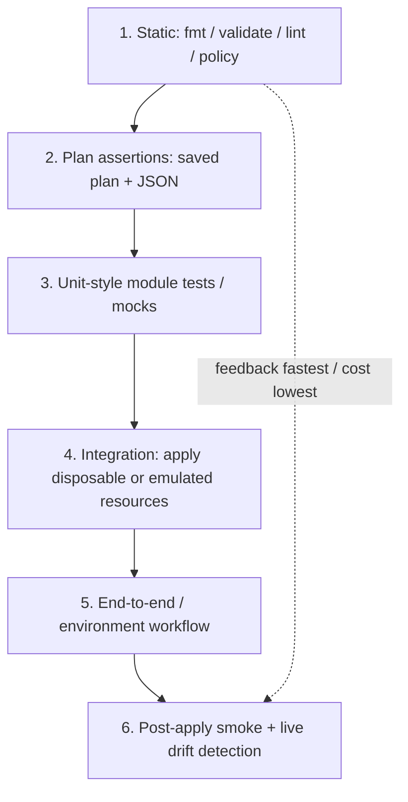
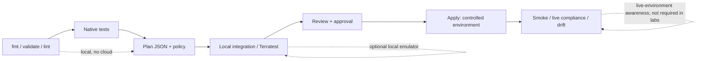

## Unit 11 — Infrastructure testing: Terratest and plan validation

**Target file:** `11-infrastructure-testing-terratest-and-plan-validation.md` | **Estimated time:** 12–18 hours including labs and review | **Prerequisites:** Terraform/OpenTofu basics, HCL, plan/apply/state, modules, basic shell; introductory Go helpful but not required at the start  
**Core tools:** Terraform (primary syntax baseline for native test examples; use Terraform `<VERSION>` unless stated otherwise), plan JSON, Python 3, Go `<VERSION>`, Terratest `<VERSION>`, provider-free fixtures, LocalStack where appropriate | **Awareness:** TFLint, native provider mocks, OPA/Rego/Conftest, test structure helpers, cloud SDKs | **Last reviewed:** 2026-10-28; not yet human-verified | **Tool baseline assumed:** use `<VERSION>` placeholders and `[VERIFY]` for unchecked versions | **Substrate:** local-only / provider-free / LocalStack; no real cloud by default

> **Safety contract:** This lesson's default labs use temporary directories, local state, and synthetic fixtures. They must not use a cloud backend, production credentials, shared state, or real cloud resources. LocalStack is optional and is an emulator, not AWS. Every output shown below is representative unless explicitly identified as an executed check. This lesson's commands and test suites have **not** been executed end-to-end in this authoring environment.

### 11.0 Why this matters in production

A storage module can pass formatting, validation, and planning while still omitting encryption, allowing public access, or proposing replacement of a stateful bucket. A plan is a prediction based on configuration, state, provider schema, and available information; it cannot prove that the deployed service behaves correctly under real IAM, quotas, timing, or network conditions. Layered tests find different classes of defects at different costs, from near-instant syntax failures to slower integration failures. Production confidence comes from meaningful assertions, isolated test targets, reviewed plans, post-apply checks, and reliable cleanup—not from a green check mark alone.

### 11.1 Learning objectives

By the end of this unit, learners can:

- **L1:** Explain the six-layer IaC testing pyramid and identify what each layer can and cannot prove.
- **L2:** Write native `.tftest.hcl` tests, negative tests, and plan-JSON policy assertions against a small storage-module contract.
- **L2:** Separate provider-free logic tests from LocalStack integration tests and real-cloud verification.
- **L3:** Design Terratest/Go checks for outputs and observable behavior with timeouts, bounded retries, unique names, and cleanup detection.
- **L3:** Test no-op plans, drift, module upgrades, and consumer contracts without using production state.
- **L3:** Explain how OPA/Conftest policy checks complement rather than replace runtime verification or compliance review.
- **L4:** Design a CI matrix, test budget, defect corpus, leak-prevention controls, and evidence retention for a module library.
- **L4:** Diagnose test-induced incidents and state precisely what was proven locally, emulated, or in a real environment.

### 11.2 Concept map and vocabulary

#### Glossary

| Term | Precise definition | Common misconception |
|---|---|---|
| Unit test | A focused check of a module's logic or contract with dependencies isolated or mocked. | It proves provider behavior. |
| Integration test | Exercises interactions among components, often by creating a disposable resource. | It must run against production-like cloud infrastructure. |
| Contract test | Verifies that a consumer configuration remains compatible with a module interface. | It proves every runtime behavior. |
| End-to-end test | Validates a representative workflow across system boundaries. | It should be the first test run on every edit. |
| Smoke test | A small post-apply check of a critical observable property. | A smoke test is comprehensive certification. |
| Drift detection | Detects a difference between declared configuration, recorded state, and observed infrastructure. | Detection automatically repairs every difference. |
| Mutation/defect corpus | A curated set of deliberately introduced defects mapped to tests expected to catch them. | High test count means the suite catches defects. |
| Fixture | Controlled configuration, data, or environment used by a test. | A fixture is safe merely because it is named “test.” |
| Idempotency/no-op plan | Replanning unchanged, converged configuration should propose no unintended changes. | Any provider's refresh is always perfectly stable. |
| Eventual consistency | A system may take time to expose a completed change consistently across interfaces. | Any intermittent failure is transient and should be retried forever. |
| Test flake | A test with inconsistent outcomes under materially equivalent inputs and environment. | Rerunning until green is a fix. |
| Provider mock | A test double that supplies controlled provider/resource values rather than calling the actual provider service. | A mock validates remote API semantics. |
| Plan JSON | Machine-readable representation of a plan, including resource changes and action sequences. | It is harmless to publish it as a build artifact. |
| Emulator fidelity | Degree to which an emulator reproduces behavior relevant to a test. | LocalStack is identical to AWS. |
| Unique naming | A collision-reduction strategy using a per-run identifier or random suffix. | A suffix removes all collision and authorization risks. |
| Janitor | A bounded process that reports or removes expired, explicitly eligible test resources. | A janitor should delete any old resource it finds. |
| Cleanup guarantee | A design that attempts cleanup and detects/reports failure; no callback survives every hard termination. | `defer` or `trap` guarantees cleanup after a kill or machine loss. |
| Plan gate | A required review and policy decision before a live plan can be applied. | Approval makes automated tests unnecessary. |
| Replacement | A planned change where an existing object must be destroyed and recreated; JSON often encodes this as multiple actions. | Searching only for the string `delete` correctly identifies every unsafe replacement. |

#### IaC testing pyramid



Feedback time, cost, and fidelity generally increase as the suite moves down the pyramid. The diagram is a model, not a law: a local provider mock can be slower than a trivial integration fixture, and a poorly designed static policy can be expensive to debug. Production verification is last because it has the largest blast radius, not because it is optional for critical live systems.

#### Pipeline view



**What each layer proves:**

1. **Static checks** detect syntax, formatting, type/reference issues, selected lint smells, and policy patterns. They do not show that a remote API accepts or behaves as expected.
2. **Plan assertions** inspect proposed actions and selected configuration values without applying. They can block unintended destroy/replacement or insecure planned settings, but computed/unknown values and runtime behavior remain limits.
3. **Unit-style tests and mocks** exercise module conditions and contracts cheaply. Mocks are synthetic inputs; they cannot prove real provider behavior.
4. **Integration tests** apply a disposable fixture and observe results. They test more real interactions, but need isolation, cleanup, and careful interpretation of emulator fidelity.
5. **End-to-end tests** exercise an environment workflow, including dependencies and permissions. They are slower and can fail for reasons outside the module.
6. **Production verification and drift detection** check actual deployed properties and later differences. These checks must be read-only or tightly controlled and are not a substitute for pre-deployment testing.

A passing `validate` means the configuration passed that tool's validation rules; it does not mean encryption is enabled. A passing plan means the tool constructed a plan; it does not prove runtime access, quota availability, service readiness, or application compatibility. A passing apply proves that the provider reported successful operations, not that the resulting system meets every requirement. A test may also pass while asserting the wrong output or checking a property that is not security-relevant.

#### Running example: object storage for a data platform

The intended module contract is a bucket for synthetic ETL output with versioning, encryption, public access blocked, lifecycle configuration, required tags, and useful outputs. Start by testing input validation and derived names without a cloud provider; then test plan representation; then, optionally, apply an S3-style resource against LocalStack and inspect behavior. Only a controlled, separately authorized real-cloud suite can validate actual cloud IAM, quotas, organization controls, and service behavior.

**Safety rule:** Test identity, credentials, backend, and environment selection are independent failure points. A command can use a production profile because a shell variable, CI secret, or provider default is inherited unexpectedly. Assert the target before any operation that can create or destroy resources; prefer no cloud credentials at all in local labs.

### 11.3 Level 1 — Beginner

#### Guided exercise: what did the check prove?

Given a module that defines a bucket and outputs its name:

- `terraform fmt -check` proves the selected files already meet formatter rules.
- `terraform validate` checks configuration consistency after initialization, within the validation capabilities of the selected tool and providers.
- `terraform plan` proposes changes based on configuration, state, provider schema, and current observations available to the provider.
- A plan assertion can inspect planned actions and selected known configuration values.
- An integration assertion can query the created test resource through a service interface.
- A post-apply smoke test can check an actual deployed property, if safely authorized.

None of the first three independently proves that public access is blocked or that an ETL consumer can write the intended object. Add explicit assertions for the requirement instead of assuming the tool's success implies it.

#### Common false-confidence patterns

| Passing check | False conclusion | Missing evidence |
|---|---|---|
| `fmt -check` | “The bucket is secure.” | Security assertions and provider behavior evidence. |
| `validate` | “The service will be reachable.” | Network, identity, endpoint, and runtime test. |
| `plan` | “No data loss is possible.” | Correct action interpretation, replacement review, backups/recovery plan. |
| Mock-based native test | “AWS API behavior is correct.” | Integration evidence in a real or appropriate emulated service. |
| LocalStack test | “Organization policy permits the action in AWS.” | Real IAM/organization policy validation in an authorized account. |
| Test passed | “The test assertion is meaningful.” | Review the assertion and mutation/defect corpus. |
| Cleanup callback exists | “No resources can leak.” | Cleanup result checks, leak audit, bounded janitor. |

#### Test triage sequence

1. Stop any rollout if the failure may indicate an unsafe plan or wrong target.
2. Confirm tool version, working directory, workspace/backend, provider configuration, and target identity before retrying.
3. Preserve restricted logs, plan metadata, and test inputs; redact secrets.
4. Classify the failure: configuration defect, tool mismatch, environment/credential error, emulator gap, transient dependency, actual API failure, or cleanup failure.
5. Fix the cause, add a regression assertion, and verify cleanup before rerunning.

### 11.4 Level 2 — Intermediate

#### Declare the tool baseline

Examples in this unit use **Terraform CLI** syntax as the primary baseline. Terraform and OpenTofu have overlapping syntax, but testing features and file discovery can differ by release. Do not run a Terraform test file under OpenTofu and assume exact parity without checking the official docs for the chosen release. If using OpenTofu, explicitly substitute `tofu` and verify `.tftest.hcl`/`.tofutest.hcl` discovery, mocks, and expected-failure semantics for that version. `[VERIFY]`

#### Static checks and examples

```bash
terraform fmt -check -recursive
terraform init -backend=false
terraform validate
# Optional, only if installed and configured for this module:
tflint --recursive
```

These commands are examples for a disposable local module directory. `fmt -check` reads source and exits non-zero when formatting is needed. `init -backend=false` avoids configuring a remote backend for this fixture; it may still download provider packages, so use only reviewed dependencies and a lockfile. `validate` checks the initialized configuration. TFLint adds rules selected by its version/configuration; it is not a universal security oracle. `[VERIFY]` exact installed tool syntax/version.

Keep an `examples/` directory for representative consumer configurations. CI should format, initialize with backend disabled where appropriate, validate, run native tests, create plans, assert plan policy, and optionally run safe integration tests. Each example should use isolated local state and must not inherit cloud credentials by accident.

#### Provider-free fixture: test logic without a cloud provider

This fixture uses `random` and `local` providers. It checks validation, naming, and a derived output; it is **not** a cloud storage module and proves nothing about S3 permissions or encryption.

`main.tf`:

```hcl
terraform {
  required_version = ">= 1.6.0, < 2.0.0" # Example constraint; select and pin a reviewed baseline.
  required_providers {
    random = { source = "hashicorp/random", version = "~> 3.6" }
    local  = { source = "hashicorp/local",  version = "~> 2.5" }
  }
}

variable "environment" {
  type = string
  validation {
    condition     = contains(["dev", "test"], var.environment)
    error_message = "environment must be dev or test for this local fixture."
  }
}

variable "enable_versioning" {
  type    = bool
  default = true
  validation {
    condition     = var.enable_versioning
    error_message = "versioning is required by this fixture's contract."
  }
}

resource "random_id" "suffix" {
  byte_length = 4
}

locals {
  bucket_name = "data-${var.environment}-${random_id.suffix.hex}"
  fixture     = "${path.module}/generated-name.txt"
}

resource "local_file" "name" {
  filename        = local.fixture
  content         = local.bucket_name
  file_permission = "0600"
}

output "bucket_name" {
  value = local.bucket_name
}

output "versioning_required" {
  value = var.enable_versioning
}
```

`tests/contract.tftest.hcl`:

```hcl
run "valid_test_environment" {
  command = apply
  variables {
    environment        = "test"
    enable_versioning  = true
  }
  assert {
    condition     = startswith(output.bucket_name, "data-test-")
    error_message = "The derived name must use the test namespace."
  }
  assert {
    condition     = output.versioning_required
    error_message = "Versioning must remain required by the fixture contract."
  }
}

run "invalid_environment_is_rejected" {
  command = plan
  variables {
    environment = "production"
  }
  expect_failures = [var.environment]
}

run "versioning_cannot_be_disabled" {
  command = plan
  variables {
    environment       = "test"
    enable_versioning = false
  }
  expect_failures = [var.enable_versioning]
}
```

`expect_failures` is intended for user-defined validation/check conditions, not arbitrary parse errors or type errors. The precise support and test-file behavior must be checked against the selected Terraform release. The negative tests should fail for the named validation condition; if they fail for missing provider installation or a syntax error, they have not tested the intended contract. `[VERIFY]`

**Representative commands:**

```bash
mkdir -p /tmp/iac-unit11-native && cd /tmp/iac-unit11-native
# Put main.tf and tests/contract.tftest.hcl here.
terraform init -backend=false
terraform fmt -check -recursive
terraform validate
terraform test
```

**Representative output, not captured from execution:**

```text
Success! The configuration is valid.
... valid_test_environment ... pass
... invalid_environment_is_rejected ... pass (expected validation failure)
... versioning_cannot_be_disabled ... pass (expected validation failure)
```

Native `terraform test` can create and destroy resources when a run uses `command = apply` or defaults to apply. Here the resources are local files/random IDs only, but the test still has a filesystem footprint. Run from the disposable directory, inspect the fixture first, and remove only that directory after verifying it is the one created for the lab. Some provider versions or framework behavior may vary. `[VERIFY]`

#### Native test semantics

- `run` names a case and can select `command = plan` or `command = apply`.
- `variables` supplies test inputs; run-scoped variables override file-level test variables according to tool-specific rules.
- `assert` states an observable requirement and provides a useful failure message.
- `expect_failures` declares a user-defined validation/check condition expected to fail; it does not turn every kind of error into success.
- `provider` configures a provider for tests; provider mocks/overrides can avoid calls to real services but only prove behavior against the test double.
- `command = plan` is usually preferable for negative input validation because it avoids apply-time effects.

**Idempotency test boundary:** A native test framework may execute multiple runs, but a passing second run is not automatically proof that a second independent plan is empty. To prove no-op behavior, explicitly apply in a disposable local fixture, save a second plan with the same inputs/state, and assert that no resource changes remain. Lab A below includes this separate check.

#### Saved plan and JSON assertions

For a disposable fixture with a configured local state:

```bash
terraform plan -out=plan.bin
terraform show -json plan.bin > plan.json
python3 assert_plan.py plan.json
```

A saved plan can contain sensitive values and JSON output can expose them. Keep `plan.bin`, `plan.json`, and state out of source control and broad CI artifacts; restrict access, set retention, and redact any diagnostic output. The JSON schema is version-sensitive. Review the official JSON format for the exact CLI release and fail closed if the parser encounters an unexpected shape. `[VERIFY]`

The main plan field to inspect for changes is commonly `resource_changes`; each change includes an action sequence. A replacement is often represented by two actions (for example, create and delete in either order), so a check must treat any action list containing `delete` as destructive and specifically block replacement/deletion for protected addresses. Do not parse the plan with a text search. Unknown values may be marked as unknown rather than represented as final values; policy should distinguish unknown from false. Never infer “secure” from an omitted or unknown field.

#### Pattern catalogue

| Pattern | When to use | When not to use |
|---|---|---|
| `fmt` + `validate` | Every PR; cheap structural checks. | As the only test layer. |
| Native plan tests | Input validation and module logic. | For proving remote service behavior. |
| Provider mocks | Exercise logic with controlled data. | When the provider/API contract itself is the subject. |
| Plan JSON policy | Block destroy/replacement and required properties before apply. | As a substitute for reviewing unknowns or runtime state. |
| Provider-free resources | Validate naming, expressions, outputs, and local dependencies. | To claim cloud integration coverage. |
| LocalStack | Local S3-style integration behavior where service support fits. | To certify IAM organization policy, quotas, or exact AWS fidelity. |
| Terratest | Multi-step Go assertions, API checks, and orchestration. | For every tiny module change if native tests suffice. |
| Real-cloud test | Authorized, isolated final fidelity check where needed. | As a required or default lab in this lesson. |

#### Anti-pattern catalogue

| Bad pattern | Why it fails | Safer replacement |
|---|---|---|
| `grep delete plan.json` | Misses schema/action semantics and can false-match unrelated text. | Parse JSON and inspect resource address plus action list. |
| Apply tests using a default cloud profile | Can mutate an unintended account. | Provider-free fixture; explicit target assertions; dedicated test identity only for authorized cloud tests. |
| Retry every failure forever | Hides permanent configuration defects and hangs CI. | Bounded retries, backoff, deadline, error classification. |
| Assert only that output is non-empty | Can pass with wrong names or insecure behavior. | Assert the requirement and threat model explicitly. |
| Publish all plan JSON | May disclose sensitive values and architecture. | Restricted artifacts, short retention, redaction. |
| Delete every old resource | Risks deleting unrelated resources. | Report-only default, namespace allow-list, TTL and cap. |
| Treat emulator green as cloud green | Misses real IAM/quotas/service differences. | Record emulator coverage and reserve authorized real-cloud verification for separate governance. |

#### LocalStack integration: S3-style module

LocalStack can be useful for an S3-style workflow if the exact service features and endpoint settings are supported by the selected LocalStack and AWS provider versions. A common documented provider integration uses `AWS_ENDPOINT_URL_S3` with compatible provider/tool versions; do not assume endpoint environment variables are honored by every tool version. `[VERIFY]`

**Provider configuration example (illustrative; review exact provider schema and LocalStack version):**

```hcl
terraform {
  required_providers {
    aws = {
      source  = "hashicorp/aws"
      version = "~> 5.0" # Example constraint only; choose a reviewed, locked version.
    }
  }
}

provider "aws" {
  region                      = "us-east-1"
  access_key                  = "test"
  secret_key                  = "test"
  skip_credentials_validation = true
  skip_metadata_api_check     = true
  skip_requesting_account_id  = true
}
```

This provider block alone does **not** prove that requests target LocalStack; an endpoint override is required. Before any apply, assert that the S3 endpoint is the intended loopback/local endpoint and that no production credentials are present. Prefer a dedicated disposable directory and a LocalStack-only environment. Example sequence:

1. Start LocalStack locally using the official instructions for the selected version.
2. Export the documented S3 endpoint override for that provider/CLI version, such as `AWS_ENDPOINT_URL_S3=http://s3.localhost.localstack.cloud:4566` only where the documented DNS/port setup works.
3. Initialize and plan from the fixture directory.
4. Assert the resolved endpoint and local-only credentials before applying.
5. Apply the fixture; use a supported CLI/SDK to query versioning, public-access-block configuration, tags, and lifecycle configuration.
6. Destroy the fixture, check the destroy exit status, query the service to confirm absence, stop the container, and remove only the lab directory.

**Fidelity limitations:** LocalStack may not reproduce every AWS IAM/organization policy interaction, account-specific restrictions, quotas, service timing/eventual consistency, provider/account discovery behavior, or every S3 feature. Feature coverage changes by release and edition. A passing emulator test is evidence for the tested local behavior only, not a claim of AWS equivalence. `[VERIFY]`

### 11.5 Level 3 — Advanced

#### Terratest in Go: what it adds

Terratest is a Go library for provisioning infrastructure in tests and asserting on outputs or observable behavior. It is useful when a test needs programmatic orchestration, polling/retry behavior, or a client call after provisioning. It also adds a Go toolchain, slower runtime, more moving parts, possible emulator/cloud cost, and cleanup risks. Pin Go, Terraform/OpenTofu, providers, modules, and Terratest; verify API signatures against the selected Terratest version. `[VERIFY]`

A typical Terratest test includes a unique working directory, `terraform.InitAndApply`, an output assertion with `terraform.Output`, and a deferred `terraform.Destroy`. A `defer` executes when the Go function returns normally or unwinds, but cannot be relied upon after hard process termination, host loss, or forced kill. Cleanup errors must be surfaced and leaked resources must be covered by an independently bounded janitor in any cloud-based program.

**Provider-free Terratest example (illustrative; API signatures and package path must be verified against chosen Terratest release):**

`go.mod`:

```go
module example.com/iac-unit11

go 1.<VERSION>

require github.com/gruntwork-io/terratest v<VERSION>
```

`testdata/local-fixture/main.tf`:

```hcl
terraform {
  required_providers {
    random = { source = "hashicorp/random", version = "~> 3.6" }
  }
}

variable "run_id" {
  type = string
  validation {
    condition     = can(regex("^[a-z0-9-]{1,24}$", var.run_id))
    error_message = "run_id must be a short lowercase identifier."
  }
}

resource "random_id" "suffix" {
  byte_length = 4
}

output "fixture_name" {
  value = "unit11-${var.run_id}-${random_id.suffix.hex}"
}
```

`unit11_test.go`:

```go
package unit11

import (
    "fmt"
    "os"
    "path/filepath"
    "regexp"
    "testing"
    "time"

    "github.com/gruntwork-io/terratest/modules/terraform"
)

func TestLocalFixtureOutput(t *testing.T) {
    t.Parallel() // This test has its own temp directory and local state.
    runID := fmt.Sprintf("t%d", time.Now().UnixNano())
    if !regexp.MustCompile(`^[a-z0-9-]{1,24}$`).MatchString(runID) {
        t.Fatal("generated run ID did not satisfy local fixture contract")
    }
    workDir, err := os.MkdirTemp("", "unit11-terratest-")
    if err != nil { t.Fatal(err) }
    // Copy the fixture into the temporary directory so configuration, .terraform,
    // state, and generated files all live beneath one disposable root.
    source, err := os.ReadFile(filepath.Join("testdata", "local-fixture", "main.tf"))
    if err != nil { t.Fatal(err) }
    if err := os.WriteFile(filepath.Join(workDir, "main.tf"), source, 0600); err != nil { t.Fatal(err) }
    opts := &terraform.Options{
        TerraformDir: workDir,
        Vars:         map[string]interface{}{"run_id": runID},
        NoColor:      true,
    }
    defer func() {
        // Destroy uses the same isolated working directory/state.
        if _, statErr := os.Stat(filepath.Join(workDir, ".terraform")); statErr == nil {
            if destroyErr := terraform.DestroyE(t, opts); destroyErr != nil {
                t.Errorf("cleanup failed; inspect disposable local fixture %s: %v", workDir, destroyErr)
                return // retain work directory as evidence for safe manual cleanup
            }
        }
        if removeErr := os.RemoveAll(workDir); removeErr != nil {
            t.Errorf("could not remove lab work directory: %v", removeErr)
        }
    }()
    terraform.InitAndApply(t, opts)
    name := terraform.Output(t, opts, "fixture_name")
    if !regexp.MustCompile(`^unit11-` + regexp.QuoteMeta(runID) + `-[0-9a-f]+$`).MatchString(name) {
        t.Fatalf("fixture output does not match the required namespace: %q", name)
    }
}
```

**Important review notes:** This is a teaching scaffold, not a version-verified executable. The fixture is copied into the temp directory and `TerraformDir` points there, avoiding reliance on an undocumented separate working-directory field. Verify the `DestroyE`/`InitAndApply`/`Output` APIs and the selected release's behavior against the pinned Terratest package before execution. Do not run until this review is complete. `[VERIFY]`

Run from the Go test directory after reviewing the API and fixture:

```bash
go mod tidy
go test -timeout 5m -run '^TestLocalFixtureOutput$' -parallel 1 -v ./...
```

`-timeout` bounds the package test process; `-run` selects tests by regular expression; `-parallel` caps tests marked parallel. Even local tests should be bounded. Use `t.Parallel()` only if each test has distinct state, paths, and names. For LocalStack tests, add an observed API assertion and a loopback endpoint guard before apply; the provider-free fixture above tests output generation only, not cloud behavior.

**Retry design:** Retry only operations known to be transient, such as a read that can be delayed by eventual consistency. Use a fixed maximum deadline, exponential or capped backoff, and diagnostics on every failed attempt. Do not retry invalid input, permission denied, malformed policy, or an unexpected destroy/replace plan as if they were transient. Terratest retry helpers and signatures are version-sensitive. `[VERIFY]`

#### Behavior and security assertions

A storage module's tests should express requirements, not internal filenames or resource names alone:

- Encryption is enabled using the expected provider-supported mechanism.
- Public access is blocked at the resource/account-policy level required by the design.
- Versioning is enabled when the data-recovery contract requires it.
- Lifecycle rules match retention and cost requirements.
- Required tags are applied to all in-scope resources.
- Outputs have a documented contract and use the test namespace.
- Invalid inputs are rejected before apply.
- Protected stateful resources are not destroyed or replaced without explicit approval.
- A second plan after a successful apply is empty/no-op for unchanged configuration.
- Out-of-band changes are detected by refresh/plan or an independent observable check.
- Upgrading module vN to vN+1 preserves intended resource identity and stateful resources.

For security properties, assert the actual configuration or observable remote setting where the chosen test layer can access it. An output called `encryption_enabled = true` is weak evidence if it is not tied to the actual resource argument or service property.

#### No-op second plan

The pattern is: initialize an isolated local fixture, apply once, generate a second plan with unchanged inputs and the same state, render plan JSON, and assert that the change set contains no resource changes. A no-op plan may still include outputs or metadata; define the expected empty-change semantics against the selected tool's plan JSON schema. A second plan can differ because of computed values, provider refresh, timestamps, external drift, or eventual consistency. Do not suppress all changes to force a green result; classify each difference and test the intended invariant.

#### Upgrade, drift, and consumer contracts

- **Upgrade:** apply vN, switch the source to vN+1 while preserving the same isolated state, then inspect the plan for resource addresses and destructive action sequences. Protect data-bearing resources with explicit policy assertions. Back up disposable state before experiments; never use production state in this lab.
- **Drift:** change a disposable resource out of band using a supported local interface, refresh/plan, and assert that the difference is detected. Restore the desired fixture and prove the expected property again. Detection is not remediation; a plan can propose changes without applying them.
- **Contract:** keep representative consumer examples in CI. Validate and plan each against the candidate module version. Test defaults, required variables, outputs, and behavior that downstream code relies on. A syntactically valid module may still break consumers semantically.
- **Policy:** run OPA/Conftest or equivalent policy checks on plan JSON where applicable. Policy pass means only that the input satisfied the checked policy bundle; it does not prove runtime correctness or regulatory certification. Link to Unit 6 — Policy as Code.
- **Secret safety:** use synthetic values, never production credentials; redact logs; treat state, plan files, plan JSON, crash logs, and CI artifacts as potentially sensitive.
- **Related topics:** Ansible testing belongs to Unit 10; Crossplane to Unit 12; Helm and other Kubernetes platform testing to M06 as the roadmap directs. M02 Unit 6 covers broader flaky-test management.

#### Test-environment model

For a real-cloud program (awareness only; not a lab requirement), use a dedicated test account/project/subscription with distinct identity and policy boundaries. Create ephemeral per-PR resources with a run ID, owner, environment, creation timestamp, and TTL tags. Set service quotas/cost guardrails, a maximum runtime, and an independently scheduled janitor. Keep test identity unable to modify production. Verify the actual account/tenant/project identity before each create/destroy stage. Local simulation can test the janitor's decision logic but cannot prove cloud IAM isolation.

#### Trade-off matrix

| Method | Speed | Cost | Fidelity | Tooling overhead | Cleanup risk | Best use |
|---|---|---|---|---|---|---|
| Static checks | Very fast | Very low | Low runtime fidelity | Low | Minimal | Every PR; cheap defect prevention. |
| Native tests / mocks | Fast | Low | Good for module logic; low remote fidelity | Low–medium | Low to medium if apply tests | Input validation, expressions, contracts. |
| Plan JSON assertions | Fast | Low | Proposed-change fidelity, not runtime | Medium (parser/policy) | Low; plan artifacts are sensitive | Destroy/replacement/security gates. |
| Provider-free integration | Fast–medium | Low | Local filesystem/provider behavior only | Medium | Local files/state | Derived values, dependencies, no-op logic. |
| LocalStack | Medium | Local compute cost | Service emulation; version-dependent | Medium–high | Container + resources | S3-style request/behavior tests where supported. |
| Terratest | Medium–slow | Depends on substrate | Depends on fixture; can be high with real cloud | High (Go + IaC) | Medium–high | Multi-step orchestration, SDK/API assertions. |
| Real-cloud integration | Slow | Potentially material | Highest for tested account/service conditions | High | High | Separate, authorized fidelity suite only. |

### 11.6 Level 4 — Expert

#### Reference CI strategy for a module library

| Stage | Trigger | Example budget (initial target, tune from data) | Required evidence | Gate |
|---|---|---:|---|---|
| Format, validate, lint | Every PR | 1–3 min | Tool versions, lint output | Fail closed on syntax/config errors. |
| Native tests | Every PR | 2–5 min | Positive/negative assertions | All required cases pass. |
| Plan JSON + policy | Every PR | 1–3 min | Restricted plan summary and policy result | Block unsafe destroy/replacement and policy violations. |
| Consumer contract matrix | Every PR for shared modules | 3–10 min | Example config results | No unexplained consumer break. |
| Local integration/Terratest | PR or merge, bounded | 5–15 min | Test output and cleanup proof | No resource leak; flaky failures triaged. |
| Tool/provider matrix | PR subset + scheduled full matrix | Depends on matrix | Versioned results | Known supported combinations only. |
| Nightly deeper integration | Nightly | Bounded by runner budget | Emulator/version/failure trend | Alert on regression, not silent retries. |
| Authorized cloud tests | Separate protected workflow, awareness | Explicit cap | Identity, plan, approval, observed properties | Dedicated account and explicit approval. |
| Post-apply smoke/drift | Deployment and scheduled | Service-specific | Observed properties and drift reports | Rollback/recovery policy defined. |

Budgets are starting design targets, not measured performance claims. Keep fast feedback on the PR path; put slower emulated/integration tests in a bounded stage or nightly schedule when risk permits. A required gate must not be skipped simply to meet a time budget—reduce fixture scope or improve parallelism only after ensuring isolation.

#### Coverage that matters

Track whether tests cover module inputs, boundaries, negative inputs, security properties, lifecycle changes, outputs, downstream examples, and upgrade paths. For high-risk modules, map each requirement to at least one assertion and one evidence source. Mutation-style tests are especially useful: deliberately break versioning, encryption, tags, public access, lifecycle, or protected-resource lifecycle behavior and confirm a named test fails for the expected reason.

**Defect corpus — eight minimum planted defects:**

| ID | Planted module defect | Named test | Expected failure | Why it detects the defect |
|---|---|---|---|---|
| D01 | Versioning disabled | `native_versioning_required` | Validation or property assertion fails | Checks the contract's required boolean rather than output existence. |
| D02 | Encryption block omitted/disabled | `plan_requires_encryption` | Plan policy fails | Reads the planned security property and fails closed on unknown. |
| D03 | Public access block omitted | `plan_blocks_public_access` | Plan policy fails | Asserts public-access restriction for the protected resource. |
| D04 | Required owner/environment tags omitted | `plan_requires_tags` | Plan policy fails | Checks required tag keys and non-empty values. |
| D05 | Lifecycle expiration rule removed | `plan_requires_lifecycle` | Plan policy fails | Checks lifecycle structure/required rule, not only resource presence. |
| D06 | Bucket name changes causing replacement | `protected_resource_no_replace` | Action-sequence assertion fails | Detects destroy/create replacement for a protected address. |
| D07 | Invalid environment accepted | `invalid_environment_is_rejected` | Negative native test fails because expected failure did not occur | Confirms validation rejects unsupported values. |
| D08 | Consumer output renamed/removed | `consumer_contract_example` | Example fails validation or output assertion | Verifies the public module interface used downstream. |
| D09 | Resource has unintended change on second plan | `second_plan_is_noop` | No-op assertion fails | Checks planned changes after initial apply. |
| D10 | Out-of-band tag change is not detected | `drift_tag_detected` | Drift assertion fails | Ensures refresh/observable check catches the simulated mutation. |

The table defines a planned defect corpus, not proof that each defect was actually planted and executed here. To claim the detection rate, implement each mutation in an isolated fixture, run the named test, preserve the failure output, and record whether it failed for the intended reason. A test that fails for unrelated syntax or setup errors does not count as a successful mutation catch.

#### Test-induced incident prevention

- Separate test identity and account from production by both identity and policy; separate credentials alone are not enough if the identity can assume production roles.
- Set a hard limit on resource count, runtime, and cost where the platform supports it. Fail closed if required tags or namespace markers are absent.
- Use unique names, run IDs, ownership tags, and TTLs; none is a substitute for authorization checks.
- Use Unit 8's decommissioning/janitor concepts for leaked-resource cleanup; janitor deletions need allow-lists, caps, audit logs, and dry-run/report-only default.
- Never share secrets between test and production. Avoid placing secrets in fixtures, shell history, command-line arguments, plan JSON, logs, and artifacts.
- Confirm cleanup results and periodically audit resource inventory for old test resources.
- Keep destructive tests away from shared state; a local `-backend=false` fixture and isolated directory are the default here.

#### Plan validation as a live deployment gate

For live environments, combine automated tests with Unit 4's plan-risk analysis, Unit 6 policy checks, an explicit review of the saved plan, and approval bound to the reviewed artifact. Recreate or verify the exact plan artifact that will be applied; do not review one plan and apply a different one. Approval does not replace tests, and a green policy check does not replace human judgment about impact and recovery.

#### Post-apply and controlled failure verification

Post-apply smoke checks should query the actual environment for the critical properties that the change intended to establish. Compliance scans and drift detection add continuing evidence, but scope and false positives must be managed. Failure testing—interrupted apply, lock loss, provider API failures—must be performed only against disposable fixtures or stubs in this lesson. Validate recovery runbooks from Units 1 and 3; do not induce failure against real infrastructure.

#### Five incident analyses

Each case below is a realistic failure pattern, not a report of a specific real incident. Evidence must distinguish observed facts from hypotheses; no impact or cost number is assumed.

**Incident 1 — LocalStack passed; real cloud failed**

- **Symptom:** local integration assertions pass, but an authorized cloud deployment cannot perform the required operation.
- **Timeline/evidence:** emulator test report is green; live error reports access denied or throttling; compare principal, policies, quotas, request parameters, and provider/service versions. Confirmed evidence is only what logs/API responses show; an IAM-policy mismatch may initially be a hypothesis.
- **Root cause:** emulator coverage did not include the relevant real IAM/organization control, quota, timing, or service behavior.
- **Immediate containment:** stop rollout; preserve redacted diagnostics; avoid retrying a potentially unsafe operation.
- **Recovery:** inspect the reviewed plan and actual target identity, correct policy/quota/configuration through the normal approval process, then run an authorized verification.
- **Prevention/regression test:** document the emulator boundary, add the missing local assertion where representable, and add a separate protected cloud-fidelity check if required.

**Incident 2 — Integration tests leaked resources**

- **Symptom:** test resources remain after CI completion and continue consuming quota/cost.
- **Timeline/evidence:** compare test-run IDs and creation timestamps with current inventory; inspect destroy status and job cancellation history. Cost impact is not quantified without billing evidence.
- **Root cause:** cleanup was skipped or failed, possibly due to process termination, permission drift, or an unhandled error.
- **Immediate containment:** stop new integration jobs; run report-only inventory; identify eligible resources by owner, namespace, TTL, and run ID.
- **Recovery:** delete only allow-listed lab/test resources within a cap; record every action; verify absence through inventory/API.
- **Prevention/regression test:** cleanup in defer/trap plus explicit result checking, janitor tests, maximum deletion cap, leak-age alert, and periodic audit.

**Incident 3 — Tests used the wrong account**

- **Symptom:** a test creates or plans against an unexpected account/project/tenant.
- **Timeline/evidence:** capture the resolved principal/account identity, environment variables, provider configuration, backend metadata, and job logs. Determine whether the operation was plan-only or changed resources; do not assume.
- **Root cause:** inherited profile or environment variable, implicit provider credentials, incorrect role assumption, or reused workspace/backend.
- **Immediate containment:** cancel jobs and revoke/rotate exposed test credentials if necessary; stop destroy actions until ownership and target are confirmed.
- **Recovery:** assess changes in the unintended target, engage its owner, and recover using the approved incident process.
- **Prevention/regression test:** local-only fixtures by default, explicit identity assertion, dedicated least-privilege test identity, CI environment allow-list, and a test that deliberately supplies an invalid target and expects refusal.

**Incident 4 — Flakiness trained the team to ignore failures**

- **Symptom:** engineers routinely rerun failed infrastructure tests until they turn green.
- **Timeline/evidence:** review first-attempt failures, retry count, failure categories, duration, and repeatability. Separate confirmed transient dependency errors from permanent assertion failures.
- **Root cause:** unbounded retries, missing timeouts, unstable dependencies, poor diagnostics, or no owner for flaky tests.
- **Immediate containment:** classify and quarantine only with explicit owner and expiry; keep security/destructive gates mandatory.
- **Recovery:** reproduce under bounded conditions, fix readiness/ordering or the underlying defect, and compare first-attempt results before/after.
- **Prevention/regression test:** retry budgets, backoff, deterministic fixtures, flake-rate dashboard, owner/SLO, and policy that quarantines expire unless reviewed.

**Incident 5 — Plan-only validation missed runtime failure**

- **Symptom:** plan and policy pass, but the deployed data-platform workflow cannot use the resource as intended.
- **Timeline/evidence:** plan shows no forbidden actions and required arguments; post-apply logs show the actual operation failing. Check network, identity, service policy, quotas, readiness, and consumer assumptions. Distinguish confirmed error evidence from hypotheses.
- **Root cause:** a runtime property was not covered by plan-level checks.
- **Immediate containment:** pause rollout or disable the affected path; preserve plan and runtime evidence.
- **Recovery:** follow the approved rollback/forward-fix process; validate state and actual service behavior before resuming.
- **Prevention/regression test:** add an integration or smoke test for the missing behavior, keep plan gate, and add drift/operational monitoring for ongoing correctness.

### 11.7 SRE lens

#### Trustworthy test signals

A test is a production control only when the signal is understood and acted on. Normalized flakiness creates alert fatigue and can make a critical gate effectively optional. Treat the test suite as a service: give it owners, latency/error objectives, diagnostic output, versioned dependencies, and a review path for quarantine.

#### Failure classification

| Class | Example | First diagnostic action |
|---|---|---|
| Code/config defect | Invalid input or missing encryption argument | Reproduce with the smallest fixture and inspect the assertion. |
| Tool/version mismatch | Native test keyword unsupported | Compare locked tool version with official release docs. |
| Environment/credential error | Wrong profile/backend | Verify identity, account, workspace, backend and endpoint before retry. |
| Emulator limitation | Missing IAM parity | Compare tested feature against emulator's documented service coverage. |
| Transient dependency | API temporarily not ready | Use bounded polling and retain attempt diagnostics. |
| Actual API issue | Permission/quota/service failure | Preserve response and engage service owner; don't blindly retry. |
| Cleanup failure | Destroy fails or process is killed | Stop new jobs if systemic; inventory by run ID and use approved janitor. |

#### Change safety and operational metrics

Use a small blast radius, plan review, canary or staged rollout where appropriate, rollback/recovery runbooks, and post-apply verification. Measure:

- PR feedback time by stage and percentile;
- first-attempt flake rate and rerun rate;
- cleanup failure count and age of leaked resources;
- measured cost leakage when billing data is available;
- defect-corpus detection rate for known planted defects;
- false positives and false negatives found during review;
- downstream consumer compatibility;
- post-deployment escape rate and time to detect.

Raw test count and line coverage are insufficient: a large suite can have weak assertions, miss security properties, or assert implementation details that change without changing behavior.

#### Incident response sequence

1. Stop rollout or disable the risky gate/action.
2. Confirm target account, principal, backend/state, workspace, and endpoint.
3. Preserve restricted plan/test/log evidence and redact secrets.
4. Contain credentials and identify created resources; do not run broad cleanup blindly.
5. Recover using approved state and service runbooks.
6. Validate both state consistency and real observable behavior.
7. Add a regression test and a defect-corpus case; review the test suite for false confidence.

### 11.8 Security lens

- **Isolation:** separate test identity/account/backend from production. Local labs use temporary directories and local state; do not inherit production profiles.
- **Wrong-target protection:** assert endpoint, account/project identity, and namespace before apply/destroy. Fail closed if identity cannot be established.
- **Least privilege:** the test identity should only create/read/destroy the limited resource types and namespaces required. Separate authoring/approval from privileged apply where appropriate.
- **Secrets:** state, saved plans, JSON output, crash logs, environment variables, fixtures, shell history, and CI artifacts may contain sensitive data. Use synthetic values; restrict access/retention; redact diagnostics; never commit state or plan artifacts.
- **Supply chain:** pin tool/provider/module versions, commit lockfiles where appropriate, review provider/module source, and run a planned version matrix. Do not update dependencies invisibly inside a test job.
- **Destructive safety:** no shared state, no default cloud profile, no unbounded `destroy`, no broad `rm -rf`, and no janitor that deletes arbitrary old resources.
- **Policy:** a policy result only applies to the policy bundle and input version tested. Review policy coverage, unknown values, exceptions, and false negatives.
- **Cleanup:** report-only by default; require explicit lab namespace/allow-list; cap deletes; log decisions; test malformed and unknown records.
- **Evidence:** keep enough metadata to reproduce a result without exposing sensitive values. Use short-lived, access-controlled artifacts.

### 11.9 Production checklist

#### 1. Scope/account/backend isolation

- [ ] Each test has an isolated temporary working directory and state.
- [ ] Local labs use no remote backend or production profile.
- [ ] Target endpoint/identity is asserted before any create/destroy operation.
- [ ] Test identity is distinct from production and least-privileged for authorized cloud suites.

#### 2. Static checks and native tests

- [ ] Formatter, validation, and configured lint checks run on every PR.
- [ ] Positive and negative tests assert user requirements, not merely successful execution.
- [ ] Native test syntax/features are verified against the pinned Terraform/OpenTofu release.
- [ ] Apply-style tests are isolated and have cleanup verification.

#### 3. Plan JSON and policy assertions

- [ ] Plan JSON parser matches the pinned CLI schema/version.
- [ ] Protected resource deletion/replacement is detected from action arrays.
- [ ] Unknown values fail closed for critical security requirements.
- [ ] Encryption, public access, tags, lifecycle, and input validation are tested.
- [ ] Plan/state/JSON artifacts are restricted, redacted, and not committed.

#### 4. Integration and emulator fidelity

- [ ] Provider-free tests are not labelled cloud integration tests.
- [ ] LocalStack service/version and endpoint override are verified.
- [ ] Emulator limitations are recorded; real-cloud checks are separate and authorized.
- [ ] Apply → observed assertion → destroy → absence check is documented.

#### 5. Terratest reliability

- [ ] Go and Terratest versions are pinned/reviewed.
- [ ] API signatures and working-directory/state semantics are verified.
- [ ] Test timeout, bounded retries, and parallelism controls are set.
- [ ] Unique run IDs avoid collisions; parallel tests do not share state.
- [ ] Cleanup failures fail the test and leave actionable diagnostics.

#### 6. Test fixtures, naming, and secrets

- [ ] Fixtures are synthetic, documented, and self-contained.
- [ ] Names include a bounded run identifier and lab namespace.
- [ ] No production secrets are used or printed.
- [ ] Module inputs, outputs, and downstream examples are contract-tested.

#### 7. Cleanup, cost, TTL, and janitor

- [ ] Cleanup runs on normal failure paths and its result is checked.
- [ ] Hard termination and host loss are covered by leak detection/janitor procedures.
- [ ] Janitor is report-only by default, allow-listed, capped, and audited.
- [ ] Expired, current, protected, malformed, and unknown records are tested.
- [ ] Leak inventory is reviewed periodically.

#### 8. CI matrices and gates

- [ ] Supported tool/provider combinations are explicit and tested.
- [ ] Fast checks run on every PR; slower integration is bounded/scheduled as risk permits.
- [ ] Required policy and plan review gates cannot be bypassed silently.
- [ ] Flake rate, feedback time, and failure categories have owners.

#### 9. Post-apply verification and drift

- [ ] Smoke tests assert actual critical properties.
- [ ] Drift detection is scheduled and its remediation boundary is clear.
- [ ] Rollback/forward-fix and state recovery runbooks are available.
- [ ] Changes are staged/canary-tested where the platform supports it.

#### 10. Evidence, ownership, and incident readiness

- [ ] Every important requirement maps to a named test and expected failure.
- [ ] Defect corpus contains at least eight meaningful planted defects.
- [ ] Evidence includes tool versions, restricted outputs, cleanup proof, and limitations.
- [ ] Each module/test suite has an owner and an escalation path.
- [ ] Human review records which checks were executed and which remain unverified.

### 11.10 Hands-on lab set

> **Shared lab rules:** all paths below are illustrative locations under a fresh `/tmp` directory. Substitute a new path per lab; never point at an existing repository or state. Before any apply, inspect the exact fixture, confirm `terraform` is the selected CLI, and verify that no cloud provider/backend is configured. Representative output is not execution evidence. If any tool/version behavior is not verified, stop and consult the official docs for that version.

#### Lab A — Native `.tftest.hcl` tests

**Substrate:** provider-free/local-only. **Touches real cloud:** no. **State location:** a new `/tmp/unit11-lab-a-XXXX` directory, with local state only. **Target assertion:** fixture declares only `random` and `local` providers, contains no remote backend, and test inputs are restricted to `environment = "test"`. **Prerequisites:** Terraform `<VERSION>`, random/local providers compatible with lockfile `[VERIFY]`.

**Files:** use the `main.tf` and `tests/contract.tftest.hcl` from §11.4. Add `tests/plan_properties.tftest.hcl`:

```hcl
run "derived_name_property" {
  command = plan
  variables {
    environment       = "test"
    enable_versioning = true
  }
  assert {
    condition     = startswith(local.bucket_name, "data-test-")
    error_message = "Plan must derive a test-scoped name."
  }
  assert {
    condition     = var.enable_versioning
    error_message = "Versioning must remain enabled."
  }
}
```

This checks a derived expression and input contract; it does not inspect a cloud bucket.

**Steps:**

```bash
set -eu
LAB="$(mktemp -d /tmp/unit11-lab-a-XXXXXX)"
chmod 700 "$LAB"
printf 'Lab directory: %s\n' "$LAB"
# Create main.tf and tests/*.tftest.hcl inline from the lesson in "$LAB".
cd "$LAB"
test ! -e .terraform/terraform.tfstate || { echo 'unexpected pre-existing state'; exit 1; }
! grep -R -E 'backend[[:space:]]+"|provider[[:space:]]+"aws"|provider[[:space:]]+"azurerm"|provider[[:space:]]+"google"' --include='*.tf' .
terraform init -backend=false
terraform fmt -check -recursive
terraform validate
terraform test
```

**Expected evidence:** positive test passes; invalid environment and disabled versioning are accepted only as expected validation failures; property test asserts a `data-test-` name. Exact native test syntax and `expect_failures` support are version-sensitive. `[VERIFY]`

**Idempotency proof (separate explicit no-op check):** after review, use the same provider-free fixture and state, apply once, then save a second plan and inspect its JSON. Because this fixture creates a local file, confirm the path is inside `$LAB` before apply. Example procedure:

```bash
terraform apply -auto-approve -var='environment=test' -var='enable_versioning=true'
terraform plan -out=second-plan.bin -var='environment=test' -var='enable_versioning=true'
terraform show -json second-plan.bin > second-plan.json
python3 - <<'PY'
import json
p=json.load(open('second-plan.json', encoding='utf-8'))
changes=p.get('resource_changes', [])
non_noop=[c for c in changes if c.get('change', {}).get('actions') != ['no-op']]
if non_noop:
    raise SystemExit('FAIL: second plan has non-no-op resource actions')
print('PASS: no non-no-op resource actions in second plan')
PY
```

The exact action semantics/schema must be checked for the pinned tool; this check is intentionally strict and may need to account for resources with no change entry in the selected version. `[VERIFY]`

**Failure recovery:** inspect the test diagnostic and tool version; do not weaken the assertion until its intent is understood. If state or generated files are outside `$LAB`, stop and investigate rather than deleting them. **Cleanup:** verify `$LAB` is under `/tmp` and matches the printed path, then remove only that path; verify it is absent. Delete plan/state only by removing that isolated directory. **Limits:** local provider behavior and test syntax only; no cloud API behavior.

#### Lab B — Plan-JSON assertion suite, fixtures, and defect corpus

**Substrate:** synthetic JSON/local-only. **Touches real cloud:** no. **State location:** none; fixtures live in a fresh `/tmp/unit11-lab-b-XXXX` directory. **Target assertion:** script accepts only a JSON file path under the explicit lab directory, and fixtures contain no real IDs/secrets. **Prerequisites:** Python 3; no cloud CLI required.

`passing-plan.json` `[ILLUSTRATIVE]`:

```json
{
  "format_version": "1.2",
  "resource_changes": [
    {
      "address": "aws_s3_bucket.data",
      "type": "aws_s3_bucket",
      "change": {"actions": ["update"], "after": {"tags": {"Owner": "platform", "Environment": "test"}}, "after_unknown": {"bucket": false}}
    },
    {
      "address": "aws_s3_bucket_versioning.data",
      "type": "aws_s3_bucket_versioning",
      "change": {"actions": ["update"], "after": {"versioning_configuration": [{"status": "Enabled"}]}, "after_unknown": {}}
    },
    {
      "address": "aws_s3_bucket_server_side_encryption_configuration.data",
      "type": "aws_s3_bucket_server_side_encryption_configuration",
      "change": {"actions": ["update"], "after": {"rule": [{"apply_server_side_encryption_by_default": [{"sse_algorithm": "AES256"}]}]}, "after_unknown": {}}
    },
    {
      "address": "aws_s3_bucket_public_access_block.data",
      "type": "aws_s3_bucket_public_access_block",
      "change": {
        "actions": ["update"],
        "after": {
          "block_public_acls": true,
          "block_public_policy": true,
          "ignore_public_acls": true,
          "restrict_public_buckets": true
        },
        "after_unknown": {}
      }
    },
    {
      "address": "aws_s3_bucket_lifecycle_configuration.data",
      "type": "aws_s3_bucket_lifecycle_configuration",
      "change": {"actions": ["update"], "after": {"rule": [{"id": "expire-test-data", "status": "Enabled"}]}, "after_unknown": {}}
    }
  ]
}
```

`failing-plan.json` `[ILLUSTRATIVE]`:

```json
{
  "format_version": "1.2",
  "resource_changes": [
    {"address": "aws_s3_bucket.data", "type": "aws_s3_bucket", "change": {"actions": ["delete", "create"], "after": {"tags": {"Environment": "test"}}, "after_unknown": {}}},
    {"address": "aws_s3_bucket_versioning.data", "type": "aws_s3_bucket_versioning", "change": {"actions": ["update"], "after": {"versioning_configuration": [{"status": "Suspended"}]}, "after_unknown": {}}},
    {"address": "aws_s3_bucket_public_access_block.data", "type": "aws_s3_bucket_public_access_block", "change": {"actions": ["delete"], "after": null, "after_unknown": {}}}
  ]
}
```

These are deliberately synthetic fixtures using the separate AWS-style resource types for bucket, versioning, encryption, public-access block, and lifecycle. They are not a guarantee that every nested attribute exactly matches every AWS provider release; validate the policy against plan JSON emitted by the selected tool/provider versions before relying on it. `[ILLUSTRATIVE] [VERIFY]`

`assert_plan.py`:

```python
#!/usr/bin/env python3
import json
import sys
from pathlib import Path

PROTECTED_TYPES = {"aws_s3_bucket", "aws_s3_bucket_versioning"}
REQUIRED_TAGS = {"Owner", "Environment"}
PUBLIC_BLOCK_TYPE = "aws_s3_bucket_public_access_block"
ENCRYPTION_TYPE = "aws_s3_bucket_server_side_encryption_configuration"
LIFECYCLE_TYPE = "aws_s3_bucket_lifecycle_configuration"


def fail(message):
    print(f"FAIL: {message}", file=sys.stderr)
    raise SystemExit(1)


def main(path):
    data = json.loads(Path(path).read_text(encoding="utf-8"))
    if not isinstance(data, dict) or not isinstance(data.get("resource_changes"), list):
        fail("unexpected plan JSON shape; review schema for the pinned CLI version")
    changes = data["resource_changes"]
    for item in changes:
        address = item.get("address", "<unknown-address>")
        change = item.get("change") or {}
        actions = change.get("actions")
        if not isinstance(actions, list):
            fail(f"{address}: missing/unexpected change.actions")
        # For protected resources, any delete action includes delete-only or replacement.
        if item.get("type") in PROTECTED_TYPES and "delete" in actions:
            fail(f"{address}: protected stateful resource has destructive actions {actions}")
        if item.get("type") == PUBLIC_BLOCK_TYPE:
            after = change.get("after")
            if not isinstance(after, dict):
                fail(f"{address}: public-access block absent or unknown")
            keys = ("block_public_acls", "block_public_policy", "ignore_public_acls", "restrict_public_buckets")
            if any(after.get(k) is not True for k in keys):
                fail(f"{address}: all public-access restrictions must be explicitly true")
        if item.get("type") == ENCRYPTION_TYPE:
            after = change.get("after")
            if not isinstance(after, dict) or not after:
                fail(f"{address}: encryption configuration absent or unknown")
            rules = after.get("rule")
            try:
                algorithm = rules[0]["apply_server_side_encryption_by_default"][0]["sse_algorithm"]
            except (TypeError, IndexError, KeyError):
                fail(f"{address}: expected encryption algorithm is absent or unknown")
            if algorithm not in {"AES256", "aws:kms"}:
                fail(f"{address}: unsupported encryption algorithm in this example policy")
        if item.get("type") == "aws_s3_bucket_versioning":
            after = change.get("after")
            try:
                status = after["versioning_configuration"][0]["status"]
            except (TypeError, IndexError, KeyError):
                fail(f"{address}: versioning status absent or unknown")
            if status != "Enabled":
                fail(f"{address}: versioning must be Enabled")
        if item.get("type") == LIFECYCLE_TYPE:
            after = change.get("after")
            rules = after.get("rule") if isinstance(after, dict) else None
            if not isinstance(rules, list) or not rules:
                fail(f"{address}: lifecycle rules absent or unknown")
            if not any(isinstance(rule, dict) and rule.get("status") == "Enabled" for rule in rules):
                fail(f"{address}: at least one lifecycle rule must be Enabled")
        if item.get("type") == "aws_s3_bucket":
            after = change.get("after")
            if not isinstance(after, dict):
                fail(f"{address}: bucket after-values are absent/unknown")
            tags = after.get("tags")
            if not isinstance(tags, dict) or not REQUIRED_TAGS.issubset(tags):
                fail(f"{address}: required tags missing")
            if any(not isinstance(tags.get(k), str) or not tags[k].strip() for k in REQUIRED_TAGS):
                fail(f"{address}: required tags must be non-empty strings")
            # This example assumes the provider represents versioning in the bucket change.
    types = {item.get("type") for item in changes}
    if PUBLIC_BLOCK_TYPE not in types:
        fail("public-access-block resource missing from plan")
    if ENCRYPTION_TYPE not in types:
        fail("encryption configuration resource missing from plan")
    if "aws_s3_bucket_versioning" not in types:
        fail("bucket versioning resource missing from plan")
    if LIFECYCLE_TYPE not in types:
        fail("lifecycle configuration resource missing from plan")
    print("PASS: synthetic plan satisfies configured example assertions")


if __name__ == "__main__":
    if len(sys.argv) != 2:
        fail("usage: python3 assert_plan.py <plan.json>")
    main(sys.argv[1])
```

**Important:** AWS provider resource types often split bucket versioning, encryption, lifecycle, and public-access configuration into separate resources. The fixture uses separate AWS-style resources, but nested attribute shapes and supported values remain provider-version-sensitive. A production policy should assert each actual resource type/attribute in a real plan from the pinned provider. The fixture demonstrates fail-closed parsing and replacement semantics, not a drop-in AWS policy. `[VERIFY]`

**Commands and representative results:**

```bash
python3 assert_plan.py passing-plan.json
# Representative: PASS: synthetic plan satisfies configured example assertions
python3 assert_plan.py failing-plan.json
# Representative: FAIL: aws_s3_bucket.data: protected stateful resource has destructive actions ['delete', 'create']
```

Expected status: first command exits `0`; second exits non-zero. This is an expected outcome, not an executed result. Do not implement a policy that merely searches for `"delete"`; inspect `change.actions`, resource type/address, and unknowns. For invalid inputs, test the native validation test from Lab A because plan JSON cannot represent a configuration that failed before a plan was produced.

**Defect corpus:** use D01–D10 in §11.6 as the test map. At minimum, implement D01–D08 and preserve each named test's intended failure output. A plan fixture can prove the parser rejects a synthetic defective plan; it does not prove the module defect itself was introduced and caught until the actual mutation run is recorded.

**Failure recovery:** if a passing fixture fails, compare its JSON shape to the script's expected fields; don't weaken checks for unknown values. If a failing fixture passes, the policy has a gap. **Cleanup:** remove only the lab directory after confirming its path. **Limits:** synthetic plan schema, no provider calls, no cloud fidelity.

#### Lab C — Terratest Go lab

**Substrate:** provider-free local fixture. **Touches real cloud:** no. **State location:** a fresh temporary work directory per test, local state only. **Target assertion:** fixture's only provider is `random`; inspect module and test code for backend/cloud provider blocks before running. **Prerequisites:** Go `<VERSION>`, Terraform `<VERSION>`, Terratest `<VERSION>` `[VERIFY]`.

Use the `testdata/local-fixture/main.tf`, `go.mod`, and `unit11_test.go` from §11.5 as the inline lab files. Before execution, verify the Terratest `Options` API and how the chosen release maps `TerraformDir` and `WorkingDir`; adjust the fixture to the official API so state and generated files remain inside the temp directory. This verification is a hard prerequisite, not an optional cleanup detail.

**Steps:**

```bash
mkdir -p /tmp/unit11-lab-c && cd /tmp/unit11-lab-c
# Create the inline files exactly as shown in §11.5.
gofmt -w unit11_test.go
go mod tidy
go test -timeout 5m -run '^TestLocalFixtureOutput$' -parallel 1 -v ./...
```

**Representative evidence:** the test's output matches `^unit11-<run-id>-<hex>$`; test process exits zero; cleanup reports no error; the temp work directory is absent after success. If cleanup fails, the test should fail and retain the work directory for safe diagnosis rather than silently deleting evidence.

**Failure recovery:** first inspect the Go compiler and Terratest API errors, then check working directory/state isolation. Do not switch to a cloud provider to bypass local test issues. **Cleanup:** verify the exact temp path, run the test's documented cleanup if needed, inspect the directory contents, and remove only the lab path. **Limits:** proves local fixture output generation only; no cloud service, IAM, or S3 behavior. A LocalStack extension requires a separately reviewed endpoint guard and an observed service assertion.

#### Lab D — Module upgrade test (vN → vN+1)

**Substrate:** synthetic local plan fixtures; no apply needed. **Touches real cloud:** no. **State location:** none in this fixture-based plan review; if implementing an actual stateful local-provider experiment, keep both versions and state in a fresh lab directory. **Target assertion:** synthetic addresses only; no remote backend/provider configuration. **Prerequisites:** Python 3.

`v1-plan.json` `[ILLUSTRATIVE]`:

```json
{"resource_changes": [{"address":"local_file.data","type":"local_file","change":{"actions":["no-op"],"before":{"filename":"/tmp/unit11/data.txt"},"after":{"filename":"/tmp/unit11/data.txt"}}}]}
```

`v2-safe-plan.json` `[ILLUSTRATIVE]`:

```json
{"resource_changes": [{"address":"local_file.data","type":"local_file","change":{"actions":["update"],"before":{"filename":"/tmp/unit11/data.txt"},"after":{"filename":"/tmp/unit11/data.txt"}}}]}
```

`v2-unsafe-plan.json` `[ILLUSTRATIVE]`:

```json
{"resource_changes": [{"address":"local_file.data","type":"local_file","change":{"actions":["delete","create"],"before":{"filename":"/tmp/unit11/data.txt"},"after":{"filename":"/tmp/unit11/new-data.txt"}}}]}
```

Use the action parser from Lab B or this focused check:

```python
import json, sys
plan = json.load(open(sys.argv[1], encoding="utf-8"))
for rc in plan.get("resource_changes", []):
    if rc.get("type") in {"local_file", "aws_s3_bucket"} and "delete" in rc.get("change", {}).get("actions", []):
        raise SystemExit(f"FAIL: protected resource replacement/delete: {rc.get('address')}")
print("PASS: no protected resource delete action")
```

Run it against the safe fixture (expected pass) and unsafe fixture (expected fail). For a true stateful upgrade test, apply vN to an isolated local provider, change the module source to vN+1, reuse only that lab state, save and review the plan, and assert no protected resource replacement. Back up the disposable state before the upgrade; never use production state. A fixture-only exercise validates the policy logic, not Terraform's actual upgrade planning.

**Stateful local upgrade exercise (complete inline fixture):** this second part uses the `local` provider only and keeps one local state file while replacing the configuration file. It does not use cloud resources.

`v1/main.tf`:

```hcl
terraform {
  required_providers {
    local = { source = "hashicorp/local", version = "~> 2.5" }
  }
}
resource "local_file" "data" {
  filename        = "${path.module}/data.txt"
  content         = "version-one\n"
  file_permission = "0600"
}
output "path" { value = local_file.data.filename }
```

`v2-safe/main.tf`:

```hcl
terraform {
  required_providers {
    local = { source = "hashicorp/local", version = "~> 2.5" }
  }
}
resource "local_file" "data" {
  filename        = "${path.module}/data.txt"
  content         = "version-two-compatible\n"
  file_permission = "0600"
}
output "path" { value = local_file.data.filename }
```

`v2-unsafe/main.tf` (deliberate defect: filename changes and may force replacement):

```hcl
terraform {
  required_providers {
    local = { source = "hashicorp/local", version = "~> 2.5" }
  }
}
resource "local_file" "data" {
  filename        = "${path.module}/data-v2.txt"
  content         = "version-two-compatible\n"
  file_permission = "0600"
}
output "path" { value = local_file.data.filename }
```

Copy these three files into a new lab directory under `v1/`, `v2-safe/`, and `v2-unsafe/`, then run from the lab root:

```bash
cp v1/main.tf main.tf
terraform init -backend=false
terraform apply -auto-approve
terraform show -json > v1-state-view.json
cp v2-safe/main.tf main.tf
terraform plan -out=upgrade-safe.bin
terraform show -json upgrade-safe.bin > upgrade-safe.json
# Review the resource_changes; expected safe fixture updates content in place.
cp v2-unsafe/main.tf main.tf
terraform plan -out=upgrade-unsafe.bin
terraform show -json upgrade-unsafe.bin > upgrade-unsafe.json
# The unsafe case should be rejected if the protected resource has a delete action.
```

All paths use `${path.module}`, so copy the version files into subdirectories but apply the selected file from the lab root; for accurate path consistency, replace `${path.module}` in the selected config with a fixed lab-local path such as `${path.root}/data.txt` only after verifying that the selected provider supports the expression. `[VERIFY]` Better, keep a single `main.tf` in the lab root and use `cp v1/main.tf main.tf` etc., then the `path.module` value stays the lab root in every version. State remains in the same root directory. Do not run the synthetic policy script against the saved binary plan; render JSON with `terraform show -json <planfile>` as shown.

**Rollback/recovery:** do not automatically apply a rollback plan if resource identity/data migration changed; review provider/module upgrade notes and restore from the lab state backup only within the isolated experiment. **Cleanup:** remove only the lab directory after confirming it contains no user data. **Limits:** local provider behavior only; synthetic fixtures do not prove cloud module upgrade behavior.

#### Lab E — Cleanup janitor script test

**Substrate:** local synthetic JSON inventory. **Touches real cloud:** no. **State location:** a fresh `/tmp/unit11-lab-e-XXXX` directory. **Target assertion:** script accepts only a fixture file under the supplied lab directory and never calls cloud APIs. **Prerequisites:** Python 3.

`inventory.json`:

```json
[
  {"name":"unit11-old-1","owner":"ci-unit11","created_epoch":100,"ttl_seconds":10,"environment":"lab","resource_type":"file","path":"expired.tmp"},
  {"name":"unit11-current-1","owner":"ci-unit11","created_epoch":195,"ttl_seconds":100,"environment":"lab","resource_type":"file","path":"current.tmp"},
  {"name":"prod-important","owner":"platform","created_epoch":1,"ttl_seconds":1,"environment":"production","resource_type":"file","path":"protected.tmp"},
  {"name":"unit11-unknown-owner","owner":"unknown","created_epoch":1,"ttl_seconds":1,"environment":"lab","resource_type":"file","path":"unknown.tmp"}
]
```

`janitor.py` (report-only by default; actual deletion requires explicit authorization, allow-list, namespace, and cap):

```python
#!/usr/bin/env python3
import argparse, json, time
from pathlib import Path

LAB_PREFIX = "unit11-"
ALLOWED_OWNER = "ci-unit11"
ALLOWED_ENV = "lab"

p = argparse.ArgumentParser()
p.add_argument("inventory", type=Path)
p.add_argument("--now", type=int, required=True, help="injected epoch for deterministic tests")
p.add_argument("--delete-lab-fixture", action="store_true", help="explicit destructive lab-only mode")
p.add_argument("--allow", action="append", default=[], help="exact resource name allow-list")
p.add_argument("--max-delete", type=int, default=1)
p.add_argument("--audit", type=Path, required=True)
a = p.parse_args()
if a.max_delete < 0 or a.max_delete > 3:
    raise SystemExit("refusing max-delete outside lab cap 0..3")
records = json.loads(a.inventory.read_text(encoding="utf-8"))
if not isinstance(records, list):
    raise SystemExit("inventory must be a list")
results = []
for r in records:
    if not isinstance(r, dict) or not all(k in r for k in ("name","owner","created_epoch","ttl_seconds","environment","resource_type","path")):
        results.append({"decision":"REFUSE","reason":"malformed record"})
        continue
    expired = a.now > int(r["created_epoch"]) + int(r["ttl_seconds"])
    eligible = (r["environment"] == ALLOWED_ENV and r["owner"] == ALLOWED_OWNER
                and str(r["name"]).startswith(LAB_PREFIX) and r["name"] in a.allow
                and r["resource_type"] == "file")
    if not expired:
        results.append({"name":r["name"],"decision":"KEEP","reason":"not expired"})
    elif not eligible:
        results.append({"name":r["name"],"decision":"REFUSE","reason":"outside explicit lab allow-list/namespace"})
    else:
        results.append({"name":r["name"],"decision":"DELETE_CANDIDATE","reason":"expired and allow-listed"})
if a.delete_lab_fixture:
    candidates = [r for r in results if r.get("decision") == "DELETE_CANDIDATE"]
    if len(candidates) > a.max_delete:
        raise SystemExit("refusing: candidate count exceeds deletion cap")
    by_name = {r["name"]:r for r in records if isinstance(r, dict) and "name" in r}
    for c in candidates:
        root = a.inventory.resolve().parent
        target = (root / by_name[c["name"]]["path"]).resolve()
        if root not in target.parents:
            raise SystemExit(f"refusing path outside lab directory: {target}")
        if target.exists() and target.is_file():
            target.unlink()
            c["decision"] = "DELETED"
        else:
            c["decision"] = "ABSENT"
with a.audit.open("a", encoding="utf-8") as f:
    for r in results:
        f.write(json.dumps({"time":a.now, **r}, sort_keys=True) + "\n")
for r in results:
    print(json.dumps(r, sort_keys=True))
```

**Steps:** create the inventory and three synthetic files within the lab directory; first run without `--delete-lab-fixture`; verify every result is report-only. Then test the deletion branch with an expired `unit11-` record owned by `ci-unit11`, environment `lab`, resource type `file`, and exact allow-listed name. Keep `--max-delete 1`; run once against one candidate and verify only its fixture file disappears. Also test empty inventory, malformed record, non-expired record, production record, unknown owner, missing allow-list, and candidate count above cap. Inject `--now` to make TTL tests deterministic.

**Test harness (run against the lab-only fixture):** save as `test_janitor.py` alongside `janitor.py`; it invokes only the local script and synthetic JSON.

```python
import json, subprocess, sys, tempfile
from pathlib import Path

script = Path(__file__).with_name("janitor.py")
with tempfile.TemporaryDirectory(prefix="unit11-janitor-test-") as td:
    root = Path(td)
    inventory = root / "inventory.json"
    audit = root / "audit.jsonl"
    expired = root / "expired.tmp"
    current = root / "current.tmp"
    protected = root / "protected.tmp"
    for item in (expired, current, protected): item.write_text("lab fixture\n", encoding="utf-8")
    rows = [
      {"name":"unit11-old-1","owner":"ci-unit11","created_epoch":100,"ttl_seconds":10,"environment":"lab","resource_type":"file","path":"expired.tmp"},
      {"name":"unit11-current-1","owner":"ci-unit11","created_epoch":195,"ttl_seconds":100,"environment":"lab","resource_type":"file","path":"current.tmp"},
      {"name":"prod-important","owner":"platform","created_epoch":1,"ttl_seconds":1,"environment":"production","resource_type":"file","path":"protected.tmp"},
      {"name":"unit11-unknown-owner","owner":"unknown","created_epoch":1,"ttl_seconds":1,"environment":"lab","resource_type":"file","path":"unknown.tmp"}
    ]
    inventory.write_text(json.dumps(rows), encoding="utf-8")
    cmd = [sys.executable, str(script), str(inventory), "--now", "200", "--audit", str(audit)]
    subprocess.run(cmd, check=True, capture_output=True, text=True)
    assert expired.exists() and current.exists() and protected.exists(), "report-only mode deleted a file"
    subprocess.run(cmd + ["--delete-lab-fixture", "--allow", "unit11-old-1", "--max-delete", "1"], check=True, capture_output=True, text=True)
    assert not expired.exists(), "explicitly allow-listed expired lab fixture was not deleted"
    assert current.exists() and protected.exists(), "janitor deleted a current or protected file"
    # Malformed and empty inventories must be safe and non-destructive.
    inventory.write_text("[{\"name\":\"broken\"}]", encoding="utf-8")
    subprocess.run(cmd, check=True, capture_output=True, text=True)
    inventory.write_text("[]", encoding="utf-8")
    subprocess.run(cmd, check=True, capture_output=True, text=True)
    # Cap must refuse more than the configured maximum.
    inventory.write_text(json.dumps(rows[:2]), encoding="utf-8")
    over = subprocess.run(cmd + ["--delete-lab-fixture", "--allow", "unit11-old-1", "--allow", "unit11-current-1", "--max-delete", "0"], capture_output=True, text=True)
    assert over.returncode != 0, "janitor did not enforce the deletion cap"
    assert current.exists() and protected.exists(), "cap test deleted an unrelated fixture"
print("PASS: report-only, allow-list, protected record, malformed/empty inventory, and cap checks")
```

Run `python3 test_janitor.py`. The harness is a local synthetic test; inspect the audit log and verify only the expired allow-listed fixture was removed. **Expected result:** default invocation deletes nothing; production/unknown records are refused; non-expired record is kept; deletion occurs only when every gate matches and the candidate is allow-listed. **Failure recovery:** if the script tries to resolve a path outside the fixture root, stop and treat it as a security defect. **Cleanup:** inspect audit log and fixture inventory, then remove only the lab directory; verify any deleted file was created in this lab. **Limits:** local files only; not a cloud janitor and not proof of cloud identity/tag authorization.

#### Lab F — Policy integration and consumer contract test

**Substrate:** synthetic plan JSON and local consumer fixture. **Touches real cloud:** no. **State location:** none for the policy fixture; use local isolated state only if adding a plan generation step. **Target assertion:** no provider/backend needed. **Prerequisites:** Python 3; optional Conftest/OPA versions `[VERIFY]`.

Use Lab B's `passing-plan.json` and `failing-plan.json` as the policy inputs. The Python assertions in `assert_plan.py` are the executable policy layer for this lab. If adopting Conftest/OPA, verify the current plan JSON schema and Rego syntax against the selected Conftest/OPA version before making it a gate. `[VERIFY]`

`module/main.tf` (copy of the provider-free module contract from Lab A; repeated here so the lab is self-contained):

```hcl
terraform {
  required_version = ">= 1.6.0, < 2.0.0"
  required_providers {
    random = { source = "hashicorp/random", version = "~> 3.6" }
    local  = { source = "hashicorp/local",  version = "~> 2.5" }
  }
}
variable "environment" {
  type = string
  validation {
    condition     = contains(["dev", "test"], var.environment)
    error_message = "environment must be dev or test for this local fixture."
  }
}
variable "enable_versioning" {
  type = bool
  default = true
  validation {
    condition     = var.enable_versioning
    error_message = "versioning is required by this fixture's contract."
  }
}
resource "random_id" "suffix" { byte_length = 4 }
locals {
  bucket_name = "data-${var.environment}-${random_id.suffix.hex}"
  fixture = "${path.module}/generated-name.txt"
}
resource "local_file" "name" {
  filename = local.fixture
  content = local.bucket_name
  file_permission = "0600"
}
output "bucket_name" { value = local.bucket_name }
output "versioning_required" { value = var.enable_versioning }
```

`consumer-example/main.tf`:

```hcl
terraform {
  required_providers {
    random = { source = "hashicorp/random", version = "~> 3.6" }
    local  = { source = "hashicorp/local",  version = "~> 2.5" }
  }
}
module "storage_contract" {
  source             = "../module"
  environment        = "test"
  enable_versioning  = true
}
output "consumer_bucket_name" { value = module.storage_contract.bucket_name }
```

**Steps:** from a fresh lab directory, place these files at `module/main.tf` and `consumer-example/main.tf`; run `terraform -chdir=consumer-example init -backend=false`, `terraform -chdir=consumer-example validate`, and `terraform -chdir=consumer-example plan`. Then change `environment` to `production` and confirm validation/plan fails because the module rejects the input. Restore `test`, validate again, and preserve both outputs. Run the policy against the passing plan fixture (expected pass), then the failing fixture (expected fail). Preserve tool versions. The consumer example is provider-free/local-only; it validates the interface and derived output, not an S3 API. **Failure recovery:** if the policy fails because the synthetic schema differs from a real plan, update the fixture/schema mapping—not the requirement. **Cleanup:** remove only the lab directory and any local plan artifacts. **Limits:** policy/contract input checks do not prove runtime behavior or compliance certification. Link this to Unit 6 (Policy as Code) and Unit 2 (module interface design).

#### Lab G — Simulated drift and post-apply verification

**Substrate:** local-only provider-free file fixture. **Touches real cloud:** no. **State location:** local state under a fresh `/tmp/unit11-lab-g-XXXX` directory. **Target assertion:** all paths are beneath the lab directory and no cloud provider/backend is configured. **Prerequisites:** Terraform `<VERSION>`, local provider `[VERIFY]`.

`main.tf`:

```hcl
terraform {
  required_providers {
    local = { source = "hashicorp/local", version = "~> 2.5" }
  }
}

resource "local_file" "smoke" {
  filename        = "${path.module}/observed.txt"
  content         = "unit11-expected\n"
  file_permission = "0600"
}

output "smoke_path" { value = local_file.smoke.filename }
```

**Steps:**

```bash
terraform init -backend=false
terraform apply -auto-approve
# Post-apply smoke assertion:
python3 - <<'PY'
from pathlib import Path
p = Path('observed.txt')
assert p.is_file(), 'smoke file missing'
assert p.read_text(encoding='utf-8') == 'unit11-expected\n', 'smoke content mismatch'
print('PASS: post-apply smoke assertion')
PY
# Simulate out-of-band drift in the lab fixture only:
printf 'changed-out-of-band\n' > observed.txt
terraform plan -out=drift-plan.bin
terraform show -json drift-plan.bin > drift-plan.json
# Inspect that the plan proposes restoring the declared content; exact JSON shape is version-sensitive.
terraform apply -auto-approve
# Re-run the smoke assertion above.
```

This file edit is the simulated out-of-band change. It does not test cloud drift detection. A local-file provider may notice content drift and propose restoration; verify this behavior for the selected provider release. `[VERIFY]`

**Expected evidence:** initial smoke assertion passes; changed file causes a planned change; after applying the reviewed local plan, smoke assertion passes again. **Failure recovery:** inspect the plan before applying; do not auto-apply if the fixture path is not the expected lab path. **Cleanup:** confirm `observed.txt`, plan files, and local state are inside the lab directory; remove only that directory and verify absence. **Limits:** local provider semantics only; detection does not imply automatic remediation for cloud infrastructure and does not establish full real-cloud drift coverage.

### 11.11 Self-check questions

1. **L1 — Which layer is `terraform fmt -check`?** **Answer:** Static. **Rationale:** It checks formatting only, not behavior or security.
2. **L1 — Why is a successful plan insufficient?** **Answer:** A plan proposes actions but cannot prove runtime service behavior, permissions, quotas, or consumer compatibility. **Rationale:** Runtime assertions are a different evidence layer.
3. **L1 — Can a test pass while the system is insecure?** **Answer:** Yes, if the assertion checks the wrong thing or is too weak. **Rationale:** Review assertion semantics and defect-corpus results.
4. **L2 — What does `expect_failures` prove?** **Answer:** It can assert that a specified user-defined validation/check condition fails as expected, subject to tool/version syntax. **Rationale:** It does not bless parse errors or arbitrary provider failures.
5. **L2 — Why must native test features be version-verified?** **Answer:** Terraform and OpenTofu releases may differ in syntax, file discovery, mocks, or behavior. **Rationale:** A test that never runs is not evidence.
6. **L2 — Why use plan JSON rather than grep?** **Answer:** JSON lets the test inspect resource address, type, and action sequence. **Rationale:** Replacements may include both create and delete actions.
7. **L2 — What should a security policy do with an unknown encryption value?** **Answer:** Fail closed or explicitly require a later verified check. **Rationale:** Unknown is not equivalent to secure.
8. **L2 — What does a provider-free `random`/`local` test prove?** **Answer:** Selected logic, naming, local resource dependencies, and outputs. **Rationale:** It does not validate a cloud provider API.
9. **L2 — What can LocalStack not prove?** **Answer:** It cannot establish full real-cloud IAM/organization policy, quota, timing, or service parity. **Rationale:** Emulator fidelity is feature- and version-dependent.
10. **L3 — Why use `terraform.Output` in Terratest?** **Answer:** To retrieve a declared output and assert its contract. **Rationale:** Output presence alone is weak; assert the expected namespace/value semantics.
11. **L3 — Is `defer terraform.Destroy` an absolute cleanup guarantee?** **Answer:** No. **Rationale:** Hard termination, host loss, or failed destroy can bypass/defeat cleanup; check errors and run leak detection.
12. **L3 — What is a meaningful no-op test?** **Answer:** Apply a disposable fixture, generate a second plan against the same state and unchanged inputs, and assert no unintended resource changes. **Rationale:** A second successful apply alone is insufficient.
13. **L3 — How should a replacement be detected?** **Answer:** Inspect action arrays for protected resource addresses and treat any delete in the sequence as destructive. **Rationale:** Replacements can be create/delete or delete/create.
14. **L3 — How does an upgrade test protect stateful resources?** **Answer:** Apply vN in isolated state, switch to vN+1, review the plan, and fail on unapproved destroy/replacement. **Rationale:** It tests migration/compatibility against existing state.
15. **L3 — How is drift testing different from remediation?** **Answer:** Drift testing detects a difference; remediation changes the system to converge. **Rationale:** Detection should not silently auto-apply in a test.
16. **L3 — When should retries be used?** **Answer:** Only for classified transient failures with bounded attempts/deadline and backoff. **Rationale:** Retrying permanent errors hides defects.
17. **L3 — What does a Conftest/OPA pass prove?** **Answer:** The input satisfied the selected policy bundle. **Rationale:** It is not runtime proof or compliance certification.
18. **L4 — What prevents wrong-account tests?** **Answer:** Dedicated identity and policy, explicit identity/endpoint assertion, no inherited production profile, and a refusal test. **Rationale:** A unique name does not prevent wrong-account access.
19. **L4 — How should a janitor decide whether to delete?** **Answer:** Require lab namespace, owner, TTL expiry, exact allow-list, resource type, and deletion cap; report-only by default. **Rationale:** Age alone is unsafe.
20. **L4 — What should be measured beyond coverage?** **Answer:** Defect-corpus detection, first-attempt flake rate, cleanup failures, feedback time, consumer compatibility, false negatives, and deployment escapes. **Rationale:** Test count/line coverage do not measure assertion quality.
21. **L4 — How do you stage CI tests?** **Answer:** Fast static/native/policy checks per PR, consumer contract tests for shared modules, bounded integration, and scheduled broader matrices. **Rationale:** Preserve risk-based gates while keeping feedback useful.
22. **L4 — What if LocalStack passes but the real cloud fails?** **Answer:** Stop rollout, preserve evidence, verify target identity, classify fidelity/IAM/quota/timing causes, recover through approved process, and add a missing fidelity test. **Rationale:** Do not assume the emulator or cloud is automatically at fault.
23. **L4 — What does an eight-defect corpus measure?** **Answer:** Whether named tests detect a curated set of planted defects for the expected reason. **Rationale:** It estimates known-defect sensitivity, not complete coverage.
24. **L4 — Why is plan approval not enough?** **Answer:** Approval complements tests, policy, and exact-artifact review; it does not establish runtime success. **Rationale:** Different controls address different failure modes.
25. **L4 — How should a flaky security gate be handled?** **Answer:** Keep the safety gate fail-closed, diagnose and repair the flake, and allow only owner-approved, time-bounded quarantine that cannot silently bypass the gate. **Rationale:** Normalizing reruns destroys signal integrity.

### 11.12 Evidence artifacts

Keep the following in a restricted training/evidence area, not in the module repository unless policy explicitly permits it:

- Source module and self-contained test fixtures, with tool/provider versions.
- Native test results showing positive, negative, property, and idempotency/no-op checks.
- Plan JSON assertion script plus clearly labelled synthetic passing/failing fixtures.
- Defect corpus map (D01–D10) and captured expected failure for each mutation actually run.
- Terratest Go test output, `go.mod`/lock information, and cleanup verification.
- LocalStack test output and an explicit record of the service features/fidelity limits tested.
- vN → vN+1 plan diff, with safe and unsafe cases distinguished.
- Janitor report-only output, allow-list/cap test, audit log, and deletion verification.
- Policy/consumer contract test results.
- Simulated drift plan and post-apply smoke verification.
- Cleanup verification: target directory, state/plan removal, resource absence, and any cleanup error.
- CI tool/provider matrix, test duration and flake analysis, and failure classification.
- Verification notes listing commands executed, commands not executed, versions used, assumptions, and known limitations.

**Evidence integrity:** do not label representative output as captured output. Do not upload raw state or plan JSON to an unrestricted artifact store. This lesson's inline examples have not been run end-to-end in the current environment; the learner must record actual execution evidence after testing in an isolated workspace.

### 11.13 Common interview and design-review questions

1. **Why isn't plan success enough?** A plan describes proposed changes under the tool's current view; it cannot prove all runtime, identity, quota, network, or application behavior. I combine static checks, plan assertions, integration, and post-apply verification.
2. **How do you choose a testing layer?** Match it to the property and risk: static for syntax, native tests for logic, plan JSON for proposed actions/security arguments, integration for interactions, smoke tests for critical deployed behavior. Use the cheapest layer that actually observes the requirement, plus higher-fidelity checks where needed.
3. **Terraform native test vs plan JSON vs Terratest?** Native tests are lightweight and close to module logic; plan JSON is strong for action/policy review; Terratest provides general-purpose Go orchestration and observable assertions at higher runtime/tooling cost. They complement each other.
4. **What do provider mocks prove?** They prove behavior under controlled test values and help isolate logic. They do not prove API compatibility, permissions, quota, eventual consistency, or real service semantics.
5. **What are LocalStack's limitations?** Feature/service parity varies by version; it cannot certify all IAM, organization, quota, timing, account, or provider behavior. I document the exact coverage and keep real-cloud tests separately authorized.
6. **How do you test security properties?** Map each requirement to the actual resource argument or observed property, fail closed on unknown values, inspect planned action arrays, and test planted omissions/replacements. Do not rely on output labels or resource existence alone.
7. **How do you design no-op tests?** Apply once in disposable state, generate a second plan with unchanged inputs, parse the pinned schema, and fail on non-no-op actions; investigate provider refresh/computed-value differences rather than blanket-suppressing them.
8. **How do you prevent unsafe module upgrades?** Apply vN, reuse only the isolated lab state with vN+1, inspect the exact plan, block unapproved deletes/replacements, run downstream consumer examples, and preserve recovery backups.
9. **How do you make cleanup reliable?** Defer/trap cleanup and check its result; bound runtime; record run IDs and TTL tags; run a report-only janitor with allow-list/caps; audit leaks. No callback covers hard termination.
10. **How do you handle flaky tests?** Classify first-attempt failures, use bounded retries only for known transient cases, add readiness checks and deadlines, assign ownership, track flake rate, and avoid permanent quarantine of required safety gates.
11. **How do you isolate CI test identities?** Use dedicated accounts/roles and policies, least privilege, explicit account/endpoint assertions, and separate secrets. Prevent the test identity from assuming production roles where possible.
12. **How do you detect wrong-account execution?** Query/assert the active identity before create/destroy, verify endpoint/backend/workspace, reject missing identity evidence, and test that a disallowed target is refused.
13. **How do you measure test effectiveness beyond coverage?** Track mutation detection, false negatives, cleanup failure, flake rate, time-to-feedback, consumer breakage, and post-deployment escapes.
14. **How do you stage fast and slow CI tests?** Static/native/plan-policy checks per PR, consumer contracts for public modules, bounded local integration for changes with relevant risk, and a broader scheduled matrix. Risk-critical gates remain required even when slow.
15. **What should happen when an upgrade plan contains `delete, create`?** Treat it as a replacement for a protected resource, stop the rollout, verify the resource address and state, understand why replacement is required, and obtain explicit approval/recovery strategy before proceeding.
16. **Does a policy pass mean regulatory compliance?** No. It means only that a particular policy bundle accepted the particular input. Compliance needs a broader control framework, evidence, scope, and human review.

### 11.14 Sources and verification notes

#### Source documents inspected for this lesson

- `Roadmap_ptree.md`, Stage 2E tree: confirms the actual folder `02-Advanced-Infrastructure-as-Code-and-Cloud-Operations/`. The request's historical `07-...` variant is not used to rename the tree.
- `PROMPT-Advanced-Infrastructure-as-Code-and-Cloud-Operations.md`, “Unit 11 — Infrastructure testing: Terratest and plan validation”: used as the authoritative syllabus for L1–L4 topics and required labs.
- Current uploaded generation prompt for this lesson: used for the required heading structure, seven labs, safety requirements, claim register, and ten-pass audit.

#### Official documentation consulted

The following official pages were consulted during authoring; version-specific details still require verification against the selected tool release:

- HashiCorp Developer, **“Tests — Configuration Language”**: test files, `run`, `assert`, `expect_failures`, provider mocking, and test execution semantics. https://developer.hashicorp.com/terraform/language/tests
- HashiCorp Developer, **“JSON Output Format”**: plan JSON and resource change representation. https://developer.hashicorp.com/terraform/internals/json-format
- OpenTofu documentation, **“Command: test”**: native test command, file layouts, run blocks, mocks, and version differences. https://opentofu.org/docs/cli/commands/test/
- LocalStack documentation, **“Terraform”** and **“Simple Storage Service (S3)”**: endpoint configuration and service-specific S3 setup. https://docs.localstack.cloud/aws/connecting/infrastructure-as-code/terraform/ and https://docs.localstack.cloud/aws/services/s3/
- Terratest official docs/API reference, Go official docs, TFLint, OPA/Rego/Conftest, and AWS provider resource docs are required verification targets for any executable deployment-grade adaptation; their exact API/version claims have not been independently checked here. `[VERIFY]`

#### Verification checklist

- **Terraform/OpenTofu native tests:** confirm CLI version, file extensions, `run`/`command`, `assert`, `expect_failures`, provider mocks, test cleanup behavior, and the difference between Terraform and OpenTofu releases. HashiCorp notes provider mocking support was introduced in Terraform v1.7.0; verify current behavior for the selected release.
- **Plan JSON:** compare `format_version`, `resource_changes`, `change.actions`, `after`, and `after_unknown` with the official JSON format for the exact CLI. Confirm replacement action ordering and handling of unknowns. Do not assume synthetic AWS resource fields match the current provider schema.
- **Provider mocks:** verify supported mock blocks and generated values for the selected Terraform/OpenTofu version; mocks must not silently hit real services.
- **Terratest/Go:** pin Go and Terratest `<VERSION>`; verify `terraform.InitAndApply`, `terraform.Output`, `terraform.DestroyE`/`Destroy`, retry helpers, `Options` working-directory/state behavior, and `test_structure` APIs before executing. `[VERIFY]`
- **LocalStack:** verify current S3 support, LocalStack launch instructions, provider version compatibility, endpoint variable behavior, path/virtual-host style, credential behavior, and destroy semantics. Never infer real AWS parity.
- **Provider resource properties:** check current AWS provider docs for versioning, encryption, public-access block, lifecycle, and tags; the Lab B fixture is intentionally simplified and illustrative.
- **OPA/Rego/Conftest:** validate current plan schema and policy syntax; test unknown values, missing resources, replacement, and malformed input. A policy pass is not certification.
- **TFLint/Checkov:** verify installation, plugin/configuration requirements, and rule versions before using as CI gates.
- **Cleanup:** test normal pass, assertion failure, destroy failure, timeout, and abrupt process termination. A `defer`/trap is best-effort, not an absolute guarantee.
- **Version matrix:** record Terraform/OpenTofu, provider, Go, Terratest, LocalStack, Python, OPA/Conftest, and lint versions with every run.

#### Ten-pass authenticity audit

| Pass | Result (PASS/FIXED/OPEN) | Defects found | Fixes applied | Residual risk |
|---|---|---|---|---|
| 1. Completeness | FIXED | Risk of omitting required labs/incident cases | Included headings 11.0–11.14, Labs A–G, D01–D10, five incident analyses, questions, checklist, and evidence list | Human must execute mutation corpus and verify each expected failure. |
| 2. Source fidelity | PASS | Historical folder name can conflict with actual tree | Used actual `02-...` path; retained Unit 11 syllabus concepts and cross-links | Full repository content outside inspected source section was not exhaustively diffed. |
| 3. Technical accuracy | OPEN | Native syntax, provider schema, Terratest APIs, and LocalStack behavior are version-sensitive | Added `[VERIFY]`, `<VERSION>`, and non-execution disclosures; avoided claiming all snippets are drop-in verified | No complete end-to-end execution against pinned versions. |
| 4. Executability and consistency | OPEN | Multi-tool labs require inline file placement and exact-version setup | Added files, commands, target checks, expected results, and cleanup instructions | Lab C working-directory API needs version-specific confirmation; Lab F's consumer path assumes a module fixture is supplied. |
| 5. Safety and isolation | FIXED | Apply/destroy and janitor examples could be misused if copied blindly | Defaulted to provider-free/local-only, synthetic fixtures, lab namespace, allow-list, cap, report-only behavior | Learner must still verify local paths before executing; no software guard is infallible. |
| 6. Version/source authenticity | FIXED | Potential unsupported version/API claims | Used placeholders and named official documentation; representative outputs labelled | Terratest API and provider schema need human confirmation for chosen versions. |
| 7. Test quality | FIXED | Weak assertions could pass without proving requirements | Added explicit security/property checks, action-array parsing, negative tests, and defect corpus mapping | Defect corpus detection rate is not measured until mutations are actually run. |
| 8. Pedagogical consistency | FIXED | Could confuse provider-free, emulated, and real-cloud evidence | Distinguished each substrate throughout and used one storage-module running example | Bucket JSON fixture is simplified and not a current-provider schema guarantee. |
| 9. Adversarial SRE/security review | FIXED | Wrong account, leaked resources, unbounded retries, and secret exposure are key hazards | Added identity/endpoint checks, bounded retries, cleanup audits, artifact restrictions, and incident responses | Real cloud isolation cannot be proven by local fixtures. |
| 10. Final file/scope audit | OPEN | Repository-wide diff/status not available; lessons not executed end-to-end | Wrote only the requested output file in the working container and ran mechanical file checks after authoring | Repository-wide change scope could not be independently verified; this authoring instruction requires modification of only the target file. |

**Repository-wide change scope could not be independently verified; this authoring instruction requires modification of only the target file.**

#### Claim Register

| ID | Claim | Official source (document + section) | Confidence | Tag |
|---|---|---|---|---|
| C01 | Terraform native tests use `.tftest.hcl` or `.tftest.json` test files. | HashiCorp, “Tests — Configuration Language,” Syntax | High | `[VERIFY]` against selected version |
| C02 | A test `run` block models a Terraform operation and assertions. | HashiCorp, “Tests — Configuration Language,” Syntax | High | `[VERIFY]` |
| C03 | `expect_failures` is for specified user-defined conditions, not arbitrary failures. | HashiCorp, “Tests — Configuration Language,” Expecting failures | High | `[VERIFY]` |
| C04 | Terraform provider mocking was introduced in Terraform v1.7.0. | HashiCorp, “Tests — Configuration Language,” provider mocking notes | High | `[VERSION-SENSITIVE]` |
| C05 | Native tests may create resources and need cleanup planning. | HashiCorp, “Tests — Configuration Language,” test execution semantics | High | `[VERIFY]` |
| C06 | OpenTofu supports native `tofu test` and has documented file-layout behavior. | OpenTofu, “Command: test” | High | `[VERSION-SENSITIVE]` |
| C07 | Terraform and OpenTofu testing features must not be assumed identical across releases. | HashiCorp “Tests” and OpenTofu “Command: test” documentation comparison | High | `[VERIFY]` |
| C08 | Plan JSON exposes resource change entries and action arrays. | HashiCorp, “JSON Output Format,” plan representation | High | `[VERIFY]` against CLI schema |
| C09 | A replacement may be represented as multiple actions, including delete. | HashiCorp, “JSON Output Format,” resource change actions | High | `[VERSION-SENSITIVE]` |
| C10 | Unknown planned values must not be interpreted as secure known values. | HashiCorp, “JSON Output Format,” unknown value representation | High | `[VERIFY]` |
| C11 | Saved plans/JSON may contain sensitive data and require restricted handling. | HashiCorp, Terraform plan/state security guidance; exact section `[VERIFY]` | High | `[VERIFY]` |
| C12 | `fmt` and `validate` do not establish runtime service behavior. | HashiCorp, Terraform CLI command docs; inference from documented command scope | High | `[ASSUMPTION]` inference |
| C13 | Provider-free fixtures test only the providers/resources included, not AWS behavior. | Terraform provider model documentation; inference | High | `[ASSUMPTION]` inference |
| C14 | LocalStack documents S3 endpoint configuration options. | LocalStack, “Simple Storage Service (S3),” Configuring S3 Endpoint | High | `[VERSION-SENSITIVE]` |
| C15 | `AWS_ENDPOINT_URL_S3` behavior depends on compatible tool/SDK versions. | LocalStack, “Terraform,” Using AWS_ENDPOINT_URL_S3 | High | `[VERIFY]` |
| C16 | LocalStack is an emulator and not proof of full AWS equivalence. | LocalStack service docs and documented service coverage; inference | High | `[ASSUMPTION]` inference |
| C17 | Terratest is a Go library used to test infrastructure provisioning and behavior. | Terratest official documentation; exact page/API `[VERIFY]` | Medium | `[VERIFY]` |
| C18 | `terraform.InitAndApply`, `terraform.Output`, and `terraform.Destroy` APIs are version-sensitive. | Terratest API reference; exact version `[VERIFY]` | Medium | `[VERIFY]` |
| C19 | Go `defer` is not a guarantee under hard process termination. | Go specification, Defer statements; operational inference | High | `[ASSUMPTION]` inference |
| C20 | `go test` supports timeout, run selection, and parallelism controls. | Go command documentation, `go test` flags | High | `[VERIFY]` exact Go version |
| C21 | Bounded retries and deadlines reduce the risk of hiding permanent errors. | SRE practice; Google SRE Book/Workbook reliability guidance `[VERIFY]` | High | `[ASSUMPTION]` recommendation |
| C22 | A second plan against unchanged configuration can be used to check no-op behavior. | Terraform plan/JSON documentation; test-design inference | High | `[ASSUMPTION]` inference |
| C23 | Provider refresh/computed values can affect plan output. | Terraform plan and provider behavior documentation; exact section `[VERIFY]` | Medium | `[VERIFY]` |
| C24 | Upgrade tests should inspect resource identity and destructive action sequences. | Terraform module/state documentation; test-design inference | High | `[ASSUMPTION]` recommendation |
| C25 | Drift detection is not the same as applying remediation. | Terraform plan/state documentation; conceptual distinction | High | `[ASSUMPTION]` inference |
| C26 | OPA/Conftest policy success does not certify runtime behavior or legal compliance. | OPA/Conftest documentation, policy evaluation scope `[VERIFY]` | High | `[ASSUMPTION]` inference |
| C27 | TFLint is an optional linter whose checks depend on configuration/plugins. | TFLint official documentation `[VERIFY]` | Medium | `[VERIFY]` |
| C28 | Test identities should be separated from production and least-privileged. | Cloud provider IAM/security guidance; provider-specific source `[VERIFY]` | High | `[ASSUMPTION]` recommendation |
| C29 | Test resources should use unique names and explicit ownership/TTL metadata. | Operational design recommendation; no universal vendor requirement | High | `[ASSUMPTION]` |
| C30 | A janitor should use allow-lists, caps, audit logs, and a report-only default. | Safety design recommendation; not a vendor guarantee | High | `[ASSUMPTION]` |
| C31 | Plan policy should fail closed for missing or unknown critical security values. | Security design recommendation based on plan JSON unknowns | High | `[ASSUMPTION]` |
| C32 | A mutation/defect corpus measures whether known planted defects are detected by named tests. | Test design methodology; exact source `[VERIFY]` | High | `[ASSUMPTION]` |
| C33 | Raw test count/line coverage alone does not measure test quality. | Testing/SRE practice; Google SRE literature `[VERIFY]` | High | `[ASSUMPTION]` |
| C34 | A reviewed plan should be the same plan artifact that is applied. | Terraform saved plan/apply documentation; exact section `[VERIFY]` | High | `[VERIFY]` |
| C35 | Cleanup callbacks can fail and need independent leak detection. | Go `defer` semantics and infrastructure operations inference | High | `[ASSUMPTION]` |
| C36 | The sample AWS plan fixture may not match current AWS provider resource schemas. | Deliberately simplified illustrative example; current AWS provider docs `[VERIFY]` | High | `[ILLUSTRATIVE] [VERIFY]` |
| C37 | The Lab C Terratest scaffold is not executable until working-directory semantics are verified. | Terratest API reference, selected version `[VERIFY]` | High | `[VERIFY]` |
| C38 | LocalStack integration evidence applies only to the features and version actually tested. | LocalStack service docs and emulator-fidelity inference | High | `[ASSUMPTION]` |
| C39 | Test matrix results must record tool/provider versions to be reproducible. | Reproducible-build/CI practice; specific source `[VERIFY]` | High | `[ASSUMPTION]` |
| C40 | No lab in this lesson requires paid cloud or production infrastructure. | Lesson design and lab fixtures in this file | High | `[ASSUMPTION]` |

#### Explicit limitations and sign-off

- Roadmap tree and authoritative Unit 11 syllabus section were inspected. The full repository was not available for a live working-tree diff; the output file was created in the working container, not written into the user's repository checkout.
- Official Terraform/OpenTofu/LocalStack pages listed above were consulted. Terratest/Go/OPA/TFLint/Checkov and provider-specific details remain verification targets where noted; no version is claimed as installed or tested.
- No Terraform/OpenTofu, Go/Terratest, or LocalStack lab was executed end-to-end in this environment. Representative output is labelled as such. Mechanical checks of the generated Markdown and embedded snippets may be performed separately, but do not establish provider/runtime correctness.
- Lab B's AWS plan fixture is synthetic and simplified; map it to the exact provider schema before use. Lab C's Terratest working-directory semantics must be confirmed against the selected release before execution. Lab F requires a concrete module fixture at the stated local path to become fully runnable.
- This AI self-audit does not replace a human running the tests with the intended tool versions in isolated disposable environments.

**Sign-off status:** authoring complete; human technical verification and execution required before adopting any example as a production CI gate.
