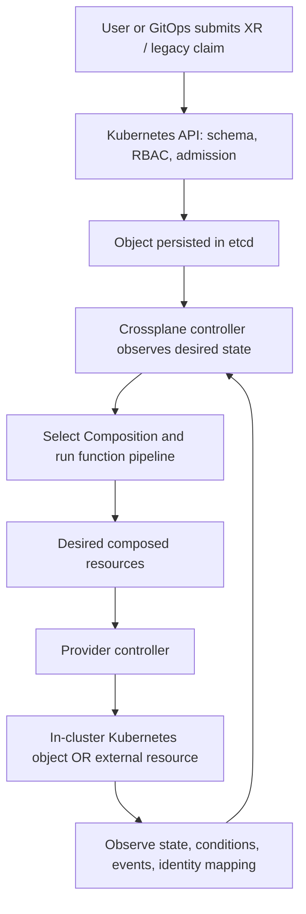
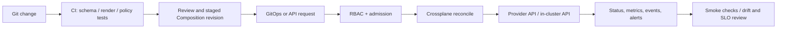

# Unit 12 — Crossplane and Kubernetes-native infrastructure

**Target file:** `12-crossplane-and-kubernetes-native-infrastructure.md` | **Estimated time:** 12–18 hours including local setup, troubleshooting, and teardown | **Prerequisites:** Kubernetes fundamentals, YAML, controllers/CRDs, RBAC, Helm, GitOps basics, Terraform/modules/state fundamentals  
**Core tools:** kind, kubectl, Helm, Crossplane, provider-kubernetes (no cloud account; compatibility must be checked) | **Awareness:** Composition functions, Crossplane CLI/render/trace/validate tools, Argo CD/Flux, OPA/Kyverno/Gatekeeper/ValidatingAdmissionPolicy, cloud providers and LocalStack | **Last reviewed:** 2026-10-28; not yet human-verified | **Tool baseline assumed:** `<VERSION>` placeholders and `[VERIFY]` for unchecked versions | **Substrate:** local kind cluster; no paid cloud or cloud account required

> **Safety and version contract**
>
> This lesson uses the Crossplane v2 API model for conceptual examples where the official v2.4 documentation supports it. The no-cloud provider example uses the `crossplane-contrib/provider-kubernetes` project. Provider compatibility, exact served CRD versions, package tags, composition-function compatibility, and deletion behavior must be checked against the versions actually installed. The example manifests are not represented as executed. Do not copy them into a shared cluster without the verification steps in this lesson.
>
> The roadmap copy inspected for this lesson places the IaC module under `02-Advanced-Infrastructure-as-Code-and-Cloud-Operations/`, while the supplied prompt describes a `07-...` path. This lesson does not rename or reconcile the tree; use the actual repository path in the checked-out tree.

---

### 12.0 Why this matters in production

A platform team exposes a simple `DataEnvironment` API so application teams can request a namespace, quota, network policy, and configuration without learning every implementation detail. If a claim or composite resource is deleted and the composition/provider's deletion semantics cascade into a stateful resource, a routine GitOps change can become a data-loss incident. Continuous reconciliation is powerful because it notices drift and tries to restore the declared state, but it also means a bad desired state can be repeatedly enforced until contained. The management cluster, its etcd data, provider packages, and credentials therefore become critical infrastructure. Layered guardrails—API validation, RBAC, admission policy, staged composition rollout, backups, and explicit deletion tests—reduce risk but do not eliminate the need to verify real behavior.

### 12.1 Learning objectives

By completing this unit, a learner can:

- **L1:** Explain CRDs, controllers, desired versus observed state, asynchronous reconciliation, status conditions, and events.
- **L1:** Compare Crossplane's continuous control loop with Terraform/OpenTofu's plan/apply and state workflow without claiming that Crossplane has “no state.”
- **L2:** Create and verify a disposable kind cluster, install Crossplane with a pinned chart version, and prove the selected context is local before any destructive command.
- **L2:** Install a no-cloud Kubernetes provider after checking compatibility, create a managed in-cluster object, and diagnose reconciliation through status, events, and logs.
- **L2/L3:** Design a `DataEnvironment` API with a schema and defaults, and explain the version-sensitive differences between Crossplane v1 claims and v2 namespaced XRs.
- **L3:** Test composition rendering separately from controller reconciliation and provider integration; design RBAC, admission, and GitOps boundaries.
- **L3/L4:** Evaluate drift, deletion, adoption, upgrades, API quotas, and dual-management risks; define a safe Terraform ↔ Crossplane ownership-transfer plan.
- **L4:** Design a production control plane with least-privilege credentials, recovery objectives, backup/restore drills, provider pinning, observability, and an exit strategy.

### 12.2 Concept map and vocabulary

#### Glossary

| Term | Precise definition | Common misconception |
|---|---|---|
| Controller | A process that observes API objects and repeatedly attempts to make actual state match desired state. | A controller runs once and exits. |
| CRD / CR | A CustomResourceDefinition adds an API type; a Custom Resource is an instance of that type. | Installing a CRD alone installs a working controller. |
| Provider / provider package | A Crossplane package that installs controllers and API types for a class of resources. | Every provider provisions public-cloud resources. |
| Managed resource (MR) | A provider-defined Crossplane object that represents and reconciles a resource, often external, but possibly an in-cluster object. | Every MR is a cloud resource. |
| `ProviderConfig` | Provider-specific configuration selecting credentials and connection behavior. | It is safe to let every application team edit it. |
| XRD | Composite Resource Definition; declares the schema and scope of a platform API. | An XRD by itself creates child resources. |
| Composition | A mapping from an XR's API to one or more composed resources, commonly implemented with a function pipeline in current Crossplane. | A Composition is merely a YAML template with no runtime behavior. |
| XR | Composite resource; an instance of a platform API defined by an XRD. | All XRs are cluster-scoped in all versions. |
| Claim | A namespaced proxy for a cluster-scoped XR in the legacy Crossplane v1-style API model. | Claims are universal or required in Crossplane v2. |
| Composition function | An extension called by Crossplane to calculate desired composed resources from observed state and inputs. | A function directly replaces the Kubernetes API server. |
| Reconciliation loop | Repeated observation, comparison, and corrective action. | A successful `kubectl apply` means the resource is ready. |
| Desired / observed state | Desired state is declared in spec; observed state is reported by controllers and providers. | Status always reflects reality immediately. |
| Conditions / events | Structured status indicators and event records that help explain progress or failure. | An event history is a durable, complete audit log. |
| `Ready` / `Synced` | Common condition types; precise semantics depend on Crossplane/provider/version. | `Ready=True` means every dependency and the whole platform is healthy. |
| `crossplane.io/external-name` | A common annotation used by providers to map a Kubernetes managed-resource object to an external identifier. | The annotation alone safely imports every resource. |
| `deletionPolicy` | Provider/API-specific field that may control whether deleting an MR also deletes its represented resource (`Delete` versus `Orphan`). | The same field and semantics exist for every provider/resource. |
| `managementPolicies` | A version- and provider-dependent list of allowed management actions, such as Observe/Create/Update/Delete. | Every provider supports every policy combination. |
| `CompositionRevision` | A revisioned snapshot of a Composition that can support staged adoption of changes. | It automatically rolls back external resources. |
| Provider credentials / Secret | Credentials or connection data made available to a provider, sometimes stored in a Kubernetes Secret. | Base64-encoded Secret data is encrypted by itself. |
| Platform API / golden path | A supported, opinionated interface that hides implementation details and exposes a constrained set of capabilities. | A golden path should expose every provider-specific field. |
| Drift | A difference between declared/managed intent and observed resource state. | Drift detection and drift remediation are the same action. |
| Finalizer | Metadata that delays Kubernetes object deletion until a controller completes cleanup. | A finalizer is an infallible deletion-protection mechanism. |
| Admission policy | A policy evaluated at API admission to reject or mutate requests, depending on mechanism. | Admission policy replaces RBAC or provider-side authorization. |
| Dual management | Two systems attempt to own and mutate the same resource. | It is safe if both systems use different names for the same resource. |

#### Reconciliation flow



The loop is asynchronous. A create request can be accepted while a provider is still installing, a dependency is unavailable, or the target API is rejecting a field. Read `kubectl get`, `kubectl describe`, events, and controller logs rather than treating API acceptance as success.

#### Ownership and state model

| Concern | Crossplane | Terraform/OpenTofu |
|---|---|---|
| Desired state | Kubernetes custom resources and platform definitions | HCL/configuration and input variables |
| Status/metadata | Kubernetes API/etcd; controller conditions and provider-specific metadata | State file/backend plus plan outputs |
| External identity | Often annotations such as `crossplane.io/external-name` and provider-specific state/mapping | Resource addresses and provider IDs recorded in state |
| Change workflow | Continuous reconcile after API/GitOps changes | Explicit plan and apply, unless an additional service automates the workflow |
| Drift | May be corrected continuously, subject to provider capabilities/policies | Typically observed during plan/refresh workflows; continuous checks require additional automation |
| Review control | Git review, RBAC, admission, Composition revisions, and deployment policy | Saved plans, plan review, approval gates, state locking |
| Failure modes | Controller outage, CRD/provider mismatch, reconcile storm, accidental cascading delete, lost management cluster | State lock/state loss, bad plan, provider API failure, drift between runs |
| Operational cost | Kubernetes control-plane, CRD/provider/function fleet, observability, backups | State/backend, runners, provider credentials, plan/apply pipeline |

Crossplane **does have stateful information**: desired specs and status live in Kubernetes API/etcd, while external identity and provider-specific mappings may be represented in annotations, fields, or provider-managed records. It is not the same storage/workflow model as Terraform state, but “Crossplane has no state” is inaccurate.

#### Pipeline and control boundaries



GitOps applies desired objects; Crossplane reconciles them; provider controllers may then reconcile their target resources. These are distinct loops. Avoid two controllers continuously writing the same fields. Store secrets outside plain Git and use a supported secret-delivery pattern.

#### Kubernetes-native IaC landscape (awareness)

| Tool | General purpose | Best-fit mental model | Caveat |
|---|---|---|---|
| Crossplane | Composable platform APIs and reconciliation of infrastructure through providers | Publish a self-service API and continuously reconcile its implementation | API/version and provider maturity vary; management cluster becomes critical |
| Cluster API | Declarative lifecycle management for Kubernetes clusters and related infrastructure | Manage clusters as Kubernetes API objects | Not a general replacement for every cloud-resource IaC workflow |
| AWS Controllers for Kubernetes (ACK) | Kubernetes controllers for supported AWS services | Manage supported AWS resources through Kubernetes APIs | Service coverage, APIs, and behavior are AWS-specific and must be checked |
| Google Config Connector | Kubernetes APIs/controllers for supported Google Cloud resources | Reconcile Google Cloud resources from Kubernetes objects | Requires Google Cloud identity/configuration; service support varies |
| Azure Service Operator (ASO) | Kubernetes controllers for supported Azure resources | Manage Azure resources via Kubernetes APIs | Azure-specific and version/service coverage varies |
| Terraform operators | Run or reconcile Terraform configurations from Kubernetes | Keep Terraform execution/state while using Kubernetes as a trigger/control surface | Operator implementation, state storage, and lifecycle semantics vary; not the same as native Crossplane resources |

These products overlap in broad goals but are not interchangeable. Maintenance status, supported APIs, and production recommendations are `[VERIFY]` against each project's official documentation before adoption.

### 12.3 Level 1 — Beginner

#### What happens when a user requests infrastructure?

1. A user submits an XR (or a legacy claim in a v1-compatible model).
2. The Kubernetes API checks schema, authorization, and configured admission policies.
3. The API server persists the object in etcd.
4. Crossplane observes it and selects the relevant Composition and provider/function configuration.
5. Composition functions calculate desired composed resources.
6. Providers reconcile either Kubernetes objects or external resources, depending on the provider.
7. Controllers update status and emit events; retries continue until the resource converges or an error persists.

A request being accepted proves only that the API server accepted the object. It does not prove that a provider is healthy, credentials work, a quota is available, or the resource is ready.

#### Guided read-only walkthrough

After Lab A, inspect the local cluster:

```bash
kubectl config current-context
kubectl get pods -n crossplane-system
kubectl get crds | grep -E 'crossplane|provider'
kubectl get events -A --sort-by=.lastTimestamp
```

These commands read the current context, controller pods, installed API types, and event stream. They do not create cloud resources. The `grep` command is a convenience for Unix-like shells; on other platforms use `kubectl get crds` and inspect the list manually.

Example interpretation (representative, not captured here):

- `Running` does not necessarily mean `Ready=True` for every managed resource.
- A missing provider CRD may mean the package has not installed, is incompatible, or is still progressing.
- `ReconcileError` or provider authentication errors should be diagnosed from the affected object's `describe`, provider logs, and recent events.
- Repeated retries can increase API pressure; do not blindly delete finalizers to make a symptom disappear.

#### Common beginner mistakes

| Symptom | Likely cause | Safer fix |
|---|---|---|
| Custom kind rejected as unknown | CRD not installed or not established | Check package health and `kubectl get crd`; wait for API registration |
| Object exists but never becomes ready | Provider/function not healthy, invalid spec, missing permission, or dependency not ready | Inspect conditions, events, and controller logs |
| Manual edit is reverted | Controller is enforcing declared desired state | Change the source of truth or pause management through a verified mechanism |
| Deleting a namespace removes more than expected | Objects inside it own or trigger deletion of managed resources | Inventory ownership and test deletion order in a disposable cluster |
| Terraform and Crossplane keep changing the same resource | Dual ownership | Assign exactly one mutation authority; plan a deliberate ownership transfer |
| A secret is visible in a manifest | Secret values were placed in Git/output or broad RBAC grants access | Rotate exposed credentials and narrow access; use a supported secret-management pattern |

### 12.4 Level 2 — Intermediate

#### Local setup and resource budget

**Substrate:** local kind only. **Touches real cloud:** no.  
**Planning budget:** reserve approximately 2–4 CPU, 4–6 GB RAM, and several GB of disk for a single-node kind cluster plus Crossplane/provider images; this is an estimate, not an official minimum. Actual use depends on image sizes, Kubernetes version, provider, and host runtime `[VERIFY]`. On an 8 GB machine, run labs sequentially and delete the cluster between heavy iterations.

Prerequisites: Docker/Podman or another supported kind runtime, `kind`, `kubectl`, Helm 3, and a shell. Record `kind version`, `kubectl version --client`, `helm version`, and the intended Crossplane/provider package versions. Do not use the `latest` tag for reproducible environments.

#### Lab A — Minimal Crossplane installation on kind

**Target assertion before any change or deletion:** cluster name must be `xp-lab`; context must be `kind-xp-lab`. This lab creates only a local kind cluster and installs controllers into it.

Create the cluster:

```bash
kind create cluster --name xp-lab --wait 180s
kubectl config use-context kind-xp-lab
test "$(kubectl config current-context)" = "kind-xp-lab"
kind get clusters
kubectl cluster-info --context kind-xp-lab
```

If the assertion fails, stop. Do not install or delete anything until the current context is confirmed. `kind` runs Kubernetes nodes in local containers; it is not a cloud cluster. See the kind Quick Start documentation.

Install Crossplane using the official stable Helm repository. First review the chart and set a reviewed chart version instead of leaving the placeholder:

```bash
helm repo add crossplane-stable https://charts.crossplane.io/stable
helm repo update
helm show chart crossplane-stable/crossplane --version <CROSSPLANE_CHART_VERSION>
helm install crossplane \
  --namespace crossplane-system \
  --create-namespace \
  --version <CROSSPLANE_CHART_VERSION> \
  crossplane-stable/crossplane
kubectl rollout status deployment/crossplane -n crossplane-system --timeout=180s
kubectl get pods -n crossplane-system
kubectl get crds | grep crossplane
```

`<CROSSPLANE_CHART_VERSION>` is a required substitution, not a literal valid version. Confirm the chart's supported Crossplane version, Kubernetes compatibility, and any required values before installing `[VERIFY]`. The official install guide documents the repository and basic Helm installation; the version pin is deliberately explicit here.

Representative result: Crossplane deployments become available and CRDs for providers, functions, and compositions appear. Exact deployment names and pod counts can change by version. If the rollout times out, inspect `kubectl describe pods`, `kubectl get events -n crossplane-system`, and `kubectl logs`; do not immediately reinstall.

**Evidence:** current context, `kind get clusters`, Crossplane pod readiness, installed CRDs, and recorded tool/chart versions.

**Cleanup — destructive, local cluster only:**

```bash
test "$(kubectl config current-context)" = "kind-xp-lab"
kind get clusters
# Confirm the output includes exactly the intended lab name before proceeding.
kind delete cluster --name xp-lab
kind get clusters
kubectl config get-contexts
```

Verify `xp-lab` no longer appears in `kind get clusters`. Removing the kind cluster removes the local lab API state and controllers. It does not delete any external cloud resources because this lab never creates them.

#### Lab B — No-cloud provider and managed-resource reconciliation

**Provider choice:** `crossplane-contrib/provider-kubernetes` manages Kubernetes objects through Crossplane's `Object` managed resource. Its official repository documents the provider package and object model. The published package name and example tag are version-sensitive; the repository has documented `xpkg.crossplane.io/crossplane-contrib/provider-kubernetes:v1.0.0`. Before use, confirm compatibility with the Crossplane version selected in Lab A, the package digest/provenance, and the actual installed CRD API version `[VERIFY]`.

**No-cloud credential boundary:** for this local same-cluster lab, prefer the provider's documented in-cluster `InjectedIdentity` mode when supported by the pinned release. It avoids creating a kubeconfig Secret. The identity is still privileged: grant it only the target Kubernetes verbs needed by the lab. Never reuse a production kubeconfig or use the provider project's broad `cluster-admin` quick-start binding in a shared cluster.

1. Recreate Lab A if the cluster has been deleted, then assert the context.
2. Install the provider package at a pinned version and wait for its package/controller status.
3. Discover the provider deployment's service-account name; substitute that exact value in the lab ClusterRoleBinding.
4. Apply the narrowly scoped ClusterRole and ClusterRoleBinding below, then create a `ClusterProviderConfig` using `InjectedIdentity` if the installed API supports it.
5. Query the installed CRD before applying an `Object`.

Illustrative package resource (confirm package compatibility and API support before applying):

```yaml
apiVersion: pkg.crossplane.io/v1
kind: Provider
metadata:
  name: provider-kubernetes
spec:
  package: xpkg.crossplane.io/crossplane-contrib/provider-kubernetes:v1.0.0
```

A Provider object requests installation of the package; it does not itself prove the provider is healthy. Inspect the package status, pods, events, and installed CRDs.

Illustrative least-privilege target permissions and in-cluster configuration (check the provider's installed API first):

```yaml
apiVersion: rbac.authorization.k8s.io/v1
kind: ClusterRole
metadata:
  name: xp-lab-provider-kubernetes
rules:
  - apiGroups: [""]
    resources: ["namespaces", "configmaps", "resourcequotas"]
    verbs: ["get", "list", "watch", "create", "update", "patch", "delete"]
  - apiGroups: ["networking.k8s.io"]
    resources: ["networkpolicies"]
    verbs: ["get", "list", "watch", "create", "update", "patch", "delete"]
---
apiVersion: rbac.authorization.k8s.io/v1
kind: ClusterRoleBinding
metadata:
  name: xp-lab-provider-kubernetes
subjects:
  - kind: ServiceAccount
    name: <PROVIDER_SERVICE_ACCOUNT>
    namespace: crossplane-system
roleRef:
  apiGroup: rbac.authorization.k8s.io
  kind: ClusterRole
  name: xp-lab-provider-kubernetes
---
apiVersion: kubernetes.m.crossplane.io/v1alpha1 # [VERIFY] installed CRD
kind: ClusterProviderConfig
metadata:
  name: local-lab
spec:
  credentials:
    source: InjectedIdentity
```

Before applying the binding, discover the service account instead of guessing it:

```bash
kubectl -n crossplane-system get deployments   -o custom-columns=NAME:.metadata.name,SA:.spec.template.spec.serviceAccountName
```

Replace `<PROVIDER_SERVICE_ACCOUNT>` with the exact service-account name for the provider deployment, then apply this RBAC/ClusterProviderConfig manifest from the temporary lab directory. The role grants cluster-wide namespace creation/deletion plus the listed namespaced resource operations, so use it only in this disposable kind cluster. In production, separate target clusters and identities, and use namespace/resource boundaries where possible. If `ClusterProviderConfig` or `InjectedIdentity` is not served/supported, stop and follow the versioned provider documentation; do not improvise the schema.


Before using an `Object`, inspect its schema:

```bash
kubectl get crd | grep -i kubernetes.crossplane.io
kubectl get crd objects.kubernetes.crossplane.io -o yaml
kubectl explain object.spec --api-version=kubernetes.crossplane.io/v1alpha2
```

The `v1alpha2` API version shown next is an example seen in provider project materials and must be confirmed against the installed CRD. If it is not served, do not apply it; adapt to the actually served API and re-review every field.

Illustrative disposable ConfigMap managed through the provider:

```yaml
apiVersion: kubernetes.crossplane.io/v1alpha2 # [VERIFY] served version in installed CRD
kind: Object
metadata:
  name: xp-lab-configmap
spec:
  providerConfigRef:
    kind: ClusterProviderConfig
    name: local-lab # [VERIFY] served API and reference kind
  forProvider:
    manifest:
      apiVersion: v1
      kind: ConfigMap
      metadata:
        name: xp-lab-managed
        namespace: default
        labels:
          lab.example.org/owner: crossplane-unit12
      data:
        mode: "training"
        owner: "platform-lab"
```

The in-cluster `ClusterProviderConfig` uses `InjectedIdentity` only if supported by the selected release. If it is not served, use the provider's versioned credential configuration and a short-lived lab-only kubeconfig; never substitute a production identity. The exact API is verified through the installed CRD and provider documentation `[VERIFY]`.

Inspect reconciliation:

```bash
kubectl get object xp-lab-configmap -o yaml
kubectl describe object xp-lab-configmap
kubectl get configmap xp-lab-managed -n default -o yaml
kubectl get events -A --sort-by=.lastTimestamp
kubectl logs -n crossplane-system deploy/provider-kubernetes
```

Provider deployment names can vary; discover them with `kubectl get pods -n crossplane-system` before reading logs. After the provider reports success, edit the target ConfigMap's `data.mode` out of band and observe whether the provider restores it. The correction behavior depends on provider watch/reconcile behavior and the exact field-management model; if the provider does not correct this particular mutation, record the evidence and use a documented supported resource/field instead. Do not assert drift correction without observing it.

**Deletion semantics:** the provider's own `Object` API and the underlying Kubernetes object have different lifecycles. Verify the provider's deletion policy and test with only the named ConfigMap. Never use a Namespace, PVC, database, or other stateful object for a first deletion experiment.

**Cleanup:** first delete the managed `Object`, wait for its finalizer to complete, and verify the ConfigMap is gone; then remove the lab ClusterProviderConfig and its lab-only RBAC, uninstall the provider package using the supported procedure, and finally delete the kind cluster after reasserting the context. If the managed object remains terminating, inspect provider logs and events. A finalizer may be protecting cleanup; do not remove it blindly.

#### ProviderConfig, Secret and credential security

A provider configuration determines how the provider reaches its target. A Secret is a storage object, not an authorization boundary by itself. Kubernetes Secret data is commonly base64-encoded; encryption at rest depends on API-server configuration. Access to `get/list/watch` Secrets or to a provider's service-account token can expose the credentials' full effective privilege.

Production expectations:

- Use per-environment and preferably per-team identities with minimal provider-side permissions.
- Separate application teams' ability to request platform APIs from the platform team's ability to modify ProviderConfigs, provider packages, XRDs, and Compositions.
- Rotate credentials and test rotation without printing secret data.
- Use workload identity or a supported external secret/identity integration when appropriate; see M09.
- Do not commit credentials, kubeconfig, generated Secret YAML, or token output to Git.

#### Lab C — XRD + Composition exposing `DataEnvironment`

**Version model:** the example follows the Crossplane v2-style XRD API, where `apiextensions.crossplane.io/v2` supports an explicit `scope`. In Crossplane v2, namespaced XRs do not use claims; claims remain part of the v1-compatible `LegacyCluster` model. Confirm this against the installed version before using the manifests. The Composition uses a function pipeline, matching the current composition documentation's model. The function package tag is a placeholder that must be verified for compatibility.

The intended API lets an application team request a constrained environment. It should compose only disposable in-cluster objects. The example below defines the platform API schema and a function pipeline; function input syntax and composed-resource behavior must be validated with the selected Crossplane/function versions.

XRD:

```yaml
apiVersion: apiextensions.crossplane.io/v2
kind: CompositeResourceDefinition
metadata:
  name: dataenvironments.platform.example.org
spec:
  scope: Cluster # Can compose a Namespace and resources inside it; XR is cluster-scoped
  group: platform.example.org
  names:
    kind: DataEnvironment
    plural: dataenvironments
  versions:
    - name: v1alpha1
      served: true
      referenceable: true
      schema:
        openAPIV3Schema:
          type: object
          properties:
            spec:
              type: object
              properties:
                environment:
                  type: string
                  enum: ["dev", "test"]
                  default: "dev"
                owner:
                  type: string
                  minLength: 2
                  maxLength: 40
                quota:
                  type: object
                  properties:
                    pods:
                      type: integer
                      minimum: 1
                      maximum: 20
                      default: 5
                  default: {}
              required: ["owner"]
          required: ["spec"]
```

The schema limits environment values and quota size. In a real API, also consider naming rules, immutable fields, defaults, and compatibility policy. A schema alone cannot enforce every organizational control.

Before applying this Composition, ensure Lab B installed the provider and created a `ProviderConfig` named `local-lab` that targets only the disposable kind cluster. The exact credential Secret and ProviderConfig schema are provider-version-specific; verify them against the installed release.\n\nInstall the composition function package at a reviewed version (placeholder):

```yaml
apiVersion: pkg.crossplane.io/v1
kind: Function
metadata:
  name: function-patch-and-transform
spec:
  package: xpkg.crossplane.io/crossplane-contrib/function-patch-and-transform:<FUNCTION_VERSION>
```

Before applying, verify the package tag and compatibility with the installed Crossplane release. Wait until the Function is installed/healthy according to the current version's status model.

Composition (template; validate all fields against current docs and function schema):

```yaml
apiVersion: apiextensions.crossplane.io/v1
kind: Composition
metadata:
  name: dataenvironment.platform.example.org
spec:
  compositeTypeRef:
    apiVersion: platform.example.org/v1alpha1
    kind: DataEnvironment
  mode: Pipeline
  pipeline:
    - step: patch-and-transform
      functionRef:
        name: function-patch-and-transform
      input:
        apiVersion: pt.fn.crossplane.io/v1beta1
        kind: Resources
        resources:
          - name: environment-namespace
            base:
              apiVersion: kubernetes.crossplane.io/v1alpha2 # [VERIFY] installed provider CRD
              kind: Object
              spec:
                providerConfigRef:
                  kind: ClusterProviderConfig
                  name: local-lab
                forProvider:
                  manifest:
                    apiVersion: v1
                    kind: Namespace
                    metadata:
                      name: dataenvironment-lab-ns
                      labels:
                        app.kubernetes.io/managed-by: crossplane
                        platform.example.org/lab: "true"
          - name: environment-quota
            base:
              apiVersion: kubernetes.crossplane.io/v1alpha2 # [VERIFY] installed provider CRD
              kind: Object
              spec:
                providerConfigRef:
                  kind: ClusterProviderConfig
                  name: local-lab
                forProvider:
                  manifest:
                    apiVersion: v1
                    kind: ResourceQuota
                    metadata:
                      name: dataenvironment-quota
                      namespace: dataenvironment-lab-ns
                    spec:
                      hard:
                        pods: "5"
                        requests.cpu: "1"
                        requests.memory: 1Gi
            patches:
              - type: FromCompositeFieldPath
                fromFieldPath: spec.quota.pods
                toFieldPath: spec.forProvider.manifest.spec.hard.pods
                transforms:
                  - type: convert
                    convert:
                      toType: string
          - name: environment-network-policy
            base:
              apiVersion: kubernetes.crossplane.io/v1alpha2 # [VERIFY] installed provider CRD
              kind: Object
              spec:
                providerConfigRef:
                  kind: ClusterProviderConfig
                  name: local-lab
                forProvider:
                  manifest:
                    apiVersion: networking.k8s.io/v1
                    kind: NetworkPolicy
                    metadata:
                      name: default-deny-ingress
                      namespace: dataenvironment-lab-ns
                    spec:
                      podSelector: {}
                      policyTypes:
                        - Ingress
          - name: environment-config
            base:
              apiVersion: kubernetes.crossplane.io/v1alpha2 # [VERIFY] installed provider CRD
              kind: Object
              spec:
                providerConfigRef:
                  kind: ClusterProviderConfig
                  name: local-lab
                forProvider:
                  manifest:
                    apiVersion: v1
                    kind: ConfigMap
                    metadata:
                      name: dataenvironment-config
                      namespace: dataenvironment-lab-ns
                      labels:
                        app.kubernetes.io/managed-by: crossplane
                        platform.example.org/lab: "true"
                    data:
                      environment: dev
                      owner: unset
            patches:
              - type: FromCompositeFieldPath
                fromFieldPath: spec.environment
                toFieldPath: spec.forProvider.manifest.data.environment
              - type: FromCompositeFieldPath
                fromFieldPath: spec.owner
                toFieldPath: spec.forProvider.manifest.data.owner
```

This single-instance lab composition creates four provider-kubernetes `Object` managed resources whose embedded manifests represent a Namespace, ResourceQuota, ingress-deny NetworkPolicy, and ConfigMap. The cluster-scoped `ClusterProviderConfig` `local-lab` must exist, use only the provider's in-cluster identity, and be bound to the lab's restricted permissions. It uses static names to keep the function example readable; applying multiple XRs would collide. The XR is cluster-scoped because it composes a cluster-scoped Namespace and namespaced objects within it. A production composition must derive unique names from XR identity, carefully handle composed resource namespace placement, and add policy/security tests. The `convert` transform, `Object` API version, and function input schema are version-sensitive and must be validated against the selected releases.

XR manifest for the local lab:

```yaml
apiVersion: platform.example.org/v1alpha1
kind: DataEnvironment
metadata:
  name: dataenvironment-lab
spec:
  environment: dev
  owner: learner
  quota:
    pods: 5
```

Apply in order only after validating the cluster and CRD APIs:

```bash
test "$(kubectl config current-context)" = "kind-xp-lab"
kubectl apply -f xrd.yaml
kubectl wait --for=condition=Established crd/dataenvironments.platform.example.org --timeout=90s
kubectl apply -f function.yaml
kubectl apply -f composition.yaml
kubectl apply -f dataenvironment.yaml
kubectl get dataenvironment dataenvironment-lab -o yaml
kubectl get namespace dataenvironment-lab-ns
kubectl get resourcequota dataenvironment-quota -n dataenvironment-lab-ns -o yaml
kubectl get networkpolicy default-deny-ingress -n dataenvironment-lab-ns -o yaml
kubectl get objects.kubernetes.crossplane.io -A
kubectl get configmap dataenvironment-config -n dataenvironment-lab-ns -o yaml
```

The filenames above are logical labels for inline blocks; do not create extra repository files. For a hands-on session, copy each inline block into a temporary directory outside the repository and use those temporary files. This is not a guarantee the manifests apply unchanged: run `crossplane render`/validation tools available for the selected version and inspect the XRD and function schemas first. If the selected Crossplane v2 release expects different XRD/function fields, correct them against official docs and record the tested version.

**Claims versus XRs:** v1-style XRDs can define claim names and create namespaced claims that proxy a cluster-scoped XR. Crossplane v2's `apiextensions.crossplane.io/v2` XRD model uses namespaced or cluster-scoped XRs directly and does not support claims in the same way. Do not mix the v1 claim examples and v2 XRD model in one manifest set.

**Evidence:** XRD established, XR accepted, Composition/function health, composed objects, and status/events. **Limits:** rendering proves generated desired manifests only; it does not prove provider reconciliation or cloud integration.

#### Patterns and anti-patterns

| Pattern | When to use | When not to use |
|---|---|---|
| Small opinionated XR schema | Platform API should protect teams from provider complexity | When users genuinely need an unconstrained generic resource proxy |
| Namespaced XRs and least-privilege RBAC | Application-team self-service with namespace boundaries | When the resource must be globally shared and cross-namespace by design |
| Composition function pipeline | Reusable platform abstraction with testable transformations | Without pinning and testing function packages |
| Composition revisions/canary | Changes affect many XRs and need staged rollout | As a substitute for testing a dangerous change |
| Observe-first import | Adopting existing infrastructure with provider-supported policies | If provider does not support observe-only semantics |
| One declared owner per resource | Terraform/Crossplane coexistence with explicit boundaries | Any arrangement where both controllers mutate the same object |

| Bad pattern | Why it fails | Safer replacement |
|---|---|---|
| Let app teams edit ProviderConfigs | Can expose credentials or expand provider blast radius | Platform-owned RBAC; app teams may create only approved XRs |
| Use `latest` provider/function tags | A rebuild may install an unreviewed API or behavior | Pin version and, where supported, digest; test upgrade matrix |
| Assume `Orphan` means safe deletion | It may orphan a resource without preserving access or inventory | Test exact provider behavior; document ownership after orphaning |
| Put cloud credentials in XR fields | Credentials can leak into Git, status, events, or logs | Use approved secret/identity references |
| Run Crossplane and Terraform against the same resource | Reconciliation and plans can oscillate or destroy changes | Define a single writer and explicit handoff |
| Remove finalizers as routine cleanup | Can bypass provider cleanup and leave external resources | Diagnose finalizer owner, restore controller/credentials, follow recovery runbook |
| Treat `Ready=True` as platform SLO | A single object can be ready while dependencies or other objects fail | Monitor controller, provider, API latency, errors, and representative smoke tests |

### 12.5 Level 3 — Advanced

#### Platform API design

Design `spec` around user intent rather than provider fields. For example, accept `environment: dev|test`, `owner`, and a bounded quota request rather than arbitrary raw provider configuration. Use schema validation for enums, numeric bounds, required fields, and defaults. Add admission policy for organizational rules that are awkward or impossible to encode in a schema. Avoid exposing mutable low-level fields that let users disable encryption, create public endpoints, or choose an unapproved region.

For cloud-backed APIs, the composition/provider layer should enforce encryption, private networking, tags, naming conventions, allowed regions, and public-access restrictions wherever the service supports those controls. Treat those as testable requirements, not a statement that Crossplane itself guarantees cloud security.

API evolution needs an explicit contract:

- Add optional fields with safe defaults before requiring them.
- Avoid changing the meaning of an existing field in place.
- Serve old and new API versions during a documented migration window where supported.
- Test the old and new schema against consumer manifests.
- Review generated CRDs and conversion behavior before changing XRD versions.
- Use CompositionRevision behavior to canary implementation changes; verify exact revision controls in the selected version.
- Define ownership: platform team owns API/schema/composition/provider; application team owns the XR inputs within the approved contract.

#### Composition testing and debugging

Keep three test levels separate:

1. **Schema/API validation:** does the API server accept the XRD and XR?
2. **Render/function tests:** does the function pipeline produce the intended composed manifests?
3. **Controller/provider integration:** does the installed controller create and maintain the intended objects?

A rendered manifest is not proof that an API is served, a provider is healthy, or an external service accepted a request.

Current Crossplane docs describe `crossplane render` and beta trace tooling, but command availability and exact flags can change. Check `crossplane --help`, the official CLI documentation for the selected version, and the package compatibility matrix before relying on them `[VERIFY]`. For each function test, include both a positive fixture and invalid input fixture. Assert observable invariants such as namespace isolation, quota limits, and public exposure blocked; do not assert only the number or names of internal resources.

#### RBAC and team boundaries

The platform team should be able to manage XRDs, Compositions, functions, providers, and ProviderConfigs. Application teams should have narrowly scoped permission to create/get/watch approved XR kinds in their namespaces. They should not be able to edit provider credentials, install packages, modify composition implementations, or create arbitrary cluster-scoped resources.

Example: inspect effective permissions before testing:

```bash
kubectl auth can-i create dataenvironments.platform.example.org \
  --as=system:serviceaccount:app-team:requester
kubectl auth can-i update providers.pkg.crossplane.io \
  --as=system:serviceaccount:app-team:requester
kubectl auth can-i get secrets \
  --namespace crossplane-system --as=system:serviceaccount:app-team:requester
```

These are authorization checks; they do not create or modify resources. The identities and namespaces are illustrative and must exist for the test. Expected result: the approved XR request may be allowed, while provider mutation and reading provider credentials are denied. RBAC is not enough: admission policy should reject disallowed values, and provider-side authorization remains the final boundary for external resources.

#### Admission policy

Choose the mechanism that matches the Kubernetes version and platform: ValidatingAdmissionPolicy, Kyverno, or Gatekeeper/OPA. Validate current API version, policy binding behavior, and enforcement mode before deployment `[VERIFY]`. For the lab, a policy test can assert that `spec.environment` is one of `dev` or `test` and quota is within the approved bound. If the cluster does not have the policy controller or feature enabled, test the policy source independently and label it **not enforced by the cluster**.

#### GitOps integration

Argo CD or Flux can apply XRDs, Compositions, functions, and XRs from version control. Apply dependencies in a safe order: platform API/CRDs first, then functions/providers, then Compositions, then consumer XRs. Use health checks or sync dependency mechanisms only after verifying the exact GitOps implementation and version. Avoid committing credentials. Do not make GitOps and Crossplane both own the same fields in a generated resource unless field ownership and server-side apply behavior are explicitly tested. See M08 for broader GitOps patterns.

#### Crossplane versus Terraform/OpenTofu: decision framework

| Scenario | Preferred starting point | Why / conditions |
|---|---|---|
| Foundational accounts, networks, cluster bootstrap, mature provider ecosystem | Terraform/OpenTofu | Explicit plan/apply and state workflows support change review and bootstrap dependencies |
| Self-service team API with continuous reconciliation | Crossplane | Platform API and controller model can continuously reconcile selected resources |
| In-cluster Kubernetes objects as part of an application platform API | Crossplane with a verified Kubernetes provider, or native Kubernetes/GitOps where simpler | Avoid introducing a control plane for trivial objects without a clear platform benefit |
| Hybrid enterprise platform | Terraform/OpenTofu owns accounts and management cluster; Crossplane owns a defined set of team-facing resources | Ownership must be written down per resource; no overlapping writers |
| Wrapping Terraform from Crossplane | Evaluate only with explicit state/runner/credential ownership design | Can add two control planes and complicate state, failure, and debugging; API/provider support `[VERIFY]` |

A practical hybrid architecture might use Terraform/OpenTofu to create the cloud account, network, Kubernetes management cluster, and foundational IAM. Crossplane then manages only selected self-service objects or external services explicitly assigned to it. The rule is simple: **one resource, one authoritative mutator**. If ownership changes, stop the old controller's mutation path, back up its state, observe/import the resource with the new system, verify identity and configuration, then transfer write authority during a controlled window.

#### Drift, deletion, adoption, and quotas

Continuous reconciliation can quickly correct a manual change—but it can also reapply a bad spec quickly. Before testing drift, identify the exact managed object and field. If the provider does not watch the target field or uses an apply model that does not overwrite it, a manual mutation may persist; record the provider-specific behavior rather than generalizing.

Deletion must be evaluated at each layer: claim (legacy), XR, composed resource, managed resource, namespace, and provider's represented object. In older Crossplane models, a managed resource may use `deletionPolicy: Delete` or `Orphan`; a provider may also implement its own object-specific policy. Crossplane v2 API changes and provider-specific fields mean these semantics cannot be assumed universal. `managementPolicies` is version- and provider-dependent; the current docs mark it as a beta feature and explicitly say providers determine support. See the official Managed Resources and Import Existing Resources guides.

`Orphan` is not the same as a safe backup. It can leave an object that no controller owns, with credentials, labels, costs, and inventory implications. Finalizers delay deletion until controllers finish work, but a stuck finalizer may indicate missing credentials, a dead controller, or failed external cleanup. Recover the controller or credential path and use the documented runbook before considering exceptional finalizer intervention.

A namespace deletion may remove XRs and composed namespaced resources, or interact with owner references and provider deletion logic. Do not assert that deleting a namespace is harmless. Test the exact cascade in the lab; document the expected order before any production rollout.

Provider APIs can be throttled by many simultaneous resources. Watch provider logs, reconcile error rate, queue/backlog metrics where exposed, API latency and throttling events. Rate-limit behavior and available metrics differ by provider. Link to Unit 7 for quotas/service limits and M11 for observability.

#### Upgrades and supply chain

- Pin Crossplane chart, provider packages, and composition functions to reviewed versions.
- Verify package publisher, OCI source, signature/provenance or digest pinning where supported.
- Diff CRD schema changes before upgrading; test all existing XR and managed-resource manifests against the new version.
- Upgrade one environment or canary set first; monitor conditions, reconciliation latency, and provider API errors.
- Preserve manifests and relevant Kubernetes backup data before upgrades.
- Treat rollback as a control-plane version change, not an undo of external infrastructure changes. A controller rollback may not reverse resource changes already applied.
- Keep provider package source and dependency inventory for supply-chain incident response; see M01/M12.

### 12.6 Level 4 — Expert

#### Control-plane reliability and recovery

A Crossplane management cluster is a control plane for other resources. If it becomes unavailable, existing cloud services may continue operating, but teams may lose the ability to observe, reconcile, or safely modify them. Define SLOs for API availability, controller/provider health, reconciliation latency, and recovery time.

Production architecture should include:

- A dedicated, hardened management cluster where the blast radius justifies it.
- Highly available Kubernetes API and etcd configuration appropriate to the platform.
- Versioned GitOps configuration for Crossplane, providers, functions, XRDs, Compositions, RBAC, and admission policy.
- Protected etcd/Kubernetes backups and tested restore procedures.
- Backup coverage for provider configuration and custom resources, with secrets handled through an approved protected backup process.
- Restore drills that verify the cluster can re-establish ownership of existing resources without duplicating or deleting them.
- Documented RPO/RTO, credential recovery, DNS/network dependencies, and operator access.

A `kubectl get -o yaml` export is useful as a manifest inventory but is not a complete etcd disaster-recovery backup. It may omit secrets or status, does not capture every cluster component, and is not a point-in-time consistent etcd snapshot. See M03 Unit 10/M13 for the platform's backup/restore guidance.

#### Credential blast radius

Provider credentials may have power to create, modify, or delete many resources. Use least privilege, per-environment identities, and separate credentials for distinct resource classes when feasible. Prefer workload identity or an approved short-lived credential model over static keys. Restrict Secret access and provider package installation. Rotate compromised credentials, revoke the old identity at the provider side, audit the access path, and verify reconciliation after rotation. See M09.

#### Admission and deletion protection

Use layered controls:

1. RBAC limits who may create/update/delete XR, Composition, ProviderConfig, provider packages, and namespace objects.
2. Schema validation limits invalid inputs.
3. Admission policies block forbidden environments, public exposure, unapproved regions, or high-risk deletion requests.
4. Provider-side IAM/authorization limits what the controller can do even if the management cluster is compromised.
5. For stateful resources, document and test provider-supported orphan/management policies and any platform-level deletion approval workflow.
6. Monitor mass deletion, namespace deletion, changes to ProviderConfigs, and policy bypasses.

Finalizers are lifecycle coordination, not an absolute protection guarantee. They can remain stuck when a controller is unavailable or credentials fail. Do not make “remove every finalizer” the standard recovery procedure.

#### Migration in both directions

**Terraform/OpenTofu → Crossplane tabletop:**

1. Inventory the resource, dependencies, Terraform state address, external ID, lifecycle settings, and current change freeze.
2. Back up state securely and record the last reviewed plan.
3. Stop Terraform applies and disable automated writers for the resource.
4. Create a Crossplane MR in observe-only mode only if the selected provider supports `Observe` management policy and the import semantics are verified.
5. Compare observed external identity and fields to the source-of-truth configuration.
6. Transfer ownership to Crossplane only after validation; explicitly decide which system now owns future mutation.
7. Monitor reconciliation and maintain a rollback boundary that does not allow Terraform to resume mutation blindly.

**Crossplane → Terraform/OpenTofu tabletop:**

1. Inventory XRs, composed resources, external names, provider fields, and dependencies.
2. Freeze changes and back up the management cluster/configuration and Terraform state destination.
3. Stop Crossplane from mutating the resource using a provider-supported, reviewed method; avoid deleting the MR if deletion can destroy the resource.
4. Import the existing resource into Terraform/OpenTofu state using the appropriate provider/import workflow, then plan and compare before applying.
5. Verify the resource's identity and live configuration; only then retire Crossplane ownership and related Composition paths.

These are architecture procedures, not executable cloud migration instructions. Do not permit a period where both systems mutate the same resource.

#### Multi-cluster and operating model

A hub-and-spoke model can centralize platform APIs and providers for multiple workload clusters/accounts, but increases the management plane's privilege and blast radius. Define ownership for platform APIs, provider packages, credential rotation, on-call response, API deprecation, compatibility matrices, and golden-path support. See M14 for multi-cluster patterns and M16 for platform operating models.

The exit strategy should explain how teams can preserve external resources if Crossplane is retired: export inventories, stop reconciliation safely, import into the next system, verify resource ownership, retire credentials, and only then uninstall providers/control plane. A platform is not operationally mature if the only way to preserve resources is to keep an unsupported controller running indefinitely.

#### Six incident analyses

The scenarios below are **illustrative incident patterns**, not reports of a specific company. Evidence items are examples of what an incident commander should collect; do not invent duration, financial impact, or resource counts.

**Incident 1 — Claim/XR deletion removed a stateful resource**

- **Symptom:** A team deletes a request object and a database or other stateful resource disappears.
- **Evidence/timeline:** GitOps commit or audit event shows the request deletion; owner references and provider logs show the chain of deletion; provider-side audit records confirm whether the external delete was accepted.
- **Root cause:** Deletion behavior was assumed rather than tested; the relevant provider/resource used delete-on-managed-resource-removal semantics.
- **Immediate containment:** Freeze further deletes, stop automated prune for the affected path, and preserve Kubernetes/provider/audit evidence.
- **Recovery:** Follow the data-service recovery procedure; restore from a verified backup or recover the external resource if supported. Recreate only after identity and data integrity are confirmed.
- **Regression prevention:** Test deletion behavior for the exact API/provider version, require approval for stateful-resource deletion, and monitor delete events.
- **Owner/monitoring:** Platform owner plus database/service owner; alert on stateful-resource deletion and abnormal claim/XR deletion volume.

**Incident 2 — Provider upgrade changed a managed-resource schema**

- **Symptom:** Objects that previously reconciled begin reporting schema or reconciliation errors after upgrade.
- **Evidence/timeline:** Package version change, CRD schema diff, controller logs, affected object conditions, and failed API validation.
- **Root cause:** The provider package and existing manifests were not tested as a compatibility matrix; a field or API version changed.
- **Immediate containment:** Stop the rollout and avoid applying bulk fixes until the schema diff is understood.
- **Recovery:** Use the supported rollback path if compatible; otherwise apply a reviewed manifest migration and validate a small canary first. Do not assume rolling back the controller reverses external changes.
- **Regression prevention:** Pin packages, diff CRDs, test representative XR/MR manifests, canary, and track provider compatibility.
- **Owner/monitoring:** Platform package owner; alert on provider errors, unhealthy packages, and reconciliation backlog.

**Incident 3 — Management cluster lost without a usable backup**

- **Symptom:** External resources remain operational, but the team cannot reliably observe or reconcile them.
- **Evidence/timeline:** API/etcd outage or loss, missing backup records, GitOps repository contents, provider identities, and external inventory.
- **Root cause:** The control plane was treated as disposable; backups did not include the necessary custom resources, secrets/credential recovery, and platform configuration.
- **Immediate containment:** Prevent Terraform or another system from adopting/mutating resources blindly; establish a controlled recovery owner and freeze changes.
- **Recovery:** Rebuild the management cluster, install pinned Crossplane/provider/function packages, restore versioned XRDs/Compositions and resource inventory, restore credentials through the secret process, then observe resources before resuming mutation.
- **Regression prevention:** Automated backups, restore drills, documented RPO/RTO, and post-restore ownership verification.
- **Owner/monitoring:** Platform SRE; backup age, restore-test success, and control-plane availability.

**Incident 4 — Terraform and Crossplane fought over one resource**

- **Symptom:** Repeated configuration oscillation, noisy plans, unexpected field resets, or replacement proposals.
- **Evidence/timeline:** Terraform plan diffs alternate with Crossplane events; both systems show the same external ID; timestamps correlate with each system's apply/reconcile loop.
- **Root cause:** Dual ownership without an explicit single-writer boundary.
- **Immediate containment:** Freeze applies and stop one mutation path safely; do not delete either state object until ownership and deletion semantics are known.
- **Recovery:** Compare actual resource identity/configuration with both desired states, select one owner, back up state and manifests, perform a controlled ownership transfer, and observe for stability.
- **Regression prevention:** Resource ownership registry, policy/lint checks for overlapping IDs, and a migration checklist.
- **Owner/monitoring:** Infrastructure platform owner; alert on repeated oscillation and unexpected replacement plans.

**Incident 5 — Reconcile storm exhausted provider API rate limits**

- **Symptom:** Many objects become unhealthy; provider logs show throttling and repeated retries.
- **Evidence/timeline:** Error rate and API latency rise together; a bulk Composition or package change affects many objects; provider logs report rate limits.
- **Root cause:** Large fan-out or retry pressure exceeded provider/service limits, with no staged rollout or backpressure budget.
- **Immediate containment:** Stop the change rollout, reduce churn, and coordinate with the service owner; avoid repeatedly reapplying the same change.
- **Recovery:** Restore the previous Composition revision if safe, allow backoff/retries to settle, and verify affected resources individually.
- **Regression prevention:** Canary revisions, concurrency limits where supported, provider API quota monitoring, and load tests with representative object counts.
- **Owner/monitoring:** Provider/platform owner; reconcile error rate, API throttling, queue depth where exposed, and recovery time.

**Incident 6 — ProviderConfig Secret leaked through broad RBAC**

- **Symptom:** An application identity can read provider credentials or credentials appear in logs.
- **Evidence/timeline:** Kubernetes audit records show Secret reads; RBAC bindings grant broad access; CI/event logs may contain serialized secret data.
- **Root cause:** Platform/provider secret boundaries were not separated from application-team permissions.
- **Immediate containment:** Revoke/rotate affected credentials at the provider side, remove overbroad RBAC, preserve audit logs, and assess all actions taken by the identity.
- **Recovery:** Issue least-privilege credentials, update ProviderConfig through the approved secret path, verify provider reconciliation, and audit resources reachable by the old identity.
- **Regression prevention:** RBAC allow/deny tests, secret-access alerts, redaction, short-lived credentials/workload identity, and regular privilege review.
- **Owner/monitoring:** Security and platform teams; secret reads, credential rotation events, and unauthorized provider changes.

### 12.7 SRE lens

#### Signals and operational ownership

Track, where the installed Crossplane/provider exposes them:

- Reconciliation success/failure rates and error categories.
- Time from accepted XR to readiness, plus reconciliation latency percentiles.
- Provider API throttling, request errors, and latency.
- Controller restarts, CPU/memory pressure, queue/backlog indicators where available.
- Number and age of resources stuck in non-ready or terminating states.
- Composition/function/provider package health and upgrade failures.
- Backup age, restore drill results, and actual recovery time.
- Unexpected deletes, mass XR/namespace deletion, and finalizer age.

Do not invent metric names. Discover available metrics/endpoints in the selected release and document labels/cardinality before creating alerts. A single `Ready=True` object does not establish platform-wide health.

#### Incident response sequence

1. Stop rollout or GitOps sync for the affected API path.
2. Confirm cluster context, namespace, XR/MR identity, and resource ownership.
3. Preserve events, conditions, controller logs, audit events, Composition revisions, and recent Git changes.
4. Classify the issue: invalid spec, missing CRD, provider/function failure, authorization, quota/rate limit, transient API error, controller bug, or cleanup failure.
5. Contain credentials/API pressure and prevent cascading deletion without blindly stripping finalizers.
6. Restore controller/provider capability or roll back the platform change within the supported boundary.
7. Verify both Kubernetes objects and any external resources; do not rely on status alone.
8. Add a regression test, update runbooks, and review alert quality.

Use progressive rollout for provider/function/Composition changes, and define explicit rollback limits. Composition rollback can change desired state but does not necessarily reverse changes already made to external resources.

### 12.8 Security lens

- **Management cluster:** treat it as critical infrastructure. Restrict access, harden nodes/API, protect etcd backups, and monitor admin actions.
- **Provider credentials:** least privilege, per-environment separation, rotation, and no static secrets in Git. A controller with broad credentials can magnify a management-cluster compromise.
- **Kubernetes Secrets:** restrict read access, configure encryption at rest, audit access, avoid printing Secret manifests, and use an approved external secret or workload-identity pattern where appropriate.
- **RBAC:** application teams can request approved platform APIs; platform teams alone control provider packages, ProviderConfigs, XRDs, and Compositions.
- **Admission:** reject invalid environments, oversized quotas, public exposure, and unapproved settings. Admission is a guardrail, not a replacement for provider-side IAM.
- **Supply chain:** pin package versions; verify source/publisher and digest/signature support; test upgrade diffs before production rollout.
- **Deletion:** test claim/XR/MR/namespace cascades, protect stateful resources, and treat `Orphan` as an ownership-transfer event rather than a safety guarantee.
- **Finalizers:** diagnose controller and credential failures; do not routinely remove finalizers as a shortcut.
- **Dual management:** never allow Terraform and Crossplane to mutate the same external resource concurrently.
- **Lab boundaries:** local kind proves Kubernetes/provider behavior only within the test cluster; it does not prove cloud IAM, cloud quotas, external API parity, or regulatory compliance.

### 12.9 Production checklist

#### 1. Architecture and resource ownership
- [ ] Each resource has one documented authoritative mutator.
- [ ] Terraform/OpenTofu and Crossplane ownership boundaries are written and reviewed.
- [ ] Management-cluster loss and restore responsibilities have named owners.
- [ ] Platform APIs expose user intent, not unrestricted provider internals.

#### 2. Kubernetes API/XRD/Composition versioning
- [ ] Crossplane major version, XRD API, scope, claims/XRs, and function pipeline are verified.
- [ ] XRD schemas include required fields, bounds, defaults, and compatibility rules.
- [ ] Composition revisions and canary strategy are tested.
- [ ] Consumer examples validate against supported API versions.

#### 3. Provider/package supply chain
- [ ] Provider and function versions are pinned.
- [ ] Publisher/source and package provenance/digest support are reviewed.
- [ ] CRD/schema diffs and compatibility matrix are reviewed before upgrades.
- [ ] Rollback limitations are documented.

#### 4. RBAC and provider credentials
- [ ] App-team and platform-team permissions are separated.
- [ ] App identities cannot edit ProviderConfigs or read provider Secrets.
- [ ] Provider identities have least privilege per environment.
- [ ] Rotation and compromise response are rehearsed.

#### 5. Admission policy and guardrails
- [ ] Policy rejects invalid or forbidden XR inputs.
- [ ] Enforcement mode is confirmed, not merely policy-source syntax.
- [ ] RBAC, schema validation, admission, and provider-side authorization are tested as separate layers.

#### 6. Deletion/Orphan/cascade safety
- [ ] Delete/Orphan semantics are verified for the exact provider/resource/version.
- [ ] Claim/XR/MR/namespace deletion order is documented and tested.
- [ ] Stateful-resource deletion requires an explicit approval path.
- [ ] Finalizer-stuck recovery avoids blind finalizer removal.

#### 7. GitOps ordering and controller ownership
- [ ] CRDs/APIs, providers/functions, Compositions, and consumer XRs deploy in a safe order.
- [ ] GitOps health checks and dependency controls are version-verified.
- [ ] No two controllers fight over the same fields.
- [ ] Secrets are not committed to Git.

#### 8. Observability and rate limits
- [ ] Controller/provider health, reconcile errors, latency, and API throttling are monitored.
- [ ] Alerts distinguish invalid specs from authorization, quota, and transient failures.
- [ ] Mass deletion, finalizer age, and repeated reconciliation errors are visible.
- [ ] Metrics and labels are confirmed for the installed version.

#### 9. Backups, restore drills, HA, and recovery
- [ ] etcd/Kubernetes backup coverage and secret recovery are documented.
- [ ] RPO/RTO are agreed and tested.
- [ ] Restore drill verifies XRDs, Compositions, providers, credentials, and existing resource ownership.
- [ ] GitOps rebuild procedure and emergency access are tested.

#### 10. Upgrade/migration/exit strategy
- [ ] Provider/function upgrade matrix includes representative consumers.
- [ ] Terraform-to-Crossplane and reverse migration have a freeze/cutover/rollback plan.
- [ ] Observe-first import is used only where provider support is verified.
- [ ] Exit plan preserves resources and removes credentials only after ownership transfer.

#### 11. Resource footprint and cost
- [ ] Local and production controller footprints are measured.
- [ ] Labs run sequentially on constrained machines.
- [ ] Provider/API rate limits and controller scale are included in design.
- [ ] Orphaned resources and stale managed objects are audited.

#### 12. Incident response and evidence
- [ ] Runbooks cover lost management cluster, credential compromise, provider outage, and reconcile storm.
- [ ] Events/logs/audit trails and Composition revision history are retained appropriately.
- [ ] Regression tests exist for deletion cascades and ownership conflicts.
- [ ] The evidence pack distinguishes verified results from assumptions.

### 12.10 Hands-on lab set

All labs below are **local kind only** and **do not touch real cloud**. They are designed to be copied into a temporary directory such as `/tmp/crossplane-unit12` or a Windows equivalent, not added as repository files. The actual tool versions and exact API support must be recorded. Never run `kind delete cluster` until the target name and current context have been checked.

#### Lab A — Minimal Crossplane installation on kind

- **Substrate:** local kind cluster only.
- **Touches real cloud:** no.
- **Budget:** estimate 2–4 CPU, 4–6 GB RAM plus image disk; `[VERIFY]` on your host.
- **Prerequisites:** kind, kubectl, Docker/Podman, Helm; versions recorded.
- **State location:** disposable kind cluster `xp-lab`; kubeconfig context `kind-xp-lab`.
- **Target assertion:** `test "$(kubectl config current-context)" = "kind-xp-lab"` before install and delete.
- **Files:** none required beyond commands in Lab A; chart version is a required placeholder.

Steps:

```bash
kind create cluster --name xp-lab --wait 180s
kubectl config use-context kind-xp-lab
test "$(kubectl config current-context)" = "kind-xp-lab"
kind get clusters
kubectl cluster-info --context kind-xp-lab

helm repo add crossplane-stable https://charts.crossplane.io/stable
helm repo update
helm show chart crossplane-stable/crossplane --version <CROSSPLANE_CHART_VERSION>
helm install crossplane --namespace crossplane-system --create-namespace \
  --version <CROSSPLANE_CHART_VERSION> crossplane-stable/crossplane

kubectl rollout status deployment/crossplane -n crossplane-system --timeout=180s
kubectl get pods -n crossplane-system
kubectl get crds | grep crossplane
```

Expected/representative evidence: the context is `kind-xp-lab`; Crossplane pods become ready; relevant CRDs appear. If not, capture `kubectl describe pod`, events, and logs. Verify chart compatibility and API version before moving on.

Cleanup:

```bash
test "$(kubectl config current-context)" = "kind-xp-lab"
kind get clusters
# Human confirms xp-lab is the intended local cluster.
kind delete cluster --name xp-lab
kind get clusters
```

Verify `xp-lab` is absent. **Limits:** no provider behavior, cloud permissions, or external infrastructure is tested.

#### Lab B — Provider and managed-resource reconciliation

- **Substrate:** local kind; no cloud account.
- **Touches real cloud:** no.
- **Budget:** same cluster plus provider pod; run sequentially.
- **Prerequisites:** Lab A; compatible provider-kubernetes package and API verified.
- **State location:** `xp-lab` Kubernetes API/etcd; provider credentials are a lab-only kubeconfig Secret.
- **Target assertion:** current context equals `kind-xp-lab`; `kind get clusters` contains `xp-lab`.
- **Files:** Provider and Object manifests inline in Lab B and Lab 4.2 above; credential Secret/ProviderConfig shape must be taken from the chosen provider's official versioned example.

1. Confirm context and cluster.
2. Install the pinned provider package.
3. Wait for provider installation/health and inspect installed CRDs.
4. Verify the served `Object` API and exact ProviderConfig schema.
5. Create a short-lived, lab-only credential Secret and ProviderConfig; do not print or commit credential data.
6. Apply the ConfigMap `Object` from Lab 4.2.
7. Inspect the managed object and the represented ConfigMap.
8. Change the ConfigMap's `data.mode` out of band and observe whether reconciliation restores it. Record the actual behavior rather than assuming all provider versions watch all fields.
9. Delete the `Object`, wait for cleanup, and verify the represented ConfigMap behavior.

Commands:

```bash
test "$(kubectl config current-context)" = "kind-xp-lab"
kubectl get pods -n crossplane-system
kubectl get crds | grep -i kubernetes.crossplane.io
kubectl explain object.spec --api-version=kubernetes.crossplane.io/v1alpha2
kubectl describe object xp-lab-configmap
kubectl get configmap xp-lab-managed -n default -o yaml
kubectl get events -A --sort-by=.lastTimestamp
```

`kubectl explain` must use the API version actually served by the installed CRD. If it fails, stop and inspect `kubectl get crd objects.kubernetes.crossplane.io -o yaml`; do not apply an unserved version.

**Evidence:** package health, CRD version, ProviderConfig references with secret values redacted, managed-object conditions, events/logs, out-of-band change and observed result, and deletion verification.

**Cleanup:** delete the named Object first; wait for finalizers; verify the target ConfigMap; delete the lab ClusterProviderConfig and lab-only RBAC; remove the provider package according to official instructions; delete the kind cluster only after context assertion. **Limits:** this demonstrates in-cluster API control only—not cloud IAM, quotas, or external-provider fidelity.

#### Lab C — `DataEnvironment` XRD + Composition

- **Substrate:** same local kind cluster; no cloud account.
- **Touches real cloud:** no.
- **Budget:** Crossplane, provider, and composition function pods; sequence rather than running unrelated stacks.
- **Prerequisites:** Labs A and B; Crossplane v2 API and function package versions verified.
- **State location:** namespaced XR `default/dataenvironment-lab` and composed ConfigMap in the same local cluster.
- **Target assertion:** current context is `kind-xp-lab`; target namespace and object names are listed before apply.
- **Files:** XRD, Function, Composition, and XR YAML blocks from Lab C in Section 12.4; copy to a temporary directory only.
- **Steps:** validate XRD and function schema, apply XRD, wait for CRD establishment, install/verify function, apply Composition, apply XR, inspect generated object and status.
- **Evidence:** CRD established, XR accepted, function healthy, composed object and status/events.
- **Failure recovery:** remove the XR first; inspect finalizers and composition/function errors; only remove platform definitions after dependent objects are gone.
- **Cleanup:** delete `dataenvironment-lab`, verify composed object removal, delete Composition and Function, then XRD, then uninstall provider/Crossplane and delete the cluster after context assertion.
- **Limits:** the static-name Namespace/ResourceQuota/NetworkPolicy/ConfigMap composition is a single-instance teaching fixture. It is not safe for multiple tenants and does not prove external cloud provisioning.

Representative commands:

```bash
test "$(kubectl config current-context)" = "kind-xp-lab"
kubectl apply --dry-run=server -f xrd.yaml
kubectl apply -f xrd.yaml
kubectl wait --for=condition=Established crd/dataenvironments.platform.example.org --timeout=90s
kubectl apply -f function.yaml
kubectl get functions
kubectl apply -f composition.yaml
kubectl apply -f dataenvironment.yaml
kubectl get dataenvironment dataenvironment-lab -o yaml
kubectl get namespace dataenvironment-lab-ns
kubectl get resourcequota dataenvironment-quota -n dataenvironment-lab-ns -o yaml
kubectl get networkpolicy default-deny-ingress -n dataenvironment-lab-ns -o yaml
kubectl get configmap dataenvironment-config -n dataenvironment-lab-ns -o yaml
```

If `--dry-run=server` cannot validate because the CRD has not been established, apply the XRD first in the disposable cluster, wait for establishment, and then validate dependent manifests. Exact `crossplane render` arguments are version-sensitive; inspect CLI help and official docs before use.

#### Lab D — Deletion semantics: `Delete` versus `Orphan`

- **Substrate:** local kind only.
- **Touches real cloud:** no.
- **Budget:** existing provider and lab cluster.
- **Prerequisites:** Lab B; exact deletion semantics for installed provider/version reviewed.
- **State location:** disposable ConfigMap only; never use a database, PVC, or cloud resource.
- **Target assertion:** confirm context and inspect the exact Object/ConfigMap names before deletion.
- **Files:** use the Object manifest and provider-supported deletion field from the official docs for the chosen release. Do not assume that a generic Crossplane `deletionPolicy` field is honored by `provider-kubernetes`.
- **Steps:** create two separate disposable ConfigMaps/Objects; test the supported delete behavior on one; test the supported orphan behavior on the other only if documented; compare before/after state.
- **Evidence:** `kubectl get object`, `kubectl get configmap`, object finalizers, events, and the documented provider policy.
- **Failure recovery:** if an object remains terminating, inspect provider health/logs and restore the controller/credentials; do not blindly strip finalizers.
- **Cleanup:** remove any remaining lab Object and ConfigMap by explicit name; verify absence; delete cluster after context assertion.
- **Limits:** if the selected provider does not expose a distinct `Delete`/`Orphan` behavior for its `Object`, document that and use the provider's supported alternative. Do not fake a difference.

Safety commands before any delete:

```bash
test "$(kubectl config current-context)" = "kind-xp-lab"
kubectl get object xp-lab-configmap -o yaml
kubectl get configmap xp-lab-managed -n default -o yaml
```

A namespace or XR deletion can cascade differently from deleting an Object. Never infer cascade behavior from this ConfigMap-only test; separately test the exact ownership graph in a disposable environment.

#### Lab E — Crossplane versus Terraform/OpenTofu decision memo

- **Substrate:** architecture-only; no cluster or cloud resource needed.
- **Touches real cloud:** no.
- **Budget:** negligible.
- **Prerequisites:** Units 1–4 and 11.
- **State location:** memo in learner notes; no repository file required.
- **Target assertion:** each resource in the memo has one owner and one change workflow.
- **Files:** use the inline table below.
- **Steps:** select a data platform scenario, assign each resource to one owner, record plan/approval needs, reconcile needs, RBAC, drift, cost, and exit strategy.
- **Evidence:** completed ownership table and written cutover/rollback boundary.
- **Failure recovery:** if two owners are assigned, revise the model before implementation.
- **Cleanup:** none.
- **Limits:** architecture analysis does not prove provider API compatibility or migration success.

| Resource | Owner | Workflow | Why |
|---|---|---|---|
| Cloud account, foundational network, management cluster | Terraform/OpenTofu | Reviewed plan/apply, protected state | Bootstrap and explicit change approval |
| Crossplane management cluster platform packages | GitOps/platform team | Versioned manifests and staged rollout | Reproducible control-plane configuration |
| Team-facing `DataEnvironment` API | Crossplane platform team | XRD/Composition revisions | Self-service API and continuous reconciliation |
| Composed lab Namespace/ConfigMap | Crossplane provider | Provider reconciliation | Owned only by the XR composition |
| External database during a future migration | Exactly one selected system at a time | Freeze, backup, observe/import, cutover | Prevents oscillation and destructive dual management |

**Rule:** never allow Terraform/OpenTofu and Crossplane to mutate the same external resource simultaneously. A hybrid architecture is not dual ownership.

#### Lab F — RBAC and admission-policy guardrails

- **Substrate:** local kind only.
- **Touches real cloud:** no.
- **Budget:** existing cluster; admission controller optional.
- **Prerequisites:** Kubernetes RBAC; lab identities and namespaces.
- **State location:** local RBAC resources and optional policy test files.
- **Target assertion:** `kubectl config current-context` is `kind-xp-lab`.
- **Files:** create a lab namespace, ServiceAccount, ClusterRole/ClusterRoleBinding, and optionally a policy source file inline; do not grant broad cluster-admin. Because the teaching XRD is cluster-scoped so it can compose a Namespace, authorization is cluster-scoped too; admission policy must constrain who may request which environment.
- **Steps:** create a requester identity; verify permitted XR creation and denied ProviderConfig/Secret/provider mutation; test admission policy with a valid and invalid XR.
- **Evidence:** `kubectl auth can-i` results and admission rejection/acceptance output.
- **Failure recovery:** distinguish missing identity, RBAC denial, and admission rejection; inspect API events.
- **Cleanup:** remove the lab ClusterRoleBinding, ClusterRole, ServiceAccount, namespace, and policy resources by exact names; verify absent.
- **Limits:** a `kubectl auth can-i` result checks authorization, not admission policy. A policy source file is not cluster enforcement unless the corresponding controller/feature is installed and bound.

Illustrative RBAC fragment (the cluster-scoped `DataEnvironment` API must exist before use):

```yaml
apiVersion: v1
kind: Namespace
metadata:
  name: app-team
  labels:
    lab.example.org/purpose: crossplane-unit12
---
apiVersion: v1
kind: ServiceAccount
metadata:
  name: requester
  namespace: app-team
---
apiVersion: rbac.authorization.k8s.io/v1
kind: ClusterRole
metadata:
  name: request-dataenvironment
rules:
  - apiGroups: ["platform.example.org"]
    resources: ["dataenvironments"]
    verbs: ["get", "list", "watch", "create", "update", "patch", "delete"]
---
apiVersion: rbac.authorization.k8s.io/v1
kind: ClusterRoleBinding
metadata:
  name: request-dataenvironment
subjects:
  - kind: ServiceAccount
    name: requester
    namespace: app-team
roleRef:
  apiGroup: rbac.authorization.k8s.io
  kind: ClusterRole
  name: request-dataenvironment
```

This ClusterRole grants access only to the `DataEnvironment` resource type; it does not grant access to ProviderConfigs, provider package resources, or Secrets. Because the XR is cluster-scoped, this example does not isolate requests by namespace. In production, add admission authorization/policy and consider a namespaced API design when a namespace is a suitable boundary. Confirm the actual XRD scope and served API before applying.

#### Lab G — Backup/restore and safe migration tabletop

- **Substrate:** local manifest inventory and simulated external-resource metadata; no cloud.
- **Touches real cloud:** no.
- **Budget:** negligible beyond the local cluster.
- **Prerequisites:** kubectl, versioned inline manifests, understanding of Kubernetes backup and Terraform state.
- **State location:** a temporary directory and the disposable `xp-lab` cluster.
- **Target assertion:** current context is `kind-xp-lab`; exported files contain no real credentials.
- **Files:** inline inventory template below.
- **Steps:** export non-secret lab objects, record package/XRD/Composition versions, simulate loss by deleting the cluster, recreate it, reinstall pinned platform definitions, and compare inventory. Separately draw the Terraform-to-Crossplane ownership-transfer sequence.
- **Evidence:** manifest inventory, tool/version list, restore checklist, ownership-transfer diagram, and explicit missing-data list.
- **Failure recovery:** do not restore a live external resource by blindly applying an inventory; compare resource IDs and owner systems first.
- **Cleanup:** delete the named lab cluster after context assertion; remove only the temporary lab directory after verifying its path.
- **Limits:** a manifest export is not a complete etcd backup and the tabletop does not prove a production restore.

Inventory template (fill with names/versions, never credentials):

```yaml
lab:
  cluster: xp-lab
  context: kind-xp-lab
  cloud_resources_created: false
  crossplane_chart_version: "<RECORDED_VERSION>"
  provider_package: "crossplane-contrib/provider-kubernetes"
  provider_version: "<RECORDED_VERSION>"
  functions:
    - name: "function-patch-and-transform"
      version: "<RECORDED_VERSION>"
  platform_apis:
    - "dataenvironments.platform.example.org"
  managed_objects:
    - "xp-lab-configmap"
  backup_notes:
    includes:
      - "versioned XRD/Composition/provider manifests"
      - "redacted object inventory"
    excludes:
      - "real credentials"
      - "complete etcd snapshot"
```

Export evidence (redact before retaining):

```bash
test "$(kubectl config current-context)" = "kind-xp-lab"
kubectl get xrd,composition,functions,providers -A -o yaml > /tmp/xp-lab-platform-inventory.yaml
kubectl get dataenvironment -A -o yaml > /tmp/xp-lab-xr-inventory.yaml
```

If a resource type is not recognized by the installed version, discover its API resource name with `kubectl api-resources` and export only known lab resources. Do not export Secret objects into an unrestricted artifact. These files are an inventory, not a complete backup.

**Migration tabletop:** freeze changes → back up Terraform state and Crossplane configuration → choose one owner → observe/import with verified provider support → compare external identity/configuration → transfer mutation authority → verify → retire old controller path. Rollback boundary: do not re-enable the old writer until the new system's ownership and state are reconciled.

#### Cleanup runbook for the full lab sequence

1. Confirm `kubectl config current-context` is `kind-xp-lab`.
2. Inventory XRs, provider managed resources, and composed objects by exact name.
3. Delete lab XRs first and wait for composed resources to clean up.
4. Delete provider `Object` resources and confirm represented ConfigMaps are removed or intentionally orphaned.
5. Inspect terminating objects and finalizers. If blocked, inspect the responsible controller, credentials, and events; restore controller capability rather than removing finalizers as a default.
6. Delete Composition and Function only after no XR depends on them; delete XRD after its custom resources are gone.
7. Remove ProviderConfigs and lab credential Secrets only after provider cleanup is complete.
8. Uninstall provider/Crossplane using the version-appropriate official process.
9. Reassert context, delete only `kind xp-lab`, and verify the cluster is absent.
10. Remove temporary inventory files only after verifying their exact directory path and contents.

### 12.11 Self-check questions

1. **Why can an accepted XR still be unready?**  
   **Answer:** API acceptance proves schema/admission succeeded; provider/function readiness, credentials, quotas, dependencies, and external APIs may still fail. **Rationale:** reconciliation is asynchronous.

2. **What is the difference between a CRD and a CR?**  
   **Answer:** A CRD defines a type/API; a CR is an instance. **Rationale:** a CRD does not provide reconciliation logic by itself.

3. **Does Crossplane have no state?**  
   **Answer:** No. Desired specs/status are stored in Kubernetes API/etcd, while external identity mappings may use annotations and provider-specific fields. **Rationale:** the storage model differs from Terraform state, but stateful information exists.

4. **When is Terraform/OpenTofu a better fit?**  
   **Answer:** Often for foundational infrastructure requiring explicit plan review, state locking, and mature provider workflows. **Rationale:** Crossplane's continuous reconcile model changes approval and operational assumptions.

5. **What does a provider do?**  
   **Answer:** Installs controllers/API types that manage a resource class. **Rationale:** a provider can manage Kubernetes objects or external resources depending on implementation.

6. **Are claims required in Crossplane v2?**  
   **Answer:** No. v2 namespaced/cluster-scoped XR APIs do not use claims in the same way; claims are part of the v1-compatible `LegacyCluster` model. **Rationale:** do not mix version models.

7. **What do `Ready=True` and `Synced=True` prove?**  
   **Answer:** Only the condition semantics defined by the relevant Crossplane/provider version for that object. **Rationale:** they are not a platform-wide health guarantee.

8. **What does `crossplane.io/external-name` do?**  
   **Answer:** Commonly maps a managed-resource object to an external identity. **Rationale:** import/adoption still requires provider-supported identity and policy semantics.

9. **Does `Orphan` guarantee a resource is safe?**  
   **Answer:** No. It can leave an unmanaged resource and inventory/access risks. **Rationale:** ownership after orphaning must be assigned.

10. **Why is namespace deletion hazardous?**  
    **Answer:** Namespaced XRs and composed resources may be deleted, potentially triggering provider-specific cleanup. **Rationale:** test the actual owner-reference/deletion graph.

11. **Can every provider use `managementPolicies: ["Observe"]`?**  
    **Answer:** No; the feature is version-sensitive and provider support is required. **Rationale:** verify support before adopting existing resources.

12. **What is the difference between RBAC and admission policy?**  
    **Answer:** RBAC authorizes actions; admission evaluates request content/policy. **Rationale:** they are complementary, not substitutes for provider-side authorization.

13. **What does a composition render test prove?**  
    **Answer:** The desired manifests rendered for the given fixture. **Rationale:** it does not prove controller reconciliation or external API behavior.

14. **How should a GitOps rollout order platform resources?**  
    **Answer:** Establish APIs/CRDs, providers/functions, Compositions, then consumer XRs, using version-verified dependency/health controls. **Rationale:** dependents cannot reliably reconcile before prerequisites exist.

15. **What causes a reconcile storm?**  
    **Answer:** Large fan-out, repeated errors/retries, or changes generating excessive provider API requests. **Rationale:** use canaries, monitor throttling, and avoid repeated unreviewed applies.

16. **What should happen after a provider upgrade breaks a CRD schema?**  
    **Answer:** Stop rollout, preserve evidence, compare CRD changes, canary a compatible fix or supported rollback, then add compatibility tests. **Rationale:** controller rollback may not undo external changes.

17. **Is `kubectl get -o yaml` a complete etcd backup?**  
    **Answer:** No. It is a resource inventory/export, not a consistent full control-plane backup. **Rationale:** recovery needs a supported backup/restore plan and credential recovery.

18. **How do you avoid Terraform/Crossplane dual management?**  
    **Answer:** Assign one authoritative mutator per resource and use a controlled freeze/backup/observe/import/cutover sequence. **Rationale:** competing controllers can oscillate or cause destructive changes.

19. **Why can a finalizer remain stuck?**  
    **Answer:** The responsible controller may be unavailable, credentials may be invalid, or cleanup may fail. **Rationale:** diagnose the owning controller before considering exceptional intervention.

20. **What does a local provider lab not prove?**  
    **Answer:** Real cloud IAM, quotas, external service behavior, service parity, or regulatory compliance. **Rationale:** it only proves the tested local API/controller path.

21. **How should provider credentials be scoped?**  
    **Answer:** Least privilege per environment/team, limited Secret access, rotation, and workload identity where supported. **Rationale:** credentials determine the true blast radius.

22. **How do CompositionRevisions help?**  
    **Answer:** They can let XRs adopt revisions at a controlled pace where the version supports that behavior. **Rationale:** verify update policy and remember that revision rollback does not necessarily reverse external changes.

23. **What is an observe-first migration?**  
    **Answer:** Observe an existing resource without mutation where supported, verify identity/configuration, then deliberately transfer write authority. **Rationale:** avoids duplicate creation or unplanned updates.

24. **What belongs in a management-cluster restore drill?**  
    **Answer:** Crossplane, providers/functions, XRDs, Compositions, resource objects, protected credentials, and verification of existing resource identity. **Rationale:** restoring workload manifests alone is insufficient.

25. **How do you measure platform health?**  
    **Answer:** Reconciliation latency/error rates, provider throttling, unhealthy-object age, package health, backup/restore success, and deletion/credential alerts. **Rationale:** one object's status is not a platform SLO.

26. **What is the exit strategy if Crossplane is retired?**  
    **Answer:** Inventory resources, freeze mutation, transfer ownership to the next system, verify identity/state, retire credentials, and uninstall only after safe handoff. **Rationale:** resources must survive controller retirement.

### 12.12 Evidence artifacts

Keep a restricted evidence pack with secrets redacted:

- [ ] `kind` cluster name/context assertion and tool/chart/provider/function version record.
- [ ] Crossplane pod readiness, CRD inventory, and package status.
- [ ] Provider managed-resource YAML with secret fields redacted, `describe` output, events, and relevant provider log excerpts.
- [ ] Out-of-band mutation and the observed reconciliation result, including any provider limitation.
- [ ] XRD, Composition, Function, and XR manifests plus server validation/render output.
- [ ] Proof of schema rejection for an invalid `DataEnvironment` input.
- [ ] Delete/Orphan comparison evidence for the exact provider/resource/version, or an explicit statement that the provider did not support the comparison.
- [ ] RBAC allowed/denied checks and admission-policy acceptance/rejection results.
- [ ] Crossplane-versus-Terraform decision memo with one owner per resource.
- [ ] Backup/restore tabletop, manifest inventory, and ownership-transfer diagram.
- [ ] Cleanup verification: lab objects absent, provider/cluster removed as intended, no credentials left in the temporary directory.
- [ ] Source/version verification notes and a list of commands/manifests not executed.

Example evidence record:

```text
Lab: B — managed-resource reconciliation
Context: kind-xp-lab
Crossplane chart: <recorded version>
Provider package/tag/digest: <recorded value>
Object CRD served version: <recorded apiVersion>
Target resource: default/xp-lab-managed
Out-of-band change: data.mode changed from training to manual
Observed provider action: <corrected / not corrected / error>
Deletion outcome: <observed result>
Cloud touched: no
Executed by learner: <date and tool versions>
Secrets redacted: yes/no
```

### 12.13 Common interview and design-review questions

1. **When do you choose Crossplane over Terraform/OpenTofu?**  
   Use Crossplane when a Kubernetes-native self-service API and continuous reconciliation are explicit requirements. Use Terraform/OpenTofu when explicit plan/apply review, mature provider workflows, and state tooling fit better. Hybrid is viable only with strict resource ownership boundaries.

2. **How does continuous reconciliation change operational risk?**  
   It detects/corrects drift without waiting for a run, but continuously enforces bad desired state too. Staged rollout, policy gates, rate-limit monitoring, and rollback boundaries are essential.

3. **How do you design a safe self-service platform API?**  
   Expose intent, apply defaults and bounds in schema, enforce organizational policy at admission, inject security controls in the implementation, and test representative consumers.

4. **How do you separate platform and application permissions?**  
   App teams may request approved XRs in their namespaces; platform teams manage providers, credentials, XRDs, Compositions, and functions. Provider-side IAM is still required.

5. **How do you prevent accidental deletion?**  
   Test deletion cascades; limit delete permissions; require approvals for stateful resources; verify provider-specific Delete/Orphan semantics; monitor mass deletion. Do not rely on finalizers alone.

6. **How do you adopt an existing resource?**  
   Freeze the old writer, back up state, verify provider support for external-name/observe-only behavior, observe and compare identity/configuration, then transfer mutation authority. Never let both systems write.

7. **How do you test compositions?**  
   Validate schemas, render fixtures, assert security/contract properties, and separately test controller/provider reconciliation. Render tests do not prove external API behavior.

8. **What is your response to a lost management cluster?**  
   Freeze competing changes, rebuild from pinned GitOps definitions, restore required Kubernetes state and protected credentials, re-establish observation first, verify ownership, and only then resume mutation.

9. **How do you scope provider credentials?**  
   Per-environment identities with least privilege, narrow Secret access, short-lived/workload identity where supported, rotation, and audit. Avoid a single credential that can mutate every account.

10. **How do you avoid dual management?**  
    Maintain an ownership registry and enforce a single writer per resource. Use a freeze/backup/observe/import/cutover procedure for migration.

11. **How do you control provider API rate limits?**  
    Canary Composition/provider changes, measure throttling and reconcile errors, bound rollout concurrency where supported, and avoid retry loops that amplify transient failures.

12. **How do you handle provider/CRD upgrades?**  
    Pin packages, diff CRDs, test existing manifests and consumers, stage upgrades, monitor conditions, and document rollback limits.

13. **What is the Crossplane exit strategy?**  
    Inventory external resources and identifiers, stop reconciliation safely, import into the successor system, verify the new owner, retire credentials, and then remove Crossplane components.

14. **What does the local provider lab prove?**  
    It demonstrates the tested Kubernetes API and controller path. It does not prove cloud permissions, quotas, external-service behavior, or production readiness.

15. **How do you decide whether to use claims or namespaced XRs?**  
    Select the API model for the Crossplane version. Claims are associated with v1-compatible cluster-scoped XRs; Crossplane v2 supports namespaced and cluster-scoped XRs directly and does not support claims in the same way.

16. **What metrics indicate a reconciliation problem?**  
    Reconcile latency/errors, unhealthy-object age, provider throttling, controller restarts/resource use, and package health. Metric names and availability must be discovered in the deployed version.

### 12.14 Sources and verification notes

#### Official sources consulted

The following official documentation was consulted during lesson authoring. Documentation may change; check the release-specific version before executing examples.

1. **Crossplane v2.4 — Install Crossplane**: prerequisites, Helm repository, chart installation, controller readiness.  
   https://docs.crossplane.io/latest/get-started/install/
2. **Crossplane v2.4 — Compositions**: function pipeline model, installing/verifying a function, and composition behavior.  
   https://docs.crossplane.io/latest/composition/compositions/
3. **Crossplane v2.4 — Composite Resource Definitions**: XRD schema and `scope`; v2 namespaced/cluster scope.  
   https://docs.crossplane.io/latest/composition/composite-resource-definitions/
4. **Crossplane v2.4 — What's New in v2**: v2 XR behavior, `spec.crossplane`, and claims compatibility distinctions.  
   https://docs.crossplane.io/latest/whats-new/
5. **Crossplane v2.4 — Composition Revisions**: revision snapshots and automatic/manual update behavior.  
   https://docs.crossplane.io/latest/composition/composition-revisions/
6. **Crossplane v2.3 — Managed Resources**: `managementPolicies`, provider support caveat, conditions, and finalizers. Version-specific page; verify against v2.4 before relying on exact details.  
   https://docs.crossplane.io/v2.3/managed-resources/managed-resources/
7. **Crossplane v2.4 — Import Existing Resources**: observe-first import and provider support caveat.  
   https://docs.crossplane.io/latest/guides/import-existing-resources/
8. **kind — Quick Start**: local cluster creation, naming, context, and resource caveats.  
   https://kind.sigs.k8s.io/docs/user/quick-start
9. **crossplane-contrib/provider-kubernetes — README**: provider purpose and documented package installation example.  
   https://github.com/crossplane-contrib/provider-kubernetes
10. **crossplane-contrib/provider-kubernetes — Enhanced Provider Kubernetes documentation**: `Object` resource concepts and provider-specific behavior. The exact API fields in that document may correspond to a specific release; verify against the installed CRD.  
    https://github.com/crossplane-contrib/provider-kubernetes/blob/main/docs/enhanced-provider-k8s.md
11. **Kubernetes documentation**: Custom Resources, RBAC, Secrets, namespaces, finalizers, admission control, ResourceQuota, NetworkPolicy, and API audit logging. Verify the current versioned pages appropriate to the cluster.
12. **Helm documentation**: chart repository, version selection, and install/upgrade lifecycle.
13. **Terraform/OpenTofu official documentation**: state, plans, import, lifecycle, and provider behavior for the source/successor system.
14. **Argo CD / Flux official documentation**: dependency ordering, health checks, and GitOps reconciliation behavior for the selected version.
15. **Kyverno / Gatekeeper / OPA / ValidatingAdmissionPolicy official documentation**: policy syntax, admission behavior, and enforcement modes for the selected Kubernetes version.

#### `[VERIFY]` checklist before using this lesson operationally

- [ ] Crossplane release and Helm chart version are compatible with the Kubernetes version used by kind.
- [ ] `apiextensions.crossplane.io/v2` and the exact XRD fields are served by the installed Crossplane release.
- [ ] v1 claims versus v2 namespaced/cluster-scoped XR behavior matches the chosen API model.
- [ ] Provider package `xpkg.crossplane.io/crossplane-contrib/provider-kubernetes` version is compatible with Crossplane and its publisher/source/digest has been reviewed.
- [ ] Actual served `Object` API version and schema are read from the installed CRD.
- [ ] ProviderConfig credential fields, Secret shape, target-cluster connection method, and permissions are copied from the exact provider version's official docs.
- [ ] `deletionPolicy`, provider-specific deletion policy, `managementPolicies`, `Observe`, `Create`, `Update`, and `Orphan` behavior are verified for the exact resource/provider/version.
- [ ] `crossplane.io/external-name` mapping/import semantics are confirmed for the selected provider.
- [ ] Function package version and `pt.fn.crossplane.io/v1beta1` input schema are compatible with Crossplane and tested.
- [ ] CompositionRevision behavior and rollout/rollback mechanism are verified.
- [ ] `crossplane render`, trace, and validation command names/flags are checked with the selected CLI release.
- [ ] kind, Helm, and Kubernetes version compatibility and resource use are checked on the local host.
- [ ] RBAC, admission policy, GitOps health/dependency configuration, and Secret encryption-at-rest settings match the actual platform.
- [ ] Backup/restore includes the necessary etcd/Kubernetes state, provider/function packages, platform definitions, and protected credential recovery.
- [ ] No real cloud credentials or production contexts are used in the labs.

#### Limitations and assumptions

- The roadmap tree inspected in Library currently shows `02-Advanced-Infrastructure-as-Code-and-Cloud-Operations/`, while the supplied prompt names `07-...`. This lesson does not alter the tree; follow the actual checked-out tree.
- The lesson includes representative manifests and commands, but no local kind/Crossplane/provider lab was executed during authoring.
- The official Crossplane docs consulted describe v2.4 as the latest documentation at the time of research; release/chart/package availability should be checked at execution time.
- The provider-kubernetes API version and ProviderConfig credential shape are intentionally marked for verification because the installed provider release determines the served schema.
- Lab C's static composed ConfigMap name is intentionally a single-instance teaching fixture. It is not a production multi-tenant Composition.
- Lab D explicitly refuses to fake `Delete` versus `Orphan` if the selected provider does not expose equivalent semantics for the chosen in-cluster resource.
- The local provider lab cannot establish cloud IAM, quota, network, or external-service behavior.
- A manifest export is not a full etcd disaster-recovery backup.
- Policy tests and passing controls do not establish legal or regulatory compliance certification.
- AI self-audit does not replace a human running the labs with the intended tool versions in an isolated disposable environment.

#### Ten-pass authenticity audit

| Pass | Result (PASS/FIXED/OPEN) | Defects found | Fixes applied | Residual risk |
|---|---|---|---|---|
| 1. Completeness | FIXED | Long syllabus could omit labs/incidents | All headings 12.0–12.14, Labs A–G, six incidents, checklists, questions, and claim register included | Human review should confirm source checklist coverage |
| 2. Source fidelity | PASS | Roadmap path differs between prompt and inspected tree | Discrepancy explicitly recorded; no tree changes | Other repository files not inspected as a full checkout |
| 3. Technical accuracy | OPEN | Crossplane/provider APIs vary by version | Current official docs consulted; version-sensitive fields tagged `[VERIFY]` | No end-to-end cluster execution or schema validation |
| 4. Executability and consistency | OPEN | ProviderConfig and function schemas require exact release validation | Explicit CRD/schema inspection steps and stop conditions added | Manifests may require adaptation to chosen package versions |
| 5. Safety and isolation | FIXED | Cluster deletion and credential scope could be dangerous | Local-only target assertion, explicit cluster name, no cloud credentials, cleanup order | A learner can still skip checks; human discipline required |
| 6. Version/source authenticity | FIXED | Version-sensitive Crossplane v1/v2 concepts | Official source names/URLs and `[VERIFY]` checklist included; no unverified package version claimed as current | Package compatibility must be rechecked at execution |
| 7. Deletion/ownership correctness | FIXED | Universal Delete/Orphan assumptions would be misleading | Provider-specific caveats, finalizer recovery, cascade warnings, one-writer rule | Exact provider deletion semantics not executed |
| 8. Pedagogical consistency | PASS | v1 claims and v2 XR model could be conflated | Separate explanations and v2-focused XRD example | Human review should verify examples against chosen Crossplane version |
| 9. Adversarial SRE/security review | FIXED | Risks include secret exposure, mass deletion, reconcile storms, lost control plane, dual management | Incident patterns, blast-radius boundaries, backup/restore, RBAC, admission and cleanup guardrails included | Production controls require platform-specific threat modeling |
| 10. Final file/scope audit | OPEN | Repository-wide diff unavailable | Target filename and content checks performed on the artifact | Repository-wide change scope could not be independently verified; this authoring instruction requires modification of only the target file. |

#### Claim Register

| ID | Claim | Official source (document + section) | Confidence | Tag |
|---|---|---|---|---|
| C01 | Crossplane installs into an existing Kubernetes cluster using Helm | Crossplane v2.4, Install Crossplane | High | Verified in docs |
| C02 | Crossplane provider/function packages are installed through package resources | Crossplane v2.4, Install Crossplane / Compositions | High | Verified in docs |
| C03 | A Composition defines composed resources for an XR | Crossplane v2.4, Compositions | High | Verified in docs |
| C04 | Current Composition examples use a function pipeline | Crossplane v2.4, Compositions | High | Verified in docs |
| C05 | XRD defines a custom API schema | Crossplane v2.4, Composite Resource Definitions | High | Verified in docs |
| C06 | Crossplane v2 XRD supports explicit namespaced/cluster scope | Crossplane v2.4, Composite Resource Definitions | High | Version-sensitive |
| C07 | Crossplane v2 namespaced XRs do not use claims in the v1-compatible way | Crossplane v2.4, What's New in v2 | High | Version-sensitive |
| C08 | Crossplane desired specs/status are represented in Kubernetes API resources | Crossplane v2.4, architecture/composition docs; Kubernetes API concepts | High | Verified in docs |
| C09 | External-name annotations are commonly used to map managed resources to external identity | Crossplane, Import Existing Resources | High | Provider-dependent |
| C10 | `managementPolicies` support depends on provider implementation | Crossplane v2.3 Managed Resources; v2.4 Import Existing Resources | High | Version-sensitive |
| C11 | `managementPolicies` is documented as beta in the consulted docs | Crossplane v2.3 Managed Resources / v2.4 Import Existing Resources | High | Version-sensitive |
| C12 | `Observe` can support observe-only import where provider supports it | Crossplane v2.4, Import Existing Resources | High | Provider-dependent |
| C13 | A provider's deletion policy can affect whether deletion removes the represented resource | Crossplane v1.20/v2.3 Managed Resources; provider docs | High | Provider/version-sensitive |
| C14 | Finalizers can delay deletion while controllers complete cleanup | Crossplane Managed Resources; Kubernetes finalizers docs | High | Verified in docs |
| C15 | CompositionRevisions can support staged adoption of Composition changes | Crossplane v2.4, Composition Revisions | High | Version-sensitive |
| C16 | `compositionUpdatePolicy` can be Automatic or Manual in documented v2.4 behavior | Crossplane v2.4, Composition Revisions | High | Version-sensitive |
| C17 | `provider-kubernetes` manages arbitrary Kubernetes objects through an Object resource | crossplane-contrib/provider-kubernetes README | High | Provider version-sensitive |
| C18 | The example provider package tag `v1.0.0` is documented by the provider repository | crossplane-contrib/provider-kubernetes README | Medium | Verify compatibility |
| C19 | The actual served `Object` API version must be read from the installed CRD | Kubernetes API discovery; provider docs | High | Safe operational rule |
| C20 | A provider targeting Kubernetes still needs credentials/connection configuration | provider-kubernetes docs | High | Provider/version-sensitive |
| C21 | kind creates local Kubernetes clusters using container nodes | kind Quick Start | High | Verified in docs |
| C22 | kind supports named clusters and corresponding contexts | kind Quick Start | High | Verified in docs |
| C23 | Crossplane installation requires a supported Kubernetes version and Helm | Crossplane v2.4, Install Crossplane | High | Version-sensitive |
| C24 | A rendered Composition does not prove provider/cloud integration | Crossplane composition workflow; inference from separate control layers | High | Architectural inference |
| C25 | `Ready=True` for one object does not prove platform-wide health | Kubernetes condition semantics and SRE principles | High | Operational inference |
| C26 | Provider credentials create a blast radius bounded by their effective permissions | Kubernetes Secrets/RBAC; provider-side authorization docs | High | Security principle |
| C27 | Base64 encoding is not encryption by itself | Kubernetes Secrets documentation | High | Verified in docs |
| C28 | RBAC and admission policy serve different control purposes | Kubernetes RBAC and admission documentation | High | Verified in docs |
| C29 | A manifest export is not a complete etcd backup | Kubernetes backup/etcd documentation | High | Verified in docs |
| C30 | Terraform/OpenTofu uses state and plan/apply workflows | Terraform/OpenTofu official state and plan docs | High | Tool-specific |
| C31 | Two active mutators can cause conflicting desired-state changes | Crossplane/Terraform workflow comparison | High | Architectural inference |
| C32 | A Crossplane management-cluster loss may impair management while external resources continue running | Crossplane architecture and Kubernetes control-plane model | Medium | Operational inference |
| C33 | Provider API throttling can cause reconcile failures/retries | Provider/cloud API docs and Crossplane operational model | Medium | Provider-dependent |
| C34 | Static composed names can collide when multiple XRs create the same named object | Kubernetes object naming; composition design | High | Architectural inference |
| C35 | Namespace/XR/MR deletion cascades depend on ownership and provider behavior | Kubernetes owner references/finalizers; Crossplane provider docs | High | Version/provider-sensitive |
| C36 | A provider package should be pinned and compatibility-reviewed | Crossplane package docs and supply-chain practice | High | Operational recommendation |
| C37 | A controller rollback does not guarantee external resource changes are undone | Controller reconciliation model | High | Architectural inference |
| C38 | A local kind/provider lab does not establish real cloud IAM, quotas, or service parity | kind and provider scope documentation | High | Explicit limitation |
| C39 | GitOps and Crossplane are separate reconciliation loops | Crossplane architecture and Argo CD/Flux docs | High | Operational inference |
| C40 | An exit strategy should transfer ownership before retiring the control plane | Crossplane/Terraform migration design | High | Operational recommendation |

**Verification status:** official web documentation was consulted for Crossplane installation, composition functions, XRD scope, v2 claims behavior, composition revisions, import/management policies, kind, and provider-kubernetes. The labs and manifests were not executed in this authoring environment. No claim of a clean repository diff is made.
