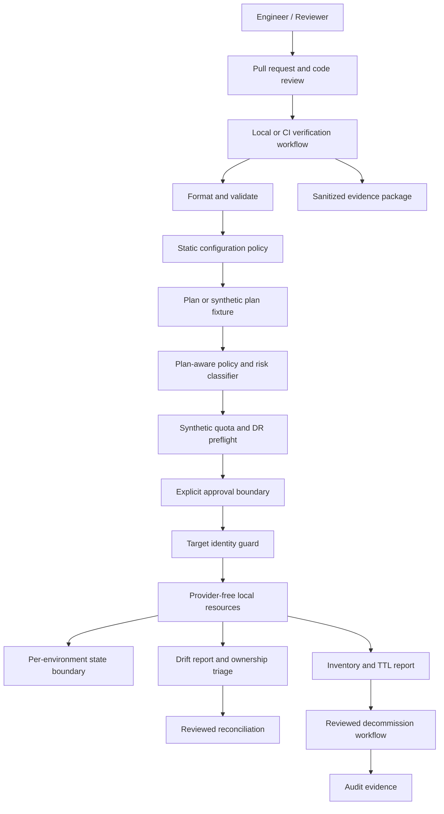
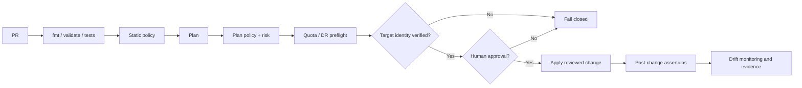
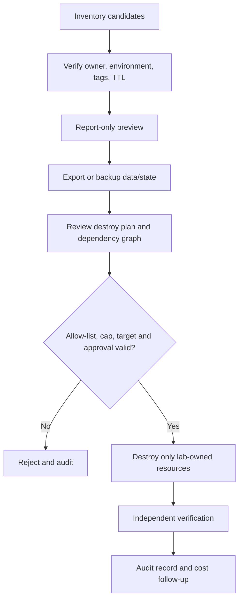

# Governed Multi-Environment Data Platform Infrastructure

> **Project type:** Guided capstone and implementation manual  
> **Stage:** Stage 2E — Production DevOps & Platform Engineering  
> **Requested target:** `Stage 2E — Production DevOps & Platform Engineering/07-Advanced-Infrastructure-as-Code-and-Cloud-Operations/Projects/01-governed-multi-environment-data-platform-infrastructure.md`  
> **Actual tree path found in the inspected roadmap copy:** `Stage 2E — Production DevOps & Platform Engineering/02-Advanced-Infrastructure-as-Code-and-Cloud-Operations/Projects/01-governed-multi-environment-data-platform-infrastructure.md`  
> **Estimated effort:** 35–55 focused hours, depending on optional integrations and learner familiarity  
> **Required cost:** zero by default; no real cloud account or paid service is required  
> **Default execution boundary:** provider-free local IaC and synthetic fixtures; optional local integrations are staged separately  
> **Review status:** generated from the available syllabus prompt and roadmap excerpt; implementation examples are statically reasoned about, not executed here  
> **Version discipline:** placeholders are deliberate. Select and record verified tool versions before running commands.

## Abstract

A data/ML team has accumulated infrastructure created manually and from one engineer’s laptop. Its infrastructure-as-code (IaC) state is local, development and production configuration are entangled, a public object-storage location was discovered by a customer, a launch exhausted a service quota, “temporary” resources remained after the original need ended, and a destroy operation selected the wrong environment. The team needs more than reusable configuration: it needs explicit ownership, environment boundaries, a reviewable change process, policy enforcement, drift visibility, quota/capacity pre-flight, safe decommissioning, tested recovery, and evidence that controls work.

This capstone builds a **local-first governed IaC platform** for `dev`, `staging`, and `prod`. The required path uses provider-free resources and synthetic data so it cannot accidentally create real cloud resources. Optional LocalStack/MinIO, containers, Terratest, and Crossplane exercises are isolated and labelled. A passing local test is evidence only for the behavior that test actually exercises; it is not proof of real-cloud IAM, organization policy, networking, quota, billing, or regional behavior.

The project is deliberately designed around a few operational truths:

1. **State describes what the IaC tool believes it manages, not every object that exists.**
2. **A plan is a prediction, not a promise.** Review deletion, replacement, unknown values, dependencies, and blast radius.
3. **IaC controls changes; identity, environment boundaries, and policy constrain damage.**
4. **Deletion is a first-class risk.** Preserve data, verify ownership, and independently verify cleanup.
5. **Secrets can appear in state, plans, logs, environment variables, diagnostic output, and CI artifacts.**
6. **A green test means only that the tested property passed on the tested substrate.**
7. No production mutation is part of the required path.

## Table of contents

- [1. Executive overview](#1-executive-overview)
- [2. Learning outcomes and definition of done](#2-learning-outcomes-and-definition-of-done)
- [3. Source discrepancies and assumptions](#3-source-discrepancies-and-assumptions)
- [4. Architecture and trust boundaries](#4-architecture-and-trust-boundaries)
- [5. Threat model and failure modes](#5-threat-model-and-failure-modes)
- [6. Concept primer](#6-concept-primer)
- [7. Requirements and syllabus mapping](#7-requirements-and-syllabus-mapping)
- [8. Resource budget and setup](#8-resource-budget-and-setup)
- [9. Complete project tree](#9-complete-project-tree)
- [10. Eight implementation milestones](#10-eight-implementation-milestones)
- [11. Guided implementation and complete starter artifacts](#11-guided-implementation-and-complete-starter-artifacts)
- [12. Test strategy and defect corpus](#12-test-strategy-and-defect-corpus)
- [13. Security and policy review](#13-security-and-policy-review)
- [14. Operational runbooks and recovery drills](#14-operational-runbooks-and-recovery-drills)
- [15. Alternative-tool evidence and ADRs](#15-alternative-tool-evidence-and-adrs)
- [16. Evidence collection and measurement](#16-evidence-collection-and-measurement)
- [17. Grading rubric](#17-grading-rubric)
- [18. Troubleshooting guide](#18-troubleshooting-guide)
- [19. Stretch goals](#19-stretch-goals)
- [20. Self-review and final acceptance checklist](#20-self-review-and-final-acceptance-checklist)
- [21. Claim Register](#21-claim-register)
- [22. Ten-pass authenticity audit](#22-ten-pass-authenticity-audit)
- [23. Human verification checklist](#23-human-verification-checklist)
- [24. Known limitations and sign-off](#24-known-limitations-and-sign-off)

---

## 1. Executive overview

### 1.1 Business problem

The incident scenario combines six different classes of failure. They must not be collapsed into “Terraform problems”:

| Observed failure | Root-control gap | Capstone control | Evidence expected |
|---|---|---|---|
| State is a local laptop file | No shared ownership, lock discipline, backup or recovery test | Separate state boundaries; recovery drill; lock runbook | Sanitized state metadata, recovery timeline, clean post-restore plan |
| Dev and prod share configuration | Environment identity is implicit | Distinct `live/{dev,staging,prod}` inputs and target assertions | Negative test proving wrong environment is rejected |
| Customer finds public storage | Security review is late or missing | Static configuration scan plus plan-aware policy | Planted public-storage defect is blocked before apply |
| Launch exhausts a quota | Capacity was not preflighted; DR parity was not checked | Synthetic quota/headroom and DR parity checks | Fixture, calculator output, negative test |
| Temporary resources remain for months | No ownership/TTL inventory or governed cleanup | Report-only orphan inventory, allow-list, cap, audit log | Candidate report, rejected candidates, cleanup verification |
| `destroy` targets the wrong environment | Target, backend, identity and approval are not independently verified | Fail-closed guard; reviewed destroy plan; approval evidence | Wrong-target negative test and decommission packet |

The project does not assume that one tool can solve all six problems. Terraform/OpenTofu provides a desired-configuration workflow and state model. CI gates enforce process. Identity and account separation limit authority. Policy catches classes of unsafe configuration and planned changes. Synthetic preflight catches capacity assumptions. Inventory and ownership records help identify potential orphans. Tests provide evidence. Runbooks organize response under failure.

### 1.2 Goals

- Reproducible, typed IaC for three environments.
- Explicit state ownership and a documented remote-state design.
- Fail-closed target guard that defaults to local-only.
- A reviewable plan-to-approval-to-apply workflow.
- Two policy layers with unit tests and expiring waivers.
- Synthetic drift, quota, and DR-parity exercises.
- Report-only decommission/orphan/TTL tools with allow-lists and deletion caps.
- Configuration-management idempotency demonstration.
- Native IaC tests, a defect corpus, a Terratest plan/fallback, and upgrade/cleanup coverage.
- Evidence-backed operational review and an honest limitations register.

### 1.3 Non-goals

This capstone does **not** establish real-cloud compliance, reproduce an organization’s service-control policies (SCPs), prove provider IAM enforcement, or validate production billing/quotas. It is not a full data platform with a production database, broker, network, Kubernetes cluster, and object-storage service all running simultaneously. The database, queue, registry, and network are represented as typed platform contracts or local fixtures in the required path. Real-cloud testing is optional and excluded from acceptance criteria.

### 1.4 Definition of done

The capstone is complete only when the learner can show:

1. `make verify` refuses an ambiguous or non-local target.
2. `make fmt`, `make validate`, policy tests, native tests, script tests, and the full local verification workflow produce an evidence report.
3. Dev, staging, and prod have separate environment inputs and state keys/designs; no shared state boundary is silently reused.
4. The plan-risk classifier rejects malformed input, replacements/deletions requiring extra review, and environment mismatches.
5. Public-storage and other important policy defects are caught by tests.
6. Expired or malformed waivers fail closed.
7. Drift is detected, classified, and reconciled only after ownership and blast radius are reviewed.
8. Synthetic quota exhaustion and DR mismatch are blocked before change approval.
9. Decommission defaults to report-only and refuses missing ownership, non-allow-listed IDs, expired TTLs, malformed inputs, and over-cap candidate sets.
10. A state recovery drill ends with integrity checks and a clean or explicitly explained plan.
11. Every result is labeled as executed evidence or illustrative output.
12. The final review records open gaps instead of treating local tests as proof of cloud parity.

### 1.5 Suggested pace

- **Six-week pace:** 5–8 hours/week, with one milestone per week and a final audit in week six.
- **Ten-week pace:** 3–5 hours/week, split the policy, recovery, and decommission milestones into separate weeks.
- Optional integrations are time-boxed. If a heavy optional component threatens the laptop budget, skip it and complete the provider-free fallback.

---

## 2. Learning outcomes and definition of done

After completing this project, the learner can:

- **Explain** the difference between configuration, state, and actual infrastructure.
- **Design** small state boundaries and state recovery procedures.
- **Implement** typed modules and environment-specific inputs without embedding credentials.
- **Classify** plan risk from creates, updates, deletes, replacements, unknowns, and target identity.
- **Demonstrate** environment guardrails and policy precedence.
- **Test** static and plan-aware policy rules, including malformed/expired waivers.
- **Calculate** synthetic quota headroom and detect DR parity gaps.
- **Detect and triage** synthetic drift without assuming all drift should be overwritten.
- **Operate** report-only cleanup and decommission controls with ownership, allow-lists, caps, and audit logs.
- **Compare** Terraform/OpenTofu, Terragrunt, Pulumi, Ansible, and Crossplane without claiming they are interchangeable.
- **Collect** evidence that connects each claimed control to an observable test or review artifact.
- **Defend** the architecture, risk controls, recovery boundaries, and residual limitations in a design review.

### Gate-in prerequisites

The learner should already be able to use Git, shell basics, YAML/JSON, CI concepts, container fundamentals, and a basic IaC plan workflow. The curriculum assumes completion of Stage 2E modules M01–M06 and cloud/IaC fundamentals. If the learner cannot explain a plan, state, least privilege, and the difference between a local lab and a real cloud account, pause and review prerequisites first.

### Gate-out

The project passes when required controls are implemented and their negative paths are demonstrated. A large codebase with no evidence is not a pass. A green command with no target assertion is not a pass. A successful provider-free test does not validate cloud-specific behavior.

---

## 3. Source discrepancies and assumptions

### 3.1 Path discrepancy

The supplied project prompt names the module path `07-Advanced-Infrastructure-as-Code-and-Cloud-Operations/`. The inspected roadmap copy lists the same module as `02-Advanced-Infrastructure-as-Code-and-Cloud-Operations/`. The requested target filename is retained exactly; this generated standalone artifact does not rename directories or alter the roadmap. Before placing it in a repository, follow the tree version that is authoritative for that repository checkout.

### 3.2 Source availability

The available authoritative syllabus-generation prompt was inspected, including its Unit 14 capstone requirements and tooling rules. A roadmap excerpt was inspected and confirms the `02-...` path in that copy. The actual repository checkout and the full sibling lesson contents were not available for direct local inspection in this execution. Therefore:

- Unit mappings below are based on the syllabus prompt.
- Links to sibling lessons are not asserted unless their path and name are visible in the supplied tree.
- Technical syntax marked `[VERIFY]` must be checked against the pinned versions selected by the learner.
- This document does not claim that its starter code has been executed.

### 3.3 Tooling decision record

The syllabus distinguishes Terraform as Core and OpenTofu as Awareness in the broader tooling map, while teaching OpenTofu at working depth in the dedicated module. The capstone uses `<iac>` to mean the selected engine and requires the learner to record the actual engine/version in `versions.txt`. Choose one engine for the required path. Do not run Terraform and OpenTofu against the same working directory/state as an informal compatibility test.

`[ASSUMPTION]` The starter path is provider-free first, because it is the most predictable way to satisfy the zero-cost safety boundary. LocalStack/MinIO, Ansible containers, Terratest, and Crossplane are staged optional tracks.

### 3.4 Classification vocabulary

Every capability should be labelled as one of:

1. **Implemented and tested locally** — a command/test actually ran on the stated local substrate.
2. **Simulated with synthetic fixtures** — behavior is represented by fixture data and deterministic logic.
3. **Explained but not enforced by the local substrate** — architecture/policy intent is documented but no equivalent runtime boundary exists locally.
4. **Optional real-cloud validation** — outside the required project; requires a separate approved account, identity, cost plan, and current documentation.

Do not upgrade a capability’s classification without evidence.

---

## 4. Architecture and trust boundaries

### 4.1 Context view



**Interpretation:** the default graph ends at provider-free local resources. The diagram’s “approval” stage is a workflow control, not a magical security boundary by itself. Real enforcement depends on repository permissions, identity permissions, environment protections, and the actual CI platform. In the local path, approval is represented by an explicit human checkpoint and evidence.

### 4.2 Change lifecycle



A plan should be regenerated if the underlying configuration, state, provider behavior, or target changes in a way that makes the reviewed plan stale. Saved-plan behavior and backend locking details are engine/version-sensitive; verify them before relying on exact CLI semantics.

### 4.3 Decommission lifecycle



An object is not safe to delete just because it looks old or is absent from state. “Orphan” means “ownership and desired lifecycle are unclear,” not “approved for deletion.”

### 4.4 State ownership layout

| Boundary | Example key/directory | Owns | Why separate |
|---|---|---|---|
| Dev data foundation | `dev/data-foundation` | Dev storage/metadata/messaging contract | Dev experiments should not share a lock or lifecycle with production |
| Staging data foundation | `staging/data-foundation` | Staging equivalents | Release verification has independent change cadence |
| Prod data foundation | `prod/data-foundation` | Production contract | Highest impact; distinct identity and approval |
| Shared governance fixtures | `governance/fixtures` | Synthetic quota, policy, and ownership data only | Does not own deployed infrastructure |
| Optional Kubernetes platform | separate kind cluster and manifests | Local test objects only | Never share ownership of a resource with Terraform/OpenTofu |

The provider-free starter uses local state files in separate environment directories. This teaches isolation but **does not implement a production remote backend**. The optional backend lab explains how to move to a versioned S3-compatible backend and why backend locking arguments are `[VERSION-SENSITIVE]`. Never call a local file “remote state.”

### 4.5 Trust-boundary table

| Asset / identity | Trust boundary | Minimum control | Verification |
|---|---|---|---|
| Developer workstation | Local process and filesystem | No cloud credentials in required path; protect state/plan files | `git status --ignored`, secret scan, permissions review |
| Environment selection | CLI inputs and directory | Allow-list environment; reject unknown names | Negative tests for `prod-ish`, blank, typo |
| State | Backend and local filesystem | Per-environment ownership, backups, restricted read/write | Recovery drill; access design review |
| Plan | Local/CI artifact | Treat as sensitive; short retention; provenance and target binding | Artifact review and redaction checklist |
| Static policy | Pre-merge code | Public exposure and required metadata checks | Planted-defect tests |
| Plan policy | Planned actions and values | Block destructive/high-risk changes pending review | Synthetic plan fixtures |
| CI identity | Runner and environment approval | Least privilege; separate plan/apply authority where supported | Workflow permission review |
| Cleanup process | Inventory and candidate list | Report-only default, allow-list, TTL, deletion cap | Unsafe-input tests |
| Ansible control node | SSH/container access | Least privilege, no secrets in output, `no_log` where relevant | Idempotency evidence and log review |
| Crossplane management cluster | Kubernetes API/controller/provider identity | Dedicated RBAC, package provenance, deletion review | Optional lab status/events and RBAC inspection |

### 4.6 Data-platform resource model

The running example represents three environments and these contracts:

- Object-storage zones: `raw`, `curated`, and `model-artifacts`.
- Metadata database: a contract describing engine, retention, access classification, and backup expectations; the required path does not provision a real database.
- Queue/topic: a contract for event delivery and retention; the required path uses synthetic metadata.
- Container registry: a reference only, not an image push.
- Network boundary: a documented policy intent and synthetic checks; no local claim of cloud firewall enforcement.
- Kubernetes: a consumer boundary and optional kind-based lab, not a required full cluster.
- Tags/labels: environment, owner, data classification, cost centre, TTL, and managed-by.

Environment assumptions differ intentionally:

| Property | Dev | Staging | Prod |
|---|---|---|---|
| Data classification | Synthetic/non-sensitive | Synthetic release candidate | Production classification is modelled, not provisioned |
| Retention | Short synthetic window | Release-test window | Longer retention requirement |
| Capacity | Small synthetic capacity | Representative test capacity | Higher synthetic capacity plus DR check |
| Change approval | Peer review | Release owner | Explicit elevated approval |
| State access | Developer-lab scope | Release-team scope | Restricted production role in the design only |
| Real-cloud mutation | Prohibited in required path | Prohibited in required path | Prohibited in required path |

### 4.7 Capability-to-evidence matrix

| Capability | Classification in required path | Evidence | Does not prove |
|---|---|---|---|
| Environment allow-list | Implemented and tested locally | Wrong-target test exits non-zero | Cloud account identity enforcement |
| State separation | Implemented locally using separate directories | Tree inspection and state metadata | Remote backend durability or locking |
| Remote backend with versioning/locking | Design and optional local emulator lab | Backend config review and recovery drill if run | AWS/other cloud parity |
| Module input validation | Implemented locally | Native tests and `validate` | Runtime security of a cloud resource |
| Static policy | Implemented if Checkov is installed; otherwise fail-closed required check | Scan output and defect matrix | Runtime IAM or org-policy enforcement |
| Plan-aware policy | Synthetic fixture parser in core path | Unit tests for action/environment cases | Every engine’s real plan JSON schema unless fixture adapter is verified |
| Quota preflight | Simulated with synthetic fixtures | Capacity report and negative tests | Provider quota values or reservations |
| Drift | Simulated with desired/observed fixture comparison | Drift report and reconciliation decision | Complete detection of out-of-band cloud changes |
| Decommission candidate safety | Implemented with synthetic inventory | Report-only report and unsafe-case tests | Provider-side delete permissions |
| Ansible idempotency | Optional container lab | Two-run recap captured by learner | Idempotency of untested roles/hosts |
| Terratest | Optional; must be marked unexecuted if not run | Go test output and cleanup evidence | Provider parity beyond the fixture |
| Crossplane | Optional architecture/lab | CRD/controller/status evidence if run | Cloud provisioning from in-cluster objects alone |

---

## 5. Threat model and failure modes

### 5.1 Assets

- State and state history.
- Data objects and retention/backup expectations.
- Environment identity and provider endpoint selection.
- CI identity and approval authority.
- Saved plans, plan JSON, logs, and evidence artifacts.
- Policy rules and waiver records.
- Ownership inventory and TTL metadata.
- Local container/cluster resources and their cleanup.
- Tool/provider/module version selections.

### 5.2 Threat actors and failure sources

The threat model includes accidental operator error, compromised developer workstation, overly privileged CI identity, malicious or careless pull request, stale or tampered plan artifact, provider/module supply-chain issue, drift caused by manual changes, malformed inventory, expired waiver, and controller/operator deletion semantics misunderstood by the team. It does not assume a sophisticated attacker can be defeated by a single static scanner.

### 5.3 Failure-mode analysis

| Failure mode | Detection | Containment | Recovery | Prevention |
|---|---|---|---|---|
| Wrong environment selected | Target guard and environment assertion | Stop before state-changing command | Re-run with verified local target; inspect any evidence of mutation | Allow-list, separate directories/identities, review |
| State lock appears stuck | Lock metadata, process/pipeline check | Freeze concurrent writers | Confirm no active writer before lock recovery | CI concurrency and lock timeout |
| State appears corrupt | Parse/metadata errors, unexpected plan | Stop all writes; preserve copies | Restore known-good version and reconcile against reality | Versioning, backups, restore drills |
| Destructive plan | Risk classifier and human review | Reject plan | Re-plan after root cause is understood | Plan review, policy, protected approval |
| Public-storage defect | Static scan and plan policy | Block change | Fix desired config; re-run tests/plan | Secure defaults and regression test |
| Quota exhausted | Synthetic preflight or actual alert | Reduce/sequence requested change | Re-plan with capacity or quota request | Headroom policy and DR parity |
| Orphan cleanup false positive | Ownership/tag/allow-list checks | Report only; reject ambiguous candidate | Manual inventory reconciliation | Owner tags, TTL policy, audit trail |
| Secret enters plan/log | Secret scan and artifact review | Revoke/rotate if real; restrict artifact | Remove exposure path and assess scope | No secrets in fixtures; short retention |
| Provider upgrade changes behavior | Lockfile and compatibility tests | Freeze upgrade | Roll back tool/provider within supported constraints | Upgrade matrix and pinned versions |
| Crossplane deletion cascade | XR/claim owner and deletion policy review | Pause deletion and protect data | Restore from backup/recreate according to ownership model | Separate ownership, policy and deletion tests |

### 5.4 Abuse-case checklist

- Can a blank or misspelled environment silently default to prod? It must not.
- Can a developer pass a remote endpoint while the local lab thinks it is safe? The guard must reject it.
- Can a plan artifact from one environment be applied to another? The pipeline design must bind plan, environment, state, and commit.
- Can a public-storage finding be suppressed globally? Waivers must be scoped and expire.
- Can a malformed inventory produce an empty candidate list and then trigger broad deletion? Cleanup must fail closed.
- Can a state restore overwrite newer legitimate work? Recovery runbook requires a freeze and state/reality reconciliation.
- Can local emulation be presented as proof of cloud controls? Capability matrix prevents that overclaim.

---

## 6. Concept primer

### 6.1 Configuration, plan, state, and reality

Configuration is the declared desired model. A plan describes proposed operations based on configuration, current state, provider observations, and tool semantics. State maps managed resource addresses to known identities/attributes. Reality is what actually exists in the target system. These are related but not interchangeable.

```text
Configuration ──┐
                ├──> Plan / diff ──review + policy + approval──> Apply
State ──────────┤                                           │
Provider read ──┘                                           v
                                                   State is updated
                                                         │
                                                         v
                                                Actual infrastructure
                                           (may still drift or be partial)
```

A clean plan means no changes are proposed by that run under the tool’s observations and current configuration. It does not prove there are no unmanaged resources, no hidden drift, no external side effects, or no defects outside the tool’s visibility.

### 6.2 State and locking

State allows the IaC engine to connect resource addresses with real object identifiers and to retain metadata. A local backend is simple but poorly suited to collaborative production because sharing, access control, history, and locking must be solved separately. A remote backend can improve coordination and recovery, but backend locking support and configuration vary by engine/version. A lock prevents conflicting writers only within the scope of the locking mechanism; it is not an account/environment boundary.

Never hand-edit state as routine maintenance. Preserve the original file, freeze writers, inspect metadata, restore or repair using supported commands, and compare with actual resources before applying again. `sensitive = true` controls display behavior in some contexts; it does not guarantee that a value is absent from state or saved plans.

### 6.3 Modules and environment reuse

A module is a reusable unit with typed inputs and declared outputs. Reuse should standardize safe defaults while allowing deliberate environment differences. Do not hide environment identity inside implicit defaults. Keep provider configuration at the root/live layer rather than inside general reusable modules. Pin provider selections and use a deliberate lockfile policy. `.terraform.lock.hcl` records provider selections/checksums; it does not pin remote module versions.

### 6.4 Drift and import

Drift is a mismatch between desired configuration, state, and observed reality. It may be intentional, malicious, or accidental. Detect first, classify ownership and impact, then choose whether to reconcile configuration, import a pre-existing object, or restore the intended setting. Never blindly overwrite a manual change before asking whether it was an emergency mitigation.

Import connects an existing object to an IaC resource address; it does not automatically produce a complete, correct configuration. Confirm the object identity and address, inspect the resulting state, write configuration, and require a clean/reasonable plan before any apply. Exact import syntax is engine/resource/version-sensitive.

### 6.5 Plans, approval, and risk

Risk is not just the number of changed resources. A single replacement of a data store can be higher risk than many additive metadata resources. Review action, before/after values, replacement indicators, unknown values, dependencies, data-loss possibility, environment, identity, and recovery. A reviewed plan can become stale if configuration/state/target changes. Apply the reviewed artifact only when its provenance and target are still valid; exact saved-plan mechanics are `[VERSION-SENSITIVE]`.

### 6.6 Environment boundaries

Prefer separate accounts/projects/subscriptions and identities for strong real-cloud isolation. Distinct directories and state backends help organize changes but are not substitutes for authorization. Workspaces are not security boundaries. Pipeline approvals are not a substitute for least-privilege identities. `prevent_destroy` can be a useful guardrail but is not an authorization boundary or backup strategy.

### 6.7 Policy layers

- **Static configuration scan:** finds unsafe patterns visible in source before a plan. It may miss values computed only at plan/apply time.
- **Plan-aware policy:** evaluates proposed actions and known values. It depends on the plan schema and cannot reason about every runtime property.
- **Identity/account controls:** enforce what the caller is permitted to do outside the code-review system.
- **Runtime controls:** service-side policy, organization policy, admission controls, and monitoring can constrain behavior after deployment.
- **Human approval:** authorizes a particular risk decision; it does not make a technically unsafe plan safe.

Layering is defense in depth. A passing scan is not a compliance certification.

### 6.8 Quota and capacity pre-flight

A quota is a constraint on a service or resource category; capacity is the amount actually available for the intended workload. The capstone uses synthetic limits and usage. For each resource class:

`headroom = synthetic_limit - current_usage - planned_delta`

Reject missing/invalid values, negative headroom, or DR parity gaps. This does not request or query real provider quotas. Real quota discovery must use the chosen provider’s current official tooling and permissions in an optional, separately governed exercise.

### 6.9 Decommissioning and orphans

A safe decommission process establishes owner, environment, dependency graph, data preservation needs, and a reviewed destroy plan before deleting. Orphan discovery compares an inventory of actual candidates with an ownership/desired inventory. A candidate is not automatically deletable. Require report-only output by default, an explicit allow-list, TTL expiry, a deletion cap, an expected environment, and an audit record. Independently verify after cleanup.

### 6.10 Ansible and immutable images

Ansible is configuration management: it applies desired host configuration to hosts. A good idempotency test runs the same playbook twice and observes that the second run produces no unintended changes. `no_log` suppresses selected task output but does not protect every upstream/downstream location. Image baking and runtime configuration are complementary; choose based on change frequency, reproducibility, startup requirements, and rollback model.

### 6.11 Testing pyramid

- Syntax/format checks catch malformed configuration.
- Native IaC tests exercise module inputs and assertions without necessarily provisioning external services.
- Policy unit tests catch explicit rule violations.
- Script tests exercise fail-closed parsing and safety logic.
- Integration tests exercise a selected substrate and its real behaviors.
- Upgrade tests detect compatibility changes.
- Operational drills test runbooks, evidence, and recovery under controlled failure.

Do not let a text-matching test substitute for a behavioral assertion when behavior can be tested.

### 6.12 Crossplane boundary

Crossplane adds Kubernetes controllers and declarative APIs for infrastructure. It is a distinct reconciliation and ownership model, not merely another Terraform syntax. CRDs, providers, compositions/functions, RBAC, package versions, status conditions, and deletion semantics are version-sensitive. Never allow Terraform/OpenTofu and Crossplane to manage the same external object simultaneously without a deliberately designed ownership transition. The required capstone can be completed without installing Crossplane.

---

## 7. Requirements and syllabus mapping

| Syllabus unit | Capstone implementation/evidence |
|---|---|
| Unit 1 — State, backends, locking, recovery | Per-environment state separation, state backup/recovery drill, lock runbook, remote backend design notes |
| Unit 2 — Modules and reuse | Typed reusable modules, outputs, environment-specific configuration, version/changelog policy |
| Unit 3 — Migration, import, drift | Synthetic drift fixtures, import decision procedure, ownership triage and clean-plan gate |
| Unit 4 — Safe plans and approval | Risk classifier, plan review template, approval sequence, stale-plan/provenance discussion |
| Unit 5 — Account/environment boundaries | Environment assertion, identity design, boundary tests, ADR |
| Unit 6 — Policy as code | Static and plan-aware policy, unit tests, waivers, precedence matrix |
| Unit 7 — Quotas and governance | Synthetic quota fixtures, headroom calculator, DR parity check, tag audit |
| Unit 8 — Decommissioning | Ownership inventory, report-only orphan/TTL scripts, allow-list, cap, audit log |
| Unit 9 — Alternatives | Terraform/OpenTofu divergence record, Terragrunt or compatibility proof, Pulumi memo |
| Unit 10 — Ansible | Optional local-host role, inventory fixture, second-run idempotency, `no_log` demonstration |
| Unit 11 — Testing | Native tests, defect corpus, optional Terratest, upgrade test, janitor test |
| Unit 12 — Crossplane | Architecture comparison, optional local-only lab, ownership/deletion semantics memo |

### Requirements traceability

| Requirement | Minimum evidence |
|---|---|
| Bootstrap and `versions.txt` | Explicit version placeholders replaced with verified values; target guard |
| Remote state per environment | Backend design/config, environment keys, versioning/locking documentation, recovery drill |
| Reusable storage/metadata/messaging | Module contracts and environment-specific inputs; public-access/security intent documented |
| Boundaries | Wrong-environment negative test; no shared prod/dev state |
| CI safe-change flow | Workflow or equivalent local script; least-privilege permissions; concurrency and approval model |
| Risk analyzer | No-op/add/update/replace/delete/unknown/invalid/environment-mismatch fixtures |
| Policy | Static scan plus plan-aware/native layer; ≥8 rules tested; expiry-enforced waiver |
| Drift/import | Fixture diff, classification, import checklist and post-import plan |
| Quota/DR | Synthetic primary/DR fixtures; available/exhausted/missing/mismatch tests |
| Cleanup | Report-only default, allow-list, cap, ownership and TTL checks, audit log |
| Ansible | Two local disposable hosts or documented alternative; second-run no-op evidence |
| Tests | Native tests, ≥8 planted defects, Terratest or documented fallback, upgrade and janitor tests |
| Alternatives | Tool ADR plus compatibility/divergence evidence; Pulumi comparison memo |
| Command interface | Required Make targets, explicit side-effect classification, fail-closed `verify` |
| Docs | Six ADRs, six incident runbooks, evidence index, measurements |
| Scope | Only this capstone file is generated as the artifact; learner creates project files in a scratch directory |

---

## 8. Resource budget and setup

### 8.1 Baseline machine

Assume approximately 4 CPU cores, 8 GB RAM, and 30 GB free disk. Exact resource usage varies by versions and operating system. Measure the actual machine; do not treat this estimate as a guarantee.

| Track | Default | Resource guidance | Can run alongside |
|---|---|---|---|
| Provider-free IaC + scripts | Required | Lowest footprint | Yes |
| Checkov/OPA/Conftest | Required policy layer; install as available | Python/CLI dependencies may consume disk | Usually, but install one toolchain at a time |
| LocalStack or MinIO | Optional | Container and data volume | Do not combine with kind/Crossplane if memory is tight |
| Ansible against containers | Optional | Docker plus two small disposable containers | Run after stopping optional LocalStack if needed |
| Terratest | Optional | Go toolchain and selected local fixture | Keep provider-free fallback available |
| kind + Crossplane | Optional stretch | Control plane and controllers can be memory-heavy | **Do not run simultaneously with LocalStack or other heavy stacks** |
| Real cloud | Not required | Potential charges and credential risk | Outside required acceptance |

### 8.2 Tool inventory

Do not use the placeholders below as executable version numbers. Before running the project, choose versions from official installation/release documentation and write the exact installed values to `versions.txt`.

| Tool | Purpose | Required? | Verification |
|---|---|---:|---|
| Terraform or OpenTofu | HCL, plan/state workflow | Yes, choose one | `<iac> version` |
| Git | Version control/evidence | Yes | `git --version` |
| Make | Unified command interface | Yes or equivalent shell runner | `make --version` |
| Python 3 | Safety scripts and tests | Yes | `python3 --version` |
| Checkov | Static configuration scan | Yes for full policy milestone; use fail-closed documented alternative if unavailable | `checkov --version` |
| OPA/Conftest | Plan-aware policy | Yes for full policy milestone | `opa version`, `conftest --version` |
| Go | Terratest | Optional | `go version` |
| Ansible | Host configuration | Optional staged track | `ansible --version` |
| Docker/Podman | Optional local services/hosts | Optional | selected runtime version |
| LocalStack or MinIO | S3-compatible backend exercises | Optional | selected service health/version |
| kind/kubectl/Helm/Crossplane | Kubernetes-native optional track | Optional | each tool’s version command |

**Official documentation to consult:** Terraform CLI/language/backend/state/module/testing docs; OpenTofu install and language/state docs; Checkov installation and policy docs; OPA/Rego and Conftest docs; Python standard library docs; Ansible playbook/inventory/best-practice docs; Terratest docs; LocalStack or MinIO current setup docs; Kubernetes/kind docs; Crossplane current install/composition docs. Exact URLs and current version compatibility must be verified rather than guessed.

### 8.3 Record your versions

Illustrative path: `versions.txt`

```text
# File: versions.txt
# Replace placeholders with versions actually verified on this machine.
iac_engine=<terraform-or-opentofu>
iac_version=<VERIFIED_IAC_VERSION>
provider_lock_file_policy=commit-provider-lockfile
python=<VERIFIED_PYTHON_VERSION>
checkov=<VERIFIED_CHECKOV_VERSION_OR-not-installed>
opa=<VERIFIED_OPA_VERSION_OR-not-installed>
conftest=<VERIFIED_CONFTEST_VERSION_OR-not-installed>
go=<VERIFIED_GO_VERSION_OR-not-installed>
ansible=<VERIFIED_ANSIBLE_VERSION_OR-not-installed>
container_runtime=<VERIFIED_RUNTIME_VERSION_OR-not-installed>
localstack_or_minio=<VERIFIED_VERSION_OR-not-installed>
kind=<VERIFIED_KIND_VERSION_OR-not-installed>
kubectl=<VERIFIED_KUBECTL_VERSION_OR-not-installed>
helm=<VERIFIED_HELM_VERSION_OR-not-installed>
crossplane=<VERIFIED_CROSSPLANE_VERSION_OR-not-installed>
last_verified=<YYYY-MM-DD>
```

### 8.4 Safe setup procedure

1. Create a **scratch directory outside the target repository**.
2. Confirm no cloud profile or endpoint is implicitly selected for the required path.
3. Install the selected IaC engine and record its version.
4. Install Python 3 and Make; add optional tools only when their milestone begins.
5. Copy the illustrative files from this document into their stated scratch paths.
6. Run format/validation/tests before any local apply.
7. Keep generated state, plans, logs, temporary credentials, and provider caches out of Git.
8. If any command displays a non-local account, endpoint, or target that you do not understand, stop. Do not proceed by guessing.

Illustrative commands (read-only):

```bash
# File: setup-checks.sh
set -euo pipefail
printf 'PWD=%s\n' "$PWD"
command -v git
git --version
command -v python3
python3 --version
command -v make
make --version
command -v tofu || true
command -v terraform || true
```

Expected output is machine-specific and should be recorded, not copied from this document. These commands only inspect tool availability; they do not establish cloud isolation by themselves.


## 9. Complete project tree

The following is the intended learner-created tree in a scratch directory. Optional directories are marked `optional`; files are shown inline in this guide in the implementation sections. This tree is intentionally modest enough for the laptop-first path.

```text
governed-data-platform/
├── README.md
├── Makefile
├── .gitignore
├── versions.txt
├── main.tf
├── variables.tf
├── outputs.tf
├── terraform.tf
├── environments/
│   ├── dev.tfvars
│   ├── staging.tfvars
│   └── prod.tfvars
├── modules/
│   └── environment-contract/
│       ├── main.tf
│       ├── variables.tf
│       ├── outputs.tf
│       └── tests/
│           └── contract.tftest.hcl
├── policy/
│   ├── static-policy.md
│   ├── plan.rego
│   ├── plan_test.rego
│   ├── waivers.json
│   └── waiver_check.py
├── scripts/
│   ├── target_guard.py
│   ├── plan_risk.py
│   ├── drift_report.py
│   ├── quota_preflight.py
│   ├── inventory_diff.py
│   ├── ttl_cleanup.py
│   └── audit.py
├── fixtures/
│   ├── plan-noop.json
│   ├── plan-add.json
│   ├── plan-update.json
│   ├── plan-replace.json
│   ├── plan-delete.json
│   ├── plan-invalid.json
│   ├── quota-primary.json
│   ├── quota-dr.json
│   ├── inventory.json
│   ├── desired-inventory.json
│   └── drift-observed.json
├── tests/
│   ├── test_scripts.py
│   └── defect-corpus.md
├── ci/
│   └── workflow.example.yml
├── ansible/                         # optional
│   ├── inventory.ini
│   └── baseline.yml
├── terratest/                       # optional
│   ├── go.mod
│   └── main_test.go
├── crossplane/                      # optional, staged separately
│   └── README.md
├── docs/
│   ├── architecture.md
│   ├── fidelity-matrix.md
│   ├── policy-precedence.md
│   ├── tool-choice-adr.md
│   ├── ADRs/
│   │   ├── 001-state-layout.md
│   │   ├── 002-module-versioning.md
│   │   ├── 003-environment-isolation.md
│   │   ├── 004-policy-layering.md
│   │   ├── 005-change-approval.md
│   │   └── 006-tool-choice.md
│   └── runbooks/
│       ├── state-lock-or-corruption.md
│       ├── destructive-plan.md
│       ├── public-storage-policy.md
│       ├── production-drift.md
│       ├── quota-exhaustion.md
│       └── wrong-environment.md
└── evidence/
    ├── README.md
    └── measurements-template.md
```

**Tree policy:** optional integrations do not silently pass when missing. The required `make verify` must fail with a clear explanation if a required security tool or required check is missing. A learner may use a documented fallback for the required provider-free path, but must not report that a Checkov/OPA/Terratest/Ansible/Crossplane check ran when it did not.

---

## 10. Eight implementation milestones

Estimated times are for a learner who has completed the prerequisites. The estimates are planning aids, not performance benchmarks.

### Milestone 1 — Understand the failure scenario and design boundaries

**Estimate:** 3–5 hours.  
**Prerequisites:** sections 1–6.

**Tasks, in order**

1. Draw the architecture and trust boundaries.
2. Write a short threat model covering state, environment selection, plans, policy, capacity, cleanup, and secrets.
3. Create the environment matrix for dev/staging/prod.
4. Draft ADRs 001–006 from section 15.
5. Classify each capability using the four labels in section 3.4.

**Deliverables:** `docs/architecture.md`, ADR drafts, `docs/fidelity-matrix.md`, environment matrix.

**Positive checks:** every state boundary has an owner; prod is not protected only by a workspace name; local provider-free path has no cloud provider block.

**Negative checks:** unknown environment is rejected; a resource without an owner is not treated as safe to delete.

**Evidence:** architecture diagram, trust-boundary table, threat-model notes.

**Common failures:** drawing controls that are not implemented; describing LocalStack as equivalent to cloud; making approval the only boundary.

**Cleanup:** no infrastructure is created.

**Exit gate:** reviewer can point from each failure mode to a control and evidence artifact. Otherwise fail and revise. **Units:** 1, 4, 5, 6, 7, 8.

### Milestone 2 — Build the provider-free IaC baseline

**Estimate:** 4–7 hours.  
**Prerequisites:** milestone 1; selected engine/version recorded.

**Tasks**

1. Create root and module files shown in section 11.1.
2. Create three distinct environment variable files.
3. Run target guard before every state-changing action.
4. Run format, initialization, validation, and plan; read every action.
5. Apply only after confirming the provider-free resource model and local target.

**Deliverables:** root HCL, environment files, module contract, `.gitignore`, `versions.txt`.

**Positive checks:** variables validate, environment outputs match the selected environment, resources are provider-free.

**Negative checks:** unknown environment, invalid retention, or mismatched expected target exits non-zero.

**Evidence:** sanitized plan, test results, `git status --ignored` review.

**Common failures:** treating the local state file as production remote state; sharing the same working directory/state between environments; assuming the lock file pins modules.

**Cleanup:** review the destroy plan, destroy only lab resources, verify the state file and local outputs are understood. Do not run a broad deletion command.

**Exit gate:** all three environments plan independently and no real provider is configured. **Units:** 1, 2, 5.

### Milestone 3 — Add target guards and safe plan/change workflow

**Estimate:** 4–6 hours.  
**Prerequisites:** milestone 2.

**Tasks**

1. Implement `scripts/target_guard.py`.
2. Implement the synthetic risk analyzer and fixture corpus.
3. Write the plan-review checklist.
4. Define the provenance tuple: commit, engine version, environment, state boundary, plan digest, approval identity/time.
5. Create the example CI workflow and local Make targets.
6. Test unknown, invalid, stale, and destructive scenarios.

**Deliverables:** target guard, risk analyzer, fixtures, CI example, approval template.

**Positive checks:** additive plan classified low risk only if target and input are valid; delete/replacement requires review; invalid input fails closed.

**Negative checks:** empty target and a remote endpoint are rejected; production environment cannot be selected by a local lab command.

**Evidence:** fixture-by-fixture decision table and test logs.

**Common failures:** treating a successful parser exit as approval; applying a plan different from the reviewed one; using `-target` as routine deployment.

**Cleanup:** fixtures are local files only; remove any temporary plan artifacts after recording sanitized metadata.

**Exit gate:** all required risk fixtures have deterministic expected classifications. **Units:** 3, 4, 5, 11.

### Milestone 4 — Implement policy layers and waiver governance

**Estimate:** 5–8 hours.  
**Prerequisites:** milestone 3.

**Tasks**

1. Configure a static configuration scanner.
2. Add plan-aware rules against a declared synthetic JSON schema; separately verify compatibility with the selected engine’s actual plan JSON.
3. Add at least eight rules and tests.
4. Add waiver schema and expiry validation.
5. Document policy precedence and false-positive handling.
6. Plant defects and demonstrate the expected blocking layer.

**Deliverables:** static scan notes, Rego policy and tests, waiver validator, defect matrix.

**Positive checks:** a public exposure fixture is blocked; a valid, narrowly scoped waiver passes only before expiry and with all required fields.

**Negative checks:** expired waiver, malformed JSON, unknown rule, and blanket suppression are rejected.

**Evidence:** test output and sanitized rule/waiver examples.

**Common failures:** assuming static scans see computed values; treating policy pass as compliance; waivers without expiry.

**Cleanup:** no infrastructure created.

**Exit gate:** each high-risk rule has at least one positive and one negative test. **Units:** 4, 5, 6, 11.

### Milestone 5 — Add drift, state recovery, quota pre-flight, and DR parity

**Estimate:** 5–8 hours.  
**Prerequisites:** milestones 2–4.

**Tasks**

1. Create desired and observed synthetic inventories.
2. Implement drift classification: missing, changed, unmanaged, and ambiguous ownership.
3. Implement synthetic quota headroom and DR parity checks.
4. Perform a state backup/restore drill only on disposable lab state.
5. Document import as a separate ownership transition; do not import a real cloud object.
6. Test exhausted capacity, missing fields, invalid values, and DR mismatch.

**Deliverables:** drift report, quota report, fixtures, recovery runbook, import checklist.

**Positive checks:** drift report identifies a changed attribute and does not auto-delete anything; available headroom passes; DR parity passes only when required components/capacity match the synthetic policy.

**Negative checks:** malformed fixture fails; missing ownership is classified ambiguous; insufficient headroom blocks.

**Evidence:** before/after state hashes or metadata, drift report, preflight report, restore checklist.

**Common failures:** restoring an old state without freezing writers; treating a clean plan as inventory completeness; assuming synthetic quota values are real defaults.

**Cleanup:** remove only temporary fixture files and disposable local state after evidence capture.

**Exit gate:** recovery steps are repeatable on a fresh disposable state and each synthetic preflight failure is tested. **Units:** 1, 3, 7, 11.

### Milestone 6 — Implement decommissioning and orphan governance

**Estimate:** 4–7 hours.  
**Prerequisites:** milestone 5.

**Tasks**

1. Define the inventory schema and required ownership fields.
2. Implement report-only candidate discovery.
3. Implement TTL cleanup with allow-list, cap, expected environment, and audit log.
4. Test malformed input, expired TTL, missing owner, unallow-listed ID, wrong environment, and too many candidates.
5. Write a destroy-plan review and post-cleanup verification procedure.

**Deliverables:** inventory diff, TTL cleanup tool, audit record, decommission runbook.

**Positive checks:** report mode lists candidates and makes no changes; a permitted candidate is still only proposed unless explicit apply mode is selected.

**Negative checks:** the tool refuses deletion when ownership is absent, allow-list is empty, cap is exceeded, or environment differs.

**Evidence:** report-only output and rejected-candidate reasons.

**Common failures:** deleting because a resource is old; trusting tags without checking inventory; assuming state is a full inventory.

**Cleanup:** the core path uses synthetic inventory only. Verify no external mutation occurred.

**Exit gate:** all unsafe cleanup tests reject and every candidate decision is logged. **Units:** 5, 7, 8, 11.

### Milestone 7 — Add configuration management and infrastructure tests

**Estimate:** 5–9 hours.  
**Prerequisites:** milestones 2–6.

**Tasks**

1. Add native IaC tests for the module contract.
2. Create the defect corpus and mapping to tests/policy.
3. Add a provider-free Terratest example or the documented optional LocalStack fixture.
4. Add upgrade-test procedure and janitor test.
5. If resources allow, run Ansible against two disposable local container hosts; run twice and capture the second result.
6. If any optional tool is not installed, record it as unexecuted rather than skipped silently.

**Deliverables:** test suite, defect matrix, optional Go test, optional Ansible playbook/inventory, test evidence.

**Positive checks:** tests verify observable behavior; cleanup is registered for integration tests; second Ansible run has no unintended changes.

**Negative checks:** a deliberately invalid variable or policy fixture fails; cleanup script refuses unsafe input.

**Evidence:** raw test logs with sensitive values removed; version inventory; resource cleanup check.

**Common failures:** brittle text-only assertions; test passes because the test did not execute; leaving containers/volumes running.

**Cleanup:** stop optional services; remove lab containers and volumes only after inspecting their names; remove temporary plans/state according to evidence policy.

**Exit gate:** at least eight defects are mapped to detectors; test limitations are explicit. **Units:** 2, 6, 8, 9, 10, 11.

### Milestone 8 — Final audit and operational readiness review

**Estimate:** 4–6 hours.  
**Prerequisites:** all prior milestones.

**Tasks**

1. Run `make verify` on the declared local/provider-free target.
2. Execute the six incident tabletop drills; inject local synthetic failures only.
3. Complete all six ADRs and six runbooks.
4. Fill measurements with actual learner-observed results.
5. Complete the production-readiness checklist and 100-point rubric.
6. Review the Claim Register and ten-pass audit.
7. Stop optional stacks and verify cleanup.

**Deliverables:** evidence index, measurements, final audit, ADRs/runbooks, signed review.

**Positive checks:** each claim points to evidence or is tagged unverified; all failed negative tests are explained.

**Negative checks:** `make verify` fails if target is ambiguous or required checks are missing.

**Evidence:** final verification report, `versions.txt`, cleanup verification, reviewer sign-off.

**Common failures:** marking optional checks green when they did not run; filling measurements with guessed numbers; claiming one-file-only repository scope without a diff.

**Cleanup:** verify the selected container runtime has no capstone containers/volumes left, local state/plan artifacts are either retained securely or removed, and no kind cluster remains if that optional track was used.

**Exit gate:** no unresolved critical safety defect; open technical/version checks are listed with owners and dates. **Units:** 1–12.

---

## 11. Guided implementation and complete starter artifacts

This section gives the minimum coherent provider-free implementation plus safety scripts and policy examples. Create files only in a scratch copy. All code below is illustrative until validated with the exact pinned versions.

### 11.1 IaC root and reusable environment contract

The core IaC uses `terraform_data`, a built-in resource available in modern Terraform versions; confirm compatibility for the chosen engine/version `[VERSION-SENSITIVE]`. It deliberately does not configure a cloud provider. Its purpose is to exercise typed configuration, environment separation, plan review, state and tests without cloud mutation. It is not a substitute for a cloud-specific bucket, queue, IAM, database, or network module.

Illustrative path: `terraform.tf`

```hcl
# File: terraform.tf
terraform {
  # Replace with a verified range compatible with your selected engine.
  required_version = ">= <MIN_VERIFIED_VERSION>, <NEXT_BREAKING_VERSION"

  # No cloud provider is required for the provider-free core.
  # If a provider is added for an optional lab, pin it here and commit
  # the generated provider lock file after reviewing it.
}
```

`required_version` placeholders are intentionally not parseable until replaced. Do not run validation until the placeholder is replaced with a valid version constraint selected from the installed engine’s official documentation.

Illustrative path: `variables.tf`

```hcl
# File: variables.tf
variable "environment" {
  description = "Explicit environment identifier; never infer from a default."
  type        = string
  nullable    = false

  validation {
    condition     = contains(["dev", "staging", "prod"], var.environment)
    error_message = "environment must be exactly dev, staging, or prod."
  }
}

variable "owner" {
  description = "Team responsible for the environment contract."
  type        = string
  nullable    = false

  validation {
    condition     = length(trimspace(var.owner)) > 2
    error_message = "owner must contain at least three non-whitespace characters."
  }
}

variable "cost_center" {
  description = "Synthetic cost-allocation label."
  type        = string
  nullable    = false
}

variable "data_classification" {
  description = "Classification label for the modeled data environment."
  type        = string
  nullable    = false

  validation {
    condition     = contains(["synthetic", "internal", "restricted"], var.data_classification)
    error_message = "data_classification must be synthetic, internal, or restricted."
  }
}

variable "retention_days" {
  description = "Synthetic retention requirement; not a provider lifecycle rule."
  type        = number
  nullable    = false

  validation {
    condition     = var.retention_days >= 1 && var.retention_days <= 3650
    error_message = "retention_days must be between 1 and 3650."
  }
}

variable "capacity_units" {
  description = "Synthetic capacity units for preflight exercises."
  type        = number
  nullable    = false

  validation {
    condition     = var.capacity_units >= 1 && var.capacity_units <= 100000
    error_message = "capacity_units must be within the supported synthetic range."
  }
}

variable "zones" {
  description = "Data zones modeled by this environment contract."
  type        = set(string)
  nullable    = false
  default     = ["raw", "curated", "model-artifacts"]

  validation {
    condition     = length(var.zones) == 3 && alltrue([for z in var.zones : contains(["raw", "curated", "model-artifacts"], z)])
    error_message = "zones must contain the three approved data-platform zones."
  }
}

variable "allow_mutation" {
  description = "Explicit local-lab opt-in; not a production authorization mechanism."
  type        = bool
  nullable    = false
  default     = false
}
```

Illustrative path: `main.tf`

```hcl
# File: main.tf
module "environment_contract" {
  source = "./modules/environment-contract"

  environment         = var.environment
  owner               = var.owner
  cost_center         = var.cost_center
  data_classification = var.data_classification
  retention_days      = var.retention_days
  capacity_units      = var.capacity_units
  zones               = var.zones
  allow_mutation      = var.allow_mutation
}
```

Illustrative path: `outputs.tf`

```hcl
# File: outputs.tf
output "environment_contract" {
  description = "Non-secret summary of the modeled environment."
  value       = module.environment_contract.contract
}
```

Illustrative path: `modules/environment-contract/variables.tf`

```hcl
# File: modules/environment-contract/variables.tf
variable "environment" {
  description = "Explicit environment name."
  type        = string
  nullable    = false
  validation {
    condition     = contains(["dev", "staging", "prod"], var.environment)
    error_message = "environment must be dev, staging, or prod."
  }
}

variable "owner" {
  description = "Responsible team."
  type        = string
  nullable    = false
}

variable "cost_center" {
  description = "Cost allocation label."
  type        = string
  nullable    = false
}

variable "data_classification" {
  description = "Classification label."
  type        = string
  nullable    = false
}

variable "retention_days" {
  description = "Synthetic retention requirement."
  type        = number
  nullable    = false
}

variable "capacity_units" {
  description = "Synthetic capacity units."
  type        = number
  nullable    = false
}

variable "zones" {
  description = "Approved zones."
  type        = set(string)
  nullable    = false
}

variable "allow_mutation" {
  description = "Local lab opt-in only."
  type        = bool
  nullable    = false
}
```

Illustrative path: `modules/environment-contract/main.tf`

```hcl
# File: modules/environment-contract/main.tf
locals {
  environment_defaults = {
    dev = {
      retention_days = 7
      capacity_units = 10
      classification = "synthetic"
    }
    staging = {
      retention_days = 30
      capacity_units = 25
      classification = "internal"
    }
    prod = {
      retention_days = 365
      capacity_units = 100
      classification = "restricted"
    }
  }

  expected = local.environment_defaults[var.environment]

  labels = {
    environment = var.environment
    owner       = var.owner
    cost_center = var.cost_center
    managed_by  = "terraform-or-opentofu-capstone"
  }

  contract = {
    environment         = var.environment
    owner               = var.owner
    cost_center         = var.cost_center
    data_classification = var.data_classification
    retention_days      = var.retention_days
    capacity_units      = var.capacity_units
    zones               = sort(tolist(var.zones))
    labels              = local.labels
    mutation_opt_in     = var.allow_mutation
  }
}

resource "terraform_data" "environment_contract" {
  input = local.contract

  lifecycle {
    precondition {
      condition     = var.retention_days >= local.expected.retention_days
      error_message = "retention_days is below the declared environment baseline."
    }

    precondition {
      condition     = var.capacity_units >= local.expected.capacity_units
      error_message = "capacity_units is below the declared environment baseline."
    }

    precondition {
      condition     = var.data_classification == local.expected.classification
      error_message = "data_classification does not match the environment baseline."
    }
  }
}
```

The synthetic baseline values above are **project policy values**, not cloud provider defaults or recommended universal retention. Change them only with an ADR and updated tests. Note that these preconditions require the inputs to meet or exceed the environment contract; they do not provision capacity or enforce a real data retention rule.

Illustrative path: `modules/environment-contract/outputs.tf`

```hcl
# File: modules/environment-contract/outputs.tf
output "contract" {
  description = "Non-secret modeled contract for policy and evidence."
  value       = terraform_data.environment_contract.output
}
```

Illustrative path: `environments/dev.tfvars`

```hcl
# File: environments/dev.tfvars
environment         = "dev"
owner               = "data-platform-lab"
cost_center         = "LAB-DEV"
data_classification = "synthetic"
retention_days      = 7
capacity_units      = 10
zones               = ["raw", "curated", "model-artifacts"]
allow_mutation      = false
```

Illustrative path: `environments/staging.tfvars`

```hcl
# File: environments/staging.tfvars
environment         = "staging"
owner               = "data-platform-lab"
cost_center         = "LAB-STAGING"
data_classification = "internal"
retention_days      = 30
capacity_units      = 25
zones               = ["raw", "curated", "model-artifacts"]
allow_mutation      = false
```

Illustrative path: `environments/prod.tfvars`

```hcl
# File: environments/prod.tfvars
environment         = "prod"
owner               = "data-platform-lab"
cost_center         = "LAB-PROD"
data_classification = "restricted"
retention_days      = 365
capacity_units      = 100
zones               = ["raw", "curated", "model-artifacts"]
allow_mutation      = false
```

These files use separate environment inputs, but **separate `.tfvars` files alone do not create separate state boundaries**. Run each environment from its own `live/<env>/<component>` working directory or use explicitly separate backend keys/configuration after verifying backend semantics. Do not switch environments in one shared state without a deliberate, tested procedure.

Illustrative path: `modules/environment-contract/tests/contract.tftest.hcl`

```hcl
# File: modules/environment-contract/tests/contract.tftest.hcl
# [VERSION-SENSITIVE] Verify native test syntax against the selected engine.
run "dev_contract_meets_baseline" {
  command = plan

  variables {
    environment         = "dev"
    owner               = "data-platform-lab"
    cost_center         = "LAB-DEV"
    data_classification = "synthetic"
    retention_days      = 7
    capacity_units      = 10
    zones               = ["raw", "curated", "model-artifacts"]
    allow_mutation      = false
  }

  assert {
    condition     = output.contract.environment == "dev"
    error_message = "The contract must identify dev explicitly."
  }
}
```

Native test syntax and support differ by engine/version. If this test block is unsupported by the chosen version, do not claim it passed: use the selected engine’s current native test syntax or mark the native test milestone open and retain the Python tests below as the tested fallback.

Illustrative path: `.gitignore`

```gitignore
# File: .gitignore
.terraform/
.terraform.lock.hcl.tmp
*.tfstate
*.tfstate.*
*.tfplan
*.plan
crash.log
crash.*.log
*.auto.tfvars
*.secret.tfvars
.env
.env.*
!.env.example
.ansible/
*.retry
__pycache__/
.pytest_cache/
*.pyc
*.log
evidence/raw-state/
evidence/secret-bearing-plans/
```

**Lockfile note:** the committed provider lock file (commonly `.terraform.lock.hcl`) is generally important for reproducible provider selection when providers are used. Do not ignore the real lock file in a provider-using repository. The temporary-file pattern above is not a reason to omit the lock file. This provider-free core may not generate one until a provider is added. Remote module version pinning is separate.

### 11.2 Target guard

The guard is deliberately independent of cloud SDKs. It accepts only the exact local-only mode and an allow-listed environment. It does not prove that arbitrary downstream commands cannot use hidden credentials; therefore, the required IaC path must contain no cloud provider and the CI job must run in an environment without cloud credentials.

Illustrative path: `scripts/target_guard.py`

```python
# File: scripts/target_guard.py
from __future__ import annotations

import argparse
import os
import sys


ALLOWED_ENVIRONMENTS = {"dev", "staging", "prod"}
LOCAL_MODES = {"provider-free", "localstack", "minio"}


def validate_target(environment: str, mode: str, endpoint: str, explicit: bool) -> list[str]:
    errors: list[str] = []
    if environment not in ALLOWED_ENVIRONMENTS:
        errors.append("environment must be exactly dev, staging, or prod")
    if mode not in LOCAL_MODES:
        errors.append("mode must be provider-free, localstack, or minio")
    if not explicit:
        errors.append("explicit local-lab acknowledgement is required")
    if mode == "provider-free" and endpoint not in {"", "none"}:
        errors.append("provider-free mode must not set a provider endpoint")
    if mode in {"localstack", "minio"}:
        if not endpoint:
            errors.append("local emulator mode requires an explicit endpoint")
        elif not (endpoint.startswith("http://127.0.0.1:") or endpoint.startswith("http://localhost:")):
            errors.append("endpoint must use explicit loopback HTTP for this local lab")
    if os.environ.get("ALLOW_REAL_CLOUD") == "1":
        errors.append("ALLOW_REAL_CLOUD=1 is prohibited in the required capstone path")
    return errors


def main() -> int:
    parser = argparse.ArgumentParser(description="Fail-closed local target assertion.")
    parser.add_argument("--environment", required=True)
    parser.add_argument("--mode", choices=sorted(LOCAL_MODES), required=True)
    parser.add_argument("--endpoint", default="")
    parser.add_argument("--acknowledge-local-only", action="store_true")
    args = parser.parse_args()

    print(f"target.environment={args.environment}")
    print(f"target.mode={args.mode}")
    print(f"target.endpoint={args.endpoint or '(none)'}")
    errors = validate_target(
        args.environment, args.mode, args.endpoint, args.acknowledge_local_only
    )
    if errors:
        for error in errors:
            print(f"BLOCK: {error}", file=sys.stderr)
        return 2
    print("PASS: target arguments satisfy the local-lab guard.")
    print("NOTE: this guard is not a substitute for removing cloud credentials.")
    return 0


if __name__ == "__main__":
    raise SystemExit(main())
```

Read-only guard checks:

```bash
# [READ-ONLY] Shows that a provider-free target is explicitly selected.
python3 scripts/target_guard.py \
  --environment dev --mode provider-free --acknowledge-local-only

# [READ-ONLY] Expected to fail: the environment is not allow-listed.
python3 scripts/target_guard.py \
  --environment production --mode provider-free --acknowledge-local-only
```

Representative output (not executed here): first command prints target fields and `PASS`; second prints a `BLOCK` line and exits with code `2`. The guard is a defense-in-depth check, not a sandbox. Run required checks with cloud credentials absent and no cloud provider configured.

### 11.3 Synthetic plan-risk analyzer

This analyzer accepts a deliberately small, documented JSON fixture schema. It is **not** a universal Terraform/OpenTofu plan JSON parser. Do not pipe arbitrary real plan JSON into it and assume that it understands every field. A separate adapter must be verified against the selected engine’s current JSON format before use with actual plan data.

Schema:

```json
{
  "environment": "dev",
  "target_mode": "provider-free",
  "actions": [
    {"address": "terraform_data.environment_contract", "action": "update", "sensitive": false}
  ]
}
```

Allowed actions are `no-op`, `create`, `update`, `delete`, and `replace`. Missing/unknown fields fail closed.

Illustrative path: `scripts/plan_risk.py`

```python
# File: scripts/plan_risk.py
from __future__ import annotations

import argparse
import json
import sys
from pathlib import Path
from typing import Any

ALLOWED_ENVIRONMENTS = {"dev", "staging", "prod"}
ALLOWED_MODES = {"provider-free", "localstack", "minio"}
ALLOWED_ACTIONS = {"no-op", "create", "update", "delete", "replace"}


def classify(document: Any, expected_environment: str) -> tuple[str, list[str]]:
    reasons: list[str] = []
    if not isinstance(document, dict):
        return "BLOCK", ["document must be a JSON object"]
    if document.get("environment") not in ALLOWED_ENVIRONMENTS:
        reasons.append("invalid or missing environment")
    if document.get("environment") != expected_environment:
        reasons.append("environment mismatch")
    if document.get("target_mode") not in ALLOWED_MODES:
        reasons.append("invalid or missing target_mode")
    actions = document.get("actions")
    if not isinstance(actions, list) or not actions:
        reasons.append("actions must be a non-empty list")
    else:
        for index, item in enumerate(actions):
            if not isinstance(item, dict):
                reasons.append(f"action {index} must be an object")
                continue
            if not isinstance(item.get("address"), str) or not item["address"]:
                reasons.append(f"action {index} missing address")
            action = item.get("action")
            if action not in ALLOWED_ACTIONS:
                reasons.append(f"action {index} has unknown action")
            elif action in {"delete", "replace"}:
                reasons.append(f"action {index} contains {action}; human review required")
            if item.get("sensitive") not in {True, False}:
                reasons.append(f"action {index} missing boolean sensitive flag")
    if reasons:
        return "BLOCK_OR_REVIEW", reasons
    action_names = {item["action"] for item in actions}
    if action_names == {"no-op"}:
        return "LOW", ["no-op synthetic plan; verify target and source provenance"]
    if action_names <= {"no-op", "create"}:
        return "MODERATE", ["additive synthetic change; review values and dependencies"]
    return "REVIEW", ["non-additive change requires human review"]


def main() -> int:
    parser = argparse.ArgumentParser(description="Classify a synthetic plan fixture.")
    parser.add_argument("--input", required=True)
    parser.add_argument("--environment", required=True)
    args = parser.parse_args()
    try:
        document = json.loads(Path(args.input).read_text(encoding="utf-8"))
    except (OSError, json.JSONDecodeError) as exc:
        print(f"BLOCK: cannot read valid JSON: {exc}", file=sys.stderr)
        return 2
    result, reasons = classify(document, args.environment)
    print(f"decision={result}")
    for reason in reasons:
        print(f"reason={reason}")
    return 0 if result in {"LOW", "MODERATE"} else 1


if __name__ == "__main__":
    raise SystemExit(main())
```

A `LOW` result is not approval to apply. It only means this small fixture has no detected high-risk action and the target matches the requested environment. The approval, target assertion, state ownership, plan provenance, and post-change checks remain separate requirements.

Illustrative fixture: `fixtures/plan-noop.json`

```json
{
  "environment": "dev",
  "target_mode": "provider-free",
  "actions": [
    {
      "address": "terraform_data.environment_contract",
      "action": "no-op",
      "sensitive": false
    }
  ]
}
```

Illustrative fixture: `fixtures/plan-add.json`

```json
{
  "environment": "dev",
  "target_mode": "provider-free",
  "actions": [
    {
      "address": "terraform_data.new_lab_marker",
      "action": "create",
      "sensitive": false
    }
  ]
}
```

Illustrative fixture: `fixtures/plan-update.json`

```json
{
  "environment": "staging",
  "target_mode": "provider-free",
  "actions": [
    {
      "address": "terraform_data.environment_contract",
      "action": "update",
      "sensitive": false
    }
  ]
}
```

Illustrative fixture: `fixtures/plan-replace.json`

```json
{
  "environment": "dev",
  "target_mode": "provider-free",
  "actions": [
    {
      "address": "terraform_data.environment_contract",
      "action": "replace",
      "sensitive": false
    }
  ]
}
```

Illustrative fixture: `fixtures/plan-delete.json`

```json
{
  "environment": "dev",
  "target_mode": "provider-free",
  "actions": [
    {
      "address": "terraform_data.environment_contract",
      "action": "delete",
      "sensitive": false
    }
  ]
}
```

Illustrative fixture: `fixtures/plan-invalid.json`

```json
{
  "environment": "dev",
  "target_mode": "provider-free",
  "actions": [
    {
      "address": "terraform_data.environment_contract",
      "action": "destroy-and-recreate",
      "sensitive": "unknown"
    }
  ]
}
```

### 11.4 Drift report

The drift exercise compares desired and observed synthetic objects. It deliberately reports differences and does not mutate the observed inventory.

Illustrative path: `scripts/drift_report.py`

```python
# File: scripts/drift_report.py
from __future__ import annotations

import argparse
import json
import sys
from pathlib import Path
from typing import Any


def read_objects(path: str) -> dict[str, dict[str, Any]]:
    raw = json.loads(Path(path).read_text(encoding="utf-8"))
    if not isinstance(raw, list):
        raise ValueError(f"{path}: top-level JSON must be a list")
    result: dict[str, dict[str, Any]] = {}
    for item in raw:
        if not isinstance(item, dict) or not isinstance(item.get("id"), str) or not item["id"]:
            raise ValueError(f"{path}: each item requires a non-empty id")
        if item["id"] in result:
            raise ValueError(f"{path}: duplicate id {item['id']}")
        result[item["id"]] = item
    return result


def compare(desired: dict[str, dict[str, Any]], observed: dict[str, dict[str, Any]]) -> list[dict[str, str]]:
    report: list[dict[str, str]] = []
    for resource_id in sorted(set(desired) | set(observed)):
        if resource_id not in desired:
            report.append({"id": resource_id, "status": "observed-only", "action": "triage ownership; do not delete"})
        elif resource_id not in observed:
            report.append({"id": resource_id, "status": "missing-observed", "action": "verify target and decide recovery"})
        elif desired[resource_id] != observed[resource_id]:
            report.append({"id": resource_id, "status": "changed", "action": "review attribute diff and owner intent"})
        else:
            report.append({"id": resource_id, "status": "match", "action": "no action"})
    return report


def main() -> int:
    parser = argparse.ArgumentParser(description="Report synthetic drift; never changes resources.")
    parser.add_argument("--desired", required=True)
    parser.add_argument("--observed", required=True)
    args = parser.parse_args()
    try:
        desired = read_objects(args.desired)
        observed = read_objects(args.observed)
        report = compare(desired, observed)
    except (OSError, json.JSONDecodeError, ValueError) as exc:
        print(f"BLOCK: {exc}", file=sys.stderr)
        return 2
    for row in report:
        print(f"{row['id']}\t{row['status']}\t{row['action']}")
    return 0


if __name__ == "__main__":
    raise SystemExit(main())
```

Illustrative fixture: `fixtures/inventory.json`

```json
[
  {"id":"lab-bucket-raw","environment":"dev","owner":"data-platform-lab","ttl":"2099-01-01","kind":"storage-contract"},
  {"id":"lab-queue-events","environment":"dev","owner":"data-platform-lab","ttl":"2099-01-01","kind":"queue-contract"}
]
```

Illustrative fixture: `fixtures/desired-inventory.json`

```json
[
  {"id":"lab-bucket-raw","environment":"dev","owner":"data-platform-lab","ttl":"2099-01-01","kind":"storage-contract"},
  {"id":"lab-queue-events","environment":"dev","owner":"data-platform-lab","ttl":"2099-01-01","kind":"queue-contract"}
]
```

Illustrative fixture: `fixtures/drift-observed.json`

```json
[
  {"id":"lab-bucket-raw","environment":"dev","owner":"data-platform-lab","ttl":"2099-01-01","kind":"storage-contract","public":"unexpected"},
  {"id":"lab-queue-events","environment":"dev","owner":"data-platform-lab","ttl":"2099-01-01","kind":"queue-contract"},
  {"id":"unknown-lab-object","environment":"dev","owner":"unknown","ttl":"2099-01-01","kind":"unclassified"}
]
```

**Interpretation:** `lab-bucket-raw` is changed, and `unknown-lab-object` is observed-only. Neither should be deleted automatically. The simplified equality comparison is a synthetic teaching tool; a production diff should normalize known computed fields and define the exact attributes relevant to each resource type.

### 11.5 Synthetic quota and DR preflight

All numbers in these fixtures are `[SYNTHETIC]` project values, not provider quotas or service defaults.

Illustrative path: `scripts/quota_preflight.py`

```python
# File: scripts/quota_preflight.py
from __future__ import annotations

import argparse
import json
import sys
from pathlib import Path
from typing import Any


def load(path: str) -> dict[str, Any]:
    value = json.loads(Path(path).read_text(encoding="utf-8"))
    if not isinstance(value, dict):
        raise ValueError("fixture must be a JSON object")
    return value


def validate_capacity(doc: dict[str, Any], label: str) -> list[str]:
    errors: list[str] = []
    for key in ("environment", "region_label", "limit", "used", "planned_delta", "required_components"):
        if key not in doc:
            errors.append(f"{label}: missing {key}")
    for key in ("limit", "used", "planned_delta"):
        if key in doc and (not isinstance(doc[key], int) or isinstance(doc[key], bool) or doc[key] < 0):
            errors.append(f"{label}: {key} must be a non-negative integer")
    if "required_components" in doc and not isinstance(doc["required_components"], list):
        errors.append(f"{label}: required_components must be a list")
    return errors


def main() -> int:
    parser = argparse.ArgumentParser(description="Synthetic capacity and DR parity check.")
    parser.add_argument("--primary", required=True)
    parser.add_argument("--dr", required=True)
    args = parser.parse_args()
    try:
        primary = load(args.primary)
        dr = load(args.dr)
    except (OSError, json.JSONDecodeError, ValueError) as exc:
        print(f"BLOCK: cannot load fixture: {exc}", file=sys.stderr)
        return 2
    errors = validate_capacity(primary, "primary") + validate_capacity(dr, "dr")
    if errors:
        for error in errors:
            print(f"BLOCK: {error}", file=sys.stderr)
        return 2

    primary_headroom = primary["limit"] - primary["used"] - primary["planned_delta"]
    dr_headroom = dr["limit"] - dr["used"]
    missing_dr = sorted(set(primary["required_components"]) - set(dr["required_components"]))
    print(f"[SYNTHETIC] primary_headroom={primary_headroom}")
    print(f"[SYNTHETIC] dr_headroom={dr_headroom}")
    print(f"[SYNTHETIC] missing_dr_components={','.join(missing_dr) if missing_dr else '(none)'}")
    if primary_headroom < 0:
        print("BLOCK: primary capacity exhausted by proposed change")
        return 1
    if dr_headroom < 0 or missing_dr:
        print("BLOCK: DR parity/capacity check failed")
        return 1
    print("PASS: synthetic capacity and DR parity checks passed.")
    return 0


if __name__ == "__main__":
    raise SystemExit(main())
```

Illustrative path: `fixtures/quota-primary.json`

```json
{
  "environment": "prod",
  "region_label": "primary-synthetic",
  "limit": 100,
  "used": 60,
  "planned_delta": 20,
  "required_components": ["raw", "curated", "model-artifacts", "metadata", "events"]
}
```

Illustrative path: `fixtures/quota-dr.json`

```json
{
  "environment": "prod",
  "region_label": "dr-synthetic",
  "limit": 100,
  "used": 40,
  "planned_delta": 0,
  "required_components": ["raw", "curated", "model-artifacts", "metadata", "events"]
}
```

The example has non-negative headroom in both synthetic locations and the required component set is present. Change `used`, `limit`, or `required_components` in a test copy to prove that the preflight blocks. Do not interpret these numbers as a real provider’s quota, current usage, reservation, or DR capacity.

### 11.6 Inventory diff and TTL cleanup

The cleanup system is report-only by default. It only accepts synthetic inventory files, never calls a cloud API, and writes an audit record. Even so, explicit `--apply` is required before it emits a deletion-intent record. That intent is still not a substitute for a reviewed destroy plan when real infrastructure is involved.

Illustrative path: `scripts/inventory_diff.py`

```python
# File: scripts/inventory_diff.py
from __future__ import annotations

import argparse
import json
import sys
from pathlib import Path


def load(path: str) -> list[dict]:
    doc = json.loads(Path(path).read_text(encoding="utf-8"))
    if not isinstance(doc, list):
        raise ValueError("inventory must be a JSON list")
    ids: set[str] = set()
    for item in doc:
        if not isinstance(item, dict):
            raise ValueError("every inventory item must be an object")
        rid = item.get("id")
        if not isinstance(rid, str) or not rid:
            raise ValueError("every inventory item needs a non-empty id")
        if rid in ids:
            raise ValueError(f"duplicate id: {rid}")
        ids.add(rid)
    return doc


def main() -> int:
    parser = argparse.ArgumentParser(description="Report observed-only objects; never deletes.")
    parser.add_argument("--observed", required=True)
    parser.add_argument("--desired", required=True)
    args = parser.parse_args()
    try:
        observed = load(args.observed)
        desired = load(args.desired)
    except (OSError, json.JSONDecodeError, ValueError) as exc:
        print(f"BLOCK: {exc}", file=sys.stderr)
        return 2
    desired_ids = {x["id"] for x in desired}
    for item in observed:
        if item["id"] not in desired_ids:
            print(f"CANDIDATE id={item['id']} owner={item.get('owner', '(missing)')} environment={item.get('environment', '(missing)')}")
            print("DECISION=REVIEW_ONLY")
    return 0


if __name__ == "__main__":
    raise SystemExit(main())
```

Illustrative path: `scripts/ttl_cleanup.py`

```python
# File: scripts/ttl_cleanup.py
from __future__ import annotations

import argparse
import datetime as dt
import json
import sys
from pathlib import Path
from typing import Any

ALLOWED_ENVIRONMENTS = {"dev", "staging", "prod"}


def parse_date(value: Any) -> dt.date:
    if not isinstance(value, str):
        raise ValueError("TTL must be an ISO date string")
    try:
        return dt.date.fromisoformat(value)
    except ValueError as exc:
        raise ValueError(f"invalid TTL date: {value}") from exc


def load_inventory(path: str) -> list[dict[str, Any]]:
    raw = json.loads(Path(path).read_text(encoding="utf-8"))
    if not isinstance(raw, list):
        raise ValueError("inventory must be a JSON list")
    seen: set[str] = set()
    for item in raw:
        if not isinstance(item, dict):
            raise ValueError("every candidate must be an object")
        rid = item.get("id")
        if not isinstance(rid, str) or not rid:
            raise ValueError("candidate has missing id")
        if rid in seen:
            raise ValueError(f"duplicate id: {rid}")
        seen.add(rid)
        if item.get("environment") not in ALLOWED_ENVIRONMENTS:
            raise ValueError(f"{rid}: invalid/missing environment")
        if not isinstance(item.get("owner"), str) or not item["owner"].strip():
            raise ValueError(f"{rid}: missing owner; fail closed")
        if not isinstance(item.get("kind"), str) or not item["kind"]:
            raise ValueError(f"{rid}: missing kind")
        parse_date(item.get("ttl"))
    return raw


def main() -> int:
    parser = argparse.ArgumentParser(description="TTL candidate reporter; report-only by default.")
    parser.add_argument("--inventory", required=True)
    parser.add_argument("--environment", required=True, choices=sorted(ALLOWED_ENVIRONMENTS))
    parser.add_argument("--allow-list", required=True, help="JSON array of exact candidate IDs")
    parser.add_argument("--max-candidates", required=True, type=int)
    parser.add_argument("--as-of", required=True, help="Explicit ISO date for reproducible tests")
    parser.add_argument("--apply", action="store_true", help="Emit deletion-intent records; still no external deletion")
    parser.add_argument("--audit-log", required=True)
    args = parser.parse_args()
    if args.max_candidates < 1:
        print("BLOCK: max-candidates must be positive", file=sys.stderr)
        return 2
    try:
        today = dt.date.fromisoformat(args.as_of)
        inventory = load_inventory(args.inventory)
        allow_doc = json.loads(Path(args.allow_list).read_text(encoding="utf-8"))
        if not isinstance(allow_doc, list) or not all(isinstance(x, str) and x for x in allow_doc):
            raise ValueError("allow-list must be a JSON list of non-empty IDs")
        allow_list = set(allow_doc)
    except (OSError, json.JSONDecodeError, ValueError) as exc:
        print(f"BLOCK: {exc}", file=sys.stderr)
        return 2
    if not allow_list:
        print("BLOCK: allow-list must not be empty", file=sys.stderr)
        return 2

    candidates = [
        item for item in inventory
        if item["environment"] == args.environment and parse_date(item["ttl"]) < today
    ]
    if len(candidates) > args.max_candidates:
        print(f"BLOCK: candidate count {len(candidates)} exceeds cap {args.max_candidates}", file=sys.stderr)
        return 2

    audit: list[dict[str, str]] = []
    for item in candidates:
        allowed = item["id"] in allow_list
        decision = "REPORT_ONLY" if not args.apply else ("DELETE_INTENT_REQUIRES_SEPARATE_REVIEW" if allowed else "REJECT_NOT_ALLOWLISTED")
        row = {"id": item["id"], "environment": item["environment"], "owner": item["owner"], "decision": decision}
        audit.append(row)
        print(json.dumps(row, sort_keys=True))
    Path(args.audit_log).write_text(json.dumps(audit, indent=2) + "\n", encoding="utf-8")
    print(f"audit_log={args.audit_log}")
    return 0


if __name__ == "__main__":
    raise SystemExit(main())
```

**Safety note:** this script does not delete resources, even with `--apply`; it writes a deletion-intent report. A separate infrastructure destroy is never delegated to this script. The caller must still inspect ownership, target, data preservation, reviewed destroy plan, approval, and post-destroy verification. The `--environment` argument selects candidates but does not itself prove the underlying infrastructure environment. A real integration would need stronger target-bound identity and inventory provenance.

Illustrative path: `fixtures/allow-list.json`

```json
[
  "lab-old-temp-contract"
]
```

Illustrative path: `fixtures/inventory-expired.json`

```json
[
  {
    "id": "lab-old-temp-contract",
    "environment": "dev",
    "owner": "data-platform-lab",
    "ttl": "2020-01-01",
    "kind": "synthetic-contract"
  },
  {
    "id": "lab-unowned-object",
    "environment": "dev",
    "owner": "unknown",
    "ttl": "2020-01-01",
    "kind": "synthetic-contract"
  }
]
```

The second record intentionally demonstrates fail-closed behavior: the whole input is rejected because ownership is missing/invalid, rather than quietly ignoring the defect and continuing.

### 11.7 Policy layer

#### Policy precedence

1. Tool and schema validation.
2. Static source scan.
3. Plan-aware rule evaluation.
4. Environment/identity assertion.
5. Human approval.
6. Runtime/account enforcement where a real platform exists.
7. Post-change verification and monitoring.

A later layer does not erase an earlier failure. A waiver must be narrow, owned, justified, expiring, and paired with a compensating control.

Illustrative path: `policy/plan.rego`

```rego
# File: policy/plan.rego
package governed_capstone.plan

# This policy targets the capstone's declared synthetic plan schema, not
# arbitrary engine plan JSON. Adapt and test an engine-specific input adapter.
default deny := false

deny if {
  input.environment == "prod"
  some action in input.actions
  action.action == "delete"
}

deny if {
  some action in input.actions
  action.action == "replace"
}

deny if {
  some action in input.actions
  action.public == true
}

deny if {
  some action in input.actions
  action.encrypted == false
}

deny if {
  some action in input.actions
  not action.environment == input.environment
}
```

This uses a current-style Rego rule form; confirm syntax for the selected OPA version `[VERSION-SENSITIVE]`. The example only works if the input schema has `environment` and `actions` with the shown fields. A production adapter must normalize actual plan JSON and fail closed on missing/unknown values.

Illustrative path: `policy/plan_test.rego`

```rego
# File: policy/plan_test.rego
package governed_capstone.plan

test_prod_delete_is_denied if {
  deny with input as {
    "environment": "prod",
    "actions": [{"action": "delete", "environment": "prod"}]
  }
}

test_replace_is_denied if {
  deny with input as {
    "environment": "dev",
    "actions": [{"action": "replace", "environment": "dev"}]
  }
}

test_cross_environment_action_is_denied if {
  deny with input as {
    "environment": "dev",
    "actions": [{"action": "create", "environment": "prod"}]
  }
}

test_safe_additive_action_is_not_denied if {
  not deny with input as {
    "environment": "dev",
    "actions": [{"action": "create", "environment": "dev", "public": false, "encrypted": true}]
  }
}
```

The exact `opa test` syntax and policy version must be checked. A passing Rego unit test proves the policy logic for the fixture shape; it does not prove that the plan adapter feeds correct values.

Illustrative path: `policy/waivers.json`

```json
{
  "waivers": [
    {
      "id": "WAIVER-EXAMPLE-001",
      "rule": "example-nonblocking-tag-warning",
      "owner": "platform-reviewer",
      "reason": "Synthetic fixture used to test the waiver process.",
      "scope": "dev-only:synthetic-contract",
      "expires": "2099-01-01",
      "compensating_control": "No external resource is provisioned; review the emitted report."
    }
  ]
}
```

Illustrative path: `policy/waiver_check.py`

```python
# File: policy/waiver_check.py
from __future__ import annotations

import argparse
import datetime as dt
import json
import sys
from pathlib import Path

REQUIRED = {"id", "rule", "owner", "reason", "scope", "expires", "compensating_control"}


def validate(document: object, as_of: dt.date) -> list[str]:
    errors: list[str] = []
    if not isinstance(document, dict) or not isinstance(document.get("waivers"), list):
        return ["document must contain a waivers list"]
    seen: set[str] = set()
    for i, waiver in enumerate(document["waivers"]):
        if not isinstance(waiver, dict):
            errors.append(f"waiver {i}: must be an object")
            continue
        missing = REQUIRED - set(waiver)
        if missing:
            errors.append(f"waiver {i}: missing fields {sorted(missing)}")
            continue
        for field in REQUIRED:
            if not isinstance(waiver[field], str) or not waiver[field].strip():
                errors.append(f"waiver {i}: {field} must be non-empty text")
        wid = waiver.get("id")
        if isinstance(wid, str):
            if wid in seen:
                errors.append(f"duplicate waiver id: {wid}")
            seen.add(wid)
        try:
            expiry = dt.date.fromisoformat(waiver["expires"])
            if expiry < as_of:
                errors.append(f"waiver {wid}: expired on {expiry.isoformat()}")
        except (ValueError, TypeError):
            errors.append(f"waiver {wid}: expires must be an ISO date")
    return errors


def main() -> int:
    parser = argparse.ArgumentParser(description="Fail-closed waiver schema/expiry check.")
    parser.add_argument("--input", required=True)
    parser.add_argument("--as-of", required=True, help="Explicit ISO date for deterministic review")
    args = parser.parse_args()
    try:
        document = json.loads(Path(args.input).read_text(encoding="utf-8"))
        as_of = dt.date.fromisoformat(args.as_of)
    except (OSError, json.JSONDecodeError, ValueError) as exc:
        print(f"BLOCK: {exc}", file=sys.stderr)
        return 2
    errors = validate(document, as_of)
    if errors:
        for error in errors:
            print(f"BLOCK: {error}", file=sys.stderr)
        return 1
    print("PASS: waiver records satisfy schema and expiry checks.")
    return 0


if __name__ == "__main__":
    raise SystemExit(main())
```

A waiver validator proves only that the record is well-formed and not expired on the supplied date. It does not authorize the waiver. Authorization must come from a separate review process with scoped ownership and recorded approval.

Illustrative path: `policy/static-policy.md`

```markdown
# Static configuration policy contract

Required checks for the capstone:
1. Reject public object-storage exposure in any provider-specific optional module.
2. Require encryption and versioning where the chosen resource supports them.
3. Require environment, owner, cost-centre and managed-by metadata on taggable resources.
4. Reject hard-coded credentials and secret-like literals in committed configuration.
5. Reject unpinned provider/module references where reproducibility requires a pin.
6. Reject broad wildcard permissions unless a documented, approved exception explains scope.
7. Reject destructive actions from the local plan-risk fixture unless a human review is recorded.
8. Reject a waiver that is malformed, expired, ownerless, unscoped or missing a compensating control.

This file is the policy contract, not an executable scanner rule-set. Implement the equivalent rules in the selected scanner and prove each with the defect corpus. A green static scan does not prove runtime access control or cloud compliance.
```

### 11.8 Script tests and defect corpus

Illustrative path: `tests/test_scripts.py`

```python
# File: tests/test_scripts.py
import datetime as dt
import unittest

from scripts.plan_risk import classify
from scripts.ttl_cleanup import parse_date
from policy.waiver_check import validate


class PlanRiskTests(unittest.TestCase):
    def test_noop_is_low(self):
        result, _ = classify({
            "environment": "dev",
            "target_mode": "provider-free",
            "actions": [{"address": "x", "action": "no-op", "sensitive": False}],
        }, "dev")
        self.assertEqual(result, "LOW")

    def test_delete_requires_review(self):
        result, reasons = classify({
            "environment": "dev",
            "target_mode": "provider-free",
            "actions": [{"address": "x", "action": "delete", "sensitive": False}],
        }, "dev")
        self.assertEqual(result, "BLOCK_OR_REVIEW")
        self.assertTrue(any("delete" in reason for reason in reasons))

    def test_environment_mismatch_blocks(self):
        result, reasons = classify({
            "environment": "prod",
            "target_mode": "provider-free",
            "actions": [{"address": "x", "action": "create", "sensitive": False}],
        }, "dev")
        self.assertEqual(result, "BLOCK_OR_REVIEW")
        self.assertTrue(any("mismatch" in reason for reason in reasons))

    def test_unknown_action_blocks(self):
        result, _ = classify({
            "environment": "dev",
            "target_mode": "provider-free",
            "actions": [{"address": "x", "action": "destroy-and-recreate", "sensitive": False}],
        }, "dev")
        self.assertEqual(result, "BLOCK_OR_REVIEW")


class TtlTests(unittest.TestCase):
    def test_valid_date(self):
        self.assertEqual(parse_date("2099-01-01"), dt.date(2099, 1, 1))

    def test_invalid_date_rejected(self):
        with self.assertRaises(ValueError):
            parse_date("not-a-date")


class WaiverTests(unittest.TestCase):
    def test_expired_waiver_rejected(self):
        waiver = {
            "id": "W1", "rule": "r", "owner": "owner", "reason": "reason",
            "scope": "dev-only", "expires": "2020-01-01",
            "compensating_control": "test-only"
        }
        self.assertTrue(validate({"waivers": [waiver]}, dt.date(2025, 1, 1)))

    def test_missing_waiver_field_rejected(self):
        self.assertTrue(validate({"waivers": [{"id": "W1"}]}, dt.date(2025, 1, 1)))


if __name__ == "__main__":
    unittest.main()
```

If you use Python package imports as shown, make `scripts/` and `policy/` importable packages by adding empty `__init__.py` files, or adjust the test runner’s import path. Those empty files are not shown as required code because this can be handled by the chosen test harness; do not hide an import error. The test corpus above is a starter and must be expanded to cover malformed plan JSON, invalid target mode, replacement, non-empty action list, over-cap cleanup, missing owner, expired TTL, malformed allow-list, and waiver duplicate IDs.

Illustrative path: `tests/defect-corpus.md`

```markdown
# Defect corpus

All defects are planted in disposable local fixtures or scratch branches. No defect is applied to real infrastructure.

| ID | Planted defect | Expected detector | Expected outcome |
|---|---|---|---|
| D01 | Public storage enabled in optional resource configuration | Static scan and plan policy | Block |
| D02 | Encryption disabled | Static scan and plan policy | Block |
| D03 | Required owner tag missing | Static scan / tag audit | Block or explicit reviewed exception |
| D04 | Prod action references dev environment | Target guard and plan policy | Block |
| D05 | Plan includes a delete | Risk classifier and reviewer | Review/block |
| D06 | Plan includes a replacement | Risk classifier and reviewer | Review/block |
| D07 | Invalid JSON plan fixture | Risk analyzer parser | Block |
| D08 | Waiver expiry is in the past | Waiver validator | Block |
| D09 | Candidate lacks owner | Inventory/TTL validator | Block |
| D10 | Candidate is not allow-listed | Cleanup decision | Reject |
| D11 | Candidate count exceeds cap | TTL cleanup | Block |
| D12 | Primary capacity has negative headroom | Quota preflight | Block |
| D13 | DR inventory lacks a required component | DR parity check | Block |
| D14 | Observed-only object is assumed safe to delete | Drift/inventory review | Report only; human ownership review |
| D15 | Required security tool is absent but workflow continues | Make/CI dependency gate | Fail closed |
| D16 | Terraform/OpenTofu version changes without recorded compatibility review | Version audit | Review required |
```

### 11.9 CI workflow example

This is a platform-neutral illustrative workflow contract, not a drop-in workflow for a specific CI provider. A real CI implementation must use that platform’s exact schema, immutable action references (where applicable), least-privilege permissions, environment protections, concurrency controls, artifact retention, and secret/identity rules. Do not invent a SHA or use a floating action tag for a security-sensitive workflow.

Illustrative path: `ci/workflow.example.yml`

```yaml
# File: ci/workflow.example.yml
name: governed-iac-checks

on:
  pull_request:
  workflow_dispatch:

# Illustrative schema only. Map to the selected CI platform and verify syntax.
permissions:
  contents: read

concurrency:
  group: governed-iac-${{ github.ref }}
  cancel-in-progress: false

jobs:
  verify:
    runs-on: ubuntu-latest
    steps:
      - name: Checkout reviewed source
        uses: actions/checkout@<VERIFY_IMMUTABLE_COMMIT_SHA>
      - name: Verify target and required local checks
        run: make verify
```

The placeholder makes this workflow intentionally non-executable until the reviewer selects a real immutable commit reference and validates the workflow with the CI platform. The required local workflow remains the source of truth for the capstone. Do not interpret `permissions: contents: read` as a complete security configuration for a future cloud deployment.

### 11.10 Makefile and command contract

The Makefile provides a consistent interface. Some targets are fully defined below; optional targets fail with an explicit message if their prerequisite is absent. It does not invoke a real cloud provider.

Illustrative path: `Makefile`

```makefile
# File: Makefile
SHELL := /bin/bash
.DEFAULT_GOAL := help
PYTHON ?= python3
IAC ?= tofu
ENV ?= dev
MODE ?= provider-free
ENDPOINT ?=

.PHONY: help guard fmt validate policy plan risk apply drift preflight test \
        decommission-dry-run audit ansible-apply verify up bootstrap down

help:
	@printf '%s\n' \
	  'up                  Show the local-only setup boundary' \
	  'bootstrap           Check required local tools and target' \
	  'fmt                 Format IaC files (requires selected engine)' \
	  'validate            Initialize/validate provider-free configuration' \
	  'policy              Run available policy checks; missing required tool fails' \
	  'plan                Create/read a local provider-free plan' \
	  'risk                Classify the selected synthetic plan fixture' \
	  'apply               Guarded local-only apply; review plan first' \
	  'drift               Compare synthetic desired/observed inventory' \
	  'preflight           Run synthetic quota and DR checks' \
	  'test                Run Python tests' \
	  'decommission-dry-run Report TTL candidates only' \
	  'audit               Run target and evidence hygiene checks' \
	  'ansible-apply       Optional; requires explicit local container lab' \
	  'verify              Run required local verification and emit status' \
	  'down                Guarded local-only cleanup; review destroy plan first'

guard:
	$(PYTHON) scripts/target_guard.py --environment "$(ENV)" --mode "$(MODE)" $(if $(ENDPOINT),--endpoint "$(ENDPOINT)",) --acknowledge-local-only

up:
	@echo "No services are started by the provider-free baseline."
	@echo "Optional LocalStack, container, and kind tracks must be started separately."

bootstrap: guard
	@command -v "$(IAC)" >/dev/null || { echo "BLOCK: selected IAC engine missing: $(IAC)"; exit 2; }
	@$(IAC) version
	@$(PYTHON) --version
	@echo "Record all versions in versions.txt."

fmt: guard
	$(IAC) fmt -recursive

validate: guard
	$(IAC) init -backend=false
	$(IAC) validate

policy: guard
	@command -v checkov >/dev/null || { echo "BLOCK: Checkov missing; policy check not silently skipped."; exit 2; }
	checkov -d . --quiet
	@command -v conftest >/dev/null || { echo "BLOCK: Conftest missing; plan policy not silently skipped."; exit 2; }
	conftest test fixtures/plan-noop.json -p policy

plan: guard
	$(IAC) plan -var-file="environments/$(ENV).tfvars" -out="evidence/$(ENV).tfplan"
	@echo "Review the plan and its target before any apply. Treat the plan file as sensitive."

risk: guard
	$(PYTHON) scripts/plan_risk.py --input "fixtures/plan-noop.json" --environment "$(ENV)"

apply: guard
	@echo "⚠ STATE-CHANGING: target is provider-free local state for ENV=$(ENV)."
	@echo "Review plan and verify evidence/$(ENV).tfplan before continuing."
	@test "$${APPROVE_LOCAL_APPLY:-}" = "YES_I_REVIEWED_THE_LOCAL_PLAN" || { echo "BLOCK: set APPROVE_LOCAL_APPLY only after manual review."; exit 2; }
	$(IAC) apply "evidence/$(ENV).tfplan"

drift: guard
	$(PYTHON) scripts/drift_report.py --desired fixtures/desired-inventory.json --observed fixtures/drift-observed.json

preflight: guard
	$(PYTHON) scripts/quota_preflight.py --primary fixtures/quota-primary.json --dr fixtures/quota-dr.json

test: guard
	$(PYTHON) -m unittest discover -s tests -v

decommission-dry-run: guard
	$(PYTHON) scripts/ttl_cleanup.py --inventory fixtures/inventory-expired.json --environment "$(ENV)" --allow-list fixtures/allow-list.json --max-candidates 10 --as-of 2025-01-01 --audit-log evidence/decommission-audit.json

audit: guard
	$(PYTHON) scripts/audit.py

ansible-apply: guard
	@command -v ansible-playbook >/dev/null || { echo "BLOCK: Ansible is optional and not installed; do not claim this check passed."; exit 2; }
	@test "$${ANSIBLE_LOCAL_LAB_CONFIRMED:-}" = "YES_LOCAL_DISPOSABLE_HOSTS" || { echo "BLOCK: confirm disposable local hosts."; exit 2; }
	ansible-playbook -i ansible/inventory.ini ansible/baseline.yml --check

verify: guard bootstrap fmt validate risk drift preflight test audit
	@echo "PASS: required provider-free checks completed if every prior target succeeded."
	@echo "Check policy separately if tools are available; full capstone policy milestone is not complete until both layers run."
	@echo "Record actual tool output and open limitations in evidence/README.md."

down: guard
	@echo "⚠ DESTRUCTIVE-LOCAL-CLEANUP: inspect the selected state and destroy plan first."
	@$(IAC) plan -destroy -var-file="environments/$(ENV).tfvars" -out="evidence/$(ENV)-destroy.tfplan"
	@echo "Read the destroy plan. To continue, set APPROVE_LOCAL_DESTROY=YES_I_REVIEWED_THE_LOCAL_DESTROY_PLAN."
	@test "$${APPROVE_LOCAL_DESTROY:-}" = "YES_I_REVIEWED_THE_LOCAL_DESTROY_PLAN" || { echo "BLOCK: destroy not approved."; exit 2; }
	$(IAC) apply "evidence/$(ENV)-destroy.tfplan"
```

**Important review findings for the learner:** this starter Makefile deliberately separates the required core from optional policy tooling. The `verify` target must be tightened before calling it the final acceptance workflow: it must include policy checks and any required local test adapters, and it must not print a global PASS if optional required checks were not run. For this reason, the exact version above is a teaching starting point, not an accepted final implementation. In the final capstone, replace that behavior with a machine-readable pass/fail report and a non-zero exit if a required check is missing. The audit script below provides a minimal report writer; students must extend it to aggregate all check results.

Illustrative path: `scripts/audit.py`

```python
# File: scripts/audit.py
from __future__ import annotations

import json
import os
import sys
from pathlib import Path

REQUIRED_FILES = [
    "terraform.tf",
    "main.tf",
    "variables.tf",
    "outputs.tf",
    "versions.txt",
    "scripts/target_guard.py",
    "scripts/plan_risk.py",
    "scripts/drift_report.py",
    "scripts/quota_preflight.py",
    "scripts/inventory_diff.py",
    "scripts/ttl_cleanup.py",
    "tests/test_scripts.py",
]


def main() -> int:
    missing = [name for name in REQUIRED_FILES if not Path(name).is_file()]
    result = {
        "target_mode": os.environ.get("MODE", "provider-free"),
        "environment": os.environ.get("ENV", "dev"),
        "required_files_present": not missing,
        "missing_files": missing,
        "real_cloud_override": os.environ.get("ALLOW_REAL_CLOUD") == "1",
        "status": "PASS" if not missing and os.environ.get("ALLOW_REAL_CLOUD") != "1" else "FAIL",
    }
    Path("evidence").mkdir(exist_ok=True)
    Path("evidence/verification-report.json").write_text(
        json.dumps(result, indent=2) + "\n", encoding="utf-8"
    )
    print(json.dumps(result, indent=2))
    return 0 if result["status"] == "PASS" else 1


if __name__ == "__main__":
    raise SystemExit(main())
```

The audit script checks file presence and the real-cloud override, not correctness of every check. It is not sufficient as the final acceptance gate. The learner must make `make verify` aggregate actual command exit codes and check that required policy tools/rules ran, not merely exist. This limitation is intentional and must remain in the Claim Register until repaired.

### 11.11 Remote backend, versioning, and recovery design

The required core remains provider-free. To satisfy the full state-management deliverable, document and optionally run a separate S3-compatible backend exercise with LocalStack or MinIO after verifying current installation and backend support. Do not place the state backend in the same IaC state it is intended to store; bootstrap and workload state have different lifecycle and recovery dependencies.

A backend configuration should be split into:
- a static backend declaration in the root module;
- a per-environment partial backend config with non-secret identifiers;
- credentials supplied through the emulator’s documented environment/profile mechanism;
- distinct object keys per environment/component;
- object versioning or equivalent recovery mechanism;
- a locking mechanism supported by the selected engine/backend versions.

**[VERSION-SENSITIVE]** The S3 backend’s locking options have changed over time. Do not copy an old DynamoDB-only recipe or a newer native lockfile option without verifying the selected Terraform/OpenTofu version’s official backend documentation. Backend locking prevents concurrent state writes within its scope; it does not isolate cloud identities or prevent an authorized operator from selecting the wrong account.

Illustrative backend declaration (not executable until verified):

```hcl
# File: live/dev/data-foundation/backend.tf
terraform {
  backend "s3" {}
}
```

Illustrative partial config (replace with the local emulator’s verified values; never use a real cloud endpoint in the required lab):

```hcl
# File: live/dev/data-foundation/backend.local.hcl
bucket = "<LOCAL_BACKEND_BUCKET>"
key    = "dev/data-foundation/terraform.tfstate"
region = "us-east-1"
# Endpoint and path-style settings are provider/backend-version-sensitive.
# Add only settings verified in current official documentation.
```

**Target assertion before initialization:** print the selected environment, backend bucket/key, endpoint, and profile identity; require loopback endpoint and explicit local-lab acknowledgement; abort if any field is missing or remote. Never store backend credentials in this file.

**State recovery drill — disposable local state only**

1. Stop all writers and verify no active apply/CI job exists.
2. Print the current environment, backend identity, and state path/key.
3. Copy or version the current disposable state and record its checksum/metadata.
4. Create a small, reviewed change and record the state version/checksum.
5. Restore the previous version using the backend’s documented versioning mechanism.
6. Run a read-only state inspection and plan against the intended local target.
7. Compare state with actual disposable resources; do not assume restoring state rolls back resources.
8. If state and reality disagree, stop and decide whether to re-import, reconcile configuration, or restore the resource. Do not hand-edit JSON as the default repair.
9. Record the recovery duration, integrity check, resulting plan, and any residual mismatch.
10. Resume writers only after the owner approves the recovered state.

**Lock recovery runbook:** verify the lock ID, backend key, process owner, and CI job; freeze concurrent writers; prove no active writer remains; preserve state/version evidence; use the engine/backend-supported unlock operation only after ownership confirmation; re-run read-only inspection and plan; notify the state owner; document the incident. Never use `-lock=false` to “get past” a lock. Exact unlock commands and flags must be verified against the selected engine/version.

### 11.12 Import and drift walkthrough

Import is not a magic “adopt everything” action. For a real pre-existing resource, the operator must first prove the account/project, region, resource identifier, owner, and intended state boundary. The capstone uses only a synthetic import decision record in the required path.

Illustrative import worksheet:

```text
Change ID:
Environment:
Backend/state key:
Resource owner:
Resource ID:
Evidence that the resource belongs to this environment:
Existing configuration:
Proposed IaC address:
Supported import mechanism/version:
Backup/checkpoint:
Read-only inspection:
Post-import state inspection:
Plan result:
Unexpected create/update/delete/replace actions:
Reviewer:
Decision: approve / reject / needs-info
```

Acceptance criterion: no import is accepted until the configuration is written, the object/address mapping is inspected, and the next plan is understood. If the selected provider/resource does not support the intended import mechanism, mark the case `[VERIFY]` and use a documented conceptual example rather than inventing syntax.

### 11.13 Ansible optional staged lab

**Substrate:** two disposable local container hosts or an explicitly documented provider-free alternative.  
**Touches real cloud:** No.  
**Estimated time:** 2–4 hours plus runtime setup.  
**Resource footprint:** small containers; stop other heavy stacks first.  
**Target assertion:** inventory hostnames must resolve only to the learner’s disposable local hosts; no production inventory file is permitted.

Illustrative path: `ansible/inventory.ini`

```ini
# File: ansible/inventory.ini
[etl_lab]
etl-lab-a ansible_connection=local
etl-lab-b ansible_connection=local
```

This is a provider-free controller-local example, not two isolated hosts. For the required two-host demonstration, replace it with two disposable local container hosts and the selected connection plugin after verifying syntax. Do not pretend this inventory proves remote-host behavior.

Illustrative path: `ansible/baseline.yml`

```yaml
# File: ansible/baseline.yml
---
- name: Apply baseline to disposable ETL lab hosts
  hosts: etl_lab
  gather_facts: false
  tasks:
    - name: Ensure the lab marker directory exists
      ansible.builtin.file:
        path: /tmp/governed-iac-capstone
        state: directory
        mode: "0750"

    - name: Write a non-secret lab marker
      ansible.builtin.copy:
        dest: /tmp/governed-iac-capstone/managed-by-ansible.txt
        content: "managed-by=ansible\n"
        mode: "0640"

    - name: Demonstrate secret-output suppression with a fake value only
      ansible.builtin.debug:
        msg: "A real secret would be sourced from an approved secret mechanism."
      no_log: true
```

This local connection example may create the marker on the control host rather than two isolated containers; it is a syntax and idempotency starting point, not completion of the two-host requirement. To pass, configure two actual disposable container hosts, verify inventory membership, run the playbook twice, and record the second-run recap. The second run should show no unintended changes; exact counts depend on the final tasks and Ansible version.

A `no_log: true` task suppresses selected task output; it does not protect source files, environment variables, external callbacks, controller memory, state, or unrelated logs. Use fake values in the lab.

### 11.14 Terratest optional integration

The required path does not depend on Go or LocalStack. The syllabus asks for at least one Terratest test against LocalStack or a provider-free fixture if feasible. If you cannot execute it, include the test, mark it **UNEXECUTED**, and retain native/script tests as fallback evidence. Do not call an unexecuted test a pass.

Illustrative path: `terratest/go.mod`

```go
// File: terratest/go.mod
module example.com/governed-data-platform/terratest

go <VERIFIED_GO_VERSION>
```

Replace the Go version placeholder with a verified version before running. The module file above intentionally is not ready to run until that replacement is made.

Illustrative path: `terratest/main_test.go`

```go
// File: terratest/main_test.go
package terratest

import (
	"os"
	"testing"
)

func TestLocalOnlyTargetIsExplicit(t *testing.T) {
	mode := os.Getenv("CAPSTONE_TARGET_MODE")
	if mode != "provider-free" {
		t.Fatalf("refusing to run integration test: CAPSTONE_TARGET_MODE must be provider-free, got %q", mode)
	}
	env := os.Getenv("CAPSTONE_ENVIRONMENT")
	if env != "dev" && env != "staging" && env != "prod" {
		t.Fatalf("refusing to run integration test: invalid environment %q", env)
	}
	// This guard test validates only test-target configuration.
	// Add the selected, version-verified Terratest helpers when a real
	// provider-free or LocalStack integration fixture is configured.
	t.Logf("target guard passed for environment=%s mode=%s", env, mode)
}
```

This is a Go target-guard test, **not yet a Terratest infrastructure integration test**. To meet the full integration criterion, add verified Terratest helpers for the selected fixture and prove setup/cleanup. If that is not feasible, record the requirement as open rather than overstating coverage.

### 11.15 Crossplane optional comparison

Crossplane is not required to complete the core. If attempting the optional track, first stop LocalStack and other heavy services and check available RAM/disk. Use current official Crossplane and provider docs to select compatible versions. Do not copy API groups or fields from older examples without verification. The optional exercise should:
- create a local kind cluster;
- install Crossplane and a provider that requires no cloud account, after verifying current support;
- create disposable in-cluster objects through the provider;
- inspect CRDs, provider health, events, and `Ready`/`Synced` conditions;
- demonstrate deletion semantics only on lab-owned objects;
- compare controller reconciliation with Terraform’s plan/apply workflow;
- never let Crossplane and Terraform/OpenTofu own the same external object.

A Crossplane object that manages a Kubernetes ConfigMap or Namespace is evidence of Kubernetes API reconciliation, not evidence that a cloud bucket or database was provisioned. If the local lab cannot be run, complete the architecture memo and mark the lab unexecuted.


### 11.16 Final verification aggregator and Makefile hardening

The earlier Makefile is a teaching skeleton and intentionally exposes a common defect: it can produce a reassuring final message without aggregating every required check. Do not accept that behavior. The final version must write individual results and a summary, fail if any required check did not run or failed, and keep optional tracks separate from required acceptance.

Illustrative path: `scripts/verify.py`

```python
# File: scripts/verify.py
from __future__ import annotations

import argparse
import json
import subprocess
import sys
from pathlib import Path
from typing import Sequence


def run_check(name: str, command: Sequence[str], required: bool = True) -> dict[str, object]:
    try:
        result = subprocess.run(command, check=False, text=True, capture_output=True)
        return {
            "name": name,
            "required": required,
            "status": "PASS" if result.returncode == 0 else "FAIL",
            "exit_code": result.returncode,
            "stdout": result.stdout[-4000:],
            "stderr": result.stderr[-4000:],
        }
    except FileNotFoundError as exc:
        return {
            "name": name,
            "required": required,
            "status": "MISSING",
            "exit_code": 127,
            "stdout": "",
            "stderr": str(exc),
        }


def main() -> int:
    parser = argparse.ArgumentParser(description="Aggregate required local verification checks.")
    parser.add_argument("--report", default="evidence/verification-report.json")
    args = parser.parse_args()

    checks = [
        run_check("target_guard", [
            sys.executable, "scripts/target_guard.py",
            "--environment", "dev", "--mode", "provider-free",
            "--acknowledge-local-only"
        ]),
        run_check("python_unit_tests", [sys.executable, "-m", "unittest", "discover", "-s", "tests", "-v"]),
        run_check("drift_fixture", [
            sys.executable, "scripts/drift_report.py",
            "--desired", "fixtures/desired-inventory.json",
            "--observed", "fixtures/drift-observed.json"
        ]),
        run_check("quota_preflight", [
            sys.executable, "scripts/quota_preflight.py",
            "--primary", "fixtures/quota-primary.json",
            "--dr", "fixtures/quota-dr.json"
        ]),
        run_check("waiver_validation", [
            sys.executable, "policy/waiver_check.py",
            "--input", "policy/waivers.json",
            "--as-of", "2025-01-01"
        ]),
    ]

    # The final acceptance gate includes static and plan-aware policy.
    # Missing tools are failures, not silent skips.
    checks.append(run_check("checkov_static_scan", ["checkov", "-d", ".", "--quiet"]))
    checks.append(run_check("conftest_plan_policy", [
        "conftest", "test", "fixtures/plan-noop.json", "-p", "policy"
    ]))

    required_failed = [
        item for item in checks
        if item["required"] and item["status"] != "PASS"
    ]
    report = {
        "scope": "provider-free local capstone",
        "target_environment": "dev",
        "target_mode": "provider-free",
        "checks": checks,
        "required_failed_count": len(required_failed),
        "status": "PASS" if not required_failed else "FAIL",
        "note": "PASS means only the listed local checks ran and passed; it does not prove cloud parity."
    }
    report_path = Path(args.report)
    report_path.parent.mkdir(parents=True, exist_ok=True)
    report_path.write_text(json.dumps(report, indent=2) + "\n", encoding="utf-8")
    print(json.dumps(report, indent=2))
    return 0 if report["status"] == "PASS" else 1


if __name__ == "__main__":
    raise SystemExit(main())
```

The `--as-of` date above is a deterministic example date for the fixture; before a final run, use a reviewer-selected date and ensure the waiver is valid on that date. The verifier’s target guard checks only its own invocation. Run it in a process environment without cloud credentials and with no cloud provider configured. A production-grade verifier would also assert the selected engine, working directory, backend identity, and CI provenance.

Illustrative path: `Makefile` (final hardened version; replaces the earlier teaching skeleton)

```makefile
# File: Makefile
SHELL := /bin/bash
.DEFAULT_GOAL := help
PYTHON ?= python3
IAC ?= tofu
ENV ?= dev
MODE ?= provider-free
ENDPOINT ?=

.PHONY: help guard bootstrap fmt validate policy plan risk apply drift preflight test \
        decommission-dry-run audit ansible-apply verify down up

help:
	@printf '%s\n' \
	  'up                  Show the local-only execution boundary' \
	  'bootstrap           Check local tools and print selected engine version' \
	  'fmt                 Format provider-free IaC' \
	  'validate            Initialize without backend and validate' \
	  'policy              Run static scan and plan-aware policy (missing tool fails)' \
	  'plan                Create a local plan for the selected environment' \
	  'risk                Classify a synthetic plan fixture' \
	  'apply               Apply only a reviewed local saved plan' \
	  'drift               Compare synthetic desired/observed inventories' \
	  'preflight           Run synthetic capacity and DR checks' \
	  'test                Run Python unit tests' \
	  'decommission-dry-run Report expired TTL candidates only' \
	  'audit               Run the target and evidence audit' \
	  'ansible-apply       Optional local-host check mode; explicit confirmation required' \
	  'verify              Aggregate required checks and emit pass/fail JSON' \
	  'down                Review and apply a local destroy plan only after explicit confirmation'

guard:
	$(PYTHON) scripts/target_guard.py --environment "$(ENV)" --mode "$(MODE)" $(if $(ENDPOINT),--endpoint "$(ENDPOINT)",) --acknowledge-local-only

up:
	@echo "Provider-free core: no services started."
	@echo "Optional LocalStack, containers, and kind tracks must be staged separately."

bootstrap: guard
	@command -v "$(IAC)" >/dev/null || { echo "BLOCK: missing selected engine $(IAC)"; exit 2; }
	@$(IAC) version
	@$(PYTHON) --version
	@echo "Verify and record all tool versions in versions.txt."

fmt: guard
	$(IAC) fmt -recursive

validate: guard
	$(IAC) init -backend=false
	$(IAC) validate

policy: guard
	@command -v checkov >/dev/null || { echo "BLOCK: Checkov is required for full policy acceptance."; exit 2; }
	checkov -d . --quiet
	@command -v conftest >/dev/null || { echo "BLOCK: Conftest is required for full policy acceptance."; exit 2; }
	conftest test fixtures/plan-noop.json -p policy

plan: guard
	mkdir -p evidence
	$(IAC) plan -var-file="environments/$(ENV).tfvars" -out="evidence/$(ENV).tfplan"
	@echo "Review target, environment, actions, unknowns, replacements and sensitive values."
	@echo "Treat the saved plan as sensitive; do not commit it."

risk: guard
	$(PYTHON) scripts/plan_risk.py --input fixtures/plan-noop.json --environment "$(ENV)"

apply: guard
	@echo "⚠ STATE-CHANGING: provider-free local state for ENV=$(ENV)."
	@test -f "evidence/$(ENV).tfplan" || { echo "BLOCK: reviewed plan missing."; exit 2; }
	@test "$${APPROVE_LOCAL_APPLY:-}" = "YES_I_REVIEWED_THE_LOCAL_PLAN" || { echo "BLOCK: explicit human approval missing."; exit 2; }
	$(IAC) apply "evidence/$(ENV).tfplan"

drift: guard
	$(PYTHON) scripts/drift_report.py --desired fixtures/desired-inventory.json --observed fixtures/drift-observed.json

preflight: guard
	$(PYTHON) scripts/quota_preflight.py --primary fixtures/quota-primary.json --dr fixtures/quota-dr.json

test: guard
	$(PYTHON) -m unittest discover -s tests -v

decommission-dry-run: guard
	$(PYTHON) scripts/ttl_cleanup.py --inventory fixtures/inventory-expired.json --environment "$(ENV)" --allow-list fixtures/allow-list.json --max-candidates 10 --as-of 2025-01-01 --audit-log evidence/decommission-audit.json

audit: guard
	$(PYTHON) scripts/audit.py

ansible-apply: guard
	@command -v ansible-playbook >/dev/null || { echo "BLOCK: Ansible not installed; optional track remains open."; exit 2; }
	@test "$${ANSIBLE_LOCAL_LAB_CONFIRMED:-}" = "YES_LOCAL_DISPOSABLE_HOSTS" || { echo "BLOCK: confirm disposable local hosts."; exit 2; }
	ansible-playbook -i ansible/inventory.ini ansible/baseline.yml --check

verify: guard
	$(PYTHON) scripts/verify.py --report evidence/verification-report.json

down: guard
	@echo "⚠ DESTRUCTIVE-LOCAL-CLEANUP: target ENV=$(ENV), mode=$(MODE)."
	$(IAC) plan -destroy -var-file="environments/$(ENV).tfvars" -out="evidence/$(ENV)-destroy.tfplan"
	@echo "Inspect the complete destroy plan and backup state/evidence first."
	@test "$${APPROVE_LOCAL_DESTROY:-}" = "YES_I_REVIEWED_THE_LOCAL_DESTROY_PLAN" || { echo "BLOCK: destroy not approved."; exit 2; }
	$(IAC) apply "evidence/$(ENV)-destroy.tfplan"
```

**Do not call this final gate production-safe merely because it fails closed locally.** The script above intentionally demonstrates the aggregation principle, but it needs to be adapted so the `as-of` date, selected environment, target/backend identity, engine validation, and actual policy adapter are bound to the same run. The capstone passes only after these bindings are implemented and negative-tested. The workflow must never set `ALLOW_REAL_CLOUD=1`.

### 11.17 State and plan artifact handling

State and plan files can contain sensitive values even when outputs are marked sensitive. The evidence package must not contain raw state, credentials, secret-bearing plan files, or unredacted debug logs.

Redaction checklist:

- Remove access tokens, keys, passwords, signed URLs, private endpoints, and personal data.
- Do not assume `sensitive = true` removes the value from state or a saved plan.
- Keep raw state backups in a restricted local location and do not commit them.
- Record state serial/lineage or equivalent metadata only if the selected engine exposes it and the value is understood `[VERIFY]`.
- Save plan summaries and action counts rather than raw plan contents where possible.
- Limit artifact retention and access in CI; do not publish plans as public build artifacts.
- Treat crash logs and provider debug logs as potentially secret-bearing.
- If a real credential is exposed, rotate/revoke it and assess access/use; deleting the line from Git alone does not undo exposure.
- Do not upload raw state, plan files, or credentials into the assessment or chat.

### 11.18 LocalStack/MinIO optional backend track

**Substrate:** LocalStack or MinIO, selected one at a time.  
**Touches real cloud:** No, if the endpoint assertion proves loopback and no cloud credentials are present.  
**Estimated time:** 3–6 hours.  
**Prerequisites:** milestone 2 completed, container runtime available, current official docs reviewed.  
**Resource footprint:** container plus local data; stop it before kind/Crossplane.

Steps:

1. Verify the official current install guide and service coverage.
2. Start only the selected emulator and record the bound loopback port.
3. Create a disposable bucket/container using the documented local API/CLI.
4. Verify the bucket exists and the selected endpoint is loopback.
5. Configure the IaC S3-compatible backend using current engine/backend docs.
6. Run `init` and read-only state inspection.
7. Perform a disposable change and capture a plan before apply.
8. Verify the state object exists and versioning/locking behavior using the emulator’s supported features.
9. Run the restore/lock recovery tabletop or drill if supported by the installed emulator.
10. Stop the emulator and verify the process/container and data volume state.

**Limits:** LocalStack is a partial emulator; coverage may vary by service and edition. MinIO provides an S3-compatible interface but does not establish equivalence with any cloud object-storage provider. Neither proves organization policy, service-side IAM, quota, billing, all networking semantics, regional behavior, or eventual consistency. Mark each untested feature “explained but not enforced by local substrate.”

### 11.19 Bootstrap separation and module release policy

The backend that stores workload state has its own lifecycle. If the remote backend itself is provisioned by IaC, use a bootstrap state or an independently governed bootstrap process. Do not create a circular dependency in which a state backend can only be recovered by the state it stores.

Module versioning policy:

- Use semantic-versioning intent for reusable modules and document breaking input/output changes.
- Pin consumers to a version or immutable commit reference as appropriate.
- Use `moved` blocks or supported migration mechanisms when resource addresses change; verify syntax for the chosen engine.
- Keep provider configuration at the root/live layer.
- Do not assume `.terraform.lock.hcl` locks remote module versions.
- Publish a changelog with added, changed, fixed, deprecated, and breaking-change notes.
- Require a plan review for module upgrades; test old and new behavior on disposable fixtures.
- Never make an unreviewed “latest” reference the production default.

### 11.20 Risk classification contract

| Class | Example | Required response |
|---|---|---|
| R0 — No-op | No actions after refresh | Confirm target/state identity; retain evidence |
| R1 — Additive | Create a synthetic metadata contract | Review inputs, ownership, dependencies and cost/capacity assumptions |
| R2 — In-place update | Change non-sensitive metadata | Review before/after values and rollback path |
| R3 — Replacement | Resource replacement, identity change, data path change | Stop; explicit senior review, data/availability impact and recovery plan |
| R4 — Destructive | Delete, broad replacement, state removal | Reject by default in automated path; require separate decommission process |
| R5 — Unknown/invalid | Missing target, malformed plan, unknown action, unexplained sensitive field | Fail closed; regenerate evidence and diagnose |

These are project risk categories, not a provider’s official classification. The exact classification should incorporate resource type and data sensitivity, not just action verbs.

### 11.21 Policy test matrix

| Rule | Positive test | Negative test | Evidence |
|---|---|---|---|
| No public storage | Public fixture rejected | Private/non-public fixture allowed if all other controls pass | Scanner and policy test output |
| Encryption requirement | Encryption false rejected | Encryption true passes fixture rule | Rego test plus source scan |
| Environment match | Action environment mismatch rejected | Matching environment accepted | Plan policy fixture |
| Required owner/cost tags | Missing tag rejected | Complete tags pass | Static scan/tag audit |
| No unreviewed prod delete | Prod delete rejected | No-op fixture does not trigger delete rule | Plan policy |
| Replacement review | Replace action requires review | Additive create can pass policy | Risk analyzer output |
| Secret-like literal | Fake known secret pattern rejected by scan | Placeholder reference accepted | Static scan test |
| Waiver expiry | Expired waiver rejected | Unexpired fully scoped waiver passes schema check | Waiver test |
| Missing/invalid plan | Parser error fails | Valid fixture parses | Unit test |
| Missing policy tool | `verify` fails | Tool installed and tests run | Verification report |

The static scanner’s actual rule IDs and configuration are tool/version-specific. Do not invent scanner IDs or claim a rule is active unless the installed scanner output proves it. Add a deliberately bad fixture and confirm the expected rule fires.

### 11.22 Quota and tag-compliance review

The synthetic quota preflight is a decision support check, not a reservation. For each environment, record:
- synthetic limit;
- synthetic current use;
- proposed delta;
- headroom after the proposed change;
- required components;
- primary/DR parity;
- assumptions and source of each value.

A negative headroom result blocks. A missing or malformed number blocks. A missing required component in DR blocks. A pass means only that the synthetic fixture satisfies the stated policy.

Tag compliance must be evaluated separately from quota. Required metadata typically includes environment, owner, cost centre, managed-by, data classification, and TTL where applicable. A tag can be wrong or forged; tag presence alone is not proof of ownership.

### 11.23 Final evidence folder

Illustrative path: `evidence/README.md`

```markdown
# Evidence index

For each item, record date, tool version, command, target, reviewer, and result.

- [ ] versions.txt captured and reviewed
- [ ] environment-specific plans reviewed; raw plan files handled as sensitive
- [ ] target-guard positive and negative tests
- [ ] risk-analyzer fixture matrix
- [ ] static scan and plan-policy tests
- [ ] waiver expiry/malformed-input tests
- [ ] drift report and triage decision
- [ ] quota/DR preflight positive and negative cases
- [ ] state recovery drill record (disposable state only)
- [ ] decommission report-only output and rejected-candidate evidence
- [ ] Ansible two-run recap, if optional track executed
- [ ] native IaC test output
- [ ] Terratest output or explicit UNEXECUTED limitation
- [ ] defect-corpus matrix
- [ ] six runbook tabletop records
- [ ] before/after measurements filled from actual observations
- [ ] final verification JSON and audit report
- [ ] cleanup verification for containers, volumes, kind clusters, state and plans

Never include real secrets, raw production state, secret-bearing plans, or credentials.
```

Illustrative path: `evidence/measurements-template.md`

```markdown
# Measurements — learner observations only

| Metric | Baseline | After controls | Method/command | Evidence path | Notes/limitations |
|---|---|---|---|---|---|
| Environments sharing one state boundary |  |  |  |  |  |
| Defects caught before apply by stage |  |  |  |  |  |
| Drift detection time |  |  |  |  |  |
| Review time for a standard plan |  |  |  |  |  |
| Quota preflight blocks |  |  |  |  |  |
| Orphan candidates found |  |  |  |  |  |
| Orphans approved and cleaned |  |  |  |  |  |
| Module input/behavior test coverage |  |  |  |  |  |
| State recovery time |  |  |  |  |  |
| Cleanup false positives/rejected candidates |  |  |  |  |  |
| Policy waiver count |  |  |  |  |  |
| Expired waivers blocked |  |  |  |  |  |

Do not fill values by guessing. Local measurements do not predict real-cloud behavior.
```


## 12. Test strategy and defect corpus

### 12.1 Test pyramid and evidence rules

| Layer | What it validates | What it cannot validate alone |
|---|---|---|
| Formatting | Style and parseability of formatted HCL | Semantics or safety |
| IaC validation | Configuration shape and references supported by the selected engine | Provider runtime behavior |
| Native IaC tests | Assertions on declared inputs/outputs/resources in the supported test framework | Cloud IAM, quotas or production data safety |
| Python unit tests | Guard, parser, quota, drift, waiver, and cleanup decision logic | Correctness of the inventory source or external resource state |
| Static scan | Patterns visible in configuration | Values only known after planning or runtime enforcement |
| Plan-aware policy | Actions and values present in the normalized plan schema | Fields omitted by adapter, unknown values, external side effects |
| Integration test | Selected emulator/provider behavior | General cloud parity |
| Upgrade test | Compatibility of the tested tool/provider/module combination | Untested versions and future behavior |
| Operational tabletop | Human decision process and evidence handling | Actual recovery time under production pressure unless measured in a real exercise |

A test must have an assertion that could fail for the defect being tested. “Command returned zero” is not enough when a behavioral property is required.

### 12.2 Required positive and negative cases

| Test ID | Setup | Expected result | Why |
|---|---|---|---|
| T01 | Valid dev contract | Pass | Baseline works |
| T02 | Unknown environment | Fail closed | Avoid implicit target selection |
| T03 | Retention below baseline | Fail validation/precondition | Prevent weaker environment contract |
| T04 | Classification does not match environment | Fail | Prevent accidental data-policy downgrade |
| T05 | No-op synthetic plan | Low risk, not auto-approved | Distinguish classification from authorization |
| T06 | Additive create | Moderate review | Creation still has cost/ownership implications |
| T07 | Replacement | Review/block | Potential availability/data loss |
| T08 | Delete | Block/review | Destructive action |
| T09 | Unknown action or invalid JSON | Fail closed | Parser uncertainty is not safety |
| T10 | Target environment mismatch | Block | Prevent cross-environment plan use |
| T11 | Primary headroom negative | Block | Capacity preflight |
| T12 | Missing quota field | Block | Unknown is not zero |
| T13 | DR missing required component | Block | Parity gap |
| T14 | Drift changed attribute | Report changed; no auto-mutation | Human triage required |
| T15 | Observed-only object | Report only | Orphan status is uncertain |
| T16 | Missing owner | Reject inventory | Ownership is a deletion prerequisite |
| T17 | Empty allow-list | Reject cleanup | No broad cleanup allowed |
| T18 | Candidate count exceeds cap | Reject cleanup | Limit blast radius |
| T19 | Expired waiver | Reject | Waivers are time-bounded |
| T20 | Malformed waiver | Reject | Unknown policy exception cannot be trusted |
| T21 | Static scan tool missing | Fail full acceptance | Missing security control must not look green |
| T22 | Crossplane and IaC both claim same resource | Design review fail | Ownership conflict can cause reconciliation loops |
| T23 | Provider upgrade without lock/review | Upgrade gate fails | Reproducibility and behavior may change |
| T24 | Cleanup completed but inventory still lists resource | Post-cleanup verification fails | Exit code is not proof of cleanup |

### 12.3 Native IaC coverage map

The `environment-contract` module tests:
- allowed environment values;
- retention minimum by environment;
- capacity minimum by environment;
- classification/environment match;
- output identifies the selected environment;
- zones are limited to the approved set.

For each assertion, record the exact test block and the negative case. If the selected engine’s native test framework does not support the example syntax, update it to the pinned engine’s current syntax and record the version. Do not silently omit the native test requirement.

### 12.4 Upgrade test

On a disposable branch and state only:

1. Record the old engine/provider/module versions.
2. Run the complete test suite and save evidence.
3. Change one version at a time.
4. Reinitialize and inspect lockfile changes.
5. Run format, validate, native tests, policy tests, plan, and risk review.
6. Compare the plan summary and outputs.
7. If any behavior changes unexpectedly, stop and revert the version change; do not apply just to see what happens.
8. Record the divergence and resolution in the changelog/ADR.
9. Do not combine engine, provider, module, and backend migrations into one untraceable change.

### 12.5 Janitor/cleanup test

The cleanup test must show:
- report-only mode never deletes;
- candidate IDs must be explicit and unique;
- environment must be allow-listed and match;
- owner and TTL must be valid;
- expiry is evaluated against an explicit test date;
- allow-list must be non-empty;
- candidate count above the cap fails;
- malformed JSON fails;
- audit output includes every candidate and decision;
- a second run is deterministic given identical fixture and `--as-of` date.

The current TTL example emits intent records rather than deleting anything. That is a deliberate safety boundary. A separate provider-specific cleanup adapter would need its own destructive-operation design and cannot be added casually to this script.

---

## 13. Security and policy review

### 13.1 Static configuration vs plan-aware policy

| Layer | Best at | Blind spots | Test/evidence |
|---|---|---|---|
| Static source scan (e.g. Checkov) | Known insecure configuration patterns, missing metadata, exposed storage patterns | Computed values, provider runtime semantics, false positives/negatives, incomplete rules | Planted source defect and scanner output |
| Plan-aware policy (OPA/Conftest or native checks) | Proposed actions, environment mismatch, deletes/replacements, normalized known values | Missing/unknown values, adapter defects, schema changes | Fixture and policy unit tests |
| Native lifecycle/preconditions | Constraints expressible in IaC language | Does not replace identity or external policy | Negative plan/validation case |
| CI authorization and environment approval | Who can approve/run a change | Does not guarantee plan correctness or resource safety | Permission review and approval record |
| Identity and account boundaries | Limits what a credential can do | Misconfiguration within allowed scope | Separate identity design and access test |
| Runtime service/org controls | Enforce rules outside IaC source | Provider-specific coverage and exceptions | Optional real-cloud verification only |
| Post-change monitoring | Detects outcomes and drift after a change | Cannot always prevent initial impact | Drift/incident evidence |

### 13.2 Waiver policy

A waiver is allowed only when it includes:
- unique ID;
- exact rule being waived;
- accountable owner;
- reason and business context;
- narrow environment/resource scope;
- expiration date;
- compensating control;
- reviewer/approver identity in the governance record;
- a test showing expiry is enforced.

The supplied waiver schema checks structure and expiry. It does not record authenticated approval. Add the approval record in the selected source-control/CI system and link it in the waiver. Do not use blanket suppressions. Expired/malformed waivers fail closed.

### 13.3 Secrets review

The core path uses no real credentials. If a real secret is accidentally committed or logged:
1. Stop distribution of the artifact.
2. Revoke/rotate the credential.
3. Identify where it was written: source control history, state, plan, logs, environment, CI artifacts, caches, backups.
4. Assess access/use logs with the credential owner.
5. Remove or restrict artifacts according to the incident process; history rewriting alone does not revoke the secret.
6. Re-run secret scanning and document the incident.
7. Fix the source of the leak and add a regression test.

Do not paste secrets into an issue, chat, plan review, or evidence file. A placeholder such as `example-password-do-not-use` must remain unmistakably fake and must not be reused outside the local fixture.

### 13.4 Environment-boundary review

Before any state-changing operation, answer:
- Which environment is selected?
- Which working directory and state boundary are active?
- Which provider/backend endpoint is configured?
- Which identity would be used?
- Does the plan’s environment match the approval?
- Which objects may be replaced/deleted?
- What is the worst plausible blast radius?
- What backup/export and rollback path exists?
- What is the post-change verification?
- Who is authorized to approve?

The required lab should have no cloud provider and no cloud credentials. The target guard is a useful check but not a complete security boundary. Real-cloud isolation must rely on separate identities/accounts/projects, least privilege, policy, and CI controls.

### 13.5 Supply-chain and reproducibility

- Pin the IaC engine and provider selections.
- Commit the provider lock file when applicable.
- Pin module versions or immutable references.
- Verify source and checksums where the ecosystem supports it.
- Use current official installation instructions.
- Review provider/module changelogs before upgrades.
- Use immutable CI action references rather than fabricated or floating pins.
- Treat registry/marketplace availability and licensing as version/currentness questions; read current project documents.
- Do not grant a CI job more permissions merely because a tool’s quick start requests them.
- Do not share provider caches or credentials across trust boundaries without understanding the implications.

### 13.6 Local substrate limitations

| Capability | Local evidence can show | It cannot establish |
|---|---|---|
| Terraform/OpenTofu plan semantics | Selected engine’s local planning behavior | Cloud API acceptance for untested provider resources |
| LocalStack S3-compatible API | Selected API calls supported by installed emulator | Complete cloud object-storage behavior, IAM, SCPs, billing or quota |
| MinIO | S3-compatible object storage behavior in that installation | Equivalence to every cloud storage service |
| kind | Kubernetes API/controller behavior in local cluster | Production cluster scale, managed control-plane semantics, cloud network behavior |
| Provider-free contract | Input validation, output model, local state workflow | Real data durability, network access, service encryption or permissions |
| Synthetic quota fixtures | Arithmetic and gate logic | Actual quota availability or reservation |
| Static scan | Specific source patterns caught by configured rules | Compliance or runtime protection |
| Plan JSON fixture | Risk logic for declared schema | Correct normalization of every engine/provider plan field |

### 13.7 Production-readiness checklist

- [ ] Separate state boundary per environment/component where lifecycle or access differs.
- [ ] Backend authentication and state access are least-privilege.
- [ ] State backups/versioning and restore procedure have been tested.
- [ ] Lock recovery requires proving no writer is active.
- [ ] Provider/module/tool versions are recorded and reviewed.
- [ ] Plan review includes replacement/deletion/data-loss and unknown values.
- [ ] Plan provenance binds code, environment, state, and approval.
- [ ] Target guard fails closed on missing/unknown identity.
- [ ] Production is not protected only by a workspace or naming convention.
- [ ] Static and plan-aware policies run and are unit-tested.
- [ ] Waivers have scope, owner, expiry, compensating control, and approval.
- [ ] Secrets are not committed or included in public artifacts.
- [ ] Drift is detected, classified, and ownership-triaged.
- [ ] Import is followed by configuration review and a clean/reasonable plan.
- [ ] Quota/capacity preflight and DR parity have negative tests.
- [ ] Decommission has inventory, owner check, backup, reviewed plan, approval and independent verification.
- [ ] Cleanup defaults to report-only, with allow-list and deletion cap.
- [ ] Optional tool absence cannot be mistaken for a passing required check.
- [ ] Evidence is sanitized and labelled with tool versions/target.
- [ ] Local emulator limitations are explicitly documented.
- [ ] Six runbooks and six ADRs have named owners and review dates.
- [ ] Post-change monitoring and rollback limits are documented.
- [ ] No critical finding is waived without a recorded, expiring decision.

---

## 14. Operational runbooks and recovery drills

Every runbook below is a local lab/tabletop unless explicitly stated otherwise. Do not reproduce these sequences against production infrastructure without the organization’s approved procedures, identity controls, and change authorization.

### 14.1 Runbook RB-01 — State lock stuck or state suspected corrupt

**Severity and trigger:** High; the engine reports a lock conflict, state cannot be parsed, or the plan proposes implausible broad changes.

**Safety constraints / prohibited actions**
- Do not run another apply.
- Do not use `-lock=false` to bypass a lock.
- Do not hand-edit state JSON as the default repair.
- Do not force-unlock until the writer and lock identity are verified.

**Initial triage — read-only**
1. Record timestamp, environment, backend key/path, engine version, command and error.
2. Inspect active local processes and CI jobs for the same state boundary.
3. Read lock metadata using the supported backend/tool procedure.
4. Inspect a copy of state, not the only copy; restrict access because state may contain secrets.
5. Compare recent state versions/checksums and last known successful run.

**Target and ownership verification**
- Confirm environment, state key, backend endpoint, identity and owning team.
- Confirm no other pipeline/operator is writing.
- Confirm the lock ID belongs to this state boundary and is not a different environment.

**Decision tree**
- Active writer exists → wait/coordinate; do not unlock.
- No active writer and lock metadata matches this state → follow the selected backend’s verified unlock procedure.
- State parse/lineage/serial anomaly → freeze writers and preserve all copies; do not overwrite until recovery options are reviewed.
- State and actual resources disagree → restore state only as part of a reconciliation plan; state restoration does not roll back external resources.

**Containment and blast-radius check**
- Freeze writers for this boundary.
- Identify whether the same backend/key is shared by other environments; if so, stop and reassess the design.
- Determine whether the last run could have partially created or deleted objects.

**Recovery/remediation**
1. Preserve current state and available versions.
2. Restore a known-good state version only for the disposable lab and only after selecting the exact key.
3. Run read-only state inspection.
4. Run a plan and review every proposed action.
5. Import/reconcile missing mappings only with a verified address and resource identity.
6. Resume writes only after the owner accepts the evidence.

**Rollback limits:** Restoring state is not equivalent to rolling back infrastructure. A restored state can omit real objects or refer to objects that no longer exist.

**Verification and evidence:** lock owner/process check, state version/checksum, plan summary, recovery timestamp, reviewer decision, unresolved mismatches.

**Communication/escalation:** notify the state owner and pipeline owner; escalate if the state includes sensitive values or a production boundary may have been affected.

**Prevention / post-incident review:** per-state concurrency, backend versioning, restricted access, routine recovery drills, state ownership map.

**Local lab drill and cleanup:** create a disposable provider-free state; simulate a second writer by holding a local lock in a controlled test or use a synthetic lock record. Verify the procedure rejects unsafe unlock. Remove only the lab state after evidence is captured.

### 14.2 Runbook RB-02 — Destructive or replacement-heavy plan caught in review

**Severity and trigger:** High; plan includes delete, replacement, data-store recreation, broad unknown values, or unexpectedly large blast radius.

**Safety constraints / prohibited actions**
- Do not apply the reviewed plan.
- Do not use `-target` to hide unrelated actions as a routine fix.
- Do not approve based only on a short plan summary.
- Do not assume `prevent_destroy` is a security boundary.

**Initial triage — read-only**
1. Confirm commit, environment, backend/state key, engine/provider versions, and plan artifact provenance.
2. Inspect actions and before/after values for affected addresses.
3. Identify dependency chain, data retention, replacement behavior, and whether values are unknown.
4. Compare against the change request and previous known plan.

**Target and ownership verification**
- Confirm environment is the intended one.
- Confirm resource owner and data classification.
- Confirm the plan was generated from the commit being reviewed and has not become stale.

**Containment and blast-radius check**
- Reject the plan while cause is unknown.
- Determine whether deletion/replacement affects data, availability, access, or downstream ML jobs.
- Check backup/restore viability and recovery point before proposing a new plan.

**Recovery/remediation**
1. Find the configuration, module, provider or state change that produced the action.
2. Correct the desired configuration or state mapping on a branch.
3. Run tests and policy checks.
4. Generate a fresh plan against the correct local state/target.
5. Compare old and new plan summaries; require explicit reviewer approval for any remaining destructive action.
6. If the destructive action is intended, use the separate decommission/change process with backup/export and rollback limitations recorded.

**Rollback limits:** Some replacement operations are not reversible without restoring data or recreating dependencies. A successful apply does not guarantee that external side effects can be undone.

**Verification and evidence:** rejected-plan artifact metadata, defect explanation, test output, fresh plan review, approval record.

**Communication/escalation:** notify module owner and data/service owner; escalate if sensitive data or availability is at risk.

**Prevention / post-incident review:** risk analyzer, resource-specific policy, protected approval, version pinning, regression test.

**Local lab drill and cleanup:** use `fixtures/plan-replace.json` and `fixtures/plan-delete.json`; verify the risk tool blocks/requires review. Do not apply these fixtures; they are synthetic documents.

### 14.3 Runbook RB-03 — Public-storage policy violation

**Severity and trigger:** High/Critical depending on whether real sensitive data may be exposed; a static scan or plan policy detects public access, or an exposure is reported.

**Safety constraints / prohibited actions**
- Do not reproduce the exposure against a real bucket.
- Do not publish a screenshot or log containing object names, credentials, or sensitive data.
- Do not suppress the finding without owner, scope, expiry, and compensating control.

**Initial triage — read-only**
1. Determine whether this is a synthetic fixture or a real incident.
2. For a real incident, use the approved cloud security response path; do not rely on this local lab.
3. Identify the resource, environment, data classification, public-access mechanism, and last change.
4. Preserve sanitized scanner/plan evidence.

**Target and ownership verification**
- Confirm resource identity and account/project from authoritative metadata.
- Confirm who owns the data and who can approve access changes.
- Confirm whether the scan result is source-only or reflects actual runtime exposure.

**Containment and blast-radius check**
- In a real incident, follow the organization’s incident procedure to restrict exposure with authorized controls and assess access logs.
- Identify data types, exposure window, downstream copies, and credential/access implications.
- Do not assume a static scan pass means the resource is private.

**Recovery/remediation**
1. Fix the source configuration to deny public access and require encryption/versioning where applicable.
2. Add/repair the policy rule and a regression test.
3. Re-run the static scan and plan-aware checks.
4. For real exposure, verify the runtime policy and access path with the authorized cloud security team.
5. Assess notification and data-handling obligations through the organization’s process.

**Rollback limits:** Reverting a code change can reintroduce exposure. Some access changes may affect legitimate consumers; coordinate the owner and verify the intended access path.

**Verification and evidence:** failing fixture, blocked check, corrected source, regression test, sanitized report, runtime evidence if authorized.

**Communication/escalation:** notify data owner and security/on-call; follow the incident classification process if actual exposure is plausible.

**Prevention / post-incident review:** secure defaults, two policy layers, runtime enforcement, alerts, narrow waivers, least-privilege access.

**Local lab drill and cleanup:** add `public: true` to a synthetic plan fixture and confirm policy blocks it. Restore the fixture. No cloud bucket is created.

### 14.4 Runbook RB-04 — Production drift alert or unexplained out-of-band change

**Severity and trigger:** Medium to Critical depending on the resource; drift report indicates an unexpected change, missing resource, or unmanaged object.

**Safety constraints / prohibited actions**
- Do not blindly apply the desired configuration.
- Do not assume the out-of-band change was malicious or incorrect.
- Do not delete observed-only objects just because state does not track them.

**Initial triage — read-only**
1. Verify target environment, state boundary, tool/provider version and time of last successful apply.
2. Inspect change logs and ownership metadata available to the authorized team.
3. Compare configuration, state, observed attributes, and recent incident mitigations.
4. Determine whether the change is intentional emergency work, provider normalization, or unexplained drift.

**Target and ownership verification**
- Confirm resource ID, owner, data classification, dependencies, and environment.
- Confirm that the drift detector is using the correct account/region/backend in any real environment.

**Containment and blast-radius check**
- If the change affects public exposure, access, data integrity, or availability, escalate immediately.
- Freeze conflicting IaC writes if a reconciliation could undo an active mitigation.
- Identify downstream consumers and data-loss/availability implications.

**Recovery/remediation**
1. Classify drift as intentional, accidental, malicious, or unknown.
2. If intentional, update configuration and tests to represent the approved state.
3. If accidental and safe to reverse, prepare a reviewed plan and recovery path.
4. If resource is unmanaged, verify ownership and import feasibility before adoption.
5. Reconcile only after owner approval and plan review.
6. Run an independent verification and close the drift finding with evidence.

**Rollback limits:** Reconciliation may overwrite a useful emergency change or recreate a resource that was intentionally removed. Import does not automatically generate correct configuration.

**Verification and evidence:** drift diff, owner decision, reviewed plan, post-reconciliation status, root cause and prevention ticket.

**Communication/escalation:** page the service/data owner if availability, security, or data integrity is impacted.

**Prevention / post-incident review:** scheduled detection, explicit change ownership, separate emergency change path, audit logs, alert thresholds.

**Local lab drill and cleanup:** run `drift_report.py` on the provided synthetic fixtures; verify it reports `changed` and `observed-only` without mutation. Do not turn report output into automatic deletion.

### 14.5 Runbook RB-05 — Quota/capacity exhaustion with DR impact

**Severity and trigger:** High; planned launch capacity is rejected, a synthetic preflight shows negative headroom, or the DR fixture lacks required components.

**Safety constraints / prohibited actions**
- Do not retry a failing apply repeatedly.
- Do not invent quota values or assume a quota increase is immediate.
- Do not reduce safety margins without owner approval.
- Do not represent synthetic fixtures as provider measurements.

**Initial triage — read-only**
1. Record the affected environment, resource category, proposed delta, synthetic/current use and limit source.
2. Validate that the input values are current for the exercise and correctly labelled.
3. Calculate headroom and identify which component or location is the constraint.
4. Compare primary and DR required-component sets.

**Target and ownership verification**
- Confirm which environment/region the values represent.
- For real cloud, use the provider’s official quota/usage source and an authorized identity; this is outside the required capstone.
- Confirm the capacity owner and workload release owner.

**Containment and blast-radius check**
- Identify whether launch delay, partial rollout, or failover could create inconsistent data or unavailable services.
- Confirm DR is not a label-only duplicate without required capacity.
- Avoid applying half a multi-component change unless the architecture explicitly supports it.

**Recovery/remediation**
1. Fix missing/invalid fixture values or correct the planned capacity delta.
2. Re-run the synthetic preflight.
3. If primary headroom is negative, reduce/sequence the change or document a capacity request; do not silently bypass the gate.
4. If DR parity fails, add the missing component to the design or record a reviewed exception with recovery implications.
5. Re-plan and rerun policy and target checks.

**Rollback limits:** A quota request does not guarantee approval or timing. Reducing capacity can affect performance or data-processing guarantees.

**Verification and evidence:** synthetic inputs, calculated headroom, DR component diff, block reason, reviewer decision.

**Communication/escalation:** notify workload owner and platform capacity owner; escalate if launch/DR objective is threatened.

**Prevention / post-incident review:** preflight in CI, headroom thresholds, ownership of quota requests, DR parity review, telemetry from actual provider systems in production.

**Local lab drill and cleanup:** change the synthetic primary fixture so `used + planned_delta > limit`; confirm non-zero exit. Restore the fixture and verify a passing case. Do not request or alter real quotas.

### 14.6 Runbook RB-06 — Wrong-environment apply attempt

**Severity and trigger:** Critical if a real production boundary may be affected; guard detects environment mismatch, backend mismatch, or unexpected endpoint.

**Safety constraints / prohibited actions**
- Stop immediately. Do not retry with a different flag by guesswork.
- Do not apply or destroy to “see which account is selected.”
- Do not set `ALLOW_REAL_CLOUD=1` for the required capstone.
- Do not trust the directory name alone.

**Initial triage — read-only**
1. Capture the exact command, current directory, environment variables, selected engine/version, backend config, provider endpoint and identity output.
2. Determine whether the guard stopped execution before any state-changing operation.
3. Inspect local/CI logs and plan artifact metadata without exposing secrets.
4. Confirm whether an apply began and whether any external mutation is possible.

**Target and ownership verification**
- Compare intended environment, selected environment, backend key, endpoint, account/project identifier, and approval record.
- Confirm the state owner and environment owner.
- If any of these are unknown, maintain the stop and escalate.

**Containment and blast-radius check**
- Freeze further writes for the potentially affected state.
- If a real mutation may have occurred, invoke the organization’s incident/change process and inspect actual resources with read-only methods.
- Determine affected resources, data, identities, dependencies, and downstream workloads.

**Recovery/remediation**
1. Repair environment-selection logic and tests.
2. Regenerate a plan only after the intended target is proven.
3. Review the plan and environment binding.
4. Require a second reviewer for any real incident or production boundary.
5. If mutation occurred, remediate through the approved change process; do not blindly destroy or reverse resources.
6. Add a negative test that reproduces the original mismatch and proves it is blocked.

**Rollback limits:** A wrong-target mutation may have irreversible external side effects. A destroy is not a safe universal rollback.

**Verification and evidence:** guard output, target identity record, state/backend key, CI job, plan digest, incident timeline, post-fix negative test.

**Communication/escalation:** notify the state owner, service owner, security/on-call, and change approver as applicable.

**Prevention / post-incident review:** separate accounts/identities, backend per environment, fail-closed guard, reviewed plan provenance, CI concurrency, explicit approval.

**Local lab drill and cleanup:** run the guard with an invalid environment and with a non-loopback endpoint. Verify it exits non-zero before any IaC command. Reset the shell environment and confirm the safe local target again.


## 15. Alternative-tool evidence and ADRs

### 15.1 Tool comparison

| Tool/approach | Primary role | Strength | Trade-off / failure mode | Capstone evidence |
|---|---|---|---|---|
| Terraform | Declarative IaC workflow | Broad ecosystem and established plan/state workflow | State and provider compatibility require governance; saved plan is not a universal safety guarantee | Core contract and selected engine record |
| OpenTofu | Open-source IaC engine in the same broad HCL workflow family | Can fit the same class of IaC workflow; dedicated module teaches it at working depth | Compatibility, provider/module registry behavior, syntax and state features must be verified by version | Chosen-engine ADR and divergence record |
| Terragrunt | Wrapper/orchestration and DRY configuration patterns for Terraform/OpenTofu-style stacks | Can reduce repeated backend/provider configuration across many live units | Adds another layer of semantics, versioning and debugging; not an isolation boundary by itself | Optional DRY variant for one environment |
| Pulumi | IaC using general-purpose languages | Familiar language abstractions and test ecosystem for some teams | Different state/provider/runtime model, team skills and migration cost; not a drop-in HCL replacement | Comparison memo; optional mini-port |
| Ansible | Configuration management/orchestration | Idempotent host configuration and task sequencing | Not a substitute for cloud resource state/plan model; non-idempotent tasks and broad privileges can cause damage | Two-run local idempotency evidence |
| Crossplane | Kubernetes-native declarative infrastructure APIs and reconciliation | Platform APIs and continuous reconciliation integrated with Kubernetes | Controller/provider/CRD lifecycle, RBAC, deletion semantics, cluster reliability and ownership conflicts | Architecture memo and optional kind lab |
| Checkov | Static IaC configuration analysis | Early detection of known configuration patterns | False positives/negatives; source-only visibility; policy passing is not compliance | Planted source-defect test |
| OPA/Conftest | Policy evaluation over structured inputs | Expressible policy rules and unit testing | Input schema/adapter correctness is critical; unknown fields and version differences matter | Plan fixture rules/tests |
| Terratest | Go-based integration test framework | Can exercise actual provisioned/test resources and cleanup | Requires test substrate, toolchain, careful teardown and more resources | Optional integration test or explicit unexecuted limitation |
| LocalStack | Local emulation of selected cloud APIs | Enables low-cost integration workflows | Partial/edition-dependent coverage; no general cloud parity | Backend/API exercise and fidelity matrix |
| MinIO | S3-compatible object storage | Useful for local S3-style storage exercises | Does not prove provider-specific semantics or IAM/organization policy | Optional backend exercise |

### 15.2 Terraform vs OpenTofu compatibility proof

Do not use “same HCL” as proof of compatibility. On a disposable provider-free fixture:

1. Record exact engine versions and source commit.
2. Use separate working directories and separate state files for each engine.
3. Run format/validate/test/plan in each environment.
4. Compare plan action classes and output values, not incidental IDs/timing.
5. Record any syntax, state, registry, function, testing, or backend differences.
6. Do not point two engines at the same live state during the comparison.
7. Do not apply either plan to a real cloud.
8. Review the current official compatibility and migration documents.

Acceptance: a written divergence list or equivalent plan-equivalence report tied to exact versions. If only one engine is installed, record the proof as not executed.

### 15.3 Terragrunt DRY variant

The optional exercise wraps one environment’s repeated backend and common inputs. It must preserve separate state keys and target assertions. The learner should compare:
- amount of repeated configuration removed;
- number of layers required to understand a plan;
- module/backend upgrade blast radius;
- local testing and CI complexity;
- failure behavior when an environment input is missing;
- exit cost if the wrapper is removed.

Do not invent Terragrunt command names or configuration keys. Check the current official docs for the installed version. Older examples may use legacy commands or syntax.

### 15.4 Pulumi comparison memo

Answer these questions:
1. What language and type-system advantages matter for the team?
2. What state, provider, preview/update, and secret-handling semantics differ?
3. How would the existing HCL modules and environment layouts be migrated?
4. What is the test and local backend strategy?
5. How does the team pin dependencies and review provider changes?
6. What is the cost of maintaining two IaC implementations during migration?
7. How would the team prove that the new tool manages the same intended resources without dual ownership?

A mini-port is optional. The required evidence is a reasoned comparison and migration/exit-cost analysis, not a claim that the tools are interchangeable.

### 15.5 Crossplane adoption decision

Consider Crossplane when a platform team needs Kubernetes-native self-service APIs and reconciliation, and when the team can operate a management cluster, providers, CRDs, compositions/functions, RBAC, package lifecycle, and deletion semantics. Prefer a simpler IaC workflow when the need is primarily reviewed batch changes and the organization lacks the operational capacity for another controller plane.

The decision record must state:
- ownership of each external resource;
- how users request infrastructure;
- who controls provider credentials;
- how composition/API versions evolve;
- how delete/orphan behavior is tested;
- how cluster backup/restore and provider upgrades are handled;
- how the team exits Crossplane without losing resource inventory;
- which features are verified locally and which are merely conceptual.

### 15.6 ADR template

Illustrative path: `docs/ADRs/ADR-template.md`

```markdown
# ADR-NNN — Title

- Status: Proposed / Accepted / Superseded
- Date:
- Owner:
- Reviewers:
- Scope:

## Context
What problem and constraints require a decision?

## Decision
What was selected, and what was deliberately not selected?

## Alternatives considered
Compare at least two viable alternatives.

## Consequences
Benefits, costs, operational burden, failure modes, and exit cost.

## Security and blast radius
What can fail, what data/identity/environment could be affected, and how is the damage bounded?

## Verification
Tests, commands, inspections, or official documentation that validate the decision.

## Revisit triggers
What evidence or changed constraint should cause reconsideration?
```

### 15.7 ADR-001 — State layout and boundaries

**Status:** Proposed until reviewed.  
**Context:** Local laptop state and shared dev/prod configuration caused poor collaboration and wrong-target risk.  
**Decision:** one state boundary per environment and component lifecycle; bootstrap state is separate from workload state. The provider-free baseline uses separate directories/local state; remote state is an optional verified backend track.  
**Alternatives:** one shared state; one state per environment; many small component states; workspace-only separation.  
**Rationale:** separate boundaries reduce concurrency coupling and make access/restore scope clearer. Too many small states increase dependency and orchestration complexity.  
**Consequences:** cross-stack outputs must be published intentionally; state migration requires a plan and backup; lock scope must be understood.  
**Security/blast radius:** state read access can reveal sensitive attributes; separate access policies are required in a real backend. Workspace names do not enforce identity.  
**Verification:** inspect environment directories/keys, run wrong-environment negative tests, and perform a disposable restore drill.  
**Revisit triggers:** resource ownership changes, team boundaries change, or state contention becomes material.

### 15.8 ADR-002 — Module reuse and versioning

**Status:** Proposed until reviewed.  
**Context:** copied configuration drifted across environments.  
**Decision:** use a reusable typed environment-contract module with explicit inputs, outputs, validation, and documented environment differences. Pin module references for remote consumers and maintain a changelog.  
**Alternatives:** copy/paste per environment; one highly generic module with many boolean switches; shared module with no version pin.  
**Rationale:** a clear contract reduces duplication without hiding environment policy.  
**Consequences:** module changes require compatibility tests and consumer plan review. A version bump is a change requiring evidence, not housekeeping.  
**Security/blast radius:** a module defect can affect every consumer. Staged rollout and separate environment state boundaries limit exposure.  
**Verification:** native module tests, negative input tests, defect corpus, version-upgrade plan comparison.  
**Revisit triggers:** module inputs become too coupled or different environments require fundamentally different lifecycle/security controls.

### 15.9 ADR-003 — Environment isolation

**Status:** Proposed until reviewed.  
**Context:** shared configuration and wrong-environment destruction demonstrated that names alone are insufficient.  
**Decision:** use distinct environment configuration, state boundary, and target assertion. For real cloud, prefer separate accounts/projects/subscriptions and least-privilege identities where feasible; local path contains no provider.  
**Alternatives:** one directory with implicit defaults; workspaces as sole boundary; separate folders with one powerful shared identity.  
**Rationale:** environment selection should be explicit, and authorization should independently constrain damage.  
**Consequences:** more configuration and identity management; promotion must be deliberate.  
**Security/blast radius:** guard scripts can be bypassed if the caller has broad credentials; they are not a substitute for account-level access control.  
**Verification:** wrong environment and non-loopback endpoint are rejected; CI permission and identity design reviewed.  
**Revisit triggers:** account structure or deployment platform changes.

### 15.10 ADR-004 — Policy layering and waiver governance

**Status:** Proposed until reviewed.  
**Context:** a single late-stage scan is insufficient for source, planned actions, identity, and runtime enforcement.  
**Decision:** use static configuration analysis plus plan-aware policy; use identity/account controls and runtime policies where the platform supports them. Waivers require owner, reason, narrow scope, expiry, compensating control, and authenticated approval record.  
**Alternatives:** one scanner only; manual review only; blanket suppressions.  
**Rationale:** layers catch different classes of defect; waivers are explicit exceptions with an end date.  
**Consequences:** more maintenance and false-positive triage; policy rules require tests and ownership.  
**Security/blast radius:** policy schema/adapters can be wrong; policy passing is not compliance.  
**Verification:** at least eight policy rules, positive/negative tests, expired waiver rejection, missing-tool failure.  
**Revisit triggers:** recurring false positives, new resource classes, or policy schema changes.

### 15.11 ADR-005 — Plan approval and identity model

**Status:** Proposed until reviewed.  
**Context:** an unreviewed plan can destroy data or target the wrong environment.  
**Decision:** separate code review, policy, target authorization, and final change approval. Bind reviewed plan to commit, engine/version, environment, state boundary, and approver. For real CI, plan/apply identities and permissions are least-privilege and environment protections are enabled.  
**Alternatives:** auto-apply after merge; one shared high-privilege identity; approval based only on a pasted plan summary.  
**Rationale:** each gate addresses a different failure class.  
**Consequences:** slower changes and artifact/provenance management overhead.  
**Security/blast radius:** a compromised approver or CI identity remains a risk; use separation of duties and audit logs.  
**Verification:** stale-plan scenario, wrong-target test, destructive-plan block, workflow permission review.  
**Revisit triggers:** CI platform or risk model changes.

### 15.12 ADR-006 — Tool choice and exit strategy

**Status:** Proposed until reviewed.  
**Context:** the curriculum teaches Terraform/OpenTofu at working depth and compares alternatives.  
**Decision:** choose one engine for the core project; use the same HCL concepts where supported, record exact versions, and maintain a divergence list. Evaluate Terragrunt, Pulumi, Ansible, and Crossplane only for their distinct roles.  
**Alternatives:** multiple engines managing the same state; migrating to another tool without a resource ownership plan; adding Crossplane without capacity to operate its controllers.  
**Rationale:** one clear owner per resource and reproducible toolchain are more valuable than tool novelty.  
**Consequences:** a single engine may constrain language/runtime preferences; migration has cost and compatibility risk.  
**Security/blast radius:** dual management can create conflicting reconciliation and accidental deletion.  
**Verification:** compatibility/divergence report, tool versions, upgrade test, ownership map.  
**Revisit triggers:** licensing/governance requirements change, ecosystem compatibility changes, or platform API needs justify another control plane.

### 15.13 Policy precedence record

Illustrative path: `docs/policy-precedence.md`

```markdown
# Policy precedence

1. Syntax/schema errors block.
2. Required static scan errors block unless a scoped, unexpired, approved waiver exists.
3. Plan-aware policy errors block.
4. Target identity mismatch blocks regardless of policy waiver.
5. Capacity/DR preflight failure blocks.
6. Human approval is required for the specific reviewed plan.
7. Runtime/account enforcement remains authoritative where implemented.
8. Post-change verification and monitoring are required.

No waiver can override an invalid target, missing identity, malformed plan, missing required evidence, or absent approval. A policy pass is not a compliance certification.
```

---

## 16. Evidence collection and measurement

### 16.1 Evidence rules

Evidence should prove a control’s behavior and preserve enough context to reproduce it without leaking secrets. Each item should include:
- evidence ID;
- date/time and timezone;
- tool versions;
- command or inspection method;
- target environment and substrate;
- expected result;
- actual result;
- pass/fail;
- reviewer;
- redactions and limitations;
- relative evidence path.

Use the following labels:
- **EXECUTED** — command/test ran and output was captured.
- **STATICALLY REVIEWED** — code/logic was inspected but not run.
- **ILLUSTRATIVE** — example output or procedure, not measured.
- **UNEXECUTED** — intended check was not run.
- **OPEN** — required evidence is still missing or inconclusive.

Never put raw state, real credentials, or secret-bearing plan files into a public evidence folder.

### 16.2 Before/after measurements

Fill the table with the learner’s observations. Do not infer values from this guide.

| Metric | Baseline | After controls | Measurement method | Evidence |
|---|---|---|---|---|
| Number of environments sharing a state boundary |  |  | Inspect state layout and backend keys |  |
| Defects caught before apply by static policy |  |  | Planted defect run |  |
| Defects caught by plan-aware policy/risk checks |  |  | Synthetic plan corpus |  |
| Drift detection time |  |  | Timestamp controlled fixture change and report |  |
| Plan review time for standard change |  |  | Record start/end of a defined review |  |
| Quota preflight blocks |  |  | Count synthetic negative cases |  |
| Orphan candidates found |  |  | Inventory diff output |  |
| Orphans approved and cleaned |  |  | Separate approval and post-cleanup verification |  |
| Module input/behavior test coverage |  |  | Coverage map, not a guessed percentage |  |
| State recovery time |  |  | Start/finish timestamps of disposable drill |  |
| Cleanup false positives/rejected candidates |  |  | Candidate decisions/audit log |  |
| Policy waiver count |  |  | Waiver registry |  |
| Expired waivers blocked |  |  | Expiry negative test |  |

Local lab measurements are useful for comparing the learner’s own process. They do not predict production recovery time, provider performance, cloud quota availability, or business impact.

### 16.3 Evidence review questions

- Does every claimed pass have raw output or a reproducible inspection?
- Is the tool version recorded?
- Is the environment/endpoint visible without exposing secrets?
- Does the output show the intended test actually ran?
- Are failures and skips distinguished?
- Is there an independent post-change verification?
- Are representative outputs labelled?
- Is the state/plan artifact redacted and access-controlled?
- Does the evidence prove only the stated claim, or is the claim broader than the test?
- Can another reviewer reproduce the result from a clean scratch directory?

---

## 17. Grading rubric

**Total: exactly 100 points.** `[ASSUMPTION]` Minimum pass threshold: 80/100, with no critical safety gate failed. Scores of 60–79 require remediation and resubmission of failed controls. Scores below 60 require repeating the relevant milestones and a new final review. A missing critical target guard, unsafe deletion path, exposed secret, or fabricated execution claim caps the total at 59 until remediated.

### 17.1 Weighted criteria

| Area | Points |
|---|---:|
| Architecture, environment boundaries, state ownership, ADR quality | 12 |
| Reproducible IaC/modules and environment-specific configuration | 12 |
| Target guards, plan review, risk classification, and approval flow | 16 |
| Policy layers, unit tests, waiver expiry, and defect prevention | 14 |
| State backup/restore, drift, and recovery evidence | 12 |
| Quota preflight, capacity/headroom, and DR parity | 8 |
| Decommissioning, orphan/TTL safety, and cleanup verification | 10 |
| Infrastructure tests, defect corpus, Ansible idempotency, alternative-tool evidence | 10 |
| Runbooks, evidence quality, measurements, and final audit | 6 |
| **Total** | **100** |

### 17.2 Performance bands

| Criterion | Poor | Adequate | Strong | Exemplary |
|---|---|---|---|---|
| Architecture and boundaries (12) | 0–3: unclear ownership, dev/prod coupled | 4–7: separate configs but weak identity/ADR evidence | 8–10: state/identity boundaries justified and tested | 11–12: trade-offs, failure paths and exit conditions clearly defended |
| IaC/modules (12) | 0–3: duplicated/invalid config or unsafe defaults | 4–7: basic reusable contract with gaps | 8–10: typed, validated, pinned and tested | 11–12: versioning/migration strategy and environment policy are coherent |
| Safe change flow (16) | 0–4: no target guard or plan review | 5–9: manual checklist but weak provenance | 10–13: fail-closed guard, risk cases and approval evidence | 14–16: plan provenance, stale-plan handling, negative tests and blast-radius review |
| Policy (14) | 0–3: no tested rules | 4–7: one layer or broad suppressions | 8–11: two layers, tests, expiry checks | 12–14: precedence, false-positive governance and adversarial cases defended |
| State/drift/recovery (12) | 0–3: no backup or ownership | 4–7: documented but untested procedure | 8–10: disposable recovery/drift evidence and verification | 11–12: recovery limitations, partial-apply and ownership reconciliation well defended |
| Quota/DR (8) | 0–1: unsupported numbers or no check | 2–4: basic arithmetic only | 5–6: invalid/exhausted/mismatch cases tested | 7–8: explicit assumptions, failure modes and operational response |
| Decommission (10) | 0–2: cleanup can delete broadly | 3–5: report-only but weak ownership/cap | 6–8: allow-list, TTL, cap, audit and negative tests | 9–10: full reviewed lifecycle, data preservation and independent verification |
| Tests/alternatives (10) | 0–2: claimed tests not run or weak evidence | 3–5: basic tests, gaps disclosed | 6–8: defect corpus, upgrade/cleanup and alternatives | 9–10: behavior-based coverage and credible integration evidence or explicit limitation |
| Runbooks/evidence/audit (6) | 0–1: missing or fabricated evidence | 2–3: partial records | 4–5: reproducible evidence and six runbooks | 6: candid audit, measured outcomes and actionable residual risks |

### 17.3 Mandatory safety gates

Regardless of numerical score, the project fails until all of these are satisfied:

- Wrong-target selection fails closed.
- Required verification never silently skips a missing security check.
- Destructive cleanup defaults to report-only and has allow-list/cap/ownership checks.
- No real-cloud mutation is required or performed in the default path.
- Secrets are not committed or placed in public evidence.
- Claims of execution match actual command/test evidence.
- Recovery does not equate state restore with infrastructure rollback.
- Crossplane/Terraform dual ownership is not left unresolved for the same resource.

### 17.4 Remediation process

1. Reviewer records failed criteria and supporting evidence.
2. Learner identifies root cause and blast radius.
3. Learner fixes the implementation and adds a regression test.
4. Learner reruns the affected positive and negative tests.
5. Reviewer inspects fresh evidence and updates the score.
6. Critical safety gates require independent re-review.
7. Remaining unverified items stay OPEN and cannot be counted as passing implementation evidence.

---

## 18. Troubleshooting guide

| Symptom | Likely causes | Safe diagnostic path | Do not do |
|---|---|---|---|
| `init` fails | Engine/version mismatch, invalid backend declaration, network/provider initialization issue | Check exact engine/version and whether provider-free mode is selected; inspect error before changing config | Do not add a real backend/profile to silence the error |
| `validate` fails on version constraint | Placeholder was not replaced or range syntax is invalid | Read installed engine version and official constraint syntax | Do not guess a version range |
| Plan proposes unexpected replacement | Input change, resource address change, provider schema change, state mismatch | Inspect actions and before/after values; check `moved`/import design and provider lock | Do not apply to see what happens |
| State lock conflict | Concurrent writer or stale lock | Identify lock owner and active processes; freeze writers | Do not use `-lock=false` |
| `state list` appears empty | Wrong working directory/backend/key or fresh state | Verify target and backend identity; inspect configuration and state metadata | Do not import or apply until target is proven |
| Plan risk parser rejects JSON | Schema mismatch, malformed fixture, actual plan JSON not normalized | Validate JSON and declared schema; inspect parser errors | Do not bypass the parser |
| Policy does not catch a defect | Rule not loaded, input adapter wrong, fixture not in expected schema, tool version mismatch | Confirm test ran, inspect input shape and rule test output | Do not claim the policy is effective based on file presence |
| Checkov reports unexpected findings | Scanner rules/versions or unsupported resource context | Inspect finding, source line, rule docs, and exception process | Do not blanket-suppress |
| Waiver passes after expiry | Wrong `--as-of`, expiry comparison bug, validator not run | Check date, input, exit code, and unit test | Do not rely on a manually read expiry |
| Quota preflight passes unexpectedly | Wrong fixture, values parsed incorrectly, missing required component not checked | Print sanitized input, verify arithmetic and component sets | Do not substitute guessed provider limits |
| Drift report marks everything changed | Field normalization mismatch or observed fixture contains extra fields | Compare normalized schema and decide which fields are managed | Do not auto-reconcile |
| Cleanup has too many candidates | Wrong environment, overly broad inventory, stale TTL or ownership fields | Run report-only, inspect candidate list and cap, validate source | Do not raise the cap to force success |
| Ansible second run changes resources | Non-idempotent task, host differs, generated content unstable | Compare task recap and host state; isolate one task | Do not ignore `changed` |
| Terratest leaves resources | Missing cleanup/defer, test panic, runtime failure | Inspect unique test IDs and local runtime inventory | Do not delete unknown shared resources |
| Crossplane object remains deleting | Finalizer, provider/controller issue, ownership/deletion policy | Inspect object, events, controller/provider health and ownership | Do not remove finalizers reflexively |
| Crossplane recreates a deleted object | Desired state remains or another controller owns it | Identify controller and owner references before remediation | Do not allow Terraform and Crossplane to race |
| `make verify` is green but a tool was absent | Verification aggregator is incomplete | Inspect per-check report and required-check list | Do not accept summary-only PASS |
| WSL2 cannot reach emulator | Port binding, Docker integration, `localhost` boundary, line endings | Inspect listening ports/container health and path semantics | Do not switch endpoint to a remote address without review |
| State restore produces destructive plan | State/reality mismatch or old snapshot | Stop, preserve state, inspect actual disposable resources, import/reconcile decision | Do not approve the plan to “make state clean” |

---

## 19. Stretch goals

These are optional and are not required for the zero-cost capstone.

1. **Optional real-cloud read-only audit:** only after a dedicated account/project, budget alerts, credential guardrails, least-privilege identity and approved procedure exist. A budget alert is not a hard spending cap. Read-only mode first; no required apply/destroy.
2. **Crossplane `DataEnvironment` API:** implement only after checking current CRDs, composition mechanism, provider support, deletion behavior and cluster resource budget. Keep ownership separate from Terraform/OpenTofu.
3. **Pulumi mini-port:** model the same contract with a local backend if current tooling supports the chosen workflow; document semantic differences rather than claiming equivalence.
4. **Cost-estimation helper:** optional cost estimation from plans, with explicit caveat that estimates depend on provider data and are not invoices or hard limits.
5. **Terragrunt variant:** DRY one environment’s backend/config while preserving separate state and target guard.
6. **CI plan bot:** describe or prototype a PR plan comment workflow with redaction and restricted artifact access; do not expose secret-bearing plan JSON.
7. **Policy mutation testing:** deliberately break a policy rule in a test branch and prove that the defect corpus catches the weakened rule.
8. **Disaster-recovery exercise:** restore the management state and rebuild only the disposable lab. Record the difference between restoring state and restoring actual resources.
9. **Observability:** add drift age, lock contention, policy block rate, failed preflight count, and state recovery duration to a synthetic dashboard. Do not present synthetic metrics as production telemetry.
10. **Platform self-service:** design a constrained interface that allows teams to request approved environment contracts without granting arbitrary provider permissions.

---

## 20. Self-review and final acceptance checklist

### 20.1 Project completion

- [ ] Exact project title and scenario preserved.
- [ ] Dev, staging, prod have distinct inputs and explicit target assertions.
- [ ] Required path uses no real cloud account or paid service.
- [ ] All version placeholders replaced and recorded before execution.
- [ ] Root/module inputs, outputs and validation are internally consistent.
- [ ] Provider lockfile policy documented; remote module pinning distinguished.
- [ ] Remote backend per environment is implemented or honestly marked design/optional track.
- [ ] State backup/restore drill completed on disposable state, or marked unexecuted.
- [ ] Lock recovery procedure verifies no active writer.
- [ ] Import/drift process includes owner, identity, configuration and plan verification.
- [ ] Plan risk fixtures cover no-op, create, update, replacement, deletion, invalid input and environment mismatch.
- [ ] Saved plan/provenance and stale-plan concerns are addressed.
- [ ] At least two policy layers are present and tested.
- [ ] At least eight policy rules are mapped to test evidence.
- [ ] Malformed and expired waivers fail closed.
- [ ] Quota fixtures are explicitly synthetic and cover available/exhausted/missing/invalid cases.
- [ ] DR parity checks required components and capacity.
- [ ] Orphan/TTL process is report-only by default.
- [ ] Cleanup includes owner, allow-list, cap, TTL, environment, audit log and unsafe-input tests.
- [ ] Ansible second-run idempotency evidence is present or optional track is explicitly open.
- [ ] Native tests cover module contract inputs/behavior.
- [ ] At least eight planted defects are mapped to detectors.
- [ ] Terratest integration is executed with evidence or marked UNEXECUTED with fallback.
- [ ] Upgrade and janitor tests are present.
- [ ] Tool-choice ADR includes Terraform/OpenTofu and alternatives.
- [ ] Six ADRs and six runbooks are complete.
- [ ] Required Make targets exist and side effects are classified.
- [ ] `make verify` emits pass/fail evidence and refuses ambiguous/non-local target.
- [ ] Missing required security tools do not silently pass.
- [ ] Measurement fields contain learner-observed values only.
- [ ] Evidence is sanitized and does not contain raw secrets/state/plans.
- [ ] 100-point rubric totals exactly 100 and includes four performance bands.
- [ ] Critical safety gates are met.
- [ ] Claim Register and ten-pass audit are candid.
- [ ] LocalStack/kind/containers are not run simultaneously if resource budget is at risk.
- [ ] Cleanup verification is recorded.

### 20.2 Adversarial SRE/security review — ten likely objections

| Objection | Resolution or residual risk |
|---|---|
| 1. “The target guard can be bypassed by another command.” | The guard is not a sandbox; required path has no provider or cloud credentials. Real isolation needs separate identities/accounts and CI controls. Residual risk remains if users add providers without reviewing scope. |
| 2. “A state restore can hide resources created by a partial apply.” | Recovery runbook requires freeze, copies, state/reality reconciliation, plan review and import/rebuild decision. Restoring state is not an infrastructure rollback. |
| 3. “The plan risk analyzer does not parse every real plan.” | Explicitly scoped to synthetic schema; actual plan JSON needs a version-verified adapter and fixtures before use. |
| 4. “The policy can pass if its adapter omits dangerous fields.” | Policy tests alone are insufficient; add adapter contract tests and fail closed on unknown/missing values. This remains OPEN until actual engine plan JSON is normalized and tested. |
| 5. “A static scan cannot prove runtime privacy.” | Static and plan-aware checks are layered; runtime/account enforcement is classified separately and not claimed as locally proven. |
| 6. “A report-only cleanup tool can still generate bad candidates.” | Ownership/TTL validation, allow-list, cap and human review reduce risk; candidates are not deleted by the script. |
| 7. “The sample Makefile may not aggregate every required check.” | The hardening section adds a JSON aggregator and explicit missing-tool failure. It still needs to be executed and adapted to the chosen environment; no execution claim is made. |
| 8. “The local state path does not prove remote locking/versioning.” | Clearly separated as local-only baseline versus optional LocalStack/MinIO track; remote backend must be verified and recovery drilled separately. |
| 9. “The Ansible sample does not create two isolated hosts.” | Explicitly disclosed; the sample is a starting point only. The full two-host requirement remains open until disposable containers and two-run evidence exist. |
| 10. “The Go sample is not a real Terratest integration.” | Explicitly disclosed as a target-guard test, not full integration. Add actual verified Terratest helpers or record the requirement as unexecuted. |

### 20.3 Final acceptance decision

Choose one:
- **ACCEPTED:** all required checks executed, critical safety gates passed, evidence complete, and open version items are non-blocking.
- **ACCEPTED WITH REMEDIATION:** no critical safety gate failed, but non-critical evidence/version items have owners and deadlines.
- **REJECTED:** any critical safety gate failed, required checks were silently skipped, evidence was fabricated, or target/deletion safety is not proven.

Reviewer:  
Date:  
Decision:  
Score:  
Critical gates:  
Open items / owners / due dates:  
Evidence index:  

---

## 21. Claim Register

This is a compact register of important claims, not an exhaustive register of every sentence. Claims tied to version-specific behavior require verification against the selected engine/provider versions.

| ID | Claim | Source (document + section/title) | Confidence | Tag | Verification status |
|---|---|---|---|---|---|
| C01 | IaC state maps resource addresses to known object identity/attributes and tool metadata | Authoritative syllabus prompt, Unit 1 requirements | High | — | Source-grounded |
| C02 | State is not a complete inventory of all existing objects | Syllabus principles; state/drift concepts | High | — | Source-grounded |
| C03 | A plan is a prediction based on configuration/state/provider observations | Syllabus principles; Unit 4 | High | — | Source-grounded |
| C04 | Local state is weak for team collaboration without additional coordination | Syllabus Unit 1 | High | — | Source-grounded |
| C05 | Backend locking scope is not an environment authorization boundary | Syllabus Unit 1/5 | High | — | Source-grounded |
| C06 | Exact S3 backend locking configuration varies by engine/version | Syllabus Unit 1 explicitly marks locking version-sensitive | High | [VERSION-SENSITIVE] | Must verify before optional backend lab |
| C07 | `sensitive = true` does not remove underlying values from state | Syllabus Unit 1 and safety rules | High | — | Source-grounded |
| C08 | `.terraform.lock.hcl` records provider selections/checksums and does not pin remote modules | Syllabus Unit 1/2 | High | — | Source-grounded |
| C09 | Workspaces are not a security boundary | Syllabus authenticity protocol | High | — | Source-grounded |
| C10 | `prevent_destroy` is not a security control or backup | Syllabus authenticity protocol | High | — | Source-grounded |
| C11 | `-target` is not a routine deployment strategy | Syllabus authenticity protocol | High | — | Source-grounded |
| C12 | Import does not automatically create complete correct configuration | Syllabus Unit 3 requirements | High | — | Source-grounded |
| C13 | State restore does not roll back external infrastructure | Syllabus recovery requirements | High | — | Source-grounded |
| C14 | Saved plans/artifacts may expose sensitive values | Syllabus safety requirements | High | — | Source-grounded |
| C15 | A reviewed plan can become stale | Syllabus plan/provenance requirements | High | [VERIFY] | Exact invalidation mechanics must be verified |
| C16 | Provider-free resources are the preferred zero-cost core | Syllabus learner/substrate rules | High | — | Source-grounded |
| C17 | `terraform_data` availability/behavior depends on selected engine/version | Official Terraform/OpenTofu resource docs | Medium | [VERSION-SENSITIVE] | Verify selected engine |
| C18 | Native IaC test syntax/availability is engine/version-sensitive | Syllabus tool baseline | High | [VERSION-SENSITIVE] | Verify and run test |
| C19 | LocalStack is partial emulation, not general cloud parity | Syllabus substrate rules | High | — | Source-grounded |
| C20 | MinIO S3 compatibility does not prove equivalence to a cloud provider | Syllabus substrate rules | High | — | Source-grounded |
| C21 | Synthetic quota fixtures do not prove actual quota availability | Syllabus quota requirements | High | [SYNTHETIC] | By design |
| C22 | Headroom is limit minus usage minus planned delta | Project-defined synthetic formula | High | [ASSUMPTION] | Unit-test arithmetic |
| C23 | DR parity requires checking required components and capacity | Syllabus Unit 7/capstone | High | — | Test with synthetic fixtures |
| C24 | An orphan is not automatically safe to delete | Syllabus Unit 8/capstone | High | — | Source-grounded |
| C25 | Cleanup should default to report-only | Syllabus Unit 8/capstone | High | — | Source-grounded |
| C26 | Allow-lists and deletion caps reduce cleanup blast radius | Syllabus capstone requirements | High | — | Test unsafe inputs |
| C27 | `no_log` suppresses selected Ansible output but is not universal secret protection | Ansible docs / syllabus security rules | High | [VERIFY] | Verify against installed Ansible docs |
| C28 | A second Ansible run is an idempotency check only for tasks/hosts actually tested | Syllabus Unit 10 | High | — | Capture actual recap |
| C29 | Terratest requires a real test implementation and execution evidence | Syllabus Unit 11 | High | — | Current example is not full integration |
| C30 | Crossplane APIs and composition patterns are version-sensitive | Syllabus Unit 12 | High | [VERSION-SENSITIVE] | Verify current official docs |
| C31 | Crossplane and Terraform should not casually own the same external resource | Syllabus Unit 12 | High | — | Ownership map required |
| C32 | An in-cluster provider demo does not prove cloud provisioning | Syllabus Unit 12 | High | — | Source-grounded |
| C33 | Static policy passing is not compliance proof | Syllabus authenticity protocol | High | — | Source-grounded |
| C34 | Plan-aware policy depends on the correctness of its input adapter | Engineering design inference | High | [ASSUMPTION] | Adapter contract tests required |
| C35 | Missing required policy tools should fail full acceptance | Project’s fail-closed requirement | High | — | Run missing-tool test |
| C36 | The sample CI workflow requires a verified immutable action reference | Project’s CI safety requirements | High | [VERIFY] | Select platform and verify syntax |
| C37 | The shown GitHub-style workflow is illustrative and not drop-in until placeholder replaced | Project implementation note | High | [ILLUSTRATIVE] | Validate with chosen CI platform |
| C38 | A provider-free state directory is not a remote backend | Architecture definition | High | — | Inspect backend config |
| C39 | Separate tfvars alone do not create separate state boundaries | IaC state model | High | — | Inspect working directory/backend |
| C40 | A plan risk class cannot be universal without resource-specific risk context | Engineering judgment | High | [ASSUMPTION] | Review policy with resource owners |
| C41 | Risk parser fixture schema is not universal plan JSON | Code contract in this document | High | [ILLUSTRATIVE] | Actual plan adapter unimplemented |
| C42 | The sample quota values are not real provider defaults | Synthetic fixture declaration | High | [SYNTHETIC] | Keep labels in evidence |
| C43 | The TTL script does not delete infrastructure | Script implementation in this document | High | — | Static code inspection; execution not performed |
| C44 | `--apply` in TTL script emits intent only | Script implementation in this document | High | — | Static code inspection; execution not performed |
| C45 | The Ansible example is not a two-container-host lab as written | Script/host scope disclosure | High | [VERIFY] | Two-host integration remains open |
| C46 | The Go sample is not full Terratest integration | Test file comments and disclosure | High | [VERIFY] | Full integration remains open |
| C47 | The first Makefile is a teaching skeleton, not final acceptance | Document section 11.10 | High | [ILLUSTRATIVE] | Replaced by hardened version; run both review |
| C48 | The verification aggregator requires actual tools and reports missing checks | `scripts/verify.py` in this document | High | [VERIFY] | Static review only |
| C49 | The verifier’s fixed example date is not suitable for all future waiver reviews | `scripts/verify.py` | High | [VERIFY] | Make date a reviewed input before acceptance |
| C50 | A real cloud budget alert is not a hard spending cap | Authoritative syllabus prompt, cost-safety rules | High | — | Source-grounded |
| C51 | Provider free-tier terms change and must be verified | Authoritative syllabus prompt | High | [VERIFY] | No free-tier guarantee claimed |
| C52 | Tool license/governance statements should be checked against current project docs | Authoritative syllabus prompt | High | [VERIFY] | No licensing conclusion asserted |
| C53 | Provider/module upgrades can change schemas or behavior | Syllabus Unit 9/11 | High | [VERIFY] | Test selected versions |
| C54 | A lock file is not a substitute for module pinning | Syllabus Unit 2 | High | — | Source-grounded |
| C55 | A green local test proves only the behavior tested on that substrate | Syllabus principles | High | — | Source-grounded |
| C56 | Target guard does not replace least-privilege identity | Syllabus Unit 5 and project safety principles | High | — | Source-grounded |
| C57 | An approval is not a substitute for plan correctness | Syllabus Unit 4 | High | — | Source-grounded |
| C58 | Runtime service/org policy is outside provider-free local enforcement | Syllabus tool/substrate rules | High | — | Source-grounded |
| C59 | A state backend bootstrap has a different lifecycle from the workload state it stores | IaC architecture practice | Medium | [ASSUMPTION] | Review with selected backend design |
| C60 | Separate identities/accounts/projects offer stronger real-cloud isolation than naming alone | Syllabus Unit 5 | High | [VERIFY] | Verify organization-specific controls |
| C61 | The module baseline values are project policy, not provider defaults | HCL local map in this document | High | [SYNTHETIC] | Update only via ADR |
| C62 | A clean plan is not proof that no unmanaged resources exist | State/drift concepts | High | — | Source-grounded |
| C63 | An observed-only object requires ownership triage before deletion | Syllabus Unit 8 | High | — | Source-grounded |
| C64 | Waiver schema validation does not authenticate approval | `policy/waiver_check.py` scope | High | — | Approval record remains external |
| C65 | A provider-free resource contract does not provision real storage/database/queue | HCL design in this document | High | [ILLUSTRATIVE] | Scope explicit |
| C66 | Exact LocalStack endpoint overrides and service support are version-sensitive | Syllabus Unit 1 and setup rules | High | [VERSION-SENSITIVE] | Verify official docs |
| C67 | `force-unlock` must follow proof no writer remains | Syllabus Unit 1 recovery rules | High | [VERIFY] | Check selected engine/backend docs |
| C68 | Saved plans and raw state should not be committed or publicly shared | Syllabus safety rules | High | — | Source-grounded |
| C69 | `terraform_data` built-in resource requires a compatible engine version | Official engine resource docs | Medium | [VERSION-SENSITIVE] | Verify selected engine |
| C70 | Rego syntax changes across major versions | OPA/Rego official docs | Medium | [VERSION-SENSITIVE] | Verify `opa version` and test |
| C71 | Checkov rules and scanner outputs depend on selected version/configuration | Checkov official docs | High | [VERIFY] | Run planted defect |
| C72 | The CI example is not valid for all platforms | CI provider schema | High | [ILLUSTRATIVE] | Validate against selected CI |
| C73 | Local kind does not prove managed Kubernetes control-plane behavior | Kubernetes/kind docs and syllabus | High | — | Source-grounded |
| C74 | Crossplane deletion and management policies require current API verification | Crossplane docs and syllabus | High | [VERSION-SENSITIVE] | Optional lab remains unverified |
| C75 | Production decommission requires independent verification after destroy | Syllabus Unit 8 | High | — | Source-grounded |
| C76 | State version restoration may reintroduce stale mappings | State semantics and recovery design | High | [VERIFY] | Drill with disposable state |
| C77 | Plan artifact provenance should bind commit, engine, environment, state and approval | Project requirements | High | [ASSUMPTION] | Implement in chosen CI |
| C78 | The default capstone should not require a paid cloud account | Authoritative syllabus capstone | High | — | Source-grounded |
| C79 | The roadmap copy inspected uses module directory `02-...`, while the prompt names `07-...` | Roadmap excerpt and user prompt | High | — | Discrepancy documented |
| C80 | Sibling lesson files were not independently inspected in this generation | Available source set | High | — | Limitation disclosed |

---

## 22. Ten-pass authenticity audit

The audit below reflects the document’s current contents and available evidence. It is not a claim that all examples were executed or that the project is production-ready.

| Pass | Result | Defects found | Fixes applied | Residual risk |
|---|---|---|---|---|
| 1 — Completeness | OPEN | Scope requires many full starter artifacts, six runbooks, six ADRs, tests, rubric and evidence | Added architecture, eight milestones, starter HCL/scripts, policy, test strategy, six runbooks, six ADRs, 100-point rubric, measurements and checklist | Some integration deliverables remain deliberately unexecuted/partial, notably true remote-backend lab, two-host Ansible, full Terratest and engine-specific plan adapter |
| 2 — Source fidelity | FIXED | Prompt path uses `07-...`; inspected tree excerpt uses `02-...`; sibling lesson bodies not inspected | Recorded discrepancy; followed source-derived capstone and tool constraints | Actual repository checkout and sibling lessons not verified |
| 3 — Technical accuracy | OPEN | Tool versions/APIs and optional provider syntax are version-sensitive; examples include a synthetic plan schema | Added `[VERIFY]` and `[VERSION-SENSITIVE]` markers and explicit scope boundaries | HCL and all policy syntax were not run; selected engine version is not known |
| 4 — Executability and consistency | OPEN | Root version constraint and Go version placeholders must be replaced; policy adapter/CI schema require selected tooling; earlier Makefile intentionally shows an unsafe incomplete gate before a hardened replacement | Added hardened verification example, fixture schemas, and explicit disclosures | No end-to-end execution; Python imports/package layout and Makefile behavior need validation in scratch project |
| 5 — Currency | OPEN | Exact engine, backend lock, native test, Rego, Ansible and Crossplane APIs require current verification | Avoided hard-coded tool versions and marked sensitive behavior | Current official docs were not live-verified during this artifact generation |
| 6 — Security and safety | FIXED WITH OPEN ITEMS | A guard is not a sandbox; cleanup must not delete; saved state/plan may contain secrets | Required local-only/no credentials, report-only cleanup, allow-list/cap/owner/TTL, runbooks, redaction rules | Guard/verification code needs execution and adversarial testing; local-only target cannot by itself prevent a user from adding a cloud provider |
| 7 — Fabrication scan | FIXED | Synthetic capacity numbers and policy baseline values could be mistaken for provider defaults | Labelled values `[SYNTHETIC]`; no current version, price, quota or measured output claimed | Learner must preserve labels when recording evidence |
| 8 — Pedagogical/cross-artifact consistency | OPEN | The scope includes optional Ansible and Terratest requirements that are not complete implementations in the current starter | Added dependency-respecting sequence, evidence matrix and clear open requirements | Must not award full completion until those optional/required milestones are executed or approved fallback documented |
| 9 — Adversarial SRE/security review | FIXED WITH OPEN ITEMS | Main risks: wrong target, stale state, adapter omissions, false-positive cleanup, missing policy tools, cloud-parity overclaim | Added ten objections and resolutions, fail-closed patterns, target assertions and limitation matrix | Actual engine plan adapter and final CI permission model remain open |
| 10 — Lab safety and feasibility | OPEN | LocalStack/kind/containers can exceed laptop budget; no cleanup has been executed | Staged resource plan, no simultaneous heavy stacks, explicit cleanup verification steps | Machine-specific resource use and leftovers not measured; no lab execution performed |

### 22.1 Execution statement

**No commands, IaC validation, policy tests, Python tests, Ansible playbooks, Terratest tests, LocalStack/MinIO drills, or Crossplane labs were executed during this document generation.** The code is a starter implementation and has been statically reviewed for scope and safety intent, not certified as runnable. All example outputs are explanatory; no output is presented as captured execution evidence.

### 22.2 Residual risk register

| ID | Residual risk | Required closure action | Owner |
|---|---|---|---|
| R01 | Actual repository path/version may differ from inspected roadmap copy | Verify target path in the current checkout before placing file | Repository owner |
| R02 | Engine/backend versions unknown | Pin versions and verify official docs before running | Learner |
| R03 | Plan-risk adapter is synthetic only | Implement and test engine-specific normalized plan adapter | IaC maintainer |
| R04 | Verification aggregator’s date/target bindings need hardening | Make date and target inputs explicit, bind report to same environment/backend | CI maintainer |
| R05 | CI workflow contains a placeholder immutable reference | Select verified immutable action refs and validate CI schema | CI maintainer |
| R06 | Native test syntax may vary | Run native tests with selected engine; update syntax from official docs | IaC maintainer |
| R07 | Remote backend locking/versioning not executed | Run staged LocalStack/MinIO drill and record limitations | State owner |
| R08 | Ansible sample is not yet two isolated container hosts | Implement two disposable hosts and capture two-run idempotency | Configuration owner |
| R09 | Go sample is not full Terratest integration | Add verified helper-based integration or document approved fallback | Test owner |
| R10 | Static policy rules are a contract plus partial Rego example | Configure real scanner rules and prove all ≥8 defects are caught | Security owner |
| R11 | `make verify` must not overstate optional checks | Validate report semantics and negative tests; only report checks actually run | Project reviewer |
| R12 | No final diff was inspected | Keep this as standalone artifact; do not claim repository-only change | User/repository owner |

---

## 23. Human verification checklist

Use the selected versions’ official documentation and test each item before marking it closed.

| Component | What to check | Official source to consult | Example verification action |
|---|---|---|---|
| Terraform/OpenTofu CLI | Version constraints, `init`, `validate`, plan/apply and state commands | Current Terraform/OpenTofu CLI and language docs | `<iac> version`; `<iac> validate` in scratch dir |
| `terraform_data` | Resource availability and semantics | Selected engine’s resource documentation | Validate and plan provider-free example |
| Backends and locking | Backend fields, locking support, lock timeout/unlock behavior | Current selected engine S3 backend docs | Test only with disposable local backend/emulator |
| State restore | Versioning, metadata and restore semantics | Backend/object-storage docs plus engine state docs | Restore disposable state and inspect plan |
| Import/moved/removed | Supported syntax and address requirements | Current engine import/migration docs | Test with disposable provider/resource only |
| Native testing | `.tftest.hcl` syntax and availability | Selected engine test docs | Run native test and capture exact version/output |
| LocalStack | S3 coverage, endpoint, credentials and limitations | Current LocalStack documentation | Confirm loopback health and one selected API |
| MinIO | Local setup, versioning and S3-compatible behavior | Current MinIO docs | Verify bucket/version behavior in isolated lab |
| Checkov | Install, rule configuration and output format | Current Checkov documentation | Run a planted bad configuration and verify finding |
| OPA/Rego/Conftest | Rego syntax, policy package loading, test command and input schema | Current OPA and Conftest docs | Run unit tests and invalid-input cases |
| Waiver process | Schema, expiry, approval and exception storage | Project policy + CI/repository rules | Run expired/malformed waiver tests |
| Ansible | Inventory, connection plugin, module syntax, idempotency and `no_log` behavior | Current Ansible docs | Run against two disposable hosts twice |
| Terratest/Go | Go version, helper API, test cleanup | Current Terratest docs | Run one local integration test with cleanup |
| CI workflow | Immutable action references, permissions, concurrency, approvals, artifact retention | Selected CI platform official docs | Validate workflow and test permission review |
| Terragrunt | Current configuration/command syntax | Current Terragrunt docs | Run only in a disposable environment |
| Pulumi | State backend, provider behavior, secret semantics, migration | Current Pulumi docs | Write a comparison; optional mini-port only if verified |
| Crossplane | Install, CRDs, providers, composition APIs, status and deletion semantics | Current Crossplane docs | Install only in disposable kind; inspect CRDs/events |
| Kubernetes/kind | Version compatibility and resource footprint | Kubernetes/kind docs | Confirm context and cluster before any deletion |
| Cloud quota concepts | Current provider’s quota/usage discovery and request process | Selected cloud provider’s official docs | Optional read-only lookup only; not required |
| Cloud IAM/org policy | Identity and organizational enforcement | Selected cloud provider’s official docs | Outside required local path; separate approval required |
| WSL2/Linux | Docker socket, localhost, file permissions, line endings, clock skew | OS/runtime docs | Check local runtime and port binding |
| Secrets and artifacts | Where state/plans/logs are stored and who can read them | Engine, backend and CI artifact docs | Inspect `.gitignore`, artifact access and redaction |
| Cleanup | Report-only default, allow-list, cap, TTL, ownership and audit | Project code/tests | Run unsafe-input corpus; inspect no external side effect |
| Final verification | All required checks actually executed and aggregated | Project verifier and Makefile | Delete/miss a required tool and verify full gate fails |

Close a row only when the check has an owner, a command or inspection result, and evidence. A placeholder or an unexecuted command is not a closed verification item.

---

## 24. Known limitations and sign-off

### 24.1 Known limitations

- This is a **standalone artifact**. It has not been written into the requested repository folder, and no repository diff was available to inspect.
- The supplied prompt names `07-Advanced-Infrastructure-as-Code-and-Cloud-Operations`; the inspected roadmap excerpt names `02-Advanced-Infrastructure-as-Code-and-Cloud-Operations`. The discrepancy is documented and not silently resolved.
- The authoritative syllabus-generation prompt and a roadmap excerpt were inspected; the actual full sibling lessons and current repository checkout were not independently inspected.
- No live web verification of current official tool documentation was performed in this artifact-generation step. Version-sensitive commands and APIs remain `[VERIFY]`.
- No code, test, policy, Ansible, Terratest, LocalStack/MinIO, or Crossplane command was executed.
- The provider-free HCL models a contract, not actual object storage, metadata database, queue, registry, IAM, network, or cloud resources.
- The plan-risk parser consumes a synthetic schema, not arbitrary real engine plan JSON.
- The Rego example requires an input adapter and version-specific test; a static scan configuration must be completed and tested against the selected scanner.
- The sample `make verify` aggregator is a hardening pattern, not proof that all checks pass. It needs target/date/version binding, full policy/adapter integration and execution evidence.
- The Ansible example as shown is not yet the required two-isolated-container-host demonstration.
- The Go example is a target guard, not a full Terratest infrastructure integration test.
- Remote backend/versioning/locking, state recovery, module version pinning, and provider compatibility require actual selected-version implementation and verification.
- LocalStack, MinIO, provider-free tests, and kind cannot establish real-cloud IAM/SCP/quota/network/billing/regional parity.
- No real-world measurement is provided. All measurement fields are blank for the learner’s observations.

### 24.2 Final sign-off template

```text
Project: Governed Multi-Environment Data Platform Infrastructure
Learner:
Reviewer:
Review date:
Selected IaC engine/version:
OS/runtime:
Substrate(s) actually used:
Required checks executed:
Optional checks executed:
Checks not executed:
Score / 100:
Safety gates passed:
Critical findings:
Open [VERIFY] items:
Evidence index:
Repository target path verified:
Repository diff inspected:
Final decision: ACCEPTED / ACCEPTED WITH REMEDIATION / REJECTED
Reviewer notes:
```

**Final engineering rule:** if the target, identity, state boundary, plan, ownership, approval, or recovery path is ambiguous, stop. A safe IaC platform is not defined by how much configuration it can create; it is defined by whether operators can understand, constrain, test, recover, and audit the changes it is allowed to make.


### 11.24 Complete documentation starter files

Illustrative path: `README.md`

```markdown
# Governed Multi-Environment Data Platform Infrastructure

## Purpose
A local-first capstone for safe, tested and auditable infrastructure-as-code across dev, staging and prod.

## Safety boundary
The required path is provider-free and must run without cloud credentials. Do not add a cloud provider to the core. Optional LocalStack/MinIO, containers, Terratest and kind tracks are staged separately.

## Quick start
1. Read `versions.txt` and replace placeholders with verified installed versions.
2. Review the target/environment contract in `scripts/target_guard.py`.
3. Review all HCL and scripts before execution.
4. Run the target guard for the intended local environment.
5. Run format, validation, policy, risk, preflight, drift and tests.
6. Review a plan before any local apply.
7. Capture sanitized evidence in `evidence/`.
8. Complete runbooks and the final audit.

## Important limitations
The provider-free HCL models an environment contract; it does not provision storage, a database, a queue, a registry, IAM, networking or a Kubernetes cluster. Synthetic quota fixtures are not provider quota values. Local emulation is not cloud parity.

## Required evidence
See `evidence/README.md` and `evidence/measurements-template.md`. Never commit raw state, secret-bearing plans, credentials or production data.

## Stop condition
If environment, backend, endpoint, identity, plan, ownership or recovery is ambiguous, stop and ask the state/service owner. Do not try a destructive command to discover the target.
```

Illustrative path: `docs/architecture.md`

```markdown
# Architecture and operating model

The required core models an environment contract with provider-free IaC. The same contract is evaluated independently for dev, staging and prod using separate state boundaries. It does not create cloud services.

## Change flow
Pull request -> format/validate/tests -> static scan -> plan -> plan-aware policy/risk -> synthetic quota/DR preflight -> target assertion -> explicit approval -> guarded local apply -> post-change verification -> drift monitoring.

## Ownership
Each environment/component state boundary has one declared owner. The optional Kubernetes/Crossplane track must not manage an object already owned by Terraform/OpenTofu.

## Recovery
State backup/restore is a state operation, not infrastructure rollback. Freeze writers, preserve copies, verify backend/key and owner, restore only a disposable lab snapshot, inspect state, then plan and reconcile.

## Decommission
Inventory -> ownership/TTL verification -> report-only preview -> data/state backup -> reviewed destroy plan -> approval -> destroy lab-owned resources -> independent verification -> audit record.

## Trust boundaries
Developer workstation, CI identity, state backend, plan artifact, policy engine, environment identity, local emulator and optional management cluster are separate boundaries. A shell guard is not a substitute for least-privilege identity or account isolation.
```

Illustrative path: `docs/fidelity-matrix.md`

```markdown
# Fidelity matrix

| Capability | Classification | Evidence required | Not proven |
|---|---|---|---|
| Environment target guard | Implemented and tested locally only after execution | Positive/negative guard output | Cloud account authorization |
| Provider-free IaC contract | Implemented locally | Validation, plan and native tests | Actual cloud resources |
| State separation | Implemented locally if each environment uses separate state | Directory/backend inspection | Remote backend durability |
| Remote backend | Optional local emulator exercise | Version/locking/recovery evidence | Provider parity |
| Static policy | Local scanner output and defect test | Finding for a planted defect | Runtime enforcement |
| Plan-aware policy | Synthetic schema unless an engine adapter is verified | Unit tests and adapter tests | Untested real plan fields |
| Quota/DR | Synthetic fixture | Exhaustion and mismatch tests | Actual quota/capacity |
| Drift | Synthetic inventory | Changed and observed-only report | Complete cloud drift detection |
| Ansible | Optional local hosts | Two-run idempotency evidence | Untested host types |
| Terratest | Optional integration | Actual test output and cleanup evidence | Untested provider behavior |
| Crossplane | Optional kind lab | CRD/controller/status evidence | Cloud provisioning unless an external provider was actually tested |
```

Illustrative path: `docs/tool-choice-adr.md`

```markdown
# Tool-choice decision record

Status: Proposed until the learner selects and verifies versions.

Choose one IaC engine for the core and record it in `versions.txt`. The syllabus treats Terraform as Core and OpenTofu as Awareness in the broad tooling map, while the dedicated module teaches OpenTofu at working depth. This project does not assume the engines are universally interchangeable.

Compare:
- provider/module compatibility and registry behavior;
- state format, backend and locking behavior;
- native testing syntax and features;
- team skills and support model;
- license/governance requirements using current official project documents;
- migration and rollback cost;
- provider/module pinning and supply-chain controls;
- how ownership avoids two engines managing one resource.

Keep separate working directories and state for any compatibility experiment. Never point two engines at the same live state as an informal test. Record the exact versions, plan comparison and divergence list. Terragrunt, Pulumi, Ansible and Crossplane serve different roles; the team must justify each addition and its operational burden.
```

### 11.25 Expand plan policy to eight independently testable rules

The following rules supplement the starter `policy/plan.rego`. Use the selected OPA version’s syntax and ensure the policy package is actually loaded by Conftest. The rules operate only on the declared synthetic schema.

Illustrative replacement path: `policy/plan.rego`

```rego
# File: policy/plan.rego
package governed_capstone.plan

default deny := false

deny if {
  input.environment == "prod"
  some action in input.actions
  action.action == "delete"
}

deny if {
  some action in input.actions
  action.action == "replace"
}

deny if {
  some action in input.actions
  action.public == true
}

deny if {
  some action in input.actions
  action.encrypted == false
}

deny if {
  some action in input.actions
  action.environment != input.environment
}

deny if {
  some action in input.actions
  not action.owner
}

deny if {
  some action in input.actions
  not action.cost_center
}

deny if {
  some action in input.actions
  action.secret_literal == true
}

deny if {
  not input.environment in {"dev", "staging", "prod"}
}

deny if {
  some action in input.actions
  not action.action in {"no-op", "create", "update", "delete", "replace"}
}
```

This defines ten deny conditions, but the count of rules is not the same as demonstrated coverage. For full acceptance, write a test for every condition, including a positive fixture that is not denied. Ensure the input adapter marks unknown or missing values explicitly; Rego’s treatment of undefined values must not be mistaken for a complete schema validator.

Illustrative path: `policy/plan_test.rego`

```rego
# File: policy/plan_test.rego
package governed_capstone.plan

test_prod_delete_denied if {
  deny with input as {
    "environment": "prod",
    "actions": [{"action": "delete", "environment": "prod", "owner": "team", "cost_center": "X"}]
  }
}

test_replace_denied if {
  deny with input as {
    "environment": "dev",
    "actions": [{"action": "replace", "environment": "dev", "owner": "team", "cost_center": "X"}]
  }
}

test_public_storage_denied if {
  deny with input as {
    "environment": "dev",
    "actions": [{"action": "create", "environment": "dev", "public": true, "owner": "team", "cost_center": "X"}]
  }
}

test_unencrypted_storage_denied if {
  deny with input as {
    "environment": "dev",
    "actions": [{"action": "create", "environment": "dev", "encrypted": false, "owner": "team", "cost_center": "X"}]
  }
}

test_environment_mismatch_denied if {
  deny with input as {
    "environment": "dev",
    "actions": [{"action": "create", "environment": "prod", "owner": "team", "cost_center": "X"}]
  }
}

test_missing_owner_denied if {
  deny with input as {
    "environment": "dev",
    "actions": [{"action": "create", "environment": "dev", "cost_center": "X"}]
  }
}

test_missing_cost_center_denied if {
  deny with input as {
    "environment": "dev",
    "actions": [{"action": "create", "environment": "dev", "owner": "team"}]
  }
}

test_secret_literal_denied if {
  deny with input as {
    "environment": "dev",
    "actions": [{"action": "create", "environment": "dev", "owner": "team", "cost_center": "X", "secret_literal": true}]
  }
}

test_invalid_environment_denied if {
  deny with input as {
    "environment": "development",
    "actions": [{"action": "create", "environment": "development", "owner": "team", "cost_center": "X"}]
  }
}

test_unknown_action_denied if {
  deny with input as {
    "environment": "dev",
    "actions": [{"action": "mystery", "environment": "dev", "owner": "team", "cost_center": "X"}]
  }
}

test_safe_additive_action_not_denied if {
  not deny with input as {
    "environment": "dev",
    "actions": [{
      "action": "create",
      "environment": "dev",
      "owner": "team",
      "cost_center": "X",
      "public": false,
      "encrypted": true,
      "secret_literal": false
    }]
  }
}
```

`[VERSION-SENSITIVE]` Verify the rule syntax, package loading and test command against the installed OPA/Conftest versions. Do not mark this layer passing until all tests execute and a planted violation is demonstrably rejected.
