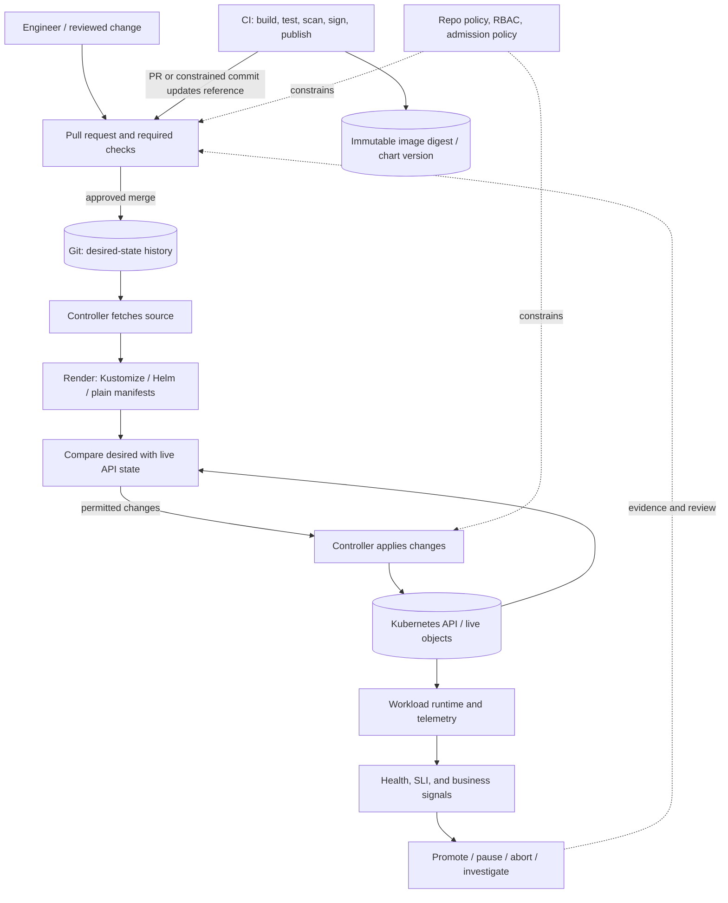

# Unit 1 — GitOps Principles and Desired-State Reconciliation

**Target file:** `01-gitops-principles-and-desired-state-reconciliation.md` | **Module:** M08 | **Stage:** 2E  
**Estimated time:** 10–14 hours, including the optional controller-free labs | **Prerequisites:** Git commits/branches, Kubernetes Deployments and namespaces, `kubectl`, container image digests, Kustomize basics, CI artifact publishing, Kubernetes controller concepts  
**Core tools:** Git, `kubectl`, `kind`; a local shell; minimal Argo CD context where useful | **Awareness:** Flux, IaC overlap  
**Last reviewed:** 2026-10-28 (authored against the supplied curriculum; live official documentation was not consulted in this generation) | **Tool baseline assumed:** Kubernetes API concepts and `kind`; exact versions intentionally not pinned. `[VERIFY]` all current OpenGitOps wording, Kubernetes CLI/API compatibility, and controller-specific behavior before using a real installation.  
**Footprint:** Controller-free labs: approximately 1 CPU, 256–512 MiB RAM, under 100 MiB working files plus the local cluster if used. `kind` plus a small application: plan for 2 CPU, 2–3 GiB RAM, and 3–6 GiB disk. A minimal Argo CD lab can exceed 2 GiB RAM and several GiB disk; on an 8 GB machine, do not run it alongside Flux, a service mesh, full Prometheus/Grafana, or other heavy stacks. These are planning estimates, not measured results.

> **Scope and safety.** This is Unit 1 of M08. It teaches the operating model, a small local demonstration, and the guarantees and limits of reconciliation. Argo CD installation and policy detail belong to [Unit 2](02-argo-cd-applications-projects-and-sync-policies.md); Flux mechanics belong to [Unit 3](03-flux-controllers-and-kustomize-helm-reconciliation.md); repository promotion, secrets, drift, migrations, and audit evidence are developed in [Units 4](04-repository-layout-and-multi-environment-promotion.md), [5](05-configuration-and-secret-reference-management.md), [6](06-deployment-drift-detection-and-reconciliation.md), [11](11-database-and-data-platform-migration-safety.md), and [13](13-release-evidence-and-audit-trails.md). All destructive examples below are for disposable local resources only.

## Contents

- [1.0 Why this matters in production](#10-why-this-matters-in-production)
- [1.1 Learning objectives](#11-learning-objectives)
- [1.2 Concept map and vocabulary](#12-concept-map-and-vocabulary)
- [1.3 Level 1 — Beginner](#13-level-1--beginner)
- [1.4 Level 2 — Intermediate](#14-level-2--intermediate)
- [1.5 Level 3 — Advanced](#15-level-3--advanced)
- [1.6 Level 4 — Expert](#16-level-4--expert)
- [1.7 SRE lens](#17-sre-lens)
- [1.8 Security lens](#18-security-lens)
- [1.9 Production checklist](#19-production-checklist)
- [1.10 Hands-on lab set](#110-hands-on-lab-set)
- [1.11 Self-check questions](#111-self-check-questions)
- [1.12 Evidence artifacts](#112-evidence-artifacts)
- [1.13 Common interview and design-review questions](#113-common-interview-and-design-review-questions)
- [1.14 Sources and verification notes](#114-sources-and-verification-notes)
- [Appendix A — Requirement coverage matrix](#appendix-a--requirement-coverage-matrix)
- [Appendix B — Ten-pass independent self-audit](#appendix-b--ten-pass-independent-self-audit)
- [Appendix C — Human verification checklist](#appendix-c--human-verification-checklist)
- [Appendix D — Known limitations and assumptions](#appendix-d--known-limitations-and-assumptions)
- [Appendix E — GitOps readiness assessment worksheet](#appendix-e--gitops-readiness-assessment-worksheet)

## 1.0 Why this matters in production

GitOps makes desired configuration reviewable and repeatedly reconciles a cluster toward that configuration, but it can also repeatedly reapply a bad change. An emergency `kubectl edit` may appear to fix an incident and then be overwritten by the controller because the Git revision still declares the old value. An enabled prune policy can delete a tracked resource after a manifest is removed, which is especially dangerous when teams misunderstand ownership or stateful-resource lifecycle. A green synchronization indicator does not prove that a model-serving API has acceptable prediction error, that a data pipeline is fresh, or that a database migration is reversible. The operating model is valuable only when repository access, controller permissions, health checks, promotion rules, rollback expectations, and evidence are designed together.

## 1.1 Learning objectives

By the end of this unit, the learner can:

1. **[L1]** Define GitOps and distinguish it from storing YAML in Git or manually applying a manifest.
2. **[L1]** Explain the four OpenGitOps principles using the project’s terminology and identify wording that still requires current-source verification.
3. **[L1]** Trace desired state, rendered state, Kubernetes API state, runtime behavior, and business correctness as separate layers.
4. **[L1]** Compare push-based and pull-based delivery by credentials, drift handling, auditability, blast radius, failure behavior, and setup cost.
5. **[L2]** Apply a manifest from a local Git working tree to a disposable namespace and inspect the live object without claiming this single action is a full GitOps controller.
6. **[L2]** Demonstrate a toy reconcile loop, explain why it is not production-grade, and identify what a real controller adds.
7. **[L2]** Demonstrate the relationship between manifest deletion and pruning using a throwaway resource, then verify the cleanup scope.
8. **[L2]** Revert a Git commit and explain which declarative changes are reversed and which external/data side effects are not.
9. **[L3]** Defend a repository, ownership, CI-to-Git, and IaC/GitOps boundary design with explicit trade-offs and assumptions.
10. **[L4]** Analyze a reconciliation incident using evidence, hypotheses, blast-radius checks, rollback constraints, mitigation, and prevention.

## 1.2 Concept map and vocabulary

### The control-loop model



The diagram is conceptual. A controller may not directly make a promotion/abort decision from business metrics; that capability depends on additional rollout/analysis tooling. A basic GitOps reconciler compares declared resources and reports status. It does not automatically understand whether predictions are accurate or an ETL output is semantically correct.

### Vocabulary

| Term | Precise definition | Common misconception |
|---|---|---|
| GitOps | An operating model in which declarative desired state is versioned in a source of truth, pulled by software, and continuously reconciled with the live system. | “YAML happens to be stored in Git, so the deployment is GitOps.” |
| Desired state | The intended configuration represented by a selected source revision and its rendering inputs. | It is always identical to the checked-in YAML; Helm/Kustomize can transform it. |
| Rendered state | The resource configuration produced after templates, overlays, substitutions, and relevant render-time inputs are applied. | It is the same as raw files in Git. |
| Live/API state | Objects currently represented by the Kubernetes API, including defaults and mutations from controllers/admission. | It fully describes application behavior or external side effects. |
| Runtime behavior | What processes, pods, jobs, and dependencies actually do after resources are applied. | A successful API write guarantees the service works. |
| Business correctness | Whether outputs and effects satisfy domain requirements, such as prediction quality, data freshness, or financial correctness. | HTTP 200 or `Healthy` proves correctness. |
| Reconciliation | Repeated observation and action intended to reduce the difference between desired and actual state. | A single `apply` is continuous reconciliation. |
| Drift | A difference between desired and observed state according to a tool’s comparison and ownership rules. | Every live difference is accidental; some differences are defaults or intentionally managed elsewhere. |
| Pull-based delivery | A controller with access to the source retrieves desired state and applies it to the target environment. | It removes the need to protect Git or controller credentials. |
| Push-based delivery | A CI/deployment runner initiates changes to the target, typically using target credentials. | It is inherently insecure in every architecture; security depends on identity, scope, and controls. |
| Prune | A controller removes resources it tracks as no longer part of the desired inventory, when configured to do so. | Deleting any file always deletes a live resource, regardless of policy or ownership. |
| Self-heal | A configured controller responds to certain out-of-band differences by reconciling them toward desired state. | It knows whether the manual change was an emergency fix. |
| Sync status | A controller-specific assessment of whether observed resources match rendered desired state under its comparison rules. | `Synced` means the application is healthy. |
| Health status | A controller-specific assessment of resource operational condition. | It proves domain-level correctness, security, or data quality. |
| Immutable artifact reference | A reference intended to identify a fixed artifact, commonly an image digest rather than a mutable tag. | A tag such as `latest` uniquely identifies what was tested. |
| Break-glass change | An exceptional, time-critical change made outside the normal workflow under defined authorization and documentation rules. | It should remain undocumented because it was urgent. |
| Control plane | The components that accept, store, interpret, or reconcile desired state. | An outage of the GitOps controller necessarily stops already-running application processes. |

### Separate the five state layers

1. **Git state:** files at a particular commit. It is versioned intent, not the cluster itself.
2. **Rendered state:** the resources produced from the selected revision and renderer. A template or value change can alter this state without an obvious one-file/one-object relationship.
3. **Live API state:** the Kubernetes objects after application, API defaulting, admission mutation, and other controllers’ actions.
4. **Runtime behavior:** whether containers start, requests succeed, jobs complete, dependencies respond, and data moves correctly.
5. **Business correctness:** whether outputs satisfy product/domain constraints. For a model-scoring service, this could include prediction-error distribution, fallback ratio, and latency; for ETL, it could include freshness, schema validity, and row-count reconciliation.

A safe release process checks all five at the appropriate depth. GitOps mainly connects the first three. Probes and telemetry help assess runtime behavior. Domain-specific tests and business indicators are needed for correctness.

### Four OpenGitOps principles

The supplied M08 curriculum names these four principles:

1. **Declarative:** the desired system is described declaratively.
2. **Versioned and immutable:** desired state is versioned and its history is preserved rather than silently rewritten.
3. **Pulled automatically:** software agents retrieve desired state from the declared source.
4. **Continuously reconciled:** agents repeatedly observe and reconcile the actual system toward desired state.

**[VERIFY]** These are faithful paraphrases of the four labels named in the supplied curriculum, not a quotation of the current OpenGitOps website. Before publishing or using this as formal policy, compare the exact wording with the current OpenGitOps principles text. Do not treat this lesson’s paraphrase as a verified verbatim statement.

### Reconciliation loop

A simplified loop is:

1. Select the desired source revision and rendering inputs.
2. Fetch or otherwise obtain the source.
3. Render the desired resources.
4. Observe current objects through the Kubernetes API.
5. Compare desired and observed state using controller-specific ownership and diff rules.
6. Apply permitted changes, or report a blocked/failed action.
7. Assess resource status and publish events/status.
8. Repeat after a timer, event, webhook, or retry.

The loop is **eventually consistent**, not instantaneous. A merge can be followed by source-fetch delay, rendering time, API throttling, scheduling, image pull, startup, readiness, and application warm-up. Each phase can fail independently.

```text
Git commit merged
  -> source becomes reachable
  -> controller notices/fetches revision
  -> templates/overlays render
  -> desired-vs-live diff computed
  -> policy and permissions permit action
  -> Kubernetes API accepts changes
  -> scheduler/controllers converge resources
  -> readiness/health signals change
  -> runtime and business signals are evaluated
```

This is a conceptual trace, not a guarantee that every controller uses exactly these phases or names.

### Who holds which credentials?

| Concern | Push model: CI initiates deployment | Pull model: controller reconciles |
|---|---|---|
| Git read | CI runner often needs source access | Controller needs source read access |
| Cluster write | CI runner commonly holds deployment credentials | Controller holds Kubernetes permissions |
| Git write | CI may also update config repository | CI/bot may update config repository; controller usually needs read-only access |
| Main trust boundary | CI identity and runner security are part of cluster deployment boundary | Git approval controls desired changes; controller identity controls allowed cluster actions |
| Drift response | Usually requires another push or a separate drift process | Continuous controller can detect/reconcile supported differences |
| Credential exposure risk | Compromised deployment runner can use its cluster permissions | Compromised controller may exercise its Kubernetes permissions; compromised Git can cause the controller to deploy attacker-selected state |
| Audit | CI logs plus Git/release records | Git history plus controller status/events and runtime evidence |
| What neither model solves alone | Bad code, malicious approved config, overly broad permissions, invalid migrations, bad business metrics | Same; pull-based is not automatically safe |

**Important:** pull-based delivery moves the cluster-write credential boundary; it does not remove the need for least privilege, review, policy, credential rotation, and incident response.

### The CI/CD boundary

A useful division of responsibility:

- **CI:** tests source, builds an image, scans/signs as required by the platform, publishes it, captures provenance/evidence, and proposes a configuration change containing the immutable image digest or chart version.
- **Git review/promotion:** validates policy and approvals; determines whether the artifact is allowed into a given environment.
- **GitOps controller:** reads the approved desired state and reconciles it into the cluster.
- **Runtime verification:** checks availability, rollout state, and meaningful application/data/business signals.
- **Release decision:** promotes, pauses, aborts, or triggers incident response based on defined criteria.

CI does not need cluster credentials in this pull-based model. It may need narrowly scoped Git write or pull-request permissions. The controller should generally need only the source-read access and cluster permissions required for its managed scope.

## 1.3 Level 1 — Beginner

### What GitOps is—and is not

GitOps is an operating model, not a product. Argo CD and Flux are examples of controllers that can implement it for Kubernetes. A team may keep YAML in Git and still use a push deployment pipeline; that is version-controlled configuration, but it does not by itself provide continuous pull-based reconciliation.

| Activity | GitOps by itself? | Why |
|---|---|---|
| Commit a Deployment YAML, then manually run `kubectl apply` once | No | The file is versioned, but no continuously running agent is responsible for reconciliation. |
| CI runs `kubectl apply` using a service-account token | Push-based CD, not the pull model taught here | CI initiates deployment and needs target write access. |
| Controller fetches approved desired state and repeatedly compares/applies it | Yes, subject to the surrounding operating model and safeguards | Source, pull, and reconciliation responsibilities exist. |
| Controller reports `Synced` after applying manifests | Not sufficient evidence of application correctness | The status is about the controller’s comparison rules, not domain behavior. |

### First lab: apply a Git-controlled manifest manually

This deliberately demonstrates only the declarative input and the Kubernetes API. It does **not** install a GitOps controller and does **not** claim continuous reconciliation.

**Prerequisites:** Git, `kubectl`, a disposable `kind` cluster if using Kubernetes.  
**Planning footprint:** the manifest and local Git repo are negligible; the cluster is the dominant resource cost.  
**Controller/local Git server required:** no.  
**Stop first:** stop other heavy local clusters/stacks if memory is constrained.  
**Safety:** the commands use a dedicated namespace and verify the current context before mutating it.

Create a working directory and initialize Git:

```bash
mkdir -p gitops-unit1-lab
cd gitops-unit1-lab
git init
git branch -M main
```

Create `manifests/demo-deployment.yaml`:

```yaml
# Intended path: gitops-unit1-lab/manifests/demo-deployment.yaml
apiVersion: apps/v1
kind: Deployment
metadata:
  name: gitops-demo
  namespace: gitops-unit1-lab
  labels:
    app.kubernetes.io/name: gitops-demo
spec:
  replicas: 1
  selector:
    matchLabels:
      app.kubernetes.io/name: gitops-demo
  template:
    metadata:
      labels:
        app.kubernetes.io/name: gitops-demo
    spec:
      containers:
        - name: web
          image: nginx:1.27
          ports:
            - name: http
              containerPort: 80
          resources:
            requests:
              cpu: 25m
              memory: 32Mi
            limits:
              cpu: 200m
              memory: 128Mi
```

`nginx:1.27` is a teaching tag, not an immutable production reference. For a production-grade artifact workflow, use an approved image pinned by digest. The version tag and registry availability are environment-dependent; replace it with an image you can pull.

Record the file in Git:

```bash
git add manifests/demo-deployment.yaml
git commit -m "lab: add demo deployment"
git rev-parse --short HEAD
git status --short
```

Create a disposable namespace. First inspect the current context:

```bash
kubectl config current-context
kubectl cluster-info
```

If you intend to use `kind`, confirm that the current context is the exact cluster you created for this lab. Do not copy the next command until you have checked it.

```bash
# Replace <EXPECTED_KIND_CONTEXT> with the exact context confirmed above.
EXPECTED_KIND_CONTEXT='<EXPECTED_KIND_CONTEXT>'
CURRENT_CONTEXT="$(kubectl config current-context)"
if [ "$CURRENT_CONTEXT" != "$EXPECTED_KIND_CONTEXT" ]; then
  printf 'Refusing to mutate: expected context %s, got %s\n' "$EXPECTED_KIND_CONTEXT" "$CURRENT_CONTEXT" >&2
  exit 1
fi

kubectl create namespace gitops-unit1-lab --dry-run=client -o yaml | kubectl apply -f -
kubectl apply -f manifests/demo-deployment.yaml --namespace=gitops-unit1-lab
kubectl rollout status deployment/gitops-demo --namespace=gitops-unit1-lab --timeout=120s
kubectl get deployment,pods --namespace=gitops-unit1-lab -o wide
```

The manifest already includes the namespace, so `--namespace` is a safety context for the command; it does not replace checking the cluster context. Inspect the live object:

```bash
kubectl get deployment gitops-demo -n gitops-unit1-lab -o yaml
kubectl describe deployment gitops-demo -n gitops-unit1-lab
```

Now change `replicas: 1` to `replicas: 2`, commit it, and apply again:

```bash
git diff
git add manifests/demo-deployment.yaml
git commit -m "lab: scale demo deployment to two replicas"
kubectl apply -f manifests/demo-deployment.yaml --namespace=gitops-unit1-lab
kubectl rollout status deployment/gitops-demo --namespace=gitops-unit1-lab --timeout=120s
kubectl get deployment gitops-demo --namespace=gitops-unit1-lab
```

**What this proves:** a manifest in Git can express declarative desired configuration; `kubectl apply` can submit it to the API; a new commit can record a desired change.

**What this does not prove:** automatic source fetching, continuous reconciliation, drift correction, pruning, health evaluation by a GitOps controller, controlled promotion, or safe rollback. Those are not present in this manual workflow.

### Read the four principles operationally

| Principle label | Operational interpretation | Evidence a team can inspect |
|---|---|---|
| Declarative | Define the target resources and configuration rather than only scripting imperative steps. | Rendered manifest and reviewable configuration diff. |
| Versioned and immutable | Preserve change history and use immutable artifact identifiers; do not casually rewrite source history. | Git commit SHA, protected branch history, artifact digest/provenance. |
| Pulled automatically | A target-side agent/controller retrieves the source instead of requiring CI to push cluster changes. | Controller source configuration and successful source-fetch/sync status. |
| Continuously reconciled | The controller periodically or event-driven compares desired and live state and acts according to policy. | Controller status/events and a safe drift exercise. |

**[VERIFY]** Confirm current official OpenGitOps text before treating this paraphrase as exact policy language.

### What just happened? Commit-to-runtime trace

For the manual lab, only the following happened:

1. A file changed in a local working tree.
2. Git recorded a commit.
3. A human invoked `kubectl apply`.
4. The API server accepted a Deployment configuration.
5. Kubernetes controllers attempted to create and maintain the desired replicas.
6. `kubectl rollout status` observed rollout conditions.

There was no controller source fetch, no automatic diff loop, no controller-owned inventory, no prune policy, and no automated reconciliation after a manual live change. Do not label this trace “GitOps deployed the application.”

### Common beginner mistakes

| Mistake | Symptom | Explanation | Correction |
|---|---|---|---|
| Treating Git as live truth | A commit exists but the cluster has not changed | Git stores intent; a controller or deployment action must apply it | Inspect controller/source/sync status and live API state |
| Treating `Synced` as healthy | Resources match desired state but requests fail | Sync comparison does not prove runtime or business correctness | Check rollout/readiness, logs, SLIs, and domain signals |
| Using mutable image tags | A redeploy produces different bytes without a config diff | A tag may be moved to another image | Promote an immutable digest and record build provenance |
| Editing live state without recording it | A controller later restores the old value | Live state conflicts with Git desired state | Use an emergency workflow, record the change in Git, and review the diff |
| Enabling prune without understanding ownership | Removing a file removes a resource | The controller may delete resources it tracks when pruning is enabled | Start with disposable resources; verify ownership and deletion scope |
| Putting secrets in YAML | Credential appears in Git history or logs | Git history is widely replicated and retained | Store references or approved encrypted forms; see Unit 5 and M09 |
| Calling a `while` loop production GitOps | Failures, races, or deletes are not surfaced safely | A loop lacks mature source, identity, ownership, health, retry, policy, and audit controls | Use a supported controller and a documented platform operating model |

## 1.4 Level 2 — Intermediate

### Minimal Git-to-cluster loop: choose the learning path

The curriculum allows either a controller-based path or a teaching toy. The toy is smaller and avoids installing a heavy controller before Unit 2, but it is **not** production GitOps. This lesson uses the toy to make the control loop visible, then explains the missing guarantees. The real Argo CD workflow is taught in Unit 2.

### TOY — NOT PRODUCTION GITOPS

A toy loop can periodically run `kubectl apply -k` against a local directory. It does not securely fetch a Git revision itself, provide reliable ownership inventory, implement health semantics, coordinate concurrent runs, manage credentials safely, or protect against a bad source change. It is included to illustrate repetition only; do not deploy it as a privileged controller.

**Prerequisites:** `kubectl`, Kustomize support in the installed `kubectl` or standalone `kustomize`, disposable local cluster, Git.  
**Planning footprint:** negligible loop process plus the cluster.  
**Controller/local Git server required:** no; the loop reads a local working tree.  
**Stop first:** stop Argo CD/Flux or other controllers that could manage the same lab resources. Never let two independent reconcilers own the same resources.

Create `kustomization.yaml` at the lab root:

```yaml
# Intended path: gitops-unit1-lab/kustomization.yaml
apiVersion: kustomize.config.k8s.io/v1beta1
kind: Kustomization
resources:
  - manifests/demo-deployment.yaml
```

If your installed `kubectl` does not support `-k`, install/use a compatible standalone Kustomize binary and verify its version. Do not assume every local toolchain has identical behavior.

A single pass, which is safer to reason about than a permanent loop:

```bash
# Read-only preview first:
kubectl kustomize . | less
# Apply only after confirming the rendered output and target context:
kubectl apply -k . --namespace=gitops-unit1-lab
```

A deliberately simplified loop is shown only to illustrate repetition:

```bash
# TOY — NOT PRODUCTION GITOPS
# Intended path: illustrative shell snippet, not a controller manifest.
# Run only after confirming the expected context and disposable namespace.
set -euo pipefail
EXPECTED_KIND_CONTEXT='<EXPECTED_KIND_CONTEXT>'
EXPECTED_NAMESPACE='gitops-unit1-lab'

while true; do
  current_context="$(kubectl config current-context)"
  if [ "$current_context" != "$EXPECTED_KIND_CONTEXT" ]; then
    printf 'Refusing: wrong context %s\n' "$current_context" >&2
    exit 2
  fi

  # Render before applying so the operator can inspect what would be submitted.
  kubectl kustomize .
  printf 'Toy reconcile pass; press Ctrl-C to stop. No automatic prune is implemented.\n'
  kubectl apply -k . --namespace="$EXPECTED_NAMESPACE"
  sleep 30
done
```

This loop is intentionally incomplete: it has no automated diff gate, no source revision fetch, no reliable health assessment, no pruning, no ownership inventory, no bounded retries/backoff, no concurrency lock, no robust telemetry, no policy engine, no controller identity isolation, and no protection from all command/API errors. `sleep` is not a reconciliation scheduler design. A real controller has implementation-specific behavior that must be read from its official documentation.

### Local Git-to-cluster exercise sequence

1. Inspect the exact working tree and commit SHA.
2. Inspect the rendered output with `kubectl kustomize .`.
3. Confirm current context and namespace.
4. Apply once to the disposable namespace.
5. Inspect the live Deployment and its pods.
6. Change the replica count in the source file and commit.
7. Render again; compare the render with the previous commit (`git diff HEAD^ HEAD`).
8. Apply again and inspect the live replica count.
9. Change the live scale out of band with a guarded command.
10. Re-run the toy pass and observe that it may restore the manifest's replica count. This is a demonstration of repeated apply, not a substitute for a controller’s drift model.

Before any mutation, check context. For an out-of-band scale exercise, use this guarded form after replacing the placeholder with the context you confirmed:

```bash
EXPECTED_KIND_CONTEXT='<EXPECTED_KIND_CONTEXT>'
CURRENT_CONTEXT="$(kubectl config current-context)"
if [ "$CURRENT_CONTEXT" != "$EXPECTED_KIND_CONTEXT" ]; then
  printf 'Refusing to scale in wrong context: %s\n' "$CURRENT_CONTEXT" >&2
  exit 1
fi
kubectl scale deployment/gitops-demo --replicas=3 --namespace=gitops-unit1-lab
kubectl get deployment gitops-demo --namespace=gitops-unit1-lab
```

**Representative expected output — not captured from a run:**

```text
NAME          READY   UP-TO-DATE   AVAILABLE   AGE
gitops-demo   1/1     1            1           2m
```

After changing desired replicas to `2`, the expected state after a successful apply is two desired replicas; exact columns and timing vary. Treat command output as evidence of the command’s observation, not proof of business correctness.

### Pruning: useful but dangerous

Pruning is a controller policy that can delete tracked live resources when they are no longer present in the desired resource set. It is not synonymous with every controller deleting every resource whenever a file disappears. Behavior depends on the controller, tracking/ownership rules, configuration, and resource lifecycle.

**Benefits**
- Removes obsolete objects so the cluster does not accumulate abandoned Services, Deployments, ConfigMaps, or other resources.
- Makes removal reviewable as a Git change.
- Supports a declarative inventory when ownership is clear.

**Risks**
- A removed manifest may represent a resource someone assumed was independently managed.
- Namespace deletion can have a broad cascading impact.
- Stateful workloads may reference PVCs or external systems whose lifecycle is not reversed by restoring a YAML file.
- Dependency ordering can make deletion fail or cause downtime.
- A controller’s tracking rules may not align with informal team ownership.

#### Throwaway prune demonstration without a GitOps controller

This lab illustrates the relationship between a declared inventory and removal; it does **not** prove the behavior of Argo CD or Flux pruning. The actual controller-specific prune exercise belongs in Unit 2/6.

**Prerequisites:** disposable cluster, Git, `kubectl`.  
**Planning footprint:** negligible object cost.  
**Controller/local Git server required:** no.  
**Stop first:** stop other controllers managing this namespace.  
**Scope:** one ConfigMap in `gitops-unit1-lab`, no PVC, no namespace deletion.

Create `manifests/prune-demo.yaml`:

```yaml
# Intended path: gitops-unit1-lab/manifests/prune-demo.yaml
apiVersion: v1
kind: ConfigMap
metadata:
  name: prune-demo
  namespace: gitops-unit1-lab
  labels:
    app.kubernetes.io/managed-by: gitops-unit1-lab
data:
  purpose: "disposable-prune-demonstration"
```

Before applying, confirm context and rendered scope:

```bash
kubectl config current-context
kubectl kustomize .
kubectl get namespace gitops-unit1-lab
```

After confirming that the expected context is active and the only added object is the ConfigMap, apply:

```bash
kubectl apply -f manifests/prune-demo.yaml --namespace=gitops-unit1-lab
kubectl get configmap prune-demo --namespace=gitops-unit1-lab -o yaml
```

Record it in Git, then remove only the file from the working tree:

```bash
git add manifests/prune-demo.yaml
git commit -m "lab: add disposable prune demo"
git rm manifests/prune-demo.yaml
git commit -m "lab: remove disposable prune demo manifest"
git show --stat --oneline HEAD
```

**Do not infer that Git removal alone deleted the ConfigMap.** Without a controller or a separate delete action, it remains in the cluster. For this controller-free lab, inspect the remaining object:

```bash
kubectl get configmap prune-demo --namespace=gitops-unit1-lab
```

Then remove the throwaway object explicitly after rechecking context:

```bash
EXPECTED_KIND_CONTEXT='<EXPECTED_KIND_CONTEXT>'
CURRENT_CONTEXT="$(kubectl config current-context)"
if [ "$CURRENT_CONTEXT" != "$EXPECTED_KIND_CONTEXT" ]; then
  printf 'Refusing cleanup in wrong context: %s\n' "$CURRENT_CONTEXT" >&2
  exit 1
fi
kubectl delete configmap prune-demo --namespace=gitops-unit1-lab --wait=true
kubectl get configmap prune-demo --namespace=gitops-unit1-lab
```

The final `get` should report NotFound if deletion succeeded. The point is the distinction: Git deletion changes desired files; a configured reconciler with pruning and matching ownership may perform the live deletion. Never use a PVC, namespace, or production-like resource to learn this behavior.

### Sync status is not health status

Controller terms differ by implementation and version. In Argo CD, the curriculum names Sync states such as `Synced`/`OutOfSync` and health states such as `Healthy`, `Progressing`, `Degraded`, `Missing`, `Suspended`, and `Unknown`; verify the exact current semantics in Unit 2 and current docs.

| Example observation | Sync interpretation | Health interpretation | What to do next |
|---|---|---|---|
| Live spec matches rendered desired spec; pods are not ready | May be Synced | May be Progressing or Degraded depending on resource/health rules | Inspect events, image pulls, probes, logs, and dependencies |
| Manual scale changes replicas from desired 2 to live 3 | May be OutOfSync if the controller compares that field | Workload may still be healthy | Check owner/field policy and decide whether manual change should be recorded or reverted |
| Controller says Healthy but prediction error rises | May be Synced and Healthy at Kubernetes-resource level | Business health is failing outside that signal | Stop/promote/rollback using domain metrics and release policy |
| Git source is unavailable | Previously running resources may continue | Runtime health may remain good temporarily | Repair source/controller access; do not assume new commits are deployed |
| A bad but valid configuration is reconciled | May be Synced | Could be Healthy by resource checks | Use policy, tests, and meaningful runtime/business verification |

**Representative expected output — not captured from a run:**

```text
SYNC STATUS: Synced
HEALTH STATUS: Healthy
```

This is illustrative only, not captured controller output. Even if a real controller reports these values, they do not establish security, prediction quality, data correctness, safe rollback, or compliance.

### What belongs in Git?

Usually appropriate for a configuration repository:
- Kubernetes manifests, Kustomize overlays, Helm chart references/values, deployment policies, non-secret configuration, and approved secret references.
- Image digests or immutable chart versions.
- Environment promotion metadata and reviewable changes.
- Documentation for ownership, recovery, and operational expectations.

Usually inappropriate:
- Plaintext passwords, API keys, tokens, private keys, or decrypted secrets.
- Live runtime status, generated datasets, model weights, database contents, or large mutable binaries.
- Mutable “latest” references when reproducibility is required.
- High-frequency controller status written back into the desired-state repository.
- Unreviewed production edits or credentials used to bypass controls.

Secret-management and encryption patterns belong to [Unit 5](05-configuration-and-secret-reference-management.md) and M09. Supply-chain verification and admission enforcement belong to M12.

### Application repository versus configuration repository

| Model | Benefits | Costs/risks | Choose when |
|---|---|---|---|
| Separate app and config repos | Separates source-code contributors from deployment approvers; permits environment-specific access and promotion; clean artifact/config history | More repos and automation; references can become inconsistent; bot permissions must be managed | Production teams need distinct ownership, approvals, and environment boundaries |
| Monorepo with app and deployment directories | One change can coordinate code and deployment; simpler discovery | Path ownership and permissions may be harder; CI triggers and access boundaries need care | Team has strong path ownership, checks, and a clear release process |
| Single config repo across environments | Centralized policy and environment inventory | A broad write permission or bad shared change can have large blast radius | Platform team can enforce path ownership and promotion gates |

There is no universal rule that application and configuration code must live in separate repositories. The control objective is clear ownership, review, immutable artifacts, and traceability from source commit to deployed artifact.

### Promotion and branch models

| Model | Advantages | Risks | Design checks |
|---|---|---|---|
| Trunk-based `main` plus environment directories | One canonical history; promotion can be represented as a reviewed directory/value change; avoids long-lived branch divergence | A faulty broad change can affect several environments; directory permissions and CI policy matter | Require environment-specific checks/approvals and narrow promotion diffs |
| Environment branches | Familiar separation; branch-level controls can differ | Branches drift, cherry-picks become ambiguous, fixes may not propagate consistently | Define source of truth, merge policy, drift detection, and recovery from divergent histories |
| Promotion by updating a version/digest in environment config | Explicit artifact promotion; same tested artifact can move across environments | Requires reliable metadata and checks that prevent rebuilding different bytes | Verify digest equality and preserve promotion evidence |

**[ASSUMPTION]** For a small platform, a protected trunk with environment directories and promotion pull requests is often a maintainable starting point because the promotion diff is explicit and history remains connected. It is not a universal industry standard. Choose based on team boundaries, repository controls, deployment frequency, and blast radius.

### PRs, commit hygiene, and rollback

Use small, atomic commits that describe intent, reference a ticket/incident where appropriate, and change the minimum number of environment paths. Require review and checks for production paths. A bot that writes desired state should have narrowly scoped permissions and should open a PR by default unless the organization has a justified, controlled direct-commit pattern.

A Git revert creates a new commit that reverses a prior commit’s changes. It does **not** erase the prior event, and it does not undo every effect of the deployment.

| Revert can often change | Revert does not automatically undo |
|---|---|
| Desired image digest or manifest field back to a previous value | A database migration already applied |
| A Deployment configuration or feature configuration represented in Git | Messages already produced/consumed, emails sent, payments processed, external API calls |
| A config reference to a previous chart/version | Data written in the new schema or files changed by a job |
| A bad declarative setting | A compromised credential, leaked secret, or malicious Git history; those need incident response |

For stateful systems, design forward/backward compatibility and recovery before the release. See [Unit 11](11-database-and-data-platform-migration-safety.md) and [Unit 12](12-backward-compatible-pipeline-and-api-releases.md).

### Pattern catalogue

| Pattern | When to use | When not to use |
|---|---|---|
| CI updates config repo with an immutable digest through a PR | Production needs review and provenance linking artifact to config change | Do not use a mutable tag as the only release identity |
| Protected `main` as desired-state source | One auditable history and a clear merge policy fit the team | Do not rely on branch protection if administrators/bots can bypass it without monitoring |
| Environment directories with promotion PRs | Teams want visible environment diffs and controlled promotion | Avoid if path boundaries are not enforceable and one commit can accidentally alter every environment |
| Separate config repo | Deployment approvals/access differ from app source ownership | Avoid needless separation when it adds failure-prone coordination without a control benefit |
| Automated reconcile without automatic prune | Early adoption, sensitive resources, or ownership is still being established | Not sufficient as a permanent substitute for a well-designed deletion lifecycle |
| Revert commit for a stateless configuration regression | Desired configuration can safely return to a known-good revision | Not a data rollback strategy for irreversible side effects |
| Bot opens PRs rather than directly pushing | Human review and audit are required | Avoid granting the bot broad write access across unrelated repos/environments |

### Anti-pattern catalogue

| Bad workflow/config | Failure mechanism | Safer alternative |
|---|---|---|
| CI deploys with a long-lived cluster-admin token | CI compromise becomes broad cluster compromise | Pull controller with scoped RBAC; short-lived identity where supported; isolate runner permissions |
| Controller has cluster-admin without a documented need | Any malicious source or controller compromise can affect the whole cluster | Scope controller permissions and split ownership boundaries |
| Mutable image tag in desired state | Same Git commit may deploy different bytes later | Digest pinning and provenance |
| Automatic pruning enabled everywhere by default | Manifest removal can destroy resources outside expected scope | Establish ownership, preview diffs, staged rollout of prune, deletion protections |
| Manual production edit is not recorded | Reconciliation overwrites fix or drift becomes invisible | Break-glass process with immediate Git follow-up and incident evidence |
| Secret plaintext committed then deleted | Secret persists in Git history, forks, caches, and clones | Treat as exposed; revoke/rotate; use secret references or approved encryption |
| Git used as a high-frequency status database | Noisy history, merge conflicts, feedback loops, unbounded repository churn | Put runtime status in observability/state systems; keep Git for desired state |
| Uncontrolled force-push to source-of-truth | Controller can reconcile an unexpected history/state; audit context is damaged | Protected branches, restricted force-push, backups, alerts, tested recovery |
| One giant repo path with no ownership | Reviewers cannot assess blast radius; unrelated changes travel together | Path ownership, policy checks, repo/app boundaries, scoped controller permissions |
| Treating revert as database rollback | Schema/data side effects remain and old app may fail against new data | Expand/contract migration, compatibility windows, tested recovery plans |

## 1.5 Level 3 — Advanced

### Declarative versus imperative work

Not every operation should be represented as a continuously reconciled object in the same way.

| Workload/change | Declarative fit | Main risk | Design approach |
|---|---|---|---|
| Stateless Deployment, Service, ConfigMap | Strong | Incorrect config can be continuously re-applied | Keep desired spec in Git; gate with tests, policy, rollout and business checks |
| CronJob definition | Strong for the schedule/config | Job executions create side effects that are not undone by deleting the CronJob | Version the schedule; separately observe job runs and outputs |
| One-off backfill or data repair | Mixed | Reconciliation may re-run a side-effecting operation unexpectedly | Use an explicit, idempotent, approved workflow with execution record and completion criteria |
| Database schema migration | Mixed | DDL/data changes may not be reversible and can lock tables | Plan compatibility, ordering, lock duration, backups, expand/contract; detailed safety in Unit 11 |
| CRD and operator installation | Declarative, but ordering/readiness matters | Custom resources may be rejected before the CRD/controller is ready | Use documented controller-specific ordering; verify exact hooks/waves/dependency semantics in Unit 2/3 |
| External SaaS/API change | Often not directly owned by Kubernetes reconciler | External side effects and credentials may be outside its model | Use a dedicated workflow/provider and record external state/evidence |
| Secret reference | Declarative reference can be suitable | Referenced secret may be unavailable or unauthorized | Define identity, rotation, outage behavior, and secret-controller dependency in Unit 5/M09 |

A declarative object describes a target. Imperative workflows can still be appropriate for controlled actions, but they should have explicit preconditions, idempotency strategy, approval, observability, and recovery steps.

### What a controller can and cannot guarantee

**It can often:**
- Re-fetch a configured source and render it according to the selected tooling.
- Compare tracked desired resources with live API objects under its comparison rules.
- Apply changes allowed by its permissions and policy.
- Retry or report failures according to implementation behavior.
- Help detect or correct supported forms of drift.

**It cannot guarantee by itself:**
- That the desired configuration is safe, secure, or business-correct.
- That all dependencies are ready when an object is applied.
- That an accepted API object produces a ready workload.
- That a migration or external side effect is reversible.
- That all live differences are errors; defaults, admission mutation, operators, and field ownership may be involved.
- That the source repository is trustworthy merely because it is Git.
- That every resource deletion is safe just because it is declared as absent.
- That every controller failure is automatically retried successfully or that source outages have no effect on deployment lead time.

Reconciliation is a convergence mechanism under assumptions: source is reachable, desired state can be rendered, permissions allow action, API resources exist, dependencies become available, and competing actors do not continuously fight over the same fields.

### Ownership and garbage collection

A controller must decide which live resources it considers managed. Argo CD and Flux have different implementation concepts for resource tracking/inventory; exact labels, annotations, inventory behavior, deletion semantics, and defaults are **[VERIFY]** items for Units 2, 3, and 6. Do not assume a matching label alone proves safe ownership. Before enabling pruning, determine:

- How the controller identifies resources belonging to an application/reconciliation.
- Whether shared resources are allowed and who owns them.
- What happens when a source path disappears or an application object is deleted.
- Whether deletion cascades, finalizers, retention settings, or protection policies apply.
- How to inspect the proposed deletion set before approving it.
- Whether a resource contains persistent data or manages an external dependency.

### Trust model and blast radius

Treat Git write/merge access to a production path as potential production change authority. Treat the controller as a privileged production identity. Review approval controls what enters desired state; controller RBAC controls what that state can do. Both are necessary.

A robust design separates:
- **Who can propose:** contributors and bots.
- **Who can approve:** reviewers, code owners, release approvers.
- **What can be merged:** branch protections, required checks, policy tests.
- **What can be applied:** controller RBAC, namespaces/projects/tenancy, admission policy.
- **What can be observed:** audit logs, controller events/status, runtime telemetry.
- **Who can recover:** break-glass operators and incident responders under a documented process.

If a controller can create ClusterRoleBindings or modify unrelated namespaces, a compromised config path may have a wider blast radius than the team expects. Narrow scopes and policy should be tested, not assumed.

### Safe CI-to-Git patterns

| Pattern | Benefit | Cost/risk | Good fit |
|---|---|---|---|
| Bot opens a PR containing image digest update | Review, checks, and approval remain visible | Adds queue/approval latency; requires bot identity management | Default for sensitive environments |
| Bot commits directly to a protected-by-policy automation branch/path | Can reduce toil and latency | Bypassing review can be dangerous; branch protection and narrow permissions must be explicit | Only when controls, scope, and audit are proven |
| Image-update automation proposes version changes | Reduces manual copy/paste and stale deployments | Automation can select an unapproved version or create noisy updates | When policy pins allowed registries, versions, and digest provenance |
| CI writes deployment status back into the desired-state repo | Appears convenient | Creates feedback loops/noisy history and confuses intent with runtime truth | Generally avoid; use observability/status systems instead |

Argo CD Image Updater and Flux image automation are examples named in the curriculum. **[VERIFY]** their current maintenance/maturity, supported source types, and exact behavior before choosing them. This unit does not endorse a particular version or install them.

### GitOps and IaC boundary

Infrastructure as Code tools such as Terraform or OpenTofu, and Kubernetes-oriented infrastructure tools such as Crossplane, may manage foundational resources or cloud services. GitOps controllers commonly reconcile Kubernetes workloads and platform configuration. There is overlap, and the main safety rule is **one authoritative owner for each field/resource lifecycle**.

Examples:
- IaC creates the cluster, node pools, networking, registry, and foundational identities.
- GitOps installs and manages application Deployments, Services, policies, and approved platform add-ons.
- A documented bootstrap process bridges the two.
- If both IaC and GitOps continuously manage the same field/resource, they may overwrite each other or produce persistent drift.

See M07’s infrastructure ownership and drift lessons. Do not solve an ownership conflict by repeatedly applying whichever tool ran last.

### Propagation latency and source availability

Commit merge time is not deployment completion time. A practical lead-time decomposition is:

`T_merge_to_running = T_source_detection + T_fetch/render + T_queue/API + T_rollout + T_health_confirmation`

A controller may detect source changes by polling, webhook, or both. Polling trades predictable load for detection delay; webhooks can reduce delay but add network, authentication, delivery, and duplicate-event considerations. API throttling, repository rate limits, controller queue depth, render cost, image pulls, readiness checks, and application warm-up add further delay. Exact timings and retry semantics are implementation- and environment-specific `[VERIFY]`.

A Git/source outage may block new deployments and correction of drift while already-running workloads continue. This is not a universal availability guarantee: workloads may still depend on the source, controller, secret service, image registry, or other infrastructure at runtime. Test which parts of the platform continue operating without the control plane.

### Disaster recovery implications

Git can help rebuild declarative configuration, but it is not a complete backup. Recovery also needs:
- Application data backups and tested restore procedures.
- Database recovery/PITR and migration-aware procedures where applicable.
- Controller bootstrap manifests/configuration and required credentials.
- Encryption keys and access to referenced secrets.
- Container images/charts or reliable artifact registries.
- External resource inventory and recovery procedures.
- Access to Git and identity systems during the incident.
- A test that rebuilt workloads are functional, not just syntactically present.

See M13 for backup and disaster recovery. A successful `kubectl apply` after cluster recreation does not prove that data or business services were recovered.

### Design trade-off table

| Option | Benefit | Cost | Risk | Choose when |
|---|---|---|---|---|
| Pull controller per cluster | Cluster-local credentials and local reconciliation | Per-cluster operations and bootstrap | Each controller is a privileged identity to protect | Isolation and independent cluster operation matter |
| Central push deployment runner | Centralized release orchestration | Runner requires target credentials/connectivity | Runner compromise may affect many clusters | Existing security model strongly supports controlled deployment runners |
| Trunk + environment directories | Clear promotion diff and unified history | Requires path ownership and environment-aware checks | Broad commits may affect multiple environments | Team can enforce policy and review boundaries |
| Environment branches | Separate branch controls and workflow | Drift, cherry-pick complexity, divergent fixes | Wrong branch merge or missed hotfix propagation | Branch semantics are explicit and automated |
| Automatic reconciliation without prune | Drift correction with less deletion risk during adoption | Orphaned resources can accumulate | Manual resource lifecycle becomes messy | Ownership and deletion policy are not mature yet |
| Auto-prune with guarded review and policy | Better inventory cleanup | Requires accurate ownership and deletion previews | Destructive change can still be approved | Resource ownership and safeguards are proven |
| Controller-managed workloads; IaC-managed foundations | Clear lifecycle boundary | Bootstrap and interface between tools | Overlapping ownership if boundaries are vague | Teams document resource/field ownership |
| Git as only recovery source | Easy config reconstruction | No runtime data, keys, or external state | Incomplete recovery | Never sufficient alone for stateful production systems |

### Verification chain and false confidence

Use this chain for a release, adapting each step to the actual platform:

1. **Render:** produce the concrete resources from the exact commit and tool versions.
2. **Validate:** schema, policy, image registry/digest, namespace, RBAC, and configuration checks.
3. **Diff:** inspect the desired-versus-live change set and deletions.
4. **Reconcile/apply:** use the approved controller and recorded source revision.
5. **Health check:** verify resource status, rollout, readiness, and dependency behavior.
6. **Business check:** inspect model quality/fallback ratio, latency, data freshness, or other domain SLIs.
7. **Evidence review:** preserve commit SHA, artifact digest, approval, diff, controller status/events, test results, and release decision.

Each step has blind spots. Schema validation cannot prove the image works. A diff cannot prove data migration safety. A successful apply cannot prove readiness. Readiness cannot prove prediction quality. A dashboard can be stale or misconfigured. Evidence must identify what was observed, when, from which source, and by whom.

### Advanced design exercise

Design a GitOps rollout for a FastAPI model-scoring API. CI produces a signed image and an immutable digest. Staging has automated reconciliation; production requires a reviewed promotion PR. An emergency manual change must not be silently lost. A new model version may increase prediction error while HTTP health remains green.

Submit a one-page design containing:
- Repository structure and ownership boundaries.
- CI-to-Git write pattern and immutable artifact identity.
- Controller permissions and allowed resource scope.
- Prune policy and deletion review.
- Break-glass procedure and reconciliation recovery.
- Rollback limits for application code versus model/data state.
- Runtime and business health gates.
- Evidence captured for each promotion.
- At least three trade-offs and explicit `[ASSUMPTION]` items.

**Assessment criterion:** a design is not complete if it only says “use Argo CD” or “revert Git.” It must explain failure handling, authority, evidence, and business correctness.

## 1.6 Level 4 — Expert

### Control-plane outage: what continues?

If the GitOps controller is unavailable, already-running Kubernetes workloads generally continue under the Kubernetes control plane, assuming their dependencies and runtime do not require the GitOps controller. New desired-state changes will not be applied by that controller, and supported drift correction will pause until it recovers. The exact impact depends on the architecture: workloads may still need a secret provider, registry, external configuration service, or other controller to function.

**Recovery runbook sketch**
1. **Blast-radius check:** identify the affected clusters, controller replicas, managed applications, source repositories, and any concurrent incidents. Confirm that the recovery target is the intended cluster.
2. Preserve current controller logs, events, metrics, pod descriptions, source revision, and relevant audit records before restarting or deleting anything.
3. Determine whether the failure is Git/network/authentication, rendering/resource exhaustion, API permissions/throttling, or controller availability.
4. Restore the minimum required dependency first. Avoid simultaneously changing desired state and controller configuration unless the change is necessary and reviewed.
5. Reconcile a low-risk application and inspect diff, status, live resources, and runtime health.
6. Resume broader reconciliation in controlled batches if the controller has a large backlog.
7. Record the incident, reconcile any emergency live changes into Git, and verify no unexpected pruning or mass changes occurred.

**Rollback check before remediation:** know whether the remediation changes the controller, its source revision, its permissions, or managed workloads. Preserve a way to restore the last known-good controller configuration. Do not delete controller CRDs, namespaces, or application resources as a first diagnostic action.

### Bootstrap and self-management

A bootstrap problem occurs when the controller is expected to recreate the configuration or credentials it needs to start. The initial controller installation must be available through a separately recoverable path—often reviewed manual steps or IaC—before self-management is safe. After bootstrap, the controller can manage some of its own configuration, but changes to its source, permissions, CRDs, or installation must be treated as high-impact platform changes.

A safe pattern:
- Keep a minimal, documented bootstrap procedure outside the controller’s sole control.
- Version controller installation inputs and test upgrades on an ephemeral cluster.
- Keep credentials/keys and the access path to Git recoverable independently.
- Test rebuilding the controller and re-adopting workloads without accidentally deleting those workloads.
- Separate the controller’s own lifecycle from application delivery where needed.

### Conflicts with HPA, operators, and admission webhooks

A persistent diff does not automatically mean the GitOps controller is broken. Multiple actors may write the same field.

**Example:** Git declares `spec.replicas: 2`, while an HPA adjusts replica count based on load. Depending on the manifest and controller comparison/apply behavior, the reconciler may try to restore the replica count while HPA adjusts it again. This is an ownership conflict.

Other causes include:
- Admission webhooks adding defaults or injecting sidecars.
- Kubernetes API defaulting fields omitted from source.
- Operators updating status or selected spec fields.
- Server-side apply managed-field ownership.
- A field intentionally ignored by a controller’s diff policy.
- A generator/rendering input changing between reconciliations.

Investigation sequence:
1. Capture the current rendered desired object and live object.
2. Identify the exact differing field and whether it is `spec`, `status`, defaulted, or injected.
3. Inspect managed fields/field managers and relevant events where available.
4. Identify the intended owner of that field.
5. Test the correction in a disposable environment.
6. Document the comparison/ownership rule and add a regression check.

`ignoreDifferences`, field-manager configuration, and server-side apply can be relevant but are controller-specific and version-sensitive. **[VERIFY]** exact options and semantics in Unit 6 and the controller’s current documentation. Do not silence every diff to make dashboards green; a broad ignore rule can conceal a real unauthorized change.

### Mandatory incident analyses

Use this structure for each incident: **symptom → evidence to collect → hypotheses → safe test → root cause → mitigation → prevention → evidence to retain**. Any production-like remediation begins with a blast-radius and rollback check.

#### Incident A — Self-heal reverted an emergency hotfix

- **Symptom:** a manual fix appears briefly, then the old configuration returns.
- **Evidence:** incident timeline; exact live diff before/after; Git commit/revision; controller events/status; actor identity; logs; service metrics.
- **Hypotheses:** desired state was never updated; a different source path owns the resource; a second controller also reconciles it; field ownership rules caused the revert.
- **Safe test:** reproduce in a disposable namespace by changing one harmless field out of band, then observing the controller’s response.
- **Root cause pattern:** the live change was outside the recorded source of truth, so reconciliation correctly followed the configured desired state.
- **Mitigation:** first verify that the reverted change did not cause a new outage. If the fix is still needed, make a reviewed Git change or use the documented break-glass path to pause/override reconciliation only under explicit authorization. Preserve evidence before changing controller policy.
- **Prevention:** emergency-change procedure; time-bounded exception; immediate Git follow-up; alert on drift and revert; ensure incident responders understand the controller.
- **Evidence to retain:** before/after diff, source revision, approvals, incident link, operator identity, controller events, recovery verification.

#### Incident B — Prune removed a stateful resource

- **Symptom:** a resource disappears after its manifest or application path is removed; data availability may be affected.
- **Evidence:** Git diff/commit; controller prune configuration and resource inventory; deletion audit event; owner references/finalizers; PVC/PV and storage-class state; application logs and backup status.
- **Hypotheses:** intended resource was removed; incorrect path or generator output omitted it; ownership tracking included a shared resource; cascade/finalizer behavior was misunderstood.
- **Safe test:** in a disposable cluster, create a labelled ConfigMap and test the controller’s documented prune behavior. Do not test by deleting a real PVC or namespace.
- **Root cause pattern:** deletion policy and ownership assumptions were not aligned.
- **Mitigation:** blast-radius and recovery check first. Determine whether the object can be restored safely; use tested backup/PITR for data, not only Git revert. Avoid repeatedly reconciling a source that still omits the object until the intended recovery is clear.
- **Prevention:** review deletion diffs, restrict prune, protect stateful lifecycles, define resource owners, test restore and finalizer behavior.
- **Evidence to retain:** deletion event/audit record, source diff, backup/restore evidence, approval, and the corrective control.

#### Incident C — Git/source outage blocked a deploy during an incident

- **Symptom:** an approved commit is not reaching the cluster; controller reports source fetch or authentication failures.
- **Evidence:** source revision, repository availability, network/DNS/TLS/auth errors, controller logs/events, queue/retry status, rate-limit responses, and current runtime SLIs.
- **Hypotheses:** Git outage, expired deploy key/token, DNS/routing failure, provider throttling, TLS trust failure, or controller failure unrelated to Git.
- **Safe test:** test source reachability from the controller’s actual network context with read-only credentials; do not print tokens or broaden access as a quick fix.
- **Root cause pattern:** the control path to the desired-state source was unavailable or untrusted.
- **Mitigation:** assess whether the current service remains safe. Use a documented break-glass process only if necessary, with explicit approval, bounded permissions, and a plan to reconcile the change into Git afterward.
- **Prevention:** source availability monitoring, credential rotation tests, local/network resilience where appropriate, protected emergency procedure, tested controller/source recovery.
- **Evidence to retain:** failed revision, timestamped errors, approval, manual action, source recovery proof, and post-incident reconciliation.

#### Incident D — Controller credentials leaked

- **Symptom:** secret scanning, audit logs, unexpected API activity, or a report indicates controller credentials were exposed.
- **Evidence:** credential identity/scope, exposure window, repository and CI logs, Kubernetes audit events, API calls, controller logs, and accessed secret/resource inventory.
- **Hypotheses:** leaked repository credential, service-account token, admin credential, debug output, or secret committed into Git.
- **Safe test:** do not validate a leaked credential by using it. Confirm exposure through authorized audit sources and security response procedures.
- **Root cause pattern:** credentials were too broad, poorly stored, over-logged, or insufficiently rotated.
- **Mitigation:** follow the incident plan: revoke/rotate affected credentials, contain the identity, review changes made during the exposure window, and assess persistence. **Blast-radius and rollback check:** rotating credentials can interrupt reconciliation; sequence revocation and replacement so the trusted control path is restored without leaving the compromised credential active.
- **Prevention:** least privilege, separate identities, no plaintext secrets in Git, short-lived credentials where supported, audit alerts, restricted debug access, tested rotation.
- **Evidence to retain:** incident timeline, revocation/rotation records, audit query results, affected resources, and independent verification of containment.

#### Incident E — Force-push changed the source-of-truth branch

- **Symptom:** the source revision changed unexpectedly or the controller begins reconciling a surprising desired state.
- **Evidence:** branch protection/audit records, reflogs or server-side Git audit if available, commit graph, controller-observed revision, rendered diff, affected resources.
- **Hypotheses:** unauthorized force-push, compromised maintainer/bot, misunderstood branch policy, or expected history rewrite from a migration.
- **Safe test:** compare trusted copies/backups and current source state; render the suspect revision offline or in a disposable cluster before applying any recovery revision.
- **Root cause pattern:** source-of-truth history could be rewritten without an adequate control/recovery process.
- **Mitigation:** freeze further promotion, establish the trusted desired revision with repository owners/security, calculate the live impact, and restore through a reviewed forward commit where possible. Do not blindly force-push the old branch back or trigger a mass reconcile without a diff.
- **Prevention:** prohibit routine force-push on protected branches, restrict admin/bot rights, alert on ref rewrites, maintain recoverable Git history, test the restoration process.
- **Evidence to retain:** old/new commit identifiers, branch audit records, reviewed recovery diff, controller status, affected resource list, and approvals.

### GitOps maturity/adoption path

1. **Bounded pilot:** one low-risk stateless service, one team, one environment, explicit owner.
2. **Reliable source:** protected branch, review/checks, immutable artifact reference, clear promotion path.
3. **Controlled reconciliation:** scoped controller permissions, diff visibility, documented sync/prune policy, tested cleanup.
4. **Operational evidence:** reconcile status, lead time, failures, drift, and runtime/business health signals.
5. **Failure readiness:** break-glass, controller/source outage, credential rotation, backup/restore, and revert exercises.
6. **Paved road:** reusable repository layout, templates, policy checks, ownership rules, and onboarding docs.
7. **Governed exceptions:** explicit owner, reason, expiry/review date, compensating controls, and audit trail.
8. **Scale with evidence:** expand by team/environment only after the pilot demonstrates safe rollback, bounded blast radius, and recoverability.

### GitOps metrics

Define every metric, time window, population, and exclusion. Do not invent universal target values.

| Metric | Example definition | Caveat |
|---|---|---|
| Merge-to-running lead time | Time from approved desired-state merge to verified workload running; report median and tail percentiles | Define “running” and account for manual approval windows |
| Reconcile success rate | Successful reconcile attempts divided by all eligible attempts over a window | Retry storms can inflate attempt counts; also track applications that never reconcile |
| Sync/reconcile failure rate | Failed attempts divided by total attempts, segmented by cause | Distinguish source, render, API, policy, and workload failures |
| Drift count | Number of managed resources/fields currently differing under controller rules | A high count may include intentional mutations; count alone is not severity |
| Drift age | Time from first observed drift until resolved or explicitly accepted | Requires stable detection timestamps and an exception model |
| Time to detect bad release | Time from harmful release effect to detection | Detection depends on signal quality and alert routing |
| Time to rollback/mitigate | Time from release decision to verified mitigation | For data changes, “rollback” may mean forward repair, not revert |
| Change failure rate | Releases causing a defined incident/rollback/repair divided by releases in scope | Define what qualifies as a failure and avoid blaming safe rollbacks |
| Workload GitOps coverage | Eligible workloads under the declared GitOps standard divided by eligible workloads | Define eligible inventory; do not improve coverage by including unmanaged resources without evidence |
| Prune events | Count and severity of resource deletions by controller/reason | A low count is not automatically good; safe lifecycle cleanup may be expected |

## 1.7 SRE lens

### SLIs and SLO alignment

GitOps is a delivery mechanism; the service SLO remains the outcome. Useful delivery indicators include:
- Merge-to-running lead time.
- Reconciliation success/failure rate and age of unresolved failures.
- Drift count and drift age, weighted by resource criticality.
- Time to detect a bad release and time to mitigate it.
- Change failure rate.
- Percentage of eligible workloads covered by the platform standard.

For the FastAPI model-scoring API, pair controller state with service-level signals such as request latency, HTTP error rate, fallback response ratio, and prediction-quality/error indicators where measurable. For ETL, pair resource status with data-freshness lag, schema/contract validation, failed-record ratio, and output reconciliation. A healthy Deployment does not establish those outcomes.

### Failure modes and blast radius

| Failure mode | Potential impact | Containment principle |
|---|---|---|
| Bad commit in shared config path | Multiple workloads change together | Narrow paths/ownership, staged promotion, diff review |
| Controller with broad RBAC compromised | Broad cluster modification | Least privilege, separate controller scopes, audit and incident response |
| Git outage | New changes and drift correction delayed | Monitor source path; tested emergency process |
| Bad prune decision | Resource deletion and possible data loss | Ownership inventory, deletion review, resource-specific protections and backups |
| Competing controllers | Persistent diff or oscillation | One authoritative owner per field; investigate rather than hide all differences |
| False-positive health | Bad application promoted | Runtime and business metrics with explicit decision thresholds |
| Controller upgrade failure | Reconciliation blocked or changed semantics | Test upgrades on disposable cluster, preserve rollback/bootstrap path |

### Runbook snippet: reconcile failure

1. **Alert:** repeated sync/reconcile failures, rising drift age, or an approved change not running within its expected window.
2. **Triage:** confirm cluster/context, source revision, Git reachability, controller health, render errors, API authorization, and current application SLOs.
3. **Contain:** avoid pushing another change until the desired revision and blast radius are understood. Disable/limit automated actions only through the documented, authorized procedure.
4. **Mitigate:** restore source/credentials or correct the invalid desired state; if a live emergency change is unavoidable, record the actor, scope, time, and required Git follow-up.
5. **Verify:** inspect the rendered diff, live objects, rollout status, and runtime/business SLIs.
6. **Follow up:** preserve evidence, identify the failed control, and add a test or policy preventing recurrence.

### Cost and capacity

On an 8 GB laptop, sequence labs rather than running all components at once. A controller-free Git/Kubernetes demonstration is cheapest. Argo CD plus Git server, registry, and a workload consumes materially more memory/disk; stop the cluster after each lab. Do not combine Argo CD, Flux, Rollouts, a service mesh, and a full observability stack on the stated baseline. Unit 2/3 should provide measured or verified footprints for the chosen tool versions; the planning estimates in this lesson are not measurements.

## 1.8 Security lens

### Threats and controls

| Threat | Control | Concrete verification |
|---|---|---|
| Unreviewed/malicious config commit | Protected branches, required checks/reviews, code ownership, policy validation | Inspect branch rules and a test PR; verify direct push is blocked for ordinary identities |
| Controller credential compromise | Least-privilege RBAC, separated identities, restricted secret access, rotation plan | Inspect service account/RBAC bindings and controller credential scope; test revocation procedure in lab |
| Excessive controller blast radius | Scope by namespace/project/cluster; restrict cluster-scoped kinds | Review effective RBAC and allowed destinations/resources; attempt a prohibited operation in a disposable cluster |
| Plaintext secrets in Git | Secret references or approved encrypted representation; scanning and rotation | Run secret scanning; verify sample config contains only references/placeholders |
| Mutable artifact/tag | Digest pinning, registry policy, provenance verification | Inspect rendered image field and confirm it is a digest in production policy |
| Git history rewrite | Protected branches, restricted force-push, server audit, recovery copy | Verify branch protection and that authorized recovery can reconstruct a trusted revision |
| Unsafe pruning | Explicit ownership, reviewed deletion diff, staged policy, backups | Demonstrate deletion behavior on a disposable ConfigMap; inspect deletion inventory before enabling production prune |
| CI bot over-permission | Narrow repo/path scope, PR-first automation, token rotation | Inspect bot permissions and audit log; ensure it cannot change unrelated production paths |
| Conflicting controllers | Single-owner map and field-level ownership review | Compare rendered/live diff and managed fields; identify the writer of the contested field |
| Audit gaps | Commit SHA, artifact digest, approval, controller revision/status, runtime evidence | Perform a tabletop trace from incident to deployed artifact and back to the approved change |

### What this unit does not address in depth

- Secret encryption, external secret operators, workload identity, and secret rotation belong to Unit 5 and M09.
- Detailed Argo CD/Flux permissions, sync options, and resource tracking belong to Units 2, 3, and 6.
- Admission-time artifact-signature enforcement and broader provenance controls belong to M12.
- SLO/error-budget governance belongs to M10.
- Complete incident command and organizational response processes belong to the relevant SRE/incident modules.

Never paste credentials into a lesson, issue, chat, or command history. If a credential was committed, deleting the file is not sufficient: revoke/rotate it, investigate exposure, and preserve the incident evidence.

## 1.9 Production checklist

Use this as a verifiable review, not a self-attestation exercise.

- [ ] The team has named the source-of-truth repository, branch/revision policy, and owners.
- [ ] Ordinary direct pushes and uncontrolled force-pushes to production paths are blocked or explicitly governed.
- [ ] CI publishes an immutable artifact reference and records build/test/signing evidence.
- [ ] CI updates desired state through a scoped PR/commit workflow and does not need cluster write credentials for the pull-based deployment path.
- [ ] The controller’s Git credential is read-only unless a documented exception exists.
- [ ] Controller RBAC is scoped to the smallest viable set of namespaces/resources.
- [ ] The team can show the rendered output for the exact commit being promoted.
- [ ] Production diffs include a review of resource additions, modifications, and deletions.
- [ ] Prune behavior, tracking/ownership, cascade behavior, and stateful-resource lifecycle are documented and tested on disposable resources.
- [ ] Sync status and health status are not treated as business-correctness evidence.
- [ ] Runtime and business checks exist for the service (e.g., latency, error/fallback ratio, prediction quality, data freshness).
- [ ] The break-glass process records the actor, reason, time, change, approval, and Git follow-up.
- [ ] The team can restore desired configuration without assuming Git restores application data or keys.
- [ ] HPA/operators/webhooks and the GitOps controller have clear field/resource ownership.
- [ ] Source outage, controller outage, credential leak, unsafe prune, and force-push scenarios have runbooks.
- [ ] Metrics have explicit definitions, denominators, time windows, and owners.
- [ ] Controller/tool versions and relevant version-sensitive options are documented and verified.
- [ ] The cluster/controller bootstrap procedure can be executed independently of the controller being bootstrapped.
- [ ] Release evidence links the Git commit, artifact digest, approval, reconcile result, and runtime/business verification.
- [ ] No lab or production runbook uses a default context silently or performs broad deletion without a scope guard.

## 1.10 Hands-on lab set

All estimates below are planning estimates. Stop competing reconcilers before a lab; never let Argo CD and Flux manage the same cluster simultaneously. The five labs are intentionally staged so the learner can finish the concepts without installing every M08 component.

### Lab 1 — Push versus pull: credential and drift comparison

**Goal:** Explain and compare the same app delivered through a push runner versus a pull controller.  
**Footprint:** push simulation is negligible; pull path uses the local cluster and, if selected, a minimal Argo CD installation. Budget 2 CPU/2–3 GiB RAM for the cluster/application, with additional controller overhead.  
**Prerequisites:** Git, `kubectl`, disposable kind cluster; controller installation is optional in this unit.  
**Controller/local Git server:** controller is required only for the real pull demonstration; a local Git server is required only if the controller cannot access the chosen local repository path.  
**Stop first:** Flux, mesh, Rollouts, full monitoring stack, and other heavy clusters/components.

**Steps**
1. Draw the credential table in Section 1.2 for the chosen setup.
2. In the push model, describe a CI runner executing `kubectl apply`; list the exact cluster permission it would require. Do not create a long-lived credential just to simulate this.
3. In the pull model, describe the controller’s read-only Git access and its scoped Kubernetes permissions.
4. Deploy the same harmless Deployment to the disposable namespace using the manual path in Section 1.3.
5. If Unit 2’s Argo CD lab is already installed, point a separate disposable Application at a local reachable source and inspect its revision/status. Do not attempt to manage the same resource with both manual scripts and the controller.
6. Change a harmless field out of band. In the push model, no automatic correction happens unless another push or process runs. In the pull model, observe the controller’s documented drift response; exact behavior depends on configured sync/self-heal policy `[VERIFY]`.
7. Record credential locations, drift outcome, status evidence, and the policy that caused the behavior.

**Expected evidence:** comparison table; commit SHA; live manifest before/after; controller status if a real controller was used; explicit statement of which identity had write permissions.  
**Cleanup:** delete only the disposable namespace after confirming it contains no resources you intend to retain, or use the controller’s documented safe deletion flow after checking prune/cascade settings.  
**Stretch:** write a least-privilege RBAC proposal and test prohibited actions in an ephemeral cluster.  
**What it proves / does not prove:** it demonstrates authority placement and drift behavior in the selected configuration; it does not prove that pull is universally safer or that health signals are meaningful.

### Lab 2 — Toy loop versus real controller

**Goal:** Identify the production capabilities missing from a shell loop.  
**Footprint:** toy loop negligible; real controller adds several GiB of possible resource use; use one at a time on the 8 GB machine.  
**Prerequisites:** Lab 1; Git; local kind cluster.  
**Controller/local Git server:** toy requires neither; real controller requires the Unit 2 setup and a reachable source.  
**Stop first:** any other reconciler targeting the lab resources; stop heavy stacks before controller installation.

**Steps**
1. Run one `kubectl apply -k .` pass and inspect the Deployment.
2. Review the toy loop’s limitations listed in Section 1.4.
3. If Argo CD is available from Unit 2, compare source revision, rendered diff, sync status, health status, events, retry behavior, and resource tracking with the toy.
4. Record which capabilities are observed, which are merely assumed, and which are not present.
5. Do not claim a feature exists just because the toy loop can be extended with more shell code.

**Expected evidence:** capability matrix (source handling, identity, diff, health, retry, pruning, inventory, audit, concurrency, policy).  
**Cleanup:** stop the toy loop with Ctrl-C; clean only disposable resources after verifying context. If using Argo CD, follow Unit 2’s deletion/finalizer guidance.  
**Stretch:** define acceptance criteria for a controller used in a production platform.  
**What it proves / does not prove:** a capability comparison; not a benchmark or certification of a particular controller version.

### Lab 3 — Prune behavior on throwaway objects

**Goal:** Demonstrate why manifest removal and live deletion are separate events unless a controller with configured pruning acts.  
**Footprint:** negligible resource cost.  
**Prerequisites:** Lab 1 or 2; dedicated namespace.  
**Controller/local Git server:** no for the controller-free portion; a real controller is optional and should be added only after Unit 2.  
**Stop first:** any controller not explicitly assigned to this disposable object.

**Steps**
1. Create the `prune-demo` ConfigMap as in Section 1.4 and commit the manifest.
2. Confirm the object exists in the expected namespace.
3. Remove the file and commit the removal.
4. Confirm that the object still exists without a controller performing pruning.
5. Delete only the ConfigMap with a verified context; confirm NotFound.
6. In the later Unit 2 lab, repeat with a real controller only after checking its resource tracking, prune policy, deletion diff, and Application deletion behavior.
7. Never use PVCs, namespaces, databases, or production resources for this exercise.

**Expected evidence:** add/remove Git commits, `kubectl get` before/after, a written explanation of the difference between source deletion and controller pruning.  
**Cleanup:** remove the single ConfigMap if it remains; leave namespace cleanup to the dedicated lab teardown after checking its inventory.  
**Stretch:** design a two-person deletion review for stateful resources.  
**What it proves / does not prove:** the controller-free portion proves that Git file removal does not itself call the Kubernetes API; it does not prove any particular controller’s prune semantics.

### Lab 4 — Revert as rollback

**Goal:** Show what a Git revert changes and what remains outside Git.  
**Footprint:** negligible Git operations plus existing local cluster if applying manifests.  
**Prerequisites:** Git; a disposable repository and namespace.  
**Controller/local Git server:** no.  
**Stop first:** any controller that would concurrently reconcile the same demo resource; do not mix manual and controller ownership.

**Steps**
1. Create a commit setting the demo Deployment to one replica.
2. Create a second commit changing replicas to two.
3. Record both commit IDs and `git diff HEAD^ HEAD`.
4. Revert the second commit with `git revert <CHANGE_COMMIT>` after confirming the repository is disposable and the selected commit is the intended one. Resolve any conflict deliberately; do not reset/rewrite history to simulate a revert.
5. Inspect `git log --oneline` and the resulting manifest. A revert is a new commit.
6. If applying to the disposable cluster, check context and inspect the resulting Deployment.
7. Write a list of external effects this revert does not undo: data/schema changes, jobs already run, messages, API calls, or leaked credentials.

**Expected evidence:** original change commit, revert commit, before/after diff, live replica count if applied, non-reversible side-effect checklist.  
**Cleanup:** preserve the local Git history as learning evidence; clean the disposable namespace only after context verification.  
**Stretch:** design a forward-fix for a schema migration that cannot be safely reversed.  
**What it proves / does not prove:** Git can record a reversal of desired configuration; it does not establish that a deployment or data operation is fully rolled back.

### Lab 5 — GitOps readiness assessment

**Goal:** Identify gaps before onboarding a production service.  
**Footprint:** no cluster required; a worksheet and repository inspection only.  
**Prerequisites:** a sample or real team process; do not upload secrets or sensitive incident data.  
**Controller/local Git server:** no.  
**Stop first:** none.

**Steps**
1. Score the worksheet in Appendix E.
2. For every score above zero, link objective evidence rather than relying on recollection.
3. Identify any “stop-ship” gaps: plaintext secrets, unbounded controller RBAC, uncontrolled production branch writes, untested data recovery, or destructive prune without ownership.
4. Choose one bounded pilot and define exit criteria.
5. Assign an owner and due date to every gap; do not claim readiness based only on a total score.

**Expected evidence:** completed worksheet, evidence links, top five risks, owners, pilot scope, and exception register.  
**Cleanup:** none.  
**Stretch:** repeat the assessment after a pilot and compare changes in evidence, not only the score.  
**What it proves / does not prove:** it provides a structured gap review; it does not certify compliance or guarantee safe delivery.

## 1.11 Self-check questions

1. **Why is a manifest stored in Git but applied manually not a complete GitOps system?**  
   **Answer:** It lacks a continuously running pull/reconciliation agent. **Tempting wrong answer:** “Because YAML must be in a separate repository.” Repo layout is a design choice, not the defining control loop.

2. **What is the difference between desired and live state?**  
   **Answer:** Desired state is the intended rendered configuration from a selected source revision; live state is what the API currently represents. **Tempting wrong answer:** “They must always be byte-identical.” Rendering, defaults, mutations, and controller ownership rules can produce legitimate differences.

3. **Why does pull-based delivery not eliminate deployment security risk?**  
   **Answer:** Git can be compromised and the controller’s permissions determine what an approved/malicious desired state can do. **Tempting wrong answer:** “The cluster credential is no longer in CI, so the system is secure.” The controller becomes a privileged identity.

4. **What does pruning mean?**  
   **Answer:** A configured controller may delete resources it tracks when they are absent from desired inventory. **Tempting wrong answer:** “Git deletes the Kubernetes object when a file is deleted.” Git does not itself call the Kubernetes API.

5. **Can `Synced` prove a model-scoring API is producing accurate predictions?**  
   **Answer:** No; it reflects resource comparison under controller rules. Domain-level metrics and evaluation are needed. **Tempting wrong answer:** “Yes, if pods are ready.” Readiness is not prediction-quality validation.

6. **What should CI publish into a config repository?**  
   **Answer:** Prefer a reviewable reference to the immutable image digest or chart version, with associated provenance/evidence. **Tempting wrong answer:** “A `latest` tag is enough.” Mutable tags weaken reproducibility.

7. **What happens if the GitOps controller goes down?**  
   **Answer:** Existing workloads generally continue if their runtime dependencies remain available, but new changes and drift correction may pause. **Tempting wrong answer:** “Every application stops immediately.” The controller is normally not in each request path.

8. **What does `git revert` undo?**  
   **Answer:** It creates a commit that reverses a prior commit’s file changes, subject to conflicts. It does not reverse database/data/external side effects. **Tempting wrong answer:** “It rolls the whole system back to its previous state.” It changes desired state, not every side effect.

9. **Why should HPA and GitOps ownership of `replicas` be explicit?**  
   **Answer:** Two actors may repeatedly overwrite the same field and cause oscillation or confusing diffs. **Tempting wrong answer:** “The GitOps controller always wins.” Outcomes depend on configuration and field management.

10. **Why is Git not a complete disaster-recovery backup?**  
    **Answer:** It generally does not contain runtime data, all external state, credentials, encryption keys, or tested restoration procedures. **Tempting wrong answer:** “All infrastructure is described in YAML, so recovery is complete.” Declarative configuration is only one part of recovery.

11. **What evidence links a deployed artifact to a reviewed change?**  
    **Answer:** Source commit/revision, immutable artifact digest, approval/check results, controller revision/status, and runtime verification. **Tempting wrong answer:** “The deployment timestamp alone.” A timestamp does not establish provenance or approval.

12. **When is a teaching toy useful, and when is it dangerous?**  
    **Answer:** It exposes the control-loop idea for learning; it is dangerous when mistaken for production infrastructure because it lacks mature identity, retry, health, ownership, policy, and audit controls. **Tempting wrong answer:** “A shell loop is equivalent if it runs forever.” Repetition alone is not a controller contract.

## 1.12 Evidence artifacts

Save a sanitized evidence bundle for the unit. Keep it outside the repository’s target lesson file unless the learner’s own course repository explicitly provides a designated evidence location.

1. **Git history:** commit IDs/messages for initial manifest, desired-state change, prune demonstration, and revert.
2. **Rendered configuration:** output from `kubectl kustomize .` or the chosen renderer, with image and namespace visible.
3. **Live-state evidence:** sanitized `kubectl get deployment,pods`, `kubectl describe`, and relevant YAML from the disposable namespace.
4. **Context evidence:** recorded current context and the exact expected context used by guarded mutations; do not include credentials.
5. **Push-versus-pull matrix:** credential owner/location, permissions, drift behavior, audit path, and failure behavior.
6. **Toy-versus-controller matrix:** observed capabilities and explicit gaps. Mark any controller capability not actually exercised as “not tested.”
7. **Prune evidence:** before/after ConfigMap inspection and an explanation of why Git deletion alone did not delete it in the controller-free path.
8. **Revert evidence:** original change commit, revert commit, diff, and list of side effects that remain.
9. **Design exercise:** one-page proposed architecture, trade-offs, assumptions, blast-radius analysis, and health gates.
10. **Readiness worksheet:** scores, evidence references, top risks, owners, due dates, and pilot exit criteria.
11. **Verification register:** every `[VERIFY]`, `[VERSION-SENSITIVE]`, and `[ASSUMPTION]` item with a named action to close it.
12. **Audit report:** this lesson’s ten-pass audit and the human verification checklist results.

Do not save tokens, private keys, full Secret manifests, or sensitive production logs in the evidence bundle. Redact internal identifiers where needed.

## 1.13 Common interview and design-review questions

### 1. What is the most important difference between GitOps and conventional CI-driven deployment?

**Model answer:** The authority and execution path differ. In a common push model, CI initiates cluster changes and needs target permissions. In pull-based GitOps, the controller retrieves desired state and reconciles it using its own scoped identity. Both still need secure source control, immutable artifacts, policy, health verification, and an incident path. GitOps is not simply “YAML in Git.”

### 2. If the controller says `Synced`, why can the release still be bad?

**Model answer:** Sync describes comparison between live resources and rendered desired state according to the controller’s rules. A valid Deployment can run code with poor prediction quality, bad schema assumptions, slow dependencies, or incorrect business behavior. Release safety requires runtime and domain signals, not only resource synchronization.

### 3. How would you handle an emergency manual change that reconciliation keeps reverting?

**Model answer:** First assess blast radius and current service health; capture the live diff, source revision, controller events, and actor/timeline. Determine which source and controller own the field. If the fix remains necessary, use the documented break-glass procedure with authorization and bounded scope, then promptly commit the equivalent desired-state change and verify convergence. Do not disable reconciliation indefinitely or leave an undocumented live-only fix.

### 4. How do you design safe pruning for a multi-team platform?

**Model answer:** Establish ownership and inventory, restrict each controller/application to an explicit resource scope, inspect deletion diffs, protect sensitive lifecycle operations, and test deletion semantics with disposable resources. Start conservatively and enable prune only where resource ownership and recovery are understood. For stateful resources, define backup/restore and lifecycle policy independently; Git revert is not data recovery.

### 5. What should happen when a new image is built?

**Model answer:** CI tests and publishes the artifact, records evidence/provenance, and proposes a config change that references the immutable digest. Review/policy checks authorize promotion. The GitOps controller reconciles the approved desired state. The release is then checked for rollout, runtime health, and business correctness. CI need not hold cluster write credentials in the pull model.

## 1.14 Sources and verification notes

### Source hierarchy used

1. **Supplied M08 curriculum contract:** `PROMPT-GitOps-and-Progressive-Delivery.md`, Unit 1 requirements and mandatory unit skeleton. It defines the required scope, tool boundaries, labs, and handoffs.
2. **Supplied repository tree:** `Roadmap_ptree.md` / attached `Roadmap(20261028-154635).md`, M08 sibling filenames and module location.
3. **Official documentation:** no live official documentation was consulted during generation of this lesson. Therefore, this document does **not** claim to have verified the current OpenGitOps website, current Kubernetes CLI/API syntax, Argo CD/Flux release behavior, exact defaults, tracking rules, or current maintenance status of optional automation tools.
4. **Engineering explanations:** conceptual descriptions and recommendations are based on general Kubernetes/GitOps engineering knowledge and are explicitly qualified where implementation-specific or opinionated.

### Claim and verification register

| Claim or behavior | Source | Version/environment sensitivity | Status |
|---|---|---|---|
| M08 Unit 1 covers GitOps principles, push/pull, reconciliation, pruning, status/health, CI-to-Git, incidents, and readiness | Supplied M08 curriculum prompt | Low for curriculum scope | Verified against supplied prompt |
| M08 sibling filenames and unit handoffs | Supplied roadmap tree | Low for the supplied snapshot | Verified against supplied tree |
| Four OpenGitOps principle labels | Supplied curriculum; current official wording not consulted | Current wording may change | `[VERIFY]` — compare with current OpenGitOps principles text |
| Exact semantics of Argo CD Sync and Health states | Curriculum lists representative states; current docs not consulted | Version/resource-specific | `[VERIFY]` — check current Unit 2 documentation |
| Exact Argo CD prune, self-heal, resource tracking, finalizer, and sync-policy behavior | Not detailed here; controller docs not consulted | Version/configuration-specific | `[VERIFY]` — verify in Unit 2 before controller lab |
| Flux inventory/tracking and pruning behavior | Curriculum names inventory concept; docs not consulted | Version/configuration-specific | `[VERIFY]` — verify in Unit 3 |
| `kubectl apply`, `kubectl kustomize`, namespace, rollout, scale and delete command syntax | General Kubernetes CLI knowledge; not executed here | CLI version and environment | `[VERIFY]` — run `kubectl version --client` and test in disposable kind cluster |
| `kubectl apply -k` availability | Depends on installed kubectl/Kustomize integration | Version-specific | `[VERIFY]` — confirm installed client support; use standalone Kustomize if needed |
| `nginx:1.27` image availability | Illustrative tag only; not checked | Registry availability/tag lifecycle | `[VERIFY]` — replace with an approved reachable image; prefer digest for production |
| Local kind context name | Not knowable from source files | Per-user cluster configuration | `[VERIFY]` — set the exact context after inspecting `kubectl config current-context` |
| Footprint estimates | Planning estimates only; not measured | Host, image cache, versions, other workloads | `[ASSUMPTION]` — measure on target machine before planning a full controller lab |
| Directory-based promotion recommendation | Design recommendation | Team/process-specific | `[ASSUMPTION]` — choose after assessing ownership, approval and blast radius |
| Controller outage leaves existing workloads running | General operational expectation, conditional on runtime dependencies | Architecture-specific | `[VERIFY]` — tabletop and test dependencies in the target platform |
| Argo CD Image Updater / Flux image automation maintenance and compatibility | Named by curriculum only | Current project status/version-specific | `[VERIFY]` — check current maintainers/releases before adoption |

### Version and execution honesty

- No lab commands were executed during generation.
- No live official docs were consulted during generation.
- Any displayed command output is explicitly representative and was not captured from a run.
- The toy loop and manifests are instructional examples, not production-tested assets.
- No particular Argo CD, Flux, Kubernetes, kind, or OpenGitOps release is asserted as current.
- Exact controller installation, sync options, tracking methods, finalizer behavior, and current tool maintenance status are deferred to the relevant units and must be verified before use.

## Appendix A — Requirement coverage matrix

| Unit 1 requirement | Lesson section / lab | Status |
|---|---|---|
| GitOps definition and non-examples | 1.2, 1.3 | Covered |
| Four OpenGitOps principles with currency caveat | 1.2, 1.3, 1.14 | Covered; current wording remains `[VERIFY]` |
| Push versus pull comparison, credentials, drift, audit, blast radius, failures, cost | 1.2, Lab 1 | Covered; real controller behavior requires Unit 2 verification |
| Desired/live/rendered/runtime/business state | 1.2 | Covered |
| Reconciliation loop and Kubernetes controllers | 1.2, 1.3 | Covered conceptually |
| CI/CD split; CI updates immutable digest/config, controller deploys | 1.2, 1.5 | Covered |
| Manual `kubectl apply` from Git-controlled manifest | 1.3 | Covered; command not executed |
| kind/local Git end-to-end demonstration | 1.4, Lab 1 | Controller-free local path provided; real controller path handed off to Unit 2 |
| Toy loop clearly labelled and limitations | 1.4, Lab 2 | Covered |
| Prune semantics and dangers | 1.4, Lab 3 | Covered; controller-specific prune deferred to Unit 2/6 |
| Sync versus health and business correctness | 1.4, 1.7 | Covered; exact controller states `[VERIFY]` |
| Git content versus secrets/runtime state | 1.4, 1.8 | Covered |
| App repo versus config repo | 1.4 | Covered |
| Trunk/main vs environment branches; directory promotion opinion marked | 1.4 | Covered |
| PR flow, branch protection, atomic commits | 1.4, 1.8 | Covered; link to M02 Unit 9 in scope handoff |
| Revert and non-reversible effects | 1.4, Lab 4 | Covered |
| Declarative vs imperative operations | 1.5 | Covered |
| Controller guarantees/limits, eventual consistency, partial failure, readiness | 1.2, 1.5 | Covered |
| Ownership/tracking and garbage collection | 1.5 | Covered conceptually; exact methods `[VERIFY]` |
| Trust model, Git write authority, controller blast radius | 1.2, 1.5, 1.8 | Covered |
| Git-as-database anti-patterns | 1.4, 1.5 | Covered |
| CI-to-Git patterns and image-update automation | 1.5 | Covered; current maintenance `[VERIFY]` |
| Multi-cluster awareness and M14 handoff | 1.5, scope note | Awareness-level handoff; no lab |
| IaC/GitOps boundary and single-owner principle | 1.5 | Covered |
| Secrets references and M09 handoff | 1.4, 1.8 | Covered at awareness level |
| Propagation latency and webhook/polling | 1.5 | Covered conceptually; exact timings `[VERIFY]` |
| DR implications and M13 handoff | 1.5 | Covered |
| Adoption/maturity path | 1.6 | Covered |
| Controller outage and bootstrap/self-management | 1.6 | Covered |
| HPA/operator/webhook/field conflicts | 1.6 | Covered; exact options `[VERIFY]` |
| All six required anti-patterns | 1.4, 1.6 | Covered |
| GitOps metrics with definitions/caveats | 1.6, 1.7 | Covered |
| Five mandatory incident analyses | 1.6 | Covered |
| Readiness assessment worksheet | Appendix E, Lab 5 | Covered |
| SRE lens and runbook | 1.7 | Covered |
| Security threats and verifiable controls | 1.8 | Covered |
| Production checklist | 1.9 | Covered |
| 3–5 labs, each with footprint/prereqs/controller/Git server/stop/cleanup/stretch | 1.10 | Five labs included |
| Self-check questions with answer keys and distractor rationale | 1.11 | 12 questions |
| Evidence artifacts | 1.12 | Covered |
| Senior interview/design questions | 1.13 | Five questions |
| Source notes and ten-pass audit | 1.14, Appendix B | Covered; no live docs/tests claimed |

## Appendix B — Ten-pass independent self-audit

This is a document-level review, not proof that commands or labs ran.

| Pass | Status | Findings / correction / residual risk |
|---|---|---|
| 1. Completeness | FIXED | Required L1–L4 topics, five labs, readiness worksheet, five incident analyses, checklist, answer keys, evidence and coverage matrix are present. Residual risk: actual controller installation/sync-policy exercises are intentionally handed to Unit 2. |
| 2. Source fidelity | PASS | Follows the supplied Unit 1 scope, M08 filenames and required section headings/order. Does not replace Argo CD/Flux or expand later units into full lessons. |
| 3. Technical correctness | OPEN | Conceptual claims are qualified, but commands/manifests were not executed. `kubectl apply -k` integration, image pull, and exact output remain environment-dependent. |
| 4. Version/currency | OPEN | No live docs were consulted. OpenGitOps exact wording, CLI compatibility, controller-specific behavior and optional tool status remain explicitly `[VERIFY]`. |
| 5. Security/safety | FIXED | Uses a dedicated namespace, context placeholders/guards, disposable ConfigMap for deletion, no real secrets, and explicit blast-radius/rollback checks. Residual risk: the learner must replace placeholders only after inspecting their own context. |
| 6. Pedagogy | PASS | Progresses from mental model to manual apply, toy loop, pruning, design decisions, incident analysis, SRE/security and assessment. |
| 7. Consistency | PASS | Reuses `gitops-unit1-lab`, `gitops-demo`, and `prune-demo`; distinguishes manual/toy/controller paths. |
| 8. Executability/evidence | OPEN | Commands are plausible and ordered, but no command execution occurred. The lesson labels expected output as representative and provides cleanup/evidence requirements. |
| 9. Traceability | FIXED | Curriculum/tree claims are identified as supplied-source-derived; unsupported current details are marked `[VERIFY]`; opinions are marked `[ASSUMPTION]`. No fabricated URLs or documentation checks are claimed. |
| 10. Adversarial review | FIXED | Objections below are recorded with mitigations or residual risk. Real SRE/security/audit review remains required before production adoption. |

### Adversarial review: likely objections

| Reviewer objection | Addressed by | Residual risk |
|---|---|---|
| 1. “The commands were never tested.” | Execution status is disclosed; command verification is an explicit human gate. | Run all labs in a disposable environment. |
| 2. “The OpenGitOps principles might have changed.” | Exact current wording is marked `[VERIFY]`; labels are paraphrased. | Compare with current official text before publication. |
| 3. “The image tag may be unavailable or mutable.” | It is explicitly a teaching tag and not production guidance. | Replace with a reachable approved image; pin digest in production. |
| 4. “The user could run a mutation in the wrong cluster.” | Context is inspected and mutating snippets compare against an explicit expected-context placeholder. | Human must set the placeholder correctly; verify cluster identity before every destructive action. |
| 5. “A toy loop may be mistaken for a production controller.” | Prominent `TOY — NOT PRODUCTION GITOPS` label and limitation list. | Keep the toy out of shared/platform environments. |
| 6. “The pruning demo may imply controller behavior it does not show.” | Controller-free demo explicitly says Git removal alone leaves the object; controller-specific behavior is deferred. | Run a separate Unit 2/6 controller lab before enabling production prune. |
| 7. “Prune could delete stateful resources.” | Only a ConfigMap is used; PVC/namespace deletion is prohibited in this lab; ownership checklist included. | Platform-specific retention/finalizer behavior still needs testing. |
| 8. “A Git revert could destroy data or fail to restore service.” | Side effects and data migrations are separated from Git changes; Units 11–12 handoff included. | Each service needs its own tested rollback/forward-repair plan. |
| 9. “The controller has excessive cluster privileges.” | RBAC blast radius and namespace/resource scoping are explicit. | Actual effective RBAC must be inspected and tested in Unit 2. |
| 10. “Git is a single point of failure during an incident.” | Source outage incident and DR requirements included. | Availability objectives and offline recovery must be designed for the organization. |
| 11. “HPA and GitOps will fight over replicas.” | Field ownership conflict section and investigation steps included. | Exact controller ignore/managed-field configuration is version-specific. |
| 12. “Healthy status can conceal model/data failures.” | Business metrics and separate runtime/business verification included. | Domain metrics must be defined, tested, and connected to release decisions. |
| 13. “A credential leak may persist after deleting the secret file.” | Treats leak as an incident requiring revoke/rotate and exposure-window investigation. | Organization must test credential revocation and audit coverage. |
| 14. “A force-push could trigger a large unexpected reconcile.” | Force-push incident, protected branch controls, recovery diff, and batch recovery described. | Git provider audit capabilities must be confirmed. |
| 15. “The lesson lacks measured laptop resource footprints.” | Estimates are explicitly planning estimates, not measured results. | Measure the chosen versions on the actual 8 GB host before the controller lab. |
| 16. “Git cannot rebuild external/data state.” | DR section separates Git from data backups, keys, artifacts, and external systems. | Test full recovery, not only manifest application. |
| 17. “The branch/layout recommendation is presented as universal.” | Directory-based promotion recommendation is marked `[ASSUMPTION]` with trade-offs. | Select layout based on actual team access and risk model. |
| 18. “The controller may not detect every difference or retry every error.” | Reconciliation is qualified by implementation, ownership, permissions and retry behavior. | Confirm the actual controller’s semantics and alert on stuck reconciliation. |

## Appendix C — Human verification checklist

Before using this lesson as a runnable lab, a human should complete and date the following:

- [ ] Inspect `kubectl version --client`, `kind version`, Git version, and local Kustomize support.
- [ ] Create or select a disposable kind cluster and record its exact context name.
- [ ] Confirm `gitops-unit1-lab` does not already contain resources that must be retained.
- [ ] Verify that the chosen teaching image can be pulled from the learner’s environment; replace it if necessary.
- [ ] Run the manual manifest lab and capture actual outputs separately from the representative outputs in this lesson.
- [ ] Run the toy loop only in the disposable cluster and stop it when finished.
- [ ] Confirm the prune demonstration deletes only `prune-demo`, never a PVC or namespace.
- [ ] Run the revert lab in a disposable Git repository and preserve the new revert commit.
- [ ] For Unit 2, verify current Argo CD installation and sync/prune/finalizer semantics against current official documentation.
- [ ] Verify OpenGitOps principles wording from the current official project text.
- [ ] Verify any controller-specific claim before converting it into production policy.
- [ ] Record actual footprint and timings; replace planning estimates only when measured.
- [ ] Have a second reviewer inspect destructive commands, controller RBAC, prune policy, and cleanup instructions.

## Appendix D — Known limitations and assumptions

1. The supplied curriculum and roadmap files were inspected for scope and M08 sibling paths; their contents were not modified.
2. The full target lesson is a generated artifact, not a claim that the actual repository lesson has already been changed.
3. Live official documentation was not consulted during generation, so no current-version verification is claimed.
4. Commands and expected output were not executed/captured. They must be tested in a disposable environment.
5. The local Git server and real Argo CD installation are intentionally not built out in Unit 1 to keep this lesson within the memory budget and preserve Unit 2’s scope.
6. The `nginx:1.27` tag is illustrative and should be replaced with a reachable approved image. Production configuration should use an immutable digest and verified provenance.
7. Planning resource estimates vary with OS, Docker/WSL2 configuration, cached images, versions, and concurrent workloads.
8. Controller status labels, prune/tracking behavior, field ownership, hooks, sync policies, and image automation are implementation- and version-specific.
9. Directory-based promotion is a design recommendation, not a universal standard.
10. This self-audit does not replace independent technical review, security review, actual lab execution, or production readiness testing.

## Appendix E — GitOps readiness assessment worksheet

Score each domain from **0 to 3** and cite evidence. This is a discussion aid, not a compliance certification.

- **0 — Absent:** no defined control or evidence.
- **1 — Ad hoc:** control exists inconsistently or relies on individual memory.
- **2 — Defined:** documented and generally followed; limited testing or evidence gaps remain.
- **3 — Tested:** control is enforced/observable and has been exercised successfully.

| Domain | Score (0–3) | Evidence to inspect | Gap / owner / due date |
|---|---:|---|---|
| Source of truth and repository ownership |  | Repo/branch/path ownership; documented owner |  |
| Protected branches and review |  | Branch rules, CODEOWNERS, required checks, test PR |  |
| Immutable artifact identity |  | Image digest/chart version and provenance |  |
| CI-to-Git identity and scope |  | Bot permissions, PR workflow, audit logs |  |
| Controller RBAC and blast radius |  | Service account, Role/ClusterRole bindings, allowed destinations |  |
| Desired/live diff and drift handling |  | Controller status, drift alert, field ownership |  |
| Prune and deletion safety |  | Deletion preview, ownership inventory, disposable test |  |
| Secret handling |  | Secret scan, reference/encryption policy, rotation plan |  |
| Runtime and business health gates |  | SLI definitions, dashboards, release decision evidence |  |
| Break-glass workflow |  | Approval path, time-bounded exception, Git follow-up |  |
| Controller/source outage recovery |  | Runbook, source access, controller recovery test |  |
| Data and disaster recovery |  | Backup/restore proof, keys, external state inventory |  |
| Audit/evidence chain |  | Commit SHA, digest, approval, reconcile result, runtime checks |  |
| Metrics and operational ownership |  | Metric definitions, denominators, owners, review cadence |  |
| Upgrade and version verification |  | Version baseline, tested upgrade, current docs checked |  |

**Scoring interpretation (use judgment, not just the total):**
- **0–14:** not ready for production onboarding; address foundational authority, identity, and recovery gaps.
- **15–28:** pilot-only; constrain to low-risk workloads and close critical gaps before broader adoption.
- **29–38:** developing controls; production use requires explicit acceptance of remaining risks and evidence for critical domains.
- **39–45:** comparatively mature on this worksheet, but any score of 0 or 1 in security, pruning, data recovery, or break-glass remains a stop-ship concern.

**Stop-ship gaps regardless of total score:** plaintext production secrets in Git; uncontrolled write/force-push access to production desired state; unbounded controller permissions with no owner; destructive pruning without known ownership and recovery; no tested recovery for critical data; no way to determine what artifact is running; or no controlled emergency-change process.

### Completion statement

**Target filename:** `01-gitops-principles-and-desired-state-reconciliation.md`  
**Self-audit:** 5 PASS, 5 FIXED/OPEN combined as detailed in Appendix B; technical execution and currency remain OPEN.  
**Unresolved verification items:** 10 grouped entries in the claim register, including OpenGitOps wording, CLI/image compatibility, controller-specific semantics, and footprint estimates. Individual sub-items may require separate checks.  
**Labs executed:** No. Commands, manifests, and expected outputs have not been run or captured in this generation.  
**Repository mutation:** This artifact is delivered as a standalone generated file. No other repository file was intentionally modified.
