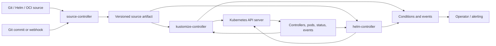

# Unit 3 — Flux: Controllers and Kustomize/Helm Reconciliation

**Target file:** `03-flux-controllers-and-kustomize-helm-reconciliation.md`  
**Module:** M08 — GitOps and Progressive Delivery | **Stage:** 2E — Production DevOps & Platform Engineering  
**Learning level:** L1 foundation → L2 controller operations → L3 architecture and security → L4 production operations and recovery  
**Estimated study time:** 24–36 hours, including Labs A–G; OCI Lab F is optional.  
**Prerequisites:** M01–M07, Git, `kubectl`, `kind`, Kubernetes workloads/RBAC, Helm and Kustomize fundamentals (M06), and GitOps principles from Unit 1.  
**Primary environment:** WSL2 Ubuntu or native Linux; approximately 4 CPU cores, 8 GB RAM and 30 GB free disk.  
**Last reviewed:** 2026-10-28. Official Flux documentation pages cited below were consulted during preparation. Static review only: the authoring environment did not run the labs or validate the examples against an installed Flux release.

> **SAFETY AND SCOPE** — All hands-on work in this lesson is for a disposable local cluster and synthetic workloads. Never use a production context, real credentials, customer data, or a repository whose write access could affect production. Keep Flux labs in a dedicated `kind` cluster named `gitops-flux-lab`; do not install Flux into the Argo CD lab cluster. Sample command output is illustrative, not claimed as observed. Before each mutation, confirm the context and target namespace.

## 1. Scope, outcomes, and how to use this lesson

Flux is a family of Kubernetes controllers built from the GitOps Toolkit ([architecture and components](https://fluxcd.io/flux/)). It continuously turns source artifacts—such as Git revisions, OCI artifacts and Helm chart sources—into cluster state. This unit teaches Flux-specific control loops and how to operate them safely. It does not replace M06's treatment of chart authoring and Kustomize basics, Unit 4's full promotion strategy, Unit 5's SOPS/secret-reference detail, Unit 6's general drift treatment, or Units 7–9's progressive-delivery design.

By the end, you should be able to:

1. Explain how `source-controller`, `kustomize-controller`, `helm-controller` and `notification-controller` cooperate, and verify which optional controllers are installed.
2. Distinguish a Kustomize `kustomization.yaml` file from a Flux `Kustomization` custom resource.
3. Bootstrap Flux so its own configuration is reconciled from Git, while understanding the initial trust and privilege boundary.
4. Deploy a small `scoring-api` using a Flux `GitRepository` plus Flux `Kustomization`, then compare that path with `HelmRelease`.
5. Configure pruning, health, dependencies, substitution, suspension, and Helm remediation without treating defaults as universal across releases.
6. Design a narrow tenant identity and prove its permissions with `kubectl auth can-i` and negative tests.
7. Diagnose source, dependency, Helm, substitution, pruning, RBAC and controller failures using conditions, events, logs and live-state evidence.
8. Decide between Argo CD and Flux based on observed needs and document the choice in an Architecture Decision Record (ADR).

### Learning sequence

- **L1 — Foundation:** controller graph, APIs, CLI, bootstrap and first reconciliation.
- **L2 — Practical operations:** Kustomize fields, Helm lifecycle, sources, intervals, suspend/resume and substitution.
- **L3 — Architecture:** tenancy, dependencies, repository patterns, image automation, notifications, source trust, drift and upgrades.
- **L4 — Production:** incidents, migration handoff, recovery, evidence and an evidence-based Argo CD vs Flux ADR.

### Evidence vocabulary

Keep these separate in notes and incident records:

| Evidence | Meaning | What it does not prove |
|---|---|---|
| Source artifact revision | Commit, chart version or artifact digest fetched by a source controller | That the intended objects were applied successfully |
| Rendered desired state | Output after Kustomize/Helm and substitutions | That the API server accepted it or the workload became healthy |
| Flux resource condition | Controller's view of the last reconciliation | That the application is meeting its SLO or business contract |
| Live Kubernetes state | Objects and fields currently stored by the API server | That they match the reviewed Git revision |
| Runtime signal | Probe, request, latency, error, queue or data-quality measurement | That every deployment dependency is correct |
| Audit evidence | Git commit/PR, controller status, events, command transcript and approval | That evidence was retained immutably unless the storage process ensures it |

A model inference endpoint can be `Ready` while serving an incorrect model artifact. A reconciled batch worker can run successfully against stale features. GitOps correctness is necessary but not sufficient for application correctness.

## 2. Flux mental model: a continuous control loop

Flux is not a command that runs once after a merge. It is a collection of controllers that repeatedly compare declared state with observed state and take corrective action. A source controller fetches content and exposes an artifact/revision; a reconciler consumes that artifact and applies resources; the API server and workload controllers update observed state; Flux records conditions and tries again on later events or intervals.



The exact graph depends on the source kind and resource types. A Flux `Kustomization` usually references a `GitRepository` or `OCIRepository` source artifact; a `HelmRelease` describes a Helm release and may refer to a chart source through its chart specification. Do not assume every Flux custom resource reads Git directly.

### Why the loop exists

A one-shot deploy can leave drift undetected. A controller makes reconciliation repeatable and makes failed attempts observable. But a control loop can also repeatedly re-apply a bad declaration. If a human scales a Deployment while Flux owns its replica count, a later reconcile may undo the change. The safe incident response is usually to make an approved change to the declared source or deliberately suspend the relevant reconciliation under a documented break-glass process—not to assume a manual patch will persist.

### Reconciliation triggers and intervals

Reconciliation may be triggered by source artifact changes, a resource spec change, a requested reconciliation annotation/CLI command, a configured webhook `Receiver`, or the next scheduled interval. Intervals are approximate; controller queues, rate limits, source latency and failures affect actual timing. Short intervals improve detection latency but increase source/API load and can amplify an outage. Use webhooks to reduce latency where appropriate, while retaining polling as a recovery path. A webhook endpoint is an input to the control plane and must be authenticated, network-restricted where possible, and monitored.

## 3. Controller responsibility map

| Component | Main responsibility | Operational signal | Common failure class |
|---|---|---|---|
| `source-controller` | Fetch Git repositories, Helm repositories/charts, OCI artifacts and buckets; publish source artifacts | Source CR conditions, artifact revision, logs/events | DNS/network, authentication, TLS/CA, missing branch/tag, rate limit, bad chart/artifact |
| `kustomize-controller` | Build and apply Kustomize content from a source; health-check resources; track inventory and prune when configured | Flux `Kustomization` conditions, last applied revision, inventory, events | invalid YAML/build, denied RBAC, missing substitution, health timeout, unintended prune |
| `helm-controller` | Drive Helm install/upgrade/test/remediation/uninstall lifecycle for `HelmRelease` resources | `HelmRelease` conditions, release history, events/logs | chart fetch failure, values error, hook/test failure, failed upgrade/remediation loop |
| `notification-controller` | Emit alerts and accept configured event/webhook triggers through `Receiver` resources | `Alert`/`Receiver` status, events, logs | invalid provider, missing token, unreachable webhook, bad event selection |
| `image-reflector-controller` (optional) | Scan image repositories and report tag/digest metadata | `ImageRepository` and `ImagePolicy` status | registry auth/rate limits, bad tag filter, unsupported architecture/metadata |
| `image-automation-controller` (optional) | Update marked image fields in Git and commit/push changes | `ImageUpdateAutomation` status and Git commit | no write permission, protected branch, invalid policy, push race/loop |

Controller inventory depends on the installation profile and release. Never assume image automation controllers are installed. Check rather than infer:

```bash
# Read-only checks; choose the explicit context for the Flux lab.
kubectl --context kind-gitops-flux-lab -n flux-system get deployments
kubectl --context kind-gitops-flux-lab -n flux-system get pods -o wide
flux --version
flux check --context=kind-gitops-flux-lab
```

The precise `flux check` context flag and command options are version-sensitive; verify `flux check --help` for the installed CLI. `flux check` reports whether expected Flux components/CRDs appear healthy for that CLI's checks; it is not an end-to-end proof that a Git source is reachable or that an application is healthy.

## 4. Core API vocabulary

The group/API versions below reflect current official documentation consulted for this lesson ([source APIs](https://fluxcd.io/flux/components/source/), [Kustomize API](https://fluxcd.io/flux/components/kustomize/api/v1/), [HelmRelease guide](https://fluxcd.io/flux/components/helm/helmreleases/)), but CRDs installed in a real cluster must be checked before applying manifests. If your installed Flux version differs, treat the schema as `[VERIFY]` and consult the versioned API reference.

| Kind | Typical API group/version | Purpose |
|---|---|---|
| `GitRepository` | `source.toolkit.fluxcd.io/v1` | Fetch a Git repository/ref and publish an artifact |
| `OCIRepository` | `source.toolkit.fluxcd.io/v1` | Fetch an OCI-distributed artifact; not synonymous with an OCI Helm chart |
| `HelmRepository` | `source.toolkit.fluxcd.io/v1` | Index-based Helm chart repository source |
| `HelmChart` | `source.toolkit.fluxcd.io/v1` | Chart artifact generated/fetched from a Helm source; often created/managed as part of HelmRelease source processing |
| `Bucket` | `source.toolkit.fluxcd.io/v1` | Object-storage bucket source, when the corresponding controller/provider configuration is available |
| Flux `Kustomization` | `kustomize.toolkit.fluxcd.io/v1` | Reconcile a source artifact into Kubernetes resources |
| `HelmRelease` | `helm.toolkit.fluxcd.io/v2` | Declare a Helm release lifecycle managed by helm-controller |
| `Receiver` | `notification.toolkit.fluxcd.io/v1` | Authenticated webhook receiver that can trigger source reconciliation for supported providers/events |
| `Alert` / `Provider` | `notification.toolkit.fluxcd.io/v1` | Select events and send notifications to a supported provider endpoint |
| `ImageRepository` / `ImagePolicy` / `ImageUpdateAutomation` | `image.toolkit.fluxcd.io/v1` | Optional image scanning, selection and Git write-back APIs |

Check installed CRDs and versions:

```bash
kubectl --context kind-gitops-flux-lab get crd | grep -E 'toolkit.fluxcd.io|image.toolkit.fluxcd.io'
kubectl --context kind-gitops-flux-lab explain kustomization.spec --api-version=kustomize.toolkit.fluxcd.io/v1
kubectl --context kind-gitops-flux-lab explain helmrelease.spec --api-version=helm.toolkit.fluxcd.io/v2
```

**Important distinction:** a Kustomize `kustomization.yaml` is a file describing resources, bases, patches, generators and transformations for Kustomize's build operation. A Flux `Kustomization` is a Kubernetes custom resource telling `kustomize-controller` which source path to build, how to apply it, how to assess health, and whether to prune. They are related but are not the same object.

### Source trust and Git permissions

A Git repository that Flux can read is a source of desired cluster state. Write access to a branch that Flux reconciles is effectively production write access for every resource the controller's identity is allowed to manage. Use protected branches, mandatory review, status checks, narrowly scoped deploy keys/tokens, secret rotation, and audit logging. Do not store real credentials in Git. Unit 5 covers SOPS and secret-reference management; this unit uses dummy values only.

## 5. Environment and version verification

Choose a supported compatibility set from official release documentation at the time you run the labs. Pin versions in your own notes and scripts; do not copy a floating `latest` tag into a repeatable exercise. This lesson intentionally does not invent an exact Flux, Kubernetes, Helm, or kind version number.

Record the environment before changes:

```bash
uname -a
kind version
docker version
kubectl version --client
flux --version
helm version --short
```

If using WSL2, ensure Docker Desktop's WSL integration or a native Docker Engine is configured consistently. The examples use Bash in Ubuntu. Check free resources (`free -h`, `df -h`, `nproc`) and stop unrelated local clusters or observability stacks if the laptop is resource constrained.

### `localhost` is not a cluster networking plan

Inside a pod, `localhost` points to that pod's network namespace, not your Windows host, not the WSL host, and not another Docker container. `kind` nodes are Docker containers, and pod routing adds another layer. Do not assume a host port or `localhost` Git URL works from `source-controller`.

For the local Git server, choose an endpoint reachable from the Flux controller's network context. Derive addresses from the actual local setup; do not hard-code a remembered Docker bridge IP. Verify using a disposable diagnostic pod in the Flux cluster with an image that contains `curl`/`nc`/`git`, or inspect from a controller pod if it has the needed tools. A diagnostic pod should be removed after the check. For example, with an endpoint placeholder replaced by the actual reachable DNS name/IP and port:

```bash
# Read-only except for creating a temporary diagnostic pod; use the dedicated context.
kubectl --context kind-gitops-flux-lab -n flux-system run netcheck \
  --image=curlimages/curl:<PINNED_TAG> --restart=Never --command -- \
  sh -c 'curl -fsS -o /dev/null -w "%{http_code}\n" http://<GIT_ENDPOINT>:<PORT>/'
kubectl --context kind-gitops-flux-lab -n flux-system get pod netcheck -w
kubectl --context kind-gitops-flux-lab -n flux-system logs netcheck
kubectl --context kind-gitops-flux-lab -n flux-system delete pod netcheck
```

Replace `<PINNED_TAG>`, `<GIT_ENDPOINT>` and `<PORT>` with values you have verified; the example is a template, not a command to paste unchanged. An HTTP 200/302 from a server root proves only that endpoint is reachable; it does not prove Git clone, SSH host-key trust, authentication, or repository permissions. Test the exact protocol used by the source.

## 6. Flux CLI, bootstrap and the trust boundary

### Install and inspect the CLI

Use the official Flux installation guide for your OS/architecture. Pin the chosen release, verify the downloaded binary/checksum according to the official instructions, and capture the CLI version. Avoid unofficial installer scripts. Then inspect supported subcommands rather than guessing:

```bash
flux --version
flux --help
flux bootstrap --help
flux bootstrap git --help
flux check --help
flux reconcile --help
```

### What bootstrap does

`flux bootstrap git` installs Flux components and related configuration into the cluster, writes/pushes Flux manifests into a Git repository, and creates a source plus reconciliation configuration so Flux can manage its own installation. That pattern is commonly described as **“Flux manages Flux.”** The bootstrap operator needs cluster-admin privileges for the initial cluster installation and push rights to the bootstrap repository. After bootstrap, routine changes should flow through reviewed Git commits, not ad hoc imperative edits to controller deployments.

Bootstrap does not automatically solve repository protection, secure credential storage, key rotation, backup retention, disaster recovery, branch governance, least-privilege tenant configuration, alerting, or the trustworthiness of commits. A controller cannot distinguish a malicious approved-looking commit from a valid one unless the repository and verification policies enforce the distinction.

### Generic local Git server

The official Flux docs provide a [generic Git-server bootstrap flow](https://fluxcd.io/flux/installation/bootstrap/generic-git-server/). The exact local server and network arrangement determine the URL and authentication. Use the documented generic command after confirming `flux bootstrap git --help` for the installed version. The template below uses SSH; values in angle brackets must be replaced and tested. Do not commit the private key.

```bash
# TEMPLATE ONLY — first confirm the dedicated context and actual reachable endpoint.
kubectl config current-context
kubectl config get-contexts
# Stop unless the current context is exactly kind-gitops-flux-lab.

flux bootstrap git \
  --context=kind-gitops-flux-lab \
  --url=ssh://git@<GIT_HOST_REACHABLE_FROM_CLUSTER>:<SSH_PORT>/<ORG>/<REPO> \
  --branch=main \
  --private-key-file=<PATH_TO_DEDICATED_LAB_KEY> \
  --path=clusters/gitops-flux-lab
```

**[VERIFY]** Confirm all flags against the installed CLI and generic bootstrap guide. If the local server's bootstrap flow or SSH routing is not supported by the version/provider you selected, use the documented generic Git-server method with a reachable SSH/HTTPS endpoint or a provider-supported local Gitea flow. Do not silently require a paid hosted repository. The cluster must be able to fetch the same source URL recorded in the resulting `GitRepository`.

After bootstrap, inspect:

```bash
flux check --context=kind-gitops-flux-lab
flux get sources git -A --context=kind-gitops-flux-lab
flux get kustomizations -A --context=kind-gitops-flux-lab
kubectl --context kind-gitops-flux-lab -n flux-system get deploy,pods,gitrepositories,kustomizations
kubectl --context kind-gitops-flux-lab -n flux-system describe gitrepository flux-system
kubectl --context kind-gitops-flux-lab -n flux-system describe kustomization flux-system
```

`flux get` syntax and global context options vary across CLI releases; if a form is rejected, consult `flux get --help` and `flux get sources git --help` and record the actual accepted syntax. Do not interpret an unknown flag as a Flux controller failure.

## 7. First reconciliation: GitRepository + Flux Kustomization

The first application example is a small FastAPI-style `scoring-api` with no external database and no real model. It exists to teach deployment mechanics. Build and push the image locally using M01/M06 practices, then replace the image placeholder with the actual immutable digest or a local registry reference reachable from `kind`. A digest is preferable for reproducibility; a mutable tag can move between reconciliations.

### Repository tree

```text
scoring-api-gitops/
├── clusters/
│   └── gitops-flux-lab/
│       └── apps.yaml
└── apps/
    └── scoring-api/
        ├── base/
        │   ├── kustomization.yaml
        │   ├── deployment.yaml
        │   └── service.yaml
        └── overlays/
            └── dev/
                ├── kustomization.yaml
                └── patch.yaml
```

`apps.yaml` declares the Flux reconciliation resource; the app path contains normal Kubernetes YAML and a Kustomize file. Bootstrap's own `flux-system` path should remain separate from application ownership.

### App manifests

`apps/scoring-api/base/deployment.yaml`:

```yaml
apiVersion: apps/v1
kind: Deployment
metadata:
  name: scoring-api
  labels:
    app.kubernetes.io/name: scoring-api
spec:
  replicas: 1
  selector:
    matchLabels:
      app.kubernetes.io/name: scoring-api
  template:
    metadata:
      labels:
        app.kubernetes.io/name: scoring-api
    spec:
      containers:
        - name: api
          image: registry.example.invalid/lab/scoring-api@sha256:<REPLACE_WITH_REAL_DIGEST>
          ports:
            - name: http
              containerPort: 8000
          readinessProbe:
            httpGet:
              path: /health
              port: http
            initialDelaySeconds: 2
            periodSeconds: 5
          livenessProbe:
            httpGet:
              path: /health
              port: http
            initialDelaySeconds: 5
            periodSeconds: 10
          resources:
            requests:
              cpu: 50m
              memory: 64Mi
            limits:
              cpu: 500m
              memory: 256Mi
```

`registry.example.invalid` is intentionally non-routable. Replace it with the local image registry/image digest used in M01/M06. Do not attempt to pull this placeholder.

`apps/scoring-api/base/service.yaml`:

```yaml
apiVersion: v1
kind: Service
metadata:
  name: scoring-api
spec:
  selector:
    app.kubernetes.io/name: scoring-api
  ports:
    - name: http
      port: 80
      targetPort: http
  type: ClusterIP
```

`apps/scoring-api/base/kustomization.yaml`:

```yaml
apiVersion: kustomize.config.k8s.io/v1beta1
kind: Kustomization
resources:
  - deployment.yaml
  - service.yaml
```

`apps/scoring-api/overlays/dev/kustomization.yaml`:

```yaml
apiVersion: kustomize.config.k8s.io/v1beta1
kind: Kustomization
namespace: scoring-api-dev
resources:
  - ../../base
patches:
  - path: patch.yaml
```

`apps/scoring-api/overlays/dev/patch.yaml`:

```yaml
apiVersion: apps/v1
kind: Deployment
metadata:
  name: scoring-api
spec:
  replicas: 1
```

### Flux source and reconciliation objects

`clusters/gitops-flux-lab/apps.yaml`:

```yaml
apiVersion: source.toolkit.fluxcd.io/v1
kind: GitRepository
metadata:
  name: scoring-api-config
  namespace: flux-system
spec:
  interval: 1m
  url: ssh://git@<GIT_HOST_REACHABLE_FROM_CLUSTER>:<SSH_PORT>/<ORG>/<REPO>
  ref:
    branch: main
  secretRef:
    name: scoring-api-config-auth
---
apiVersion: kustomize.toolkit.fluxcd.io/v1
kind: Kustomization
metadata:
  name: scoring-api-dev
  namespace: flux-system
spec:
  interval: 5m
  retryInterval: 1m
  path: ./apps/scoring-api/overlays/dev
  prune: true
  sourceRef:
    kind: GitRepository
    name: scoring-api-config
  targetNamespace: scoring-api-dev
  wait: true
  timeout: 2m
```

Before applying this file, create the `scoring-api-config-auth` secret through the documented Flux secret creation workflow, or configure a supported anonymous read-only endpoint for the disposable lab. Do not invent credentials. If you use a private SSH source, ensure the key/known-host setup matches the selected server and endpoint. The sample's `secretRef` must exist in `flux-system` and match the source authentication format.

The fields mean:

- `GitRepository.spec.interval`: how often the source is checked; not an exact schedule guarantee.
- `url` and `ref.branch`: source location and branch. Pinning a commit is possible for controlled experiments; a branch allows future reviewed commits to be followed.
- `Kustomization.spec.path`: directory built from the source artifact.
- `sourceRef`: identifies the source custom resource in the same namespace unless cross-namespace references are explicitly configured and allowed.
- `prune: true`: Flux tracks applied objects and can delete previously managed objects that disappear from the desired inventory. This is powerful and potentially destructive.
- `targetNamespace`: target namespace transformation; it does not create the namespace by itself. Declare the namespace separately or ensure it is provisioned first.
- `wait`/`timeout`: request health assessment and bound the operation; verify exact semantics against the installed API version.
- `retryInterval`: retry cadence after a failed reconciliation in versions that expose this field.

Create the namespace in a separate platform-owned manifest/Kustomization before this app reconciles. Do not let a tenant app create arbitrary namespaces as a workaround for missing ownership. Then use a deliberate context guard and apply the source/Kustomization objects via the Git path that owns them:

```bash
kubectl config current-context
kubectl config get-contexts
# Continue only if context is kind-gitops-flux-lab.
kubectl --context kind-gitops-flux-lab get nodes
kubectl --context kind-gitops-flux-lab get ns flux-system scoring-api-dev
```

The namespace and Flux objects should normally be committed to the source repository and reconciled by the bootstrap-managed path, rather than applied ad hoc forever. During initial lab setup, an explicitly documented one-time bootstrap apply may be used if the repository path is not yet wired. Review `kubectl diff`/rendered YAML first. After commit/push, observe:

```bash
flux get sources git -A --context=kind-gitops-flux-lab
flux get kustomizations -A --context=kind-gitops-flux-lab
kubectl --context kind-gitops-flux-lab -n flux-system describe gitrepository scoring-api-config
kubectl --context kind-gitops-flux-lab -n flux-system describe kustomization scoring-api-dev
kubectl --context kind-gitops-flux-lab -n scoring-api-dev get deploy,rs,pods,svc
kubectl --context kind-gitops-flux-lab -n scoring-api-dev get events --sort-by=.lastTimestamp
```

**Illustrative only:** a successful source commonly reports a ready condition and a revision resembling `main@sha1:<commit>`. A successful Flux Kustomization should report `Ready=True` and a last-applied revision corresponding to the source artifact. Exact condition reasons and status fields vary by resource/version. If not ready, inspect source first, then build/apply errors, then health checks and pod events.

Smoke test using a temporary port-forward:

```bash
kubectl --context kind-gitops-flux-lab -n scoring-api-dev port-forward svc/scoring-api 18080:80
# In another terminal:
curl -fsS http://127.0.0.1:18080/health
```

Stop the port-forward with Ctrl-C. Do not claim application health from Flux conditions alone; perform the HTTP request and record its result.

## 8. Flux Kustomization in practice

### Common fields and production consequences

| Field | Purpose | Risk/operational guidance |
|---|---|---|
| `spec.path` | Path inside the source artifact to build | A path move can change inventory and may prune old resources when pruning is enabled; review rendered output and deletion diff before merge |
| `spec.sourceRef` | Source object reference | Restrict cross-namespace references in shared clusters; source access is a trust boundary |
| `spec.interval` | Normal reconcile interval | Balance drift-detection latency and API/source load; not a real-time SLO |
| `spec.prune` | Garbage-collect managed resources no longer declared | Enable only with clear ownership and tested deletion behavior; keep critical stateful data outside casual app inventory |
| `spec.wait` | Wait/health assessment behavior | Useful for deployment readiness; can make an unrelated unready resource block the whole reconciliation |
| `spec.timeout` | Bound validation/apply/health work | Set from workload behavior and failure budgets, not arbitrary copying |
| `spec.retryInterval` | Retry interval after failures | A short retry can increase pressure during an outage; distinguish retry from source poll interval |
| `spec.dependsOn` | Gate reconciliation on another Flux Kustomization's readiness | Dependencies must be acyclic; dependency readiness is not the same as application SLO health |
| `spec.healthChecks` | Select resources for health assessment | When `wait: true` is enabled, the API documents healthChecks as ignored in the current schema; verify for the installed version |
| `spec.targetNamespace` | Set/override target namespace for namespaced resources | Does not create the namespace; avoid namespace ownership ambiguity |
| `spec.serviceAccountName` | Impersonate a ServiceAccount for apply operations | Security depends on actual RBAC, controller flags, namespace/source boundaries and remote-cluster configuration |
| `spec.postBuild.substitute` | Inline variable map for post-build substitution | Undefined variables can become empty strings; use strict local checks/CI validation and safe defaults |
| `spec.postBuild.substituteFrom` | Load variables from ConfigMaps/Secrets | Missing required reference fails by default; optional refs can hide absent configuration; never put plaintext secrets in Git |
| `spec.patches` | Flux-side patches to built objects where supported | Schema/patch forms are version-sensitive; prefer transparent Kustomize overlays for reusable transformations |
| `spec.suspend` | Pause subsequent executions | Does not automatically delete deployed resources or cancel every already-started operation |
| `spec.force` | Recreate resources when immutable-field patching fails | Can cause downtime/data loss for some resources; temporary, narrowly scoped use only |
| `spec.decryption` | Decrypt supported encrypted resources (commonly SOPS) | Keep key access narrow; details belong to Unit 5; never commit decryption keys |

Check the installed API rather than trusting an online page from another release:

```bash
kubectl --context kind-gitops-flux-lab explain kustomization.spec --api-version=kustomize.toolkit.fluxcd.io/v1
kubectl --context kind-gitops-flux-lab get crd kustomizations.kustomize.toolkit.fluxcd.io -o yaml
```

### Prune and inventory

Pruning is garbage collection for resources that the reconciler previously applied and tracks but that are absent from the current desired inventory. Removing a manifest or moving a path can therefore delete resources. Before a path move:

1. Render old and new paths locally and compare resource identities (`apiVersion`, kind, namespace, name).
2. Inspect the Flux Kustomization's inventory and `prune` setting.
3. Run the supported diff/render workflow and a CI check for unexpected deletions.
4. Decide whether the change is a rename/adoption, a true removal, or a migration requiring an explicit orphaning plan.
5. Merge only after a reviewer understands the deletion set; verify live state after reconciliation.

Never “test prune” against persistent data. For a disposable lab, use a throwaway ConfigMap or Deployment and observe the exact effect. Flux Kustomization deletion may also trigger garbage collection depending on deletion policy, finalizers and installed version. Check the current deletion behavior before deleting a reconciliation resource.

### Dependencies and health checks

`dependsOn` expresses a DAG of Flux Kustomization readiness. It is not a general dependency solver and cannot make a cycle converge. If `platform-crds` installs a CRD/operator and `platform-custom-resources` applies a custom resource, the latter should depend on the former and should not reconcile until the CRD/operator layer reports ready. A manifest being accepted does not necessarily mean the API is established or the operator has started reconciling.

For a CRD/operator pattern:

```yaml
apiVersion: kustomize.toolkit.fluxcd.io/v1
kind: Kustomization
metadata:
  name: platform-crds
  namespace: flux-system
spec:
  interval: 5m
  path: ./infrastructure/operator
  prune: true
  sourceRef:
    kind: GitRepository
    name: platform-config
  wait: true
  timeout: 5m
---
apiVersion: kustomize.toolkit.fluxcd.io/v1
kind: Kustomization
metadata:
  name: platform-custom-resources
  namespace: flux-system
spec:
  interval: 5m
  path: ./infrastructure/custom-resources
  prune: true
  sourceRef:
    kind: GitRepository
    name: platform-config
  dependsOn:
    - name: platform-crds
  wait: true
  timeout: 3m
```

These are representative complete Flux resources; the source path contents and source name must exist. If the first resource only applies a CRD but the API server/operator is not healthy yet, use a readiness check appropriate to the chosen operator. Do not assume `wait: true` detects every application-specific readiness condition. Diagnose cycles by inspecting every `dependsOn` edge and remove the cycle in Git.

### Suspend, reconcile, resume

Suspension is a control-plane lever, not a rollback. Suspending stops subsequent reconciliation; already-applied resources remain. Use it during a carefully scoped investigation when a loop would otherwise overwrite a temporary diagnostic change. Fix the source of truth, review the intended diff, then resume and verify.

```bash
# Confirm target before changing any Flux object.
kubectl config current-context
kubectl config get-contexts
kubectl --context kind-gitops-flux-lab -n flux-system get kustomization scoring-api-dev -o yaml

# Verify CLI syntax before use; these are common forms, not a substitute for --help.
flux suspend kustomization scoring-api-dev --context=kind-gitops-flux-lab
# Edit/fix source in Git and review the diff; do not leave the resource suspended.
flux reconcile source git scoring-api-config --context=kind-gitops-flux-lab
flux resume kustomization scoring-api-dev --context=kind-gitops-flux-lab
flux reconcile kustomization scoring-api-dev --with-source --context=kind-gitops-flux-lab
```

`flux reconcile --force` and `Kustomization.spec.force` are different controls. Do not confuse a CLI request to trigger a reconcile with the spec field that can recreate resources on immutable-field errors. Check `flux reconcile --help` for the installed CLI before using any force option.

### Post-build substitution: power and footgun

Flux substitution runs after Kustomize build. Current [Flux Kustomization documentation](https://fluxcd.io/flux/components/kustomize/kustomizations/) states that undefined `${var}` references are substituted with an empty string unless a default expression is used; substitution behavior can also depend on whether any variables are available and on `substituteStrategy`. This can produce syntactically valid YAML with a semantically invalid image or configuration. Treat missing-variable validation as a deployment safety gate.

```yaml
apiVersion: kustomize.toolkit.fluxcd.io/v1
kind: Kustomization
metadata:
  name: scoring-api-dev
  namespace: flux-system
spec:
  interval: 5m
  path: ./apps/scoring-api/overlays/dev
  prune: true
  sourceRef:
    kind: GitRepository
    name: scoring-api-config
  postBuild:
    substitute:
      IMAGE_REPOSITORY: registry.local/scoring-api
      IMAGE_DIGEST: sha256:<LAB_DIGEST>
      ENVIRONMENT: dev
```

The workload would reference `${IMAGE_REPOSITORY}@${IMAGE_DIGEST}` and a label/value `${ENVIRONMENT}`. Use a safe placeholder only for rendering exercises; never deploy a fake digest. If a required value must exist, fail closed in CI with a strict renderer and schema/policy checks. For local rendering, Flux documents `kustomize build ... | flux envsubst --strict`; verify the installed CLI syntax. A missing variable that renders to empty is not automatically guaranteed to fail reconciliation.

Native Kustomize `replacements` and patches are different: they copy or transform values between manifest fields during Kustomize build, while Flux `postBuild` substitution is a later string-variable pass. Prefer the simplest mechanism that keeps values explicit and validation enforceable. Use `substituteFrom` carefully; a missing ConfigMap/Secret reference normally fails unless marked optional. Unit 5 owns detailed SOPS design.

## 9. Helm reconciliation with HelmRelease

### Model

A `HelmRelease` is a Kubernetes custom resource consumed by `helm-controller` ([official guide and API examples](https://fluxcd.io/flux/components/helm/helmreleases/)). The controller performs Helm lifecycle actions—install, upgrade, tests where configured, remediation, rollback/uninstall behavior and release-state tracking—rather than merely using Helm templates as a rendering step. The chart can be sourced from `HelmRepository`, `OCIRepository`, or a Git source depending on the installed API/version and chart declaration form. Verify the current schema before using a source form.

A representative HelmRelease (using a chart source placeholder) is:

```yaml
apiVersion: helm.toolkit.fluxcd.io/v2
kind: HelmRelease
metadata:
  name: scoring-api
  namespace: scoring-api-helm
spec:
  interval: 5m
  timeout: 3m
  releaseName: scoring-api
  chart:
    spec:
      chart: scoring-api
      version: "<PINNED_CHART_VERSION>"
      sourceRef:
        kind: HelmRepository
        name: lab-charts
        namespace: flux-system
  values:
    replicaCount: 1
    image:
      repository: registry.local/scoring-api
      digest: "sha256:<LAB_DIGEST>"
  install:
    remediation:
      retries: 1
  upgrade:
    remediation:
      retries: 1
  test:
    enable: true
  driftDetection:
    mode: warn
```

This is a schema-oriented example, not a drop-in chart contract: `chart` value keys (`replicaCount`, `image.digest`) must match the chart's actual values schema. Some chart source forms use `chart.spec.chart` and a `sourceRef`; an OCI source can instead be referenced through the appropriate source kind/spec for the selected Flux release. Check `kubectl explain helmrelease.spec.chart --api-version=helm.toolkit.fluxcd.io/v2` and the official HelmRelease guide before adapting it. `driftDetection` mode support and exact behavior are version-sensitive `[VERIFY]`.

### `values` and `valuesFrom`

Inline `spec.values` provides declarative values in the HelmRelease. `spec.valuesFrom` loads values from ConfigMaps or Secrets in the HelmRelease namespace. Current documentation describes merging values references in list order, with later references overriding earlier ones, and inline values overriding them; `targetPath` can overwrite the target path. Verify this against your version and avoid relying on subtle precedence without a rendered-values test. Do not put credentials or secret data in plain inline values committed to Git.

### Install/upgrade remediation and history

Retries are not the same as unlimited healing. A failed install/upgrade may be retried or remediated according to configured policy; once retries are exhausted the release can remain failed until configuration changes or an operator intervenes. Negative retry values or other special semantics are version/API-specific and should never be copied without review. Helm release history can aid diagnosis, but it is not a substitute for a tested rollback plan or compatible database/schema changes. A rollback of application manifests cannot reverse irreversible data changes.

### Helm OCI source

M06 may provide a local OCI registry and chart artifact. Reuse it if it exists; otherwise use a local chart source from a repository reachable by the source-controller. A chart OCI URL usually uses an `oci://` scheme, but auth and reference syntax depend on the registry and Flux version. Use a template, not a guessed endpoint:

```yaml
apiVersion: source.toolkit.fluxcd.io/v1
kind: OCIRepository
metadata:
  name: scoring-api-chart
  namespace: flux-system
spec:
  interval: 5m
  url: oci://<REGISTRY_HOST_REACHABLE_FROM_CLUSTER>/<NAMESPACE>/<CHART>
  ref:
    tag: "<PINNED_CHART_VERSION>"
```

Confirm this exact shape against the installed source-controller CRD and official API docs. `OCIRepository` can provide an OCI artifact to a Flux Kustomization; an OCI Helm chart is consumed by Helm chart processing. These are distinct workflows even though both use OCI distribution. Do not use TLS bypass or `insecure` settings in production. If an isolated local registry requires insecure HTTP, explicitly label that setting lab-only, restrict it to the disposable environment, and remove it after the experiment.

### HelmRelease vs raw Helm CLI vs Flux Kustomization

| Dimension | Raw `helm upgrade` | Flux `HelmRelease` | Flux `Kustomization` applying rendered Kubernetes YAML |
|---|---|---|---|
| Trigger | Human/CI invocation | Controller reconciliation of a HelmRelease | Controller reconciliation of source path/artifact |
| State/history | Helm release storage/history | Helm lifecycle and release history managed by helm-controller | Flux resource inventory and Kubernetes object state; no Helm release lifecycle |
| Rollback/remediation | Explicit CLI/pipeline policy | Controller-configured install/upgrade remediation and Helm actions | Usually a new desired-state commit; rollback by reverting Git state, with resource-specific caveats |
| Hooks/tests | Helm CLI semantics | Helm controller invokes supported Helm lifecycle operations; verify chart hook/test behavior | Kubernetes YAML apply semantics; Helm chart hooks are not run as Helm lifecycle hooks if chart is only rendered elsewhere |
| `lookup`/render context | Helm CLI against the target cluster, depending on operation | Helm action behavior depends on chart/controller version and lifecycle | Rendering semantics differ; do not assume live-cluster `lookup` behaves the same |
| Drift | No continuous reconciler unless CI repeats | Optional version-sensitive Helm drift detection | Re-applies declared manifests on reconciliation; other controllers may own some fields |
| Best fit | One-off or CI-driven release where an external controller is not desired | Teams wanting Helm lifecycle semantics under GitOps | Plain manifests/Kustomize and explicit field-level desired state |

Flux Helm behavior should not be described as universally better than Argo CD. Argo CD commonly uses Helm as a template renderer and manages resulting Kubernetes objects as application resources; Flux `HelmRelease` uses Helm release lifecycle actions. Exact behavior around hooks, `lookup`, tests, `helm ls`, remediation and history depends on the implementation/version and chart. Use a chart-specific experiment before asserting equivalence.

## 10. Source artifacts, OCI, webhook receivers and reconciliation speed

### GitRepository

A `GitRepository` checks out a branch, tag, semver, commit or other supported ref and exposes an artifact/revision. Commit pinning improves repeatability but can reduce automatic movement unless the ref is intentionally updated. Branch-based sources follow reviewed changes but depend on branch protection and source availability. Use source status to establish which revision was actually fetched.

Git commit-signature verification is available through `GitRepository.spec.verify` in supported versions ([GitRepository docs](https://fluxcd.io/flux/components/source/gitrepositories/)) and depends on configured verification keys/mode. Verify the current schema and key-management procedure before enabling it. Signature verification answers a trust question about commits; it does not prove that the code is safe or the build artifact corresponds to the commit unless the broader supply chain links those claims.

### HelmRepository, OCIRepository and Bucket

- `HelmRepository`: source for charts from an index-based Helm repository.
- `OCIRepository`: source for OCI artifacts, including manifest bundles and supported chart distribution paths.
- `Bucket`: object-storage source when configured and supported.
- `HelmChart`: represents chart artifact resolution/packaging in the source-to-Helm path.

An immutable digest/version makes an artifact reference repeatable, but immutability alone does not prove authenticity. Use signing, verification, provenance and policy as appropriate (M12). Signature verification support for OCI artifacts is version- and configuration-dependent `[VERIFY]`; do not copy a cosign verification field from an unrelated CRD/API.

### `flux push artifact`, diff and build commands

The optional OCI artifact workflow can use `flux push artifact` where supported, then an `OCIRepository` plus Flux `Kustomization`. Before using it, inspect `flux push artifact --help` and the official artifact guide for required flags, media type, registry compatibility and authentication. If the local registry cannot support the workflow or the laptop budget is tight, use the guided walkthrough in Lab F and mark it not measured.

`flux build kustomization` and `flux diff` can help inspect rendered or proposed state in supported CLI releases. Verify their flags with `flux build kustomization --help` and `flux diff --help`. Local rendering can catch many YAML, Kustomize and substitution errors; it cannot prove API-server admission, cluster-specific defaulting, live permissions, controller health, image pullability or application correctness.

### Receiver and Alert/Provider

A `Receiver` is a configured webhook input ([Receiver API documentation](https://fluxcd.io/flux/components/notification/receivers/)). A `Provider` defines a notification destination, and an `Alert` selects event sources/severity/provider. Exact provider kinds and fields vary; use the installed CRD and official notification API docs. Store receiver tokens in Kubernetes Secrets created through a safe secret workflow; do not paste tokens into Git or terminal history. Use a local webhook sink for the lab, not a required SaaS.

Webhook-triggered reconciliation should complement polling, not become the only recovery path. Monitor dropped/unmatched events and failed deliveries. Protect the receiver with token verification and network controls, and do not expose it publicly just to make a local exercise easier.

## 11. Multi-tenancy and least-privilege impersonation

Flux controllers can have broad permissions by default. On a shared cluster, tenant-controlled Flux resources must not execute with an unrestricted controller identity. The core mechanism is native Kubernetes RBAC plus `spec.serviceAccountName` impersonation for Flux Kustomization/HelmRelease where supported. The service account must have only the permissions needed for that tenant. A namespace name is not a security boundary by itself; source reference permissions, controller flags, RBAC, admission policy and resource kinds all matter.

### Platform vs tenant ownership

| Platform team owns | Tenant team may own (when allowed) |
|---|---|
| Flux installation/bootstrap path, controller arguments, CRDs, shared source policies, cluster roles, namespaces and quota | Workload manifests within an assigned namespace, with a dedicated ServiceAccount and allowed source |
| Cross-namespace reference policy and source credentials | App-level values and releases that cannot escape tenant permissions |
| Admission guardrails, network policies, audit/alerting | Approved app-specific resources, not arbitrary cluster-scoped objects |

### Hardening flags

Official [Flux multi-tenancy guidance](https://fluxcd.io/flux/installation/configuration/multitenancy/) describes controller options such as `--no-cross-namespace-refs=true`, `--no-remote-bases=true` for kustomize-controller, and a default ServiceAccount setting. These are controller deployment settings, not fields to casually add to a Flux Kustomization. Exact supported flags/component names depend on the installed release; inspect controller args and the official hardening guide. A cross-namespace source reference restriction helps prevent a tenant from reusing another namespace's source object, but it is not a substitute for RBAC or admission policy.

`flux create tenant` is `[VERIFY]` for the installed CLI; do not make the lab depend on it. The underlying pattern can be assembled manually from Namespace, ServiceAccount, Role/RoleBinding, source/Kustomization resources, and controller hardening. Verify the installed command with `flux create --help` before relying on a helper.

### Permission testing

For a tenant identity, test allowed and denied actions explicitly:

```bash
kubectl --context kind-gitops-flux-lab auth can-i create deployments.apps \
  --namespace=scoring-api-tenant --as=system:serviceaccount:scoring-api-tenant:flux-reconciler
kubectl --context kind-gitops-flux-lab auth can-i create clusterrolebindings.rbac.authorization.k8s.io \
  --as=system:serviceaccount:scoring-api-tenant:flux-reconciler
kubectl --context kind-gitops-flux-lab auth can-i create deployments.apps \
  --namespace=another-tenant --as=system:serviceaccount:scoring-api-tenant:flux-reconciler
```

The first should be `yes` only if the intended Role allows it; the latter tests should be `no`. These commands ask the API server to evaluate authorization; they do not prove every admission control or Flux source boundary. Also test an actual apply attempt in the disposable lab and capture the expected `Forbidden` response. Never run tenant operations using cluster-admin credentials and then infer the tenant boundary from the success.

## 12. Repository layout and environment separation

A practical Flux repository often separates cluster bootstrap, shared infrastructure and applications:

```text
platform-config/
├── clusters/
│   ├── gitops-flux-lab/
│   │   ├── flux-system/        # bootstrap-owned Flux components/sync path
│   │   ├── infrastructure.yaml # Flux Kustomization references
│   │   └── apps.yaml
│   └── staging/
├── infrastructure/
│   ├── controllers/
│   ├── crds/
│   └── namespaces-and-rbac/
└── apps/
    └── scoring-api/
        ├── base/
        └── overlays/
            ├── dev/
            └── staging/
```

Keep bootstrap-managed files and application resources in clear ownership domains. The cluster path should define which infrastructure/app paths are reconciled; each Flux Kustomization should have a clear source, path, namespace, service account and prune policy. Do not use a single broad Kustomization with cluster-admin permissions for every tenant's content.

Argo CD commonly organizes around Applications/AppProjects and may use app-of-apps or ApplicationSets; Flux composes source and reconciliation CRDs. Both can use bases/overlays and environment-specific configuration. Unit 4 covers promotion strategy and repository layout in depth; here the goal is to understand how Flux controllers consume the layout.

## 13. Image automation and controlled write-back

Optional image automation consists of three concepts ([official image automation docs](https://fluxcd.io/flux/components/image/)):

1. `ImageRepository` scans an image repository and records available tags/digests.
2. `ImagePolicy` chooses an image according to a policy (for example, semver range or tag filtering/sorting).
3. `ImageUpdateAutomation` updates marked fields in a Git source and commits/pushes changes.

Verify that image-reflector and image-automation controllers were installed, and check API versions/CRDs before applying these resources. The APIs are commonly in `image.toolkit.fluxcd.io/v1`, but release compatibility and fields should be checked. Image automation is not mandatory for a basic Flux installation.

### Safer operating model

| Pattern | Benefits | Risks/controls |
|---|---|---|
| CI opens a pull request with an image digest | Review, CI checks, policy and promotion gates remain explicit | Requires bot identity/branch workflow; ensure PR is not auto-approved blindly |
| Flux writes to a dedicated update branch | Native reconciliation loop and auditable commit; branch protection can remain intact on main | Requires write credential; ensure PR creation/review is integrated and update branch is bounded |
| Automation commits directly to protected `main` | Lowest friction | Not the default recommendation: can bypass human review and pipeline gates; only consider under explicit risk acceptance and strong validation |

Use immutable image digests where feasible; tag-based policies should select only from approved registries and allowed version patterns. Do not write back to the same branch in a way that causes a self-triggering loop. Protect commit credentials, sign commits where policy requires, and capture the old/new digest in commit messages and release evidence. For model-serving services, promote a validated image/model artifact together with its provenance and compatibility checks; do not let “newest tag” silently promote an unvalidated model.

## 14. Notifications, source verification and security controls

### Notification workflow

An `Alert` selects event sources and severity, then refers to a `Provider` that delivers events. A `Receiver` accepts supported inbound events and can trigger source reconciliation. Use the installed CRD schemas:

```bash
kubectl --context kind-gitops-flux-lab explain alert.spec --api-version=notification.toolkit.fluxcd.io/v1
kubectl --context kind-gitops-flux-lab explain provider.spec --api-version=notification.toolkit.fluxcd.io/v1
kubectl --context kind-gitops-flux-lab explain receiver.spec --api-version=notification.toolkit.fluxcd.io/v1
```

Create a local sink only after verifying its network path. For a receiver, the referenced Secret and expected token key must exist; the generated webhook path should be treated as sensitive operational information even where the token is the main authentication mechanism. Never paste real tokens into command arguments or source control.

### Security checklist

- Protect the bootstrap repository and branch; require review for changes that can alter controller config/RBAC.
- Use read-only source credentials for application Git reads and separate, narrow write credentials for image automation.
- Keep cluster-admin use limited to bootstrap and approved platform operations.
- Use a dedicated namespace and ServiceAccount per tenant; verify permissions and deny cluster-scoped objects by default.
- Restrict cross-namespace references and remote bases according to the tenant model.
- Pin controller/CLI versions and review release notes before upgrades.
- Verify Git commit/OCI signatures where the installed version and threat model support it; verification keys and trust roots must be protected.
- Use SOPS/secret references rather than plaintext secrets in Git (Unit 5).
- Apply network policy and egress controls appropriate to source registries/Git servers (M04).
- Use admission policy and CI checks to block forbidden kinds, unpinned images, unexpected namespace targets and dangerous `force`/prune changes (M12).
- Retain evidence: Git commit/PR, Flux conditions, revision, events, workload status and smoke-test result (Unit 13).

A signature only authenticates a signing identity under a configured trust policy; it does not prove a workload is safe, and an immutable artifact does not prove who produced it. Supply-chain assurance is layered: source review, build provenance, artifact identity, signature verification, deployment policy and runtime monitoring.

## 15. Drift, field ownership and controller conflicts

A Flux Kustomization typically rebuilds and reapplies declared resources during reconciliation. This can correct some out-of-band changes, but exact field-level behavior depends on apply strategy, managed fields, API defaults, admission mutation and other controllers. HelmRelease drift detection is a separate version-sensitive capability; current docs describe `warn` and `enabled` modes in supported versions, with enabled mode attempting correction after comparing the Helm-stored manifest against live state.

Classify drift before “fixing” it:

- **Unauthorized drift:** a human or external tool changes a field outside the approved process; investigate and restore through Git or policy.
- **Expected controller-owned fields:** HPA manages replicas; an operator manages generated resources; admission may inject sidecars/defaults. Avoid declaring conflicting values as desired state.
- **Benign normalized differences:** API defaulting or admission mutation; document and, where supported, configure a narrowly scoped ignore/ownership policy rather than hiding broad differences.
- **Security-relevant drift:** image identity, service account, RBAC, network policy, privilege settings; alert and treat as higher severity.
- **Unmanaged resources:** objects outside Flux inventory may not be corrected or pruned by a given Kustomization. Build inventory-vs-live checks and use admission controls to prevent untracked production changes; Flux does not automatically provide every orphan-monitoring feature found in other products.

For HPA-managed replicas, do not hard-code a conflicting replica value in a way that causes a tug-of-war. For rollout controllers, do not let Flux and the rollout controller both own fields such as traffic routing or replica strategy without a deliberate ownership model. Progressive-delivery integration is a coordination problem: Argo Rollouts often pairs naturally with Argo CD and Flagger with Flux, but interoperation can be possible; verify the design and never have two controllers independently manage the same resource fields.

## 16. Upgrade, observability and recovery readiness

### Upgrade strategy

1. Record current CLI/controller versions, installed CRDs, bootstrap path and source revision.
2. Read official Flux release notes and compatibility guidance; check Kubernetes support and API removals.
3. Test controller and CRD upgrades on a disposable cluster with representative sources and Helm charts.
4. Review the Git diff for generated component manifests and controller arguments.
5. Apply through the bootstrap-managed Git path where possible; do not make a second ad hoc installation the source of truth.
6. Verify controller readiness, source reconciliation, Kustomization/HelmRelease status and application smoke tests.
7. Keep a rollback/restore plan for Git config, controller manifests and required secrets/keys.

`flux install --export` can be useful for exporting install manifests in supported CLI versions. Verify the exact syntax with `flux install --help` before use. Re-running bootstrap is not a generic fix for every controller failure; first understand whether the issue is source authentication, API/CRD compatibility, RBAC, network, or reconciliation configuration.

### Observability

Use lightweight evidence before installing a full monitoring stack:

```bash
kubectl --context kind-gitops-flux-lab -n flux-system get pods
kubectl --context kind-gitops-flux-lab -n flux-system get events --sort-by=.lastTimestamp
kubectl --context kind-gitops-flux-lab -n flux-system logs deploy/source-controller --since=15m
kubectl --context kind-gitops-flux-lab -n flux-system logs deploy/kustomize-controller --since=15m
kubectl --context kind-gitops-flux-lab -n flux-system logs deploy/helm-controller --since=15m
```

Deployment names can differ if components were customized. Use `kubectl get deploy -n flux-system` first. Conditions, `observedGeneration`, source revision, last attempted/applied revision, events and controller logs together usually narrow the failure. Not every CRD exposes identical status fields.

Metrics may be exposed by Flux components, but scrape configuration and exact metric names depend on release. Do not install Prometheus/Grafana as a mandatory prerequisite for this laptop lab. M11 covers full observability. Basic operational signals to track include reconcile failures/duration, time since last successful source revision, stalled resources, repeated Helm remediation, webhook delivery failures, controller restarts/resource use and application-level SLOs.

### Recovery from bootstrap repository loss

The bootstrap repository is a source of truth but not a complete backup of secrets, signing keys, private Git credentials, registry state, external services or data. Recovery requires restoring repository contents and trust credentials, recreating a compatible cluster/Flux installation, restoring source access, and verifying ownership/adoption before enabling prune. Do not assume re-bootstrap is safe if an existing cluster already contains managed resources. Keep secrets and key recovery documented separately from Git, with access controls and tested restoration (M13).

## 17. Argo CD vs Flux: evidence-based decision framework

Neither product is a universal winner. Argo CD is application-centric and provides a strong UI/application view; Flux is a composable controller toolkit whose APIs fit Kubernetes-native declarative workflows. The practical choice depends on team skills, operating model, policy needs, debugging habits, Helm lifecycle requirements and platform architecture.

| Decision factor | Argo CD | Flux | Evidence to collect |
|---|---|---|---|
| Operating model | Application/AppProject-centric with UI and app health/sync views | Composable source/reconciler CRDs; `flux` CLI plus Kubernetes status/events | Time to trace one change from Git to live workload |
| Helm | Commonly renders chart output and applies resulting resources | `HelmRelease` drives Helm lifecycle actions | Hook/test/lookup/history experiment on the actual chart |
| Kustomize | Renders Kustomize sources through repo-server | kustomize-controller reconciles Kustomize build output | Render parity, patch debugging and ownership behavior |
| Multi-tenancy | AppProjects, destination/resource allowlists and RBAC | Kubernetes RBAC, service-account impersonation and controller hardening | Positive/negative tests from Labs D and Unit 2 |
| Image automation | Often delegated to CI/bots or ecosystem tools | Optional image-reflector/image-automation controllers can write Git updates | Review workflow, branch protections, policy controls and write credential scope |
| UI/ecosystem | Strong built-in UI and application-centric workflows | CLI/Kubernetes-native; external UI integrations may be added | Who operates it on-call and what evidence they need |
| Footprint | Depends on components, HA and repo load | Depends on controllers, sources and optional image components | Measure `kubectl top` only if metrics are available; otherwise “not measured” |
| Drift | Sync/self-heal behavior and diff settings | Kustomization re-apply plus version-sensitive Helm drift detection | Change a disposable field and observe the correction timeline |
| Progressive delivery | Natural pairing with Argo Rollouts | Natural pairing with Flagger | Verify supported integration and resource-field ownership |
| Debugging | UI diff/health plus controller/repo-server logs | CR conditions, `flux get`, events and controller logs | Time-to-diagnosis during a controlled failure |
| Recovery | Rebuild config and carefully re-adopt Applications/resources | Restore bootstrap path and reconcile with ownership safeguards | Test on disposable cluster; record what must be restored outside Git |
| Team skill | Useful if teams already operate Argo CD and need UI-centric workflows | Useful if teams prefer composable controllers and Kubernetes-native APIs | Interview operators and measure routine task friction |

### Learner-completed decision matrix

For every row, record `measured`, `not measured`, or `documented only`; include the command/commit/observation and date. Do not invent resource usage if `metrics-server` is absent. Unit 2's Argo CD observations may be reused only if they are still available and from a comparable local environment. Differences in versions, workload, machine load and installed optional controllers invalidate simplistic benchmark comparisons.

### ADR template

```markdown
# ADR-00X: Select GitOps controller for <platform/team>

- Status: Proposed / Accepted / Superseded
- Date:
- Owners:

## Context and constraints
- Workload/team shape:
- Existing skills and support model:
- Required audit/security controls:
- Resource/operational constraints:

## Alternatives
- Argo CD:
- Flux:
- Coexistence (only with explicit non-overlapping ownership):

## Decision
<One choice and why the evidence supports it.>

## Consequences and trade-offs
- Positive:
- Negative:
- Security/permissions:
- Failure and recovery:
- Migration/ownership:

## Evidence
- Lab observations and commands:
- Version matrix:
- Unknowns / not measured:

## Reconsideration triggers
- Team/product changes:
- New compliance requirement:
- Support/scale boundary:
```

## 18. Safe migration and ownership handoff

Migrating between Argo CD and Flux is an ownership transfer, not merely installing a second controller. A dangerous cutover allows the old controller to prune resources after the new controller starts applying them, or allows both controllers to fight over the same fields.

### Inventory before cutover

- Application/Flux Kustomization/HelmRelease resources and their source refs, namespaces and target clusters.
- Resource inventory, labels/annotations used for tracking, finalizers and deletion policies.
- Pruning/self-heal behavior and any automated deletion policy.
- Helm release names, namespaces, storage/history and values/chart versions.
- ServiceAccounts and RBAC used by both controllers.
- CRDs, operators, hooks, Jobs and stateful resources.
- External dependencies and secrets/keys that are not stored in Git.

### Staged cutover

1. Freeze unrelated config changes and export an ownership inventory.
2. Render the intended target state and compare resource identities against live state.
3. Identify how the source controller tracks resources and how the target controller will adopt them. Tracking labels/annotations differ and are version-sensitive `[VERIFY]`.
4. Disable old-controller pruning or use a documented orphan/adoption mode before handoff. Verify exact deletion semantics on the installed versions; do not assume that deleting an Application/Kustomization is harmless.
5. Configure the new controller against a read-only/dry-run or non-pruning path first where the product supports it. Validate namespace/resource permissions and compare diffs.
6. Switch ownership for a small noncritical application. Confirm both controllers do not manage the same resources/fields.
7. Expand in batches after health, event, smoke-test and audit checks pass.
8. Retain an abort window. If unexpected deletion/drift occurs, stop further rollout, suspend the relevant controller safely, restore source state and recover ownership before resuming.
9. Remove the old controller only after inventory confirms it no longer owns resources and recovery is tested.

### Abort criteria

Abort if the new controller's rendered identity set differs unexpectedly, resource deletion is proposed, Helm release state cannot be explained, tenant permissions are broader than expected, or application SLOs regress. Record a post-cutover ownership check in the change ticket. Avoid installing both controllers in the same cluster unless the ownership map and conflict plan are explicit.

## 19. Production incident playbooks

Every incident should follow: **symptom → evidence → containment → recovery → prevention/alerting → verification**. Keep a timestamped timeline, Git commit/revision, controller conditions, events, logs and application signals. Sample details below are illustrative failure patterns, not actual incident reports.

### 19.1 Dependency failure stalls downstream reconciliation

- **Symptom:** dependent Flux Kustomization is not ready; resources are absent or stale.
- **Evidence:** `kubectl describe kustomization`, dependency condition, source revision, events and logs; inspect the upstream resource's readiness and its own dependencies.
- **Containment:** do not repeatedly delete the dependent resource; stop changes that deepen the dependency chain.
- **Recovery:** repair the upstream CRD/operator or its source; break any cycle in Git; reconcile upstream, verify readiness, then reconcile downstream.
- **Prevention:** acyclic dependency graph, bounded timeouts, operator readiness checks, alert on time-stalled dependencies.
- **Verification:** upstream `Ready=True`, downstream observed generation/revision current, custom resource accepted, app smoke test passes.

### 19.2 HelmRelease remediation/rollback loop

- **Symptom:** repeated failed install/upgrade actions; release is not ready or cycles through remediation.
- **Evidence:** HelmRelease conditions/events, helm-controller logs, chart version, rendered values, Helm release history and failing hook/test Job.
- **Containment:** suspend the specific HelmRelease only if needed to stop repeated actions; preserve history/logs; avoid broad controller shutdown.
- **Recovery:** identify whether chart, values, permissions, immutable fields or hook behavior caused failure. Commit a corrected chart/values change; if required, follow a reviewed Helm recovery procedure. Do not assume rolling back the chart reverses database changes.
- **Prevention:** test chart in CI, set bounded retries/timeouts, validate values schema, make hooks idempotent and alert on repeated failures.
- **Verification:** release reports ready, deployed revision matches the intended chart/values, hooks/tests are complete, app-level smoke tests and SLOs pass.

### 19.3 Git/source server unavailable or rate-limited

- **Symptom:** source artifact stops advancing; downstream resources continue to reflect the last successful revision.
- **Evidence:** `GitRepository` readiness/reason, source-controller logs, DNS/TLS/auth checks from controller network context, server status/rate-limit response.
- **Containment:** avoid emergency commits to an unreviewed alternate source; preserve the last known good revision and pause risky promotions.
- **Recovery:** restore DNS/network/auth/certificate or wait for rate-limit recovery; reconcile source and then dependent resources.
- **Prevention:** local/hosted Git availability design, least-privilege credentials, backoff, rate-limit monitoring, backup repository and documented recovery.
- **Verification:** source reports the expected revision, reconciliation succeeds, workload is healthy and no unintended prune occurred.

### 19.4 Missing substitution deploys empty/wrong image value

- **Symptom:** reconciliation succeeds or fails at pull time with an invalid/empty image reference.
- **Evidence:** rendered manifest from strict local build, Git diff, Flux Kustomization conditions and pod events (`ErrImagePull`/`InvalidImageName` where applicable).
- **Containment:** suspend the one affected reconciliation if it is repeatedly applying bad state; do not pull a dangerous external image to test the failure.
- **Recovery:** restore the previous known-good digest in Git; add required-variable validation; reconcile and confirm the live image digest.
- **Prevention:** strict `envsubst`, schema/policy validation, required fields and CI tests for missing/empty values.
- **Verification:** rendered image is the expected digest, pod is ready, smoke test passes and the Git revision is recorded.

### 19.5 Prune deletes resources after a path move

- **Symptom:** resources disappear after a source path/layout refactor.
- **Evidence:** Kustomization inventory, source revision, events, Git diff and object audit logs if available.
- **Containment:** stop further path edits and suspend the affected reconciler if it is still deleting resources; do not delete the Kustomization blindly.
- **Recovery:** restore the prior manifests/path or apply a deliberate adoption/orphaning plan; restore data from backup if persistent state was affected.
- **Prevention:** resource-identity diff in CI, prune-aware review, stateful-resource ownership separation and a tested path-migration runbook.
- **Verification:** expected resources exist, new controller inventory tracks them, no duplicate ownership and data integrity checks pass.

### 19.6 Tenant references another tenant's source

- **Symptom:** a tenant's Flux object references a source outside its namespace or accesses content it should not control.
- **Evidence:** sourceRef namespace, controller `--no-cross-namespace-refs` configuration, RBAC, resource events and audit logs.
- **Containment:** suspend the offending tenant reconciliation and revoke inappropriate source permissions; preserve evidence.
- **Recovery:** move the source to the tenant's approved namespace or use a platform-approved shared source design; enforce controller hardening and policy.
- **Prevention:** admission policy, cross-namespace reference restrictions, namespace-scoped source permissions and negative tests.
- **Verification:** forbidden reference is rejected or cannot reconcile; allowed tenant source remains ready; `kubectl auth can-i` matches intended permissions.

### 19.7 Controller RBAC is too broad

- **Symptom:** tenant reconciliation can create cluster-scoped or cross-tenant resources.
- **Evidence:** `kubectl auth can-i`, Role/ClusterRoleBindings, controller arguments and a harmless negative-test object in the lab.
- **Containment:** block tenant write paths and suspend affected reconciliation; do not test exploit-like writes in production.
- **Recovery:** remove broad bindings, introduce tenant ServiceAccount impersonation and restrict source refs; verify bootstrap/platform ownership remains functional.
- **Prevention:** least-privilege RBAC tests, admission policies and periodic access reviews.
- **Verification:** permitted namespaced operations succeed; cluster-scoped and other-tenant operations return `Forbidden`.

### 19.8 `force: true` recreates a resource

- **Symptom:** an immutable-field change triggers resource replacement and possible downtime.
- **Evidence:** Kustomization spec, manifest diff, events and workload availability timeline.
- **Containment:** remove persistent broad `force` setting; stop the next reconciliation if necessary.
- **Recovery:** restore valid selector/configuration or perform an explicit migration with a replacement resource and traffic plan.
- **Prevention:** use force only temporarily and narrowly, review immutable fields, test replacement on a disposable cluster.
- **Verification:** no unexpected recreation remains, availability recovers and the spec no longer carries an unnecessary force flag.

### 19.9 Image automation commits a bad tag to main

- **Symptom:** a new image is promoted without expected validation or the workload degrades.
- **Evidence:** automation commit, policy selection, image digest/signature/provenance, Git branch protections and app SLOs.
- **Containment:** stop further image automation; revert to the last known-good digest via reviewed Git change; do not mutate the live pod as the only fix.
- **Recovery:** correct policy/filter or image reference, run security/functional tests and resume on a protected update branch.
- **Prevention:** PR-based updates, branch protection, signed/verified artifacts, allowlisted registries and rollout health gates.
- **Verification:** expected digest is deployed, CI/policy checks pass, and the automation cannot bypass required review.

### 19.10 Flux controller unavailable or CRD upgrade fails

- **Symptom:** source/reconciliation resources stop progressing, API objects reject new fields, or controller pods crash.
- **Evidence:** deployment/pod status, logs, CRD schemas, events, last successful source revision and release notes.
- **Containment:** pause rollout of further controller changes; avoid deleting CRDs or the bootstrap repository.
- **Recovery:** follow the version-specific upgrade/rollback guidance; restore compatible controller manifests and CRDs from a tested source; restore source credentials if needed.
- **Prevention:** staged upgrades, release-note review, ephemeral-cluster test, backup of bootstrap config and external secrets/keys.
- **Verification:** controllers ready, CRDs established, source reconciles, Flux self-management path is healthy and applications pass smoke tests.

## 20. Incident case studies and blameless review

### Case A — Missing variable produced an empty image tag

**Illustrative timeline:** T+00 a refactor renames `IMAGE_DIGEST`; T+04 the source reconciles; T+05 a pod reports an invalid/unpullable image; T+08 the on-call finds the rendered manifest used an empty value; T+15 a revert restores the last known-good digest; T+25 CI guard is added.

**Root cause:** variable naming was implicit and CI validated YAML syntax but not semantic completeness. **Immediate mitigation:** revert to known-good Git state, pause only the affected reconciler if repeated attempts are harmful, verify deployed image digest. **Prevention:** strict substitution and a policy requiring immutable image identity. **Blameless postmortem:** the system allowed a missing required value to pass review; improve the guard rather than attributing failure to an individual. Action items need owners and dates.

### Case B — Prune deleted resources after a path move

**Illustrative timeline:** T+00 directory refactor moves manifests; T+05 source artifact updates; T+06 Flux inventory no longer matches the path; T+07 old resources are pruned; T+12 the team restores the prior path and stops further edits; T+40 ownership/adoption plan is validated.

**Root cause:** the refactor was reviewed as a file move rather than a resource-identity/ownership change. **Mitigation:** stop further reconciliation if needed, restore the source layout, and restore any affected data from tested backups. **Prevention:** CI diff by resource identity, prune-aware code review and a path migration checklist. **Verification:** expected live objects exist and are tracked by the intended reconciler.

### Case C — Cross-tenant source reference

**Illustrative timeline:** tenant config references a shared namespace source; platform policy allows cross-namespace refs; source access exceeds intended tenant boundary; audit detects unexpected reference; reconciliation is suspended and source scope is corrected.

**Root cause:** namespace separation was treated as sufficient security. **Mitigation:** block the reference, review controller permissions and inspect affected changes. **Prevention:** hardening flags, admission rules and negative tests. **Verification:** the invalid sourceRef fails and approved tenant resources still reconcile.

### Case D — Helm remediation loop

**Illustrative timeline:** chart upgrade adds a failing hook; controller retries according to remediation policy; repeated events obscure the original error; on-call inspects hook Job logs and values; chart is reverted and a corrected hook is merged.

**Root cause:** the hook was not idempotent and the failure policy was not tested. **Mitigation:** pause the release if needed and preserve Helm history/logs; do not assume rollback undoes external side effects. **Prevention:** hook idempotency, bounded remediation, chart tests and explicit database compatibility plans. **Verification:** release is ready and external state is consistent.

### Case E — Image automation bypassed review

**Illustrative timeline:** policy selects a new tag; automation pushes directly to main; cluster reconciles it; runtime metric regresses; team reverts digest and disables direct write-back; PR flow is implemented.

**Root cause:** a write-capable controller was granted a protected-branch bypass. **Mitigation:** restore the previous known-good digest and stop direct commits. **Prevention:** update branch plus PR, protected main, required CI, artifact verification and rollout health checks. **Verification:** the bot cannot update main without approved checks.

For each case, record impact, detection gap, contributing conditions, recovery time, corrective actions, owners and due dates. Avoid blame; do not confuse “a human made a mistake” with the system design that permitted an unsafe action.

## 21. Mandatory hands-on labs

Every lab below is local-only and uses the dedicated `kind-gitops-flux-lab` cluster. Times and resource estimates are planning estimates, not measured benchmarks. A local Gitea/Git server plus `kind` and Flux may be tight on an 8 GB machine; run one stack at a time, disable optional components, and stop unrelated clusters. No paid account is required.

### Lab A — Bootstrap Flux in a separate kind cluster

**Objectives:** create a dedicated cluster; install/check Flux CLI; bootstrap from a local Git server; verify controller inventory, source sync and self-management.  
**Duration:** 2–4 hours. **Footprint:** approximately 2–3 CPU cores and 2–4 GB RAM for kind + Flux, plus Git server; varies by release.

**Prerequisites:** Docker/Podman, kind, kubectl, Git, Flux CLI installation instructions, a local Git server with an empty lab repository, and a dedicated SSH key. Keep the Git server data volume separate from the cluster. Do not reuse a production key.

**Safety and context guard:**

```bash
kind create cluster --name gitops-flux-lab
kubectl config current-context
kubectl config get-contexts
kubectl --context kind-gitops-flux-lab get nodes
```

If the context is not `kind-gitops-flux-lab`, stop. Do not run `kind delete cluster` until the cluster name is verified and the lab is explicitly disposable.

**Local Git server:** run a lightweight Gitea container or a minimal Git server on the laptop using a pinned image/version and a persistent local data volume. The exact image tag and Gitea bootstrap flow are intentionally left to the currently supported official image docs; do not use `latest` in a repeatable run. Publish the SSH endpoint on a chosen host port and verify host access. Then attach/configure networking so the controller pods can reach the same Git server endpoint. Derive actual Docker network/IP/DNS from the live environment and test from the Flux controller network context; do not assume `localhost` or a stable Docker IP. If this network path cannot be verified, do not bootstrap with a URL that only works from the host. Use the official generic Git-server bootstrap method or documented Gitea provider flow supported by the installed Flux CLI.

**Bootstrap steps:**

1. Create an empty repository named `platform-config-lab` and a dedicated SSH key pair. Add only the public key to the lab repository with the required write permission for bootstrap. Protect the repository from accidental deletion and do not reuse credentials.
2. Confirm the repository URL can be fetched from inside the cluster network and pushed from the host CLI. Test SSH host-key verification and authentication.
3. Review `flux bootstrap git --help` and the official generic Git server docs. Use the template in Section 6 with the actual endpoint, port, repository and key path. Confirm `--context` and SSH flags are supported before execution.
4. Wait for controllers and CRDs. Inspect `flux check`, deployments, pods, GitRepository and Kustomization status.
5. Inspect the generated `clusters/gitops-flux-lab/flux-system/` files in Git and confirm the cluster path points to that repository path.
6. Make a harmless change to a lab-owned ConfigMap via Git, commit and push, then observe source revision and reconciliation. This proves the loop works end-to-end.

**Expected observations (illustrative):** Flux controller deployments become available; the bootstrap GitRepository reports a revision; the bootstrap Kustomization reaches `Ready=True`; the harmless ConfigMap appears after the next reconcile. Actual condition reason strings and timing depend on release and local load.

**Success criteria:** correct cluster context; Flux CLI/CRD versions recorded; all expected controllers ready; source revision visible; a reviewed Git commit causes the harmless resource to change; no Argo CD installed in this cluster.

**Failure injection:** temporarily use an invalid branch in a disposable source or a non-existent repository path, then observe source/Kustomization conditions and events. Restore the valid source in Git. Do not break the bootstrap source for longer than needed; use a separate throwaway `GitRepository` if uncertain.

**Cleanup:** remove only the lab application resources and then, if you are intentionally resetting the whole exercise, verify `kubectl config current-context`, confirm `kind-gitops-flux-lab`, and run `kind delete cluster --name gitops-flux-lab`. Keep or delete the local Git data explicitly; do not let cluster cleanup accidentally erase the source-of-truth repository. Never run broad wildcard deletes.

**Troubleshooting:** if bootstrap fails, distinguish CLI/flag errors, host push permission, pod-to-Git network reachability, SSH known-host mismatch, auth failure, source revision fetch, and controller readiness. Capture the exact error before changing multiple variables.

### Lab B — Deploy the same app with Flux Kustomization and HelmRelease

**Objectives:** deploy a small API from local Git via Kustomize; deploy an equivalent version via HelmRelease without double ownership; compare status, drift, Helm history and operational debugging.  
**Duration:** 3–5 hours. **Footprint:** 2–3 CPU cores, 2–4 GB RAM including the existing cluster; use one variant at a time.

**Prerequisites:** Lab A, local image available to kind, and either the M06 local OCI chart registry or a local chart committed in the Git repository. If the OCI registry is not available, the fallback chart can live in the Git source; this tests HelmRelease lifecycle but not the local OCI registry path.

**Safety and guard:**

```bash
kubectl config current-context
kubectl config get-contexts
kubectl --context kind-gitops-flux-lab get nodes
```

Continue only with the dedicated Flux cluster. Use separate namespaces `scoring-api-dev` for Kustomize and `scoring-api-helm` for Helm, or fully tear down one variant before the other. Never let both manage the same live resource.

**Variant 1 — Kustomize:** use the Section 7 tree/manifests. Replace all image placeholders with a valid local image digest. Add the namespace and source/Kustomization resources to the bootstrap-owned Git path; review the diff and commit. Reconcile and observe:

```bash
flux get sources git -A --context=kind-gitops-flux-lab
flux get kustomizations -A --context=kind-gitops-flux-lab
kubectl --context kind-gitops-flux-lab -n scoring-api-dev get deploy,rs,pods,svc
kubectl --context kind-gitops-flux-lab -n scoring-api-dev describe deploy scoring-api
kubectl --context kind-gitops-flux-lab -n scoring-api-dev get events --sort-by=.lastTimestamp
```

Smoke test with a temporary port-forward and `/health` request. Record the source revision and image digest.

**Variant 2 — HelmRelease:** create a chart matching the scoring API deployment/service, or reuse the M06 chart artifact. Configure a `HelmRepository` or `OCIRepository` source appropriate to the chart. The source URL and chart values must match the actual local registry/chart. Confirm the `HelmRelease` schema and source form before applying. Use the separate `scoring-api-helm` namespace and a unique release name. Example structure:

```yaml
apiVersion: helm.toolkit.fluxcd.io/v2
kind: HelmRelease
metadata:
  name: scoring-api
  namespace: scoring-api-helm
spec:
  interval: 5m
  releaseName: scoring-api
  chart:
    spec:
      chart: scoring-api
      version: "<PINNED_CHART_VERSION>"
      sourceRef:
        kind: HelmRepository
        name: scoring-api-charts
        namespace: flux-system
  values:
    replicaCount: 1
    image:
      repository: <LOCAL_IMAGE_REPOSITORY>
      digest: "sha256:<VALID_DIGEST>"
  install:
    remediation:
      retries: 1
  upgrade:
    remediation:
      retries: 1
  test:
    enable: false
```

This example requires a chart whose values match these keys. Set `test.enable` only if the chart provides valid Helm test hooks. If using an OCI chart, use the source syntax supported by the installed version instead of assuming `HelmRepository` is correct. Commit source objects and HelmRelease to Git, reconcile, and inspect:

```bash
flux get helmreleases -A --context=kind-gitops-flux-lab
kubectl --context kind-gitops-flux-lab -n scoring-api-helm describe helmrelease scoring-api
kubectl --context kind-gitops-flux-lab -n scoring-api-helm get deploy,pods,svc,events
kubectl --context kind-gitops-flux-lab -n flux-system logs deploy/helm-controller --since=15m
```

**Drift experiment:** in the disposable `scoring-api-dev` namespace, change a harmless replica field manually and observe whether the Kustomization reapplies it. For Helm, test drift only if the selected HelmRelease version/chart supports the chosen mode; record the observed result. Do not edit security-sensitive fields or expose a production service.

**Comparison worksheet:** source type/revision; render/apply path; owner and tracking inventory; live drift behavior; release history; events/logs needed to diagnose; time to successful smoke test. Mark unmeasured fields honestly.

**Failure injection:** use a deliberately invalid chart value in a disposable HelmRelease or a harmless bad Kustomize field. Observe failure condition/events, revert the Git commit and verify recovery. Do not use a bad external image as the failure mechanism.

**Cleanup:** remove the lab-owned Flux Kustomization/HelmRelease from Git and inspect deletion/prune implications first. Verify only `scoring-api-dev`/`scoring-api-helm` resources are affected; preserve `flux-system`, Git server data and bootstrap objects. If deletion policy is unclear, suspend the specific reconciler and consult the installed version's docs before proceeding.

### Lab C — CRD/operator before custom resources

**Objectives:** model a two-stage dependency; show that API acceptance and operator readiness are different; diagnose an absent/unhealthy dependency and dependency cycles.  
**Duration:** 1.5–2.5 hours. **Footprint:** approximately 1–2 CPU cores and 1 GB RAM beyond Flux.

Use a small illustrative CRD to keep the lab light; do not install a heavyweight operator. Place the CRD and custom resource in distinct source paths. CRD example (illustrative API; use a lab-specific group/version/kind):

```yaml
apiVersion: apiextensions.k8s.io/v1
kind: CustomResourceDefinition
metadata:
  name: scoringchecks.lab.example.com
spec:
  group: lab.example.com
  scope: Namespaced
  names:
    plural: scoringchecks
    singular: scoringcheck
    kind: ScoringCheck
    shortNames: [scheck]
  versions:
    - name: v1alpha1
      served: true
      storage: true
      schema:
        openAPIV3Schema:
          type: object
          properties:
            spec:
              type: object
              properties:
                message:
                  type: string
```

Custom resource example:

```yaml
apiVersion: lab.example.com/v1alpha1
kind: ScoringCheck
metadata:
  name: sample-check
  namespace: scoring-api-dev
spec:
  message: "synthetic lab object"
```

Create `platform-crds` and `platform-custom-resources` Flux Kustomizations as shown in Section 8, with the second `dependsOn: [{name: platform-crds}]`. The first applies the CRD; the second applies the CR. A CRD can become established before any operator exists to act on custom resources. Explain this distinction: this lab validates API registration/dependency sequencing, not a real operator's application-level reconciliation. For a production operator, add readiness checks for its deployment and CRD establishment.

**Apply and verify:** commit both paths and Flux resources to the lab Git repository; verify context; reconcile upstream first; then inspect:

```bash
kubectl --context kind-gitops-flux-lab get crd scoringchecks.lab.example.com
kubectl --context kind-gitops-flux-lab wait --for=condition=Established crd/scoringchecks.lab.example.com --timeout=60s
flux get kustomizations -A --context=kind-gitops-flux-lab
kubectl --context kind-gitops-flux-lab -n scoring-api-dev get scoringchecks
```

**Failure injection:** temporarily remove or suspend the upstream CRD Kustomization while the dependent resource is not ready; observe the dependency condition and event. Then restore upstream and verify the downstream reconciles. For cycle troubleshooting, add a cycle only in a disposable branch/config and observe both resources remain blocked; remove the cycle in Git. Do not leave the cluster stalled.

**Success criteria:** dependency graph is acyclic; CRD established; dependent custom resource exists; observed conditions explain the sequence. **Cleanup:** remove custom resource first, then CRD path/Flux resources in a reviewed order; ensure no other lab resource uses the CRD.

### Lab D — Multi-tenancy impersonation boundary

**Objectives:** use a tenant ServiceAccount with a narrow Role; prove allowed namespaced deployment and denied cross-namespace/cluster-scoped operations; inspect cross-namespace source hardening.  
**Duration:** 2–3 hours. **Footprint:** about 1–2 CPU cores and 1 GB RAM.

**Safety:** use only `gitops-flux-lab`; never use cluster-admin credentials for tenant apply tests. Confirm the controller's multi-tenancy configuration before interpreting a negative result.

Create a tenant namespace and minimal RBAC in a platform-owned path:

```yaml
apiVersion: v1
kind: Namespace
metadata:
  name: scoring-api-tenant
---
apiVersion: v1
kind: ServiceAccount
metadata:
  name: flux-reconciler
  namespace: scoring-api-tenant
---
apiVersion: rbac.authorization.k8s.io/v1
kind: Role
metadata:
  name: workload-reconciler
  namespace: scoring-api-tenant
rules:
  - apiGroups: [""]
    resources: ["configmaps", "services"]
    verbs: ["get", "list", "watch", "create", "update", "patch", "delete"]
  - apiGroups: ["apps"]
    resources: ["deployments", "replicasets"]
    verbs: ["get", "list", "watch", "create", "update", "patch", "delete"]
---
apiVersion: rbac.authorization.k8s.io/v1
kind: RoleBinding
metadata:
  name: workload-reconciler
  namespace: scoring-api-tenant
subjects:
  - kind: ServiceAccount
    name: flux-reconciler
    namespace: scoring-api-tenant
roleRef:
  apiGroup: rbac.authorization.k8s.io
  kind: Role
  name: workload-reconciler
```

This role is illustrative and intentionally excludes Secrets, Pods, CRDs, Roles, ClusterRoles, ClusterRoleBindings and namespace creation. Add only the exact resources the chart/app requires. Configure a Flux Kustomization in `flux-system` with `spec.serviceAccountName: flux-reconciler` only after confirming the supported schema and whether the identity must exist in the controller cluster or target cluster for your deployment model. The documented same-cluster case uses the relevant service account for impersonation; remote-cluster configurations have additional requirements.

**Positive/negative tests:**

```bash
kubectl --context kind-gitops-flux-lab auth can-i create deployments.apps -n scoring-api-tenant --as=system:serviceaccount:scoring-api-tenant:flux-reconciler
kubectl --context kind-gitops-flux-lab auth can-i create deployments.apps -n scoring-api-dev --as=system:serviceaccount:scoring-api-tenant:flux-reconciler
kubectl --context kind-gitops-flux-lab auth can-i create clusterrolebindings.rbac.authorization.k8s.io --as=system:serviceaccount:scoring-api-tenant:flux-reconciler
kubectl --context kind-gitops-flux-lab auth can-i create namespaces --as=system:serviceaccount:scoring-api-tenant:flux-reconciler
```

Expected: first `yes`, remaining `no`, given the shown RBAC and no additional bindings. Then attempt a benign tenant Deployment through the Flux Kustomization and capture an actual denied action by including a harmless cluster-scoped resource only in a disposable negative-test path. Remove it immediately after capturing the failure. If controller impersonation is not enabled/working, the test may run under broader controller credentials—this is a security failure, not a successful lab.

**Cross-namespace source test:** create a tenant Kustomization whose `sourceRef.namespace` points at a source in another tenant namespace. With `--no-cross-namespace-refs=true` configured for the relevant controller, it should be rejected/not reconciled according to the installed version. Verify controller args and events. Do not claim the boundary exists just because the resource names a namespace.

**Success criteria:** allowed deployment works under impersonation; `auth can-i` and real negative tests show forbidden cross-tenant/cluster-scoped operations; source-ref policy is documented. **Cleanup:** remove test resources, then tenant Flux resources, then RBAC/namespace after confirming no tracked resource remains.

### Lab E — `postBuild` substitution footgun

**Objectives:** render known-good variables; demonstrate an empty variable; prevent bad manifests with a strict validation gate.  
**Duration:** 1–2 hours. **Footprint:** low; local CLI and existing cluster.

Create a disposable manifest:

```yaml
apiVersion: apps/v1
kind: Deployment
metadata:
  name: substitution-demo
  namespace: scoring-api-dev
spec:
  replicas: 1
  selector:
    matchLabels:
      app: substitution-demo
  template:
    metadata:
      labels:
        app: substitution-demo
    spec:
      containers:
        - name: demo
          image: ${IMAGE_REPOSITORY}@${IMAGE_DIGEST}
```

The image fields are for rendering only until they contain a valid locally available image identity. Configure a Flux Kustomization with explicit non-secret `substitute` values. Use the supported local renderer (commonly `kustomize build <path> | flux envsubst --strict`) and verify flags using the installed CLI.

**Known-good:** set `IMAGE_REPOSITORY` to the actual local repository and `IMAGE_DIGEST` to a valid digest; save rendered output and verify the string. **Failure injection:** remove `IMAGE_DIGEST` from the substitution map and render without strict validation. Current Flux substitution documentation says undefined variables can be replaced with empty strings; confirm the observed output in your version. Do not apply a manifest with an invalid or external image. The lab ends at rendering/validation for the intentionally bad case.

**Fix:** restore the required variable and add a CI guard that fails if `${IMAGE_DIGEST}` is missing/empty or if the rendered image fails an allowlist/digest policy. Strict envsubst is useful, but test the exact behavior and include schema/policy validation; a syntax-only YAML check is insufficient.

**Success criteria:** known-good render contains the expected image; bad render is caught before apply; no dangerous image is pulled. **Cleanup:** remove the temporary path and any `substitution-demo` resource only after confirming the dedicated context and namespace.

### Lab F — OCI artifact deployment (optional)

**Objectives:** publish a small manifest artifact to a local OCI registry and reconcile it with `OCIRepository` plus Flux Kustomization; compare digest pinning with Git revision.  
**Duration:** 2–4 hours if the M06 registry is available; otherwise guided walkthrough only. **Footprint:** registry adds storage/network overhead; skip if resource constrained.

1. Verify the local registry is reachable from both host and cluster; verify auth/TLS behavior and supported OCI artifact media types.
2. Inspect `flux push artifact --help` and the official Flux artifact documentation for exact current flags. Do not invent a command from an old blog.
3. Publish a tiny manifest bundle using a pinned tag/digest; record the returned artifact identity.
4. Create an `OCIRepository` with the verified URL/ref and a Flux Kustomization referencing it. Confirm the installed CRD schema and source kind.
5. Observe source artifact digest/revision and Kustomization readiness; change the artifact version and compare with Git's commit-revision model.
6. If signature verification is supported and the lab can configure the trust root, verify a signed artifact as an optional extension. Otherwise explain the control and mark it not measured.

**Success criteria:** the source fetches the expected artifact identity and the Kustomization applies a harmless ConfigMap; changing the digest/version changes the source artifact. **Failure injection:** point to a nonexistent tag in a throwaway source, observe source readiness failure, restore valid ref. **Cleanup:** remove lab OCI source and Kustomization after reviewing prune/deletion effects; preserve the shared registry unless explicitly resetting it.

**Fallback:** if the local registry does not support the needed OCI protocol, use a guided reading of the source/artifact status and official docs. Lab F is optional and must not block completion of Labs A–E and G.

### Lab G — Argo CD vs Flux evidence matrix and ADR

**Objectives:** compare observed workflow, drift, Helm lifecycle, tenancy and recovery; write an ADR with unknowns explicitly marked.  
**Duration:** 1.5–2.5 hours. **Footprint:** low; no additional cluster required.

Use actual observations from Labs B–E and the earlier Argo CD Unit 2 lab if available. If Argo CD is not available or was run on different hardware/versions, mark the comparison `not measured` rather than fabricating results. Do not install both controllers in the Flux cluster to get a side-by-side benchmark.

Record:

| Dimension | Flux evidence | Argo CD evidence | Status / caveat |
|---|---|---|---|
| Setup and bootstrap effort | Actual duration and commands | Unit 2 notes or not measured | Versions and local server setup affect result |
| Controller/resource use | `kubectl top` only if metrics available; otherwise not measured | Same caveat | Not comparable if workloads/versions differ |
| Drift correction | Harmless field change and observed correction | Unit 2 sync/self-heal observation | Distinguish Kustomization from HelmRelease behavior |
| Helm handling | Release history, hooks/tests/remediation | Render/apply behavior and chart-specific observations | Verify chart/version semantics |
| Failure visibility | Conditions, events, logs, CLI | UI diff/health, events and logs | Record time-to-diagnosis rather than opinion |
| Multi-tenancy | Positive/negative RBAC tests | AppProject destination/resource tests | Only comparable if same boundary tested |
| Debugging/recovery | Actual source/reconcile incident | Actual Unit 2 incident if available | Do not compare a live test with a hypothetical |

Complete the ADR template in Section 17. The decision must include context, constraints, alternatives, chosen approach, consequences, security, failure/recovery, evidence and reconsideration triggers. There is no score-based universal winner.

**Success criteria:** every matrix cell is measured, documented, or `not measured`; at least three meaningful trade-offs are explained; the ADR states a decision and the evidence behind it. **Cleanup:** no cluster mutation is required; archive the worksheet with release evidence according to Unit 13.

## 22. Troubleshooting decision tree

```text
Application not healthy
  |
  +-- Is the source Ready and has a revision?
  |     +-- No -> check URL/ref/auth/TLS/DNS/rate limit/source-controller logs
  |     +-- Yes
  |
  +-- Is Flux Kustomization / HelmRelease Ready?
  |     +-- No -> inspect condition reason, events, observed generation, logs
  |     |        +-- Build/render -> path, YAML, Kustomize/Helm values/substitution
  |     |        +-- Forbidden -> service account, Role/RoleBinding, cross-namespace refs
  |     |        +-- Dependency -> upstream readiness, DAG cycles, CRD establishment
  |     |        +-- Timeout/health -> probes, readiness, timeout, controller-owned fields
  |     |        +-- Helm action -> chart version, values, hook/test Job, remediation history
  |     +-- Yes
  |
  +-- Are live resources present and current?
  |     +-- No -> inventory, prune/path move, namespace/targetNamespace, field ownership
  |     +-- Yes
  |
  +-- Does app-level smoke test and SLO pass?
        +-- No -> logs, probes, image digest, downstream dependencies, data/model quality
        +-- Yes -> capture revision, conditions, events, digest and test evidence
```

### Useful read-only commands

```bash
kubectl --context kind-gitops-flux-lab -n flux-system get gitrepositories,kustomizations,helmreleases
kubectl --context kind-gitops-flux-lab -n flux-system get events --sort-by=.lastTimestamp
kubectl --context kind-gitops-flux-lab -n flux-system describe kustomization <NAME>
kubectl --context kind-gitops-flux-lab -n flux-system describe helmrelease <NAME>
kubectl --context kind-gitops-flux-lab -n flux-system logs deploy/source-controller --since=15m
kubectl --context kind-gitops-flux-lab -n flux-system logs deploy/kustomize-controller --since=15m
kubectl --context kind-gitops-flux-lab -n flux-system logs deploy/helm-controller --since=15m
```

Replace placeholders only after confirming the actual resource names. Some installations use customized deployment names. `Ready`, `Reconciling` and `Stalled` conditions are common kstatus-style conditions, but do not assume every resource/version reports all three or identical reason values. `observedGeneration` indicates which spec generation a controller has observed; it is not proof the application meets its SLO. `lastAppliedRevision` commonly identifies the source revision successfully applied by a Flux Kustomization; `lastAttemptedRevision` and fields on other CRDs have resource-specific meanings—consult the schema.

## 23. Production readiness checklist

### Source and trust

- [ ] Source URL and ref are explicit; versions/digests are pinned where required.
- [ ] Git write access is treated as cluster write authority for the controller's effective permissions.
- [ ] Branch protection, required review and CI checks are enforced.
- [ ] Credentials are narrow, rotated, and not in plaintext Git/command history.
- [ ] Git/OCI verification is configured where supported and tested.
- [ ] Source-controller network reachability, TLS and rate-limit behavior are monitored.

### Reconciliation and deletion

- [ ] Every Flux Kustomization has a clear owner, source, path, namespace and prune decision.
- [ ] Prune/path-move behavior has a reviewed deletion diff and recovery plan.
- [ ] `force` is absent by default and used only temporarily/narrowly.
- [ ] Health checks/timeouts reflect the service; readiness is not confused with business health.
- [ ] Dependencies are acyclic and CRD/operator readiness is explicit.
- [ ] Suspend/resume and forced/manual reconcile procedures are version-verified and documented.
- [ ] Helm remediation retries are bounded and tested; hooks are idempotent.
- [ ] Field ownership is explicit across Flux, HPA, operators, admission webhooks and progressive-delivery controllers.

### Multi-tenancy and automation

- [ ] Tenant ServiceAccounts have minimal RBAC; positive and negative tests are captured.
- [ ] Cross-namespace references and remote bases are restricted where required.
- [ ] Admission policy blocks disallowed cluster-scoped resources and unsafe source refs.
- [ ] Image automation cannot bypass protected branches/review; write credentials are narrowly scoped.
- [ ] Notifications/receivers are authenticated and delivery failures are observable.

### Operations and recovery

- [ ] Controller/CLI/CRD versions and upgrade sequence are documented.
- [ ] Source revisions, conditions, events, logs, image digests and smoke tests are retained as evidence.
- [ ] Controller resource usage and reconciliation failures have actionable alerts (M11).
- [ ] Bootstrap Git, external secrets/keys, registry and application data have recovery plans.
- [ ] Argo CD/Flux ownership boundaries are explicit; no resource is independently managed by both.
- [ ] Migration abort criteria, prune disablement/orphan plan and post-cutover ownership checks are documented.
- [ ] The team has rehearsed recovery on a disposable cluster before production cutover.

## 24. Glossary and key takeaways

- **Artifact:** immutable or versioned content produced by a source controller for downstream reconciliation.
- **Bootstrap:** initial installation/configuration of Flux and wiring of its own configuration to Git.
- **Condition:** a structured status signal describing controller progress/readiness/failure.
- **Controller:** control loop that observes API state and attempts to make actual state match declared intent.
- **CRD:** CustomResourceDefinition, which extends the Kubernetes API with a new resource type.
- **Flux Kustomization:** Flux custom resource that drives Kustomize build/apply and tracks inventory.
- **Kustomize `kustomization.yaml`:** file describing a set of resources and transformations for Kustomize.
- **HelmRelease:** Flux custom resource declaring a Helm release lifecycle.
- **Inventory:** set of resources tracked as applied by a reconciler.
- **Impersonation:** performing API operations under a specified Kubernetes identity subject to its permissions.
- **Prune:** remove previously managed resources no longer present in the desired inventory, according to the controller's deletion semantics.
- **Reconciliation interval:** approximate cadence for retry/check operations, not a strict real-time deadline.
- **Source revision:** commit/chart/artifact identity used to derive desired state.
- **Drift:** divergence between declared and live state; whether it should be corrected depends on ownership and policy.

### Key takeaways

1. Flux is a controller toolkit; source acquisition and resource reconciliation are separate responsibilities.
2. The source revision, rendered desired state, live Kubernetes objects and application SLOs are distinct evidence layers.
3. A Flux `Kustomization` is not the same as Kustomize's `kustomization.yaml` file.
4. Pruning and `force` can be destructive; path moves are resource-ownership changes, not just file operations.
5. `HelmRelease` is lifecycle-oriented; Flux Kustomization applies rendered Kubernetes objects. Choose based on required semantics and validate with the actual chart.
6. Missing substitution values can produce wrong but syntactically valid manifests. Add fail-closed validation.
7. Multi-tenancy depends on actual RBAC, impersonation and controller hardening—not namespace naming alone.
8. Image automation is a write-capable Git bot; protected branches and review should remain the default.
9. A healthy controller status does not prove a model, API or data pipeline is correct.
10. Migrate ownership deliberately; never let two controllers fight over the same resources.

## 25. Further reading — official references

The links below are authoritative starting points consulted for this lesson. Use the docs corresponding to the installed Flux release and check release notes before relying on exact fields or flags.

1. Flux documentation and getting started: https://fluxcd.io/flux/ and https://fluxcd.io/flux/get-started/
2. Flux installation and bootstrap: https://fluxcd.io/flux/installation/ and https://fluxcd.io/flux/installation/bootstrap/generic-git-server/
3. Flux Kustomization guide/API: https://fluxcd.io/flux/components/kustomize/kustomizations/ and https://fluxcd.io/flux/components/kustomize/api/v1/
4. Flux HelmRelease guide/API: https://fluxcd.io/flux/components/helm/helmreleases/
5. Flux GitRepository: https://fluxcd.io/flux/components/source/gitrepositories/
6. Flux source components: https://fluxcd.io/flux/components/source/
7. Flux image automation: https://fluxcd.io/flux/components/image/ and https://fluxcd.io/flux/components/image/imageupdateautomations/
8. Flux notification receivers: https://fluxcd.io/flux/components/notification/receivers/
9. Flux multi-tenancy configuration: https://fluxcd.io/flux/installation/configuration/multitenancy/
10. Flux Helm drift detection: https://fluxcd.io/flux/installation/configuration/helm-drift-detection/
11. Kubernetes RBAC: https://kubernetes.io/docs/reference/access-authn-authz/rbac/
12. Kustomize references: https://kubectl.docs.kubernetes.io/references/kustomize/
13. Helm documentation: https://helm.sh/docs/
14. kind documentation: https://kind.sigs.k8s.io/
15. OpenGitOps principles: https://opengitops.dev/
16. Sigstore documentation for signing/verification concepts: https://docs.sigstore.dev/

### Cross-module links

- M06 — Helm, Kustomize and Kubernetes packaging: chart authoring, values, OCI and Kustomize fundamentals.
- M08 Unit 1 — GitOps principles and desired-state reconciliation.
- M08 Unit 2 — Argo CD Applications, AppProjects, sync policy and ApplicationSets.
- M08 Unit 4 — repository layout and multi-environment promotion.
- M08 Unit 5 — configuration and secret-reference management, including SOPS.
- M08 Unit 6 — deployment drift detection and reconciliation.
- M08 Units 7–9 — progressive delivery, rollout controllers and release health/abort.
- M08 Unit 11 — database/data-platform migration safety.
- M08 Unit 13 — release evidence and audit trails.
- M03 — Kubernetes RBAC, namespaces and runtime safeguards; M04 — network reachability and NetworkPolicy.
- M11 — observability; M12 — supply-chain security and policy; M13 — disaster recovery; M14 — fleet operations; M16 — platform golden paths.

## 26. Source and version notes; final audit

### Source and version notes

- The available roadmap snapshot `Roadmap(9).md` confirms the target lesson filename and placement under `Stage 2E — Production DevOps & Platform Engineering/08-GitOps-and-Progressive-Delivery/`. The exact `Roadmap_ptree.md` named by the prompt was not present in the working directory; the available versioned roadmap snapshot was used.
- The available M08 syllabus prompt controls the Unit 3 scope. Unit 2 sibling lesson was available for terminology and comparison. No full repository checkout was available, so this output is created at the requested relative path under `/mnt/data`, not written into an external Git checkout.
- Official Flux pages consulted include generic Git bootstrap, Kustomization API/guide, HelmRelease guide, multi-tenancy, GitRepository verification, image automation and Receiver documentation. Product behavior changes by release; verify the installed CLI and CRDs before applying examples.
- `source.toolkit.fluxcd.io/v1`, `kustomize.toolkit.fluxcd.io/v1`, `helm.toolkit.fluxcd.io/v2`, `notification.toolkit.fluxcd.io/v1` and `image.toolkit.fluxcd.io/v1` are presented as current documented API forms in the consulted references, not as a guarantee for every historic installation.
- Local Gitea networking, provider-specific bootstrap flags, OCI artifact push flags, `flux diff`, `flux build kustomization`, `flux install --export`, `flux create tenant`, source-signature verification, and Helm drift/remediation details must be verified against the chosen installed release. Those details are explicitly treated as version-sensitive where appropriate.
- No command, manifest, bootstrap, tenant denial, reconciliation, prune event, Helm release, migration, or cleanup operation was executed in a Kubernetes cluster while authoring this lesson. Sample output and incident timelines are illustrative.

### Ten-pass audit summary

| Pass | Result | Evidence / limitation |
|---|---|---|
| 1. Roadmap fidelity | Covered | Target filename/placement confirmed in available roadmap snapshot; syllabus scope retained |
| 2. Completeness | Covered with explanation/examples; OCI Lab F optional | L1–L4 topics and Labs A–G included; several provider-specific actions remain `[VERIFY]` by design |
| 3. API correctness | Static review only | Official current docs consulted; actual installed CRDs/CLI unavailable for live validation |
| 4. Executability | Not live-tested | Complete representative manifests and command sequences supplied; local Git networking and chart schema depend on learner setup |
| 5. Safety/security | Designed for disposable lab | Context guards, explicit namespace boundaries, prune/force warnings, least-privilege tests, no real credentials |
| 6. Lab budget | Local-only mandatory path | Labs A–E and G use local tools; Lab F optional; no hosted service required |
| 7. Pedagogy | Covered | Beginner-to-advanced progression, field tables, recurring scoring-api, troubleshooting and incident runbooks |
| 8. Sources/version caveats | Covered | Official URLs provided; version-sensitive behavior marked for verification |
| 9. Adversarial review | Static checklist included | Prune/path moves, substitution, tenant escape, cycles, Helm loops, dual ownership and recovery addressed; not exercised live |
| 10. Output/file safety | Target file created | Exact target file under `/mnt/data`; no other repository file intentionally modified |

**Status: DRAFT-AUDITED; NOT EXECUTION-VERIFIED.** Before using in production, select a supported version set, pin images/CLI/controller versions, validate all manifests with the installed CRDs, run Labs A–E and G on the dedicated disposable cluster, and replace all placeholders with tested local values. No live cluster test is claimed.
