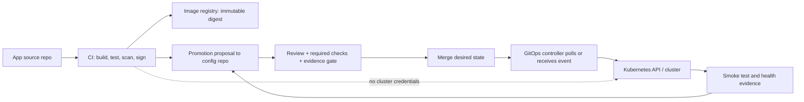

# M08 Unit 4 — Repository Layout and Multi-Environment Promotion

**Target file:** `04-repository-layout-and-multi-environment-promotion.md`  
**Stage:** 2E — Production DevOps & Platform Engineering  
**Module:** M08 — GitOps and Progressive Delivery  
**Level:** L1 foundation → L2 practical design → L3 promotion engineering → L4 governance and incident response  
**Estimated effort:** 8–14 hours for the lesson and local labs; optional controller integration may add time.  
**Environment:** WSL2 Ubuntu or Linux, Git, Python 3, Kustomize (`kubectl kustomize` is an alternative), and optionally a disposable `kind` cluster.

> **Safety and scope.** Use a disposable local repository and cluster only. Never point a lab controller at a repository or cluster you care about. Do not commit credentials or secret values. Before any Kubernetes mutation, inspect `kubectl config current-context` and explicitly select the dedicated lab context. The examples below are teaching artifacts; fake digests, identities, evidence, timestamps, and outputs are labelled illustrative. No lab in this document is represented as having been executed in your environment.

## 1. Learning outcomes and how to use this lesson

By the end, you should be able to:

1. Choose a repository model and deployment unit based on ownership, blast radius, review, and operating constraints.
2. Build a three-environment GitOps repository with Kustomize overlays and a clear controller entry point.
3. Promote the **same image digest** from development to staging to production without rebuilding it.
4. Require durable evidence from the previous environment before promotion and fail closed when evidence is absent, stale, or inconsistent.
5. Compare source diffs with rendered-manifest diffs and enforce an explicit allow-list of environment differences.
6. Design CODEOWNERS, protected-path review, bot permissions, hotfix, rollback, and concurrent-promotion controls.
7. Explain how promotion differs from fan-out, how shared bases increase blast radius, and how to migrate imperative deployments toward GitOps.
8. Diagnose the six incident scenarios in this unit and produce a concise architecture decision record (ADR).

Recommended sequence: read Sections 2–15, complete Labs A–C, then Labs D–F. If you have not completed M06, review its Kustomize and Helm fundamentals first. This unit focuses on repository structure and the safe movement of desired state, not on re-teaching chart authoring or controller internals.

## 2. Scope, assumptions, and module boundaries

The M08 curriculum defines Unit 4 as repository layout, promotion mechanics, environment governance, and safe progression of desired state across environments. This lesson uses `scoring-api`, a fictional inference-style HTTP service, throughout.

- **M01:** immutable images, registries, digests, provenance, and artifact evidence.
- **M02:** CI builds/tests/scans/signs and publishes artifacts; its deployment handoff ends when it proposes desired state in Git. Reuse M02 Unit 5 for path-based CI and Unit 9 for promotion/approval workflow where those filenames exist in your roadmap.
- **M06:** Kustomize bases/overlays, Helm values, chart and CRD upgrade mechanics.
- **M08 Units 1–3:** GitOps principles, Argo CD entry points, and Flux entry points. Do not run both controllers managing the same resources.
- **M08 Units 5–6:** secret handling and deeper drift/reconciliation controls.
- **M08 Units 7–9:** progressive delivery, rollout controllers, and release-health gates.
- **M08 Unit 11:** data/schema migration compatibility and rollback limits.
- **M08 Unit 13:** durable release evidence and audit trails.
- **M12:** supply-chain provenance and signature/admission enforcement.
- **M14:** multi-cluster/fleet design; this unit only introduces it.

**[ASSUMPTION]** The baseline uses one configuration repository, directory-per-environment overlays, and one logical deployment unit per service per environment. This is a practical default, not a universal rule. Team boundaries, regulatory controls, repository scale, controller topology, and Git host features may justify alternatives.

## 3. Why repository layout is an operational control

A repository is not merely a convenient folder tree. In GitOps, write access to the configuration that a controller trusts can become authority to change live workloads. Layout influences who can propose a change, who must review it, how far a shared edit propagates, whether promotion is reproducible, and whether an incident can be reconstructed.

| Design dimension | Good layout enables | Poor layout tends to cause |
|---|---|---|
| Blast radius | Small, explicit deployment units and scoped paths | One broad change affects unrelated services/environments |
| Ownership | Clear owners for app, platform, tenant, and prod paths | Unclear approvals or teams blocking one another |
| Review | Reviewers see intended and rendered differences | Hidden environment changes buried in shared bases |
| Promotion | Same artifact moves through a gated sequence | Rebuilds, mutable tags, cherry-pick errors, drift |
| Auditability | Git revision + artifact digest + evidence + approver | A PR comment is mistaken for durable proof |
| Autonomy | Teams safely own their service paths | Platform team becomes a bottleneck or controls are bypassed |
| Recovery | Revert or promote a known-good revision | Manual state is lost or rollback restores incompatible data |

A repository structure cannot guarantee safety by itself. Enforcement requires repository permissions, server-side branch/ruleset policy, CI checks, controller RBAC, identity hygiene, and operational practice.

### 3.1 Four distinct stores

| Store | Typical content | Should it contain cluster credentials? | Main responsibility |
|---|---|---:|---|
| Application/source repository | Source, tests, Dockerfile, API contract, CI | No | Produce a tested artifact |
| Configuration/environment repository | Kubernetes manifests, overlays, chart values, promotion metadata | No | Declare desired deployment state |
| Platform/infrastructure repository | Controller setup, cluster policies, shared CRDs/operators, IaC references | No | Own platform lifecycle and guardrails |
| Artifact registry | Image manifests/layers, charts, SBOMs/attestations where supported | No plaintext credentials in artifacts | Store immutable build outputs |

These may be combined for a small team or split for access-control and release-cadence reasons. Separation is useful only if ownership and automation remain understandable. A monorepo can still have strong boundaries when paths, checks, and reviewers are enforced. Separate repositories can still be unsafe if the same over-privileged bot can rewrite all of them.

### 3.2 Monorepo vs multi-repo

| Factor | Configuration monorepo | Multiple configuration repos |
|---|---|---|
| Discoverability | One place to inspect platform and environments | Clearer service ownership when boundaries are meaningful |
| Cross-service change | Atomic cross-path PR is straightforward | Requires coordinated PRs and a cross-repo rollout plan |
| Access control | Path review helps, but repo-level permissions may be coarse | Stronger repository-level separation when host policy supports it |
| CI efficiency | Needs path-based triggers and caching as it grows | Smaller, focused pipelines; duplicated pipeline definitions possible |
| Ownership | CODEOWNERS/rulesets are important | Repo ownership is simpler, but shared platform changes can be slower |
| Scale risk | Large checkout/render/test graph | Repository sprawl and dependency/version coordination |
| Best fit | Shared platform, consistent policy, many related services | Distinct security boundaries, teams, or independent release cadence |

**Decision rule:** choose the simplest structure that lets the organization enforce the required permissions and review model. Do not split repos merely for fashion, and do not centralize paths if that gives one team unintended production authority.

### 3.3 Define the unit of deployment

A useful baseline is one Argo CD `Application` or Flux `Kustomization` per **service × environment**. That gives each unit a clear desired-state path, health signal, promotion record, and ownership boundary. It is not mandatory: a tightly coupled set of services may need a single atomic unit; a platform bundle may own many resources; a Helm release may be the natural unit. The choice should follow independent rollout and recovery boundaries, not arbitrary directory aesthetics.

## 4. Environment promotion strategies

| Strategy | Mechanics | Strengths | Failure modes / trade-offs | Appropriate when |
|---|---|---|---|---|
| Directory per environment | `overlays/dev`, `overlays/staging`, `overlays/prod` on one protected branch | One reviewed commit can show all environment changes; simple diffs and shared base | Shared-base change may affect all environments; paths need careful policy | Common baseline; gate promotion by PR/checks |
| Branch per environment | Separate `dev`, `staging`, `prod` branches | Environment state is isolated by branch; can fit branch-centric tooling | Merge/cherry-pick divergence, unclear source of truth, hard-to-see accumulated differences | Existing branch-based release process with disciplined merge automation |
| Tag/release-based | A tag or release identifies a version/config snapshot | Good immutable reference for a release bundle | A tag alone does not express current per-environment config, approval state, or rollout status | Release snapshots and reproducibility, paired with explicit environment pointers |

**[ASSUMPTION]** Directory-per-environment is the baseline in this lesson because it makes environment diffs visible in one commit. It is not a claim that it is always superior.

An environment branch drifts when changes are merged unevenly, hotfixes are cherry-picked to only one branch, or teams fix an environment directly and later forget to propagate the change. A tag records a snapshot but does not itself say “production currently runs this snapshot” unless a separate, controlled pointer records that fact. Avoid mutable tags and implicit branch history as the only release evidence.

## 5. End-to-end delivery model and trust boundaries



The CI identity should generally have permission to publish artifacts and propose a narrowly scoped Git change; it should not have broad cluster credentials. The GitOps controller reads approved desired state and uses its own tightly scoped cluster permissions. The person or automation merging production desired state must satisfy the production review policy. The feedback from deployment to promotion is evidence (test result, status check, signed report, or validated record), not merely a free-form comment.

**Trust boundary:** write access to a controller-watched branch/path can be production write access. Protect it as such. If an attacker can modify the configuration repo or the controller’s source credentials, they may be able to alter deployed workloads within the controller’s RBAC scope.

## 6. Recommended baseline repository layout

**[ASSUMPTION]** Use the following baseline, adapting names to actual clusters and team boundaries:

```text
gitops-config/
├── README.md
├── .github/
│   ├── CODEOWNERS
│   └── pull_request_template.md
├── apps/
│   └── scoring-api/
│       ├── base/
│       │   ├── deployment.yaml
│       │   ├── service.yaml
│       │   └── kustomization.yaml
│       └── overlays/
│           ├── dev/
│           │   ├── kustomization.yaml
│           │   └── patch.yaml
│           ├── staging/
│           │   ├── kustomization.yaml
│           │   └── patch.yaml
│           └── prod/
│               ├── kustomization.yaml
│               └── patch.yaml
├── platform/
│   ├── controllers/
│   ├── crds/
│   └── policies/
├── clusters/
│   ├── dev-cluster/
│   │   └── apps.yaml
│   ├── staging-cluster/
│   │   └── apps.yaml
│   └── prod-cluster/
│       └── apps.yaml
├── tenants/
│   └── README.md
├── policy/
│   ├── promotion-evidence.schema.json
│   └── allowed-differences.yaml
└── scripts/
    ├── promote.py
    └── check-rendered.py
```

- `apps/`: service-specific desired state and environment overlays.
- `platform/`: controllers, CRDs, operators, and policy resources owned by platform engineering. CRD upgrades may need an independent rollout sequence.
- `clusters/`: cluster-specific entry points that connect a cluster to selected apps/platform paths. It is not a duplicate copy of every workload.
- `tenants/`: tenant onboarding metadata or tenant-scoped configuration; it is not a substitute for Kubernetes RBAC.
- `policy/`: machine-readable promotion requirements and allowed environment differences.
- `scripts/`: small, auditable checks. They are not a replacement for server-side repository controls.

### 6.1 Complete base manifests

The digest below is deliberately fake and **[ILLUSTRATIVE]**. Replace it with a digest of an image that exists in your own local registry before deploying. A plausible digest shape is `sha256:` followed by 64 hexadecimal characters. A digest pins identity; it does not prove provenance or safety.

`apps/scoring-api/base/deployment.yaml`:

```yaml
apiVersion: apps/v1
kind: Deployment
metadata:
  name: scoring-api
  labels:
    app.kubernetes.io/name: scoring-api
spec:
  replicas: 1
  selector:
    matchLabels:
      app.kubernetes.io/name: scoring-api
  template:
    metadata:
      labels:
        app.kubernetes.io/name: scoring-api
    spec:
      containers:
        - name: api
          image: registry.local/scoring-api@sha256:aaaaaaaaaaaaaaaaaaaaaaaaaaaaaaaaaaaaaaaaaaaaaaaaaaaaaaaaaaaaaaaa # [ILLUSTRATIVE]
          ports:
            - name: http
              containerPort: 8000
          readinessProbe:
            httpGet:
              path: /health
              port: http
            initialDelaySeconds: 2
            periodSeconds: 5
          livenessProbe:
            httpGet:
              path: /health
              port: http
            initialDelaySeconds: 5
            periodSeconds: 10
          resources:
            requests:
              cpu: 50m
              memory: 64Mi
            limits:
              cpu: 250m
              memory: 256Mi
          securityContext:
            allowPrivilegeEscalation: false
            readOnlyRootFilesystem: true
            runAsNonRoot: true
            capabilities:
              drop: ["ALL"]
```

`apps/scoring-api/base/service.yaml`:

```yaml
apiVersion: v1
kind: Service
metadata:
  name: scoring-api
  labels:
    app.kubernetes.io/name: scoring-api
spec:
  selector:
    app.kubernetes.io/name: scoring-api
  ports:
    - name: http
      port: 80
      targetPort: http
```

`apps/scoring-api/base/kustomization.yaml`:

```yaml
apiVersion: kustomize.config.k8s.io/v1beta1
kind: Kustomization
resources:
  - deployment.yaml
  - service.yaml
```

A local image must be available to the target cluster nodes (for example, loaded into `kind` or served by a registry reachable from the cluster). Do not expect a fake digest to pull. If you do not have the M01 image, render-only labs still work; application smoke tests require a real, reachable image.

### 6.2 Environment overlays

`apps/scoring-api/overlays/dev/kustomization.yaml`:

```yaml
apiVersion: kustomize.config.k8s.io/v1beta1
kind: Kustomization
namespace: scoring-api-dev
resources:
  - ../../base
patches:
  - path: patch.yaml
```

`apps/scoring-api/overlays/dev/patch.yaml`:

```yaml
apiVersion: apps/v1
kind: Deployment
metadata:
  name: scoring-api
spec:
  replicas: 1
  template:
    spec:
      containers:
        - name: api
          env:
            - name: APP_ENV
              value: dev
```

`apps/scoring-api/overlays/staging/kustomization.yaml`:

```yaml
apiVersion: kustomize.config.k8s.io/v1beta1
kind: Kustomization
namespace: scoring-api-staging
resources:
  - ../../base
patches:
  - path: patch.yaml
```

`apps/scoring-api/overlays/staging/patch.yaml`:

```yaml
apiVersion: apps/v1
kind: Deployment
metadata:
  name: scoring-api
spec:
  replicas: 2
  template:
    spec:
      containers:
        - name: api
          env:
            - name: APP_ENV
              value: staging
```

`apps/scoring-api/overlays/prod/kustomization.yaml`:

```yaml
apiVersion: kustomize.config.k8s.io/v1beta1
kind: Kustomization
namespace: scoring-api-prod
resources:
  - ../../base
patches:
  - path: patch.yaml
```

`apps/scoring-api/overlays/prod/patch.yaml`:

```yaml
apiVersion: apps/v1
kind: Deployment
metadata:
  name: scoring-api
spec:
  replicas: 3
  template:
    spec:
      containers:
        - name: api
          env:
            - name: APP_ENV
              value: prod
```

These patches deliberately vary replica count and `APP_ENV`; the image digest is inherited from the base. In a real pipeline, a promotion PR must show that the digest is the intended approved digest and must inspect rendered manifests as well as the source diff. **Do not put secret values in these overlays.** Use the secret-reference pattern taught in Unit 5.

Render each overlay with one of:

```bash
kubectl kustomize apps/scoring-api/overlays/dev
kubectl kustomize apps/scoring-api/overlays/staging
kubectl kustomize apps/scoring-api/overlays/prod
```

If you use standalone Kustomize, the equivalent is typically `kustomize build <path>`; verify your installed version with `kustomize version` and `kustomize build --help`. Kustomize bases/overlays are described in the [Kubernetes Kustomize guide](https://kubernetes.io/docs/tasks/manage-kubernetes-objects/kustomization/).

### 6.3 Controller entry points

Use one controller pattern per cluster/resource ownership boundary. Do not let Argo CD and Flux independently manage the same Deployment/Service.

**Argo CD example** — place this in the Argo CD control-plane namespace and adapt the repository URL and destination to your installation. The `Application` CRD API is `argoproj.io/v1alpha1`; verify behavior against the installed release documentation.

```yaml
apiVersion: argoproj.io/v1alpha1
kind: Application
metadata:
  name: scoring-api-dev
  namespace: argocd
spec:
  project: default
  source:
    repoURL: http://gitea-http.gitops.svc.cluster.local:3000/lab/gitops-config.git # example only; verify DNS/network
    targetRevision: main
    path: apps/scoring-api/overlays/dev
  destination:
    server: https://kubernetes.default.svc
    namespace: scoring-api-dev
  syncPolicy:
    automated:
      prune: false
      selfHeal: false
    syncOptions:
      - CreateNamespace=true
```

The URL is illustrative: the actual hostname must resolve from the controller's network, and the Git server must accept the configured authentication. `prune: false` and `selfHeal: false` are conservative teaching defaults, not universal production recommendations. The official [Argo CD Application specification](https://argo-cd.readthedocs.io/en/latest/user-guide/application-specification/) documents the source path and destination model.

**Flux alternative** — this is an entry-point example, not a complete bootstrap. The `GitRepository` and Flux `Kustomization` belong to Flux’s APIs; verify API versions and fields against the Flux release installed in the lab.

```yaml
apiVersion: source.toolkit.fluxcd.io/v1
kind: GitRepository
metadata:
  name: gitops-config
  namespace: flux-system
spec:
  interval: 1m
  url: http://gitea-http.gitops.svc.cluster.local:3000/lab/gitops-config
  ref:
    branch: main
---
apiVersion: kustomize.toolkit.fluxcd.io/v1
kind: Kustomization
metadata:
  name: scoring-api-dev
  namespace: flux-system
spec:
  interval: 5m
  path: ./apps/scoring-api/overlays/dev
  prune: false
  sourceRef:
    kind: GitRepository
    name: gitops-config
  targetNamespace: scoring-api-dev
```

**[VERIFY]** The local Git URL, authentication, CRD versions, and optional security controls are installation-specific. See [Flux documentation](https://fluxcd.io/flux/). Do not apply both controller examples to the same lab cluster.

## 7. Kustomize overlays vs Helm values per environment

| Approach | Typical change surface | Strength | Risk |
|---|---|---|---|
| Kustomize base + overlay patches | Rendered Kubernetes objects | Explicit field-level patches; easy to see object differences | Patches can target the wrong object after a rename; overlays can grow complex |
| Helm chart + values per environment | Chart parameters | Chart interface can make supported options clear | Values merge/templating can hide rendered changes; chart upgrades change defaults |
| Helm chart plus post-render customization | Chart values and rendered patch layer | Can separate chart inputs from cluster-specific adjustments | More moving parts and harder troubleshooting |

Choose Kustomize when the team owns plain manifests or needs small, explicit overlays. Choose Helm values when a maintained chart exposes a stable configuration interface. Render the final output in CI. For third-party chart/operator upgrades, pin chart and image versions, inspect rendered diffs, validate CRD compatibility, and promote the change through environments. Keep CRD/operator lifecycle separate from application version changes when their risk differs.

## 8. Digest-pinned artifacts and promotion invariants

A tag is a human-readable name; it may be mutable unless registry policy prevents mutation. An image digest identifies the exact image manifest/content. A Helm chart version is a chart release identifier; an OCI chart digest identifies the stored artifact. These are related but not interchangeable concepts.

**Promotion invariants:**

1. The same verified image digest moves from dev → staging → prod.
2. No rebuild occurs between environments. Rebuilding could change dependencies, base image, build timestamp, or toolchain even if source commit is the same.
3. Only explicitly approved environment configuration differs.
4. Verification evidence from the previous environment is durable and validated before promotion.
5. Promotion changes desired state through Git; it is not a routine `kubectl set image` operation.
6. A digest is identity, not trust. Provenance, signature, vulnerability policy, and build/test evidence remain separate checks (M01/M12).

### 8.1 Promotion by human PR, bot PR, or orchestration

- **Human-reviewed PR:** a person copies the approved digest to the next overlay. Easy to audit, slower, and vulnerable to copy/paste mistakes unless CI validates it.
- **CI/bot PR:** automation opens a narrowly scoped PR after required checks. It should not default to direct writes to protected production branches.
- **Gated orchestration:** a tool such as Kargo can model artifact promotion across stages and verification. This is awareness only; no Kargo installation is required. Consult [Kargo docs](https://docs.kargo.io/quickstart) for its current stage/freight model.

A PR comment saying “staging passed” is not machine-verifiable evidence by itself. The pipeline must record an immutable or access-controlled check result, signed report, or validated evidence record bound to the commit, digest, environment, and test execution.

### 8.2 Example promotion evidence record

`policy/promotion-evidence.yaml` — all values are **[ILLUSTRATIVE]**:

```yaml
schemaVersion: promotion-evidence/v1
releaseId: scoring-api-2026-10-28.17
source:
  commit: 0123456789abcdef0123456789abcdef01234567
artifact:
  image: registry.local/scoring-api
  digest: sha256:aaaaaaaaaaaaaaaaaaaaaaaaaaaaaaaaaaaaaaaaaaaaaaaaaaaaaaaaaaaaaaaa
fromEnvironment: dev
toEnvironment: staging
previousEnvironmentVerification:
  environment: dev
  deployedConfigCommit: 89abcdef0123456789abcdef0123456789abcdef
  digest: sha256:aaaaaaaaaaaaaaaaaaaaaaaaaaaaaaaaaaaaaaaaaaaaaaaaaaaaaaaaaaaaaaaa
  checkRunId: local-check-00017
  result: passed
  completedAt: "2026-10-28T10:15:00Z" # [ILLUSTRATIVE], not a verified timestamp
approver: learner@example.invalid # fake identity
approvalReference: local-review-simulation-17
```

A production implementation should use a schema and validator, bind evidence to exact source/config revisions and artifact digest, enforce freshness/expiry, verify the identity of the check runner, and retain the evidence outside the ability of the promotion bot to silently rewrite it. The simple local simulation below checks a JSON evidence file and timestamps but is not a secure policy engine.

## 9. CODEOWNERS, branch rules, and least-privilege automation

Sample `.github/CODEOWNERS`:

```text
# Defaults; replace fake teams with real, maintained owners.
/apps/                         @app-platform
/apps/scoring-api/overlays/prod/ @platform-sre
/platform/                     @platform-sre
/clusters/prod-cluster/         @platform-sre
/policy/                       @security-engineering @platform-sre
/.github/CODEOWNERS            @repository-admins
```

A CODEOWNERS file defines ownership/review routing; **it does not by itself force approval**. On GitHub, configure protected-branch or ruleset policy to require pull requests, required checks, the necessary approvals, and code-owner approval for sensitive paths. See [GitHub CODEOWNERS](https://docs.github.com/en/repositories/managing-your-repositorys-settings-and-features/customizing-your-repository/about-code-owners) and [protected branches](https://docs.github.com/en/repositories/configuring-branches-and-merges-in-your-repository/managing-protected-branches/about-protected-branches). Other Git hosts differ; verify their current semantics. A local Git server may not enforce these controls at all.

Recommended controls:

- Protect the production branch and production paths; restrict bypass permissions and log administrative bypasses.
- Require rendered-diff, schema/policy, digest, evidence, and security checks.
- Give a bot permission to create a branch/PR and update only the intended image field; avoid production direct-push as the default.
- Keep CODEOWNERS itself owned; otherwise a change could remove its own reviewer rules.
- Require separate author/approver/promoter identities when risk policy requires segregation of duties.
- Consider signed commits/tags for production releases where required, but verify actual host enforcement and signer identity. A signature does not prove the content is safe.
- Review controller service accounts and repository credentials periodically. The controller should not have cluster-admin unless there is a documented, justified requirement.

## 10. Promotion pipeline: end to end

1. CI builds from a source commit, runs tests and applicable scans, publishes the image, and records its digest and provenance.
2. A narrowly scoped bot proposes the digest in the dev overlay.
3. CI validates manifests, renders all environments, checks image digest format, runs policy checks, and evaluates the source diff and rendered diff.
4. Merge occurs only after configured reviews/checks.
5. GitOps deploys dev. A post-deploy smoke test verifies service health and domain behavior.
6. The test system records evidence bound to the exact deployed config revision and digest.
7. A promotion PR updates staging to the **same digest** only if dev evidence is present, successful, and fresh.
8. Staging soak and gates run. The soak duration is a risk-based design choice, not a universal standard.
9. A production promotion PR requires the configured platform/SRE/business approval and fresh staging evidence.
10. GitOps reconciles the merged state. Retain release evidence, controller revision/status, smoke-test result, approver, and any rollback/abort record (M08 Unit 13).

**[ILLUSTRATIVE]** A low-risk internal service might require a short dev verification and a longer staging soak; a high-impact inference API may need a representative load test, model-quality regression check, security review, and explicit production approval. Calibrate gates using incident history, SLOs (M10), traffic, and change risk—not an arbitrary industry-wide duration.

### 10.1 Hotfixes and rollback

**Hotfix never skips Git.** A safe expedited path is: create a narrow hotfix branch, mark the change as emergency, obtain the designated elevated approval, run a small required test set and rendered diff, merge through the protected path, reconcile, verify live revision/health, then complete a retrospective review within the team’s defined window. If an out-of-band mutation is required to contain an incident, treat it as break-glass: record who/what/why, reconcile Git promptly, and remove temporary access.

Two common rollback patterns:

- **Revert PR/commit:** restores the prior desired-state content. It does not undo data writes, external side effects, or incompatible schema changes.
- **Promote previous known-good digest:** keeps the current configuration while reverting the artifact identity, if the old image remains compatible with current configuration/data. This is often more explicit than reverting a broad commit.

Before rollback, check API/data/schema compatibility, model artifact compatibility, feature-flag state, and migration side effects. Unit 11 owns detailed data migration/restore planning. “Roll back the image” is not a database recovery strategy.

## 11. Source diff, rendered diff, and allow-listed differences

A source diff answers “what changed in the repository?” A rendered diff answers “what Kubernetes objects would the renderer produce?” These are different questions. Templates, overlays, defaults, generated names, and patches can make a small source edit produce a large rendered change.

**[ILLUSTRATIVE] allowed differences** for `scoring-api` might include:

- replica count and autoscaling bounds;
- resource requests/limits within approved bounds;
- `APP_ENV` and environment-specific hostnames;
- approved secret references (never secret values);
- explicitly approved availability settings.

Forbidden differences may include: image digest mismatch across environments during a promotion, weakened security context, unexpected service account, privileged container, removed probes, new cluster-scoped resource, or unexpected external endpoint. Tailor the allow-list to the service; do not normalize away security-sensitive fields.

### 11.1 A transparent rendered-image gate

The following script is deliberately narrow: it compares only the image field extracted from the rendered Deployment for the named container. It is **not** a complete Kubernetes semantic diff or policy engine. It assumes `kubectl kustomize` is installed and that PyYAML is available. Save inline as `scripts/check-rendered.py` in the lab repository.

```python
#!/usr/bin/env python3
"""Narrow lab gate: require one identical scoring-api image across overlays."""
import subprocess
import sys
import yaml

OVERLAYS = {
    "dev": "apps/scoring-api/overlays/dev",
    "staging": "apps/scoring-api/overlays/staging",
    "prod": "apps/scoring-api/overlays/prod",
}

def render(path):
    result = subprocess.run(
        ["kubectl", "kustomize", path], check=True,
        capture_output=True, text=True,
    )
    return list(yaml.safe_load_all(result.stdout))

def image_for(documents):
    found = []
    for doc in documents:
        if not isinstance(doc, dict):
            continue
        if doc.get("kind") != "Deployment" or doc.get("metadata", {}).get("name") != "scoring-api":
            continue
        for container in doc.get("spec", {}).get("template", {}).get("spec", {}).get("containers", []):
            if container.get("name") == "api":
                found.append(container.get("image", ""))
    if len(found) != 1 or not found[0]:
        raise ValueError(f"expected exactly one scoring-api/api image, got {found!r}")
    return found[0]

def main():
    images = {env: image_for(render(path)) for env, path in OVERLAYS.items()}
    for env, image in images.items():
        if "@sha256:" not in image:
            raise SystemExit(f"FAIL: {env} image is not digest-pinned: {image!r}")
    if len(set(images.values())) != 1:
        raise SystemExit(f"FAIL: image differs across environments: {images}")
    print("PASS: one digest-pinned image is rendered in dev, staging, and prod")

if __name__ == "__main__":
    try:
        main()
    except (subprocess.CalledProcessError, ValueError) as exc:
        print(f"FAIL: {exc}", file=sys.stderr)
        raise SystemExit(1)
```

Install PyYAML only in a disposable virtual environment if needed; do not install packages globally merely for this exercise. The script checks identity consistency, not whether the digest exists, is signed, passed tests, or is approved. Extend it with schema validation and policy checks before production use.

### 11.2 Why the baseline overlays inherit the digest

The sample keeps the image in the base so all overlays inherit one digest. A promotion changes the single base image field, which changes all environments at once—useful for consistency, but it is **not** a gated promotion workflow. For real staged promotion, store the selected digest independently in each environment overlay (or use a controlled generated values file), then have a promotion PR update only the next environment after prior-environment evidence passes. That avoids changing prod when dev is updated.

For the promotion labs, use this variation: put `images:` in each overlay `kustomization.yaml`, all initially set to the same digest. Kustomize image transformation is supported by current Kustomize; confirm with your installed renderer. Example:

```yaml
images:
  - name: registry.local/scoring-api
    newName: registry.local/scoring-api
    digest: sha256:aaaaaaaaaaaaaaaaaaaaaaaaaaaaaaaaaaaaaaaaaaaaaaaaaaaaaaaaaaaaaaaa # [ILLUSTRATIVE]
```

Apply that field to all three overlays for the initial state. The promotion script then edits exactly one overlay at a time. This is a design choice: it trades a small amount of repetition for independently gated desired state.

## 12. Fail-closed promotion simulation

This local script simulates the policy checks around promotion. It does **not** create a real pull request, enforce a server-side rule, verify a cryptographic signature, or establish trustworthy timestamps. A local Git server may not support PR APIs or branch protection; this lab models the logic and records that gap honestly.

### 12.1 Evidence format

Save a file such as `evidence/dev-to-staging.json` in the disposable lab repository. Fake values are **[ILLUSTRATIVE]**:

```json
{
  "release_id": "scoring-api-lab-17",
  "source_commit": "0123456789abcdef0123456789abcdef01234567",
  "digest": "sha256:aaaaaaaaaaaaaaaaaaaaaaaaaaaaaaaaaaaaaaaaaaaaaaaaaaaaaaaaaaaaaaaa",
  "environment": "dev",
  "result": "passed",
  "check_run_id": "local-check-17",
  "completed_at": "2026-10-28T10:15:00Z"
}
```

### 12.2 Auditable Python promotion helper

This helper operates on a **disposable Git working copy**. It requires an expected current base commit, checks environment order, verifies evidence fields and freshness, validates digest syntax, and edits only the destination overlay's `newName`/`digest` entry. It refuses to proceed when the working tree is dirty or the base commit changed. The caller must create/review/merge a PR in a real Git host; the local commit is a simulation.

Save inline as `scripts/promote.py`:

```python
#!/usr/bin/env python3
"""Local promotion simulation; not a production policy engine."""
import argparse
import datetime as dt
import json
import re
import subprocess
from pathlib import Path

ORDER = ["dev", "staging", "prod"]
PATHS = {name: Path(f"apps/scoring-api/overlays/{name}/kustomization.yaml") for name in ORDER}
DIGEST_RE = re.compile(r"^sha256:[0-9a-f]{64}$")

def git(*args):
    return subprocess.run(["git", *args], check=True, capture_output=True, text=True).stdout.strip()

def main():
    p = argparse.ArgumentParser()
    p.add_argument("--from-env", choices=ORDER, required=True)
    p.add_argument("--to-env", choices=ORDER, required=True)
    p.add_argument("--digest", required=True)
    p.add_argument("--evidence", type=Path, required=True)
    p.add_argument("--expected-base", required=True, help="full expected HEAD commit")
    p.add_argument("--max-age-hours", type=int, default=24)
    args = p.parse_args()

    if ORDER.index(args.to_env) != ORDER.index(args.from_env) + 1:
        raise SystemExit("FAIL: promotion must advance exactly one environment")
    if not DIGEST_RE.fullmatch(args.digest):
        raise SystemExit("FAIL: digest must match sha256:<64 lowercase hex chars>")
    if git("rev-parse", "HEAD") != args.expected_base:
        raise SystemExit("FAIL: stale base commit; fetch/rebase and rerun checks")
    if git("status", "--porcelain"):
        raise SystemExit("FAIL: working tree must be clean before promotion")
    if not args.evidence.is_file():
        raise SystemExit("FAIL: evidence file missing")

    ev = json.loads(args.evidence.read_text())
    required = {"source_commit", "digest", "environment", "result", "check_run_id", "completed_at"}
    if not required.issubset(ev):
        raise SystemExit(f"FAIL: evidence missing fields: {sorted(required - set(ev))}")
    if ev["environment"] != args.from_env or ev["result"] != "passed":
        raise SystemExit("FAIL: evidence must be passed evidence from the source environment")
    if ev["digest"] != args.digest:
        raise SystemExit("FAIL: evidence digest does not match proposed digest")
    if not re.fullmatch(r"[0-9a-f]{40,64}", ev["source_commit"]):
        raise SystemExit("FAIL: source_commit is not a plausible Git object ID")
    try:
        completed = dt.datetime.fromisoformat(ev["completed_at"].replace("Z", "+00:00"))
        now = dt.datetime.now(dt.timezone.utc)
    except (ValueError, TypeError):
        raise SystemExit("FAIL: completed_at must be an ISO-8601 timestamp with timezone")
    if completed.tzinfo is None:
        raise SystemExit("FAIL: evidence timestamp must include timezone")
    age = (now - completed.astimezone(dt.timezone.utc)).total_seconds()
    if age < 0 or age > args.max_age_hours * 3600:
        raise SystemExit("FAIL: evidence is stale or timestamp is in the future")

    path = PATHS[args.to_env]
    if not path.is_file():
        raise SystemExit(f"FAIL: expected overlay not found: {path}")
    text = path.read_text()
    lines = text.splitlines()
    start = [i for i, line in enumerate(lines) if line.strip() == "images:"]
    if len(start) != 1:
        raise SystemExit("FAIL: expected exactly one images: block; edit schema changed")
    block = lines[start[0] + 1:]
    name_idx = next((i for i, line in enumerate(block) if line.strip().startswith("- name:")), None)
    digest_idx = next((i for i, line in enumerate(block) if line.strip().startswith("digest:")), None)
    if name_idx is None or digest_idx is None:
        raise SystemExit("FAIL: expected Kustomize images entry with name and digest")
    if "registry.local/scoring-api" not in block[name_idx]:
        raise SystemExit("FAIL: unexpected image entry; refusing broad edit")
    absolute_digest_line = start[0] + 1 + digest_idx
    lines[absolute_digest_line] = "    digest: " + args.digest
    path.write_text("\n".join(lines) + "\n")
    print(f"SIMULATION ONLY: proposed {args.digest} for {args.to_env}; inspect diff and open/review PR")

if __name__ == "__main__":
    main()
```

**Important limitations:** this script is intentionally small. It assumes a specific simple YAML layout and edits text rather than parsing/re-serializing YAML. It validates that evidence is present, passed, bound to the digest/environment, and recent; it does not verify the authenticity of the check-run identity or evidence file. Production promotion should use a trusted CI identity, a schema-aware parser, immutable/validated test attestations, concurrency controls at the Git host (for example merge queue or compare-and-swap update), and protected branch rules. The local timestamp is not proof of execution.

### 12.3 Simulated promotion procedure and test matrix

In a fresh temporary repo, configure all three overlays with `images:` entries and commit the starting state. Then:

```bash
# Inspect the target repository and starting commit first.
git status --short
git rev-parse HEAD
git diff --check

# Example invocation only; replace the illustrative values with lab values.
python3 scripts/promote.py \
  --from-env dev --to-env staging \
  --digest sha256:aaaaaaaaaaaaaaaaaaaaaaaaaaaaaaaaaaaaaaaaaaaaaaaaaaaaaaaaaaaaaaaa \
  --evidence evidence/dev-to-staging.json \
  --expected-base "$(git rev-parse HEAD)"

git diff -- apps/scoring-api/overlays/staging/kustomization.yaml
git diff --check
kubectl kustomize apps/scoring-api/overlays/staging
```

The example evidence timestamp must be recent relative to the actual run or the helper should fail. The displayed digest is fake and will not pull an image. After review, the learner may commit the proposed change in the disposable repository to simulate a merge. Do not treat this as real PR enforcement.

| Test | Input | Expected result |
|---|---|---|
| Valid promotion | Correct adjacent environment, clean expected base, recent passed evidence for same digest | Proposal created for destination overlay |
| Missing evidence | Evidence path absent | Fail closed; no file change |
| Stale evidence | Timestamp exceeds max age | Fail closed |
| Wrong environment | `dev` evidence used for `prod` | Fail closed; promotion must advance one stage |
| Digest mismatch | Evidence digest differs from requested digest | Fail closed |
| Mutable tag | Value lacks `@sha256`/valid digest input | Fail closed |
| Dirty tree | Uncommitted changes exist | Fail closed |
| Stale base/race | `HEAD` differs from expected base | Fail closed; fetch/rebase/re-run checks |
| Wrong overlay structure | Missing or ambiguous image block | Fail closed rather than broad text replacement |

Concurrency: two promotion attempts may both start from commit A. If attempt one merges and advances the branch to B, attempt two must not overwrite B using stale assumptions. Require a current-base check, rebase/update, re-render, re-run evidence and policy checks, then re-review. Server-side merge queues or equivalent atomic update rules are preferable where available. A script alone cannot prevent a remote race after its final check.

## 13. Lab A — Build the baseline layout for three environments

**Objective:** create and render `scoring-api` dev/staging/prod overlays and understand shared-base blast radius.  
**Prerequisites:** Git, Python 3 optional, `kubectl` with Kustomize support or standalone Kustomize.  
**Duration:** 45–75 minutes.  
**Footprint:** negligible for render-only; a local cluster is optional. No hosted service required.

### Steps

1. Create a disposable directory and initialize Git:

```bash
mkdir -p ~/gitops-unit4-lab
cd ~/gitops-unit4-lab
git init
git switch -c main
```

2. Create the tree and files shown in Sections 6.1–6.2. Add `platform/controllers`, `platform/crds`, `platform/policies`, `clusters/{dev-cluster,staging-cluster,prod-cluster}`, and `tenants` with README files explaining intended ownership. Those README files are inline teaching artifacts; do not commit credentials.
3. Before any cluster operation, if you choose to apply to Kubernetes, verify context:

```bash
kubectl config current-context
kubectl config get-contexts
```

Proceed only if the current context is the dedicated disposable lab cluster. For the render-only route, no cluster context is needed.
4. Render all overlays:

```bash
kubectl kustomize apps/scoring-api/overlays/dev > /tmp/scoring-dev.yaml
kubectl kustomize apps/scoring-api/overlays/staging > /tmp/scoring-staging.yaml
kubectl kustomize apps/scoring-api/overlays/prod > /tmp/scoring-prod.yaml
```

5. Inspect source and rendered differences:

```bash
git diff -- apps/scoring-api
diff -u /tmp/scoring-dev.yaml /tmp/scoring-staging.yaml || true
diff -u /tmp/scoring-staging.yaml /tmp/scoring-prod.yaml || true
```

6. Replace the fake digest with a real local image digest only if you intend to deploy. Confirm the image exists and can be reached from the cluster. Render-only work does not require a pullable image.
7. Commit the baseline and save the rendered files/diff as lab evidence outside the repository if the repository should remain source-only.

**Illustrative observations:** the Deployment image should match across all overlays; namespace, replica count, and `APP_ENV` differ. Render output does not prove that the cluster can pull the image or that the application is healthy.

**Pass criteria:** three overlays render; names/selectors/ports are consistent; differences are understood and recorded; no secret values exist in Git.  
**Failure injection:** intentionally change prod's image digest or remove its readiness probe and inspect the diff. Restore the safe state afterward.  
**Cleanup/reset:** because this lab is render-only, remove the disposable directory when finished or reset it with `git reset --hard` only after confirming that it contains no work you need. Do not run broad deletion commands.

## 14. Lab B — Promotion simulation: dev → staging → prod

**Objective:** promote one digest in order, require previous-environment evidence, and reject stale concurrent updates.  
**Prerequisites:** Lab A tree, Git, Python 3, PyYAML, and the helper in Section 12.  
**Duration:** 60–90 minutes.  
**Footprint:** negligible. The local Git repo simulates PRs; it does not enforce server-side rules.

1. In a disposable repo, add `images:` blocks to each overlay, with the same fake digest. Commit the baseline.
2. Create `scripts/promote.py` from Section 12.2 and a recent evidence JSON record. Use the real current time in the lab evidence, not the illustrative timestamp copied from the lesson.
3. Record `git rev-parse HEAD` as the expected base and run the promotion command for dev → staging. Inspect the exact diff. The destination overlay alone should change.
4. Run rendered-diff and digest checks. In a real environment, create a PR and let required checks/review enforce the merge; in this local exercise, record “PR/review simulated” in the evidence.
5. After the staging verification has passed, create new evidence for staging and promote staging → prod. Do not reuse dev evidence as staging evidence.
6. Test failure cases from the table: missing evidence, stale timestamp, wrong environment, wrong digest, dirty tree, and stale expected base. Each should stop before a destination edit.
7. Simulate a race: create two worktrees or clones at commit A; make and commit one staging change, then attempt the second promotion using A as `--expected-base`. It must fail stale-base validation. Update/rebase the second worktree, re-render and re-run all checks before proposing a new change.

**Evidence to save:** baseline commit, diffs, rendered outputs, evidence records, each pass/fail result, and a note explaining that PR enforcement was simulated.  
**Success:** same digest moves in order; no promotion occurs without fresh prior-environment evidence; concurrent stale attempt is rejected.  
**Cleanup:** delete only the temporary repo/worktrees you created after verifying their paths. No Kubernetes cleanup is required.

## 15. Lab C — Rendered-diff gate and allow-listed differences

**Objective:** catch forbidden environment differences in rendered manifests.  
**Prerequisites:** Lab A files, `kubectl kustomize`, Python 3 and PyYAML if using the script.  
**Duration:** 45–75 minutes.  
**Footprint:** negligible.

1. Render all environments to temporary files as in Lab A.
2. Run the image gate in Section 11.1. It should pass only when all three rendered image fields are the same digest-pinned value.
3. Introduce a forbidden digest in prod, run the script, and confirm it exits non-zero. Restore the digest.
4. Introduce an intended difference (e.g. replicas 1/2/3) and document it in `policy/allowed-differences.yaml`:

```yaml
# [ILLUSTRATIVE] Documentation policy; this file is not automatically enforced by itself.
allowedDifferences:
  - field: Deployment/scoring-api/spec/replicas
    reason: environment capacity
  - field: Deployment/scoring-api/spec/template/spec/containers[name=api]/env[name=APP_ENV]
    reason: environment identity
forbiddenDifferences:
  - field: Deployment/scoring-api/spec/template/spec/containers[name=api]/image
    reason: digest must remain identical for a single release promotion
  - field: Deployment/scoring-api/spec/template/spec/containers[name=api]/securityContext/privileged
    reason: environment overlays must not weaken container isolation
```

5. Explain why the policy file is documentation until a validator consumes it. A robust semantic policy checker should parse rendered YAML and compare selected fields; this lesson’s simple script only checks image equality.
6. Revert any deliberate bad patch and render all three overlays again.

**Limitations:** textual diffs are affected by ordering, defaulted fields, generated names, and controller/admission mutations. Secret references can differ intentionally; secret values must never be rendered into logs. The simple script does not prove semantic equivalence of all resources.

**Pass criteria:** forbidden image divergence is caught; intended replica differences are visible and documented; no security-relevant field is normalized away. **Cleanup:** revert the failure-injection patch and rerender.

## 16. Lab D — Hotfix that still goes through Git

**Objective:** simulate an urgent configuration fix without normalizing direct cluster mutation.  
**Prerequisites:** disposable Git repo from Lab A.  
**Duration:** 30–45 minutes.  
**Footprint:** negligible; no cluster required.

1. Create a branch and make a bounded change such as increasing dev replicas or correcting a safe environment variable:

```bash
git switch -c emergency/scoring-api-readiness
# Edit the appropriate patch in your editor.
git diff --check
git diff
```

2. Add an emergency record to the PR/evidence notes: incident/change ID (fake), reason, scope, elevated approver identity (fake), tests required, expiry/retrospective deadline.
3. Render the target overlay and run all applicable checks. Review the diff; merge the branch only in the disposable repo to simulate the approved hotfix.
4. Record the exact commit and desired-state revision. If a controller is available, inspect its reported revision and application health after reconciling.
5. Contrast with `kubectl set image` or an ad-hoc live patch: those mutate live state without updating Git and can be reverted by reconciliation or create drift. Do not run direct mutation against a real cluster.
6. After containment, verify the normal config repo is consistent and complete the retrospective review.

**Pass:** emergency path is faster but still records Git change, approval, checks, and verification. **Failure injection:** omit the elevated approval record; policy should reject the simulated merge. **Cleanup:** revert the emergency commit through Git or reset only the disposable repository after capturing evidence.

## 17. Lab E — Shared-base blast-radius test

**Objective:** demonstrate how one base change can alter all environments.  
**Prerequisites:** Lab A.  
**Duration:** 45–60 minutes.  
**Footprint:** negligible.

1. Render all three environments and save baseline files.
2. Make a safe shared-base change, such as a small resource request adjustment. Render all environments again and summarize affected paths.
3. Make a deliberately risky change to the shared base, such as removing the readiness probe or weakening the container security context. Do not apply it to a cluster. Render all environments and identify every affected environment.
4. Demonstrate a policy/test that rejects the risky change; a code review alone is not a reliable automated guard. Restore the safe state and compare the final render with the baseline.
5. Add path ownership and a CI trigger for all overlays whenever `apps/scoring-api/base/**` changes.

**Pass:** a shared-base change causes a cross-environment render diff; the unsafe variant is rejected before deployment; the final state is safe. **Cleanup:** restore/revert the test change and rerender all overlays.

## 18. Lab F — Fresh-cluster rebuild from Git alone

**Objective:** prove that Git can recreate the application layer while identifying dependencies Git cannot recreate by itself.  
**Prerequisites:** `kind`, Docker/Podman, a dedicated lab repository, local image registry or a known reachable test image, and one GitOps controller installed in the fresh cluster.  
**Duration:** 60–120 minutes.  
**Footprint:** `kind` consumes several GB of RAM/disk depending on images and controller; stop other large services first. Do not run Argo CD and Flux together in this cluster.

**Important distinction:** “from Git alone” means the **application configuration** can be reconstructed from Git. It does not imply Git contains the cluster runtime, controller binaries, registry content, external Git server, secret decryption keys, CRDs that were never stored, or bootstrap credentials. Those dependencies must be backed up or recreated safely.

1. Confirm you are using the dedicated context and inventory current clusters:

```bash
kind get clusters
kubectl config current-context
kubectl config get-contexts
```

2. Create a new cluster with a unique name, for example `gitops-unit4-rebuild`. Verify the resulting context before any mutation. Use the exact context reported by `kind`; do not guess it.
3. Ensure the local Git server and registry are available to the cluster network. `localhost` inside a controller pod refers to that pod, not the host. Validate DNS and TCP connectivity from the controller’s actual network context; WSL2/Docker IP addresses can change.
4. Install/bootstrap **one** controller using the method from Unit 2 or Unit 3. Controller bootstrap may require credentials/configuration outside the application repository; document those dependencies and do not commit them.
5. Point the controller to the config repo entry point, wait for reconciliation, then inspect controller status and Kubernetes workload readiness.
6. Smoke-test the application through a local port-forward only after verifying the context and target namespace:

```bash
kubectl --context <EXACT_LAB_CONTEXT> -n scoring-api-dev get deploy,svc,pods
kubectl --context <EXACT_LAB_CONTEXT> -n scoring-api-dev port-forward svc/scoring-api 18080:80
```

In another terminal, request the documented health endpoint (for example `curl -fsS http://127.0.0.1:18080/health`). Use only if the actual app exposes that endpoint.
7. Record the Git revision, controller source revision, image digest, readiness result, and smoke-test result. Do not infer success from a successful `kubectl apply` alone.

**Pass:** a fresh cluster recreates the application configuration from Git after external prerequisites are supplied and recorded. **Failure injection:** temporarily make the Git source unavailable or use an unavailable image, observe the failure, and restore connectivity/image availability. **Cleanup:** delete only the named disposable cluster after confirming `kind get clusters` and the exact cluster name. Keep the original environment and repository untouched.

## 19. Governance at scale

### 19.1 Ownership and review by risk

A practical risk model can assign review depth by change type:

| Change class | Example | Typical controls [DESIGN RECOMMENDATION] |
|---|---|---|
| Low | Dev-only replica/config change | App owner + render/test checks |
| Medium | Shared base, staging image promotion | App owner, cross-env render diff, smoke/evidence checks |
| High | Production digest, controller permissions, ingress/auth, CRD/operator | Platform/SRE review, security checks, staged validation, explicit production approval |
| Critical | Secret reference policy, cluster-admin RBAC, production deletion/prune policy | Security/platform owner, stronger separation of duties, change record and recovery plan |

Tune these classes to actual impact. Do not represent this table as a compliance standard.

### 19.2 Prevent branch drift and snowflake overlays

- Prefer one canonical source branch and reviewed environment paths unless branch-per-environment is a deliberate, maintained design.
- Keep environment differences small and documented in an allow-list.
- Detect stale or divergent overlays on a schedule and in PR checks.
- Require an exception record with owner, reason, expiry, and convergence plan for any one-off production configuration.
- Periodically compare rendered desired state across environments and inspect live-vs-Git drift (Unit 6).
- Do not blindly copy all staging configuration into prod; promotion should change only the approved artifact or configuration delta.

### 19.3 Fleet and multi-cluster awareness

A fleet may be organized by cluster-per-environment, cluster-per-region, tenant clusters, or shared platform layers. `clusters/<cluster>/` should identify what is installed in that cluster, while `apps/` defines reusable application configuration. ApplicationSet or Flux reconciliation can fan out a path to multiple clusters, but **fan-out is not gated promotion**: a shared path update can affect all destinations unless the architecture creates explicit promotion boundaries. M14 covers deeper fleet design; do not build a fleet for this unit.

### 19.4 Release trains vs continuous promotion

- **Continuous promotion:** each release moves as soon as its gates pass. Low latency, but requires reliable automation and concurrency handling.
- **Release train:** changes are grouped into planned release windows. Predictable coordination, but changes may wait and release bundles can become larger.

Choose based on service criticality, dependencies, testing duration, operational support, and the cost of holding a release. Do not mix an implicit release-train model with unreviewed automatic promotions.

### 19.5 Path-based CI and repository performance

Path-based CI can avoid rendering unrelated services, but shared files must trigger all affected checks. If `apps/scoring-api/base/**` changes, all three overlays should render and pass policy checks. A path filter that only watches `overlays/dev/**` will miss base changes that affect prod.

Provider-neutral CI pseudocode:

```text
on pull_request:
  changed_paths = git diff --name-only merge_base...head
  affected_services = map_paths_to_services(changed_paths)
  if platform/, policy/, or shared base changed:
      include every dependent overlay and policy suite
  for each affected service/environment:
      validate yaml and kustomization
      render manifests
      validate digest and allowed differences
      run applicable tests and evidence checks
  publish immutable check result bound to commit SHA
```

GitHub/GitLab workflow syntax and path-filter semantics are provider/version-specific; verify before copying a concrete workflow. Monorepo performance depends on repository size, render cost, cache strategy, shallow fetch depth, webhook configuration, and concurrency. Shallow fetch can reduce network work but may remove history needed by diff logic, tags, or evidence correlation. Measure before optimizing.

### 19.6 Repo as a product

The configuration repository should have:

- README with architecture, owners, supported environments, and prerequisites;
- contribution workflow and PR template;
- CODEOWNERS plus enforced branch/ruleset policy;
- validation commands and a reproducible local render path;
- promotion and rollback rules, evidence schema, and allowed-difference policy;
- incident/break-glass procedure and access-review process;
- onboarding instructions and links to the relevant roadmap lessons;
- no plaintext secrets or copied production state dumps.

## 20. Migration from imperative deployment to GitOps

Use this sequence: **inventory → adopt → reconcile without prune → verify ownership/state → enable prune only after explicit review**.

1. **Inventory:** enumerate workloads, namespaces, Helm releases, CRDs/operators, manually managed resources, secrets, external dependencies, and current owners.
2. **Adopt:** commit a faithful desired-state representation. Render and compare it with live objects; account for defaulted/admission-mutated fields.
3. **Reconcile conservatively:** initially avoid pruning and destructive ownership changes. Confirm the controller points to the intended branch/path/cluster.
4. **Verify ownership/state:** record controller revision, live resources, health, and differences. Resolve ownership conflicts and ensure no second controller or script writes the same fields.
5. **Enable prune deliberately:** review inventory and deletion consequences, test in a disposable namespace/cluster, and approve a narrow change before enabling pruning.
6. **Remove imperative paths:** disable old deployment jobs only after the GitOps path is reliable and recovery is tested.
7. **Retain evidence:** migration plan, approvals, pre/post inventories, diff outputs, incident/abort criteria, and rollback steps.

Abort if ownership is ambiguous, expected resources would be deleted, source access is untrusted, or the controller's permissions are broader than intended. Roll back the migration by restoring the known controller/source configuration and disabling the new reconciliation path only after checking resource ownership; do not delete a controller blindly if it owns live resources.

## 21. Six incident case studies

These are illustrative tabletop scenarios, not claims about real incidents. Use the same structure during a blameless review: timeline → signals/evidence → root cause → containment → recovery verification → prevention.

### 21.1 Staging values promoted into production

- **Timeline/symptom:** production PR changes replica count, hostname, or resource settings to staging values; health may remain green initially.
- **Evidence:** PR source diff, rendered prod manifest, commit history, controller revision, workload events, and application configuration.
- **Root cause:** promotion automation copied an entire overlay rather than the approved image field, or path mapping selected the wrong environment.
- **Containment:** pause subsequent promotions; revert the unsafe production config through Git; preserve the offending PR and render output.
- **Recovery verification:** confirm the reverted config revision reconciled, inspect live values, and run application smoke tests.
- **Prevention:** promotion helper changes one allow-listed field; rendered diff policy; CODEOWNERS; tests that assert production-only fields remain intact.
- **Blameless lesson:** the automation allowed a broad copy operation where a narrow patch was intended.

### 21.2 Bot merged without the required soak

- **Timeline/symptom:** staging promotion is merged to prod before soak/verification completes.
- **Evidence:** CI status history, evidence timestamp, promotion record, bot permissions, merge audit, and required-check configuration.
- **Root cause:** a status check only validated “pipeline succeeded” but did not bind success to the exact staging digest and required elapsed time; or the bot bypassed policy.
- **Containment:** pause the bot; block further promotions; revert/promote known-good digest after compatibility review.
- **Recovery verification:** confirm the production revision/digest and smoke/health results; audit whether the bot could bypass branch rules.
- **Prevention:** durable environment-bound evidence, expiry and soak checks, server-side required status checks, least-privilege bot identity, and test of bypass settings.
- **Blameless lesson:** a gate that is not tied to the intended artifact and stage is not a meaningful gate.

### 21.3 Overlay patch targets the wrong resource after rename

- **Timeline/symptom:** a patch no longer applies or silently stops affecting the intended object after a resource rename.
- **Evidence:** source diff, rendered manifests, Kustomize warnings/errors, object names/labels, and previous render artifacts.
- **Root cause:** patch target depended on a name/selector that changed without updating the overlay, or a new resource matches unexpectedly.
- **Containment:** stop promotion; revert the rename or fix the patch target; do not apply a partially understood render.
- **Recovery verification:** render every environment and assert the intended fields exist exactly once on the expected resource.
- **Prevention:** test target counts and expected labels/kinds; cross-environment render gate; review rename as a potentially breaking change.
- **Blameless lesson:** source-level patch validity does not guarantee semantic targeting after refactoring.

### 21.4 Two promotions race and overwrite one another

- **Timeline/symptom:** two bots propose updates from the same base; the later merge drops or supersedes the earlier approved change.
- **Evidence:** parent commit IDs, PR merge order, compare-and-swap result, Git history, and current rendered manifests.
- **Root cause:** stale-base check absent or checks not rerun after rebase/update.
- **Containment:** pause the second promotion; reconcile intended release order; create a new proposal from current main.
- **Recovery verification:** confirm final environment digest and evidence match the chosen release; ensure no intermediate config was lost.
- **Prevention:** expected-base validation, merge queue/atomic update where available, rerun checks after rebase, serialized promotions per environment.
- **Blameless lesson:** parallelism is safe only when the merge operation and evidence model preserve ordering.

### 21.5 Admin edits prod path directly, bypassing review

- **Timeline/symptom:** production changes despite no approved PR or missing evidence.
- **Evidence:** Git audit log, identity/credential use, ruleset bypass log, controller source revision, and cluster audit events where available.
- **Root cause:** admin bypass privileges, unprotected path/branch, shared bot credentials, or undocumented break-glass process.
- **Containment:** freeze privileged writes, rotate/revoke exposed credentials if needed, compare live state to Git, and restore desired state via reviewed Git change.
- **Recovery verification:** audit all changes in the window; confirm controller access and prod state; verify rules are effective using a negative test.
- **Prevention:** reduce bypass identities, require documented break-glass, alert on direct pushes, separate admin from approver, review access periodically.
- **Blameless lesson:** a policy that can be bypassed silently is incomplete; emergency access needs evidence and follow-up.

### 21.6 Shared base silently changes all environments

- **Timeline/symptom:** a small base edit changes probes, security context, image, or service port across dev/staging/prod.
- **Evidence:** base commit, rendered diffs for all overlays, deployment events, and test results.
- **Root cause:** CI tested only dev or the changed file path did not trigger downstream environment rendering.
- **Containment:** revert the shared base or create a corrective PR; pause promotions until all environment renders are reviewed.
- **Recovery verification:** compare post-revert render to the known-good baseline; verify runtime health in each affected environment.
- **Prevention:** base changes trigger all overlay tests, allow-listed rendered diff, CODEOWNERS for base paths, and progressive rollout of shared platform changes where possible.
- **Blameless lesson:** deduplication reduces repetition but multiplies the impact of shared changes.

## 22. Troubleshooting decision guide

| Symptom | First evidence to collect | Likely checks |
|---|---|---|
| Promotion rejected unexpectedly | Script output, evidence JSON, current commit | Environment order, digest format, timestamp/freshness, evidence binding, dirty/stale base |
| Same digest but render differs | Rendered manifests for all envs | Namespace, patch target, chart defaults, image transformation, Kustomize version |
| Production changed unexpectedly | Git history, controller revision, PR/ruleset audit | Shared base, broad overlay copy, bypass identity, fan-out entry point |
| Controller does not deploy new commit | Source/controller status, logs, Git URL/revision | Authentication, DNS/network from controller, branch/path mismatch, reconciliation failure |
| Local render succeeds but cluster fails | Events, admission errors, pull errors, status | Missing image, digest not present in registry, schema/API mismatch, RBAC, quotas, policy |
| Two releases conflict | Parent commits, merge order, evidence IDs | Stale-base guard, rebase/re-run, serialize per environment |
| Rollback appears healthy but service fails | API/data compatibility, migration records, metrics | Schema changes, external side effects, model/data compatibility; consult Unit 11 |

A safe operational sequence is: pause new promotion → capture Git and rendered evidence → determine exact desired and live revisions → correct the source through Git → re-render/revalidate → merge under policy → wait for controller reconciliation → verify workload and application behavior → record the outcome.

## 23. Production-readiness checklist

- [ ] Repository model and unit of deployment have a documented rationale.
- [ ] Application, config, platform, and artifact responsibilities are explicit.
- [ ] Environment overlays are rendered and checked in CI.
- [ ] The image digest is immutable and identical through a single release promotion.
- [ ] Promotion evidence is bound to the exact digest, config revision, environment, and test run.
- [ ] Missing, stale, failed, or wrong-environment evidence blocks promotion.
- [ ] Source and rendered diffs are both reviewed.
- [ ] Environment-specific differences are explicit and allow-listed.
- [ ] Shared-base changes trigger tests for all affected overlays.
- [ ] CODEOWNERS and server-side required reviews/checks are both configured.
- [ ] Bot permissions are least privilege; protected production paths are not direct-push targets by default.
- [ ] Concurrency/race handling rejects stale promotions and reruns checks after rebase.
- [ ] Hotfixes remain Git-driven and have a defined elevated approval and retrospective path.
- [ ] Rollback plan accounts for data/schema/external side effects.
- [ ] Secrets are referenced safely and never committed as plaintext.
- [ ] Controller credentials and cluster RBAC are treated as production-critical.
- [ ] Migration from imperative deploys includes inventory, non-pruning adoption, ownership verification, and reviewed prune enablement.
- [ ] Release evidence is retained beyond ephemeral Kubernetes events.
- [ ] Fresh-cluster rebuild documents dependencies outside Git.
- [ ] Incidents have containment, verification, and prevention runbooks.

## 24. Glossary

- **Artifact digest:** cryptographic content identifier for a specific image/artifact; not proof of trust by itself.
- **Blast radius:** the amount of system affected by one change or failure.
- **CODEOWNERS:** repository path ownership/reviewer mapping; enforcement depends on host policy.
- **Desired state:** declared configuration that a reconciler attempts to make true.
- **Environment overlay:** environment-specific Kustomize configuration layered over a shared base.
- **Evidence record:** structured, durable data binding a release to checks, environment, revision, and approval.
- **Fan-out:** applying one configuration source to multiple destinations; not automatically a gated promotion sequence.
- **GitOps controller:** software that reads declared state and reconciles a cluster toward it.
- **Promotion:** moving an already-built artifact/configuration through an ordered environment process with gates.
- **Rendered diff:** comparison of the manifests produced by rendering, rather than only the source files.
- **Soak:** a defined observation period after deployment before a further promotion.
- **Stale base:** a promotion proposal based on an earlier Git revision than the current target branch.
- **Unit of deployment:** the independently managed and promoted application/configuration boundary.

## 25. Further reading and authoritative references

Product behavior changes. Check the official docs for the versions and Git host you actually use.

1. Kubernetes, “Declarative Management of Kubernetes Objects Using Kustomize”: https://kubernetes.io/docs/tasks/manage-kubernetes-objects/kustomization/
2. Argo CD, “Application Specification”: https://argo-cd.readthedocs.io/en/latest/user-guide/application-specification/
3. Flux documentation: https://fluxcd.io/flux/
4. Git documentation: https://git-scm.com/docs
5. GitHub, “About code owners”: https://docs.github.com/en/repositories/managing-your-repositorys-settings-and-features/customizing-your-repository/about-code-owners
6. GitHub, “About protected branches”: https://docs.github.com/en/repositories/configuring-branches-and-merges-in-your-repository/managing-protected-branches/about-protected-branches
7. Helm documentation: https://helm.sh/docs/
8. Kargo quickstart (awareness of stage-based promotion): https://docs.kargo.io/quickstart
9. OpenGitOps principles: https://opengitops.dev/
10. Sigstore documentation for signing/provenance concepts: https://docs.sigstore.dev/

### Source and version notes

- The M08 curriculum prompt and available roadmap snapshot control the scope and sequence of this lesson. The full external repository checkout was not available; sibling file contents beyond the available Unit 1/Unit 2 lesson files were not assumed.
- Official web documentation was consulted for Kustomize bases/overlays, Argo CD Application specification, GitHub CODEOWNERS/protected-branch behavior, and Kargo stage promotion. Flux/Helm/Git features not directly tied to a specific versioned example remain subject to `[VERIFY]` against the installed release.
- Example Argo CD and Flux entry points are templates. Git URL, authentication, API availability, and controller settings must be adapted and validated in the dedicated lab environment.
- The promotion helper is a small local simulation, not a production policy engine. It does not cryptographically authenticate evidence, enforce a remote branch rule, or eliminate every time-of-check/time-of-use race. Real enforcement must be implemented in the CI/Git host and tested.
- Kustomize patches, image transforms, Kubernetes API admission behavior, and Git host review/ruleset features can vary by version/provider. Pin tools in repeatable labs and validate commands with `--help` and official docs.
- No cluster commands, promotion script tests, manifest applications, PR merges, or live smoke tests were executed during authoring. The examples received static review only.

## 26. Final audit report

| Audit pass | Status | Evidence / limitation |
|---|---|---|
| 1. Source fidelity | Covered | Unit 4 topics and filename confirmed in available roadmap/curriculum prompt; full repository checkout unavailable |
| 2. Coverage matrix | Covered | L1–L4, baseline layout, promotion mechanics, governance, migration, all six incidents, Labs A–F included |
| 3. Git/repository correctness | Static review | Paths and sample files are internally aligned; no full repository exists here to validate sibling links |
| 4. Promotion invariants | Covered | Digest identity, prior-environment evidence, stale/missing-evidence rejection, and race handling described and represented in script |
| 5. Executability/tests | Not executed | Scripts/manifests not run in a live environment; run them in a disposable local repository and validate dependencies first |
| 6. Security/governance | Covered with caveats | Fake data only; CODEOWNERS vs server-side enforcement distinguished; local simulation limitations stated |
| 7. Operational safety | Covered | Hotfix/rollback remain Git-driven; fresh-cluster lab distinguishes Git content from external prerequisites |
| 8. Pedagogy/boundaries | Covered | Beginner-to-advanced structure, all six required labs and incident scenarios, handoffs to sibling units |
| 9. References/claims | Partial live verification | Official Kustomize, Argo CD, GitHub, and Kargo sources consulted; other version-sensitive details marked for verification |
| 10. File/change audit | Target artifact created | Generated only the requested lesson artifact in the available working directory; no other repository file intentionally modified |

**Target path:** `Stage 2E — Production DevOps & Platform Engineering/08-GitOps-and-Progressive-Delivery/04-repository-layout-and-multi-environment-promotion.md`.

**Delivery status:** complete teaching lesson created; static review only. Do not interpret this audit as proof that the scripts or manifests are production-ready or have passed execution tests.
