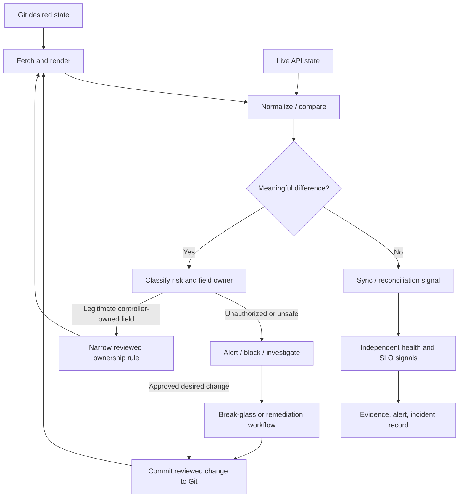

# Unit 6 — Deployment Drift Detection and Reconciliation

**Target file:** `06-deployment-drift-detection-and-reconciliation.md` | **Module:** M08 | **Stage:** 2E  
**Estimated time:** 12–18 hours including six labs; optional controller installation and admission-webhook work may add time.  
**Prerequisites:** Git, Kubernetes/`kubectl`, `kind`, Deployments/Services/HPA/RBAC, Kustomize, Helm, and M08 Units 1–5.  
**Core tools:** Git, `kubectl`, `kind`, Python 3, `jq` (optional), and one GitOps controller. Main path: Flux.  
**Awareness-level topics:** Argo CD/Flux comparison, audit logging, admission-policy engines, fleet-scale tuning, CRD conversion/defaulting, and rollout-controller integration.  
**Last reviewed:** 2026-10-28.  
**Tool baseline assumed:** Kubernetes APIs available in a current `kind` node image; Flux CLI/controller APIs and Argo CD CLI/API are version-sensitive `[VERIFY]`. Use official docs linked in Section 6.25 and pin versions in your own lab record.  
**Footprint:** Approx. 2–4 CPU, 4–6 GB RAM, and 10–20 GB disk for a small `kind` cluster plus one controller. Stop optional webhook or metrics components when not in use.

> **Safety contract.** All examples use a fictional `scoring-api` and disposable local resources. Before any mutation, run `kubectl config current-context` and verify it is the intended lab context. Do not run these commands against production. Outputs are **EXPECTED / REPRESENTATIVE — NOT CAPTURED FROM A LIVE RUN** unless explicitly stated otherwise. This lesson received static review only; the authoring environment did not execute the labs or start a cluster.

## 6.0 Why drift management matters in production

Consider this fictional incident: an inference API starts timing out during a traffic spike. An on-call engineer scales its Deployment from three replicas to eight. The immediate symptom improves, but a GitOps controller notices that Git still declares three replicas and restores that value. Latency rises again. The team calls this “the controller fighting us,” but the deeper failure is that emergency operations, desired-state ownership, and the autoscaling policy were not designed together.

This is an illustrative scenario, not a report of a real company incident. The controller did what it was configured to do: reconcile live state toward declared state. The system design failed to define who owns replicas during normal operation, how emergency changes are recorded, and when reconciliation may be paused safely.

Drift management is therefore not simply “make every diff disappear.” It is a control discipline: discover differences, normalize expected API behavior, classify the difference, identify the legitimate field owner, select a safe response, and retain evidence. Some differences should be corrected immediately. Some are generated by Kubernetes or another controller and should be handled through ownership design or a narrow ignore rule. Unknown differences must be investigated rather than suppressed.

The central production invariant is: **every important field has an understood owner, every meaningful deviation has a disposition, and no emergency divergence remains undocumented.** A GitOps controller can only manage the resources in its configured inventory and scope. It cannot prove that the rest of the cluster is safe.

## 6.1 Learning objectives and completion outcomes

By the end of the unit, the learner can demonstrate these outcomes:

- **L1:** Define drift as a meaningful difference between declared and observed state, and distinguish actionable drift from harmless normalization noise.
- **L1:** Explain why sync/reconciliation status and workload health are separate signals; diagnose a healthy-but-OutOfSync resource and a synced-but-unhealthy resource.
- **L1:** Inspect a live-vs-desired diff using the selected controller and identify at least four possible sources of drift.
- **L2:** Configure a controlled detect-only or corrective workflow, and explain what suspension does and does not pause.
- **L2:** Execute a break-glass change using `pause narrowly → record → change → commit desired state → resume → verify` without leaving live state silently divergent.
- **L3:** Classify drift by risk, maintain a reviewed allow-list, and identify likely field managers with `managedFields` while stating its forensic limitations.
- **L3:** Run an inventory-based audit for missing ownership metadata and unowned namespaces, including explicit exclusions and documented discovery/RBAC limits.
- **L3:** Design a single-owner contract for GitOps, HPA, operators, webhooks, Helm, and IaC tools.
- **L4:** Investigate an incident using Git history, controller events, API audit logs where available, and field-manager evidence.
- **L4:** Define drift service-level indicators (SLIs), escalation thresholds, expiry-controlled pauses, and a staged unmanaged-resource adoption plan.

**Completion gate:** all six labs pass their stated acceptance criteria; the learner can explain why each ignore rule exists and can show a sanitized diff, incident record, audit report, and pause-expiry report.

## 6.2 Concept map, vocabulary, and control-loop model

A GitOps system continuously compares a rendered desired configuration with the state observed from the Kubernetes API. “Drift” is the useful semantic difference after accounting for defaulting, normalization, and fields legitimately owned by other actors—not every byte-level difference in YAML.



| Term | Precise meaning | Common misconception |
|---|---|---|
| Desired state | Versioned declarative state from the configured source, plus controller parameters. | “The latest file in any repo is automatically desired.” Scope and revision selection matter. |
| Live state | Objects currently observed through the Kubernetes API. | “Live YAML is exactly what was submitted.” Defaults, admission, controllers, and status alter it. |
| Drift | A meaningful deviation between desired and live state after applicable normalization. | “Any diff is an incident.” Some differences are expected and harmless. |
| Reconciliation | Repeated attempt to make observed state converge on desired state. | “Reconcile means successful deployment.” It may fail or remain unhealthy. |
| Sync status | Controller-specific assessment of desired/live alignment. | “Synced means the service works.” Health is separate. |
| Health status | Assessment of readiness/health by Kubernetes or the GitOps tool. | “Healthy means compliant with Git.” A healthy workload can be out of sync. |
| Normalization | Handling representation/defaulting differences before comparison. | “Normalization makes all ignored differences safe.” It can hide risk if overbroad. |
| `managedFields` | API metadata describing field managers and field ownership under server-side apply and related writes. | “It proves which human intended a change.” It does not replace audit logs. |
| Orphan/unmanaged resource | A live object not associated with a known owner/inventory under the selected tracking model. | “A missing label proves malicious creation.” It is a signal requiring investigation. |
| Break-glass | A controlled emergency path with narrow authority, recorded divergence, and time-bounded return to normal. | “Emergency work can bypass Git indefinitely.” |

### Two independent questions

1. **Alignment:** does the controller consider the live object aligned with its declared desired state?
2. **Service health:** is the workload meeting readiness, availability, latency, error-rate, and business/data-quality expectations?

A Deployment can be `OutOfSync` but still serve traffic. A Deployment can be `Synced` while all Pods are crash-looping. Always pair controller state with workload and service telemetry. M10 covers SLO/error-budget depth; M11 covers monitoring, logs, and alerts.

## 6.3 Sources and types of drift

Common sources include:

- **Manual writes:** `kubectl edit`, `kubectl patch`, direct API calls, emergency scaling, or a script applying an old manifest.
- **Autoscalers:** HPA updates `scale`/replica count based on metrics; other autoscalers may alter resources or scheduling-related fields.
- **Operators and controllers:** a database operator adds labels, changes status, or manages subordinate resources; rollout controllers change replicas or traffic weights.
- **Admission mutation/defaulting:** a webhook injects sidecars, annotations, certificates, security settings, or default values; the API server also defaults fields.
- **Partial or failed apply:** some resources update while later resources fail; dependencies may be missing or immutable fields may reject changes.
- **API evolution:** CRD schema/defaulting changes, conversion webhooks, Kubernetes upgrades, or API-version changes affect rendered/observed forms.
- **External changes:** an externally managed DNS name, certificate bundle, or cloud-resource reference changes.
- **Competing writers:** Helm, Terraform/OpenTofu, Crossplane, Argo CD, Flux, an operator, and a human all manage the same object or field.
- **Inventory gaps:** a resource or namespace exists outside the controller's application/path/namespace scope, so normal diffs never include it.

A useful classification records the object, field, observed and desired values (redacted if sensitive), first-seen time, severity, legitimate writer, action, owner, and evidence reference. Avoid copying secret data into diffs or incident tickets.

## 6.4 Sync status, health status, diff, and normalization

The controller compares a rendered desired representation with API-observed state. Differences may be caused by a real change, but also by API defaulting, generated metadata, status fields, ordering, conversion, webhook mutation, or differences in how the tool calculates a diff. A raw `kubectl get -o yaml` comparison is not a substitute for the controller's own diff semantics.

**Example — unauthorized image change.** Git declares `registry.example.invalid/scoring-api@sha256:aaaa...` `[ILLUSTRATIVE]`; someone patches the live image to another digest. If image identity is controller-owned, classify this as potentially security-critical and restore the reviewed digest by reconciling Git or submit an approved Git change. Do not add an ignore rule for the image.

**Example — HPA owns replicas.** If an HPA legitimately scales the Deployment, a Git-declared static `spec.replicas` can conflict with the autoscaler. Prefer a coherent design where the HPA is declared and the workload field ownership is compatible with it; use the controller's documented diff/ignore facility only when it is narrow, tested, and preserves security-relevant comparisons. Do not casually suppress the entire Deployment spec.

**Example — webhook-mutated field.** A mutating webhook may inject a `caBundle` or sidecar configuration. First confirm the mutation is expected and identify the webhook owner. Prefer correct configuration and documented field ownership. If an ignore rule is needed, scope it to the exact resource group/kind/field and test that unrelated fields remain visible.

Normalization may be appropriate for representation differences, but an ignore rule is a policy exception, not a repair. A broad “ignore all differences” rule can conceal image tampering, privilege escalation, RBAC changes, or a manually opened NetworkPolicy. Treat every exception as code with an owner and review date.

## 6.5 Argo CD and Flux: observe and compare drift

This lesson uses **Flux** as the primary controller for hands-on work because its Kustomization API exposes reconciliation conditions and its `suspend`/resume behavior can be exercised in a local lab. Argo CD is compared at Awareness level. Do not install both controllers into the same lab cluster managing the same objects.

| Concern | Argo CD | Flux | Operational caveat |
|---|---|---|---|
| Desired-state scope | Application source(s), target path, destination, and resource tracking. | Source objects plus Flux `Kustomization`/`HelmRelease` scopes. | An object outside scope is invisible to that application's ordinary diff. |
| Drift signal | Application sync status/diff; commonly `OutOfSync`. | Kustomization/HelmRelease conditions, events, logs, and CLI diff/reconcile commands. | Status reason names and CLI flags are version-sensitive `[VERIFY]`. |
| Manual/detect-only | Manual sync or disabled auto-sync; exact settings depend on Application configuration. | Suspend a specific Kustomization or use a carefully chosen interval. Suspension pauses reconciliation and drift correction for that Kustomization. | A longer interval is not an explicit alert-only policy. |
| Auto-correction | Automated sync plus `selfHeal` for live changes, when configured. | Controller periodically and event-triggeredly reconciles declared state; interval and retry behavior are configurable. | Reconciliation can undo emergency changes; ownership must be designed first. |
| Ignore/ownership | `spec.ignoreDifferences` and related sync options, scoped narrowly. | Kustomize patches, resource reconciliation annotation, server-side apply/field ownership, and tool-specific configuration; not a drop-in equivalent to every Argo rule. | Validate exact semantics for installed versions. |
| Alerts | Argo CD Notifications integrations. | Flux notification-controller Alert/Provider mechanisms. | Provider schemas and receiver setup require version-specific verification. |
| Orphan discovery | Orphaned-resource monitoring can report certain resources not tracked by an Application/project configuration. | No universal default equivalent to Argo CD orphan reporting; use explicit inventory/live audits. | Neither replaces cluster-wide security inventory. |
| Destructive options | `Replace=true` can replace/create resources and may cause recreation/outage; `Force` has destructive semantics. | Pruning and remediation depend on object/controller configuration. | Never enable broad prune/replace without staged tests and recovery planning. |

Useful commands (verify CLI version and context first):

```bash
# Argo CD: show desired/live difference for one known application
argocd app diff scoring-api
argocd app get scoring-api

# Flux: inspect a specific Kustomization
flux get kustomizations -A
flux get kustomization scoring-api -n flux-system
flux diff kustomization scoring-api --path ./clusters/local/apps/scoring-api
kubectl describe kustomization scoring-api -n flux-system
kubectl get events -A --sort-by=.lastTimestamp
```

`flux diff kustomization` flags and path/revision behavior can vary by CLI release `[VERIFY]`; consult the [Flux CLI reference](https://fluxcd.io/flux/cmd/). Do not copy a sample path blindly: the local directory must contain the expected source content and the installed CLI must support the selected command form.

Representative Argo CD output:

```text
EXPECTED / REPRESENTATIVE — NOT CAPTURED FROM A LIVE RUN
Name: scoring-api
Sync Status: OutOfSync
Health Status: Healthy
DIFF: Deployment/scoring-api spec.template.spec.containers[0].image
```

Representative Flux condition:

```text
EXPECTED / REPRESENTATIVE — NOT CAPTURED FROM A LIVE RUN
NAME          REVISION             SUSPENDED  READY  MESSAGE
scoring-api   main@sha1:deadbeef    False      True   Reconciliation succeeded
```

A `Ready=True` Kustomization means the reconciliation succeeded according to the configured apply/health checks; it does not prove that the service meets its SLO. Inspect the relevant conditions, events, workload readiness, and telemetry together.

## 6.6 Detect-only versus auto-correct reconciliation

### Detect-only and investigation mode

Argo CD can be configured for manual sync by not enabling automated sync. Flux can suspend a specific Kustomization with `flux suspend kustomization NAME -n NAMESPACE`; while suspended, that Kustomization does not apply new source revisions or perform its normal drift correction. It does not stop the application itself, suspend every other controller, or prevent a human from changing live objects. A suspended Flux Kustomization may also stop pruning its managed inventory, so understand the exact consequences before using it during an incident.

Longer reconciliation intervals reduce frequency but are not equivalent to a formal detect-only mode. A longer interval may increase time-to-detection and does not itself create an alert. Design detection and notification separately.

### Auto-correct mode

Auto-correction is useful when desired state is safe and ownership is clear. It reduces time-in-drift and can repair accidental changes. It is dangerous when a manual emergency change is required, a legitimate controller owns a field, or a shared resource has competing writers. Before enabling it broadly, test representative drift cases and confirm the rollback path.

Flux reconciliation occurs in response to relevant events and at configured intervals; failures may be retried with backoff. Argo CD automated sync and self-heal behavior has its own semantics and version-dependent controls. Do not assume that “disabled selfHeal” means every out-of-band change will persist in every multi-source configuration. Consult the current [Argo CD automated sync documentation](https://argo-cd.readthedocs.io/en/stable/user-guide/auto_sync/) and [Flux Kustomization documentation](https://fluxcd.io/flux/components/kustomize/kustomizations/).

### Safe out-of-band change procedure

For every live change, choose one of two outcomes:

1. **Reject the change:** reconcile the reviewed Git desired state back into the cluster and verify the live field is restored.
2. **Accept the change:** submit the approved desired-state change to Git, review its rendered diff, merge it, then verify reconciliation.

Do not let live state differ from the declared state indefinitely. Record the change ID, actor, object/field, reason, time, risk, Git revision, controller revision, and post-change verification.

## 6.7 Ignore rules and legitimate field ownership

An ignore rule is appropriate only when a field is deliberately owned by another trusted component or the diff is a known non-semantic representation artifact. Candidate examples include HPA-managed replica count, webhook-populated certificate bundles, and documented operator-owned annotations. Each needs evidence of the legitimate writer and a test proving the rule does not hide neighboring fields.

Do **not** casually ignore container images, security contexts, RBAC, NetworkPolicy, service-account identity, host access, production capacity controls, or other security- and availability-critical fields. If a diff is noisy, diagnose its source first. Correct the source or ownership contract where possible.

A reviewed allow-list entry should include:

```yaml
# Example schema, not a controller CRD; stored as policy documentation.
apiVersion: drift-policy.example.invalid/v1
kind: DriftException
metadata:
  name: scoring-api-hpa-replicas
spec:
  resource: apps/v1/Deployment/scoring-api
  fieldPath: /spec/replicas
  legitimateWriter: horizontal-pod-autoscaler/scoring-api
  reason: "HPA is the declared capacity owner for this workload"
  riskClass: availability
  disposition: ignore-diff-but-alert-on-range-violation
  owner: platform-runtime
  approvedBy: platform-reviewer-01
  reviewBy: "2026-11-30" # [ILLUSTRATIVE]
  test: "HPA scale changes replicas; image/securityContext differences remain visible"
```

This is an illustrative policy record, not a native Kubernetes resource. The actual enforcement mechanism must be implemented in CI, controller configuration, or policy tooling. Never use an exception as an undocumented permanent workaround.

Flux's `kustomize.toolkit.fluxcd.io/reconcile: disabled` annotation disables reconciliation/pruning for the annotated resource in supported Flux behavior; it is not equivalent to an Argo CD `ignoreDifferences` rule. It can create a lasting unmanaged interval and must be removed or set back in the source when the pause ends. Verify installed Flux behavior in the official docs before relying on it.

## 6.8 Server-side apply and `managedFields`

Kubernetes Server-Side Apply (SSA) records field ownership by field manager. Inspect it with:

```bash
kubectl get deployment scoring-api -n drift-lab -o yaml --show-managed-fields
kubectl get deployment scoring-api -n drift-lab -o json \
  | jq '.metadata.managedFields[] | {manager,operation,apiVersion,time,fieldsType}'
```

`managedFields` can help identify whether `kubectl-client-side-apply`, a GitOps controller, an HPA-related manager, an operator, or another tool appears to own fields. It does not necessarily identify a real person, capture the intent behind the write, or preserve a complete audit trail. The `time` field is metadata about the field-management operation, not a full incident timeline.

When an SSA conflict occurs, prefer resolving the ownership model: decide which manager should own the field, update manifests and controllers, then reapply through the intended path. `kubectl apply --server-side --force-conflicts` can seize field ownership and overwrite another manager's intent. It is not a routine repair command. Use it only in a deliberately reviewed migration where taking ownership is the intended action.

For forensics, correlate `managedFields` with Kubernetes audit logs (if enabled and retained), Git history/PR approvals, controller events and logs, CI job evidence, and workload telemetry. See [Kubernetes Server-Side Apply](https://kubernetes.io/docs/reference/using-api/server-side-apply/) and [API auditing](https://kubernetes.io/docs/tasks/debug/debug-cluster/audit/).

## 6.9 Break-glass: pause, fix, commit, resume

Break-glass is a temporary, audited exception—not a second deployment system. The safest default is to change desired state in Git quickly, but a live change may be needed when a production incident requires immediate mitigation. Keep the scope narrow and the pause time bounded.

### Runbook

1. Confirm the cluster context and target resource. Open an incident/change record and name the incident commander or approver.
2. Assess whether controller correction would worsen the incident. Pause only the relevant application/Kustomization if necessary; record who paused it, why, and expiry.
3. Make the smallest emergency change and verify the service with health/SLO signals. Avoid changing unrelated resources.
4. Immediately represent the accepted state in Git with a reviewed hotfix commit/PR. If the live change should not persist, instead reconcile the approved Git state back.
5. Inspect source and rendered diffs; check that the change does not weaken security or violate field ownership.
6. Resume reconciliation and wait for the controller's normal success condition.
7. Verify live state, workload health, and service telemetry; remove the pause/exception; close the record with evidence and follow-up actions.
8. If reconciliation would cause harm, do not blindly resume. Escalate to the accountable owner, keep the pause explicitly time-bounded, and define the safe next action.

Flux commands (verify namespace and CLI version):

```bash
kubectl config current-context
flux suspend kustomization scoring-api -n flux-system
# emergency action only in the throwaway lab, if necessary
# update the intended Git manifest and commit it
flux resume kustomization scoring-api -n flux-system
flux reconcile kustomization scoring-api -n flux-system --with-source
kubectl get kustomization scoring-api -n flux-system
```

For Argo CD, use the documented Application sync-policy controls or UI/API to disable auto-sync narrowly, then restore the intended policy after the reviewed Git change. Do not guess a JSON patch for a version you have not checked.

### Incident record template

```yaml
incidentId: INC-LAB-001 # [ILLUSTRATIVE]
resource: deployment/scoring-api
namespace: drift-lab
controller: flux-kustomization/scoring-api
pausedAt: "2026-10-28T10:00:00Z" # [ILLUSTRATIVE]
expiresAt: "2026-10-28T10:30:00Z" # [ILLUSTRATIVE]
owner: oncall-lab
reason: "temporary capacity mitigation"
changeId: PR-LAB-123
riskAssessment: "replica-only; no image or security changes"
verification: ["readiness", "5xx-rate", "p95-latency"]
resumedAt: "2026-10-28T10:18:00Z" # [ILLUSTRATIVE]
finalGitRevision: "0123456789abcdef" # [ILLUSTRATIVE]
status: closed
```

## 6.10 Drift classification and allow-list governance

| Class | Examples | Default disposition | Severity | Owner/evidence |
|---|---|---|---|---|
| Security-critical | Privileged container, hostPath/hostNetwork change, unexpected image digest, RBAC expansion, NetworkPolicy opened | Alert urgently; contain and restore approved state or approve a reviewed change | Critical/high | Security + platform; incident ID, diff, audit evidence |
| Service-impacting | Replica drop, bad probe, resource limit regression, route change | Page/alert according to impact; restore or approve fix | High/medium | Service owner + on-call; telemetry and change record |
| Legitimate controller-owned | HPA-managed replicas, known operator-managed status, webhook-owned field | Correct ownership model; narrow ignore only when justified | Context-dependent | Platform/operator owner; test and review date |
| Benign normalization | API defaulting or stable representation-only change | Normalize or document; avoid a broad suppression | Low | Platform; reproducible diff evidence |
| Unknown | Unrecognized annotation, untracked resource, unexplained spec change | Investigate; do not suppress automatically | Unknown/high until triaged | On-call + owner; timeline and evidence |

Every exception must be scoped by API group/kind/name and field, identify the legitimate writer, state the reason, severity, expected duration, detection/alert behavior, approver, expiry/review date, and a test. Review exceptions at least on the cadence defined by your risk tier `[ASSUMPTION]`; expire or renew them explicitly.

## 6.11 Unmanaged-resource and namespace discovery

A controller's application diff does not reveal every object in the cluster. You need a separate inventory-versus-live audit to find resources that lack a tracking label/annotation or an approved owner. Argo CD has orphaned-resource monitoring features under documented project/Application configuration; exact behavior depends on the resource tracking mode and exclusions. Flux does not provide one universal cluster-wide orphan report equivalent by default, so a platform-owned inventory audit is a practical complement.

The following script inventories a **declared scope**: common namespaced workload kinds and namespaces returned by `kubectl`. It intentionally does not dump Secret data. It is a starter audit, not a proof of complete cluster coverage. It can miss custom resources, cluster-scoped kinds, API discovery failures, and resources hidden by RBAC. Production use should discover all API resources, query only approved scopes, handle pagination and transient errors, and compare against an owner inventory maintained by the platform team.

### Owner inventory example

Use JSON for this starter so it can run with Python's standard library; a production team may choose YAML plus a validated schema.

```json
{
  "namespaces": {
    "drift-lab": "application-team",
    "flux-system": "platform-team"
  },
  "approvedUnmanaged": [
    {
      "apiVersion": "v1",
      "kind": "Service",
      "namespace": "kubernetes-dashboard",
      "name": "dashboard",
      "reason": "temporary lab dependency",
      "expires": "2026-11-30"
    }
  ],
  "trackingKey": "platform.example.invalid/owner",
  "systemNamespaces": ["kube-system", "kube-public", "kube-node-lease", "default"]
}
```

### Audit script (Python 3)

This script supports two modes: a live, explicitly scoped `kubectl` inventory and a deterministic JSON fixture mode for tests. It emits metadata only—never Secret data. It reports namespaces absent from the owner inventory and namespaced objects lacking a tracking label/annotation unless an exact approved exception exists. It queries only the listed common namespaced kinds; this is not exhaustive cluster discovery.

```python
#!/usr/bin/env python3
"""Scoped owner audit; metadata only. Not a complete cluster scanner."""
import argparse
import json
import subprocess
import sys
from pathlib import Path

KINDS = ["deployments", "statefulsets", "daemonsets", "services", "configmaps", "jobs", "cronjobs"]

def key_for(api_version, kind, namespace, name):
    return (api_version or "", kind or "", namespace or "", name or "")

def classify_resource(item, inventory):
    md = item.get("metadata", {}) or {}
    labels = md.get("labels", {}) or {}
    annotations = md.get("annotations", {}) or {}
    track_key = inventory.get("trackingKey", "platform.example.invalid/owner")
    if labels.get(track_key) or annotations.get(track_key):
        return "managed"
    api_version = item.get("apiVersion", "")
    kind = item.get("kind", "")
    namespace = md.get("namespace", "")
    name = md.get("name", "")
    approved = inventory.get("approvedUnmanaged", [])
    for ex in approved:
        if key_for(ex.get("apiVersion"), ex.get("kind"), ex.get("namespace"), ex.get("name")) == key_for(api_version, kind, namespace, name):
            return "approved-exception"
    return "missing-owner"

def kubectl_json(args):
    proc = subprocess.run(["kubectl", *args, "-o", "json"], text=True, capture_output=True)
    if proc.returncode != 0:
        raise RuntimeError(f"kubectl {' '.join(args)} failed: {proc.stderr.strip()}")
    return json.loads(proc.stdout)

def collect_live(inventory):
    ns_obj = kubectl_json(["get", "namespaces"])
    namespaces = [x["metadata"]["name"] for x in ns_obj.get("items", [])]
    system = set(inventory.get("systemNamespaces", ["kube-system", "kube-public", "kube-node-lease", "default"]))
    objects, namespace_findings = [], []
    owner_map = inventory.get("namespaces", {})
    for ns in namespaces:
        if ns in system:
            continue
        if ns not in owner_map:
            namespace_findings.append({"type": "namespace-missing-owner", "namespace": ns})
        for kind in KINDS:
            result = kubectl_json(["get", kind, "-n", ns])
            for item in result.get("items", []):
                # kubectl returns kind in each item; keep metadata only in output.
                objects.append(item)
    return objects, namespace_findings, {"namespacesSeen": len(namespaces), "queriedKinds": KINDS}

def main():
    parser = argparse.ArgumentParser()
    parser.add_argument("--inventory", required=True, help="JSON owner inventory")
    parser.add_argument("--fixture", help="JSON file with {namespaces: [...], resources: [...]} for deterministic tests")
    args = parser.parse_args()
    try:
        inventory = json.loads(Path(args.inventory).read_text(encoding="utf-8"))
        if args.fixture:
            fixture = json.loads(Path(args.fixture).read_text(encoding="utf-8"))
            objects = fixture.get("resources", [])
            owner_map = inventory.get("namespaces", {})
            system = set(inventory.get("systemNamespaces", ["kube-system", "kube-public", "kube-node-lease", "default"]))
            namespace_findings = [{"type": "namespace-missing-owner", "namespace": ns}
                                  for ns in fixture.get("namespaces", []) if ns not in owner_map and ns not in system]
            scope = {"mode": "fixture", "resources": len(objects), "namespacesSeen": len(fixture.get("namespaces", [])), "queriedKinds": "fixture-provided"}
        else:
            objects, namespace_findings, scope = collect_live(inventory)
            scope["mode"] = "live-kubectl"
        findings = []
        counts = {"managed": 0, "approved-exception": 0, "missing-owner": 0}
        for item in objects:
            status = classify_resource(item, inventory)
            counts[status] += 1
            if status == "missing-owner":
                md = item.get("metadata", {}) or {}
                findings.append({"type": status, "apiVersion": item.get("apiVersion"), "kind": item.get("kind"),
                                 "namespace": md.get("namespace"), "name": md.get("name")})
        report = {"scope": scope, "resourceCounts": counts, "namespaceFindings": namespace_findings,
                  "resourceFindings": findings,
                  "completeClusterCoverage": False,
                  "limitations": ["selected namespaced kinds only", "RBAC/API discovery can limit visibility", "custom and cluster-scoped resources are not enumerated"]}
        print(json.dumps(report, indent=2))
        return 1 if findings or namespace_findings else 0
    except (OSError, json.JSONDecodeError, RuntimeError) as exc:
        print(json.dumps({"error": str(exc), "completeClusterCoverage": False}), file=sys.stderr)
        return 2

if __name__ == "__main__":
    sys.exit(main())
```

Run the live audit only against the lab context:

```bash
kubectl config current-context
python3 scripts/audit-unmanaged-resources.py --inventory policies/owner-inventory.json > audit-report.json
status=$?
printf 'audit exit status=%s\n' "$status"
python3 -m json.tool audit-report.json >/dev/null
```

An exit status of `1` means findings were reported; `2` means the audit could not complete and must not be treated as a clean result. A `0` result means no findings in the declared scope, **not** that the entire cluster is free of unmanaged resources.

### Deterministic test fixture and test cases

Save this as `fixtures/audit-fixture.json` for fixture mode:

```json
{
  "namespaces": ["drift-lab", "unowned-lab-ns", "kube-system"],
  "resources": [
    {"apiVersion":"apps/v1","kind":"Deployment","metadata":{"name":"managed-api","namespace":"drift-lab","labels":{"platform.example.invalid/owner":"application-team"}}},
    {"apiVersion":"v1","kind":"Service","metadata":{"name":"legacy-dashboard","namespace":"kubernetes-dashboard"}},
    {"apiVersion":"v1","kind":"ConfigMap","metadata":{"name":"unowned-config","namespace":"drift-lab"}}
  ]
}
```

Run:

```bash
python3 scripts/audit-unmanaged-resources.py --inventory policies/owner-inventory.json --fixture fixtures/audit-fixture.json
```

Representative expected behavior: `managed-api` is counted as managed; `legacy-dashboard` is an approved exception only if its exact identity appears in the inventory; `unowned-config` is reported as `missing-owner`; `unowned-lab-ns` is reported as a namespace missing from the owner map; `kube-system` is excluded. Output is illustrative, not captured.

Minimum test matrix:

| Test | Fixture | Expected result |
|---|---|---|
| Managed resource | Owner label exists | `managed`, no resource finding |
| Missing owner | No label/annotation and no exact exception | `missing-owner`, report metadata only |
| Approved exception | Exact API version/kind/namespace/name appears in inventory | `approved-exception` |
| Namespace without owner | Non-system namespace missing from inventory map | `namespace-missing-owner` |
| Allowed system namespace | Namespace listed in system exclusions | No namespace finding |
| API/RBAC error | Live `kubectl get` fails | Exit `2`, report incomplete; never “clean” |

The script does not parse exception expiry dates, discover CRDs, enumerate cluster-scoped objects, or verify the legitimacy of labels. Production use must add schema validation, expiry enforcement, API discovery, pagination, custom-resource handling, exclusion governance, and RBAC coverage tests. A tracking label is evidence of declared ownership, not proof of authorization or intent.

## 6.12 Admission controls, RBAC, and single-owner rules

Preventing drift is often better than repairing it. In production, humans should generally have read-only workload access; the GitOps controller identity is the normal writer for declared workload resources; and emergency write access should be time-bound, separately authorized, and audited. This is an architecture pattern, not a universal RBAC manifest: exact permissions depend on the controllers and resources in use. Avoid granting broad `cluster-admin` merely to make reconciliation succeed.

Admission controls and policy-as-code can reject unsafe configurations such as privileged workloads, host access, or prohibited image registries. They should complement RBAC and review, not attempt to infer origin from an object alone. A policy engine cannot reliably distinguish “approved GitOps change” from “human change” unless the system has trustworthy identity and request-context evidence. M12 covers policy-engine implementation depth; M03 covers RBAC and admission fundamentals.

**Single-owner rule:** one system owns a resource, and one clearly identified manager owns each contested field. If Terraform creates a namespace while Flux owns Deployments within it, document that boundary. If Helm owns a resource, do not also declare the same resource independently in Argo CD/Flux. If an operator owns subordinate resources, manage the operator's custom resource and let the operator manage its outputs. Maintain an ownership registry with resource scope, writer, owner, escalation path, and handoff conditions. See M07 for IaC state and ownership.

## 6.13 Drift with HPA, operators, Helm, CRDs, and rollout controllers

### HPA and replica ownership

If an HPA controls scaling, avoid fighting it by continually forcing a static replica value. Design the desired manifest and GitOps behavior so the autoscaler is the legitimate owner of runtime replica count. If a narrow ignore is required, test it and keep image, security context, and RBAC changes visible. A “replicas ignore” rule applied to every workload can hide a deliberate production capacity reduction.

### Operators and mutating webhooks

Document which fields are written by the operator/webhook and why. Prefer upstream-supported configuration rather than suppressing an unexplained diff. A webhook loop can be caused by mutation that is not idempotent or differs from the controller's rendered desired object. Check webhook configuration, API events, admission logs, and the rendered/live object before adding exceptions.

### Helm and CRD changes

Helm release drift detection and Argo CD rendering do not necessarily compare live state in the same way. Flux Helm controller supports HelmRelease reconciliation and version-dependent drift detection options `[VERIFY]`; Argo CD's Helm integration generally renders charts as manifests for Argo's reconciliation model rather than behaving identically to a standalone Helm release controller. Confirm current official documentation for the installed release. A CRD schema/defaulting upgrade can change observed fields and trigger new diffs; stage upgrades, render and compare, and test conversion/defaulting before broad rollout.

### Progressive delivery

Argo Rollouts, Flagger, HPA, and GitOps controllers can fight over replicas or traffic weights if ownership is unclear. A GitOps controller should declare the Rollout's stable strategy and template; the rollout controller may own live step state or traffic weights according to its integration. Verify health customizations and ignore rules for Rollout status in your installed Argo CD version `[VERIFY]`; do not ignore all status/spec differences. Unit 8 covers Rollouts/Flagger depth, Unit 7 covers progressive strategy, and Unit 9 covers release-health gates.

### Reconcile-loop safety and `Replace`

Repeated corrections can produce API-server load, retry storms, churn, and alert noise. When many resources drift after a bad shared-base or CRD change, stage remediation by environment/team and observe controller queues, API latency, and error rates. Do not invent universal concurrency settings; tune from measured controller/API-server behavior. Argo CD's `Replace=true` sync option uses replace/create behavior and may recreate resources, causing outages; it is not a generic way to “fix drift.” See [Argo CD sync options](https://argo-cd.readthedocs.io/en/latest/user-guide/sync-options/).

## 6.14 Pause with TTL and reconcile-loop safety

A temporary pause must record resource/application, owner, reason, start time, expiry, incident/change ID, and the safe-resume preflight. A script should report expired pauses, not blindly resume everything: resuming may trigger a destructive or unsafe correction. Human approval may be required if the live state is not yet represented in Git.

### Pause records

```json
[
  {"id":"pause-001","target":"flux-kustomization/scoring-api","owner":"oncall-lab",
   "reason":"emergency capacity change","created":"2026-10-28T10:00:00Z",
   "expires":"2026-10-28T10:30:00Z","changeId":"INC-LAB-001","state":"paused"},
  {"id":"pause-002","target":"argocd-app/scoring-api","owner":"platform-lab",
   "reason":"test exception","created":"2026-10-28T10:00:00Z",
   "expires":"2026-10-28T11:00:00Z","changeId":"CHG-LAB-002","state":"resumed"}
]
```

### TTL checker

Save the JSON above as `pause-records.json` in the disposable lab. This checker only identifies malformed and expired records; it never changes controller state.

```python
#!/usr/bin/env python3
"""Report expired/malformed pauses; never auto-resumes resources."""
import json, sys
from datetime import datetime, timezone
REQUIRED = ("id", "target", "owner", "reason", "created", "expires", "changeId", "state")

def parse_time(value):
    dt = datetime.fromisoformat(value.replace("Z", "+00:00"))
    if dt.tzinfo is None:
        raise ValueError("timestamp must include timezone")
    return dt.astimezone(timezone.utc)

def main(path):
    now = datetime.now(timezone.utc)
    try:
        records = json.load(open(path, encoding="utf-8"))
    except Exception as exc:
        print(json.dumps({"error": str(exc), "safeToResume": False}))
        return 2
    results = []
    for rec in records if isinstance(records, list) else []:
        try:
            missing = [k for k in REQUIRED if not rec.get(k)]
            if missing:
                raise ValueError("missing fields: " + ",".join(missing))
            created, expires = parse_time(rec["created"]), parse_time(rec["expires"])
            if expires <= created:
                raise ValueError("expiry must be after creation")
            state = rec["state"]
            if state not in ("paused", "resumed", "closed"):
                raise ValueError("invalid state")
            status = "already-resumed" if state != "paused" else ("expired" if now >= expires else "valid")
            results.append({"id": rec["id"], "target": rec["target"], "status": status,
                            "requiresHumanPreflight": status == "expired"})
        except Exception as exc:
            results.append({"id": rec.get("id", "unknown") if isinstance(rec, dict) else "unknown",
                            "status": "malformed", "error": str(exc), "requiresHumanPreflight": True})
    print(json.dumps({"checkedAt": now.isoformat(), "records": results,
                      "automaticResumePerformed": False}, indent=2))
    return 1 if any(x["status"] in ("expired", "malformed") for x in results) else 0

if __name__ == "__main__":
    sys.exit(main(sys.argv[1] if len(sys.argv) > 1 else "pause-records.json"))
```

For a production implementation, validate schema strictly, use a trusted time source, store records durably, alert on checker failure, and require a safe-resume check that confirms the desired Git revision contains the accepted emergency state. Do not automatically resume an expired pause if doing so could undo a safety-critical mitigation.

## 6.15 GitOps drift versus IaC drift

| Dimension | GitOps drift | Infrastructure-as-code (IaC) drift |
|---|---|---|
| Typical scope | Kubernetes application/platform objects within controller inventory. | Cloud/network/compute resources represented in IaC state/configuration; can also manage Kubernetes resources. |
| Detection | Continuous/event-triggered reconciliation and controller diff. | Often detected at plan/refresh time or by scheduled drift jobs. |
| Remediation | Controller may correct continuously if configured. | Usually a human/automation reviews a plan and applies a change, though policy/automation can alter this. |
| State model | Desired manifests/source revisions plus live API state and controller tracking. | Configuration plus provider state/state backend and remote APIs. |
| Conflict risk | Multiple controllers or human writers fight over fields/resources. | Multiple state files/stacks or a GitOps controller can fight over the same resource. |
| Best practice | Define Kubernetes resource/field owner; review diffs and reconcile deliberately. | Define provider resource owner/state boundaries; review plans and avoid split ownership. |

Neither replaces the other. If IaC owns a cluster/network and GitOps owns workloads, document the boundary and order of operations. If both tools claim the same Kubernetes object, resolve ownership rather than hoping their apply cadence stays aligned. M07 Unit 3 is the intended IaC drift handoff; use the exact unit file available in your roadmap rather than assuming a filename.

## 6.16 Drift SLIs and fleet-level governance

Useful service-level indicators include:

- **Time-in-drift:** elapsed time from first reliable detection to verified resolution, reported by severity. Define whether the clock stops at Git merge, successful reconciliation, or verified live state; recommended definition is verified resolution.
- **Drift events per service/environment:** count of unique meaningful drift incidents in a time window. Deduplicate repeated observations of the same unresolved difference.
- **Security-critical drift duration:** total and maximum duration that a critical drift condition remains unresolved.
- **Unmanaged-resource count and age:** resources missing an approved owner/inventory mapping, split by severity and exception status.
- **Auto-remediation success rate:** corrective attempts that converge and remain stable over a defined observation window divided by all eligible attempts. Exclude non-actionable diff noise only through documented rules.

Example weekly report `[ILLUSTRATIVE]`:

| Measure | This week | Previous week | Interpretation/action |
|---|---:|---:|---|
| Meaningful drift events | 14 | 19 | Falling count, but validate severity mix. |
| Median time-in-drift | 11 min | 18 min | Better, if detection timestamps are reliable. |
| Critical drift > 15 min | 1 | 0 | Review incident and escalation path. |
| Unowned namespaced resources | 7 | 12 | Confirm exceptions and adoption owners. |
| Auto-correction success | 96% | 97% | Investigate repeated failures rather than optimizing the aggregate only. |

These are sample numbers, not benchmarks. Governance should define drift budgets by risk tier, weekly reporting, named owners, escalation rules, exception expiry, and quarterly review. Production `selfHeal` policy is a design choice: enabling it broadly can reduce accidental drift duration, while selective/manual behavior can be safer during experimentation or where multiple controllers own fields. Decide from workload risk, ownership, tested rollback, and incident history—not a blanket rule.

At scale, mass drift can overload controller queues and the API server. Stage remediation by cluster/environment, rate-limit automation where supported, avoid synchronized retry storms, monitor reconciliation latency and API-server errors, and stop rollout of a shared configuration change if early canaries show unexpected diffs. Do not invent product-specific tuning defaults.

## 6.17 Production forensics and incident case studies

### Evidence collection sequence

1. Record incident start, detection time, impacted service/environment, and the last known-good Git revision.
2. Capture the controller's diff/status and relevant events before the state changes again.
3. Inspect object metadata and `managedFields`; record manager names and field paths without treating them as proof of a person's intent.
4. Retrieve Git history, PR approvals, CI logs, and promotion/release evidence.
5. Query Kubernetes audit logs if configured and retained; collect relevant controller logs and workload/SLO telemetry.
6. Contain the risk, restore an explicit owner, reconcile desired state, and verify the service.
7. Record a blameless timeline, root cause, control gap, and measurable follow-up.

### Case 1 — Self-heal reverted emergency scale-up

- **Timeline/signals:** latency rises; on-call scales from three to eight replicas; replicas return to three; latency rises again. Controller diff or events show the declared replica count being applied.
- **Diagnosis:** GitOps controller and HPA/on-call action both attempted to own replicas; emergency procedure did not pause or commit the change.
- **Containment:** use the approved incident path; if necessary pause only the relevant reconciliation and restore capacity under the incident commander. Verify request success and saturation.
- **Fix:** decide whether HPA or a reviewed Git value owns capacity; encode the chosen model in Git, remove conflicting writers, resume reconciliation.
- **Prevention/evidence:** test scale events, document emergency TTL, alert on repeated replica drift, retain PR, controller events, latency graph, and post-incident action owner.

### Case 2 — Persistent `OutOfSync` loop from a mutating webhook

- **Signals:** same field changes after every sync; repeated diff; webhook logs/events indicate injection/defaulting.
- **Diagnosis:** mutation is expected but not accounted for, or the webhook is non-idempotent/inconsistent. Do not immediately ignore the whole resource.
- **Containment/fix:** validate webhook ownership and configuration; correct the mutator or desired manifest; if unavoidable, add a narrowly scoped reviewed ignore for the exact field and test neighboring security fields.
- **Prevention/evidence:** automated diff regression test, owner and expiry for exception, before/after rendered/live diff and webhook logs.

### Case 3 — Unmanaged debug Pod with host access remained in production

- **Signals:** periodic inventory reports a Pod without an owner label; security scan shows host access; no matching Application/Kustomization exists.
- **Diagnosis:** controller scope was mistaken for cluster inventory; no scheduled unmanaged-resource audit or exception review existed.
- **Containment/fix:** security/on-call confirms workload owner and purpose; isolate/terminate only through the approved incident procedure; inspect credentials and node exposure. Adopt legitimate resources into Git after inventory and review.
- **Prevention/evidence:** recurring API discovery audit, namespace owner inventory, RBAC restrictions, admission policy, exception expiry, and a retained sanitized finding record.

### Case 4 — HPA and Git replicas fought, causing flapping

- **Signals:** replicas oscillate, events show scaling, controller diffs repeatedly reset replicas, and HPA metrics/conditions vary.
- **Diagnosis:** two writers owned the same field or a static `spec.replicas` repeatedly conflicted with autoscaling.
- **Containment/fix:** inspect HPA target and workload manifest; establish the single-owner model; adjust manifest/controller configuration or narrowly handle the field as supported. Do not suppress the whole Deployment diff.
- **Prevention/evidence:** integration test for HPA, alert on replica flapping, reviewed field ownership entry, HPA conditions and controller events.

### Case 5 — `ignoreDifferences` hid a manually opened NetworkPolicy

- **Signals:** controller says synced while a live NetworkPolicy permits wider traffic; the ignore rule is broad or hides a security-relevant field.
- **Diagnosis:** exception was scoped too widely and treated as a cosmetic diff workaround.
- **Containment/fix:** security team verifies expected traffic, restores the restrictive reviewed policy through Git, removes/narrows the ignore rule, and validates connectivity and denial behavior.
- **Prevention/evidence:** policy test that deliberately opens the rule and must fail, code-owner approval for security exceptions, periodic ignore-rule audit, NetworkPolicy test results and incident record.

### Ownership and escalation

| Activity | Application team | Platform team | Security | On-call/SRE |
|---|---|---|---|---|
| Own app intent and health | Accountable | Consulted | Consulted for risk | Operates during incident |
| GitOps controller/cluster baseline | Consulted | Accountable | Reviews controls | Consulted |
| Security-critical drift | Supplies context | Remediates platform boundary | Accountable for risk decision | Contains/pages |
| Break-glass approval | Service owner/incident role | Controller owner | Required for security-sensitive changes | Executes and records |
| Allow-list exception | Requests/validates | Implements and owns platform config | Reviews high-risk fields | Uses during incident only as authorized |
| Weekly SLI review | Owns service actions | Produces inventory/report | Reviews critical trend | Escalates breach |

## 6.18 Local lab setup and repository layout

Use WSL2 Ubuntu or Linux with Git, Python 3, Docker, `kind`, `kubectl`, and one controller. The main labs can be done partly with static rendering and scripts; controller-specific exercises require a disposable local cluster. Pin the versions in a local README before beginning.

```text
gitops-lab/
├── apps/
│   └── scoring-api/
│       ├── base/
│       │   ├── deployment.yaml
│       │   ├── service.yaml
│       │   └── kustomization.yaml
│       └── overlays/
│           ├── dev/kustomization.yaml
│           ├── staging/kustomization.yaml
│           └── prod/kustomization.yaml
├── clusters/local/
│   └── scoring-api-kustomization.yaml
├── policies/
│   ├── drift-classification.md
│   └── owner-inventory.yaml
├── scripts/
│   ├── audit-unmanaged-resources.py
│   ├── check-pause-ttl.py
│   └── test-audit-scripts.sh
└── README.md
```

This is an illustrative teaching tree aligned with Unit 4. The snippets below belong inside this lesson; do not create additional repository files as part of lesson generation. When you perform a lab, create the files only inside your disposable working directory.

### Minimal workload files

```yaml
# apps/scoring-api/base/deployment.yaml
apiVersion: apps/v1
kind: Deployment
metadata:
  name: scoring-api
  labels:
    app.kubernetes.io/name: scoring-api
    platform.example.invalid/owner: application-team
spec:
  replicas: 2
  selector:
    matchLabels:
      app.kubernetes.io/name: scoring-api
  template:
    metadata:
      labels:
        app.kubernetes.io/name: scoring-api
    spec:
      containers:
        - name: app
          image: ghcr.io/example/scoring-api@sha256:aaaaaaaaaaaaaaaaaaaaaaaaaaaaaaaaaaaaaaaaaaaaaaaaaaaaaaaaaaaaaaaa # [ILLUSTRATIVE]
          ports:
            - name: http
              containerPort: 8080
          readinessProbe:
            httpGet: {path: /health, port: http}
            initialDelaySeconds: 2
            periodSeconds: 5
          securityContext:
            allowPrivilegeEscalation: false
            runAsNonRoot: true
            capabilities:
              drop: ["ALL"]
---
# apps/scoring-api/base/service.yaml
apiVersion: v1
kind: Service
metadata:
  name: scoring-api
  labels:
    platform.example.invalid/owner: application-team
spec:
  selector:
    app.kubernetes.io/name: scoring-api
  ports:
    - name: http
      port: 80
      targetPort: http
---
# apps/scoring-api/base/kustomization.yaml
apiVersion: kustomize.config.k8s.io/v1beta1
kind: Kustomization
resources:
  - deployment.yaml
  - service.yaml
```

The image reference is a fake digest and will not resolve. For a real local workload, replace it with an image built in M01 and loaded into `kind`, or choose a known lightweight test image only if network access is acceptable. The sample app's `/health` endpoint must exist for the readiness probe to succeed; otherwise the workload remains unready. This is a manifest pattern, not a runnable app image by itself.

```yaml
# apps/scoring-api/overlays/dev/kustomization.yaml
apiVersion: kustomize.config.k8s.io/v1beta1
kind: Kustomization
namespace: drift-lab
resources:
  - ../../base
patches:
  - target:
      group: apps
      version: v1
      kind: Deployment
      name: scoring-api
    patch: |-
      - op: replace
        path: /spec/replicas
        value: 1
---
# apps/scoring-api/overlays/staging/kustomization.yaml
apiVersion: kustomize.config.k8s.io/v1beta1
kind: Kustomization
namespace: drift-lab
resources:
  - ../../base
patches:
  - target:
      group: apps
      version: v1
      kind: Deployment
      name: scoring-api
    patch: |-
      - op: replace
        path: /spec/replicas
        value: 2
---
# apps/scoring-api/overlays/prod/kustomization.yaml
apiVersion: kustomize.config.k8s.io/v1beta1
kind: Kustomization
namespace: drift-lab
resources:
  - ../../base
patches:
  - target:
      group: apps
      version: v1
      kind: Deployment
      name: scoring-api
    patch: |-
      - op: replace
        path: /spec/replicas
        value: 3
```

`patches` is the modern Kustomize field in current documentation, but pin and verify the installed Kustomize version `[VERIFY]`. Keep the same image digest across overlays; differences here are illustrative capacity settings, not a complete production policy.

### Flux entry point (example)

```yaml
# clusters/local/scoring-api-kustomization.yaml
apiVersion: source.toolkit.fluxcd.io/v1
kind: GitRepository
metadata:
  name: gitops-lab
  namespace: flux-system
spec:
  interval: 1m
  url: https://example.invalid/replace-with-reachable-lab-repository.git
  ref:
    branch: main
---
apiVersion: kustomize.toolkit.fluxcd.io/v1
kind: Kustomization
metadata:
  name: scoring-api
  namespace: flux-system
spec:
  interval: 5m
  path: ./apps/scoring-api/overlays/dev
  prune: true
  sourceRef:
    kind: GitRepository
    name: gitops-lab
  targetNamespace: drift-lab
  wait: true
  timeout: 2m
```

This entry point is illustrative. `example.invalid` is intentionally non-resolving; replace it with a reachable repository URL. A Git repository hosted on the host may not be reachable from a controller container via `localhost`; use a Docker network hostname or host gateway that is reachable from the `kind` network, and test it from the relevant container/network. Verify API versions and `wait`/health semantics against the installed Flux release. Never install Flux and Argo CD to manage the same objects in this lab.

## 6.19 Labs A–F: full walkthroughs and acceptance criteria

All commands below are intended for a disposable local environment. Outputs are representative, not captured. Record your actual versions and evidence. If an optional controller integration cannot be installed within the laptop budget, complete the deterministic simulation and explicitly mark the controller-specific part unverified.

### Lab A — Induce and resolve three forms of drift

**Level:** L1–L3. **Duration:** 90–150 minutes. **Footprint:** one `kind` cluster, one controller; HPA metrics/webhook are optional.

**Objective:** create three differences, classify them, and resolve them without hiding security-sensitive changes.

**Prerequisites:** a lab cluster and a working `scoring-api` GitOps application. Confirm context:

```bash
kubectl config current-context
kubectl get nodes
kubectl get deployment scoring-api -n drift-lab
```

**A1: manual image edit.** Use only the lab context and workload:

```bash
kubectl set image deployment/scoring-api app=ghcr.io/example/scoring-api@sha256:bbbbbbbbbbbbbbbbbbbbbbbbbbbbbbbbbbbbbbbbbbbbbbbbbbbbbbbbbbbbbbbb -n drift-lab
kubectl get deployment scoring-api -n drift-lab -o jsonpath='{.spec.template.spec.containers[0].image}{"\n"}'
flux get kustomization scoring-api -n flux-system
```

The replacement digest is fake and likely will not pull. This is a deliberate negative test. Observe the controller diff/status; then restore the desired image by reconciling the lab's reviewed Git source. If the controller is not installed, capture the source render and live field and state that controller observation was simulated.

**A2: replica/HPA ownership.** If metrics-server/HPA is available and stable, create an HPA with a bounded replica range and valid CPU requests; verify `kubectl describe hpa`. Do not assume a kind cluster has working metrics by default. If it does not, use a deterministic ownership simulation: patch replicas once, show that the manifest declares a different count, then document the HPA path as untested. Resolve by making HPA the intended capacity owner and testing a narrow replicas policy, or by removing the HPA and committing static capacity to Git.

**A3: webhook/defaulted field.** Preferred real test: use an already-approved lightweight local admission webhook in the disposable cluster and capture the mutated field. This is optional because webhook certificate/network setup can exceed the laptop lab budget. The mandatory fallback is a deterministic simulation: record a before object, apply a fake “mutated” annotation or field in the lab fixture, compare, and label it as simulated—not as a real admission-webhook result. Do not install an unverified webhook into a shared cluster.

**Evidence:** desired Git revision, sanitized live field output, controller diff/status, classification for each drift, resolution commit or revert, and final readiness/health evidence.

**Pass:** all three cases have a documented owner and disposition; image drift is corrected or approved through Git; replica ownership is explicit; webhook simulation is not misrepresented; security-context differences remain visible. **Fail:** blanket ignore rules, live-only changes left behind, or claimed real webhook/HPA results without evidence.

**Cleanup:** restore Git to the approved lab revision and delete only the lab namespace/cluster after confirming it contains no valuable data.

### Lab B — Break-glass drill

**Level:** L2–L4. **Duration:** 45–60 minutes. **Footprint:** same lab.

1. Create an incident record using the template in Section 6.9; assign an ID, owner, reason, and expiry.
2. Confirm context and pause only the lab Kustomization: `flux suspend kustomization scoring-api -n flux-system`.
3. Make a bounded emergency change, such as a temporary replica increase, and verify workload readiness. Do not change image or security fields in this drill.
4. Commit the same accepted desired state to the disposable Git repo, inspect `git diff`, and confirm the change is approved by the lab's simulated reviewer.
5. Resume with `flux resume kustomization scoring-api -n flux-system`; request a reconcile if needed and inspect conditions/events.
6. Confirm Git and live state converge; close the record with timestamps, revision, and health evidence.

If no GitOps controller is installed, simulate the pause/resume state transitions in the record and clearly mark the controller steps not executed. **Pass:** pause is narrow and time-bounded, accepted state is committed, reconciliation resumes, and the incident record is complete. **Fail:** an indefinite pause, a live-only change, or resumption without preflight.

### Lab C — Drift/unmanaged-resource audit script

**Level:** L3–L4. **Duration:** 60–90 minutes. **Footprint:** Python 3 and a cluster with read access to the declared resource kinds.

Save the Section 6.11 script as `scripts/audit-unmanaged-resources.py` inside a throwaway repo. Run:

```bash
python3 scripts/audit-unmanaged-resources.py > audit-report.json
status=$?
printf 'audit exit status=%s\n' "$status"
python3 -m json.tool audit-report.json >/dev/null
```

Use the complete fixture mode and test matrix in Section 6.11. Confirm that a managed resource, missing-owner resource, exact approved exception, unowned namespace, excluded system namespace, and API/RBAC failure each produce the expected result. Keep fixtures metadata-only; never include Secret values. **Pass:** JSON is valid, unowned fixtures are reported, exact exceptions are not escalated, namespace ownership is checked, and API/RBAC errors return exit code 2. **Fail:** errors are silently treated as zero findings, Secret data is emitted, or the report claims full cluster coverage.

### Lab D — `managedFields` forensic investigation

**Level:** L3. **Duration:** 45–75 minutes. **Footprint:** same cluster.

1. Apply the baseline Deployment through the chosen manager.
2. Change one harmless field in the lab using a named manager, for example `kubectl apply --server-side --field-manager=lab-human -f deployment-patch.yaml` with a valid minimal manifest; do not use `--force-conflicts` as a shortcut.
3. Inspect `kubectl get deployment scoring-api -n drift-lab -o yaml --show-managed-fields` and filter `.metadata.managedFields[]` to manager, operation, time, and field metadata.
4. Capture the controller diff and event history, then compare with `git log --oneline --decorate -10` and the simulated PR/change record.
5. Discuss whether the manager identity is a tool identity or authenticated human identity. Identify which question only audit logs can answer.

**Pass:** learner identifies field manager evidence, explains why it does not prove intent/personhood, and correlates at least two independent sources. **Fail:** claiming `managedFields` is a complete audit log or using force conflicts routinely.

### Lab E — Pause with TTL

**Level:** L3–L4. **Duration:** 30–45 minutes. **Footprint:** Python 3 only.

1. Save the Section 6.14 example as `pause-records.json` and the checker as `scripts/check-pause-ttl.py` in a disposable folder.
2. Run `python3 scripts/check-pause-ttl.py pause-records.json`; because timestamps are illustrative and current time changes, an example record may be expired when run. Record actual output as your own observation, not as this lesson's output.
3. Test a valid future pause, an expired pause, a malformed timestamp without timezone, and an already-resumed record. Verify the checker never performs a resume.
4. For an expired record, complete a manual preflight: is the accepted emergency state in Git? Is the target healthy? Would reconciliation delete/recreate anything? Who approves resumption?

**Pass:** valid, expired, malformed, and resumed cases are distinguishable; malformed/expired cases require human preflight; no controller state changes automatically. **Fail:** automatic resume on expiry or silent acceptance of malformed timestamps.

### Lab F — Drift classification policy

**Level:** L3–L4. **Duration:** 45–60 minutes. **Footprint:** editor and Git.

1. Create `policies/drift-classification.md` in the disposable repo using the Section 6.10 table as a starting point.
2. Add one approved HPA replicas exception with exact resource/field, legitimate writer, reason, severity, owner, approver, review/expiry date, and regression test.
3. Add a test scenario for an unexpected image digest and another for a widened NetworkPolicy. Both must remain visible and alert/block according to the policy.
4. Open a review change to add the exception; require platform owner and security approval for security-sensitive fields. Simulate expiry by changing the date to the past and ensure the review checklist flags it.

**Pass:** policy includes all required fields, exceptions are narrow and expiring, and tests demonstrate that security-critical differences remain actionable. **Fail:** “ignore all differences,” ownerless exceptions, or no regression test.

## 6.20 Troubleshooting decision tree

```text
Start: unexpected diff, OutOfSync, or reconciliation failure
  |
  +-- Is the resource inside the controller's configured inventory/scope?
  |      +-- No -> use unmanaged-resource/namespace inventory audit; confirm owner.
  |      +-- Yes
  |
  +-- Is the difference security-critical (image, privilege, RBAC, NetworkPolicy)?
  |      +-- Yes -> alert/contain; inspect Git, events, field managers, audit logs; do not ignore.
  |      +-- No
  |
  +-- Does the same field change after every reconciliation?
  |      +-- Yes -> inspect HPA/operator/webhook/second controller; establish single field owner.
  |      +-- No
  |
  +-- Is it only defaulting/representation noise?
  |      +-- Yes -> verify API/controller versions; normalize or add narrow reviewed exception.
  |      +-- No -> compare rendered Git object to live object and inspect failed apply/events.
  |
  +-- Is auto-correction unsafe during an incident?
  |      +-- Yes -> pause narrowly, record expiry, commit accepted state, resume after preflight.
  |      +-- No -> restore Git desired state or approve the intended Git change, then verify health.
```

| Symptom | First checks | Likely causes | Safe next action |
|---|---|---|---|
| Persistent `OutOfSync`/diff | Controller diff, rendered manifest, live object, events | Defaulting, webhook, field ownership, version mismatch | Identify exact field and writer; narrow fix/exception. |
| Repeated self-heal | Git revision, live edits, controller logs/events | Out-of-band write or conflicting manager | Stop repeat churn safely; establish owner and commit desired state. |
| HPA/replica fight | HPA conditions, resource requests, Deployment spec, managedFields | Static replica declaration conflicts with autoscaling | Decide HPA/static owner; update manifest and test. |
| Missing/unmanaged resource | Controller scope, owner labels, namespace inventory, RBAC | Resource outside scope or untracked object | Run inventory audit; confirm owner and adopt/remove via approved procedure. |
| Webhook mutation loop | MutatingWebhookConfiguration, webhook logs, admission events | Non-idempotent mutation or expected field not modeled | Fix webhook or narrowly scope reviewed normalization/ignore. |
| SSA/controller conflict | managedFields, apply manager, controller events | Two writers own same field | Resolve ownership; do not reflexively use `--force-conflicts`. |
| Flux Kustomization not Ready | `kubectl describe`, source status, path/build errors, RBAC | Missing source artifact, invalid path, dependency, apply/prune/health failure | Read condition message, fix root cause, wait for a new reconciliation. |
| Reconciliation causes outage | sync history, `Replace`/prune settings, resource lifecycle | Destructive sync option or untested immutable-field change | Halt rollout, restore safe desired state, review resource lifecycle. |

## 6.21 Common anti-patterns and failure modes

- **Treating `Synced` as healthy:** add service telemetry and health gates; controller status alone is not an SLO.
- **Ignoring the whole object:** exceptions should name a field, owner, reason, and expiry. Broad ignores can hide security drift.
- **Pausing forever:** require TTL, owner, incident ID, and safe-resume preflight. A checker that only reports is safer than a blind auto-resumer.
- **Using `managedFields` as an audit log:** correlate with authenticated API audit records, Git, CI, controller events, and telemetry.
- **Allowing multiple writers:** register resource and field ownership; separate Terraform/Crossplane/Helm/GitOps boundaries.
- **Enabling auto-correct before testing hotfixes:** test emergency scale-up, webhook mutation, and rollback before production enablement.
- **Assuming the controller sees the whole cluster:** use a separately scoped inventory audit and document API/RBAC coverage.
- **Using `Replace` to resolve every failure:** it can recreate resources and cause downtime. Understand lifecycle and immutability first.
- **Adding exceptions to silence a failed deployment:** first fix the invalid manifest, schema mismatch, missing dependency, or mutator; exceptions need review.
- **Remediating mass drift all at once:** can overload API server/controller queues. Stage by environment and watch error/latency signals.
- **Confusing IaC and GitOps ownership:** choose one owner for each resource and document the boundary.
- **Assuming a longer interval equals detect-only:** it only changes observation/reconciliation timing; alerting and pause policy remain separate.

## 6.22 Self-check questions with answer key

1. **A Deployment is `Synced` but its Pods crash-loop. Is drift resolved?** No. Alignment and health are separate; inspect Pod events/logs and service health.
2. **A healthy Deployment is `OutOfSync`. Must it be rolled back immediately?** Not automatically. Identify the field, owner, and risk; a manual image change is high risk, while defaulting noise may not be actionable.
3. **Why can raw YAML diffs be noisy?** API defaulting, status, generated fields, ordering, admission mutation, and API conversion can differ without a meaningful intent change.
4. **When is ignoring replicas reasonable?** When HPA is the declared legitimate capacity owner, the rule is narrow/reviewed, and image/security differences remain visible.
5. **Why not ignore the whole Deployment?** It could hide image tampering, privilege changes, RBAC-relevant changes, and capacity regressions.
6. **What does Flux suspension do?** It pauses reconciliation for that Kustomization, including new source application and drift correction; it does not stop the workload or every other controller.
7. **Does a longer reconcile interval create an alert-only mode?** No. Detection latency changes; alerting needs its own signal and routing.
8. **What does `managedFields` prove?** It records field-manager ownership metadata. It does not fully identify the human actor, intent, or complete event history.
9. **Why is `--force-conflicts` risky?** It can take ownership of fields and override another manager's intent; first resolve the ownership contract.
10. **A NetworkPolicy diff is hidden by an ignore rule. What is the response?** Treat it as a security exception failure: restore reviewed policy, remove/narrow the ignore, test and audit.
11. **Why is a cluster-wide orphan audit separate from application diff?** Resources outside controller scope are not included in the application's ordinary inventory/diff.
12. **How should a break-glass change end?** Accepted desired state is committed to Git, controller resumes after preflight, live state and health are verified, and the incident record is closed.
13. **Does deleting a manifest from Git delete every untracked live resource?** Not necessarily; behavior depends on inventory/tracking/prune configuration. Verify exact ownership and prune semantics before enabling destructive cleanup.
14. **What is the single-owner rule?** Each resource and contested field has one explicitly accountable writer; multiple controllers require a documented, tested ownership boundary.
15. **How is time-in-drift measured?** From first reliable detection to verified resolution under a documented definition, deduplicating repeated observations of the same unresolved issue.

Plausible but wrong answers usually collapse independent concepts: synced is not healthy, managedFields is not a full audit log, and controller scope is not cluster-wide inventory.

## 6.23 Senior-level interview and design-review questions

1. **How would you enable self-heal in a critical inference service?** Establish field ownership, test manual drift and emergency scaling, ensure hotfixes can be committed quickly, measure correction impact, configure alerts, and enable gradually by risk tier. Do not enable it solely because GitOps is intended to be declarative.
2. **A mutating webhook causes persistent diff. What is your order of operations?** Compare rendered/live field, inspect webhook config/logs and API events, verify mutation is idempotent and intended, align desired state or fix the webhook, then add a narrow exception only if justified.
3. **How do you prove who changed a production field?** Correlate Kubernetes audit logs and authenticated identity with controller logs/events, `managedFields`, Git PR/commit, CI evidence, and timestamps. `managedFields` alone is insufficient.
4. **What belongs in an ignore-rule review?** Exact group/kind/name/field, legitimate writer, reason, risk class, owner, approver, expiry, alert behavior, regression test, and proof that critical fields remain visible.
5. **How do you adopt a cluster with many unmanaged objects?** Inventory first; confirm owner; generate manifests; render/diff/review; adopt without prune; verify controller tracking and runtime; only then enable correction/pruning in staged scopes with rollback evidence.
6. **How do you prevent HPA/GitOps fighting?** Model HPA as the capacity owner, avoid repeated static writes to its field, inspect field ownership, test scale events, and narrowly handle diff semantics if needed.
7. **What is dangerous about Argo CD `Replace=true`?** It changes apply behavior to replace/create and can recreate resources or cause outage; only use for a justified resource-specific reason after lifecycle testing.
8. **What should a drift SLI exclude?** Documented non-actionable normalization noise and duplicate observations may be excluded, but only under explicit rules; security-critical differences must not be filtered merely to improve metrics.
9. **How would you respond to mass drift after a CRD upgrade?** Stop broad rollout, identify schema/defaulting changes, compare staged renders/live objects, restore compatibility or roll forward safely, then remediate in batches while monitoring API/controller load.
10. **When should a pause expire automatically?** Expiry should trigger alert and mandatory preflight, not blindly resume. Resume only after the intended Git state and safety checks are confirmed, with human approval where risk warrants.

## 6.24 Evidence artifacts and completion gate

Retain sanitized evidence only; never include secret values or customer data.

- [ ] Tool versions and `kind` context recorded.
- [ ] Baseline repository tree and rendered `scoring-api` manifests.
- [ ] Drift classification records for image, replica/HPA, and webhook/defaulted field.
- [ ] Controller diff/status and final reconciliation evidence.
- [ ] Break-glass incident record with pause/resume times, owner, change ID, Git revision, and health verification.
- [ ] Unmanaged-resource audit JSON plus explicit API/RBAC scope and fixture-test results.
- [ ] `managedFields` evidence with limitations and correlated Git/controller/audit sources.
- [ ] TTL checker tests for valid, expired, malformed, and already-resumed records.
- [ ] Drift allow-list with field owner, reason, risk, approver, expiry, and regression test.
- [ ] Weekly drift SLI report with metric definitions and caveats.
- [ ] Cleanup confirmation showing only lab namespace/cluster resources were removed.
- [ ] One-page ownership ADR for GitOps, HPA, operators, Helm/IaC, and break-glass writers.

**Pass criteria:** the learner can reproduce the drift classification, identify a legitimate writer, repair a mismatch through Git, pause/resume safely, find an unowned object within the declared audit scope, explain the limits of `managedFields`, and demonstrate that a security-sensitive change remains visible. **Fail criteria:** unexplained exceptions, unbounded pause, live-only change left behind, secret data in evidence, or an unsupported claim of complete cluster discovery.

## 6.25 Sources, assumptions, version verification, and audit sign-off

### Official references

- [Flux Kustomization documentation](https://fluxcd.io/flux/components/kustomize/kustomizations/) — reconciliation, conditions, suspension, and resource reconciliation annotation.
- [Flux CLI reference](https://fluxcd.io/flux/cmd/) — verify command names and flags for installed CLI.
- [Argo CD automated sync](https://argo-cd.readthedocs.io/en/stable/user-guide/auto_sync/) — automated sync and self-heal semantics.
- [Argo CD diff strategies](https://argo-cd.readthedocs.io/en/stable/user-guide/diff-strategies/) — diff calculation and normalization context.
- [Argo CD sync options](https://argo-cd.readthedocs.io/en/latest/user-guide/sync-options/) — `Replace`, `Force`, prune and related sync behavior.
- [Argo CD orphaned resources](https://argo-cd.readthedocs.io/en/stable/user-guide/orphaned-resources/) — orphan monitoring and project configuration.
- [Argo CD Notifications](https://argo-cd.readthedocs.io/en/stable/operator-manual/notifications/) — notification integration.
- [Kubernetes Server-Side Apply](https://kubernetes.io/docs/reference/using-api/server-side-apply/) — field ownership and managed fields.
- [Kubernetes auditing](https://kubernetes.io/docs/tasks/debug/debug-cluster/audit/) — audit-policy and audit-log concepts.
- [Kubernetes RBAC](https://kubernetes.io/docs/reference/access-authn-authz/rbac/) — least-privilege API access.
- [Kubernetes admission controllers](https://kubernetes.io/docs/reference/access-authn-authz/admission-controllers/) — admission behavior.
- [Kustomize documentation](https://kubectl.docs.kubernetes.io/references/kustomize/) — bases, overlays, and rendering.

### Source and scope notes

The available roadmap snapshot was `/mnt/data/Roadmap(9).md`; it confirms the M08 folder and Unit 6 target filename. The authoritative syllabus copy available in the workspace was `/mnt/data/PROMPT-GitOps-and-Progressive-Delivery.md`; its Unit 6 curriculum section was inspected. The separate file named `Roadmap_ptree.md` was not present under that exact name. Sibling Unit 3–5 lessons were available and used to preserve handoffs; Unit 7–9 filenames were confirmed by the roadmap tree. No content from unavailable M03/M07/M10/M11/M12/M14 lesson files is asserted beyond the module-level handoffs supplied by the curriculum.

### Verification register

| Item | Why it matters | Status / action |
|---|---|---|
| Flux CLI `diff` argument semantics | Flags and local-path/revision behavior can change | `[VERIFY]` against installed CLI help and official Flux CLI docs before running. |
| Flux Kustomization API and `reconcile: disabled` annotation | Controller APIs and annotation behavior are version-sensitive | Official current docs consulted; verify installed CRDs/controller version. |
| Argo CD self-heal, diff, orphan reporting, notifications | Behavior depends on Application/project settings and release | Official docs consulted; validate exact version and configuration. |
| Argo Rollouts health/ignore rules | Integration varies by Argo CD and Rollouts versions | `[VERIFY]`; not implemented in the main lab. |
| Flux Helm drift-detection details | Helm controller behavior evolves by version | `[VERIFY]` against installed Helm-controller docs; only architecture-level comparison is made here. |
| `kind` HPA metrics and admission webhook test | Local availability/configuration is not guaranteed | Optional real path; deterministic simulation is explicitly distinguished. |
| Audit script discovery completeness | Starter script lists selected namespaced kinds only | Incomplete by design; production must add API discovery, RBAC, custom/cluster-scoped kinds, inventory parsing, and exclusions. |
| Lab image digest and example repository URL | Deliberately fake/non-resolving examples | Replace only inside disposable lab with a reachable test image/repository. |
| Controller and Kubernetes versions | No versions were installed/executed during authoring | Record and pin actual versions before hands-on execution. |

### Ten-pass audit summary

1. **Source alignment:** target filename and Unit 6 requirements were checked against the available roadmap/syllabus; exact `Roadmap_ptree.md` was unavailable, so `Roadmap(9).md` was used.
2. **Coverage:** L1–L4 topics, all six labs, and all five required incidents are represented.
3. **Technical correctness:** examples use documented patterns where possible; controller/version-sensitive details are explicitly marked for verification. No live cluster execution is claimed.
4. **Drift semantics:** sync and health are separated; normalization, defaulting, and ownership are discussed before remediation.
5. **Field ownership/security:** HPA, operators, webhooks, SSA, least privilege, narrow ignore rules, and break-glass are covered.
6. **Unmanaged audit:** metadata-only starter script and limitations are included; it does not claim exhaustive cluster discovery.
7. **Operational safety:** TTL checker reports but never auto-resumes; all cleanup is lab-scoped; live changes must be reconciled through Git.
8. **Governance:** policy, SLIs, IaC comparison, mass-drift risks, and all five incidents are included.
9. **Cross-links/evidence:** exact known M08 sibling filenames and module-level handoffs are provided; evidence checklist is included.
10. **File quality/safety:** required headings are present in order; embedded Python scripts were statically syntax-checked after generation; no labs were executed and no other repository file was intentionally modified.

**Limitations:** This is an AI-authored draft, not a substitute for a human validating the manifests and running all labs against the selected versions. Representative output is illustrative. The audit script is a teaching starter and must not be represented as a comprehensive cluster security scanner.

`Content status: DRAFT-AUDITED | Audit date: 2026-10-28 | Auditor: AI self-audit (human verification required) | Unverified items: 7`
