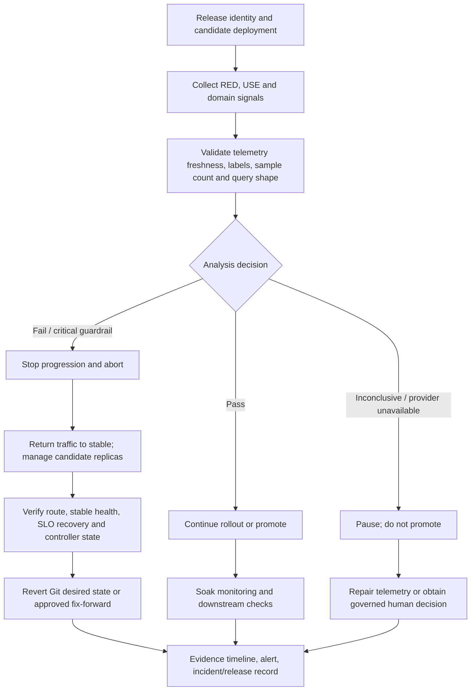
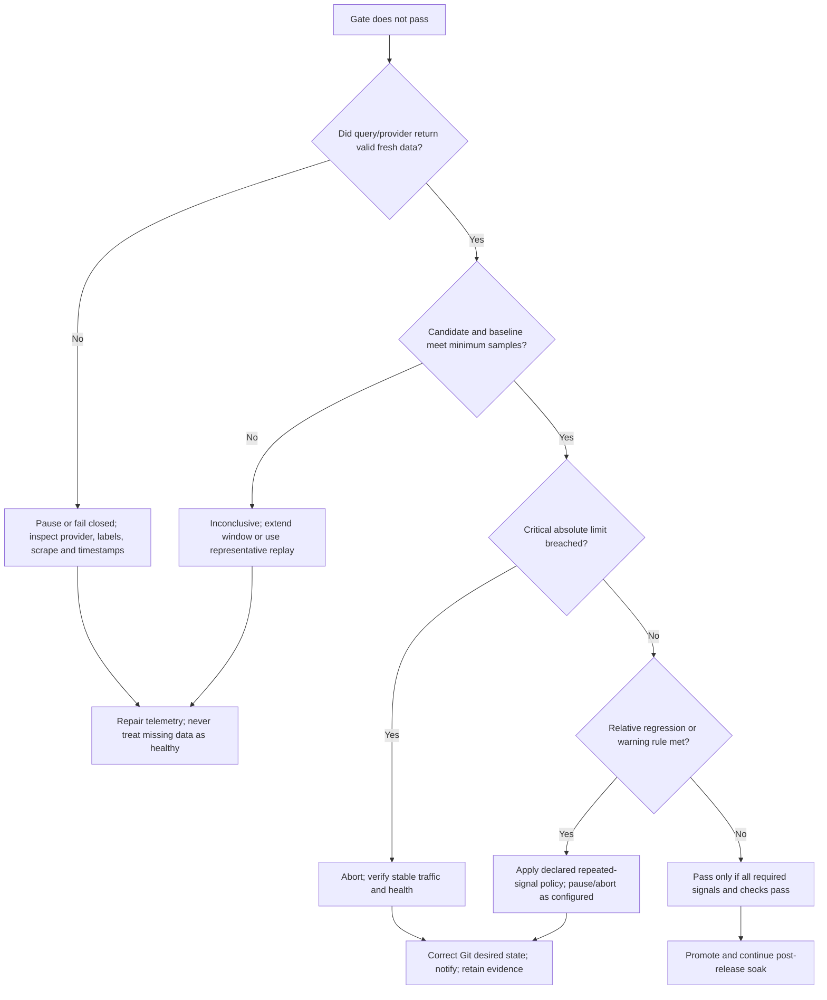

# Unit 9 — Release Health Analysis and Automated Abort

**Module:** M08 — GitOps and Progressive Delivery  
**Path:** `Stage 2E — Production DevOps & Platform Engineering/08-GitOps-and-Progressive-Delivery/`  
**Level:** L1 foundations → L2 working practice → L3 production engineering → L4 program operations  
**Estimated time:** 12–18 hours, including the six progressive labs; optional local Prometheus/Argo Rollouts work may add 2–4 hours.  
**Prerequisites:** M08 Units 1–8; Linux, Git, Python, FastAPI, Kubernetes Services/Jobs, and basic PromQL familiarity.  
**Primary environment:** WSL2 Ubuntu or Linux, disposable `kind` cluster, synthetic traffic and synthetic release history only.  
**Status:** Teaching artifact; command output labeled `[ILLUSTRATIVE]` is not observed output. Static checks are not runtime validation.

## 1. Outcomes and the production failure this unit prevents

By the end, you should be able to:

- Define release health in terms of SLOs, user impact, infrastructure saturation, and domain outcomes—not merely Pod readiness.
- Instrument a small `scoring-api` with RED and domain metrics while controlling Prometheus label cardinality.
- Write and test error-rate, histogram-quantile, saturation, candidate-versus-baseline, and minimum-sample queries.
- Make analysis return **pass**, **fail**, or **inconclusive**, with explicit behavior for empty, stale, gappy, malformed, or insufficient data.
- Design an automated-abort policy with hard safety limits, relative regressions, bounded retries, and evidence-based recovery verification.
- Explain why an Argo Rollouts abort does not necessarily revert the Git commit, and govern the reconciliation path.
- Assess gate effectiveness from a clearly synthetic release history and maintain an auditable release-health scorecard.

### Production vignette

A candidate inference API passes readiness checks and has low CPU. A rollout analysis queries `scoring_requests_total{version="candidate"}` but the new Pods do not expose the expected `version` label. The query returns an empty vector. A careless gate treats an empty result as “no errors,” promotes the release, and a downstream nightly scoring job later finds a surge in default predictions. The controller did what the policy told it to do; the policy confused **absence of evidence** with **evidence of health**.

The prevention is a complete chain: valid telemetry → query with data-quality checks → explicit decision → safe controller action → traffic and health verification → desired-state reconciliation → retained evidence and notification.

## 2. Source and assumptions

### Files inspected

- `PROMPT-GitOps-and-Progressive-Delivery.md` — controlling Unit 9 curriculum and global lab/source/safety requirements.
- `Roadmap(9).md` — the available roadmap snapshot; it confirms the Unit 9 filename and M08 sequence. `Roadmap_ptree.md` was not present in the available `/mnt/data` files.
- M08 Unit 7 `07-progressive-delivery-with-canary-and-blue-green-releases.md` — progressive-delivery concepts, traffic weighting, rollout windows, and safety boundaries.
- M08 Unit 8 `08-argo-rollouts-flagger-and-traffic-based-analysis.md` — controller/analysis background and the prior no-data and abort concepts.
- M08 Unit 6 `06-deployment-drift-detection-and-reconciliation.md` — GitOps drift and ownership concepts.

The M08 folder listing available during authoring did not contain Unit 10–13, the M08 README, or the `Projects/` files; those boundaries are named in the roadmap/syllabus, but their contents were not independently inspected. No M02/M10/M11 files were available in the inspected working set. Accordingly, cross-links below use exact M08 filenames confirmed by the roadmap and use module/unit descriptions for other modules without inventing a local relative path.

### Verified documentation vs. items to verify locally

Official Argo Rollouts documentation describes `Rollout`, `AnalysisTemplate`, `AnalysisRun`, and inconclusive analysis behavior; an inconclusive run pauses for human decision rather than automatically proving success. The official getting-started guide also explains that aborting can restore the stable ReplicaSet while the Rollout remains degraded until desired state is corrected. Prometheus documents `rate()` and histogram functions, and the official Python client exposes metrics for Prometheus scraping. See the source register near the end.

Version-sensitive API fields, CRD schemas, router integration, CLI plugin versions, and Python library APIs are marked `[VERIFY]`. Before applying a manifest, record versions and run `kubectl explain`, inspect the installed CRD schema, and compare the relevant official docs for that release. This lesson does not claim that any cluster lab was executed. The local commands are designed as learner-run procedures; their expected evidence is labeled as such.

## 3. Mental model: signal → decision → action → verification

Release health is the question: **does this candidate meet its service objectives without creating unacceptable harm to users, infrastructure, downstream consumers, or business outcomes?** A release can be unhealthy even when every Pod is Ready.



Keep these states separate:

1. **Git desired state** — the reviewed image/model version and rollout configuration.
2. **Kubernetes/controller state** — Rollout, ReplicaSets, Pods, analysis runs and conditions.
3. **Traffic state** — which version actually receives requests, according to the real router or Services.
4. **Observed service state** — errors, latency, saturation, fallback ratio, output quality and downstream effects.

A successful abort command proves only that an action was requested or recorded. It does not prove traffic is back on stable or that errors recovered.

## 4. L1 — Release health foundations

### 4.1 Signal families

| Signal family | What it answers | `scoring-api` examples | Common blind spot |
|---|---|---|---|
| **RED** — Rate, Errors, Duration | How is the request-serving service behaving? | requests/s, 5xx ratio, p95/p99 request duration | A fast 200 response may still contain a wrong/default prediction. |
| **USE** — Utilization, Saturation, Errors | Are resources close to exhaustion or failing? | CPU utilization/throttling, memory working set/pressure, queue depth, connection pool exhaustion | Healthy CPU does not establish business correctness. |
| **Golden signals** | Latency, traffic, errors, saturation | Combines key user/service and resource views | Exact definitions differ by organization; avoid double-counting them as independent evidence. |
| **Domain/business** | Did the system produce the intended outcome? | fallback/default-response ratio, null/NaN outputs, prediction distribution, freshness, consumer lag, successful pipeline rows | Often needs longer windows, labeled replay data, or a completed batch. |

RED and golden signals overlap substantially. USE adds resource-oriented diagnosis. Domain signals are essential for data and ML systems: the service may return syntactically valid HTTP responses that are semantically bad.

### 4.2 Vocabulary

- **SLI (service-level indicator):** a measured quantity, such as the fraction of valid requests served within 300 ms.
- **SLO (service-level objective):** the target for an SLI over a stated window, such as 99.9% of eligible requests within the latency objective. Targets here are examples, not universal values.
- **Error budget:** the tolerated unreliability implied by an SLO over its window. An organization may freeze risky releases when budget is exhausted; the policy owner and exception path must be explicit.
- **Release gate:** a rule that must pass before a release may progress.
- **Rollout window:** the period over which evidence is gathered at a given candidate exposure.
- **Baseline / stable:** a comparable known-good version used for absolute or relative comparison.
- **Candidate / canary:** the version under evaluation.
- **Regression:** a meaningful deterioration against an objective or a comparable baseline.
- **False positive:** the gate aborts a healthy candidate (false abort).
- **False negative:** the gate passes a defective candidate (missed defect).
- **Manual abort:** an authorized person stops progression.
- **Automated abort:** a machine-evaluated condition stops progression and initiates a safe traffic/replica action.
- **Rollback:** return the running service or route to a known-good version. Rollback is not complete until traffic and health are verified; Git desired state may also need correction.
- **Roll-forward:** deploy a new corrective version rather than restore the old version.
- **“Alert and hope”:** alerting about a known bad candidate without preventing further exposure. It is not an automated safety gate.
- **Inconclusive:** evidence is insufficient or ambiguous to justify promotion or automatic failure. For a high-risk service, inconclusive means pause, not pass.

For SLI/SLO and error-budget design, continue to the M10 SLO/error-budget unit named by the syllabus. This lesson applies those concepts to release decisions; it does not replace full SLO design.

### 4.3 Where analysis can run

| Layer | Timing and authority | Can observe | Typical failure mode | Best use |
|---|---|---|---|---|
| CI post-deployment check | After deploy command; CI can fail a pipeline, but may not own traffic | API contract, readiness, synthetic smoke, build identity | CI job exits while rollout continues unless wired to the controller/orchestrator | Fast contract and smoke checks. |
| Rollout-controller analysis | During rollout; directly affects progression according to controller semantics | Metrics provider, Jobs, supported webhook/provider output | bad query, provider outage, unsupported provider behavior, or empty result policy | Automated canary/blue-green progression and abort. |
| External gate/orchestrator | Before/after controller transitions; can call APIs and coordinate approvals | Multiple systems, change ticket, budget, security checks | split-brain ownership, retries, race conditions, missing idempotency | Organization-wide policy, approvals and coordinated release workflows. |

Do not let multiple independent systems simultaneously own promotion/rollback without an explicit contract. Choose one authoritative progression owner and define what other layers may block or observe.

### 4.4 Three outcomes and safe semantics

| Outcome | Meaning | Default action for a critical service |
|---|---|---|
| **Pass** | Query is valid, sufficiently fresh, sample preconditions are met, and all required conditions hold. | Permit the next declared step; keep post-release soak running. |
| **Fail** | A hard guardrail is breached or a defined regression rule is met with adequate evidence. | Stop progression and abort; alert with release identity and evidence. |
| **Inconclusive** | Missing/stale data, query error, low sample count, contradictory signals, or a result in neither success nor failure range. | Pause and block promotion; repair the signal or use a documented human decision. |

For tier-0 paths, some failures (e.g., a confirmed severe error-rate ceiling breach) should fail closed and abort immediately. For telemetry/provider outages, pausing as inconclusive can be safer than automatically aborting every candidate, but **never let it pass**. The precise fail-closed versus pause policy depends on service tier and the risk of leaving the current release paused. Document it per service.

## 5. Running example: `scoring-api`

We will use a small API that returns a synthetic score and a `model_version`. The stable version is `model-v1`; candidate is `model-v2`. Lab-only fault injection can increase 5xx responses, add latency, or shift predictions. The data is synthetic and must never be connected to real customer traffic or data.

Potential failure modes:

- HTTP: elevated 5xx ratio, p95/p99 latency regression, timeouts.
- Runtime: CPU throttling, memory pressure, queue buildup, exhausted worker/connection pools.
- Model/domain: increased fallback/default responses, NaN/null scores, shifted score distribution, prediction latency.
- Data/pipeline: stale features, lagging consumers, failed batch run, row-count anomaly, schema contract violation.
- Observability: missing candidate label, scrape gaps, stale values, zero denominator, units mismatch, counter reset, delayed ingestion.

A readiness probe only tells you that the Pod meets a readiness condition. It does not test all these failure modes.

## 6. L2 — Write release-health queries

### 6.1 Request error ratio and safe denominator handling

For Prometheus counters `scoring_http_requests_total{status_class="5xx"}` and total requests, first apply `rate()` to each counter series, then aggregate. Do not aggregate raw counters across series and assume resets are handled correctly.

```promql
# 5xx request ratio across all scoring-api versions.
sum(rate(scoring_http_requests_total{service="scoring-api",status_class="5xx"}[2m]))
/
clamp_min(sum(rate(scoring_http_requests_total{service="scoring-api"}[2m])), 1e-9)
```

`clamp_min` prevents division by zero from producing an unbounded/undefined ratio, but it does **not** make zero traffic healthy. Always pair the ratio with a minimum-traffic query:

```promql
sum(increase(scoring_http_requests_total{service="scoring-api"}[5m]))
```

The gate must require a sufficient request count in the same evaluation window. If traffic is zero or too low, return inconclusive (or fail closed under an explicitly stricter policy). Do not use `or vector(0)` to turn missing telemetry into zero errors unless the query separately proves that a valid target was scraped and traffic was genuinely zero—and even then zero traffic is not evidence of health.

### 6.2 Histogram percentiles

A Prometheus classic histogram exports bucket counters such as `scoring_http_request_duration_seconds_bucket{le="0.3",...}`. For p95, aggregate buckets by `le` and the comparison dimensions, then apply `histogram_quantile`:

```promql
histogram_quantile(
  0.95,
  sum by (le, version) (
    rate(scoring_http_request_duration_seconds_bucket{
      service="scoring-api"
    }[2m])
  )
)
```

For p99, replace `0.95` with `0.99`. `[VERIFY]` query syntax and metric names against your installed Prometheus and instrumentation. Preserve `le` in the aggregation. **Aggregate buckets before applying `histogram_quantile`.** The histogram bucket layout determines resolution; quantiles are estimates, especially near sparse bucket boundaries or when the distribution exceeds the highest useful bucket. Do not interpret p99 from a handful of requests as statistically reliable.

An average latency (`_sum / _count`) can conceal a long tail: a small number of requests taking seconds may coexist with a low mean. p95/p99 complement, not replace, error rate and sample count.

### 6.3 Candidate versus stable

Use an actual version label or a stable/candidate dimension that exists in the scraped series. Never assume `version` is present just because the app has an environment variable. Inspect first:

```promql
count by (__name__, service, version, model_version, status_class) (
  {service="scoring-api"}
)
```

Then test each selector independently. If a version label is missing or inconsistent, the query must not silently compare the wrong populations.

Illustrative policy: candidate error ratio may not exceed stable by more than 0.5 percentage points **[ILLUSTRATIVE]**, provided both populations have sufficient samples and stable is healthy. Derive the tolerance from the service SLO, historical variability, rollout risk and false-abort cost; it is not a universal threshold.

```promql
# Candidate 5xx ratio; requires sufficient traffic and correct labels separately.
sum(rate(scoring_http_requests_total{service="scoring-api",version="candidate",status_class="5xx"}[2m]))
/
clamp_min(sum(rate(scoring_http_requests_total{service="scoring-api",version="candidate"}[2m])), 1e-9)

# Stable ratio: same query with version="stable".
```

A ratio difference can be written as `candidate_ratio - stable_ratio`. Do not compare only the difference: also enforce an absolute ceiling. If stable is already unhealthy, a similarly unhealthy candidate must not pass merely because it matches stable.

### 6.4 Absolute guardrails and saturation

Examples below assume metrics are exposed by the relevant exporters. Metric names differ by runtime/exporter; verify them rather than copy blindly.

```promql
# Absolute 5xx ratio; threshold 2% is illustrative, not universal.
sum(rate(scoring_http_requests_total{service="scoring-api",status_class="5xx"}[2m]))
/
clamp_min(sum(rate(scoring_http_requests_total{service="scoring-api"}[2m])), 1e-9)

# Container CPU throttling ratio; confirm cAdvisor metric availability.
sum(rate(container_cpu_cfs_throttled_periods_total{namespace="scoring-lab",container!=""}[5m]))
/
clamp_min(sum(rate(container_cpu_cfs_periods_total{namespace="scoring-lab",container!=""}[5m])), 1e-9)

# Memory working set in bytes; compare with configured memory limits.
sum by (pod) (container_memory_working_set_bytes{namespace="scoring-lab",container!=""})

# Queue depth and consumer lag are application/exporter-specific.
scoring_queue_depth{service="scoring-api"}
consumer_lag_records{consumer="scoring-features"}
```

Saturation should be interpreted against configured requests/limits and capacity. CPU throttling, working-set pressure, queue depth, connection pool wait, and consumer lag may each be more meaningful than raw CPU percent. A rising queue can predict a later latency incident even while current request success remains high.

### 6.5 Minimum sample and evaluation windows

A 5% error rate over 20 requests is two errors; over 20,000 requests it is 1,000 errors. The same percentage has different statistical stability and operational meaning. Require a minimum count for both candidate and baseline, plus a window long enough to include representative load and scrape cycles.

A practical starting rule is a `rate()` range at least 2–4× the scrape interval **[VERIFY: rule of thumb, not a law]**. If Prometheus scrapes every 15 seconds, a 1-minute rate window is a plausible starting point, but the appropriate window depends on traffic, scrape jitter, query resolution, delayed ingestion and desired detection time. Use longer windows for low-volume services; avoid making the rollout longer than the risk window just to force a noisy statistic into a binary result.

Separate three checks:

1. **Data quality:** query returned the expected number/type of series; data is fresh and labels match.
2. **Sample precondition:** candidate and baseline have enough requests/observations.
3. **Health rule:** hard ceilings and relative regressions pass.

If any required precondition is not met, the outcome is not pass.

### 6.6 Missing, stale, delayed, gappy, or malformed data

| Data hazard | Safe interpretation | Test |
|---|---|---|
| Empty vector | Missing measurement, not zero errors | Delete/mislabel candidate series in fixture; ensure decision is inconclusive/fail-closed. |
| Stale timestamp / delayed ingestion | Current state unknown | Compare sample timestamp with allowed freshness window. |
| Scrape gap | Confidence reduced; possibly no valid rate | Simulate missing samples and verify query/test returns non-pass. |
| Malformed provider response or query error | Analysis infrastructure failure | Force invalid query/provider endpoint; ensure rollout pauses or aborts per tier policy. |
| Zero denominator | No basis for error ratio | Gate on request count before interpreting ratio. |
| Wrong units | Threshold comparison is invalid | Assert units in metric names and scorecard; test seconds vs milliseconds. |

For Argo Rollouts, an `AnalysisRun` can be `Successful`, `Failed`, or `Inconclusive`. Official docs describe inconclusive runs as pausing progression for manual intervention. `[VERIFY]` the installed version's exact behavior for provider errors, `failureLimit`, `inconclusiveLimit`, and missing measurements. Test this in the disposable cluster; do not rely on a remembered default.

### 6.7 Recording rules and cardinality

Recording rules store reusable query results under a stable metric name. They help when multiple dashboards/gates reuse expensive expressions and when query logic needs centralized review. They add rule evaluation/storage cost and do not fix bad labels or bad source metrics. A recording rule should preserve the dimensions needed for the release decision without creating unnecessary series.

Never use request IDs, user IDs, raw URL paths, prompts, exception strings, arbitrary prediction values, or unbounded build SHAs as Prometheus labels. Use bounded labels such as `service`, `version` (limited to deployed versions and retained for a bounded period), `status_class`, and a bounded `model_version` where appropriate. Keep exact release IDs in events/logs/annotations rather than creating one permanent time series per release.

## 7. Lab A — Instrument the running service

**Goal:** run a tiny FastAPI service exposing RED and domain metrics; demonstrate normal and fault-injected behavior.  
**Time:** 60–90 minutes. **Footprint:** 1 CPU, 300–600 MiB RAM, under 100 MiB source/dependencies plus Python cache; no cluster required. **Cleanup:** stop the process and remove the virtual environment if desired.  
**Architecture:** FastAPI application on port 8000, `/metrics` for Prometheus text exposition, `/healthz`, `/score`, and a lab-only `SCORING_FAULT` environment variable.

### 7.1 Files

```text
lab-a-scoring-api/
├── requirements.txt
└── app.py
```

`requirements.txt`:

```text
fastapi
uvicorn[standard]
prometheus-client
```

`app.py`:

```python
import math
import os
import random
import time
from collections import Counter
from typing import Literal

from fastapi import FastAPI, Response
from prometheus_client import Counter as PromCounter
from prometheus_client import Histogram, generate_latest, CONTENT_TYPE_LATEST

APP_VERSION = os.getenv("APP_VERSION", "model-v1")
# LAB ONLY: never enable fault injection in production.
FAULT = os.getenv("SCORING_FAULT", "none")

app = FastAPI(title="scoring-api-lab", version=APP_VERSION)
REQUESTS = PromCounter(
    "scoring_http_requests_total", "HTTP requests handled",
    ["service", "version", "status_class"],
)
DURATION = Histogram(
    "scoring_http_request_duration_seconds", "Request duration in seconds",
    ["service", "version"],
    buckets=(0.01, 0.025, 0.05, 0.1, 0.2, 0.3, 0.5, 1.0, 2.5, 5.0),
)
FALLBACKS = PromCounter(
    "scoring_fallback_responses_total", "Fallback/default responses",
    ["service", "version"],
)
PREDICTION = Histogram(
    "scoring_prediction_value", "Synthetic prediction distribution",
    ["service", "version"],
    buckets=(0.0, 0.1, 0.2, 0.3, 0.4, 0.5, 0.6, 0.7, 0.8, 0.9, 1.0),
)
NULL_OUTPUTS = PromCounter(
    "scoring_null_or_nan_outputs_total", "Null or non-finite synthetic outputs",
    ["service", "version"],
)

@app.get("/healthz")
def healthz():
    return {"ok": True, "version": APP_VERSION}

@app.get("/score")
def score():
    started = time.perf_counter()
    status = "2xx"
    try:
        if FAULT == "latency":
            time.sleep(0.8)  # [ILLUSTRATIVE] injected delay for a local lab only
        if FAULT == "5xx" and random.random() < 0.5:
            status = "5xx"
            raise RuntimeError("lab-only injected error")
        # Shift candidate distribution by concentrating values near 0.95.
        value = random.uniform(0.90, 1.0) if FAULT == "shift" else random.random()
        fallback = FAULT == "fallback" and random.random() < 0.5
        if fallback:
            FALLBACKS.labels("scoring-api", APP_VERSION).inc()
            value = 0.5  # deterministic fallback score
        if FAULT == "nan" and random.random() < 0.2:
            NULL_OUTPUTS.labels("scoring-api", APP_VERSION).inc()
            value = float("nan")
        if math.isfinite(value):
            PREDICTION.labels("scoring-api", APP_VERSION).observe(value)
        else:
            # Do not put NaN into the distribution histogram; count invalid output separately.
            pass
        return {"score": value if math.isfinite(value) else None,
                "model_version": APP_VERSION, "fallback": fallback}
    except RuntimeError:
        return Response(content='{"detail":"injected lab error"}',
                        status_code=500, media_type="application/json")
    finally:
        elapsed = time.perf_counter() - started
        DURATION.labels("scoring-api", APP_VERSION).observe(elapsed)
        REQUESTS.labels("scoring-api", APP_VERSION, status).inc()

@app.get("/metrics")
def metrics():
    return Response(generate_latest(), media_type=CONTENT_TYPE_LATEST)
```

The labels are bounded. `status_class` intentionally groups outcomes into classes rather than recording arbitrary status strings. In this minimal teaching app, `/score` uses one success and one injected error status class; expand the instrumentation deliberately if you add routes. The distribution histogram is a lightweight summary for a synthetic score, not a general replacement for storing a replay sample and running a statistical comparison. A production model's distribution checks need domain-specific semantics and data governance.

### 7.2 Run and verify

```bash
mkdir -p lab-a-scoring-api && cd lab-a-scoring-api
# Save requirements.txt and app.py from above.
python3 -m venv .venv
. .venv/bin/activate
python -m pip install --upgrade pip
python -m pip install -r requirements.txt
APP_VERSION=model-v1 SCORING_FAULT=none uvicorn app:app --host 127.0.0.1 --port 8000
```

In another terminal, use the same directory/venv if needed:

```bash
curl -fsS http://127.0.0.1:8000/healthz
for i in $(seq 1 30); do curl -sS -o /dev/null http://127.0.0.1:8000/score; done
curl -fsS http://127.0.0.1:8000/metrics | grep -E 'scoring_http_requests_total|scoring_http_request_duration_seconds_bucket|scoring_fallback_responses_total|scoring_prediction_value_bucket|scoring_null_or_nan_outputs_total'
```

Stop and restart with `SCORING_FAULT=5xx`, `latency`, `fallback`, `shift`, or `nan`, then repeat synthetic requests. Expected evidence is that counters/histograms change and `/score` latency/errors reflect the selected fault; exact values are not predetermined. **Do not enable fault injection in production.**

Cardinality check: inspect every metric's label sets. The app should emit only the bounded dimensions defined above. If you add `request_id`, user identifiers, arbitrary route strings or model output as labels, fail the lab and remove those labels.

### 7.3 Lab A verification table

| Expected condition | Evidence | Pass criteria |
|---|---|---|
| Service health is reachable | `curl /healthz` | JSON identifies the configured version. |
| RED metrics exist | `curl /metrics` and grep | Request counter and duration histogram exist after requests. |
| Domain metrics exist | `/metrics` after fallback/shift/NaN lab runs | Fallback, prediction histogram and invalid-output counter are present. |
| Fault injection changes behavior | Restart with one fault value and send synthetic requests | Fault behavior is observable; normal behavior returns after restart without the flag. |
| Labels are bounded | Inspect `/metrics` label sets | No request/user IDs, raw prompts, raw paths, or arbitrary output labels. |

Troubleshooting: if `/metrics` is empty of request series, send requests first; counters are created when a label combination is observed. If import fails, verify the active virtual environment and installed dependency versions. Remove the local folder or deactivate the environment when finished.

## 8. Query templates and an explicit gate contract

A robust release analysis should have an explicit input/output contract. The conceptual result object below is deliberately independent of any controller-specific schema:

```json
{
  "release_id": "scoring-api/model-v2/build-123",
  "candidate_version": "model-v2",
  "baseline_version": "model-v1",
  "window_seconds": 300,
  "candidate_requests": 1200,
  "baseline_requests": 4800,
  "candidate_error_ratio": 0.004,
  "baseline_error_ratio": 0.002,
  "candidate_p95_seconds": 0.18,
  "baseline_p95_seconds": 0.15,
  "telemetry_fresh": true,
  "labels_valid": true,
  "decision": "INCONCLUSIVE",
  "reason": "relative error regression requires review"
}
```

Every numeric value above is `[ILLUSTRATIVE]`. The example intentionally uses an inconclusive result because a policy may require repeated measurements before aborting on a relative warning. A confirmed critical absolute ceiling should still trigger the hard safety rule.

Decision order:

1. Validate provider/query status, expected labels, sample freshness and schema.
2. Validate minimum candidate and baseline samples.
3. Evaluate hard safety limits. A confirmed breach is **fail/abort**.
4. Evaluate relative regressions. Apply a predeclared repeated-measurement policy to warnings; do not average away a critical breach.
5. If required evidence is absent or sample count is too small, return **inconclusive**, never pass.
6. Pass only when all required checks have valid data and satisfy the declared policy.

Do not combine unrelated signals into one opaque weighted “health score.” It hides which guardrail failed and allows a good CPU reading to cancel a severe domain regression. Use a decision table and keep critical and warning signals separate.

## 9. L3 — Threshold design and statistical caution

### 9.1 Derive thresholds, do not cargo-cult them

A defensible method:

1. State the SLI/SLO and unit. Example: 5xx ratio among eligible requests; p95 latency in seconds; fallback ratio as a fraction.
2. Build a comparable historical baseline segmented by service, traffic class, workload size and release conditions. Exclude known incidents only with documented rationale; do not cherry-pick good windows.
3. Quantify normal variability across multiple time windows and representative traffic levels. Use quantiles or robust spread (e.g., median and median absolute deviation) where outliers distort mean/stddev.
4. Define an absolute ceiling from the SLO/error budget and failure impact.
5. Define a relative tolerance from observed baseline variability and the smallest meaningful regression—not a universal percent.
6. Choose minimum sample, evaluation window, repeated-failure behavior, and maximum decision time.
7. Replay historical healthy and defective examples; measure false aborts and missed defects before enforcing the gate.
8. Review after meaningful changes to traffic, model, runtime, instrumentation, or SLO.

Synthetic illustration: suppose stable error ratio usually varies between 0.1% and 0.3% in comparable windows. A 0.5 percentage-point tolerance might be a candidate experiment **[ILLUSTRATIVE]**, but it may be too lax for a tier-0 payment path and too sensitive for a tiny, noisy internal batch endpoint. A hard absolute ceiling and sample preconditions remain separate.

### 9.2 Multi-signal policy

| Signal class | Example | Policy pattern |
|---|---|---|
| Critical hard guardrail | Confirmed 5xx ratio above a service-defined ceiling; NaN output above a critical rate | Abort on any critical breach once telemetry and minimum sample requirements are valid. For a known catastrophic per-event condition, use an event/contract gate that does not wait for aggregate volume. |
| Warning/regression | Candidate p95 is materially worse than stable | Require a specified number of consecutive failed measurements or a defined sequential policy; stop if the rollout's exposure/time budget is exceeded. |
| Resource capacity | CPU throttling and queue depth rise together | Abort or pause when the declared capacity risk rule is met; do not treat one weakly related warning as proof. |
| Domain signal | Fallback ratio or output distribution shifts | Compare candidate to a representative baseline/replay sample and validate sample semantics. |
| Telemetry quality | Missing candidate series, stale sample, query error | Inconclusive/pause or fail closed; never pass. |

A hard safety limit should not be diluted by a weighted score. A warning may require multiple corroborating signals to reduce false aborts. Keep the relationship between signals explicit.

### 9.3 Small samples, sequential tests and asymmetric costs

A few minutes of sparse traffic cannot establish statistical certainty. Small samples should be inconclusive. A simple minimum count is not a full statistical guarantee, but it is a necessary guard. More advanced approaches include sequential hypothesis testing and Kayenta-style canary judges; treat these as awareness topics and verify current implementations and assumptions before adopting them `[VERIFY]`.

False aborts delay releases and consume operator attention. Missed defects harm users, data quality and trust. Costs are asymmetric and service-specific. Tier-0 services may justify conservative aborts when failure cost is much higher than delay cost. Conversely, noisy low-volume systems may require a longer window or explicit inconclusive state to avoid blocking every release.

Keep retries bounded. Example policy: one automatic analysis retry after a transient provider error; then pause/inconclusive and page the telemetry owner. Do not automatically start endless new rollouts after an abort. Re-release requires a new approved Git revision or a governed retry action with a reason, maximum count and backoff.

## 10. Lab B — Canary-versus-baseline queries and offline tests

**Goal:** exercise decision logic against healthy, regressed, empty, gappy, reset, zero-traffic and missing-label fixtures without needing Prometheus.  
**Time:** 45–75 minutes. **Footprint:** 1 CPU, under 100 MiB RAM, under 10 MiB files. **Cleanup:** delete the temporary directory.  
**Architecture:** deterministic Python test harness with canned observations. This verifies the policy contract, not PromQL engine semantics. An optional `promtool test rules` suite can later test PromQL rules against a real Prometheus version `[VERIFY]`.

Create `lab-b-gate/test_gate.py`:

```python
from dataclasses import dataclass
import unittest

@dataclass
class Sample:
    candidate_requests: int | None
    stable_requests: int | None
    candidate_error_ratio: float | None
    stable_error_ratio: float | None
    telemetry_fresh: bool = True
    labels_valid: bool = True
    gappy: bool = False
    counter_reset_detected: bool = False

MIN_REQUESTS = 100  # [ILLUSTRATIVE] derived value for this fixture only
ABSOLUTE_ERROR_LIMIT = 0.02  # [ILLUSTRATIVE] 2%
RELATIVE_DELTA_LIMIT = 0.005  # [ILLUSTRATIVE] 0.5 percentage points

def decide(s: Sample) -> tuple[str, str]:
    if not s.telemetry_fresh:
        return "INCONCLUSIVE", "stale or delayed telemetry"
    if not s.labels_valid:
        return "INCONCLUSIVE", "required candidate/baseline label missing"
    if s.gappy or s.counter_reset_detected:
        return "INCONCLUSIVE", "data continuity/counter reset requires validation"
    if None in (s.candidate_requests, s.stable_requests,
                s.candidate_error_ratio, s.stable_error_ratio):
        return "INCONCLUSIVE", "empty or malformed observation"
    if s.candidate_requests < MIN_REQUESTS or s.stable_requests < MIN_REQUESTS:
        return "INCONCLUSIVE", "minimum sample not met"
    if s.candidate_error_ratio < 0 or s.stable_error_ratio < 0:
        return "INCONCLUSIVE", "invalid ratio"
    if s.candidate_error_ratio >= ABSOLUTE_ERROR_LIMIT:
        return "FAIL", "absolute candidate error ceiling breached"
    if s.candidate_error_ratio - s.stable_error_ratio > RELATIVE_DELTA_LIMIT:
        return "FAIL", "candidate relative error regression"
    return "PASS", "all required checks passed"

class GateTests(unittest.TestCase):
    def test_healthy(self):
        self.assertEqual(decide(Sample(1000, 1000, .001, .001))[0], "PASS")
    def test_regression(self):
        self.assertEqual(decide(Sample(1000, 1000, .03, .001))[0], "FAIL")
    def test_empty(self):
        self.assertEqual(decide(Sample(None, 1000, None, .001))[0], "INCONCLUSIVE")
    def test_gappy(self):
        self.assertEqual(decide(Sample(1000, 1000, .001, .001, gappy=True))[0], "INCONCLUSIVE")
    def test_counter_reset(self):
        self.assertEqual(decide(Sample(1000, 1000, .001, .001, counter_reset_detected=True))[0], "INCONCLUSIVE")
    def test_zero_traffic(self):
        self.assertEqual(decide(Sample(0, 1000, 0.0, .001))[0], "INCONCLUSIVE")
    def test_missing_version_label(self):
        self.assertEqual(decide(Sample(1000, 1000, .001, .001, labels_valid=False))[0], "INCONCLUSIVE")
    def test_stale_data(self):
        self.assertEqual(decide(Sample(1000, 1000, .001, .001, telemetry_fresh=False))[0], "INCONCLUSIVE")

if __name__ == "__main__":
    unittest.main()
```

Run:

```bash
mkdir -p lab-b-gate
# Save test_gate.py as above.
cd lab-b-gate && python -m unittest -v test_gate.py
```

The harness deliberately classifies gaps and detected counter resets as inconclusive rather than trying to infer health from corrupted observations. In real PromQL, `rate()` handles counter resets for properly instrumented counters, but the gate still needs enough samples and valid time series. A reset should be tested to ensure the actual query behaves as expected; do not simply add the reset flag to production logic without a trustworthy source of that evidence.

### Optional PromQL validation

With a local Prometheus binary installed, use its matching `promtool` and official `promtool test rules` syntax `[VERIFY]`. Pin/record the version first:

```bash
prometheus --version
promtool --version
promtool test rules test-rules.yml
```

The rule-test file must define input series, evaluation timestamps, rule files and expected alerts/recorded values according to the installed `promtool` schema. Because PromQL engine semantics and fixture syntax are version-sensitive, do not treat the Python harness as proof that every PromQL expression is syntactically valid. Add a real `promtool` test before production enforcement.

### Lab B verification

| Expected condition | Evidence | Pass criteria |
|---|---|---|
| Healthy fixture passes | Unit test `test_healthy` | `PASS` only when all preconditions and rules pass. |
| Regression fails | `test_regression` | Hard ceiling/regression yields `FAIL`. |
| Empty/gappy/reset/zero traffic/missing label are non-pass | corresponding tests | Each returns `INCONCLUSIVE`, not `PASS`. |
| Query syntax checked separately | `promtool test rules` or an equivalent Prometheus integration test | All queries and fixture expectations pass on the pinned version. |

## 11. Abort mechanics: what must happen and what must be verified

A safe automated-abort path has explicit steps:

1. Stop progression immediately; do not continue to the next weight/promotion step.
2. Request controller abort according to the configured rollout policy.
3. Return routed traffic to stable (or restore stable Service selection for blue-green); verify the actual router state. A replica-based canary is not a traffic-weighted canary—replica proportions do not guarantee exact request percentages.
4. Keep candidate capacity only as long as needed for diagnostics/rollback policy; scale down after the configured delay if appropriate. Do not remove all evidence before collection.
5. Inspect Rollout status, analysis runs, events, ReplicaSets, Services, Endpoints/EndpointSlices, and router configuration.
6. Generate safe synthetic requests and verify the returned version. Check stable error ratio, latency and domain signals against recovery criteria.
7. Reconcile Git desired state. If Git still declares the bad candidate, revert that commit or apply an approved fix-forward. Record the approver, revision and evidence.
8. Confirm the GitOps controller is no longer reapplying the bad revision or triggering a rollout loop.
9. Notify the service owner and release/on-call channel; include release ID, decision, query results, sample count, abort reason, timestamps and evidence links.
10. Keep a post-release soak for delayed regressions and downstream consumers.

### 11.1 Git desired state is not the same as live rollback

An Argo Rollouts abort can return runtime traffic/replicas to the previous stable ReplicaSet while the desired manifest still points to the candidate. Official Rollouts getting-started guidance explicitly describes the Rollout remaining degraded until desired state is corrected. In GitOps, the reconciler may keep reporting drift or reapply the bad version; a repeated commit/reconcile loop can retrigger the failure.

Governed response:

- Preserve the bad revision and its evidence; do not rewrite history to hide it.
- Revert the Git commit that introduced the candidate **or** create a reviewed fix-forward commit.
- Verify the reconciler sees the intended revision and the Rollout converges to it.
- If emergency live changes are necessary, use the documented break-glass process from Unit 6 and promptly reconcile Git.
- Prevent automatic infinite retries: require a new revision/approval, cap retries and apply backoff.

### 11.2 Inspect a disposable rollout

The commands below assume a local context named `kind-release-health-lab` and namespace `release-health-lab`. Change these values only if you deliberately created a different throwaway environment. Before any mutation:

```bash
kubectl config current-context
kubectl cluster-info
kubectl get nodes -o wide
kubectl get pods -A | grep -E 'argocd|flux' || true
```

If the context is not the expected local cluster, stop. Do not install Argo CD and Flux together in this lab cluster. To inspect rollout state after Argo Rollouts is installed:

```bash
kubectl -n release-health-lab get rollouts,analysisruns,replicasets,pods,services
kubectl -n release-health-lab describe rollout scoring-api
kubectl -n release-health-lab get events --sort-by=.lastTimestamp
kubectl -n release-health-lab get endpointslices
kubectl argo rollouts get rollout scoring-api --watch
```

`kubectl argo rollouts` commands require the compatible CLI plugin `[VERIFY]`. For a traffic-routed rollout, also inspect the configured HTTPRoute/Ingress/mesh resource and query real request counts by version. Do not infer the actual split from the Rollout step alone.

## 12. Lab C — End-to-end automated-abort drill

**Goal:** inject a bad version, observe a failed analysis, abort, verify stable recovery, and reconcile Git desired state.  
**Time:** 2–3 hours. **Footprint:** 2–3 CPU, 2.5–4 GiB RAM, 4–8 GiB disk for kind/controller/images. **Cleanup:** delete only the disposable namespace/cluster after verifying context.  
**Architecture:** `kind`, Argo Rollouts, the Lab A service built into a local image, and a minimal metrics source or verified supported analysis provider. This is the most version-sensitive lab. The exact analysis-provider and traffic-router configuration must match the installed Argo Rollouts version; do not use a placeholder provider in an enforced gate.

### 12.1 Preflight and setup

```bash
kind get clusters
kind create cluster --name release-health-lab
kubectl config use-context kind-release-health-lab
kubectl config current-context
kubectl get nodes -o wide
kubectl create namespace release-health-lab
```

The cluster creation command is state-changing and may consume several GiB of RAM/disk. If a cluster with this name already contains work, do not reuse or delete it; inspect it first. Install a pinned Argo Rollouts release and CLI plugin using the official installation instructions `[VERIFY]`, then verify CRDs/controller:

```bash
kubectl get crd rollouts.argoproj.io analysisruns.argoproj.io analysistemplates.argoproj.io
kubectl -n argo-rollouts get deploy,pods
kubectl argo rollouts version
kubectl explain rollout.spec.strategy.canary --api-version=argoproj.io/v1alpha1
kubectl explain analysistemplate.spec --api-version=argoproj.io/v1alpha1
```

The install namespace and CLI version output vary by installation method. Record exact versions and inspect the installed CRD schema before applying the rollout manifest. Build and load the Lab A image only if the Dockerfile and local registry path are configured for your kind setup; `kind load docker-image` can be used for a locally built image, but image pull policy/tag must match the local image. Do not use `latest` for reproducibility.

### 12.2 Rollout and analysis design

Use the replica-based canary from Unit 8 as the starting manifest and add a step analysis only after confirming the installed CRD supports the fields. The conceptual shape below shows the relationship; the provider address and success expression are placeholders and must be replaced with a real provider and a tested query before applying.

```yaml
# [VERIFY] Reference shape only. Validate against the installed CRD and provider docs.
apiVersion: argoproj.io/v1alpha1
kind: AnalysisTemplate
metadata:
  name: scoring-api-health
  namespace: release-health-lab
spec:
  metrics:
    - name: candidate-health
      interval: 30s
      count: 3
      successCondition: result != nil && len(result) == 1 && result[0] < 0.02
      failureLimit: 1
      provider:
        prometheus:
          address: http://prometheus.release-health-lab.svc:9090
          query: |
            sum(rate(scoring_http_requests_total{service="scoring-api",version="candidate",status_class="5xx"}[2m]))
            /
            clamp_min(sum(rate(scoring_http_requests_total{service="scoring-api",version="candidate"}[2m])), 1e-9)
```

The exact `successCondition` expression language, `len` behavior, nil handling, provider fields, and missing-result semantics are version-sensitive `[VERIFY]`. Do not assume a generic expression like `result[0] < 0.02` safely handles an empty result. The query above is also only a ratio; a production-ready template must separately gate candidate request count, stable health, freshness and labels. The offline test harness demonstrates the complete policy contract; adapt it to a provider or analysis layer that can express all preconditions safely.

### 12.3 Execute the drill

1. Deploy a healthy stable version and wait for readiness.
2. Send a baseline of synthetic requests; confirm the candidate/stable labels actually exist in scraped metrics.
3. Change the candidate to a lab image with `SCORING_FAULT=5xx` or `latency`; never inject faults into production.
4. Watch the rollout and analysis runs. Capture timestamps at candidate start, first measurement, first failing measurement, abort, route recovery and Git revert.
5. Confirm the controller has stopped progression and the active route/Service points at stable. Send synthetic requests and inspect returned `model_version`.
6. Confirm error/latency metrics recover to the declared stable acceptance range.
7. Revert the bad image in the Git working tree/repository used by the lab and reconcile. Confirm the desired revision and live state agree.
8. Preserve redacted YAML, `describe` output, events, query output and timeline. Do not claim success until the learner has run these steps and observed the evidence.

### 12.4 Evidence timeline template

| Timestamp UTC | Event | Release/revision | Evidence location | Decision/owner |
|---|---|---|---|---|
| `YYYY-MM-DDThh:mm:ssZ` | Candidate applied | commit SHA / image digest | sanitized manifest diff | release operator |
| `...` | Candidate receives traffic | rollout revision / route weight | route + request counters | release operator |
| `...` | First bad measurement | query hash + window + sample count | AnalysisRun / query response | gate |
| `...` | Abort initiated | analysis run name | controller event/status | controller/on-call |
| `...` | Stable route verified | stable version | synthetic request + route query | service owner |
| `...` | Error/domain health recovered | metric names and time range | query export | SRE |
| `...` | Git reverted/fixed forward | commit SHA + approver | Git diff/reconcile status | change owner |


### 12.6 Blue-green reference path with pre-promotion smoke analysis

Blue-green keeps an active Service and a preview Service. The controller prepares the candidate ReplicaSet and uses a pre-promotion analysis to block the active Service switch until the check succeeds. The exact fields must be checked against the installed Argo Rollouts CRD `[VERIFY]`. The analysis provider below is deliberately not fabricated: connect the Lab D Job using the supported Job analysis provider documented for the chosen version, or use the supported webhook/provider path you have tested. Do not apply a template that claims to run a Job but actually queries no real test.

```yaml
# [VERIFY] Reference shape; pair with a tested AnalysisTemplate/provider and correct image.
apiVersion: v1
kind: Service
metadata:
  name: scoring-api-active
  namespace: release-health-lab
spec:
  selector:
    app: scoring-api
  ports:
    - name: http
      port: 8000
      targetPort: 8000
---
apiVersion: v1
kind: Service
metadata:
  name: scoring-api-preview
  namespace: release-health-lab
spec:
  selector:
    app: scoring-api
  ports:
    - name: http
      port: 8000
      targetPort: 8000
---
apiVersion: argoproj.io/v1alpha1
kind: Rollout
metadata:
  name: scoring-api-bluegreen
  namespace: release-health-lab
spec:
  replicas: 2
  revisionHistoryLimit: 2
  selector:
    matchLabels:
      app: scoring-api
  template:
    metadata:
      labels:
        app: scoring-api
    spec:
      containers:
        - name: scoring-api
          image: registry.example.invalid/lab/scoring-api@sha256:REPLACE_WITH_REAL_DIGEST
          ports:
            - containerPort: 8000
          readinessProbe:
            httpGet: {path: /healthz, port: 8000}
            initialDelaySeconds: 2
            periodSeconds: 5
          resources:
            requests: {cpu: 100m, memory: 128Mi}
            limits: {cpu: 500m, memory: 256Mi}
          securityContext:
            allowPrivilegeEscalation: false
            capabilities:
              drop: [ALL]
  strategy:
    blueGreen:
      activeService: scoring-api-active
      previewService: scoring-api-preview
      autoPromotionEnabled: false
      scaleDownDelaySeconds: 60
      prePromotionAnalysis:
        templates:
          - templateName: scoring-api-smoke-analysis
```

`scoring-api-smoke-analysis` must be a real, validated `AnalysisTemplate` that executes the Job/contract check and returns the expected result. The placeholder image digest is intentionally invalid until replaced by the learner. The Service selectors and Rollout revision-label behavior are controller-managed in blue-green mode; inspect the actual selectors after apply and follow the official example for the installed version. Never apply this reference before validating the CRD and the analysis provider. For a local cluster without a supported provider, run the Job in CI/external orchestration and keep `autoPromotionEnabled: false` until an authorized person promotes after reviewing the Job evidence.

### 12.5 Lab C verification table

| Expected condition | Evidence command/test | Pass criteria |
|---|---|---|
| Bad candidate becomes observable | `kubectl argo rollouts get rollout ... --watch`; metric query | Candidate version and fault signal are distinguishable. |
| Analysis detects the defect | `kubectl get analysisruns -n release-health-lab -o yaml` | Failed measurement/reason is recorded; no empty-data pass. |
| Rollout aborts | `describe rollout`, events, controller status | Progression stops and stable is selected according to configured strategy. |
| Real traffic/health recover | synthetic request version + route/endpoints + health query | Stable receives expected traffic and signals recover. |
| Desired state is corrected | Git diff/log and reconciler status | Bad revision is reverted or an approved fix-forward is reconciled. |
| Evidence is complete | timeline and sanitized artifacts | timestamps, release identity, query/sample, decision, recovery and approver are recorded. |

**Important:** if your resource budget or router/provider integration prevents the full automatic abort from being executed, complete the offline tests and controller walkthrough, mark the runtime portion **NOT VERIFIED**, and do not report the lab as passed. The learning objective is proven abort and recovery, not merely a YAML file that looks plausible.

## 13. Lab D — Job-based smoke-test gate

**Goal:** run bounded contract/health checks after the candidate is deployed and before promotion.  
**Time:** 45–60 minutes. **Footprint:** 1 CPU, 100–300 MiB RAM, negligible disk. **Cleanup:** delete only the lab Job.  
**Architecture:** Kubernetes Job runs a small Python client that waits for the target API, asserts the response contract, applies request timeouts, retries a bounded number of times and exits nonzero on failure.

A smoke Job proves only the assertions it actually tests. Job completion is not proof of sustained p95 latency, model quality, data freshness, or downstream nightly compatibility.

### 13.1 Script and manifest

Save as `smoke.py` in a lab directory. The target URL is supplied as an environment variable, and the test is synthetic.

```python
import json
import os
import sys
import time
import urllib.error
import urllib.request

BASE_URL = os.environ.get("SCORING_BASE_URL", "http://scoring-api.release-health-lab.svc:8000")
TIMEOUT_SECONDS = 2.0
ATTEMPTS = 8

def get_json(url: str) -> dict:
    req = urllib.request.Request(url, headers={"Accept": "application/json"})
    with urllib.request.urlopen(req, timeout=TIMEOUT_SECONDS) as response:
        if response.status != 200:
            raise RuntimeError(f"unexpected HTTP status: {response.status}")
        return json.loads(response.read().decode("utf-8"))

def main() -> int:
    last_error = None
    for attempt in range(1, ATTEMPTS + 1):
        try:
            health = get_json(f"{BASE_URL}/healthz")
            if health.get("ok") is not True:
                raise AssertionError("healthz contract failed")
            score = get_json(f"{BASE_URL}/score")
            if "model_version" not in score or "score" not in score:
                raise AssertionError("score response missing required fields")
            if score["score"] is not None and not (0.0 <= float(score["score"]) <= 1.0):
                raise AssertionError("score outside expected range")
            print("SMOKE_PASS: health and response contract satisfied")
            return 0
        except (OSError, ValueError, AssertionError, RuntimeError, urllib.error.URLError) as exc:
            last_error = exc
            time.sleep(min(attempt, 3))
    print(f"SMOKE_FAIL: exhausted {ATTEMPTS} attempts; last error={last_error}", file=sys.stderr)
    return 1

if __name__ == "__main__":
    raise SystemExit(main())
```

For a disposable lab, build a tiny image containing this script and Python, or use an approved local Python image plus a ConfigMap. Production-grade images should be pinned by digest per M01; image references below are placeholders and must be replaced with a locally available digest-pinned image before use.

```yaml
# [VERIFY] Adapt image and target Service name for the lab.
apiVersion: batch/v1
kind: Job
metadata:
  name: scoring-api-smoke
  namespace: release-health-lab
  labels:
    app.kubernetes.io/name: scoring-api-smoke
spec:
  backoffLimit: 1
  activeDeadlineSeconds: 90
  ttlSecondsAfterFinished: 600
  template:
    metadata:
      labels:
        app.kubernetes.io/name: scoring-api-smoke
    spec:
      restartPolicy: Never
      serviceAccountName: default
      securityContext:
        runAsNonRoot: true
        seccompProfile:
          type: RuntimeDefault
      containers:
        - name: smoke
          image: registry.example.invalid/lab/scoring-smoke@sha256:REPLACE_WITH_REAL_DIGEST
          imagePullPolicy: IfNotPresent
          env:
            - name: SCORING_BASE_URL
              value: http://scoring-api.release-health-lab.svc:8000
          resources:
            requests: {cpu: 50m, memory: 64Mi}
            limits: {cpu: 200m, memory: 128Mi}
          securityContext:
            allowPrivilegeEscalation: false
            readOnlyRootFilesystem: true
            capabilities:
              drop: [ALL]
```

The manifest assumes the image already contains `/app/smoke.py` as its entrypoint; make that Dockerfile/entrypoint consistent before applying. It is a template, not directly runnable with the placeholder digest. Avoid giving a Job permission to modify the Rollout. The controller/orchestrator should use the Job outcome as a gate through a supported mechanism `[VERIFY]` (for example Argo Rollouts Job analysis provider) or CI/external orchestration.

### 13.2 Run and inspect

```bash
kubectl config current-context
kubectl -n release-health-lab get svc scoring-api
kubectl -n release-health-lab apply -f smoke-job.yaml
kubectl -n release-health-lab wait --for=condition=complete job/scoring-api-smoke --timeout=100s
kubectl -n release-health-lab logs job/scoring-api-smoke
kubectl -n release-health-lab get job scoring-api-smoke -o yaml
```

If `wait` times out or the Job fails, inspect Pod events and logs. A failed Job must produce a nonzero exit and block promotion. Do not use `kubectl wait` alone as the complete gate: verify the Job's terminal condition and retrieve logs. Do not configure an unlimited retry policy.

### 13.3 Lab D verification

| Expected condition | Evidence | Pass criteria |
|---|---|---|
| Job starts after candidate is reachable | Job/Pod events | It does not test a nonexistent target indefinitely. |
| Contract assertions run | Job logs | Required fields and score bounds are checked. |
| Failure is bounded | `activeDeadlineSeconds`, `backoffLimit`, script timeout/retries | Job terminates within the declared bound and exits nonzero. |
| Logs/evidence retained | `kubectl logs`, Job YAML | Release identity, test outcome and failure reason can be attached to release evidence. |
| Promotion gate is wired | controller/orchestrator config review | Failed Job blocks promotion; success is one required signal, not a health guarantee. |

Cleanup after saving evidence:

```bash
# STATE-CHANGING: deletes only the lab-created smoke Job.
kubectl config current-context
kubectl -n release-health-lab get job scoring-api-smoke
kubectl -n release-health-lab delete job scoring-api-smoke
kubectl -n release-health-lab get job scoring-api-smoke
```

## 14. Data/ML and pipeline signals: use the right time horizon

| Signal | Short canary suitability | Why / implementation notes |
|---|---|---|
| Prediction/request latency | Good for online inference | Use request histogram and candidate label; pair with sample count. |
| Fallback/default response ratio | Good if fallback is instrumented consistently | Check both absolute rate and change from baseline. A 0/0 ratio is not healthy evidence. |
| Null/NaN output rate | Good for severe per-request defects | Count invalid outputs explicitly; sanitize returned JSON and define whether such outputs are allowed. |
| Prediction distribution drift | Sometimes; requires representative sample | Use a replay dataset and compare candidate with baseline. Do not conclude model quality from a single aggregate histogram alone. |
| PSI or KS statistic | Useful as a comparison tool, not a universal quality verdict | PSI bins and KS assumptions matter; library APIs and interpretation thresholds are `[VERIFY]`. Validate on known-good/known-bad synthetic distributions. |
| Data freshness | Useful if current freshness metric exists | Compare age/lag to a domain-defined limit; source timestamp and ingestion timestamp are different. |
| Consumer lag | Useful for streaming consumers | Use lag slope and backlog drain capacity, not only a single value. |
| Batch/pipeline success | After job completes | A short canary cannot claim batch success before the representative job completes. |
| Row-count/volume anomaly | Usually needs completed run and comparable history | Compare to seasonality/partition size and input volume; guard against zero input being interpreted as zero failure. |
| Schema/contract validation | Good as pre-promotion Job gate | Run producer/consumer contract tests and include version compatibility. |
| Nightly downstream job | Requires soak or scheduled integration checks | Short rollout windows may finish before the regression appears. Preserve old outputs and define a downstream rollback/roll-forward plan. |

For output-distribution drift, a practical lab method is: generate a fixed replay sample; run it through stable and candidate; compare distributions using PSI or a KS statistic; validate the chosen test on known shifts; inspect slices that matter to the product; and require domain-owner approval for the acceptable drift boundary. `[VERIFY]` library API/version and statistical assumptions before copying code. A distribution change is a signal for investigation, not automatically proof that the model is worse.

Full metrics architecture, long-term retention, dashboards, tracing and alerting design are deferred to M11. This unit builds the minimum instrumentation and gate contract needed to reason safely about releases.

## 15. Bad-metric hazards catalogue

| Hazard | Symptom | False conclusion | Guard/test | Safe outcome |
|---|---|---|---|---|
| Metric ingestion lag | New candidate has no recent samples | “No errors yet” | Check latest sample timestamp; inject delayed scrape/provider | Inconclusive/pause. |
| Scrape gaps | `rate()` empty or unstable | Candidate healthy or wildly bad | Fixture with gaps; verify rate window/scrape health | Inconclusive unless enough valid samples remain. |
| Label/schema change | Selector returns no candidate series | Zero errors | Assert expected label keys/values and series count | Inconclusive; fix instrumentation/query. |
| Counter reset | Counter falls after process restart | Negative or understated rate if query wrong | Use `rate()` on each counter series; restart process in test | Use correct counter-aware query; investigate insufficient continuity. |
| Histogram bucket problem | p95 jumps or returns odd values | Latency regression or healthy tail incorrectly inferred | Verify `le` buckets, units and bucket coverage; aggregate by `le` | Inconclusive until histogram is valid. |
| Cardinality explosion | Series count and memory grow | Noisy/slow queries and missing data | Inspect label sets and cardinality growth | Stop unsafe instrumentation; remove unbounded labels. |
| Clock/window mismatch | Candidate and stable windows cover different load | False relative regression or false pass | Align timestamps, timezone, rollout start and evaluation windows | Re-evaluate with comparable windows. |
| Units mismatch | Threshold says 300 but metric is seconds vs ms | 1000× false result | Metric name/unit contract; explicit conversion test | Inconclusive and repair units. |
| Ratio vs percentage | 0.02 compared to threshold 2 | Gate never fires or always fires | Use fraction or percent consistently; unit tests | Inconclusive until normalized. |
| Zero denominator | No requests | Error ratio appears zero/undefined | Separate request-count precondition | Inconclusive, not pass. |
| Canary label absent/wrong | Candidate query is empty or includes stable | False pass/invalid comparison | Inspect real labels and test selectors per version | Inconclusive; correct instrumentation. |
| Low traffic / selection bias | Candidate only sees easy requests or few calls | Candidate appears better than stable | Check cohort/routing, sample count, traffic representativeness | Extend window or use replay/controlled tests. |
| Provider/query error | Timeout, 5xx from metrics API | Error interpreted as empty success | Explicit provider status and timeout handling | Pause or fail closed according to tier. |
| Stable baseline unhealthy | Both candidate and stable fail | Candidate passes by matching baseline | Enforce absolute limits independent of relative comparison | Abort/freeze according to policy. |
| Model-version mismatch | API version and model version labels disagree | Wrong model is analyzed | Assert build/model metadata in response and metric labels | Inconclusive and repair release identity. |

### Offline query validation checklist

- [ ] Healthy candidate and baseline have correct labels and adequate counts.
- [ ] Deliberate error-rate regression trips the declared condition.
- [ ] Empty candidate vector is inconclusive/non-pass.
- [ ] Gappy series do not become a pass.
- [ ] Counter reset does not create a false negative or invalid ratio.
- [ ] Zero traffic fails the sample precondition.
- [ ] Missing/wrong candidate version label is detected.
- [ ] Stale samples and provider errors are tested.
- [ ] Seconds/milliseconds and fraction/percentage conversions are unit-tested.
- [ ] Query syntax is tested against the pinned Prometheus version before production enforcement.

## 16. Lab E — Synthetic release-history effectiveness analysis

**Goal:** compute escaped defects, confusion-matrix metrics, false-abort and missed-defect rates, and detection time from synthetic history.  
**Time:** 45–60 minutes. **Footprint:** 1 CPU, under 100 MiB RAM, under 1 MiB data. **Cleanup:** remove the lab directory.  
**Data provenance:** every row below is synthetic `[ILLUSTRATIVE]`, not industry benchmark data.

### 16.1 Dataset

Create `lab-e-history/releases.csv`:

```csv
release_id,defect_present,gate_aborted,detection_seconds
r-001,false,false,
r-002,true,true,45
r-003,true,false,600
r-004,false,true,90
r-005,false,false,
r-006,true,true,120
r-007,true,false,480
r-008,false,false,
r-009,true,true,75
r-010,false,true,30
r-011,true,false,900
r-012,false,false,
```

Definition of the confusion matrix in this context:

- **TP (true positive):** defective release correctly aborted by the gate.
- **FP (false positive):** healthy release aborted by the gate (false abort).
- **TN (true negative):** healthy release not aborted.
- **FN (false negative):** defective release not aborted (missed defect / escaped defect).

`detection_seconds` is populated only where the synthetic data says the defect was detected/aborted. It is not the same as time to user impact. A production dataset must define when the timer starts, how defects are labeled, and whether a detected-but-not-aborted defect counts as a true positive.

### 16.2 Script

Save `lab-e-history/analyze.py`:

```python
import csv
import statistics
import sys
from pathlib import Path

TRUE = {"true", "1", "yes"}

def truth(value: str) -> bool:
    return value.strip().lower() in TRUE

def analyze(path: Path) -> dict:
    with path.open(newline="", encoding="utf-8") as f:
        rows = list(csv.DictReader(f))
    tp = fp = tn = fn = 0
    detected = []
    for row in rows:
        defect = truth(row["defect_present"])
        aborted = truth(row["gate_aborted"])
        if defect and aborted:
            tp += 1
            if row["detection_seconds"].strip():
                detected.append(float(row["detection_seconds"]))
        elif not defect and aborted:
            fp += 1
        elif not defect and not aborted:
            tn += 1
        else:
            fn += 1
    precision = tp / (tp + fp) if tp + fp else None
    recall = tp / (tp + fn) if tp + fn else None
    false_abort_rate = fp / (fp + tn) if fp + tn else None
    missed_defect_rate = fn / (tp + fn) if tp + fn else None
    return {
        "releases": len(rows), "tp": tp, "fp": fp, "tn": tn, "fn": fn,
        "precision": precision, "recall": recall,
        "false_abort_rate": false_abort_rate,
        "missed_defect_rate": missed_defect_rate,
        "detection_count": len(detected),
        "mean_detection_seconds": statistics.mean(detected) if detected else None,
        "median_detection_seconds": statistics.median(detected) if detected else None,
    }

def main() -> int:
    path = Path(sys.argv[1]) if len(sys.argv) > 1 else Path("releases.csv")
    result = analyze(path)
    for key, value in result.items():
        print(f"{key}={value}")
    # Dataset-specific assertions; these do not validate real-world truth.
    assert result["releases"] == 12
    assert result["tp"] == 3 and result["fp"] == 2
    assert result["tn"] == 4 and result["fn"] == 3
    assert result["recall"] == 0.5
    return 0

if __name__ == "__main__":
    raise SystemExit(main())
```

Run from the directory containing the CSV and script:

```bash
cd lab-e-history
python analyze.py releases.csv
```

The assertions are tied to this synthetic fixture and should be updated if you change the data. They make the expected confusion counts reproducible without inventing runtime output. You can add unit tests that create a temporary CSV and assert each metric; the script's built-in assertions provide a minimal check.

### 16.3 Interpret carefully

- **Precision** = TP / (TP + FP): among gate aborts, the share associated with known defects.
- **Recall** = TP / (TP + FN): among known defective releases, the share the gate caught.
- **False-abort rate** = FP / (FP + TN): among healthy releases, the share aborted.
- **Missed-defect rate** = FN / (TP + FN) = 1 − recall when all defective releases are labeled.
- **Mean/median detection time:** summarize recorded detection times; report sample count and percentiles when enough data exists.
- **Escaped defects despite gates:** defective releases not caught by the gate (FN); also track defects discovered after promotion or after soak, even if the gate had passed.

Synthetic data is intentionally small. Precision/recall are misleading if the data set has a different defect prevalence from production, if defects are mislabeled, or if only releases with incidents are recorded. Selection bias matters: a gate may appear excellent because teams stopped shipping risky changes. Record denominators, coverage, defect definition and observation horizon.

### Lab E verification table

| Expected condition | Evidence | Pass criteria |
|---|---|---|
| CSV is clearly synthetic | Header and comments/lesson provenance | No real customer or production release data. |
| Confusion matrix counts are reproducible | `python analyze.py releases.csv` | Assertions pass for the included fixture. |
| Precision/recall definitions are correct | Code review + hand calculation | TP/FP/TN/FN definitions match release-gate context. |
| Detection-time stats state sample size | Script output | Only recorded detection times are summarized; no fabricated observations. |
| Limitations documented | Analysis notes | No claim that fixture metrics are industry benchmarks. |

## 17. L4 — Operate a release-health program

### 17.1 Reusable service-archetype template

Use a reviewed scorecard/template for every service; do not copy thresholds from another service without validating the SLO, traffic pattern, domain failure modes and baseline. A safe template has no “pass by default” values:

```yaml
# release-health-policy.yaml — schema example, not a controller-native CRD
apiVersion: platform.example.invalid/v1
kind: ReleaseHealthPolicy
metadata:
  name: scoring-api
spec:
  owner: "REQUIRED: team/service-owner"
  serviceTier: "REQUIRED: tier-1"
  releaseIdentity:
    candidateVersion: "REQUIRED"
    baselineVersion: "REQUIRED"
  signals:
    - name: request-error-ratio
      critical: true
      queryRef: "REQUIRED: reviewed-query-id"
      unit: ratio
      hardLimit: null # must be set and reviewed before enforcement
      minSamples: null
      window: "REQUIRED"
      noData: inconclusive
    - name: fallback-ratio
      critical: true
      queryRef: "REQUIRED: reviewed-query-id"
      unit: ratio
      hardLimit: null
      minSamples: null
      window: "REQUIRED"
      noData: inconclusive
  action:
    onCriticalFailure: abort
    onInconclusive: pause-and-page
    maxAutomaticRetries: 1
  approvals:
    thresholdOwner: "REQUIRED"
    productionApprover: "REQUIRED"
```

This is an illustrative organization-level schema, **not a Kubernetes CRD**. A real implementation should reject unresolved `null` thresholds, empty owners, missing queries and absent no-data policy during CI validation. Do not copy `apiVersion: platform.example.invalid` into a cluster.

### 17.2 Archetype-specific signals

| Archetype | Critical signals | Warning signals | Window/decision caveat |
|---|---|---|---|
| Synchronous API | 5xx ratio, p95/p99 latency ceiling, timeout rate, contract failures | CPU throttling, queue/connection pool pressure | Short windows work only with adequate request volume and representative traffic. |
| Event/stream consumer | consumer lag trend, processing errors, dead-letter rate, schema compatibility | CPU, rebalance frequency, retry rate | Lag must be interpreted relative to input rate and drain capacity; some defects appear after a partition boundary. |
| Batch/data pipeline | Job success, schema validation, row-count/volume anomaly, freshness, duplicate/idempotency checks | duration, resource saturation, output reconciliation | Wait for a representative run; don't declare success before the batch completes. |
| ML inference/model service | RED, fallback ratio, null/NaN outputs, model-version identity, prediction latency | output distribution drift, feature freshness, calibration/quality proxy | Replay and domain evaluation may be needed; online short canary alone cannot prove offline quality. |

### 17.3 Readiness review and operating cadence

Before enforcing a gate:

- Identify service owner, tier, SLO/SLI, downstream consumers and rollback/roll-forward constraints.
- Review every query against actual metric names/labels and inspect sample series.
- Run healthy, regressed, empty, stale, gappy, zero-traffic, missing-label and provider-outage tests.
- Derive hard limits and relative tolerances from historical baseline and SLO; record rationale and approver.
- Verify the abort action, route/Service behavior, stable health and Git reconciliation path.
- Decide how alerts are routed, how evidence is retained, and who may override the gate.
- Run periodic fault-injection drills after major app, instrumentation, controller, router or metrics-provider changes.

Review the scorecard at least on a service-defined cadence and after a meaningful incident or change in traffic/model/runtime. Review threshold drift: an ever-widening threshold may be normalizing a deteriorating service. Threshold owners should not silently change limits to make releases pass.

### 17.4 Release-health scorecard

Complete one per service; the example values are placeholders, not recommendations.

| Field | `scoring-api` example / required entry |
|---|---|
| Service / tier / owner | `scoring-api` / tier to be approved / named team required |
| Release type | API image and model-version rollout |
| SLI/SLO | Define eligible requests, error objective and latency objective; link M10 source |
| Critical signals | 5xx ratio, p95/p99, fallback ratio, invalid output rate |
| Warning signals | CPU throttling, memory working set, queue depth, distribution shift |
| Baseline source | Stable version plus comparable historical windows and fixed replay sample |
| Threshold derivation | SLO ceiling + historical variability + risk review; link analysis record |
| Minimum sample | Required separately for candidate and baseline; service-specific value |
| Evaluation window | Rate window, scrape interval, max data age, repeated measurement rule |
| No-data behavior | Inconclusive/pause or fail closed; never pass |
| Abort action | Stop progression, route stable, preserve evidence, bounded scale-down |
| Rollback verification | Actual route, response version, SLO recovery and controller final state |
| Alert routing | Named service/on-call owner; event includes release identity and reason |
| Last test date | Required date + test revision/evidence link |
| Approver | Named accountable owner; emergency override approver defined |
| Soak duration | Service-specific online and downstream/nightly observation horizon |

### 17.5 Error-budget-aware release gates

If the service policy freezes risky changes when its error budget is exhausted, check the budget **before** starting the rollout. The release gate should state who owns the policy, what counts as an exception, who approves the exception, how long it lasts, and what evidence is retained. Do not automatically block every emergency security fix without a documented risk-based exception path; do not silently bypass a critical safety gate because a release is urgent.

### 17.6 Post-release soak

A candidate can look healthy during a five-minute canary and fail hours later when a nightly consumer processes a changed output. Define a soak window that covers meaningful traffic cycles and downstream schedules. During soak:

- Continue RED/USE and domain signal monitoring after 100% promotion.
- Track release/model identity and add a release annotation/event to the timeline.
- Run downstream contract/replay checks where practical.
- Auto-revert only when the action is safe, tested and has clear rollback semantics; otherwise alert/page and require a governed decision.
- Preserve previous artifacts and outputs where data compatibility makes rollback difficult.

### 17.7 Measure DORA-style delivery outcomes without gaming them

Use M02's DORA/Change Failure Rate material if available. Compare change failure rate **with and without gates** only after defining the observation window, failed-change criteria, exposure, service mix and defect detection horizon. A gate may reduce change failures but increase lead time or false aborts; interpret the full system.

Goodhart's law warning: when a metric becomes a target, people may optimize the number instead of the outcome. Do not reward teams for a low abort count if they suppress alerts, mislabel failures or stop shipping. Report denominator and coverage, retain incident review quality, and use a balanced scorecard (reliability, delivery speed, false aborts, escaped defects, recovery time, and user/domain outcomes). Do not present synthetic values as industry benchmarks.

### 17.8 Multi-region/multi-cluster awareness

For multi-region releases, require local signals and minimum samples per region/cluster. One healthy high-volume region must not mask an unhealthy low-volume region. Use a shared release identity, region-local decision evidence, bounded blast radius, and staged expansion. Decide whether all regions must pass, whether a defined quorum is acceptable, and how to handle a region with no traffic/telemetry. A region with missing data is not a healthy region. Detailed multi-cluster GitOps belongs to M14; this section defines the release-gate safety requirement only.

### 17.9 Rollout observability and low-cardinality evidence

Every gate decision should capture:

- release ID, Git commit, image digest and model version;
- rollout/analysis run identity and controller events;
- query identifier or hash, evaluation window, returned series count, sample count and data freshness;
- measured value, units, threshold and comparison baseline;
- decision and reason, analysis duration and retries;
- abort action, route/Service state, stable health and rollback verification;
- alert destination, owner, approval/override and links to logs/dashboards/evidence.

Put high-cardinality details in logs, events or retained evidence documents, not Prometheus labels. Keep metric labels bounded. Full dashboards and backend architecture are M11's remit; Unit 13 covers the durable audit trail.

### 17.10 Governance and overrides

- **Threshold owner:** service owner/SRE with domain input; owns SLO mapping and threshold rationale.
- **Promote/override authority:** explicit role with least privilege; separate normal promotion from emergency override where practical.
- **Override record:** reason, approver, scope, expiry, risks accepted, validation plan and follow-up owner.
- **Time-bound exception:** automatically expires; it must not become a permanent bypass.
- **Critical guardrail:** cannot be silently bypassed by a routine promotion button. Emergency override should require a documented break-glass action and immediate evidence capture.
- **Audit:** record Git revision, approver, analysis evidence, controller events and rollback verification; cross-link to Unit 13 `13-release-evidence-and-audit-trails.md` when present in the learner's checkout.
- **Golden paths:** standardize reviewed templates by service archetype; forward reference M16 platform engineering only as a roadmap handoff, not as a locally inspected file.

## 18. Six incident investigations

Each incident should be handled as symptom → evidence → root cause → immediate mitigation → durable prevention.

### Incident 1 — Gate passed because metric query returned empty

- **Symptom:** rollout promotes, candidate dashboard shows no points, no errors recorded.
- **Evidence:** query response/series count, actual metric labels, target scrape health, AnalysisRun measurements, controller events, timestamps.
- **Root cause:** empty vector treated as zero or success condition only tested `result[0]` without guarding result length.
- **Immediate mitigation:** stop further rollout; if candidate health is unknown, route to stable and verify. Revert/fix Git desired state as needed.
- **Durable prevention:** explicit result-count and freshness preconditions; empty/malformed response → inconclusive/fail-closed; offline test fixture and provider-outage drill.

### Incident 2 — Thresholds copied from another service were too lax

- **Symptom:** gate passes a meaningful error/latency regression.
- **Evidence:** service SLO, historical baseline distribution, threshold decision record, traffic mix, prior gate results and escaped defect timeline.
- **Root cause:** thresholds were copied without considering service tier, volume, domain failure mode or baseline variability.
- **Immediate mitigation:** freeze promotion or return to stable; use service-owned hard limits and manual approval until policy is revalidated.
- **Durable prevention:** derive thresholds from SLO and historical data; replay known-good/bad releases; require named approver and periodic threshold-drift review.

### Incident 3 — Abort worked but nobody was notified and Git stayed on the bad commit

- **Symptom:** runtime traffic returns to stable, but Rollout is degraded; next reconcile may retrigger candidate.
- **Evidence:** Rollout conditions, Git commit/revision, Argo CD/Flux sync status, notification delivery logs, route state, stable response version.
- **Root cause:** abort was treated as complete rollback; no notification integration or desired-state correction step.
- **Immediate mitigation:** verify stable traffic and health; revert Git or fix forward; reconcile and alert owner.
- **Durable prevention:** abort runbook automatically creates event/ticket with release identity, Git action owner, timeout and evidence checklist; bounded retries.

### Incident 4 — Noisy low traffic caused analysis flapping and blocked every release

- **Symptom:** alternating pass/fail measurements, repeated pauses/aborts, no consistent user impact.
- **Evidence:** request counts, time series, scrape interval, rate window, traffic cohort, analysis measurement history and retry count.
- **Root cause:** thresholds were narrower than natural variability; tiny sample sizes treated as conclusive; evaluation windows too short.
- **Immediate mitigation:** pause promotion; do not loosen limits without review. Use a longer window, representative replay or a manual decision under an approved exception.
- **Durable prevention:** minimum samples; inconclusive for low volume; consecutive-warning policy for non-critical signals; replay test suite and false-abort measurement.

### Incident 5 — Dashboard queried a `version` label absent from canary

- **Symptom:** stable series exist but candidate panel is blank; gate may compare stable with an empty candidate.
- **Evidence:** `/metrics`, scraped series labels, exporter relabel rules, app build/model metadata, query selector, recent instrumentation changes.
- **Root cause:** label absent, named differently (`model_version` vs `version`) or attached to the wrong metric.
- **Immediate mitigation:** pause rollout and correct the selector/instrumentation; do not promote based on blank panel.
- **Durable prevention:** schema/label contract test in CI, expected series-count assertions, version labels verified per release, dashboard/gate query tests.

### Incident 6 — Release looked healthy but a downstream nightly job broke

- **Symptom:** online RED and domain metrics pass; nightly pipeline fails or produces abnormal row counts.
- **Evidence:** producer schema/version, downstream job logs, consumer lag, schema validation, row-count history, release timeline and retained prior outputs.
- **Root cause:** short canary window did not cover the downstream schedule or contract; online signals were insufficient.
- **Immediate mitigation:** stop further promotion; disable the feature/route if safe, roll forward or restore compatible producer behavior; preserve failed output and evidence.
- **Durable prevention:** backward-compatible changes, contract tests, scheduled integration checks, post-release soak covering nightly cycles, data-quality scorecard and Unit 11/12 handoffs.

## 19. Lab F — Release-health scorecard and operational runbook

**Goal:** complete the `scoring-api` scorecard and write a runbook that makes decisions, owners, evidence and recovery explicit.  
**Time:** 60–90 minutes. **Footprint:** 1 CPU, under 200 MiB RAM, under 1 MiB documents; no cluster required if evidence from Lab C is unavailable. **Cleanup:** retain the sanitized scorecard as portfolio evidence; remove secrets and internal URLs.  
**Architecture:** human-reviewed operational artifacts plus evidence links from previous labs.

### 19.1 Pre-release checklist

- [ ] Release identity is immutable and includes Git revision, image digest and model version.
- [ ] Baseline is healthy and comparable; candidate and baseline labels are verified from actual samples.
- [ ] SLO/error-budget gate has a named owner and current decision.
- [ ] Queries and threshold derivation have been reviewed; hard limits are separate from relative tolerances.
- [ ] Candidate and baseline minimum sample requirements and maximum decision time are explicit.
- [ ] Empty/stale/gappy/malformed/provider-error behavior is tested and cannot pass.
- [ ] Smoke/contract/data checks are complete and bounded; a Job success is not the only health signal.
- [ ] Rollback/abort path and stable route have been rehearsed in the lab.
- [ ] GitOps controller ownership is clear; no duplicate controller is managing the same resource.
- [ ] Alert route, owner, approver and evidence destination are available.

### 19.2 Gate evaluation and abort runbook

1. Confirm cluster/context and release identity.
2. Confirm metrics provider and scrape freshness before reading ratios.
3. Check candidate/baseline labels and request counts.
4. Evaluate hard guardrails first; a valid critical breach triggers abort.
5. Evaluate relative regressions and warning policy; low sample/missing data is inconclusive, never pass.
6. On abort: stop progression, return traffic to stable, retain candidate long enough for needed evidence, inspect controller and route.
7. Send synthetic requests and verify returned version; confirm error, latency and domain signals recover.
8. Notify service owner/on-call with release ID, reason, query/sample, timestamps and evidence.
9. Revert Git desired state or create an approved fix-forward; confirm reconciliation and prevent re-trigger loops.
10. Keep soak monitoring and downstream checks active. Close incident only after recovery is evidenced.

### 19.3 No-data response and overrides

**No data:** do not promote. Check scrape targets, query labels, metric provider, timestamp freshness and sample preconditions. For a critical service, use the documented fail-closed behavior; otherwise pause and page the telemetry owner. Record any emergency override with approver, reason, expiry, accepted risk, compensating checks and follow-up owner. Never silently override a critical guardrail.

### 19.4 Incident review template

```markdown
# Release-health incident review
- Incident ID / date / service / tier:
- Release ID / Git commit / image digest / model version:
- Impact window / user and downstream impact:
- Detection source and detection time:
- Gate decision / query identifier / threshold / sample count:
- What telemetry was missing or misleading?
- Timeline (candidate, first bad signal, abort, route recovery, Git correction):
- Root cause and contributing factors:
- Was stable traffic and health recovery verified? Evidence:
- Was Git desired state corrected? Reconciler status:
- Alert/notification delivery evidence:
- False positive/false negative classification and rationale:
- Actions, owners, due dates:
- Threshold/template change and approver:
- Follow-up abort drill date:
```

### 19.5 Release decision record

```markdown
# Release decision record
- Service / owner / tier:
- Candidate and baseline identities:
- Git revision / image digest / model version:
- SLO/error-budget state:
- Queries and versions tested:
- Evaluation window / scrape interval / freshness limit:
- Minimum samples (candidate and baseline):
- Hard guardrails and derivation:
- Relative tolerances and historical evidence:
- No-data/provider-error policy:
- Smoke/data/contract test evidence:
- Decision: PASS / FAIL / INCONCLUSIVE
- Reason and measured values (include units):
- Promotion/abort approver:
- Abort/rollback verification evidence:
- Git revert/fix-forward revision:
- Soak end time and downstream checks:
- Evidence links and retention owner:
```

### Lab F verification table

| Expected condition | Evidence | Pass criteria |
|---|---|---|
| Scorecard is service-specific | Completed scorecard | Has owner, tier, SLO, baseline, signals, threshold rationale, samples/windows, no-data policy, abort, verification, alerting, test date and approver. |
| Runbook is executable by on-call | Tabletop review | Includes pre-release, no-data, abort, stable verification, Git correction, alerting, evidence, override and soak. |
| Incident review is auditable | Completed template | Timeline, root cause, decisions, recovery evidence and actions have owners. |
| Decision record is reproducible | Completed record | Another engineer can explain why the release passed/failed/paused from the recorded evidence. |

## 20. Troubleshooting decision tree



| Symptom | First checks | Likely issue | Safe next action |
|---|---|---|---|
| Candidate ratio blank | Actual `/metrics`, scrape target, labels, selector | Missing label or no candidate traffic | Pause; repair instrumentation/query; test no-data case. |
| Ratio is zero at zero traffic | Request-count query | Denominator clamped but sample precondition absent | Inconclusive; wait for representative traffic or replay. |
| p95/p99 implausible | `le` buckets, unit, aggregation, bucket range | Wrong histogram aggregation or bucket coverage | Validate query and histogram schema before acting. |
| Gate never fires | Ratio vs percent, selector, hard limit, provider errors | Units/threshold mismatch or gate not wired | Run regression fixture and verify controller integration. |
| Gate flaps | Counts, scrape interval, window, measurement history | Low volume/noisy threshold | Pause; redesign window/sample policy; don't simply widen threshold. |
| Abort but traffic still candidate | Router/HTTPRoute/Service/EndpointSlices | Traffic integration failed or wrong service owns route | Apply incident route recovery; verify actual responses and route config. |
| Stable is serving but Rollout degraded | Git desired revision and controller status | Runtime abort but Git still declares bad version | Revert/fix forward in Git and reconcile. |
| Online metrics green, batch failed | downstream schedule, schema, freshness, row count | Soak window too short or missing domain gate | Restore compatibility/roll forward; add contract and scheduled checks. |

## 21. Security, privacy, reliability and cost guardrails

- Use only synthetic requests and generated model values. Never copy real customer payloads, prompts, user identifiers or sensitive outputs into metrics or evidence.
- Keep Prometheus labels low-cardinality; use logs/evidence records for request-level debugging with appropriate access control and retention.
- Do not store credentials in manifests, query files, screenshots or command history. Use least-privilege service accounts and metrics-provider credentials.
- Keep fault injection explicitly lab-only. Do not add an externally reachable production flag that can arbitrarily increase errors/latency.
- Before every mutation, assert the local context and namespace. Use a throwaway cluster and resources created by the lab only.
- Do not install Argo CD and Flux together in the same cluster. Neither is required for Labs A, B, D, E or F. Install only Argo Rollouts and a minimal metrics component for Lab C if resources permit.
- Resource estimates are planning estimates, not measurements. Watch WSL2/Docker memory and disk usage. Stop unused containers and remove disposable clusters only after confirming their names and contexts.
- A controller and a metrics provider are part of the production control plane. Protect their credentials, RBAC, upgrade process and network paths.
- A Job's success is one test result. It does not prove sustained service health, statistical quality or downstream compatibility.
- Make retries bounded and aborts idempotent. Preserve evidence before garbage collection removes AnalysisRuns, Jobs or Pods.

## 22. Knowledge checks

Answer before reading the answer key. For scenario questions, state the evidence you would collect and the safe decision—not only a tool command.

### Beginner

1. How do RED and USE differ, and why does `scoring-api` need domain metrics too?
2. Define SLI, SLO, error budget and release gate in one or two sentences each.
3. Why is an empty candidate error query not a healthy result?
4. Distinguish manual abort, automated abort and alert-only response.
5. What is the difference between runtime rollback and reverting Git desired state?

### Intermediate

6. Why should `rate()` be applied to counter series before aggregation, and why preserve `le` for classic histogram quantiles?
7. A candidate has a 0% error ratio but only three requests. What is the decision and why?
8. The stable error ratio is 3% and candidate is 3.1%; the candidate is close to baseline but both exceed the hard SLO limit. Should the candidate pass?
9. Which labels are appropriate for Prometheus, and which belong in logs/evidence?
10. What does a smoke-test Job prove, and what does it not prove?

### Advanced

11. Design a no-data policy for a tier-0 API when the metrics provider becomes unavailable mid-rollout. Explain why you choose abort or pause.
12. How would you derive a relative error-rate tolerance from historical data without confusing normal variability with a regression?
13. A rollout aborts and stable traffic recovers, but the GitOps controller keeps showing the candidate revision. Describe the governed recovery sequence.
14. Explain TP, FP, TN and FN for a release gate, and why precision can be misleading when the dataset has selection bias.
15. An online model rollout passes but a nightly consumer fails. Which signals, gates and soak changes would you introduce?

## 23. Answer key and reasoning

1. RED measures service request rate, errors and duration; USE measures resource utilization, saturation and errors. Domain metrics capture valid-looking responses that are semantically wrong, such as fallback/default responses or shifted predictions.
2. SLI is the measured indicator; SLO is the target over a stated window; error budget is the allowed unreliability implied by the SLO; a release gate blocks progression unless declared checks pass.
3. An empty vector can mean missing labels, no traffic, scrape failure or provider delay. It says nothing about error rate; treat as inconclusive/fail-closed, never pass.
4. Manual abort requires a person; automated abort is a machine-evaluated condition wired to stop progression and restore safe traffic/replicas; alert-only reports a problem but may allow continued exposure.
5. Runtime rollback restores service/traffic to a stable version; Git revert/fix-forward changes the declared desired version so reconciliation does not reapply the bad candidate. Both runtime and desired state must be verified.
6. Counter-aware `rate()` handles resets on each series; aggregate the resulting rates. Classic histogram quantiles require bucket boundaries (`le`) to remain in the aggregation so the quantile function can estimate the distribution.
7. Inconclusive because the sample is below the minimum. Three requests cannot support a confident comparison, and zero observed errors does not mean the true error rate is zero.
8. No. The absolute ceiling is independent of the relative comparison. If stable is unhealthy, matching it does not make the candidate acceptable.
9. Use bounded service/version/status class/model version labels. Keep request IDs, user IDs, raw paths, prompts and arbitrary outputs out of labels; put permitted debugging details in controlled logs/evidence.
10. It proves that specific bounded health/contract assertions passed at one point. It does not prove sustained latency, output quality, adequate statistical power or downstream nightly success.
11. For a tier-0 API, never pass on missing data. Pause and page if stable is known healthy and the controller safely holds exposure; fail closed/abort if policy says uncertainty itself is too risky. Document the choice and test the exact controller/provider semantics.
12. Segment comparable historical windows, quantify variability, align traffic/load conditions, choose an SLO-derived hard ceiling, and validate a relative tolerance by replaying healthy/defective releases. Report false abort and missed defect trade-offs and require an owner approval.
13. Preserve evidence; inspect route, endpoint and controller state; confirm stable responses and health; revert the bad Git commit or approve a fix-forward; wait for reconciler convergence; ensure retries are bounded; notify owners and attach the timeline.
14. TP is a defective release correctly aborted; FP a healthy release aborted; TN a healthy release not aborted; FN a defective release passed. Precision changes with prevalence and labels; selected incident-heavy data can make it look different from real fleet behavior.
15. Add schema/contract checks, freshness/consumer lag, row-count and output reconciliation; include a replay or scheduled integration test; keep post-release soak through the nightly run; preserve prior outputs and define roll-forward/rollback for data effects.

## 24. Glossary and concise takeaways

- **Abort:** stop rollout progression and initiate the configured safe return path.
- **Baseline:** known-good comparable version/window.
- **Canary:** limited candidate exposure during evaluation.
- **Cardinality:** number of distinct time series; unbounded labels can overwhelm metrics systems.
- **Domain signal:** a metric of the actual business/data/model outcome.
- **Inconclusive:** evidence cannot support a safe pass or definitive fail.
- **No-data-fails safety:** missing/invalid evidence cannot silently permit promotion; the action is explicit fail-closed or pause/inconclusive.
- **PromQL:** Prometheus query language.
- **RED / USE:** service-oriented and resource-oriented signal groupings.
- **Release health:** SLO and domain correctness of a candidate plus its impact on service, resources and downstream systems.
- **Soak:** monitoring after promotion long enough to detect delayed failures.

Takeaways:

1. A green Pod is not a healthy release.
2. An empty query is not zero errors.
3. Minimum sample and freshness checks precede threshold evaluation.
4. Hard limits and relative comparisons are separate.
5. Automated abort is incomplete until traffic and health recovery are verified.
6. Runtime rollback does not automatically change Git desired state.
7. Online canaries need domain checks and downstream soak for data/ML systems.
8. Keep evidence, ownership and overrides explicit; bounded labels and bounded retries protect the control plane.

## 25. Cross-links, source register and final audit

### Cross-links and boundaries

- M08 Unit 6 — `06-deployment-drift-detection-and-reconciliation.md`: desired/live state, drift, break-glass and reconciliation conflict.
- M08 Unit 7 — `07-progressive-delivery-with-canary-and-blue-green-releases.md`: canary/blue-green strategy, traffic weights and routing mechanics.
- M08 Unit 8 — `08-argo-rollouts-flagger-and-traffic-based-analysis.md`: Rollout/AnalysisTemplate fundamentals and controller/provider setup.
- M08 Unit 10 — `10-feature-flags-and-dark-launches.md`: feature flags and controlled exposure (named by roadmap; file not available in the inspected folder).
- M08 Unit 11 — `11-database-and-data-platform-migration-safety.md`: migration compatibility, batch outputs and recovery (named by roadmap; file not available in the inspected folder).
- M08 Unit 12 — `12-backward-compatible-pipeline-and-api-releases.md`: API/schema/consumer contracts (named by roadmap; file not available in the inspected folder).
- M08 Unit 13 — `13-release-evidence-and-audit-trails.md`: durable release decisions and audit evidence (named by roadmap; file not available in the inspected folder).
- M02 DORA/change failure rate: compare delivery and reliability measures; exact local file path was not verified.
- M10 SLO/error-budget/incident response: policy inputs for release gates; full SLO design is deferred.
- M11 observability: dashboards, tracing, backend architecture and retention are deferred.
- M14 multi-cluster GitOps and M16 platform golden paths are awareness/forward references from the controlling syllabus; no local file was inspected.

### Official source register

| Claim / API | Authoritative source | Verification status / caveat |
|---|---|---|
| Argo Rollouts analysis resources and pass/fail/inconclusive behavior | Argo Rollouts official docs, “Analysis & Progressive Delivery” and “Architecture” | Checked 2026-10-28 via official project docs. Verify exact CRD schema and provider behavior against the installed release. |
| Manual promotion/abort and desired-state correction | Argo Rollouts official “Getting Started” guide | Checked 2026-10-28. Guide explains aborted Rollout may remain degraded until desired state is corrected. Verify CLI plugin/controller version. |
| PromQL rate and histogram quantile syntax | Prometheus official query/function documentation | `[VERIFY]` for exact installed version, metric type and query semantics; run `promtool` tests before enforcement. |
| Python metric instrumentation | Prometheus official `client_python` documentation/repository | Checked 2026-10-28. Dependency API can evolve; pin versions in a reproducible environment. |
| Kubernetes Job fields and semantics | Kubernetes official documentation, “Jobs” | `[VERIFY]` against the cluster API version; check `kubectl explain job.spec` and use a pinned image. |
| PSI / KS test library usage and interpretation | Relevant official statistical library documentation (select based on project dependencies) | `[VERIFY]` not pinned to a library here; validate assumptions and thresholds against labeled synthetic known shifts. |
| Argo Rollouts provider expression language and no-data handling | Installed CRD schema plus Argo Rollouts official Analysis docs/release notes | `[VERIFY]`; `len(result)`/nil handling/provider error semantics must be tested on the chosen release. |
| Router traffic-split integration | Official docs for the exact Gateway API/Ingress/mesh and Argo Rollouts integration | `[VERIFY]`; Unit 7/8 cover routing. This unit does not assume a provider is installed. |
| DORA metric definitions | DORA research/publications and M02 course material | `[VERIFY]` against the organization's chosen definitions; do not infer causal impact from a small synthetic history. |

### Final content and safety audit

| Audit item | Status | Evidence / limitation |
|---|---|---|
| Exact Unit 9 filename and M08 sequence | PASS | Roadmap snapshot confirms target filename and unit order. |
| Controlling syllabus and sibling Units 6–8 inspected | PASS | Actual files read; absent files documented rather than claimed inspected. |
| L1–L4 coverage | PASS | Sections 4–5, 6–8, 9–16, 17–19. |
| RED, USE, golden/domain signals; SLI/SLO/error budget; pass/fail/inconclusive | PASS | Sections 4–5. |
| Error ratio, histogram p95/p99, saturation, relative/absolute guardrails, sample/window, missing data, recording rules | PASS | Sections 6–8 and 15. |
| FastAPI RED/domain instrumentation and cardinality discipline | PASS | Lab A. |
| Smoke Job, ML/data/pipeline signals | PASS | Labs D and Sections 14, 17. |
| Threshold derivation, multi-signal logic, statistical caution, asymmetric cost | PASS | Section 9. |
| Abort mechanics, GitOps desired-state correction, alerts, budget gate and soak | PASS | Sections 11 and 17. |
| Bad-metric hazard catalogue and offline fixtures | PASS | Sections 15 and Lab B. |
| Scorecard, four service archetypes, synthetic effectiveness metrics | PASS | Sections 17 and Lab E. |
| DORA/Goodhart, multi-region, six incidents, observability and governance | PASS | Sections 17–18. |
| All six labs with goals, footprints, steps, evidence and pass criteria | PASS | Labs A–F; Lab C's provider/router execution is version/environment dependent and explicitly marked. |
| No-data cannot silently pass; rollback verified with evidence | PASS | Policy, tests, abort runbook and verification tables. |
| Invented outputs/metrics/thresholds identified | PASS | Demonstrations labeled `[ILLUSTRATIVE]`; no observed runtime outputs claimed. |
| Version-sensitive syntax and sources documented | PARTIAL | Official docs consulted; exact installed versions are not available, so local CRD/provider/router verification remains required. |
| Cross-links only to real/roadmap-confirmed files | PASS | Units 6–8 files inspected; Units 10–13 named from roadmap and marked unavailable locally. |
| Commands/code/manifests safe and internally consistent | PARTIAL | Static review is possible; no cluster, Prometheus server, Job image build, or rollout was executed. Some manifest/provider fields intentionally remain `[VERIFY]`. |
| Only target lesson file changed | PASS | Only this target file was created by this authoring operation; no other repository file was intentionally modified. |

**Final status:** `UNIT-09-STATUS: DRAFT-AUDITED`. This means the lesson's structure and curriculum coverage were audited. It does **not** mean the labs, queries against a real Prometheus engine, Kubernetes manifests, or automated abort were executed. Complete Lab C in a disposable local cluster and verify all `[VERIFY]` items before treating this as production-ready operational policy.
