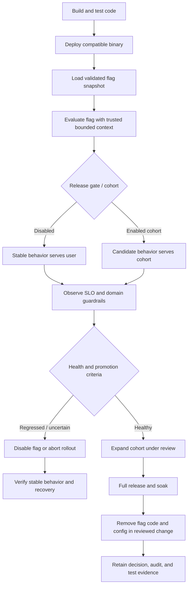
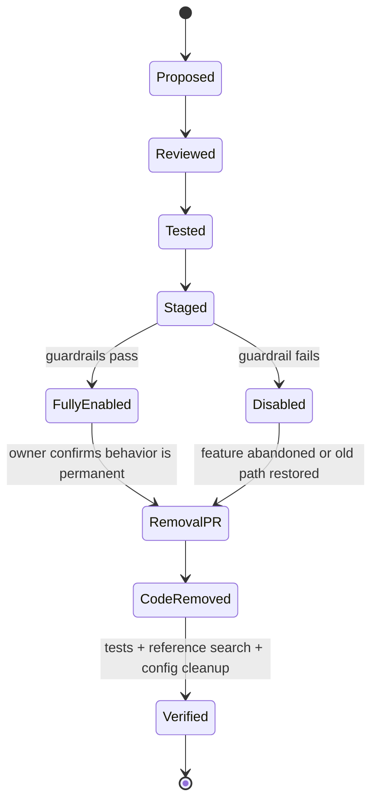

# Unit 10 — Feature Flags and Dark Launches

**Target file:** `10-feature-flags-and-dark-launches.md`  
**Module:** M08 — GitOps and Progressive Delivery | **Stage:** 2E — Production DevOps & Platform Engineering  
**Estimated time:** 14–22 hours for the six progressive labs; optional OpenFeature/flagd or Kubernetes/GitOps integration adds time.  
**Prerequisites:** M08 Units 1–9; Git, Python, FastAPI, HTTP APIs, basic Kubernetes/ConfigMaps, CI, rollout health checks, and safe change/revert practices.  
**Primary environment:** WSL2 Ubuntu or Linux; Python 3.10+; local synthetic data. Docker/`kind` is optional until the ConfigMap/GitOps extension.  
**Resource budget:** 4 CPU, 8 GB RAM, 30 GB disk. The core labs are local-process-first and should not require a cluster.  
**Evidence status:** This is a teaching artifact. Example data and expected outcomes are synthetic/illustrative unless explicitly generated by a command. During authoring, code blocks were syntax-checked, 12 extracted unit tests, the valid-inventory linter, a synthetic batch consistency run, and a synthetic shadow-report run were executed, and a temporary local FastAPI smoke test exercised `/healthz`, `/score`, and `/flags/diagnostics`. No full lab, OpenFeature/flagd integration, Docker, or Kubernetes/GitOps lab was run.

## 1. Learning outcomes

By the end of this unit, you should be able to:

- Explain why **deploying code** and **releasing behavior** are separate decisions, and select between a feature flag, canary, and dark launch.
- Implement release, operational kill-switch, experiment, and entitlement flags with safe defaults and explicit targeting.
- Assign percentage cohorts using stable hashing rather than random-per-request sampling.
- Keep a request path available when a flag provider is slow, unavailable, stale, or malformed.
- Run a model or pipeline candidate in shadow mode without exposing its output or allowing duplicate side effects.
- Snapshot flag decisions for a batch run so every partition is reproducible.
- Enforce flag ownership and expiry in CI, test both on/off paths, and remove temporary flags safely.
- Govern flag changes as production changes with review, authorization, staged rollout, audit evidence, and incident runbooks.

## 2. Why this matters in production

Imagine a `scoring-api` image containing a new model adapter and an expensive explanation feature. The image passes CI and is deployed successfully, but enabling the adapter doubles inference latency. A deployment rollback is possible, yet the image also contains a bug fix needed by the current version. A release flag lets the team ship the code while leaving the new path disabled. A kill switch can turn off the expensive explanation path without rebuilding the image. A dark launch can execute the candidate model on bounded synthetic or approved mirrored inputs while serving only the stable model's result.

These controls reduce blast radius, but they can create new failure modes. A provider timeout that defaults a release flag to `true` enables unfinished code. A mirrored request can double downstream load. A stale temporary flag can re-enable a path after its cleanup. Two services evaluating a changing flag independently can disagree within one user transaction. A batch job that reads the flag once per partition can produce a mixed dataset.

**Operating principle:** a flag is a runtime decision point, not a substitute for tests, authorization, backward-compatible migrations, or release-health analysis. Every flag needs an owner, an explicit default, an expiry or review policy, an observable decision, and a removal plan.

## 3. Source and assumptions

### Sources inspected

- `Roadmap(9).md` — M08 subtree and exact Unit 10 filename/order. The tree names Units 1–13, the M08 README, practice questions, and the capstone.
- `PROMPT-GitOps-and-Progressive-Delivery.md` — controlling syllabus, Unit 10 curriculum, global lab and audit rules.
- M08 Units 5–9: `05-configuration-and-secret-reference-management.md`, `06-deployment-drift-detection-and-reconciliation.md`, `07-progressive-delivery-with-canary-and-blue-green-releases.md`, `08-argo-rollouts-flagger-and-traffic-based-analysis.md`, and `09-release-health-analysis-and-automated-abort.md`.
- `/mnt/data/practice-questions.md` — available practice-question material; it is not a substitute for the missing M08-local README.

The available working set did **not** contain the M08 `README.md`, `Projects/README.md`, `Projects/01-gitops-controlled-data-service-release.md`, or Unit 11–13 lesson files. Their names are present in the roadmap, but their contents were not independently inspected. Cross-links below use those exact roadmap names only where useful. The M08 tree available during authoring did not include a repository checkout with the full module content.

### Verified documentation and remaining version checks

- OpenFeature's official **Python SDK** page was checked on 2026-10-28. It documents the Python SDK, typed evaluation methods, providers, defaults, context, and lifecycle APIs. The example uses a pinned SDK version in the source page; re-check the current package and API before adopting it. [VERIFY]
- OpenFeature's official **Evaluation API** and **Provider** concept pages were checked on 2026-10-28. The provider is the adapter between the application API and the underlying flag system; evaluation errors return the caller-supplied default. See the source register at the end.
- The official **flagd** documentation was checked on 2026-10-28. It describes a local/file resolver and remote resolver modes. The exact Python provider package, compatibility matrix, configuration schema, and installation command must be verified for the version chosen. [VERIFY]
- The local fallback in this lesson is a deliberately small **file-backed evaluator**, not an OpenFeature SDK provider implementation. It is the guaranteed core lab; OpenFeature and flagd are optional integration exercises.
- Kubernetes ConfigMap volume propagation, application reload behavior, and GitOps reconciliation speed vary by configuration. The app must implement and test reload behavior; a ConfigMap update alone does not prove that the process has consumed the new content. [VERIFY]
- No cluster, provider, SaaS account, vendor license, or current vendor price is required or assumed. Vendor comparison is decision guidance, not an endorsement or a claim about current pricing.

## 4. Mental model: deploy, evaluate, observe, remove



A flag decision is made at runtime, but its configuration can be managed through Git, a dynamic flag service, or a local file. These are different control planes and have different availability and audit properties. Keep the feature evaluation API separate from the mechanism that distributes flag values.

## 5. Foundations: flags, canaries, and dark launches

### 5.1 Deploy is not release

A **deployment** places code/configuration into an environment. A **release** makes a behavior available to a user or workload. If code is backward compatible and the new behavior is guarded, deployment can precede release. This enables the team to verify startup, memory use, readiness, and operational integration before a product decision enables the behavior.

Decoupling helps when:

- code can coexist safely with the old behavior;
- the new path can be disabled quickly;
- configuration defaults keep the new path off;
- both code paths are tested;
- data/API/schema changes remain compatible across versions.

It does **not** make an unsafe migration safe. A flag cannot undo a database write, restore deleted data, reverse an already-sent email, or stop a binary that cannot read the flag. Use M08 Unit 11 (`11-database-and-data-platform-migration-safety.md`) for expand–migrate–contract and M08 Unit 12 (`12-backward-compatible-pipeline-and-api-releases.md`) for contract compatibility when those lessons are available in your checkout.

### 5.2 Flag types

| Type | Typical purpose | Lifetime expectation | Default/risk policy |
|---|---|---|---|
| Release | Gate unfinished or newly deployed behavior for a staged rollout | Usually short-lived | Default OFF until explicitly enabled |
| Operational / kill switch | Disable a risky, expensive, or degraded capability quickly | May be long-lived, but still reviewed | Define the safe state explicitly; avoid ambiguous flag names |
| Experiment | Assign treatment/control for a controlled experiment | Bound to experiment plan | Deterministic assignment, guardrails, predeclared analysis |
| Permission / entitlement | Represent product availability for a cohort or plan | Often durable | **Not authorization**; enforce access on the server with a real authorization system |
| Pipeline path | Choose old/new transformation logic | Usually temporary during migration | Snapshot at run start; record in lineage metadata |

Naming should describe behavior, not an ambiguous negation. Prefer `expensive_explanations_enabled` with default `false` over a double negative. If using `expensive_explanations_kill_switch`, document whether `true` means “block the operation.” Tests should prove the chosen semantics.

### 5.3 Dark launch, canary, and flagged rollout

| Mechanism | What changes? | What the user sees | Best fit | Main hazard |
|---|---|---|---|---|
| Canary release | Which deployed version receives some traffic | Response from the canary version | Validate a new binary under bounded real traffic | Traffic weighting and health signals may be wrong |
| Feature-flag rollout | Which cohort executes a behavior | New behavior for selected cohort | Decouple code deployment from product enablement | Flag state/configuration can be inconsistent or stale |
| Dark launch / shadow | Candidate path executes but its result is discarded | Stable result only | Compare a new model, parser, query, or pipeline implementation | Extra compute, privacy exposure, duplicate side effects, downstream overload |
| A/B experiment | User/cohort assignment to variants under an experiment design | Variant assigned to the user | Estimate product or model outcome differences | Bias, sample-ratio mismatch, repeated peeking, weak causal inference |

These can be combined: deploy candidate code, use a flag to select a small cohort, route the binary with a canary, and shadow a separate model candidate. Keep the controls independent so an incident can disable the risky behavior without having to revert unrelated fixes.

### 5.4 Kill switches and their limits

A kill switch is a fast mitigation when the process can still read and apply the decision. It can disable an optional computation or route requests to a known-safe path without a new image. It cannot recover a crashed process that cannot load configuration, undo an irreversible side effect, or make incompatible data structures compatible.

**Runbook rule:** disable the feature first when the old path is known safe; verify the new path stopped; then roll back the deployment if necessary. If the old path is not compatible with current persisted state, do not blindly flip the flag—use the migration/incident plan.

### 5.5 Flag debt and state explosion

With `n` independent boolean flags, the theoretical configuration space has up to `2^n` combinations. Not every combination is reachable, but testing only “all off” and “all on” misses interactions. Temporary flags also leave dead branches, stale config, ambiguous ownership, and a false sense that old behavior is still safe.

Control this debt with expiry metadata, CI linting, tests for the off path, a risk-based pairwise test matrix, removal PRs, and a review of stale flag age. An enabled flag at 100% is still a flag until the code and configuration are removed.

## 6. Running example and local workspace

The service exposes:

- `GET /healthz` — liveness/readiness-style local health endpoint;
- `POST /score` — stable scoring result, with an optional candidate model path behind a release flag;
- `GET /flags/diagnostics` — sanitized diagnostic state for the lab only; do not expose privileged flag configuration in a public production API;
- `GET /metrics-lite` — bounded counters useful for the lab; a production system should export metrics using its approved observability stack.

The code uses a local JSON flag file. It supports a release flag, a kill switch for an expensive optional feature, a pipeline-path flag, and an experiment flag. The synthetic `user_key` is accepted only for this lab. In a real service, derive identity/cohort from authenticated server-side context; never trust an arbitrary client header for entitlement, tenant, or authorization.

Create the following directory in a disposable working folder:

```text
feature-flags-lab/
├── app.py
├── flags.json
├── requirements.txt
├── test_app.py
├── flag_inventory.json
├── lint_flags.py
├── test_lint_flags.py
├── synthetic_replay.jsonl
├── compare_shadow.py
├── batch_job.py
└── README-lab-notes.md   # learner-created evidence; not supplied by this lesson
```

No files in this layout are automatically created by the Markdown lesson; copy the corresponding code blocks into the named files. Use Python 3.10+ in a virtual environment.

## 7. Local flag evaluator and FastAPI service

### 7.1 `requirements.txt`

```text
fastapi>=0.115,<1.0
uvicorn[standard]>=0.30,<1.0
httpx>=0.27,<1.0
```

These are broad compatibility ranges for a teaching lab, not a reproducible production lock. For repeatable CI, pin exact tested versions and retain a lockfile. The local evaluator intentionally uses only the Python standard library; the optional OpenFeature SDK is not required for the core lab.

### 7.2 `flags.json`

```json
{
  "schema_version": 1,
  "config_version": "lab-2026-10-28-a",
  "updated_at": "2026-10-28T00:00:00Z",
  "flags": {
    "scoring_v2_enabled": {
      "type": "release",
      "default": false,
      "rollout_percent": 10,
      "salt": "lab-scoring-v2-rotate-only-with-a-new-rollout",
      "allow_cohorts": ["synthetic"]
    },
    "expensive_explanations_kill_switch": {
      "type": "ops_kill_switch",
      "default": true
    },
    "pipeline_v2_enabled": {
      "type": "pipeline_path",
      "default": false
    },
    "scoring_experiment_treatment": {
      "type": "experiment",
      "default": false,
      "rollout_percent": 50,
      "salt": "lab-experiment-v1",
      "allow_cohorts": ["synthetic"]
    }
  }
}
```

All values are `[ILLUSTRATIVE]`. The timestamp and percentages are examples, not recommended production settings. The sample intentionally uses a `true` default for the *kill-switch state*, where `true` means “block expensive explanations.” The release and pipeline flags default OFF. This makes outage behavior unambiguous.

### 7.3 `app.py` — complete local service

```python
from __future__ import annotations

import asyncio
import hashlib
import json
import logging
import os
import time
import uuid
from dataclasses import dataclass
from datetime import datetime, timezone
from pathlib import Path
from typing import Any

from fastapi import FastAPI, HTTPException
from pydantic import BaseModel, Field

logging.basicConfig(level=os.getenv("LOG_LEVEL", "INFO"))
log = logging.getLogger("scoring-api")
FLAG_FILE = Path(os.getenv("FLAG_FILE", "flags.json"))
MAX_CONFIG_AGE_SECONDS = float(os.getenv("MAX_CONFIG_AGE_SECONDS", "3600"))
RELOAD_CHECK_SECONDS = float(os.getenv("RELOAD_CHECK_SECONDS", "2"))
SHADOW_ENABLED = os.getenv("LAB_SHADOW_ENABLED", "false").lower() == "true"
SHADOW_SAMPLE_PERCENT = float(os.getenv("LAB_SHADOW_SAMPLE_PERCENT", "10"))
SHADOW_MAX_QUEUE = int(os.getenv("LAB_SHADOW_MAX_QUEUE", "32"))
SHADOW_TIMEOUT_SECONDS = float(os.getenv("LAB_SHADOW_TIMEOUT_SECONDS", "0.15"))
FAULT_MODE = os.getenv("LAB_FAULT_MODE", "none")  # LAB ONLY; never enable in production

SAFE_DEFAULTS: dict[str, bool] = {
    "scoring_v2_enabled": False,
    "expensive_explanations_kill_switch": True,
    "pipeline_v2_enabled": False,
    "scoring_experiment_treatment": False,
}

@dataclass
class Snapshot:
    config: dict[str, Any]
    loaded_monotonic: float
    file_mtime_ns: int | None
    last_error: str | None = None

class FlagStore:
    """Local file-backed evaluator with safe defaults and last-known-good policy.

    File reads are local, not network calls. The file is rechecked at most once per
    RELOAD_CHECK_SECONDS. Invalid refreshes never replace the last-known-good snapshot.
    Once the last good snapshot exceeds MAX_CONFIG_AGE_SECONDS, all flags fall back
    to documented safe defaults rather than silently using indefinitely stale values.
    """
    def __init__(self, path: Path) -> None:
        self.path = path
        self.snapshot: Snapshot | None = None
        self.last_check = 0.0
        self.fallback_count = 0
        self.refresh_error_count = 0

    def _validate(self, raw: Any) -> dict[str, Any]:
        if not isinstance(raw, dict) or raw.get("schema_version") != 1:
            raise ValueError("unsupported or missing schema_version")
        flags = raw.get("flags")
        if not isinstance(flags, dict):
            raise ValueError("flags must be an object")
        allowed_types = {"release", "ops_kill_switch", "experiment", "permission", "pipeline_path"}
        for key, spec in flags.items():
            if not isinstance(key, str) or not isinstance(spec, dict):
                raise ValueError("invalid flag entry")
            if spec.get("type") not in allowed_types:
                raise ValueError(f"{key}: unknown flag type")
            if not isinstance(spec.get("default"), bool):
                raise ValueError(f"{key}: default must be boolean")
            if "rollout_percent" in spec:
                pct = spec["rollout_percent"]
                if isinstance(pct, bool) or not isinstance(pct, (int, float)) or not 0 <= pct <= 100:
                    raise ValueError(f"{key}: rollout_percent must be numeric in [0, 100]")
            if "salt" in spec and not isinstance(spec["salt"], str):
                raise ValueError(f"{key}: salt must be a string")
            if "allow_cohorts" in spec and (
                not isinstance(spec["allow_cohorts"], list)
                or not all(isinstance(value, str) for value in spec["allow_cohorts"])
            ):
                raise ValueError(f"{key}: allow_cohorts must be a list of strings")
        return raw

    def _refresh_if_due(self) -> None:
        now = time.monotonic()
        if now - self.last_check < RELOAD_CHECK_SECONDS:
            return
        self.last_check = now
        try:
            stat = self.path.stat()
            if self.snapshot and self.snapshot.file_mtime_ns == stat.st_mtime_ns:
                return
            raw = json.loads(self.path.read_text(encoding="utf-8"))
            valid = self._validate(raw)
            self.snapshot = Snapshot(valid, now, stat.st_mtime_ns)
            log.info("flag config refreshed version=%s", valid.get("config_version", "unknown"))
        except Exception as exc:  # safe boundary: never crash request handling on flag refresh
            self.refresh_error_count += 1
            log.warning("flag config refresh failed; preserving last good or safe defaults: %s", type(exc).__name__)
            if self.snapshot:
                self.snapshot.last_error = type(exc).__name__

    def _current_config(self) -> dict[str, Any] | None:
        self._refresh_if_due()
        snap = self.snapshot
        if snap is None:
            return None
        age = time.monotonic() - snap.loaded_monotonic
        if age > MAX_CONFIG_AGE_SECONDS:
            return None
        return snap.config

    @staticmethod
    def _bucket(key: str, salt: str, subject: str) -> float:
        # Stable across process restarts. Changing the salt deliberately reshuffles cohorts.
        digest = hashlib.sha256(f"{key}:{salt}:{subject}".encode("utf-8")).digest()
        number = int.from_bytes(digest[:8], "big")
        return number / (2**64) * 100.0

    def evaluate(self, key: str, context: dict[str, Any] | None = None) -> bool:
        ctx = context or {}
        config = self._current_config()
        if config is None:
            self.fallback_count += 1
            return SAFE_DEFAULTS.get(key, False)
        spec = config.get("flags", {}).get(key)
        if not isinstance(spec, dict):
            self.fallback_count += 1
            return SAFE_DEFAULTS.get(key, False)
        default = spec.get("default")
        if not isinstance(default, bool):
            self.fallback_count += 1
            return SAFE_DEFAULTS.get(key, False)
        # This example accepts only bounded, server-controlled context attributes.
        cohort = ctx.get("cohort", "unknown")
        if not isinstance(cohort, str) or len(cohort) > 32:
            return default
        allowed = spec.get("allow_cohorts")
        if allowed is not None and cohort not in allowed:
            return False
        pct = spec.get("rollout_percent")
        if pct is not None:
            subject = ctx.get("synthetic_user")
            if not isinstance(subject, str) or not subject or len(subject) > 80:
                return default
            salt = spec.get("salt", "default-salt")
            return self._bucket(key, salt, subject) < float(pct)
        return default

    def diagnostics(self) -> dict[str, Any]:
        config = self._current_config()
        return {
            "config_version": config.get("config_version") if config else None,
            "using_safe_defaults": config is None,
            "fallback_count": self.fallback_count,
            "refresh_error_count": self.refresh_error_count,
        }

flags = FlagStore(FLAG_FILE)
app = FastAPI(title="scoring-api feature-flag lab", version="1.0.0-lab")
shadow_queue: asyncio.Queue[dict[str, Any]] = asyncio.Queue(maxsize=SHADOW_MAX_QUEUE)
shadow_worker_task: asyncio.Task | None = None
shadow_report_path = Path(os.getenv("LAB_SHADOW_REPORT", "shadow-results.jsonl"))

class ScoreRequest(BaseModel):
    # Synthetic identifier only. Real systems derive subject identity server-side.
    synthetic_user: str = Field(min_length=1, max_length=80)
    cohort: str = Field(default="synthetic", max_length=32)
    feature_value: float = Field(default=0.5, ge=0.0, le=1.0)

class ScoreResponse(BaseModel):
    request_id: str
    served_model_version: str
    score: float
    explanations_included: bool
    pipeline_path: str


def stable_score(value: float) -> float:
    return round(0.2 + 0.6 * value, 6)


def candidate_score(value: float) -> float:
    if FAULT_MODE == "candidate_error":
        raise RuntimeError("LAB-ONLY injected candidate failure")
    if FAULT_MODE == "candidate_shift":
        return round(0.2 + 0.6 * value + 0.25, 6)
    return round(0.18 + 0.62 * value, 6)


def shadow_sampled(subject: str) -> bool:
    # Stable per synthetic subject; real systems should use a trusted bounded cohort key.
    digest = hashlib.sha256(f"shadow-v1:{subject}".encode()).digest()
    return int.from_bytes(digest[:4], "big") / 2**32 * 100 < SHADOW_SAMPLE_PERCENT

async def shadow_worker() -> None:
    while True:
        item = await shadow_queue.get()
        started = time.perf_counter()
        try:
            # A real candidate adapter must be read-only/idempotent and resource-bounded.
            await asyncio.wait_for(asyncio.sleep(0.005), timeout=SHADOW_TIMEOUT_SECONDS)
            candidate = candidate_score(item["feature_value"])
            result = {
                "request_id": item["request_id"],
                "release_id": "candidate-model-v2-lab",
                "stable_score": item["stable_score"],
                "candidate_score": candidate,
                "absolute_delta": round(abs(candidate - item["stable_score"]), 6),
                "latency_ms": round((time.perf_counter() - started) * 1000, 3),
                "candidate_error": None,
            }
        except Exception as exc:
            result = {
                "request_id": item["request_id"],
                "release_id": "candidate-model-v2-lab",
                "stable_score": item["stable_score"],
                "candidate_score": None,
                "absolute_delta": None,
                "latency_ms": round((time.perf_counter() - started) * 1000, 3),
                "candidate_error": type(exc).__name__,
            }
        try:
            with shadow_report_path.open("a", encoding="utf-8") as f:
                f.write(json.dumps(result, sort_keys=True) + "\n")
        except OSError:
            log.exception("shadow report write failed")
        finally:
            shadow_queue.task_done()

@app.on_event("startup")
async def start_shadow_worker() -> None:
    global shadow_worker_task
    if SHADOW_ENABLED:
        shadow_worker_task = asyncio.create_task(shadow_worker())

@app.on_event("shutdown")
async def stop_shadow_worker() -> None:
    if shadow_worker_task:
        shadow_worker_task.cancel()
        try:
            await shadow_worker_task
        except asyncio.CancelledError:
            pass

@app.get("/healthz")
def healthz() -> dict[str, str]:
    return {"status": "ok"}

@app.get("/flags/diagnostics")
def flag_diagnostics() -> dict[str, Any]:
    # LAB ONLY: protect or remove this endpoint in any real deployment.
    return flags.diagnostics()

@app.get("/metrics-lite")
def metrics_lite() -> dict[str, int]:
    # Bounded local counters only; production metrics require a proper exporter.
    return {
        "flag_fallback_count": flags.fallback_count,
        "flag_refresh_error_count": flags.refresh_error_count,
        "shadow_queue_depth": shadow_queue.qsize(),
    }

@app.post("/score", response_model=ScoreResponse)
async def score(req: ScoreRequest) -> ScoreResponse:
    request_id = str(uuid.uuid4())  # log/artifact field; never a Prometheus label
    context = {"synthetic_user": req.synthetic_user, "cohort": req.cohort}
    stable = stable_score(req.feature_value)
    candidate_enabled = flags.evaluate("scoring_v2_enabled", context)
    # The flag changes the served model path only for the selected synthetic cohort.
    served_score = candidate_score(req.feature_value) if candidate_enabled else stable
    model_version = "candidate-v2-lab" if candidate_enabled else "stable-v1-lab"
    kill_switch_on = flags.evaluate("expensive_explanations_kill_switch", context)
    explanations = not kill_switch_on
    pipeline_v2 = flags.evaluate("pipeline_v2_enabled", context)
    pipeline_path = "v2-lab" if pipeline_v2 else "v1-lab"

    # Shadow path never supplies the response. Queue is bounded; overload drops shadow work.
    if SHADOW_ENABLED and shadow_sampled(req.synthetic_user):
        item = {"request_id": request_id, "feature_value": req.feature_value, "stable_score": stable}
        try:
            shadow_queue.put_nowait(item)
        except asyncio.QueueFull:
            log.warning("shadow work dropped due to bounded queue request_id=%s", request_id)

    if FAULT_MODE == "raise_500":
        raise HTTPException(status_code=500, detail="LAB-ONLY injected fault")
    if FAULT_MODE == "slow":
        await asyncio.sleep(0.25)
    return ScoreResponse(
        request_id=request_id,
        served_model_version=model_version,
        score=served_score,
        explanations_included=explanations,
        pipeline_path=pipeline_path,
    )
```

**Safety review of the sample:** `LAB_FAULT_MODE` and shadow controls are explicitly lab-only. The `/flags/diagnostics` endpoint is not a production admin API. The sample has a bounded shadow queue and never returns the candidate shadow score, but it is not a complete production model-serving architecture. In production, also bound candidate concurrency, downstream fan-out, request payload retention, queue lifetime, and compute budget; disable external side effects for shadow execution.

The example uses FastAPI startup/shutdown events for broad readability. The recommended current FastAPI lifespan pattern may differ by version; migrate to the official lifespan API if required by the pinned version. [VERIFY]

### 7.4 Run the service

From `feature-flags-lab/`:

```bash
python3 -m venv .venv
. .venv/bin/activate
python -m pip install --upgrade pip
python -m pip install -r requirements.txt
python -m uvicorn app:app --host 127.0.0.1 --port 8000
```

In a second terminal, call it with synthetic inputs:

```bash
curl -s http://127.0.0.1:8000/healthz
curl -s -X POST http://127.0.0.1:8000/score \
  -H 'content-type: application/json' \
  -d '{"synthetic_user":"user-0001","cohort":"synthetic","feature_value":0.5}'
curl -s http://127.0.0.1:8000/flags/diagnostics
curl -s http://127.0.0.1:8000/metrics-lite
```

Expected behavior, not observed output: health returns an `ok` status; with the sample 10% release flag, some deterministic synthetic users select candidate model v2 and others stay on v1; expensive explanations remain disabled because the kill-switch state is `true`; pipeline v2 remains disabled. To prove a specific user selection, run the cohort test in Lab A rather than assuming that `user-0001` belongs to the candidate.

## 8. Consistent hashing, targeting, and context

### 8.1 Why not random per request?

If each request independently flips a coin, one user can alternate between behaviors, producing inconsistent UX and noisy measurements. A stable assignment hashes a stable subject key with a salt. The same input gives the same bucket across requests and process restarts. A new salt intentionally reshuffles cohorts; changing it mid-experiment can invalidate comparison.

The sample uses SHA-256 and converts the first 64 bits to a bucket in `[0,100)`. A rollout percentage is a threshold, not a guarantee that exactly that fraction of a finite population is selected. Distribution varies with finite samples; use a tolerance justified by the sample size and test purpose. The `[ILLUSTRATIVE]` tolerance used in Lab A is a smoke test, not a formal statistical guarantee.

### 8.2 Context rules

Use only bounded, purpose-specific context, such as:

- synthetic cohort (`synthetic`, `internal-test`, or `unknown`);
- environment (`dev`, `staging`, `prod`), supplied by trusted service configuration;
- region or tenant class from authenticated server-side identity;
- model version, service name, and release ID.

Do not pass personal data, access tokens, raw prompts, raw request bodies, arbitrary model output, or secrets into flag contexts or logs. Do not allow a caller to set a privileged `tenant_class`, entitlement, region, or experiment assignment merely by adding a header. Validate context at a trust boundary.

### 8.3 Rule order and safe fall-through

A robust rule evaluator should have an explicit order: (1) validate configuration schema; (2) apply hard safety state; (3) check environment/cohort allow-list; (4) evaluate deterministic rollout; (5) use the documented default. Missing keys, unknown context, malformed percentages, invalid types, and refresh failures must not enable unfinished code. The local evaluator falls back to `SAFE_DEFAULTS` when no valid configuration exists. Production systems should record the reason for fallback without leaking sensitive context.

## 9. Provider architecture and OpenFeature

OpenFeature is a vendor-neutral evaluation API. It defines how application code asks for a typed flag value and supplies evaluation context. A **provider** connects that API to an implementation or management system. The API itself does not host a flag console, persist flag values, or guarantee that every provider has the same targeting semantics, update latency, audit trail, offline behavior, or consistency model.

The official Python SDK docs describe `openfeature-sdk`, typed calls such as `get_boolean_value`, provider registration, evaluation context, and a no-op/default behavior. Example below is an integration sketch; pin and verify the SDK/provider API before use. [VERIFY]

```python
# Optional OpenFeature integration sketch — verify against the pinned SDK version.
from openfeature import api
from openfeature.provider.in_memory_provider import InMemoryFlag, InMemoryProvider

api.set_provider(InMemoryProvider({
    "scoring_v2_enabled": InMemoryFlag("off", {"on": True, "off": False}),
}))
client = api.get_client()
# Always pass an explicit safe default. Provider/API semantics are version-sensitive.
enabled = client.get_boolean_value("scoring_v2_enabled", False)
```

The in-memory provider example is for API orientation; it is not the same as the file-backed targeting/percentage evaluator in `app.py`. A real OpenFeature provider needs to be selected, configured, tested for outage semantics, and monitored. Do not register a remote provider and assume its network behavior is safe merely because the application uses OpenFeature.

### 9.1 flagd as an optional backend

The official flagd docs describe a feature-flag evaluation engine with file and remote resolver modes. Use the official flagd installation page and language-provider compatibility information to select the correct current package and deployment mode. [VERIFY] The local lab does not require flagd, a gRPC connection, a hosted account, or a Kubernetes cluster.

Before using it, verify:

```bash
python --version
python -m pip index versions openfeature-sdk
# Check the official flagd provider matrix and current installation/configuration docs.
```

The `pip index` output depends on network/package-index access and is not proof that a provider is compatible. Record exact package versions and run a smoke test that exercises valid, unknown, stale, and unavailable-provider cases.

### 9.2 File/ConfigMap vs dynamic flag service

| Property | Git-managed file / ConfigMap | Dynamic flag service |
|---|---|---|
| Change speed | Git review + reconcile + file propagation + app reload | Potentially near-runtime, depending on SDK/cache/streaming mode `[VERIFY]` |
| Audit | Git history and review are strong if changes require protected PRs | Provider's audit/event features and identity integration must be verified |
| Availability | Can operate locally with a last-known-good snapshot and safe defaults | Requires SDK/provider behavior, cache, and failure policy to be understood |
| Consistency | Propagation may be staggered across replicas | Also may be staggered; streaming does not automatically guarantee global atomicity |
| Rollback | Revert Git commit and wait for reconciliation/reload | Revert flag change through authorized control plane; retain audit evidence |
| Complexity/cost | Low infrastructure cost; application owns reload and schema validation | Extra service, identity, access control, backups, provider SDK, operational cost |
| Best fit | Small team, low update frequency, strong review/audit need | Frequent changes, rich targeting, experiments, central governance |

A ConfigMap update does not necessarily reload an application that read its file only once. This sample checks file modification time and refreshes periodically. Kubernetes projected volume update timing is not instantaneous; a `subPath` mount has different update behavior and should not be assumed to refresh. [VERIFY] Test the exact deployment and reload design.

## 10. Provider-down resilience and safe defaults

Flag evaluation should not become an unbounded network dependency on every request. Prefer local evaluation with cached/snapshotted configuration where possible. If remote evaluation is required, define strict timeouts, connection pooling, cache age, fallback behavior, and latency SLOs. A flag-provider failure must be visible but must not crash the API.

### 10.1 Safe defaults by meaning

| Flag meaning | Safe fallback in this lesson | Reason |
|---|---|---|
| Unfinished release path | `false` | Keep unfinished behavior disabled |
| New pipeline path | `false` | Keep known transformation until an explicit approved run snapshot says otherwise |
| Expensive feature kill switch | `true` means “blocked” | Outage should not accidentally enable expensive work |
| Experiment treatment | `false` / control | Avoid accidental experiment assignment when config is invalid |

“Fail closed” means deny or disable the risky action when the dependency fails; “fail open” means allow it. Neither phrase is meaningful without stating what action is being protected. For a security authorization check, fail-closed is usually appropriate. For a kill-switch state, the default should preserve safety. For an availability-critical capability, a service may intentionally use a last-known-good value within a bounded age, but it must not use stale values forever.

### 10.2 Failure modes to test

- **Provider unavailable at startup:** use safe defaults; serve health and stable scoring; emit a fallback counter/log.
- **Slow provider:** local core path does not wait on a remote request. If using a remote SDK, verify bounded timeout and cancellation behavior.
- **Malformed update:** reject the entire invalid snapshot; preserve last-known-good until its maximum age; then revert to safe defaults.
- **Stale configuration:** once age exceeds policy, use safe defaults and alert. The maximum age is service-specific, not universal.
- **Unknown flag or unknown context:** return a documented safe default and record a bounded reason code.
- **Config reload race:** write config atomically (write temp file then rename) and validate complete content before accepting it.

The sample records `fallback_count` and `refresh_error_count` through `/metrics-lite`. These are local counters, not a production metrics endpoint. Production telemetry should use bounded labels such as `flag_key`, `reason`, and `service`; do not label metrics by user/request ID or arbitrary flag context.

## 11. Model shadow launch and comparison

A shadow launch runs the stable and candidate paths on the same synthetic/replayed input but returns only the stable result. It is useful for scoring-model rewrites, query-engine changes, parsers, ranking logic, and pipeline transformations. Candidate results should be correlated to a release ID and synthetic replay ID in logs/artifacts, not high-cardinality metrics labels.

Required controls:

1. Candidate path is read-only or uses sandboxed dependencies. No duplicate writes, emails, payments, external mutations, or irreversible side effects.
2. Sampling is deterministic and bounded; queue/concurrency is capped; candidate timeouts are shorter than the budget for the operation.
3. Stable output is returned even if candidate work fails. Candidate failure must not propagate to the user-facing request.
4. Shadow work is dropped or throttled when the bounded queue is full; never create an unbounded background task per request.
5. Raw inputs and prompts are not copied into reports unless explicitly approved and sanitized.
6. Comparison includes agreement/delta distribution, candidate error rate, latency delta, fallback ratio, and downstream load estimate.
7. Promotion criteria are written before reviewing the results and derived from baseline/SLO/business risk.

For numeric outputs, define absolute and relative tolerance. For a model with output `y`, one possible metric is `abs(candidate - stable)`, but a small numeric delta is not necessarily equivalent business behavior. For classification, compare class agreement and calibrated confidence; for ranking, use a ranking metric; for pipelines, compare schema validity, row counts, and semantic aggregates. Never treat “outputs match” as proof of correctness if both paths share the same defect.

### 11.1 Comparison report generator — `compare_shadow.py`

This script reads JSON Lines produced by the sample worker and emits a concise summary. It assumes `stable_score`, `candidate_score`, `absolute_delta`, `latency_ms`, and `candidate_error` keys. It does not access customer data.

```python
import json
import statistics
import sys
from pathlib import Path

path = Path(sys.argv[1] if len(sys.argv) > 1 else "shadow-results.jsonl")
rows = [json.loads(line) for line in path.read_text().splitlines() if line.strip()]
if not rows:
    raise SystemExit("NO DATA: comparison is inconclusive, not a pass")
valid = [r for r in rows if r.get("candidate_error") is None and r.get("candidate_score") is not None]
errors = len(rows) - len(valid)
if not valid:
    raise SystemExit("NO VALID CANDIDATE RESULTS: comparison is inconclusive")

deltas = [float(r["absolute_delta"]) for r in valid]
latencies = [float(r["latency_ms"]) for r in valid]
# [ILLUSTRATIVE] agreement tolerance for this toy numeric score only.
tolerance = 0.05
agreement = sum(d <= tolerance for d in deltas) / len(deltas)
print(json.dumps({
    "synthetic_rows": len(rows),
    "valid_candidate_rows": len(valid),
    "candidate_error_ratio": errors / len(rows),
    "agreement_within_illustrative_tolerance": agreement,
    "median_absolute_delta": statistics.median(deltas),
    "p95_absolute_delta_nearest_rank": sorted(deltas)[max(0, int(0.95 * len(deltas) + 0.999999) - 1)],
    "median_shadow_latency_ms": statistics.median(latencies),
    "status": "REVIEW_REQUIRED",
}, indent=2, sort_keys=True))
```

This report intentionally returns `REVIEW_REQUIRED`, not `PROMOTE`, because promotion requires a defined minimum sample, error and latency guardrails, data-quality checks, and human/governed release decision. The simple percentile calculation is suitable for a small lab but should be replaced with a tested statistics helper in production.

### 11.2 `[ILLUSTRATIVE]` promotion policy

A sample policy might require at least 1,000 valid replay cases, candidate error ratio below a limit derived from the service SLO, agreement above a domain-approved threshold, p95 candidate latency within the inference budget, no schema/NaN failures, and no downstream load breach. Those numbers are not universal. Derive them from labeled historical data, expected business impact, service SLOs, and risk tolerance. A short low-volume shadow run is inconclusive, not evidence of parity.

## 12. Data pipeline flags: snapshot once per run

A batch job should not evaluate a mutable flag independently for each partition. Otherwise a mid-run config update can produce half the output with old logic and half with new logic. Read and validate the flag snapshot once at job start, record its identity and values in run metadata, and use that immutable snapshot for every partition.

### 12.1 `batch_job.py`

```python
import json
import os
import sys
import uuid
from datetime import datetime, timezone
from pathlib import Path

flags_path = Path(os.getenv("FLAG_FILE", "flags.json"))
output_dir = Path(os.getenv("LAB_BATCH_OUTPUT", "batch-output"))
output_dir.mkdir(parents=True, exist_ok=True)
run_id = os.getenv("RUN_ID", str(uuid.uuid4()))
code_version = os.getenv("CODE_VERSION", "local-dev")
model_version = os.getenv("MODEL_VERSION", "stable-v1-lab")

# Fail startup if the snapshot cannot be read or validated. Do not mix defaults silently.
config = json.loads(flags_path.read_text(encoding="utf-8"))
if config.get("schema_version") != 1 or not isinstance(config.get("flags"), dict):
    raise SystemExit("invalid flag snapshot; batch not started")
pipeline_spec = config["flags"].get("pipeline_v2_enabled")
if not isinstance(pipeline_spec, dict) or not isinstance(pipeline_spec.get("default"), bool):
    raise SystemExit("pipeline_v2_enabled must have a boolean default; batch not started")
flag_snapshot = {
    "pipeline_v2_enabled": pipeline_spec["default"],
}
metadata = {
    "run_id": run_id,
    "code_version": code_version,
    "flag_config_version": config.get("config_version", "unknown"),
    "flag_snapshot_timestamp": datetime.now(timezone.utc).isoformat(),
    "flag_snapshot": flag_snapshot,
    "model_version": model_version,
    "input_window": "synthetic-window-2026-10-28",
    "input_partitions": ["part-000", "part-001", "part-002"],
}
(output_dir / f"{run_id}-metadata.json").write_text(json.dumps(metadata, indent=2) + "\n")

# Demonstration only: each partition uses the same in-memory immutable decision.
for partition in metadata["input_partitions"]:
    path = "v2-lab" if flag_snapshot["pipeline_v2_enabled"] else "v1-lab"
    result = {"run_id": run_id, "partition": partition, "path": path, "rows": 100}
    with (output_dir / f"{run_id}-results.jsonl").open("a", encoding="utf-8") as f:
        f.write(json.dumps(result) + "\n")
print(f"completed synthetic run={run_id} snapshot={config.get('config_version', 'unknown')}")
```

The sample reads the `default` field from the flag spec to keep the artifact short. A production implementation should evaluate the actual validated run policy, capture the effective value rather than merely the configured default, record a hash of the canonical snapshot, and store metadata in durable lineage storage. Never store secrets or PII in the snapshot.

### 12.2 Reproducibility check

1. Run the batch job and retain the metadata and results.
2. Change `pipeline_v2_enabled.default` in a copy of `flags.json`, update `config_version`, and run a second job.
3. Verify all partitions in run 1 have the same path and run 2 has the newly selected path.
4. Verify the first run's metadata is unchanged.
5. Replay run 1 using its recorded code/config/model versions and input window.

A failure to load a valid snapshot should fail the job before processing data. Do not silently mix flag values across partitions. Link this practice to the actual Stage 2C lineage/metadata material in your repository; the current inspected tree did not provide a verified exact Stage 2C lesson path to cite here.

## 13. Lifecycle, metadata, and expiry policy

### 13.1 Lifecycle



The lifecycle ends only when the code branch, tests, and flag configuration are removed and the change is verified. An enabled-at-100% flag remains technical debt.

### 13.2 Flag inventory schema

Use one inventory as a reviewable source of truth. The schema below is an example JSON inventory; exact fields and expiry durations are organization policy.

```json
{
  "policy_version": 1,
  "flags": [
    {
      "key": "scoring_v2_enabled",
      "type": "release",
      "owner": "team-ml-platform",
      "created": "2026-10-28",
      "expiry": "2026-12-15",
      "default": false,
      "purpose": "Stage candidate scoring path for synthetic and approved cohorts",
      "risk": "high",
      "rollout_plan": "internal -> 5% -> 25% -> 100% after health review",
      "rollback_action": "disable flag; verify stable model serves; revert deployment if needed",
      "evidence": "release-record-EXAMPLE-001",
      "exception": null
    }
  ]
}
```

All identifiers and dates are `[ILLUSTRATIVE]`. Do not use a ticket string as evidence unless it resolves to retained review, tests, release identity, and approvals.

### 13.3 Expiry linter — `lint_flags.py`

This script uses only the standard library. It fails on missing/duplicate keys, invalid type/default/date, missing owner/expiry, expired flags, and invalid exceptions. The exception is explicit, time-bounded, and requires owner, reason, approver, and a future `new_expiry` date.

```python
import json
import sys
from datetime import date
from pathlib import Path

ALLOWED_TYPES = {"release", "ops_kill_switch", "experiment", "permission", "pipeline_path"}


def parse_date(value, field, errors):
    try:
        return date.fromisoformat(value)
    except (TypeError, ValueError):
        errors.append(f"{field}: must be ISO date YYYY-MM-DD")
        return None


def validate(path: Path, today: date) -> list[str]:
    errors = []
    try:
        data = json.loads(path.read_text(encoding="utf-8"))
    except Exception as exc:
        return [f"invalid JSON: {type(exc).__name__}"]
    if not isinstance(data, dict) or data.get("policy_version") != 1:
        return ["policy_version must equal 1"]
    flags = data.get("flags")
    if not isinstance(flags, list):
        return ["flags must be a list"]
    seen = set()
    for index, flag in enumerate(flags):
        prefix = f"flags[{index}]"
        if not isinstance(flag, dict):
            errors.append(f"{prefix}: must be an object")
            continue
        key = flag.get("key")
        if not isinstance(key, str) or not key.strip():
            errors.append(f"{prefix}: missing key")
        elif key in seen:
            errors.append(f"{prefix}: duplicate key {key}")
        else:
            seen.add(key)
        if flag.get("type") not in ALLOWED_TYPES:
            errors.append(f"{prefix}: invalid type")
        if not isinstance(flag.get("owner"), str) or not flag.get("owner", "").strip():
            errors.append(f"{prefix}: missing owner")
        if not isinstance(flag.get("purpose"), str) or not flag.get("purpose", "").strip():
            errors.append(f"{prefix}: missing purpose")
        if not isinstance(flag.get("default"), bool):
            errors.append(f"{prefix}: default must be boolean")
        created = parse_date(flag.get("created"), f"{prefix}.created", errors)
        expiry_value = flag.get("expiry")
        exception = flag.get("exception")
        effective_expiry = expiry_value
        if exception is not None:
            if not isinstance(exception, dict):
                errors.append(f"{prefix}: exception must be an object or null")
            else:
                required = ("owner", "reason", "approver", "new_expiry")
                for field in required:
                    if not isinstance(exception.get(field), str) or not exception.get(field, "").strip():
                        errors.append(f"{prefix}.exception: missing {field}")
                effective_expiry = exception.get("new_expiry")
        expiry = parse_date(effective_expiry, f"{prefix}.expiry/new_expiry", errors)
        if created and expiry and expiry < created:
            errors.append(f"{prefix}: expiry precedes created date")
        if expiry and expiry < today:
            errors.append(f"{prefix}: expired on {expiry.isoformat()}")
        if exception is not None and isinstance(exception, dict):
            approver = exception.get("approver")
            owner = exception.get("owner")
            if approver and owner and approver == owner:
                errors.append(f"{prefix}.exception: approver must differ from owner")
    return errors

if __name__ == "__main__":
    file = Path(sys.argv[1] if len(sys.argv) > 1 else "flag_inventory.json")
    today_arg = sys.argv[2] if len(sys.argv) > 2 else None
    # Deterministic date injection enables reproducible tests and CI.
    today = date.fromisoformat(today_arg) if today_arg else date.today()
    failures = validate(file, today)
    if failures:
        print("FLAG INVENTORY FAILED:")
        print("\n".join(f"- {failure}" for failure in failures))
        raise SystemExit(1)
    print("FLAG INVENTORY PASSED")
```

### 13.4 Linter tests — `test_lint_flags.py`

```python
import json
import tempfile
import unittest
from datetime import date
from pathlib import Path
from lint_flags import validate

VALID = {
    "policy_version": 1,
    "flags": [{
        "key": "release_x", "type": "release", "owner": "team-a",
        "created": "2026-10-01", "expiry": "2026-12-01", "default": False,
        "purpose": "temporary release gate", "exception": None
    }]
}

class LinterTests(unittest.TestCase):
    def check(self, data):
        with tempfile.TemporaryDirectory() as directory:
            path = Path(directory) / "flags.json"
            path.write_text(json.dumps(data), encoding="utf-8")
            return validate(path, date(2026, 10, 28))

    def test_valid_inventory(self):
        self.assertEqual(self.check(VALID), [])

    def test_expired_flag_fails(self):
        data = json.loads(json.dumps(VALID)); data["flags"][0]["expiry"] = "2026-10-01"
        self.assertTrue(any("expired" in e for e in self.check(data)))

    def test_missing_owner_fails(self):
        data = json.loads(json.dumps(VALID)); data["flags"][0]["owner"] = ""
        self.assertTrue(any("missing owner" in e for e in self.check(data)))

    def test_duplicate_key_fails(self):
        data = json.loads(json.dumps(VALID)); data["flags"].append(dict(data["flags"][0]))
        self.assertTrue(any("duplicate key" in e for e in self.check(data)))

    def test_malformed_date_fails(self):
        data = json.loads(json.dumps(VALID)); data["flags"][0]["created"] = "not-a-date"
        self.assertTrue(any("ISO date" in e for e in self.check(data)))

    def test_explicit_exception_requires_distinct_approver(self):
        data = json.loads(json.dumps(VALID)); data["flags"][0]["expiry"] = "2026-10-01"
        data["flags"][0]["exception"] = {
            "owner": "team-a", "reason": "migration in progress",
            "approver": "team-a", "new_expiry": "2026-11-15"
        }
        self.assertTrue(any("approver must differ" in e for e in self.check(data)))

if __name__ == "__main__":
    unittest.main()
```

The linter treats the exception's `new_expiry` as the effective expiry. A governance implementation should also ensure the exception is linked to an approval record and cannot be used to override a safety-critical kill-switch policy. This sample does not validate identity or signatures; CI access controls and branch protections remain required.

### 13.5 CI invocation

No existing M08 CI workflow was found in the inspected working set, so the following is a command example, not a claim about the repository's CI provider:

```bash
python lint_flags.py flag_inventory.json 2026-10-28
python -m unittest -v test_lint_flags.py
```

Use the CI system already approved by your repository. Set the date deterministically in tests, but use the actual UTC policy date in scheduled CI. Never let an exception silently disable all linting.

## 14. Flag-driven tests and state-space control

Test at least: flag off, flag on for intended cohort, unknown cohort, missing context, malformed config, provider outage, stale config, kill switch active, kill switch inactive, candidate failure, and old/new binary compatibility. A flag-state test asks “does this code path behave correctly?” A deployment-version test asks “does this binary coexist with the currently deployed dependencies and data schema?” They are related but not interchangeable.

| Binary | Release flag | Kill switch | Test intent | Priority |
|---|---|---|---|---|
| Old | OFF | ON | Old behavior remains correct; expensive path blocked | Critical |
| New | OFF | ON | New code deploys safely while feature remains dark | Critical |
| New | ON for test cohort | ON | Candidate behavior is correct for eligible cohort | Critical |
| New | ON | OFF | Explicitly test expensive path and budget guardrails | High |
| New | invalid/stale config | safe fallback | Provider failure cannot enable unfinished behavior | Critical |
| Old/new mixed fleet | transition | transition | Compatibility during rollout and propagation | High |

Use risk-based representative/pairwise combinations rather than blindly testing every theoretical state. However, never omit safety-critical states merely to reduce test count. Contract tests should prove the API and data contract remain valid across supported binary/flag combinations.

## 15. Safe flag changes, evaluation latency, and distributed consistency

### 15.1 Treat flag changes as production changes

A flag update can expose unfinished behavior, change compute cost, alter data outputs, or affect customer entitlements. Require identity, review/approval appropriate to risk, staged rollout, health observation, rollback action, audit event, and a named owner. Units 7 and 9 cover progressive rollout and release-health gates. Automated flag ramp-up/down based on health is an advanced orchestration pattern, not a capability assumed to be built into OpenFeature or every provider. [VERIFY]

### 15.2 Evaluation performance

In-process evaluation from a local snapshot generally avoids a network round trip per request, but it introduces refresh, cache, and staleness decisions. Remote evaluation can offer central targeting but adds latency and provider availability to the request path. Measure p50/p95/p99 evaluation latency and provider-error ratio under load; test cold start and refresh storms. Do not claim a latency benefit without measuring the actual provider and workload.

For any provider, verify: startup readiness, timeout/cancellation, polling or streaming update behavior, cache semantics, stale-age handling, error/default reason visibility, shutdown, and behavior during partial network failure. SDK/provider specifics are `[VERIFY]` and belong in the source register.

### 15.3 Distributed consistency

If a single user request spans multiple services, independent flag evaluation can produce inconsistent behavior during propagation. Possible strategies include:

- evaluate once at a trusted edge/service and propagate a bounded decision context;
- pass a signed/validated decision token with a short expiry and release/config identity;
- use a transaction-scoped context with documented merge rules;
- pin a config snapshot for a workflow or batch run.

Do not blindly trust `X-Feature-Enabled: true` from an untrusted client. If using headers, strip client-supplied values at the trust boundary, set them from authenticated server-side logic, validate signature/expiry where appropriate, and define behavior if the downstream service receives an unknown config version. A flag decision is not an authorization grant. Mixed-version compatibility still matters.

## 16. Security, privacy, and option comparison

### 16.1 Security checklist

- Flag management write access is production-change access; use least privilege and separation of duties.
- Require protected branches, review rules, and CI validation for Git-managed flag files.
- Treat dynamic provider credentials as secrets; never put tokens in source, flag contexts, or logs.
- Derive entitlement/tenant context from authenticated server-side identity. Do not trust caller-supplied privileged attributes.
- Keep audit records for who changed what, when, why, and which release/config version consumed it.
- Do not use a flag as a configuration database, authorization engine, or secret store.
- Restrict shadow paths to read-only/sandboxed dependencies and synthetic or approved data.
- Bound shadow compute, queue size, concurrency, timeout, sampling, and downstream fan-out.
- Avoid request IDs, user IDs, raw paths, prompts, or arbitrary values as metric labels; use logs/evidence for high-cardinality identifiers.

### 16.2 Awareness matrix — verify current provider support and terms

| Option | Typical operating model | Strengths to investigate | Risks / verification questions |
|---|---|---|---|
| OpenFeature + local file evaluator | SDK abstraction plus application-owned evaluator | Minimal dependencies, offline-capable, easy local lab | Application owns schema, reload, targeting, audit and UI |
| OpenFeature + flagd | OpenFeature SDK + flagd engine/provider | Local/self-hosted evaluation, file-based resolver described by official docs | Verify current Python provider package, versions, config schema, resolver behavior, update semantics |
| Unleash | Open-source/self-hosted and hosted options | Flag lifecycle/types and environment targeting in official docs | Verify current licensing, deployment footprint, SDK compatibility, audit/RBAC and pricing terms |
| Flagsmith | Hosted and self-hosted options | Evaluate identity/segment features, SDKs, deployment model | Verify current license, free/paid boundaries, audit/RBAC by plan, data handling and compatibility |
| GrowthBook | Hosted/self-hosted product options | Evaluate feature flags and experimentation workflow | Verify current SDKs, licensing, experimentation/statistics behavior and deployment requirements |
| LaunchDarkly | Managed feature-management service | Evaluate governance, targeting, audit and operational support | Verify current plan, pricing, data residency, SDK caching/offline behavior and contract terms |
| Split | Feature delivery/experimentation platform | Evaluate experimentation and governance workflow | Verify current product naming, SDK/provider compatibility, plan and data controls |

This table intentionally makes no current price or licensing assertion. Do not choose a vendor from a marketing feature list. Run a small evaluation against your own criteria: supported language/runtime, offline behavior, cache freshness, identity, audit export, RBAC, consistency, migration path, data residency, support model, maintenance, total cost, and the effort to remove the provider later. Re-check official product docs and legal terms at decision time. [VERIFY]

### 16.3 Migration patterns and OpenFeature limits

**Environment variables to flags:** first centralize the existing setting behind a typed internal interface; preserve explicit defaults; add inventory/owner/expiry; test the old behavior; migrate values without changing semantics; then introduce targeting only after parity tests.

**Provider A to provider B:** OpenFeature reduces application-level coupling, but it does not make provider semantics identical. Compare flag key rules, types, context merge, targeting order, percentage hashing, variants, fallback behavior, cache/update latency, audit events, offline mode, and evaluation reasons. Export a known set of contexts and run both providers in a parity harness before cutover. Dual evaluation should not trigger duplicate side effects or expose provider secrets.

**Feature flag versus schema migration:** a flag can gate application behavior, but cannot make a destructive schema change safe while old code still runs. Use expand–migrate–contract and backward compatibility from Unit 11; do not use a flag to conceal an incompatible contract.

## 17. Experiment hygiene for ML

A/B experiment validity is distinct from deployment safety. A feature can be operationally healthy and still produce an invalid experiment, or produce a statistically convincing product result while violating latency/error guardrails.

- **Sample-ratio mismatch (SRM):** observed assignment proportions differ materially from the planned randomization. Investigate identity loss, eligibility filters, logging loss, bot traffic, or bucketing bugs before interpreting treatment effects.
- **Guardrails:** monitor service error/latency, fallback rate, null/NaN output rate, fairness/domain constraints where applicable, cost, and downstream effects.
- **No peeking:** repeatedly checking significance and stopping when a favorable result appears inflates false-positive risk. Predefine the metric, horizon, exclusions, and stopping policy.
- **Causality:** randomization, exposure logging, and valid analysis assumptions matter. Do not infer causal benefit from a before/after comparison alone.
- **Privacy:** record assignment and outcome with bounded synthetic/pseudonymous identifiers; do not log raw prompts or sensitive inputs unnecessarily.

For deployment safety, a critical guardrail can disable the candidate regardless of experiment outcome. Do not let experiment statistics override a safety gate.

## 18. Six practical labs

The labs reuse the local service and synthetic data. Complete A and B before enabling shadow mode; complete D before allowing temporary flags to survive in a shared branch; complete E before using flags in batch workloads. All values and expected outputs are `[ILLUSTRATIVE]`. No result below is claimed to have been executed here.

### Lab A — File-backed flags and stable percentage cohorts

**Goal:** run `scoring-api`, test release/kill-switch/pipeline flags, and demonstrate stable cohort assignment for at least 1,000 synthetic subjects.

**Prerequisites and layout:** Python 3.10+, `feature-flags-lab/` with `app.py`, `flags.json`, `requirements.txt`, `test_app.py`.  
**Architecture:** FastAPI process → local JSON config → deterministic SHA-256 bucket → stable/candidate path. No remote provider.  
**Estimated setup/run time:** 30–60 minutes.  
**Footprint:** 1 CPU, 150–400 MB RAM, under 100 MB source/venv overhead excluding Python packages; disk depends on pip cache. Cleanup: stop Uvicorn and remove `.venv` only if disposable. These are planning estimates, not measured values.

Create `test_app.py`:

```python
import unittest
from app import FlagStore
from pathlib import Path
import tempfile
import json

class CohortTests(unittest.TestCase):
    def test_hash_stable_for_1000_users(self):
        values = [FlagStore._bucket("scoring_v2_enabled", "fixed-salt", f"user-{i:04d}") for i in range(1000)]
        repeated = [FlagStore._bucket("scoring_v2_enabled", "fixed-salt", f"user-{i:04d}") for i in range(1000)]
        self.assertEqual(values, repeated)
        selected = sum(v < 10 for v in values)
        # [ILLUSTRATIVE] broad tolerance for a deterministic 1,000-user smoke test, not a guarantee.
        self.assertTrue(50 <= selected <= 150, f"unexpected cohort count: {selected}")

    def test_missing_config_uses_safe_defaults(self):
        store = FlagStore(Path("/definitely/missing/flags.json"))
        self.assertFalse(store.evaluate("scoring_v2_enabled", {"synthetic_user": "u1", "cohort": "synthetic"}))
        self.assertTrue(store.evaluate("expensive_explanations_kill_switch", {}))

    def test_unknown_cohort_does_not_roll_out(self):
        with tempfile.TemporaryDirectory() as d:
            p = Path(d) / "flags.json"
            p.write_text(json.dumps({"schema_version": 1, "config_version": "test", "flags": {
                "scoring_v2_enabled": {"type": "release", "default": False, "rollout_percent": 100,
                                        "salt": "x", "allow_cohorts": ["synthetic"]}
            }}))
            store = FlagStore(p)
            self.assertFalse(store.evaluate("scoring_v2_enabled", {"synthetic_user": "u1", "cohort": "unknown"}))

    def test_malformed_refresh_preserves_last_good(self):
        with tempfile.TemporaryDirectory() as d:
            p = Path(d) / "flags.json"
            p.write_text(json.dumps({"schema_version": 1, "config_version": "good", "flags": {
                "scoring_v2_enabled": {"type": "release", "default": False, "rollout_percent": 100,
                                        "salt": "x", "allow_cohorts": ["synthetic"]}
            }}))
            store = FlagStore(p)
            context = {"synthetic_user": "u1", "cohort": "synthetic"}
            self.assertTrue(store.evaluate("scoring_v2_enabled", context))
            p.write_text("{malformed-json")
            store.last_check = 0  # force refresh check in this deterministic test
            self.assertTrue(store.evaluate("scoring_v2_enabled", context))
            self.assertEqual(store.refresh_error_count, 1)

    def test_boolean_rollout_percentage_is_rejected(self):
        with tempfile.TemporaryDirectory() as d:
            p = Path(d) / "flags.json"
            p.write_text(json.dumps({"schema_version": 1, "config_version": "bad", "flags": {
                "scoring_v2_enabled": {"type": "release", "default": False, "rollout_percent": True,
                                        "salt": "x", "allow_cohorts": ["synthetic"]}
            }}))
            store = FlagStore(p)
            self.assertFalse(store.evaluate("scoring_v2_enabled", {"synthetic_user": "u1", "cohort": "synthetic"}))
            self.assertEqual(store.refresh_error_count, 1)

    def test_stale_snapshot_uses_safe_defaults(self):
        import time
        from unittest.mock import patch
        with tempfile.TemporaryDirectory() as d:
            p = Path(d) / "flags.json"
            p.write_text(json.dumps({"schema_version": 1, "config_version": "good", "flags": {
                "scoring_v2_enabled": {"type": "release", "default": True},
                "expensive_explanations_kill_switch": {"type": "ops_kill_switch", "default": False}
            }}))
            store = FlagStore(p)
            store.evaluate("scoring_v2_enabled", {})
            store.snapshot.loaded_monotonic = time.monotonic() - 100
            store.last_check = time.monotonic()  # do not refresh the same valid file
            with patch("app.MAX_CONFIG_AGE_SECONDS", 1):
                self.assertFalse(store.evaluate("scoring_v2_enabled", {}))
                self.assertTrue(store.evaluate("expensive_explanations_kill_switch", {}))

if __name__ == "__main__":
    unittest.main()
```

Run:

```bash
python -m unittest -v test_app.py
python -m uvicorn app:app --host 127.0.0.1 --port 8000
```

**Expected evidence:** tests pass; `curl` to `/healthz` succeeds; `/score` returns stable model for most synthetic subjects at the illustrative 10% rollout and candidate for deterministic eligible subjects; diagnostics show no fallback under valid config. The actual cohort count is generated by the learner's test; do not copy an invented count into evidence.

| Verification condition | Evidence | Pass criterion |
|---|---|---|
| Stable assignment | `python -m unittest -v test_app.py` | 1,000 subjects produce identical assignments across repeated calculations |
| Distribution sanity | Test's `selected` count | Within the broad `[ILLUSTRATIVE]` 5–15% range for 10% target; investigate if outside |
| Safe defaults | Missing-file test | Release OFF; kill-switch ON |
| Targeting | Unknown-cohort test | Unknown cohort does not enter rollout |
| Service health | `curl http://127.0.0.1:8000/healthz` | HTTP success and `status=ok` |

**Troubleshooting:** if reload tests are flaky, ensure the temporary config file exists before evaluation; the evaluator rate-limits refresh checks, so tests should isolate instances or wait longer than `RELOAD_CHECK_SECONDS`. The config's `updated_at` is metadata; this sample's staleness policy measures age since last successfully loaded snapshot. For production, decide whether policy should also validate signed/configured source timestamps.

**Cleanup/safety:** Ctrl-C the server. Do not run with production credentials, real user IDs, real traffic, or `LAB_FAULT_MODE` enabled outside a disposable lab.

### Lab B — Provider-down, timeout, malformed and stale configuration

**Goal:** prove a configuration failure does not take down the API or enable unfinished behavior.

**Prerequisites:** Lab A files; local process.  
**Architecture:** local evaluator → validated last-known-good snapshot → bounded safe-default behavior.  
**Estimated time:** 30–45 minutes.  
**Footprint:** 1 CPU, 150–400 MB RAM, under 100 MB lab data; cleanup is restoring `flags.json` and stopping Uvicorn.

Procedure:

1. Start the service with valid `flags.json`; call `/score` and record diagnostics.
2. Replace the config with invalid JSON, wait at least `RELOAD_CHECK_SECONDS`, and call `/healthz` and `/score` again. The evaluator should preserve the previous valid snapshot.
3. Delete or rename the config file. A valid last-known-good snapshot remains usable only until `MAX_CONFIG_AGE_SECONDS`; for a quick test, set the environment to a small value such as `MAX_CONFIG_AGE_SECONDS=5` before startup. `[ILLUSTRATIVE]`
4. After the configured age expires, check that release and pipeline behavior use safe defaults, the kill-switch remains ON, and `/healthz` still responds.
5. Set `LAB_FAULT_MODE=raise_500` only in the lab to demonstrate an application fault is distinct from a provider outage; then remove it and restart.

**Important:** the sample's last-known-good age uses monotonic time since a successful read. Restarting the process resets this in-memory age. A production cache surviving restarts needs durable/signed snapshot semantics or a safe bootstrap policy.

| Verification condition | Evidence | Pass criterion |
|---|---|---|
| Invalid JSON | Server warning + `/flags/diagnostics` | Refresh error increments; valid last-known-good snapshot remains |
| Missing provider file | `/healthz`, `/score`, diagnostics | API remains healthy; fallback behavior is documented |
| Stale snapshot | Start with small `MAX_CONFIG_AGE_SECONDS`, wait past it | `using_safe_defaults=true`; release and pipeline flags OFF; kill-switch ON |
| No unbounded network dependency | Inspect local code path; optional latency test | Flag evaluation reads local file/cache only; no remote request on `/score` |
| Risky feature not enabled by timeout/outage | Unit tests and request result | Release path not enabled; expensive feature blocked |

**Pass/fail:** pass only if the API remains responsive and the expected safe state is observable. If malformed configuration causes a 500, crashes the process, or enables the unfinished path, the lab fails.  
**Troubleshooting:** confirm `FLAG_FILE` points to the file you modified; the process must be restarted to change environment variables. Ensure you wait for the refresh interval. Restore valid JSON before the next lab.  
**Cleanup:** restore the original config and unset `MAX_CONFIG_AGE_SECONDS`/`LAB_FAULT_MODE`. This lab does not test a real remote provider timeout; it tests local fallback semantics.

### Lab C — ML shadow launch and comparison report

**Goal:** compare stable and candidate outputs without serving candidate output to the user.

**Prerequisites:** Labs A–B, `app.py`, and `compare_shadow.py`.  
**Architecture:** request → stable response → bounded queue → shadow worker → JSONL comparison evidence.  
**Estimated time:** 45–75 minutes.  
**Footprint:** 1 CPU, 200–500 MB RAM, output under 20 MB for a small run; disk and CPU scale with sample count. Cleanup: stop server and delete only synthetic report artifacts.

Run with shadow enabled and an injected candidate shift:

```bash
LAB_SHADOW_ENABLED=true \
LAB_SHADOW_SAMPLE_PERCENT=100 \
LAB_FAULT_MODE=candidate_shift \
python -m uvicorn app:app --host 127.0.0.1 --port 8000
```

Then repeat in a fresh local process with `LAB_FAULT_MODE=candidate_error` and keep `scoring_v2_enabled` off. The stable response should still succeed; the shadow artifact should record a candidate error. This is a lab-only fault injection, not a production setting.

In a second terminal, send a bounded synthetic replay:

```bash
for i in $(seq 1 100); do
  curl -s -X POST http://127.0.0.1:8000/score \
    -H 'content-type: application/json' \
    -d "{\"synthetic_user\":\"user-$i\",\"cohort\":\"synthetic\",\"feature_value\":0.5}" >/dev/null
done
```

Wait for the queue to drain by checking `/metrics-lite`; then run:

```bash
python compare_shadow.py shadow-results.jsonl
```

Expected evidence: responses still identify the stable model when the release flag is off; the shadow report records stable/candidate values and deltas; the injected candidate shift creates a larger delta. The comparison report says `REVIEW_REQUIRED` and refuses to promote automatically. This is expected, not an observed result.

| Verification condition | Evidence | Pass criterion |
|---|---|---|
| Candidate output is not served | Save and inspect `/score` responses | User response contains stable model while release flag is off |
| Shadow is bounded | `/metrics-lite` queue depth and source inspection | Queue has a fixed max size; overload drops shadow work |
| Candidate fault isolated | Run with `LAB_FAULT_MODE=candidate_error` while the release flag is OFF; inspect the shadow JSONL | Stable request succeeds and the shadow artifact records the candidate error |
| Report produced | `python compare_shadow.py shadow-results.jsonl` | Non-empty report, valid/error counts and deltas included |
| Promotion is governed | Inspect report `status` | `REVIEW_REQUIRED`; no automatic promotion |

**Troubleshooting:** if the report file is empty, confirm `LAB_SHADOW_ENABLED=true`, request sampling is nonzero, and the process is not being stopped before the queue drains. The example worker uses a toy candidate function and does not simulate a real model's GPU/memory profile.  
**Safety:** synthetic inputs only. Do not mirror production traffic into an unreviewed endpoint. Disable external writes and cap concurrency, timeout, and downstream load before any real shadow deployment.

### Lab D — Flag-expiry linter and CI tests

**Goal:** prevent unowned or expired flags from silently remaining in the repository.

**Prerequisites:** Python 3.10+, `lint_flags.py`, `test_lint_flags.py`, and `flag_inventory.json`.  
**Architecture:** version-controlled inventory → deterministic linter → CI fail/pass.  
**Estimated time:** 45–60 minutes.  
**Footprint:** less than 1 CPU, under 100 MB RAM, under 1 MB source/data; cleanup removes only temporary invalid fixtures.

Create `flag_inventory.json` using the sample inventory in §13.2. Run:

```bash
python lint_flags.py flag_inventory.json 2026-10-28
python -m unittest -v test_lint_flags.py
```

Use the fixed date only for reproducible tests. For actual CI, use the CI environment's UTC date and ensure the runner clock is reliable.

| Verification condition | Evidence | Pass criterion |
|---|---|---|
| Valid inventory | Linter command | Exit 0 and success message |
| Expired flag | Unit test | Linter reports expiry and exits nonzero |
| Missing owner | Unit test | Linter reports owner problem |
| Duplicate key | Unit test | Duplicate is rejected |
| Malformed date | Unit test | Invalid ISO date is rejected |
| Exception governance | Unit test | Missing fields or same owner/approver fail |

**Pass/fail:** all tests pass and invalid inventory fails the linter.  
**Troubleshooting:** execute from the directory containing the scripts; if imports fail, confirm the files are named `lint_flags.py` and `test_lint_flags.py`.  
**Cleanup:** keep the valid inventory as a lab artifact; delete temporary test directories automatically created by the test harness. Do not change the repository's real CI workflow without review.

### Lab E — Deterministic batch flag snapshot and lineage metadata

**Goal:** show that a live flag change does not alter behavior mid-run.

**Prerequisites:** `batch_job.py`, valid `flags.json`, Python 3.10+.  
**Architecture:** validated config read once → immutable in-memory snapshot → all partitions → run metadata/results.  
**Estimated time:** 30–45 minutes.  
**Footprint:** under 1 CPU, under 100 MB RAM, less than 10 MB output for the sample; cleanup deletes only the lab `batch-output/` directory.

Run:

```bash
RUN_ID=run-a CODE_VERSION=git-sha-example python batch_job.py
cat batch-output/run-a-metadata.json
cat batch-output/run-a-results.jsonl
```

Copy `flags.json` to a backup, change `pipeline_v2_enabled.default`, change `config_version`, and run `RUN_ID=run-b python batch_job.py`. Restore the backup after the exercise.

| Verification condition | Evidence | Pass criterion |
|---|---|---|
| Snapshot recorded | `cat batch-output/run-a-metadata.json` | Includes run ID, code/config/model versions, timestamp, input window/partitions, flag snapshot |
| Partition consistency | `cat batch-output/run-a-results.jsonl` | All partitions in a run use one path |
| Next run sees new config | Compare run A and B artifacts | Run B may use changed snapshot; run A remains unchanged |
| Invalid startup config | Temporarily malformed JSON, run new ID | Job exits before writing partition results |
| Replay identity | Metadata + results | Enough synthetic metadata to identify the run's decision inputs |

**Pass/fail:** every partition in a run uses one immutable snapshot and the metadata records that snapshot.  
**Troubleshooting:** the sample's metadata path includes `run_id`; avoid reusing IDs because results append to the same JSONL file.  
**Cleanup:** restore `flags.json`, remove `batch-output/` only after confirming it contains lab data, and never delete real pipeline output as part of this exercise.

### Lab F — Lifecycle policy, flag removal, and governance scorecard

**Goal:** remove a temporary flag safely and prove stale configuration cannot re-enable removed behavior.

**Prerequisites:** Labs A and D, Git, `scoring_v2_enabled` code path.  
**Architecture:** inventory/review → removal PR → code/test cleanup → config removal → search/evidence.  
**Estimated time:** 60–90 minutes.  
**Footprint:** local source only, under 1 CPU, under 200 MB RAM, under 5 MB artifacts; cleanup is a Git revert if the lab branch is disposable. No cluster required.

**Removal drill:**

1. Confirm owner, flag type, creation/expiry, risk, current state, and release record.
2. Review health/experiment evidence and decide whether the behavior is now the permanent path or should be abandoned.
3. Remove the flag check and the dead branch in a dedicated PR. Preserve the selected behavior and tests.
4. Update unit/contract tests to prove the permanent path and compatibility behavior.
5. Search source and configuration for references. Example: `grep -R --line-number --exclude-dir=.git 'scoring_v2_enabled' .`.
6. Remove the flag from config and inventory only after code references are gone. Run the expiry linter and tests.
7. Confirm a stale config key is ignored and cannot change the binary's behavior after code removal.
8. Record approver, Git revision, test output, release identity, cleanup date, and residual risk.

**Synthetic governance scorecard:**

| Metric | Definition | Example value |
|---|---|---:|
| Total flags | Inventory count | 18 `[ILLUSTRATIVE]` |
| Expired flags | Expiry before report date | 3 `[ILLUSTRATIVE]` |
| Missing owners | Empty/invalid owner | 1 `[ILLUSTRATIVE]` |
| Median flag age | Median `today - created` | 42 days `[ILLUSTRATIVE]` |
| Release flags | Count by type | 8 `[ILLUSTRATIVE]` |
| Flag-related incidents | Incidents linked to flag change/semantics | 1 `[ILLUSTRATIVE]` |
| Removal lead time | Time from permanent enablement/decision to code removal | 12 days `[ILLUSTRATIVE]` |

These are synthetic examples, not benchmarks. Calculate from your own inventory and incident records; define the denominator and observation period.

| Verification condition | Evidence | Pass criterion |
|---|---|---|
| Ownership/expiry reviewed | Inventory + review record | Owner, dates, purpose, rollback and approval present |
| Code removed | `grep -R ... scoring_v2_enabled` | No live code references remain except historical evidence/tests intentionally retained |
| Configuration removed | Search config and manifests | Stale config cannot re-enable removed behavior |
| Tests/lint pass | `python -m unittest -v` and linter | Clean exit and retained evidence |
| Audit record retained | Change record | Git revision, approver, tests, decision and cleanup are attributable |

**Troubleshooting:** search may find historical docs or test fixtures; classify each result rather than blindly deleting it. If the flag is used by multiple services, coordinate a staged removal and verify every consumer before deleting shared configuration.  
**Cleanup:** use a disposable Git branch. Do not rewrite shared history or remove a flag in production without the normal approval/release process.

## 19. Incident playbooks and six mandatory investigations

Every incident response should preserve evidence first, reduce blast radius second, and prevent recurrence. Record flag key, config/provider version, change identity, affected binary/model version, evaluation reason, decision latency, fallback/default usage, shadow rate, and relevant health signals. Do not put raw sensitive context into the incident timeline.

### Incident 1 — Provider timeout defaulted unfinished feature to ON

- **Symptom:** an unfinished scoring path became active during provider degradation.
- **Evidence:** request logs with flag key/config version and evaluation reason; provider timeout/error counters; the actual SDK's default semantics; the flag definition and fallback code; release and error/latency timeline.
- **Root cause:** unsafe default (`true`) or code that interpreted missing/error as enabled; possibly an unbounded remote evaluation on the request path.
- **Immediate mitigation:** disable the feature through a known-good control path if available; otherwise use the safe config/deployment path. Verify stable model/version is serving and health recovered. Do not assume toggling succeeded because the management UI changed.
- **Durable prevention:** release defaults OFF, explicit kill-switch semantics, provider-down tests, bounded timeout, local cache/last-known-good age, startup validation, alert on fallback rate, and review SDK behavior for the pinned version.

### Incident 2 — Two-year-old stale flag re-enabled during cleanup

- **Symptom:** a retired code path unexpectedly became active after a config cleanup/revert.
- **Evidence:** Git history and reverted commits; inventory expiry and ownership; config/provider version; code references; release identity and audit records.
- **Root cause:** flag code/config not removed together, no expiry enforcement, or a broad revert restored a stale flag.
- **Immediate mitigation:** disable the flag if the old path is safe; verify affected outputs and downstream state; freeze automated cleanup until references are understood.
- **Durable prevention:** inventory linter, dedicated removal PR, tests and reference search, stale-flag scorecard, reviewed config diffs, and a cleanup rehearsal. Never assume an “expired” flag is inert.

### Incident 3 — Mixed flag state across services caused inconsistent results

- **Symptom:** one service emits a new schema/model output while another expects the old contract.
- **Evidence:** config versions per service, flag evaluation reason, request/workflow ID in logs, binary versions, rollout timing, and contract validation failures.
- **Root cause:** each service independently evaluated flags against eventually consistent configuration; caller-supplied context was trusted or config propagation was not coordinated.
- **Immediate mitigation:** disable the new path or pin the workflow to a known-compatible decision; verify API/data contracts and downstream recovery.
- **Durable prevention:** evaluate once at a trusted boundary and propagate a validated, short-lived decision context; pin config version per workflow; add compatibility tests for mixed versions and an explicit unknown-version fallback.

### Incident 4 — Batch job read the flag mid-run

- **Symptom:** output partitions differ in schema or transformation behavior within one run.
- **Evidence:** per-partition timestamps/config versions, run ID, output schema/row counts, config update timeline, and lineage metadata.
- **Root cause:** the job evaluates live flags repeatedly rather than snapshotting them once.
- **Immediate mitigation:** stop downstream promotion/consumption if safe; mark the run invalid; quarantine partial output; rerun from a consistent snapshot with idempotency and lineage recorded.
- **Durable prevention:** snapshot/validate at startup, immutable run context, one snapshot across partitions, run metadata, reproducibility tests, and a recovery plan for partial writes.

### Incident 5 — Flag change was not audited; nobody knew who enabled it

- **Symptom:** risky behavior enabled without an attributable change record.
- **Evidence:** provider audit export, identity/access logs, Git history, config version, CI job logs, deployment events, and any external automation logs.
- **Root cause:** shared credentials, direct unreviewed edits, missing audit integration, or logs that record value but not actor/reason.
- **Immediate mitigation:** return to a known safe flag state using an authorized operator; capture current state and logs; revoke suspect credentials if warranted.
- **Durable prevention:** unique identities, least privilege, separation of duties, immutable audit export, change reason/ticket, protected Git flow, alert on emergency override, and periodic audit tests. If the actor cannot be determined, record the evidence gap rather than inventing attribution.

### Incident 6 — Dark launch doubled downstream load and caused an outage

- **Symptom:** downstream latency/errors rose after shadow traffic was enabled, while user-facing candidate output remained hidden.
- **Evidence:** request rate by stable/shadow path, queue depth, candidate concurrency, downstream call counts, timeout/error rate, resource saturation, sample percentage and rollout change event.
- **Root cause:** mirrored traffic duplicated expensive downstream work; no concurrency cap, queue bound, timeout, or cost budget; shadow path performed side effects.
- **Immediate mitigation:** disable shadow execution, drain or drop queued work, protect downstream dependencies, and verify stable user-facing service recovers.
- **Durable prevention:** deterministic sampling, bounded queue/concurrency, timeout/cancellation, read-only dependencies, no duplicate side effects, per-release load budget, shadow-specific metrics and a staged ramp with automatic stop conditions.

## 20. Operational runbooks and reusable templates

### 20.1 Flag policy template

```yaml
policy_name: feature-flag-policy
version: 1
required_metadata:
  - key
  - type
  - owner
  - created
  - expiry
  - default
  - purpose
  - risk
  - rollback_action
  - evidence
change_controls:
  low_risk: reviewed-pr-and-ci
  high_risk: reviewed-pr-plus-designated-approver
  emergency: named-operator-reason-time-bounded-review-afterward
safe_defaults:
  release: false
  pipeline_path: false
  experiment: false
  ops_kill_switch: "document the boolean semantics and safe state explicitly"
removal:
  requires_owner_review: true
  requires_code_reference_search: true
  requires_tests: true
  requires_config_cleanup: true
  requires_audit_record: true
```

This is a policy template, not a Kubernetes resource or vendor schema. The exact approval tiers and expiry duration are `[ASSUMPTION]` and must be agreed by the service owner, security, and compliance stakeholders.

### 20.2 Kill-switch runbook

1. Confirm service, flag key, current flag/config version, owner, and blast radius.
2. Determine whether the old path is compatible with current data/schema and whether the flag is readable under current outage conditions.
3. Change the flag through the approved control plane; for Git-managed config, use the emergency procedure and a tracked revert/fix-forward PR.
4. Verify every serving replica has consumed the intended state; inspect evaluation reason/config version and test a synthetic request.
5. Verify user-facing health, domain metrics, downstream recovery, and no new side effects.
6. Notify owner/on-call; retain before/after evidence and timeline.
7. Schedule root-cause analysis, flag removal/repair, and a bounded follow-up review.

### 20.3 Provider outage runbook

- Identify whether the failure is provider availability, network path, SDK initialization, invalid config, or stale cache.
- Check service health separately from provider health; do not conflate a flag outage with application outage.
- Confirm documented defaults and last-known-good age; ensure release flags are not accidentally enabled.
- If defaults are safe and stable path is healthy, continue service with bounded fallback and alert.
- If flag correctness cannot be established for a safety-critical action, disable the risky path or pause promotion; do not silently pass.
- Restore provider, validate config schema, compare config version across replicas, and test a known synthetic context before re-enabling staged rollout.

### 20.4 Mistaken enablement / incompatible path

1. Preserve the change event, actor, config version, and affected release IDs.
2. Disable the flag if the old path is known safe.
3. Verify stable behavior and all dependent services; inspect data side effects that a flag cannot undo.
4. Roll back the binary only if needed and compatible with current schema/data.
5. If rollback is unsafe, fix forward under an incident-approved plan.
6. Reconcile Git desired state with the runtime action; a live toggle does not automatically change Git. Prevent a reconciler or automation from reapplying the unsafe state.
7. Record approver, time-bound exception, verification evidence, and follow-up tasks.

### 20.5 Dark-launch comparison report template

```text
Release ID:
Candidate model/code version:
Stable model/code version:
Input source: synthetic / approved replay (no raw sensitive payload)
Sampling percentage and selection rule:
Start/end time and sample count:
Candidate errors / timeouts:
Agreement metric and tolerance rationale:
Output-delta distribution (median / p95 / max):
Stable vs candidate latency delta:
Fallback / null / NaN rate:
Downstream load and queue high-water mark:
Schema/contract validation:
SLO and domain guardrails:
Decision: promote / continue shadow / abort / inconclusive
Approver and evidence links:
Rollback action and verification plan:
```

### 20.6 Flag-change decision record

```text
Decision ID:
Flag key/type/owner:
Reason and intended outcome:
Binary/model/config version:
Current state -> proposed state:
Targeting/cohort and sample rationale:
Default and provider-outage behavior:
Risk and blast radius:
Tests/contract checks:
SLO/domain guardrails and observation window:
Rollback/kill-switch action:
Approver(s), requester, timestamp:
Expiry/review date:
Evidence links and post-change result:
```

### 20.7 Governance scorecard definitions

| Metric | Definition | Interpretation / guardrail |
|---|---|---|
| Total active flags | Unique inventory keys still referenced by code | Trend by service/type; high count alone is not a failure |
| Expired flags | Active flags whose effective expiry is before report date | Track owner and remediation age |
| Missing owners | Active flags without accountable owner | Treat as governance defect |
| Flag age distribution | Age by type, including median and upper percentiles | Compare within type; kill switches may have different lifetimes |
| Removal lead time | Time from full rollout/permanent decision to code/config removal | Shorter is generally desirable if tests and safety remain intact |
| Flag-related incidents | Incidents where flag semantics/change contributed | Review severity and recurring causes |
| Provider fallback rate | Evaluations using safe defaults/last-known-good due to error | Must be interpreted by reason and traffic volume |
| Shadow load overhead | Candidate calls/resources divided by stable workload | Enforce a cap and watch downstream saturation |

## 21. Troubleshooting table

| Symptom | Likely cause | Check | Safe action |
|---|---|---|---|
| Flag always returns default | No provider/config loaded, wrong key/type, invalid snapshot | `/flags/diagnostics`, config schema, startup logs | Keep safe default; repair config before enabling |
| Candidate enabled for no users | Wrong salt/percentage parsing, context bypass, wrong cohort allow-list | Deterministic cohort tests and actual context source | Disable release flag and inspect evaluator |
| User flips between old/new behavior | Random-per-request assignment or changing salt | Hash inputs and config history | Use stable key/salt and coherent request context |
| New config never appears | App reload not implemented, mounted `subPath`, file path mismatch, propagation delay | File mtime, config version per replica, mount semantics | Verify reload design; do not assume ConfigMap implies reload |
| Provider outage increases API latency | Remote call on every request or unbounded retries | p95/p99 evaluation latency, SDK timeout config | Use bounded timeout/local cache and safe fallback |
| Kill switch seems ineffective | Boolean semantics reversed, replica has stale config, code path bypasses check | Flag definition, evaluation reason, per-replica config version | Disable through tested path; verify actual behavior |
| Shadow causes downstream errors | Mirrored calls doubled load or side effects | Queue depth, downstream request count, concurrency | Disable shadow, cap sampling and fan-out |
| Batch partitions differ | Flag read repeatedly during run | Run metadata/config version per partition | Quarantine output and rerun with immutable snapshot |
| CI expiry linter passes stale flags | Wrong date, exception too permissive, inventory incomplete | Fixed-date test, exception schema, source scan | Repair policy and inventory; require approval and expiry |
| A/B outcome is implausible | SRM, exposure logging loss, peeking, eligibility bias | Assignment counts and exposure funnel | Pause interpretation until experiment validity is restored |

## 22. GitOps and Kubernetes extension (optional)

The core labs work locally without Kubernetes. To apply the same pattern in a disposable cluster, keep the JSON file in a ConfigMap managed by the selected GitOps controller and mount it as a projected volume. Do not install Argo CD and Flux together in the same cluster. The exact controller and mount semantics are version-dependent; verify with the installed Kubernetes API and official controller docs. [VERIFY]

A minimal illustrative ConfigMap shape:

```yaml
apiVersion: v1
kind: ConfigMap
metadata:
  name: scoring-api-flags
  namespace: feature-flags-lab
  labels:
    app.kubernetes.io/name: scoring-api
    app.kubernetes.io/part-of: feature-flags-lab
data:
  flags.json: |
    {
      "schema_version": 1,
      "config_version": "git-commit-or-generated-id",
      "updated_at": "2026-10-28T00:00:00Z",
      "flags": {
        "scoring_v2_enabled": {
          "type": "release", "default": false,
          "rollout_percent": 0, "salt": "replace-with-approved-rollout-salt",
          "allow_cohorts": ["synthetic"]
        },
        "expensive_explanations_kill_switch": {"type": "ops_kill_switch", "default": true},
        "pipeline_v2_enabled": {"type": "pipeline_path", "default": false},
        "scoring_experiment_treatment": {"type": "experiment", "default": false}
      }
    }
```

This ConfigMap is illustrative; it is not a complete Deployment or a production rollout policy. Before using it:

1. Create a dedicated namespace and confirm `kubectl config current-context` points to the disposable lab cluster.
2. Mount the ConfigMap without a `subPath` if you rely on projected-file updates, and verify the actual file change on a running pod.
3. Confirm the application reloads and validates config; ConfigMap propagation alone is not an application reload guarantee.
4. Keep defaults safe if the file is absent, malformed, or stale.
5. Restrict who can change the ConfigMap/Git source; audit the Git revision and the config version consumed by each replica.
6. Use a separate throwaway cluster for another GitOps controller; do not co-install Argo CD and Flux.

**Safe cleanup for a disposable lab only:** inspect the context and namespace first; then delete only the named namespace if you created it solely for this lab. Do not run namespace deletion against an unknown or shared context. The core lesson does not require running these commands.

## 23. Knowledge checks

Try to answer before reading the key. The questions assess taught content; use them as a design-review prompt, not only recall.

### Beginner

1. What is the difference between deploy and release?
2. Why is a feature flag not an authorization boundary?
3. What does dark launch do with candidate output?
4. Why should a release flag default OFF when the provider is unavailable?

### Intermediate

5. Why does consistent hashing outperform random-per-request assignment for a gradual rollout?
6. A ConfigMap changed in Git but the service still uses the old flag state. What evidence would you collect before assuming GitOps failed?
7. Why must a batch job snapshot flag values at run start?
8. What does a shadow comparison report need beyond an agreement percentage?

### Advanced

9. A candidate model looks healthy on HTTP metrics but increases fallback ratio and downstream load. What is the safe decision and why?
10. A flag provider is down and the last-known-good snapshot is older than policy allows. Which behavior should the service choose and what should it record?
11. How would you migrate from provider A to provider B using OpenFeature without assuming semantic parity?
12. How should a regulated organization handle an emergency flag override?

## 24. Answer key and reasoning

1. Deployment places code/configuration into an environment; release exposes behavior to users/workloads. Separating them lets code ship while behavior stays dark.
2. A flag is mutable runtime configuration and can be misconfigured or bypassed. Server-side authorization must enforce identity and permissions independently.
3. It executes candidate work but discards the candidate result; stable output remains user-facing. It must be isolated from side effects and bounded for cost/load.
4. A provider error must not enable unfinished behavior. The fallback should be explicit and safe for that flag's meaning.
5. A stable hash maps the same subject and salt to the same bucket across requests/restarts; random-per-request can flip a user between paths and contaminate measurements.
6. Check Git commit/reconcile status, ConfigMap live content, mount path/subPath, projected volume propagation, file mtime, application reload logs, config version per replica, and schema validation. Do not assume a ConfigMap update automatically reloads the app.
7. Otherwise partitions can use different transformation semantics, making the output non-reproducible. Record the snapshot with run/code/model/input metadata.
8. Sample count, candidate errors/timeouts, latency delta, output-delta distribution, fallback/null/NaN rates, schema/contract validation, downstream load, SLO guardrails, and explicit promotion criteria.
9. Do not promote solely on HTTP health. Stop or continue shadow depending on severity, compare domain guardrails and load, and disable the candidate if critical limits breach. A high agreement score cannot overrule safety guardrails.
10. Use the documented safe defaults, keep release/pipeline paths off and risky optional work disabled, emit fallback/stale telemetry, alert the owner, and avoid silently using unbounded stale state.
11. Build parity tests over representative contexts and flag states; compare targeting order, types, defaults, hashing, variants, cache, update and audit semantics; cut over through a staged reviewed change with rollback.
12. Record actor/reason/time, require authorized emergency identity, scope and expiry the override, preserve before/after evidence, notify owner/on-call, and require post-incident review. Avoid silent permanent bypasses.

## 25. Final production readiness checklist

- [ ] Every active flag has a key, type, purpose, owner, created date, expiry/review date, default, rollout plan, rollback action, and evidence reference.
- [ ] Release/pipeline flags default OFF; kill-switch boolean semantics are explicit and tested.
- [ ] Provider startup, outage, slow response, malformed update, unknown flag/context, and stale snapshot behavior are tested.
- [ ] Flag evaluation is bounded and does not introduce an unbounded network dependency in the critical request path.
- [ ] Cohort assignment is deterministic and stable; salt rotation is governed and recorded.
- [ ] No PII, secrets, raw prompts, or privileged untrusted context is sent to the provider or telemetry.
- [ ] The old path and new path are tested; flag state is tested separately from binary-version compatibility.
- [ ] Shadow work never serves candidate output, duplicates side effects, or creates unbounded load.
- [ ] Batch jobs snapshot effective flag values once and retain run/config/code/model/input metadata.
- [ ] CI fails on missing owners, invalid/duplicate keys, malformed dates, expired flags, and invalid exceptions.
- [ ] Production flag changes have identity, review/approval, audit, monitoring, rollback, and time-bounded exception policy.
- [ ] Removal PRs delete dead code and stale config; enabled-at-100% flags are not treated as removed.
- [ ] Incident runbooks cover kill switch, provider outage, mistaken enablement, incompatible path, and dark-launch overload.
- [ ] The team reviews stale-flag count/age, removal lead time, incidents, provider fallback, and shadow load on a defined cadence.

## 26. Glossary

- **Feature flag:** a runtime decision that controls whether a behavior/path is active.
- **Provider:** adapter/evaluator connecting an SDK/API to a flag definition source or management system.
- **OpenFeature:** vendor-neutral API specification and SDK ecosystem for flag evaluation.
- **Release flag:** short-lived flag used to stage release of a behavior.
- **Kill switch:** operational flag used to disable a risky capability quickly.
- **Experiment flag:** cohort assignment for an experiment; does not itself guarantee valid causal inference.
- **Entitlement:** product-access decision; distinct from server-side authorization.
- **Consistent hashing:** deterministic mapping from a stable key to a bucket/cohort.
- **Dark launch / shadow:** execute candidate logic while discarding its output.
- **Last-known-good:** most recent configuration that passed validation and was accepted.
- **Flag debt:** cost of stale flags, dead branches, missing owners, and untested combinations.
- **Sample-ratio mismatch (SRM):** observed assignment distribution inconsistent with the planned experiment split.
- **Snapshot:** immutable record of effective flag decisions used by a request/workflow/run.
- **ConfigMap:** Kubernetes object for non-secret configuration; it does not guarantee application reload.

## 27. Key takeaways and next steps

1. Deploy code independently from enabling behavior, but only when both paths and their dependencies remain compatible.
2. Make defaults explicit and safe; a flag provider must not become a single point of failure for the service.
3. Use deterministic cohorts, bounded context, local evaluation/cache where appropriate, and tests for invalid/stale configuration.
4. Shadow only when candidate side effects are prevented and compute/downstream load is capped. Candidate output must never leak into the user response.
5. Snapshot flag values for batch runs and record the snapshot as lineage metadata.
6. Flags are production controls: review, audit, observe, expire, and remove them.
7. OpenFeature reduces API coupling but does not guarantee identical provider semantics or migration parity.

Continue with M08 Unit 11, `11-database-and-data-platform-migration-safety.md`, for schema and data compatibility; Unit 12, `12-backward-compatible-pipeline-and-api-releases.md`, for API/data contract compatibility; and Unit 13, `13-release-evidence-and-audit-trails.md`, for durable audit evidence. These filenames are present in the roadmap, but their lesson contents were not available for inspection in the current working set. Use M08 Units 7–9 for canary rollout, traffic-based analysis, and automated release-health gates. Apply M09 for full identity and secret lifecycle; apply M10 for full SLO/incident management; and M11 for production observability, using the actual paths in your repository.

## 28. Source register and content audit

### Source register

| Claim / API | Authoritative source checked | Checked date / result | Remaining caveat |
|---|---|---|---|
| OpenFeature Python SDK API and provider registration | OpenFeature documentation, “OpenFeature Python SDK” — `https://openfeature.dev/docs/reference/sdks/server/python/` | Checked 2026-10-28; current docs show Python SDK installation, typed evaluation, provider registration and context examples | Pin package version and verify SDK/provider compatibility before use `[VERIFY]` |
| OpenFeature evaluation defaults | OpenFeature documentation, “Evaluation API” — `https://openfeature.dev/docs/reference/concepts/evaluation-api/` | Checked 2026-10-28; docs explain typed evaluation and default return on evaluation error | Verify the chosen provider's exact error/reason semantics `[VERIFY]` |
| Provider abstraction | OpenFeature documentation, “Providers” — `https://openfeature.dev/docs/reference/concepts/provider/` | Checked 2026-10-28; provider connects the API to the underlying flag system | Provider semantics and operational features differ; parity tests required |
| flagd architecture and resolver types | flagd official documentation — `https://flagd.dev/` and `https://flagd.dev/reference/specifications/providers/` | Checked 2026-10-28; docs describe file/in-process/remote resolver concepts | Verify current Python provider package, install path, schema and compatibility `[VERIFY]` |
| FastAPI startup/shutdown and lifespan behavior | FastAPI official documentation, “Lifespan Events” — `https://fastapi.tiangolo.com/advanced/events/` | Checked 2026-10-28; current docs recommend the `lifespan` parameter and describe startup/shutdown events as the alternative | The sample uses startup/shutdown events for readability; migrate to `lifespan` for a current production implementation `[VERIFY]` |
| Kubernetes ConfigMap projected-volume update semantics | Kubernetes official documentation, “ConfigMaps” and “Configure a Pod to Use a ConfigMap” — `https://kubernetes.io/docs/concepts/configuration/configmap/` and `https://kubernetes.io/docs/tasks/configure-pod-container/configure-pod-configmap/` | Checked 2026-10-28; mounted projected keys update eventually, environment variables require a pod restart, and `subPath` mounts do not receive updates | Propagation delay depends on kubelet sync/cache configuration; verify the actual cluster and mount design `[VERIFY]` |
| Vendor options / licensing / pricing | Official vendor documentation for Unleash, Flagsmith, GrowthBook, LaunchDarkly and Split | Not used to assert current prices or license terms | Verify current SDK, provider, licensing, maintenance, data residency and pricing before selection `[VERIFY]` |
| Local fallback semantics | `app.py` and `test_app.py` included in this lesson | 6 extracted unit tests executed successfully; a temporary local Uvicorn smoke test returned success for `/healthz`, `/score`, and `/flags/diagnostics` | Re-run in learner environment; a real remote-provider outage was not tested |
| Expiry linter | `lint_flags.py` and `test_lint_flags.py` included in this lesson | 6 extracted unit tests executed successfully; sample inventory passed with fixed date `2026-10-28` | Execute in the target CI environment before adoption |

### Final completeness and authenticity audit

| Requirement group | Status | Evidence / limitation |
|---|---|---|
| Exact target path/name and Unit 10 identity | PASS | Filename and title match roadmap |
| Source-first inspection | PASS | Roadmap, controlling prompt, M08 Units 5–9, root practice-question file inspected; unavailable files disclosed |
| L1 foundations | PASS | Deploy/release, flag types, dark launch/canary/flagged rollout, kill switch, flag debt |
| L2 implementation | PASS | FastAPI service, local provider, safe defaults, consistent hashing, context, optional OpenFeature/flagd, Git-managed/dynamic comparison |
| L3 lifecycle/reliability | PASS | Expiry linter/tests, on/off testing, provider failures, distributed context, batch snapshot, security, vendor matrix |
| L4 governance/incidents | PASS | Six incident investigations, governance metrics, experiment hygiene, migrations, runbooks, dark comparison |
| Six practical labs | PASS — structurally specified | Labs A–F include prerequisites, time/footprint, code/commands, evidence, criteria, cleanup and troubleshooting; actual learner execution not claimed |
| Cohort stability for ≥1,000 synthetic users | PASS — test supplied | Test calculates actual assignment count when run; no distribution output fabricated |
| Provider-down safe defaults | PASS — test procedure supplied | Local-file fallback is covered; no remote provider outage was executed |
| Shadow report and batch snapshot | PASS — code supplied | Candidate output stays out of response; batch uses one snapshot; runtime behavior requires learner execution |
| Flag expiry CI lint | PASS — script/tests supplied | CI system unknown; invocation is an example, not an edit to any CI workflow |
| Official source register | PARTIAL | OpenFeature/flagd docs checked; exact Kubernetes/FastAPI/version compatibility remains `[VERIFY]` |
| Kubernetes/GitOps integration | PARTIAL | ConfigMap reference shape and verification steps included; not applied to a live cluster |
| Vendor licensing/pricing/current support | NOT VERIFIED | No price/license/support claim made; verify official terms before selection |
| Actual test/runtime validation | PARTIAL | 12 extracted unit tests passed; valid inventory linter passed; synthetic batch script used one path across all 3 partitions; comparison report ran on a synthetic 3-row fixture; temporary local FastAPI smoke test returned success for `/healthz`, `/score`, and `/flags/diagnostics`. No OpenFeature provider, flagd, Docker, Kubernetes/GitOps or full six-lab run was executed |
| No unrelated files changed | PASS | Only this target lesson was written by the authoring workflow |

**Final status: `UNIT-10-STATUS: DRAFT-AUDITED`.** Structural coverage and source-boundary review are complete; 12 extracted unit tests, the inventory linter, synthetic batch consistency/report checks, and a minimal FastAPI smoke test passed during authoring. Full lab execution, exact SDK/provider compatibility, ConfigMap propagation, and vendor terms remain explicitly unverified.
