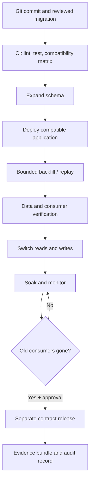

# Database and Data-Platform Migration Safety

**Stage 2E · M08 — GitOps and Progressive Delivery · Unit 11**  
**Target path:** `Stage 2E — Production DevOps & Platform Engineering/08-GitOps-and-Progressive-Delivery/11-database-and-data-platform-migration-safety.md`  
**Level:** L1 foundations → L4 production engineering  
**Estimated study time:** 12–18 hours for reading and all seven labs; optional PITR and operator extensions take longer.  
**Lab environment:** WSL2 Ubuntu or Linux, disposable PostgreSQL, synthetic data, approximately 4 CPU / 8 GB RAM / 30 GB free disk.

> **THROWAWAY LAB ONLY — do not run destructive steps against production or any database containing important data.** Every database, namespace, directory, credential, and dataset in this lesson is disposable. Never paste a production connection string into a shell history or lesson artifact.

## 1. Purpose and operational stakes

A database migration changes shared, durable state. A stateless API process can often be replaced by restarting an older image; a database may already contain rows written by the newer code, changed constraints, dropped fields, or a partially completed backfill. Reverting the application binary does not reverse those changes.

Consider `scoring-api`, a FastAPI service that reads `customers.customer_name` and stores inference metadata in PostgreSQL. Version `v1` still serves most traffic while a canary of `v2` is introduced. If a migration renames `customer_name` directly to `display_name`, the canary may work while every remaining `v1` replica fails. If `v2` writes only `display_name` and the rollout is aborted, `v1` may start again but find that its expected data is no longer populated. The failure is not just a schema problem: it is a release-ordering problem across code, schema, data, consumers, and controllers.

This unit develops one core habit: **make the schema compatible before introducing code that needs it; migrate data in a bounded and verifiable way; remove old structures only after proving no supported consumer needs them.**

A safe migration is not defined by a green Job or a successful GitOps sync. It is defined by compatibility evidence, bounded operational impact, verified data correctness, and an explicit recovery decision.

## 2. Learning outcomes and prerequisites

After this unit, you should be able to:

- Explain why data-layer changes have different rollback properties from stateless code changes.
- Prove old/new application compatibility across old, expanded, and contracted schemas.
- Choose a migration execution mechanism and understand its failure semantics.
- Distinguish snapshots, backups, clones, point-in-time recovery (PITR), recovery point objective (RPO), and recovery time objective (RTO).
- Design expand → migrate/backfill → switch → contract changes in PostgreSQL.
- Reason about locks, lock queues, timeouts, concurrent index builds, and constraints.
- Build idempotent migrations and resumable, throttled backfills.
- Coordinate migration Jobs with Argo CD or Flux without running migrations independently in every replica.
- Evolve data lake, event, pipeline, feature-store, and model schemas without silently breaking consumers.
- Select roll-forward, repair, replay, or restore/PITR based on data-loss and recovery trade-offs.
- Add migration evidence and data-quality signals to release-health gates.

**Prerequisites:** Git, Python, Docker or Podman, SQL basics, Kubernetes Jobs, and the M08 Units 6–10 concepts. PostgreSQL command behavior and controller integrations must be checked against the installed versions; this lesson labels version-sensitive details `[VERIFY]`.

## 3. Running example and local lab architecture

The running system has four independently versioned elements:

1. `scoring-api`: reads customer attributes and serves inference requests.
2. PostgreSQL: owns durable customer and scoring records.
3. `feature-etl`: a batch pipeline that reads source records and writes feature rows.
4. A downstream consumer: reads exported events or warehouse tables.

The release identity should bind these versions together: application image digest, migration revision, schema version, ETL code version, model version, input partition/window, and configuration/flag snapshot where relevant.



### 3.1 Resource plan and component sequencing

A single local PostgreSQL container is enough for most labs. Use one small `kind` cluster only for Lab 4, and tear it down before any other heavy cluster work. Do not co-install Argo CD and Flux in one cluster; this unit only needs one of them for the migration-ordering demonstration.

| Component | Approximate additional footprint `[ILLUSTRATIVE]` | Use |
|---|---:|---|
| PostgreSQL container with small synthetic data | 0.5–1.5 GB RAM, 1–4 GB disk | Labs 1–3, 5–7 |
| Python virtual environment and test tools | 0.2–0.6 GB RAM, 0.2–1 GB disk | All local labs |
| Small `kind` cluster + one GitOps controller | 2–4 GB RAM, 5–10 GB disk | Lab 4 only; stop afterward |
| Optional real WAL/PITR exercise | 1–2 GB RAM, 3–8 GB disk | Lab 6 extension only |

Actual consumption varies with container runtime, image layers, data volume, and host OS. Keep at least 30 GB free disk and stop unrelated clusters. For every lab, resource figures are estimates, not measurements from your machine.

## 4. Why data-layer releases fail

### 4.1 Shared state is not an isolated process

A deployment can have old and new replicas at once because rolling and progressive strategies intentionally overlap versions. Background jobs, cron jobs, reports, analytics queries, partner integrations, and replay tools can remain on older contracts long after the API changes. The database schema is shared by all of them.

Common failure classes:

- **Schema incompatibility:** a field, table, index, or constraint changes before all readers/writers are compatible.
- **Data incompatibility:** the new code assumes values are populated or normalized, but historical rows are null, malformed, or encoded differently.
- **Lock contention:** a DDL operation waits for a lock while new requests queue behind it; the resulting outage can be much longer than the DDL itself.
- **Backfill overload:** a large update saturates I/O, increases bloat, slows replicas, and starves normal queries.
- **Partial execution:** a process fails after some batches or statements committed; retrying without checkpoints can duplicate effects or restart expensive work.
- **Consumer mismatch:** an API is healthy but a nightly ETL or stream consumer fails hours later.
- **Recovery mismatch:** a code rollback is attempted after data was transformed or deleted, and the old code can no longer interpret the data.

### 4.2 Four kinds of compatibility

- **Schema compatibility:** both versions can parse/use the structure they encounter.
- **Data compatibility:** values written by one version remain meaningful to the other version.
- **Behavioral compatibility:** business semantics remain coherent while versions coexist; e.g., two fields do not disagree because one path writes only one of them.
- **Operational compatibility:** migration duration, locks, replication lag, and load stay within declared budgets.

A schema may be syntactically compatible but behaviorally wrong. For example, a new non-null `risk_score` field can exist and pass API health checks while all historical rows still contain no valid score.

### 4.3 Code rollback versus data recovery

| Action | What it changes | What it does not prove |
|---|---|---|
| Roll back application image | Code version serving requests | That the schema still supports it or data values are restored |
| Abort canary | Stops further rollout progression and may return traffic to stable | That a committed migration is undone |
| Roll forward with a repair migration | Adds a new, auditable correction | That lost information can be reconstructed |
| Restore backup/PITR | Recreates database state at a chosen recovery point | That writes after that point are preserved or external consumers are reconciled |
| Replay/reconcile | Reconstructs state from logs, source of truth, or event history | That replay is complete or exactly-once without explicit guarantees |

Design releases so the common recovery action is an application rollback while the expanded schema remains compatible—not a frantic reverse migration.

## 5. Application versions and schema compatibility

### 5.1 The coexistence rule

During a rolling/canary transition, plan for both directions:

- **Old code must work with the new schema.** The expanded schema must not remove or invalidate what the old code uses.
- **New code must work with the old schema** whenever new code can start before the migration has completed or must be rolled back to a previous database state. The safer orchestration rule is usually to finish the additive expansion before deploying new code, but code that can tolerate the prior schema still improves recovery flexibility.

The required combinations depend on the rollout sequence. Mark unsupported combinations explicitly and block them through orchestration rather than relying on timing.

### 5.2 Compatibility matrix

For the rename example, the app versions are `v1` (reads/writes `customer_name`), `v2` (compatible bridge: reads the old field with fallback and dual-writes both), and `v3` (reads/writes `display_name`, but is deployed only after validation). Schema stages are `S0` old-only, `S1` expanded with both fields, and `S2` contracted with old field removed.

| App/schema | S0 old-only | S1 expanded | S2 contracted |
|---|---|---|---|
| `v1` old field only | Supported | Supported | **Forbidden** |
| `v2` bridge/dual-write | Supported only if bridge handles missing new field | Supported | Supported only after bridge no longer references old field; otherwise forbidden |
| `v3` new field | **Forbidden** unless it has explicit old-schema fallback | Supported after new field is backfilled and validated | Supported |

The matrix is a release contract. CI should test supported combinations, and the deployment controller must prevent forbidden combinations. A successful migration Job is not a substitute for those tests.

### 5.3 Three-version rename: staged SQL

Assume the table already exists:

```sql
CREATE TABLE customers (
  id bigint GENERATED BY DEFAULT AS IDENTITY PRIMARY KEY,
  customer_name text NOT NULL,
  created_at timestamptz NOT NULL DEFAULT now()
);
```

**Stage 1 — Expand:** add the new field without removing the old one.

```sql
ALTER TABLE customers ADD COLUMN display_name text;
```

Deploy `v2` only after the expansion is applied. `v2` writes both columns in the same transaction while old code still uses `customer_name`. For existing rows, read old value when the new one is absent:

```python
# Illustrative ORM/service logic; preserve a single transaction for dual-write.
def update_customer_name(customer, name: str) -> None:
    customer.customer_name = name
    customer.display_name = name
```

**Stage 2 — Backfill:** fill only missing new values in bounded batches; do not issue an unbounded update against a large production table.

```sql
UPDATE customers
SET display_name = customer_name
WHERE id > :lower_id AND id <= :upper_id
  AND display_name IS NULL;
```

Use a controlled worker to choose the ID range, commit each batch, record a checkpoint, and verify the result. If a null is a valid business value, use a separate completion marker rather than treating `NULL` as proof that a row is unfinished.

**Stage 3 — Verify:**

```sql
SELECT count(*) AS missing_new_name
FROM customers
WHERE display_name IS NULL;

SELECT count(*) AS disagreement
FROM customers
WHERE display_name IS DISTINCT FROM customer_name;
```

These checks are valid only if the business invariant says the fields should be identical. If transformations differ, compare using the intended normalization function instead.

**Stage 4 — Switch reads:** deploy a `v3` that reads `display_name` after validation. Keep `v2` compatibility for the rollback window. Stop old writes only after all `v1` replicas, jobs, reports, and external consumers have been retired or proven not to use the field.

**Stage 5 — Contract later:** in a separate change, with explicit approval and evidence, remove the old column:

```sql
-- DESTRUCTIVE CONTRACT STEP: only after old readers/writers are proven absent.
ALTER TABLE customers DROP COLUMN customer_name;
```

This statement is deliberately not part of the same release that first switches reads. Once dropped, reconstructing the field may require replay, a backup, or an external source of truth.

### 5.4 Migration execution choices

| Pattern | Ordering and strengths | Failure/operational risks | Best fit |
|---|---|---|---|
| Dedicated controlled step/Job | Explicit identity, logs, retries, least-privilege migration role; can block promotion | Job can exit successfully while semantic validation is incomplete; must be idempotent and serialized | Default for release-owned schema changes |
| Argo CD `PreSync` hook Job | Runs before normal sync resources; failed hook can fail the sync operation | Hooks can run again on later syncs; cleanup/history semantics depend on configuration; long Jobs can hit sync timeouts; successful exit is not data correctness | Short, bounded, repeat-safe migrations/checks |
| Argo CD sync waves | Orders resources in a sync operation | Ordering/health semantics need careful design; a wave is not a database transaction | Resource ordering when combined with readiness gates |
| Helm hook | Chart-level lifecycle hook supported by Helm | Hook lifecycle differs from ordinary resources; Argo CD's handling of Helm-rendered hooks may not be identical to Helm CLI behavior `[VERIFY]` | Teams already operating Helm hooks and testing exact controller path |
| Init container | App Pod waits for init completion | Every replica may run the migration; concurrency, privilege, restart loops, and rollout coupling are dangerous | Rarely appropriate for shared schema migration; use for local one-Pod initialization only when safe |
| Migration at every app startup | Simple to demonstrate | Race conditions, replica stampede, privilege expansion, unpredictable startup latency, multiple competing migration attempts | Generally avoid |

Argo CD `PreSync` runs before normal resources in a sync, and a failed hook fails the sync operation; hook deletion policies and timeout behavior must be checked for the installed release. Flux `Kustomization.dependsOn` waits for a dependency Kustomization to become Ready, but a Job's readiness and the application-specific migration invariant still require deliberate design. Official docs are listed in §26. [VERIFY]

### 5.5 Migration tools and immutable history

- **Alembic** is the hands-on Python migration tool in this lesson. It stores ordered revision scripts and uses SQLAlchemy. Review generated migrations; autogeneration compares metadata but is not a proof that the migration is safe or semantically correct.
- **Flyway** and **Liquibase** are awareness-level alternatives with their own versioning, checksum, ordering, and execution semantics. Do not mix multiple migration authorities against the same schema without an explicit design.
- Store migrations in Git with review and tests. Once a migration has been applied in shared environments, do not casually edit it; create a new forward repair migration. The migration history table and checksums help detect divergence but do not guarantee data correctness.
- A migration is not ordinary app startup logic. It is a state transition with explicit permissions, timeouts, logs, ordering, retries, and recovery ownership.

Minimal Alembic workflow `[VERIFY: pin a compatible Alembic/SQLAlchemy version before running]`:

```bash
python -m venv .venv
. .venv/bin/activate
python -m pip install 'alembic' 'SQLAlchemy' 'psycopg[binary]'
alembic init alembic
# Create/edit a revision after reviewing the generated operation:
alembic revision -m 'add display_name'
# Inspect current DB revision and migration SQL before applying:
alembic current
alembic upgrade head
```

Keep credentials outside Git, e.g. set `DATABASE_URL` in the local shell or use a secret reference in Kubernetes. Use a migration role with DDL privileges and a separate runtime role with only the permissions the service requires.

## 6. Backups, snapshots, PITR, restore testing, RPO and RTO

- **Backup:** a retained copy designed to recover data after failure. Logical dumps and physical backups have different recovery properties.
- **Snapshot:** a point-in-time representation of storage or a database volume. It may be crash-consistent rather than application-consistent and may share failure domains with the source.
- **Clone:** an isolated copy used for testing, debugging, or migration rehearsal. A clone may be created from a snapshot or backup.
- **PITR (point-in-time recovery):** restoring a base backup and replaying logs to a selected time/LSN, where the database and backup system support it.
- **RPO:** recovery point objective; the maximum acceptable amount of lost updates, expressed as time or equivalent data loss.
- **RTO:** recovery time objective; the target time to restore a service to an agreed usable state.

A backup is not proven until a restore has been tested. Restore testing should verify schema, representative rows, constraints, application access, and downstream reconciliation. A snapshot is not automatically a backup; consider consistency, retention, isolation, deletion permissions, encryption, and restoration procedure.

### 6.1 Recovery decision

1. **Can the data be repaired safely?** Prefer a forward repair migration if the intended state is known and the repair is bounded and verified.
2. **Is the app version wrong but data still compatible?** Roll back code or route traffic to a compatible version; preserve the expanded schema.
3. **Was information irreversibly deleted or corrupted?** Consider PITR/restore to a new instance, not an impulsive in-place overwrite. Quantify writes lost after the restore point and reconcile them from durable events/source systems.
4. **Is the source reproducible?** Recompute/replay into a new table or instance and compare before cutover.
5. **Can the recovery be verified?** Keep traffic restricted until row counts, checksums/samples, constraints, data freshness, and application health pass.

Linkage: M05 covers stateful workload/backup basics; M13 owns deeper backup and disaster-recovery design. This unit teaches migration-time recovery decisions, not a complete backup platform.

### Cross-module boundaries

- **M06:** Helm packaging and hook behavior are deployment mechanics; verify whether the actual execution path is Helm CLI or Argo CD rendering Helm charts.
- **M08 Unit 6:** GitOps reconciliation can restore declared Kubernetes resources, but it does not reverse database state or prove schema correctness.
- **M08 Unit 7:** stable and candidate versions coexist during canary/blue-green; compatibility must be established before traffic shifts.
- **M08 Unit 9:** use explicit release-health gates, minimum evidence, and fail/inconclusive semantics for migration signals.
- **M08 Unit 10:** feature flags can control behavior/cutover but cannot make an incompatible schema safe.
- **M08 Unit 12:** coordinate API/pipeline/event compatibility and consumer deprecation windows.
- **M08 Unit 13 — Release Evidence and Audit Trails:** preserve migration ID, reviewed commit, migration Job identity, approval, backup/PITR reference, timestamps, logs, pre/post validation, repair/rollback decision, and final verification. Git history alone does not prove which SQL ran or that the resulting data was correct.
- **M10/M11/M12/M13 and Stage 5D:** SLO/incident response, telemetry backend, supply-chain controls, backup/DR depth, and model/pipeline lineage are handoffs rather than duplicate courses here. Exact sibling files were not inspected in this workspace.

## 7. Expand → migrate → contract

The pattern deliberately separates additive compatibility work from destructive cleanup.

1. **Expand:** add a nullable column, table, compatible index, or optional field. Old code must continue to work.
2. **Deploy bridge code:** read old/new safely and dual-write if necessary. Keep writes in one transaction where both fields must stay consistent.
3. **Migrate/backfill:** bounded batches, durable checkpoints, throttling, retries, progress telemetry, and reconciliation.
4. **Validate:** null counts, mismatch counts, constraints, query plans, consumers, replication lag, and business semantics.
5. **Switch reads:** candidate code reads the new representation; maintain rollback compatibility during the agreed window.
6. **Stop old writes:** only after every supported app/job/consumer has moved.
7. **Contract later:** remove old columns/tables or old event fields in a separate release with explicit approval and evidence.

### 7.1 Common PostgreSQL operations and risk controls

| Change | Safer approach | Risk and verification |
|---|---|---|
| Add nullable column | `ALTER TABLE ... ADD COLUMN ...` in expand phase | DDL still needs a lock; set a lock budget, inspect table size, test version behavior |
| Add column with default | Check exact PostgreSQL version and default expression behavior `[VERIFY]` | Some constant defaults may be metadata-only in supported versions; volatile expressions or older versions can rewrite rows. Never generalize across versions |
| Build index | Prefer `CREATE INDEX CONCURRENTLY` when write availability matters | It takes longer, performs multiple scans, can fail leaving an invalid index, and cannot run inside a transaction block. Check progress and index validity |
| Add check/FK constraint | `ADD CONSTRAINT ... NOT VALID`, then `VALIDATE CONSTRAINT` where supported | Existing rows are validated later; new/updated rows still face the constraint. Exact lock/validation semantics depend on constraint/type/version `[VERIFY]` |
| Add NOT NULL | Backfill first; prove no nulls; consider validated check constraint and version-specific path | May require strong lock or scan; test on a representative clone |
| Rename field | Add-copy-switch-drop | Direct rename breaks old clients immediately |
| Change type | Add new typed column, transform/backfill, validate, switch, contract | Cast may fail or lose precision; avoid narrowing without a data audit |
| Split/merge tables | Introduce new structure and dual-write/replay; compare; cut over; remove later | Cross-table consistency, write ordering, transactions, and replay idempotence need explicit design |

Illustrative constraint pattern `[VERIFY]` for the selected PostgreSQL version and constraint type:

```sql
ALTER TABLE scoring_events
  ADD CONSTRAINT scoring_events_score_nonnegative
  CHECK (score >= 0) NOT VALID;

-- Validate separately after checking the workload and lock impact.
ALTER TABLE scoring_events
  VALIDATE CONSTRAINT scoring_events_score_nonnegative;
```

`NOT VALID` does not mean “ignore forever”; it allows a staged validation path for supported constraints. Confirm the exact constraint type and version behavior in the official docs before using it.

### 7.2 Concurrent index example

```sql
-- Preferred when avoiding a write-blocking index build matters.
-- Run as a standalone statement, not inside an explicit transaction block.
CREATE INDEX CONCURRENTLY IF NOT EXISTS idx_scoring_events_customer_created
  ON scoring_events (customer_id, created_at);
```

`IF NOT EXISTS` only avoids a duplicate-name error; it does not prove an existing index has the desired definition. Inspect `pg_indexes` and `pg_index.indisvalid`. Concurrent builds can fail and leave an invalid index; diagnose and remove/rebuild it deliberately. On partitioned tables, confirm the supported workflow for the PostgreSQL version; a common approach is concurrent per-partition indexes followed by a short metadata operation, but exact syntax must be verified.

### 7.3 Locks and lock queues

PostgreSQL uses multiple lock modes. `ACCESS EXCLUSIVE` conflicts with all table lock modes and blocks ordinary reads as well as writes. Many `ALTER TABLE` forms and destructive DDL acquire strong locks, but not every DDL statement uses the same lock. A fast DDL request can still create an outage if it waits behind a long transaction and then queues later requests behind the waiting lock request.

**Two-session illustration:**

Session A:

```sql
BEGIN;
SELECT * FROM customers WHERE id = 1;
-- Leave the transaction open intentionally in this disposable lab.
```

Session B:

```sql
SET lock_timeout = '2s';
SET statement_timeout = '10s';
ALTER TABLE customers ADD COLUMN lab_marker text;
```

Session B should fail on the lock timeout if it cannot acquire the required lock within the configured interval. The exact result depends on what Session A did and what locks are held. Roll back Session A after collecting evidence.

`lock_timeout` limits time spent waiting for each lock acquisition; `statement_timeout` limits statement duration. A sensible lock timeout is usually shorter than the overall statement budget. These are guardrails, not a replacement for reviewing locks and cancelling safely. Set them at the migration session/transaction scope rather than globally without a reason.

Useful diagnostics `[VERIFY: view columns can differ by major version]`:

```sql
SELECT pid, usename, application_name, state,
       wait_event_type, wait_event, xact_start,
       query_start, left(query, 160) AS query_sample
FROM pg_stat_activity
WHERE datname = current_database()
ORDER BY xact_start NULLS LAST;

SELECT a.pid, a.application_name, a.state,
       l.locktype, l.mode, l.granted,
       l.relation::regclass AS relation,
       a.wait_event_type, a.wait_event,
       left(a.query, 120) AS query_sample
FROM pg_locks l
JOIN pg_stat_activity a USING (pid)
WHERE a.datname = current_database()
ORDER BY l.granted, a.query_start;
```

Investigate long-running transactions, idle-in-transaction sessions, blockers, lock wait chains, and application pool behavior. `SELECT ... FOR UPDATE` can create row-level contention and also requires table-level locks; it is not the same as a schema DDL lock. Check the official explicit-locking reference for exact conflict rules.

### 7.4 Migration discipline and partial failure

- **Idempotent effect:** retrying a batch or migration does not duplicate its intended result. `ON CONFLICT` or a stable key may help, but only when semantics are correct.
- **Resumable:** a durable checkpoint records completed work; retry starts from the last verified point.
- **Serialized:** one migration runner owns a given schema transition. Do not let several application replicas race.
- **Versioned:** each migration has a unique revision and immutable applied history.
- **Observable:** record migration ID, code commit, start/end times, batch cursor, rows affected, errors, and validation outcomes.
- **Recoverable:** define what to do if the operation fails after step 3 of 7. Do not assume a transaction covers an entire multi-hour migration.
- **Least privilege:** runtime app role should not own schema-changing permissions by default; migration role has only the required DDL/DML rights.

Sample log record:

```json
{
  "migration_id": "2026_10_28_add_display_name",
  "git_commit": "<commit-sha>",
  "database": "<lab-db-alias>",
  "started_at": "<UTC timestamp>",
  "finished_at": "<UTC timestamp>",
  "checkpoint": "customer_id<=5000",
  "rows_examined": 5000,
  "rows_changed": 4987,
  "verification": "pending|passed|failed",
  "operator_or_job": "<workload-identity>",
  "evidence_ref": "<artifact-reference>"
}
```

### 7.5 CI migration checks

A reasonable pipeline checks syntax, migration history consistency, duplicate revision IDs, supported app/schema combinations, migration upgrade from the previous released schema, and basic downgrade/restore assumptions. A downgrade script existing does not prove downgrade is safe after production writes. Run tests against synthetic data at a scale that resembles production distributions, not only an empty schema.

## 8. Backfills: resumability, throttling and verification

A safe backfill is **bounded, idempotent, resumable, rate-limited, observable, pausable, and verifiable**. Batch size and sleep interval are operational controls. Too-large batches increase lock duration, I/O spikes, WAL volume, vacuum pressure, and replication lag; too-small batches can take too long and increase overhead.

### 8.1 Batch SQL pattern

Use a stable primary-key cursor. The example assumes `id` is monotonically increasing and `display_name IS NULL` means the new field is unfinished; adapt that assumption if null is a valid value.

```sql
-- One bounded batch. Commit after each batch.
UPDATE customers
SET display_name = customer_name
WHERE id > :last_id
  AND id <= :batch_end_id
  AND display_name IS NULL;

-- Progress/checkpoint query. Save last_id only after commit succeeds.
SELECT count(*) AS remaining
FROM customers
WHERE display_name IS NULL;
```

Never checkpoint before a transaction commits. If the client disconnects after commit but before receiving confirmation, retry the same range; the `IS NULL` predicate makes the intended assignment idempotent under this example's assumptions. It does not make every arbitrary transformation idempotent.

### 8.2 Throttling and pause/resume

Track rows processed per second, duration per batch, WAL growth, CPU/I/O, lock waits, replication lag, table/index bloat signals, and application latency. Pause when any predeclared limit breaches. Resume from the durable checkpoint after verifying that the prior batch committed. For a large fleet, process one tenant or partition at a time and limit concurrency.

Avoid claiming exactly-once execution. Distributed failures can leave the caller uncertain whether a batch committed. Aim for idempotent effects plus durable checkpoints and post-run reconciliation.

## 9. Zero-downtime and large-table migration strategies

“Zero downtime” is an objective, not a guarantee. Even additive DDL can wait for locks, and dual-write can introduce consistency bugs.

| Strategy | How it works | Main risks | Use when |
|---|---|---|---|
| Batched backfill | Updates small ranges and checkpoints progress | WAL, bloat, lag, long total duration | Table is large but can be updated in-place gradually |
| Application dual-write | New code writes old and new representation | Partial failures, write ordering, inconsistent semantics | App owns writes and can use a transaction or reconciliation |
| Database trigger | Database synchronizes old/new fields | Hidden write path, recursion/latency, deployment complexity | Centralized consistency is worth the operational burden and is thoroughly tested |
| Shadow table + swap | Build and populate new table, reconcile, then switch | Change capture gap, cutover lock, replication/sequence/foreign-key complexity | Transformations cannot safely happen in-place |
| Logical replication | Replicate between schemas/instances and cut over after lag/reconciliation | DDL is not necessarily replicated the same way; slot/WAL retention and conflicts | Migration crosses instance/major-version boundaries and team can operate replication |
| `pg_repack`, `pgroll`, `gh-ost`-style tools | Tool-specific online schema change workflow | Database compatibility, privileges, triggers/replication, operational load, current maintenance | Awareness only; verify support, license, maintenance, and exact version before adoption `[VERIFY]` |

A shadow-table cutover must account for writes occurring while the copy is running. A one-time `INSERT INTO new_table SELECT ...` followed by a switch is not sufficient unless writes are paused or captured and reconciled. Logical replication is not a magic schema migration engine: plan DDL, sequence state, constraints, lag, and cutover explicitly.

## 10. Data-platform, streaming, and ML schema evolution

### 10.1 Parquet, Delta Lake, and Iceberg-style tables

Parquet is a columnar file format, not by itself a complete transactional table-management protocol. Delta Lake and Iceberg add table metadata/transaction and schema-evolution semantics. Additive columns are often safer than renames or narrowing types, but reader/writer behavior varies by engine and format version `[VERIFY]`.

Before evolving a lake/warehouse table, check:

- Can old readers ignore the new field? Can new readers tolerate files without it?
- Is the change a logical rename or a physical rewrite? Does the table format use field IDs or name matching for the operation?
- Does type promotion preserve all existing values? Type narrowing may fail or lose information.
- Which engines, catalogs, and writers honor the table metadata consistently?
- Are old snapshots retained, and can the pipeline reproduce the output from the original input partition and code/config version?

Apache Iceberg explicitly tracks schema evolution through schema IDs and permits defined operations such as adding, deleting, renaming, and reordering fields subject to type-promotion rules. Do not assume every reader engine or older library handles the same evolution identically.

### 10.2 Event schemas: Avro, Protobuf, JSON Schema

A schema registry can enforce compatibility at registration time, but compatibility semantics depend on schema format, registry product, policy, and transitive setting `[VERIFY]`.

- **Backward:** new consumers can read data written with the older schema.
- **Forward:** old consumers can read data written with the new schema.
- **Full:** both directions satisfy the configured compatibility rule.
- **Transitive variants:** check compatibility against a broader history than only the latest version.
- **None:** no compatibility gate; a breaking schema may be accepted by the registry.

For a new optional event field, deploy tolerant consumers before producers emit it if older consumers must keep reading new events. To remove a field, stop producing it, measure old-field consumption, wait the declared compatibility window, then remove it from the schema only after all supported consumers have moved. Structural compatibility does not prove semantic compatibility: a field named `amount` changing from dollars to cents can remain a number but break business logic.

### 10.3 ETL and warehouse cutovers

Use a parallel/dual-run window:

1. Run old and new pipelines against the same bounded input window.
2. Store outputs separately; never let the candidate overwrite the stable output before approval.
3. Compare row counts, key coverage, null rates, aggregates, distributions, and business invariants using explicit tolerances.
4. Account for late-arriving data, watermarks, partition boundaries, and reprocessing behavior.
5. Use an explicit flag/config snapshot for cutover and keep old outputs long enough to recover.
6. After approval, switch consumers and monitor freshness, lag, and downstream errors.
7. Retain a reprocessing plan and idempotent writes so retries do not duplicate effects.

“Exactly-once-ish” often means at-least-once delivery combined with idempotent writes, deduplication keys, and checkpoints. Describe the actual guarantee instead of claiming exactly-once without end-to-end proof. dbt/warehouse migration concepts are awareness here; a full dbt course is out of scope.

### 10.4 Feature stores and model registries

Feature name, type, order, normalization, missing-value treatment, and point-in-time semantics are part of the model input contract. A model may accept a vector of the right length but produce incorrect predictions if feature order changed. Couple model version to feature schema/preprocessing version, record the training-data snapshot/hash, and test old/new inference paths against representative fixtures.

Useful lineage metadata includes run ID, pipeline/code commit, image digest, model version, schema version, feature definition version, input partition/window, configuration/flag snapshot, row counts, output location, and validation results. This supports reproducibility, audit, and rollback analysis.

## 11. Canary releases and migration compatibility

During canary, stable and candidate versions coexist. The expand migration must be complete before the candidate starts if the candidate requires the new field. Do not put a destructive contract migration in the same release that first stops using the old field.

Release gates should combine technical and data signals:

- API error ratio and latency percentile.
- Database lock waits, connection pool saturation, and query latency.
- Replication lag and replica health where replicas exist.
- Backfill progress and error count.
- Data freshness, row-volume anomaly, null/mismatch ratio, schema validation.
- Model quality/fallback ratio and business invariants.
- Downstream batch/stream consumer health.

A healthy HTTP 2xx ratio does not prove a migration is safe. A nightly consumer can fail after the canary window ends. Use Unit 9's explicit `pass` / `fail` / `inconclusive` semantics; missing or stale telemetry must not silently pass. Use Unit 10 flags for controlled behavior cutover, but a feature flag cannot make an incompatible schema safe.

## 12. GitOps ordering and controller semantics

GitOps controllers reconcile declared Kubernetes resources; they do not understand data correctness by themselves. A migration Job can be `Complete` while the app still cannot use the new schema. Add verification as an explicit step.

### 12.1 Argo CD migration Job pattern

Example manifest shape `[VERIFY: pin the Argo CD and Kubernetes versions and test hook cleanup semantics]`:

```yaml
apiVersion: batch/v1
kind: Job
metadata:
  name: scoring-api-expand-20261028
  annotations:
    argocd.argoproj.io/hook: PreSync
    argocd.argoproj.io/hook-delete-policy: BeforeHookCreation
spec:
  backoffLimit: 1
  activeDeadlineSeconds: 300
  template:
    spec:
      restartPolicy: Never
      serviceAccountName: scoring-migration
      containers:
        - name: migrate
          image: registry.example.invalid/scoring-api@sha256:<pinned-digest>
          command: ["/bin/sh", "-ec"]
          args:
            - "python -m app.migrations expand"
          env:
            - name: DATABASE_URL
              valueFrom:
                secretKeyRef:
                  name: scoring-migration-db
                  key: url
```

This is a template, not a ready-to-apply manifest: replace the placeholder image digest and ensure the referenced ServiceAccount, RBAC, Secret reference, and command exist. The Job must be safe to rerun; the application should not start until the expand step and any required verification succeed. `PreSync` ordering does not itself validate application-level data invariants.

Hooks may run again during later syncs. Use a migration tool's applied-revision history and idempotent behavior; capture logs before cleanup. Long backfills often belong in a separately operated workflow/Job with durable progress rather than one long sync hook. Do not use hook cleanup that deletes evidence before the controller has observed completion; check the installed version's docs.

### 12.2 Flux alternative

Flux `Kustomization.dependsOn` can order one Kustomization after another becomes Ready. A reasonable split is:

- `schema-expand` Kustomization applies a bounded migration Job and explicit health/verification mechanism.
- `scoring-api` Kustomization depends on `schema-expand`.
- A later `schema-contract` change is a separate reviewed and manually approved operation after consumer evidence exists.

A Job object existing is not equivalent to a completed Job; configure health checks or another readiness mechanism appropriate to the Flux version. Do not create a circular dependency. Verify `.spec.dependsOn`, `.spec.wait`, `.spec.healthChecks`, timeout, and readiness behavior in the installed Flux docs.

### 12.3 Failure and recovery

If migration fails: stop/hold dependent rollout; inspect Job logs and DB migration history; determine whether the statement transaction rolled back or earlier batches committed; preserve evidence; fix with a new migration or documented repair; re-run only after proving safe retry; verify schema/data; then reconcile Git desired state. Avoid an uncontrolled loop where the controller repeatedly starts a destructive migration. Contract changes need a separate approval gate.

### 12.4 Operator-managed database

A database operator such as CloudNativePG can manage database lifecycle and availability, but it does not design or safely execute the application's schema migration automatically. Coordinate maintenance windows, failover/switchover, replication health, connection behavior, and long-running migrations. CloudNativePG is an optional M05 extension; verify exact operator/version behavior `[VERIFY]`.

## 13. Roll-forward versus rollback and point of no return

A **point of no return** is an operation after which the previous state cannot be restored cheaply or exactly: dropping a column, deleting source data, narrowing a type with information loss, rewriting externally visible events, or allowing irreversible downstream side effects.

| Strategy | Strength | Cost/risk | Evidence needed |
|---|---|---|---|
| Roll forward/repair | Keeps newer data and history; often fastest | Requires known-good repair; can compound damage if diagnosis is wrong | Reproducible failing case, repair test, post-checks |
| App rollback | Fast if schema/data remain compatible | Old code may not understand new writes/schema | Compatibility matrix, old-version smoke test |
| Restore to new instance | Preserves damaged instance for forensics and avoids overwriting it | Capacity, RPO loss, cutover and reconciliation complexity | Restore logs, validation, RPO/RTO, write replay plan |
| PITR to new instance | Can recover to a point before corruption when WAL/backup coverage exists | Requires tested backup chain and log retention; loses later writes unless reconciled | Target timestamp/LSN, restore test, data reconciliation |
| Replay/recompute | Good when event/source history is authoritative | Can be slow; semantics/deduplication must be correct | Replay completeness, idempotence, output comparison |
| Selective repair | Avoids whole-system restore | Easy to miss dependent/corrupt rows | Row/key inventory, checksums, business invariants |

Prefer restore to a new instance when practical: retain the damaged source for investigation, restore into isolation, validate, reconcile writes after the recovery point, then cut over deliberately. Do not reopen traffic based only on database process health.

## 14. Migration verification and release-health gates

Before promotion, define thresholds from service SLOs, historical baselines, table size, and business risk. The numbers below are **[ILLUSTRATIVE] policy examples**, not universal targets.

| Signal | Example policy `[ILLUSTRATIVE]` | Safe action when breached or missing |
|---|---|---|
| DDL lock wait | Abort statement if lock acquisition exceeds 2 s | Stop/inspect blockers; do not keep retrying aggressively |
| Replication lag | Hold backfill above the agreed lag budget | Pause batch and let replicas catch up |
| Backfill runtime | Pause if a batch exceeds its time budget | Reduce batch size, investigate plan/locks |
| Data discrepancy | Require zero unexplained mismatch for cutover | Fail/inconclusive; do not switch readers |
| Consumer health | No unowned failures in compatibility window | Hold contract and investigate |
| API/model health | No critical regression; relative guardrail derived from baseline | Abort candidate or disable feature path according to runbook |
| Telemetry | Data must be fresh and have adequate samples | Inconclusive or fail closed according to tier policy; never auto-pass empty data |

Verification set:

```sql
-- Missing values and disagreement; adapt invariants to actual business semantics.
SELECT count(*) FILTER (WHERE display_name IS NULL) AS missing_display_name,
       count(*) FILTER (WHERE display_name IS DISTINCT FROM customer_name) AS mismatch
FROM customers;

-- Check table size before planning an expensive operation.
SELECT pg_size_pretty(pg_total_relation_size('customers')) AS total_size;

-- Identify active long transactions / waiters (version-sensitive view fields: [VERIFY]).
SELECT pid, state, xact_start, wait_event_type, wait_event,
       left(query, 120) AS query_sample
FROM pg_stat_activity
WHERE datname = current_database()
ORDER BY xact_start NULLS LAST;
```

Other required evidence may include constraint validation, index validity, query-plan comparison (`EXPLAIN` on representative queries), replication lag, row-count/checksum sampling, data freshness, downstream job status, error rate, p95/p99 latency, model output quality, and a record of which code/schema/model version produced each output.

## 15. Governance, migration SLOs and review checklist

### 15.1 Review checklist

- [ ] Change ticket, description, owner, reviewers, on-call owner, and operating window are recorded.
- [ ] Affected tables, columns, jobs, reports, APIs, events, model/feature contracts, and external consumers are inventoried.
- [ ] Compatibility matrix covers old/new app versions against old/expanded/contracted schema.
- [ ] Migration has been tested on production-like synthetic data; runtime/lock estimates are measured, not guessed.
- [ ] DDL lock mode and likely blockers are understood; lock and statement budgets are set.
- [ ] Backfill batch size, rate limit, checkpoint, pause/resume, retries, and lag budget are defined.
- [ ] Backup/PITR reference exists and restore path was tested; RPO/RTO are understood.
- [ ] Migration identity uses least privilege; runtime app credentials do not casually hold DDL rights.
- [ ] Pre/post verification queries, dashboards, alerts, and abort criteria are documented.
- [ ] Roll-forward vs restore decision tree and point-of-no-return operation are identified.
- [ ] GitOps ordering blocks app rollout until expansion and verification finish.
- [ ] Contract step is a separate later change with manual approval and evidence old-field/consumer use is absent or covered by an approved exception.
- [ ] Evidence includes migration ID, commit, image digest, job identity, timestamps, logs, backup reference, results, approver, and decision.

### 15.2 Migration SLOs and fleet operations

Migration SLOs are service-specific policy choices, not universal defaults. Examples include maximum lock wait/duration, maximum replica lag, backfill completion window, acceptable data discrepancy, time to detect/abort, and restore RTO. Choose them with database owners and service owners; test that telemetry is available and actionable.

For multi-tenant fleets, migrate tenant-by-tenant or in small bounded waves. Track status per tenant, cap concurrency, stop the fleet on a bad tenant, and avoid one noisy tenant masking another. Failure-injection drills should include a mid-backfill stop, lock contention, replication lag where feasible, and a restore/replay rehearsal. Record actual laptop RTO separately from policy target; laptop measurements are environment-specific.

### 15.3 Point-of-no-return approval

Before contract or information-losing conversion, require named approver, consumer inventory, old-field usage evidence, tested recovery path, explicit exception expiry, and a decision record. If any consumer is unknown, postpone the destructive step. “The new service no longer reads it” is not proof that no report or nightly job reads it.

### 15.4 Migration linter guardrail

A regex linter can flag suspicious SQL but cannot prove safety. It may miss SQL generated dynamically, comments, stored procedures, or semantic dependencies. Prefer a maintained PostgreSQL migration linter (a `squawk`-class tool is awareness-only; verify current maintenance and compatibility `[VERIFY]`) and retain human review.

A small heuristic check is included in Lab 7. It flags non-concurrent index creation, `NOT NULL` additions, direct rename/drop, and type changes without contract-stage annotations. It is a prompt for review, not an automatic rejection of every matching statement.

## 16. Failure scenarios and incident analysis

All times and impact numbers below are **[ILLUSTRATIVE]**. For each incident, capture symptom, timeline, evidence, root cause, containment, recovery, prevention, and verification.

### Incident 1 — Plain `CREATE INDEX` blocked writes for 40 minutes

- **Symptom:** write latency and queue depth rise; requests time out while an index build is active.
- **Evidence:** migration Job start/end, `pg_stat_activity`, `pg_locks`, `pg_stat_progress_create_index`, database logs, write latency, and blocked sessions.
- **Root cause:** a regular index build held a lock that blocked writers on a large table; duration was not rehearsed against realistic volume.
- **Immediate containment:** assess whether cancelling the index build is safe; do not blindly terminate unrelated sessions. Stop dependent rollout and preserve logs.
- **Safe recovery:** verify index validity; if build failed, plan cleanup/rebuild using `CONCURRENTLY` where suitable and outside a transaction block.
- **Prevention/owner:** database owner adds DDL linter, representative clone rehearsal, lock budget, and release checklist. Verify writer latency and index validity after change.

### Incident 2 — `ALTER TABLE` waited behind a long transaction

- **Symptom:** a seemingly quick DDL request waits; new app queries pile up behind the pending strong lock.
- **Evidence:** `pg_stat_activity` transaction age, `pg_locks` granted/waiting state, application pool metrics, and wait chain.
- **Root cause:** a long or idle-in-transaction session retained a conflicting lock; lock queue amplified impact.
- **Immediate containment:** identify the owning workload; coordinate cancellation/termination only after assessing transaction effects; use the migration's lock timeout to avoid an indefinite wait.
- **Recovery/prevention:** retry during a controlled window after blocker resolution; cap transaction duration and alert on idle transactions. Verify waiters clear and latency recovers.

### Incident 3 — Migration ran during canary and broke stable app

- **Symptom:** candidate looks healthy, but stable replicas begin returning database errors.
- **Evidence:** schema migration timestamp versus rollout events, SQL error logs referencing missing column, old/new image versions, schema revision.
- **Root cause:** destructive migration was coupled to candidate rollout; old code still required the old column.
- **Immediate containment:** stop canary and route traffic to a compatible version if possible; do not assume abort restored the schema.
- **Recovery:** forward repair/add compatibility column or restore/reconcile if data was lost; verify both old/new app versions against current schema.
- **Prevention:** expand first, bridge release, backfill, switch, and later contract; CI enforces matrix. Owner: service + database owners.

### Incident 4 — Backfill saturated I/O and replica lag

- **Symptom:** primary I/O rises, replica lag grows, reads become stale or replicas unhealthy.
- **Evidence:** batch duration/rows per second, WAL generation, replication lag, I/O metrics, query latency, vacuum/bloat indicators.
- **Root cause:** batch size/concurrency was too high and no pause threshold existed.
- **Containment:** pause the backfill at a committed checkpoint, not by killing random DB sessions; reduce concurrency/rate after assessing lag.
- **Recovery/prevention:** resume from verified checkpoint, reconcile affected ranges, set lag/load SLOs and automated pause. Verify replica recovery and data equality.

### Incident 5 — Contract migration dropped a field used by nightly job

- **Symptom:** API health is green; a downstream report fails hours later.
- **Evidence:** job logs, SQL error, query lineage, old-field usage telemetry, contract migration approval record.
- **Root cause:** inventory covered API code but omitted an analytics consumer.
- **Containment/recovery:** halt downstream schedule, restore compatible schema if possible or repair the consumer and recreate data; assess whether source values are recoverable.
- **Prevention:** consumer inventory, deprecation window, query/log telemetry, parallel-run validation, and separate contract approval. Verify the next scheduled run and reconciled outputs.

### Incident 6 — Registry compatibility mode `NONE` accepted a breaking event schema `[VERIFY]`

- **Symptom:** producer publishes a new event; older consumer fails deserialization or silently drops data.
- **Evidence:** schema ID/version, registry subject settings, producer deployment time, consumer errors and lag.
- **Root cause:** compatibility checks were disabled or mis-scoped; registry behavior depends on product/configuration.
- **Containment:** stop new producer version or revert schema emission; do not assume old events can be reconstructed from consumer output.
- **Recovery/prevention:** restore a compatible schema/producer, replay from durable event source if available, test producer/consumer combinations in CI, and enforce registry policy. Owner: event contract owner.

### Incident 7 — Snapshot restore was never tested

- **Symptom:** restore starts but application data is inconsistent, missing, or unusable.
- **Evidence:** snapshot metadata, consistency mechanism, restore logs, integrity checks, row counts, constraints, application smoke tests, and RPO calculation.
- **Root cause:** snapshot existence was treated as proof of recoverability; no restore rehearsal or isolation existed.
- **Containment:** keep restored instance isolated; preserve the failed source and logs; do not point production consumers at unvalidated state.
- **Recovery:** restore a known-good backup/PITR point to a separate instance where possible, reconcile post-point writes, and validate data/constraints/application.
- **Prevention:** scheduled restore drills with recorded RTO/RPO, automated integrity checks, retention/access review, and owner sign-off.

## 17. Hands-on labs

The labs are progressive and use synthetic data. Commands below are reproducible patterns, but version-specific options are tagged `[VERIFY]`. Expected outcomes are not claims that this environment executed them. Use a shell variable for the container name and verify it before cleanup.

### Lab 1 — Expand/migrate/contract rename across three app versions

**Goal:** demonstrate why direct rename breaks mixed versions and prove the staged path. **Time:** 60–90 min. **Architecture:** local PostgreSQL + SQL files/tests. **Prerequisites:** Docker, `psql`, Python 3.11+ or a compatible version.

| CPU | RAM | Disk | Setup/time | Cleanup |
|---:|---:|---:|---|---|
| 1–2 cores | ~1 GB | 1–3 GB | 15 min setup; 60–90 min lab | Drop only the lab database and remove lab files |

Directory layout:

```text
lab-1-rename/
  00_schema.sql
  01_expand.sql
  02_backfill.sql
  03_verify.sql
  04_contract.sql
  test_compatibility.py
```

`00_schema.sql`:

```sql
CREATE TABLE customers (
  id bigint PRIMARY KEY,
  customer_name text NOT NULL
);
INSERT INTO customers (id, customer_name) VALUES (1, 'Ada'), (2, 'Grace');
```

`01_expand.sql`:

```sql
ALTER TABLE customers ADD COLUMN display_name text;
```

`02_backfill.sql` (small synthetic lab only):

```sql
UPDATE customers SET display_name = customer_name WHERE display_name IS NULL;
```

`03_verify.sql`:

```sql
SELECT count(*) AS missing FROM customers WHERE display_name IS NULL;
SELECT count(*) AS mismatch FROM customers
WHERE display_name IS DISTINCT FROM customer_name;
```

`04_contract.sql` (destructive; run only after the tests below and explicit approval):

```sql
ALTER TABLE customers DROP COLUMN customer_name;
```

`test_compatibility.py` models the three versions and makes the forbidden combination explicit:

```python
import unittest

class RenameCompatibility(unittest.TestCase):
    def test_v1_works_with_expanded_schema(self):
        row = {"customer_name": "Ada", "display_name": "Ada"}
        self.assertEqual(row["customer_name"], "Ada")

    def test_v2_bridge_works_with_old_and_expanded(self):
        old = {"customer_name": "Ada"}
        expanded = {"customer_name": "Ada", "display_name": "Ada"}
        self.assertEqual(old.get("display_name") or old["customer_name"], "Ada")
        self.assertEqual(expanded.get("display_name") or expanded["customer_name"], "Ada")

    def test_v3_requires_new_field(self):
        row = {"customer_name": "Ada", "display_name": "Ada"}
        self.assertEqual(row["display_name"], "Ada")
        with self.assertRaises(KeyError):
            _ = {"customer_name": "Ada"}["display_name"]

if __name__ == "__main__":
    unittest.main()
```

Steps:

1. Create a disposable database and apply `00_schema.sql`.
2. Demonstrate the actual breaking rename on a fresh disposable copy:

   ```bash
   psql "$LAB_DB_URL" -v ON_ERROR_STOP=1 -c \
     'ALTER TABLE customers RENAME COLUMN customer_name TO display_name;'
   # Expected: DDL succeeds, but the old query below now fails.
   if psql "$LAB_DB_URL" -v ON_ERROR_STOP=1 -c 'SELECT customer_name FROM customers LIMIT 1;'; then
     echo "Unexpected: old query still worked" >&2; exit 1
   else
     echo "Expected: old-code query fails after direct rename"
   fi
   ```

   Reset only the lab database/table to the `00_schema.sql` baseline before continuing. Do not run the direct rename in a shared database.
3. Run `python test_compatibility.py`; observe the explicit `v3` old-schema failure in the model test.
4. Apply `01_expand.sql` and `02_backfill.sql`, then run `03_verify.sql`.
5. Simulate `v1` and `v2` reading/writing during the expanded stage. `v2` must dual-write while the rollback window remains open.
6. Switch to `v3` only after the verification query returns zero missing/mismatch rows.
7. Confirm no old consumer remains. Contract in a separate later operation.

**Allowed:** `v1` + S0/S1; `v2` + S1 after expansion/backfill rules; `v3` + S1 after validation and with compatible fallback design, then S2. **Blocked:** `v1` + S2; `v3` + S0 without fallback; contract while any old consumer remains.

| Verification condition | Evidence | Pass criterion |
|---|---|---|
| Direct rename breaks old code | Compatibility test | Expected `KeyError` for new-only field on old schema |
| Expand/backfill complete | SQL checks | Missing and mismatch counts are zero under the stated invariant |
| Rollback compatibility | v1/v2 test + matrix | Old reader can still use the old field before contract |
| Contract approval | Consumer inventory/change record | Named approval and no known old-field usage |

Cleanup: drop only the lab database/container after verifying its exact name/context. Troubleshooting: a null may be valid data; if so, use a separate backfill marker and revise verification. Do not use the simple unbounded update on a production table.

### Lab 2 — PostgreSQL lock behavior and guardrails

**Goal:** observe a long transaction blocking DDL and compare index build modes. **Time:** 45–75 min. **Prerequisites:** disposable PostgreSQL and two `psql` sessions.

| CPU | RAM | Disk | Setup/time | Cleanup |
|---:|---:|---:|---|---|
| 1–2 cores | ~1 GB | 1–3 GB | 10 min setup; 45–75 min lab | Roll back lab transactions and drop only `lock_lab` |

**THROWAWAY LAB ONLY.** Create table and synthetic rows:

```sql
CREATE TABLE lock_lab (id bigint PRIMARY KEY, payload text);
INSERT INTO lock_lab
SELECT g, repeat('x', 100) FROM generate_series(1, 100000) AS g;
```

Session A:

```sql
BEGIN;
SELECT * FROM lock_lab WHERE id = 1;
-- Keep transaction open only long enough to observe the lab.
```

Session B:

```sql
SET lock_timeout = '2s';
SET statement_timeout = '10s';
ALTER TABLE lock_lab ADD COLUMN lab_note text;
```

Expected behavior: if Session A holds a conflicting lock, Session B should time out instead of waiting indefinitely. In a third session inspect:

```sql
SELECT pid, state, xact_start, wait_event_type, wait_event,
       left(query, 120) AS query_sample
FROM pg_stat_activity
WHERE datname = current_database();

SELECT l.pid, l.mode, l.granted, l.relation::regclass AS relation,
       a.state, left(a.query, 100) AS query_sample
FROM pg_locks l JOIN pg_stat_activity a USING (pid)
WHERE a.datname = current_database();
```

Then roll back Session A. Compare `CREATE INDEX idx_lock_lab_payload ON lock_lab(payload);` with `CREATE INDEX CONCURRENTLY idx_lock_lab_payload_concurrent ON lock_lab(payload);` on the disposable table. Do not assume a runtime; observe write availability, duration, and index validity. The concurrent command must not run inside a transaction block. On a small table, the difference may be too small to measure reliably.

| Condition | Evidence | Pass criterion |
|---|---|---|
| Lock wait visible | `pg_stat_activity`/`pg_locks` | Identify waiting PID, relation, and query |
| Timeout bounded | Session B error | DDL returns within configured budget |
| Index validity checked | `pg_index.indisvalid` / catalog query | Confirm each intended index is valid |

Cleanup: `ROLLBACK` Session A; drop `lock_lab` and its indexes. Only terminate a session if you can prove it belongs to your lab; do not run broad `pg_terminate_backend` commands. Troubleshooting: autocommit ends Session A too early; explicitly use `BEGIN` and leave it open briefly.

### Lab 3 — Batched, resumable, throttled backfill

**Goal:** implement bounded updates with a checkpoint and prove safe retry. **Time:** 60–90 min. **Prerequisites:** disposable PostgreSQL, Python, `psycopg` `[VERIFY: current install/API]`.

| CPU | RAM | Disk | Setup/time | Cleanup |
|---:|---:|---:|---|---|
| 1–2 cores | ~1 GB | 1–3 GB | 15 min setup; 60–90 min lab | Drop only the two backfill lab tables/database and remove script files |

Create `backfill_lab.sql`:

```sql
CREATE TABLE backfill_customers (
  id bigint PRIMARY KEY,
  old_name text NOT NULL,
  new_name text
);
INSERT INTO backfill_customers
SELECT g, 'customer-' || g, NULL FROM generate_series(1, 10000) AS g;
CREATE TABLE backfill_checkpoint (
  job_name text PRIMARY KEY,
  last_id bigint NOT NULL DEFAULT 0,
  updated_at timestamptz NOT NULL DEFAULT now()
);
INSERT INTO backfill_checkpoint(job_name, last_id)
VALUES ('rename-name', 0);
```

Create `backfill.py`:

```python
"""Small disposable-lab backfill. Uses idempotent assignment and durable checkpoints."""
import os
import time
import psycopg

DB_URL = os.environ["LAB_DB_URL"]
BATCH_SIZE = int(os.getenv("BATCH_SIZE", "500"))
SLEEP_SECONDS = float(os.getenv("SLEEP_SECONDS", "0.05"))
MAX_BATCHES = int(os.getenv("MAX_BATCHES", "1000"))

if not 1 <= BATCH_SIZE <= 5000:
    raise ValueError("BATCH_SIZE must be between 1 and 5000")
if not 0 <= SLEEP_SECONDS <= 5:
    raise ValueError("SLEEP_SECONDS must be between 0 and 5")

with psycopg.connect(DB_URL) as conn:
    batches = 0
    while batches < MAX_BATCHES:
        with conn.transaction():
            row = conn.execute(
                "SELECT last_id FROM backfill_checkpoint WHERE job_name=%s FOR UPDATE",
                ("rename-name",),
            ).fetchone()
            last_id = row[0]
            max_id = conn.execute(
                "SELECT max(id) FROM backfill_customers"
            ).fetchone()[0]
            if max_id is None or last_id >= max_id:
                print("complete: checkpoint reached table high-water mark")
                break
            end_id = min(last_id + BATCH_SIZE, max_id)
            changed = conn.execute(
                "UPDATE backfill_customers SET new_name=old_name "
                "WHERE id > %s AND id <= %s AND new_name IS NULL",
                (last_id, end_id),
            ).rowcount
            # Advance through the bounded key range, including sparse gaps, in
            # the same transaction as the updates. Stable lab IDs are assumed.
            conn.execute(
                "UPDATE backfill_checkpoint SET last_id=%s, updated_at=now() WHERE job_name=%s",
                (end_id, "rename-name"),
            )
        batches += 1
        print(f"batch={batches} range=({last_id},{end_id}] changed={changed} checkpoint={end_id}")
        time.sleep(SLEEP_SECONDS)
    else:
        raise RuntimeError("MAX_BATCHES reached; inspect checkpoint before resuming")
```

This small example assumes a stable ID range and no concurrent inserts below the checkpoint. For production, define how new/late rows are included, how sparse IDs are handled, how the checkpoint handles deleted rows, and whether completion is based on a high-water mark. The script advances through ranges even when rows were already updated, making re-runs safe for this lab's stable dataset. The batch size and sleep are configurable and bounded.

Run from the lab directory:

```bash
export LAB_DB_URL='postgresql://<lab-user>:<lab-password>@localhost:5432/<lab-db>'
python -m pip install 'psycopg[binary]'
python backfill.py
python backfill.py  # retry/re-run; should not overwrite already-populated values
```

Verify:

```sql
SELECT count(*) AS remaining FROM backfill_customers WHERE new_name IS NULL;
SELECT count(*) AS mismatches FROM backfill_customers WHERE new_name IS DISTINCT FROM old_name;
SELECT * FROM backfill_checkpoint WHERE job_name='rename-name';
```

Expected pass condition: `remaining=0`, `mismatches=0`, checkpoint reaches the intended high-water mark. Test a pause by interrupting between batches and rerunning. Pause safely by stopping the worker and allowing the current transaction to commit/rollback; never advance the checkpoint outside the same transaction as the update. Cleanup: drop only the lab tables/database. Troubleshooting: if the script reports `MAX_BATCHES`, inspect sparse IDs/high-water assumptions rather than increasing the limit blindly.

| Verification condition | Evidence | Pass criterion |
|---|---|---|
| Resume after interruption | checkpoint row + second run | rerun continues from saved range without incorrect values |
| Idempotent assignment | run twice, compare counts | no new mismatches or duplicate side effects |
| Completion | missing/mismatch queries | both counts are zero and checkpoint reaches the high-water mark |
| Pause control | stop worker between batches | committed batches remain valid; uncommitted batch rolls back |

### Lab 4 — GitOps migration ordering and failure recovery

**Goal:** prove the app rollout is blocked when an expand migration fails. **Time:** 90–150 min. **Prerequisites:** `kind`, `kubectl`, one GitOps controller, local image access, PostgreSQL endpoint reachable from the cluster. Do not install Argo CD and Flux together.

| CPU | RAM | Disk | Setup/time | Cleanup |
|---:|---:|---:|---|---|
| 2–4 cores | 2–4 GB | 5–10 GB | 30–45 min setup; 90–150 min lab | Export evidence, then delete only the verified disposable cluster/namespace |

Files:

```text
lab-4-gitops/
  migration-job.yaml
  app-deployment.yaml
  README.md
```

Use the Job template in §12.1 and make its migration command deliberately exit nonzero for the first drill. Use a disposable DB and a harmless test migration. Apply via a dedicated test Application. Expected sequence: `PreSync` Job fails → sync operation fails → application resources do not progress through that sync. This behavior must be verified against the installed Argo CD version and sync settings. Inspect:

```bash
kubectl -n migration-lab get jobs,pods,events
kubectl -n migration-lab logs job/scoring-api-expand-20261028
argocd app get scoring-api-lab
argocd app history scoring-api-lab
```

After capturing logs, correct the migration in a new reviewed commit or use a documented repair path; rerun and verify the schema before allowing app rollout. If using Flux instead, split schema and app into Kustomizations and use `dependsOn` plus a correct readiness/health mechanism. A bare dependency on a Kustomization that only applies a Job object may not prove Job completion.

| Condition | Evidence | Pass criterion |
|---|---|---|
| Failed migration blocks app sync | controller status/events | App rollout does not proceed before successful migration gate |
| Failure is diagnosable | Job logs + migration history | Reason and partial-apply state are known |
| Retry is safe | migration history + DB verification | No duplicate destructive effect; schema invariant passes |
| GitOps state reconciles | Git commit/controller status | desired state is corrected, not left in a retry loop |

Cleanup: verify `kubectl config current-context` and namespace before deleting the lab namespace/cluster. Troubleshooting: check controller logs, hook policy, image pull, Secret references, database DNS, and sync timeout. This lab is not executed in the author's environment; expected evidence is a guide.

### Lab 5 — Streaming schema compatibility check

**Goal:** test backward/forward compatibility with a lightweight local script rather than requiring a registry cluster. **Time:** 45–75 min. **Prerequisites:** Python 3.11+; optional registry is out of scope.

| CPU | RAM | Disk | Setup/time | Cleanup |
|---:|---:|---:|---|---|
| 1 core | <0.5 GB | <0.2 GB | 5 min setup; 45–75 min lab | Remove the temporary fixture directory |

Create `schema_compat.py`:

```python
"""Tiny conceptual contract check; not a full Avro/Protobuf/JSON Schema validator."""
old = {"event": "score", "customer_id": "string", "score": "number"}
new_additive = {"event": "score", "customer_id": "string", "score": "number", "model_version": "string?"}
new_breaking = {"event": "score", "customer_id": "integer", "score": "string"}

# Local policy: new optional fields can be ignored by old readers; required type changes fail.
def compatible_old_reader(new_schema):
    return new_schema.get("customer_id") == "string" and new_schema.get("score") == "number"

def compatible_new_reader(old_schema):
    required = {"customer_id": "string", "score": "number"}
    return all(old_schema.get(k) == v for k, v in required.items())

assert compatible_old_reader(new_additive)
assert compatible_new_reader(old)
assert not compatible_old_reader(new_breaking)
print("additive schema: local policy accepts both directions")
print("breaking schema: local policy rejects old-reader compatibility")
```

Run `python schema_compat.py`. Expected output is the two policy statements printed above. This fixture demonstrates a concept only; it is not a complete implementation of Avro, Protobuf, JSON Schema, or a registry's compatibility algorithm. For a real registry, pin the format/registry version, test the actual schema API, and save the compatibility-check response.

Discuss order: for additive optional fields, deploy consumers that tolerate the field before producers emit it if older consumers must continue reading. For removals, stop production and measure consumption before deleting the field. Structural tests do not detect semantic changes such as currency units or normalization. Cleanup: remove the temporary directory.

### Lab 6 — Bad-migration restore/PITR drill and measured RTO

**Goal:** practice recovery without mislabeling a logical dump as PITR. **Time:** 60–120 min for logical restore; optional WAL/PITR exercise is longer. **Prerequisites:** disposable PostgreSQL and enough disk for a second instance/dump.

| CPU | RAM | Disk | Setup/time | Cleanup |
|---:|---:|---:|---|---|
| 1–2 cores | 1–2 GB | 2–5 GB | 20 min setup; 60–120 min lab | Drop verified restore target and remove dump after preserving report |

**Path A — logical backup/restore simulation (not PITR):**

1. Create a disposable database and insert synthetic rows with stable IDs.
2. Record row count and a deterministic checksum/sample query.
3. Use `pg_dump` to create a logical backup and record start/end timestamps.
4. Apply a deliberately bad migration to the source database (e.g., modify a lab-only value) and record the incident timestamp.
5. Restore the dump into a **separate** database/instance, not over the damaged source.
6. Re-run the row count/checksum/sample checks; measure elapsed time from restore start to validated usable state.

Example commands; substitute explicit disposable DB names and connection parameters:

```bash
# THROWAWAY LAB ONLY. Confirm source and destination names before running.
pg_dump "$LAB_DB_URL" --format=custom --file=lab-before.dump
createdb lab_restore_target
pg_restore --dbname="$LAB_RESTORE_URL" --clean --if-exists lab-before.dump
```

The `--clean` option affects objects in the target database, which is why the target must be disposable. This is a logical dump restore, **not PITR**; it recovers to the dump time and cannot replay WAL to an arbitrary timestamp. Record RTO as the elapsed time to validated service, not merely `pg_restore` exit. RPO is the time/data interval between the dump and the desired recovery point; quantify it from recorded timestamps.

**Path B — optional real PITR:** use the official PostgreSQL backup/PITR procedure for a pinned version and a disposable instance, configure a base backup plus WAL archive, create a known marker row, generate WAL, and restore to a target before/after that marker. This is intentionally not reduced to a generic copy-paste script because `postgresql.conf`, archive commands, container paths, permissions, and recovery configuration are version/packaging-sensitive `[VERIFY]`. Follow the official docs and record the exact version/configuration. Do not call Path A PITR.

| Condition | Evidence | Pass criterion |
|---|---|---|
| Restore is isolated | Target DB identity | Source remains available for forensic comparison |
| Data validates | Row count + checksum/sample | Expected synthetic invariant passes |
| RTO recorded | Timestamped log | Elapsed time ends after validation succeeds |
| RPO understood | backup/incident timestamps | Potential lost-write window is stated explicitly |

Cleanup: preserve the report, then drop only the restore-target database and delete dump files after verifying names. Troubleshooting: check database ownership/extensions, target connectivity, disk space, and whether `pg_restore` finished before declaring success.

### Lab 7 — Migration-linter CI guardrail

**Goal:** detect common dangerous SQL patterns and prove the check exits nonzero. **Time:** 45–75 min. **Prerequisites:** Python 3.11+.

| CPU | RAM | Disk | Setup/time | Cleanup |
|---:|---:|---:|---|---|
| 1 core | <0.5 GB | <0.2 GB | 5 min setup; 45–75 min lab | Remove only the temporary scripts and SQL fixture |

Create `migration_lint.py`:

```python
import re
import sys
from pathlib import Path

RULES = [
    (re.compile(r"\bCREATE\s+(UNIQUE\s+)?INDEX\b(?!\s+CONCURRENTLY)", re.I),
     "review: index creation is not CONCURRENTLY"),
    (re.compile(r"\bADD\s+COLUMN\b[^;]*\bNOT\s+NULL\b", re.I),
     "review: ADD COLUMN NOT NULL needs a staged/default/lock review"),
    (re.compile(r"\bALTER\s+COLUMN\b[^;]*\bTYPE\b", re.I),
     "review: type conversion may rewrite or lose data"),
    (re.compile(r"\bRENAME\s+COLUMN\b", re.I),
     "review: direct rename may break mixed application versions"),
    (re.compile(r"\bDROP\s+(COLUMN|TABLE)\b", re.I),
     "review: destructive drop needs contract-stage annotation and approval"),
]

def lint(text: str):
    # Heuristic only: comments/string literals and SQL grammar can cause false positives/negatives.
    normalized = re.sub(r"--[^\n]*", "", text)
    suppress_ok = "migration-lint-exception:" in normalized and "owner:" in normalized and "reason:" in normalized
    findings = []
    for pattern, message in RULES:
        if pattern.search(normalized):
            if suppress_ok:
                continue
            findings.append(message)
    return findings

if __name__ == "__main__":
    if len(sys.argv) != 2:
        print("usage: python migration_lint.py FILE.sql", file=sys.stderr)
        raise SystemExit(2)
    path = Path(sys.argv[1])
    findings = lint(path.read_text(encoding="utf-8"))
    if findings:
        for finding in findings:
            print(f"REVIEW REQUIRED: {finding}")
        raise SystemExit(1)
    print("No heuristic findings; this is not proof of safety.")
```

The suppression example is deliberately minimal; in production, require an expiry date and independently validated approver/change ID, and do not accept arbitrary comments as authorization. Do not silently blanket-disable checks.

Create `test_migration_lint.py`:

```python
import unittest
from migration_lint import lint

class LintTests(unittest.TestCase):
    def test_safe_concurrent_index(self):
        self.assertEqual(lint("CREATE INDEX CONCURRENTLY idx_x ON t(x);"), [])
    def test_plain_index_flagged(self):
        self.assertTrue(lint("CREATE INDEX idx_x ON t(x);"))
    def test_not_null_flagged(self):
        self.assertTrue(lint("ALTER TABLE t ADD COLUMN x text NOT NULL;"))
    def test_drop_flagged(self):
        self.assertTrue(lint("ALTER TABLE t DROP COLUMN x;"))
    def test_type_change_flagged(self):
        self.assertTrue(lint("ALTER TABLE t ALTER COLUMN x TYPE integer;"))

if __name__ == "__main__":
    unittest.main()
```

Run:

```bash
python -m unittest -v
printf 'CREATE INDEX idx_bad ON t(x);\n' > unsafe.sql
python migration_lint.py unsafe.sql
# Expected: exit status 1 and REVIEW REQUIRED output.
```

A CI system can run `python migration_lint.py path/to/migrations/*.sql` after adapting the script to accept multiple files. The actual repository's CI provider was not inspected, so workflow integration is an example only. Safe pattern tests do not mean the linter understands all SQL semantics.

| Condition | Evidence | Pass criterion |
|---|---|---|
| Safe index accepted | unit test | no heuristic finding for concurrent index |
| Unsafe patterns flagged | unit tests | nonzero exit for crafted dangerous SQL |
| Suppression governed | exception record review | owner/reason/approver/expiry validated by policy |

Cleanup: delete only lab fixtures. Troubleshooting: regexes are intentionally conservative and may flag comments or unusual SQL; inspect and refine rather than treating the linter as a parser.

## 18. Production migration runbook

### Before

1. Define compatibility window and inventory every consumer.
2. Review migration SQL, lock plan, table size, expected runtime, and representative-data rehearsal.
3. Confirm backup/PITR reference and tested restore path; know RPO/RTO.
4. Record owner, approver, on-call contact, change ticket, window, and communications.
5. Verify dashboards, thresholds, replication health, data-quality checks, and abort criteria.
6. Prepare migration Job, least-privilege role, secret reference, and evidence retention.
7. Prove the application rollout cannot outrun the expand migration.
8. Decide whether the operation crosses a point of no return; obtain explicit approval if it does.

### During

1. Apply expand migration first.
2. Observe locks, duration, error rate, replication lag, CPU/I/O, and data quality.
3. Run bounded backfill separately where appropriate; pause if thresholds breach.
4. Start canary only after compatibility checks pass; use release-health gates.
5. Capture migration ID, commit, job identity, start/end, batch checkpoints, logs, and verification output.

### After

1. Verify schema, row counts/checksums, constraints, query plans, application health, freshness, and downstream consumers.
2. Record evidence; do not close the change based only on Job success.
3. Monitor old-field and old-consumer use through the compatibility window.
4. Contract in a separate later release with manual approval and a verified consumer inventory.

### Abort/recovery

1. Stop/hold backfill and prevent further rollout.
2. Determine whether the migration committed, partially completed, or is still blocked.
3. Preserve evidence; do not reflexively run rollback SQL.
4. Choose repair/roll-forward versus restore/PITR using the recovery decision tree.
5. Restore to a new instance when appropriate; reconcile writes and quantify RPO.
6. Verify recovery before reopening traffic; record decision and lessons learned.

## 19. Common mistakes and troubleshooting

| Symptom | First checks | Likely action |
|---|---|---|
| Migration Job succeeded but app errors | DB revision, schema/data checks, app SQL logs | Add semantic verification; fix compatibility rather than trusting exit code |
| DDL hangs | `pg_stat_activity`, `pg_locks`, long transactions | Apply lock budget; coordinate blocker resolution; cancel only after assessing impact |
| Concurrent index invalid | catalog validity, Job logs | Remove/rebuild deliberately; confirm duplicate constraints/data issues |
| Backfill never completes | checkpoint/high-water logic, sparse IDs, late writes | Correct cursor/completion rule; reconcile remaining rows |
| Replica lag spikes | batch rate, WAL, I/O, replication state | Pause and throttle; lower concurrency and verify recovery |
| Old app fails after canary abort | schema compatibility and new writes | Keep expanded schema; repair/restore only with explicit data plan |
| Contract breaks nightly job | consumer inventory, query logs, schedule | Restore compatibility if possible; fix job; delay contract until evidence exists |
| GitOps repeatedly re-runs failed migration | hook policy, revision history, controller events | Make retry safe, correct Git desired state, separate long workflows and retain evidence |
| Restore process exits zero but service is wrong | application-level validation and reconciliation | Do not declare recovery until data/business checks pass |
| Schema registry accepts breaking change | actual compatibility config/scope and schema version | Restore compatible producer/consumer sequence; enforce compatibility tests |

## 20. Knowledge checks and design exercises

Answer first, then compare with the model reasoning.

### Beginner

1. **Why does rolling back the application not undo a database migration?**  
   *Model answer:* code and database state are separate; committed DDL/DML may have changed or deleted data. A compatible old app may run against an expanded schema, but a dropped field or transformed data needs repair/replay/restore.

2. **What is the purpose of expand → migrate → contract?**  
   *Model answer:* preserve compatibility while versions overlap, populate/validate the new representation, and postpone destructive cleanup until no old consumer depends on it.

3. **What is the difference between RPO and RTO?**  
   *Model answer:* RPO describes the acceptable data-loss window; RTO describes time to recover to a usable service.

### Intermediate

4. **A `PreSync` Job completes successfully. Is the migration safe?**  
   *Model answer:* not by itself. Verify schema revision, data invariants, consumer compatibility, and app health. A Job exit status proves only that its process completed according to its own logic.

5. **Why can a lock queue cause an outage even when DDL is quick once it runs?**  
   *Model answer:* the DDL may wait behind an open transaction; once a strong lock request is queued, later requests may queue behind it. Timeouts and blocker visibility reduce unbounded waiting but do not replace a lock plan.

6. **Why is `CREATE INDEX CONCURRENTLY` not a universal solution?**  
   *Model answer:* it takes longer and performs additional work; it cannot run inside a transaction block, may fail leaving an invalid index, and still needs monitoring and a supported table/index workflow.

### Advanced

7. **A nightly ETL fails six hours after a canary passed. What was missing?**  
   *Model answer:* the health window and consumer inventory did not cover the downstream schedule. Add downstream contract tests, parallel-run/reconciliation, old-field usage evidence, and a compatibility window that includes relevant batch cycles.

8. **When should you restore to a new instance instead of restoring in place?**  
   *Model answer:* when preserving the damaged source for forensics and validating recovered data before cutover reduces risk. Reconcile writes after the recovery point and quantify RPO; the new instance still needs full verification.

9. **Why isn't a regex migration linter proof of safety?**  
   *Model answer:* it cannot reliably parse all SQL, understand dynamic SQL, know table size or application consumers, or infer business semantics. It is one guardrail alongside parser/tool checks, tests, review, and runtime controls.

### Design exercise

Design a release that renames a field used by an API, nightly report, and stream consumer. Submit: consumer inventory, three-version compatibility matrix, staged SQL plan, backfill controls, migration Job design, release-health gates, rollback/recovery decision tree, point-of-no-return approval, and evidence record. Score each item 0–2: 0 absent/unsafe, 1 partial, 2 specific and verifiable. **Proceed only at 80% or above; remediate 60–79%; repeat the design below 60%.**

## 21. Completion checklist

- [ ] Explain why database/data rollback differs from application rollback.
- [ ] Test old/new app versions against every supported schema stage.
- [ ] Implement a staged field rename with expand, backfill, switch, and later contract.
- [ ] Inspect PostgreSQL lock waits and use bounded lock/statement timeouts.
- [ ] Build or review a resumable backfill with checkpoints, throttling, and verification.
- [ ] Demonstrate migration ordering and failure behavior through one GitOps controller.
- [ ] Test event/data-platform schema compatibility and consumer upgrade order.
- [ ] Perform a disposable restore and record RTO; distinguish logical restore from PITR.
- [ ] Run a migration linter and explain its false positives/false negatives.
- [ ] Complete the review checklist and identify point-of-no-return approval evidence.

## 22. Scope, assumptions, and source notes

### Files actually inspected

- `Roadmap(9).md` — used as the available roadmap snapshot because a file literally named `Roadmap_ptree.md` was not present in the workspace listing. It confirms the M08 Unit 11 target name and neighboring Unit 12/13 names.
- `PROMPT-GitOps-and-Progressive-Delivery.md` — controlling syllabus-generation prompt; inspected unit order, lab/resource constraints, cross-module boundaries, and Unit 11 scope references.
- `07-progressive-delivery-with-canary-and-blue-green-releases.md` — reviewed for canary/blue-green compatibility boundaries.
- `09-release-health-analysis-and-automated-abort.md` — reviewed for health-gate and abort terminology.
- `10-feature-flags-and-dark-launches.md` — reviewed for flag/cutover boundaries.

The M08 target directory did not contain Units 1–2, 11–13, M08 README, or M08 capstone files at the time of inspection. Unit 5–6 and Unit 8 existed but were not fully read for this lesson. Exact M05/M06/M10/M11/M12/M13/Stage 5D files were not inspected. Therefore, cross-module references are conceptual handoffs based on the controlling syllabus; no missing file is represented as read. The requested `11-...md` target did not exist and was created as a single file.

### Assumptions and limits

- **[ASSUMPTION]** Example database/table names and lifecycle policy are synthetic and must be adapted to the real system.
- **[ILLUSTRATIVE]** Footprints, incident durations, thresholds, sample values, and restore timings are not industry benchmarks and are not measured results.
- **[VERIFY]** Pin the PostgreSQL major version, Alembic/SQLAlchemy versions, Kubernetes, Argo CD/Flux versions, and schema registry before running version-sensitive commands.
- This lesson includes a lightweight local schema compatibility harness rather than a full Avro/Protobuf/JSON Schema implementation. It teaches the compatibility decision but does not claim registry-level validation.
- The optional WAL/PITR exercise is specified as a verified-documentation path rather than a universal container script because backup/archive/recovery configuration differs by PostgreSQL packaging and version.
- The local labs were not executed as a complete suite against PostgreSQL, Kubernetes, Argo CD, or Flux in this authoring environment. Code is provided for learner execution; expected outputs are not presented as observed results.

## 23. References

Primary documentation used for source verification (accessed 2026-10-28 where the search result provided current official documentation; always re-check the version matching your installation):

1. PostgreSQL, **CREATE INDEX** — concurrent builds, limitations, transaction restriction, and progress view: https://www.postgresql.org/docs/current/sql-createindex.html
2. PostgreSQL, **Explicit Locking** — lock modes and conflicts: https://www.postgresql.org/docs/current/explicit-locking.html
3. PostgreSQL, **Client Connection Defaults** — `lock_timeout`, `statement_timeout`, and idle transaction timeout: https://www.postgresql.org/docs/current/runtime-config-client.html
4. PostgreSQL, **ALTER TABLE** — operation-specific lock and constraint behavior: https://www.postgresql.org/docs/current/sql-altertable.html `[VERIFY: match installed major version]`
5. PostgreSQL, **Monitoring Database Activity** — `pg_stat_activity` and related views: https://www.postgresql.org/docs/current/monitoring-stats.html
6. PostgreSQL, **System Catalogs** — index/constraint metadata: https://www.postgresql.org/docs/current/catalogs.html
7. Alembic, **Tutorial** — migration environment and revision scripts: https://alembic.sqlalchemy.org/en/latest/tutorial.html
8. Argo CD, **Sync Phases and Waves** — `PreSync`, waves, hooks, and cleanup semantics: https://argo-cd.readthedocs.io/en/latest/user-guide/sync-waves/ `[VERIFY: version-specific behavior]`
9. Flux, **Kustomizations** — dependencies, readiness, health checks, and reconciliation: https://fluxcd.io/flux/components/kustomize/kustomizations/ `[VERIFY: installed CRD version]`
10. Confluent, **Schema Evolution and Compatibility** — registry-specific backward/forward/full and transitive modes: https://docs.confluent.io/platform/current/schema-registry/fundamentals/schema-evolution.html `[VERIFY: registry product, format, subject scope, and version]`
11. Apache Iceberg, **Specification: Schema Evolution** — schema IDs and type-promotion rules: https://iceberg.apache.org/spec/ `[VERIFY: spec version and engine support]`
12. Kubernetes, **Jobs** — retry/deadline semantics: https://kubernetes.io/docs/concepts/workloads/controllers/job/ `[VERIFY: cluster version]`
13. PostgreSQL, **Continuous Archiving and Point-in-Time Recovery (PITR)**: https://www.postgresql.org/docs/current/continuous-archiving.html `[VERIFY: installed major version and packaging]`
14. Delta Lake documentation, schema evolution: https://docs.delta.io/ `[VERIFY: exact Delta version and engine]`
15. Apache Parquet documentation/specification: https://parquet.apache.org/ `[VERIFY: reader/writer compatibility in the chosen engine]`

## 24. Final content and authenticity audit

| Audit item | Status | Evidence / limitation |
|---|---|---|
| Exact target path and Unit 11 identity | PASS | Target filename matches the M08 tree |
| Source-first inspection | PASS with limitation | Roadmap snapshot, controlling syllabus prompt, and Units 7/9/10 inspected; missing tree filename and sibling files documented |
| L1 fundamentals and compatibility matrix | PASS | Shared state, rollback limits, execution options, backup/PITR, 3-version matrix |
| L2 PostgreSQL staged migration and locks | PASS | Rename SQL, default/index/constraint/type/split-merge risks, timeouts and diagnostics |
| L3 backfill/data platform/GitOps | PASS | Batching, formats, event contracts, ETL/ML lineage, Argo/Flux ordering and operator awareness |
| L4 governance and point of no return | PASS | Review checklist, migration SLOs, linter, fleet practices, approvals |
| Seven incident scenarios | PASS | Each includes evidence, containment/recovery, prevention, and verification |
| Seven mandatory labs | PASS structurally | All labs have setup, steps, evidence/pass criteria, cleanup and limitations; lab execution not claimed |
| Restore semantics | PASS | Logical dump explicitly distinguished from PITR; RPO/RTO defined |
| SQL/version correctness | PARTIAL | Official docs consulted; exact behavior must be checked against selected PostgreSQL major version |
| Argo CD/Flux semantics | PARTIAL | Official docs consulted; installed controller version/config not available for runtime validation |
| Schema registry/data-format semantics | PARTIAL | Official documentation consulted; local lab is conceptual, not full registry integration |
| Code/commands executed end-to-end | NOT VERIFIED | No complete PostgreSQL, kind, Argo CD, or Flux lab suite executed in this environment |
| No invented runtime results | PASS | Expected behavior is labeled as expected; scenario metrics are illustrative |
| Only requested target modified | PASS by authoring action | Only this target lesson was written; no other file was intentionally changed |

**Completion status: `UNIT-11-STATUS: DRAFT-AUDITED`.** This means the lesson was checked structurally against the available source requirements; it does not mean the seven labs were run or that every version-sensitive operation is universally verified.
