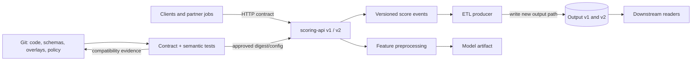

# Backward-Compatible Pipeline and API Releases

**Module:** Stage 2E — Production DevOps & Platform Engineering  
**Unit:** M08, Unit 12  
**Estimated study time:** 12–18 hours across the seven labs  
**Primary environment:** WSL2 Ubuntu or native Linux; Python 3.11+ recommended; 4 CPU, 8 GB RAM, 30 GB free disk  
**Cost:** Zero-cost local workflow; optional tooling is not required  
**Status:** `UNIT-12-STATUS: DRAFT-AUDITED`

> **Safety rule:** All examples use synthetic data and disposable local directories. Do not replay customer traffic, use production credentials, or run destructive commands against a production system. “Backward compatible” is always relative to a stated consumer set and support window; it is not a universal property of a schema diff.

## 1. Purpose and production stakes

A service can be healthy in isolation and still break the system around it. An API may return HTTP 200 while changing `latency_ms` from milliseconds to seconds. A pipeline can produce a valid Parquet file whose new unit convention doubles a downstream aggregate. A new model can accept the same JSON shape while changing preprocessing enough to degrade predictions. Structural validation is necessary, but not sufficient.

In production, producers and consumers are rarely deployed together. A `scoring-api` may be upgraded while a batch client runs nightly, a partner mobile app remains on an older version, and a downstream ETL job reads yesterday's output. During canary or blue-green delivery, old and new application instances can run at the same time. A safe release therefore preserves the contracts needed by every supported consumer, or isolates incompatible versions explicitly.

Consider a dangerous release:

1. `scoring-api v1` reads database field `customer_name` and returns `latency_ms` in milliseconds.
2. `v2` renames the field to `display_name` and starts returning latency in seconds, but retains the same JSON numeric type.
3. A canary receives 10% of requests. HTTP success stays high, so the rollout appears healthy.
4. An older application replica still queries `customer_name`; a downstream dashboard interprets seconds as milliseconds.
5. The application is rolled back, but the new code has already written records that the old version cannot parse.

The failure is not “Kubernetes did not roll back.” It is a contract and state-compatibility failure. The operating principle of this unit is **compatibility-first evolution, measured at the boundaries, with a verified recovery path**.

## 2. Learning outcomes and prerequisites

After completing this unit, you should be able to:

- Define backward compatibility, forward compatibility, and breaking change in the context of an actual consumer and compatibility window.
- Identify structural and semantic breaking changes across REST/JSON, Protobuf/gRPC, events, ETL data, feature interfaces, and model inputs/outputs.
- Evolve APIs additively, use optional fields and safe defaults, choose URL versus header/media-type versioning, and use adapters or parallel versions.
- Define OpenAPI, JSON Schema, Protobuf, and data contracts; add automated checks without overstating what they prove.
- Build a consumer contract test that detects a unit/meaning change that schema checks miss.
- Choose producer-first versus consumer-first ordering and test old/new provider-consumer combinations during canary/blue-green releases.
- Use synthetic replay and response diffing with explicit tolerances and no duplicate side effects.
- Operate a deprecation program using inventory, telemetry, communication, exceptions, and a removal gate.
- Evolve event and data pipelines with upcasting, dead-letter containment, side-by-side outputs, lineage, and reprocessing.
- Test N-1 compatibility: data written by release N must remain readable by N-1 throughout the declared rollback window.
- Write an actionable compatibility policy and production release runbook.

**Prerequisites:** Git, Python, HTTP/JSON, pytest basics, CI concepts, Kubernetes Deployments/Services, GitOps reconciliation, canary/blue-green delivery, and database migration safety from Unit 11. This unit focuses on cross-version contracts; it does not replace Unit 11's DDL/backfill safety or Unit 13's evidence/audit-trail depth.

## 3. Running example and local lab architecture

The fictional `scoring-api` scores synthetic requests. The surrounding system has four contract boundaries:

| Component | Contract | Typical incompatibility |
|---|---|---|
| `scoring-api` `/v1/score` and `/v2/score` | HTTP request/response | Removed field, changed unit, status/error behavior |
| Event consumer | JSON event envelope | Rename/type change, unknown enum, replay failure |
| ETL producer | Versioned JSON/Parquet-like output | Null-rate, column type, partition, unit, or freshness change |
| Model/feature pipeline | Feature vector and prediction | Preprocessing, feature ordering, missing-value, calibration change |



Local labs mostly use Python standard library and `pytest`; FastAPI is used where relevant. Heavy brokers, schema registries, service meshes, and GitOps controllers are optional awareness topics, not required to complete the learning outcomes. **[ILLUSTRATIVE]** Resource estimates are laptop planning estimates, not benchmark claims.

Recommended disposable working directory:

```bash
mkdir -p ~/m08-unit12-contract-lab
cd ~/m08-unit12-contract-lab
python3 -m venv .venv
. .venv/bin/activate
python -m pip install --upgrade pip
python -m pip install 'fastapi>=0.110' 'uvicorn>=0.27' 'pytest>=8'
```

**[VERIFY]** These are lower bounds for a learning example, not a production version pin. Before a real project, choose and lock versions supported by your Python runtime, review release notes, and commit a lock file. Check installed versions with `python -m pip show fastapi pydantic pytest`.

## 4. Compatibility fundamentals

### 4.1 Backward, forward, and semantic compatibility

- **Backward compatible:** a new producer/provider version works with existing supported consumers, or a new reader can consume data produced by older supported writers, for the declared compatibility window. State the direction explicitly; the phrase is used differently in schema-registry products.
- **Forward compatible:** an older consumer/reader can tolerate data from a newer producer, usually because the format permits safe additions and the reader handles them intentionally.
- **Breaking change:** a change causes a supported consumer, stored record, or operational expectation to fail or change meaning. A field can remain present and typed as a number while a unit change still breaks the contract.
- **Contract:** a versioned and tested agreement that includes structure, semantics, error behavior, performance expectations, ownership, service-level expectations, and the change process.
- **Compatibility window:** the period and version combinations that the organization commits to support, including rollback and long-lived consumers.

Compatibility is directional. A response-field addition can be safe for tolerant readers but still break a strict generated client or a consumer that rejects unknown properties. A request-field addition can be safe when optional but breaking if made required immediately. “Additive” is not automatically “safe”; validate how actual consumers parse and use the addition.

### 4.2 Independent releases and lock-step fragility

If service A can only deploy when service B deploys in the same coordinated release, each release becomes a distributed transaction across teams. One delayed consumer can block all teams; a partial rollout can leave incompatible versions running; emergency recovery becomes difficult. Stable contracts let each component release independently while old and new versions coexist.

### 4.3 Postel’s law—with a safety caveat

The traditional formulation recommends being conservative in what you send and liberal in what you accept. Use the useful part carefully: readers can ignore unknown *optional and semantically irrelevant* fields, while writers should emit only documented, valid forms. Do not accept malformed values, unknown authorization claims, invalid money units, ambiguous timestamps, or unrecognized critical enum values merely to appear tolerant. Over-tolerant readers can hide data corruption and security defects.

### 4.4 Semantic versioning: helpful but not proof

Semantic Versioning is useful for libraries that publish an explicit public API. Services, endpoints, event schemas, model artifacts, and datasets often need their own versioning policy; a service version number alone does not prove compatibility. A minor version may still break a semantic contract, while a major version can be safely introduced side by side. See the real M02 Unit 8 file if present in your repository; the exact file path was not present in the inspected M08 target directory.

## 5. What counts as a breaking change

| Surface | Change | Structural/schema risk | Semantic risk | Safer approach and test | Rollback concern |
|---|---|---|---|---|---|
| REST/JSON | Remove/rename response field | High for consumers using it | High if meaning moved | Add replacement; emit both during window; usage telemetry | Old consumers fail after rollback too if contract already removed |
| REST/JSON | Add optional response field | Usually lower | Can still conflict with strict readers | Contract tests against real consumer behavior | Rollback usually safe if old readers ignore it |
| REST/JSON | Add required request field | High | High if no safe default | Introduce optional/defaulted field first | Old clients may fail during mixed rollout |
| REST/JSON | Change type or unit | High for type; possibly invisible for unit | High | Version field or endpoint; semantic assertion | Old code may misinterpret persisted values |
| REST/JSON | Change error/status/pagination/default/auth | Often under-tested | High | Contract tests for errors, pagination, authorization, retries | Client retry/idempotency behavior may change |
| Protobuf/gRPC | Reuse a deleted field number | Severe wire risk | Potential misinterpretation | Reserve deleted number/name; run `buf breaking` | Old stored messages can become unreadable |
| Protobuf/gRPC | Rename field but retain number | Generated-source/JSON risks | Usually wire payload stays same, but JSON clients may break | Check all encodings and generated client usage | Wire-only tests may miss source/JSON breakage |
| Events | Rename field / change enum semantics | Deserialization risk | Replay/business meaning risk | Versioned event, upcaster, compatibility tests, DLQ | Old consumers may stall on replay |
| ETL/table | Remove column or narrow type | High | High | Side-by-side output, tolerant readers, reconcile | Old pipeline may not read new output |
| Feature/model | Change preprocessing, feature order, units, calibration | May be invisible to JSON schema | Very high | Version model + preprocessing; golden replay and quality gates | N-1 model path may not understand new features |
| Platform API/CRD | Remove served API version or change conversion | Deployment/controller risk | Operational risk | Follow Kubernetes API deprecation and conversion policy | Older controllers/manifests may stop functioning |

### Cross-cutting contract elements

A contract includes more than field names:

- Authentication and authorization semantics, token scopes, and permission errors.
- Rate limits, quotas, retry behavior, timeout expectations, idempotency keys, and duplicate delivery handling.
- Error codes and error-body shape, including whether clients can safely retry.
- Pagination defaults, cursor interpretation, stable ordering, and maximum page sizes.
- Null versus missing versus empty versus default values.
- Time zones, timestamp precision, currency/measurement units, rounding, and numeric bounds.
- Enum evolution, unknown values, event ordering, and replay guarantees.
- Model preprocessing, feature names/order, missing-value behavior, output range, calibration, and downstream decision thresholds.

## 6. API evolution patterns

### 6.1 Additive-only evolution

Prefer adding optional fields while preserving existing fields and semantics. Example response:

```json
{
  "request_id": "synthetic-0001",
  "score": 0.72,
  "model_version": "model-a",
  "explanation_code": null
}
```

The new field must have a documented meaning, nullability, and safe default. If any consumer rejects unknown fields, either update that consumer first or use a versioned contract/adapter. Do not silently reinterpret `score` or change its range while claiming the change is additive.

### 6.2 A minimal FastAPI v1/v2 provider

Create `app.py`:

```python
from typing import Optional
from fastapi import FastAPI, Header, HTTPException
from pydantic import BaseModel, Field

app = FastAPI(title="Synthetic Scoring API", version="1.0.0")

class ScoreRequest(BaseModel):
    input_value: float = Field(ge=0.0, le=1.0)
    # Optional with a safe default. It is not an authorization attribute.
    explanation_requested: bool = False

class ScoreV1(BaseModel):
    score: float
    latency_ms: float
    model_version: str

class ScoreV2(BaseModel):
    score: float
    latency_ms: float
    model_version: str
    explanation_code: Optional[str] = None

@app.get("/healthz")
def healthz():
    return {"status": "ok"}

@app.post("/v1/score", response_model=ScoreV1)
def score_v1(req: ScoreRequest, x_client_version: str = Header(default="unknown")):
    return ScoreV1(score=round(req.input_value * 0.8, 4),
                   latency_ms=12.0, model_version="model-a")

@app.post("/v2/score", response_model=ScoreV2)
def score_v2(req: ScoreRequest, x_client_version: str = Header(default="unknown")):
    explanation = "SYNTHETIC_RULE_A" if req.explanation_requested else None
    return ScoreV2(score=round(req.input_value * 0.8, 4),
                   latency_ms=12.0, model_version="model-a",
                   explanation_code=explanation)
```

Run locally:

```bash
uvicorn app:app --host 127.0.0.1 --port 8000
curl -sS http://127.0.0.1:8000/healthz
curl -sS -X POST http://127.0.0.1:8000/v1/score \
  -H 'content-type: application/json' \
  -H 'x-client-version: lab-1' \
  -d '{"input_value":0.5}'
```

Expected shape **[ILLUSTRATIVE]**: a health object and a score response with `score`, `latency_ms`, and `model_version`. The service's fixed `latency_ms` is a demonstration field, not measured wall-clock latency.

**Version caveat:** FastAPI and Pydantic versions affect schema generation and model configuration. Check `python -m pip show fastapi pydantic`; inspect `/openapi.json` and run tests with the exact locked versions. Response models validate/filter output according to framework/model configuration, but do not prove semantic correctness.

### 6.3 Optional fields, defaults, and `extra`

A request field that is optional in syntax but has an unsafe default is not safe. Define what omission means and test it. Pydantic's handling of unknown fields can be configured (e.g., ignore, allow, or forbid extra values depending on version/configuration). `[VERIFY]` Inspect the installed Pydantic documentation and actual model config before depending on a behavior. Use strict validation for critical input values, but do not unexpectedly reject harmless additive fields from a supported client without a migration plan.

### 6.4 URL versioning versus header/media-type versioning

| Choice | Advantages | Costs and failure modes |
|---|---|---|
| `/v1/...`, `/v2/...` | Visible, easy to route/document, explicit in logs | Duplicate routes/support burden; caches and clients can still use old path indefinitely |
| Version header | Keeps resource path stable | Less visible in browser/debugging; proxies/caches must vary correctly; negotiation is easy to misconfigure |
| Media type/versioned representation | Can express representation version | More complex client/server negotiation and documentation |
| Adapter/translation layer | Decouples internal model from external contract | Adapter can become permanent hidden complexity; needs tests and ownership |
| Strangler migration | Move consumers gradually to a new implementation | Requires routing, telemetry, parity tests, and a retirement gate |

Use parallel `/v1` and `/v2` when incompatibility is real and clients cannot migrate simultaneously. A new endpoint is not permission to ignore old-client inventory or to keep unsupported versions forever.

### 6.5 Strict writer, tolerant reader

A reader can ignore an unknown optional field if the field cannot alter authorization, ordering, or business meaning. It must still validate required fields, types, ranges, signature/identity fields, and invariants. A writer should emit only the documented schema, not arbitrary extensions or ambiguous values. Unknown enum values need an explicit policy: ignore only if safe, map to a documented fallback, or reject and dead-letter. Critical financial, security, and model features usually need stronger validation than a generic metadata envelope.

## 7. Contract definitions and compatibility checks

### 7.1 Choose and govern the source of truth

- **OpenAPI:** HTTP operations, parameters, request/response schemas, status codes, and content types.
- **JSON Schema:** JSON document structure and validation constraints. It does not inherently define units, authorization meaning, or every business invariant.
- **Protobuf:** typed message and RPC contracts. Wire compatibility differs from generated-source and JSON compatibility.
- **Data contract:** schema plus semantics, freshness/volume expectations, quality constraints, owners, SLAs, and change process.

Choose one direction: generate an OpenAPI schema from code, or generate implementation types from a contract. If both are hand-edited, automate drift detection. For the running FastAPI service, the provider's `/openapi.json` can be captured as an artifact and diffed against the reviewed baseline.

A minimal API contract excerpt:

```yaml
openapi: 3.1.0
info:
  title: Synthetic Scoring API
  version: 1.0.0
paths:
  /v1/score:
    post:
      operationId: scoreV1
      requestBody:
        required: true
        content:
          application/json:
            schema:
              type: object
              required: [input_value]
              properties:
                input_value:
                  type: number
                  minimum: 0
                  maximum: 1
      responses:
        '200':
          description: Score result
          content:
            application/json:
              schema:
                type: object
                required: [score, latency_ms, model_version]
                properties:
                  score: {type: number, minimum: 0, maximum: 1}
                  latency_ms: {type: number, minimum: 0, description: "Milliseconds"}
                  model_version: {type: string}
```

This excerpt is illustrative and should be kept aligned with the actual generated OpenAPI. In a production contract, also document error responses, auth requirements, rate limits, pagination, idempotency, and semantic invariants.

### 7.2 Data contract example

```yaml
contract_version: 1
name: scoring_daily_output
owner: team-scoring-platform
consumers:
  - team-risk-reporting
schema:
  required: [record_key, score, scored_at_utc, model_version]
  fields:
    record_key: {type: string, pii: false}
    score: {type: number, minimum: 0, maximum: 1, unit: "probability-like score"}
    scored_at_utc: {type: string, format: date-time, timezone: UTC}
    model_version: {type: string}
quality:
  min_rows_per_partition: 1
  max_null_rate_score: 0.0
  freshness_minutes: 120
change_policy:
  additive_fields_allowed: true
  type_or_unit_change_requires_version: true
  removal_requires_consumer_telemetry_and_approval: true
```

These thresholds are **[ILLUSTRATIVE]** and must be derived from actual data volumes and consumer SLOs. A contract file has no value unless the pipeline validates it and the owning teams agree to its semantics.

### 7.3 Automated compatibility checks in CI

A practical CI chain has multiple layers:

1. Parse/validate the schema document.
2. Diff candidate OpenAPI against the reviewed baseline using a compatibility tool or a conservative local script.
3. Run provider tests and consumer contract tests against the candidate build.
4. Validate data-contract schema, null rates, volume, freshness, units, and domain invariants.
5. Run N-1 compatibility and replay tests for changes that affect stored data/events or model features.
6. Publish evidence: baseline commit, candidate commit, diff, tests, exceptions, and approver.

An OpenAPI diff tool catches some structural changes, depending on configuration. It generally cannot infer that `latency_ms` has started containing seconds, that a score is no longer calibrated, or that a default pagination size doubled and overloads a consumer. Add semantic assertions for those cases.

**[VERIFY]** OpenAPI diff tool names, flags, rule sets, and CI integration change over time. Verify the selected tool's official docs and pin a version. For Protobuf, `buf breaking` compares a candidate schema with a baseline; the selected rule category (e.g. `FILE`, `WIRE_JSON`, `WIRE`) changes what counts as breaking. The official Buf docs describe the current CLI. For the lab, use the self-contained Python fallback below so no external tool is mandatory.

Example CI logic (tool-neutral):

```bash
set -euo pipefail
python -m pytest -q
python scripts/check_openapi_compat.py baseline/openapi.json candidate/openapi.json
python scripts/check_data_contract.py fixtures/etl_output.json contracts/scoring-output.yaml
python -m pytest -q tests/test_consumer_contract.py tests/test_n_minus_one.py
```

A failure should report the exact incompatible field/rule and stop promotion. A green structural diff alone is not release approval.

## 8. Consumer-driven contract testing

A consumer-driven contract captures what a specific consumer relies on, including semantic constraints. For example, a consumer may depend on `latency_ms` being a finite, non-negative number that means milliseconds. JSON schema only sees a number; a semantic test can catch a unit conversion.

Create `tests/test_contract_semantics.py`:

```python
import math


def assert_consumer_contract(response: dict, expected_latency_ms: float) -> None:
    value = response["latency_ms"]
    assert isinstance(value, (int, float)) and math.isfinite(value)
    assert abs(value - expected_latency_ms) <= 1.0, (
        "latency_ms semantic contract violated; expected milliseconds "
        "within an [ILLUSTRATIVE] 1.0 ms tolerance"
    )
    assert response["model_version"]


def test_latency_is_milliseconds_and_within_contract():
    # Synthetic provider fixture. Replace with an HTTP call in an integration test.
    response = {"score": 0.4, "latency_ms": 12.0, "model_version": "model-a"}
    assert_consumer_contract(response, expected_latency_ms=12.0)
```

The upper bound is **[ILLUSTRATIVE]**; choose a contract bound based on service semantics, not on one local run. The test shown is a minimal consumer contract fixture. A fuller integration test should start the provider build, issue a synthetic request, parse the actual response, and assert the same invariants. Keep consumer expectations explicit and reviewed so a bad assumption does not become an accidental contract.

Pact-style tooling is an awareness option: verify current framework/provider compatibility, contract broker requirements, and version-specific setup in official docs before adopting it. The local pytest approach is sufficient for the core learning outcome.

## 9. Release ordering and compatibility matrices

### 9.1 Producer-first versus consumer-first

| Change | Safe default order | Why |
|---|---|---|
| Add optional response field | Provider first, if existing consumers tolerate unknown fields | Old consumers continue to work; new consumers can begin using field later |
| Remove response field | Consumers stop reading first; provider removes only after telemetry and support window | Provider must not remove a still-used field |
| Add request field | Add as optional/defaulted first; update consumers to send it; enforce only in a later approved contract/version | Old clients omit it during rollout |
| Add event field | Usually deploy tolerant consumers first, then producer; exact direction depends on serialization and compatibility mode | Old readers must handle messages produced during overlap |
| Remove event field | Consumers stop depending on it first, then producer stops emitting, then later remove from schema | Replay and old messages remain relevant |
| Add ETL output column | Producer first if old readers tolerate extra columns; otherwise version output and migrate readers | Do not assume all readers are tolerant |
| Remove/rename ETL column | Reader migration first; maintain dual columns or versioned output during transition | Batch jobs may be long-lived or invisible |
| Change model preprocessing | Version preprocessing and model together or add adapter; shadow/replay before cutover | JSON shape can stay constant while meaning changes |

### 9.2 Compatibility matrix

During a release, test the combinations that may coexist. `PASS` means explicitly tested, not merely expected.

| Provider/writer | Consumer/reader | Typical policy | Example test |
|---|---|---|---|
| New API provider | Old consumer | Must pass if old clients remain supported | Run pinned old client contract against candidate provider |
| Old API provider | New consumer | Must pass during rolling deployment if new consumer can hit old provider | Run new client contract against baseline provider |
| New ETL writer | Old downstream reader | Must pass until consumer migration completes | Read new output with old reader version |
| Old ETL writer | New downstream reader | Must pass if old partitions remain available | Read old output with new reader |
| New event writer | Old consumer | Must pass or be blocked by routing/version strategy | Replay new event fixtures through old consumer |
| Old event writer | New consumer | Must pass or be explicitly adapted | Replay retained old event fixtures through new consumer |
| Release N writes | Release N-1 reads | Must pass during rollback window | Write with N, then read using N-1 executable/parser |
| New model + new features | Old model + new features | Usually blocked unless adapter proves compatibility | Matrix test feature schema and model version pair |

A CI matrix can invoke each pinned provider/consumer pair. The release gate should fail if any *required* pair fails. Some combinations are intentionally unsupported; document the routing/orchestration control that prevents them rather than silently omitting the test.

### 9.3 Tolerant readers and strict writers

Reader tolerance is appropriate for unknown optional metadata, not for required business values or privileged claims. Writer strictness means it emits only documented fields, units, and enum values. Test both directions: a tolerant reader should ignore a safe extension, while a strict validator should reject a malformed required field. Security-sensitive context must never be trusted merely because it arrived as a JSON field.

## 10. Canary, blue-green, and multi-version coexistence

Canary and blue-green delivery temporarily increase version coexistence. A request may reach v1 and then v2 on a subsequent request; retries, asynchronous callbacks, or background jobs may hit a different version than the original request. Sticky routing can reduce variation but is not a compatibility guarantee: clients reconnect, sessions expire, load balancers change, and asynchronous work escapes the original route.

Before introducing a candidate:

- Ensure the API, event, and data contracts remain compatible with stable consumers.
- Ensure schema expansion is deployed before candidate code requires it.
- Test candidate and stable versions against the same fixtures.
- Include contract failures, consumer error rate, schema violations, dead-letter rate, latency, data freshness, and business/model quality in promotion/abort signals—not only HTTP 2xx rate.
- Do not contract/drop old fields in the same release that stops using them.
- Confirm the rollback path can read data/events written by the candidate.

Cross-link to the actual M08 Unit 7 (canary/blue-green), Unit 8 (Argo Rollouts/Flagger and traffic analysis), Unit 9 (release health and automated abort), Unit 10 (feature flags/dark launches), and Unit 11 (database/data-platform migration safety). Those units own their respective implementation depth; this unit owns compatibility between versions.

A feature flag can gate new behavior, but it does not make an incompatible schema safe. A route weight can limit exposure, but it does not prevent the candidate from emitting a new event that an old consumer cannot parse. Treat compatibility as a precondition to traffic promotion.

## 11. Event and streaming schema compatibility

### 11.1 Schema evolution and versioning

Events are durable contracts because they may be stored and replayed long after their producer has been upgraded. Include an event type/version and schema reference in the envelope or metadata. Avoid embedding arbitrary schema changes without a rollout plan.

Example synthetic event:

```json
{
  "event_type": "score.completed.v1",
  "event_id": "evt-lab-0001",
  "occurred_at_utc": "2026-10-28T10:00:00Z",
  "payload": {
    "record_key": "synthetic-0001",
    "score": 0.72,
    "model_version": "model-a"
  }
}
```

Compatibility modes such as `BACKWARD`, `FORWARD`, and `FULL` are registry-specific concepts. **[VERIFY]** Their exact meaning depends on the registry, format, transitive/non-transitive configuration, and whether compatibility is checked against the latest or all historical versions. Never assume a mode name means the same thing in every registry.

### 11.2 Upcasting, dead-letter handling, and replay

- **Upcasting** transforms an older event into a current internal representation before business logic runs. It should be deterministic, tested against retained fixtures, and versioned.
- **Dead-letter queue (DLQ):** stores messages a consumer cannot process after bounded retries. A DLQ is a containment mechanism, not a repair; alert on age and growth, preserve the original event and error classification, and provide a replay/reconciliation plan.
- **Poison message:** a message that repeatedly fails due to malformed or unsupported content. Avoid endless hot-loop retries that block a partition.
- **Replay:** rerun historical messages through new logic. Ensure the operation is idempotent or uses a separate output target; do not duplicate payments, notifications, or irreversible writes.
- **Ordering and idempotency:** schema compatibility does not prove ordering assumptions or exactly-once effects. Document partition keys, deduplication, retry, and side-effect behavior.

Protobuf-specific note: never reuse deleted field numbers. Reserve deleted numbers and, where appropriate, names so future schema changes do not reinterpret old wire data or break JSON/TextFormat users. Verify the current official Protobuf guidance for your syntax/edition. `buf breaking` is a useful automated check; choose a rule category matching the real consumer surface (generated source, JSON, or wire format).

## 12. Data contracts and ETL pipeline releases

### 12.1 Boundary checks

Every pipeline boundary should check more than schema shape:

- Schema/required fields and types.
- Freshness and partition completeness.
- Volume/row-count range versus historical baseline.
- Null/missing rate and allowed-value/range checks.
- Semantic units, timestamp/timezone rules, key uniqueness, and domain invariants.
- Consumer-visible output comparison and lineage/run metadata.

A structurally valid output can still be wrong. A date parsed in local time instead of UTC, a score scaled 0–100 instead of 0–1, or a nullable field defaulted to zero can silently corrupt downstream analytics.

### 12.2 Write new → verify → switch consumer pointer

For a risky transformation:

1. Write candidate output to a new versioned table/path, not over the stable output.
2. Validate schema, volume, null rates, key coverage, freshness, sampled values, checksums where appropriate, and domain-specific tolerances.
3. Compare old and new outputs on identical input partitions; classify expected and unexpected differences.
4. Ask downstream owners to verify consumer compatibility.
5. Switch a pointer/configuration only after evidence and approval.
6. Retain the old output for a defined rollback window, subject to privacy/retention rules and storage cost.
7. Keep lineage: input window/partitions, code commit, output schema version, config, model/feature version, run ID, and validation result.

Reprocessing must handle late-arriving data, watermarks, partition boundaries, and idempotent writes. “Exactly-once-ish” behavior is a combination of source offsets, transaction boundaries, idempotency, and reconciliation—not a universal guarantee.

### 12.3 Lightweight ETL contract validator

Create `etl_contract.py`:

```python
from datetime import datetime, timezone
from math import isfinite

CONTRACT = {
    "required": {"record_key", "score", "scored_at_utc", "model_version"},
    "score_min": 0.0,
    "score_max": 1.0,
    "max_null_rate_score": 0.0,
    "min_rows": 1,
}


def validate_rows(rows: list[dict], generated_at: datetime) -> list[str]:
    errors: list[str] = []
    if len(rows) < CONTRACT["min_rows"]:
        errors.append("row_count_below_minimum")
    for index, row in enumerate(rows):
        missing = CONTRACT["required"] - set(row)
        if missing:
            errors.append(f"row_{index}_missing:{','.join(sorted(missing))}")
            continue
        score = row["score"]
        if not isinstance(score, (int, float)) or isinstance(score, bool) or not isfinite(score):
            errors.append(f"row_{index}_score_not_finite_number")
        elif not CONTRACT["score_min"] <= score <= CONTRACT["score_max"]:
            errors.append(f"row_{index}_score_out_of_range")
        if not isinstance(row["record_key"], str) or not row["record_key"]:
            errors.append(f"row_{index}_record_key_invalid")
        try:
            timestamp = datetime.fromisoformat(row["scored_at_utc"].replace("Z", "+00:00"))
            if timestamp.tzinfo is None or timestamp.utcoffset() != timezone.utc.utcoffset(timestamp):
                errors.append(f"row_{index}_timestamp_not_utc")
            if timestamp > generated_at:
                errors.append(f"row_{index}_timestamp_in_future")
        except (ValueError, AttributeError):
            errors.append(f"row_{index}_timestamp_invalid")
        if not isinstance(row["model_version"], str) or not row["model_version"]:
            errors.append(f"row_{index}_model_version_invalid")
    return errors


if __name__ == "__main__":
    sample = [{"record_key": "synthetic-1", "score": 0.72,
               "scored_at_utc": "2026-10-28T10:00:00Z", "model_version": "model-a"}]
    problems = validate_rows(sample, datetime(2026, 10, 28, 11, 0, tzinfo=timezone.utc))
    if problems:
        raise SystemExit("CONTRACT_FAIL: " + ";".join(problems))
    print("CONTRACT_PASS: synthetic fixture satisfies configured checks")
```

This is a deliberately small validator, not a general-purpose data-contract framework. It demonstrates required keys, numeric bounds, UTC timestamps, and row minimum. A production contract should also validate freshness against a partition/window, row-volume expectations, null-rate denominators, uniqueness, schema evolution, and business-specific rules. Add unit tests and use explicit nonzero exit on failure.

## 13. Model-serving and feature-interface compatibility

The feature pipeline and model artifact form a coupled interface. A model trained on `income_monthly` in dollars may fail or silently shift if the feature service begins supplying annualized values, a different imputation strategy, reordered vector columns, or a new categorical encoding. JSON shape alone does not capture this contract.

Version and test together:

- Feature names and stable ordering, including categorical mappings.
- Units, normalization, clipping, missing/null/default behavior, and preprocessing version.
- Model artifact digest/version, training-data snapshot, feature schema version, and serving-code version.
- Output range, distribution, calibration, and downstream decision thresholds.
- Fallback ratio, prediction latency, null/NaN output rate, drift, and domain quality proxies.

Use shadow/replay to run old and new preprocessing/model combinations on synthetic or approved minimized inputs. Serve only the stable result until comparison criteria pass. Bound concurrency, timeouts, memory, and downstream calls; shadow execution must not duplicate writes or trigger external side effects. Notify downstream consumers before changing output distribution or calibration even if the response schema is unchanged.

Cross-link to M08 Units 8–10 for rollout analysis, release health, and dark launches, and Stage 5D/ML platform work for deeper model, feature, training-data, and evaluation metadata. Exact Stage 5D path should be checked in the actual roadmap before linking.

## 14. Deprecation, telemetry, and sunset governance

### 14.1 Deprecation is a program, not a header

1. Inventory consumers, owners, client versions, partner integrations, mobile apps, nightly jobs, and downstream readers.
2. Announce the change and reason; publish migration instructions and a support window.
3. Mark the resource/field deprecated in docs and emit suitable response signals where applicable.
4. Measure use by client/version and, when safe, field usage; avoid high-cardinality or sensitive labels.
5. Contact lagging consumers and document exceptions with owner, reason, approver, and expiry.
6. Require telemetry to meet the removal gate over an agreed window; “no observed use” is not proof if telemetry is incomplete.
7. Remove the old behavior in a separate reviewed release, verify errors/DLQ/data quality, and retain the change evidence.

### 14.2 Deprecation and Sunset headers

The IETF published RFC 9745 for the HTTP `Deprecation` response header in March 2025. RFC 8594 defines the `Sunset` header. The Deprecation header communicates lifecycle information; it does not itself change resource behavior. Sunset can communicate when a resource is expected to become unavailable. Ensure dates are valid and consistent, and use direct communications plus telemetry as well. [Source: RFC 9745 and RFC 8594.]

A simple demonstration in FastAPI might add headers to a deprecated endpoint, but the exact wire syntax and dates should be tested against the relevant RFC and current implementation:

```python
from fastapi import Response

@app.get("/legacy/score")
def legacy_score(response: Response):
    response.headers["Deprecation"] = "@1790812800"  # [ILLUSTRATIVE] epoch value
    response.headers["Sunset"] = "Mon, 01 Mar 2027 00:00:00 GMT"  # [ILLUSTRATIVE]
    response.headers["Link"] = '</docs/migrate-score-v2>; rel="deprecation"'
    return {"score": 0.5, "model_version": "model-a"}
```

The example dates are illustrative; confirm their meaning, formatting, and ordering before use. A header is not a substitute for notifying external partners. Brownouts (scheduled temporary failures to encourage migration) can cause customer impact and should be an opt-in, risk-reviewed exception—not a default deprecation tactic. `[VERIFY]` Verify the exact technique and legal/contractual constraints before considering it.

### 14.3 Removal gate

A removal gate should fail when: a supported consumer is still using the field/endpoint; telemetry coverage is incomplete; a partner exception is still active; the rollback window remains open; or the replacement contract lacks provider and consumer tests. The gate should include owner and approver, the evidence window, and the rollback/forward-repair plan.

## 15. Rollback safety and N-1 compatibility

**N-1 compatibility** means release N writes data that the previous release N-1 can still read and interpret during the rollback window. Test it directly: serialize/write with N, then parse/read using the N-1 implementation. A unit test that checks only the new writer is not enough.

The rollback decision tree:

1. Did the candidate only change stateless code and emit no incompatible events/data? Rollback may be straightforward after health checks.
2. Did it write persistent data, change units, emit events, or create outputs that N-1 cannot parse? Stop promotion and isolate the affected flow. Do not blindly roll back.
3. Can a compatibility adapter, restricted write format, compensating action, or forward repair restore N-1 readability? Prefer the least destructive tested route.
4. If data must be restored, use the approved restore/PITR plan, quantify RPO/data loss, reconcile writes after the restore point, and verify before reopening traffic.
5. Capture evidence and update compatibility tests so the same path is not repeated.

Code rollback is not data rollback. Deleting new data, replaying events, or restoring a snapshot can lose or duplicate writes. During the compatibility window, avoid writing values or event versions that the previous reader cannot understand. If a breaking write is unavoidable, explicitly block rollback and require a forward-recovery plan and approval.

## 16. GitOps implementation patterns

Represent deployed versions and contract policy in Git, but remember that Git is desired state—not proof of runtime state or compatibility.

Example Kustomize-like layout:

```text
apps/scoring-api/
  base/
    deployment.yaml
    service.yaml
  overlays/
    staging-v1/kustomization.yaml
    staging-v2/kustomization.yaml
    prod-v1/kustomization.yaml
    prod-v2/kustomization.yaml
contracts/
  openapi-baseline.json
  scoring-output-v1.yaml
  compatibility-policy.md
```

Use separate Deployments/Services or environment overlays for versions that must coexist. Pin image digests in release manifests where the repository's supply-chain policy requires it; use Helm values/Kustomize patches for image and version-specific configuration. Configure traffic weights only if a supported router/controller is actually installed and its version/integration is verified. Store deprecation timelines and policy changes in reviewed Git commits.

GitOps loop:

1. PR adds API/schema/pipeline change and compatibility tests.
2. CI runs schema diff, consumer tests, replay, N-1, and data-contract checks.
3. Reviewed config references the intended image digest and versioned contract.
4. Controller reconciles desired state; operator verifies actual live versions and route/config state.
5. Canary gates observe consumer errors, schema violations, DLQ, latency, freshness, and model/domain metrics.
6. Promotion or abort is recorded with exact commit, artifact, tests, and evidence.
7. A runtime rollback still requires Git desired state to be reverted/fixed forward where appropriate.

No reconciler automatically understands whether an API is compatible. Argo CD/Flux dependencies, hooks, and controller behavior are version-specific; verify exact details in the corresponding official docs and keep the Unit 11 migration ordering separate from this API contract gate.

## 17. Production failure scenarios and incident analysis

Each scenario below follows symptom → evidence → root cause → immediate containment → durable prevention → verification.

### Incident 1 — Deprecated field removed; nightly partner job still used it

- **Symptom:** daytime API traffic looks normal, but a nightly partner job starts failing after field removal.
- **Evidence:** client/version and endpoint logs, job owner inventory, response-schema diff, last successful job run, support notices, and field-use telemetry. Confirm telemetry actually covers the partner route and time window.
- **Root cause:** deprecation was treated as a comment/header, not an inventory-and-removal process; batch consumer was absent from the consumer registry.
- **Containment:** restore the field or route to a compatible adapter; pause destructive downstream processing; notify the partner.
- **Prevention:** include scheduled jobs and external partners in inventory; require usage evidence and an approved exception path before removal.
- **Verification:** replay the partner's synthetic contract fixture and alert on legacy field use until the approved sunset.

### Incident 2 — New required request field broke old clients mid-canary

- **Symptom:** candidate 4xx/validation errors rise, clustered by older client versions.
- **Evidence:** per-client/version request counts and errors, OpenAPI diff, request examples stripped of sensitive payloads, candidate/stable split, and rollout timeline.
- **Root cause:** a required field was added in one step, violating mixed-version compatibility.
- **Containment:** stop candidate promotion; restore optional/defaulted behavior or route old clients to a supported version.
- **Prevention:** add optional field first, update clients, observe adoption, then consider a new major contract or enforcement after approval.
- **Verification:** old-client contract tests pass against the candidate; CI rejects new required fields without explicit versioning/exception.

### Incident 3 — Numeric unit changed; schema checks passed

- **Symptom:** JSON schema remains valid, but aggregate latency or business metrics shift by a factor of 1,000.
- **Evidence:** before/after samples, unit documentation, consumer aggregate diffs, model/business metrics, and commit-level semantic change.
- **Root cause:** `latency_ms` began carrying seconds; structural type remained `number`.
- **Containment:** stop promotion; restore old units or add a new explicitly named/versioned field; recompute affected aggregates if safe.
- **Prevention:** unit-bearing names, semantic assertions, range checks, golden fixtures, and explicit contract review for units/rounding/timezone.
- **Verification:** contract test fails on the seconds-valued fixture even when schema validation passes.

### Incident 4 — Kafka event field renamed; consumer group stalled

- **Symptom:** deserialization errors rise, consumer lag increases, and one partition repeatedly retries the same event.
- **Evidence:** schema versions, original message headers, consumer exception, DLQ age/growth, lag by partition, and replay fixture.
- **Root cause:** producer renamed a field before consumers/upcasters were deployed; registry policy or test did not prevent the change.
- **Containment:** pause producer change or deploy a compatibility adapter; contain poison messages in a DLQ after bounded retries; do not drop them silently.
- **Prevention:** compatibility-mode tests, event versioning, upcasters, replay tests, and consumer-first/producer-first ordering based on actual serializer semantics.
- **Verification:** old and new event fixtures parse in all required consumer versions; lag recovers after controlled replay.

### Incident 5 — Model preprocessing changed and silently degraded predictions

- **Symptom:** HTTP latency and success rate remain healthy, but fallback rates, score distribution, calibration proxy, or downstream decisions shift.
- **Evidence:** model and preprocessing version IDs, feature schema, training-data/feature metadata, shadow diff, output histograms, and business guardrails.
- **Root cause:** preprocessing was treated as internal implementation although it changes the model input contract.
- **Containment:** route back to the last compatible model/preprocessor pair; keep candidate shadow-only; notify downstream consumers if outputs were persisted.
- **Prevention:** version model and feature pipeline together or provide a compatibility adapter; gate on replay, drift, latency, and domain metrics.
- **Verification:** pinned golden samples and shadow report pass; rollback pair is explicitly tested.

### Incident 6 — Rollback failed because new version wrote unreadable data

- **Symptom:** previous application version starts but fails reading records/events written by the candidate.
- **Evidence:** data/event versions, write timeline, parser errors, N-1 test result, rollout state, and persistence locations.
- **Root cause:** release N introduced a new persisted representation without ensuring N-1 could read it.
- **Containment:** stop further writes and rollout; choose tested adapter/forward-repair or restore/reconcile path. Do not assume code rollback reverses writes.
- **Prevention:** N-1 compatibility tests, dual-read/dual-write transition where appropriate, versioned outputs, and point-of-no-return review.
- **Verification:** write with N and read with N-1 on a disposable fixture; retain proof in the release record.

## 18. Hands-on labs

All seven labs are designed for a local disposable directory and synthetic fixtures. Resource/time values are **[ILLUSTRATIVE]**. Do not run a destructive step against a production endpoint or real data. Each lab may be completed independently, but Labs 1–4 share the same contract-testing concepts.

### Lab 1 — OpenAPI breaking-change detection in CI

**Goal:** classify changes and make CI fail on unsafe structural changes. **Prerequisites:** Python, pytest, Git optional. **Architecture:** baseline JSON schema → candidate JSON schema → small compatibility checker. **Estimated footprint [ILLUSTRATIVE]:** 1 CPU, under 300 MB RAM, under 20 MB disk; 30–45 minutes.

**Directory layout:** `lab1-openapi/{check_openapi_compat.py,baseline.json,candidate-additive.json,candidate-breaking.json}`. From the disposable lab root run `mkdir -p lab1-openapi && cd lab1-openapi`; save the code blocks below as the named files.

Create `check_openapi_compat.py`:

```python
import json
import sys
from pathlib import Path


def breaking_changes(old: dict, new: dict) -> list[str]:
    errors: list[str] = []
    old_paths = old.get("paths", {})
    new_paths = new.get("paths", {})
    for path, operations in old_paths.items():
        if path not in new_paths:
            errors.append(f"removed path: {path}")
            continue
        for method, old_op in operations.items():
            new_op = new_paths[path].get(method)
            if new_op is None:
                errors.append(f"removed operation: {method.upper()} {path}")
                continue
            old_responses = old_op.get("responses", {})
            new_responses = new_op.get("responses", {})
            for status, old_resp in old_responses.items():
                if status not in new_responses:
                    errors.append(f"removed response {status}: {method.upper()} {path}")
            old_schema = (old_op.get("responses", {}).get("200", {})
                          .get("content", {}).get("application/json", {}).get("schema", {}))
            new_schema = (new_op.get("responses", {}).get("200", {})
                          .get("content", {}).get("application/json", {}).get("schema", {}))
            old_props = old_schema.get("properties", {})
            new_props = new_schema.get("properties", {})
            for field in old_props.keys() - new_props.keys():
                errors.append(f"removed response field {field}: {method.upper()} {path}")
            for field in old_props.keys() & new_props.keys():
                if old_props[field].get("type") != new_props[field].get("type"):
                    errors.append(f"changed type for {field}: {method.upper()} {path}")
    return errors


def main() -> int:
    if len(sys.argv) != 3:
        print("usage: python check_openapi_compat.py OLD.json NEW.json", file=sys.stderr)
        return 2
    old = json.loads(Path(sys.argv[1]).read_text())
    new = json.loads(Path(sys.argv[2]).read_text())
    errors = breaking_changes(old, new)
    if errors:
        print("COMPATIBILITY_FAIL")
        print("\n".join(f"- {e}" for e in errors))
        return 1
    print("STRUCTURAL_CHECK_PASS (semantic compatibility is not proven)")
    return 0

if __name__ == "__main__":
    raise SystemExit(main())
```

This is a deliberately conservative starter, not a complete OpenAPI diff implementation. It does not cover required request fields, parameters, authentication, schema references, unions, nullability, pagination, or semantics. Expand tests before relying on it beyond the lab.

Create `baseline.json` and `candidate-additive.json`:

```json
{"openapi":"3.1.0","paths":{"/v1/score":{"post":{"responses":{"200":{"description":"ok","content":{"application/json":{"schema":{"type":"object","properties":{"score":{"type":"number"},"model_version":{"type":"string"}}}}}}}}}}}
```

```json
{"openapi":"3.1.0","paths":{"/v1/score":{"post":{"responses":{"200":{"description":"ok","content":{"application/json":{"schema":{"type":"object","properties":{"score":{"type":"number"},"model_version":{"type":"string"},"explanation_code":{"type":"string"}}}}}}}}}}}
```

Create `candidate-breaking.json` by removing `model_version` from the candidate. For a deterministic local copy, run this after saving `candidate-additive.json`:

```bash
python - <<'PY'
import json
from pathlib import Path
data = json.loads(Path("candidate-additive.json").read_text())
props = data["paths"]["/v1/score"]["post"]["responses"]["200"]["content"]["application/json"]["schema"]["properties"]
props.pop("model_version")
Path("candidate-breaking.json").write_text(json.dumps(data, indent=2) + "\n")
PY
```

Run:

```bash
python check_openapi_compat.py baseline.json candidate-additive.json
python check_openapi_compat.py baseline.json candidate-breaking.json
```

Expected behavior: the additive case exits 0; the removed-field case exits 1. **These are expected results until you run the commands locally.**

Craft and classify: remove a response field (breaking), rename a field (breaking unless dual-emitted/adapted), change type (breaking), add optional response field (often compatible but test strict consumers), add required request field (breaking), change default meaning (semantic break), change status/error behavior (contract break). An external oasdiff-class tool can supplement this; verify current flags/rules in its official documentation and pin the version.

**Evidence:** baseline/candidate files, command exit codes, diff output, and a note listing untested structural cases. **Pass:** safe additive fixture passes and removed-field fixture fails. **Cleanup — ⚠ DESTRUCTIVE:** after verifying `pwd` is the disposable lab directory and evidence is retained, return to the parent directory and remove only `lab1-openapi` with `rm -r -- lab1-openapi`. **Troubleshooting:** validate JSON with `python -m json.tool`; ensure the candidate path and HTTP method match baseline. **Safety:** only synthetic JSON files are used.

### Lab 2 — Consumer-driven contract catches a semantic unit change

**Goal:** show that schema shape can pass while semantics fail. **Prerequisites:** Python + pytest. **Footprint [ILLUSTRATIVE]:** 1 CPU, under 300 MB RAM, under 20 MB disk; 20–30 minutes.

**Directory layout:** `lab2-semantic-contract/test_semantic_contract.py`. Run `mkdir -p lab2-semantic-contract && cd lab2-semantic-contract`, save the test block below, and install pytest in an isolated virtual environment if it is not already available.

Create `test_semantic_contract.py`:

```python
import math
import pytest


def consumer_assertions(payload: dict, expected_latency_ms: float) -> None:
    value = payload["latency_ms"]
    assert isinstance(value, (int, float)) and math.isfinite(value)
    assert abs(value - expected_latency_ms) <= 1.0, (
        "latency_ms semantic contract violated: expected the synthetic fixture's "
        "millisecond value within an [ILLUSTRATIVE] tolerance of 1.0 ms"
    )


def test_v1_provider_contract():
    provider_response = {"latency_ms": 18.0, "score": 0.5}
    consumer_assertions(provider_response, expected_latency_ms=18.0)


def test_v2_wrong_unit_is_detected():
    # Candidate accidentally emits seconds, but the JSON type is still number.
    provider_response = {"latency_ms": 0.018, "score": 0.5}
    with pytest.raises(AssertionError, match="semantic contract violated"):
        consumer_assertions(provider_response, expected_latency_ms=18.0)
```

Run `pytest -q`. The suite passes because the test asserts that the consumer contract **rejects** the seconds-valued candidate. To observe the raw failure directly, temporarily remove the `pytest.raises(...)` wrapper, run that test, and confirm it fails; then restore the wrapper. The expected latency and tolerance are **[ILLUSTRATIVE]**. A broad upper bound by itself may not detect every unit error; a known fixture, unit-bearing contract, and range/distribution checks make the semantic test meaningful.

For an actual provider integration test, launch the FastAPI app and call the endpoint with a fixed synthetic request; assert the returned `latency_ms` is measured/documented in milliseconds and within a known test fixture's tolerance. Do not assert a universal production latency from a laptop run.

**Deliberate failure:** change provider fixture from `18.0` to `0.018`. **Recovery:** fix conversion or version the field (`latency_seconds`) and update clients through an approved migration. **Evidence:** failing assertion and passing corrected run. **Pass:** schema accepts both numeric values but consumer contract rejects the semantic change. **Cleanup — ⚠ DESTRUCTIVE:** verify `pwd` is the disposable lab directory, then `cd .. && rm -r -- lab2-semantic-contract`. **Troubleshooting:** if both tests pass, confirm the expected fixture asserts the actual semantic value, not merely a broad numeric range.

### Lab 3 — N-1 compatibility: new writes, old reads

**Goal:** test the rollback window directly. **Prerequisites:** Python 3.11+ recommended. **Footprint [ILLUSTRATIVE]:** 1 CPU, under 300 MB RAM, under 20 MB disk; 20–30 minutes.

**Directory layout:** `lab3-n-minus-one/test_n_minus_one.py`. Run `mkdir -p lab3-n-minus-one && cd lab3-n-minus-one`, save the test block below, then run pytest.

Create `test_n_minus_one.py`:

```python
import json
import pytest


def write_v1(score: float) -> str:
    return json.dumps({"record_key": "synthetic-1", "score": score})


def write_v2(score: float) -> str:
    # Additive field; old reader intentionally tolerates it.
    return json.dumps({"record_key": "synthetic-1", "score": score,
                       "model_version": "model-b"})


def read_v1(raw: str) -> dict:
    value = json.loads(raw)
    if not isinstance(value.get("record_key"), str):
        raise ValueError("record_key required")
    if not isinstance(value.get("score"), (int, float)):
        raise ValueError("score must be numeric")
    return {"record_key": value["record_key"], "score": value["score"]}


def write_v2_breaking(score: float) -> str:
    return json.dumps({"record_key": "synthetic-1", "score_percent": score * 100})


def test_n_minus_one_reads_v2_additive_write():
    assert read_v1(write_v2(0.7))["score"] == 0.7


def test_n_minus_one_rejects_breaking_semantics():
    raw = write_v2_breaking(0.7)
    with pytest.raises(ValueError):
        read_v1(raw)
```

Run `pytest -q`. The compatible additive write must be readable by N-1; the breaking fixture must be blocked. **Expected, not observed:** two tests pass if the file is copied correctly. This lab makes the policy explicit: rollback is allowed only if every new persisted representation remains readable by N-1 or a tested adapter is available.

**Deliberate failure:** remove `score` or change the unit/meaning. **Recovery:** retain old field, version the event, or write a compatibility adapter. **Evidence:** test report and serialized fixtures. **Pass:** both cases are distinguished correctly. **Cleanup — ⚠ DESTRUCTIVE:** verify `pwd` is the disposable lab directory, then `cd .. && rm -r -- lab3-n-minus-one`. **Troubleshooting:** don't make the old reader silently map missing score to zero; that can turn data loss into plausible output.

### Lab 4 — Replay/shadow-diff harness

**Goal:** compare old/new responses with explicit normalization and tolerance. **Prerequisites:** Python. **Footprint [ILLUSTRATIVE]:** 1 CPU, under 300 MB RAM, under 20 MB disk; 25–40 minutes.

**Directory layout:** `lab4-replay/{replay_diff.py,replay-report.json}`. Run `mkdir -p lab4-replay && cd lab4-replay`, save the script below as `replay_diff.py`, and run it from this directory.

Create `replay_diff.py`:

```python
import json
from math import isclose
from pathlib import Path

FIXTURES = [
    {"id": "synthetic-1", "input_value": 0.25},
    {"id": "synthetic-2", "input_value": 0.75},
]


def old_score(x: float) -> dict:
    return {"score": round(x * 0.8, 4), "model_version": "model-a"}


def new_score(x: float) -> dict:
    return {"score": round(x * 0.8, 4), "model_version": "model-b"}


def compare(old: dict, new: dict) -> list[str]:
    diffs = []
    if not isclose(old["score"], new["score"], abs_tol=0.001, rel_tol=0.0):
        diffs.append(f"score_delta:{old['score'] - new['score']:.4f}")
    # Model version is an expected difference and is recorded, not ignored silently.
    return diffs


def main() -> int:
    report = []
    failed = False
    for fixture in FIXTURES:
        old, new = old_score(fixture["input_value"]), new_score(fixture["input_value"])
        diffs = compare(old, new)
        passed = not diffs
        failed |= not passed
        report.append({"input_id": fixture["id"], "old_status": 200, "new_status": 200,
                       "old": old, "new": new, "allowed_difference": "model_version",
                       "diffs": diffs, "pass": passed})
    Path("replay-report.json").write_text(json.dumps(report, indent=2) + "\n")
    print(json.dumps({"cases": len(report), "failed": sum(not x["pass"] for x in report),
                      "report": "replay-report.json"}, indent=2))
    return 1 if failed else 0

if __name__ == "__main__":
    raise SystemExit(main())
```

Run `python replay_diff.py`; inspect `replay-report.json`. To demonstrate a regression, change `new_score` to `round(x * 0.6, 4)` and rerun; the gate should fail. The tolerance `0.001` is **[ILLUSTRATIVE]**, not universal. Document why the model-version field is an expected difference; do not blanket-ignore arbitrary output fields.

A production shadow harness must use synthetic or approved minimized/re-authorized requests, redact payloads, restrict access and retention, and ensure candidate calls cannot trigger duplicate writes, emails, payments, or downstream fan-out. **Evidence:** report JSON, fixture commit, tolerance rationale, and exit code. **Pass:** equivalent outputs pass; injected regression fails. **Cleanup — ⚠ DESTRUCTIVE:** after saving evidence, verify `pwd` and run `cd .. && rm -r -- lab4-replay`. **Troubleshooting:** if a regression passes, inspect the tolerance and comparison field allowlist.

### Lab 5 — Deprecation with telemetry and removal gate

**Goal:** create synthetic client-version usage and prevent removal while old clients remain. **Prerequisites:** Python. **Footprint [ILLUSTRATIVE]:** 1 CPU, under 200 MB RAM, under 10 MB disk; 20–30 minutes.

**Directory layout:** `lab5-deprecation/{deprecation_gate.py,usage.json,exceptions.json}`. Run `mkdir -p lab5-deprecation && cd lab5-deprecation`, save the script, then create the JSON fixtures described below.

Create `deprecation_gate.py`:

```python
import json
import sys
from pathlib import Path


def can_remove(usage: dict, exceptions: list[dict]) -> tuple[bool, str]:
    if not usage.get("telemetry_complete", False):
        return False, "telemetry_incomplete"
    if usage.get("legacy_requests", 0) > usage.get("allowed_legacy_requests", 0):
        return False, "legacy_usage_above_threshold"
    for item in exceptions:
        if not item.get("owner") or not item.get("approver") or not item.get("expires_on"):
            return False, "invalid_exception_record"
    return True, "removal_gate_passed"


def main() -> int:
    usage = json.loads(Path(sys.argv[1]).read_text())
    exceptions = json.loads(Path(sys.argv[2]).read_text())
    allowed, reason = can_remove(usage, exceptions)
    print(f"{reason}: allowed={allowed}")
    return 0 if allowed else 1

if __name__ == "__main__":
    raise SystemExit(main())
```

Create `usage.json` with `{"telemetry_complete":true,"legacy_requests":0,"allowed_legacy_requests":0}` and `exceptions.json` with `[]`. Run `python deprecation_gate.py usage.json exceptions.json`. Then set `legacy_requests` to `1`; the gate should exit nonzero. These counts are **synthetic** and the zero-usage rule is a policy choice; long-lived partners may need an explicitly approved exception.

Example header test can be added to the FastAPI endpoint. The `Deprecation` and `Sunset` headers are defined in RFC 9745 and RFC 8594 respectively; verify date formatting and behavior. A brownout plan must document risk, customer notice, scope, opt-in approval, and immediate restoration path. **Evidence:** usage fixture, exception record, gate output, communication record. **Pass:** gate blocks incomplete telemetry and above-threshold usage. **Cleanup — ⚠ DESTRUCTIVE:** after retaining evidence, verify `pwd` and run `cd .. && rm -r -- lab5-deprecation`. **Troubleshooting:** never let an exception be a blanket bypass; require owner, approver, reason, and expiry.

### Lab 6 — ETL data-contract validation

**Goal:** validate schema plus semantic invariants. **Prerequisites:** Python. **Footprint [ILLUSTRATIVE]:** 1 CPU, under 300 MB RAM, under 20 MB disk; 25–40 minutes.

**Directory layout:** `lab6-etl-contract/{etl_contract.py,test_etl_contract.py}`. Run `mkdir -p lab6-etl-contract && cd lab6-etl-contract`; save the validator from Section 12 and the test block below.

Save the `etl_contract.py` validator from Section 12. Create `test_etl_contract.py`:

```python
from datetime import datetime, timezone
from etl_contract import validate_rows

NOW = datetime(2026, 10, 28, 11, 0, tzinfo=timezone.utc)
GOOD = {"record_key": "synthetic-1", "score": 0.72,
        "scored_at_utc": "2026-10-28T10:00:00Z", "model_version": "model-a"}


def test_good_row_passes():
    assert validate_rows([GOOD], NOW) == []


def test_out_of_range_score_fails():
    bad = {**GOOD, "score": 72.0}
    assert "row_0_score_out_of_range" in validate_rows([bad], NOW)


def test_missing_field_fails():
    bad = {key: value for key, value in GOOD.items() if key != "model_version"}
    assert any("missing:model_version" in issue for issue in validate_rows([bad], NOW))
```

Run `pytest -q` and `python etl_contract.py`. The script's printed result is expected only if run locally. Add additional checks for partition freshness, row volume against a baseline, null rate, unique keys, and schema-version compatibility. A contract should define how to calculate denominators for null rates and what to do when there are zero rows. The pipeline should fail closed on missing required metadata or an invalid schema, not silently skip checks.

**Deliberate failure:** change score to `72.0`, remove `model_version`, or change timestamp timezone. **Recovery:** correct transformation or emit a versioned output path; don't overwrite stable output until reconciliation passes. **Evidence:** test report, input/output schema version, run ID, code commit, validation summary. **Pass:** good fixture passes and semantic/schema defects fail. **Cleanup — ⚠ DESTRUCTIVE:** after retaining evidence, verify `pwd` and run `cd .. && rm -r -- lab6-etl-contract`. **Troubleshooting:** verify UTC timestamps include a timezone; naive timestamps are ambiguous.

### Lab 7 — Written compatibility policy for the running example

**Goal:** produce an actionable, reviewable policy. **Prerequisites:** prior six labs or equivalent understanding. **Footprint [ILLUSTRATIVE]:** no additional service; under 50 MB disk; 30–60 minutes. **Layout:** keep the policy embedded in this lesson or in the learner's local working notes; this lab intentionally creates no additional repository file.

Use and tailor the following embedded policy; do not create a separate repository file for this lesson.

#### Compatibility policy: `scoring-platform`

- **Owners:** API contract owner `team-scoring-platform`; event/ETL owner `team-data-platform`; model/feature owner `team-ml-platform`; each consumer team must nominate an owner.
- **Supported interfaces:** `/v1/score` remains supported through its approved sunset; `/v2/score` is introduced side by side. Event types are versioned; output paths include schema/version metadata. Model artifact and preprocessing versions are recorded together.
- **Change classification:** additive optional fields are presumed low-risk only after consumer tests; field removal/rename, type/unit/default/error/auth/pagination changes, preprocessing changes, and persisted event/output changes require explicit compatibility review.
- **Release order:** optional provider addition first; consumer migration next; usage observation; later removal approval. Required request fields are never introduced in-place without an explicit major-version/contract transition.
- **Required tests:** schema diff, provider tests, consumer contract tests, old/new compatibility matrix, semantic unit/range tests, synthetic replay, ETL data contract, N-1 write/read test, and model shadow comparison when applicable.
- **Rollout signals:** API errors/latency; per-client version failures; schema violations; DLQ growth/lag; data freshness/volume/null/range checks; model input failures, fallback ratio, output distribution and domain guardrails.
- **Deprecation:** consumer inventory, owner communication, migration guide, header where appropriate, telemetry coverage statement, exception owner/approver/expiry, sunset date, and removal gate.
- **Rollback:** stop promotion, check whether candidate wrote persistent data/events, verify N-1 compatibility, then rollback only if safe. Otherwise use a tested adapter or forward repair; restore/PITR requires separate approval and RPO reconciliation.
- **Evidence:** commit and artifact digest, schema diff, tests, release ID, compatibility matrix, approver, rollout result, exceptions, and post-release verification.
- **Exceptions:** time-bound, scoped, approved by API/data owner and service owner, with an expiry date and mitigation. Emergency override must not silently bypass auth/security or irreversible-write protections.

**Rejected change example:** “Rename `latency_ms` to `latency_seconds` and deploy directly because both are numbers.” Reject because the change alters field name and units, breaks existing consumers, and makes historical comparisons ambiguous. Safer: add a new explicitly named field or `/v2` representation, dual-emit for a measured window, update consumers, validate telemetry, and remove old field only after approval.

**Review rubric:** every interface has owner/consumer inventory; structural and semantic compatibility are distinguished; all required version pairs are tested; removal is telemetry-gated; N-1 behavior is tested; exceptions expire; and rollback limitations are written. Pass only when evidence and approver are recorded, not merely because the policy document exists.

## 19. Compatibility policy for the running example

The policy above is the required embedded artifact. Apply it in PR review and release planning:

- An API/schema change must identify affected clients, scheduled jobs, partner integrations, event consumers, ETL readers, and model/feature consumers.
- A semantic change must include a test that fails if the meaning changes while the JSON type remains constant.
- Any change that writes new persisted representations must pass N-1 read tests or explicitly block rollback and document the forward-recovery route.
- Any removal must include telemetry coverage, migration communication, an approved support window, exception status, and evidence that old usage is absent or within a time-bounded exception.
- Release promotion must combine structural compatibility with runtime signals. A high HTTP success rate alone does not prove downstream correctness.

## 20. Production release runbook

### Before release

- [ ] Inventory consumers and owners: API clients, versions, scheduled jobs, partner systems, event consumers, ETL readers, and model/feature interfaces.
- [ ] Classify the change structurally and semantically; state units, defaults, null/missing behavior, error/status semantics, pagination, auth, rate limits, retries, and idempotency effects.
- [ ] Define the compatibility window and required provider-consumer matrix.
- [ ] Review OpenAPI/JSON Schema/Protobuf/data-contract diffs and provider/consumer test results.
- [ ] Run N-1 write/read tests for new persisted data or events.
- [ ] Run synthetic replay/shadow diff with explicit tolerances; verify no duplicate side effects.
- [ ] Define success/abort metrics, alert owner, rollout hold/abort action, and recovery choice.
- [ ] Verify privacy-safe fixtures, retention, access, and no production payloads in test artifacts.
- [ ] Record commit, image digest, schema version, model/feature version, approver, and change ID.

### During release

- [ ] Deploy in the producer-first/consumer-first order selected by compatibility direction.
- [ ] Keep old/new providers and consumers compatible during canary/blue-green overlap.
- [ ] Observe per-client/version errors, schema violations, dead-letter growth, latency, data freshness/volume, model/domain signals, and business outcomes.
- [ ] Run synthetic contract checks and safe replay where appropriate.
- [ ] Stop promotion on contract violations even if HTTP 2xx rates remain healthy.
- [ ] Capture exact live versions and route state; Git desired state is not proof of runtime truth.

### After release

- [ ] Verify actual running version/digest and compare with Git desired state.
- [ ] Monitor old field/endpoint usage throughout the support window.
- [ ] Validate output semantics, data quality, and downstream consumer health.
- [ ] Retain old outputs/translation layers for the defined rollback window subject to retention/privacy policy.
- [ ] Record evidence, communicate completion, and update consumer inventory.

### Abort and rollback

- [ ] Hold promotion and route away from candidate if safe.
- [ ] Determine whether candidate wrote persistent data or emitted events the old version cannot read.
- [ ] Run N-1 compatibility verification before code rollback.
- [ ] If incompatible writes occurred, use the approved adapter/repair/reconciliation path; do not blindly revert code.
- [ ] Preserve logs, schemas, release identity, contract results, and affected record/partition identifiers without sensitive payloads.
- [ ] Verify stable behavior, consumer recovery, DLQ/lag recovery, and data correctness before declaring recovery.

### Deprecation and removal

- [ ] Require measured evidence that old usage is zero or within an explicitly approved exception.
- [ ] Confirm partners and scheduled jobs were contacted and their migration completed.
- [ ] Obtain approval, remove in a later change, and retain rollback/restore guidance.
- [ ] Verify no increase in errors, dead letters, latency, or data-quality failures after removal.

## 21. Troubleshooting and common mistakes

| Symptom | Likely cause | Evidence to inspect | Response |
|---|---|---|---|
| Schema diff passes but metrics shift | Semantic unit/default/preprocessing change | Unit contract, golden fixture, output distribution | Add semantic assertion; hold promotion; repair/version contract |
| New client fails against old provider | Compatibility matrix omitted old-provider/new-consumer pair | Provider version and client contract test | Add adapter or order rollout; block incompatible pair |
| Old client fails only during canary | Required request field or candidate-only response change | Client version, candidate route, OpenAPI diff | Stop rollout; restore compatible behavior or route by version |
| Consumer group stalls | Deserialization failure/poison event | DLQ, parser error, schema ID/version, lag | Contain after bounded retries; deploy upcaster; replay safely |
| ETL output is valid but wrong | Units, timezone, null/default, partition semantics | Contract tests and reconciliation | Stop pointer switch; regenerate candidate output |
| Rollback fails after candidate writes | N-1 incompatibility | New-written fixture parsed by old reader | Forward repair or tested adapter; update N-1 gate |
| Deprecation gate says no use but job breaks | Telemetry coverage gap or scheduled consumer absent | Inventory, data coverage, job history | Restore compatibility; add consumer inventory and telemetry |
| Replay causes duplicate downstream effects | Shadow path not isolated | Side-effect logs, duplicate keys, downstream load | Disable shadow, isolate writes, add idempotency and caps |

Common mistakes:

- Treating “field added” as safe without checking strict consumers.
- Confusing structural compatibility with semantic correctness.
- Removing deprecated fields based only on a calendar date.
- Treating sticky routing as proof that old/new versions never interact.
- Assuming event compatibility mode guarantees semantic compatibility.
- Assuming a code rollback undoes emitted events or persisted data.
- Treating HTTP success rate as a complete release-health signal.
- Ignoring partner, mobile, scheduled, or offline consumers.
- Logging raw request payloads during replay instead of synthetic/minimized data.

## 22. Knowledge checks and design exercises

### Beginner

1. **What is the difference between backward and forward compatibility?**  
   **Answer:** Backward compatibility describes a new version working with the supported old consumer/data set; forward compatibility describes an older reader tolerating a newer producer's data under the stated contract. Always specify direction and consumer set.

2. **Why is adding an optional response field not automatically safe?**  
   **Answer:** A strict reader, generated client, schema validator, or consumer with assumptions about exact fields may reject it. Test real consumer behavior.

3. **Why doesn't code rollback necessarily restore service correctness?**  
   **Answer:** The candidate may have persisted incompatible data or emitted events that old code cannot read. Test N-1 and plan forward repair/restore.

### Intermediate

4. **A field changes from milliseconds to seconds but remains a JSON number. What catches it?**  
   **Answer:** A semantic contract test, unit/range assertion, golden fixture, replay diff, or downstream reconciliation—not a type-only schema diff.

5. **When should the provider remove an old response field?**  
   **Answer:** After consumers stop reading it, telemetry coverage is adequate, the compatibility/support window is met, exceptions are resolved/approved, and a reviewed removal gate passes.

6. **Should the producer or consumer deploy first for an additive event field?**  
   **Answer:** Often deploy tolerant consumers first and then producer, but the exact order depends on serialization and compatibility mode. Test old and new pairs; do not rely on a generic label.

### Advanced

7. **The candidate returns 200s but DLQ growth rises. Should rollout continue?**  
   **Answer:** No, not until the DLQ cause is understood. HTTP health does not prove event compatibility. Hold promotion, inspect schema/version/parser failures, contain poison messages safely, and verify recovery.

8. **A new pipeline output is within schema but differs by 5% from old output. Is it safe?**  
   **Answer:** The percentage alone is meaningless without domain-specific tolerance, affected partitions/keys, semantic explanation, downstream impact, and owner approval. Keep outputs side by side until reconciliation criteria pass.

9. **An old mobile client is absent from the last 24 hours of telemetry. Can the API be removed?**  
   **Answer:** Not if telemetry does not cover the client’s activity pattern or support contract. Inventory, support window, evidence coverage, and explicit exception/removal policy are required.

### Design exercise

You must rename `customer_name` to `display_name`, change an event payload, and update model preprocessing. Write a release sequence and matrix. A strong answer: add new database/event fields without removing old; deploy readers that understand both; dual-write or upcast with idempotency; backfill and reconcile; version preprocessing/model pair; replay synthetic fixtures; move consumers; observe old-field usage; run N-1 test; then remove old field in a later approved release. State what blocks promotion and what recovery is possible if new writes have already occurred.

## 23. Completion checklist

- [ ] I can define compatibility direction, consumer set, and support window for each interface.
- [ ] I can identify structural and semantic breaks in APIs, events, ETL, and model features.
- [ ] I can produce an OpenAPI/JSON Schema/Protobuf/data contract and detect structural drift.
- [ ] I have a semantic consumer contract test that catches a unit/meaning change.
- [ ] I tested new provider × old consumer and old provider × new consumer where coexistence is required.
- [ ] I can explain producer-first versus consumer-first ordering for the actual change.
- [ ] I have a replay/diff report with explicit normalization and tolerances.
- [ ] I can operate a deprecation/removal gate using inventory, telemetry, notices, and exceptions.
- [ ] I tested N-1 reading data written by N or explicitly blocked rollback with a forward-recovery plan.
- [ ] I can explain event upcasting, DLQ containment, replay, and side-effect safety.
- [ ] I can explain why model preprocessing and calibration are part of the model interface.
- [ ] I can complete the production runbook and embedded compatibility policy.

## 24. Scope, assumptions, and source notes

### Files actually inspected

- `/mnt/data/PROMPT-GitOps-and-Progressive-Delivery.md`: controlling M08 syllabus; Unit 12 requirements and global authoring/audit rules were inspected.
- `/mnt/data/Roadmap(9).md`: available roadmap snapshot; the M08 subtree lists Units 1–13, `README.md`, `practice-questions.md`, and project files. The exact `Roadmap_ptree.md` filename was not present in the working directory.
- The available roadmap snapshot lists M08 Units 1–13 and the project/README/practice-question entries. Units 3–11 were present in the local target folder; Unit 12 was absent at the time of the check. The roadmap also lists M02 Unit 6 (`02-CI-CD-Pipeline-Engineering/06-test-stages-quality-gates-and-flaky-test-management.md`), M02 Unit 8 (`02-CI-CD-Pipeline-Engineering/08-semantic-versioning-changelogs-and-release-automation.md`), and M08 Unit 13 (`08-GitOps-and-Progressive-Delivery/13-release-evidence-and-audit-trails.md`). The M06 Unit 8, M10/M11, and Stage 5D cross-module lessons were not inspected in full.
- The uploaded generation prompt `Pasted markdown(20261028-172010).md` was read as the user's task specification.

### Scope boundaries

- **Hands-on:** API schema/consumer tests, synthetic replay/diff, data-contract validation, N-1 tests, deprecation gate, and written compatibility policy.
- **Awareness-only:** Pact-style tooling, `buf breaking` integration, schema-registry modes, platform API/CRD conversion, brownouts, and vendor-specific tooling. Verify current tool APIs and support before adoption.
- **Deferred/cross-linked:** detailed PostgreSQL DDL/backfill/restore safety to M08 Unit 11; rollout-controller implementation to Units 7–9; feature flags/dark launches to Unit 10; release evidence/audit-trail architecture to Unit 13; deeper SLO/observability to M10/M11; CRD versioning to M06 Unit 8; ML platform metadata to Stage 5D.

### Assumptions and verification limits

- `[ASSUMPTION]` Synthetic examples use a fictional scoring service and do not represent production latency, traffic, model quality, or consumer behavior.
- `[ILLUSTRATIVE]` Tolerances, support windows, sample data, and resource estimates are teaching examples; derive production values from SLOs, measured baselines, contract ownership, and risk.
- `[VERIFY]` FastAPI/Pydantic behavior must be checked against locked installed versions. OpenAPI diff tool flags/rules and `buf breaking` configuration must be verified against official docs. Registry compatibility semantics vary by product/configuration. Kubernetes CRD conversion/deprecation behavior depends on the actual API/controller version. No schema registry, Kubernetes cluster, or GitOps controller was installed for this lesson.
- Structural/static audit is not the same as running all seven labs. Any expected outputs in lab descriptions are expectations, not claimed observed results.

## 25. References

Primary documentation reviewed or identified for verification (web review accessed 2026-10-28):

1. **OpenAPI Specification:** https://spec.openapis.org/oas/ . The official site lists OpenAPI 3.2.1; use the version supported by your toolchain rather than blindly upgrading.
2. **Buf Docs — Detecting breaking changes:** https://buf.build/docs/breaking-overview/ . Explains baseline comparison and the distinction between file/source, JSON, and wire compatibility.
3. **Buf Docs — `buf breaking` usage:** https://buf.build/docs/breaking/usage/ . Verify the current CLI, baseline syntax, and selected rule set.
4. **IETF RFC 9745 — The Deprecation HTTP Response Header Field:** https://www.rfc-editor.org/rfc/rfc9745.html . Published March 2025; defines `Deprecation` and discusses use with `Sunset`.
5. **IETF RFC 8594 — The Sunset HTTP Header Field:** https://www.rfc-editor.org/rfc/rfc8594.html . Verify date formatting and implementation behavior before use.
6. **Protocol Buffers — Updating a message type / deleted fields:** https://protobuf.dev/programming-guides/proto3/ . Verify field reservation and compatibility guidance for the syntax/edition used by your project.
7. **FastAPI response models:** https://fastapi.tiangolo.com/tutorial/response-model/ . Response models participate in validation, serialization, output filtering, and OpenAPI generation; still verify behavior against the installed FastAPI/Pydantic versions.
8. **Pydantic models:** https://docs.pydantic.dev/latest/concepts/models/ . Verify `extra` handling and model configuration against the installed version.
9. **JSON Schema specification:** https://json-schema.org/specification . Additional primary reference; dialect/version and validator behavior should be checked before adopting schema features.
10. **Kubernetes API deprecation guide:** https://kubernetes.io/docs/reference/using-api/deprecation-guide/ . Reviewed as a model for explicit platform API lifecycle; verify the Kubernetes version and CRD conversion needs.
11. **M08 controlling syllabus:** `PROMPT-GitOps-and-Progressive-Delivery.md`, Unit 12; authoritative curriculum source in the local workspace.

## Final source and content audit

| Requirement group | Status | Evidence and limitation |
|---|---|---|
| Required heading order and Unit 12 identity | PASS | All 25 requested main headings present |
| L1 compatibility definitions and breaking-change taxonomy | PASS | Sections 4–5 and taxonomy table |
| L2 API evolution, contracts, CI checks, consumer test | PASS | Sections 6–8; lightweight checker and semantic test included |
| L3 ordering, compatibility matrix, events, ETL, model, GitOps | PASS | Sections 9–16 and labs 3–6 |
| L4 governance, production detection, N-1, six incidents | PASS | Sections 14–17, 19–20 |
| Seven mandatory labs | PASS — structurally reviewed | Labs 1–7 have artifacts, commands, failure/recovery, evidence, cleanup and pass criteria; not all labs executed as a full environment |
| Written compatibility policy embedded | PASS | Lab 7 and Section 19 |
| Source hierarchy and honest limitations | PASS | Section 24 lists inspected sources and gaps |
| Official-source review | PASS with `[VERIFY]` caveats | OpenAPI, Buf, RFC 9745/8594, Protobuf, FastAPI, JSON Schema, Kubernetes references listed; current tool-specific flags/providers are not all validated in an installed environment |
| Static syntax checks | PASS | 22 fenced blocks balanced; Python parsed; JSON/YAML parsed; Bash checked with `bash -n` |
| Selected local unit tests | PASS | 8 pytest tests executed in a disposable temporary directory; all passed |
| FastAPI example | PASS | Extracted app tested with TestClient: 3 health/v1/v2 contract tests passed |
| OpenAPI fallback checker | PASS | Additive fixture returned 0; removed-field fixture returned 1 with expected diagnostic |
| Replay, deprecation gate, ETL validator | PASS | Synthetic replay produced 2 passing cases; deprecation gate allowed clean fixture and blocked legacy usage; ETL fixture passed |
| Full end-to-end execution of all seven labs | PARTIAL | Selected lab artifacts were executed in isolation; not all steps or failure/recovery sequences were run as one complete workflow |
| Live Kubernetes/GitOps/registry/provider execution | NOT VERIFIED | No cluster, schema registry, or GitOps controller was deployed for this lesson |
| No other files intentionally modified | PASS | Only the target lesson file was written by this task |

**Completion status:** `UNIT-12-STATUS: DRAFT-AUDITED`. This is a source/structure audit, not a claim that all labs passed. Before production use, pin dependencies, run the complete local labs, validate generated OpenAPI against the installed FastAPI/Pydantic versions, and integrate compatibility checks into the actual CI system.
