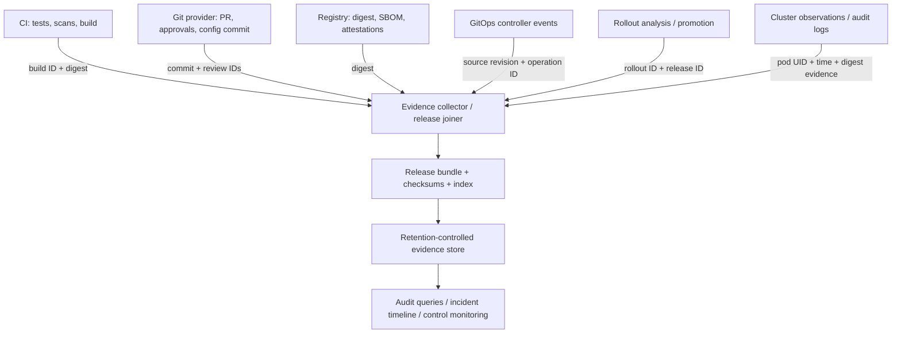

# 13 — Release Evidence and Audit Trails

> **Stage:** Stage 2E — Production DevOps & Platform Engineering  
> **Module:** M08 — GitOps and Progressive Delivery  
> **Unit:** 13 of M08  
> **Level:** Beginner foundations → practical implementation → production engineering → advanced operational judgment  
> **Estimated time:** 12–18 hours, depending on how many optional integrations you attempt  
> **Cost:** Free/near-zero-cost local files and standard-library Python; a local Kubernetes cluster is optional  
> **Prerequisites:** Git, shell basics, Python 3.10+, JSON, and basic Kubernetes/GitOps vocabulary  
> **Safety:** All examples use fictional `orders-api` records and local lab directories. Do not point these commands at production systems or place secrets in evidence files.

**Evidence labels used throughout**

- `[ILLUSTRATIVE]` means a sample policy or record that an organization must adapt.
- `[ASSUMPTION]` means a convention introduced for this lesson, not a repository-wide fact.
- `[VERIFY]` means a product/version-specific behavior, command, API, or configuration that must be checked against the installed version and official documentation before adoption.
- **SIMULATED** means generated fixture data, not a record emitted by a real controller or cloud service.

---

## 1. Why this unit matters

At 10:17 UTC, an `orders-api` release begins returning elevated errors. The team knows a deployment happened, but the GitOps controller's short-lived event history no longer contains the sync details. A CI artifact has expired, the production manifest referenced a mutable tag, and a dashboard marker only says “version 2.8.” Nobody can confidently connect the reviewed source change to the exact image currently running. The immediate task is to restore service safely; the follow-up task is to establish what happened without guessing.

A release evidence system should help the team answer these questions under time pressure:

1. What changed?
2. Who authored it?
3. Who reviewed and approved it?
4. What tests and scans ran, and what were their results?
5. What exact artifact was deployed?
6. Where and when was it deployed?
7. What rollout, promotion, or abort decision occurred?
8. What is running now, and what evidence supports that claim?
9. How can the team safely undo or recover from the release?

These questions are related but are not interchangeable. A Git commit identifies source history; a build record links source to a produced artifact; a digest identifies content; a signature or attestation makes a verifiable claim under a trust policy; controller records describe reconciliation; runtime observations show what a cluster reports now. A complete answer joins these sources and records the gaps.

### Learning outcomes

By completing this unit, you should be able to:

- Distinguish audit trails, release evidence, observability, provenance, and attestations.
- Explain what Git proves and what it does not prove about a running workload.
- Design a release evidence chain with stable identifiers and immutable artifact references.
- Create and validate a release manifest without embedding secrets or unnecessary personal data.
- Compare desired image references with live workload and runtime image identity while reporting uncertainty safely.
- Build a local evidence bundle, checksum index, tamper-evidence demo, JSONL event sink, segregation-of-duties checker, audit query, and incident timeline.
- Design durable retention, access controls, evidence ownership, exception handling, and continuous control checks.
- Explain limitations such as missing events, compromised CI, clock skew, mutable tags, and unanchored hash chains.

**Completion criteria:** All seven labs run against local fixtures; invalid or incomplete evidence is not silently accepted; the bundle can be read back and its hashes verified; the learner can explain what each artifact establishes and what remains unknown.

## 2. Prerequisites and local setup

The core path needs Git, Python 3.10 or newer, and a POSIX-style shell (Linux, macOS, or WSL). Examples use `python3`; on Windows, use WSL or replace it with the appropriate Python launcher. No third-party Python package is required for the core labs. `kubectl`, kind, Minikube, Argo CD, Flux, and Argo Rollouts are optional for live-system extensions.

Create a disposable working directory outside the repository lesson tree:

```bash
mkdir -p "$HOME/release-evidence-lab"
cd "$HOME/release-evidence-lab"
python3 --version
 git --version
```

Expected: Python 3.10+ and a Git version string. The leading space before `git` is harmless in a shell; it can be omitted. Keep all lab outputs under this directory. Do not use `rm -rf` on a path supplied by an environment variable unless you have first validated the path; cleanup instructions below remove only named lab directories.

Optional Kubernetes context check:

```bash
command -v kubectl || true
kubectl config current-context 2>/dev/null || true
kubectl get nodes 2>/dev/null || true
```

If these commands return nothing or fail, continue with fixtures. Do not create a cluster solely to finish the core lesson. If you do use a cluster, verify the current context before every live read and never run write operations against a production context.

## 3. L1 — Foundations: what evidence means

### 3.1 Key terms and properties

- **Audit trail:** a record of actions, decisions, identities, and changes over time. Examples include a pull-request approval, a promotion event, or an API audit record.
- **Release evidence:** artifacts and records linked to a particular release that substantiate claims about its source, build, review, deployment, and verification.
- **Observability:** metrics, logs, traces, profiles, and events used to understand system behavior. These are valuable during release analysis, but telemetry alone is not a complete change audit trail.
- **Provenance:** information describing where an artifact came from and how it was produced, including source and build process claims.
- **Attestation:** a structured claim about an artifact or process, issued by an identifiable signer or service and evaluated under a trust policy. A signature does not make a false claim true; it authenticates a claim to the extent the identity and key are trusted.
- **Integrity:** confidence that bytes have not changed relative to a trusted reference, such as a digest.
- **Authenticity:** confidence about who or what produced a record, based on an identity and trust model.
- **Immutability:** a storage/control property that prevents or constrains modification and deletion for a defined period. It is not established by naming a directory “immutable.”
- **Append-only:** new records can be added while prior records are not supposed to be overwritten through the normal interface. Privileged administrators may still be able to change underlying infrastructure unless independent controls prevent it.
- **Tamper evidence:** a change can be detected by verification. Detection is not the same as prevention or recovery.

A SHA-256 digest can show that a file matches a known digest. It does not identify the author. A digital signature can bind a digest or claim to a signing identity if the key and trust policy are sound. A hash chain makes some edits detectable, but a person who can rewrite the entire chain can recalculate it unless the chain head is independently anchored (for example, in a separately controlled log or signed checkpoint).

### 3.2 Git is necessary, but not sufficient

Git provides commit history and content identity. Pull/merge requests can preserve discussion, reviews, approvals, linked tickets, and policy outcomes. Protected branches, required reviews, CODEOWNERS, signed commits, and signed tags can strengthen the process.

Git alone does **not** prove:

- which artifact was built from a commit, unless a trustworthy build record links them;
- that a tag still points to the same content;
- that a cluster actually ran the artifact referenced in Git;
- that no out-of-band or UI-based change occurred;
- that a controller completed a sync or that a rollout passed analysis;
- that a human identity was not compromised;
- that a review or branch protection rule was configured as expected at the time.

An image tag such as `registry.example.invalid/orders-api:2.8.1` is a human-readable reference that can be moved. A content digest such as `registry.example.invalid/orders-api@sha256:REPLACE_WITH_REAL_DIGEST` identifies a particular content object. The placeholder is intentionally invalid and must never be treated as evidence.

### 3.3 The release evidence chain

```mermaid
flowchart LR
  A[Source commit] --> B[CI run: tests and scans]
  B --> C[Artifact digest + SBOM + provenance/signature]
  C --> D[Config-repo commit pins digest]
  D --> E[GitOps sync/event evidence]
  E --> F[Rollout analysis / promote / abort]
  F --> G[Live cluster observation]
  G --> H[Post-deploy verification]
  H --> I[Evidence bundle + integrity index]
```



Each link should have a stable identifier and an owner:

| Link | Useful evidence | Correlation key | What it supports | Common gap |
|---|---|---|---|---|
| Source | commit, PR, review record | commit SHA, PR ID | which source revision was proposed | rewritten history or missing provider export |
| Build | CI run, test and scan reports | build/run ID + commit SHA | which source was tested and built | expired artifacts or untrusted runner |
| Artifact | digest, SBOM, provenance, signature result | image digest | exact artifact identity and supply-chain claims | tag-only deployment or unverified attestation |
| Desired state | config commit and rendered manifest | config commit + digest | what the repository asked the controller to deploy | wrong environment overlay or mutable tag |
| Reconciliation | sync/health events and controller identity | app/source revision + operation ID | controller action and outcome | short retention or missing export |
| Rollout | analysis result, promotion/abort record | rollout ID + release ID | why traffic/promotion proceeded or stopped | manual action not recorded durably |
| Runtime | workload/pod spec and runtime `imageID` | namespace, workload, pod UID, time | what the API/runtime reports as running | replicas overlap, runtime-specific image IDs |
| Verification | health checks, SLO comparison, incident links | release ID + time window | post-deploy result | tests only sampled a subset of behavior |

`release_id` is a lesson convention, not a universal Kubernetes field. `[ASSUMPTION]` Use `orders-api-prod-2026-10-28-001` as the release identifier in the labs; in a real platform, define one stable identifier and carry it through CI, GitOps, rollout, and evidence storage.

### 3.4 Worked example

A developer opens PR `#184` against source commit `abc123...`. CI run `build-9081` runs unit tests and a vulnerability scan. It builds an image whose real digest is recorded as `sha256:...`, and stores an SBOM and provenance statement associated with that digest. A configuration PR pins the digest in the production overlay. The GitOps controller syncs config commit `def456...`; a rollout analysis record says the canary passed the configured checks; the platform records the promotion decision. A post-deploy check compares error rate and latency against the release gate. The evidence bundle links each record by `release_id`, source SHA, build ID, digest, config commit, and event IDs.

This is stronger than a screenshot of a dashboard because a reviewer can follow identifiers to source records, verify digests, and identify missing links. It still does not prove that CI was uncompromised, that every runtime node is trustworthy, or that no later privileged change occurred. Those require independent controls and continued observation.

### 3.5 Compliance-awareness boundary

SOC 2, ISO 27001, PCI DSS, and SOX-related change-management expectations differ by organization, scope, system, jurisdiction, and audit period. Release evidence can help demonstrate that a control operated, but a lesson or lab does not establish compliance, certification, or audit success. Consult the organization's control owner, auditor, and legal/compliance advisers for applicable requirements.

### L1 scenario and common mistakes

**Scenario:** An incident commander asks, “Who approved the image that is running?” The team has a Git commit and a pod image tag but no build-to-digest record. The correct answer is not to infer an approver from the last commit. State the gap, preserve the records that remain, and reconstruct only what is supported.

Common mistakes include treating a Git commit as proof of deployment, assuming a dashboard marker is authoritative, storing only screenshots, using a mutable tag, treating a successful hash check as proof of authorship, and reporting missing data as a pass.

**Knowledge check**

1. Does a SHA-256 digest identify the person who created a file? **Answer:** No. It supports byte-integrity comparison against a trusted digest.
2. Does Git prove what is running now? **Answer:** No. It describes repository state; runtime and controller evidence are also needed.
3. What should a query return when the deployment interval cannot be reconstructed? **Answer:** `INCOMPLETE` or `UNKNOWN`, with the missing evidence identified.

## 4. L2 — Build the chain

### 4.1 Artifact identity and metadata

Prefer digest-pinned deployment references. Preserve tags for discoverability if useful, but do not use a tag as the sole identity of a production release. Capture at least:

- release ID, service, version, and environment;
- source commit SHA and PR/review reference;
- approver identities where available from the authoritative review system;
- CI/build ID, test summary, scan summary/reference, and scan timestamp;
- artifact digest, SBOM reference, provenance reference, and signature/attestation verification result;
- configuration repository commit and target path;
- controller sync/event reference and rollout/analysis result;
- deployment and post-deploy verification timestamps;
- change-ticket ID where the organization uses one;
- evidence bundle location/index and integrity checksum.

Labels and annotations improve discovery but are not security boundaries and are not proof on their own. Standard Kubernetes labels include `app.kubernetes.io/version`; OCI image labels can carry source or revision metadata. `[ASSUMPTION]` Custom annotations such as `release.example.invalid/change-id` or `release.example.invalid/pr` are illustrative conventions, not standardized keys. Do not place credentials, tokens, private payloads, or unnecessary personal data in labels, annotations, or manifests.

### 4.2 Approval and signing evidence

Use protected branches/rulesets, required reviews, CODEOWNERS/path ownership, and a documented risk-based approval policy. The exact mechanism differs by Git provider. Link this to M02 Unit 9 for branch governance; this unit does not assume that module's exact implementation.

Git can verify signatures on commits and tags when signing is configured and trust is established. For example:

```bash
git verify-commit COMMIT_SHA
git verify-tag TAG_NAME
```

These commands require the object to be signed and the relevant verification tooling/key configuration to be present. A successful cryptographic check is not a complete policy decision: verify the signer identity, key trust, revocation/rotation policy, and whether that identity was authorized for the action. GPG and SSH signing are Git capabilities; gitsign-style keyless signing is another ecosystem option whose identity and trust model must be understood.

`[VERIFY]` Before enabling controller-side signature verification, consult the installed Argo CD or Flux version's official documentation. Flux `GitRepository` source verification and Argo CD GPG/signature-related capabilities and exact configuration have changed across versions and installation patterns. Do not copy an unverified CRD field into production.

### 4.3 Controller and rollout evidence

Argo CD Application history and sync-operation records can help identify revisions and sync outcomes. `argocd app history APP_NAME` is an example command; confirm exact CLI syntax and output for the installed version with `argocd app history --help` and the official documentation. Export needed evidence to durable storage rather than assuming controller history is an archive.

Flux emits Kubernetes events and can integrate notifications through its notification-controller. Capture events/alerts with the source object, involved object, reason, timestamp, and release correlation fields where available. Kubernetes events and controller history may expire or be bounded; retention behavior depends on configuration and platform.

For Argo Rollouts, `AnalysisRun` results and promotion/abort decisions can explain whether analysis passed, failed, or was skipped. Exact status fields and command output depend on the installed CRD/controller version `[VERIFY]`. Flagger provides a similar progressive-delivery concept but has its own API and event model. A dashboard deployment marker is useful for correlation (forward reference M11) but should not be the only release record.

### 4.4 Release manifest: example and validation

The following JSON is a **SIMULATED example**. Replace all placeholders with evidence-backed values before using it as a real release record. Empty or simulated values must not be represented as verified evidence.

```json
{
  "schema_version": "1.0",
  "release_id": "orders-api-prod-2026-10-28-001",
  "service": "orders-api",
  "version": "2.8.1",
  "environment": "production",
  "source": {
    "repository": "https://example.invalid/org/orders-api",
    "commit_sha": "abc123abc123abc123abc123abc123abc123abcd",
    "pull_request": "PR-184",
    "review_record": "review-system://PR-184",
    "approvers": ["reviewer@example.invalid"]
  },
  "build": {
    "system": "example-ci",
    "build_id": "build-9081",
    "tests": {"status": "PASS", "report_ref": "evidence/tests.xml"},
    "scan": {"status": "PASS_WITH_FINDINGS_ACCEPTED", "report_ref": "evidence/scan.json"}
  },
  "artifact": {
    "image": "registry.example.invalid/orders-api@sha256:REPLACE_WITH_REAL_DIGEST",
    "digest": "sha256:REPLACE_WITH_REAL_DIGEST",
    "sbom_ref": "evidence/sbom.cdx.json",
    "provenance_ref": "evidence/provenance.json",
    "signature_verification": "SIMULATED_NOT_VERIFIED"
  },
  "deployment": {
    "config_repository_commit": "def456def456def456def456def456def456def0",
    "target_path": "environments/production/orders-api.yaml",
    "controller": "gitops-controller-name",
    "sync_event_ref": "evidence/controller-events.jsonl",
    "rollout": {"decision": "PROMOTED", "analysis_ref": "evidence/rollout-analysis.json"},
    "started_at": "2026-10-28T10:00:00Z",
    "completed_at": "2026-10-28T10:08:00Z"
  },
  "change": {"ticket_id": "CHG-2026-1042", "emergency": false},
  "post_deploy": {"status": "PASS", "verification_ref": "evidence/post-deploy.json"},
  "bundle_ref": "bundle/orders-api-prod-2026-10-28-001/index.json"
}
```

**Required in this lesson's manifest contract:** `schema_version`, `release_id`, `service`, `environment`, source commit, build ID, artifact digest, config commit, deployment outcome, and an explicit evidence status. The remaining fields are required by organizational policy or optional depending on the pipeline. A missing optional field may still make a particular audit question unanswerable. Provenance should come from the source system that owns the fact; do not infer approvers from commit authors or rollout outcomes from a current pod snapshot.

Save the JSON as `release-manifest.json`. The standard-library validator below checks essential shape and rejects placeholder digests and missing critical fields. It is a deliberately small schema-like validator, not a complete JSON Schema implementation.

```python
# validate_manifest.py
import json
import re
import sys
from pathlib import Path

REQUIRED = ("schema_version", "release_id", "service", "environment", "source", "build", "artifact", "deployment")
SHA = re.compile(r"^sha256:[0-9a-f]{64}$")


def validate(path: Path) -> list[str]:
    try:
        obj = json.loads(path.read_text(encoding="utf-8"))
    except (OSError, json.JSONDecodeError) as exc:
        return [f"cannot read valid JSON: {exc}"]
    if not isinstance(obj, dict):
        return ["top-level JSON value must be an object"]
    errors = [f"missing required top-level field: {key}" for key in REQUIRED if key not in obj]
    for section in ("source", "build", "artifact", "deployment"):
        if not isinstance(obj.get(section), dict):
            errors.append(f"{section} must be an object")
    artifact = obj.get("artifact", {})
    if isinstance(artifact, dict):
        digest = artifact.get("digest")
        if not isinstance(digest, str) or not SHA.fullmatch(digest):
            errors.append("artifact.digest must be a real sha256 digest (64 lowercase hex characters); placeholders are invalid")
        image = artifact.get("image", "")
        if not isinstance(image, str) or "@sha256:" not in image:
            errors.append("artifact.image must be digest-pinned with @sha256:")
    source = obj.get("source", {})
    if isinstance(source, dict) and not source.get("commit_sha"):
        errors.append("source.commit_sha is required")
    build = obj.get("build", {})
    if isinstance(build, dict) and not build.get("build_id"):
        errors.append("build.build_id is required")
    deployment = obj.get("deployment", {})
    if isinstance(deployment, dict) and not deployment.get("config_repository_commit"):
        errors.append("deployment.config_repository_commit is required")
    return errors

if __name__ == "__main__":
    if len(sys.argv) != 2:
        print(f"usage: {Path(sys.argv[0]).name} MANIFEST.json", file=sys.stderr)
        raise SystemExit(2)
    problems = validate(Path(sys.argv[1]))
    if problems:
        print("INVALID")
        for problem in problems:
            print(f"- {problem}")
        raise SystemExit(1)
    print("STRUCTURE_VALID; this does not authenticate evidence or prove the release occurred")
```

Run it with `python3 validate_manifest.py release-manifest.json`. The example above is intentionally invalid because its digest is a placeholder and signature state is simulated. Expected result includes `INVALID` and a message that the digest must be real. For a positive fixture, generate a 64-character hexadecimal digest from a local file and update both `artifact.digest` and the image reference consistently. That proves only that the manifest has a plausible structure; it does not prove that the registry contains the image or that a signature is valid.

### 4.5 Comparing desired and observed runtime identity

A desired-state manifest may pin `image@sha256:...`, while a Pod's `.status.containerStatuses[].imageID` can be formatted differently by the container runtime or registry. Do not assume a universal prefix or compare arbitrary strings blindly. Check every replica and include init containers; sidecars matter too if they are part of the release/security boundary. During rolling updates, old and new ReplicaSets may coexist. The verifier must report that overlap instead of silently choosing one Pod.

For a read-only snapshot, start with:

```bash
kubectl get pods -n YOUR_NAMESPACE -l app=orders-api -o json
```

Inspect `.spec.containers[].image`, `.spec.initContainers[].image`, and the corresponding status `imageID` fields. Replace `YOUR_NAMESPACE` and confirm the current context first. The optional Lab 3 script uses fixture JSON by default and requires explicit opt-in for `kubectl` reads. A toy verifier is not a universal production verifier; production use needs runtime-specific digest normalization, workload ownership mapping, readiness/termination handling, rollout-aware expected sets, and tests against the actual cluster/runtime.

### 4.6 Kubernetes audit logs

Kubernetes API audit records can capture request identity, verb, resource, timestamp, source details, and request/response metadata according to the configured audit policy and stage. Request bodies may contain sensitive values, so audit policy and redaction matter. Self-managed clusters need audit policy and log-backend configuration; managed Kubernetes services expose different configuration, retention, and access patterns. Verify provider-specific settings and retention with the service documentation `[VERIFY]`.

A local kind or kubeadm audit-log setup is optional and not required for the labs. If attempting it, validate the exact Kubernetes version, API server flags, mounted policy path, and log backend before applying changes. The lesson's fixtures represent audit records but are not real API server audit logs.

### L2 scenario and common mistakes

**Scenario:** A manifest contains a valid-looking image tag but no digest, no build ID, and a “PASS” scan string with no report reference. Treat it as incomplete. The string is a claim, not the underlying evidence.

Common mistakes: copying status text without a source link, assuming all image IDs use the same syntax, accepting a missing digest, putting secrets in annotations, treating a valid JSON parse as proof of release authenticity, and relying on short-lived Kubernetes events as the sole archive.

**Knowledge check**

1. What is the purpose of `release_id`? **Answer:** It is a stable correlation key across systems, not a replacement for native IDs.
2. Does `git verify-commit` prove the signer was authorized to approve a production release? **Answer:** No; signer identity and policy authorization must also be checked.
3. What should a runtime verifier do with an unparseable `imageID`? **Answer:** Report `UNKNOWN` or `INCOMPLETE`, not `MATCH`.

## 5. L3 — Production evidence pipeline

### 5.1 Architecture and collection contract

A durable pipeline collects evidence at the moment each system knows the fact. CI owns test/build records; the registry or attestation store owns artifact identity and supply-chain records; the configuration repository owns desired-state commits; GitOps and rollout controllers own reconciliation and promotion records; cluster audit/runtime sources own observed activity; the release orchestrator joins them into a bundle.



Define the contract before automating it:

1. **Collection point:** which system emits the record and when.
2. **Owner:** team accountable for availability, schema, and retention.
3. **Identity:** release ID plus native source IDs, commit SHA, build ID, digest, operation/rollout ID, environment, and timestamp.
4. **Validation:** required fields, trusted origin, signature/hash checks where applicable, and expected time window.
5. **Failure policy:** if collection fails, record the gap and decide whether the release gate should block, warn, or allow a documented exception.
6. **Completeness:** explicit list of expected evidence items and their states (`PRESENT`, `MISSING`, `UNKNOWN`, `NOT_APPLICABLE`).
7. **Access:** least privilege for writers, readers, approvers, and retention administrators.
8. **Retention:** policy-defined period, retrieval SLO, and deletion/hold process.

### 5.2 Bundle layout

A local bundle can use this layout:

```text
bundle-orders-api-lab-001/
├── release-manifest.json
├── index.json
├── SHA256SUMS
├── source/
│   └── git-summary.json
├── ci/
│   ├── tests.json
│   └── scan-summary.json
├── supply-chain/
│   ├── sbom.sample.json
│   └── provenance.sample.json
├── gitops/
│   └── controller-events.jsonl
├── rollout/
│   └── analysis-result.json
├── runtime/
│   └── runtime-observation.json
└── verification/
    └── post-deploy.json
```

All `.sample.json` records must be clearly labeled as simulated. An index should identify the release ID, artifact digest, file path, evidence type, origin, collection time, and checksum. Keep large binary artifacts in a controlled artifact store and include their immutable reference and digest in the bundle; do not copy every large payload into every audit bundle.

### 5.3 Local hashes and optional durable storage

Local files are useful for reproducible labs but are not immutable. A user with write access can replace both a file and its checksum list. Hashes detect changes only when the expected hash is protected independently.

For production, consider an object store with retention controls, object lock/WORM features, versioning, independent administrative roles, and audit logging. Versioning alone is not equivalent to immutability: an administrator may delete versions or alter retention unless the service's policy prevents it. MinIO and LocalStack can be useful optional local experiments, but object-lock/versioning setup and API behavior vary by product/version `[VERIFY]`; no paid cloud account is required for the core path. An OCI registry or attestation store can preserve SBOM/provenance references alongside image digests.

Retention periods are policy choices requiring system-owner and legal/regulatory input. Balance retention duration, retrieval speed, indexing, compression, object count, and storage cost. Keep metadata indexed for queries while retaining bulky logs/artifacts in an appropriately controlled store.

### 5.4 Integrity, signatures, attestations, and supply chain

- **Hash:** compares bytes to a reference digest; does not establish origin.
- **Signature:** verifies a signed statement or digest against a key and trust policy; key compromise or incorrect identity mapping weakens the result.
- **Attestation:** structured claim with subject and predicate; verify the subject digest, issuer, signature, and policy before trusting it.
- **SBOM:** inventory of components; it does not itself prove that the inventory is complete or that the deployed digest matches unless linked and verified.
- **Vulnerability scan:** time- and database-dependent result. Record scanner/version, database or scan time, policy threshold, exceptions, and the artifact digest scanned.
- **Provenance:** describes how an artifact was built; trust depends on who produced it and whether the build process is trustworthy.

SLSA and in-toto provide provenance/supply-chain concepts; Sigstore/cosign supports signing and attestation workflows. These are awareness-level references here. `[VERIFY]` Exact commands, bundle formats, predicates, keyless identity constraints, and policy verification vary by versions. Keyless signing is not implemented in this lesson; do not assume it is safe merely because it avoids a long-lived local key. The key-based lab below demonstrates integrity logic only, not a production key-management system.

### 5.5 Separation of duties and access

For production changes where policy requires it, separate author, approver, and promoter roles. This is not always a strict three-person rule for every low-risk change; risk-based policy should define exceptions. Approval records should be held by a system that the approver cannot unilaterally edit. Bot identities should be scoped to the minimum required repositories, paths, namespaces, and actions. Break-glass identities should be strongly authenticated, time-bounded where feasible, logged, and reviewed after use.

Generate periodic access evidence from branch protection/rulesets, CODEOWNERS, approval records, GitOps sync/promote permissions, and Kubernetes RBAC. A fixture-based report is useful for testing logic, but it does not prove that provider settings were actually applied. Link to M03 Unit 9 for RBAC/access-review concepts; do not assume its exact data source.

### 5.6 Change records, emergencies, and rollback

Use PR templates requiring a change ID when applicable, link incident/ticket records, and automate change-record creation/closure where the service supports it. Manual notes alone are fragile and difficult to query.

An emergency path should still use Git where possible, explicitly mark the change as emergency, preserve the identity/action record, reconcile out-of-band changes, and require post-hoc review within a defined `[ILLUSTRATIVE]` policy window. The exact window is an organizational choice, not a universal standard. Cross-reference Unit 6 for drift and break-glass handling.

Rollback evidence should include the revert commit or rollback operation, incident/change ID, target digest, controller abort/rollback event, reason, and post-rollback verification. A rollback is not always safe: database/schema changes or data migrations may be irreversible or incompatible with the previous application version. Use expand/contract migration design and the safety principles from Units 11 and 12; sometimes roll-forward or restore-to-new-instance is safer than reversing data changes.

### 5.7 Audit queries and honest gaps

**Query A:** “Show every production change to `orders-api` in Q3 with approver and tests.” Required sources: production config commits, PR/review records, release manifests, CI test reports, environment identity, and a defined Q3 time zone. If PR approvals or test reports expired, return the affected releases and missing fields; do not reconstruct them from memory.

**Query B:** “Prove that digest D ran in production only between T1 and T2.” Required evidence: digest-pinned desired state, controller history, runtime observations over the interval, scale/rollout events, cluster audit records where available, and evidence of subsequent changes. A single current pod snapshot cannot prove a historical interval. If event retention has gaps, the strongest supportable answer may be “observed at T1 and T2; continuous interval not proven.”

**Query C:** “Who deployed digest D, who approved it, and what tests/scans ran?” Join release ID, config commit, promotion actor, approval record, build ID, test/scan reports, and digest. If the system records only a bot actor, report that identity and separately link the initiating human/change record if present. Never infer the human actor from a commit author.

Evidence gaps to report explicitly include missing correlation IDs, expired events, mutable tags, expired CI artifacts, unverified signatures, clock skew, partial logs, permissions failures, and absent runtime observations.

### 5.8 ML, data, and migration releases

For a model release, record model/version ID, model artifact digest, training-data snapshot or immutable dataset reference/hash, evaluation dataset/version, metrics and acceptance thresholds, feature/preprocessing contract, reviewer/approver, promotion decision, serving configuration, and post-deploy monitoring window. Do not expose sensitive training examples or personal data in the evidence bundle. Link to the Stage 5D handoff as a conceptual integration point, not an assumed registry implementation.

For data/schema migrations, record migration ID and source commit, pre-checks, backup/snapshot reference, execution identity/time, row counts/checksums/constraint checks, replication lag or pipeline reconciliation where relevant, post-checks, and rollback/roll-forward decision. Link to Unit 11 for migration safety. The evidence should establish both what changed and whether the resulting data state passed defined checks.

### L3 scenario and common mistakes

**Scenario:** CI uploads an SBOM and signature, but the production workload runs a tag with no recorded digest. The SBOM may exist, but the evidence chain does not establish that it describes the running image. Fix the pipeline so the artifact digest is the shared subject identifier from build through deployment and runtime verification.

Common mistakes: calling a local folder immutable, trusting a hash list stored beside editable files, assuming object versioning prevents deletion, storing evidence without retention ownership, letting the approver edit their own approval record, and blocking every emergency without a safe documented exception path.

**Knowledge check**

1. Why is a hash chain not sufficient against a privileged attacker? **Answer:** The attacker may rewrite all records and recompute the chain unless a head/checkpoint is independently anchored.
2. Why preserve native IDs in addition to `release_id`? **Answer:** The release ID correlates the bundle, while native IDs support traceability back to each source system.
3. What does a missing CI report mean? **Answer:** The result is unknown or incomplete, not automatically failed or passed.

## 6. L4 — Audit readiness, control monitoring, and incident reconstruction

### 6.1 Control map

An operational control map connects:

`control → mechanism → evidence → owner → test frequency → exception process`

| Control theme | Example mechanism | Evidence | Owner / test frequency | Exception handling |
|---|---|---|---|---|
| Change management | protected production paths + reviews | rules export, PR approval, config commit | repo/platform owner; periodic review | documented emergency path and expiry |
| Access control | least-privilege RBAC and sync permissions | RBAC snapshot, identity/access review | cluster/platform owner; scheduled review | time-bound exception and compensating controls |
| Segregation of duties | author/approver/promoter checks | PR and promotion records | release owner; every production release | explicit approved exception |
| Logging | controller/runtime/audit exports | JSONL records and retention report | observability/security owner; continuous | alert on export gap |
| Artifact provenance | digest, SBOM, provenance/signature verification | attestation and verification output | supply-chain owner; each release | block or exception per policy |
| Recovery | rollback/restore rehearsal | test result, target digest, recovery timeline | service owner; scheduled exercise | remediation plan and due date |
| Deployment verification | runtime digest and health checks | runtime observations, post-deploy result | service owner; every release | `UNKNOWN` blocks proof, even if release continues by policy |

This is engineering preparation and awareness, not a declaration that any framework's requirements have been met.

### 6.2 Continuous control monitoring

A monitor should produce timestamped, attributable results and distinguish:

- `PASS`: the available evidence was sufficient and the control passed;
- `FAIL`: evidence demonstrates a control violation;
- `UNKNOWN`: the source was unavailable, unauthorized, or could not be interpreted;
- `INCOMPLETE`: some required evidence was collected, but the coverage is insufficient to decide.

Examples of checks include whether production branches disallow direct pushes and require reviews; whether a GitOps source uses supported signature verification; whether a deployed digest has linked SBOM/attestation evidence; and whether available Kubernetes audit logs show human direct writes to protected production namespaces. `[VERIFY]` Audit event availability and semantics depend on audit policy/provider configuration. A missing audit log cannot prove that no direct write occurred.

False positives can result from stale snapshots or policy exceptions; false negatives can result from missing events, wrong identity mapping, or an unobserved path. Permission failure must not become `PASS`. Store the monitor version, input snapshot references, timestamp, status, and exception ID. Avoid placing secrets or full request payloads in monitor output.

### 6.3 Incident timeline reconstruction

A timeline builder joins records from Git, PR approvals, CI, registry, config commits, controller events, rollout decisions, runtime observations, alert/incident systems, rollback/revert operations, and post-incident verification. Prefer event IDs and native sequence/order metadata when available. Normalize timestamps to UTC while retaining original timestamp and timezone metadata. Clock skew and delayed delivery mean timestamp order alone does not establish causality; represent uncertainty and source latency.

A timeline should preserve both the observed sequence and its confidence. If two sources disagree, retain both source records and flag the conflict rather than silently selecting one. The Lab 7 builder is deterministic fixture-based; it is not a universal event correlation engine.

### 6.4 Privacy, threat model, and limitations

Protect evidence as sensitive operational data. Redact credentials, tokens, authorization headers, request bodies, and unnecessary personal data. Restrict read access, encrypt transport/storage where supported, protect signing keys, document who can export evidence, and review access logs. Do not dump entire Kubernetes request bodies by default.

Threats include:

- compromised CI runner generating misleading build records;
- malicious or compromised maintainer changing code and approving it;
- compromised signing key or incorrect identity trust policy;
- privileged cluster administrator changing runtime state outside GitOps;
- incomplete or disabled audit logging;
- expired controller history or CI artifacts;
- registry/tag mutation or deleted artifacts;
- evidence-store administrator altering or deleting records;
- clock skew and delayed events;
- local lab assumptions being mistaken for production guarantees.

Independent controls may include isolated/reproducible build infrastructure, least-privilege workload identity, protected signing keys, independent retention administrators, external log sinks, signed checkpoints anchored in a separately controlled system, admission policy that verifies artifact claims, periodic restore tests, and cross-source reconciliation. Admission-policy implementation is M12 depth; here it is an awareness-level concept.

At scale, use retention tiers, compression, indexing by release ID/digest/environment/time, partitioning, metadata catalogs, and retrieval tests. Decide who owns schema evolution and how old evidence remains readable. Store bulky test reports in artifact storage and retain stable references and checksums in the bundle. Cost optimization must not erase evidence needed for an incident or audit.

### 6.5 Seven incident scenarios

Each scenario follows **symptoms → evidence → likely cause → containment/recovery → corrective controls → residual uncertainty**.

#### Incident 1 — Controller history aged out

- **Symptoms:** A historical release cannot be reconstructed from the GitOps controller UI/CLI.
- **Evidence:** Config-repo commit, release manifest, external event archive, CI run, registry digest, rollout records, runtime/audit logs, and time-window coverage report.
- **Likely cause:** Controller history/events had short retention or were never exported.
- **Containment/recovery:** Preserve remaining source records; do not claim an exact deployment interval unless corroborated. Restore service using a known-good digest and normal release process if needed.
- **Corrective controls:** Export events on arrival, monitor exporter health, alert on evidence gaps, test retrieval, and define retention ownership.
- **Residual uncertainty:** If there is no runtime observation or audit trail for the missing interval, exact “what ran when” may remain unproven.

#### Incident 2 — Approver was also the author

- **Symptoms:** A production PR's author is also listed as its required approver, violating the stated policy.
- **Evidence:** Author identity, approval event, branch-rule snapshot at the time, CODEOWNERS, merge event, promotion record, and exception record if any.
- **Likely cause:** Rules were misconfigured, bypass permissions were too broad, or simulated policy logic was not applied to the real provider.
- **Containment/recovery:** Assess change risk and runtime health; require an independent review before further promotion; do not retroactively rewrite the approval history.
- **Corrective controls:** Enforce independent approval in provider rules where supported, monitor rule drift, limit bypass privileges, and test the control on every production change.
- **Residual uncertainty:** A report from a fixture or current rule snapshot cannot prove what settings were active at merge time.

#### Incident 3 — Mutable tag moved

- **Symptoms:** The image tag in a manifest resolves to different content from the expected build.
- **Evidence:** Registry tag history if available, build logs, original digest, config commit, runtime `imageID`, registry audit records, and any signature/SBOM subject digest.
- **Likely cause:** Deployment used a mutable tag or registry permissions allowed overwrite.
- **Containment/recovery:** Identify the actual running digest; deploy a known-good digest through the normal GitOps path; preserve registry and runtime records.
- **Corrective controls:** Pin digests, restrict registry mutation, verify provenance/signatures, and compare runtime observations with desired state.
- **Residual uncertainty:** If the registry has no tag history and runtime identity is unavailable, the original tag target may be impossible to establish.

#### Incident 4 — Break-glass change lacked post-hoc review

- **Symptoms:** An out-of-band production change has no linked incident, review, or reconciliation commit.
- **Evidence:** Kubernetes audit logs, identity-provider records, controller drift report, shell/session logs where authorized, incident timeline, and current cluster/Git diff.
- **Likely cause:** Emergency process bypassed documentation or logging, or logs were unavailable.
- **Containment/recovery:** Stabilize service, capture current state, reconcile desired state through Git where safe, record the exception and impact, then arrange independent review.
- **Corrective controls:** Break-glass identity controls, automatic alerts, required incident/change IDs, post-hoc review deadlines, and periodic drills.
- **Residual uncertainty:** If audit logging was not enabled, actor/action details may be incomplete; do not invent attribution.

#### Incident 5 — CI artifacts expired

- **Symptoms:** The team has a build ID but cannot retrieve tests, scan output, SBOM, or provenance.
- **Evidence:** CI metadata, registry digest, external artifact store, manifest references, scan database/time, and retention configuration.
- **Likely cause:** Default CI retention was shorter than audit/investigation needs.
- **Containment/recovery:** Preserve metadata and any independent reports; classify the release evidence as incomplete; rebuild/re-scan only if useful, noting that a new scan is not historical proof.
- **Corrective controls:** Export release artifacts to controlled retention storage, verify checksums, alert before expiry, and test retrieval.
- **Residual uncertainty:** Re-running tests later cannot prove the exact result of the original build.

#### Incident 6 — Force-push rewrote history

- **Symptoms:** A commit or branch expected in the audit chain is no longer reachable, or PR references disagree with current Git history.
- **Evidence:** Provider audit events, pull-request records, reflogs where available, signed tags, external mirrors, CI records, and evidence-bundle hashes.
- **Likely cause:** Force-push permissions or branch protection allowed history rewriting; possibly malicious or accidental action.
- **Containment/recovery:** Preserve available records and provider audit data; restrict further rewrites; restore references only through a documented process after confirming the intended history.
- **Corrective controls:** Protect production branches/tags, restrict force-push, mirror critical refs, retain provider audit events, and sign/anchor release records.
- **Residual uncertainty:** Local Git reflogs are not a durable independent audit source and may be unavailable after clone loss.

#### Incident 7 — SBOM/signature not linked to running image

- **Symptoms:** An SBOM and signature exist in CI, but the deployed workload has no verified link to their subject digest.
- **Evidence:** SBOM subject, signature/attestation verification output, CI build record, registry digest, config manifest, controller sync record, runtime `imageID`, and promotion gate result.
- **Likely cause:** The pipeline attached evidence to a tag/build label rather than the exact digest, or the release gate did not verify the subject.
- **Containment/recovery:** Treat supply-chain verification as unknown; determine the running digest; verify the matching SBOM/signature if available; follow the organization's risk policy before further promotion.
- **Corrective controls:** Bind attestations to immutable digests, verify subject equality at promotion, preserve verification output, and test a deliberately mismatched digest.
- **Residual uncertainty:** Existing SBOM data may describe a different artifact; its mere existence does not prove the running image's contents.

**L4 knowledge check**

1. Why is a missing audit log not proof that no action occurred? **Answer:** The log source may be disabled, incomplete, filtered, or unavailable.
2. What does an evidence status `UNKNOWN` communicate? **Answer:** The available data cannot support a reliable decision; it is not a pass.
3. Why should a timeline preserve conflicting timestamps? **Answer:** Different clocks, delays, and source semantics may produce disagreement; hiding it creates false certainty.

## 7. Seven hands-on labs

All labs are local and use fixture data unless explicitly stated. Run commands from `$HOME/release-evidence-lab` (or your chosen disposable directory). Create files exactly as shown. Expected outputs are representative; paths and timestamps may differ. Each lab should end with a short reflection in your own notes.

### Lab 1 — Release manifest and evidence bundle

**Purpose:** Build a release bundle with a manifest, controller/rollout fixtures, SBOM and scan references, signature-verification status, post-deploy result, index, and checksums.

**Setup:**

```bash
mkdir -p lab1/input
cd lab1
cat > release-manifest.json <<'JSON'
{
  "schema_version": "1.0",
  "release_id": "orders-api-lab-001",
  "service": "orders-api",
  "environment": "lab",
  "source": {"commit_sha": "abc123abc123abc123abc123abc123abc123abcd", "pull_request": "PR-184"},
  "build": {"build_id": "build-9081", "tests_status": "PASS"},
  "artifact": {"image": "registry.example.invalid/orders-api@sha256:REPLACE_WITH_REAL_DIGEST", "digest": "sha256:REPLACE_WITH_REAL_DIGEST", "sbom_ref": "supply-chain/sbom.sample.json", "signature_verification": "SIMULATED_NOT_VERIFIED"},
  "deployment": {"config_repository_commit": "def456def456def456def456def456def456def0", "sync_status": "SIMULATED_SYNCED", "rollout_decision": "SIMULATED_PROMOTED"},
  "post_deploy": {"status": "SIMULATED_PASS"}
}
JSON
cat > input/controller-events.jsonl <<'JSONL'
{"event_id":"evt-001","release_id":"orders-api-lab-001","type":"GitOpsSync","status":"SIMULATED_SYNCED","timestamp":"2026-10-28T10:01:00Z"}
JSONL
cat > input/rollout-analysis.json <<'JSON'
{"release_id":"orders-api-lab-001","status":"SIMULATED_PASS","decision":"SIMULATED_PROMOTED"}
JSON
cat > input/sbom.sample.json <<'JSON'
{"_note":"SIMULATED SAMPLE SBOM; not a real inventory","bomFormat":"CycloneDX","specVersion":"1.5","components":[]}
JSON
cat > input/scan-summary.json <<'JSON'
{"_note":"SIMULATED scan summary","scanner":"fixture","status":"SIMULATED_PASS","findings":0}
JSON
cat > input/signature-verification.json <<'JSON'
{"_note":"SIMULATED; no signature was verified","status":"SIMULATED_NOT_VERIFIED"}
JSON
cat > input/post-deploy.json <<'JSON'
{"_note":"SIMULATED health check","status":"SIMULATED_PASS","checked_at":"2026-10-28T10:08:00Z"}
JSON
```

Create the builder as `build_bundle.py`:

```python
import hashlib
import json
import shutil
import sys
from datetime import datetime, timezone
from pathlib import Path

EVIDENCE = {
    "controller_events": Path("input/controller-events.jsonl"),
    "rollout_analysis": Path("input/rollout-analysis.json"),
    "sbom": Path("input/sbom.sample.json"),
    "scan_summary": Path("input/scan-summary.json"),
    "signature_verification": Path("input/signature-verification.json"),
    "post_deploy": Path("input/post-deploy.json"),
}


def sha256(path: Path) -> str:
    h = hashlib.sha256()
    with path.open("rb") as stream:
        for chunk in iter(lambda: stream.read(65536), b""):
            h.update(chunk)
    return h.hexdigest()


def main(release_id: str) -> int:
    manifest_path = Path("release-manifest.json")
    if not manifest_path.is_file():
        print("ERROR: release-manifest.json is missing", file=sys.stderr)
        return 2
    manifest = json.loads(manifest_path.read_text(encoding="utf-8"))
    if manifest.get("release_id") != release_id:
        print("ERROR: release_id argument does not match manifest", file=sys.stderr)
        return 2
    target = Path(f"bundle-{release_id}")
    if target.exists():
        print(f"ERROR: refusing to overwrite existing bundle: {target}", file=sys.stderr)
        return 2
    target.mkdir()
    shutil.copy2(manifest_path, target / "release-manifest.json")
    copied = []
    for name, source in EVIDENCE.items():
        if not source.is_file():
            print(f"ERROR: required evidence missing: {source}", file=sys.stderr)
            shutil.rmtree(target)
            return 2
        dest = target / source.name
        shutil.copy2(source, dest)
        copied.append({"evidence_type": name, "path": dest.name, "origin": "LOCAL_FIXTURE_SIMULATED", "sha256": sha256(dest)})
    copied.append({"evidence_type": "release_manifest", "path": "release-manifest.json", "origin": "LOCAL_FIXTURE", "sha256": sha256(target / "release-manifest.json")})
    index = {
        "release_id": release_id,
        "artifact_digest": manifest.get("artifact", {}).get("digest"),
        "created_at": datetime.now(timezone.utc).isoformat(),
        "evidence": copied,
        "limitations": ["Local files are not immutable", "Several records are simulated", "Artifact digest is a placeholder"]
    }
    (target / "index.json").write_text(json.dumps(index, indent=2) + "\n", encoding="utf-8")
    files = sorted(p for p in target.iterdir() if p.is_file() and p.name != "SHA256SUMS")
    (target / "SHA256SUMS").write_text("".join(f"{sha256(p)}  {p.name}\n" for p in files), encoding="utf-8")
    print(f"BUNDLE_CREATED: {target}")
    print(f"INDEXED_EVIDENCE_FILES: {len(copied)}")
    print("STATUS: SIMULATED_FIXTURES; not production evidence")
    return 0

if __name__ == "__main__":
    if len(sys.argv) != 2:
        print(f"usage: {Path(sys.argv[0]).name} RELEASE_ID", file=sys.stderr)
        raise SystemExit(2)
    raise SystemExit(main(sys.argv[1]))
```

Run:

```bash
python3 build_bundle.py orders-api-lab-001
cd bundle-orders-api-lab-001
sha256sum -c SHA256SUMS
python3 -m json.tool index.json >/dev/null
```

Expected: `BUNDLE_CREATED: bundle-orders-api-lab-001`, an index count, a simulated-fixtures warning, and `OK` for each checksum. The checksum file does not include itself and is not independently anchored. If a file is missing, the builder should fail instead of silently creating a complete-looking bundle. If the output directory already exists, it refuses to overwrite it.

**Validation:** Open `index.json`, confirm each path and digest, and confirm simulated records are marked. **Failure cases:** malformed JSON in the manifest; missing evidence file; mismatched release ID; existing output directory. **Troubleshooting:** run `python3 -m json.tool release-manifest.json`; inspect the exact error and fix only the disposable lab data. **Cleanup:** from `lab1`, remove only the named output and lab folder after checking `pwd`; do not run broad wildcard deletion. **Reflection:** Which fields came from a source system, and which are only fixture claims?

**Optional storage variant:** Upload the bundle to MinIO/LocalStack or an OCI-backed evidence store only after checking the installed product's object lock, versioning, retention, and permissions documentation `[VERIFY]`. Versioning alone does not guarantee WORM behavior. No optional storage setup is required to pass this lab.

### Lab 2 — Tamper-evidence demonstration

**Purpose:** Build a small record chain and demonstrate detection after a record changes. Use throwaway data only.

Save as `hash_chain.py`:

```python
import hashlib
import json
from pathlib import Path

PATH = Path("chain.jsonl")


def digest(text: str) -> str:
    return hashlib.sha256(text.encode("utf-8")).hexdigest()


def create(records: list[dict]) -> None:
    previous = "GENESIS"
    with PATH.open("w", encoding="utf-8") as out:
        for record in records:
            payload = json.dumps(record, sort_keys=True, separators=(",", ":"))
            current = digest(previous + "\n" + payload)
            out.write(json.dumps({"record": record, "previous_hash": previous, "record_hash": current}, sort_keys=True) + "\n")
            previous = current


def verify() -> tuple[bool, str]:
    previous = "GENESIS"
    try:
        lines = PATH.read_text(encoding="utf-8").splitlines()
    except OSError as exc:
        return False, f"cannot read chain: {exc}"
    for index, line in enumerate(lines):
        try:
            entry = json.loads(line)
            payload = json.dumps(entry["record"], sort_keys=True, separators=(",", ":"))
            expected = digest(previous + "\n" + payload)
        except (json.JSONDecodeError, KeyError, TypeError) as exc:
            return False, f"record {index}: malformed: {exc}"
        if entry.get("previous_hash") != previous:
            return False, f"record {index}: previous hash mismatch"
        if entry.get("record_hash") != expected:
            return False, f"record {index}: content hash mismatch"
        previous = expected
    return True, f"verified {len(lines)} records; head={previous}"

if __name__ == "__main__":
    create([
        {"event_id": "e1", "release_id": "orders-api-lab-001", "action": "build"},
        {"event_id": "e2", "release_id": "orders-api-lab-001", "action": "promote"},
        {"event_id": "e3", "release_id": "orders-api-lab-001", "action": "verify"},
    ])
    print("BEFORE_EDIT:", verify())
    rows = PATH.read_text(encoding="utf-8").splitlines()
    item = json.loads(rows[1])
    item["record"]["action"] = "promote-with-edited-data"
    rows[1] = json.dumps(item, sort_keys=True)
    PATH.write_text("\n".join(rows) + "\n", encoding="utf-8")
    print("AFTER_EDIT:", verify())
```

Run `python3 hash_chain.py`. Expected: `BEFORE_EDIT: (True, ...)` and `AFTER_EDIT: (False, 'record 1: content hash mismatch')`. This detects the edit because later hashes depend on earlier record hashes. It is not a signature system, and it does not prevent someone from rewriting every record and recomputing the chain. Anchor the head in an independently controlled system to improve tamper evidence. **Failure diagnosis:** If the first verification fails, inspect line endings and JSON structure; do not “fix” a real evidence chain by rewriting it. **Cleanup:** delete only `chain.jsonl` in the lab directory. **Reflection:** Who controls the chain head, and where would an independent checkpoint be stored?

### Lab 3 — Compare desired images with runtime observations

**Purpose:** Compare a GitOps desired-state image reference with fixture workload/pod JSON, including multiple replicas, init containers, rollout overlap, and unknown runtime identity.

Save a fixture as `runtime-fixture.json`:

```json
{
  "desired_images": ["registry.example.invalid/orders-api@sha256:aaaaaaaaaaaaaaaaaaaaaaaaaaaaaaaaaaaaaaaaaaaaaaaaaaaaaaaaaaaaaaaa"],
  "pods": [
    {"name":"orders-api-old-1","phase":"Running","containers":[{"name":"app","image":"registry.example.invalid/orders-api:2.8.0","imageID":"containerd://sha256:bbbbbbbbbbbbbbbbbbbbbbbbbbbbbbbbbbbbbbbbbbbbbbbbbbbbbbbbbbbbbbbb"}],"initContainers":[]},
    {"name":"orders-api-new-1","phase":"Running","containers":[{"name":"app","image":"registry.example.invalid/orders-api@sha256:aaaaaaaaaaaaaaaaaaaaaaaaaaaaaaaaaaaaaaaaaaaaaaaaaaaaaaaaaaaaaaaa","imageID":"registry.example.invalid/orders-api@sha256:aaaaaaaaaaaaaaaaaaaaaaaaaaaaaaaaaaaaaaaaaaaaaaaaaaaaaaaaaaaaaaaa"}],"initContainers":[{"name":"migrate","image":"registry.example.invalid/migrate@sha256:cccccccccccccccccccccccccccccccccccccccccccccccccccccccccccccccc","imageID":"containerd://sha256:cccccccccccccccccccccccccccccccccccccccccccccccccccccccccccccccc"}]},
    {"name":"orders-api-new-2","phase":"Running","containers":[{"name":"app","image":"registry.example.invalid/orders-api@sha256:aaaaaaaaaaaaaaaaaaaaaaaaaaaaaaaaaaaaaaaaaaaaaaaaaaaaaaaaaaaaaaaa","imageID":""}],"initContainers":[]}
  ]
}
```

Save as `compare_runtime.py`:

```python
import json
import re
import shutil
import subprocess
import sys
from pathlib import Path

HEX64 = re.compile(r"(?i)sha256:([0-9a-f]{64})")


def extract_digest(value: str) -> str | None:
    if not isinstance(value, str):
        return None
    match = HEX64.search(value)
    return "sha256:" + match.group(1).lower() if match else None


def compare(data: dict) -> dict:
    desired = {extract_digest(v) for v in data.get("desired_images", [])}
    if not desired or None in desired:
        return {"status": "UNKNOWN", "reason": "desired digest missing or unparseable", "observations": []}
    pods = data.get("pods")
    if not isinstance(pods, list) or not pods:
        return {"status": "INCOMPLETE", "reason": "no pod observations", "observations": []}
    observations = []
    statuses = []
    for pod in pods:
        if not isinstance(pod, dict):
            statuses.append("UNKNOWN")
            continue
        for kind in ("initContainers", "containers"):
            items = pod.get(kind, [])
            if not isinstance(items, list):
                statuses.append("UNKNOWN")
                continue
            for item in items:
                declared = extract_digest(item.get("image", ""))
                runtime = extract_digest(item.get("imageID", ""))
                if declared is None:
                    # A tag or unparseable declaration cannot satisfy a digest-pinning policy.
                    status = "MISMATCH"
                elif runtime is None:
                    status = "UNKNOWN"
                elif declared != runtime:
                    status = "MISMATCH"
                elif declared not in desired and kind == "containers":
                    status = "MISMATCH"
                else:
                    status = "MATCH"
                statuses.append(status)
                observations.append({"pod": pod.get("name", "unknown"), "container_kind": kind, "container": item.get("name", "unknown"), "declared_digest": declared, "runtime_digest": runtime, "status": status})
    if not statuses:
        overall = "INCOMPLETE"
    elif "MISMATCH" in statuses:
        overall = "MISMATCH"
    elif "UNKNOWN" in statuses:
        overall = "UNKNOWN"
    elif "INCOMPLETE" in statuses:
        overall = "INCOMPLETE"
    else:
        overall = "MATCH"
    # Running old and new replicas is surfaced as mismatch/overlap, not silently ignored.
    return {"status": overall, "reason": "fixture comparison; verify rollout ownership and runtime-specific imageID semantics", "observations": observations}


def load_data(path: Path, live: bool = False, namespace: str | None = None, selector: str | None = None) -> dict:
    if not live:
        return json.loads(path.read_text(encoding="utf-8"))
    if not shutil.which("kubectl"):
        raise RuntimeError("kubectl is unavailable")
    if not namespace or not selector:
        raise RuntimeError("live mode requires explicit namespace and label selector")
    proc = subprocess.run(["kubectl", "get", "pods", "-n", namespace, "-l", selector, "-o", "json"], capture_output=True, text=True, check=False)
    if proc.returncode != 0:
        raise RuntimeError(f"kubectl failed (access denied, context, or API error): {proc.stderr.strip()}")
    obj = json.loads(proc.stdout)
    # Live Kubernetes pod JSON does not include desired_images; supply this separately in a production verifier.
    raise RuntimeError("live mode only fetches pods; provide a separately parsed Git desired-state digest. This demo intentionally fails closed rather than guessing.")

if __name__ == "__main__":
    if len(sys.argv) != 2:
        print(f"usage: {Path(sys.argv[0]).name} FIXTURE.json", file=sys.stderr)
        raise SystemExit(2)
    try:
        result = compare(load_data(Path(sys.argv[1])))
    except (OSError, json.JSONDecodeError, RuntimeError) as exc:
        print(f"ERROR: {exc}", file=sys.stderr)
        raise SystemExit(2)
    print(json.dumps(result, indent=2))
    raise SystemExit(0 if result["status"] == "MATCH" else 1)
```

Run `python3 compare_runtime.py runtime-fixture.json`. The expected overall result is `MISMATCH` because an old replica remains; one new pod has an unparseable/empty `imageID`, so the report also includes `UNKNOWN`. Exit status is non-zero unless the overall status is `MATCH`. Test syntax with `python3 -m py_compile compare_runtime.py`.

A minimal test file `test_compare_runtime.py`:

```python
import unittest
from compare_runtime import compare

D = "registry.example.invalid/app@sha256:" + "a" * 64
R = "registry.example.invalid/app@sha256:" + "a" * 64

class RuntimeTests(unittest.TestCase):
    def test_match(self):
        data = {"desired_images": [D], "pods": [{"name":"p1","containers":[{"name":"app","image":D,"imageID":R}],"initContainers":[]}]}
        self.assertEqual(compare(data)["status"], "MATCH")

    def test_empty_image_id_is_unknown(self):
        data = {"desired_images": [D], "pods": [{"name":"p1","containers":[{"name":"app","image":D,"imageID":""}],"initContainers":[]}]}
        self.assertEqual(compare(data)["status"], "UNKNOWN")

    def test_old_replica_is_mismatch(self):
        data = {"desired_images": [D], "pods": [{"name":"old","containers":[{"name":"app","image":"registry.example.invalid/app:old","imageID":"containerd://sha256:" + "b" * 64}],"initContainers":[]}]}
        self.assertEqual(compare(data)["status"], "MISMATCH")

    def test_no_pods_incomplete(self):
        self.assertEqual(compare({"desired_images": [D], "pods": []})["status"], "INCOMPLETE")

if __name__ == "__main__":
    unittest.main()
```

Run `python3 -m unittest -v`. The tests use only fixtures and require no cluster. The demo has deliberate limitations: it normalizes a `sha256:` token if present, but runtime `imageID` semantics vary; it does not fully model owner references, terminated pods, sidecar injection policy, multi-architecture manifests, registry mirror behavior, or rollout completion. Init-container digests are reported but are not compared against the application desired-image set, because they are separate images. A production verifier must compare each container against its own expected image and use a workload/rollout-aware expected set. Treat this lab as a teaching baseline, not a production gate.

**Failure cases:** no `kubectl`, denied access, empty pod list, missing digest, empty `imageID`, or mixed old/new replicas. Live mode intentionally fails closed until desired-state parsing is implemented. **Cleanup:** delete only the fixture/script files created in Lab 3. **Reflection:** Which runtime-specific assumptions would need testing in your cluster?

### Lab 4 — Export controller events to durable JSONL

**Purpose:** Receive local webhook-style events and append normalized records to JSON Lines. This local sink does not claim to receive actual Argo CD/Flux events.

Save as `event_sink.py`:

```python
from http.server import BaseHTTPRequestHandler, HTTPServer
import json
import os
from datetime import datetime, timezone
from pathlib import Path

OUT = Path(os.environ.get("EVIDENCE_JSONL", "controller-events.jsonl"))
MAX_BYTES = 64 * 1024

class Handler(BaseHTTPRequestHandler):
    def do_POST(self):
        if self.path != "/events":
            self.send_error(404)
            return
        try:
            size = int(self.headers.get("Content-Length", "0"))
        except ValueError:
            self.send_error(400, "invalid Content-Length")
            return
        if size <= 0 or size > MAX_BYTES:
            self.send_error(413, "body must be 1..65536 bytes")
            return
        try:
            raw = self.rfile.read(size)
            body = json.loads(raw.decode("utf-8"))
        except (UnicodeDecodeError, json.JSONDecodeError):
            self.send_error(400, "body must be UTF-8 JSON")
            return
        if not isinstance(body, dict) or not body.get("release_id") or not body.get("event_type"):
            self.send_error(400, "release_id and event_type are required")
            return
        # Do not persist arbitrary request headers or payload fields; whitelist only needed fields.
        record = {
            "received_at": datetime.now(timezone.utc).isoformat(),
            "release_id": str(body["release_id"]),
            "event_type": str(body["event_type"]),
            "source_event_id": str(body.get("source_event_id", "unknown")),
            "status": str(body.get("status", "UNKNOWN")),
            "origin": "LOCAL_WEBHOOK_FIXTURE_NOT_AUTHENTICATED"
        }
        OUT.parent.mkdir(parents=True, exist_ok=True)
        with OUT.open("a", encoding="utf-8") as stream:
            stream.write(json.dumps(record, sort_keys=True) + "\n")
            stream.flush()
            os.fsync(stream.fileno())
        self.send_response(202)
        self.send_header("Content-Type", "application/json")
        self.end_headers()
        self.wfile.write(b'{"accepted":true,"note":"local fixture sink"}')

    def log_message(self, fmt, *args):
        # Avoid logging request payloads. Configure access logging deliberately in production.
        return

if __name__ == "__main__":
    print(f"Writing fixture events to {OUT}; Ctrl-C to stop")
    HTTPServer(("127.0.0.1", 8765), Handler).serve_forever()
```

Run in one terminal: `python3 event_sink.py`. In another terminal, post a fixture:

```bash
curl -i -X POST http://127.0.0.1:8765/events \
  -H 'Content-Type: application/json' \
  --data '{"release_id":"orders-api-lab-001","event_type":"GitOpsSync","source_event_id":"evt-local-1","status":"SIMULATED_SYNCED"}'
cat controller-events.jsonl
```

Expected: HTTP `202 Accepted` and one JSON object in `controller-events.jsonl`. Stop the server with Ctrl-C, restart it, and confirm the record remains on disk. This tests local file persistence across process restart, not delivery from a real controller. Actual controller integration requires authenticated webhook configuration, payload schema validation, replay protection, rate limiting, TLS termination, secret redaction, durable storage, log rotation, disk-full handling, and monitoring. Never expose this unauthenticated local server to a network.

**Retention/rotation:** In production, use a managed log sink or a carefully tested rotation policy; avoid deleting a file while a writer is active. Record export gaps and alert if expected heartbeats/events stop. **Troubleshooting:** `curl` connection refused means the sink is not running or port differs; HTTP 400 means malformed/missing fields; HTTP 413 means payload too large. **Cleanup:** stop the server and remove `controller-events.jsonl` only after confirming it is a fixture. **Reflection:** How would the receiver authenticate the sender and prevent replay?

### Lab 5 — Segregation-of-duties check

**Purpose:** Check simulated branch rules, CODEOWNERS, approvals, promotion actors, change IDs, and break-glass review. The fixture is not proof of provider configuration.

Create `changes.json`:

```json
{
  "branch_policy": {"protected": true, "direct_push_allowed": false, "required_review_count": 1},
  "codeowners": ["platform-owner@example.invalid"],
  "changes": [
    {"id":"chg-1","author":"dev@example.invalid","approvers":["platform-owner@example.invalid"],"required_owner_approved":true,"direct_push":false,"promoter":"release-bot","change_id":"CHG-1042","emergency":false,"post_hoc_review":false},
    {"id":"chg-2","author":"admin@example.invalid","approvers":["admin@example.invalid"],"required_owner_approved":false,"direct_push":true,"promoter":"admin@example.invalid","change_id":"","emergency":true,"post_hoc_review":false}
  ]
}
```

Save `sod_check.py`:

```python
import json
import sys
from pathlib import Path


def evaluate(data: dict) -> list[dict]:
    policy = data.get("branch_policy")
    if not isinstance(policy, dict):
        return [{"change": "ALL", "check": "policy_present", "status": "UNKNOWN", "reason": "branch policy data missing"}]
    results = []
    if not policy.get("protected") or policy.get("direct_push_allowed"):
        branch_status = "FAIL"
        branch_reason = "branch protection missing or direct push allowed"
    else:
        branch_status, branch_reason = "PASS", "fixture says branch protected and direct push disabled"
    for change in data.get("changes", []):
        cid = str(change.get("id", "unknown"))
        approvers = change.get("approvers")
        if not isinstance(approvers, list):
            results.append({"change": cid, "check": "author_not_approver", "status": "UNKNOWN", "reason": "approver list missing"})
        else:
            same = change.get("author") in approvers
            results.append({"change": cid, "check": "author_not_approver", "status": "FAIL" if same else "PASS", "reason": "author is listed as approver" if same else "author differs from listed approvers"})
        owner_ok = change.get("required_owner_approved")
        results.append({"change": cid, "check": "required_owner_approval", "status": "UNKNOWN" if owner_ok is None else ("PASS" if owner_ok else "FAIL"), "reason": "owner approval fixture value"})
        results.append({"change": cid, "check": "branch_protection_and_no_direct_push", "status": "FAIL" if change.get("direct_push") or branch_status == "FAIL" else branch_status, "reason": "direct push observed in fixture" if change.get("direct_push") else branch_reason})
        results.append({"change": cid, "check": "change_id_linked", "status": "PASS" if change.get("change_id") else "FAIL", "reason": "change ID present" if change.get("change_id") else "production change has no linked change ID"})
        if change.get("emergency"):
            review = change.get("post_hoc_review")
            status = "UNKNOWN" if review is None else ("PASS" if review else "FAIL")
            results.append({"change": cid, "check": "emergency_post_hoc_review", "status": status, "reason": "post-hoc review status from fixture"})
    return results

if __name__ == "__main__":
    if len(sys.argv) != 2:
        print(f"usage: {Path(sys.argv[0]).name} changes.json", file=sys.stderr)
        raise SystemExit(2)
    try:
        data = json.loads(Path(sys.argv[1]).read_text(encoding="utf-8"))
    except (OSError, json.JSONDecodeError) as exc:
        print(f"ERROR: {exc}", file=sys.stderr)
        raise SystemExit(2)
    results = evaluate(data)
    for row in results:
        print(f"{row['status']:7} {row['change']:8} {row['check']}: {row['reason']}")
    print("LIMITATION: fixture data does not prove actual provider configuration")
    raise SystemExit(1 if any(r["status"] == "FAIL" for r in results) else 0)
```

Run `python3 sod_check.py changes.json`. Expected: change `chg-1` has a passing owner review and linked change ID but fails author/approver independence; `chg-2` fails several checks, including direct push, missing change ID, and missing post-hoc review. Exit status `1` is expected because the fixture intentionally contains failures. `UNKNOWN` is used when a required source value is absent. In production, fetch branch rules/approval records from the provider's supported API, retain the timestamped snapshot, and validate permissions to read the source; do not infer that a fixture means real protection is enabled.

**Troubleshooting:** Invalid JSON yields a clear error; missing `branch_policy` yields `UNKNOWN`; missing approver list yields `UNKNOWN`. **Cleanup:** remove only `changes.json` and `sod_check.py` from this lab. **Reflection:** Which roles may bypass the control, and where is that bypass recorded?

### Lab 6 — Audit query against the evidence store

**Purpose:** Query a local bundle for the deployer, approver, tests/scans, environments, and time coverage. Missing fields must be reported, not inferred.

Create `audit-records.json`:

```json
{
  "records": [
    {"release_id":"orders-api-lab-001","environment":"production","digest":"sha256:aaaaaaaaaaaaaaaaaaaaaaaaaaaaaaaaaaaaaaaaaaaaaaaaaaaaaaaaaaaaaaaa","deployer":"release-bot","approver":"platform-owner@example.invalid","build_id":"build-9081","tests":"PASS","scan":"PASS_WITH_FINDINGS_ACCEPTED","started_at":"2026-10-28T10:00:00Z","ended_at":"2026-10-28T10:08:00Z","source":"SIMULATED_FIXTURE"},
    {"release_id":"orders-api-lab-002","environment":"production","digest":"sha256:bbbbbbbbbbbbbbbbbbbbbbbbbbbbbbbbbbbbbbbbbbbbbbbbbbbbbbbbbbbbbbbb","deployer":"unknown","build_id":"build-9082","tests":"MISSING","source":"SIMULATED_INCOMPLETE_FIXTURE"}
  ]
}
```

Save `audit_query.py`:

```python
import json
import sys
from pathlib import Path

FIELDS = ("release_id", "environment", "digest", "deployer", "approver", "build_id", "tests", "scan", "started_at", "ended_at")

def query(data: dict, digest: str) -> list[dict]:
    records = data.get("records")
    if not isinstance(records, list):
        raise ValueError("evidence store has no records array")
    found = []
    for record in records:
        if record.get("digest") != digest:
            continue
        missing = [field for field in FIELDS if not record.get(field) or record.get(field) == "MISSING"]
        found.append({"record": record, "missing_fields": missing, "status": "COMPLETE_FOR_QUERY" if not missing else "INCOMPLETE"})
    return found

if __name__ == "__main__":
    if len(sys.argv) != 3:
        print(f"usage: {Path(sys.argv[0]).name} evidence.json DIGEST", file=sys.stderr)
        raise SystemExit(2)
    try:
        data = json.loads(Path(sys.argv[1]).read_text(encoding="utf-8"))
        results = query(data, sys.argv[2])
    except (OSError, json.JSONDecodeError, ValueError) as exc:
        print(f"ERROR: {exc}", file=sys.stderr)
        raise SystemExit(2)
    if not results:
        print("UNKNOWN: no matching digest found in this evidence store")
        raise SystemExit(1)
    for item in results:
        print(json.dumps(item, indent=2))
    print("NOTE: COMPLETE_FOR_QUERY means required fields are present; source authenticity and continuous runtime presence need independent verification")
    raise SystemExit(0 if all(x["status"] == "COMPLETE_FOR_QUERY" for x in results) else 1)
```

Run the complete query:

```bash
python3 audit_query.py audit-records.json sha256:aaaaaaaaaaaaaaaaaaaaaaaaaaaaaaaaaaaaaaaaaaaaaaaaaaaaaaaaaaaaaaaa
```

It should return the record with `COMPLETE_FOR_QUERY`, while explicitly warning that presence of fields does not authenticate source records. Then query the second digest:

```bash
python3 audit_query.py audit-records.json sha256:bbbbbbbbbbbbbbbbbbbbbbbbbbbbbbbbbbbbbbbbbbbbbbbbbbbbbbbbbbbbbbbb
```

Expected: `INCOMPLETE` with missing `approver`, `tests`, `scan`, `started_at`, and `ended_at`; exit status `1`. If no record matches, it returns `UNKNOWN`. The query uses only the local evidence store and does not fill gaps from Git or memory. A real query needs a documented time-zone policy, duplicate handling, pagination, source authentication, and evidence retention.

**Troubleshooting:** Verify exact digest string and JSON shape; do not replace `MISSING` with a guessed value. **Cleanup:** delete only the lab fixture and script. **Reflection:** What extra evidence is needed to prove the digest ran continuously between two timestamps?

### Lab 7 — Incident timeline builder

**Purpose:** Join records from the earlier labs into a chronological timeline with stable event IDs, explicit UTC timestamps, and missing-event reporting.

Create `timeline-events.json`:

```json
{
  "events": [
    {"event_id":"evt-05","type":"runtime_observation","timestamp":"2026-10-28T10:06:00Z","release_id":"orders-api-lab-001","detail":"SIMULATED runtime digest observed"},
    {"event_id":"evt-01","type":"source_commit","timestamp":"2026-10-28T09:00:00Z","release_id":"orders-api-lab-001","detail":"SIMULATED commit abc123"},
    {"event_id":"evt-02","type":"ci_build_scan","timestamp":"2026-10-28T09:20:00Z","release_id":"orders-api-lab-001","detail":"SIMULATED build build-9081; tests/scans recorded"},
    {"event_id":"evt-03","type":"config_commit","timestamp":"2026-10-28T09:40:00Z","release_id":"orders-api-lab-001","detail":"SIMULATED config commit def456"},
    {"event_id":"evt-04","type":"gitops_sync_rollout","timestamp":"2026-10-28T10:00:00Z","release_id":"orders-api-lab-001","detail":"SIMULATED sync and rollout decision"},
    {"event_id":"evt-05","type":"runtime_observation","timestamp":"2026-10-28T10:06:00Z","release_id":"orders-api-lab-001","detail":"Duplicate event intentionally included"},
    {"event_id":"evt-06","type":"post_deploy_verification","timestamp":"2026-10-28T10:08:00Z","release_id":"orders-api-lab-001","detail":"SIMULATED post-deploy check passed"}
  ]
}
```

Save `timeline.py`:

```python
import json
import sys
from datetime import datetime, timezone
from pathlib import Path

EXPECTED = {"source_commit", "ci_build_scan", "config_commit", "gitops_sync_rollout", "runtime_observation", "post_deploy_verification"}

def parse_time(value: str) -> datetime:
    if not isinstance(value, str) or not value.endswith("Z"):
        raise ValueError(f"timestamp must be an explicit UTC ISO timestamp ending in Z: {value!r}")
    parsed = datetime.fromisoformat(value[:-1] + "+00:00")
    if parsed.tzinfo is None:
        raise ValueError("timezone is required")
    return parsed.astimezone(timezone.utc)

def build(data: dict, release_id: str) -> dict:
    events = data.get("events")
    if not isinstance(events, list):
        raise ValueError("events must be an array")
    selected, seen = [], set()
    duplicates = []
    for event in events:
        if event.get("release_id") != release_id:
            continue
        eid = event.get("event_id")
        if not eid:
            raise ValueError("every event needs event_id")
        if eid in seen:
            duplicates.append(eid)
            continue
        seen.add(eid)
        timestamp = parse_time(event.get("timestamp"))
        selected.append({**event, "_parsed_time": timestamp})
    selected.sort(key=lambda e: (e["_parsed_time"], e["event_id"]))
    present = {e.get("type") for e in selected}
    timeline = [{k: v for k, v in e.items() if k != "_parsed_time"} for e in selected]
    return {"release_id": release_id, "timeline": timeline, "duplicate_event_ids": sorted(set(duplicates)), "missing_event_types": sorted(EXPECTED - present), "status": "INCOMPLETE" if duplicates or EXPECTED - present else "COMPLETE_FIXTURE_ONLY", "limitations": ["fixture events are simulated", "timestamps alone do not establish causality", "clock skew and delayed delivery are not modeled"]}

if __name__ == "__main__":
    if len(sys.argv) != 3:
        print(f"usage: {Path(sys.argv[0]).name} events.json RELEASE_ID", file=sys.stderr)
        raise SystemExit(2)
    try:
        data = json.loads(Path(sys.argv[1]).read_text(encoding="utf-8"))
        result = build(data, sys.argv[2])
    except (OSError, json.JSONDecodeError, ValueError) as exc:
        print(f"ERROR: {exc}", file=sys.stderr)
        raise SystemExit(2)
    print(json.dumps(result, indent=2))
    raise SystemExit(1 if result["status"] == "INCOMPLETE" else 0)
```

Run `python3 timeline.py timeline-events.json orders-api-lab-001`. Expected: chronological events, duplicate `evt-05` reported, and `INCOMPLETE` because the duplicate is detected. To test missing events, make a copy of the JSON and remove the post-deploy event; the output should list the missing type. To test malformed/out-of-order input, reverse the input array: the builder sorts by timestamp but should not imply that timestamp ordering proves causality. An event ID collision causes a duplicate warning; in production, deduplication should use source identity and payload hash, not only a potentially reused short ID.

**Troubleshooting:** malformed timestamps must include `Z` in this fixture contract; JSON parse errors should be fixed at source; missing events remain visible. **Cleanup:** remove only the fixture and script. **Reflection:** Which sources provide causal sequence metadata, and what uncertainty remains if clocks disagree?

## 8. Operational runbook

### 8.1 Prepare a release evidence bundle

1. Assign a unique release ID and record the environment and change/ticket reference.
2. Collect the source commit and PR/review references from the Git provider.
3. Capture the CI build ID, test reports, scan report, scanner/version, and exceptions.
4. Record the artifact digest; verify that the deployment config pins that digest.
5. Collect SBOM, provenance, and signature/attestation verification output linked to the same digest.
6. Export GitOps sync and rollout/promotion/abort records with timestamps and native IDs.
7. Capture runtime observations for all relevant replicas, regular containers, init containers, and sidecars.
8. Run post-deploy verification and record its criteria and time window.
9. Build the bundle index and checksums; validate every referenced file and mark simulated/missing/unknown evidence accurately.
10. Store the bundle in the approved retention-controlled store, verify read-back, and record the store object/version reference.
11. Emit a completeness result. Do not report `PASS` when a mandatory source is unavailable.

### 8.2 Investigate a missing release link

- Freeze or preserve remaining evidence before routine retention removes it.
- Identify the missing link and the source system that should own it.
- Query independent sources using digest, commit, build ID, release ID, native event ID, environment, and time range.
- Record the query, result, source timestamp, and permissions/errors.
- Classify the claim as proven, partially supported, unknown, or contradicted.
- File a remediation item for the evidence pipeline; do not backfill a historical fact from memory without labeling it as a later recollection.

### 8.3 Respond to a suspected runtime mismatch

1. Verify the Kubernetes context and namespace before any command.
2. Capture read-only workload/pod JSON and current desired-state commit.
3. Compare digest-pinned declarations with runtime image IDs using a runtime-aware verifier.
4. Include all replicas and rollout overlap; check init containers and sidecars.
5. Preserve audit/controller events and current state. Do not delete pods or force sync before evidence is captured unless immediate safety requires it.
6. Follow the service's incident/change process to restore a known-good digest.
7. Verify post-recovery health and record the rollback/revert evidence.

### 8.4 Preserve evidence and handle partial collection

- Keep original source artifacts read-only where possible; hash before processing and store analysis outputs separately.
- Preserve original timestamps/time zones and record any normalization.
- Redact secrets in copies while preserving access-restricted originals only when policy and law permit.
- Record source outages, denied permissions, malformed payloads, and timeouts as evidence gaps.
- Retry idempotently; deduplicate by stable source identifiers and payload digest.
- If the bundle is partial, label it `INCOMPLETE`, list missing evidence, and prevent downstream automation from treating it as complete.
- Do not fabricate a controller event or historical scan result to fill a gap.

## 9. Security and safety notes

- Never include passwords, access tokens, private keys, authorization headers, or secret values in release manifests, JSONL events, annotations, or screenshots.
- Use throwaway lab data and no production credentials. The event sink binds to loopback and has no authentication; do not expose it.
- Keep evidence-writer credentials separate from retention/admin credentials. Restrict who can overwrite, delete, export, or change retention.
- Use least privilege for Kubernetes and provider APIs. Prefer read-only access for evidence collection.
- Redact payloads and minimize personal data. Document retention and access approval.
- Hashes/signatures do not make unsafe data safe to disclose. Evidence bundles may reveal architecture, vulnerabilities, and identities.
- Cleanup only disposable lab files after verifying the working directory. Do not run examples against a production cluster.
- A local folder, local JSONL sink, or fixture is not immutable storage, a production-grade collector, or a compliance certification.

## 10. Troubleshooting matrix

| Symptom | Likely cause | Evidence to inspect | Safe diagnostic | Fix | Prevention |
|---|---|---|---|---|---|
| Manifest fails validation | missing fields or placeholder digest | JSON file and validator output | `python3 -m json.tool release-manifest.json` | add source-backed fields; use a real digest only when available | validate at release time |
| Hash verification fails | file changed or wrong checksum file | original bundle and checksum index | `sha256sum -c SHA256SUMS` in bundle directory | preserve mismatch and investigate; do not silently regenerate expected hashes | independently anchor index |
| Controller history missing | retention too short or export failed | exporter health, event store, CI/config records | query by release ID and time range | recover from independent records; report gap | monitor export and retrieval |
| Runtime image is `UNKNOWN` | empty/unrecognized `imageID` or access denied | pod JSON, runtime docs, RBAC | read-only `kubectl get pods -o json` | adapt parser after version/runtime verification | fixture tests per runtime |
| Runtime shows old and new replicas | rollout still in progress or stale pods | ReplicaSets, rollout status, timestamps | inspect all pods and owning workload | follow rollout runbook; don't pick one replica arbitrarily | gate on rollout completion and coverage |
| SOD check fails | author=approver, direct push, missing ticket/review | provider audit records, rules snapshot | inspect provider rule export | apply policy and investigate change | continuously monitor rules and exceptions |
| Query returns `INCOMPLETE` | missing report, approver, or time interval | evidence index and source retention | list missing fields | retrieve independent record or report unknown | completeness gate and retention alerts |
| Timeline reports duplicates | retried webhook or reused event ID | source IDs, payload hash, receive timestamps | inspect duplicate entries | deduplicate by source ID + payload hash while preserving originals | idempotent collector |
| JSONL sink returns 400/413 | malformed payload or size limit exceeded | HTTP status and local fixture | send a minimal test payload | correct schema or reduce payload; don't send secrets | schema validation and size limits |
| Event export stopped | controller notification or sink outage | sender config, sink logs, heartbeat | local health check and source-side delivery history | restore delivery and mark gap | alerts on missing heartbeats |
| Signature verification fails | wrong subject digest, untrusted key, or wrong policy | signature, attestation, trust roots, digest | run official verifier for installed version | correct subject/trust config or block release | negative tests and key rotation |
| CI artifacts expired | retention mismatch | CI retention settings and object store | inspect source metadata and artifact references | classify historical result as unavailable; do not rerun and call it original evidence | export artifacts before expiry |
| Kubernetes audit evidence absent | policy/backend not configured or retention gap | provider audit settings, sink, permissions | consult official version/provider docs `[VERIFY]` | configure approved audit pipeline through platform process | periodic coverage tests |
| Clock order looks wrong | clock skew, ingestion delay, timezone confusion | original timestamps, source clock metadata | compare time source and receive time | preserve both times and note uncertainty | UTC normalization plus clock monitoring |

## 11. Cross-module connections

These are conceptual links. The precise commands, configuration, and project implementation in the neighboring units remain authoritative for those units; this lesson does not invent their details.

- **M08 Unit 1 — GitOps principles and desired-state reconciliation:** evidence connects repository intent to reconciled state.
- **Unit 2 — Argo CD applications/projects/sync policies:** export application and sync-operation evidence instead of relying on UI history alone.
- **Unit 3 — Flux controllers and Kustomize/Helm reconciliation:** correlate source revisions, reconciliation events, and notifications.
- **Unit 4 — Repository layout and multi-environment promotion:** record the exact environment path and config commit to avoid confusion between staging and production.
- **Unit 5 — Configuration and secret reference management:** record secret references and configuration versions without copying secret values into evidence.
- **Unit 6 — Drift detection and reconciliation:** preserve drift reports and break-glass evidence; correlate out-of-band changes with reconciliation.
- **Unit 7 — Canary and blue-green releases:** record which release received traffic and what decision enabled the next stage.
- **Unit 8 — Argo Rollouts, Flagger, and traffic-based analysis:** preserve analysis results and promotion/abort evidence; validate exact CRD/controller behavior `[VERIFY]`.
- **Unit 9 — Release health analysis and automated abort:** link health-gate inputs, decision, and resulting rollout state.
- **Unit 10 — Feature flags and dark launches:** flag changes can alter user-visible behavior without a new image; capture flag actor, target, time, and approval where available.
- **Unit 11 — Database/data-platform migration safety:** include migration IDs, pre/post checks, snapshots, and compatibility decisions.
- **Unit 12 — Backward-compatible pipeline/API releases:** evidence should show contract checks and compatibility gates relevant to safe rollout/rollback.
- **M02 Unit 9 — Protected branches and reviews:** use as the cross-reference for branch governance; do not assume its exact provider setup.
- **M03 Unit 9 — RBAC/access review:** use as the cross-reference for who can merge, sync, promote, or access privileged cluster operations.
- **M11 — Deployment markers and observability:** markers help correlate telemetry to a release but are not authoritative evidence by themselves.
- **M12 — Admission/policy enforcement and supply-chain controls:** admission verification can prevent workloads lacking acceptable signatures/attestations; this is awareness-level here and must be validated against the actual policy engine/version.
- **Stage 5D — Model/data release handoff:** extend the same evidence chain to model artifact/version, training-data snapshot, evaluation results, feature/preprocessing contract, approval, and post-deploy monitoring.

## 12. Production release-evidence checklist

Before promoting a production release, verify the items that apply to your service policy:

- [ ] Unique release ID and environment are recorded.
- [ ] Source commit and PR/review references are present.
- [ ] Required approvals and branch-protection evidence are available.
- [ ] CI build ID, test results, scan results, scanner/time, and exceptions are linked.
- [ ] Deployment uses an immutable artifact digest, not a mutable tag alone.
- [ ] SBOM/provenance/signature verification references identify the same digest.
- [ ] Configuration-repository commit and target environment path are recorded.
- [ ] GitOps sync result and native event/operation identifiers are exported.
- [ ] Rollout analysis, promotion/abort decision, and manual overrides are recorded.
- [ ] Runtime observations cover replicas, init containers, and relevant sidecars.
- [ ] Post-deploy verification records its criteria, result, and time window.
- [ ] Evidence bundle index and checksums validate; bundle can be read back from retention storage.
- [ ] Required evidence fields are present; missing sources are `UNKNOWN`/`INCOMPLETE`, not passed.
- [ ] Access-control and separation-of-duties checks have an owner and exception process.
- [ ] Emergency/rollback records link to incident/change IDs and post-action verification.
- [ ] Privacy redaction, access controls, retention, and deletion/hold rules are applied.
- [ ] Evidence pipeline failures alert an owner and are tested periodically.

## 13. Review questions and answer key

### Recall

1. **Define release evidence.**  
   **Answer:** Linked artifacts and records that substantiate claims about a particular release's source, build, review, deployment, and verification.

2. **How does an audit trail differ from observability?**  
   **Answer:** An audit trail records actions/decisions/identities; observability telemetry helps explain runtime behavior. They complement each other.

3. **What does an SBOM provide?**  
   **Answer:** A component inventory for a specific subject/context; it does not alone prove the deployed image matches that subject.

4. **What is an attestation?**  
   **Answer:** A structured claim about an artifact or process, with an issuer/signing identity and verification model.

### Application

5. **Why pin a digest in production configuration?**  
   **Answer:** A digest identifies content, while a tag can be moved to another image.

6. **Which IDs would you use to correlate CI with a deployment?**  
   **Answer:** At minimum build ID, source commit SHA, artifact digest, release ID, config commit, environment, and controller/rollout native IDs.

7. **What should a bundle include if controller history is short-lived?**  
   **Answer:** Exported controller events/operation references, timestamps, source revision, release ID, and integrity/index metadata in durable storage.

8. **Why are labels and annotations not a security boundary?**  
   **Answer:** They are metadata and may be set or changed by actors with write access; their presence does not authenticate the claim.

### Diagnosis

9. **A signature verifies but the subject digest differs from the deployed image. What do you conclude?**  
   **Answer:** The signature may be valid for a different subject; the deployed image is not proven to be the artifact described by that signature.

10. **The query cannot find the original test report. Can you rerun tests and claim the original build passed?**  
    **Answer:** No. A later rerun is new evidence, not proof of the original result.

11. **A runtime verifier cannot parse `imageID`. What status is appropriate?**  
    **Answer:** `UNKNOWN` or `INCOMPLETE`, with the reason and runtime format needing verification.

12. **The hash-chain verification fails after a record edit. What does that show?**  
    **Answer:** The chain no longer matches the recorded hashes. It does not identify the editor or prevent full-chain rewriting.

13. **A timeline has timestamps in the wrong order. What should the investigator do?**  
    **Answer:** Preserve original timestamps, inspect source clocks/ingestion delays, compare native sequence IDs, and record uncertainty rather than silently changing causality.

### Design

14. **Design a minimum chain to prove which artifact was promoted.**  
    **Answer:** Source commit and review → CI build/tests → artifact digest and SBOM/provenance/signature verification → config commit pinning digest → controller sync and rollout decision → runtime observation and post-deploy verification, all linked by stable IDs.

15. **What is needed to claim an image ran continuously between T1 and T2?**  
    **Answer:** Time-bounded runtime/controller evidence with adequate coverage, change/scale/rollout records, digest identity, and no unexplained gaps. Two snapshots alone do not prove continuous presence.

16. **How should an evidence monitor treat a source permission failure?**  
    **Answer:** `UNKNOWN` or `INCOMPLETE`, alert the owner, and never mark the control as passed.

17. **How should an emergency change be handled?**  
    **Answer:** Preserve actor/action evidence, use Git where possible, mark it emergency, reconcile out-of-band state, link an incident/change ID, and require independent post-hoc review under a defined policy.

18. **Name two independent controls that strengthen a hash chain.**  
    **Answer:** Sign and anchor the chain head in a separately controlled store; restrict evidence-store administration and retain independent audit logs/checkpoints.

19. **Why can rollback be unsafe after a database migration?**  
    **Answer:** The previous application may be incompatible with the new schema/data state; roll-forward, restore, or expand/contract migration strategies may be safer.

20. **What must an audit report say if the approver field is absent?**  
    **Answer:** That the approver is unknown/not evidenced, which query is incomplete, and which source should be checked; it must not infer an approver.

## 14. Glossary

- **Artifact digest:** Content-derived identifier, commonly a cryptographic digest, for an artifact.
- **Attestation:** Structured statement about an artifact or process, evaluated under an identity/trust policy.
- **Audit trail:** Time-ordered record of actions, decisions, identities, and changes.
- **Build ID:** Identifier assigned by a CI/build system to a build execution.
- **CODEOWNERS:** Repository convention/file used by supported Git providers to associate paths with code owners; enforcement depends on provider rules.
- **Controller event:** Record of a controller action or observed state transition; retention may be limited.
- **Evidence bundle:** Indexed collection of release records/artifacts and integrity metadata.
- **Hash chain:** Sequence of records where each record hash depends on the prior hash.
- **Immutable storage:** Storage with controls that prevent or constrain changes/deletion for a defined period.
- **JSONL:** JSON Lines; one JSON value per line, convenient for event streams.
- **Provenance:** Information about an artifact's origin and production process.
- **Release ID:** Stable correlation identifier spanning a release workflow.
- **SBOM:** Software Bill of Materials, an inventory of components in a software artifact.
- **Segregation of duties:** Separation of incompatible responsibilities, such as authoring and approving a high-risk production change.
- **Tamper evidence:** Ability to detect that data changed relative to a trusted reference.
- **WORM:** Write once, read many; a storage/retention concept whose real guarantees depend on implementation and administrative controls.
- **`UNKNOWN`:** Available evidence cannot support a reliable decision.
- **`INCOMPLETE`:** Some evidence exists, but required coverage/fields are missing.

## 15. References and verification register

Use official documentation for the installed versions and record the version/date checked in the engineering runbook. URLs below are stable official source families where known; check current page paths before adopting product-specific instructions.

| Source | Use it to verify | Version-sensitive items |
|---|---|---|
| Kubernetes documentation — Auditing | audit policy, stages, audit event fields, backend/retention model | API server flags, managed-provider configuration, event field semantics `[VERIFY]` |
| Kubernetes documentation — Pods / JSONPath / workload inspection | declared images, pod status, container status and read-only inspection | runtime `imageID` formatting and fields `[VERIFY]` |
| Argo CD official documentation — Application history and sync operations | supported history/operation inspection and source verification | exact CLI behavior and signature verification support `[VERIFY]` |
| Flux official documentation — source verification and notifications | `GitRepository` verification and notification-controller behavior | CRD fields, supported key types, versions, event payloads `[VERIFY]` |
| Argo Rollouts official documentation — Analysis and promotion | `AnalysisRun`, promotion/abort decisions, rollout status | exact CRD status fields and CLI output `[VERIFY]` |
| Git documentation — `git verify-commit`, `git verify-tag`, signing | signed commit/tag verification behavior | key setup and trust configuration |
| OCI image specification and distribution documentation | image manifests, digests, descriptors, annotations | registry behavior and multi-architecture resolution |
| SLSA specification and documentation | provenance levels and terminology | current specification version and verifier requirements `[VERIFY]` |
| in-toto documentation | supply-chain attestations and link metadata | predicate/statement formats and tool versions `[VERIFY]` |
| Sigstore/cosign official documentation | signing, verification, attestations, keyless identity | exact commands, predicate types, trust roots, identity constraints `[VERIFY]` |
| SPDX and CycloneDX official documentation | SBOM formats and fields | format/version compatibility `[VERIFY]` |
| MinIO or LocalStack official documentation, if used | object versioning, object lock, retention and local API behavior | edition/version and WORM semantics `[VERIFY]` |

Known official entry points to start from: `https://kubernetes.io/docs/tasks/debug/debug-cluster/audit/`, `https://argo-cd.readthedocs.io/`, `https://fluxcd.io/flux/`, `https://argo-rollouts.readthedocs.io/`, `https://git-scm.com/docs/git-verify-commit`, `https://git-scm.com/docs/git-verify-tag`, `https://github.com/opencontainers/image-spec`, `https://slsa.dev/`, `https://in-toto.io/`, `https://docs.sigstore.dev/`, `https://spdx.dev/`, and `https://cyclonedx.org/`. Confirm the exact page and installed version before relying on a configuration or CLI example. This lesson's local scripts do not implement cosign, SLSA, in-toto, Kubernetes API audit policy, or object-lock integration.

### Source note and repository discrepancy

The supplied roadmap-tree copy names the older directory `03-GitOps-and-Progressive-Delivery/` and lists `08-release-evidence-and-audit-trails.md`, while the requested/current path is `08-GitOps-and-Progressive-Delivery/13-release-evidence-and-audit-trails.md`. This lesson preserves the requested filename and folder and does not rename or edit the roadmap/tree. The exact `Roadmap_ptree.md` filename was not present in the available working directory; the available `Roadmap(9).md` and `PROMPT-GitOps-and-Progressive-Delivery.md` were used for context. Where neighboring-unit implementations were not directly inspected, cross-references remain conceptual rather than asserting undocumented implementation details.

## 16. Final self-audit and coverage register

Status definitions: **PASS** means the required explanation/example/lab is present in this file; **PARTIAL** means the topic is addressed but an integration or production behavior is intentionally not implemented; **NOT VERIFIED** means the referenced product behavior or external system was not tested. A mention alone is not proof that a real control is active.

| Requirement | Evidence in this lesson | Status | Caveat/verification needed |
|---|---|---|---|
| Core release questions and vocabulary | Sections 1 and 3 | PASS | Actual answers depend on source availability |
| Git strengths and limitations | Sections 3.2–3.3 | PASS | Provider audit retention varies |
| Full evidence chain and correlation IDs | Section 3.3 and architecture in 5.1 | PASS | Production IDs must be defined by platform owners |
| Compliance-awareness boundary | Section 3.5 | PASS | Applicable obligations require qualified review |
| Digests, tags, labels, reviews, CODEOWNERS | Sections 4.1–4.2 | PASS | Provider-specific rules need live verification |
| Commit/tag signing and controller verification caveats | Section 4.2 | PASS | Argo CD/Flux exact support is `[VERIFY]` |
| Argo CD, Flux, rollout evidence and export | Section 4.3 | PASS | No live controller was exercised in the local lab |
| Manifest example and validator | Section 4.4 | PASS | Validator is schema-like, not a full JSON Schema |
| Runtime desired-vs-observed comparison | Section 4.5 and Lab 3 | PARTIAL | Fixture-based; production runtime normalization and owner mapping require adaptation |
| Kubernetes audit log concepts | Section 4.6 | PASS | Live audit policy/provider configuration not tested `[VERIFY]` |
| Durable pipeline, bundle, integrity and retention | Sections 5.1–5.4 and Lab 1–2 | PASS | Local folder is not immutable; optional object lock not tested |
| SLSA/in-toto/cosign awareness | Section 5.4 and references | PASS | No real attestation/signature verification executed `[VERIFY]` |
| Separation of duties, emergency, rollback | Sections 5.5–5.6 and Lab 5 | PASS | Provider policy is represented by fixtures in lab |
| Audit queries and evidence gaps | Section 5.7 and Lab 6 | PASS | Query uses local simulated store |
| Access evidence, drift, supply chain, ML/data | Sections 5.5, 5.8, and cross-references | PASS | Real source integrations are not implemented here |
| Continuous monitoring and UNKNOWN/INCOMPLETE | Section 6.2 and Labs 3, 5, 6 | PASS | Production data sources need access and coverage validation |
| Timeline reconstruction, privacy, threat model, cost | Sections 6.3–6.4 and Lab 7 | PASS | Fixture timestamps are deterministic and simulated |
| Seven incident scenarios | Section 6.5 | PASS | Scenario analysis is educational, not an incident report |
| Seven labs with code, commands, outputs, failure/cleanup guidance | Section 7, Labs 1–7 | PASS | Local scripts need tests in the learner's OS/runtime |
| Operational runbook and troubleshooting matrix | Sections 8–10 | PASS | Adapt ownership/escalation contacts locally |
| All required cross-module connections | Section 11 | PASS | Conceptual references; no unverified unit internals claimed |
| Checklist, 20 questions/answers, glossary | Sections 12–14 | PASS | Learner should execute labs to demonstrate competence |
| References and verification register | Section 15 | PASS | Verify current URLs, versions, and commands before production use |
| Source-first fidelity and directory discrepancy | Source note in Section 15 | PASS | `Roadmap_ptree.md` was not available under that exact filename |
| Code/JSON/shell validation | To be reported with file delivery | NOT VERIFIED | Must be run against the saved file before delivery |
| Live cluster/controller/cloud validation | Not executed | NOT VERIFIED | Optional; requires disposable infrastructure and version-specific setup |

### Final engineering judgment

A useful evidence system is not a pile of logs. It is a set of linked, source-owned records with stable identifiers, explicit trust assumptions, integrity checks, retention ownership, and honest treatment of missing data. The goal is not to make every audit query say “PASS”; it is to make the strongest supportable claim, identify what cannot be proven, and improve the pipeline so the same gap is less likely next time.
