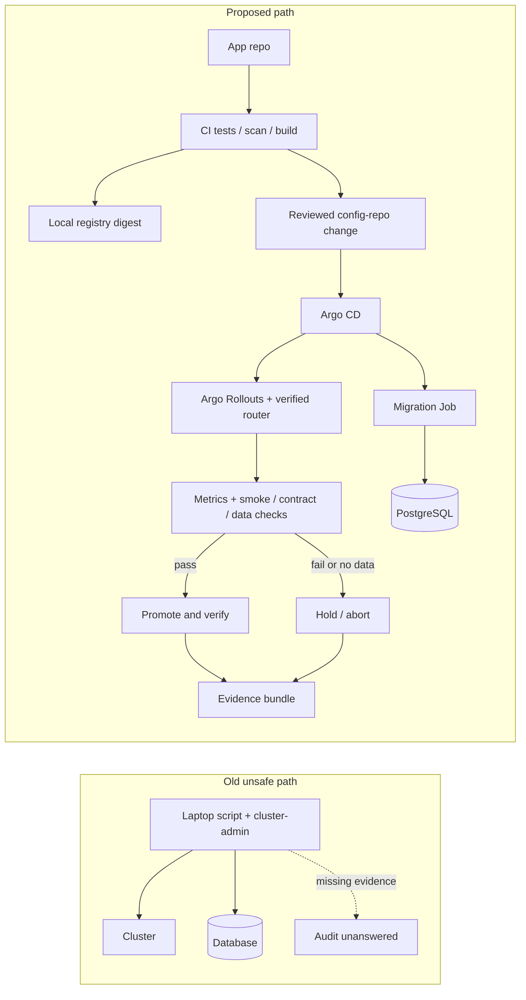
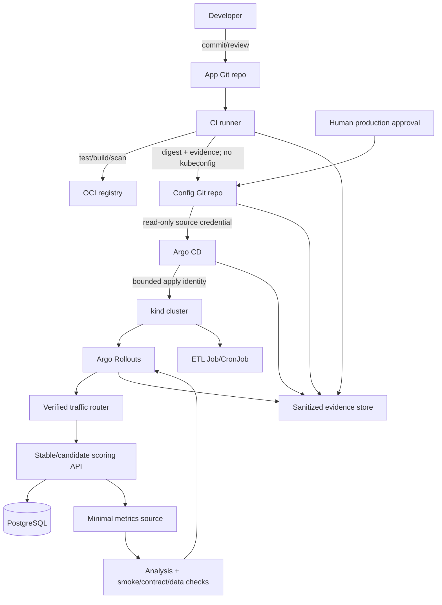

# Project — GitOps-Controlled Data Service Release

> M08 capstone specification with embedded starter files. Fenced code blocks are learner-created files; this document is the only generated artifact. No live cluster, database, CI, controller, router, registry, secret manager or cloud account was exercised while authoring. Any expected output is illustrative, not captured evidence.

## Table of contents
1. [Project metadata and completion contract](#1-project-metadata-and-completion-contract)
2. [Scenario and incident context](#2-scenario-and-incident-context)
3. [Learning outcomes](#3-learning-outcomes)
4. [Architecture and trust boundaries](#4-architecture-and-trust-boundaries)
5. [Constraints and assumptions](#5-constraints-and-assumptions)
6. [Prerequisites and preflight](#6-prerequisites-and-preflight)
7. [Repository layout](#7-repository-layout)
8. [Resource sequencing](#8-resource-sequencing)
9. [Milestones](#9-milestones)
10. [Starter implementation](#10-starter-implementation)
11. [Release walkthrough](#11-release-walkthrough)
12. [Promotion, rollout, analysis and abort drills](#12-promotion-rollout-analysis-and-abort-drills)
13. [Migration and contract safety](#13-migration-and-contract-safety)
14. [Secrets, drift and failure drills](#14-secrets-drift-and-failure-drills)
15. [Evidence and audit](#15-evidence-and-audit)
16. [Acceptance matrix](#16-acceptance-matrix)
17. [Troubleshooting](#17-troubleshooting)
18. [Seven ADRs](#18-seven-adrs)
19. [Seven incident runbooks](#19-seven-incident-runbooks)
20. [Production-readiness review](#20-production-readiness-review)
21. [Measurement template](#21-measurement-template)
22. [100-point rubric](#22-100-point-rubric)
23. [Stretch goals](#23-stretch-goals)
24. [Self-review](#24-self-review)
25. [Evidence submission](#25-evidence-submission)
26. [Source and verification register](#26-source-and-verification-register)
27. [Independent ten-pass audit](#27-independent-ten-pass-audit)
28. [Completion sign-off](#28-completion-sign-off)

## 1. Project metadata and completion contract

| Field | Value |
|---|---|
| Stage/module | Stage 2E — Production DevOps & Platform Engineering, M08 — GitOps and Progressive Delivery |
| Project | GitOps-Controlled Data Service Release |
| Duration | 24–40 hours, split into phases |
| Difficulty | L1 foundations → L2 implementation → L3 production engineering → L4 operational judgment |
| Cost | $0 for local tools/synthetic data; local hardware costs excluded |
| Environment | WSL2 Ubuntu or Linux, Docker, `kind`, local Git and registry |
| Workloads | FastAPI `scoring-api`, ETL Job/CronJob, PostgreSQL schema/migrations |
| Control plane | Argo CD primary; Flux only in a separate cluster/phase |
| Progressive delivery | Argo Rollouts; router integration requires version-specific verification |
| Evidence | Release manifest, digest, config commit, approval, controller/rollout records, runtime observations and hash index |

The learner must demonstrate a release from source change to immutable image digest, reviewed config promotion, controller reconciliation, rollout decision, migration/contract checks, runtime verification and retained evidence. A written plan is not sufficient for hands-on gates. A `kind` lab is not proof of production isolation, statistically meaningful traffic analysis, enterprise identity or immutable retention.

**Completion blockers:** plaintext secrets in Git; unguarded destructive commands; CI holding cluster credentials; missing/stale metrics treated as healthy; replica count represented as traffic weight; untested data rollback assumptions; fabricated results; or inability to prove the running digest.

## 2. Scenario and incident context

A data/ML team deploys a FastAPI scoring API, ETL workload and PostgreSQL schema by running laptop scripts with cluster-admin credentials. A prior release locked a table; a “canary” was one of three Pods without traffic analysis; an emergency hotfix was reverted by reconciliation; a plaintext secret entered Git history; and an auditor asked, “What exactly ran in production on the 14th, and who approved it?” Nobody could answer.

The target separates application source from deployment configuration. CI tests/builds/scans and proposes desired state in Git; CI has **no Kubernetes credentials** and does not run `kubectl apply`. Argo CD reconciles reviewed configuration. Argo Rollouts progresses only when a supported router and valid analysis are configured. PostgreSQL changes use expand → migrate/backfill → contract. Evidence correlates source, build, digest, config commit, approval, controller revision, rollout decision, migration version, flag state and runtime observation.



## 3. Learning outcomes

- Explain desired state versus runtime truth and predict reconciliation.
- Test deterministic scoring, ETL output contract and migration safety.
- Keep CI separate from cluster authority; promote the same digest across environments.
- Restrict Argo CD source/destination/project boundaries and choose sync/prune/self-heal intentionally.
- Compare Flux in a separate cluster; never co-install Argo CD and Flux in one cluster.
- Distinguish replica-based rollout from traffic-weighted canary.
- Treat missing, stale, low-volume, malformed or gappy telemetry as `INCONCLUSIVE`.
- Design idempotent backfills, expand/migrate/contract and N-1 compatibility.
- Handle secret leakage, key recovery, drift and break-glass reconciliation.
- Reconstruct a release from evidence and state what cannot be proven.

| Level | Competency | Evidence |
|---|---|---|
| L1 | Vocabulary, trust boundaries, failure modes | Annotated architecture |
| L2 | Local checks and release record | Test output, rendered manifests, digest |
| L3 | Automated gates, migration/evidence checks | Captured check results and drills |
| L4 | Uncertainty, blast radius and recovery judgment | ADRs, runbooks, measurements, readiness review |

## 4. Architecture and trust boundaries



| Identity | Purpose | Must not be used for |
|---|---|---|
| Developer Git identity | Commit/review | Routine direct workload writes |
| CI Git credential | Narrow branch/PR | `kubectl`, cluster-admin, controller credentials |
| Registry credential | Push/pull images | Kubernetes API authorization |
| Argo CD source credential | Read config repo | Push commits |
| Controller identity | Reconcile permitted resources | General human administration |
| Throwaway signing key | Local signing demo | Production signing |
| Secret encryption key | Decrypt selected config | Signing or cluster administration |
| Break-glass identity | Time-bounded emergency access | Routine deployment |

A `prod` namespace in local `kind` is simulated production, not a security boundary. Local reviewers and branch rules do not reproduce enterprise SSO or independently audited identity.

Evidence chain: `source commit → CI run → tests/scans/signature/provenance → image digest → config commit → approval → controller sync/revision → migration + flag state → rollout analysis → runtime image identity → post-deploy checks → evidence bundle`. Correlate by release ID, full source SHA, CI run ID, registry digest, config SHA, controller operation/revision, rollout UID/revision, migration version and timezone-aware timestamps. Missing joins are evidence gaps, not permission to infer.

## 5. Constraints and assumptions

- **[ASSUMPTION]** Disposable cluster name: `m08-capstone`.
- **[ASSUMPTION]** Local bare Git is the light baseline; Gitea is optional. Argo CD needs a source endpoint reachable from inside the cluster.
- **[VERIFY]** Pin compatible kind/Kubernetes, Argo CD, Flux, Argo Rollouts, PostgreSQL, image, metrics, router and secret-tool versions.
- **[VERIFY]** Traffic routing requires a supported router and correct CRD schema. Without it, mark live weighted routing `NOT RUN`; do not infer weights from Pod counts.
- Container `localhost` is not automatically the host or another container; test DNS and network reachability from controller Pods.
- Use synthetic data only. No public ingress or production target.
- Avoid running both controllers, Gitea, registry, full Prometheus, ingress and service mesh simultaneously on an 8 GB laptop.
- A local folder plus hashes is not immutable; hashes do not prove authorship or trusted time.

## 6. Prerequisites and preflight

Required: Git, Python 3.11+ (or chosen pinned version), Docker, `kind`, `kubectl`, Kustomize/`kubectl kustomize`, `make`; optional `jq`.

```bash
mkdir -p "$HOME/labs/m08-gitops-capstone"
cd "$HOME/labs/m08-gitops-capstone"
git --version
python3 --version
docker version
kind version
kubectl version --client
```

**Representative expected output — not captured from a run:** version commands succeed. Missing tools block preflight.

Create `versions.txt` from actual commands:

```text
kind=<actual version>
kubernetes=<actual server version>
argocd=<actual version or NOT RUN>
flux=<actual version or NOT RUN>
argo-rollouts=<actual version or NOT RUN>
postgresql=<actual server version or NOT RUN>
python=<actual version>
fastapi=<installed version>
prometheus=<actual version or NOT RUN>
router=<name/version or NOT RUN>
secret-tool=<name/version or NOT RUN>
git-server=<actual version or local bare Git>
```

### `scripts/context_guard.sh`

```bash
#!/usr/bin/env bash
set -euo pipefail
EXPECTED_CONTEXT="${EXPECTED_CONTEXT:-kind-m08-capstone}"
EXPECTED_NAMESPACE="${EXPECTED_NAMESPACE:-dev}"
ACTION="${1:-check}"
CURRENT="$(kubectl config current-context 2>/dev/null || true)"
if [[ -z "$CURRENT" || "$CURRENT" != "$EXPECTED_CONTEXT" ]]; then
  printf 'REFUSING: expected context %s; current context %s\n' "$EXPECTED_CONTEXT" "${CURRENT:-<none>}" >&2
  exit 20
fi
if ! kubectl --context "$EXPECTED_CONTEXT" get namespace "$EXPECTED_NAMESPACE" >/dev/null 2>&1; then
  printf 'REFUSING: namespace %s missing in %s\n' "$EXPECTED_NAMESPACE" "$EXPECTED_CONTEXT" >&2
  exit 21
fi
printf 'Context guard PASS: context=%s namespace=%s action=%s\n' "$EXPECTED_CONTEXT" "$EXPECTED_NAMESPACE" "$ACTION"
```

Make executable. This fails closed for wrong context/namespace but cannot independently prove cluster disposability. Inspect `kind get clusters`, `kubectl config get-contexts` and current context before mutation.

### `scripts/bootstrap.sh`

```bash
#!/usr/bin/env bash
set -euo pipefail
NAME="${CLUSTER_NAME:-m08-capstone}"
MODE="${1:-preflight}"
case "$MODE" in
  preflight)
    command -v docker >/dev/null; command -v kind >/dev/null; command -v kubectl >/dev/null
    docker info >/dev/null
    if kind get clusters | grep -Fxq "$NAME"; then
      echo "Refusing existing cluster; inspect before proceeding." >&2; exit 30
    fi
    echo "Preflight PASS; no resources created."
    ;;
  create)
    [[ "${CONFIRM_CREATE_KIND:-}" == "YES_CREATE_DISPOSABLE_M08_CLUSTER" ]] || { echo "Explicit confirmation required" >&2; exit 31; }
    if kind get clusters | grep -Fxq "$NAME"; then echo "Refusing existing cluster" >&2; exit 32; fi
    kind create cluster --name "$NAME"
    kubectl config use-context "kind-$NAME"
    for ns in dev staging prod; do kubectl --context "kind-$NAME" create namespace "$ns"; done
    ;;
  *) echo "Usage: $0 [preflight|create]" >&2; exit 2 ;;
esac
```

`create` mutates resources. **⚠ DESTRUCTIVE — DISPOSABLE LAB ONLY:** deletion must name the exact cluster, display target list, export evidence and require separate confirmation.

## 7. Repository layout

```text
m08-capstone/
├── app-repo/
│   ├── app/{main.py,flags.py,metrics.py}
│   ├── etl/worker.py
│   ├── db/schema.sql
│   ├── db/migrations/{001_expand.sql,002_backfill.sql,003_contract.sql}
│   ├── contracts/etl-output.schema.json
│   ├── tests/{test_app.py,test_contracts.py}
│   ├── scripts/{migration_lint.py,backfill.py,replay_diff.py,flag_expiry_lint.py,build_image.sh}
│   ├── Dockerfile, requirements.txt, Makefile
│   └── .github/workflows/ci.yml
├── config-repo/
│   ├── apps/scoring-api/base/{deployment.yaml,service.yaml,kustomization.yaml}
│   ├── apps/scoring-api/overlays/{dev,staging,prod}/kustomization.yaml
│   ├── apps/etl/base/{job.yaml,kustomization.yaml}
│   ├── platform/postgres/
│   ├── argocd/{project.yaml,application-dev.yaml,application-staging.yaml,application-prod.yaml}
│   ├── flux/{gitrepository.yaml,kustomization.yaml}
│   ├── rollouts/{rollout-canary.yaml,rollout-bluegreen.yaml,services.yaml,analysis-template.yaml}
│   └── policy/
├── scripts/{promote.py,secret_policy.py,drift_audit.py,unmanaged_audit.py,release_manifest.py,verify_evidence.py,compare_runtime.py,event_sink.py,timeline.py,segregation_check.py,health_gate.py}
├── adr/ADR-001.md ... ADR-007.md
├── runbooks/RB-001.md ... RB-007.md
├── evidence/<release-id>/
└── versions.txt, Makefile
```

`app-repo` owns app/ETL/contracts/migrations and CI; `config-repo` owns desired state; `scripts/` owns gates/evidence checks. No keys or secrets in Git.

## 8. Resource sequencing

| Phase | Components | Stop before next phase |
|---|---|---|
| 0 | Git/Python/tests; PostgreSQL only if needed | Stop DB when done |
| 1 | kind + registry + bare Git or Gitea | Stop unused Git UI |
| 2 | kind + Argo CD + app; DB only for integration | Export evidence; tear down before Flux |
| 3 | Argo Rollouts + one minimal metrics source/router | Stop optional components after tests |
| 4 | Separate kind cluster + Flux + one environment | Delete only named Flux cluster |
| 5 | Local evidence scripts | No cluster |

## 9. Milestones

| Milestone | Estimate | Deliverable | Completion gate |
|---|---:|---|---|
| M1 App/contracts | 2–4 h | FastAPI, ETL schema/tests | Tests pass |
| M2 Migration | 3–5 h | Expand/backfill/contract, lint | N-1 and rerun test |
| M3 Image/CI | 2–4 h | Build/digest capture | Real digest; no cluster creds |
| M4 GitOps | 4–6 h | Argo project/apps/overlays | Reconcile evidence |
| M5 Delivery | 4–7 h | Router/analysis/abort | Measured weight or `NOT RUN`; no-data fails closed |
| M6 Secrets/drift | 3–5 h | Policy and drills | Rotation/reconciliation evidence |
| M7 Evidence | 3–5 h | Manifest/hash/runtime/timeline | Query lists claims and gaps |
| M8 Flux/review | 2–4 h | Separate Flux, ADRs, runbooks | No overlap; readiness review |

## 10. Starter implementation

### `app-repo/requirements.txt`

```text
fastapi==0.115.12
uvicorn[standard]==0.34.0
prometheus-client==0.21.1
pydantic==2.10.6
httpx==0.28.1
pytest==8.3.5
jsonschema==4.23.0
```

These are illustrative reproducibility pins, not a claim of latest or tested compatibility. Resolve/test locally.

### `app-repo/app/flags.py`

```python
import os
def enabled(flag_name: str, default: bool = False) -> bool:
    raw = os.getenv("FLAG_" + flag_name.upper().replace("-", "_"))
    if raw is None: return default
    value = raw.strip().lower()
    if value in {"1","true","yes","on"}: return True
    if value in {"0","false","no","off"}: return False
    return default
```

### `app-repo/app/metrics.py`

```python
from prometheus_client import Counter, Histogram, Gauge
REQUESTS = Counter("scoring_requests_total", "Requests handled", ["route","outcome","version"])
LATENCY = Histogram("scoring_request_duration_seconds", "Request duration", ["route","version"])
FALLBACKS = Counter("scoring_fallback_total", "Fallback decisions", ["reason","version"])
MODEL_SHIFT = Gauge("scoring_candidate_shift_ratio", "Synthetic candidate shift", ["version"])
ETL_LAST_SUCCESS = Gauge("etl_last_success_timestamp_seconds", "Unix timestamp of last ETL success")
```

Keep labels bounded; never use user IDs, raw payloads, tokens or arbitrary exception strings.

### `app-repo/app/main.py`

```python
import os, time, hashlib
from fastapi import FastAPI, HTTPException, Request, Response
from pydantic import BaseModel, Field
from prometheus_client import CONTENT_TYPE_LATEST, generate_latest
from app.flags import enabled
from app.metrics import REQUESTS, LATENCY, FALLBACKS, MODEL_SHIFT

APP_VERSION=os.getenv("APP_VERSION","0.1.0")
BUILD_SHA=os.getenv("BUILD_SHA","unknown")
MODEL_VERSION=os.getenv("MODEL_VERSION","synthetic-model-v1")
LAB_MODE=os.getenv("LAB_MODE","false").lower()=="true"
app=FastAPI(title="scoring-api",version=APP_VERSION)

class ScoreRequest(BaseModel):
    record_id: str = Field(min_length=1,max_length=64)
    features: list[float] = Field(min_length=1,max_length=64)
class ScoreResponse(BaseModel):
    record_id: str
    score: float
    model_version: str
    build_sha: str
    candidate_used: bool

def synthetic_score(features: list[float], salt: str) -> float:
    raw=sum(features)/len(features)
    noise=(int(hashlib.sha256(salt.encode()).hexdigest()[:4],16)%100)/10000
    return round(max(0.0,min(1.0,0.5+raw/(1+abs(raw))/2+noise)),6)

@app.middleware("http")
async def metrics_middleware(request: Request, call_next):
    start=time.perf_counter()
    route=request.url.path if request.url.path in {"/health","/ready","/score","/version","/metrics"} else "other"
    outcome="server_error"
    try:
        response=await call_next(request)
        outcome="success" if response.status_code<500 else "server_error"
        return response
    finally:
        REQUESTS.labels(route,outcome,APP_VERSION).inc()
        LATENCY.labels(route,APP_VERSION).observe(time.perf_counter()-start)

@app.get("/health")
def health(): return {"status":"ok"}
@app.get("/ready")
def ready(): return {"ready":True}  # Production should use bounded dependency checks.
@app.get("/version")
def version(): return {"service":"scoring-api","app_version":APP_VERSION,"build_sha":BUILD_SHA,"model_version":MODEL_VERSION}
@app.get("/metrics")
def metrics(): return Response(generate_latest(),media_type=CONTENT_TYPE_LATEST)
@app.post("/score",response_model=ScoreResponse)
def score(body: ScoreRequest):
    candidate=enabled("candidate-model",False)
    if LAB_MODE and os.getenv("LAB_FAULT")=="http-error":
        raise HTTPException(status_code=503,detail="SIMULATED lab-only fault")
    value=synthetic_score(body.features,"candidate-v2" if candidate else "stable-v1")
    if candidate and LAB_MODE and os.getenv("LAB_FAULT")=="model-shift":
        value=round(min(1.0,value+0.35),6); MODEL_SHIFT.labels(APP_VERSION).set(0.35)
    else: MODEL_SHIFT.labels(APP_VERSION).set(0.0)
    if LAB_MODE and os.getenv("LAB_FAULT")=="fallback": FALLBACKS.labels("lab_fault",APP_VERSION).inc()
    return ScoreResponse(record_id=body.record_id,score=value,model_version=MODEL_VERSION,
                         build_sha=BUILD_SHA,candidate_used=candidate)
```

Run from `app-repo/`: `python -m uvicorn app.main:app --host 127.0.0.1 --port 8000`. Fault injection requires `LAB_MODE=true` plus a named `LAB_FAULT`; never enable in a production image. Scoring is synthetic, not a trained model.

### `app-repo/tests/test_app.py`

```python
from fastapi.testclient import TestClient
from app.main import app
client=TestClient(app)
def test_health_version():
    assert client.get("/health").status_code==200
    assert client.get("/version").json()["service"]=="scoring-api"
def test_score_deterministic(monkeypatch):
    monkeypatch.setenv("FLAG_CANDIDATE_MODEL","false")
    payload={"record_id":"fixture-1","features":[0.1,0.2,0.3]}
    a,b=client.post("/score",json=payload),client.post("/score",json=payload)
    assert a.status_code==b.status_code==200 and a.json()["score"]==b.json()["score"]
def test_invalid_features():
    assert client.post("/score",json={"record_id":"x","features":[]}).status_code==422
```

### `app-repo/contracts/etl-output.schema.json`

```json
{
  "$schema":"https://json-schema.org/draft/2020-12/schema",
  "title":"ETL aggregate output",
  "type":"object",
  "required":["batch_id","schema_version","row_count","aggregate_score","source_snapshot"],
  "properties":{
    "batch_id":{"type":"string","minLength":1},
    "schema_version":{"const":"1"},
    "row_count":{"type":"integer","minimum":0},
    "aggregate_score":{"type":"number","minimum":0,"maximum":1},
    "source_snapshot":{"type":"string","minLength":1}
  },
  "additionalProperties":false
}
```

### `app-repo/etl/worker.py`

```python
import json, hashlib, sys
from pathlib import Path
def build_batch(records: list[dict], batch_id: str) -> dict:
    if not batch_id.strip(): raise ValueError("batch_id required")
    scores=[float(r["score"]) for r in records]
    if any(x<0 or x>1 for x in scores): raise ValueError("score outside [0,1]")
    raw=json.dumps(records,sort_keys=True,separators=(",",":")).encode()
    return {"batch_id":batch_id,"schema_version":"1","row_count":len(records),
            "aggregate_score":round(sum(scores)/len(scores),6) if scores else 0.0,
            "source_snapshot":hashlib.sha256(raw).hexdigest()}
if __name__=="__main__":
    if len(sys.argv)!=3: raise SystemExit("usage: worker.py INPUT.json OUTPUT.json")
    src,dst=map(Path,sys.argv[1:])
    rows=json.loads(src.read_text(encoding="utf-8"))
    if not isinstance(rows,list) or any(not isinstance(r,dict) or "score" not in r for r in rows):
        raise SystemExit("input must be list of objects containing score")
    out=build_batch(rows,src.stem)
    dst.write_text(json.dumps(out,indent=2)+"\\n",encoding="utf-8")
    print(f"wrote batch={out['batch_id']} rows={out['row_count']} snapshot={out['source_snapshot']}")
```

### PostgreSQL schema/migrations

`db/schema.sql`:

```sql
CREATE TABLE IF NOT EXISTS scoring_results (
  record_id TEXT PRIMARY KEY,
  score DOUBLE PRECISION NOT NULL CHECK (score >= 0 AND score <= 1),
  created_at TIMESTAMPTZ NOT NULL DEFAULT now()
);
```

`001_expand.sql`:

```sql
SET lock_timeout = '2s';
ALTER TABLE scoring_results ADD COLUMN IF NOT EXISTS model_version TEXT;
ALTER TABLE scoring_results ADD COLUMN IF NOT EXISTS batch_id TEXT;
```

`002_backfill.sql`:

```sql
SET lock_timeout = '2s';
UPDATE scoring_results SET model_version='legacy-unknown' WHERE model_version IS NULL;
```

`003_contract.sql`:

```sql
SET lock_timeout = '2s';
DO $$ BEGIN
  IF EXISTS (SELECT 1 FROM scoring_results WHERE model_version IS NULL) THEN
    RAISE EXCEPTION 'contract blocked: model_version still NULL';
  END IF;
END $$;
ALTER TABLE scoring_results ALTER COLUMN model_version SET NOT NULL;
```

Verify lock/DDL behavior against installed PostgreSQL. `CREATE INDEX CONCURRENTLY` has transaction restrictions; do not place it in a transaction-wrapped migration without checking the runner. These snippets are not a production migration framework. Contract must wait until old writers are retired and compatibility is proven.

### `app-repo/scripts/migration_lint.py`

```python
from pathlib import Path
import re, sys
RULES=[
 (re.compile(r"\\bDROP\\s+TABLE\\b",re.I),"DROP TABLE requires review/recovery proof"),
 (re.compile(r"\\bALTER\\s+TABLE\\b.*\\bSET\\s+NOT\\s+NULL\\b",re.I),"SET NOT NULL needs backfill validation"),
 (re.compile(r"\\bDELETE\\s+FROM\\b",re.I),"DELETE requires bounded predicate/recovery plan"),
 (re.compile(r"\\bTRUNCATE\\b",re.I),"TRUNCATE is destructive"),
]
def lint(path: Path) -> list[str]:
    text=path.read_text(encoding="utf-8")
    errors=[f"{path}:{text.count(chr(10),0,m.start())+1}: {msg}" for pat,msg in RULES for m in pat.finditer(text)]
    if re.search(r"\\bALTER\\s+TABLE\\b",text,re.I) and "lock_timeout" not in text.lower():
        errors.append(f"{path}: missing lock_timeout policy")
    return errors
if __name__=="__main__":
    files=[Path(x) for x in sys.argv[1:]]
    if not files: raise SystemExit("usage: migration_lint.py migration.sql [...]")
    errors=[e for f in files for e in lint(f)]
    print("\\n".join(errors) if errors else f"PASS: reviewed {len(files)} migrations")
    raise SystemExit(1 if errors else 0)
```

This heuristic linter has false positives/negatives; it is not a SQL parser.

### `app-repo/scripts/backfill.py`

```python
import json, sys
from pathlib import Path
def backfill(rows: list[dict]) -> list[dict]:
    seen=set(); out=[]
    for row in rows:
        key=row.get("record_id")
        if not isinstance(key,str) or not key: raise ValueError("record_id required")
        if key in seen: raise ValueError(f"duplicate record_id {key}")
        seen.add(key); item=dict(row); item.setdefault("model_version","legacy-unknown"); out.append(item)
    return out
if __name__=="__main__":
    if len(sys.argv)!=3: raise SystemExit("usage: backfill.py INPUT.json OUTPUT.json")
    src,dst=map(Path,sys.argv[1:])
    out=backfill(json.loads(src.read_text(encoding="utf-8")))
    dst.write_text(json.dumps(out,indent=2)+"\\n",encoding="utf-8")
    print(f"rows={len(out)}; fixture output written")
```

### `app-repo/scripts/replay_diff.py`

```python
import json, sys
from pathlib import Path
def compare(a: list[dict], b: list[dict], tolerance: float=0.02) -> dict:
    old={x["record_id"]:x for x in a}; new={x["record_id"]:x for x in b}
    if set(old)!=set(new): return {"decision":"INCOMPLETE","reason":"record sets differ"}
    deltas={k:abs(float(old[k]["score"])-float(new[k]["score"])) for k in sorted(old)}
    bad={k:v for k,v in deltas.items() if v>tolerance}
    return {"decision":"FAIL" if bad else "PASS","tolerance":tolerance,"max_delta":max(deltas.values(),default=0),"violations":bad}
if __name__=="__main__":
    if len(sys.argv)!=3: raise SystemExit("usage: replay_diff.py BASELINE.json CANDIDATE.json")
    out=compare(json.loads(Path(sys.argv[1]).read_text()),json.loads(Path(sys.argv[2]).read_text()))
    print(json.dumps(out,indent=2)); raise SystemExit(1 if out["decision"]!="PASS" else 0)
```

### `app-repo/scripts/flag_expiry_lint.py`

```python
import json, sys
from datetime import date
from pathlib import Path
REQUIRED={"name","owner","created","remove_by","default","rollback_behavior"}
def check(doc: dict, today: date) -> list[str]:
    errors=[]
    for i,f in enumerate(doc.get("flags",[])):
        missing=REQUIRED-f.keys()
        if missing: errors.append(f"flags[{i}] missing {sorted(missing)}"); continue
        try: created,end=date.fromisoformat(f["created"]),date.fromisoformat(f["remove_by"])
        except ValueError: errors.append(f"flags[{i}] invalid date"); continue
        if end<created: errors.append(f"flags[{i}] remove_by precedes created")
        if end<today: errors.append(f"flags[{i}] expired")
        if not str(f["owner"]).strip(): errors.append(f"flags[{i}] empty owner")
    return errors
if __name__=="__main__":
    if len(sys.argv)!=2: raise SystemExit("usage: flag_expiry_lint.py flags.json")
    errors=check(json.loads(Path(sys.argv[1]).read_text()),date.today())
    print("\\n".join(errors) if errors else "PASS: flag metadata complete/unexpired")
    raise SystemExit(1 if errors else 0)
```

`flags.json` fixture:

```json
{"flags":[
 {"name":"candidate-model","owner":"team-ml-platform","created":"2026-01-01","remove_by":"2027-01-01","default":false,"rollback_behavior":"false selects stable"},
 {"name":"shadow-model","owner":"team-ml-platform","created":"2026-01-01","remove_by":"2026-12-01","default":false,"rollback_behavior":"false disables shadow"}
]}
```

### `app-repo/Dockerfile`

```dockerfile
FROM python:3.11-slim
ENV PYTHONDONTWRITEBYTECODE=1 PYTHONUNBUFFERED=1
WORKDIR /srv/app
RUN addgroup --system app && adduser --system --ingroup app app
COPY requirements.txt .
RUN pip install --no-cache-dir -r requirements.txt
COPY app ./app
COPY etl ./etl
USER app
EXPOSE 8000
CMD ["python","-m","uvicorn","app.main:app","--host","0.0.0.0","--port","8000"]
```

Pin base image to an actual captured digest when available. Do not invent it.

### `app-repo/scripts/build_image.sh`

```bash
#!/usr/bin/env bash
set -euo pipefail
IMAGE="${IMAGE_NAME:-localhost:5001/scoring-api}"
TAG="${TAG:-dev-$(git rev-parse --short=12 HEAD)}"
[[ -f Dockerfile ]] || { echo "Run from app-repo root" >&2; exit 2; }
git rev-parse --verify HEAD >/dev/null
docker build --label "org.opencontainers.image.revision=$(git rev-parse HEAD)" -t "$IMAGE:$TAG" .
docker push "$IMAGE:$TAG"
echo "Capture registry manifest sha256 digest using the installed registry's supported inspect API."
echo "Do not substitute local image ID or mutable tag for registry digest."
```

The registry-specific digest command must be implemented and verified for the chosen registry before passing the image identity gate.

### `app-repo/tests/test_contracts.py`

```python
import json
from pathlib import Path
from jsonschema import validate, ValidationError
SCHEMA=json.loads(Path("contracts/etl-output.schema.json").read_text())
def test_valid_record():
    validate({"batch_id":"b1","schema_version":"1","row_count":2,"aggregate_score":0.4,"source_snapshot":"abc"},SCHEMA)
def test_extra_field_rejected():
    try:
        validate({"batch_id":"b1","schema_version":"1","row_count":2,"aggregate_score":0.4,"source_snapshot":"abc","secret":"x"},SCHEMA)
    except ValidationError: return
    raise AssertionError("unexpected property should fail")
```

### `.github/workflows/ci.yml`

```yaml
name: m08-capstone-ci
on:
  push:
  pull_request:
jobs:
  test:
    runs-on: ubuntu-latest
    permissions:
      contents: read
    steps:
      - uses: actions/checkout@v4
      - uses: actions/setup-python@v5
        with:
          python-version: '3.11'
      - run: pip install -r requirements.txt
      - run: python -m pytest -q
      - run: python scripts/migration_lint.py db/migrations/001_expand.sql db/migrations/002_backfill.sql db/migrations/003_contract.sql
      - run: python scripts/flag_expiry_lint.py flags.json
      - run: python -m compileall -q app etl scripts
```

This workflow is illustrative and was not run. It intentionally omits publish/sign because those require verified tool/registry setup. The required design must capture the actual digest and propose a config-repo change using narrow Git credentials; no kubeconfig or `kubectl apply`. Local fallback is `make test`; `act` is optional and compatibility must be checked.

### `config-repo/apps/scoring-api/base/deployment.yaml`

```yaml
apiVersion: apps/v1
kind: Deployment
metadata:
  name: scoring-api
  labels: {app.kubernetes.io/name: scoring-api}
spec:
  replicas: 2
  selector:
    matchLabels: {app.kubernetes.io/name: scoring-api}
  template:
    metadata:
      labels: {app.kubernetes.io/name: scoring-api}
    spec:
      serviceAccountName: scoring-api
      automountServiceAccountToken: false
      securityContext:
        runAsNonRoot: true
        seccompProfile: {type: RuntimeDefault}
      containers:
        - name: api
          image: localhost:5001/scoring-api@sha256:REPLACE_WITH_ACTUAL_DIGEST
          ports: [{name: http, containerPort: 8000}]
          env:
            - {name: APP_VERSION, value: "0.1.0"}
            - {name: LAB_MODE, value: "false"}
          readinessProbe: {httpGet: {path: /ready, port: http}, initialDelaySeconds: 2, periodSeconds: 5}
          livenessProbe: {httpGet: {path: /health, port: http}, initialDelaySeconds: 5, periodSeconds: 10}
          resources:
            requests: {cpu: 100m, memory: 128Mi}
            limits: {cpu: 500m, memory: 384Mi}
          securityContext:
            allowPrivilegeEscalation: false
            readOnlyRootFilesystem: true
            capabilities: {drop: [ALL]}
```

The placeholder digest is invalid and must fail policy. Replace it only with the actual registry digest. Test whether the chosen image needs writable temporary mounts.

### Service and Kustomize base

`service.yaml`:

```yaml
apiVersion: v1
kind: Service
metadata: {name: scoring-api}
spec:
  selector: {app.kubernetes.io/name: scoring-api}
  ports: [{name: http, port: 80, targetPort: http}]
```

`kustomization.yaml`:

```yaml
apiVersion: kustomize.config.k8s.io/v1beta1
kind: Kustomization
resources: [deployment.yaml, service.yaml]
```

Each overlay preserves the same digest; namespace/replicas are illustrative allow-listed differences:

```yaml
# overlays/dev/kustomization.yaml
apiVersion: kustomize.config.k8s.io/v1beta1
kind: Kustomization
namespace: dev
resources: [../../base]
replicas: [{name: scoring-api, count: 1}]
```

```yaml
# overlays/staging/kustomization.yaml
apiVersion: kustomize.config.k8s.io/v1beta1
kind: Kustomization
namespace: staging
resources: [../../base]
replicas: [{name: scoring-api, count: 2}]
```

```yaml
# overlays/prod/kustomization.yaml
apiVersion: kustomize.config.k8s.io/v1beta1
kind: Kustomization
namespace: prod
resources: [../../base]
replicas: [{name: scoring-api, count: 2}]
```

### Argo CD AppProject/Application

`config-repo/argocd/project.yaml` (verify installed CRD):

```yaml
apiVersion: argoproj.io/v1alpha1
kind: AppProject
metadata: {name: m08-data-service, namespace: argocd}
spec:
  description: Local capstone; not a production policy template
  sourceRepos: ["http://git-server.local/config-repo.git"]
  destinations:
    - {namespace: dev, server: https://kubernetes.default.svc}
    - {namespace: staging, server: https://kubernetes.default.svc}
    - {namespace: prod, server: https://kubernetes.default.svc}
  clusterResourceWhitelist: []
  namespaceResourceWhitelist:
    - {group: "", kind: Service}
    - {group: "", kind: ConfigMap}
    - {group: apps, kind: Deployment}
    - {group: argoproj.io, kind: Rollout}
```

`application-dev.yaml`:

```yaml
apiVersion: argoproj.io/v1alpha1
kind: Application
metadata: {name: scoring-api-dev, namespace: argocd}
spec:
  project: m08-data-service
  source:
    repoURL: http://git-server.local/config-repo.git
    targetRevision: main
    path: apps/scoring-api/overlays/dev
  destination:
    server: https://kubernetes.default.svc
    namespace: dev
  syncPolicy:
    automated: {prune: false, selfHeal: true}
    syncOptions: [CreateNamespace=true]
```

`git-server.local` is a placeholder and must resolve inside the controller Pod. Staging/prod need their own paths and namespaces; prod-like promotion should require manual approval/sync. Verify project, sync-window and `CreateNamespace` semantics for the installed release. Prune is off initially. Do not apply before reviewing allowed sources/destinations/resources and safely handling initial admin credentials.

### Flux on separate cluster only

```yaml
apiVersion: source.toolkit.fluxcd.io/v1
kind: GitRepository
metadata: {name: scoring-config, namespace: flux-system}
spec:
  interval: 1m
  url: http://git-server.local/config-repo.git
  ref: {branch: main}
---
apiVersion: kustomize.toolkit.fluxcd.io/v1
kind: Kustomization
metadata: {name: scoring-dev, namespace: flux-system}
spec:
  interval: 5m
  path: ./apps/scoring-api/overlays/dev
  prune: false
  sourceRef: {kind: GitRepository, name: scoring-config}
  targetNamespace: dev
```

**[VERIFY]** API versions/fields vary; inspect installed CRDs (`kubectl explain`) and official docs. Never apply this to the Argo CD cluster. If separate cluster cannot be run, mark live Flux `NOT RUN`; do not claim execution.

### Argo Rollouts gated examples

This Rollout is **not traffic-weighted** until supported router fields are added and measured.

```yaml
apiVersion: argoproj.io/v1alpha1
kind: Rollout
metadata: {name: scoring-api, namespace: dev}
spec:
  replicas: 3
  selector:
    matchLabels: {app.kubernetes.io/name: scoring-api}
  template:
    metadata:
      labels: {app.kubernetes.io/name: scoring-api}
    spec:
      serviceAccountName: scoring-api
      automountServiceAccountToken: false
      containers:
        - name: api
          image: localhost:5001/scoring-api@sha256:REPLACE_WITH_ACTUAL_DIGEST
          ports: [{name: http, containerPort: 8000}]
          readinessProbe: {httpGet: {path: /ready, port: http}}
          livenessProbe: {httpGet: {path: /health, port: http}}
          resources:
            requests: {cpu: 100m, memory: 128Mi}
            limits: {cpu: 500m, memory: 384Mi}
  strategy:
    canary:
      steps:
        - setWeight: 10
        - pause: {duration: 2m}
        - setWeight: 25
        - pause: {duration: 5m}
```

`setWeight` without a verified `trafficRouting` integration does not prove request weights. Blue-green is a separate exercise; verify active/preview service semantics against installed CRDs. Rollback of service routing does not undo database writes.

AnalysisTemplate sketch (provider schema is `[VERIFY]`):

```yaml
apiVersion: argoproj.io/v1alpha1
kind: AnalysisTemplate
metadata: {name: scoring-health-gate, namespace: dev}
spec:
  metrics:
    - name: request-volume-present
      interval: 1m
      count: 3
      successCondition: result[0] >= 20
      failureLimit: 1
      provider:
        prometheus:
          address: http://prometheus.monitoring.svc:9090
          query: sum(increase(scoring_requests_total{route="/score",outcome="success"}[2m]))
```

This is only a volume guard, not complete health analysis. Verify `result` and no-data semantics. Add validated candidate/baseline error/latency, freshness, minimum samples and query-error behavior before use. Empty metrics never imply health.

### Promotion gate — `scripts/promote.py`

```python
import argparse, json, sys
from pathlib import Path
ORDER={"dev":0,"staging":1,"prod":2}
REQUIRED={"release_id","digest","from_env","to_env","tests_passed","scan_passed","config_commit"}
def validate(row: dict, prod_approved: bool) -> list[str]:
    errors=sorted(REQUIRED-row.keys())
    d=row.get("digest","")
    if not isinstance(d,str) or not d.startswith("sha256:") or "REPLACE" in d or len(d)<20:
        errors.append("actual captured sha256 digest required")
    if row.get("tests_passed") is not True: errors.append("tests missing/failed")
    if row.get("scan_passed") is not True: errors.append("scan missing/failed")
    a,b=row.get("from_env"),row.get("to_env")
    if a not in ORDER or b not in ORDER or ORDER.get(b,-1)!=ORDER.get(a,-2)+1:
        errors.append("advance one environment in dev→staging→prod order")
    if b=="prod" and not prod_approved: errors.append("explicit prod-like approval required")
    if not row.get("config_commit"): errors.append("config commit missing")
    return errors
if __name__=="__main__":
    p=argparse.ArgumentParser(); p.add_argument("record",type=Path)
    p.add_argument("--prod-approved",action="store_true",help="local acknowledgement, not provider review proof")
    a=p.parse_args(); row=json.loads(a.record.read_text(encoding="utf-8")); errors=validate(row,a.prod_approved)
    if errors: print("FAIL\\n"+"\\n".join("- "+x for x in errors)); sys.exit(1)
    print("PASS: local record gate; provider approval needs independent evidence")
```

This does not create PRs, enforce provider branch protection, compare rendered allow-listed diffs, prevent concurrent promotion or prove approver identity. Implement and test these before marking promotion complete.

### Secret policy — `scripts/secret_policy.py`

```python
from pathlib import Path
import re, sys
SECRET=re.compile(r"^kind:\\s*Secret\\s*$",re.M)
DATA=re.compile(r"^\\s*(?:data|stringData):\\s*$",re.M)
def check(path: Path) -> list[str]:
    text=path.read_text(encoding="utf-8")
    if not SECRET.search(text): return []
    return [f"{path}: Secret data/stringData requires review; plaintext must not be committed"] if DATA.search(text) else []
if __name__=="__main__":
    files=[Path(x) for x in sys.argv[1:]]
    if not files: raise SystemExit("usage: secret_policy.py FILE...")
    errors=[e for f in files for e in check(f)]
    print("\\n".join(errors) if errors else "PASS: no configured rule matched")
    sys.exit(1 if errors else 0)
```

This heuristic is not a complete secret scanner. Choose one secret-reference pattern only after compatibility testing: SOPS/age, Sealed Secrets or External Secrets Operator. Never commit real secrets/keys. Leak response: detect → revoke/rotate immediately → restrict copies → clean history secondarily → verify old credential fails → record redacted timeline. Rewriting history does not recall copied secrets.

### Drift audit — `scripts/drift_audit.py`

```python
import json, sys
from pathlib import Path
def classify(x: dict) -> str:
    if x.get("owner")=="approved-controller-dynamic": return "EXPECTED_DYNAMIC"
    if x.get("break_glass"): return "BREAK_GLASS_REVIEW_REQUIRED"
    if x.get("managed_by_gitops") is False: return "UNMANAGED"
    if x.get("desired")!=x.get("live"): return "DRIFT"
    return "MATCH"
if __name__=="__main__":
    if len(sys.argv)!=2: raise SystemExit("usage: drift_audit.py fixture.json")
    rows=json.loads(Path(sys.argv[1]).read_text())
    if not isinstance(rows,list): raise SystemExit("expected JSON list")
    out=[{"resource":x.get("resource","unknown"),"classification":classify(x)} for x in rows]
    print(json.dumps(out,indent=2))
    sys.exit(1 if any(x["classification"] in {"DRIFT","UNMANAGED","BREAK_GLASS_REVIEW_REQUIRED"} for x in out) else 0)
```

This is fixture-only; live inventory must use context guard. No blanket ignore rules. Each ignored field needs owner, rationale, scope, expiry and a test.

### Release manifest generator — `scripts/release_manifest.py`

```python
import argparse, json, sys
from pathlib import Path
from datetime import datetime, timezone
REQUIRED=["release_id","service","source_commit","build_id","artifact_digest","config_commit","environment"]
def main():
    p=argparse.ArgumentParser(); p.add_argument("input",type=Path); p.add_argument("output",type=Path)
    a=p.parse_args(); d=json.loads(a.input.read_text(encoding="utf-8"))
    missing=[k for k in REQUIRED if not d.get(k)]
    digest=d.get("artifact_digest","")
    if not isinstance(digest,str) or not digest.startswith("sha256:") or "REPLACE" in digest:
        missing.append("artifact_digest must be actual captured sha256")
    if missing: print("INCOMPLETE: "+", ".join(missing),file=sys.stderr); return 2
    d["generated_at"]=datetime.now(timezone.utc).isoformat()
    a.output.write_text(json.dumps(d,indent=2,sort_keys=True)+"\\n",encoding="utf-8")
    print(f"manifest written: {d['release_id']} environment={d['environment']}")
    return 0
if __name__=="__main__": raise SystemExit(main())
```

Manifest fields should include PR/review and approver, CI tests/scans, SBOM/signature status, environment, config commit, controller sync, rollout result, migration version, flag state, post-deploy verification and bundle reference. Use `NOT RUN` honestly. Never include secrets.

### Evidence hash verifier — `scripts/verify_evidence.py`

```python
import hashlib, sys
from pathlib import Path
def sha(path: Path) -> str:
    h=hashlib.sha256()
    with path.open("rb") as f:
        for block in iter(lambda:f.read(1024*1024),b""): h.update(block)
    return h.hexdigest()
def verify(root: Path) -> tuple[bool,list[str]]:
    index=root/"SHA256SUMS"
    if not root.is_dir() or not index.is_file(): return False,["bundle or SHA256SUMS missing"]
    errors=[]
    for line in index.read_text(encoding="utf-8").splitlines():
        parts=line.split("  ",1)
        if len(parts)!=2: errors.append("malformed index line"); continue
        expected,rel=parts; path=(root/rel).resolve()
        if root.resolve() not in path.parents: errors.append(f"unsafe path: {rel}"); continue
        if not path.is_file(): errors.append(f"missing file: {rel}"); continue
        if sha(path)!=expected: errors.append(f"hash mismatch: {rel}")
    return not errors,errors
if __name__=="__main__":
    if len(sys.argv)!=2: raise SystemExit("usage: verify_evidence.py BUNDLE_DIR")
    ok,errors=verify(Path(sys.argv[1])); print("PASS: hashes match" if ok else "FAIL: "+"; ".join(errors))
    raise SystemExit(0 if ok else 1)
```

Do not include `SHA256SUMS` in itself. A writable directory/index can be rewritten together; independently anchor the final bundle hash for stronger tamper evidence. Versioning is not automatically WORM.

### Runtime digest comparison — `scripts/compare_runtime.py`

```python
import json, sys
from pathlib import Path
def declared(value: str) -> str | None:
    if "@sha256:" not in value: return None
    d=value.split("@sha256:",1)[1].lower()
    return "sha256:"+d if len(d)==64 and all(c in "0123456789abcdef" for c in d) else None
def observed(value: str) -> str | None:
    if "sha256:" not in value: return None
    d=value.rsplit("sha256:",1)[1][:64].lower()
    return "sha256:"+d if len(d)==64 and all(c in "0123456789abcdef" for c in d) else None
def compare(wanted: str, rows: list[dict]) -> dict:
    expected=declared(wanted)
    if not expected: return {"status":"UNKNOWN","reason":"desired image is not a digest reference"}
    if not rows: return {"status":"INCOMPLETE","reason":"no observations"}
    out=[]
    for r in rows:
        actual=observed(str(r.get("imageID","")))
        out.append({"pod":r.get("pod","unknown"),"container":r.get("container","unknown"),
                    "status":"UNKNOWN" if actual is None else "MATCH" if actual==expected else "MISMATCH",
                    "imageID":r.get("imageID","")})
    states={r["status"] for r in out}
    return {"status":"MISMATCH" if "MISMATCH" in states else "UNKNOWN" if "UNKNOWN" in states else "MATCH",
            "expected":expected,"observations":out}
if __name__=="__main__":
    if len(sys.argv)!=2: raise SystemExit("usage: compare_runtime.py fixture.json")
    d=json.loads(Path(sys.argv[1]).read_text()); result=compare(d["declared_image"],d.get("observations",[]))
    print(json.dumps(result,indent=2)); raise SystemExit(1 if result["status"]!="MATCH" else 0)
```

Not a universal production verifier: runtime `imageID` formats vary; multi-arch manifests complicate comparison. A hardened collector checks all replicas, regular/init containers and sidecars, handles rollout overlap, and fails `UNKNOWN`/`INCOMPLETE` on gaps.

### Event sink and timeline

`event_sink.py`:

```python
import json, sys
from pathlib import Path
from datetime import datetime, timezone
REQUIRED={"event_id","release_id","event_type","source","timestamp"}
def append(path: Path,event: dict):
    missing=REQUIRED-event.keys()
    if missing: raise ValueError(f"missing fields: {sorted(missing)}")
    ts=str(event["timestamp"])
    if not (ts.endswith("Z") or "+" in ts[-6:] or "-" in ts[-6:]): raise ValueError("timezone required")
    event=dict(event); event["received_at"]=datetime.now(timezone.utc).isoformat()
    path.parent.mkdir(parents=True,exist_ok=True)
    with path.open("a",encoding="utf-8") as f: f.write(json.dumps(event,sort_keys=True)+"\\n")
if __name__=="__main__":
    if len(sys.argv)!=3: raise SystemExit("usage: event_sink.py EVENTS.jsonl EVENT.json")
    append(Path(sys.argv[1]),json.loads(Path(sys.argv[2]).read_text()))
```

`timeline.py`:

```python
import json, sys
from pathlib import Path
from datetime import datetime
def build(paths: list[Path], release_id: str) -> dict:
    events=[]; seen=set(); issues=[]
    for path in paths:
        for n,line in enumerate(path.read_text(encoding="utf-8").splitlines(),1):
            if not line.strip(): continue
            try: row=json.loads(line)
            except json.JSONDecodeError: issues.append(f"{path}:{n}: invalid JSON"); continue
            if row.get("release_id")!=release_id: continue
            eid=row.get("event_id")
            if not eid: issues.append(f"{path}:{n}: missing event_id"); continue
            if eid in seen: issues.append(f"duplicate event_id: {eid}"); continue
            seen.add(eid)
            try: ts=datetime.fromisoformat(row["timestamp"].replace("Z","+00:00"))
            except Exception: issues.append(f"{eid}: invalid timestamp"); continue
            events.append((ts,row))
    events.sort(key=lambda x:(x[0],x[1]["event_id"]))
    if not events: issues.append("no matching events")
    return {"release_id":release_id,"status":"INCOMPLETE" if issues else "TIMELINE","issues":issues,"events":[e for _,e in events]}
if __name__=="__main__":
    if len(sys.argv)<3: raise SystemExit("usage: timeline.py RELEASE_ID EVENTS.jsonl [...]")
    result=build([Path(x) for x in sys.argv[2:]],sys.argv[1]); print(json.dumps(result,indent=2))
    raise SystemExit(1 if result["issues"] else 0)
```

Append-only-by-convention is not immutable. Timeline order does not prove causality; clock skew, delayed ingestion and retries matter. Correlate stable IDs as well as timestamps.

### Segregation of duties — `scripts/segregation_check.py`

```python
import json, sys
from pathlib import Path
def evaluate(r: dict) -> dict:
    return {
      "author_not_approver":"FAIL" if r.get("author") and r.get("author")==r.get("approver") else "PASS" if r.get("author") and r.get("approver") else "UNKNOWN",
      "reviewer_present":"PASS" if r.get("reviewers") else "FAIL",
      "protected_branch_evidence":"PASS" if r.get("protected_branch_verified") is True else "UNKNOWN" if r.get("protected_branch_verified") is None else "FAIL",
      "change_id_present":"PASS" if r.get("change_id") else "FAIL",
      "break_glass_review":"PASS" if not r.get("break_glass") or r.get("posthoc_review") else "FAIL"}
if __name__=="__main__":
    if len(sys.argv)!=2: raise SystemExit("usage: segregation_check.py record.json")
    result=evaluate(json.loads(Path(sys.argv[1]).read_text())); print(json.dumps(result,indent=2))
    raise SystemExit(1 if any(v!="PASS" for v in result.values()) else 0)
```

Fixture inputs do not prove real provider rules, reviewer identity or cluster RBAC.

### Health gate — `scripts/health_gate.py`

```python
import json, sys
from pathlib import Path
FIELDS=["sample_count","window_seconds","fresh","error_rate","p95_seconds","candidate_shift"]
def decide(d: dict) -> dict:
    missing=[k for k in FIELDS if k not in d]
    if missing: return {"decision":"INCONCLUSIVE","reason":f"missing fields: {missing}"}
    if d["fresh"] is not True: return {"decision":"INCONCLUSIVE","reason":"stale/unknown telemetry"}
    if d["sample_count"]<30 or d["window_seconds"]<60: return {"decision":"INCONCLUSIVE","reason":"insufficient sample/window"}
    vals=[d["error_rate"],d["p95_seconds"],d["candidate_shift"]]
    if any(not isinstance(x,(int,float)) for x in vals): return {"decision":"INCONCLUSIVE","reason":"non-numeric metric"}
    if any(x<0 for x in vals): return {"decision":"INCONCLUSIVE","reason":"invalid negative metric"}
    if d["error_rate"]>0.02 or d["p95_seconds"]>1.0 or d["candidate_shift"]>0.05:
        return {"decision":"FAIL","reason":"illustrative threshold exceeded"}
    return {"decision":"PASS","reason":"fixture meets illustrative thresholds"}
if __name__=="__main__":
    if len(sys.argv)!=2: raise SystemExit("usage: health_gate.py metrics.json")
    result=decide(json.loads(Path(sys.argv[1]).read_text())); print(json.dumps(result,indent=2))
    raise SystemExit(0 if result["decision"]=="PASS" else 1)
```

Thresholds are `[ILLUSTRATIVE]`, not universal SLOs. Real gates need metric units/labels, baseline, freshness, sample window, counter-reset and provider-error policy. Missing/stale/low-volume data never promotes.

Fixtures:

```json
{"sample_count":100,"window_seconds":120,"fresh":true,"error_rate":0.001,"p95_seconds":0.22,"candidate_shift":0.01}
```

```json
{"sample_count":0,"window_seconds":120,"fresh":true,"error_rate":0,"p95_seconds":0,"candidate_shift":0}
```

The second fixture must be `INCONCLUSIVE`. A fixture's `fresh` value is not proof of actual telemetry freshness.

### CI workflow and Makefiles

`.github/workflows/ci.yml`:

```yaml
name: m08-capstone-ci
on:
  push:
  pull_request:
jobs:
  test:
    runs-on: ubuntu-latest
    permissions:
      contents: read
    steps:
      - uses: actions/checkout@v4
      - uses: actions/setup-python@v5
        with:
          python-version: '3.11'
      - run: pip install -r requirements.txt
      - run: python -m pytest -q
      - run: python scripts/migration_lint.py db/migrations/001_expand.sql db/migrations/002_backfill.sql db/migrations/003_contract.sql
      - run: python scripts/flag_expiry_lint.py flags.json
      - run: python -m compileall -q app etl scripts
```

This is illustrative and was not run. It omits publish/sign because those need verified tools and registry. CI must capture the real digest and propose config change using narrow Git credentials; no kubeconfig or `kubectl apply`. Local fallback is `make test`.

`app-repo/Makefile`:

```makefile
.PHONY: test lint
test:
	python3 -m pytest -q
	python3 -m compileall -q app etl scripts
lint:
	python3 scripts/migration_lint.py db/migrations/001_expand.sql db/migrations/002_backfill.sql db/migrations/003_contract.sql
	python3 scripts/flag_expiry_lint.py flags.json
```

Root `Makefile`:

```makefile
SHELL := /usr/bin/env bash
PYTHON ?= python3
EXPECTED_CONTEXT ?= kind-m08-capstone
.PHONY: preflight bootstrap build test policy render deploy-dev verify-dev promote-staging verify-staging promote-prod verify-prod rollout-canary rollout-bluegreen abort-drill migration-test contract-test drift-test secret-drill evidence audit-query failure-drills down verify
preflight:
	./scripts/bootstrap.sh preflight
bootstrap:
	CONFIRM_CREATE_KIND=YES_CREATE_DISPOSABLE_M08_CLUSTER ./scripts/bootstrap.sh create
build:
	$(MAKE) -C app-repo
test:
	$(MAKE) -C app-repo test
policy:
	$(PYTHON) app-repo/scripts/migration_lint.py app-repo/db/migrations/001_expand.sql app-repo/db/migrations/002_backfill.sql app-repo/db/migrations/003_contract.sql
	$(PYTHON) scripts/secret_policy.py config-repo/apps/scoring-api/base/deployment.yaml
render:
	kubectl kustomize config-repo/apps/scoring-api/overlays/dev >/tmp/m08-rendered-dev.yaml
	! grep -q 'REPLACE_WITH_ACTUAL_DIGEST\\|REPLACE_WITH_TAG' /tmp/m08-rendered-dev.yaml
deploy-dev:
	EXPECTED_CONTEXT=$(EXPECTED_CONTEXT) EXPECTED_NAMESPACE=dev ./scripts/context_guard.sh deploy-dev
verify-dev:
	EXPECTED_CONTEXT=$(EXPECTED_CONTEXT) EXPECTED_NAMESPACE=dev ./scripts/context_guard.sh verify-dev
	kubectl --context $(EXPECTED_CONTEXT) -n dev get pods,svc
promote-staging:
	@echo 'Run promotion gate on a real record and review rendered diff.'
verify-staging:
	EXPECTED_CONTEXT=$(EXPECTED_CONTEXT) EXPECTED_NAMESPACE=staging ./scripts/context_guard.sh verify-staging
	kubectl --context $(EXPECTED_CONTEXT) -n staging get pods,svc
promote-prod:
	@echo 'Manual production-like approval required; record it separately.'
verify-prod:
	EXPECTED_CONTEXT=$(EXPECTED_CONTEXT) EXPECTED_NAMESPACE=prod ./scripts/context_guard.sh verify-prod
	kubectl --context $(EXPECTED_CONTEXT) -n prod get pods,svc
rollout-canary rollout-bluegreen abort-drill:
	@echo 'NOT A PASS: implement after verifying CRDs/router/analysis semantics.'
migration-test:
	$(PYTHON) app-repo/scripts/migration_lint.py app-repo/db/migrations/001_expand.sql app-repo/db/migrations/002_backfill.sql app-repo/db/migrations/003_contract.sql
contract-test:
	cd app-repo && $(PYTHON) -m pytest -q tests/test_contracts.py
drift-test:
	$(PYTHON) scripts/drift_audit.py config-repo/policy/drift-fixture.json
secret-drill evidence audit-query failure-drills:
	@echo 'Run scoped procedure and save evidence; this reminder is not a passing test.'
down:
	@echo 'No automatic deletion; explicitly verify target before deleting named disposable cluster.'
verify: test policy render
	$(PYTHON) scripts/health_gate.py evidence/fixtures/health-pass.json
	$(PYTHON) scripts/verify_evidence.py evidence/example-bundle
	@echo 'Static baseline only; live checks are not inferred.'
```

Reminder-only targets are not complete acceptance implementations. `make verify` must be extended to fail when required checks are unimplemented, skipped or not run. A static baseline is not a complete capstone pass.

### 10.34 Additional starter manifests and phase-specific files

The following starter files are complete enough for static review, but **must be validated against the selected installed versions before applying**. Secrets are referenced, never embedded. The PostgreSQL manifest is for a disposable lab only; a single-replica StatefulSet is not HA.

`config-repo/apps/etl/base/job.yaml`:

```yaml
apiVersion: batch/v1
kind: Job
metadata:
  name: etl-worker
  namespace: dev
  labels: {app.kubernetes.io/name: etl-worker}
spec:
  backoffLimit: 1
  template:
    metadata:
      labels: {app.kubernetes.io/name: etl-worker}
    spec:
      restartPolicy: Never
      serviceAccountName: etl-worker
      automountServiceAccountToken: false
      securityContext:
        runAsNonRoot: true
        seccompProfile: {type: RuntimeDefault}
      containers:
        - name: worker
          image: localhost:5001/scoring-api@sha256:REPLACE_WITH_ACTUAL_DIGEST
          command: ["python", "-m", "etl.worker"]
          env:
            - {name: BATCH_ID, value: "REPLACE_WITH_UNIQUE_BATCH_ID"}
          resources:
            requests: {cpu: 100m, memory: 128Mi}
            limits: {cpu: 500m, memory: 384Mi}
          securityContext:
            allowPrivilegeEscalation: false
            readOnlyRootFilesystem: true
            capabilities: {drop: [ALL]}
```

This Job command is a template: the worker's current CLI expects input/output paths, so before applying, provide synthetic input through a read-only ConfigMap/volume and the matching arguments, or change the wrapper to read a mounted input. A CronJob must use `spec.jobTemplate.spec.template` with the same security/resources, a deterministic batch ID strategy, concurrency policy and retention policy. Do not apply the shown Job until the input path and image digest are real; the invalid digest must fail the promotion gate.

`config-repo/apps/etl/base/kustomization.yaml`:

```yaml
apiVersion: kustomize.config.k8s.io/v1beta1
kind: Kustomization
resources: [job.yaml]
```

`config-repo/platform/postgres/service.yaml`:

```yaml
apiVersion: v1
kind: Service
metadata: {name: postgres, namespace: dev}
spec:
  selector: {app.kubernetes.io/name: postgres}
  ports: [{name: postgres, port: 5432, targetPort: postgres}]
```

`config-repo/platform/postgres/statefulset.yaml`:

```yaml
apiVersion: apps/v1
kind: StatefulSet
metadata: {name: postgres, namespace: dev}
spec:
  serviceName: postgres
  replicas: 1
  selector:
    matchLabels: {app.kubernetes.io/name: postgres}
  template:
    metadata:
      labels: {app.kubernetes.io/name: postgres}
    spec:
      automountServiceAccountToken: false
      securityContext:
        runAsNonRoot: true
        seccompProfile: {type: RuntimeDefault}
      containers:
        - name: postgres
          image: postgres:16.6
          ports: [{name: postgres, containerPort: 5432}]
          env:
            - {name: POSTGRES_DB, value: scoring}
            - {name: POSTGRES_USER, value: scoring_app}
            - name: POSTGRES_PASSWORD
              valueFrom:
                secretKeyRef: {name: postgres-lab-auth, key: password}
          readinessProbe:
            exec: {command: ["sh", "-c", "pg_isready -U \"$POSTGRES_USER\" -d \"$POSTGRES_DB\""]}
            initialDelaySeconds: 5
            periodSeconds: 5
          resources:
            requests: {cpu: 100m, memory: 256Mi}
            limits: {cpu: 500m, memory: 768Mi}
          securityContext:
            allowPrivilegeEscalation: false
            capabilities: {drop: [ALL]}
```

`postgres:16.6` is an illustrative pinned tag, not an immutable digest or a claim that it is the current recommended version. Verify support and replace with a digest captured from the chosen registry. Create `postgres-lab-auth` out-of-band in the disposable namespace using a throwaway value; never commit a `Secret` manifest. This single-replica example has no durable volume/backup and must not store valuable data. For a real stateful lab, add a scoped PVC and prove backup/restore before migration drills.

`config-repo/platform/postgres/configmap.yaml` contains only non-secret settings:

```yaml
apiVersion: v1
kind: ConfigMap
metadata: {name: postgres-lab-settings, namespace: dev}
data:
  PGDATABASE: scoring
  PGAPPNAME: m08-capstone-lab
```

`config-repo/argocd/application-staging.yaml`:

```yaml
apiVersion: argoproj.io/v1alpha1
kind: Application
metadata: {name: scoring-api-staging, namespace: argocd}
spec:
  project: m08-data-service
  source:
    repoURL: http://git-server.local/config-repo.git
    targetRevision: main
    path: apps/scoring-api/overlays/staging
  destination:
    server: https://kubernetes.default.svc
    namespace: staging
  syncPolicy:
    automated:
      prune: false
      selfHeal: false
```

`config-repo/argocd/application-prod.yaml`:

```yaml
apiVersion: argoproj.io/v1alpha1
kind: Application
metadata: {name: scoring-api-prod, namespace: argocd}
spec:
  project: m08-data-service
  source:
    repoURL: http://git-server.local/config-repo.git
    targetRevision: main
    path: apps/scoring-api/overlays/prod
  destination:
    server: https://kubernetes.default.svc
    namespace: prod
  # No automated sync: promotion requires recorded approval and a deliberate sync.
```

Validate these against the installed Argo CD CRDs. The YAML intentionally omits automated sync for the prod-like Application; exact sync-window policy and UI/CLI approval mechanics depend on the installed version.

`config-repo/rollouts/services.yaml` is a **wiring template**, not a complete traffic-router integration:

```yaml
apiVersion: v1
kind: Service
metadata: {name: scoring-api-stable, namespace: dev}
spec:
  selector: {app.kubernetes.io/name: scoring-api}
  ports: [{name: http, port: 80, targetPort: http}]
---
apiVersion: v1
kind: Service
metadata: {name: scoring-api-canary, namespace: dev}
spec:
  selector: {app.kubernetes.io/name: scoring-api}
  ports: [{name: http, port: 80, targetPort: http}]
```

These selectors alone do not distinguish stable and canary Pods. Configure the exact selector/traffic-router contract required by the installed Argo Rollouts provider and verify it by sending owned synthetic requests and counting versions. Do not apply this template as a traffic-routing solution. This explicit limitation is preferable to fabricating a provider-specific field.

`config-repo/policy/promotion-policy.json`:

```json
{
  "allowed_environment_differences": ["replicas", "namespace", "resource_requests"],
  "same_image_digest_required": true,
  "required_checks": ["unit", "contract", "migration_lint", "secret_policy", "scan"],
  "required_previous_environment_evidence": true,
  "production_like_human_approval_required": true
}
```

`config-repo/policy/flag-policy.json` is the same metadata schema as `app-repo/flags.json`; keep one source of truth in a real project and validate its ownership, default, creation date, expiry and rollback behavior.

### 10.35 Threat model

| Threat | Attack path / impact | Prevention | Detection | Recovery | Residual risk |
|---|---|---|---|---|---|
| Malicious config change | Reviewer bypass changes image or privilege | Protected branch, review, AppProject allow-list | PR audit, rendered diff, admission policy | Revert reviewed config; verify runtime | Compromised reviewers |
| CI compromise | Build artifact or config commit altered | Narrow Git credential, pinned tools, isolated runner | Build provenance, digest and scan comparison | Revoke credential, rebuild from trusted source | Runner/maintainer trust |
| Controller credential compromise | Broad apply access abused | Least privilege, restricted projects/namespaces | Kubernetes audit records and controller logs | Rotate credentials, contain scope, reconcile reviewed state | Local kind cannot model enterprise identity |
| Secret leak | Git/log/artifact copy exposes secret | Secret references, scanning, redaction | Scanner/audit/access log | Revoke/rotate first, then clean history | Copies may persist |
| Evidence tampering | Bundle and local hash index both rewritten | Independent anchoring/signature/WORM where required | Verify hashes and external anchor | Preserve originals and investigate | Local files are editable |
| Bad metrics | Empty/stale series appear green | Freshness/minimum-sample/fail-closed gate | Query diagnostics and sample counts | Pause/abort and repair signal | Statistical power depends on traffic |
| Destructive migration | Lock/data loss or incompatible rollback | Expand/contract, backups, lock guard, N-1 tests | Migration logs/counts/locks | Tested roll-forward/restore | Restore may lose writes |
| Unmanaged workload | Bypasses GitOps and evidence | RBAC, inventory audit, admission controls | Periodic inventory vs desired state | Preserve evidence; reconcile/delete only after owner/impact review | Admission/defaulting may create noise |

### 10.36 Flagger comparison memo

| Dimension | Argo Rollouts | Flagger |
|---|---|---|
| Primary role | Kubernetes Rollout controller with analysis/promotion states | Progressive delivery controller integrating supported routing/metrics providers |
| Traffic control | Requires supported router integration for actual weighted traffic | Requires a supported service-mesh/ingress/router integration |
| Evidence to collect | Rollout/AnalysisRun state, events, route samples | Flagger events, metric analysis and router state |
| Version-sensitive surface | Rollout CRDs, provider-specific traffic routing and analysis | Flagger version, router/provider APIs and maintenance compatibility |
| Decision in this capstone | Primary hands-on path | Comparison memo; optional hands-on only after compatibility/resource verification |

Do not state that one is universally superior. Compare the team's existing router, traffic volume, operational ownership, observability, rollback behavior and upgrade burden. Verify current maintenance status and supported provider/version before choosing an optional Flagger lab.

### 10.37 Required local evidence fixtures

`evidence/fixtures/release-input.template.json`:

```json
{
  "release_id": "orders-score-LOCAL-001",
  "service": "scoring-api",
  "source_commit": "REPLACE_WITH_FULL_SOURCE_SHA",
  "pr_reference": "SIMULATED until actual review record exists",
  "approvers": [],
  "build_id": "REPLACE_WITH_ACTUAL_BUILD_ID",
  "artifact_digest": "sha256:REPLACE_WITH_ACTUAL_DIGEST",
  "sbom_reference": "NOT RUN",
  "scan_summary": "NOT RUN",
  "signature_verification": "NOT RUN",
  "environment": "dev",
  "config_commit": "REPLACE_WITH_FULL_CONFIG_SHA",
  "controller_sync_evidence": "NOT RUN",
  "rollout_outcome": "NOT RUN",
  "migration_version": "001_expand",
  "feature_flag_state": {"candidate-model": false},
  "post_deploy_verification": "NOT RUN",
  "evidence_bundle": "evidence/orders-score-LOCAL-001/"
}
```

This is a template, not valid release evidence. The manifest generator rejects placeholder digests. Never convert `NOT RUN` to `PASS` without a captured result.


## 11. Release walkthrough

1. Commit source; record full SHA and review reference.
2. Run tests, contract checks, migration lint, secret policy, flag expiry and build.
3. Publish and capture the actual registry digest; tag/local image ID is insufficient.
4. Propose reviewed config change pinning digest in dev.
5. Argo CD reconciles; save source revision, operation and sanitized events.
6. Compare every runtime replica/container identity with expected digest; unknowns are not pass.
7. Analyze fresh/sufficient metrics and smoke/contract/data checks.
8. Promote the same digest; inspect rendered diff and require human prod-like approval.
9. Assemble manifest, CI/scan/SBOM/sign status, config/controller/rollout, migration/flag, runtime and post-deploy evidence.
10. For abort/hotfix, record reason, digest, traffic recovery, Git reconciliation, incident and follow-up.

## 12. Promotion, rollout, analysis and abort drills

### Digest invariance

```json
{"release_id":"orders-score-2026-10-28.001","dev":"sha256:REPLACE_WITH_ACTUAL_DIGEST","staging":"sha256:REPLACE_WITH_ACTUAL_DIGEST","prod":"sha256:REPLACE_WITH_ACTUAL_DIGEST","status":"SIMULATED TEMPLATE"}
```

Placeholders must fail validation. Passing requires same captured digest across environments, allow-listed rendered diffs, required prior-environment evidence and recorded prod-like approval. Rebuilding per environment breaks identity.

### Three bad-version drills

| Variant | Injection (disposable only) | Expected behavior | Evidence |
|---|---|---|---|
| HTTP/error | `LAB_MODE=true`, `LAB_FAULT=http-error` on candidate | Fail/inconclusive; stop promotion | Fault window, samples, analysis, abort, stable check |
| Latency | Bounded lab-only delay | Fail only with sufficient valid samples; else inconclusive | Query/window, count, latency series, decision |
| Model shift | `LAB_MODE=true`, `LAB_FAULT=model-shift` | Domain/replay gate blocks candidate | Fixture hash, outputs, tolerance, decision |

Remove fault settings, rebuild a clean image and verify absence before next phase. Do not assume changing Git alone updates running containers.

### Abort checklist

- [ ] Candidate stops receiving additional promotion traffic.
- [ ] Stable route, digest and health are verified.
- [ ] Downstream data/business checks recover.
- [ ] Git desired state reconciles to safe revision; abort alone may not revert Git.
- [ ] Schema/data remains compatible with stable code; otherwise use tested roll-forward/recovery.
- [ ] Timeline and evidence hashes are retained.

## 13. Migration and contract safety

| Phase | Change | Coexistence | Exit gate |
|---|---|---|---|
| Expand | Add nullable/additive fields | Old/new app versions | DDL within lock guard; old tests pass |
| Migrate | Dual-read/write or batched backfill | Old/new versions | Idempotent/resumable; counts validated |
| Contract | Remove obsolete fields/enforce constraints | Only after old writers retire | N-1 window closed; recovery plan tested |

Git revert does not reverse data changes. Roll back code only if it can read current schema/data. Otherwise use a tested roll-forward or approved restore based on RPO/RTO and data-loss impact.

Procedure: use disposable PostgreSQL and synthetic rows; record schema/counts/backup; run expand with lock timeout; run backfill twice; test old/new versions; inject null and prove contract blocks; run contract only after old writers retire; test restore/roll-forward and record actual restore time. Never invent RTO.

Contract gates: OpenAPI structural diff; semantic consumer test; N-1 writer/reader compatibility; deterministic synthetic replay/shadow diff; ETL schema/domain validation; deprecation telemetry. HTTP 200 is not semantic correctness.

## 14. Secrets, drift and failure drills

### Drift classes

| Class | Example | Response |
|---|---|---|
| Expected dynamic | HPA changes replicas | Verify field owner |
| Admission mutation | Injected defaults/sidecar | Compare rendered/live; document narrowly |
| Accidental | Manual image change | Preserve diff/events, then reconcile deliberately |
| Emergency | Break-glass | Record actor/time/reason/change ID; commit or revert; post-review |
| Unmanaged | Resource absent from Git | Identify owner/impact before delete |
| Malicious/unknown | Unexpected privileged resource | Contain credentials, preserve evidence, incident response |

Never blanket-ignore differences. Each ignored field needs owner, rationale, scope, expiry and test.

### Break-glass drill

1. Assert disposable context/namespace and list exact target.
2. Save pre-change YAML/diff and release ID.
3. Make one harmless reversible change in `dev` only.
4. Record actor, time, reason and incident/change ID.
5. Commit approved change to Git or revert to approved state.
6. Verify convergence/health.
7. Assign post-hoc reviewer/deadline.

### Required failure drills

Every drill records guard, hypothesis, injection, expected/observed result, evidence, mitigation, stop condition, cleanup and prevention.

| Drill | Expected | Mitigation |
|---|---|---|
| Controller down | Workload may continue; reconciliation stops/lags | Freeze promotions, restore controller safely |
| Git server down | New revision cannot be fetched | Restore endpoint/auth; verify revision |
| Bad dev commit | Gate blocks promotion | Fix/revert config; verify digest |
| Self-heal vs hotfix | Controller may restore Git state | Capture evidence; reconcile decision into Git |
| Missing canary metrics | Inconclusive/fail-closed | Repair telemetry; never synthesize green |
| Bad migration | Bounded failure | Inspect partial state; tested roll-forward/restore |
| Flag provider down | Safe default selects stable | Verify fallback behavior |
| Broken contract | Candidate blocked despite HTTP 200 | Keep stable; add semantic test |
| Controller credential compromise tabletop | Treat credential as exposed | Revoke, isolate, inspect audit, recover reviewed state |

**⚠ DESTRUCTIVE — DISPOSABLE LAB ONLY:** before deletion, list clusters, confirm exact name, export evidence and require explicit confirmation. No wildcards or broad Docker-volume deletion.

## 15. Evidence and audit

Bundle layout:

```text
evidence/<release-id>/
├── release-manifest.json
├── source.json
├── approvals/review.json
├── ci/{test-summary.json,scan-summary.json,sbom-reference.json,signature-status.json}
├── config/{promotion-diff.patch,config-commit.json}
├── controller/sync.json
├── rollout/analysis.json
├── migration/state.json
├── flags/state.json
├── runtime/image-observations.json
├── verification/post-deploy.json
├── events/controller-events.jsonl
├── timeline.json
└── SHA256SUMS
```

Audit query “what ran at time X?” needs environment/timezone, release ID, runtime observations, digest, config commit, controller sync/revision, rollout decision and post-deploy verification. Supporting records include CI tests/scans/SBOM/signature, approval, migration and flag state. Missing runtime evidence yields `INCOMPLETE`; Git alone does not prove runtime.

Query “who approved and what checks ran?” joins release → config PR/commit → review → CI run → test/scan/sign output → digest → controller/rollout. Simulated branch protection must be labeled `SIMULATED`.

- Hash proves byte equality against a trusted expected hash, not author/time.
- Signature identity depends on key custody/trust.
- Attestation value depends on predicate correctness and verification.
- Hash chains can be rewritten wholesale unless the head is independently anchored.
- Versioning is not automatically WORM; local filesystem is editable.
- Timeline ordering does not prove causality because of clock skew, delayed delivery and retries.

Audit response template:

```json
{"query_id":"AUDIT-001","status":"INCOMPLETE","release_id":"orders-score-2026-10-28.001","claims_supported":["config commit observed"],"claims_not_supported":["runtime digest at requested time"],"missing_evidence":["runtime observation for time window"],"sources":["config/config-commit.json"],"reviewed_at":"REPLACE_WITH_ACTUAL_UTC_TIMESTAMP"}
```

## 16. Acceptance matrix

| ID | Requirement | Verification | Expected evidence | Failure behavior |
|---|---|---|---|---|
| A01 | Versions | Actual version commands | `versions.txt` | Missing version blocks |
| A02 | Context safety | Context guard | Exact context/namespace | Exit non-zero |
| A03 | App | `pytest -q`, health/version | Captured results | Block promotion |
| A04 | ETL contract | JSON Schema tests | Valid/invalid fixtures | Block ETL |
| A05 | Migration lint | Lint all SQL | Findings/review | Destructive SQL blocks |
| A06 | Backfill idempotence | Run twice/compare | No duplicates | Stop migration |
| A07 | CI separation | Inspect workflow/secrets | No kubeconfig/apply | Completion blocked |
| A08 | Image identity | Registry inspect | Real digest | Tag alone fails |
| A09 | Digest invariance | Compare overlays | Same digest | Promotion blocked |
| A10 | Argo boundaries | CRD/project inspection | Allow-lists | Do not sync |
| A11 | Reconciliation | Controller status/export | Revision + operation | Preserve diagnostics |
| A12 | Flux separation | Cluster inventory | Separate cluster | Stop if co-installed |
| A13 | Traffic canary | Sample through router | Measured weight/window | `NOT RUN` if no router |
| A14 | No-data | Empty/stale fixtures | Inconclusive/fail-closed | Any pass fails |
| A15 | Abort | Three bad-version drills | Decision + stable check | Stop if stable unknown |
| A16 | Flag fallback | Provider-down test | Stable default evidence | Candidate must not activate |
| A17 | Secret policy | Safe secret fixture | Fixture fails | Block commit |
| A18 | Leak drill | Verify old credential invalid | Rotation timeline | History rewrite alone fails |
| A19 | Drift | Fixture + guarded inventory | Classification report | Drift blocks completion |
| A20 | Break-glass | Before/after diff | Review + convergence | Open exception |
| A21 | Runtime digest | Fixture/live guarded collection | Four-state result | Unknown not pass |
| A22 | Manifest | Actual input generator | Digest/config fields | Placeholder fails |
| A23 | Bundle integrity | Hash verifier | Indexed hashes match | Preserve original on mismatch |
| A24 | Event export | Append/read after restart | JSONL persists | Missing event incomplete |
| A25 | Timeline | Duplicate/missing fixtures | Timeline + issues | Flag issues |
| A26 | SoD | Identity fixture | PASS/FAIL/UNKNOWN | Unknown not pass |
| A27 | Rollback | Compatibility matrix | Safe/unsafe decision | Unsafe rollback blocked |
| A28 | Audit query | Trace runtime→digest→approval | Claims and gaps | Unsupported claims rejected |
| A29 | Controller outage | Scoped drill/tabletop | Recovery evidence | No uncontrolled writes |
| A30 | Git outage | Disposable endpoint test | Fetch failure evidence | No false revision claim |
| A31 | Contract break | Semantic fixture | Candidate blocked | Keep stable |
| A32 | Readiness | Units 1–13 review | Open-risk list | Critical risk blocks |

Proposed static commands from `app-repo/` (not executed by author):

```bash
python -m pip install -r requirements.txt
python -m pytest -q
python -m compileall -q app etl scripts
python scripts/flag_expiry_lint.py flags.json
python scripts/migration_lint.py db/migrations/001_expand.sql db/migrations/002_backfill.sql db/migrations/003_contract.sql
```

## 17. Troubleshooting

| Symptom | Cause | Safe diagnostic | Response |
|---|---|---|---|
| Argo cannot fetch repo | DNS/port/auth/TLS | Status and connectivity from Pod; redact logs | Fix reachable URL/read-only auth |
| `OutOfSync` after hotfix | Live differs from Git | Export YAML/diff first | Record emergency; commit/revert deliberately |
| Synced but failing | Sync ≠ business health | Events/logs/metrics/contracts | Stop promotion; verify stable |
| One of three Pods called canary | Replica ratio ≠ traffic | Router config and request sample | Configure router or `NOT RUN` |
| Empty metrics | Label mismatch/no scrape/low traffic | Raw series/freshness/count | Inconclusive |
| Abort but degraded | Git still points to candidate | Rollout + desired digest | Fix config, verify runtime |
| Digest differs by env | Rebuild/tag moved | Registry digests | Promote one digest |
| Migration lock wait | Long transaction/contention | Read-only lock view | Timeout/reschedule/batch |
| Backfill duplicates | Not idempotent | Batch IDs/unique keys | Stable idempotency key |
| Old app fails after rollback | Schema incompatible | Test old app against current DB | Roll forward/tested restore |
| Flag outage activates candidate | Unsafe default | Isolated provider-down test | Stable default/bounded timeout |
| Hash mismatch | File/index changed | Preserve original and inspect | Investigate; don't rewrite evidence |
| Timeline out of order | Clock skew/retries | Source/ingest time and IDs | UTC and correlation IDs |
| Secret scan false positive | Heuristic | Review locally without printing secret | Narrow documented exception |
| Context guard fails | Wrong context/namespace | Read-only context listing | Stop, select disposable context |
| Laptop OOM | Too many components | Resource status | Stop optional stack/use phases |

## 18. Seven ADRs

1. **ADR-001 Controller choice:** Argo CD primary; Flux separate phase. Alternatives: Flux primary or one controller only. Trade-off: curriculum fit vs resource/time cost. Acceptance: versions, app status, source revision and comparison matrix; never co-install.
2. **ADR-002 Repository layout:** separate app/config repos. Alternative: monorepo with path protections. Trade-off: clear authority vs cross-repo linking. Acceptance: CI has no cluster credentials; source SHA/digest/config SHA linked.
3. **ADR-003 Promotion:** reviewed config commit promotes same digest. Alternatives: branch/tag promotion or rebuild. Trade-off: auditability vs branch complexity; rebuild rejected. Acceptance: digest invariant and human prod-like approval.
4. **ADR-004 Secret pattern:** select SOPS/age, Sealed Secrets or External Secrets Operator only after verification. Trade-off: key custody/controller lifecycle/backend. Acceptance: no plaintext Git value; leak/key-loss drill and invalid old credential. Open until selected.
5. **ADR-005 Sync policy:** dev self-heal/prune off; staging reviewed; prod-like manual approval/prune off until recovery tested. Alternative: auto-sync everywhere. Acceptance: installed policy and bad-commit drill.
6. **ADR-006 Rollout:** traffic canary only with verified router; otherwise offline gate and `NOT RUN`; blue-green separate. Alternatives: rolling/flags. Acceptance: measured weights, no-data policy and three abort drills.
7. **ADR-007 Migration:** expand/migrate/contract and N-1 compatibility; roll forward when data makes rollback unsafe. Alternatives: one-shot/maintenance/restore. Acceptance: compatibility, lint, idempotency and measured recovery decision.

## 19. Seven incident runbooks

### RB-001 Bad release auto-aborted
Confirm release/context; preserve Rollout/analysis/digest/config/metrics; verify stable traffic and business health; check migration/flag compatibility; revert config or fix forward through Git; retain timeline/hashes; improve sample/freshness gate.

### RB-002 Controller outage
Determine workload state; record last revision/repo reachability; freeze promotions; avoid manual writes; restore controller/auth; inspect diff before reconcile; verify digest/health/convergence.

### RB-003 Drift/hotfix conflict
Preserve live YAML/diff/actor/time/incident ID; classify drift; assess blast radius and data compatibility; commit hotfix or restore desired state; verify; assign post-hoc reviewer/deadline.

### RB-004 Secret leak
Treat as compromised; do not paste value; revoke/rotate; restrict artifact/log access; history cleanup is secondary; verify old credential fails; redeploy and retain redacted timeline.

### RB-005 Failed migration
Stop retries; capture migration ID/logs/locks/counts/backup/writer versions; assess partial changes; choose tested roll-forward/backfill/restore; verify schema/data; improve guards.

### RB-006 Contract break
Identify consumer/producer/schema; preserve sanitized example; check N-1 and rollback compatibility; block candidate or return to compatible version; add semantic tests; verify recovery.

### RB-007 Audit request
Clarify environment/timezone/scope; preserve records; query digest/config/approver/CI/controller/rollout/migration/flags; verify hashes; report supported/unsupported/incomplete claims; never infer runtime from Git.

## 20. Production-readiness review

| Area | Question | Evidence |
|---|---|---|
| U1 GitOps | Desired vs live state and convergence understood? | Commit/diff/reconcile |
| U2 Argo CD | Source/destination/project/sync restricted? | AppProject/Application/status |
| U3 Flux | Separate phase and revision captured? | Records or `NOT RUN` |
| U4 Promotion | Same digest and allow-listed differences? | Digest/diff |
| U5 Secrets | No plaintext; rotation/key loss? | Policy/timeline |
| U6 Drift | Ownership and break-glass explicit? | Diff/record/convergence |
| U7 Strategy | Fits traffic/capacity/state? | ADR/compatibility |
| U8 Rollouts | Router/analysis verified? | Measured weights |
| U9 Health | No-data inconclusive; abort recovers? | Gate and drills |
| U10 Flags | Safe default/owner/expiry/kill switch? | Lint/outage evidence |
| U11 Migration | Expand/contract/idempotency/restore? | SQL/matrix/restore |
| U12 Contracts | Structural and semantic/N-1? | Contract/replay |
| U13 Evidence | Digest/approver/checks provable? | Bundle/query/timeline |
| Security | Least privilege/redaction/separate identities? | Policy/threat review |
| Operability | Resource phases and runbooks usable? | Drill records/measurements |

## 21. Measurement template

Fill from actual learner runs only; define environment, date, commit, digest, start/end, denominator, method, sample size and caveat.

| Metric | Definition | Baseline | After | Caveat |
|---|---|---|---|---|
| Commit→running dev | Commit to verified digest time | _measure_ | _measure_ | Local only |
| Commit→running staging | Same definition | _measure_ | _measure_ | Include approval |
| Commit→running prod-like | Same definition | _measure_ | _measure_ | Namespace is not production |
| Time to detect bad release | Injection to reliable detection | _measure_ | _measure_ | Synthetic load |
| Time to abort/restore | Injection/decision to stable route+health | _measure_ | _measure_ | Include window |
| Canary weight accuracy | Intended vs sampled traffic | _measure_ | _measure_ | Needs router |
| Drift events resolved | Unique IDs | _measure_ | _measure_ | Deduplicate |
| Defects caught pre-prod | Migration/contract/analysis defects | _measure_ | _measure_ | Define denominator |
| Audit query time | Start to supported answer | _measure_ | _measure_ | Incomplete answers count |
| Complete evidence rate | Complete bundles / all releases | _measure_ | _measure_ | Define required fields |
| Restore time | Restore start to validated data/service | _measure_ | _measure_ | Learner-measured only |

Laptop results do not predict production performance or RTO.

## 22. 100-point rubric

| Dimension | Points | Poor | Adequate | Strong | Exemplary |
|---|---:|---|---|---|---|
| Architecture/trust | 10 | Authority unclear | Basic separation | Least privilege checked | Independent review |
| App/ETL/contracts | 10 | No tests | Basic checks | Deterministic tests/data validation | Semantic replay/versioned contracts |
| GitOps/promotion | 12 | Direct apply/mutable tags | Reviewed config | Digest/diff gate | Stale/concurrent promotion tested |
| Secrets/identity | 8 | Plaintext/shared credentials | Policy | Rotation/key drill | Independent access review |
| Drift/break-glass | 12 | Unrecorded edits | Drift template | Reconcile/post-review | Expiring exceptions/unmanaged audit |
| Delivery/abort | 16 | Fake weights/no-data pass | Offline gate | Router/no-data/three aborts | Measured weights and recovery |
| Migration/compatibility | 14 | Unsafe migration | Expand/contract plan | Idempotent backfill/N-1/restore | Measured recovery/lock analysis |
| Evidence/audit | 12 | Runtime digest unknown | Manifest/hashes | Runtime/query/timeline | Independent anchor |
| Operations/docs | 6 | Missing runbooks | Seven runbooks | Readiness/evidence | Measured improvement |

Score Poor 0–39%, Adequate 40–69%, Strong 70–89%, Exemplary 90–100% within each dimension. **Safety gates override the total:** secret leaks, CI cluster credentials, no-data-as-healthy, fake weights, unsafe migration assumptions, unguarded destructive commands, fabricated results or inability to prove digest block completion.

## 23. Stretch goals

Optional: Kargo-style promotion orchestration; Argo CD multi-cluster with second kind cluster; Flagger with verified router; admission-time signature verification (M12); SLO/error-budget gates (M10); pinned SBOM/provenance; independently anchored evidence or verified object-lock storage. None is required for core pass.

## 24. Self-review

- [ ] Synthetic/owned local systems only.
- [ ] Versions and CRDs verified; `[VERIFY]` register updated.
- [ ] CI has no cluster credentials and no `kubectl apply`.
- [ ] Same captured digest promoted across environments.
- [ ] Approval real or clearly simulated.
- [ ] No plaintext secrets/keys in Git.
- [ ] Leak response invalidated old credential.
- [ ] Drift captured before reconcile; break-glass committed/reverted and reviewed.
- [ ] Traffic weights measured or `NOT RUN`.
- [ ] Empty/stale/low samples cannot promote.
- [ ] Three bad-version variants tested and stable recovery verified.
- [ ] Migration/backfill/N-1 compatibility checked.
- [ ] Restore time measured or blank.
- [ ] Runtime comparison covers all relevant containers and fails unknown closed.
- [ ] Evidence hashes and signature status match actual execution.
- [ ] Seven ADRs/runbooks and all drills completed.
- [ ] All open risks and `NOT RUN` items disclosed.

## 25. Evidence submission

```text
evidence/
├── versions.txt
├── preflight/{tool-versions.txt,context-check.txt,resource-plan.md}
├── releases/<release-id>/
│   ├── release-manifest.json
│   ├── source.json
│   ├── ci/{test-summary.json,scan-summary.json,sbom-reference.json,signature-status.json}
│   ├── config/{promotion-diff.patch,config-commit.json}
│   ├── approvals/review.json
│   ├── controller/sync.json
│   ├── rollout/analysis.json
│   ├── migration/state.json
│   ├── flags/state.json
│   ├── runtime/image-observations.json
│   ├── verification/post-deploy.json
│   ├── events/controller-events.jsonl
│   ├── timeline.json
│   └── SHA256SUMS
├── drills/
├── measurements/results.csv
├── adr/
├── runbooks/
└── readiness-review.md
```

No secrets, keys, tokens, customer data, full request bodies or unnecessary personal data. Preserve IDs, digest, timestamps and source links. Submit manifest, hash verification, audit query, timeline, ADRs/runbooks, drill records, measurements and open gaps.

## 26. Source and verification register

The available authoritative syllabus prompt was `PROMPT-GitOps-and-Progressive-Delivery.md`. Repository structure was checked against available `Roadmap(9).md`; `Roadmap_ptree.md` was not present. The roadmap confirms the target path and M08 Unit 1–13 filenames. No live official docs or labs were executed during authoring.

| Area | Official source | Verify | Status |
|---|---|---|---|
| kind | https://kind.sigs.k8s.io/ | Cluster/registry networking | `[VERIFY]` |
| Kubernetes | https://kubernetes.io/docs/ | Workload/security/RBAC/audit | No cluster run |
| Argo CD | https://argo-cd.readthedocs.io/ | Install/project/sync/repo auth | `[VERIFY]` release |
| Flux | https://fluxcd.io/flux/ | Source/Kustomization/events | `[VERIFY]` separate phase |
| Argo Rollouts | https://argo-rollouts.readthedocs.io/ | CRDs/router/analysis/abort | `[VERIFY]` provider |
| Prometheus | https://prometheus.io/docs/ | Labels/freshness/rate/histograms | `[VERIFY]` query |
| PostgreSQL | https://www.postgresql.org/docs/ | Locks/DDL/concurrent index/restore | `[VERIFY]` version |
| FastAPI | https://fastapi.tiangolo.com/ | API/test compatibility | Pins illustrative |
| OpenFeature | https://openfeature.dev/docs/ | SDK/provider outage behavior | `[VERIFY]` provider |
| Kustomize | https://kubectl.docs.kubernetes.io/references/kustomize/ | Render behavior | `[VERIFY]` version |
| Git | https://git-scm.com/docs | Signing/history | Config varies |
| OCI image spec | https://github.com/opencontainers/image-spec | Digest/manifest/labels | Verify registry |
| SOPS | https://getsops.io/ | Key lifecycle | Optional |
| Sealed Secrets | https://github.com/bitnami-labs/sealed-secrets | Controller/key lifecycle | Alternative |
| External Secrets Operator | https://external-secrets.io/ | Store/provider APIs | Alternative |
| JSON Schema | https://json-schema.org/ | Draft/validator | Draft 2020-12 example |

These are official entry points, not proof that specific pages were checked. No live documentation verification was performed. Record exact version, page/section and date before applying version-sensitive fields.

### Claim register (45 claims)

| Claim | Verification method | Sensitivity | Status | Residual action |
|---|---|---|---|---|
| Git commit records desired state | Git history | Low | Conceptual | Capture SHA/review |
| Git alone doesn't prove runtime | Live comparison | All | Conceptual | Collect runtime |
| CI should not have cluster creds | Inspect workflow/secrets | Runner | Required design | Audit runner |
| Image tags can move | Registry inspection | Registry | General | Use digest |
| Digest identifies manifest content | OCI/registry output | Multi-arch | Conceptual | Verify semantics |
| Same digest should cross envs | Overlay compare | Policy | Required | Automate |
| Argo source/path defines input | Installed spec/status | Argo version | `[VERIFY]` | Inspect CRD |
| AppProject constrains sources/dests | Schema/docs | Argo version | `[VERIFY]` | Validate |
| Sync/self-heal configurable | Policy/docs | Argo version | `[VERIFY]` | Test |
| Prune can delete resources | Policy/docs | Argo version | `[VERIFY]` | Disposable test |
| Source endpoint must be reachable | Pod network test | WSL/Docker | Operational | Verify |
| Flux API versions vary | CRD/docs | Flux | `[VERIFY]` | Explain CRDs |
| Controllers are separated | Cluster inventory | Project | Required | Verify |
| `setWeight` not traffic proof without router | Router/sample | Provider | Required caveat | Measure |
| Abort may not revert Git | Compare rollout/Git | Rollouts | `[VERIFY]` | Test |
| Empty metrics not healthy | Gate fixture | Query | Required | Test |
| Sample threshold workload-specific | Traffic analysis | Service | `[ILLUSTRATIVE]` | Tune |
| Query labels must match | Raw series | App/config | General | Test |
| Counter reset affects rate | Prometheus docs/fixture | Window | General | Add fixture |
| Metrics can be stale | Timestamps | Monitoring | General | Freshness gate |
| HTTP 200 not semantic correctness | Domain tests | Business | General | Test semantics |
| Readiness not business health | Probe/domain | App | General | Add checks |
| Flags separate deploy/release | Code-path test | Provider | General | Test |
| Provider outage needs safe default | Failure test | SDK | Required | Verify timeout |
| Targeting can expose personal data | Privacy review | Policy | General | Minimize |
| Backfill idempotent/resumable | Rerun compare | Data | Required | Test |
| Expand/contract supports coexistence | Matrix | Schema/app | General | Test old/new |
| `lock_timeout` behavior versioned | Docs/DB test | PostgreSQL | `[VERIFY]` | Check |
| Concurrent index transaction restriction | Docs | PostgreSQL | `[VERIFY]` | Check runner |
| Git revert doesn't reverse data | DB comparison | Data | General | Recovery plan |
| Restore time must be measured | Timed restore | Dataset | Required | Leave blank until run |
| History rewrite doesn't revoke secret | Test old credential | Provider | General | Revoke first |
| Heuristic secret scanner has misses | Adversarial fixtures | Rules | Known | Maintained scanner |
| Local folder not immutable | FS permissions | Host | General | External anchor |
| Hash doesn't prove authorship | Cryptographic property | Trust | General | Signature policy |
| Signature identity depends on key trust | Verify signer/key | Workflow | General | Trust root |
| Hash chain needs protected head | Threat model | Attacker | General | Anchor externally |
| JSONL append isn't WORM | Filesystem semantics | Host | General | Retained storage |
| Runtime `imageID` varies | Observe runtime | Runtime | `[VERIFY]` | Unknown if parse fails |
| Init/sidecars matter | Inspect all containers | Workload | General | Extend collector |
| Timestamp alone not causality | Correlation/ingest time | Distributed | General | Preserve both |
| kind isn't production isolation | Capability comparison | Local | Limitation | State boundary |
| Fake approval isn't branch protection | Provider audit | Git host | Limitation | Label simulation |
| Read-only FS may need tmp mount | Run image | Image | `[VERIFY]` | Test |
| Digest extraction varies by CLI | Registry docs | CLI | `[VERIFY]` | Implement |
| OpenFeature compatibility varies | SDK docs | SDK/provider | `[VERIFY]` | Verify |
| Local JSON doesn't enforce branch rules | Inspect host policy | Git host | Limitation | Provider controls |
| Controller events can expire | Retention config | Controller | General | Durable export |

## 27. Independent ten-pass audit

This is structural review, not proof of execution.

| Pass | Status | Evidence | Residual risk |
|---|---|---|---|
| 1 Completeness | PARTIAL | Sections 1–28, code, seven ADRs/runbooks and matrix | Full CI publish/sign, router, secret provider and live controller integrations remain phase work; reminder targets are not tests |
| 2 Source fidelity | PASS with caveat | Scenario, laptop budget, separate controllers and M08 scope | `Roadmap_ptree.md` unavailable; used `Roadmap(9).md` |
| 3 Technical correctness | PARTIAL | Examples structured; limitations stated | No install, SQL run, CRD validation or live rollout |
| 4 Version/currency | OPEN | `[VERIFY]` annotations and source families | No live docs consulted |
| 5 Security/safety | PARTIAL | Context guard, no-secret policy, phase separation | Human must confirm disposability; RBAC/provider untested |
| 6 Pedagogy | PASS | Narrative, walkthrough, milestones, drills and evidence | Learner validates pacing |
| 7 Consistency | PARTIAL | Stable names/digests/environments | Router/service integration untested |
| 8 Executability/evidence | PARTIAL | Scripts validate input and state | `make verify` is only static baseline |
| 9 Traceability | PASS with caveat | 32 acceptance rows and 45 claims | Real records require execution |
| 10 Adversarial review | PARTIAL | Threats mapped below | Live controls remain open |

### 15 adversarial objections

| Objection | Control/test | Residual risk |
|---|---|---|
| No-data passes | Gate returns inconclusive | Verify provider semantics |
| Replica ratio faked as traffic | Router + request sample | Router not run |
| CI has cluster creds | Workflow has no deploy creds | Audit runner secrets |
| Self-heal undoes hotfix | Capture diff and reconcile Git | Live drill not run |
| Prune deletes resource | Prune initially off | Verify actual policy |
| Migration breaks old app | Expand/contract/N-1 | DB test not run |
| Key lost | Key-loss drill defined | Tool not selected |
| Fake signature accepted | Status `NOT RUN` until real | Signer integration open |
| Stale metrics | Freshness/inconclusive | Provider query pending |
| Digest differs by env | Invariant gate | Registry extraction pending |
| Evidence tampered | Hash verifier/anchor caveat | Local index rewritable |
| Controller/Git outage | Runbooks/drills | Not executed |
| Drift grows | Classification policy | Live inventory pending |
| Laptop overload | Phase plan | Measure actual use |
| Fault ships to prod | `LAB_MODE` default false | Image policy still required |

### Coverage matrix

| ID | Section/files | Check | Status |
|---|---|---|---|
| D01 Layout/bootstrap | §§6–8 | Context/resource plan | PARTIAL until run |
| D02 Argo CD | §10 | CRD/project/sync | NOT RUN |
| D03 Flux | §10, ADR-001 | Separate cluster | NOT RUN |
| D04 CI/promotion | §§10, 12, ADR-003 | Digest/no cluster creds/diff | PARTIAL |
| D05 Secrets | §§10,14, ADR-004 | Tool + leak/key drill | NOT RUN |
| D06 Drift | §§10,14, ADR-005 | Reconcile evidence | Fixture-only |
| D07 Rollout | §§10,12, ADR-006 | Router/weights/abort | NOT RUN |
| D08 Flags | §§10,14 | Provider down/shadow/expiry | PARTIAL local abstraction |
| D09 Migration | §§10,13, ADR-007 | DB/N-1/restore | Static only |
| D10 Contracts | §§10,13 | Semantic/N-1 tests | Starter only |
| D11 Health/abort | §§10,12 | Empty data/live drills | Offline only |
| D12 Evidence | §§10,15 | Manifest/hash/runtime/query | Needs real records |
| D13 Failure drills | §§14,19 | Expected vs observed | NOT RUN |
| D14 ADRs/runbooks | §§18–19 | Seven each | Present as written artifacts |
| D15 Measurements | §21 | Actual measurements | NOT RUN |
| D16 Rubric/review | §§22–24 | Safety overrides | Present |
| D17 Evidence structure | §25 | Secret-free bundle | Proposed |
| D18 Source/claims | §26 | 45 claims | Human confirmation required |

At least **18 grouped `[VERIFY]` areas** remain: kind/registry networking; Argo install/admin; AppProject semantics; sync/prune/self-heal; Git server DNS/TLS/auth; Flux API versions; Rollouts CRD; router support/weights; AnalysisTemplate result/no-data; Prometheus labels/freshness; PostgreSQL DDL/locks; migration runner transaction handling; secret tool/key lifecycle; OpenFeature SDK/provider; digest extraction; signing/SBOM/provenance; runtime `imageID` parsing; local runner/resource budget.

## 28. Completion sign-off

**Target filename:** `01-gitops-controlled-data-service-release.md`.

**Status:** Project specification and starter baseline are written, but not fully verified. Ten-pass audit marks live integrations partial/open.

**Commands/labs executed during authoring:** None against live Kubernetes, database, router, controller, registry, secret provider or CI. No test count, traffic weight, latency, restore time, lead time or abort timing is claimed.

**Human validation required:** verify versions/CRDs; materialize/test snippets; run static tests; test migrations on synthetic data; install Argo CD/Rollouts in separate phases; verify router and analysis semantics; run three bad-version aborts; perform separate Flux phase; complete secret/drift/outage drills; collect runtime digests; verify bundle and fill measurements.

**Source limitation:** `Roadmap_ptree.md` was absent; available `Roadmap(9).md` confirmed target path. Syllabus prompt was available. Current official docs were not accessed, so version-sensitive details remain `[VERIFY]`.

Do not mark complete until every mandatory acceptance row has evidence or an explicit approved scope exception. Required checks cannot silently become `SKIP`/`NOT RUN`. A local `kind` lab is not proof of production isolation, certification, WORM retention, statistical power or enterprise identity governance.
