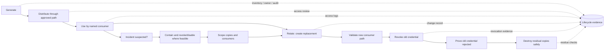
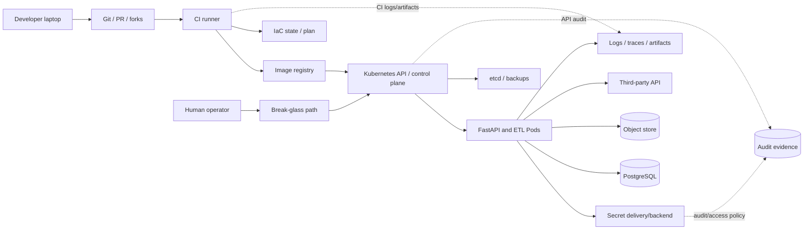

# Unit 1 — Secrets Threat Model and Lifecycle

> **Module:** M09 — Secrets and Identity Management | **Stage:** 2E — Production DevOps & Platform Engineering  
> **Target file:** `01-secrets-threat-model-and-lifecycle.md`  
> **Estimated time:** 10–14 hours, including labs and review  
> **Prerequisites:** Git, Linux shell, containers, basic Kubernetes/RBAC, Helm/Kustomize, CI/CD, Terraform-style state concepts  
> **Core tools:** Git, Python 3, `kubectl`, `kind`, Docker or compatible local container engine, `base64`, `grep`; optional PyYAML for repository-manifest inventory  
> **Awareness:** Vault/OpenBao, cloud secret managers/KMS, SOPS, Sealed Secrets, ESO, CSI Secret Store, workload federation, formal security frameworks  
> **Tool baseline assumed:** Current local installations; record exact versions before running labs. Version-sensitive behavior is marked `[VERIFY]`.  
> **Footprint:** Core reading and fixture labs require little resources; Kubernetes labs require a disposable `kind` cluster. Budget approximately 1–2 CPU cores and 1–2 GB RAM for the cluster, plus bounded local image/fixture storage. Stop if the host is under memory or disk pressure.  
> **Real credentials involved:** **None. All examples use obvious fake lab-only markers.**

## Table of contents

- [1. Module metadata and scope](#1-module-metadata-and-scope)
- [2. Why this matters in production](#2-why-this-matters-in-production)
- [3. Prerequisites and learning outcomes](#3-prerequisites-and-learning-outcomes)
- [4. Running example: a data/ML platform](#4-running-example-a-data-ml-platform)
- [5. First principles and vocabulary](#5-first-principles-and-vocabulary)
- [6. The secret lifecycle](#6-the-secret-lifecycle)
- [7. Where secrets leak: exposure-surface inventory](#7-where-secrets-leak-exposure-surface-inventory)
- [8. Kubernetes Secret objects: encoding, storage, and access](#8-kubernetes-secret-objects-encoding-storage-and-access)
- [9. Environment variables versus mounted files](#9-environment-variables-versus-mounted-files)
- [10. Threat modeling the running platform](#10-threat-modeling-the-running-platform)
- [11. STRIDE analysis and control mapping](#11-stride-analysis-and-control-mapping)
- [12. Secret inventory and classification](#12-secret-inventory-and-classification)
- [13. Blast-radius analysis and scoring worksheet](#13-blast-radius-analysis-and-scoring-worksheet)
- [14. Lifecycle design, rotation, and revocation planning](#14-lifecycle-design-rotation-and-revocation-planning)
- [15. Secure development lifecycle and supply-chain paths](#15-secure-development-lifecycle-and-supply-chain-paths)
- [16. Non-human identities and data-platform-specific risks](#16-non-human-identities-and-data-platform-specific-risks)
- [17. Maturity model and continuous verification](#17-maturity-model-and-continuous-verification)
- [18. Labs and practical exercises](#18-labs-and-practical-exercises)
- [19. Incident scenarios and response walkthroughs](#19-incident-scenarios-and-response-walkthroughs)
- [20. SRE and operational-readiness lens](#20-sre-and-operational-readiness-lens)
- [21. Security checklist and design-review checklist](#21-security-checklist-and-design-review-checklist)
- [22. Self-check questions with answer key](#22-self-check-questions-with-answer-key)
- [23. Evidence artifacts and completion gate](#23-evidence-artifacts-and-completion-gate)
- [24. Common interview and design-review questions](#24-common-interview-and-design-review-questions)
- [25. Cross-module handoffs and boundaries](#25-cross-module-handoffs-and-boundaries)
- [26. Sources, assumptions, and verification notes](#26-sources-assumptions-and-verification-notes)
- [Appendix A — Threat-model worksheet template](#appendix-a--threat-model-worksheet-template)
- [Appendix B — Secret inventory CSV schema and script](#appendix-b--secret-inventory-csv-schema-and-script)
- [Appendix C — Rotation-plan template](#appendix-c--rotation-plan-template)
- [Appendix D — Maturity self-assessment](#appendix-d--maturity-self-assessment)
- [Appendix E — Content audit and claim register](#appendix-e--content-audit-and-claim-register)

## 1. Module metadata and scope

This unit establishes the threat model and operating discipline used by the rest of M09. It does not attempt to configure every secrets product. Its deliverables are a threat model, a metadata-only inventory, an eight-credential risk worksheet, two rotation plans, a maturity assessment, and safe demonstrations of common exposure paths.

### Scope boundaries

- **Taught in this unit:** what counts as a secret; lifecycle ownership; exposure surfaces; Kubernetes Secret and RBAC implications; threat modelling; inventory; blast-radius heuristics; rotation/revocation design; secure development and workload identity concepts; incident response; operational metrics.
- **Introduced only:** Vault/OpenBao, dynamic credentials, cloud secret managers, SOPS/Sealed Secrets, ESO, CSI Secret Store, KMS/HSM, workload federation and SPIFFE/SPIRE.
- **Deferred to later M09 units:** hands-on Vault architecture/authentication ([Unit 2](02-hashicorp-vault-architecture-and-auth-methods.md)), leases/dynamic secrets ([Unit 3](03-dynamic-secrets-leases-and-rotation.md)), ESO/cloud managers ([Unit 4](04-external-secrets-operator-and-cloud-secret-managers.md)), encrypted Git workflows ([Unit 5](05-sops-sealed-secrets-and-encrypted-secrets-in-git.md)), Kubernetes encryption at rest/CSI ([Unit 6](06-kubernetes-secret-encryption-and-csi-secret-store.md)), workload federation ([Unit 7](07-workload-identity-irsa-and-federated-credentials.md)), and leak response at greater depth ([Unit 8](08-secret-leak-detection-and-incident-response.md)).

**Scope, assumptions, and verification status.** The supplied M09 syllabus-generation prompt and the supplied repository tree were inspected for Unit 1 requirements and exact neighboring filenames. This lesson has not been tested against a live cluster, container engine, cloud provider, or identity provider. Official technical documents are listed in Section 26 as sources to check; unless explicitly stated otherwise, no live documentation verification or command execution is claimed. All outputs below are representative, not captured from execution. `[ASSUMPTION]` denotes a local teaching choice; `[VERIFY]` marks behavior to confirm against the installed versions.

## 2. Why this matters in production

A leaked credential is not just a string in the wrong place; it is a capability that may let someone read data, alter a model, deploy code, sign artifacts, or impersonate a service. Teams often remove the visible file but forget copies in Git history, build layers, CI artifacts, backups, logs, and long-running processes. Rotation can also cause outages if a database pool or ETL job continues using the old value. The goal is to reduce the number and power of stored credentials, detect exposure quickly, revoke the capability, and prove that old credentials no longer work.

A private repository, masked CI variable, base64-encoded Kubernetes Secret, or successful scanner run is not a complete security boundary. Controls need explicit owners, tests, and recovery paths.

## 3. Prerequisites and learning outcomes

### Prerequisites

- Read basic Git status/log/diff and understand that old commits remain available unless history is rewritten.
- Know how a Kubernetes namespace, Pod, ServiceAccount, Secret and RoleBinding work.
- Know that CI jobs, container images and Terraform-style state may persist beyond a single command.
- Use a disposable local environment. Do not run mutating commands against a work, shared or production cluster.

### Measurable learning outcomes

By the end, the learner can:

1. **[L1]** Classify passwords, tokens, private keys, connection strings and key material by the capability their disclosure grants.
2. **[L1]** Trace a fake credential through generation, distribution, use, rotation, revocation and destruction.
3. **[L2]** Produce a STRIDE threat model with assets, actors, trust boundaries and preventive/detective/corrective controls.
4. **[L2]** Explain why Kubernetes Secret base64 representation is not encryption and demonstrate the distinction in a disposable namespace.
5. **[L2]** Verify intended and denied Secret access using RBAC checks and a lab-only API request.
6. **[L3]** Score eight credential types using a transparent risk heuristic and identify high-value mitigations.
7. **[L3]** Write and test a metadata-only inventory tool that does not emit Secret values.
8. **[L3]** Produce rotation plans with consumer mapping, overlap, rollback, revocation and old-credential rejection tests.
9. **[L4]** Prioritize maturity improvements using measurable indicators and explain the limitations of local simulations.

## 4. Running example: a data/ML platform

We will model a fictional platform with these components:

| Component | Credential/capability | Business impact if compromised | Likely owner |
|---|---|---|---|
| FastAPI scoring API | PostgreSQL read-only credential | Expose application data; possibly infer sensitive records | Scoring team |
| ETL Job | PostgreSQL read/write credential | Alter or exfiltrate pipeline data | Data platform team |
| Training-data job | Object-store credential | Read datasets or overwrite model artifacts | ML platform team |
| Ingestion Job | Third-party API token | Access vendor data, consume quota, or impersonate integration | Data ingestion team |
| Model/registry pull | Registry credential | Pull private artifacts; overly broad write access could poison releases | Platform team |
| CI deploy job | Kubernetes/cloud deployment identity | Change workloads or access production resources | Developer platform team |
| TLS endpoint | TLS private key | Impersonate service endpoint within the key's trust scope | Service owner |
| Dataset protection | Data-encryption key (DEK) / key-encryption key (KEK) | Decrypt protected data or undermine key hierarchy | Data security/key custodian |
| Human break-glass | Emergency administrator identity/material | Broad emergency control-plane access | Operations/security |

The initial design is intentionally poor: static values are copied into `.env`, a repository, CI settings, Helm values, image layers, a Terraform-style state file and a Kubernetes Secret. The improved design inventories each logical credential, limits its authority, reduces copies, uses short-lived or federated identity where feasible, and rehearses revocation.

## 5. First principles and vocabulary

### What counts as a secret?

A secret is any value whose disclosure grants a capability: authentication, impersonation, decryption, signing, access, recovery or privilege. It is not defined by whether the value looks random.

Examples include passwords, API keys, access/refresh tokens, private keys, certificate private halves, credential-bearing connection strings, signing keys, encryption keys, session cookies, recovery codes, unseal/recovery material and workload tokens. A username or endpoint may not be an authentication secret, but it can still be sensitive operational metadata.

| Category | Definition | Example | What disclosure may enable | Common misconception |
|---|---|---|---|---|
| Secret/credential | Value whose possession grants a capability | Fake database password | Authentication or access | “Only passwords are secrets.” |
| Configuration | Non-secret settings describing behavior | `LOG_LEVEL=info` | Usually changes behavior, not identity | “Everything called config is harmless.” |
| Identity | Principal representing a person, process or workload | Kubernetes ServiceAccount name | Identifies the actor; tokens/credentials prove possession or authority | “An identity object is itself always a secret.” |
| PII | Data identifying or relating to a person | Email address | Privacy harm or correlation | “PII and secrets are mutually exclusive.” |
| Public data | Intentionally public information | Public API endpoint | Usually limited direct capability | “Public means no integrity risk.” |
| Cryptographic key material | Secret bytes controlling encryption/signing | DEK or signing private key | Decryption or forgery | “A key is just another config string.” |
| Credential-bearing connection string | Endpoint/config plus embedded credential | `postgres://user:FAKE...@db` | Connection and authentication | “It is safe because it is a URI.” |

Categories overlap. A configuration field can contain a secret; PII may need protection even if it cannot authenticate; a private key is both a secret and cryptographic key material.

### Glossary

| Term | Precise definition | Common misconception |
|---|---|---|
| Asset | Something valuable to protect | Only data is an asset |
| Threat actor | Entity capable of causing harm | Every actor has unlimited access |
| Vulnerability | Weakness that can be exploited in a context | Every finding is equally exploitable |
| Attack path | Sequence from initial access to impact | A leaked value is the whole attack story |
| Trust boundary | Place where identity, authority or assumptions change | Network boundaries are the only boundaries |
| Exposure surface | Place or process where a value may be copied or observed | The current secret store is the only copy |
| Least privilege | Minimum permissions needed for a defined task | Read-only always means low risk |
| Need-to-know | Access granted only to people/workloads requiring it | Team membership automatically grants access |
| Authentication | Establishing who/what is acting | Same as authorization |
| Authorization | Deciding what an authenticated actor may do | Successful login means unrestricted access |
| Audit | Evidence of actions and decisions | Logs automatically prove accountability |
| Static credential | Long-lived value provisioned in advance | Static means permanent |
| Dynamic credential | Credential created on demand, often with a lease/TTL | Dynamic credentials cannot be overprivileged |
| Derived credential | Value derived from another secret/key or context | Derived values have no dependency on their source |
| Federated credential | Short-lived credential issued after trust in an external identity/claims | Federation works without issuer/audience/subject validation |
| Secret sprawl | Copies and consumers distributed across systems | One logical secret equals one exposure point |
| Rotation | Replacing a credential/key and moving consumers | Updating the stored value invalidates the old value |
| Revocation | Making the old credential no longer accepted by its authority/target | Deleting a local file revokes it |
| Expiry | Rejection after an enforced validity deadline | Every system enforces expiry correctly |
| Destruction | Removing a stored copy or cryptographic material | Destruction alone invalidates copies elsewhere |
| DEK / KEK | Data-encryption key / key-encryption key | Encryption removes the need to protect keys |
| Root of trust | Foundational key or identity from which trust derives | A root key can be left in the same place as data |
| Envelope encryption | Encrypt data with a DEK and protect the DEK with a KEK | It solves access control by itself |
| Break-glass | Controlled emergency access outside routine workflow | Emergency access need not be audited |
| Blast radius | Potential scope of harm from a compromised capability | A single numeric score proves safety |
| MTTD | Mean time to detect an event, defined over a population/time window | Detection time is always measurable from alert timestamps |
| Time-to-revoke | Time from a defined exposure/decision event to confirmed rejection | Rotation completion equals revocation |
| Preventive control | Reduces likelihood or blocks a path | It eliminates all risk |
| Detective control | Identifies activity or exposure | A scanner sees every secret |
| Corrective control | Restores a safe state or removes capability | Cleanup can replace revocation |
| Compensating control | Alternative control that reduces risk where preferred control is unavailable | An exception has no expiry or owner |

## 6. The secret lifecycle

The lifecycle is **Generate → Distribute → Use → Rotate → Revoke → Destroy**, with inventory, ownership, access review and audit spanning every phase.



| Phase | Purpose and owner | Common failure | Evidence and “done” condition |
|---|---|---|---|
| Generate | Create unique, appropriately random value or identity. Owner: issuing authority/platform plus service owner. | Shared/default credential; unknown creator | Approved creation record, owner, scope, timestamp; “done” means value exists under controlled custody |
| Distribute | Deliver only to approved consumer through controlled channel. | Copy to ticket, repo, image or shell history | Delivery path/access policy; recipient and access evidence without logging the value |
| Use | Consume only for intended action; avoid logs and unnecessary memory/copies. | Broad permissions; debug output | Positive/negative access tests, application behavior and audit evidence |
| Rotate | Replace value and migrate consumers. | Old consumers cached; new value not accepted | Change record, consumer validation and rollback plan |
| Revoke | Authority/target rejects old value. | Only local copy deleted; credential still valid | Authoritative revocation status plus a safe negative test against a controlled test target |
| Destroy | Remove obsolete copies where possible and apply retention rules. | Copies remain in backups, Git, caches or artifacts | Search scope and retention evidence; destruction does not prove revocation |

**Secret zero** is the initial trust problem: how does a workload securely obtain the first credential or prove its identity before it can access the secrets platform? The answer should not be “put another long-lived root credential in the image.” Workload identity, projected tokens, bootstrap credentials with tight scope, and a controlled human ceremony are different approaches with different trust assumptions. Implementation is deferred to M09 Units 2–7.

Distinguish four actions:
- **Expiry:** a system rejects the credential after a validity deadline.
- **Rotation:** a replacement is introduced and consumers migrate.
- **Revocation:** the authority/target rejects the old credential.
- **Deletion/destruction:** one stored copy is removed or cryptographic material is destroyed.

Deleting a Kubernetes Secret does not necessarily invalidate a copied value already read by a Pod. Deleting a Git file does not erase old commits or forks. Rotating a key may leave old signatures or encrypted data dependent on the old key. Every change needs a dependency map and proof appropriate to the capability.

## 7. Where secrets leak: exposure-surface inventory

A leak surface is a possible copy or observation point, not proof that a system always exposes a value.

| Surface | Typical exposure mechanism | What may be observed | Prevention | Detection / response |
|---|---|---|---|---|
| Source, PRs, Git history, branches, tags, forks, clones, backups | Secret committed then copied by fetch/fork/cache | Current or historical value | Never commit; dev-only values; protected reviews | Pre-commit + CI scanning; revoke first, then history cleanup |
| `.env` / workstation | File permissions, sync, backups, screenshots | Local credential | Exclude from Git; restrictive permissions; per-developer identity | Targeted scan; revoke if exposed; remove residual copies |
| Docker context/build args/layers/cache/`docker history` | Secret copied during build or persisted in layer/metadata | Value or recoverable layer content | Build secret mounts; exclude files from context; no secret build args | Scan only relevant image and layers; rebuild; revoke |
| CI logs/debug traces/artifacts/caches/job summaries | `set -x`, exception output, test report, environment dump | Token, password, URL | Minimize scope; disable unsafe debug; avoid printing | Secret scanner and log review; revoke/rotate; retention-aware cleanup |
| Shell history/scrollback/arguments | Value typed in command or included in process args | Command and value | stdin/file/secret manager; avoid command-line values | Check targeted history/terminal artifacts; rotate |
| Kubernetes manifests / ConfigMaps | Plaintext in Git or API object | Value | References and approved secret delivery | Repository scans, admission/policy checks |
| Kubernetes Secret/API | RBAC allows get/list/watch; Pod mounts it | Encoded API representation or mounted value | Least privilege, encryption at rest, workload isolation | RBAC review, audit logs, negative tests |
| Helm values/rendered manifests/release storage | Secret passed in values or retained in release data | Value or encoded representation | Avoid plaintext values; use supported secret workflow | Scan source/rendered artifacts and release access |
| Terraform plans/state/logs/cache/backend | Sensitive values stored in state/plan or logs | Credentials and infrastructure details | Protected remote backend, access controls, avoid outputting secrets | Access review, state handling policy; rotate exposed values |
| etcd and etcd backups | Secret objects persist in datastore/backups | API data, depending on encryption/configuration | Configure and verify encryption at rest; protect backups | Backup access audit and restore tests |
| PV snapshots/database backups/exports | Old credentials retained in copied data | Credentials in rows/configs/files | Data classification, access controls, retention | Inventory backups and snapshots; revoke values |
| App logs/traces/errors/debug endpoints | Credentials included in exceptions or attributes | Request headers, connection strings, tokens | Redaction, structured logging, avoid secret-bearing fields | Scan logs safely; restrict retention/access; revoke |
| Crash/heap/core dumps, temp files, swap | Process memory/file remnants | In-memory values | Restrict dumps, permissions and host access | Host policy/audit; clean safely; rotate if exposure suspected |
| Chat/tickets/wiki/email/screenshots/paste sites | Copy/paste during debugging | Full secret and surrounding context | Never paste credentials; approved secure sharing | Search authorized systems; revoke before deletion |
| Third-party SaaS/webhooks | App integration stores tokens or payloads | Webhook secret/API token | Minimal scope, owner, lifecycle, vendor controls | Access review, vendor audit and rotation |
| Notebooks, outputs, DAGs, dbt/Airflow profiles | Hardcoded credentials or saved cell output | Database/object-store credentials | Connection managers, identity, sanitized outputs | Repo/notebook scanning; rotate and clean |
| Registry/deployment credentials/service tokens | Broad registry or cluster rights | Pull/deploy capability | Per-job identities, narrow permissions and TTL | Access review, audit, revocation tests |
| TLS/signing/encryption/unseal keys | Key copied to repo, backup or shared drive | Impersonation, forgery, decryption or recovery capability | Key custody, protected root of trust, separation of duties | Key-use audit; revoke/rotate/reissue as technically appropriate |
| Backups/snapshots/archives/downloads | Historical copy survives cleanup | Old credentials/data | Retention policy, encryption, restricted access | Locate copies; revoke credential; expire copies under policy |
| Third-party Actions/images/charts/CLIs/dependencies | Code executes with environment or filesystem access | Any secret available to that process | Pin and review dependencies; job/step scoping; isolated runners | Supply-chain controls, anomaly logs; revoke and rebuild |

### One logical secret, many copies

A fictional `etl-postgres` password may exist in: local `.env`, Git history, CI variable, CI log artifact, image layer, Helm values, Kubernetes Secret, process environment, Terraform state and a backup. That is one logical credential but at least ten possible exposure locations. Rotation must include the database authority and all consumers; cleanup must include the copies, but copy deletion alone does not make the old value invalid.

## 8. Kubernetes Secret objects: encoding, storage, and access

A Kubernetes `Secret` is an API object for distributing small pieces of sensitive data to authorized workloads. It is not, by itself, a complete secrets-management platform.

Common types:
- `Opaque`: generic user-defined data.
- `kubernetes.io/tls`: conventionally stores TLS certificate and private-key fields; type does not prove the certificate/key are valid or securely managed.
- `kubernetes.io/dockerconfigjson`: conventionally stores registry authentication configuration.
- ServiceAccount token patterns: tokens are credentials when possession grants authority. Modern projected, bound tokens differ from legacy long-lived token Secret patterns; exact defaults and behavior depend on Kubernetes version/configuration `[VERIFY]`.

### Base64 is encoding, not encryption

Base64 changes representation so bytes can be transported as text. It does not require a secret key and does not make the underlying value confidential.

A disposable Secret can be defined as:

```yaml
# Illustrative lab-only manifest: secret-demo.yaml
apiVersion: v1
kind: Secret
metadata:
  name: lab-demo
  namespace: secrets-lab
type: Opaque
stringData:
  password: "FAKE_LAB_ONLY_DB_PASSWORD_DO_NOT_USE_7f31"
```

`stringData` is a write convenience; the API representation commonly presents the value under `data` as base64. Do not commit real values in either field. Whether data is encrypted at rest depends on cluster configuration and the encryption provider; transport security, RBAC, node/workload access and backup protection also matter.

```bash
# In an isolated lab only; first verify the current context.
kubectl config current-context
kubectl -n secrets-lab get secret lab-demo \
  -o jsonpath='{.data.password}' | base64 --decode
```

**Expected output (representative; not executed here):**
```text
FAKE_LAB_ONLY_DB_PASSWORD_DO_NOT_USE_7f31
```

This demonstrates that base64 is reversible for a reader who already has permission to retrieve the field. It does **not** demonstrate that an unauthorized user can bypass correctly enforced RBAC. The access decision and storage encryption are separate controls.

### RBAC is a confidentiality boundary

- `get` on a Secret can return its value.
- `list` may return complete Secret objects, including data, not merely names.
- `watch` may expose object changes and content.
- Wildcards can grant unintended verbs/resources.
- Pod creation, mounting a Secret, or `pods/exec` can be indirect access paths depending on the surrounding permissions and controls.
- Namespace boundaries help organize scope but are not a complete security boundary by themselves.

`kubectl auth can-i get secrets -n secrets-lab --as=system:serviceaccount:secrets-lab:lab-reader` checks authorization for that identity/action. It does not prove that all authentication, admission, audit, node-security or application controls are correct.

## 9. Environment variables versus mounted files

Neither method is universally safe. Choose based on application behavior, permissions, rotation/reload support and observability.

| Dimension | Environment variable | Mounted file |
|---|---|---|
| Application compatibility | Often convenient | Requires file-reading support |
| Rotation/reload | Existing process may retain original value; restart/reload behavior matters | File projection/update behavior varies; application may need to reopen/reload |
| Process inspection | May be visible through process diagnostics or `/proc/<pid>/environ` under relevant permissions/namespaces | Process can still read file if it has filesystem permission |
| Child processes | May inherit environment by default | Can inherit access if file path/permissions are available |
| Container inspection | Environment configuration may be exposed by container inspection depending on how set | Mount metadata/path may be visible; contents depend on access |
| Logs/crash dumps | Can leak via debug logs or memory dumps | Can leak via debug logs, memory dumps or accidental file reads |
| Permissions | Environment access depends on process/runtime/host controls | File owner/mode/mount and container user matter |
| Rotation | Often requires process restart or explicit reload | May support reload if application watches/reopens safely |
| Main misconception | “Environment variables are invisible.” | “Mounted files are safe from a compromised process.” |

`/proc/<pid>/environ` visibility depends on operating-system permissions, process ownership, namespaces and security configuration; do not assume every local user can read every process. `docker inspect` can reveal configured environment metadata for containers when the caller has permission to inspect them. Never run broad process/environment dumps on a host you do not own.

Safer patterns: avoid logging values, use dedicated identity where feasible, mount files read-only with restrictive permissions, run as non-root, scope the consumer, avoid passing secrets as command-line arguments, and define how the application detects missing/expired credentials. Stdin or a protected file can reduce command-line exposure, but does not eliminate shell history, process-memory, log or filesystem risks.

## 10. Threat modeling the running platform

### Assets, actors and boundaries

| Asset | Confidentiality / integrity / availability concern | Owner / revocation authority |
|---|---|---|
| PostgreSQL API and ETL credentials | Data read/alteration; service outage after revocation | Database owner + application owner |
| Object-store access | Dataset/model artifact exfiltration or overwrite | Data/ML platform |
| Third-party API token | Vendor data exposure, quota abuse, integration outage | Ingestion owner/vendor authority |
| Registry pull/deploy credentials | Private image exposure or release tampering | Platform team |
| CI deploy identity | Workload/control-plane changes | Developer platform/security |
| TLS private key | Endpoint impersonation | Service owner/PKI authority |
| DEK/KEK | Dataset confidentiality/integrity; recovery dependency | Key custodian/data security |
| Workload tokens | Impersonation and privilege | Platform + workload owner |
| Break-glass material | Broad emergency control-plane access | Operations/security |
| Audit records and secrets-backend availability | Loss of accountability or inability to start/refresh workloads | Platform/SRE |

Actors: external attacker, malicious/curious insider, compromised CI runner, compromised Pod, compromised node, compromised third-party Action/image/chart/CLI/dependency, careless developer, unauthorized workload, and operator error or secrets-backend outage. Each actor has only the access granted by the actual environment; model the capabilities rather than assuming omnipotence.



Trust boundaries exist between a developer device and Git, Git and CI, CI and registry, CI and cluster, Kubernetes API and Pod, Pod and backend services, platform and secret authority, and human operator and break-glass. A secret can cross several boundaries during one deployment.

### Attack paths

| Initial condition → path | Impact | Prevention | Detection | Response / residual risk |
|---|---|---|---|---|
| DB password committed → cloned/forked → used against DB | Data exposure/alteration | No secrets in Git; narrow DB role | Git scanner, DB audit | Revoke/rotate; identify consumers/copies; clones may persist |
| CI debug output prints API token → artifact retained | Third-party account misuse | No debug dumps; scoped token; isolated runner | Log scanning and access audit | Revoke via provider; retain controlled evidence; historical artifacts may persist |
| `.env` copied into image layer → image pushed | Anyone able to pull/layer-inspect may recover it | Build context controls and build secret mounts | Scan final/intermediate images | Revoke credential; rebuild image; purge accessible image copies |
| CI ServiceAccount can list Secrets → compromised job lists namespace/cluster | Multiple application credentials exposed | Least-privilege Role; avoid wildcards | RBAC audit and API audit | Remove broad permission; revoke exposed values; test denials |
| Terraform-style state readable broadly → state download | Cloud/service credentials and architecture exposed | Protected backend, least-privilege access, encryption | Backend access logs and reviews | Revoke exposed values; restrict/rotate; assess backups and local copies |
| Compromised Pod reads mounted Secret/token → calls backend | Data access or lateral movement | Narrow credential scope, Pod isolation, identity policies | Runtime/audit telemetry | Contain workload; revoke identity/credential; inspect API/backend logs |
| Backup contains deleted value → backup access compromise | Old credential recovered | Backup access/retention controls | Backup inventory and access logs | Revoke credential; restrict/expire copies per policy |
| Signing key mislabeled “config” → attacker signs artifact | Forged artifacts or tokens accepted | Key classification/custody; signing authorization | Signature verification/audit | Disable/rotate/reissue trust material as protocol permits; investigate all signed artifacts |

## 11. STRIDE analysis and control mapping

STRIDE categories are a threat-discovery aid, not a certification. Preventive controls reduce likelihood, detective controls surface events, corrective controls contain/recover, and compensating controls reduce risk where the preferred control is unavailable.

| STRIDE | Target and attack | Preventive control | Detective control | Corrective control | Negative test / evidence | Residual risk and owner |
|---|---|---|---|---|---|---|
| Spoofing | Stolen workload token impersonates ETL | Bound workload identity; narrow audience/subject/scope | Identity-provider and API audit | Revoke token/identity; rotate dependent credentials | Wrong ServiceAccount/audience is denied; auth audit event | Compromised node may still access mounted token; platform owner |
| Tampering | PR changes secret reference/policy to broader path | Required reviews; protected branches; policy checks | Diff review and drift detection | Revert approved change; rotate if value exposed | CI rejects forbidden manifest/policy | Authorized reviewer can approve bad change; repo owner |
| Repudiation | Secret read has no attributable audit | Authenticated identities and suitable audit logs | Review read/change events | Preserve evidence; correct audit configuration | Confirm a test access produces attributable event | Logs may omit payload/path detail or be altered by privileged actor; security |
| Information disclosure | `list secrets` or image layer exposes values | Least privilege, no image secrets, controlled backups | RBAC/image/repo scans, API audit | Revoke first, then clean copies and investigate | Over-permissioned lab identity reads; corrected one is denied | Unknown clones/backups can remain; service owner |
| Denial of service | Secret backend unavailable during startup/refresh | Availability design, bounded retries, cache policy where appropriate | Fetch latency/failure alerts | Follow fail-open/closed runbook; restore backend | Simulated timeout yields defined application behavior | Cached values may expire; SRE/platform |
| Elevation of privilege | Wildcard RBAC or Pod creation enables mounted-secret access | Explicit resource/verb scope; admission controls; separate duties | RBAC diff/audit and scheduled checks | Remove binding; rotate exposed credentials | `can-i` and actual request demonstrate deny after fix | Other permissions or node compromise may bypass assumptions; cluster owner |

Awareness references: OWASP Secrets Management Cheat Sheet; OWASP Top 10 CI/CD Security Risks; NIST SP 800-57 key-management concepts; CIS Kubernetes Benchmark relevant Secret/RBAC guidance; MITRE ATT&CK “Unsecured Credentials.” Exact current sections/control IDs must be checked in the official versions. These references do not establish compliance.

## 12. Secret inventory and classification

### Inventory principles

You cannot protect what you cannot list. Inventory the **logical credential and its metadata**, not the credential value. Do not include raw values, base64 payloads, private-key bytes or hashes that enable offline guessing. Metadata can still reveal architecture, so restrict the inventory and audit access.

Minimum recommended fields:

`secret_id, name, resource_type, environment, namespace_or_system, owner_team, accountable_owner_role, purpose, data_or_service_scope, consumers, source_authority, storage_delivery, credential_class, created_at, last_rotated_at, expires_at, rotation_method, rotation_policy, revocation_method, authorized_revoker, known_copy_locations, impact_tier, rationale, last_access_review, evidence_ref, exception_id, exception_expiry`

Unknown fields should be `UNKNOWN`/empty with an explicit status, never guessed. A stable identifier is not a secret value, but may still be sensitive.

### Credential type comparison

| Type | Creation/lifetime | Main risk | Revocation considerations | Best-fit direction |
|---|---|---|---|---|
| Static | Provisioned and stored until changed | Sprawl, stale copies, unknown age | Provider-specific rotation and propagation | Legacy systems or integrations without better support |
| Dynamic | Issued on demand, often leased | Excessive permissions or backend outage | Revoke lease/credential; verify target rejects it | Short-lived database/service access where supported |
| Derived | Computed from another key/secret/context | Source key compromise or derivation misuse | Rotate/revoke source and evaluate dependent values | Key hierarchy and protocol-specific uses |
| Federated | Trusts external identity/claims to issue short-lived credential | Wrong issuer/audience/subject or broad trust | Disable trust/identity and revoke/expire issued tokens as supported | CI/workload identity where federation is supported |

Dynamic does not mean least-privileged by default. Federated tokens still require correct issuer, audience, subject, expiry and authorization checks. Short-lived tokens reduce the exposure window but may still allow high-impact actions until rejected.

### Example handling tiers `[ASSUMPTION]`

This is an example policy model, not a standard.

| Tier | Example | Required controls | Review/rotation expectations |
|---|---|---|---|
| Tier 0 — Root/trust | KEK/root key, break-glass admin, signing root | Named custodian, separation of duties, protected recovery, immutable/strong audit, strict access | Rotation/ceremony driven by key policy and compromise; scheduled access review |
| Tier 1 — High impact | CI deploy identity, write-capable object-store credential | Per-workload identity, narrow scope, short lifetime where feasible, monitored use | Defined owner and risk-based rotation; rehearsed revocation |
| Tier 2 — Service | ETL DB credential, third-party API token | Central approved storage/delivery, owner metadata, consumer mapping | Risk-based interval and event-driven rotation; negative old-credential test |
| Tier 3 — Low-impact lab | Fake local-only test credential | Disposable scope, no production access, cleanup | Destroy with lab; never reuse |

Tier labels must be mapped to impact, not the apparent shape of a value. Define local thresholds, exception expiry and review cadence with security and service owners.

## 13. Blast-radius analysis and scoring worksheet

Use a practical heuristic:

**Exposure score = capability score × validity score × copy/sprawl score × detection/revocation difficulty score.**

Each factor is scored 1–5. A high score means more potential exposure under this model. The product is not a validated scientific metric; it is a prioritization aid. Correlated factors can exaggerate risk, uncertainty in copy count matters, and a single score must never replace threat analysis.

- **Capability:** 1 = read-only low-impact lab; 3 = service write within a bounded domain; 5 = broad admin, signing or dataset decryption capability.
- **Validity:** 1 = minutes and enforced expiry; 3 = days/weeks; 5 = long-lived/unknown expiry.
- **Copies:** 1 = one controlled delivery path; 3 = several known copies; 5 = many/unknown copies.
- **Detection/revocation difficulty:** 1 = monitored and rapid tested revocation; 3 = manual process; 5 = unknown owner or slow/unproven revocation.

### Eight-credential worksheet `[ILLUSTRATIVE]`

| Credential | Capability (1–5) | Validity (1–5) | Copies (1–5) | Detection/revoke difficulty (1–5) | Score | Owner and priority mitigation |
|---|---:|---:|---:|---:|---:|---|
| PostgreSQL API read-only | 2 | 4 | 3 | 3 | 72 | Scoring owner: narrow row/table access; central delivery; shorten lifetime |
| PostgreSQL ETL read/write | 4 | 4 | 4 | 3 | 192 | Data platform: separate ETL role; inventory consumers; rehearse overlap rotation |
| Object-store training data | 4 | 5 | 4 | 4 | 320 | ML platform: replace long-lived key with workload identity where feasible |
| Model registry pull | 2 | 4 | 3 | 3 | 72 | Platform: repository-scoped pull-only credential; remove write scope |
| Third-party ingestion token | 3 | 5 | 3 | 4 | 180 | Ingestion owner: vendor-side narrow token, expiry/revocation runbook |
| CI deployment identity | 5 | 4 | 4 | 4 | 320 | Developer platform: federated job identity, protected environment and audit |
| TLS private key | 4 | 3 | 2 | 3 | 72 | Service/PKI owner: protected key delivery, rotation and certificate validation |
| Dataset DEK/KEK | 5 | 5 | 2 | 5 | 250 | Data security: managed key hierarchy, custody, backup/recovery drill |

Example calculation: ETL credential = 4 × 4 × 4 × 3 = 192. The number is only comparable when the same scoring definitions are used. The object-store and CI credentials rank highly because they combine broad capability, long/uncertain validity, multiple copies and difficult revocation. Re-score after mitigation rather than declaring “secure” at a particular threshold.

### Before/after illustration

A broad static object-store key copied to four systems might score 4 × 5 × 4 × 4 = 320. If scope is reduced (4→2), validity is enforced as short (5→1), copies are reduced (4→2), and revocation becomes rehearsed (4→2), the heuristic becomes 2 × 1 × 2 × 2 = 8. This is not a claim that risk fell exactly 40-fold; it shows which design changes matter.

## 14. Lifecycle design, rotation, and revocation planning

### Lifecycle ownership matrix

| Credential | Creator/authority | Consumer | Owner | Rotation trigger | Revocation proof |
|---|---|---|---|---|---|
| PostgreSQL ETL | DB authority | ETL Job and pool | Data platform | Schedule chosen by risk; suspected exposure; role change | Old login rejected by disposable test target; new ETL run succeeds |
| Third-party API | Vendor token issuer | Ingestion Job | Ingestion team | Provider policy, owner change, exposure, scope change | Provider reports revoked/disabled and controlled request fails |
| Registry pull | Registry | Kubernetes runtime | Platform | Exposure, scope change, policy | Pull using old credential denied in lab/authorized test |
| TLS private key | Approved PKI/key process | TLS endpoint | Service owner | Compromise, policy/certificate lifecycle | Old certificate/key no longer trusted/served as designed |
| Dataset DEK/KEK | Key authority | Encryption service/app | Key custodian | Key policy, compromise, migration | Controlled decryption/key-version test; data recovery remains possible |

Rotation is difficult because clients cache values, DB connection pools hold authenticated sessions, long-running jobs may not reload configuration, and two systems may temporarily accept different credentials. Plan for overlap only if the target authority supports multiple valid credentials. If it supports only one, explicitly plan a cutover window and acceptable outage.

### Safe two-credential overlap pattern

1. Inventory all consumers and establish the old credential's authority, scope and current health.
2. Create a new credential with equivalent or narrower scope.
3. Deliver the new value only through the approved channel.
4. Roll consumers gradually; verify new authentication through a non-secret health check or target audit event.
5. Keep the old credential valid only for the approved overlap window.
6. Revoke the old credential at its authority.
7. Prove the old credential is rejected using a controlled test, not merely by checking local configuration.
8. Confirm consumers continue to work and no old consumer is silently retrying.
9. Remove residual copies according to retention policy; update inventory and evidence.

**Do not use real production values in this exercise.** A local stub or disposable DB role can demonstrate the sequence. Some third-party services support only in-place token replacement, so the overlap pattern may not be available.

### Filled rotation plan A — PostgreSQL ETL credential

- **Trigger:** scheduled local rehearsal or suspected exposure; schedule is `[ASSUMPTION]` and should be risk/provider driven.
- **Owner:** data platform; DB administrator is authorized revoker.
- **Scope:** dedicated ETL role; only required schema/table operations; no superuser.
- **Prechecks:** enumerate DAG/Job consumers, connection pools, batch windows, rollback path and monitoring; check current credential age and access review.
- **Replacement:** create a second temporary ETL login on the disposable DB if supported; grant only required privileges; deliver through the lab's protected file/Secret path.
- **Cutover:** update one consumer; run a small idempotent test transaction; roll remaining consumers; monitor authentication failures and ETL outcomes.
- **Positive test:** new login completes expected least-privilege ETL operation.
- **Negative test:** after revocation, old login fails to authenticate to the same disposable DB. Do not infer revocation merely from deleting a Kubernetes Secret.
- **Rollback:** if new login fails before old revocation, restore previous consumer configuration while the old credential is still intentionally valid; fix cause, then restart the planned sequence. If exposure is suspected, do not reactivate a compromised value merely for convenience—use the incident path.
- **Revoke and verify:** disable/drop the old login; test rejection; inspect DB authentication audit.
- **Cleanup/evidence:** remove fake files and lab roles, record change ID, timestamps, new-login test, old-login rejection, consumer list and unresolved copies.

### Filled rotation plan B — Third-party ingestion token

- **Trigger:** provider-supported scheduled rotation, suspected exposure, owner departure, or scope change.
- **Owner:** ingestion team; token issuer/vendor console is authoritative revocation point.
- **Scope:** one integration and minimum required API permissions; avoid shared token across jobs.
- **Prechecks:** identify jobs, retries, queues, notebooks, logs, CI variables and vendor rate limits; confirm whether two tokens may coexist.
- **Replacement:** create a lab-only token in a stub service or use a fake token fixture; never create/rotate a real vendor token as part of this lesson.
- **Cutover:** configure the ingestion job with the replacement; run a controlled fixture request; observe status and error metrics without logging token.
- **Positive test:** new token succeeds against the local stub.
- **Negative test:** revoke old token in the stub and confirm the old token returns an unauthorized response.
- **Rollback:** before revoking the old token, return to it only if it is not suspected compromised and the approved plan allows it. If compromise triggered the rotation, use a fresh replacement and containment; do not restore the exposed token.
- **Revoke and verify:** mark old token revoked in the authority; test the controlled stub rejects it.
- **Cleanup/evidence:** remove token fixtures from scratch files, history, logs and Git; record owner, token identifier (not value), revocation timestamp and test result.

### Time-to-revoke

Define the metric before measuring it. A useful operational definition is:

`time_to_revoke = confirmed rejection timestamp − incident/decision timestamp`

Record both timestamps, time zone, source systems and whether the start is first detection, incident declaration or authorized revocation decision. Choose one definition for reporting and keep it consistent. “Rotation completed” is insufficient: consumers may have changed while the old credential remains valid.

## 15. Secure development lifecycle and supply-chain paths

- **Pre-commit scanning:** quick feedback, but can be bypassed and may miss transformed values.
- **CI scanning:** independent gate so bypassing local hooks does not silently bypass detection. Avoid printing matched values in CI output.
- **PR review:** inspect changes to secret references, policies, workflow permissions and build steps; never paste secret values into comments.
- **Local development:** fake/dev-only credentials; per-developer identities; no shared production credentials on laptops; reproducible environments without production access.
- **CI masking:** masking is not encryption and behavior varies by platform. Transformed, encoded or partially printed values may not be masked. Avoid generating logs containing the value in the first place.
- **Runner isolation:** minimize which jobs/steps receive credentials; do not expose secrets to untrusted forked PR code; separate privileged release jobs from untrusted tests.
- **Dependencies and Actions:** code running in a process with secret access may read or exfiltrate those values. Pin/review dependencies and images according to M02/M12 policy; restrict network egress and permissions where feasible.
- **Container builds:** do not copy `.env` into an image or rely on deleting it in a later layer. Use supported build secret mounts and a strict build context. See M01; exact build flags depend on engine/version `[VERIFY]`.
- **Infrastructure-as-Code:** treat plans, state and provider logs as potentially sensitive. A “sensitive” display marker does not necessarily mean the underlying value is absent from state.
- **Git cleanup:** history rewriting is a cleanup measure, not revocation. Forks, clones, caches and backups may remain.

## 16. Non-human identities and data-platform-specific risks

A ServiceAccount is an identity object; a token associated with it is a credential. Inventory each non-human principal: what acts, who owns it, how it authenticates, what it can access, where its token/value is delivered, how its use is logged, and how it is disabled.

| Data/ML pattern | Risk | Platform-level fix |
|---|---|---|
| Notebook cell/output embeds DB password | Notebook export, sync or output shares credential | Use approved connection integration; clear saved output; individual identities |
| Shared warehouse account | No attribution; broad access persists after team changes | Separate workload/user identities and narrow grants |
| Cloud key in orchestrator variable/DAG | Long-lived key copied into DAGs/logs/backups | Federated/workload identity where feasible; controlled secret backend; scoped execution |
| dbt profile contains password | Profile copied into repo/home directory | Runtime-provided credential path and local fake profile |
| Airflow connection stores credential | Broad access to orchestration metadata/admins | Restrict connection access, audit reads, separate per-workload connections |
| Object-store key for training data/artifacts | Read and write capabilities combined | Separate read-only training input from artifact writer; narrow prefixes/buckets |
| Registry pull credential reused for publishing | Pull identity can modify artifacts | Separate pull and push identities with minimum scope |
| Dataset key copied with backup | Backup exposure enables decryption | Key hierarchy, separate custody, backup access controls and restore rehearsal |
| CI deploy token available to test jobs | Untrusted test/dependency can deploy | Separate privileged environment and short-lived identity |

## 17. Maturity model and continuous verification

### Four stages

| Stage | Observable evidence | Remaining risk | Progression gate |
|---|---|---|---|
| 1. Ad hoc | Manual copies, unknown owners, no complete inventory | High sprawl, slow revocation, no attribution | Inventory and assign owners to high-impact credentials |
| 2. Centralized static | Approved storage/delivery, access controls, named owners | Long-lived values and backend dependency remain | Prove rotation/revocation and remove duplicate copies |
| 3. Dynamic/short-lived | Issuance/expiry/renewal and revocation evidence; fewer static values | Mis-scoped dynamic identities and backend outage | Replace static values with workload identity where feasible |
| 4. Identity-based / zero-static where feasible | Federated/workload identities, documented static exceptions, continuous verification | Some legacy integrations still require static credentials | Maintain exceptions, audit, and incident drills |

“Zero static” is a direction, not a promise for every vendor integration.

### Metrics

| Metric | Definition | Candidate data source |
|---|---|---|
| Static credential percentage | Static credentials / all inventoried credentials × 100 | Inventory |
| Maximum credential age | Largest `now − created_at` or `now − last_rotated_at` where defined | Inventory/authority metadata |
| Named-owner coverage | Credentials with accountable owner / all inventoried credentials × 100 | Inventory |
| Rotation success rate | Rotations meeting all defined checks / rotations attempted in period × 100 | Change records and tests |
| Time-to-revoke | Confirmed rejection time minus defined incident/decision start | Incident timeline and target audit |
| Leak-detection MTTD | Mean detection delay across defined detected leak events; specify event population | Scanner/incident records |
| Access-review coverage | Credentials with current review evidence / credentials requiring review × 100 | Review system |
| Unmanaged non-human identities | Count of machine identities without verified owner/scope/lifecycle | IAM/cluster inventory |

Do not invent universal targets. Set targets after measuring a baseline and considering service criticality, provider limits and operational cost.

### Continuous verification checks

- Scan repositories and image artifacts; never print matched values.
- Audit Kubernetes RBAC for unintended `get/list/watch secrets`, wildcards and indirect Pod/exec paths.
- Check required owner, purpose, expiry/rotation policy and exception expiry metadata.
- Flag credentials older than a locally defined threshold `N` `[ASSUMPTION]`.
- Verify reports exclude Secret `data`/`stringData`.
- Test that the old credential is rejected after a rotation rehearsal.
- Rehearse break-glass approval, logging and post-use rotation.
- Review exceptions and ownerless machine identities.

Scanners have false positives and false negatives. A clean scan is not proof that no secret exists.

## 18. Labs and practical exercises

**Global safety rules for every lab:** use only fake lab values; confirm the current context and scratch path; stop if any guard fails; capture no real secrets; keep output labelled representative unless actually run; clean up only resources created by the lab. Never test a discovered real credential. A safe lab is disposable, bounded and reversible.

### Lab 1 — Base64 is not encryption

- **Goal/prerequisites:** demonstrate encoding vs confidentiality. Requires `kubectl`, `base64`, a disposable `kind` context. Approx. 5–10 minutes; footprint negligible beyond cluster.
- **Fake credential:** `FAKE_LAB_ONLY_DB_PASSWORD_DO_NOT_USE_7f31` only.
- **Preflight/guard:**

```bash
kubectl config current-context
# Stop unless the output is exactly your intended disposable context, e.g. kind-secrets-lab.
kubectl get nodes
```

Create the cluster separately using the official `kind` instructions if needed. Do not switch to a shared context for this lab.

```bash
kubectl create namespace secrets-lab
kubectl -n secrets-lab create secret generic lab-demo \
  --from-literal=password='FAKE_LAB_ONLY_DB_PASSWORD_DO_NOT_USE_7f31'
kubectl -n secrets-lab get secret lab-demo \
  -o jsonpath='{.data.password}'; printf '\n'
kubectl -n secrets-lab get secret lab-demo \
  -o jsonpath='{.data.password}' | base64 --decode; printf '\n'
```

**Expected output (representative; not executed here):**
```text
RkFLRV9MQUJfT05MWV9EQl9QQVNTV09SRF9ET19OT1RfVVNFXzdmMzE=
FAKE_LAB_ONLY_DB_PASSWORD_DO_NOT_USE_7f31
```
The encoded string above is only an illustrative shape; do not rely on it as exact output. Generate the actual base64 by running the command in the lab. Encoding proves representation, not encryption. The successful read also depends on the identity/context having permission.

Positive check:
```bash
kubectl -n secrets-lab get secret lab-demo
```

Negative check: use a separate lab-only ServiceAccount without Secret permissions and test `kubectl auth can-i get secret/lab-demo -n secrets-lab --as=system:serviceaccount:secrets-lab:unprivileged`. Expected answer is `no` only if the lab RBAC is configured as described.

Cleanup:
```bash
kubectl delete namespace secrets-lab
kubectl get namespace secrets-lab
```
Expected cleanup result: namespace not found. This namespace deletion is appropriate only because the namespace was created exclusively for this lab. Verify scratch files and Git status contain no real values. Fake markers can remain in course text; remove generated lab files/history only where they contain the lab marker and are safe to remove.

Troubleshooting: verify context, namespace, `kubectl` permissions and `base64` implementation. Do not “fix” errors by granting broad permissions on another cluster. Stretch: configure a test identity that can read one named Secret but cannot list all Secrets.

### Lab 2 — RBAC: `get`/`list` can expose Secret values

- **Goal:** prove an over-permissioned lab identity can read a fake Secret and verify denial after least-privilege remediation.
- **Footprint:** same disposable cluster as Lab 1; 10–20 minutes.
- **Fake credential:** the same fake-only value; no real credentials.
- **Guard:** require the explicitly named `kind-secrets-lab` context. Stop if the context differs.

```bash
test "$(kubectl config current-context)" = "kind-secrets-lab" || {
  echo "STOP: not the disposable kind-secrets-lab context" >&2; exit 1;
}
kubectl create namespace secrets-lab
kubectl -n secrets-lab create secret generic lab-demo \
  --from-literal=password='FAKE_LAB_ONLY_DB_PASSWORD_DO_NOT_USE_7f31'
kubectl -n secrets-lab create serviceaccount lab-reader
```

Create an intentionally broad **namespace-scoped** Role (do not use a ClusterRoleBinding for this exercise):

```yaml
# Illustrative file: lab-broad-role.yaml
apiVersion: rbac.authorization.k8s.io/v1
kind: Role
metadata:
  name: lab-broad-secret-reader
  namespace: secrets-lab
rules:
- apiGroups: [""]
  resources: ["secrets"]
  verbs: ["get", "list"]
```

```bash
kubectl apply -f lab-broad-role.yaml
kubectl -n secrets-lab create rolebinding lab-broad-secret-reader \
  --role=lab-broad-secret-reader \
  --serviceaccount=secrets-lab:lab-reader
kubectl auth can-i get secrets -n secrets-lab \
  --as=system:serviceaccount:secrets-lab:lab-reader
kubectl auth can-i list secrets -n secrets-lab \
  --as=system:serviceaccount:secrets-lab:lab-reader
```

**Expected output (representative; not executed here):**
```text
yes
yes
```

For a real API read, create a short-lived local kubeconfig/token flow only if you know the installed Kubernetes version and can safely impersonate the lab ServiceAccount. Do not put bearer tokens in shell arguments or output. The `--as` authorization checks above prove authorization decisions, not that the ServiceAccount can successfully authenticate independently. To demonstrate actual data exposure, use a lab client authenticated as the ServiceAccount and request only `lab-demo`; ensure its token is not printed or persisted. If that extra setup is not performed, record the actual read test as **not run**, rather than claiming `can-i` proved data retrieval.

Remediate: remove the broad RoleBinding and replace with a Role limited to `get` on one named Secret using a `resourceNames` restriction, where supported by the API and request pattern `[VERIFY]`. Do not grant `list` if the workload does not need it.

```bash
kubectl -n secrets-lab delete rolebinding lab-broad-secret-reader
kubectl -n secrets-lab delete role lab-broad-secret-reader
```

**Negative tests (representative):** the unprivileged ServiceAccount cannot `get` the Secret; `lab-reader` cannot list all Secrets after remediation; an unrelated namespace is denied. Check both `kubectl auth can-i` and, where set up, an actual request. Permission to create Pods or use `pods/exec` must also be reviewed because it may provide indirect access to mounted credentials.

Cleanup:
```bash
kubectl delete namespace secrets-lab
kubectl get namespace secrets-lab
```
Only delete this namespace after verifying it was created for this lab. Do not delete shared Roles/Bindings. Stretch: write a review script that flags any principal with `list` or `watch` on Secrets and includes the binding path in evidence.

### Lab 3 — Leak-surface lab: one fake marker in six locations

- **Goal:** prove different detectors are needed for different persistence surfaces.
- **Footprint:** 1 CPU, modest RAM, a few hundred MB of disposable image/build data; 20–40 minutes.
- **Marker:** `LAB_ONLY_SECRET_DO_NOT_USE_7f3c`. It is not a usable credential.
- **Safety:** inspect only artifacts created by this lab. Never inspect the host's real environment, actual Terraform state, CI variables or unrelated images.
- **Scratch root:** create a new directory such as `./secrets-lab-scratch`; confirm it is untracked and disposable before use.

```bash
mkdir -p ./secrets-lab-scratch
cd ./secrets-lab-scratch
git status --short
```

1. **Image layer** — illustrative `Dockerfile`:

```dockerfile
FROM busybox:stable
RUN printf '%s\n' 'LAB_ONLY_SECRET_DO_NOT_USE_7f3c' > /lab-marker.txt
CMD ["sh", "-c", "sleep 60"]
```

Build a uniquely named disposable image and inspect only that image. Use a local image scanner or `docker history --no-trunc` plus targeted inspection of the created layer/files. Exact inspection behavior depends on engine/version `[VERIFY]`. Do not dump unrelated image metadata. Expected finding: the marker is present in the lab image/layer; scanner coverage is not guaranteed.

2. **Environment variable** — use a lab-owned process/container only:

```bash
LAB_MARKER='LAB_ONLY_SECRET_DO_NOT_USE_7f3c' sh -c 'printf "%s\n" "$LAB_MARKER" >/tmp/lab-env-marker.txt'
grep -n 'LAB_ONLY_SECRET_DO_NOT_USE_7f3c' /tmp/lab-env-marker.txt
rm -f /tmp/lab-env-marker.txt
```

This intentionally writes the marker into a lab file for discovery; it does not inspect host-wide process environments. A real process environment may be observable to sufficiently privileged diagnostics, but visibility is permission/platform dependent.

3. **ConfigMap** — in `secrets-lab` only:

```bash
kubectl create namespace secrets-lab
kubectl -n secrets-lab create configmap lab-marker --from-literal=marker='LAB_ONLY_SECRET_DO_NOT_USE_7f3c'
kubectl -n secrets-lab get configmap lab-marker -o jsonpath='{.data.marker}'; printf '\n'
```

ConfigMaps are not intended for secret values; this is a deliberate isolated mistake. Discovery is via targeted `kubectl get configmap lab-marker`, not broad cluster output.

4. **Helm-values-like file** — `values-lab.yaml`:

```yaml
# Intentionally unsafe lab fixture only.
example:
  marker: "LAB_ONLY_SECRET_DO_NOT_USE_7f3c"
```

```bash
grep -n 'LAB_ONLY_SECRET_DO_NOT_USE_7f3c' values-lab.yaml
```

A grep match finds this exact plaintext pattern but may miss encoded, split or transformed values.

5. **Terraform-style state fixture** — `state-lab.json`:

```json
{
  "format_version": "1.0",
  "resources": [{
    "type": "lab_fixture",
    "name": "unsafe_example",
    "values": {"marker": "LAB_ONLY_SECRET_DO_NOT_USE_7f3c"}
  }]
}
```

```bash
grep -n 'LAB_ONLY_SECRET_DO_NOT_USE_7f3c' state-lab.json
```

This is a synthetic fixture, not real Terraform state. Real state can contain sensitive values even when output is marked sensitive; never scan or print an actual state file as part of this lab.

6. **CI-log-like fixture** — `ci-log-lab.txt`:

```text
[lab-job] starting test
[lab-job] diagnostic marker=LAB_ONLY_SECRET_DO_NOT_USE_7f3c
[lab-job] completed
```

```bash
grep -n 'LAB_ONLY_SECRET_DO_NOT_USE_7f3c' ci-log-lab.txt
```

Do not paste the marker into real CI logs. This is a local text fixture.

**Expected output (representative; not executed here):** each targeted search reports the filename/location and line or layer containing the fake marker. Do not print unrelated environment variables or whole unrelated files.

**Cleanup and verification:** remove only the six lab artifacts, the uniquely named image, the lab namespace and any temporary files created by these steps. Use the container engine's exact image removal command only for the lab image. Verify each file is absent, the lab ConfigMap/namespace is gone, and the image tag no longer exists. Check `git status --short` before and after; do not run a broad filesystem deletion. If the marker entered shell history, remove only the relevant history entry using the shell's supported method or start a disposable shell; do not claim deletion from all backups is possible. The marker is deliberately fake, but cleanup teaches residue discovery.

**Common failures:** wrong context; image engine unavailable; scanner cannot inspect layer history; namespace missing. Record the failure and environment instead of widening permissions. Stretch: compare exact-string detection with an encoded representation and explain why a scanner may miss it.

### Lab 4 — Threat-model worksheet with STRIDE

- **Goal:** document a threat model for scoring API, ETL, PostgreSQL, object store, registry, CI deploy pipeline and break-glass.
- **Footprint/time:** no cluster required; 30–45 minutes.
- **Fake credentials:** no values needed; use logical IDs only.
- **Guard:** work in the worksheet below; do not connect to a production service.
- **Completed example:**

| Asset/data flow | Actor and threat | STRIDE | Preventive | Detective | Corrective | Owner | Evidence / negative test | Residual risk |
|---|---|---|---|---|---|---|---|---|
| ETL → PostgreSQL | Compromised CI job reads ETL credential | Information disclosure / elevation | Job-scoped identity, narrow DB role, isolated runner | CI and DB audit, secret scanning | Revoke DB login, rotate dependent consumers | Data platform | Untrusted test job cannot access credential; old login rejected | Provider/log retention may leave copies |
| CI → Kubernetes API | CI identity lists all Secrets | Elevation of privilege | Namespace/resource-specific RBAC; no wildcard | Scheduled RBAC review | Remove binding; rotate exposed credentials | Platform | `can-i list secrets` is `no`; API request denied | Other indirect Pod permissions |
| Ingestion → vendor | Token leaked in log | Information disclosure | Avoid output, narrow token, short lifetime where supported | Log scanner and provider audit | Revoke token; issue replacement | Ingestion team | Stub rejects old token | Vendor-side logs/backups need review |
| Registry → workload | Pull credential has write scope | Elevation/tampering | Pull-only scope and per-repo access | Registry audit | Revoke and replace | Platform | Push attempt denied | Registry permissions may be misconfigured |
| Dataset key hierarchy | Key copy in backup is exposed | Information disclosure | Separate key custody and backup access | Key-use audit | Rotate/re-wrap/re-encrypt as applicable | Data security | Recovery test passes without exposing key | Rotation may not erase old plaintext copies |
| Break-glass | Insider uses emergency identity without review | Spoofing/repudiation | Time-boxed approval, separation of duties | Immutable/auditable access trail | Disable/rotate; post-use review | Security/operations | Unapproved use alert/deny test | Emergency delay can affect recovery |

**Blank template:** use Appendix A. Score likelihood and impact with a locally defined scale; do not present the scores as universal. Evidence should refer to sanitized logs, policy diffs and test outcomes, never values.

Cleanup: no resources created. Preserve only the redacted worksheet in the learner's own notes; no secrets should appear. Stretch: conduct a second review as an attacker and list three residual risks the first author missed.

### Lab 5 — Eight-credential blast-radius scoring

- **Goal:** calculate a transparent priority score and defend the top mitigations.
- **Footprint/time:** none; 30 minutes.
- **Fake credential statement:** use only descriptive IDs, never values.
- **Guard:** use Section 13's `[ILLUSTRATIVE]` worksheet; do not assign universal thresholds.
- **Expected evidence:** completed factor definitions, scores, owner, mitigation and post-mitigation re-score. Positive test: each top risk has a named owner and concrete action. Negative test: reject any score lacking a stated rationale or based on an invented “acceptable” universal cutoff.
- **Cleanup:** no lab credentials or resources created. Stretch: re-score under uncertainty where copy count is unknown and show the range, not false precision.

### Lab 6 — Metadata-only Secret inventory script and tests

- **Goal:** inventory Secret metadata and candidate repository manifests without emitting secret values.
- **Footprint/time:** Python 3; optional PyYAML for YAML manifests; 1 CPU, low RAM, minutes for a small lab. No cluster mutation.
- **Safety:** script output is metadata only. Live-cluster mode requires an explicitly named disposable context. The script may receive API JSON in memory; it must never serialize raw objects or `.data`/`.stringData` to output. Prefer a metadata-only projection where available. Do not write full Secret YAML/JSON to disk.
- **Fake credential statement:** test fixtures contain obvious fake strings; the output must not contain them.
- **Script:** see Appendix B. It supports metadata-only JSON input for cluster output and safe manifest metadata parsing. Live capture is an optional guarded step; if installed CLI/API behavior is uncertain, use fixture mode and mark live mode `[VERIFY]`.
- **Positive tests:** expected names/types/namespace/owner fields appear in CSV.
- **Negative tests:** fake `data` and `stringData` values do not appear; missing owner is marked; malformed JSON/YAML exits safely; wrong cluster context fails closed; no resources are mutated.
- **Cleanup:** delete only lab fixture files and test output. Verify output does not contain `FAKE_LAB_ONLY`, `password`, token values or private-key blocks. Do not delete unrelated kubeconfig or repository files.
- **Stretch:** add an owner metadata policy and an alert for unknown owners without exposing values.

## 19. Incident scenarios and response walkthroughs

Use the same order: **symptom → immediate risk → blast-radius check → first safe action → investigation/evidence → revocation/rotation → validation → residual cleanup → prevention → owner/metric**. Do not test a discovered real credential.

### 1. AWS-style access key committed to a public repository

- **Symptom/risk:** a scanner or report identifies a key-like value in public history; assume it may have been copied.
- **Blast-radius check:** identify the credential owner, permissions, account/project, creation date, last use and dependent workloads through authorized provider tooling.
- **First safe action:** notify the incident owner and revoke/disable through the authoritative provider as soon as feasible. Do not attempt a login test.
- **Evidence:** record commit reference, discovery time, provider revocation timestamp and access-log window without duplicating the value.
- **Replacement/validation:** create a scoped replacement through the approved process; prove the old identity is disabled using provider status/audit evidence.
- **Cleanup/prevention:** history rewriting, fork/cache review and repo scanning happen after revocation; replace long-lived key with workload federation where feasible. Owner: cloud/platform team. Metric: time-to-revoke.

### 2. Database password in a CI log

- Contain log/artifact access and identify retention/caches.
- Revoke/rotate the DB credential first if exposure is credible; identify jobs, connection pools and notebooks that use it.
- Preserve a restricted evidence reference; do not copy the password into the incident ticket.
- Prove the old credential is rejected and the replacement workload succeeds.
- Remove or restrict residual artifacts under retention policy; prevent debug dumps and test log redaction without real values. Owner: DB + CI owners.

### 3. Image layer contains `.env`

- Stop promoting/pulling the affected image where feasible and identify tags/digests, registries, build cache and deployments.
- Revoke/rotate every credential that was in the file; deleting the file in a later image layer does not erase the earlier layer.
- Inspect only authorized affected artifacts; preserve digest and build metadata, not secret values.
- Rebuild from clean context with proper build-secret handling; verify new image has no marker and old credential is rejected.
- Remove accessible old image copies according to policy. Owner: image/platform team.

### 4. CI ServiceAccount can `list secrets` cluster-wide

- Treat all Secrets in the authorized scope as potentially exposed if the identity/job was compromised.
- Review RoleBindings/ClusterRoleBindings, wildcard rules, Pod creation, `pods/exec`, runner access and API audit.
- Remove excessive permission; do not assume this alone makes exposed values safe.
- Rotate affected credentials by owner and prove denial with `can-i` plus an actual lab API test where possible.
- Add scheduled RBAC review and least-privilege CI identity. Owner: cluster/platform team.

### 5. Terraform state with plaintext credentials readable by all developers

- Restrict state/backend access and preserve access logs; assess local downloads, plans, caches and backups.
- Identify values and authorities without printing state content into new tickets/logs.
- Revoke/rotate exposed credentials and inspect backend audit evidence.
- Fix backend authorization, encryption and workflow scope; remember a “sensitive” display marker may not remove the underlying value from state.
- Verify only authorized identities can read state and old credentials fail. Owner: IaC/cloud team.

### 6. Shared administrator password remains after employee departure

- Disable departed person's accounts and review shared credential exposure; a shared password prevents reliable attribution.
- Replace the shared credential with individual identities and least privilege; revoke the shared password where possible.
- Review access logs for the relevant period and record attribution limitations.
- Test that the old password is rejected and emergency access still works.
- Establish joiner/mover/leaver process and owner review. Owner: IAM/operations.

### 7. Value labelled “config” is actually a signing key

- Treat as high impact because it may allow forged artifacts/tokens, not merely read access.
- Identify signing algorithm, trust chain, verifiers, key versions and all consumers; do not publish the key during triage.
- Disable/revoke or rotate through the protocol's approved process, assess signed artifacts and reissue trust metadata where required.
- Validate old signatures/credentials are rejected as designed and new signatures verify.
- Reclassify, move to approved key custody, add schema/policy checks. Owner: security/key custodian.

### 8. Secret deleted live but present in backup/Git history

- Do not equate deletion with revocation; determine whether the old credential remains valid.
- Revoke/rotate at the authority first, then scope backups, snapshots, forks, clones and retention systems.
- Restrict access to historical copies and expire them according to approved policy.
- Verify old credential rejection; document unavoidable retained evidence and access controls.
- Add lifecycle/backup inventory and incident drill. Owner: data/platform/security.

### Leak-found first-response card

1. Stop further disclosure and restrict access to the exposed location.
2. Preserve enough evidence to investigate without copying the value into more systems.
3. Identify the authoritative issuer/target, capability, owner, consumers and known copies.
4. Revoke/disable where feasible; if unavailable, apply the approved containment/compensating control.
5. Issue replacement and migrate known consumers.
6. Verify old credential is rejected at the authority/target.
7. Clean residual copies and update backups/retention/history as appropriate.
8. Monitor for misuse, communicate and complete a blameless postmortem.
9. Record time-to-detect, time-to-revoke, affected scope, evidence references and preventive actions.

## 20. SRE and operational-readiness lens

Secrets systems can become tier-0 dependencies. If a backend is down, workloads that fetch only at startup may continue with cached credentials until restart/expiry, while workloads needing refresh may fail. Applications must define startup behavior, retries/backoff, cache lifetime, refresh, reload and fail-open/fail-closed policy. Fail-open may preserve availability but can permit stale access; fail-closed may protect data but interrupt critical work. The choice depends on operation/data sensitivity and must be documented.

### SLI/SLO template

| Indicator | Definition | Example target |
|---|---|---|
| Secret-fetch success | Successful authorized fetches / eligible fetch attempts | `[ASSUMPTION]` Set after baseline |
| Fetch latency | Distribution of request latency at chosen percentile | `[ASSUMPTION]` Set from service needs |
| Rotation success | Fully validated rotations / attempted rotations | Policy-defined |
| Renewal success | Successful renewals / eligible renewals | Policy-defined |
| Max credential age | Oldest known credential age under a defined population | Policy-defined by tier |
| Owner coverage | Credentials with named accountable owner / total | Policy-defined |
| Time-to-revoke | Confirmed rejection minus defined incident/decision start | Rehearsal baseline first |
| Leak MTTD | Mean delay from defined leak event to detection | Population and event definition required |

### Runbook excerpt

**Alert → Triage → Containment/revocation → Validation → Follow-up**

1. Confirm the alert source and affected identity without printing the value.
2. Determine scope, consumers, authority and current impact.
3. Revoke/disable or apply an approved containment measure.
4. Confirm old credential rejection and replacement health.
5. Review logs/backups/artifacts for copies; restrict access.
6. Record timestamps, evidence references, owner and next action.

Cost/capacity notes: the core labs use local resources and fake values. At production scale, secret services need availability, audit retention, backup/restore, access review, capacity planning and a clear recovery dependency. Keep secrets-backend credentials and backups from becoming a single unprotected root of trust.

## 21. Security checklist and design-review checklist

- [ ] Every logical secret has an owner, purpose, scope and authoritative revoker.
- [ ] All consumers and known copies are inventoried without recording values.
- [ ] No secret is intentionally committed to source, manifest, image layer, CI log or report.
- [ ] Credential scope is least privilege and reviewed for indirect access paths.
- [ ] Authentication, authorization and audit controls are documented separately.
- [ ] Rotation includes consumer mapping, overlap/cutover, rollback and old-credential rejection test.
- [ ] Expiry is enforced by the authority/target; deletion is not treated as revocation.
- [ ] Kubernetes Secret RBAC is checked for `get`, `list`, `watch`, wildcards and Pod/exec paths.
- [ ] Storage, transport, node access and backups are considered separately.
- [ ] Scanner output does not print matched values; scanner blind spots are documented.
- [ ] Inventory tooling emits metadata only and has negative tests for secret-value leakage.
- [ ] CI secrets are scoped to trusted jobs; untrusted PRs cannot access privileged credentials.
- [ ] Non-human identities have named owners, scope, review and revocation path.
- [ ] Break-glass access is time-bound, approved, logged and rehearsed.
- [ ] Backups, snapshots, logs, caches and Git history are considered during response.
- [ ] Exceptions have an owner, rationale, compensating controls and expiry/review date.
- [ ] All `[VERIFY]` items are checked against the installed versions before lab execution.
- [ ] No claim of compliance is made from this learning unit alone.

## 22. Self-check questions with answer key

1. **Why is a connection string potentially a secret?**  
   **Answer:** It may embed a username/password or token that grants access. A URI format does not make its contents safe. Wrong tempting answer: “It is configuration, not a password.”
2. **Does deleting a Kubernetes Secret revoke a value already read by a Pod?**  
   **Answer:** Not necessarily. Revoke at the authoritative target and verify old credential rejection. Wrong tempting answer: “The API object is gone, so every copy is invalid.”
3. **What does base64 decoding prove?**  
   **Answer:** The representation is reversible by someone who can obtain it; it does not prove an RBAC bypass or describe encryption-at-rest configuration. Wrong tempting answer: “Every user can read every Secret.”
4. **Why is `list secrets` risky?**  
   **Answer:** It can return Secret objects and values, not only names. Wrong tempting answer: “List is metadata-only.”
5. **Why can a clean scanner run not prove no secrets exist?**  
   **Answer:** Scanners have scope limits and false negatives for transformed/unknown patterns and inaccessible stores. Wrong tempting answer: “No findings means zero risk.”
6. **What is the difference between rotation and revocation?**  
   **Answer:** Rotation moves consumers to a replacement; revocation makes the old value no longer accepted. Wrong tempting answer: “Updating the stored value automatically kills the old one.”
7. **Why do rotation plans need a consumer inventory?**  
   **Answer:** Unmapped consumers may fail or continue using the old credential. Wrong tempting answer: “The secret store has the only copy.”
8. **What should happen first after a credible leak?**  
   **Answer:** Contain and revoke/disable through the authoritative process where feasible, then investigate and clean copies. Wrong tempting answer: “Rewrite Git history first.”
9. **Is a ServiceAccount itself always a secret?**  
   **Answer:** No; it is an identity object. Its token is a credential when possession grants authority. Wrong tempting answer: “Identity and credential mean the same thing.”
10. **What makes a blast-radius score useful?**  
    **Answer:** Transparent factors help prioritize mitigations; the score is a heuristic and cannot prove security. Wrong tempting answer: “A low score certifies the credential as safe.”

## 23. Evidence artifacts and completion gate

Preserve these redacted, secret-free artifacts in your own learning workspace; do not create or modify other repository files while generating this lesson:

- Threat model with assets, actors, trust boundaries, attack paths, STRIDE and residual risks.
- Metadata-only inventory CSV (no values).
- Eight-credential blast-radius scoring worksheet and post-mitigation priorities.
- Lifecycle record for each selected credential.
- Two completed rotation plans with positive new-credential test and old-credential rejection evidence.
- RBAC before/after results, context and namespace, and negative tests.
- Leak-surface discovery matrix for all six locations.
- Inventory-script test output proving `data`/`stringData` values are absent.
- Maturity assessment with named owners, milestones and review dates.
- Incident-response card and measured time-to-revoke from a **simulated** event.
- Tool versions and unresolved verification list.

**Completion gate:** each artifact must identify what was actually executed versus planned. Do not put values, tokens, private keys, encoded Secret data or raw Secret objects in the evidence. If a lab was not run, mark it “not run”; a representative output block is not evidence of successful execution.

## 24. Common interview and design-review questions

1. **How do you choose between a secret manager and workload identity?**  
   Start with the authority and capability required. Prefer workload identity/federation and short-lived credentials where supported; use a secret manager for values that still must exist. Evaluate issuer/audience trust, availability, ownership, rotation, audit and operational complexity. Do not assume one mechanism fits every integration.
2. **Why is Kubernetes Secret not a vault?**  
   It is an API object for delivery. Confidentiality depends on RBAC, encryption-at-rest configuration, transport, node/Pod access, backups and lifecycle management. It does not automatically issue, rotate or revoke every downstream credential.
3. **How do you prove rotation works?**  
   Inventory consumers, introduce the replacement, validate consumers, revoke old credential at the authority, run a controlled negative test showing rejection, and confirm availability/audit outcomes. Merely updating a Secret object is not proof.
4. **What is your response to a credential in public Git?**  
   Do not test it. Restrict further exposure and revoke/disable through the authoritative provider; investigate scope/use/copies; replace dependent credentials; verify rejection; then clean history and artifacts and record lessons.
5. **How do you measure secrets-management maturity?**  
   Use defined metrics: static credential percentage, maximum age, owner coverage, rotation success, time-to-revoke, leak MTTD, access-review coverage and unmanaged non-human identity count. Establish a baseline and locally chosen targets; do not use a maturity label as a compliance claim.

## 25. Cross-module handoffs and boundaries

| Module | Handoff from/to this unit |
|---|---|
| M01 — Container Image Engineering | No secrets in image layers/build context; secure build secret handling and image hygiene |
| M02 — CI/CD Pipeline Engineering | CI secret scope, OIDC direction, masking limits, runner isolation and forked-PR threat model |
| M03 — Production Kubernetes Operations | Secret objects, RBAC, Pod Security Standards, etcd backups and projected ServiceAccount tokens; M03 owns broader RBAC foundations |
| M04 — Kubernetes Networking and TLS | TLS private keys, certificate lifecycle, mTLS identity and egress to secret backends |
| M05 — Kubernetes Storage and Stateful Data | Database credentials, operator-generated Secrets, snapshots/backups containing credentials |
| M06 — Helm/Kustomize | Secret-bearing values, `secretGenerator` and Helm release storage |
| M07 — IaC/Cloud Operations | Terraform state/plans, backend credentials, KMS and OIDC concepts |
| M08 — GitOps | Unit 5 introduced secret-reference patterns; M09 owns deeper lifecycle, key custody, rotation, identity and incident response |
| M10 — SRE/Incident Management | Incident roles, SLOs, runbooks and postmortems |
| M11 — Observability | Audit logs and anomaly-detection telemetry |
| M12 — Supply-chain security | Signature/attestation, admission policy and runtime detection |
| M13 — Backup/DR | Secrets-platform recovery and disaster recovery |
| M14 — Multi-cluster identity/secrets | Awareness-level handoff |
| M16 — Platform golden path | Paved-road secret workflows and guardrails |
| M17 — Capstone | Uses inventory, threat model, rotation and maturity artifacts |

Unit 1 does not claim to implement Vault, ESO, SOPS, Sealed Secrets, CSI, Kubernetes encryption at rest, IRSA or cloud workload federation. Those are later-unit topics.

## 26. Sources, assumptions, and verification notes

### Curriculum and repository sources inspected

- `PROMPT-Secrets-and-Identity-Management.md`: Unit 1 L1–L4 topics, mandatory labs, lifecycle, inventory, STRIDE, scoring, maturity and handoffs.
- Supplied `Roadmap(20261028-154725).md`: exact Stage 2E M09 folder and sibling filenames.
- Supplied task prompt for this target: required section sequence, lab safety and audit criteria.

### Official technical references to verify before execution

The current official documentation has not been live-checked during this authoring pass. Use these as verification targets; do not treat the list itself as proof that every claim has been verified.

- Kubernetes documentation: Secrets; RBAC; ServiceAccounts and projected tokens; encryption at rest; audit logging.
- Docker documentation: build context, build secrets, image layers and image inspection.
- Helm documentation: values, rendered manifests and release storage.
- Terraform documentation: state, plan and backend security.
- Git documentation and `git-filter-repo` documentation: history rewriting and residual clones/forks.
- OWASP Secrets Management Cheat Sheet.
- OWASP Top 10 CI/CD Security Risks.
- NIST SP 800-57 key-management concepts.
- CIS Kubernetes Benchmark: current Secret/RBAC-related guidance.
- MITRE ATT&CK: “Unsecured Credentials” techniques.
- Official gitleaks and/or TruffleHog documentation if using those tools.

### Assumptions and open verification

- `[ASSUMPTION]` Example tier labels, scoring scales, and maturity milestones are teaching aids; organizations must choose risk-based policy.
- `[VERIFY]` `kubectl` output, impersonation options, RBAC `resourceNames` behavior, Secret API representation, projected token defaults, and encryption-at-rest behavior depend on installed version/configuration.
- `[VERIFY]` Docker image-layer/history inspection commands and output differ by engine/version.
- `[VERIFY]` YAML inventory parsing requires a trusted parser such as PyYAML; install it only in a disposable virtual environment and pin a reviewed version.
- `[VERIFY]` Actual third-party token overlap, revocation latency, expiry enforcement and audit capabilities depend on the provider.
- No live cluster, cloud API, identity provider, secret manager, scanner, script test suite or incident drill was run. No runtime success, measured performance, RPO/RTO or time-to-revoke is claimed.

## Appendix A — Threat-model worksheet template

Copy this template into your own scratch notes. Do not enter secret values.

| Field | Entry |
|---|---|
| System/component | |
| Asset/logical secret ID | |
| Business impact (C/I/A) | |
| Owner / revocation authority | |
| Consumer(s) and dependent systems | |
| Trust boundary / entry point | |
| Threat actor and assumed capability | |
| Attack path | |
| STRIDE category | |
| Likelihood rationale | |
| Impact rationale | |
| Preventive control and test | |
| Detective control and evidence | |
| Corrective control and rollback | |
| Residual risk | |
| Exception owner / expiry | |
| Follow-up action / due date | |

## Appendix B — Secret inventory CSV schema and script

### CSV schema

```csv
source,namespace,name,resource_type,created_at,owner,status
cluster-metadata,secrets-lab,lab-demo,Opaque,UNKNOWN,UNKNOWN,OWNER_METADATA_MISSING
repo-manifest,examples,example-db,Secret,UNKNOWN,data-platform,REVIEW_REQUIRED
```

These rows are synthetic and contain no credential values. Do not include `data`, `stringData`, decoded content, token values, key bytes or secret hashes.

### Script design and safety invariants

The script below accepts **metadata-projected JSON** for cluster objects and parses repository YAML manifests in memory. It only emits a fixed allowlist of metadata fields. It never serializes the original object. If the repository manifests themselves contain values, parsing them in memory does not make that practice safe; the script must not print the raw document or exception contents.

For live-cluster use, prefer a guarded metadata-only projection generated by a reviewed command. A direct `kubectl get secrets -o json` subprocess can contain values in memory, so it must not be logged or written to disk; the example deliberately uses an explicit opt-in and captures output in memory. Verify the exact installed CLI behavior before using live mode. The safer default is fixture mode.

```python
#!/usr/bin/env python3
"""Metadata-only Secret inventory. Never emits Secret data/stringData."""
from __future__ import annotations

import argparse
import csv
import json
import subprocess
import sys
from datetime import datetime, timezone
from pathlib import Path
from typing import Any

FIELDS = [
    "source", "namespace", "name", "resource_type",
    "created_at", "owner", "status",
]

def safe_text(value: Any, limit: int = 160) -> str:
    """Flatten metadata only; never pass secret data to this function."""
    if value is None:
        return ""
    text = str(value).replace("\n", " ").replace("\r", " ")
    return text[:limit]

def row_from_object(obj: dict[str, Any], source: str) -> dict[str, str]:
    # Strict allowlist: do not access, serialize, or return data/stringData.
    metadata = obj.get("metadata")
    if not isinstance(metadata, dict):
        return {
            "source": source, "namespace": "", "name": "",
            "resource_type": safe_text(obj.get("type", "UNKNOWN")),
            "created_at": "", "owner": "", "status": "INVALID_METADATA",
        }
    labels = metadata.get("labels") if isinstance(metadata.get("labels"), dict) else {}
    annotations = metadata.get("annotations") if isinstance(metadata.get("annotations"), dict) else {}
    owner = labels.get("owner") or annotations.get("owner") or ""
    created = metadata.get("creationTimestamp") or ""
    status = "OK" if owner else "OWNER_METADATA_MISSING"
    return {
        "source": source,
        "namespace": safe_text(metadata.get("namespace")),
        "name": safe_text(metadata.get("name")),
        "resource_type": safe_text(obj.get("type", "UNKNOWN")),
        "created_at": safe_text(created),
        "owner": safe_text(owner),
        "status": status,
    }

def read_json_objects(path: Path) -> list[dict[str, Any]]:
    # Input must be a metadata projection, not a raw Secret dump.
    parsed = json.loads(path.read_text(encoding="utf-8"))
    items = parsed.get("items", []) if isinstance(parsed, dict) else []
    if not isinstance(items, list):
        raise ValueError("Expected JSON object with an items array")
    if any(not isinstance(item, dict) for item in items):
        raise ValueError("Every item must be an object")
    return items

def safe_cluster_metadata(context: str, expected_context: str) -> list[dict[str, Any]]:
    if context != expected_context:
        raise ValueError("Refusing cluster access: context does not match expected lab context")
    # Output remains in memory. Do not log stderr/stdout; do not persist raw JSON.
    # Verify this CLI/API behavior against the installed version before use.
    cmd = [
        "kubectl", "--context", context, "get", "secrets",
        "--all-namespaces", "-o", "json",
    ]
    completed = subprocess.run(
        cmd, check=True, capture_output=True, text=True, timeout=20
    )
    parsed = json.loads(completed.stdout)
    items = parsed.get("items", [])
    if not isinstance(items, list):
        raise ValueError("Unexpected cluster response shape")
    # Return only allowlisted metadata fields in a new object. The raw values
    # existed in process memory during parsing; they are never logged/written.
    safe_items = []
    for item in items:
        meta = item.get("metadata", {}) if isinstance(item, dict) else {}
        safe_items.append({
            "metadata": {
                "namespace": meta.get("namespace"),
                "name": meta.get("name"),
                "creationTimestamp": meta.get("creationTimestamp"),
                "labels": {"owner": (meta.get("labels") or {}).get("owner")},
                "annotations": {"owner": (meta.get("annotations") or {}).get("owner")},
            },
            "type": item.get("type", "UNKNOWN") if isinstance(item, dict) else "UNKNOWN",
        })
    return safe_items

def main() -> int:
    parser = argparse.ArgumentParser()
    parser.add_argument("--metadata-json", type=Path,
                        help="Safe metadata projection fixture; recommended default")
    parser.add_argument("--repo-root", type=Path,
                        help="Optional repo root containing YAML manifests; requires PyYAML")
    parser.add_argument("--live-context",
                        help="Explicitly opt in to live lab cluster metadata inventory")
    parser.add_argument("--expected-context",
                        help="Exact expected context; required with --live-context")
    parser.add_argument("--output", type=Path, required=True)
    args = parser.parse_args()

    if not args.metadata_json and not args.live_context and not args.repo_root:
        parser.error("Provide --metadata-json, --repo-root, or guarded --live-context")
    if args.live_context and args.live_context != args.expected_context:
        parser.error("Refusing live mode: --live-context must equal --expected-context")
    if args.output.exists():
        parser.error("Refusing to overwrite an existing output file")
    rows: list[dict[str, str]] = []

    try:
        if args.metadata_json:
            for obj in read_json_objects(args.metadata_json):
                rows.append(row_from_object(obj, "cluster-metadata-fixture"))

        if args.live_context:
            for obj in safe_cluster_metadata(args.live_context, args.expected_context):
                rows.append(row_from_object(obj, "cluster-metadata"))

        if args.repo_root:
            root = args.repo_root.resolve()
            # Guard against scanning an unexpected path. Create this marker
            # deliberately in a disposable scratch root before use.
            if not (root / ".secrets-lab-root").is_file():
                raise ValueError("repo root lacks .secrets-lab-root safety marker")
            try:
                import yaml  # type: ignore
            except ImportError as exc:
                raise ValueError("Repository YAML mode requires PyYAML; use a disposable venv") from exc
            for path in sorted(root.rglob("*.yaml")) + sorted(root.rglob("*.yml")):
                if ".git" in path.parts:
                    continue
                # Never print parser exceptions containing document fragments.
                try:
                    documents = yaml.safe_load_all(path.read_text(encoding="utf-8"))
                    for obj in documents:
                        if isinstance(obj, dict) and obj.get("kind") == "Secret":
                            rows.append(row_from_object(obj, "repo-manifest:" + str(path.relative_to(root))))
                except Exception:
                    rows.append({
                        "source": "repo-manifest:" + str(path.relative_to(root)),
                        "namespace": "", "name": "", "resource_type": "UNKNOWN",
                        "created_at": "", "owner": "", "status": "PARSE_ERROR_REVIEW",
                    })
    except (OSError, ValueError, json.JSONDecodeError, subprocess.SubprocessError) as exc:
        # Do not print raw input, subprocess output, or object content.
        print("Inventory failed safely: " + type(exc).__name__, file=sys.stderr)
        return 2

    args.output.parent.mkdir(parents=True, exist_ok=True)
    with args.output.open("x", encoding="utf-8", newline="") as handle:
        writer = csv.DictWriter(handle, fieldnames=FIELDS, extrasaction="ignore")
        writer.writeheader()
        for row in rows:
            writer.writerow({field: safe_text(row.get(field, "")) for field in FIELDS})
    print(f"Inventory rows written: {len(rows)} (metadata only)")
    return 0

if __name__ == "__main__":
    raise SystemExit(main())
```

**Important implementation review:** the live mode above calls `kubectl get secrets -o json` and therefore briefly receives Secret data in memory. It is opt-in and does not write/log raw JSON, but the safest deployment may instead use a carefully reviewed metadata projection or a dedicated inventory API that returns only metadata. Verify whether the installed API/CLI can satisfy the needed metadata fields without including values. Do not use live mode if you cannot confirm the context and output handling. A production inventory should have a tested failure policy, bounded timeouts and controlled output permissions.

### Test fixture and self-tests

The safest core tests use metadata-only JSON fixtures. Keep the fake `data` and `stringData` fields only to prove they never appear in output.

```python
# test_inventory.py — illustrative unittest tests
import csv
import json
import tempfile
import unittest
from pathlib import Path
from inventory import row_from_object, read_json_objects, FIELDS

FAKE = "FAKE_LAB_ONLY_DB_PASSWORD_DO_NOT_USE_7f31"

class InventoryTests(unittest.TestCase):
    def test_metadata_only_row_never_contains_value(self):
        obj = {
            "kind": "Secret",
            "type": "Opaque",
            "metadata": {
                "name": "lab-db", "namespace": "secrets-lab",
                "creationTimestamp": "2026-01-01T00:00:00Z",
                "labels": {"owner": "data-platform"},
            },
            "data": {"password": FAKE},
            "stringData": {"password": FAKE},
        }
        row = row_from_object(obj, "fixture")
        serialized = json.dumps(row)
        self.assertNotIn(FAKE, serialized)
        self.assertEqual(row["name"], "lab-db")
        self.assertEqual(row["owner"], "data-platform")
        self.assertEqual(row["status"], "OK")

    def test_missing_owner_is_flagged(self):
        row = row_from_object({"type": "Opaque", "metadata": {"name": "x"}}, "fixture")
        self.assertEqual(row["status"], "OWNER_METADATA_MISSING")
        self.assertEqual(row["owner"], "")

    def test_csv_schema_is_fixed(self):
        self.assertEqual(FIELDS, [
            "source", "namespace", "name", "resource_type",
            "created_at", "owner", "status",
        ])

    def test_invalid_json_fixture_fails(self):
        with tempfile.TemporaryDirectory() as tmp:
            path = Path(tmp) / "bad.json"
            path.write_text("{broken", encoding="utf-8")
            with self.assertRaises(json.JSONDecodeError):
                read_json_objects(path)

    def test_no_cluster_mutation_commands_in_inventory(self):
        # Design-level guard: the inventory uses only "get" and does not
        # invoke apply/delete/patch/replace. Review source in CI as well.
        source = Path(__file__).with_name("inventory.py").read_text(encoding="utf-8")
        self.assertNotIn('"delete"', source)
        self.assertNotIn('"apply"', source)

if __name__ == "__main__":
    unittest.main()
```

The test suite above is illustrative and has **not** been executed here. Add tests in your scratch workspace for output-file overwrite refusal, wrong live context, malformed YAML, YAML manifests with no owner, and the invariant that no `data`/`stringData` value appears in CSV. A source-text check is not a proof that a program cannot mutate a cluster; combine tests with code review and a read-only identity. Do not claim test pass until run.

### Fixture invocation

Create a metadata-only fixture (not a raw Secret dump):

```json
{
  "items": [
    {
      "type": "Opaque",
      "metadata": {
        "name": "lab-demo",
        "namespace": "secrets-lab",
        "creationTimestamp": "2026-01-01T00:00:00Z",
        "labels": {"owner": "data-platform"}
      }
    }
  ]
}
```

```bash
python inventory.py --metadata-json metadata-only.json --output inventory.csv
```

**Expected output (representative; not executed here):**
```text
Inventory rows written: 1 (metadata only)
```

The CSV should include `lab-demo`, `Opaque`, `secrets-lab` and `data-platform`, but no credential value. A fixture proves transformation behavior, not that cluster discovery is complete. For live mode, use an explicitly named disposable context and verify read-only RBAC. For repository mode, place `.secrets-lab-root` only in a disposable scratch directory and confirm the root path before running.

## Appendix C — Rotation-plan template

| Field | Required detail |
|---|---|
| Credential logical ID / owner | No value; identify accountable team and revoker |
| Authority / scope | What accepts it and what it can do |
| Trigger and risk rationale | Scheduled policy, suspected exposure, personnel/role change, provider event |
| Consumer/copy inventory | Workloads, jobs, logs, backups, files and dependencies |
| Prechecks | Health, dependencies, audit, rollback, communication |
| Replacement creation | Approved process; scope no broader than old value |
| Distribution/cutover | Who receives it, how consumers reload, order and timing |
| Overlap support/window | Confirm target supports two credentials; otherwise plan in-place cutover |
| Positive validation | New credential works for intended action |
| Revocation | Exact authoritative operation/owner |
| Negative validation | Old credential is rejected by target |
| Rollback conditions | What can be rolled back before revocation; what cannot after compromise |
| Residual-copy cleanup | Git, logs, artifacts, caches, snapshots and backups |
| Evidence | Timestamps, audit references, sanitized test results, owner sign-off |
| Failure fallback | Containment and escalation if authority is unavailable |

## Appendix D — Maturity self-assessment

Score each dimension from 0–3: **0** = absent/unknown, **1** = ad hoc, **2** = documented and partly evidenced, **3** = automated/rehearsed with current evidence. These are `[ASSUMPTION]` teaching levels, not an industry standard.

| Dimension | Score (0–3) | Evidence to inspect | Improvement action |
|---|---:|---|---|
| Inventory completeness |  | Logical IDs, owner, consumers, copies | Inventory high-impact credentials first |
| Ownership |  | Named team/role and revoker | Assign owner and escalation path |
| Distribution |  | Approved delivery and access policy | Remove repo/image/log copies |
| Credential lifetime |  | Age/expiry metadata | Shorten lifetime where feasible |
| Rotation |  | Rotation attempts and tests | Rehearse overlap/cutover |
| Revocation |  | Old-credential rejection evidence | Add authoritative negative test |
| Kubernetes RBAC |  | `get/list/watch`, wildcard and indirect paths | Narrow verbs/resources/principals |
| Leak detection |  | Pre-commit/CI/image/log scans | Add independent scanning and safe outputs |
| Audit |  | Attributable read/change events | Enable and retain suitable logs |
| Break-glass |  | Approval, time limit, post-use review | Rehearse controlled access |
| Non-human identities |  | Inventory and owners | Remove stale/orphaned identities |
| Incident rehearsal |  | Timeline, time-to-revoke, postmortem | Run a fake-secret tabletop |

**Worked example `[ILLUSTRATIVE]`:** inventory 1, ownership 1, distribution 1, lifetime 0, rotation 1, revocation 0, RBAC 2, detection 1, audit 1, break-glass 1, machine identities 0, rehearsal 0. Total = 9/36. The total is not a certification. Prioritize unowned high-impact identities and an untested revocation path before cosmetic documentation work.

Roadmap method: baseline → prioritize high-risk credentials → remove duplicate copies → centralize approved delivery → automate rotation → replace static credentials with identity/federation where feasible → continuously verify → rehearse response. For each milestone record owner, due date, dependencies, risk, success evidence and exception expiry.

Break-glass checklist:
- [ ] Explicit trigger and approver(s).
- [ ] Scope and time window are limited.
- [ ] Separation of duties or multi-person approval where feasible.
- [ ] Use is attributable and logged.
- [ ] Emergency material is protected and recovery-tested.
- [ ] Post-use access review and rotation are completed.
- [ ] Drill cadence is chosen by the organization and recorded.

## Appendix E — Content audit and claim register

### Coverage audit

| Requirement | Location | Status |
|---|---|---|
| Secret categories and classification | Sections 5, 12 | PASS — present in static review |
| Lifecycle and distinctions | Section 6, 14 | PASS — present in static review |
| Exposure-surface inventory | Section 7 | PASS — enumerated surfaces |
| Kubernetes Secret types/base64/RBAC | Sections 8, 18 Labs 1–2 | PASS — examples are illustrative |
| Environment variables vs files | Section 9 | PASS — limitations qualified |
| Assets, actors, boundaries, attack paths | Section 10 | PASS — present |
| STRIDE and preventive/detective/corrective controls | Section 11, Appendix A | PASS — present |
| Inventory schema/script/tests | Appendix B | OPEN — script/tests not executed; live mode requires human security review |
| Eight-credential scoring | Section 13 | PASS — heuristic, illustrative scores |
| Two rotation plans | Section 14 | PASS — local plans, not run |
| SDLC/supply-chain/data platform | Sections 15–16 | PASS — present |
| Maturity model and metrics | Section 17, Appendix D | PASS — thresholds are policy choices |
| Six labs | Section 18 | OPEN — no lab executed; Lab 2 actual API read requires optional setup |
| Eight incident scenarios | Section 19 | PASS — tabletop guidance only |
| SRE/security/checklists/questions/evidence | Sections 20–24 | PASS — present |
| Cross-module handoffs | Section 25 | PASS — aligned to supplied tree |
| Sources/assumptions/audit | Section 26 and Appendix E | PASS — no live documentation verification claimed |

### Safety and technical audit

| Check | Result | Notes |
|---|---|---|
| No real credentials | PASS | Examples use obvious fake markers; no actual credentials supplied |
| No credential-testing instructions for discovered real values | PASS | Explicitly prohibited |
| No host-wide environment/process dumps | PASS | Only lab-owned fixture/process examples |
| Context guard before cluster mutation | PARTIAL | Guard shown; learners must verify exact disposable context and run commands themselves |
| Inventory never emits `data`/`stringData` | OPEN | Code uses allowlisted metadata; tests are illustrative and not run |
| Rotation/revocation ordering | PASS | Revocation and old-credential rejection precede residual cleanup |
| Cleanup verification | PARTIAL | Steps provided; not executed; shell-history behavior is shell-specific |
| Version-specific syntax verified | OPEN | Official docs not live-checked; see Section 26 |
| Labs executed | NOT RUN | No cluster, Docker, scanner, script or provider was used here |
| Repository-only target constraint | PASS | This artifact is a standalone lesson; no claim of repository mutation |

### Claim register

| Claim/behavior | Section | Source or basis | Verification status | Version/platform scope | Risk if wrong | Human check |
|---|---|---|---|---|---|---|
| Base64 is reversible encoding, not encryption | 8 | Kubernetes Secret docs; base64 semantics | Source-to-check | Kubernetes/API representation | Misunderstood confidentiality | Confirm official Kubernetes Secret docs |
| Secret `data` is represented as base64 | 8 | Kubernetes Secret docs | `[VERIFY]` | API version/CLI output | Incorrect demonstration | Inspect current docs and lab output |
| `stringData` is a write convenience | 8 | Kubernetes Secret docs | `[VERIFY]` | Kubernetes version | Manifest behavior differs | Confirm API docs |
| `get` may expose Secret value | 8, 11 | Kubernetes RBAC/API semantics | Source-to-check | Kubernetes RBAC | Underestimated access | Test authorized lab identity |
| `list` can return full Secret objects | 8, 11 | Kubernetes API response semantics | Source-to-check | API/client behavior | Broad disclosure | Verify with isolated lab request |
| `watch` may expose changes/data | 8, 11 | Kubernetes API semantics | Source-to-check | API/client behavior | Missed disclosure path | Test audit/API response safely |
| `can-i` checks authorization decision | 8, Lab 2 | kubectl auth documentation | `[VERIFY]` | kubectl version/auth mode | False assurance | Compare with actual lab request |
| Pod creation can provide indirect Secret access | 8, 10 | Kubernetes workload/RBAC model | Source-to-check | Cluster policy/context | Indirect privilege missed | Threat model Pod/volume permissions |
| `pods/exec` may access mounted data | 8, 10 | Kubernetes RBAC/workload model | Source-to-check | Runtime/permissions | Underestimated Pod access | Test only in lab |
| Namespace is not a complete isolation boundary | 8, 10 | Kubernetes security model | Source-to-check | Cluster controls | False trust | Review RBAC/admission/node threat model |
| `/proc/<pid>/environ` access is permission-dependent | 9 | Linux procfs/process permissions | `[VERIFY]` | Linux kernel/mount/security settings | Over/understated visibility | Verify on lab OS |
| `docker inspect` may expose configured env | 9 | Docker docs | `[VERIFY]` | Docker/container engine | Secret exposure underestimated | Inspect only lab-owned container |
| Image layers can retain copied files | 7, 15, Lab 3 | Docker image/layer model | Source-to-check | Builder/runtime/version | Leaked image persists | Inspect a lab-built image |
| Deleting file in later layer does not erase earlier layer | 7, 15, Lab 3 | Layered image model | Source-to-check | Image format/builder | False cleanup | Verify lab layer contents |
| CI masking is not complete confidentiality | 15 | CI platform docs and general model | Source-to-check | CI provider-specific | Log exposure | Check provider masking docs |
| Terraform state may contain sensitive values | 7, 15, 19 | Terraform state docs | Source-to-check | Terraform/backend config | Broad state exposure | Inspect official state docs |
| Scanner has false positives/negatives | 17 | Scanner documentation/general limitation | Source-to-check | Tool/version/rules | False assurance | Check scanner coverage docs |
| Revocation differs from local deletion | 6, 14, 19 | Credential lifecycle semantics | High conceptual confidence | Provider-specific mechanism | Old credential remains valid | Verify authoritative rejection |
| Rotation may require consumer coordination | 14 | Distributed systems design | High conceptual confidence | Application-specific | Outage/stale consumer | Rehearse with test credential |
| Dynamic credentials may be overprivileged | 12, 14 | Least privilege principle | High conceptual confidence | Secret backend/target | High-impact short-lived access | Review generated policy |
| Federation requires claim/trust validation | 12, 16 | Identity federation concepts | Source-to-check | IdP/cloud provider | Token impersonation | Verify issuer/audience/subject rules |
| Encryption requires protected key custody | 5, 12 | NIST SP 800-57 concepts | Source-to-check | Key management system | Key compromise | Verify current NIST guidance |
| Maturity scores are not certification | 17, Appendix D | Explicit local teaching model | High confidence | This module | Misuse as compliance evidence | Keep local assumptions visible |
| Sample scoring formula is a heuristic | 13 | Explicit teaching model | High confidence | This worksheet | False precision | Review factors and sensitivity |
| Lab outputs are representative, not executed | Throughout | Authoring status | Verified status statement | This artifact | Learner assumes tests passed | Run labs and capture actual output |

### Open human-verification items

1. Verify installed `kubectl`, Kubernetes and `kind` versions and confirm the Secret/`stringData` behavior.
2. Verify the exact command/output and authorization behavior for the disposable RBAC lab before running.
3. Review Appendix B live mode for data-in-memory handling, read-only access, timeout behavior, context guard and repository-root safety.
4. Run the inventory unit tests and add tests for wrong context, output overwrite, malformed YAML and absence of fake values in CSV.
5. Verify Docker image-layer inspection behavior for the installed engine and inspect only the lab-built image.
6. Verify CI-provider masking and Terraform backend/state claims against current official documentation before applying them to a real platform.
7. Review rotation plans against the actual credential authority; do not assume every provider supports overlap or immediate revocation.

**Content status:** `DRAFT-AUDITED`  
**Audit date:** 2026-10-28  
**Auditor:** AI static review (requires human verification)  
**Open verification items:** 7

This self-audit does not replace independent human review or executing the labs against the chosen versions. No command, script, scanner, Kubernetes resource, container image, credential rotation, revocation, restore or incident drill was executed while preparing this lesson. All outputs are representative unless explicitly captured by the learner.