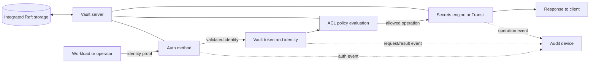

# Unit 2 — HashiCorp Vault Architecture and Auth Methods

**Target filename:** `02-hashicorp-vault-architecture-and-auth-methods.md`  
**Module:** M09 — Secrets and Identity Management  
**Estimated learning time:** 12–16 hours; **lab time:** 8–12 hours (estimates, not guarantees).  
**Learner level:** L1 Foundations → L4 Operating under failure.  
**Chosen lab server:** HashiCorp Vault, to match the curriculum title. Use a non-dev, single-node integrated Raft configuration in a disposable `kind` environment. No exact server/chart version is asserted here; pin a currently supported version after checking official release information. Record versions and source URLs in `versions.txt`; use placeholders such as `<PINNED_VAULT_VERSION>` until verified, never `latest`.  
**Estimated footprint:** core lab 1–2 CPU cores and 1–2 GiB RAM for Vault plus `kind` overhead; allow approximately 3–5 GiB RAM for the cluster/app lab and several GiB free disk. These are planning estimates, not vendor sizing advice.  
**Real credentials involved: none.** Use only disposable, unmistakably fake values. Never use personal, cloud, production, or reusable credentials.  
**Last reviewed:** 2026-10-28. Exact versions and version-sensitive command semantics were not live-verified during authoring. Lines marked `[VERIFY]`, `[VERSION-SENSITIVE]`, or `[ASSUMPTION]` require review against the pinned environment.

> **Safety contract:** This is a teaching guide, not proof that a deployment is secure or production-ready. Commands and expected outputs are illustrative unless explicitly identified as executed with evidence. No Vault server, `kind` cluster, command, API call, test suite, audit parser, snapshot restore, scanner, or recovery drill was executed while authoring this file. Do not run destructive operations against a non-lab context.

## Unit 2 — HashiCorp Vault Architecture and Auth Methods

### 2.0 Why this matters in production

A root token used by every application turns one bootstrap credential into a platform-wide compromise. A Vault server that restarts sealed can prevent otherwise healthy ETL and scoring workloads from retrieving credentials. A KV v2 policy written against the wrong `data/` or `metadata/` path can deny legitimate access or grant more access than intended. Kubernetes auth roles that accept too many ServiceAccounts or namespaces weaken workload isolation, while leaked snapshots and unprotected audit logs can expose sensitive operational data. This unit teaches how to design trust boundaries, prove access controls with negative tests, and recover safely when identity, storage, audit, or availability fails.

### 2.1 Learning objectives

By the end, the learner can demonstrate these outcomes:

- **L1:** Explain the difference between a secrets engine, auth method, ACL policy, token, identity entity/alias/group, storage backend, seal mechanism, and audit device.
- **L1:** Explain initialization, sealing, unsealing, Shamir shares, auto-unseal, and why a sealed Vault cannot perform ordinary secret operations.
- **L1:** Interpret `vault status` and initialize a disposable non-dev lab only after checking the pinned version's procedure.
- **L2:** Write and test a narrow KV v2 policy with correct API/policy paths; prove an unrelated path and unauthorized operation are denied.
- **L2:** Compare Kubernetes auth, AppRole, JWT/OIDC, human login methods, and cloud IAM auth by trust source, bootstrap risk, lifecycle, and failure modes.
- **L2:** Demonstrate a Kubernetes auth role bound to one exact ServiceAccount and namespace, with positive and negative tests.
- **L2:** Explain token TTL, renewal, re-authentication, accessors, revocation, and safe behavior after expiry or revocation.
- **L3:** Defend choices for Raft topology, seal-key custody, audit retention, snapshot protection, policy ownership, and environment separation.
- **L3:** Design a FastAPI secret-client pattern with bounded timeouts/retries, safe errors, readiness semantics, and no secret/token logging.
- **L4:** Analyze sealed-state, quorum, audit failure, overbroad role/policy, snapshot exposure, and token-expiry incidents using a repeatable runbook.
- **L4:** Produce redacted evidence that intended access succeeds, unrelated access is denied, audit is enabled, recovery was tested locally, and cleanup was verified.

### 2.2 Concept map and vocabulary

#### Vault request path and trust boundaries



The workload controls its own process and may be compromised; the Kubernetes API and TokenReview trust are separate dependencies; Vault validates identity and applies ACL policy; storage and snapshots hold sensitive encrypted state; audit is a security telemetry path with its own access and availability requirements. Audit records do not prove that a client handled a returned secret safely.

#### Seal/unseal and custody

```text
Initialization
  ├─ creates Vault's initial key material and storage state
  ├─ creates unseal shares when Shamir sealing is selected
  └─ returns an initial root token
       ├─ shares: split among simulated custodians; never commit
       └─ root token: bootstrap-only; configure minimum administration/audit,
                      verify, then revoke if the documented workflow supports it

Restart
  └─ persistent encrypted storage remains
       └─ Vault may start SEALED
            └─ documented unseal process / configured auto-unseal dependency
                 └─ UNSEALED and able to serve ordinary requests
```

A seal protects key material needed to access Vault's stored data. It does not make the host, operator, workload, audit file, or snapshot automatically safe. Shamir shares and auto-unseal have different custody and availability trade-offs; neither removes the need for tested recovery.

#### Data/ML platform running example

| Component | Secret or identity need | Design direction in this unit |
|---|---|---|
| FastAPI scoring service | Read a synthetic feature-source/API credential | Dedicated Kubernetes ServiceAccount, narrow read-only KV v2 path |
| ETL job | Read a source credential or write its own checkpoint | Separate identity and policy; never reuse scoring identity |
| PostgreSQL | Database credential lifecycle | Unit 3 covers dynamic credentials and leases; here PostgreSQL is a consumer example |
| Third-party ingestion API | External API credential | Fake KV record; plan rotation rather than assuming static forever |
| CI pipeline | Build/deploy identity | Prefer short-lived OIDC/JWT where supported; avoid long-lived Vault tokens in CI variables |
| Kubernetes cluster | Workload identity and API TokenReview | RBAC, ServiceAccount token audience/issuer, CA and API endpoint must match |

#### Glossary

| Term | Precise definition | Common misconception |
|---|---|---|
| Vault server | Service that authenticates clients, authorizes requests, brokers secrets/crypto operations, and emits audit events | Just a key/value database |
| Secrets engine | Component mounted at a path that stores, generates, or processes data | Same thing as an auth method |
| Auth method | Validates presented identity proof and issues/associates Vault identity and token context | Grants every requested permission |
| ACL policy | Path-and-capability rules attached to a token/identity | Safe because its text looks narrow |
| Token | Bearer credential for subsequent API requests; policies and lifecycle constrain access | Any valid token is root |
| Entity | Vault identity object representing a person/workload across auth methods | Same as a Kubernetes ServiceAccount |
| Alias | Mapping from an auth method's external identity to a Vault entity | A secret or policy |
| Group | Vault identity grouping that can contribute policies/metadata | Automatically mirrors an external directory without configuration |
| Storage backend | Persistence layer for Vault's internal state | Persistence means unsealed, HA, and backed up |
| Integrated Raft | Vault's integrated storage/consensus implementation | One node proves HA |
| Seal mechanism | Protects key material needed to access encrypted stored state | Auto-unseal replaces backup |
| Unseal share | One share in a threshold scheme used with Shamir sealing | Ordinary app credential |
| Root token | Initial highly privileged bootstrap token | Convenient daily admin token |
| Audit device | Destination/handler for Vault audit events | Records every plaintext secret in readable form |
| KV v1/v2 | Key/value engines with different versioning and API semantics | Their policy paths are interchangeable |
| Lease | Time-bounded grant for a secret/token, with renewal/revocation semantics depending on type | Every KV value automatically has a lease |
| Response wrapping | Short-lived wrapping token for handing off a response without directly exposing its payload | Removes need to protect recipient or bootstrap trust |
| Secret zero | Initial credential/trust root required to obtain further credentials | AppRole magically removes bootstrap risk |
| Token accessor | Identifier for token-management operations without exposing token itself | Harmless public telemetry |
| Transit | Encryption-as-a-service engine; plaintext still exists where the client handles it | Protects plaintext after application decryption |

#### Authentication vs authorization vs audit

| Control | Question answered | Typical evidence | What it does not prove |
|---|---|---|---|
| Authentication (AuthN) | Who/what is making this request? | Auth method, validated identity/claims, login result | That identity may read a path |
| Authorization (AuthZ) | What may this identity do on which path? | Effective policies and positive/negative requests | That an authorized app won't leak the value |
| Audit | What request/operation did Vault record? | Protected event with time/path/operation/outcome where supported | Complete downstream behavior or that no event was lost before collection |

#### Authentication method comparison

| Method | Identity proof | Static-secret risk | Best fit | Main failure modes | Lab status |
|---|---|---|---|---|---|
| Kubernetes | ServiceAccount JWT validated through configured Kubernetes trust/TokenReview and role constraints | Reduces need for a stored Vault bootstrap secret; JWT remains a credential | Pods in a correctly configured cluster | Wrong namespace/name/audience/issuer/CA, TokenReview RBAC, API reachability | Mandatory Lab C; exact config `[VERIFY]` |
| AppRole | Role ID plus Secret ID | Secret ID is a bootstrap secret | Constrained non-Kubernetes automation | Secret ID leakage/expiry/use limit, unsafe delivery, broad role | Mandatory Lab D; wrapping syntax `[VERIFY]` |
| JWT/OIDC | Signed JWT, issuer and claims; OIDC for interactive use | Depends on issuer/token lifetime | CI or trusted identity provider | Wrong issuer/audience/subject, key discovery, clock skew | Conceptual/local simulation only |
| OIDC human login | User authenticated by trusted IdP | Depends on IdP/session design | Human operators | IdP outage, group/claim mapping, lifecycle | Awareness |
| LDAP | Directory identity/password | Password remains sensitive | Existing directory environments | Directory outage, bind/mapping errors | Awareness |
| userpass | Vault-managed username/password | Static password | Small disposable demos only | Reuse, rotation, phishing | Awareness; not preferred for workloads |
| Cloud IAM | Cloud-native signed request/identity | Depends on cloud role/trust design | Supported cloud workloads | Trust role, metadata endpoint, account/region/audience mismatch | Awareness only; local `kind` does not prove it |

**Object distinctions:** auth method validates proof; entity/alias/group represents the caller; token authenticates later API calls; policy grants capabilities; secrets engine handles a path; storage persists internal state; seal protects key material; audit device records activity. These controls complement one another and are not interchangeable.

### 2.3 Level 1 — Beginner

#### What Vault is and is not

Vault is a secrets-management and cryptographic service. Depending on enabled engines and auth methods, it can store key/value data, issue short-lived credentials, validate workload identity, apply path-based policies, provide encryption operations, and emit audit records. It is not a general-purpose application database, a replacement for identity design, or a magic boundary around an already-compromised authorized workload.

The request chain is: identity proof → authentication → token/identity → authorization → engine operation → response → audit. A break anywhere can cause denial of service, unauthorized access, or loss of evidence. Vault is also a critical dependency: protect it and decide how workloads behave when it is unavailable.

#### CLI, HTTP API, and UI

- **CLI (`vault`)** supports operator workflows and lab verification but may print sensitive values.
- **HTTP API** is used by clients and automation; paths and fields must match the selected version.
- **UI** can help inspect/configure supported objects, but clicking through a UI does not replace version-controlled policy and tests.
- `VAULT_ADDR` and token-related environment variables can leak through shell history, process inspection, crash dumps, or environment diagnostics. Avoid real tokens in commands or exports. Use the selected version's documented secure login/credential workflow `[VERIFY]`.

#### Initialization, root token, and unseal shares

Initialization creates the initial Vault state and key material. With Shamir sealing, Vault returns shares and a threshold; the required threshold must be met to unseal. The initial root token has extremely broad authority and is a crown-jewel bootstrap artifact. Shares are recovery/unseal material, not application credentials. Never include their values in source control, screenshots, command captures, or evidence.

A safe bootstrap design separates simulated custodians, bootstrap operator, policy reviewer, application identity, and emergency process. In a lab, document the custody procedure and custodian identifiers, not share values. Do not assume the exact root-token revocation sequence is identical across versions or bootstrap methods. Verify it from official docs first; if uncertain, stop and record `[VERIFY]`.

#### Seal and unseal

Vault's stored state is encrypted. In a Shamir-sealed deployment, after initialization or restart, operators submit shares until the threshold is met. When sealed, Vault cannot perform ordinary secret reads/writes and normal authentication operations. This may look like an application or Kubernetes failure even when those systems are healthy.

Auto-unseal delegates key-unwrapping to an external mechanism such as KMS, Transit, or HSM, depending on supported design. It can reduce manual share handling but adds dependency, access-policy, availability, and recovery requirements. Auto-unseal does not replicate data, guarantee availability, or replace backups.

#### Storage: Raft, file, and in-memory

Use a **non-dev single-node integrated Raft** configuration for the core lab so initialization, unseal, persistent storage, and snapshots are visible. Multi-node production behavior is conceptual here. One node has no peer quorum redundancy and cannot prove HA. File storage may appear in small examples; in-memory storage is ephemeral and suited to development/test. Persistent storage is not backup, auto-unseal, or protection from a malicious/overprivileged host.

#### Dev mode versus non-dev mode

Dev mode is optimized for quick experiments; it is typically ephemeral, automatically unsealed, and may print a root token. It is unsuitable for proving secure initialization, custody, durability, recovery, or hardening. Do not use it for any security proof. The core lab uses non-dev single-node Raft with explicit version pinning.

#### First KV v2 write/read

This is a **procedure outline**, not a claim that commands were executed. Complete Lab A using official pinned-version instructions, and confirm the actual mount name and KV version.

```bash
# Host shell in the disposable lab; syntax/path must be checked for pinned version.
vault status
vault secrets list
vault kv put secret/lab/scoring api_key='FAKE_ONLY_NOT_A_CREDENTIAL'
vault kv get secret/lab/scoring
```

The `secret/` mount is a placeholder, not a guaranteed default. Do not capture the `kv get` output if it includes a value. For evidence, retain only a redacted statement such as `read_succeeded=true; secret_value_captured=false`. Repeat the read using a least-privilege identity, not root, and prove it cannot read an unrelated path.

**What happened?** The client made an authenticated request to a KV engine. Vault evaluated policy against the requested path/capability and returned a value. The value is now present in the client process/terminal; the client must protect it. Vault cannot stop a permitted client from copying or logging it.

#### KV v1 versus KV v2

| Feature | KV v1 | KV v2 |
|---|---|---|
| Version history | No built-in per-key version history like KV v2 | Supports versions and version lifecycle operations |
| CLI path | Depends on mount | CLI abstracts API path details |
| Data API/policy path | Usually path below mount | Commonly `<mount>/data/<path>` |
| Metadata/list path | Different layout | Commonly `<mount>/metadata/<path>` |
| Delete behavior | Different from KV v2 | Soft delete, undelete, destroy and metadata deletion differ |

`[VERIFY]` Check the official Vault KV documentation for the pinned release. Soft delete generally marks a version deleted while preserving recoverability according to engine rules; undelete restores a soft-deleted version; destroy removes version data according to documented semantics; deleting metadata may remove version history. Exact details/defaults/options are version-sensitive. Never infer policy paths from `vault kv get` alone.

#### `vault status`

`vault status` is a diagnostic, not an authorization proof. It can report initialization and seal state. Read it to distinguish uninitialized, sealed, and unsealed states, but review output before pasting it into tickets. Never include shares, root tokens, or client tokens in captured output.

### 2.4 Level 2 — Intermediate

#### 2.4.1 ACL policies and path correctness

Vault ACL policies use HCL path rules and capabilities such as `create`, `read`, `update`, `delete`, `list`, and `sudo`; `deny` has precedence according to the documented policy model. Verify exact syntax/semantics for the selected release. App identities should not receive `sudo`, and broad wildcards such as `secret/*` are inappropriate for ordinary workloads.

For KV v2, CLI key paths may look like `secret/lab/scoring`, while policy/API paths commonly use `secret/data/lab/scoring` for data and `secret/metadata/lab/scoring` for metadata. The actual mount may differ. Metadata/list access can reveal key names and structure even where it does not grant secret values.

```hcl
# File: policies/scoring-read.hcl
# Intended identity: FastAPI scoring workload. Assumption: KV v2 mount is "secret".
path "secret/data/lab/scoring" {
  capabilities = ["read"]
}
```

Intended: read scoring record. Prohibited: write/delete, metadata listing, ETL record, unrelated paths. The policy is not proven least-privilege until tested using a token from the intended auth role.

```hcl
# File: policies/etl-own-path.hcl
# Intended identity: ETL only; narrow write capability.
path "secret/data/lab/etl/checkpoint" {
  capabilities = ["create", "read", "update"]
}
```

This omits delete and scoring access. Confirm capability distinctions against the engine/API before using as a production template `[VERIFY]`.

```hcl
# File: policies/audit-reader-example.hcl
# [VERIFY] A real auditor may require carefully reviewed system paths.
path "secret/metadata/lab/*" {
  capabilities = ["list", "read"]
}
```

This may expose metadata and key names and is not a universal auditor policy. It deliberately omits data-path read access. Verify the exact KV v2 behavior.

For temporary administration, do not create a broad all-path policy for convenience. Define the exact system operations needed by bootstrap, use a temporary admin identity, review it, and revoke the temporary token after verification. Exact system paths are `[VERIFY]`; consult official ACL/operator docs.

**Disposable-only broad-policy demonstration:** create synthetic `lab/scoring` and `lab/etl/checkpoint` records, temporarily attach a broad `secret/*`-style policy to a test identity, and demonstrate excess access. Remove the broad policy, obtain a fresh token as required by effective-policy semantics, apply the narrow policy, and prove:
- scoring read succeeds;
- ETL read is denied;
- write/delete are denied;
- metadata/list is denied unless explicitly required.

Do not assume editing the policy store retroactively changes every already-issued token. Never leave the broad policy active.

| Test | Scoring read-only identity expected result | Why |
|---|---|---|
| Read `secret/data/lab/scoring` | Allow | Intended capability |
| Read `secret/data/lab/etl/checkpoint` | Deny | Cross-app isolation |
| Update/delete scoring | Deny | Read-only identity |
| List `secret/metadata/lab` | Deny unless approved | Metadata exposure |
| Wrong API path omitting `data/` | Deny/fail | Confirms path mapping |

`kubectl auth can-i` tests Kubernetes RBAC, not Vault ACL policies. Use Vault-side requests made with the relevant lab identity.

#### 2.4.2 Token model and lifecycle

A token is a bearer credential: anyone who obtains it may act with its effective permissions until expiry, revocation, or other relevant controls take effect. A token does not grant unlimited access; effective policies and lifecycle constrain it.

| Concept | Meaning | Risk/consideration |
|---|---|---|
| Service token | Common token type for service API use | Child/revocation behavior depends on issuance |
| Batch token | Lightweight type for specific short-lived workflows | Semantics differ; verify version |
| TTL/max TTL | Current lifetime/renewal limit | Short TTL reduces exposure but increases auth dependency |
| Renewable | May be renewed within constraints | Renewal is not re-authentication |
| Periodic | Can be renewed periodically under configured semantics | Can persist if renewal automation is careless |
| Orphan | No parent in token hierarchy | Not automatically safe or permanent |
| Accessor | Management identifier for token | Sensitive metadata; avoid casual logs |
| Child token | Token created from another token | Revocation effects depend on hierarchy/type |
| Revocation | Invalidates token/related credentials per documented semantics | Verify denial at point of use and rotate exposed downstream secrets |

`[VERIFY]` Check current Vault token docs for CLI syntax/semantics of lookup, renewal, accessors, orphan/periodic/batch tokens, and child revocation. Never paste tokens into shell history/logs. Use the documented interactive or credential-helper workflow.

Application rules: authenticate using intended workload identity; request minimum policy/lifetime; keep token in protected process memory; renew only if renewable and appropriate; re-authenticate after expiry/revocation or failed renewal; use bounded exponential backoff with jitter for transient failures; don't retry 403 forever; verify revocation with a synthetic request; decide explicitly whether to fail closed or use a bounded cache.

#### 2.4.3 Authentication methods

**Kubernetes auth.** A Pod presents a ServiceAccount JWT. Vault validates it through the configured Kubernetes trust relationship, commonly involving TokenReview, API host, CA and reviewer identity. A role maps the validated ServiceAccount identity and namespace constraints to Vault policies and token settings. The cluster issues the JWT; Kubernetes API/TokenReview validates it; Vault's auth configuration must trust the correct endpoint/CA and issuer/audience; the role must bind the intended name and namespace.

`[VERSION-SENSITIVE]` ServiceAccount token defaults, issuer, audience, TokenRequest/projected tokens, and Vault auth configuration have changed across versions. Verify both pinned versions. Prefer supported projected/bound tokens over legacy long-lived ServiceAccount token Secrets. Do not disable issuer validation as a casual workaround. `token_reviewer_jwt`, `kubernetes_host`, CA settings, reviewer RBAC (including `system:auth-delegator` considerations), issuer and audience settings must be checked against official docs.

Bind a role to an exact ServiceAccount and namespace, not a broad namespace wildcard or every ServiceAccount. Namespace alone is not complete isolation if users can create privileged workloads or alter ServiceAccounts; combine with RBAC, admission controls, and ownership.

**AppRole.** Typically uses `role_id` and `secret_id`; the role ID is an identifier, the Secret ID a credential. Secret IDs may have TTL/use limits. AppRole is not magically zero-static: a bootstrap mechanism must deliver the Secret ID. Response wrapping uses a short-lived, single-use wrapping token to hand off a response; it reduces direct exposure but does not remove the need to protect the wrapping token, recipient, and trust channel. `[VERIFY]` Verify exact wrap/unwrap syntax, TTL, and single-use semantics.

**JWT/OIDC.** Validate issuer, signature, audience, subject/bound claims, expiry, and key discovery/trust. Use real issuer claim contracts, not guessed names. For CI, prefer short-lived OIDC where supported; do not assume a CI token has the right audience or subject. Cloud federation depth belongs to Unit 7.

**Human methods: OIDC, LDAP, userpass.** Human operators need attributable individual identity, group mapping, lifecycle integration, and audit. OIDC delegates login to an IdP; LDAP integrates with a directory; userpass is a simpler Vault-managed password method and should not become the default workload identity. Human policy should differ from app policy.

**Cloud IAM.** AWS/GCP/Azure methods rely on provider-native identity evidence/signed requests. Trust depends on provider identity primitives, permissions, audience and role configuration. Local `kind` without a cloud account cannot prove cloud IAM behavior; Unit 7 owns deeper federation/IRSA.

**Entities, aliases, groups.** Vault identity maps external identities from auth methods into entities and aliases, with groups/policies contributing authorization. Mapping errors can attach unexpected policies, so review mappings and policy attachment. Entity/alias templating syntax is version-sensitive and not provided as runnable HCL `[VERIFY]`.

#### 2.4.4 Audit devices and request evidence

Audit devices record request activity. Supported destinations may include files or sockets depending on version/configuration. Sensitive fields may be HMAC-protected or redacted; an HMAC is not the original plaintext. Protect audit data against unauthorized reading, modification, deletion, disk exhaustion, and uncontrolled replication.

Enable and verify audit before routine use. Restrict filesystem/collector permissions; monitor write errors, disk use, rotation, retention and shipping lag; protect audit files in backups; use aggregate summaries in tickets; verify field names/schema against the pinned release. Test audit failure behavior in a disposable lab. Do not assume requests always fail open or always fail closed: behavior depends on configuration/version.

Audit is not a substitute for app logs or incident response. It may show a secret read request, but cannot prove the caller did not copy the returned value elsewhere.

#### 2.4.5 Kubernetes deployment and FastAPI client

Use the official Vault Helm chart or documented manifests for a disposable `kind` lab; pin chart and image versions. Do not copy guessed chart values. Review the pinned chart's schema and verify non-dev mode, listener/TLS, storage, persistence, resources, Service and security settings. Keep exposure local/private. A TLS exception for a local exercise must never be described as production-ready.

**Deployment outline (not a ready-to-apply manifest):** guard the current context; create `vault-lab`; pin official chart/image; review values; configure non-dev single-node Raft and persistent storage; configure trusted local TLS; install; initialize/unseal; enable audit; configure policies/auth; deploy the app in a separate namespace with a dedicated ServiceAccount; run positive and negative tests.

The following is a **client design pattern**, not a complete integration: exact Kubernetes auth payload, token-file/audience setup, and response fields depend on the selected Vault/Kubernetes versions. The adapter is intentionally a contract until implemented from official docs; do not deploy it as complete code.

```python
# File: app/vault_client.py
# Runs in the FastAPI container. Requires pinned Python and httpx.
# No credential literals. Implement AuthAdapter against official docs [VERIFY].

import asyncio
import random
from dataclasses import dataclass
from typing import Protocol
import httpx

class VaultAuthError(Exception): pass
class VaultPermissionError(Exception): pass
class VaultUnavailableError(Exception): pass

@dataclass(frozen=True)
class SecretValue:
    value: str

class AuthAdapter(Protocol):
    async def login(self, client: httpx.AsyncClient) -> str:
        """Return a short-lived Vault token. Implement from verified API docs."""
        ...

class VaultSecretClient:
    def __init__(self, addr: str, auth: AuthAdapter,
                 timeout_seconds: float = 2.0, max_attempts: int = 3):
        self.addr = addr.rstrip("/")
        self.auth = auth
        self.timeout_seconds = timeout_seconds
        self.max_attempts = max_attempts
        self._client = None
        self._token = None

    async def start(self):
        self._client = httpx.AsyncClient(
            base_url=self.addr,
            timeout=httpx.Timeout(self.timeout_seconds),
            # Configure a trusted lab CA; never disable TLS for real environments.
        )
        for attempt in range(self.max_attempts):
            try:
                self._token = await self.auth.login(self._client)
                return
            except VaultAuthError:
                raise
            except (httpx.TimeoutException, httpx.TransportError):
                if attempt == self.max_attempts - 1:
                    raise VaultUnavailableError("Vault authentication unavailable") from None
                await asyncio.sleep(min(0.25 * (2 ** attempt), 2.0) +
                                    random.uniform(0, 0.15))
        raise VaultUnavailableError("Vault authentication unavailable")

    async def read_scoring_key(self) -> SecretValue:
        if self._client is None or self._token is None:
            raise VaultUnavailableError("Vault client is not authenticated")
        # KV v2 path commonly uses /v1/<mount>/data/<key>. [VERIFY]
        try:
            response = await self._client.get(
                "/v1/secret/data/lab/scoring",
                headers={"X-Vault-Token": self._token},
            )
        except (httpx.TimeoutException, httpx.TransportError):
            raise VaultUnavailableError("Vault read unavailable") from None
        if response.status_code == 401:
            self._token = None
            raise VaultAuthError("Vault token rejected; re-authentication required")
        if response.status_code == 403:
            raise VaultPermissionError("Vault denied the requested secret path")
        if response.status_code >= 500:
            raise VaultUnavailableError("Vault server unavailable")
        if response.is_error:
            raise VaultUnavailableError("Vault returned an unexpected response")
        try:
            payload = response.json()
            value = payload["data"]["data"]["api_key"]
        except (ValueError, KeyError, TypeError):
            raise VaultUnavailableError("Vault response schema was unexpected") from None
        if not isinstance(value, str) or not value:
            raise VaultUnavailableError("Required secret was missing")
        return SecretValue(value)

    async def close(self):
        self._token = None
        if self._client is not None:
            await self._client.aclose()
            self._client = None
```

This sample does not implement the auth adapter, token renewal, or a full FastAPI lifecycle. It demonstrates bounded transport retries, differentiated 401/403/5xx behavior, generic errors, and cleanup. Implement the adapter from official Kubernetes auth API documentation and add tests before treating it as working code.

Required fake-client tests (not executed): success; 403 denial; 401/expiry triggers re-auth; timeout is bounded; secret/token sentinels do not appear in logs. Use `pytest` and a fake `httpx` transport; do not log raw response bodies or exception objects that may contain secrets.

| Pattern | What it does | Main trade-off | Curriculum boundary |
|---|---|---|---|
| Direct API | App authenticates and reads Vault | App owns auth/token lifecycle/retries | Taught here |
| Vault Agent/injector | Agent can handle selected auth/template/renewal | Adds agent/configuration; injected file remains exposed to workload | Awareness; verify docs |
| ESO | Controller syncs external values into Kubernetes Secret objects | Values now fall under Kubernetes API/storage/RBAC controls | Unit 4 |
| CSI/provider | Mounts provider-managed secret material into a Pod volume; sync behavior varies | Node/Pod mount lifecycle and optional Secret sync affect exposure | Unit 6 |

Copying a Vault value into a Kubernetes Secret changes the exposure surface; it does not remove the value from Kubernetes.


### 2.5 Level 3 — Advanced

#### 2.5.1 Architecture and availability

Integrated Raft stores Vault state and uses consensus. In a multi-node group, a leader coordinates writes and followers replicate; requests may be forwarded depending on configuration. A quorum is a majority of voting nodes. Losing the leader may trigger election; losing quorum can prevent progress. Exact behavior and operational commands are release-specific `[VERIFY]`.

| Design | What it demonstrates | What it does not demonstrate |
|---|---|---|
| Single-node local Raft | Persistent storage path, init/unseal, audit, policy tests, snapshot workflow | HA, quorum redundancy, multi-zone failure, production throughput, cloud KMS/HSM |
| Three-node or larger production topology | Consensus and node failure handling when correctly deployed | Automatic DR across independent failure domains unless designed/tested |
| Separate DR strategy | Recovery from broader cluster/site failure | A snapshot alone does not prove recoverability |

Production design must consider failure domains, quorum, persistent disk behavior, storage latency, network partitions, maintenance, upgrades, audit volume, client retries, and ownership/on-call. Do not extrapolate production sizing from the laptop lab.

**Shamir versus auto-unseal**

| Dimension | Shamir shares | Auto-unseal |
|---|---|---|
| Key custody | Separate human custodians hold shares; threshold required | External KMS/Transit/HSM protects or unwraps key material |
| Availability dependency | Custodian availability and share custody | External service, credentials, policy, network and key availability |
| Operational burden | Secure distribution, custody, rekey and drills | Integration setup, external permissions, outage/dependency design |
| Failure risk | Lost shares or unavailable custodians block unseal | External service or permission failure can block unseal/recovery |
| Local lab | Can model split custody with fake shares | Optional; two-server Transit setup not required and must be verified |
| Does not solve | Host compromise, unsafe snapshots, lost storage | Same; also does not equal replication or backup |

Never put all shares in one repository, shell history, screenshot, or one person's routine workstation. Use separate simulated custodians and record the procedure, not values. Rekey and root-token generation/recovery are sensitive and version-specific; consult official operator docs. Root-token recovery/generation and unsealing are different operations.

**Snapshots and recovery.** A Raft snapshot can contain the data/configuration needed to restore sensitive secrets. Treat it as a secret-bearing artifact: restrict permissions, encrypt/protect it, store it outside Git/shared paths, verify integrity, and restore only in a disposable environment. Use official snapshot docs for the pinned version; do not assume syntax, target requirements, compatibility, or rollback behavior. A snapshot on disk is not proof of recoverability: restore also needs compatible storage, seal access, network/configuration, audit plan, and validation of records and policies.

**Upgrade/rollback discipline:** inventory versions; read release/compatibility notes; protect a backup and verify integrity; restore to a disposable environment; test auth, policies, audit, token lifecycle and app integration; plan staged upgrade/rollback boundaries; record evidence and approval. Do not assume binary rollback is safe after storage-format changes.

**Host/network hardening:** private network exposure, trusted TLS, restrictive OS/container permissions, controlled storage mounts, protected backups, least-privilege operators. Review core dumps, swap, `mlock`, file ownership and OS/container settings against official guidance for pinned version/platform `[VERIFY]`. Do not guess flags or assume behavior is identical across Linux, containers, and WSL2.

#### 2.5.2 Policy and mount architecture

Use path conventions that make ownership and environment explicit, e.g. `team/environment/application`: `platform/dev/scoring`, `platform/test/scoring`, `platform/prod/scoring`. These are illustrative logical names. Separate dev and prod policies/auth roles so dev workloads cannot read prod data. A shared mount simplifies operations but demands consistent path ownership and policy review; separate mounts add operational overhead. Neither replaces correct tests.

Policy-as-code workflow:
1. Define owner, intended identity, paths, capabilities, and prohibited access.
2. Keep policy source in version control only if it contains no credentials.
3. Run static checks for broad patterns, `sudo`, and unintended write/delete.
4. Peer-review the diff.
5. Apply through controlled administration.
6. Test allowed and denied operations using the actual auth path.
7. Record redacted results and review drift periodically.

`vault policy fmt` and policy-write validation behavior must be checked for the pinned version; do not assume a dry-run option exists. Enterprise namespaces are awareness only: they add administrative/tenant boundaries but are not identical to path conventions or separate clusters. Compare Vault/OpenBao/cloud managers on feature fit, operational skill, availability, identity integration, audit, governance, lock-in, cost and licensing; check current official governance/license docs rather than relying on stale claims. Terraform provider is awareness only; M07 owns broader IaC state handling.

#### 2.5.3 Token renewal and application behavior

```text
START
  -> authenticate with intended workload identity
       -> success: retain token in protected process memory
       -> auth failure: fail readiness safely
  -> read required secret
       -> success: use only for approved purpose
       -> 403: policy/configuration error; do not retry forever
       -> 401/expired: re-authenticate if permitted, then retry boundedly
       -> timeout/5xx/sealed: bounded retry with jitter, then declared failure
  -> before expiry: renew only if token is renewable and renewal is appropriate
       -> renewal succeeds: continue
       -> renewal rejected/not renewable: re-authenticate
  -> shutdown: cancel requests, clear in-memory references where practical,
               close client; never log token or secret
```

If a credential is required for safe operation, fail closed when it cannot be obtained. A bounded cache may be acceptable for specific values only with an explicit maximum age and risk approval. Never allow indefinite stale credentials. Keep tokens and values out of metrics labels, traces, exceptions, debug logs, crash reports and unprotected temporary files. Distinguish transport failure, authentication failure, authorization denial, seal state and upstream engine failure. Use bounded exponential backoff with jitter; don't retry a 403 indefinitely. Readiness should reflect whether the service can safely serve; liveness should not create restart storms during temporary Vault outages.

#### 2.5.4 Secret-zero analysis

| Method | First trust root / secret-zero question | Who can obtain/mint it? | Containment after compromise |
|---|---|---|---|
| Kubernetes auth | Who controls ServiceAccount, Pod spec, TokenRequest permissions and issuer/CA trust? | Kubernetes API and authorized workload deployers, depending on RBAC | Revoke/limit Vault access, contain Pod/SA, review cluster RBAC/audit |
| AppRole | How is the first `secret_id` delivered without exposure? | Bootstrap system/operator permitted to issue it | Rotate/revoke secret ID and resulting tokens; reduce policy/TTL/use count |
| JWT/OIDC | Is issuer trusted and signature/audience/subject/expiry constrained? | Trusted issuer or actor able to obtain its token | Remove trust/binding, rotate issuer keys if appropriate, revoke Vault token |
| Cloud IAM | Which cloud identity/role can mint or obtain proof? | Cloud IAM control plane/admins | Remove cloud trust/role, revoke Vault access, inspect cloud audit |
| Human OIDC/LDAP | Who controls account, groups, MFA/session and lifecycle? | IdP/directory administrators and user | Disable account/session, remove group mapping, revoke tokens, audit |

No auth method removes the need to protect its trust root. Prefer managed, short-lived identity proof, narrow claims/bindings, limited policies, and clear revocation.

#### 2.5.5 Transit and PKI concepts

**Transit** offers cryptographic operations through an API so applications can request encryption/decryption without managing the underlying key directly. It does not protect plaintext after the application decrypts it. Use separate encrypt/decrypt policies and scope access to the required key path.

Optional field-encryption experiment:
1. Create a disposable Transit key using verified commands.
2. Give a test identity only encrypt permission; give decrypt permission only to the service that needs it.
3. Submit synthetic `FAKE_ONLY_SENSITIVE_FIELD`.
4. Store ciphertext only.
5. Decrypt in memory and test that plaintext is not logged.
6. Rotate the key and verify old ciphertext remains decryptable according to documented semantics.
7. Explore rewrap only with synthetic ciphertext; do not delete old key versions merely to clean up.

`[VERIFY]` Transit request fields, response schema, rotation, rewrap, minimum decryption version and convergent-encryption behavior are version-sensitive. Convergent encryption can reveal equality patterns and has specific security constraints. Rotation is not the same as rewriting every stored ciphertext.

**PKI awareness:** Vault PKI can issue certificates according to configured roles and CA/key material. Short-lived leaf certificates reduce exposure windows but do not remove CA protection, role constraints, trust distribution, renewal, and revocation requirements. M04 covers TLS/cert-manager; this is not a full PKI course.

### 2.6 Level 4 — Expert

#### 2.6.1 Vault as tier-0 infrastructure

Treat Vault as a critical dependency. Establish a service owner, on-call, change process, SLOs, capacity model, audit retention, backup/restore, break-glass process, and DR objectives. Document which workloads require Vault at startup and which can safely continue with a bounded cached value.

Candidate indicators (targets are `[ASSUMPTION]` until baselined):

| Indicator | Measurement | Candidate alert/target caveat |
|---|---|---|
| Auth success rate by method | Successful / total logins segmented by method/reason | Alert on sustained drop; baseline first |
| Secret-read success/latency | Success/denial/error counts and latency distribution | Separate 403 from transport/server errors |
| Seal state/duration | Health/status checks and time to normal service | Alert on unexpected sealed state |
| Token renewal/re-auth | Renewal results and elapsed time to fresh token | Alert before expiry causes broad failures |
| Audit delivery lag | Event creation to protected collector, where measurable | Alert on lag/disk pressure |
| Raft leader/quorum | Version-supported health/metrics | Use version-appropriate signals |
| Snapshot age/restore time | Backup age, integrity, and restore-test duration | Set RPO/RTO as exercises, not guarantees |
| Requests/tokens/storage growth | Supported metrics and APIs | Confirm names/fields for selected release |
| Audit disk use | Filesystem, rotation, collector queue | Alert before exhaustion |

A target such as “99.9% auth success” is not universal. Define population, exclusions, window and error budget after observing workload patterns and business impact. Never infer production sizing from the laptop lab.

#### 2.6.2 Failure and recovery scenarios

Before remediation: identify affected identities/paths, assess blast radius, preserve necessary evidence securely, and decide whether tokens/credentials must be revoked or rotated. Do not perform destructive recovery against non-lab systems based on this tutorial.

**1. Vault starts sealed after restart**  
**Symptom:** reads/auth fail after Pod/node restart → **Hypotheses:** expected Shamir seal, unavailable unseal dependency, storage mount/config issue → **Safe tests:** verify context, Pod health, status/seal, volume and redacted logs → **Root cause:** sealed state or storage/config failure → **Mitigation:** documented unseal/auto-unseal process; do not delete PVC → **Prevention:** restart drill, owner/runbook, alerts → **Evidence:** redacted before/after status and synthetic read.

**2. Unseal shares lost/unavailable**  
**Symptom:** threshold cannot be met → **Hypotheses:** custody failure, damaged share, custodian unavailable → **Safe tests:** verify custody inventory without printing values and check supported recovery path → **Root cause:** insufficient valid shares → **Mitigation:** official recovery/escalation only; no bypass improvisation → **Prevention:** separate custodians and drills → **Evidence:** custody-process review without share values.

**3. Root token lost**  
**Symptom:** no routine admin token → **Hypotheses:** emergency custody missing or token lost/revoked → **Safe tests:** check separate least-privilege admin path; distinguish token generation/recovery from unsealing → **Root cause:** root used as sole admin path → **Mitigation:** documented root-token generation/recovery if authorized and needed → **Prevention:** least-privilege admin identity and break-glass controls → **Evidence:** approved change and admin validation, never token value.

**4. Raft leader or quorum loss**  
**Symptom:** writes/requests fail or cluster degraded → **Hypotheses:** node/network/storage failure → **Safe tests:** documented cluster health/leader, network and storage signals → **Root cause:** leader election/quorum unavailable → **Mitigation:** restore peer/network/storage using documented procedure; don't reinitialize → **Prevention:** failure-domain tests and quorum monitoring → **Evidence:** timeline and recovery verification.

**5. Storage unavailable/corrupt or restore fails**  
**Symptom:** state cannot load or synthetic record missing after restore → **Hypotheses:** volume, incompatible version, damaged snapshot, missing seal access → **Safe tests:** attachment/permissions, snapshot metadata/checksum, compatibility → **Root cause:** unmet storage/restore prerequisite → **Mitigation:** stop destructive attempts; restore only to disposable target per official docs → **Prevention:** restore drills and version inventory → **Evidence:** local RTO and synthetic record verification.

**6. Audit path unavailable/disk full**  
**Symptom:** audit writes fail or telemetry stops → **Hypotheses:** disk full, permissions, socket/collector outage, rotation failure → **Safe tests:** filesystem/device/collector health without dumping records → **Root cause:** audit destination/capacity → **Mitigation:** restore capacity/destination and verify request behavior for exact config → **Prevention:** alerts, retention and failure drill → **Evidence:** synthetic event delivered and capacity metrics.

**7. Policy/auth/mount deleted**  
**Symptom:** 403 or login failure after change → **Hypotheses:** detached policy, disabled auth mount, deleted role or changed path → **Safe tests:** inspect reviewed config/change record and synthetic path → **Root cause:** unreviewed/mis-scoped change → **Mitigation:** restore reviewed config; no permanent root workaround → **Prevention:** policy-as-code, staged changes and owners → **Evidence:** diff and allow/deny tests.

**8. Kubernetes auth mismatch**  
**Symptom:** Pod login fails although ServiceAccount exists → **Hypotheses:** wrong name/namespace/audience/issuer/CA, TokenReview permission, invalid token → **Safe tests:** inspect identity metadata without printing JWT; test Kubernetes RBAC separately; review Vault config → **Root cause:** trust config mismatch → **Mitigation:** correct verified setting; don't disable issuer validation casually → **Prevention:** version-pinned integration and negative tests → **Evidence:** intended SA succeeds, other SA/namespace denied.

**9. Auth role too broad**  
**Symptom:** unintended workload authenticates → **Hypotheses:** broad namespace/SA pattern or shared SA → **Safe tests:** harmless login from different SA/namespace → **Root cause:** role constraints too broad → **Mitigation:** narrow role/policies, revoke affected tokens if appropriate, inspect audit → **Prevention:** exact bindings and CI policy tests → **Evidence:** positive/negative matrix.

**10. KV v2 policy mismatch/exposure**  
**Symptom:** legitimate read denied or unrelated record accessible → **Hypotheses:** missing `data/`, metadata/data confusion, broad wildcard, wrong mount → **Safe tests:** synthetic Vault-side requests → **Root cause:** path mismatch or overbroad policy → **Mitigation:** replace broad policy and obtain token with corrected effective policy → **Prevention:** conventions and tests → **Evidence:** redacted policy and access matrix.

**11. AppRole Secret ID expired/consumed/leaked**  
**Symptom:** login fails or unexpected login appears → **Hypotheses:** use limit/TTL, wrong role, unsafe delivery → **Safe tests:** inspect role settings and audit metadata, not Secret ID → **Root cause:** lifecycle/delivery failure or compromise → **Mitigation:** rotate/revoke bootstrap material and issued tokens as appropriate; investigate reads → **Prevention:** wrapping, short TTL/use count and secure delivery → **Evidence:** new credential works, old credential denied.

**12. Token expires/revokes and app logs sensitive data**  
**Symptom:** intermittent 401s and traces contain response/error payload → **Hypotheses:** renewal race, revocation, unsafe debug logging → **Safe tests:** fake sentinel values and log checks → **Root cause:** incomplete client state machine and unsafe exception handling → **Mitigation:** disable unsafe logging, rotate exposed credentials, revoke affected tokens → **Prevention:** fake-client tests and generic errors → **Evidence:** sentinel absent from logs.

**13. Snapshot in shared/unprotected location**  
**Symptom:** backup appears in shared drive/artifact store → **Hypotheses:** permissive file mode, sync policy, CI artifact upload → **Safe tests:** inventory access metadata without opening/copying snapshot → **Root cause:** backup treated as ordinary build output → **Mitigation:** restrict access, preserve evidence, assess/rotate affected credentials if indicated → **Prevention:** protected destination and exclusions → **Evidence:** access review/disposition.

**14. Transit rotated without ciphertext plan**  
**Symptom:** old ciphertext handling fails → **Hypotheses:** minimum decryption version changed, old key version disabled, rewrap not planned → **Safe tests:** synthetic ciphertext and official version-aware commands → **Root cause:** rotation confused with rewrap → **Mitigation:** preserve old versions until compatibility/recovery verified → **Prevention:** key-version inventory and retirement gate → **Evidence:** old/new ciphertext checks.

**15. Vault unavailable while apps cache credentials**  
**Symptom:** existing requests work but new connections/rotation fail → **Hypotheses:** cached value still valid, credential expired, cache unbounded → **Safe tests:** cache age and expiry metadata without exposing value → **Root cause:** dependency/cache behavior unspecified → **Mitigation:** per-secret fail-closed or bounded-cache decision → **Prevention:** maximum cache age and outage drill → **Evidence:** local behavior and stale-use window.

**16. Audit shows bulk reads/off-hours/new source/sudo/token spike**  
**Symptom:** unusual aggregate activity → **Hypotheses:** deployment, automation change, compromised token, policy drift, operator misuse → **Safe tests:** correlate protected event metadata with approved changes → **Root cause:** determine from identity/path/time/source evidence → **Mitigation:** contain identity/token or narrow role, preserve evidence → **Prevention:** baseline, alerting and separation of duties → **Evidence:** redacted timeline and scope assessment.

#### 2.6.3 Governance and continuous verification

Maintain owners for each auth role, policy, mount and application path. Periodically review stale ServiceAccounts/roles, unused AppRoles and Secret IDs, stale entities/aliases/groups, broad wildcards and `sudo`, root-token custody, audit retention/capacity, backup age/restore results, and unreviewed policy changes.

Separate duties where feasible: platform operators maintain availability; policy reviewers approve access; custodians protect recovery material; application owners define required paths/cache behavior; incident responders contain compromised identities. A small lab may combine roles, but production design should state where separation is required.

CI/policy checks can flag unpinned versions, dev mode outside tests, missing audit config, broad exposure, app policies with wildcard/`sudo`, unnecessary write/delete, and committed secrets/tokens/shares/snapshots. Static checks are signals, not proof of effective runtime policy or trust.

**Audit summary parser approach:** do not assume all versions use the same JSON schema. Build a version-specific adapter from official audit docs, normalize only allowlisted fields, ignore unknown fields safely, count malformed lines without echoing them, and emit aggregates only. Never print raw request/response values or HMAC fields.

```python
# File: tools/audit_summary.py
# Synthetic lab records only. Output aggregates, not raw events.
import json
from collections import Counter
from pathlib import Path
from typing import Any

def safe_load_line(line: str) -> dict[str, Any] | None:
    try:
        obj = json.loads(line)
    except (json.JSONDecodeError, TypeError):
        return None
    return obj if isinstance(obj, dict) else None

def normalize_event(obj: dict[str, Any]) -> dict[str, str]:
    # [VERIFY] Replace with fields documented for the pinned version.
    request = obj.get("request") if isinstance(obj.get("request"), dict) else {}
    return {
        "type": str(obj.get("type", "unknown")),
        "operation": str(request.get("operation", "unknown")),
        "path": str(request.get("path", "unknown")),
    }

def summarize(path: Path) -> dict[str, Any]:
    counts = Counter()
    malformed = total = 0
    with path.open("r", encoding="utf-8") as stream:
        for line in stream:
            total += 1
            obj = safe_load_line(line)
            if obj is None:
                malformed += 1
                continue
            event = normalize_event(obj)
            counts[(event["type"], event["operation"], event["path"])] += 1
    return {
        "total_lines": total,
        "malformed_lines": malformed,
        "aggregate_event_counts": [
            {"type": k[0], "operation": k[1], "path": k[2], "count": n}
            for k, n in sorted(counts.items())
        ],
    }

if __name__ == "__main__":
    import argparse
    parser = argparse.ArgumentParser()
    parser.add_argument("audit_file", type=Path)
    args = parser.parse_args()
    print(json.dumps(summarize(args.audit_file), indent=2))
```

The schema adapter above is illustrative and unexecuted. It emits paths, which may still be sensitive metadata. Add synthetic tests for valid events, malformed JSON, missing fields, unknown schema, and a fake secret/token sentinel absent from output. A denylist alone is not a sanitizer; safety comes from emitting only explicitly normalized fields.

Migration playbook: inventory old locations/owners/consumers → classify and identify replaceable static credentials → map workload to auth/policy/path/failure behavior → dual-run only in controlled scope → test allow/deny, expiry, audit and rollback → cut over with owner/change window → revoke old credentials and verify denial → scan images/Git history/CI logs/backups/local artifacts → decommission old backend under approved retention policy.

Cross-module handoffs: M11 owns broader telemetry; M13 backup/DR; M14 multi-cluster identity; M16 platform golden paths; M17 capstone integration. This unit establishes Vault-specific concepts/tests, not those modules' full content.

#### 2.6.4 Production-hardening review

| Control | Required evidence |
|---|---|
| Non-dev mode and persistent storage | Reviewed pinned config/chart values; status and persistence test |
| TLS and private exposure | Certificate/CA validation and service/network review |
| Audit enabled/retained securely | Device status, synthetic event, retention/permissions and disk alert |
| Root token revoked or safely controlled | Approved bootstrap record; no token retained; emergency process documented |
| Unseal/recovery custody | Custody procedure and drill result without share values |
| Least-privilege auth roles/policies | Redacted review and positive/negative tests |
| Kubernetes issuer/audience/CA | Version-specific review and wrong-identity denial |
| Token TTL/renewal/re-auth | Controlled expiry/revocation test and app evidence |
| Protected backup and tested restore | Snapshot review, restore record and synthetic data validation |
| Upgrade/rollback | Version inventory, release notes, restore gate and rollback plan |
| Metrics, alerts, ownership/on-call | Reviewed dashboard/alert/runbook owners |
| Core dumps/swap/`mlock` and OS controls | Platform-specific review against official docs |
| No credentials in Git/logs/evidence/history | Secret-free scan plus manual review; scanner is not proof of absence |

### 2.7 SRE lens

#### Dependency graph and outage modes

```text
FastAPI scoring ── startup auth/read ──> Vault
  └── request-time credential use ────> third-party ingestion API
ETL job ── auth/read/write ────────────> Vault
  └── database connection ────────────> PostgreSQL

Vault depends on process + storage + seal/unseal + identity trust + network/TLS
+ policy/configuration + audit behavior + operator response.
```

**Vault unavailable at startup:** if the secret is required to serve correctly, fail readiness and do not claim healthy service. Retry within a bounded startup budget and report a generic error.

**Vault unavailable after a secret was fetched:** existing requests may continue while new connections, rotation or re-authentication fail. Use a bounded cache only where approved; define a maximum stale-use window. Do not assume a cached credential remains valid or safe.

Candidate SLI/SLO ideas (all `[ASSUMPTION]` until baselined): auth success by method/reason; secret-read latency and success; unexpected sealed duration; renewal failures and workloads nearing expiry; Raft health; snapshot age/restore time; audit errors/disk/collector lag; unusual bulk reads, denials, off-hours access, new sources, root/sudo usage and token creation spikes. Set thresholds from observed workload and business impact, not generic numbers.

**Runbook skeleton:** alert and identify impact → determine affected workloads and cache age → check seal/leader/quorum/storage/audit/network/TLS/auth/policy/backend → contain blast radius → restore via approved procedure → validate intended access and unrelated denial → document timeline, evidence, owners and prevention.

For local RPO/RTO exercises, define acceptable synthetic data loss and recovery time before the drill. Measure only the local result; do not extrapolate to production. Do not estimate cloud prices or production capacity from this laptop lab.

### 2.8 Security lens

| Threat | Preventive | Detective | Corrective |
|---|---|---|---|
| Stolen token | Narrow policy, short lifetime, protected memory, TLS | Audit anomalies, access review | Revoke token, rotate exposed downstream secret |
| Overbroad policy | Policy review, deny-by-default, separate app policies | Static checks, negative tests | Remove policy, reissue tokens as needed |
| Compromised Pod/SA | Dedicated SA, RBAC, Pod security, NetworkPolicy | Kubernetes/Vault audit | Contain Pod/SA, revoke access |
| Compromised CI | Isolated runner, short-lived OIDC, scoped role | CI audit, unexpected path reads | Disable trust, revoke tokens, rotate secrets |
| AppRole Secret ID leak | TTL/use limits, wrapping, controlled delivery | Login anomalies | Rotate Secret ID and resulting tokens |
| Untrusted JWT claims | Issuer/signature/audience/subject/expiry validation | Failed-login trends | Remove trust/binding, revoke impacted access |
| Malicious operator | Separation of duties, reviewed changes | Audit and change review | Contain identity, preserve evidence, rotate credentials |
| Audit tampering/loss | Restricted permissions, protected collector | Disk/lag/integrity alerts | Restore telemetry and investigate gaps |
| Snapshot theft | Protected location, encryption/access control | Backup access logs/scans | Restrict access, assess exposure, rotate if indicated |
| Unseal share loss | Split custody and drills | Custody inventory | Supported recovery process |
| Secret in logs | Redaction, generic exceptions, sentinel tests | Secret scans/log review | Remove exposure, rotate/revoke, investigate |

Prove: intended SA authenticates; wrong namespace/SA cannot; intended path succeeds; unrelated path is denied; write/delete/list denied unless required; expired/revoked token fails; audit event appears; token and secret sentinels are absent from logs/traces/metrics/evidence.

**Limitations:** Vault cannot protect a secret from a fully compromised application legitimately allowed to read it. It does not make insecure nodes, overbroad roles, leaked tokens, unsafe backups, malicious operators, or incorrect trust harmless. A completed lab checklist does not establish compliance with OWASP, NIST, CIS, SOC 2, ISO 27001, or any other framework.

### 2.9 Production checklist

#### Local lab completion

- [ ] `versions.txt` records exact versions/digests and official sources; no `latest`.
- [ ] Context/namespace guard passed before changes.
- [ ] Non-dev single-node Raft configured from verified docs.
- [ ] Initialization/unseal used throwaway material; no values in evidence.
- [ ] Audit enabled and synthetic event verified.
- [ ] Root token handled using the verified bootstrap procedure; no app uses it.
- [ ] KV mount/version confirmed; data and metadata paths distinguished.
- [ ] Own-path read succeeds; unrelated path, write, delete and unnecessary list denied.
- [ ] Kubernetes role bound to exact SA/namespace; wrong identity tests denied.
- [ ] AppRole wrapping tested only after syntax verification.
- [ ] Expiry/revocation and safe app errors tested with fake credentials.
- [ ] Snapshot restore tested only in disposable target; local RTO/data verification recorded.
- [ ] Expected outputs labelled illustrative unless run; cleanup verified.

#### Production design review (not proven by local lab)

- [ ] Multi-node topology and quorum designed for explicit failure domains.
- [ ] TLS, private exposure, identity trust, storage permissions and OS hardening reviewed.
- [ ] Roles/policies have owners, review cadence and negative tests.
- [ ] Audit retention, access, capacity, shipping and failure behavior documented/tested.
- [ ] Root-token and recovery custody approved and rehearsed.
- [ ] Backup/restore and DR tested with stated RPO/RTO; snapshots protected.
- [ ] Upgrade/rollback, on-call, SLOs, alerts and runbooks approved.
- [ ] Cache/outage semantics risk-approved; no indefinite stale credentials.
- [ ] No production-readiness claim relies solely on a single-node lab.

#### Deferred/cloud-specific controls

- [ ] Cloud IAM/IRSA/federation tested in approved cloud environment (Unit 7).
- [ ] ESO and CSI tested in their own integration labs (Units 4 and 6).
- [ ] Dynamic DB credentials, leases, rotation and revocation engineered (Unit 3).
- [ ] Full leak-scanning/incident-response workflow exercised (Unit 8).
- [ ] Enterprise namespaces, HSM, managed KMS, multi-region DR and licensing/governance reviewed against current official docs.

### 2.10 Hands-on lab set

#### Lab summary

| Lab | Goal | Footprint/time estimate | Credentials | Evidence | Cleanup verification |
|---|---|---|---|---|---|
| A | Non-dev init/unseal/audit | 1–2 CPU, 1–2 GiB plus kind; 90–150 min | Fake only | Versions, redacted status, audit proof | No root token/shares in files/history/Git/evidence |
| B | KV v2 and policy tests | Existing Vault; 60–90 min | Fake records | Redacted policy and allow/deny matrix | Broad policy removed; tokens revoked |
| C | Kubernetes auth + FastAPI | Vault + kind + small app; 2–3 h | Fake secret only | Redacted role and positive/negative results | App namespace/role/policy cleaned |
| D | AppRole/wrapping | Vault only; 45–75 min | Fake Secret ID | Redacted settings and single-use result | Secret ID/tokens revoked; no values saved |
| E | Restart/snapshot restore | Vault + snapshot; 90–150 min | Fake state | Local RTO and synthetic verification | Snapshot/temp files removed |
| F optional | Transit field encryption | Vault only; 45–90 min | Fake plaintext | Redacted encrypt/decrypt/rotation result | Do not destroy old versions merely to clean up |
| G recommended | Audit summary | Small Python script; 45–75 min | Fake fixtures | Aggregate counts and test results | Raw logs restricted/removed |

Before each lab, check Docker/`kind`, CPU/RAM/disk, current context, namespace and release names. Use an explicit context guard and print intended resources/actions before changes.

```bash
# Host Bash shell; read-only preflight, illustrative.
set +x
kubectl config current-context
kind get clusters
docker info >/dev/null
df -h .
free -h
```

If a command fails or the context is not the intended disposable cluster, stop. Do not change context blindly. Inspect the pinned chart values and official docs before applying state-changing steps.

#### Mandatory Lab A — Non-dev Vault initialization and unseal

**Prerequisites:** Docker, `kind`, `kubectl`, Helm if using the official chart, official release/chart docs, workspace outside Git, sufficient resources. **Footprint:** table above. **Real credentials:** none.

1. Create a unique disposable cluster (e.g. `m09-vault-lab`) and namespace (`vault-lab`). Assert exact context before creating/deleting.
2. Create `versions.txt` with verified values:

   ```text
   review_date=2026-10-28
   kind=<PINNED_KIND_VERSION_TO_VERIFY>
   kubectl=<PINNED_KUBECTL_VERSION_TO_VERIFY>
   helm=<PINNED_HELM_VERSION_TO_VERIFY>
   vault=<PINNED_VAULT_VERSION_TO_VERIFY>
   vault_chart=<PINNED_CHART_VERSION_TO_VERIFY>
   vault_image_digest=<PINNED_IMAGE_DIGEST_TO_VERIFY>
   official_release_source=<URL_VERIFIED_BY_LEARNER>
   official_chart_source=<URL_VERIFIED_BY_LEARNER>
   ```

   These are placeholders, not versions. Replace only after consulting official release information.
3. Review official chart values for the exact version. Configure non-dev mode, integrated Raft, one lab replica, persistence, TLS/local trust, resource limits and local-only exposure. Exact values/schema are `[VERIFY]`.
4. Install only after checking context, namespace, release name and resource plan. Do not save sensitive rendered manifests to Git.
5. Initialize using the pinned version's documented procedure. Use only throwaway shares/token. Do not capture output in shell history, terminal recording, logs or evidence. If the output cannot be handled safely, stop and adjust the workflow.
6. Simulate split custody. Record custodian IDs/procedure, never share values. Document threshold from the lab result without publishing shares.
7. Unseal through documented interactive handling; verify status with sensitive fields redacted.
8. Enable audit before routine use. Confirm device status without dumping sensitive configuration; generate a synthetic request and verify an event exists.
9. Configure minimal temporary administration. Exact system paths/token syntax are `[VERIFY]`; do not invent a universal admin policy.
10. Before revoking the initial root token, verify the documented sequence for the pinned release. If unclear, stop and record `[VERIFY]`. After verified revocation, prove the old token is rejected without printing it; verify the least-privilege admin path still works.
11. Retain version inventory, redacted status, audit-enabled proof and synthetic event confirmation only.
12. Revoke temporary credentials, check workspace/Git status, remove transient material, and destroy only the explicitly named lab resources after rechecking context. Deletion on SSD/WSL2/copy-on-write/container layers does not guarantee forensic erasure.

Expected evidence fields are illustrative: `initialized=true`, `sealed=false`, `audit_enabled=true`, `root_token_revoked=true`, `app_uses_root=false`. These are fields to record after actual checks, not output claimed to have occurred.

#### Mandatory Lab B — KV v2, policy paths, versioning, negative tests

**Prerequisites:** Lab A and a verified non-root identity. **Footprint:** existing Vault. **Time:** 60–90 min. **Credentials:** fake values.

1. Confirm actual mount path and KV version using documented CLI/API.
2. Create synthetic scoring and ETL records. Never capture raw reads in evidence.
3. Apply the narrow scoring policy from §2.4.1 and obtain a token through the intended auth method.
4. Prove own scoring read succeeds.
5. Prove ETL read, scoring write/delete and unnecessary metadata/list are denied.
6. In the disposable instance only, apply a broad `secret/*`-style policy to a test identity and demonstrate access to an unrelated synthetic record.
7. Remove the broad policy, obtain a fresh token if required, and prove the unrelated path is denied.
8. Test version history and soft delete/undelete/destroy from official KV v2 docs. Irreversible destroy is only for disposable synthetic records after confirming exact target/semantics.
9. Test the wrong API/policy path and explain CLI vs API path.
10. Remove broad policy, revoke test tokens, clean synthetic records and verify no sensitive output was saved.

| Test | Expected result | Evidence |
|---|---|---|
| Read own scoring record | Allow | PASS/FAIL only |
| Read ETL record | Deny | PASS/FAIL only |
| Write/delete scoring | Deny | PASS/FAIL only |
| Metadata/list | Deny unless approved | PASS/FAIL only |
| Wrong KV v2 path | Fail/deny | PASS/FAIL only |
| Broad policy | Excess access shown in disposable lab | Redacted result |
| Broad policy removed | Unrelated access denied | PASS/FAIL only |
| Version lifecycle | Documented behavior confirmed | Version and operation notes |

#### Mandatory Lab C — Kubernetes auth for FastAPI

**Prerequisites:** Labs A/B, disposable `kind`, pinned versions, app build tools. **Footprint:** Vault + small app; monitor RAM. **Time:** 2–3 hours. **Credentials:** fake secret only.

1. Create dedicated app namespace and ServiceAccount; do not reuse `default`.
2. Build a small FastAPI image without secret literals, using non-root execution and pinned dependencies; M01 owns broader image hardening.
3. Confirm token mechanism; prefer supported projected/bound token with intended audience. Inspect only safe metadata/claims; never print/store JWT.
4. Configure Kubernetes auth from official docs for exact versions. Verify API host, CA, reviewer identity/permissions, TokenReview, issuer/audience and role binding.
5. Create role bound to exact SA name/namespace with only scoring read policy. Exact fields/CLI/API syntax are `[VERIFY]`.
6. Implement the auth adapter in §2.4.5 from official API docs; add bounded timeout/retry, safe errors and renewal/re-auth behavior. Do not deploy the placeholder adapter as complete.
7. Positive test: intended SA authenticates and reads fake scoring path.
8. Negative test: different SA in same namespace denied.
9. Negative test: same-named SA in another namespace denied.
10. Negative test: intended SA cannot read ETL path.
11. Test expiry/revocation using controlled short-lived token or verified revocation command; no long sleeps.
12. Use fake sentinels and inspect logs to prove token/secret are absent.
13. Revoke token; remove dedicated roles/policies and app namespace; verify no JWT/token/value was saved.

This does not prove cloud IAM, production issuer config, multi-node HA, managed KMS/HSM, multi-zone behavior, or production scale.

#### Mandatory Lab D — AppRole and response wrapping

**Prerequisites:** Lab A and official AppRole/wrapping docs. **Footprint:** Vault only. **Time:** 45–75 min. **Credentials:** fake Secret ID only.

1. Create a narrow AppRole for a synthetic automation path.
2. Set shortest practical lab TTL/use limits where supported; parameter names are `[VERIFY]`.
3. Generate a disposable Secret ID. Never put it in source, `.env`, `values.yaml`, Git, shell history, terminal capture or CI logs.
4. Use documented response wrapping; keep wrapping token in ephemeral protected handling.
5. Unwrap once and prove second attempt fails according to documented behavior.
6. Test expired/consumed/wrong Secret ID using synthetic values; record allow/deny only.
7. Rotate/revoke Secret ID and issued tokens as supported; verify old credential denial.
8. Explain secret-zero remains: first Secret ID/wrapping token still needs a trusted delivery channel.
9. Revoke/disable temporary role and credentials; check files/history/Git/evidence.

#### Mandatory Lab E — Seal/restart/recovery and Raft snapshot restore

**Prerequisites:** Lab A/B, synthetic records, official snapshot docs, disk space. **Footprint:** Vault plus temporary snapshot. **Time:** 90–150 min. **Credentials:** fake state only.

1. Record context, namespace, release, Vault version, synthetic record ID and start time.
2. Restart only the named Vault Pod/release using reviewed version-appropriate procedure; do not delete PVC. Observe seal state.
3. If Shamir-sealed, unseal using simulated custodians. If behavior differs, record it; do not force assumptions.
4. Verify status and synthetic read through least-privilege identity.
5. Save a Raft snapshot using official syntax `[VERIFY]`; use a restrictive directory outside Git and don't print contents.
6. Verify file existence/size/checksum without opening/dumping it.
7. Restore only into a separate disposable target following official instructions. Never overwrite non-lab state.
8. Measure local RTO until status, synthetic record, audit and allow/deny checks pass. Label local-only.
9. Failure branches: incompatible version, missing storage, missing quorum, wrong share, failed snapshot. Stop and diagnose; no destructive repair of unknown target.
10. Remove restored test instance, snapshot and temp files; revoke lab tokens; verify no snapshot/key material committed.

#### Recommended optional Lab F — Transit field encryption

1. Enable Transit and create a throwaway key using verified syntax.
2. Separate encrypt/decrypt policies.
3. Encrypt synthetic `FAKE_ONLY_SENSITIVE_FIELD`; keep plaintext out of captures/logs.
4. Decrypt in memory and test equality without printing plaintext.
5. Rotate key and verify old ciphertext remains decryptable according to docs.
6. If testing rewrap, use synthetic ciphertext and record only success/version metadata.
7. Never delete old key versions merely to clean up; retirement requires inventory and recovery plan.
8. Remove test records/tokens; retain redacted results.

#### Recommended Lab G — Audit-log analysis

1. Generate synthetic valid, malformed, missing-field and unknown-schema JSON fixtures.
2. Implement a version-specific adapter after checking official audit docs.
3. Count event types, paths, actors/auth methods where documented, denied requests, bulk reads, off-hours patterns and token creation where fields support it.
4. Never print raw request/response bodies, secret/token values or HMAC fields.
5. Test malformed lines, missing fields, unknown schema and a fake sentinel absent from output.
6. Record parser schema assumption and unresolved `[VERIFY]` fields; output aggregate-only.
7. Remove raw fixtures/logs when no longer needed or retain only reviewed synthetic fixtures.

#### Lab safety contract, install/teardown order

**Install:** preflight → pin versions → create/guard kind cluster → install non-dev Vault → initialize/unseal → audit → policies → auth method → app/fixtures → allow/deny tests → recovery drill → evidence review.

**Teardown:** stop app clients → revoke tokens/credentials → remove test auth roles/policies and synthetic data as appropriate → remove named Vault release/PVC only after target check → remove namespace/resources → delete snapshot/audit/temp material → delete named kind cluster → verify Git status/evidence directory.

Never use broad wildcards against an unknown context. Do not force-remove finalizers or delete unrelated resources as routine cleanup. Never disable TLS, RBAC, policy restrictions or audit to make a demo pass. Secure deletion is not guaranteed on SSD, WSL2, copy-on-write filesystems or container layers; avoid persisting secret material.

#### Failure-mode diagnostic matrix

| Symptom | First safe checks | Likely area | Avoid |
|---|---|---|---|
| Vault sealed | Status, Pod readiness, storage, seal procedure | Seal/storage/startup | Delete PVC or reinitialize blindly |
| Login fails | Role binding, identity metadata, audience/issuer/CA, TokenReview | Trust configuration | Disable validation without evidence |
| 403 on read | Effective policy, KV v2 path, mount | Authorization | Permanent root workaround |
| Wrong path fails | Mount/version, CLI vs API path | KV mapping | Broad wildcard “fix” |
| Token rejected | Expiry/revocation, renewal flow | Token lifecycle | Log token or retry forever |
| Audit stops | Device status, disk, permissions, collector | Audit pipeline | Assume fail-open/closed |
| Restore fails | Version compatibility, checksum, storage/seal | Backup/restore | Restore over non-lab state |
| App fails later | TTL, renewal/re-auth, cache age | Client lifecycle | Indefinite stale cache |
| Unexpected auth succeeds | Exact SA/namespace role binding | Overbroad role | Assume namespace is sufficient |
| Audit anomaly | Approved changes and event aggregates | Compromise/expected automation | Dump raw records into ticket |

### 2.11 Self-check questions

Answer before reading the key; plausible wrong answers often confuse adjacent controls.

1. **Why is dev mode unsuitable for security proofs?** **Answer:** It is optimized for experimentation and commonly has ephemeral storage, automatic unseal and an exposed root token; it bypasses the behaviors being tested. **Tempting wrong answer:** same API means same security proof.
2. **Why doesn't a Vault token grant unlimited access?** **Answer:** Effective policies and lifecycle constrain paths, capabilities and duration. **Wrong:** every token is admin.
3. **Why can a correct-looking KV v2 policy fail?** **Answer:** API/policy path may need `data/` or `metadata/`, and mount may differ. **Wrong:** CLI and policy paths are always identical.
4. **What does sealed mean for workloads?** **Answer:** Ordinary secret/auth operations cannot proceed until unseal/auto-unseal succeeds. **Wrong:** persistence means it serves after restart.
5. **Why test audit failure?** **Answer:** Request handling depends on configuration/version. **Wrong:** audit can never affect requests.
6. **Why are snapshots and shares sensitive?** **Answer:** Snapshot can restore secret-bearing state; shares participate in unseal. **Wrong:** encryption at rest makes snapshot safe to share.
7. **How prove Kubernetes role isn't broad?** **Answer:** Intended SA succeeds; different SA and namespace fail; inspect exact binding and policy. **Wrong:** intended Pod success proves least privilege.
8. **Renew versus re-authenticate?** **Answer:** Renew only when renewable/allowed; re-auth after expiry/revocation or renewal failure. **Wrong:** operations are interchangeable.
9. **Why isn't AppRole zero-static?** **Answer:** Secret ID requires trusted initial delivery; wrapping does not remove bootstrap root. **Wrong:** Role ID is public so no secret exists.
10. **What doesn't `kind` prove?** **Answer:** Cloud IAM, managed KMS/HSM, multi-zone HA, production capacity/DR. **Wrong:** local success proves parity.
11. **Why isn't `kubectl auth can-i` a Vault ACL test?** **Answer:** It tests Kubernetes RBAC; use Vault-side requests for ACLs. **Wrong:** both protect the Pod, so one test suffices.
12. **Should a client retry 403 forever?** **Answer:** No; investigate path/policy/role. **Wrong:** all errors are transient.
13. **Rotation versus rewrap?** **Answer:** Rotation changes key version for future operations; rewrap transforms existing ciphertext according to supported semantics. **Wrong:** rotation rewrites all stored ciphertext.
14. **What evidence should remain?** **Answer:** versions, redacted policies, allow/deny results, aggregate audit, local RTO, runbooks and cleanup proof—not tokens, shares, Secret IDs, values, raw sensitive logs or recoverable snapshot. **Wrong:** save token/snapshot for reproducibility.

### 2.12 Evidence artifacts

Retain only redacted, secret-free evidence:
- `versions.txt` with exact versions/digests, source references and review date.
- Architecture/trust-flow diagram.
- Redacted policy files with owner, identity, paths, capabilities and prohibited actions.
- Policy test matrix with positive/negative results.
- Auth method comparison and secret-zero analysis.
- Kubernetes auth results: intended SA succeeds; different namespace/SA and unrelated path denied.
- AppRole wrapping result: first unwrap succeeds, second fails, old/expired credential rejected, if verified.
- Aggregate audit analysis without raw values/tokens/HMAC material.
- Local RTO and restore verification with synthetic data.
- Production hardening checklist, sealed-after-restart and Kubernetes-auth runbooks.
- Unresolved `[VERIFY]` register and source URLs.
- Cleanup checklist proving temporary resources/credentials removed/revoked and no sensitive artifacts committed.

**Never retain:** root tokens, unseal shares, AppRole Secret IDs, wrapping/client tokens, secret values, raw sensitive audit records, recoverable snapshots, or JWTs. Deletion does not guarantee forensic erasure on SSD/WSL2/copy-on-write/container storage.

### 2.13 Common interview and design-review questions

1. **How does Vault separate authentication, authorization, and auditing?**  
   **Model answer:** Auth method validates proof and maps identity/token; effective ACL policies authorize paths/capabilities; audit records request activity separately. Authentication success doesn't imply path permission, and audit doesn't prove safe downstream handling. Test each control separately.
2. **Shamir versus auto-unseal trade-offs?**  
   **Model answer:** Shamir requires protected share custody and enough custodians; recovery may wait for them. Auto-unseal reduces manual handling but depends on external service, credentials, permissions and network. Neither provides replication, backup, or host-compromise protection. Include recovery drills and dependency analysis.
3. **Kubernetes auth across namespaces without cross-tenant access?**  
   **Model answer:** Dedicated SAs; exact name/namespace/audience constraints; separate policies/path ownership; restricted RBAC to create Pods/SAs; reviewed TokenReview trust; TLS/network controls; positive and negative tests for wrong namespace, SA and secret path; periodic review. Namespace alone is not a complete boundary.
4. **Respond to suspected token leak and prove revocation?**  
   **Model answer:** Determine scope and accessed paths, preserve protected audit evidence, revoke token/related credentials, rotate downstream secrets if exposed, test a controlled request with the compromised token and confirm denial, verify replacement identity, and investigate source/time/path. Never paste leaked token into tickets.
5. **Single-node Raft limits and production HA/DR requirements?**  
   **Model answer:** One node has no quorum redundancy and proves no leader failover, zone tolerance, production capacity or DR. Production needs supported multi-node topology across failure domains, quorum/storage/network monitoring, protected backup or replication, tested restore with RPO/RTO, seal/key custody, audit continuity, staged upgrades and on-call recovery.

### 2.14 Sources and verification notes

Use official documentation matching the exact pinned versions. The URLs below are canonical documentation entry points, but confirm individual pages/sections during review. The authoring process did not live-check every page or execute examples; URLs are not evidence of tested syntax.

**Primary sources**
- HashiCorp Vault documentation — concepts, seal/unseal, production hardening, Raft/storage, ACL policies, tokens, Kubernetes auth, AppRole, JWT/OIDC, audit devices, KV, Transit, PKI, snapshots: https://developer.hashicorp.com/vault/docs
- Vault Helm chart documentation: https://developer.hashicorp.com/vault/docs/deploy/kubernetes/helm
- Kubernetes documentation — ServiceAccounts, projected tokens, TokenRequest, RBAC, TLS, audit: https://kubernetes.io/docs/
- `kind` documentation: https://kind.sigs.k8s.io/
- Python `httpx`: https://www.python-httpx.org/
- FastAPI: https://fastapi.tiangolo.com/
- `hvac` docs (only if later selected): https://hvac.readthedocs.io/
- OpenBao docs (alternative only, not selected as lab server here): https://openbao.org/docs/
- RFC 7519 JWT: https://www.rfc-editor.org/rfc/rfc7519
- RFC 8725 JWT Best Current Practices: https://www.rfc-editor.org/rfc/rfc8725
- OWASP Secrets Management Cheat Sheet: https://cheatsheetseries.owasp.org/cheatsheets/Secrets_Management_Cheat_Sheet.html
- Google SRE Book: https://sre.google/sre-book/

**Verified versus unverified:** the supplied curriculum prompt and target scope were read; section ordering and coverage were statically reviewed. No real credentials or reusable token/share values are included. No Vault/`kind` deployment, Helm render/apply, CLI/API call, policy test, TokenReview, FastAPI test, audit parser test, snapshot restore, Transit request, scanner or recovery drill was executed. Exact versions were not selected or live-checked. The app auth adapter and tests need implementation and verification before they can be treated as working code.

#### Claim register

| Claim/configuration | Status | Source/reason | Learner verification |
|---|---|---|---|
| Selected server is HashiCorp Vault | Verified as curriculum choice; version `[VERIFY]` | Target scope | Pin supported release from official release page |
| Server/chart/image version | `[VERIFY]` | Not live-checked | Pin version/digest and inspect release notes |
| Non-dev single-node Raft lab | `[VERIFY]` | Required architecture; chart values vary | Review official chart values and Raft docs |
| Initialization/root-token revocation sequence | `[VERIFY]` | Sensitive, version-dependent workflow | Follow official operator/init docs; stop if unclear |
| Raft snapshot save/restore syntax | `[VERIFY]` | State/version dependent | Use official docs; restore only to disposable target |
| KV v2 data/metadata and lifecycle semantics | `[VERSION-SENSITIVE]` | Engine/API details vary | Verify docs and run synthetic lifecycle tests |
| Kubernetes host/CA/TokenReview/issuer/audience | `[VERSION-SENSITIVE]` | Kubernetes/Vault behavior changes | Check both official docs and test exact identity |
| Projected/bound token availability/audience | `[VERSION-SENSITIVE]` | Cluster/version dependent | Inspect claims safely; never print JWT |
| `hvac` API usage | Not selected; `[VERIFY]` if used | No library methods used | Pin package and check official API docs |
| Audit event fields/schema | `[VERSION-SENSITIVE]` | Schema varies | Check official audit docs and synthetic fixtures |
| Audit-device failure behavior | `[VERSION-SENSITIVE]` | Do not assume fail-open/closed | Controlled disposable-lab drill |
| Token types/renewal/revocation/accessors | `[VERSION-SENSITIVE]` | Semantics vary | Check token docs and test throwaway tokens |
| AppRole wrapping and TTL/use limits | `[VERIFY]` | Exact syntax/semantics not run | Check AppRole/wrapping docs and test twice |
| Transit fields/rotation/rewrap/convergent mode | `[VERSION-SENSITIVE]` | API and key behavior vary | Check Transit docs with synthetic data |
| OS `mlock`, swap, core dumps, file permissions | `[VERIFY]` | Platform/runtime dependent | Review Vault hardening and OS docs |
| Transit auto-unseal experiment | Optional `[VERIFY]` | Not part of mandatory lab | Verify compatibility, trust and resources |
| Candidate SLI/SLO targets | `[ASSUMPTION]` | No workload baseline supplied | Baseline and agree with service owners |
| Footprint estimates | `[ASSUMPTION]` | Laptop/workload varies | Measure local CPU/RAM/disk |
| Local `kind` proves cloud IAM/HA parity | Explicitly **not claimed** | Local lab cannot prove it | Run separate approved cloud/HA tests |
| Tutorial establishes compliance | Explicitly **not claimed** | Checklist is not formal assessment | Follow formal assessment/evidence process |

#### Version-verification procedure

1. Select a supported Vault release and record exact version/source.
2. Pin Helm chart and image digest; inspect values schema.
3. Record Kubernetes/`kind`, `kubectl`, Helm, Python and dependency versions.
4. Read official docs for every version-sensitive command/API/policy/auth setting.
5. Run only in the disposable lab with fake data.
6. Record redacted positive and negative test results.
7. Update `versions.txt` and unresolved verification register.
8. Do not mark a line verified merely because documentation exists; verify behavior in the intended environment.

#### Cross-module handoffs: taught here vs deferred

| Module | Taught here | Deferred |
|---|---|---|
| M01 — Container Image Engineering | No secrets in image layers; safe app packaging | Full build-secret workflow/scanning |
| M02 — CI/CD Pipeline Engineering | Scoped CI identity, OIDC concepts, runner/log exposure | Full CI hardening |
| M03 — Kubernetes Cluster Operations | ServiceAccounts, TokenReview/RBAC boundary | Full RBAC, etcd encryption/admission engineering |
| M04 — Kubernetes Networking and TLS | TLS/private exposure and secure egress | Full mTLS/cert-manager implementation |
| M05 — Kubernetes Storage and Stateful Data | PostgreSQL as consumer; snapshot sensitivity | Dynamic DB credential integration |
| M06 — Helm/Kustomize | Chart pinning and values review | Full packaging/GitOps templating |
| M07 — Infrastructure as Code | Vault provider awareness | Terraform state/provider implementation |
| M08 — GitOps and Progressive Delivery | Secret references and config separation | Full GitOps integrations |
| M09 Unit 1 | Threat model, inventory, blast radius, lifecycle | Re-teaching full Unit 1 |
| M09 Unit 3 | Token lifecycle awareness | Dynamic DB credentials, leases, rotation |
| M09 Unit 4 | ESO trade-offs | ESO/cloud secret manager implementation |
| M09 Unit 5 | Git exposure warnings | SOPS/Sealed Secrets workflows |
| M09 Unit 6 | CSI/Kubernetes Secret exposure comparison | Encryption at rest/CSI implementation |
| M09 Unit 7 | JWT/cloud identity awareness | IRSA/deep cloud federation |
| M09 Unit 8 | Audit clues/containment concepts | Full leak scanning/incident response |
| M10 | Runbook/incident ownership concepts | Full incident management/postmortems/SLOs |
| M11 | Audit telemetry concepts | Full dashboards/anomaly detection |
| M13 | Snapshot/restore principles | Full backup/DR engineering |
| M14 | Multi-cluster identity awareness | Full architecture |
| M16 | Golden-path/policy-as-code awareness | Golden-path implementation |
| M17 | Evidence/integration points | Full capstone integration |

#### Independent technical audit

This is a **static content audit**, not runtime validation.

| Criterion | Status | Evidence/section | Corrective action |
|---|---|---|---|
| 1. Exact title and target filename | PASS | Title/metadata | None |
| 2. Mandatory headings 2.0–2.14 ordered | PASS | Sections 2.0–2.14 | None |
| 3. Progressive L1–L4 coverage | PASS | Objectives, §§2.3–2.6 | None |
| 4. Core Vault objects distinguished | PASS | §2.2 | None |
| 5. Seal/Shamir/auto-unseal/init/root custody | PASS | §§2.2, 2.3, 2.5.1 | Exact procedure `[VERIFY]` |
| 6. Non-dev Raft lab and dev warning | PASS | §2.3, Lab A | Chart/version `[VERIFY]` |
| 7. KV v1/v2, lifecycle and paths | PASS | §§2.3, 2.4.1, Lab B | Version semantics `[VERIFY]` |
| 8. ACL examples and corrected broad policy | PASS | §2.4.1, Lab B | Runtime tests not executed |
| 9. Token lifecycle/failure handling | PASS | §§2.4.2, 2.5.3 | Exact semantics `[VERSION-SENSITIVE]` |
| 10. Kubernetes auth and denial tests | PASS | §2.4.3, Lab C | Exact config `[VERIFY]` |
| 11. AppRole/secret-zero/wrapping | PASS | §2.4.3, Lab D | Syntax/single-use proof unexecuted |
| 12. JWT/OIDC/human/cloud boundaries | PASS | §2.4.3 | Cloud integrations awareness-only |
| 13. Audit/HMAC/failure caveat/parser | PASS | §§2.4.4, 2.6.3, Lab G | Schema tests unexecuted |
| 14. FastAPI error/no-secret logging | PARTIAL | §2.4.5 and test contract | Implement auth adapter and run concrete tests |
| 15. Raft topology/snapshot/local RTO | PASS | §§2.5.1, 2.7, Lab E | Commands `[VERIFY]`, restore unexecuted |
| 16. Transit rotation caveats | PASS | §2.5.5, Lab F | Optional and unexecuted |
| 17. Agent/ESO/CSI and handoffs | PASS | §2.4.5 and handoff table | Integrations deferred |
| 18. SRE indicators/runbooks/capacity | PASS | §§2.6.1, 2.7 | Targets assumptions |
| 19. Required incident cases | PASS | §2.6.2 (16 cases) | Actual causes require evidence |
| 20. Lab prerequisites/footprint/evidence/tests/cleanup | PARTIAL | §2.10 Labs A–G | Exact install config must be version-verified; execute labs |
| 21. Self-check keys and wrong-answer explanations | PASS | §2.11 | None |
| 22. Evidence secret-free by design | PASS | §2.12 and safety contract | Manual review still required |
| 23. Sources/version caveats explicit | PASS | §2.14 and claim register | Pages/versions not live-checked |
| 24. No cloud/HA/compliance/execution overclaim | PASS | Throughout | None |
| 25. No real secrets/reusable credentials | PASS | Synthetic markers and no actual values | Recheck before copying into lab |
| 26. Output is tutorial, not outline | PASS | Full unit content, examples and runbooks | Version-specific completion still needed |
| 27. No other repository file modified | PASS | Standalone output artifact only | Save to repository target after review |

**Audit interpretation:** PASS means the requested treatment exists in the document, not that runtime behavior was proved. PARTIAL identifies work that cannot be considered complete until version-specific implementation or tests are performed. No runtime execution is claimed.
