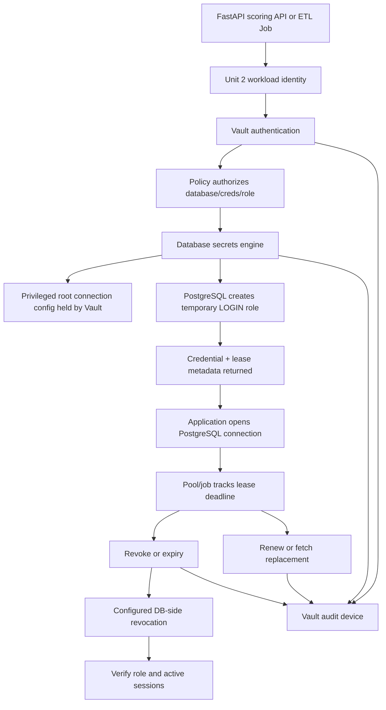

# Unit 3 — Dynamic Secrets, Leases, and Rotation

**Target filename:** `03-dynamic-secrets-leases-and-rotation.md`  
**Module:** M09 — Secrets and Identity Management  
**Estimated theory time:** 8–12 hours (estimate)  
**Estimated lab time:** 10–16 hours (estimate)  
**Progression:** L1 Foundations → L2 Working Practice → L3 Rotation Engineering → L4 Operating at Scale and Under Failure  
**Chosen server:** HashiCorp Vault, matching Unit 2. Use non-dev Vault with persistent lab storage; dev mode is not evidence of safe credential management.  
**Prerequisites:** M09 Units 1–2; M05 PostgreSQL; M03 Kubernetes Jobs, ServiceAccounts, RBAC and probes; M04 TLS concepts; Docker, `kind`, shell basics.  
**Tools:** Docker, `kind`, `kubectl`, Vault CLI, PostgreSQL client, Python 3, `pytest`, pinned FastAPI/SQLAlchemy/PostgreSQL driver dependencies.  
**Version inventory:** Record exact versions and official source URLs in `versions.txt`. Until verified, use `<PINNED_VAULT_VERSION_TO_VERIFY>` and corresponding placeholders; never use `latest`.  
**Approximate footprint:** Existing Vault + PostgreSQL lab: plan for 2–3 CPU cores, 3–5 GiB RAM and 4–8 GiB disk. FastAPI/tests add roughly 0.5–1 CPU core and 0.5–1.5 GiB RAM. These are estimates, not vendor sizing advice. Avoid running every optional lab at once.  
**Real credentials involved: none.** All identities, passwords, tokens, keys, data and database roles are fake, disposable and unique to the lab.  
**Last reviewed:** 2026-10-28. Version-sensitive behavior was not live-verified during authoring. Resolve every `[VERIFY]`, `[VERSION-SENSITIVE]`, and `[ASSUMPTION]` item before state-changing steps.

> **Safety/execution statement:** This is a teaching guide, not a record of a completed deployment. Commands, outputs, tests, measurements and recovery timings are illustrative unless you execute them and record evidence. No Vault server, database, Kubernetes cluster, API, test suite, snapshot restore, root rotation, Transit operation or game day was executed while authoring. Do not run destructive steps against production or an unknown context.

> **Scope:** This unit builds on Unit 2 authentication, policy, audit, Kubernetes auth and Transit concepts. It owns dynamic database credentials, leases, TTL design, rotation and related failure handling. ESO/CSI implementation belongs to Units 4/6; deeper cloud federation to Unit 7; the full leak-response lifecycle to Unit 8. A laptop lab is not production-ready.

## Unit 3 — Dynamic Secrets, Leases, and Rotation

### 3.0 Why this matters in production

A shared database password copied into API pods, ETL workers, notebooks and CI jobs makes attribution difficult and turns one leak into a broad rotation event. A dynamic credential narrows the exposure window, but a leaked credential can still be abused until it is revoked or otherwise rendered unusable, and a compromised authorized process can still misuse it. A long ETL run can fail halfway through if its database lease expires without renewal or checkpointing. Conversely, creating a database user for every pod during a rollout can exhaust role or connection capacity. Rotating the database credential Vault itself uses without a verified recovery path can leave the secrets engine unable to create or revoke credentials.

### 3.1 Learning objectives

- **[L1]** Explain static versus dynamic credentials, Vault tokens, database credentials, lease IDs, TTL, renewal and revocation without conflating lifetimes.
- **[L1]** Trace workload identity through Vault's database secrets engine to a temporary PostgreSQL role and through expiry/revocation.
- **[L2]** Configure separate PostgreSQL read-only and read-write dynamic roles with least-privilege grants and no `SUPERUSER`.
- **[L2]** Obtain a dynamic credential safely, prove the generated role exists, test allowed/forbidden operations, revoke the lease and verify database-side effects.
- **[L2]** Distinguish renewal of a Vault token from renewal of a database lease.
- **[L2/L3]** Implement a lease-aware FastAPI credential provider with bounded recovery and pool replacement tests.
- **[L3]** Choose TTLs and renewal margins for API, ETL, admin and CI workloads using runtime, outage and capacity assumptions.
- **[L3]** Plan root database credential rotation, Vault-managed static-role rotation and dual-token rotation for a fake third-party API.
- **[L3]** Rotate a Transit key and rewrap ciphertext while preserving decryptability until retirement criteria are proven.
- **[L4]** Diagnose credential churn, expiry storms, active-session/revocation races, stale roles, broad revocation and snapshot/lease-state divergence.

### 3.2 Concept map and vocabulary

#### Architecture and trust flow



The root connection credential is privileged material used by Vault to administer database principals. It is not the application's database password. The workload authenticates to Vault using the Unit 2 pattern; policy restricts which database role it may request. The database plugin uses its configured connection to create a temporary role and returns credentials with lease metadata. The application must manage the credential lifecycle and its own database connections.

#### Lease lifecycle

```text
authenticate to Vault
  -> request database/creds/<role>
  -> DB principal created + credential/lease returned
  -> use credential; track lease ID and expiry
      -> renew if supported and within limits
      -> renewal denied / max TTL reached / expiry
           -> bounded re-authentication and pool refresh
           -> or fail closed / checkpoint / stop safely
      -> explicit revoke or natural expiry
           -> database-side revocation attempt
           -> verify role, new-connection and active-session behavior
```

A lease is lifecycle metadata, not a guarantee that every database session terminates at the exact TTL boundary. Configured revocation behavior and target-database semantics determine what happens to the principal and its sessions.

#### Glossary

| Term | Precise definition | Common misconception |
|---|---|---|
| Static secret | Pre-existing value reused until changed or revoked. | “Stored in a secret manager” means dynamic. |
| Dynamic credential | Backend-created credential issued on demand, usually with bounded lifetime. | Dynamic means it cannot leak. |
| Lease ID | Identifier used by Vault lease operations. | It is the database password. |
| Lease duration / TTL | Current validity period of a leased secret. | Same as Vault token TTL. |
| Default TTL | Initial lease duration absent an applicable override. `[VERIFY]` precedence. | Always the maximum lifetime. |
| Max TTL | Upper bound imposed by engine/role configuration. `[VERIFY]` exact semantics. | Renewal can extend forever. |
| Renewable | Whether this lease can be renewed under current rules. | Every lease is renewable. |
| Renewal | Request to extend an eligible lease. | Renewing the Vault token renews the DB lease. |
| Revocation | Request to invalidate a lease and invoke engine cleanup. | It always kills existing DB sessions. |
| `revoke-prefix` | Broad revocation scoped by a lease-ID prefix; exact syntax/semantics `[VERIFY]`. | Safe generic cleanup. |
| Root DB connection credential | Privileged DB credential Vault uses to manage users. | A workload credential. |
| Vault database role | Configuration describing how temporary DB credentials are created/revoked. | Same as a PostgreSQL role. |
| PostgreSQL role | Database principal; `LOGIN` roles can authenticate, group roles collect privileges. | Every role needs superuser or ownership. |
| Static role | Vault-managed rotation for a fixed DB username. `[VERIFY]` support and behavior. | Issues a new username every request. |
| Connection pool | Reusable database connections managed by an application library. | Updating a password updates existing pooled connections. |
| Rotation overlap window | Period old/new credentials are both valid to support transition. | Every provider supports overlapping tokens. |
| Rewrap | Transit operation that changes ciphertext to a newer key version without returning plaintext where supported. | Key rotation rewrites all stored ciphertext. |
| DEK / KEK | Data-encryption key encrypts data; key-encryption key protects/wraps a DEK. | Rotating a KEK migrates every record. |
| Orphaned role | DB role remaining after its lease is absent, expired or no longer tracked. | Vault and database inventories cannot diverge. |

#### Credential and lifetime comparison

| Object | What it authorizes | Lifetime signal | Required handling |
|---|---|---|---|
| Vault token | Requests to Vault permitted by policy | Token TTL/renewal rules | Renew/re-authenticate; scope policies |
| Dynamic DB credential | PostgreSQL authentication and granted operations | Lease duration plus DB-side state | Renew/re-fetch, pool replacement, verify revocation |
| Application connection | Existing PostgreSQL session | Session/transaction/network lifetime | In-flight work, stale sessions, pool disposal |
| ETL job deadline | Maximum orchestration runtime | Job deadline and retry policy | Checkpoint, cancellation, cleanup |
| Transit key version | Encryption/decryption governed by key policy | Key-version metadata/configuration | Rewrap/migrate ciphertext; prove decryptability |

Vault tokens authorize Vault requests; database credentials authenticate to PostgreSQL. Their lifetimes interact through application design but are distinct. An app can have a valid Vault token and an expired DB lease, or an existing DB session while Vault is temporarily unavailable.

#### Running example and mechanism choice

- **FastAPI scoring API:** reads only approved rows in `scoring.features`; uses a read-only dynamic DB role.
- **ETL Job:** writes only to `etl_stage` and approved target tables; gets a separate read-write credential per run.
- **PostgreSQL:** owns schemas, tables, roles, grants, connection limits and sessions.
- **Vault:** authenticates workloads, authorizes role requests, holds privileged connection config, creates temporary principals and tracks leases.
- **Fake third-party API:** supports two simultaneous fake tokens so overlap and old-token rejection can be tested.
- **Transit:** protects a fake sensitive field; key rotation changes the version used for future encryption, while rewrap migrates ciphertext.

| Mechanism | Best fit | Lifecycle | Important limitation |
|---|---|---|---|
| Static secret | Legacy/target cannot issue short-lived credentials | Reused until explicit rotation/revocation | Copy sprawl; coordinated rotation |
| Dynamic DB credential | Workload can refresh users/connections | Issued per request/run; lease-managed | Needs safe renewal, pool refresh, cleanup and capacity |
| Vault-managed static role | Legacy consumer needs fixed DB username | Password rotates for fixed username `[VERIFY]` | Consumer must adopt new password |
| Short-lived certificate | TLS/mTLS target supports it | Bounded validity, renew/replace | Revocation propagation and active connections vary; see M04 |
| Transit key | Encryption service, not DB login | Key versions rotate; ciphertext may need rewrap | Old ciphertext needs old versions until migration/retention is proven |

**Security boundary:** Dynamic secrets reduce reuse, duration and attribution ambiguity. They do not remove privileged root connection material, repair overbroad grants, prevent unsafe logs, protect a compromised authorized process, make PostgreSQL highly available, or guarantee DB-side revocation during an outage.

### 3.3 Level 1 — Beginner

#### 3.3.1 Static versus dynamic credentials

A static password exists before a workload starts. It may be copied into environment variables, CI configuration, a Kubernetes Secret, a developer shell and a local `.env` file. Each copy adds an inventory and rotation obligation. Shared identities also make attribution harder.

A dynamic credential is created when a client requests it. Vault asks its configured PostgreSQL plugin to create a temporary `LOGIN` role, applies configured grants, and returns a username/password plus lease metadata. The generated PostgreSQL role is distinct from the Vault database-role configuration. Different workloads should request different Vault roles with narrowly scoped grants.

Vault does **not** automatically make the generated role least-privilege: SQL statements and effective database grants determine that. Vault does not ensure the application renews the lease, reloads a password, refreshes its pool, or stops safely when it cannot obtain credentials. Lease expiry also does not necessarily terminate an existing authenticated session.

Dynamic credentials may be a poor fit when a legacy client cannot refresh safely, a pool cannot be recreated, a target plugin lacks the needed lifecycle, or operational complexity is disproportionate to risk. Alternatives include managed database IAM authentication, workload identity, mTLS or a carefully controlled static secret; each has its own constraints.

#### 3.3.2 TTL, renewal, expiry and revocation

- **TTL:** current validity period; not necessarily total lifetime.
- **Default TTL:** initial lease duration when no applicable override changes it. `[VERIFY]` precedence for the pinned version.
- **Max TTL:** cap on lease lifetime under the engine/role configuration. A renewable lease may still be unable to extend beyond this cap.
- **Lease ID:** metadata used to refer to the lease. Treat it as operationally sensitive.
- **Renewal:** asks Vault to extend a lease when allowed; can fail due to max TTL, configuration, Vault outage or target/plugin errors.
- **Expiry:** the lease reaches its deadline without successful extension.
- **Explicit revocation:** asks Vault to invalidate the lease and run configured revocation behavior.
- **Prefix revocation:** can revoke many leases; review the exact scope and blast radius.

Short TTLs reduce the time a leaked credential may remain useful but increase issuance/renewal churn and outage sensitivity. Long TTLs reduce churn but expand exposure. Choose TTLs using runtime distributions, max job duration, renewal margin, Vault outage tolerance, DB capacity and risk tolerance.

**Critical distinction:** a Vault lease may expire/revoke while an authenticated PostgreSQL session still exists. Depending on revocation SQL, role state, grants and PostgreSQL behavior, new authentication may fail while an existing session remains active. Test separately: (1) can a new connection authenticate? (2) can an existing session execute another query? (3) does the generated role still exist? Do not infer all three from a successful Vault revoke response.

#### 3.3.3 PostgreSQL and the database secrets engine

The database secrets engine has a connection to PostgreSQL and one or more Vault database roles. A Vault database role describes which role requests are allowed and the SQL used to create/revoke database users. The privileged **root connection credential** is for Vault's administration of users, not application traffic.

PostgreSQL privilege layers include database `CONNECT`, schema `USAGE`, table privileges such as `SELECT`/`INSERT`/`UPDATE`/`DELETE`, role membership and object ownership. `LOGIN` controls authentication; it does not itself grant table access. Runtime identities should not own broad schemas or have role-management privileges.

The following SQL is an illustrative starting point for a disposable database named `appdb`. It assumes `scoring.features` and `etl_stage.feature_updates` exist or will be created by a separate migration identity.

```sql
-- Run as an administrator only in the disposable lab.
CREATE SCHEMA IF NOT EXISTS scoring;
CREATE TABLE IF NOT EXISTS scoring.features (
    feature_id bigint PRIMARY KEY,
    feature_value numeric NOT NULL
);
CREATE SCHEMA IF NOT EXISTS etl_stage;
CREATE TABLE IF NOT EXISTS etl_stage.feature_updates (
    feature_id bigint PRIMARY KEY,
    feature_value numeric NOT NULL
);

-- Lab simplification only; tighten PUBLIC access in a real design.
GRANT CONNECT ON DATABASE appdb TO PUBLIC; -- [VERIFY] database access policy
GRANT USAGE ON SCHEMA scoring TO PUBLIC;   -- [VERIFY] lab-only simplification
```

For a stronger design, revoke broad `PUBLIC` access and grant only to intended generated identities or a deliberately scoped group role. Consider default privileges for future tables. Keep schema migration/ownership separate from runtime identities.

**Conceptual command flow:** configure a lab-only DB connection; create a narrowly scoped Vault database role; request `database/creds/<role>`; use credentials in memory; inspect `pg_roles`/`\du` without password fields; renew or revoke the lease; verify the generated role is gone or unusable as designed.

A command such as `vault read database/creds/<role>` returns secret material. Never paste raw output into logs, screenshots, evidence or Git.

Illustrative redacted output only:

```text
lease_duration: 300
renewable: true
data.username: <REDACTED_DYNAMIC_USERNAME>
data.password: <REDACTED_NEVER_CAPTURE>
lease_id: <REDACTED_OR_HASHED_FOR_EVIDENCE>
```

These are placeholders, not observed output. Never assume renewability; inspect actual metadata and pinned-version docs.

**Database-side checks** (administrator context; never query or display password material):

```sql
SELECT rolname, rolcanlogin, rolsuper, rolcreaterole, rolcreatedb
FROM pg_roles
WHERE rolname LIKE 'v-%' OR rolname LIKE 'm09_lab_%'
ORDER BY rolname;

SELECT grantee, table_schema, table_name, privilege_type
FROM information_schema.role_table_grants
WHERE grantee = '<generated_role_name>'
ORDER BY table_schema, table_name, privilege_type;
```

Expected properties: API reads only approved tables; ETL writes only to its target; unrelated table access, DDL and role administration fail; administrative flags are false. After expiry/revocation, test new authentication, existing sessions and role existence separately.

#### 3.3.4 First guided lab

**Footprint estimate:** use existing Vault + PostgreSQL lab, roughly 2–3 CPU cores, 3–5 GiB RAM and 4–8 GiB disk. Do not start a second Vault if Unit 2 already provides one.

**Preflight — host shell:**

```bash
set +x
pwd
docker context show
docker ps --format 'table {{.Names}}\t{{.Status}}'
kubectl config current-context 2>/dev/null || true
kubectl get namespaces 2>/dev/null || true
df -h .
free -h
```

Confirm Vault address/version, namespace, target database, disposable status and cleanup plan. Abort if the target is ambiguous.

**`versions.txt` template:**

```text
vault=<PINNED_VAULT_VERSION_TO_VERIFY>
postgresql=<PINNED_POSTGRES_IMAGE_TO_VERIFY>
docker=<RECORD_LOCAL_VERSION>
kind=<RECORD_IF_USED>
kubectl=<RECORD_IF_USED>
python=<RECORD_LOCAL_VERSION>
fastapi=<PINNED_FASTAPI_VERSION_TO_VERIFY>
sqlalchemy=<PINNED_SQLALCHEMY_VERSION_TO_VERIFY>
postgres-driver=<PINNED_DRIVER_VERSION_TO_VERIFY>
sources:
  https://developer.hashicorp.com/vault/docs/secrets/databases
  https://developer.hashicorp.com/vault/docs/concepts/lease
  https://www.postgresql.org/docs/current/user-manag.html
```

Do not put credentials, tokens or unseal shares in this inventory.

**Configuration note:** the PostgreSQL plugin name `postgresql-database-plugin`, connection fields, role fields, username template support, TTL behavior and CLI syntax are `[VERIFY]`. Read the official documentation for the exact Vault version before writing configuration. Supply the root credential through a protected input mechanism, not a committed file or shell command literal. Illustrative sequence only:

```bash
vault status
vault version
vault secrets list

# [VERIFY] exact command form for the pinned Vault version.
vault secrets enable -path=database database

# Configure the connection and roles using the documented API fields.
# Do not place a root password in a committed file or command history.
```

The complete write payload is deliberately not guessed because field names and credential input handling are version-sensitive. After configuration, create separate read-only/read-write roles, request credentials through a client that parses responses in memory, and run positive/negative tests.

**What happened:** Unit 2 auth established requester identity; Vault policy authorized one role; the database engine created a temporary PostgreSQL principal; Vault returned credentials and lease metadata; the app used DB credentials while its Vault token separately authorized lease operations; revoke/expiry triggered configured DB cleanup; PostgreSQL inspection independently confirmed actual role/session state; audit events supported the timeline.

| Symptom | Likely cause | Fix and verification |
|---|---|---|
| Intended read denied | Missing schema/table grant or wrong role | Inspect grants as admin; rerun as generated user |
| Forbidden read succeeds | Broad `PUBLIC` grant or membership | Inspect effective grants; tighten SQL; rerun negative test |
| Role remains after revoke | Revocation SQL failed or DB behavior differs | Inspect sanitized plugin error and DB role/session state |
| App fails at TTL | Cached credential or stale pool | Implement renewal/re-fetch and bounded pool swap |
| Vault token renews but DB fails | DB lease was not renewed | Track the two state machines separately |
| Root rotation blocks issue | Vault's stored DB connection no longer authenticates | Stop mutation attempts; use the approved disposable-lab recovery plan |

Cleanup: revoke only recorded lab leases, verify generated users are gone/unusable, and remove only named disposable resources after checking context. Secure deletion cannot be guaranteed on SSD/WSL2/copy-on-write storage.

### 3.4 Level 2 — Intermediate

#### 3.4.1 Configure the database engine and least-privilege roles

The configuration has four layers: (1) Vault authentication/policy; (2) the privileged database connection Vault uses; (3) the Vault database role and its creation/revocation SQL; (4) effective PostgreSQL privileges. `allowed_roles` is a Vault-side restriction, not a replacement for database grants.

The following is a **design template, not guaranteed runnable configuration**. Exact paths, API fields, plugin name, `connection_url`, username/password handling, `allowed_roles`, `creation_statements`, `revocation_statements`, username templates and TTL fields are `[VERIFY]` against the pinned Vault release. The root password is intentionally absent.

```hcl
# File: lab-notes/database-engine-design.hcl
# DESIGN NOTE ONLY. Translate to the documented API schema for the pinned version.
mount = "database"
plugin_name = "postgresql-database-plugin" # [VERIFY]
connection_target = "<DISPOSABLE_POSTGRES_HOST_AND_DATABASE>"
connection_username = "<DISPOSABLE_VAULT_DB_ADMIN>"
connection_password = "<INJECT_SECURELY_AT_RUNTIME>"
allowed_roles = ["scoring-readonly", "etl-readwrite"] # [VERIFY]

[role.scoring-readonly]
default_ttl = "5m" # [ASSUMPTION] lab value; [VERIFY] field and precedence
max_ttl = "30m"    # [ASSUMPTION] lab value; [VERIFY]
# creation SQL: only CONNECT, schema USAGE and SELECT on approved tables
# revocation SQL: revoke access/terminate sessions if supported, then drop role
# username_template: optional; [VERIFY] supported syntax and escaping

[role.etl-readwrite]
default_ttl = "10m" # [ASSUMPTION] lab value; [VERIFY]
max_ttl = "1h"      # [ASSUMPTION] lab value; [VERIFY]
# creation SQL: only required write privileges on the target schema/tables
# revocation SQL: tested, bounded cleanup procedure
```

Do not paste this HCL into Vault and assume it is accepted. Translate it into the documented API payload for the pinned release, and record the source/version in `versions.txt`.

**Root connection credential controls**

- Use a dedicated lab-only DB account with only the permissions the supported plugin requires for its create/revoke operations. Do not grant superuser by default.
- Restrict DB network access to Vault and use TLS where supported/configured.
- Do not embed the root password in manifests, Git, process arguments, debug logs or terminal history.
- Restrict who can read/update the DB connection configuration in Vault.
- Rehearse root rotation only in a disposable environment, with an approved recovery path.
- After rotation, verify Vault can create and revoke a temporary user without displaying the new password.

#### 3.4.2 Positive and negative grant tests

| Test | Scoring API role | ETL role | Expected result |
|---|---|---|---|
| Read approved scoring table | Allow | Only if required | Success |
| Read unrelated schema/table | Deny | Deny unless required | Failure |
| Insert/update ETL target | Deny | Allow only in target scope | API fails; ETL succeeds |
| Create table/schema/role | Deny | Deny | Failure |
| `SUPERUSER`, `CREATEROLE`, `CREATEDB` flags | False | False | Verify via `pg_roles` |
| New connection after revoke/expiry | Deny if revocation disables/removes login | Same | Test independently |
| Existing session after revoke | Measure | Measure | Do not assume termination |
| Role after revoke | Absent or unusable as configured | Same | Inspect PostgreSQL |

SQL must account for schema `USAGE`, table grants, default privileges for future objects, database `CONNECT`, memberships and ownership. A grant on existing tables may not apply to future tables; broad `PUBLIC` grants may invalidate a negative test. Keep migrations and object ownership separate from runtime identities.

#### 3.4.3 Lease lookup, renewal, revoke and revoke-prefix

Exact CLI forms and lease-ID handling are `[VERIFY]`. Consult the pinned Vault lease documentation and `vault lease -help`.

```bash
# [VERIFY] syntax and exact lease identifier handling for the pinned release.
vault lease lookup <REDACTED_LEASE_ID>
vault lease renew <REDACTED_LEASE_ID>
vault lease revoke <REDACTED_LEASE_ID>

# DANGEROUS: never run without an isolated lab prefix and reviewed inventory.
# vault lease revoke -prefix <DEDICATED_LAB_LEASE_PREFIX>
```

A lease ID can reveal paths/identifiers; do not post it publicly. For evidence, retain a redacted reference, duration, renewability, timestamp, outcome and DB-side verification.

**Renewing a Vault token is not renewing the database credential.** The token lets the client call Vault; the DB lease is a separate lifecycle. A client can renew one and still lose the other. Track them as separate state machines.

For mass revoke, first capture a read-only inventory of the exact dedicated prefix and expected role count. State blast radius, abort criteria and recovery. Verify Vault address, mount, namespace (if applicable), prefix and disposable context before applying. Then verify intended leases are revoked and unrelated test tenants still work. Never use a broad prefix against an unknown or production environment.

#### 3.4.4 Application integration patterns

| Pattern | Best fit | Failure behavior | Main risks | Complexity / avoid when |
|---|---|---|---|---|
| Fetch at startup + renew lease | Long-running API with lease-aware client | Renew early; if denied, fetch replacement and replace pool or fail readiness | Renewal and pool refresh are separate; old sessions may persist | Moderate/high; avoid if pool cannot be safely replaced |
| Re-fetch on expiry/auth failure | Short task or bounded-recovery client | Re-authenticate, fetch replacement, swap pool once; retry only safe operations | Retrying writes can duplicate side effects; thundering herd | Never use unbounded retries or blindly replay non-idempotent work |
| Vault Agent/sidecar writes a file | App designed to reload a file | Sidecar updates file; app must detect and reload | File update does not force app reload or pool replacement | Poor fit if app reads only at startup |
| ESO/CSI periodic delivery | Unit 4/6 materialization patterns | Controller/driver refreshes on its schedule and provider semantics | New value may not reach running process; stale data/refresh delay | Awareness only here; periodic sync is not automatically a native lease lifecycle |

Define how credentials arrive, how expiry is tracked, behavior on renewal denial, pool replacement, in-flight transactions, retry limits, readiness and sanitized logs. Never put raw credentials in health endpoints, metrics labels, exception messages or traces.

#### 3.4.5 FastAPI + PostgreSQL: flawed and corrected design

**Flawed pattern — do not use:**

```python
# File: examples/flawed_cache_forever.py
# Deliberately flawed design illustration, not a complete application.
def startup():
    credentials = vault.read("database/creds/scoring-readonly")
    global db_engine
    db_engine = create_engine_from_credentials(credentials)
    # No lease tracking, renewal, expiry handling or pool replacement.

def handle_request():
    return db_engine.query(...)
```

This fails when the lease expires, is revoked, or the credential changes. Existing pooled connections may work while new ones fail, creating a partial outage. Updating stored secret material does not automatically change an already-created engine's connection URL.

**Corrected design contract**

1. Authenticate using Unit 2 workload identity, never a root token.
2. Request only `scoring-readonly`.
3. Parse the response in memory; retain lease ID, duration, renewability and credentials only in protected process memory.
4. Renew before expiry with safety margin and jitter; exact response fields are `[VERIFY]`.
5. If renewal is denied or max TTL is reached, fetch a replacement if policy permits.
6. Build a replacement SQLAlchemy engine/pool with bounded timeouts.
7. Validate it with a safe read; atomically swap the engine reference and drain/dispose the old pool safely.
8. On Vault outage, use only a documented bounded policy. Existing sessions may work temporarily, but new connections may fail. When the safety margin is exhausted, fail readiness or reject DB-dependent work rather than using stale credentials indefinitely.
9. Never log passwords, Vault tokens, raw responses, full DSNs or unsanitized exception objects.

The following skeleton uses injected interfaces; it is not a turnkey Vault client. Concrete Vault SDK calls, renewal response fields, SQLAlchemy disposal/replacement and driver options must be verified against pinned versions.

```python
# File: examples/credential_manager.py
from dataclasses import dataclass
from threading import RLock
from typing import Protocol, Callable
import time

@dataclass(frozen=True)
class DbLease:
    username: str
    password: str
    lease_id: str
    lease_duration_seconds: int
    renewable: bool
    issued_monotonic: float

class VaultCredentialSource(Protocol):
    def fetch_database_lease(self, role: str) -> DbLease: ...
    def renew_database_lease(self, lease_id: str) -> DbLease | None: ...

class PoolFactory(Protocol):
    def build(self, username: str, password: str): ...
    def validate(self, pool) -> None: ...
    def dispose(self, pool) -> None: ...

class CredentialManager:
    """Keeps credentials in memory; never logs lease or password values."""
    def __init__(self, source: VaultCredentialSource, pool_factory: PoolFactory,
                 role="scoring-readonly", monotonic: Callable[[], float] = time.monotonic,
                 safety_margin_seconds=30):
        self.source = source
        self.pool_factory = pool_factory
        self.role = role
        self.monotonic = monotonic
        self.margin = safety_margin_seconds
        self.lock = RLock()
        self.lease = None
        self._pool = None

    def _fetch_replacement(self):
        candidate_lease = self.source.fetch_database_lease(self.role)
        candidate_pool = self.pool_factory.build(candidate_lease.username,
                                                 candidate_lease.password)
        try:
            self.pool_factory.validate(candidate_pool)
        except Exception:
            self.pool_factory.dispose(candidate_pool)
            raise RuntimeError("replacement pool validation failed") from None
        old_pool = self._pool
        self._pool = candidate_pool
        self.lease = candidate_lease
        if old_pool is not None:
            self.pool_factory.dispose(old_pool)

    def ensure_usable(self):
        with self.lock:
            if self.lease is None or self._pool is None:
                self._fetch_replacement()
                return
            age = self.monotonic() - self.lease.issued_monotonic
            remaining = self.lease.lease_duration_seconds - age
            if remaining > self.margin:
                return
            renewed = None
            if self.lease.renewable:
                try:
                    renewed = self.source.renew_database_lease(self.lease.lease_id)
                except (TimeoutError, PermissionError):
                    renewed = None
            if renewed is not None:
                if (renewed.username != self.lease.username or
                        renewed.password != self.lease.password):
                    candidate = self.pool_factory.build(renewed.username, renewed.password)
                    try:
                        self.pool_factory.validate(candidate)
                    except Exception:
                        self.pool_factory.dispose(candidate)
                        raise RuntimeError("renewed pool validation failed") from None
                    old = self._pool
                    self._pool = candidate
                    self.pool_factory.dispose(old)
                self.lease = renewed
                return
            self._fetch_replacement()

    @property
    def pool(self):
        self.ensure_usable()
        return self._pool
```

Review limitations: `DbLease` is an app-owned abstraction, not a claim about Vault's raw JSON fields. Renewal may return remaining duration, not a fresh full duration; the adapter must implement actual semantics. `dispose` must not be called while active transactions are unsafe to interrupt; production code needs draining and an atomic swap. A lock protects only one process, not multiple pods. Add jitter, bounded retries and sanitized failure categories. The skeleton is not production-ready.

**Unit-test contract:** fake Vault and pool clients should test initial success, renewal success, renewal denied, expiry/replacement, Vault timeout, PostgreSQL auth failure, pool replacement, safe drain/disposal, readiness and no-secret logging. These are requirements, not executed tests.

```python
# File: tests/test_credential_manager_contract.py
def test_secret_redaction_contract(caplog, fake_manager):
    fake_manager.ensure_usable()
    rendered = "\n".join(r.getMessage() for r in caplog.records)
    assert "FAKE_DB_PASSWORD_SENTINEL" not in rendered
    assert "FAKE_VAULT_TOKEN_SENTINEL" not in rendered

def test_renewal_denied_triggers_bounded_replacement(fake_manager, fake_source):
    fake_source.renew_result = None
    fake_manager.force_near_expiry_for_test()  # test-only fixture helper
    fake_manager.ensure_usable()
    assert fake_source.fetch_count == 2  # initial issue + one replacement
```

The fixture methods are illustrative and must be implemented in the actual tests. Do not claim a passing suite until it is run.

#### 3.4.6 Static roles and root credential rotation

A dynamic role creates a distinct DB principal for a credential request. A Vault-managed static role rotates the password for a fixed username. Static roles may help a legacy app that cannot accept changing usernames, but the consumer must still adopt the new password. Static-role paths, rotation interval fields and update semantics are `[VERIFY]`.

Root rotation is a controlled change. Confirm exact DB instance, Vault mount, connection configuration and role; inventory dependencies; identify recovery owner; confirm a tested backup/restore method; read pinned-version `rotate-root` docs; define abort criteria; then rotate only in the disposable lab. Afterward, prove Vault can create and revoke a temporary user and DB remains usable. Never print the new root password, create a hidden superuser or keep an uncontrolled plaintext backup. If Vault is the only holder of the new credential, that is a significant dependency requiring explicit controls.

### 3.5 Level 3 — Advanced

#### 3.5.1 Rotation strategy decision matrix

| Strategy | Best fit | Exposure window | Availability risk | Consumer requirement | Rollback | Operational cost |
|---|---|---|---|---|---|---|
| Dynamic credentials | Target can create bounded credentials; app refreshes safely | Lease/revocation behavior bounds use | Vault/DB outage can block new connections | Lease tracking, auth, pool refresh, grants | Re-fetch or stop safely | Integration and capacity engineering |
| Dual credential / A-B | Provider supports simultaneous valid tokens | Until old token is revoked; overlap is bounded | Lower if new token validated before switch | Atomic consumer switch and old-token overlap | Keep old token during approved window | Rotation job and provider API |
| In-place rotation + rollout | Target supports one credential; consumers coordinated | Potential failure window during change | Higher if old credential invalidated before all consumers reload | Coordinated reload, readiness, rollback | Provider-specific re-rotation | Moderate; strict sequencing |
| Versioned secret + graceful reload | Store has versions and app can reload | Old version remains until revoked | Stale process/pool can persist | File/watch/signal and pool replacement | Revert only while prior value remains valid | Moderate |
| Short-lived certificate | Target supports cert auth | Cert lifetime + revocation propagation | Expiry/trust/reload can break connections | Renewal and TLS reload | Issue replacement; trust policy limits rollback | PKI lifecycle; see M04 |
| Transit rotate + rewrap | Transit protects stored ciphertext | Depends on migration; old versions retained | Incorrect retirement risks unreadable data | Ciphertext inventory, migration, checks | Keep old versions and restore/retry | Data migration/verification |
| Third-party static token job | Provider lacks dynamic credentials but allows rotation | Until old token revoked | Provider API/partial rollout can interrupt calls | Scoped token management and overlap if supported | Keep old token until switch validated | Provider-specific automation |

Rotation triggers may include scheduled max age, suspected compromise, personnel/ownership change, dependency change or an incident. Dynamic credentials shift effort from rotating one shared app password to issuing bounded credentials; they do not remove the need to rotate privileged DB connection material or static third-party secrets.

**Migration from shared static DB passwords:** inventory consumers → classify access → select engine/target support → pilot least-privilege role → positive/negative tests → implement lease/pool behavior → migrate in batches → observe issuance/connection peaks → revoke old static secret after rollback gate → verify no consumer remains → update catalog/runbook.

#### 3.5.2 TTL design worksheet

Choose TTL by measuring normal/p95/p99 runtime and hard deadline; deciding whether renewal/re-fetch is possible; setting a safety margin larger than request latency, network interruption and scheduling jitter; checking max TTL; estimating issuance/role/connection capacity; defining Vault-outage behavior; testing expiry during queries/transactions; and documenting blast radius/recovery.

All values below are `[ASSUMPTION]` examples, not universal recommendations.

| Workload | Runtime assumption | Example TTL/max lifetime | Renewal strategy | Pool/session behavior | Vault outage behavior |
|---|---|---|---|---|---|
| Request-serving API | Short requests; process runs days | 10 min initial lease; 1 h before re-fetch | Renew early with jitter; replace pool on denial/max TTL | Validate new pool, swap, drain old | Existing sessions only under bounded policy; reject DB-dependent work before margin expires |
| Scheduled short ETL | 2–5 min; 15 min hard deadline | 10 min TTL; 20 min max | TTL exceeds measured p99; renew only if needed | Bounded transactions; checkpoint | Fail safely/checkpoint; no stale retry loop |
| Long ETL | 30–90 min; 2 h deadline | 15 min TTL; 2 h max | Renew within max TTL; re-fetch if allowed | Avoid giant transaction; safe pool refresh | Checkpoint/stop/resume idempotently |
| Interactive admin | 10–30 min | 10 min TTL; 30 min task window | Re-auth/renew with operator awareness | Close sessions on completion | Fail closed for privileged actions |
| CI/migration | 1–10 min typical | 15 min TTL; 30 min max | Issue at start; renew only if authorized | Narrow migration role, idempotent migration | Fail closed before unsafe schema change |

A rough steady-state estimate is:

\[
\text{issue events/hour} \approx N_{\text{workers}} \times \frac{60}{T_{\text{lease minutes}}}
\]

It ignores rollout bursts, retries, renewal and short jobs. `[ASSUMPTION]` 40 workers with a 10-minute lease implies roughly 240 issue events/hour in steady state, but a rollout can create many within seconds. Capacity planning must include peak rate and PostgreSQL limits, not just averages.

#### 3.5.3 Long-running ETL and Kubernetes Job pattern

Per-run credentials should use Unit 2 workload auth, track lease deadlines, renew/re-fetch within limits, stop safely when renewal cannot recover, checkpoint progress, avoid giant transactions, revoke on completion where appropriate, and verify role cleanup. A job deadline and lease max TTL are separate limits. Airflow integration is awareness-only; exact provider/backend APIs are `[VERIFY]`.

```yaml
# File: k8s/etl-job.yaml
# [VERIFY] API fields against the target Kubernetes version.
apiVersion: batch/v1
kind: Job
metadata:
  name: m09-lease-etl
  namespace: m09-secrets-lab
spec:
  backoffLimit: 1
  activeDeadlineSeconds: 1800
  template:
    metadata:
      labels:
        app: m09-lease-etl
    spec:
      serviceAccountName: m09-etl-workload
      restartPolicy: Never
      securityContext:
        runAsNonRoot: true
      containers:
        - name: etl
          image: "<PINNED_ETL_IMAGE_DIGEST_TO_VERIFY>"
          command: ["python", "-m", "app.etl"]
          env:
            - name: VAULT_ADDR
              value: "https://vault.m09-secrets-lab.svc:8200"
            - name: DB_ROLE_NAME
              value: "etl-readwrite"
          # No password, token, DSN or lease secret is placed in the manifest.
```

Preflight on host shell:

```bash
set +x
kubectl config current-context
kubectl get namespace m09-secrets-lab
kubectl -n m09-secrets-lab get serviceaccount m09-etl-workload
kubectl -n m09-secrets-lab get jobs
kubectl apply --dry-run=server -f k8s/etl-job.yaml
printf '%s\n' 'PLANNED: create only Job m09-lease-etl in namespace m09-secrets-lab'
# Apply only after verifying context, image digest, auth, and cleanup:
kubectl apply -f k8s/etl-job.yaml
```

The manifest illustrates a non-secret pattern; it does not implement Vault authentication by itself. Verify all fields and workload-auth bindings against the pinned versions. Never place credentials in the Job manifest or Git.

#### 3.5.4 Database hardening and capacity

Use separate schema/table grants; avoid `SUPERUSER`, `CREATEROLE`, `CREATEDB`, broad ownership and unnecessary memberships. Verify connection/role limits and plugin pool settings against the exact Vault and PostgreSQL versions; do not assume a setting such as `max_open_connections` exists in every release. Estimate role count and connections under autoscaling, rollout surge, retries and batch concurrency. Review revocation SQL: dropping roles can fail due to ownership/dependencies; terminating sessions must be explicit and tested. Use bounded retry with exponential backoff and jitter. Verify grants and cleanup directly in PostgreSQL.

#### 3.5.5 Transit key rotation and rewrap

Transit is encryption-as-a-service. Rotation creates a newer key version for future encryption; rewrap transforms existing ciphertext to use a newer version without exposing plaintext to the caller where the documented operation supports it. Existing ciphertext must remain decryptable until all required databases, replicas, backups and retention copies are migrated or formally retired. A DEK encrypts data; a KEK wraps a DEK; a root key has a separate role in the key hierarchy. Do not conflate them.

Rewrap at scale needs inventory, batches, checkpoints, retryable processing and decrypt verification. Searchable encryption is not achieved merely by encrypting a field. Exact CLI/API syntax, `min_decryption_version`, `min_encryption_version`, batch behavior and key-version semantics are `[VERIFY]`.

Optional drill: create a throwaway key; encrypt a fake field; verify decryption in memory before rotation; rotate using verified syntax; verify old ciphertext still decrypts; rewrap; verify the rewrapped ciphertext decrypts to the fake expected value; retain only ciphertext/version metadata and sanitized outcomes. Do not retire old versions just to clean up the demo.

#### 3.5.6 Fake third-party API token rotation

A real provider may not support overlapping tokens. The local model below explicitly supports two active tokens; it is not a real SaaS emulator.

```python
# File: fake_api/rotation_model.py
from dataclasses import dataclass, field
import secrets
import time

@dataclass
class FakeTokenAPI:
    active_tokens: set[str] = field(default_factory=set)

    def create_token(self) -> str:
        token = "FAKE-LAB-" + secrets.token_urlsafe(24)
        self.active_tokens.add(token)
        return token

    def validate(self, token: str) -> bool:
        return token in self.active_tokens

    def revoke(self, token: str) -> None:
        self.active_tokens.discard(token)

def rotate(api: FakeTokenAPI, old_token: str, switch_consumer):
    started = time.monotonic()
    new_token = api.create_token()
    if not api.validate(new_token):
        api.revoke(new_token)
        raise RuntimeError("new token validation failed; old token retained")
    try:
        switch_consumer(new_token)  # Consumer must not log the value.
        if not api.validate(new_token):
            raise RuntimeError("consumer validation failed")
    except Exception:
        api.revoke(new_token)
        raise RuntimeError("consumer switch failed; old token retained") from None
    api.revoke(old_token)
    if api.validate(old_token):
        raise RuntimeError("old token revocation verification failed")
    return {"overlap_seconds": time.monotonic() - started,
            "old_token_rejected": True}
```

Test create → validate → switch → validate consumer → revoke old → prove old rejected. Inject failure at each stage. Before old-token revocation, retain rollback capability; if revocation cannot be verified, alert and retry only within a bounded policy. Real provider token API, scope, expiry, overlap and revocation semantics must be verified against official provider docs. Do not print token values, put them in shell history, or retain them in evidence.

### 3.6 Level 4 — Expert

#### 3.6.1 Operating at scale

Monitor four planes:

- **Vault:** lease count/churn, storage growth, request latency, renewal/revoke failures, audit-device health, DB plugin connection saturation.
- **PostgreSQL:** generated role count, active sessions, connection saturation, role-creation failures, failed drops, orphan candidates.
- **Application:** Vault auth failures, DB auth failures, pool refresh duration, expiry-adjacent errors, retry rate, job failures and recovery time.
- **Orchestrator:** replica count, rollout surge, Job concurrency, retries, startup timing and deadline cancellations.

Candidate metrics include credential issue success/latency, renewal success, revoke success, time-to-revoke, cleanup success, active leases, DB role count, stale-role count, connection saturation, pool refresh duration, rotation completion and recovery time. Exact Vault metric names (including any `vault.expire.*` series) are `[VERIFY]`; inspect the pinned release's telemetry docs and live exposition. Never use usernames, lease IDs or secrets as metric labels.

A peak estimate must include normal demand, rollout bursts, retry amplification and batch concurrency. Rate limits/quotas and DB-plugin pool settings are version-specific `[VERIFY]`. Maintain a role catalog with owner, workload, grants, TTL/max TTL, renewal, revocation SQL, expected concurrency and incident contact. Review creation/revocation statements as privileged code and separate role-definition rights from credential-request rights.

Dynamic secrets may not be worth their complexity for low-risk tools, legacy apps unable to refresh, or teams without operational coverage. Compare managed database IAM authentication, workload identity, mTLS and disciplined static-secret rotation against the actual target's support and failure modes.

#### 3.6.2 Failure-mode runbook matrix

For every event use: **symptom → hypotheses → safe tests → root cause → blast-radius/revocation check → mitigation → prevention → evidence**.

| Failure | Safe tests | Mitigation / prevention | Evidence |
|---|---|---|---|
| Vault unavailable during renewal | Check health/seal, network/TLS, auth, max TTL, remaining lease margin | Bounded retry with jitter; documented bounded session policy; checkpoint/fail closed before deadline | Sanitized timestamps, remaining TTL, renewal outcomes |
| PostgreSQL unavailable during issuance | Test DB reachability from Vault network; inspect sanitized plugin error | Backoff, startup/readiness policy, bounded queue; avoid mass retry | Issuance failures, DB health, retry count |
| Autoscaling creates too many users/connections | Correlate rollout surge, role creation rate, `pg_roles`, active sessions | Cap rollout/job concurrency, jitter, tune pool/TTL, reduce unnecessary per-pod churn | Role and connection counts before/after |
| ETL loses access mid-run | Inspect deadline, TTL/max TTL, renewal, transaction/pool | Checkpoint/stop; renew/re-fetch within limits; idempotent resume | Progress and lease timeline |
| Revocation races with query/session | Test new connection and existing session separately; inspect sessions and SQL | Bounded transaction; explicitly approved session termination if supported | Lease status, role and session checks |
| App caches first credential forever | Inspect auth failure around expiry without printing secrets | Lease tracking, pool replacement, bounded retry, readiness | Redacted failure/recovery test |
| Vault token renewed but DB lease not | Compare token and DB lease timelines | Track separate state machines and metrics | Redacted renewal events |
| `revoke-prefix` hits wrong tenant | Inventory exact scope and unrelated test tenant | Dedicated boundaries, preview, approval, scoped policy | Pre/post inventory and approval |
| Older Vault snapshot restored | Freeze issuance; inventory Vault leases and DB roles independently | Reconcile explicit roles; don't assume auto-repair | Snapshot timestamp and lease/role diff |
| Root rotation loses recovery | Stop repeated mutation; inspect connection health without password | Preflight, recovery owner, tested backup/restore and disposable rehearsal | Runbook gates and create/revoke proof |
| Static role rotates but app uses old password | Compare rotation, config version, pool and auth errors | Coordinated reload/pool replacement; overlap if supported | Adoption timestamp and old credential rejection |
| Transit key rotates while old ciphertext remains | Inventory ciphertext/version metadata; test decrypt | Keep old versions; batch rewrap/migrate | Counts, checkpoints, decrypt results |
| Time skew changes expiry expectation | Compare host/container clocks and UTC timestamps | Correct time sync; monotonic clock for elapsed time; margin | Clock offset and timeline |
| Revocation SQL fails/orphan role remains | Inspect plugin error, DB role/session/dependencies | Fix SQL in lab; explicitly target known role; avoid broad deletion | Error class, role/session inventory |

Never blindly delete all database roles or force-revoke all leases in a non-lab system.

#### 3.6.3 Bounded game days

Each game day requires preconditions, exact blast radius, read-only preview, explicit apply, abort criteria, rollback/recovery, evidence, cleanup, and a statement that timings are laptop-lab observations only.

| Exercise | Preflight / apply gate | Abort criteria | Recovery and evidence |
|---|---|---|---|
| Root credential rotation | Disposable DB, owner/recovery owner, backup, exact mount/connection confirmed; pinned syntax verified | Target ambiguity or no recovery path | Verify Vault can issue/revoke a user; record sanitized outcome |
| Short TTL expiry | Dedicated test role, one app/job, baseline lease | Any non-lab consumer shares the role | Observe expiry, app recovery and cleanup |
| Single lease revoke | Exact test lease and DB role mapped | Lease ID/scope mismatch | Test new connection, existing session and role state |
| Mass revoke | Dedicated prefix; unrelated tenant credential; preview count | Prefix includes unknown resources or count differs | Verify all intended revoked, unrelated tenant healthy |
| DB outage during issue | Local disposable DB only | External target | Restore DB; measure bounded retries/startup behavior |
| Vault outage during renewal | Local disposable Vault; record remaining TTL | Any real consumer depends on target | Recover and verify renewal/re-fetch/checkpoint |
| Older snapshot restore | Dedicated lab storage and snapshot | Snapshot/target mismatch | Freeze issuance, compare independent inventories, reconcile explicit test roles |
| Transit rotate/rewrap | Throwaway key and fake field | Real key/data or no recovery | Prove old and rewrapped ciphertext decrypt; retain old versions |
| Fake API dual-token | Local stub, fake consumer | New token cannot validate or switch safely | Keep old token until success; prove rejection after revoke |

#### 3.6.4 Continuous verification script — report only

This script inventories roles matching an explicitly lab-scoped prefix. It does not query Vault or automatically drop users. Names/age heuristics are not proof of orphaning. PostgreSQL cannot generically reveal which client used a static password. Exact driver version and protected connection configuration are `[VERIFY]`.

```python
# File: tools/report_lab_roles.py
"""Report-only PostgreSQL role audit; no password output and no destructive cleanup."""
from datetime import datetime, timezone
import argparse, json, os, sys

def main():
    p = argparse.ArgumentParser()
    p.add_argument("--prefix", default="m09_lab_")
    p.add_argument("--older-than-days", type=int, default=1)
    p.add_argument("--apply", action="store_true",
                   help="Destructive apply is intentionally not implemented.")
    p.add_argument("--confirm-target", default="")
    a = p.parse_args()
    if a.apply:
        print("ERROR: cleanup is not implemented.", file=sys.stderr)
        return 2
    if not a.prefix.startswith("m09_lab_"):
        print("ERROR: prefix must be explicitly lab-scoped.", file=sys.stderr)
        return 2
    try:
        import psycopg  # [VERIFY] pin version
    except ImportError:
        print("ERROR: pinned psycopg driver unavailable.", file=sys.stderr)
        return 2
    if not os.environ.get("PGSERVICE"):
        print("ERROR: configure PGSERVICE through protected local configuration.", file=sys.stderr)
        return 2
    try:
        with psycopg.connect(service=os.environ["PGSERVICE"], connect_timeout=3) as conn:
            with conn.cursor() as cur:
                cur.execute("""
                    SELECT rolname, rolcanlogin, rolsuper, rolcreaterole, rolcreatedb
                    FROM pg_roles WHERE rolname LIKE %s ORDER BY rolname
                """, (a.prefix + "%",))
                rows = cur.fetchall()
    except Exception:
        print("ERROR: role inventory failed; inspect protected diagnostics.", file=sys.stderr)
        return 1
    report = {
        "generated_at_utc": datetime.now(timezone.utc).isoformat(),
        "mode": "report-only", "prefix": a.prefix, "roles_found": len(rows),
        "roles": [{"name": r[0], "can_login": r[1], "is_superuser": r[2],
                   "can_create_role": r[3], "can_create_database": r[4],
                   "review": "investigate; not proof of orphaned lease"} for r in rows],
        "limitations": ["No Vault lease comparison.",
                        "Role names are not proof of orphaning.",
                        "Static-password usage cannot be inferred generically.",
                        "No destructive cleanup implemented."]
    }
    print(json.dumps(report, indent=2))
    return 0

if __name__ == "__main__":
    raise SystemExit(main())
```

The `older-than-days` option is a policy input only; the script does not query a portable PostgreSQL role-creation timestamp. Do not claim age detection until a defensible external catalog is integrated. Add synthetic-fixture tests for prefix validation, DB errors, report-only behavior and absence of secret fields.

#### 3.6.5 Root rotation and break-glass runbook

1. Confirm ownership, approval and recovery owner.
2. Verify exact DB instance, Vault address/namespace, mount and connection name.
3. Inventory dynamic/static roles, consumers, jobs and pools.
4. Verify backup/restore method and protected break-glass path.
5. Read pinned-version `rotate-root` docs and confirm exact operation/permissions.
6. Rotate only in the disposable lab; abort if target or recovery differs from plan.
7. Verify Vault's stored DB connection without displaying the new password.
8. Issue and revoke a test dynamic credential; verify DB access and role cleanup.
9. Update protected recovery documentation, not a secret-bearing file.
10. Record sanitized audit evidence and post-change review.

If rotation succeeds but Vault cannot connect, stop repeated mutation attempts. Preserve evidence, consult the pinned-version recovery procedure and engage the authorized recovery owner. Do not create a hidden superuser or uncontrolled plaintext backup.

#### 3.6.6 Snapshot restore and lease reconciliation

An older Vault snapshot can roll lease metadata backward relative to PostgreSQL. Roles may remain without tracked leases, or Vault metadata may refer to credentials that have changed in the DB. Do not assume automatic reconciliation.

1. Freeze new issuance in the disposable lab.
2. Record snapshot identity/time and preserve logs/audit evidence.
3. Inventory Vault leases and PostgreSQL roles/sessions separately using verified read-only methods.
4. Compare with the role catalog and known test jobs.
5. Classify discrepancies as active, revoked, orphan candidate or uncertain; naming/age alone is not proof.
6. Disable/revoke only explicitly identified test roles after dependency/session review.
7. Restore issuance carefully; create/revoke a test credential and verify grants.
8. Document uncertainty and escalate production cases. Never use broad destructive cleanup by default.

### 3.7 SRE lens

#### Dependency and failure graph

```text
FastAPI / ETL
  |-- existing PostgreSQL sessions may continue temporarily
  |-- new connections need currently accepted DB credentials
  |-- lease renewal/re-fetch needs Vault auth + policy + API availability
  v
Vault auth and policy
  v
Vault database secrets engine
  |-- needs its privileged DB connection to issue/revoke credentials
  v
PostgreSQL
  |-- role creation, grants, cleanup, sessions and connection capacity
```

Failure classes differ. Vault may be down while an existing DB session continues, while new connections fail after pool churn. PostgreSQL may be unavailable when Vault tries to create a credential. Lease renewal can fail even if token renewal succeeds. A revoke can be accepted by Vault while database-side cleanup fails or remains incomplete. Monitoring must cover the control plane and actual database/application behavior.

#### Candidate SLIs and SLOs

SLIs are measured signals; SLOs are targets. Targets below are `[ASSUMPTION]` examples only. Baseline behavior, define the denominator and measurement window, and agree on the failure budget with owners.

| SLI | Measurement | Illustrative SLO `[ASSUMPTION]` | Window / denominator |
|---|---|---|---|
| Credential issue success | Successful issues / eligible attempts | ≥ 99.5% | 30 days; include transient failures |
| Issue latency | p95 request-to-usable-credential | Baseline then set workload target | 7 days; successful attempts |
| Lease renewal success | Successful renewals / eligible attempts | ≥ 99% | 30 days |
| Revocation verification | Intended leases with verified DB effect / revoke attempts | ≥ 99% within agreed deadline | 30 days; include uncertain cases |
| Pool refresh duration | Request to validated replacement pool | p95 below service budget | 7 days |
| Stale-role backlog | Unowned stale candidates beyond review threshold | No unowned high-risk candidates beyond threshold | Daily inventory |
| DB connection saturation | Used connections / safe configured capacity | Alert threshold based on headroom | 5-minute rolling |
| Recovery after expiry | Time until workload safely resumes | Baseline on laptop; production target after load testing | Per event; median and p95 |

**Alert/runbook examples**

- **Renewal failures spike:** check Vault health/seal state, auth, policy, network/TLS, clock skew, max TTL and DB-plugin errors. Determine remaining lease margin before deciding whether to continue, checkpoint or fail closed.
- **Dynamic-user creation surge:** correlate replica/job rollout, retry loops, TTL and issuance rate. Reduce concurrency or pause rollout before database capacity is exhausted.
- **Stale-role growth:** compare role catalog, lease inventory and DB roles. Report first; delete only specifically identified lab roles after review.
- **DB connection saturation:** inspect pool sizes, worker count, rollout surge, long sessions and connection-per-pod design.
- **Root rotation failure:** stop repeated rotations, confirm target and recovery owner, preserve evidence and follow the approved procedure.

There is no universal fail-open policy. A scoring API might serve a business-approved degraded response using existing validated data; a sensitive write path should not proceed with uncertain identity or privilege. A batch job should checkpoint/stop rather than retry forever with a stale credential. Existing sessions may be tolerated only under an explicit bounded policy. Laptop recovery times are local observations, not production predictions. Do not invent cloud prices; account qualitatively for compute, storage, database capacity, audit retention, operational effort and incident costs.

### 3.8 Security lens

| Threat | Preventive controls | Detective controls | Corrective controls / proof |
|---|---|---|---|
| Leaked dynamic DB credential | Short workload-specific lease, narrow grants, TLS/network restrictions, no secret logging | Vault audit, DB activity/auth logs, anomalous role use | Revoke exact lease; verify new connection rejection, role state and sessions; investigate source |
| Stolen Vault token | Narrow policy, appropriate token TTL, workload identity, no token in logs | Auth/audit anomaly monitoring | Revoke per documented procedure; assess leases it could issue |
| Root DB connection credential compromised | Dedicated least-privilege account, restricted network, protected storage, controlled rotation | DB/admin audit and Vault config access audit | Rotate via approved procedure; verify issue/revoke; follow Unit 8 response |
| Overbroad creation SQL/grants | Reviewed SQL, role catalog, distinct read/write roles, no `SUPERUSER` | Positive/negative grant tests and privilege review | Fix role config, revoke affected leases, correct grants and retest |
| Workload can request unauthorized DB role | Exact-path Vault policy and `allowed_roles` where supported | Policy review and denied-request audit | Remove excess access, revoke unauthorized leases, test denial |
| Logs/metrics/traces expose password/token/DSN | Structured allowlist logging, redaction, no raw response body | Secret scanning and synthetic sentinel tests | Restrict exposure, revoke/rotate affected credentials, follow Unit 8 |
| Issuance abuse exhausts DB | Quotas/rate limits where supported, bounded retries, narrow policy and capacity limits | Issue-rate and role-count alerts | Pause offending workload/role; scoped revocation after impact review |
| Incorrect/malicious revocation SQL | Reviewed SQL, disposable tests, approval separation | Revocation errors, role/session inventory | Stop broad actions; repair statement and verify known state |
| Broad `revoke-prefix` | Dedicated scope, preview, approval and tenant boundaries | Revoke event count and role diff | Reissue only intended credentials; prove unrelated tenants remain healthy |
| Snapshot restore leaves stale roles | Restore runbook and independent role/lease reconciliation | Compare Vault and DB inventories | Freeze issuance; reconcile explicit roles and preserve evidence |
| Transit rotation/rewrap mistake | Keep old versions, staged batch, backup and sample checks | Ciphertext inventory and decrypt tests | Stop retirement; retain old versions; restore/retry batch |
| Static API token leaked or persists | Scoped tokens, overlap policy, ownership and provider-supported expiry | Rotation age, old-token probe, provider audit | Create/validate replacement, switch consumer, revoke old and prove rejection |

**Required tests**

- Intended DB read succeeds.
- Forbidden schema/table access fails.
- DDL/admin operations fail for app credentials.
- Expired/revoked credentials fail on a **new** authentication attempt when configured to do so.
- Existing-session behavior is measured separately.
- A Vault audit event appears without secret values.
- No fake password, Vault token, DSN, raw response or API token appears in logs/evidence.
- Old fake API token is rejected after rotation.
- Old Transit ciphertext remains decryptable until migration/rewrap and retirement criteria are proven.

Dynamic credentials do not protect against a compromised authorized app, automatically terminate every active DB session, replace least-privilege design, fix logging hygiene or replace incident response. Passing local labs is not proof of regulatory/framework compliance.

### 3.9 Production checklist

#### Local lab

- [ ] `versions.txt` records exact Vault, PostgreSQL, Kubernetes/tool, FastAPI, SQLAlchemy and driver versions plus official sources.
- [ ] Context, namespace, Vault address, mount and DB target are confirmed before mutation.
- [ ] Vault runs non-dev with persistent lab storage; images/dependencies are pinned.
- [ ] DB connection credential is fake, protected, and not committed/logged.
- [ ] Read-only and read-write roles are distinct; no generated role is `SUPERUSER`, `CREATEROLE` or `CREATEDB`.
- [ ] Positive and negative SQL tests run as each generated identity.
- [ ] Lease ID/duration/renewability inspected without retaining raw credentials.
- [ ] Renewal, expiry, revoke, role state, new connection and existing-session behavior tested separately.
- [ ] FastAPI tests cover renewal denial, timeout, credential refresh, pool replacement and no-secret logging.
- [ ] Cache-forever failure is reproduced in lab and corrected path recovers.
- [ ] ETL TTL is tested against job deadline; checkpoint/abort and cleanup verified.
- [ ] Mass-revoke preflight captures exact scope and unrelated test tenant; apply is guarded.
- [ ] Root rotation is rehearsed only in disposable DB with recovery path; Vault can issue/revoke afterward.
- [ ] Fake API overlap is measured and old token rejected after revoke.
- [ ] Transit old and rewrapped ciphertext decrypt before any retirement decision.
- [ ] Audit and DB role inventory checked; evidence contains no secret values.
- [ ] Cleanup verifies no intended leases/users/jobs/containers remain; uncertainty documented.

#### Production design review

- [ ] Named owner for each role, DB target, grants, TTL/max TTL, renewal behavior and revocation SQL.
- [ ] Policies restrict workloads to their own credential paths; role-definition rights are separate from issuance rights.
- [ ] Root credential storage, rotation, recovery, break-glass and approvals are documented/rehearsed.
- [ ] TTL, safety margin, max TTL, outage tolerance, job deadline and pool replacement are based on workload measurements.
- [ ] DB role/connection capacity includes autoscaling, rollout surge, retries and job concurrency.
- [ ] Active-session behavior after revoke is measured for the actual PostgreSQL/plugin version.
- [ ] Root/static/API-token rotation has overlap/rollback where supported.
- [ ] Transit ciphertext inventory, rewrap/migration, backup retention and retirement criteria are approved.
- [ ] SLIs/SLOs, alerts, audit retention, runbooks and escalation owners are defined.
- [ ] Snapshot restore includes independent lease-vs-DB-role reconciliation.
- [ ] Rotation/revocation/mass-revoke game days are bounded and approved.
- [ ] Logging tests prove credentials/tokens/DSNs/raw responses are not exposed.
- [ ] Laptop success is not presented as evidence of production HA, cloud resilience, compliance or capacity.

#### Deferred/cloud-specific controls

- [ ] ESO/CSI refresh, Kubernetes Secret exposure and app reload reviewed in Units 4/6.
- [ ] Cloud federation/workload identity and managed DB IAM auth reviewed in Unit 7 and official cloud docs.
- [ ] Provider-specific token scopes, overlap, expiry, quotas and revocation verified against provider docs.
- [ ] Production HA, unseal custody, DR, audit storage, multi-cluster behavior and backup retention reviewed in relevant platform stages.
- [ ] Full compromise investigation/response handled through Unit 8 and the organization's incident process.

### 3.10 Hands-on lab set

**Global guardrails:** All work is disposable and uses fake credentials. Use the Vault server selected in Unit 2; do not silently switch to OpenBao. Before each lab, check Vault status/version, current Kubernetes context/namespace where relevant, DB target, disk and memory. Never dump secret environment variables. Print the planned target/blast radius before mutation. Use exact lab resources, not wildcards. Mark outputs illustrative until run. Do not capture raw credential responses, passwords, tokens, full DSNs, Transit key material or unsanitized exception text. Secure deletion cannot be guaranteed on SSD/WSL2/copy-on-write filesystems.

#### Lab summary

| ID | Objective | Prerequisites | Time estimate | Footprint estimate | Throwaway credentials | Evidence | Cleanup verification |
|---|---|---|---:|---|---|---|---|
| L1 | Dynamic read-only/read-write PostgreSQL credentials | Vault + local PostgreSQL | 2–3 h | 2 CPU / 3–4 GiB RAM / 3–5 GiB disk | Fake DB root and generated users | Role/grant matrix; positive/negative tests; revoke/expiry timeline | Test roles absent/unusable; leases revoked |
| L2 | Lease-aware FastAPI and pool refresh | L1, Python, pinned libraries | 2–3 h | 1 CPU / 0.5–1.5 GiB RAM | Fake DB users/tokens in memory | Tests and redacted recovery time | App stopped; leases revoked |
| L3 | Per-run ETL credential | L1; `kind` optional | 1–2 h | 1–2 CPU / 1–2 GiB RAM | Fake per-run DB credential | Too-short TTL failure and corrected run | Job/role/lease cleaned |
| L4 | Guarded mass revoke | Isolated lab prefix | 45–90 min | 1 CPU / 0.5–1 GiB RAM | Multiple fake leases | Inventory, blast-radius worksheet, local recovery time | Test leases/users gone; unrelated tenant works |
| L5 | Root credential rotation | Disposable DB + recovery plan | 1–2 h | 1–2 CPU / 2–3 GiB RAM | Fake root credential | Pre/post verification; no-password runbook | Vault still issues/revokes; resources removed |
| L6 | Transit rotate/rewrap | Transit mount and fake field | 45–90 min | 1 CPU / 0.5–1 GiB RAM | Throwaway key | Decrypt-before/after proof | Test fixture removed; old versions retained until teardown |
| L7 | Fake third-party token rotation | Python test environment | 45–90 min | 1 CPU / 0.5 GiB RAM | Generated fake tokens | Overlap, tests, old-token rejection | Tokens cleared; process stopped |
| L8 | Five-workload TTL worksheet | No service required | 45–60 min | Negligible | None | Completed worksheet | Not applicable |

#### Mandatory Lab 1 — Dynamic read-only and read-write PostgreSQL credentials

**Objective:** create separate dynamic users for API and ETL, prove grants and verify revocation/expiry.

**Preflight — host shell:**

```bash
set +x
vault status
vault version
docker context show
docker ps --format 'table {{.Names}}\t{{.Status}}'
kubectl config current-context 2>/dev/null || true
kubectl get namespace m09-secrets-lab 2>/dev/null || true
df -h .
free -h
printf '%s\n' 'PLANNED: configure disposable PostgreSQL target and create two lab Vault roles.'
```

Abort if target is ambiguous, resources are insufficient or cleanup is unknown. Confirm exact versions.

1. **Prepare PostgreSQL:** use existing M05 local PostgreSQL/CloudNativePG if available. Create the lab DB/schema/table and synthetic rows with a database administrator. Keep schema owner separate from runtime users. Use a protected input method for fake DB credentials.
2. **Configure Vault connection:** follow pinned-version official docs. Plugin name, connection fields, credential injection and write syntax are `[VERIFY]`. Do not put the root password in a committed file. Use mount `database` only if it does not collide with the existing lab.
3. **Define two roles:** `scoring-readonly` grants only required `CONNECT`, schema `USAGE`, and `SELECT`; `etl-readwrite` grants only required operations on target tables. Configure revocation SQL and short lab TTLs. Exact fields and SQL-template syntax are `[VERIFY]`; never grant `SUPERUSER`.
4. **Request credentials safely:** use documented API/CLI through a client that parses responses in memory and prints only duration, renewability and redacted status. Do not capture raw credential output.
5. **Prove DB behavior:** inspect `rolcanlogin` and admin flags; test intended read/write; test unrelated schema/table and DDL/role-management denial. Record sanitized SQLSTATE/error category.
6. **Renew/revoke/expire:** use pinned-version lease syntax. Revoke one selected lease, verify role/new-connection behavior and existing sessions separately. Use a short TTL on a disposable role and observe actual expiry.
7. **Cleanup:** revoke recorded leases; verify each generated role; remove only disposable test schema/DB/container after target verification.

Illustrative evidence: a unique `LOGIN` role appears in `pg_roles`; intended operation succeeds; forbidden operation fails; admin flags are false; Vault reports revoke outcome; DB role is absent/unusable according to configured SQL; existing session result is recorded separately. Do not treat expected output as observed output.

#### Mandatory Lab 2 — Lease-aware FastAPI with pool refresh

1. Write the flawed cache-forever design from 3.4.5.
2. Build fake Vault and pool clients that simulate renewal success/denial, timeout, expiry, DB auth failure and pool refresh failure.
3. Implement the credential-manager contract using pinned SDK/SQLAlchemy/driver APIs.
4. Test initial success, renewal, renewal denied, expiry/replacement, timeout, DB auth failure, pool replacement/draining, readiness, bounded retries and no-secret logging.
5. If practical, reproduce the flaw against a short-lived disposable credential, then record corrected recovery time as a laptop-local observation.
6. Verify test logs contain no fake password/token sentinels.
7. Stop the app and DB client, revoke lease, verify role cleanup and remove only known temporary files.

Illustrative test contracts:

```python
# File: tests/test_rotation_contract.py
def test_successful_refresh_replaces_pool(manager, fake_factory):
    old_pool = manager.pool
    manager.force_near_expiry_for_test()
    manager.ensure_usable()
    assert manager.pool is not old_pool
    assert fake_factory.validation_count >= 2

def test_no_secret_material_in_logs(caplog, manager):
    manager.ensure_usable()
    rendered = "\n".join(r.getMessage() for r in caplog.records)
    assert "FAKE-DB-PASSWORD-SENTINEL" not in rendered
    assert "FAKE-VAULT-TOKEN-SENTINEL" not in rendered

def test_timeout_is_bounded(manager, fake_source):
    fake_source.always_timeout = True
    # Assert bounded attempts and explicit sanitized readiness/failure outcome.
    # Implement using the actual test fixture's retry-budget interface.
```

The helper methods are test-fixture contracts, not real methods in a library. Tests have not been run. Do not claim a passing suite until executed.

#### Mandatory Lab 3 — Per-run ETL credential and long-running job

Preflight current context, namespace, ServiceAccount, Vault auth role, DB target and resource budget. Configure Unit 2 workload auth for `m09-etl-workload` in `m09-secrets-lab`; exact fields/bindings are `[VERIFY]` and must remain narrowly scoped. Create an ETL role with minimal grants. Run a job longer than a deliberately short TTL (e.g. `[ASSUMPTION]` 30 seconds) with idempotent batches/checkpoints. Observe failure without logging credentials. Correct by selecting a TTL from measured runtime or renewing/re-fetching within max TTL. Test cancellation/retry; a retry uses a new lease and must not duplicate writes. Revoke the lease on completion where appropriate and verify role cleanup. The Job manifest in 3.5.3 is illustrative; validate with server-side dry-run before apply.

#### Mandatory Lab 4 — Forced mass revoke and recovery measurement

Use a dedicated lab-only prefix and an unrelated test tenant. Inventory the exact leases, count, role names and intended blast radius. Confirm the unrelated tenant works. Print the planned action and review the count. Only then use the verified `vault lease revoke -prefix` form. Abort if the prefix includes unknown resources or count differs. Verify all intended leases revoked, new connections fail, role/session state is understood, and unrelated tenant remains functional. Measure app/ETL recovery locally. Reissue only known authorized lab credentials; do not blindly re-create everything.

#### Mandatory Lab 5 — Database root credential rotation

Preflight exact Vault address/mount/database target, owner/recovery owner, dependencies, tested backup/restore, abort criteria and pinned-version docs. Rotate only in the disposable DB using the documented procedure; exact syntax is `[VERIFY]` and intentionally not guessed. Prove Vault's stored connection works without displaying the new password, then issue/revoke a test dynamic user and inspect role cleanup. If rotation succeeds but Vault cannot connect, stop repeated mutations and follow the approved recovery path. No hidden superuser or committed backup password. Clean up only after verifying the exact disposable target.

#### Mandatory Lab 6 — Transit rotation and rewrap

Use one throwaway key and fake data. Verify the Transit mount/key/policy/version first. Encrypt a fake field and test decryption in memory. Rotate with verified syntax; prove old ciphertext still decrypts; rewrap; prove rewrapped ciphertext decrypts to the expected fake value. Retain only ciphertext/version metadata and sanitized outcomes. Do not retire old key versions as a shortcut; confirm every required record, backup and retention copy before any real retirement decision.

#### Mandatory Lab 7 — Static-secret rotation for fake third-party API

Use the local dual-token model from 3.5.6 or a local HTTP stub. Test create → validate → switch consumer → validate new path → revoke old → prove old rejected. Inject failures at token creation, validation, consumer switch, post-switch verification, old-token revocation and cleanup. Keep old token active during pre-revocation failures; alert if old-token revocation cannot be verified. Record overlap duration and redaction results, not token values. The stub does not prove a real provider supports overlap. Clean in-memory token state and stop the stub.

#### Mandatory Lab 8 — TTL worksheet

Complete the five workload rows in 3.5.2 and add: maximum permitted lifetime; renewal safety margin; pool/session behavior; Vault outage behavior; fail-closed versus bounded-cache decision; blast radius; exact verification method. Label every numerical value `[ASSUMPTION]` until based on measurement. Do not change a live role TTL until the worksheet, target, owner and rollback are reviewed.

### 3.11 Self-check questions

1. **What distinguishes static and dynamic credentials?**  
   **Answer:** Static values are reused until changed/revoked; dynamic credentials are created on demand and lifecycle-managed. **Tempting wrong answer:** “Dynamic means encrypted.” Encryption is a storage/transport property, not a lifecycle property.

2. **Is DB lease TTL the same as Vault token TTL?**  
   **Answer:** No; the token authorizes Vault requests, the DB lease governs the generated credential. **Tempting wrong answer:** “Renewing the token renews everything.” It may permit Vault calls without extending the DB lease.

3. **Why doesn't successful credential issuance prove least privilege?**  
   **Answer:** It proves a credential was returned, not that SQL/effective grants are narrow. Test as the generated user. **Tempting wrong answer:** “The role is named read-only.” Names do not enforce permissions.

4. **Why might lease revoke not terminate an existing PostgreSQL session?**  
   **Answer:** The configured DB-side procedure may remove/disable the role without killing all active sessions. Test new auth and existing session separately. **Tempting wrong answer:** “TTL is a hard session kill switch.”

5. **How prove generated-role cleanup?**  
   **Answer:** Inspect exact role state, test new authentication through protected input, and inspect active sessions. **Tempting wrong answer:** “Vault returned success.” Control-plane success is not independent DB proof.

6. **A 90-minute ETL job has a 10-minute lease. What must be true?**  
   **Answer:** Renew/re-fetch safely within max TTL or checkpoint/stop before access is lost. **Tempting wrong answer:** “The first connection works for 90 minutes.” Session and transaction behavior differ.

7. **Why is `revoke-prefix` dangerous?**  
   **Answer:** A broad prefix can include unrelated workloads/tenants. Preview exact scope and use a guarded apply. **Tempting wrong answer:** “Prefix means my current app.” That depends on naming and matching semantics.

8. **Why does root rotation need a recovery path?**  
   **Answer:** Vault may be the only holder of the new credential; failure to reconnect can strand credential management. **Tempting wrong answer:** “Create a hidden superuser.” That is an uncontrolled backdoor.

9. **How can a pool keep using stale credentials?**  
   **Answer:** Existing connections may work while new connections use stale URL/password and fail. Secret update does not automatically rebuild a pool. **Tempting wrong answer:** “The driver rereads Vault automatically.”

10. **How do Transit rotation and rewrap differ?**  
    **Answer:** Rotation creates a newer version for future encryption; rewrap transforms existing ciphertext where supported. **Tempting wrong answer:** “Rotation rewrites stored records.”

11. **How can old snapshot restore cause lease/DB mismatch?**  
    **Answer:** Vault metadata can roll back relative to PostgreSQL roles/sessions. Reconcile inventories separately. **Tempting wrong answer:** “Vault snapshot restores the external database too.”

12. **Does a fake API lab prove a real SaaS provider supports overlap?**  
    **Answer:** No; the stub proves only its implemented behavior. Check provider docs for simultaneous tokens/scopes/expiry/revocation. **Tempting wrong answer:** “The same algorithm works everywhere.”

13. **Vault token renewal succeeds but new DB connection fails. What next?**  
    **Answer:** Inspect DB lease expiry/renewal, max TTL, grants, pool replacement and PostgreSQL state. **Tempting wrong answer:** “Vault auth is healthy, so the password must be valid.”

14. **Why is role audit report-only by default?**  
    **Answer:** Name/age heuristics can misclassify roles and Vault/DB inventories can diverge. **Tempting wrong answer:** “Old lab prefix proves orphaning.” It is only a signal.

### 3.12 Evidence artifacts

Retain only redacted, secret-free evidence:

- `versions.txt` with exact versions and official source references.
- Architecture/data-flow and lease lifecycle diagrams.
- Database role/grant matrix, including read-only/read-write distinctions.
- Redacted Vault role configuration and policy references.
- Positive/negative test matrix and sanitized SQLSTATE/error categories.
- Lease renewal/revocation/expiry and role-cleanup evidence; lease IDs redacted/hashed.
- FastAPI pool-refresh tests and redacted result summary.
- ETL TTL/renewal/too-short-TTL record and checkpoint/retry evidence.
- Mass-revoke blast-radius worksheet, unrelated-tenant verification and laptop recovery time.
- Root credential rotation runbook and verification, without password.
- Transit rotation/rewrap verification using fake data, no plaintext/key material.
- Fake API overlap duration, failure-injection results and old-token rejection.
- Five-workload TTL worksheet, runbook and unresolved `[VERIFY]` register.
- Cleanup verification for leases, roles, Jobs, namespaces, containers and fixtures.

Never retain root passwords, generated DB passwords, Vault tokens, raw lease-secret responses, AppRole secret IDs, Transit key material, real API tokens, full DSNs, screenshots/recordings containing secrets, or a database snapshot with recoverable secrets. File deletion is not guaranteed secure erasure on SSD/WSL2/copy-on-write storage.

### 3.13 Common interview and design-review questions

1. **How do dynamic DB credentials reduce blast radius, and what risks remain?**  
   **Model answer:** Per-request/run identities with bounded lifetimes improve attribution and revocation. Risks remain: a compromised authorized app can use the credential; root connection material remains privileged; bad grants/logging can expose access; revocation may not kill active sessions; and plugin/DB outages can block issuance or cleanup.

2. **How choose TTLs for API versus long ETL?**  
   **Model answer:** API: bounded lease, early renewal/re-fetch with jitter, validated pool replacement and explicit Vault-outage behavior. ETL: measured runtime/deadline, renewal within max TTL, checkpoint/resume and revoke on completion. Test new-connection and active-session behavior; avoid a universal shortest-TTL rule.

3. **What can go wrong revoking a lease with active sessions/transactions?**  
   **Model answer:** New auth may fail while an existing session remains. Revocation SQL may fail due to ownership/dependencies or may not terminate sessions. Test role state, new connections and active sessions separately; Vault response alone does not prove containment.

4. **How rotate root credential without losing Vault management?**  
   **Model answer:** Verify target and pinned-version procedure, owners, dependencies, backup/restore and recovery path; rehearse in a disposable DB; verify Vault connection and issue/revoke a test user. Do not expose the password or create a hidden superuser. Stop and use the recovery owner if Vault cannot reconnect.

5. **How do key rotation and Transit rewrap differ, and how prove no ciphertext becomes unreadable?**  
   **Model answer:** Rotation creates a newer version for future encryption; rewrap migrates existing ciphertext where supported. Inventory ciphertext across DBs, replicas, backups and retention copies; batch/checkpoint rewrap; verify decryptability; retain old versions until all dependencies and rollback requirements are satisfied.

### 3.14 Sources and verification notes

#### Official documentation

Confirm the page and semantics for the exact pinned version before executing version-sensitive commands/configuration.

- Vault database secrets engine: https://developer.hashicorp.com/vault/docs/secrets/databases
- Vault PostgreSQL database plugin: https://developer.hashicorp.com/vault/docs/secrets/databases/postgresql
- Vault leases: https://developer.hashicorp.com/vault/docs/concepts/lease
- Vault lease CLI/API: https://developer.hashicorp.com/vault/docs/commands/lease
- Root credential rotation and static roles: consult the database secrets engine/PostgreSQL plugin docs for the pinned release; verify exact paths/fields.
- Vault Transit: https://developer.hashicorp.com/vault/docs/secrets/transit
- PostgreSQL role management: https://www.postgresql.org/docs/current/user-manag.html
- PostgreSQL privileges: https://www.postgresql.org/docs/current/ddl-priv.html
- PostgreSQL connection settings: https://www.postgresql.org/docs/current/runtime-config-connection.html
- FastAPI lifespan/events: https://fastapi.tiangolo.com/advanced/events/
- SQLAlchemy pooling: https://docs.sqlalchemy.org/en/20/core/pooling.html
- Kubernetes Jobs: https://kubernetes.io/docs/concepts/workloads/controllers/job/
- Kubernetes ServiceAccounts: https://kubernetes.io/docs/concepts/security/service-accounts/
- If adapting to OpenBao, use its official docs and mark compatibility for Vault paths, plugin settings, lease semantics and Transit `[VERIFY]`; this file preserves HashiCorp Vault from Unit 2.

#### Claim register

| Claim/configuration | Status | Source/reason | Verification procedure |
|---|---|---|---|
| Server choice is HashiCorp Vault | Curriculum-verified; release `[VERIFY]` | Unit 2 chooses Vault | Record `vault version`; check official support matrix |
| Vault/PostgreSQL plugin compatibility | `[VERIFY]` | Depends on pinned versions | Check plugin docs and test connection/issue/revoke |
| PostgreSQL plugin name | `[VERIFY]` | Version-bound | Confirm official plugin docs |
| Connection fields and secret injection | `[VERIFY]` | API/client workflow varies | Verify schema/CLI help; test without exposing root password |
| `creation_statements`, `revocation_statements`, `allowed_roles`, username template | `[VERSION-SENSITIVE]` | Plugin schema/templates evolve | Compare fields/examples to pinned plugin docs |
| Default TTL/max TTL precedence | `[VERSION-SENSITIVE]` | Overrides/defaults may interact | Read role docs and inspect actual lease metadata |
| Lease lookup/renew/revoke/revoke-prefix syntax | `[VERIFY]` | CLI/API and prefix semantics | `vault lease -help`; test dedicated lab leases |
| Root `rotate-root` operation/recovery | `[VERIFY]` | High-impact state change | Follow pinned docs; rehearse backup and issue/revoke proof |
| Static-role config/rotation | `[VERIFY]` | Endpoint/fields version-specific | Check docs and prove consumer adoption in disposable DB |
| SQLAlchemy/driver pool replacement/disposal | `[VERIFY]` | Dependency/concurrency-specific | Official pooling docs; test draining and auth failure |
| FastAPI lifecycle integration | `[VERIFY]` | Framework version-specific | Official lifespan docs and tests |
| Transit encrypt/decrypt/rotate/rewrap syntax | `[VERIFY]` | API paths/payloads version-sensitive | Official Transit docs and throwaway-key tests |
| `min_decryption_version` / `min_encryption_version` | `[VERSION-SENSITIVE]` | Key config behavior can evolve | Verify docs and test before changing constraints |
| Vault metric names including `vault.expire.*` | `[VERIFY]` | Version/config dependent | Inspect pinned telemetry docs and metrics |
| PostgreSQL active-session behavior after revoke/drop | `[VERIFY]` | SQL, session, ownership and version dependent | Test new connection and existing session separately |
| Kubernetes Job/ServiceAccount fields | `[VERSION-SENSITIVE]` | Kubernetes API evolves | Verify target version and server-side dry-run |
| Unit 2 workload-auth configuration | `[VERIFY]` | Depends on cluster/auth bindings | Confirm namespace/ServiceAccount mapping and negative test |
| TTL worksheet values and SLOs | `[ASSUMPTION]` | Illustrative only | Replace with measured runtime/outage/capacity data |
| Role-name/age heuristic | `[ASSUMPTION]` | Not proof of orphaning; no universal role creation time | Compare approved role catalog and independent lease inventory |
| Fake API overlap | Verified only for local model | Model explicitly supports multiple active tokens | Test local model; verify real provider docs separately |
| Lab outputs and recovery times | Not verified until learner runs labs | No commands/labs executed during authoring | Execute in disposable environment and label timing local |

#### Verified versus unverified summary

| Supported by curriculum/context | Still requires local verification |
|---|---|
| Required topics include dynamic DB credentials, leases, PostgreSQL, root/static rotation, FastAPI/pool behavior, ETL, Transit rewrap, scaling/failure modes and eight labs. | Exact Vault release, plugin compatibility, API fields, CLI syntax, root rotation endpoint and static-role semantics. |
| Unit 2 selected HashiCorp Vault and a non-dev persistent lab; this file preserves that choice. | Exact chart/image digests and local tool versions. |
| Least-privilege DB grants and positive/negative testing are required; app identities must not be `SUPERUSER`. | Exact revocation SQL for active-session termination and role cleanup. |
| Token TTL, DB lease TTL, connection lifetime and job deadline are distinct. | SDK renewal fields and concrete SQLAlchemy/driver pool APIs. |
| Key rotation differs from rewrap; old ciphertext must remain decryptable until retirement criteria are met. | Exact Transit API syntax and live decrypt/rewrap results. |
| Fake API rotation is not proof of real SaaS behavior. | Provider-specific token overlap, quotas, expiry and revocation semantics. |

#### Independent static audit

This is a content-structure audit, not a runtime or security certification.

| Acceptance criterion | Status | Evidence / section | Corrective action |
|---|---|---|---|
| 1. Exact title and target filename | PASS | Title/metadata | None |
| 2. Headings 3.0–3.14 ordered | PASS | Sections 3.0–3.14 | None |
| 3. L1–L4 progression | PASS | Objectives, 3.3–3.6 | None |
| 4. Static/dynamic and lease lifecycle | PASS | 3.2–3.3 | None |
| 5. DB engine, root credential, plugin | PASS | 3.3–3.4 | Resolve `[VERIFY]` before execution |
| 6. Least-privilege read/write roles; no SUPERUSER | PASS | 3.3–3.4, Lab 1 | Translate templates to pinned config and run tests |
| 7. Generated users proven and denied outside grants | PARTIAL | 3.3, Lab 1 | Execute lab and record evidence |
| 8. Expiry/revoke and DB session distinction | PASS | 3.3, Lab 1, 3.6 | Actual behavior must be measured |
| 9. Token TTL and DB lease TTL distinct | PASS | 3.2–3.4 | None |
| 10. FastAPI renewal/pool refresh and tests | PARTIAL | 3.4.5, Lab 2 | Implement pinned SDK/SQLAlchemy adapter and execute tests |
| 11. Cache-forever failure demonstrated/corrected | PARTIAL | 3.4.5, Lab 2 | Live TTL failure not executed here |
| 12. Per-run ETL and long-job behavior | PASS | 3.5.3, Lab 3 | Execute and record result |
| 13. Mass revoke isolated/guarded/measured | PASS | 3.6.3, Lab 4 | Exact syntax `[VERIFY]`; preview before apply |
| 14. Root rotation recovery and verification | PASS | 3.4.6, 3.6.5, Lab 5 | Verify operation and rehearse |
| 15. Static-role and third-party rotation | PASS | 3.4.6, 3.5.1/3.5.6 | Verify Vault/provider semantics |
| 16. Dual-token overlap and old-token rejection | PARTIAL | 3.5.6, Lab 7 | Test suite/local execution not run |
| 17. Transit rotate/rewrap decryptability | PASS | 3.5.5, Lab 6 | Syntax `[VERIFY]`; live proof required |
| 18. TTL worksheet for five workloads | PASS | 3.5.2, Lab 8 | Replace assumptions with measurements |
| 19. Scale, storms, limits, snapshot reconciliation | PASS | 3.6.1–3.6.6 | Verify metrics and target behavior |
| 20. Failure scenarios, runbooks, SRE indicators | PASS | 3.6–3.7 | Set production SLOs after baselining |
| 21. Threats include leaks/grants/revocation/logging | PASS | 3.8 | None |
| 22. Labs have footprint/context/evidence/cleanup/fake creds | PARTIAL | 3.10 | Exact configs and runtime execution remain learner tasks |
| 23. Self-check answer keys and wrong-answer reasoning | PASS | 3.11 | None |
| 24. Evidence secret-free by design | PASS | 3.12 | Follow redaction rules |
| 25. Official sources and version-sensitive details honest | PASS | 3.14 | Verify each `[VERIFY]` against pinned release |
| 26. No production/HA/execution overclaim | PASS | Safety statement and SRE lens | None |
| 27. No actual/reusable credentials or key material | PASS | Placeholders/fake-value rules | Keep future lab output redacted |
| 28. No unrelated M09 units recreated | PASS | Scope/handoffs | None |
| 29. No other repository file generated/modified | PASS | One standalone target artifact | Copy only this file into repo if desired |
| 30. Complete tutorial, not outline | PASS | All major sections and eight lab plans | Resolve and execute version-specific lab steps |

**Audit limitation:** Some lab criteria require actual execution and concrete pinned-library integration; those are marked `PARTIAL`. Do not upgrade them to `PASS` until evidence exists. This document does not claim compliance, production readiness or successful execution.

