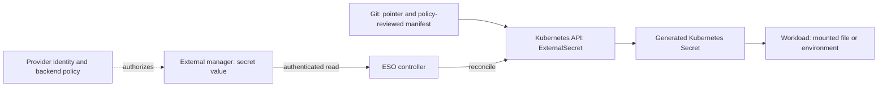
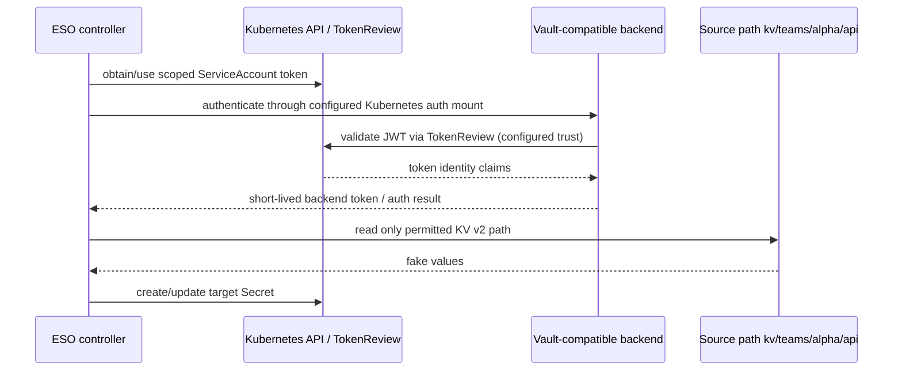

# 04 — External Secrets Operator and Cloud Secret Managers

> **Module:** M09 — Secrets and Identity Management · **Unit:** 4  
> **Audience:** Data/AI engineers progressing from Kubernetes fundamentals to production platform operations  
> **Level progression:** L1 foundations → L2 implementation → L3 security and architecture → L4 production operations  
> **Artifact status:** Teaching document and lab specification. No cluster, Vault server, cloud account, controller, or application test was executed while authoring this file. Commands and manifests below are examples to validate against the pinned local versions before use.

## 4.0 — Module Orientation, Scope, and Prerequisites

### What this unit teaches

External Secrets Operator (ESO) lets Kubernetes resources refer to values held in an external secrets manager. ESO periodically or on configured triggers retrieves those values and materializes them as Kubernetes `Secret` objects. This creates a useful declarative interface for GitOps, but it does **not** make the value disappear from the cluster: the generated Secret is still subject to Kubernetes API authorization, etcd encryption, backup protection, node/pod exposure, and application reload behavior.

The core path in this unit is a disposable `kind` cluster, an explicitly chosen Vault-compatible server with a KV v2 secrets engine, ESO, and an application that reads a mounted file. Cloud-provider sections are documentation exercises and illustrative configurations only. The mandatory labs must not require a cloud account or incur cloud charges.

### Prerequisites

- Linux, WSL2, or a comparable shell environment; `docker`, `kind`, `kubectl`, and Helm installed.
- Basic Kubernetes namespaces, ServiceAccounts, RBAC, Deployments, volumes, and Secrets.
- Basic GitOps concepts and a safe disposable local cluster.
- Unit 1 threat-model and lifecycle concepts; Unit 2 Vault authentication/policy concepts; Unit 3 rotation and client-refresh concepts.
- A way to read the installed CRDs and official docs for the exact chart/controller release.

**[VERIFY] Version pinning:** choose and record compatible versions of Kubernetes/`kind`, Helm, ESO chart/controller, and the selected Vault-compatible server before running commands. Do not copy an arbitrary latest version into a production system. The official ESO documentation changes over time; examples here use `external-secrets.io/v1` where shown because current official API material exposes that API, but the installed CRD is the authority for your lab.

### Outcomes

After completing the unit, you should be able to explain the reference pattern, deploy a least-privilege local integration, map and template source fields, test rotation propagation, isolate tenants, compare cloud managers, reason about GitOps ordering and rollback, diagnose common failures, and produce evidence without disclosing secret values.

### Scope boundaries

- Unit 1 owns the broader secrets threat model and lifecycle.
- Unit 2 owns Vault architecture, auth methods, policies, and operational basics.
- Unit 3 owns dynamic secrets, leases, revocation, and credential rotation mechanics.
- Unit 5 owns SOPS, Sealed Secrets, and encrypted-in-Git workflows.
- Unit 6 owns Kubernetes Secret encryption at rest and CSI Secret Store detail.
- Unit 7 owns workload identity, IRSA, and federation.
- Unit 8 owns secret-leak detection and incident response.
- M04 owns network policy; M06/M08 own Kubernetes, GitOps, rollout and release practices; M07 Unit 7 owns throttling concepts; M11 owns observability; M12 owns admission/policy controls; M13 owns backup/restore; M16 owns platform golden paths.

### Safety contract

Use fake, disposable values only. Never commit tokens, kubeconfigs, `.env` files, private keys, or real cloud identifiers. Never use `kubectl get secret -o yaml`, `kubectl describe secret`, `env`, `printenv`, shell tracing, or a raw `cat` of a secret file as verification. Verify metadata, key names, status, file permissions, hashes of harmless sentinels, or an application pass/fail result. Base64 is encoding, not encryption.

## 4.1 — L1 Foundations: The External-Secret Reference Pattern

### Definition and motivation

The **external-secret reference pattern** keeps the value in a secret manager and puts a reference in a Kubernetes manifest. ESO reads the referenced value using a configured provider identity and writes it to a Kubernetes Secret for the workload to consume.



The manifest should name the source and desired target shape, not contain the credential. The source manager remains the authoritative store for the value; the generated Kubernetes Secret is a materialized copy and may lag the source.

### What it solves—and what it does not

It separates application deployment from secret-value distribution and supports repeatable GitOps manifests without committing plaintext values. It can centralize access policies, audit, versioning, and rotation workflows in a provider.

It does **not** automatically provide end-to-end rotation, make Kubernetes Secrets encrypted at rest, guarantee source availability, ensure the application reloads a changed value, or prevent a tenant who can create an unrestricted `ExternalSecret` from requesting any key readable by the referenced store identity.

### Compare the adjacent patterns

| Pattern | Where the value is delivered | Kubernetes Secret object? | Main advantage | Main cost / caveat |
|---|---|---:|---|---|
| ESO reference pattern | ESO creates/updates a Kubernetes Secret | Yes, ordinarily | Declarative integration and broad compatibility with apps expecting Secrets | Value is materialized in cluster storage and backups; refresh/reload is multi-stage |
| Vault Agent / injection | Agent retrieves and writes/renders files, often to a shared volume | Not required | Can avoid creating a Kubernetes Secret; supports agent templates and Vault-oriented workflows | Agent lifecycle, identity, templates, and app reload must be operated |
| Secrets Store CSI Driver | CSI/provider mounts secret material as a volume | Not by default; optional sync can create one | File-oriented delivery can reduce etcd exposure when sync is disabled | Pod start/mount and rotation behavior depend on driver/provider/configuration; Unit 6 owns details |
| Encrypted-in-Git (Unit 5) | Git stores ciphertext; authorized controller/user decrypts | Usually, after decryption | Git is the versioned source of truth; may work without runtime backend calls | Key distribution/custody and ciphertext history; future key compromise may expose historical ciphertext |
| Direct application fetch | App obtains the value from the manager at runtime | No ESO-generated Secret required | Direct control of caching, refresh, and potentially dynamic credentials | Every app needs provider SDK/auth/error-handling; more application integration and backend traffic |

**Design prompt:** if the requirement is “the value must never be written to etcd,” ESO's normal target model is not enough by itself. Evaluate CSI without Secret synchronization, Vault Agent/injection, or direct retrieval, then validate the full threat model. See Unit 6.

### Acronyms and terms

- **ESO:** External Secrets Operator.
- **CRD:** CustomResourceDefinition, which extends the Kubernetes API with a new resource kind.
- **Controller:** a process that observes desired and current state and attempts to reconcile them.
- **Reconciliation:** repeated comparison and correction of actual state toward declared state.
- **Source of truth:** system considered authoritative for a value or configuration.
- **Materialization:** creating a local copy of externally held data for a consumer.
- **KV v2:** Vault Key/Value secrets engine version 2; it supports versioned values and uses API paths with a `/data/` segment for data operations. ESO's provider may abstract part of that path; verify the exact configuration.
- **`SecretStore`:** namespaced ESO resource describing a provider and its authentication.
- **`ClusterSecretStore`:** cluster-scoped store potentially reusable by many namespaces; treat it as a shared trust boundary.
- **`ExternalSecret`:** namespaced request describing which external values to fetch and how to materialize them.
- **`ClusterExternalSecret`:** cluster-scoped mechanism for distributing ExternalSecret definitions to selected namespaces; availability and selector fields are version-sensitive.
- **`PushSecret`:** ESO resource for pushing Kubernetes-side values to a supported external provider; it reverses the usual data-flow direction and expands outbound exposure.
- **`remoteRef`:** a mapping from a Kubernetes Secret key to a provider-side key/property/version reference.
- **`refreshInterval`:** interval used by the configured refresh policy to re-read the source; exact zero-value semantics must be verified for the installed release.
- **`creationPolicy`:** how ESO creates/owns/merges the target Secret.
- **`deletionPolicy`:** what ESO does with the target when upstream data is absent; provider behavior and supported enum semantics must be verified.
- **Workload identity:** a non-human identity bound to a workload for authenticating to another system.
- **Blast radius:** the scope of systems/data affected if an identity, controller, or policy is compromised.

## 4.2 — L1 Foundations: ESO Architecture and Core Resources

### Control flow

1. A platform team installs ESO and its CRDs.
2. A store resource defines provider endpoint/configuration and how the controller authenticates.
3. An `ExternalSecret` refers to a store and maps source values into a target Kubernetes Secret.
4. The controller authenticates to the provider, retrieves permitted values, applies any supported mapping/template, and updates the target Secret.
5. Kubernetes distributes the Secret to authorized consumers according to the workload's consumption method.
6. ESO reconciles again according to the configured policy, resource changes, and controller behavior.

The controller identity that reads Kubernetes resources is distinct from the provider identity that reads external secrets, even when a specific auth mode uses the controller's mounted ServiceAccount token to authenticate to Vault. Trace both identities in your threat model.

### Resource responsibilities

| Resource | Scope | Responsibility | Security questions |
|---|---|---|---|
| `SecretStore` | Namespace | Provider connection and auth for ExternalSecrets in that namespace | Who can edit it? Which backend paths can its identity read? |
| `ClusterSecretStore` | Cluster | Shared provider connection usable across namespaces subject to installed-version restrictions | Which namespaces can reference it? Can a tenant request production paths? |
| `ExternalSecret` | Namespace | Source mapping, refresh configuration, target name and template | Who can create/edit it? Can `dataFrom` broaden access? |
| `ClusterExternalSecret` | Cluster | Fan-out of ExternalSecret definitions to selected namespaces | Are selectors and generated names scoped as intended? |
| `PushSecret` | Usually namespaced; check installed CRD | Push selected Kubernetes Secret data to a provider | Who can exfiltrate values outward, and to which destination? |
| Generators | Generator resources/provider-specific | Generate ephemeral or synthetic values for supported workflows | Does generated value lifecycle match the real service credential lifecycle? |

**[VERIFY] API and feature availability:** current ESO docs expose `external-secrets.io/v1` for core resources; older releases used `v1beta1`. Do not mix API versions or infer a feature exists because it appears in online `main` docs. Inspect the installed CRDs and the version-matched documentation:

```bash
kubectl get crd externalsecrets.external-secrets.io -o jsonpath='{.spec.versions[*].name}{"\n"}'
kubectl get crd secretstores.external-secrets.io -o jsonpath='{.spec.versions[*].name}{"\n"}'
kubectl get crd clustersecretstores.external-secrets.io -o jsonpath='{.spec.versions[*].name}{"\n"}'
kubectl get crd clusterexternalsecrets.external-secrets.io -o jsonpath='{.spec.versions[*].name}{"\n"}'
kubectl get crd pushsecrets.external-secrets.io -o jsonpath='{.spec.versions[*].name}{"\n"}'
```

These commands print schema version names only, not secret values. If a CRD is absent, do not assume the corresponding feature is installed or enabled. The API server's schema and the documentation for the exact release determine the supported fields.

### Status and target ownership

Inspect status and events without reading the target data:

```bash
kubectl -n app get externalsecret api-config
kubectl -n app get externalsecret api-config -o jsonpath='{.status.conditions[*].type}{" "}{.status.conditions[*].status}{" "}{.status.conditions[*].reason}{"\n"}'
```

Use metadata and key-name-only checks instead; never inspect or print the Secret `.data` map, which contains base64-encoded secret values:

```bash
kubectl -n app get secret api-config -o jsonpath='{.metadata.name}{" type="}{.type}{" keys="}{range $k, $v := .data}{$k}{" "}{end}{"\n"}'
kubectl -n app get events --sort-by=.lastTimestamp
```

Look for `Ready`/sync conditions and reasons such as a successful synchronization (the exact reason text can vary by release), a missing key, auth failure, or provider request failure. Events may contain sensitive data if a controller/provider is misconfigured; review the event schema and redact before exporting evidence. Never paste raw events into public tickets without checking for values.

### `creationPolicy` and `deletionPolicy`

These fields control ownership and deletion behavior, not backend authorization.

- **Owner:** typically establishes an owner reference from the generated Secret to the ExternalSecret; deleting the owner can cause garbage collection of the target, subject to actual semantics.
- **Orphan:** target can outlive the ExternalSecret; this can leave unmanaged values behind.
- **Merge:** merges selected keys into an existing Secret and generally does not make the ExternalSecret the sole owner; collisions and concurrent writers are dangerous.
- Other enum values, including any create-or-merge variant, are release-sensitive. **[VERIFY]** the installed CRD and the release-specific “Secret ownership” documentation before using them.
- `deletionPolicy` governs the target response to missing source data, not necessarily deletion of the ExternalSecret object. Policies such as retaining, deleting, or failing may exist depending on the release and provider. **Never assume upstream deletion always deletes or always retains the target.**

Before selecting a policy, test four distinct operations in a disposable namespace: delete the ExternalSecret; delete the upstream value; revoke provider access; and delete the target Secret manually. Record actual results for the pinned release. A deletion policy is not a substitute for a rollback plan.

## 4.3 — L2 Practical Setup: Local Lab and ESO Installation

### Architecture and compatibility record

The local architecture is:

```text
kind cluster
  ├─ external-secrets namespace: ESO controller + CRDs
  ├─ vault-lab namespace: Vault-compatible server + lab-only configuration
  └─ app namespace: ServiceAccount, SecretStore, ExternalSecret, target Secret, sample Deployment
```

Choose either HashiCorp Vault or OpenBao for the hands-on server; this lesson uses “Vault-compatible backend” generically. Their API/CLI compatibility and licensing/governance implications are not asserted here—read current official documentation and governance/licensing documents for the chosen project. For a beginner's local lab, use only throwaway values and a non-production server configuration. Never expose the server publicly.

Record this before installing:

| Component | Chosen version | Official compatibility checked? | Notes |
|---|---|---|---|
| Kubernetes / kind node image | `RECORD_LOCAL_VERSION` | `YES/NO` | |
| Helm | `RECORD_LOCAL_VERSION` | `YES/NO` | |
| ESO chart | `RECORD_PINNED_CHART_VERSION` | `YES/NO` | |
| ESO controller image | `RECORD_PINNED_CONTROLLER_VERSION` | `YES/NO` | |
| Vault-compatible server | `RECORD_LOCAL_VERSION` | `YES/NO` | |

### Create the disposable cluster

Use a unique cluster name so cleanup is bounded:

```bash
kind create cluster --name eso-lab
kubectl cluster-info --context kind-eso-lab
kubectl get nodes
```

Expected result (not observed here): one or more local nodes become `Ready`. If this cluster name already belongs to important work, choose another name and update all cleanup commands. Do not delete a shared cluster.

### Install ESO from the official Helm chart

The official chart repository is `https://charts.external-secrets.io`. The chart/controller version must be pinned and compatibility checked before installation. The placeholder below is intentionally not executable until replaced with a verified version:

```bash
helm repo add external-secrets https://charts.external-secrets.io
helm repo update
helm show chart external-secrets/external-secrets --version <VERSION>
helm show values external-secrets/external-secrets --version <VERSION> > /tmp/eso-values-review.yaml
# Review the chart and its values; do not commit local files containing sensitive overrides.
helm upgrade --install external-secrets external-secrets/external-secrets \
  --namespace external-secrets --create-namespace \
  --version <VERSION> --wait --timeout 5m
```

`<VERSION>` must be replaced with a verified, pinned chart version. Confirm the chart's default CRD lifecycle and upgrade instructions; do not assume that changing the chart version safely upgrades every CRD. If your selected chart uses different installation options, follow that version's docs. Do not set unverified Helm flags.

Safe readiness checks:

```bash
kubectl -n external-secrets rollout status deployment/external-secrets --timeout=180s
kubectl -n external-secrets get deployments,pods
kubectl get crd | grep external-secrets.io
helm -n external-secrets list
```

The deployment name may differ with release/chart overrides; inspect `kubectl -n external-secrets get deployments` and adapt. If CRDs are missing, stop before applying custom resources and resolve chart installation first.

### Local backend choices

Use one Vault-compatible backend for the core labs. Configure a KV v2 mount named `kv` and store fake values under a path such as `teams/alpha/api`. Use an isolated, local-only address reachable from the ESO controller. Avoid publishing the service on a public interface. The exact Helm chart or container setup for Vault/OpenBao is intentionally not prescribed because chart defaults, dev-mode flags, root-token behavior, and auth configuration are security-sensitive and version-specific. Follow the official local development instructions and mark all test credentials disposable.

**Zero-dependency demonstrations:** ESO documentation has included a `fake` provider in some releases and a Kubernetes provider in some configurations. Availability, exact CRD, and schema are **[VERIFY]** items. Do not paste a guessed `fake` provider manifest into the lab. Confirm it in the release-matched provider list and installed CRD; if absent, skip the optional fake-provider exercise and use the Vault-compatible backend.

## 4.4 — L2 Practical Setup: Vault KV v2, Kubernetes Auth, and SecretStore

### Trust flow and identities



The exact flow varies by auth configuration. The controller may use its own mounted ServiceAccount token or a specifically referenced ServiceAccount token. Verify the provider configuration for the installed ESO release and the chosen Vault-compatible server. Do not give the controller's backend identity access to every production path merely to make the demo work.

### Vault policy example

A KV v2 policy commonly grants read capability to the data endpoint for a bounded path. Exact mount names and policy paths must match the configured engine. For a KV v2 mount named `kv`, a policy conceptually like this is typical:

```hcl
# Illustrative Vault policy; validate against the chosen server and mount.
path "kv/data/teams/alpha/api" {
  capabilities = ["read"]
}
```

Do not add `list`, `create`, `update`, `delete`, or broad wildcard permissions unless the use case demonstrably requires them. A KV v2 metadata endpoint may be needed for listing/find-style operations; this lab does not need secret discovery. Keep the path exact. Vault-compatible implementations may differ; verify policy behavior with an allowed path and a denied sibling path.

### Kubernetes auth setup checklist

Configure the server's Kubernetes auth method according to its official docs. The auth method must know how to validate the cluster's ServiceAccount tokens. In a Vault-style setup this often involves API address/CA and TokenReview permissions for the configured reviewer identity; details vary by cluster and server version.

1. Create a dedicated ESO lab ServiceAccount or use the controller ServiceAccount only if the selected auth mode explicitly supports it.
2. Configure backend Kubernetes auth and the required TokenReview trust. Avoid granting broad permissions to the application ServiceAccount.
3. Create a backend role bound to the intended ServiceAccount name and namespace, and set an audience when required by the selected Vault version. Vault documentation currently warns that audience requirements vary by version; **[VERIFY]** the chosen release.
4. Attach the narrow policy above to the role.
5. Test allowed and denied paths before wiring ESO.
6. Avoid saving long-lived Vault tokens in Kubernetes unless a verified, explicit design requires it. Kubernetes auth is preferred for this lab to exercise identity rather than a static root token.

### Representative SecretStore

The following is a schema-oriented example using current documented field shapes. It is **not certified runnable for an arbitrary chart/controller version**. Confirm every field against the installed CRD and the release-matched Vault provider page before applying. The backend address is a placeholder.

```yaml
apiVersion: external-secrets.io/v1 # [VERIFY] served by installed CRD
kind: SecretStore
metadata:
  name: vault-alpha
  namespace: app
spec:
  provider:
    vault:
      server: "http://vault-lab.vault-lab.svc:8200" # [VERIFY] DNS/TLS/network path
      path: "kv"                                    # KV mount, not a secret path
      version: "v2"
      auth:
        kubernetes:
          mountPath: "kubernetes"                   # [VERIFY] auth mount
          role: "eso-alpha-read"
          serviceAccountRef:
            name: "eso-alpha-reader"
            audiences:
              - "vault"                             # [VERIFY] server role audience
```

This example requires the `app` namespace, ServiceAccount, backend service, auth mount, and role to exist. Some releases/configurations use a different token acquisition option; do not silently substitute a field from another version. Inspect the schema:

```bash
kubectl explain secretstore.spec.provider.vault --api-version=external-secrets.io/v1
kubectl explain secretstore.spec.provider.vault.auth --api-version=external-secrets.io/v1
kubectl explain secretstore.spec.provider.vault.auth.kubernetes --api-version=external-secrets.io/v1
```

If `kubectl explain` cannot find the field, consult the installed CRD schema and version-matched official docs rather than guessing. Ensure the controller can reach the backend over the intended network path; see M04 for network-policy boundaries.

### SecretStore versus ClusterSecretStore

| Property | `SecretStore` | `ClusterSecretStore` |
|---|---|---|
| Resource scope | Namespace | Cluster |
| Reuse | Usually within one namespace | Potentially across namespaces |
| Typical isolation strategy | Per-namespace store + backend policy | Carefully constrained shared store + namespace conditions/selectors + backend policy |
| Failure/blast radius | Can be bounded to a team/namespace | Shared identity may expose values across tenants |
| Required review | Store editors, referenced SA, backend policy | All consumers, selectors/conditions, cross-namespace refs, policy/admission tests |

A cluster-scoped store is not automatically unsafe, but a broad shared identity with no effective namespace or path constraints creates a large blast radius. Verify exact `conditions`/selector fields in the selected release. Backend policy is the last line of defense: Kubernetes-side restrictions alone do not narrow the provider identity's actual read permissions.

## 4.5 — L2 Practical Setup: ExternalSecret Data Mapping, Templates, and Refresh

### `data`, `dataFrom`, and `remoteRef`

- `data` explicitly maps one provider-side item/property to one key in the target Kubernetes Secret.
- `dataFrom` imports a set of values from a provider-side object or uses provider-specific extraction/find behavior. Broad discovery is powerful and can expand access unexpectedly.
- `remoteRef.key` identifies the provider-side secret path/name.
- `remoteRef.property` selects a field within a structured secret where supported.
- `remoteRef.version` selects a provider-specific version or version identifier where supported. Version semantics differ by provider; do not assume the same format across Vault, AWS, GCP, and Azure.

Representative mapping (schema and provider semantics **[VERIFY]**):

```yaml
apiVersion: external-secrets.io/v1
kind: ExternalSecret
metadata:
  name: api-config
  namespace: app
spec:
  refreshPolicy: Periodic
  refreshInterval: "5m" # [ASSUMPTION] lab interval; tune based on cost/latency
  secretStoreRef:
    name: vault-alpha
    kind: SecretStore
  target:
    name: api-config
    creationPolicy: Owner # [VERIFY] exact semantics in selected release
    deletionPolicy: Retain # [VERIFY] exact semantics in selected release
  data:
    - secretKey: DB_HOST
      remoteRef:
        key: teams/alpha/api
        property: db_host
    - secretKey: DB_USER
      remoteRef:
        key: teams/alpha/api
        property: db_user
    - secretKey: DB_PASSWORD
      remoteRef:
        key: teams/alpha/api
        property: db_password
    - secretKey: THIRD_PARTY_API_KEY
      remoteRef:
        key: teams/alpha/api
        property: api_key
```

Store the source record with obviously fake values such as `FAKE_DB_PASSWORD_DO_NOT_USE` and `FAKE_API_KEY_DO_NOT_USE`. Never use actual passwords or keys. In Vault KV v2, the source secret path is commonly configured relative to the mount; ESO's `path` and `remoteRef.key` interpretation must be confirmed against the provider documentation. Do not add the API `/data/` segment to `remoteRef.key` unless the provider's documentation explicitly requires it.

### `dataFrom`

`dataFrom` can reduce repetitive field mappings, but it can also silently widen the set of materialized keys when the source object changes. Use it when importing the whole approved object is intentional and reviewed. In production, require code review for `dataFrom` and any provider-side `find`/regex discovery. A policy-as-code check can reject broad extraction in sensitive namespaces. Exact `dataFrom` subfields and rewrite behavior are **[VERIFY]** against the release schema.

### Templating a configuration file

Templating is useful when the app expects a connection string or configuration file. It increases the risk of value exposure if the output is copied into logs, annotations, labels, events, or rendered evidence. Template syntax and function availability are release-sensitive.

Illustrative `target.template` example:

```yaml
apiVersion: external-secrets.io/v1
kind: ExternalSecret
metadata:
  name: api-runtime-config
  namespace: app
spec:
  refreshPolicy: Periodic
  refreshInterval: "5m"
  secretStoreRef:
    name: vault-alpha
    kind: SecretStore
  target:
    name: api-runtime-config
    creationPolicy: Owner
    deletionPolicy: Retain
    template:
      engineVersion: v2 # [VERIFY] supported engine versions and functions
      type: Opaque
      data:
        app-config.yaml: |
          database:
            host: {{ .DB_HOST | quote }}
            username: {{ .DB_USER | quote }}
            password: {{ .DB_PASSWORD | quote }}
          upstream:
            api_key: {{ .THIRD_PARTY_API_KEY | quote }}
  data:
    - secretKey: DB_HOST
      remoteRef: { key: teams/alpha/api, property: db_host }
    - secretKey: DB_USER
      remoteRef: { key: teams/alpha/api, property: db_user }
    - secretKey: DB_PASSWORD
      remoteRef: { key: teams/alpha/api, property: db_password }
    - secretKey: THIRD_PARTY_API_KEY
      remoteRef: { key: teams/alpha/api, property: api_key }
```

**[VERIFY]** Confirm that the selected template engine supports the stated version, `quote` function, and data-map shape. This is an illustrative pattern, not a claim that the manifest was applied. In production, prefer a configuration format and encoding strategy that correctly escapes special characters; test values containing quotes, colons, newlines, and delimiters with harmless fake sentinels. Do not emit the rendered content to stdout.

### Refresh semantics and latency

The current ESO `ExternalSecret` documentation describes refresh policies including `Periodic`, `CreatedOnce`, and `OnChange`. It describes `refreshInterval: 0` as creating the target once without periodic refresh when using the relevant periodic behavior. **[VERSION-SENSITIVE]** verify the exact policy and zero-interval semantics in the installed release; `CreatedOnce` and `OnChange` are not interchangeable with “poll frequently.”

A source rotation reaches a running application only after all required stages complete:

`source update → next provider read → ESO reconcile → target Secret update → kubelet projection (if volume) → app reload/restart → successful authenticated request`.

A rough upper-bound budget can be modeled as:

`T_total ≈ T_wait_for_refresh + T_provider/API + T_reconcile + T_kubelet + T_app_reload + T_validation`.

This is a planning model, not a guarantee. Controller queues, retries, backend outage, API throttling, and application behavior can dominate the result. Measure the full path in the lab and set an operational budget from evidence.

### Request volume and cost

If `N` ExternalSecrets each read a remote object every `R` seconds, a first-order estimate of read frequency is `N / R` operations per second, before accounting for multiple remote keys, retries, provider calls per object, reconciliation triggered by spec changes, or provider-side caching. Treat it as a lower-bound planning estimate, not a bill calculation. A very short interval can amplify API calls, costs, throttling, and synchronized retry storms. Jitter, backoff, caching, and controller concurrency behavior are provider/controller-specific—**[VERIFY]** rather than assume.

## 4.6 — L2 Practical Setup: Workload Consumption and Rotation Propagation

### Environment variables

Environment variables sourced from a Kubernetes Secret are injected when a container starts. Updating the Kubernetes Secret does not rewrite the environment of an already-running process. Use a controlled rollout or an application-specific mechanism that re-reads configuration. Do not claim that an env var changed live without a process restart or an explicit refresh implementation.

### Mounted Secret volume

Kubernetes updates projected Secret volume content eventually, subject to kubelet synchronization and cache propagation behavior. Applications still need to reopen/read the updated file or watch for changes. A process that reads the file only once at startup may continue using the old value.

### `subPath`

A Secret volume mounted via `subPath` does not receive normal projected-volume updates. Avoid `subPath` for values that must rotate in place, or use a controlled pod replacement strategy and validate the exact Kubernetes version behavior.

### Reload strategies

1. **Controlled rollout:** change a safe checksum/config annotation or trigger a rollout through the release system after an approved secret update. Do not put secret values in the annotation; if using a checksum, consider whether a hash itself leaks information about low-entropy secrets.
2. **File watch:** application watches a mounted file, validates the new content, and reloads safely.
3. **Signal-based reload:** app handles `SIGHUP` or another documented signal and atomically replaces credentials.
4. **Reloader controller:** awareness option only. Verify its permissions, watched resources, annotation behavior, namespace scope, and maintenance status. Do not install a third-party controller without security review.

A reload is not proof of credential validity. After the change, perform a safe authenticated operation and record pass/fail without returning the credential.

## 4.7 — L2 Provider Survey: AWS, GCP, Azure, and Local Emulation

### Provider-neutral design dimensions

| Dimension | Questions to answer |
|---|---|
| Authentication | Is access via workload identity, federated identity, managed identity, or a static credential? How is the credential rotated? |
| Authorization | What exact resource scope can the ESO identity read? Are control-plane and data-plane permissions separate? |
| Versioning | Is a version ID, stage/alias, label, or numeric version used? What does “latest” resolve to? |
| Encryption | Which provider-managed or customer-managed KMS key protects the value? Who can use/change that key? |
| Audit | Which access events are logged, where are they retained, and can anomalous read volume be detected? |
| Rotation | Does the manager schedule/coordinate rotation for a supported target, or merely store versions? How does ESO discover the new version? |
| Replication | Is replication automatic or user-managed? What are location, consistency, and failure constraints? |
| Quotas/cost | Which reads, versions, replication locations, notifications, or API calls are billable? What limits and retry semantics apply? |
| ESO integration | Does the installed ESO release support the required provider, auth mode, version selection, and resource policy? |

Never equate a cloud product capability with ESO provider support. A provider can support a feature that the installed ESO adapter does not expose. Pin the docs to the ESO release and cloud API/SDK behavior actually used.

### AWS Secrets Manager and Systems Manager Parameter Store

AWS Secrets Manager is oriented toward managed secrets, versions/staging labels, access policies, auditing, and supported rotation integrations. Systems Manager Parameter Store handles configuration parameters and can hold secure string values; tier and feature behavior differ. Parameter Store can reference Secrets Manager values through specific integration paths, but this does not mean all parameter operations or version semantics are interchangeable.

Review the official AWS documentation for IAM actions and resource ARNs, KMS permissions, resource policies, secret version/staging behavior, CloudTrail audit, rotation coverage for the target service, API quotas/throttling, and pricing. Do not copy broad `secretsmanager:*` permissions into a workload policy. **[VERIFY]** ESO provider auth fields, IRSA/EKS Pod Identity support, SSM parameter type/path semantics, and the exact API actions required by the installed provider.

**ILLUSTRATIVE — NOT RUN IN LABS (AWS):**

```yaml
# Schema-oriented sketch only. Confirm every field against the exact ESO release.
apiVersion: external-secrets.io/v1
kind: SecretStore
metadata:
  name: aws-app-store
  namespace: app
spec:
  provider:
    aws:
      service: SecretsManager # [VERIFY] provider enum/schema
      region: REPLACE_WITH_AWS_REGION
      # Configure workload identity according to the provider's current docs.
      # Do not paste static AWS access keys into this manifest.
      auth:
        jwt:
          serviceAccountRef:
            name: app-secret-reader
            # Additional fields are version-specific: [VERIFY].
```

This is deliberately not guaranteed runnable. Do not infer the exact authentication schema from the sketch. Check the installed CRD, ESO provider docs, and the AWS workload identity documentation for the cluster type. If using SSM Parameter Store, confirm the provider's documented service/parameter reference shape and required IAM actions separately.

### Google Cloud Secret Manager

Review project/resource-level IAM, secret-version states and identifiers, Cloud Audit Logs, CMEK/KMS permissions, replication policy, quotas, and current pricing. Automatic and user-managed replication have different location-control and billing implications. Do not assume that disabling a version, destroying a version, and creating a new version have identical semantics in ESO.

**ILLUSTRATIVE — NOT RUN IN LABS (GCP):**

```yaml
apiVersion: external-secrets.io/v1
kind: SecretStore
metadata:
  name: gcp-app-store
  namespace: app
spec:
  provider:
    gcpsm:
      projectID: REPLACE_WITH_GCP_PROJECT_ID
      auth:
        workloadIdentity:
          clusterLocation: REPLACE_WITH_CLUSTER_LOCATION
          clusterName: REPLACE_WITH_CLUSTER_NAME
          serviceAccountRef:
            name: app-secret-reader
      # All fields and identity bindings are [VERIFY] for installed ESO release.
```

This is an illustrative schema sketch only; do not use a real project ID in a shared document. Verify the exact GCP provider and Workload Identity configuration for your Kubernetes platform. Do not create a long-lived service-account key merely to make an example work unless a reviewed design explicitly requires it.

### Azure Key Vault

Review Microsoft Entra identity, managed/workload identity, data-plane authorization (Azure RBAC or access-policy model depending on vault configuration), secret versions, diagnostics, soft-delete/purge protection where relevant, throttling, regional design, and pricing. Control-plane permission to manage a vault is not identical to data-plane permission to read secret values. Verify the actual vault access model and identity configuration.

**ILLUSTRATIVE — NOT RUN IN LABS (Azure):**

```yaml
apiVersion: external-secrets.io/v1
kind: SecretStore
metadata:
  name: azure-app-store
  namespace: app
spec:
  provider:
    azurekv:
      authType: WorkloadIdentity # [VERIFY] enum/field for selected ESO release
      vaultUrl: "https://REPLACE_WITH_VAULT_NAME.vault.azure.net"
      serviceAccountRef:
        name: app-secret-reader
      # Tenant/client identity bindings are release- and platform-specific: [VERIFY].
```

This is not runnable as-is and does not assert that the shown fields match every ESO version. Confirm the provider schema and current Azure Workload Identity/Key Vault documentation. Keep tenant IDs, subscription IDs, client IDs, and vault names out of public evidence.

### LocalStack (optional)

LocalStack may be useful to exercise some AWS-compatible API paths for Secrets Manager or SSM. **[VERIFY]** the specific LocalStack edition/version and the API actions used by your exercise. A successful local emulator request does not prove real AWS IAM evaluation, KMS behavior, IRSA/EKS Pod Identity, CloudTrail integration, quotas, regional replication, or production semantics. It is optional and not required for the core path.

### Learner-filled provider matrix

Complete this table from current official documentation and your selected ESO release. Leave unknowns as `VERIFY`, not guesses.

| Provider | Auth model | Authorization scope | Version behavior | Audit evidence | Rotation support | Replication model | Quota/cost drivers | ESO integration status | Key caveats / official docs to verify |
|---|---|---|---|---|---|---|---|---|---|
| Vault / OpenBao-compatible | Kubernetes auth, JWT, AppRole, or other supported mode | Policy path/capability | KV v2 version or provider selection | Audit device/log | Unit 3 handles lease/rotation concepts; KV update is not automatically app reload | Server/storage/DR design | Backend capacity and read volume | Vault provider available; exact fields `[VERIFY]` | Vault Kubernetes auth, KV v2, ESO Vault provider |
| AWS Secrets Manager | Workload/federated identity or other verified auth | IAM + resource policy + KMS permissions | Version ID/staging labels; ESO mapping `[VERIFY]` | CloudTrail and service logs | Supported target integrations only | Regional replication options `[VERIFY]` | Secret count, versions, API calls, rotation features | `[VERIFY]` installed provider/auth mode | AWS IAM, Secrets Manager versions, quotas, pricing |
| AWS SSM Parameter Store | Verified AWS identity | IAM path/resource scope; KMS for SecureString where applicable | Parameter version/history behavior; ESO support `[VERIFY]` | CloudTrail | Not identical to Secrets Manager; `[VERIFY]` | Service/region options `[VERIFY]` | Tier, API usage, throughput and storage `[VERIFY]` | `[VERIFY]` exact SSM support | SSM Parameter Store tiers, IAM, quotas, pricing |
| Google Cloud Secret Manager | Workload Identity / supported identity | IAM roles at project/secret scope | Version IDs/states | Cloud Audit Logs | Rotation notifications/workflow vs actual target rotation must be distinguished | Automatic or user-managed | Active versions, access operations, locations | `[VERIFY]` exact provider fields | IAM, versions, replication, quotas, pricing |
| Azure Key Vault | Managed/workload identity | Data-plane RBAC or access policies, depending on configuration | Secret version IDs | Diagnostic logs / Azure Monitor | External automation and supported integrations; `[VERIFY]` | Region/geo design `[VERIFY]` | Transaction limits, object/version operations, SKU | `[VERIFY]` exact auth fields | Entra identity, authorization, service limits, pricing |

## 4.8 — L3 Security Design: Least Privilege, Tenancy, and Blast Radius

### Authorization is a composition, not one permission check

A request is safe only when all relevant boundaries agree:

1. Kubernetes RBAC decides who can create or modify `ExternalSecret`, store, and related resources.
2. Store scope/conditions decide whether a resource can reference a store from that namespace.
3. Admission policy can enforce approved store names, namespace labels, path prefixes, owner metadata, and restrictions on broad extraction.
4. Backend policy decides which external paths/secret resources the provider identity can read.
5. Network policy and egress controls constrain where the controller can connect (M04).
6. Kubernetes Secret RBAC and encryption/backup protections constrain the materialized copy (Unit 6).

**Critical rule:** a user who can create an `ExternalSecret` may be able to ask the store identity to read any source value accessible to that identity unless another boundary prevents it. `ExternalSecret` creation is therefore potentially equivalent to secret-read delegation. Review this permission as carefully as direct `get` access to the generated Secret.

### Per-namespace store versus shared cluster store

| Design | Advantages | Risks / controls required |
|---|---|---|
| Per-namespace `SecretStore` and per-tenant identity/policy | Clear ownership, smaller blast radius, simpler path-specific tests | More resources and lifecycle management; avoid copy-paste policy drift |
| Shared `ClusterSecretStore` with narrow identity | Reuse and fewer duplicated definitions | Shared identity can span tenants; require namespace conditions/selectors, backend policy, RBAC, admission tests, and audit |
| Shared store with broad read policy | Low setup effort | High blast radius; unsuitable as a production default |

Path prefixes should align with tenant/environment boundaries, e.g. `teams/alpha/*` versus `teams/beta/*`, and production should use a distinct identity/backend scope from development where feasible. Do not rely only on path naming; enforce the restriction in backend policy.

### Illustrative admission-policy intent

The following is **pseudocode**, not runnable Kyverno/Gatekeeper YAML. Exact schemas, variables, CEL support, policy engine version, and match semantics are **[VERIFY]**. It expresses the controls a policy should enforce:

```text
DENY ExternalSecret if:
  namespace is not approved for the referenced store
  OR referenced store is not on the namespace's approved-store allowlist
  OR remoteRef.key is outside the namespace's allowed prefix
  OR dataFrom uses find/broad discovery in production without an exception
  OR required owner metadata is missing
  OR production resource requests a development store (or vice versa)
```

Test policy with positive and negative cases in CI. A policy that only matches `metadata.namespace` but fails to inspect the referenced store or path does not prove tenant isolation. Forward-reference M12 for admission controls and policy-as-code implementation.

### Secret still exists in Kubernetes

ESO normally creates a Kubernetes Secret. That value may be accessible through the API to principals with appropriate permissions, visible to node/pod processes that consume it, persisted in etcd unless encryption at rest is configured, and included in etcd backups. ESO shifts the source of truth; it does not remove the copy. Unit 6 covers encryption-at-rest and CSI approaches.

### Templating and evidence security

- Never put values into labels, annotations, resource names, events, error messages, logs, traces, metrics labels, screenshots, or reports.
- Avoid debug logging of request/response bodies and rendered templates.
- Verify only key names, object metadata, condition status, file permissions, or a safe application outcome.
- A hash of a secret can leak information for low-entropy values. Use a known harmless sentinel for timing tests; do not hash a real password as evidence.
- Review error messages before sharing them; a provider or template error may include path/value context.

### Multi-environment and multi-cluster layout

Use the same conceptual application manifest with environment-specific overlays, but keep production identity and backend access physically or logically isolated. Kustomize overlays can select a different store name/path for dev versus prod. Ensure a dev cluster cannot authenticate as a production identity or reach production secret paths. A manifest parameterization pattern is not a security boundary by itself; test the resulting rendered manifests and backend policies.

## 4.9 — L3 Architecture: ESO vs Vault Agent vs CSI vs Direct Fetch

| Dimension | ESO | Vault Agent / injection | CSI Secret Store | Direct app fetch |
|---|---|---|---|---|
| Exposure surface | Provider → controller → Kubernetes Secret → consumer | Provider → agent → file/shared volume → consumer | Provider → CSI provider/driver → mounted volume | Provider → app memory/cache |
| Kubernetes Secret created | Normally yes | Not required | Not required unless sync-to-Secret enabled | No, unless app separately creates one |
| Dynamic secret support | Depends on provider and ESO integration; ESO is not itself a lease manager | Vault Agent can integrate with supported Vault workflows; validate renew/re-auth behavior | Provider-specific; validate dynamic/lease support | Potentially strongest flexibility, but app must implement renewal/re-auth safely |
| Rotation propagation | Provider read → reconcile → Secret update → app reload/restart | Agent render/renew → app reload; config-specific | Driver/provider rotation settings or pod restart → app reload | App-defined refresh/cache/renewal |
| Backend outage | Last materialized Secret may remain stale; new sync fails | Cached/rendered file may remain; renewal/fresh start can fail | Pod start/mount or refresh can fail depending on provider/driver and cache; `[VERIFY]` | App may use cache or fail; app-defined |
| Operational complexity | Controller, CRDs, stores, provider auth, policies, target Secret controls | Agent injection/templates, sidecar/agent lifecycle, app reload | Driver/provider DaemonSets, CSI mounts, node-level operations | SDK/auth/error handling in every app |
| GitOps compatibility | Strong declarative resource fit; generated Secret should not be committed | Injection annotations/config may be declarative; runtime lifecycle separate | `SecretProviderClass` and pod volume declarative; provider installation ordered | App config and identity bindings declarative; secret fetch runtime logic |
| Multi-cluster | Each cluster needs controller/provider connectivity and scoped identity | Agent/identity deployment per workload/cluster | Driver/provider deployment per cluster/node | Identity and client logic per workload/cluster |
| Authorization model | Kubernetes RBAC + store constraints + backend policy + admission | Workload identity + Vault policy + agent config | Workload identity + provider/driver config + backend policy | App identity + backend policy, with application-level handling |
| App integration burden | Low for apps already reading Kubernetes Secrets; reload still required | Medium: file format/reload and injection pattern | Medium: file-based config and CSI volume | High: provider SDK and robust refresh logic |
| Strong fit | Existing Kubernetes Secret consumers and declarative operations | Vault-centric workloads needing file rendering/agent behaviors | File-based delivery where reducing etcd exposure matters | Apps designed for runtime secret retrieval or dynamic credentials |

**[VERIFY]** exact dynamic-secret, caching, rotation, and outage behavior for the chosen version/provider. The matrix is an architectural guide, not a universal feature guarantee. For high-sensitivity secrets, choose based on the threat model rather than convenience alone.

## 4.10 — L3 GitOps, Versioning, Migration, and Rollback

### GitOps ordering

GitOps controllers can manage `ExternalSecret`, `SecretStore`, and application resources as declarative objects. The generated Kubernetes Secret should not be committed to Git. Installation order matters:

1. ESO controller and CRDs are available.
2. Store prerequisites and provider authentication are ready.
3. `SecretStore` / `ClusterSecretStore` becomes ready.
4. `ExternalSecret` reconciles and target Secret appears.
5. Workload deploys or starts when the target Secret exists.

Use separate stages/applications or dependency mechanisms when required. **[VERIFY]** Argo CD sync waves/health behavior, diff customization, and ignore rules for the exact Argo CD version; **[VERIFY]** Flux `dependsOn`, health checks, and CRD ordering for the exact Flux version. Avoid broad ignore rules that conceal meaningful drift or security-sensitive spec changes.

### Version pinning and rollback

Pinning `remoteRef.version` can support a controlled rollout when the provider and ESO adapter support the version selector. A moving alias such as “latest” may pick up a new value automatically on the next refresh. Provider semantics differ: AWS staging labels, Google version identifiers, Azure version IDs, and Vault KV v2 version numbers are not interchangeable.

Rollback must consider compromise. Reverting to an earlier value may reintroduce a leaked credential, a revoked password, or a known vulnerable key. Before rollback, decide whether the old version remains valid and safe, who approved its use, and how it will be retired afterward. Prefer rolling forward to a new safe credential when an old credential was compromised.

### Plaintext Secret → ESO migration playbook

1. **Inventory:** list consumers, owners, namespace, source of current value, access paths, restart/reload behavior, and deployment dependencies.
2. **Classify and contain:** if the value was committed, logged, or broadly shared, assume exposure and rotate it; moving it does not erase history.
3. **Import:** create the value in the approved external manager using a safe channel. Do not paste it into Git or chat.
4. **Scope:** create a dedicated store identity and backend policy limited to the required path/resource.
5. **Introduce ESO:** create a verified store and ExternalSecret. Test `creationPolicy`/`deletionPolicy` on a disposable target first. Avoid `Merge` when multiple writers or key collisions are possible.
6. **Verify metadata:** confirm target Secret existence, expected key names, ownership metadata, and readiness without dumping data.
7. **Verify consumer:** run a non-disclosing authenticated operation; check mounted-file permissions and reload behavior.
8. **Verify rotation and rollback:** change the source to a fake sentinel in the lab; measure propagation and rehearse the safe recovery path.
9. **Remove plaintext:** delete plaintext from active manifests and local temporary files; add CI checks to prevent reintroduction.
10. **Handle history:** deleting a file from the working tree does not erase Git history, forks, logs, or artifacts. If a real credential was ever committed, rotate/revoke it and follow Unit 8. History rewriting is not a substitute for rotation.
11. **Document evidence:** record version pins, approved identity/policy, test outcomes, propagation latency, rollback owner, and cleanup status—without secret values.

### Backend selection framework

| Constraint | Vault-class manager | Cloud-native manager | Hybrid |
|---|---|---|---|
| Existing Vault platform and dynamic-secret workflows | Often a natural fit | May require duplicating workflows | Useful if cloud services need native identity and legacy systems need Vault |
| Single-cloud estate with strong native identity | Possible but adds platform operations | Often simpler operational integration | Can increase complexity without a clear boundary |
| Multi-cloud/on-prem consistency | Central policy can help, but network/availability and tenancy must be designed | Each cloud has different APIs/IAM semantics | May preserve local and cloud-native strengths but needs governance |
| Dynamic database credentials / leases | Evaluate engine and client lifecycle (Unit 3) | Provider/service-specific support; do not assume parity | Separate lifecycle standards and observability needed |
| Regulatory locality / replication requirements | Depends on deployment/storage design | Provider-specific replication and regional controls | Requires clear source-of-truth ownership and data-flow inventory |
| Team maturity | Requires operating Vault securely | Requires cloud IAM and quota/cost skills | Highest coordination and incident complexity |

There is no universal winner. Choose a single source of truth per credential, define ownership and rotation responsibilities, and avoid mirroring secrets across managers without a justified use case and reconciliation plan.

## 4.11 — L4 Production Operations, Observability, and Reliability

### Controller operations

- **Availability:** verify the release's supported replica/leader-election behavior and chart settings. Do not assume that increasing replicas provides linear throughput or that every component is active-active. Test upgrade and failure behavior in staging.
- **CRD lifecycle:** compare CRDs during upgrades, follow release notes, preserve backward compatibility intentionally, and apply CRD changes using the release's documented method. Controller/chart rollback may not roll CRDs back safely.
- **Webhook/certificates:** monitor admission/conversion webhook availability where used, certificate validity, DNS/service endpoints, and API-server reachability. Exact webhook architecture is version-specific.
- **Scale:** at thousands of ExternalSecrets, plan API request rate, provider concurrency, reconciliation backlog, memory/CPU, event volume, and startup storms. Benchmark with a representative test set; do not invent a universal capacity number.
- **Upgrade/rollback:** pin chart and image; review release notes, CRD changes, provider SDK changes, deprecations, and API version removals. Rehearse rollback in a disposable/staging cluster before production.
- **Network:** restrict controller egress to Kubernetes API and required provider endpoints where feasible (M04). Validate DNS, TLS trust, proxy settings, and egress policy changes.

### Monitoring and alerting

Monitor these concepts, not guessed metric names:

- ExternalSecret readiness and failure reasons.
- Time since last successful refresh / source freshness where the release exposes enough evidence.
- Number and age of repeated reconciliation failures.
- Store readiness and provider authentication failures.
- ESO deployment health, restart loops, CPU/memory, queue/backlog indicators if exposed.
- Backend audit read volume, denied access, unusual source paths, and changes to identity/policy.
- Provider throttling, API error rate, quota saturation, and request/cost trends.
- Workload authentication failures after rotation.

**[VERIFY]** ESO metric names, labels, endpoint exposure, and stability against the version-matched metrics documentation. Avoid putting secret names, values, or tenant-sensitive identifiers into unbounded metric labels. M11 owns detailed observability patterns.

### Propagation SLO and ownership

Define an end-to-end budget, for example as a **[ASSUMPTION]** exercise rather than a production target:

| Stage | Owner | Measurement | Failure signal |
|---|---|---|---|
| Source updated | Secret owner | Timestamp/change ID | Source version not as intended |
| ESO reads source | Platform team | Last successful refresh/status and backend audit | Reconcile error or no refresh within budget |
| Target Secret updated | Platform team | Resource `resourceVersion` / update timestamp, key names only | Source updated but target stale |
| Volume projected | Kubernetes platform | Harmless sentinel file observation | Target updated but mounted file stale |
| Application reload | App owner | Reload counter/status or file version | File updated but process still old |
| Authenticated operation succeeds | App/service owner | Non-disclosing probe | New credential rejected or app still uses old one |

Choose a budget based on measured values and business risk. Assign an owner to each transition. A “Ready=True” condition is not proof that the application has adopted the new credential.

### Throttling, retry, and cost

Tune refresh intervals, number of ExternalSecrets, number of remote keys, concurrency, staggered rollout, and backend cache policy. Do not assume ESO caches provider reads or retries with a particular backoff unless documented for the selected version. A burst of pod restarts plus periodic refresh can create a thundering herd. Handle provider `429` responses and transient errors according to official provider guidance; avoid immediate unbounded retries.

### Drift and tampering

A manual edit to an ESO-managed Secret may be overwritten during a future reconciliation. Detect out-of-band changes by comparing approved metadata and expected key names or by policy/audit signals; do not dump data to compare values. Do not assume a fixed reconcile time. Treat a manual edit as a possible incident: determine whether it was authorized, whether the source is wrong, and whether the workload consumed an unintended value.

### Bootstrap and disaster recovery

If the backend is unavailable at cluster bootstrap, a required target Secret may not exist and pods may remain pending or fail to start. Decide which workloads can fail closed, which require an approved emergency fallback, and how that fallback is controlled and expired. Do not silently embed emergency plaintext in Git.

Backend data loss and restore are owned by M13. The recovery plan must preserve encryption keys, backend policies, identity configuration, and a tested restoration path. Restoring the source does not prove that ESO reconciled or that applications reloaded; validate the entire path after recovery.

## 4.12 — L4 Failure Modes, Incident Scenarios, and Game Days

Every incident uses **symptom → evidence → root cause → containment → recovery → prevention**. Evidence must not include secret values.

### Failure-mode table

| Failure | Detection | Impact | Mitigation / recovery |
|---|---|---|---|
| Provider unavailable | Store/ExternalSecret status, provider health, audit/errors | Existing target may be stale; new pods may still consume old materialized data or fail if target absent | Restore connectivity; keep last known value only if risk policy permits; validate freshness and app auth |
| Provider throttling | HTTP/API throttling signals, increased sync failures | Stale values and delayed rotation | Reduce synchronized reads, stagger intervals, use documented backoff, review quotas/cost |
| Store identity expired/revoked | Authentication errors, backend audit denials | Sync stops; source rotation not propagated | Restore/rotate identity safely, test narrow access, verify sync and application auth |
| Upstream value missing | Provider read error and source audit | Target behavior depends on deletion policy/provider semantics | Confirm exact policy; restore correct source or follow approved deletion procedure |
| Cross-tenant store | Unexpected source path in audit, policy test failure | Confidentiality breach | Disable/bind affected store identity, revoke/rotate exposed credentials, isolate namespaces, investigate reads |
| Application not reloaded | Target and mounted file changed but app auth still uses old credential | Authentication failures or split-brain credential use | Reload/restart controlled workload, validate new credential, document propagation gap |
| Template leakage | Logs/events/traces contain rendered data | Credential disclosure | Contain, rotate/revoke, restrict log access/retention, fix template/debug path, scan affected sinks |
| CRD/controller mismatch | CRD apply errors, reconciliation failures after upgrade | Secret refresh stalls | Follow compatibility matrix, restore compatible release/CRDs per runbook, test before retry |

### Incident 1 — Broad `ClusterSecretStore` exposes production DB credentials to an unintended namespace

- **Symptom:** a non-production namespace creates an ExternalSecret referencing a shared store and obtains a production key.
- **Evidence:** inspect store conditions/selectors, RBAC, admission decisions, backend policy and audit events; inspect only Secret metadata/key names and affected workload identities.
- **Root cause:** shared store identity can read production paths and namespace/path constraints are missing or ineffective.
- **Containment:** stop further reconciliations by removing the unauthorized reference or disabling/narrowing the store through a reviewed, scoped change; restrict target Secret access; do not blindly delete shared stores.
- **Recovery:** rotate any credential that may have been read, invalidate sessions/tokens as appropriate, restore a per-tenant identity/path policy, and verify denied cross-namespace access.
- **Prevention:** default to per-namespace stores or enforce store allowlists, backend path prefixes, admission policies, RBAC, and negative tests.

### Incident 2 — Refresh storms cause cloud API throttling and stale values

- **Symptom:** many ExternalSecrets fail around a rotation or rollout; new source versions do not appear in target Secrets.
- **Evidence:** sync errors and timestamps, controller health/backlog, provider audit/usage/throttling signals, deployment event timing. Do not log values.
- **Root cause:** synchronized short intervals, multiple keys per resource, bursty restart behavior, retries, or quota limits exceed provider capacity.
- **Containment:** avoid repeated mass restarts; pause nonessential changes and reduce avoidable reads using a tested configuration.
- **Recovery:** follow documented retry/backoff, stagger reconciliations, restore quota/capacity if appropriate, verify source-to-target freshness and app authentication.
- **Prevention:** capacity model, jitter/staggering where supported, interval standards, quota alerts, rotation game days, and owner-reviewed changes.

### Incident 3 — Source rotation never reaches application because environment variables do not hot-reload

- **Symptom:** ExternalSecret and target Secret show a newer update but the running app still authenticates with the old credential.
- **Evidence:** source version/change timestamp, target resource version, pod start time, rollout history, safe auth probe.
- **Root cause:** environment variables were captured at process start.
- **Containment:** if service impact occurs, use the approved controlled rollout or application reload path.
- **Recovery:** restart/reload in a bounded way and validate successful authenticated operations without showing credentials.
- **Prevention:** declare the reload contract, test it during rotation, assign app ownership, and include it in readiness checks.

### Incident 4 — `subPath` mount never receives a projected Secret update

- **Symptom:** Secret object changes but the mounted file path in the container remains old.
- **Evidence:** volume mount spec, `subPath` usage, target resource version, harmless sentinel test.
- **Root cause:** `subPath` mounts do not receive normal projected Secret volume updates.
- **Containment:** roll pods if needed; avoid repeatedly changing source values as a workaround.
- **Recovery:** switch to a normal projected mount or use controlled replacement, then verify file update and application reload.
- **Prevention:** policy/review catches `subPath` for rotating secrets; include the consumption mode in service documentation.

### Incident 5 — Upstream deletion causes ESO to remove the target Secret and pods fail

- **Symptom:** target Secret disappears after a source item was deleted or became inaccessible; pods cannot start or fail to authenticate.
- **Evidence:** source audit/change history, ExternalSecret status/events, configured `deletionPolicy`, provider response and release docs.
- **Root cause:** configured deletion behavior and provider semantics permit target removal on source absence.
- **Containment:** restore the source only if it is safe; stop dependent rollouts and assess impact.
- **Recovery:** re-create or restore the intended source version, verify the target metadata/keys, and restart/reload consumers as needed.
- **Prevention:** test upstream deletion and permission revocation separately; review deletion policy and change approval; maintain rollback and dependency ordering.

### Incident 6 — Store token/identity expires silently

- **Symptom:** previously healthy ExternalSecrets repeatedly fail to refresh while existing workloads may continue with stale values.
- **Evidence:** Ready/sync status age, auth error reason, identity expiry/rotation records, backend audit denials.
- **Root cause:** store auth credential expired, role binding changed, audience mismatch, or required reviewer permissions were removed.
- **Containment:** prevent risky source rotations until the sync path is restored; alert affected owners.
- **Recovery:** rotate/re-establish the intended identity through the approved workflow, test one allowed and one denied path, then verify every affected ExternalSecret refreshed.
- **Prevention:** alert on freshness and repeated auth errors; track identity owner/expiry; test token rotation and role binding in staging.

### Incident 7 — Templated connection string leaks into an event or log

- **Symptom:** log/event contains rendered configuration or a template error includes a value.
- **Evidence:** search relevant log/event sinks with restricted access; preserve only redacted metadata and timestamps for evidence.
- **Root cause:** debug output, error interpolation, template rendering, or a command printed the generated Secret/file.
- **Containment:** restrict access/retention to affected sinks, stop further emission, and rotate/revoke exposed credentials based on exposure scope.
- **Recovery:** remove unsafe logging, deploy corrected configuration, validate with fake sentinels, and confirm no new values appear in logs.
- **Prevention:** no secret data in events/annotations/labels; redaction tests; safe evidence procedures; incident-response linkage to Unit 8.

### Incident 8 — Manual edit to generated Secret is overwritten

- **Symptom:** a manual patch appears to “revert” after reconciliation.
- **Evidence:** audit events, GitOps change history, ExternalSecret status, resource version/time, approved source version.
- **Root cause:** ESO is reconciling the target toward the external source and declared mapping.
- **Containment:** determine whether the edit was an emergency change or tampering; stop repeated manual patches.
- **Recovery:** apply the approved change at the source and verify the target/app, or restore the expected source value through the approved path.
- **Prevention:** declare source of truth and break-glass process; alert on out-of-band target edits; restrict direct Secret writes.

### Incident 9 — Cluster bootstrap fails because backend is unreachable

- **Symptom:** ExternalSecret target is absent/not ready; workload fails to mount or start with required Secret.
- **Evidence:** backend DNS/TLS/network reachability, store status, controller logs with redaction, pod events and dependency order.
- **Root cause:** network path, backend health, identity bootstrap, or dependency ordering is unavailable at initial reconcile.
- **Containment:** do not commit a plaintext fallback. Keep workloads fail-closed unless an approved, time-limited emergency procedure exists.
- **Recovery:** restore backend/auth/network, verify store readiness, wait for target reconciliation, then roll out dependent workloads and test authenticated behavior.
- **Prevention:** bootstrap dependency map, provider health checks, restore rehearsal, explicit emergency access policy, and staged rollout ordering.

### Incident 10 — Controller upgrade breaks CRD compatibility or reconciliation

- **Symptom:** resources are rejected, status fields change, or many ExternalSecrets stop refreshing after an upgrade.
- **Evidence:** pinned chart/image/CRD versions, release notes, API discovery, controller errors, failed reconciliation reasons.
- **Root cause:** unsupported API field, CRD upgrade mismatch, removed/deprecated API version, or provider behavior change.
- **Containment:** halt further rollout; do not repeatedly apply incompatible manifests or manually downgrade CRDs without a plan.
- **Recovery:** follow version-specific rollback/migration guidance; restore a compatible controller/CRD combination; verify a small canary before broad reconciliation.
- **Prevention:** pin versions, diff CRDs in CI, test upgrades in staging, retain manifests and recovery instructions, and use a controlled rollout.

### Rotation game day

Use a harmless sentinel such as `SENTINEL_ROTATION_A` → `SENTINEL_ROTATION_B`, not a credential. Record timestamps for:

1. source update;
2. first ESO reconciliation after the change;
3. target Secret metadata/resource-version change;
4. projected mounted-file observation;
5. application reload/restart;
6. successful authenticated operation or safe sentinel comparison.

**Stop criteria:** unexpected cross-namespace access, value leakage, unbounded errors/throttling, inability to restore the previous known-good application state, or a source/target mismatch beyond the agreed budget. Roll back the application/config safely; do not roll back to a credential known to be compromised. Preserve only non-sensitive evidence.

## 4.13 — Hands-On Labs, Evidence, and Cleanup

### Lab common rules

- Use only the disposable `kind` cluster and lab backend. Cloud provider examples are not part of the core labs.
- Replace `<VERSION>` only after checking official compatibility. Keep a copy of the version record.
- Use fake values and do not print them. Never commit local backend credentials or kubeconfig files.
- Every expected result below is **expected, not observed**. Fill in actual results only after executing the lab.
- Cleanup is deliberately scoped to `eso-lab` and named namespaces. Review names before running destructive commands.

### Lab 1 — Install ESO and connect to lab Vault

**Purpose/outcomes:** install pinned ESO, authenticate through Kubernetes auth, read a fake KV v2 value with a narrow policy, materialize a Secret, and consume it as a mounted file.

**Prerequisites:** `kind`, `kubectl`, Helm, a chosen Vault-compatible server, official version-matched ESO/Vault docs, and the cluster/version record from 4.3.

**Data flow:** `Vault KV v2 → Vault Kubernetes auth → ESO controller → SecretStore → ExternalSecret → Kubernetes Secret → mounted file → sample application`.

**Steps:**

1. Create `kind` cluster and install ESO using 4.3. Confirm controller readiness and CRD API versions.
2. Start the Vault-compatible backend using its official local instructions. Create KV v2 mount `kv` and fake source object `teams/alpha/api` with keys `db_host`, `db_user`, `db_password`, `api_key`. Use fake values only.
3. Configure Kubernetes auth, token review trust, role `eso-alpha-read`, ServiceAccount `eso-alpha-reader` in namespace `app`, and a policy that reads only `kv/data/teams/alpha/api`. Verify allowed read and denied sibling path using the server's safe CLI/API response without printing values.
4. Apply the SecretStore shape in 4.4 after confirming installed schema. Wait for store readiness.
5. Apply the ExternalSecret shape in 4.5, using only fake values. Wait for Ready/sync status.
6. Confirm target metadata and key names without values:

```bash
kubectl -n app get externalsecret api-config
kubectl -n app get secret api-config -o jsonpath='{.metadata.name}{" keys="}{range $k, $v := .data}{$k}{" "}{end}{"\n"}'
```

7. Deploy a tiny application that mounts `api-config` as a read-only volume and reports only `CONFIG_PRESENT=true/false` or performs a safe local validation. It must not print the file or environment. A generic workload skeleton is:

```yaml
apiVersion: v1
kind: ServiceAccount
metadata:
  name: api-reader
  namespace: app
automountServiceAccountToken: false
---
apiVersion: apps/v1
kind: Deployment
metadata:
  name: config-probe
  namespace: app
spec:
  replicas: 1
  selector:
    matchLabels: { app: config-probe }
  template:
    metadata:
      labels: { app: config-probe }
    spec:
      serviceAccountName: api-reader
      containers:
        - name: probe
          image: REPLACE_WITH_PINNED_LOCAL_TEST_IMAGE
          command: ["/bin/sh", "-c"]
          args: ["test -r /var/run/app-config/DB_HOST && echo CONFIG_PRESENT=true; sleep 3600"]
          volumeMounts:
            - name: app-config
              mountPath: /var/run/app-config
              readOnly: true
      volumes:
        - name: app-config
          secret:
            secretName: api-config
            defaultMode: 0440
```

This Deployment is a skeleton: choose a pinned image that contains `/bin/sh` and `test`, and verify the command semantics. It checks file readability only; it does not prove a database connection works. For stronger validation, use a small app that attempts a harmless authenticated health check and emits pass/fail only. Avoid using `cat` on the mounted file.

**Expected result:** controller and store become ready; ExternalSecret syncs; target Secret has the expected key names; pod mounts the file; application reports a non-sensitive success status. No result has been observed here.

**Negative test:** temporarily change the policy to deny the path in a disposable lab and verify sync fails without showing values; restore the narrow policy and verify recovery.

**Troubleshooting:** auth role/namespace/audience mismatch; TokenReview configuration; backend DNS/TLS; KV v2 mount/path mismatch; missing property; incorrect CRD API; provider identity lacks permission; network policy blocks egress.

**Cleanup:** delete only the lab app resources and namespace after evidence capture. Stop/remove the lab backend according to its instructions. When done with the whole exercise, delete the cluster using `kind delete cluster --name eso-lab` only after confirming it is the disposable cluster. Remove local throwaway credential files and verify they are not in Git.

**Evidence checklist:** version record; CRD version list; store/ExternalSecret status; target key names only; allowed/denied path outcomes; pod readiness and non-disclosing app result; cleanup confirmation.

**Reflection:** this proves the configured local trust path for the tested version and path. It does not prove cloud IAM, production HA, managed-service behavior, or real credential rotation.

### Lab 2 — Tenant isolation and negative tests

**Purpose:** prove namespace A can read only its own source path, namespace B cannot read A's path, and a broad cluster-store configuration is detected and corrected.

**Prerequisites:** Lab 1, two disposable namespaces (`team-alpha`, `team-beta`), fake values, and a backend that supports policy testing.

**Steps:**

1. Create distinct fake source paths `teams/alpha/api` and `teams/beta/api` and distinct policies/roles or identities. Grant alpha only alpha path and beta only beta path.
2. Create a `SecretStore` in each namespace. Use separate ServiceAccounts/identities where supported; verify exact auth fields for the selected release.
3. Create an ExternalSecret in each namespace and confirm each syncs its own key names.
4. Attempt to reference alpha's source path from beta. **Expected denial:** backend policy denies access and beta ExternalSecret is not Ready. Do not treat a missing target alone as proof; capture the safe error reason and backend audit denial.
5. In this disposable lab only, configure a deliberately broad `ClusterSecretStore` identity that can read both paths. Create a beta ExternalSecret pointing at alpha's path and demonstrate that the test unexpectedly succeeds. This is a security failure to be recorded—not a production pattern. Do not use any real data.
6. Remediate by narrowing backend identity policy, adding verified namespace conditions/selectors or separate per-namespace stores, and applying RBAC/admission constraints. Repeat the cross-tenant attempt and verify denial.

**Expected outcomes:** alpha→alpha allowed; beta→beta allowed; beta→alpha denied after remediation. Exact selector schema is **[VERIFY]** against the installed release. If the feature cannot be confirmed, use per-namespace stores and backend policy for the core proof.

**Troubleshooting:** policy path does not match KV v2 API path; shared role is still broad; beta can edit the store; cluster store selector isn't active; policy engine is not enforcing the expected namespace; stale target Secret remains from a prior successful sync.

**Cleanup:** remove the broad store and test ExternalSecrets; delete only `team-alpha`/`team-beta` test namespaces; remove lab policies/roles by their exact names after confirming they are not shared.

**Evidence:** allow/deny matrix, policy snippets with no credential values, backend audit event identifiers redacted as needed, final store scopes, cleanup result.

**Reflection:** the lab proves a tested authorization boundary for the configured paths. It does not prove every possible admission bypass or provider behavior; repeat negative tests after policy/controller upgrades.

### Lab 3 — Rotation propagation timing matrix

**Purpose:** measure source-to-application propagation for four consumption modes without using a credential.

**Prerequisites:** healthy Lab 1 setup, a harmless sentinel key, synchronized clocks, and a worksheet. Use `SENTINEL_A` then `SENTINEL_B`.

**Steps:**

1. Create a test ExternalSecret for a harmless sentinel field and record source update time.
2. Test environment-variable consumption: create a pod with the sentinel in an environment variable. Record process start time. Update the source and observe that the existing process does not automatically see the new environment. Replace/restart the pod and verify the new sentinel through a non-sensitive comparison.
3. Test a normal mounted Secret volume. Record when the target Secret metadata changes, then have the test app poll file content internally and report only whether it matches `SENTINEL_B`.
4. Test a `subPath` mount. Record that normal projected-volume update behavior does not apply; replace the pod and confirm the new value becomes visible.
5. Test file-watch/reloader-style or controlled rollout. If using a third-party reloader, verify its current docs and permissions. Otherwise implement a small app that polls/reloads a harmless sentinel file or perform a controlled rollout.
6. Record the stages separately: source update, ESO sync, target Secret update, volume update, app observation, successful operation.

| Consumption mode | Expected behavior | Observed latency (learner fills) | Required action | Caveats |
|---|---|---|---|---|
| Environment variable | Existing process keeps startup value | `________` | Restart or explicit app refresh mechanism | Never claim live update without evidence |
| Normal mounted volume | Projected content updates eventually | `________` | App must re-read/reload | Kubelet propagation is not instantaneous |
| `subPath` mount | No normal projected-volume update | `________` | Replace pod or change mount pattern | Version/config behavior must be checked |
| File-watch / controlled rollout | Depends on watcher/reloader/rollout | `________` | Validate reload and auth outcome | Controller behavior and permissions vary |

**Propagation budget:** choose an explicit target appropriate to the lab and state that it is a local test target, not a universal SLO. Identify who owns source change, ESO, kubelet, app reload, and auth validation. Define alert if any stage exceeds budget.

**Negative test:** intentionally stop the app's reload mechanism or use the `subPath` case and demonstrate target Secret freshness does not imply app freshness.

**Cleanup:** remove sentinel ExternalSecrets and test workloads; restore any modified lab source value or delete it; do not retain actual credentials.

**Evidence:** timestamps, resource-version change, key names only, observed sentinel match status, timing matrix, propagation budget, owner per stage.

**Reflection:** local timing measures this machine/version only. It does not establish production SLOs or provider guarantees.

### Lab 4 — Backend outage and recovery ordering

**Purpose:** distinguish a last-synced target Secret from source freshness and test bootstrap/recovery behavior.

**Steps:**

1. Establish healthy sync and a working app using a fake value. Record status and a successful safe operation.
2. Stop or isolate only the lab backend using its documented local procedure. Do not modify shared infrastructure or production endpoints.
3. Observe store/ExternalSecret status and events; record last successful sync time if available. Confirm target Secret metadata remains or changes according to observed behavior, without reading values.
4. Compare an already-running workload with a newly created pod. Outcomes depend on consumption mode and whether the target Secret exists; record observed facts rather than assuming all workloads continue.
5. Restore the backend, confirm identity/network path, wait for successful reconciliation, and validate the application again.
6. Record recovery ordering: backend healthy → store ready → ExternalSecret sync → target metadata/key names → workload reload/restart if required → safe authenticated operation.

**Expected result:** sync errors occur while the backend is unavailable; a previously materialized Secret may remain stale. New pods may continue if the target exists, or fail if it does not; application success depends on credential validity and consumption mode.

**Negative test:** start a disposable workload requiring a Secret before initial successful sync; observe the safe failure and restore order.

**Cleanup/evidence:** restore backend, verify no pending errors, capture statuses and timestamps, delete test workloads/source values. Never include source values in logs.

**Reflection:** this test covers one local outage mode, not data-loss recovery, regional failover, or cloud provider availability. Backend restore is M13 territory.

### Lab 5 — Templating and derived configuration

**Purpose:** construct a config file from multiple fake fields and test malformed/missing-property behavior safely.

**Steps:**

1. Create a source object with fake `db_host`, `db_user`, `db_password`, and a harmless sentinel API key.
2. Apply the version-verified `target.template` shape in 4.5. Confirm template engine and functions in the selected release docs before applying.
3. Use a tiny test application to parse the mounted config and emit only `CONFIG_PARSE_OK=true/false`. It must not echo config fields.
4. Change a source property to a harmless value containing punctuation to test escaping. Record parse result.
5. Negative test: rename/remove a property in a disposable source and observe a safe reconciliation failure. Restore the property and verify recovery.
6. Search test logs/events for the known sentinel string only if access is restricted and the sentinel is explicitly non-sensitive. Do not search or dump real credential values.

**Expected result:** config parses when the template/schema is valid; a missing property or malformed value produces a visible, non-disclosing failure. Exact template function behavior is **[VERIFY]**.

**Cleanup/evidence:** remove template resources and source values, confirm no generated config is committed, record template version and parse status.

**Reflection:** this proves only the chosen template functions and fake inputs; it does not prove that every production input is escaped correctly.

### Lab 6 — Optional `PushSecret` / `fake` provider mini-lab

**Version gate:** optional. First confirm the `PushSecret`/generator/fake-provider CRDs and provider schema in the selected ESO release. If unavailable or unclear, do the conceptual exercise below and do not invent runnable YAML.

**Conceptual flow:** a Kubernetes-side source value is selected and pushed to a supported external provider. This is the reverse of ESO's usual pull/materialize pattern and creates an outbound exfiltration path if RBAC or target provider scope is too broad.

**Verification checklist:**

- Does the installed CRD exist and which API versions are served?
- Which provider/resource combinations support push?
- What is the exact source reference, remote target, deletion behavior, and auth schema?
- Which identity may read the Kubernetes source and write the external destination?
- Can a negative test prove that an unapproved destination is denied?
- How are pushed values cleaned up and rotated?

If the version-verified feature is available, use a fake value and isolated disposable destination only. Capture status and resource metadata, never the value. Clean up both source and destination. This exercise does not validate production cloud IAM, provider semantics, or safe outbound data governance.

### Lab 7 — Provider comparison matrix

Fill in the table in 4.7 for Vault, AWS Secrets Manager, AWS SSM Parameter Store, Google Cloud Secret Manager, and Azure Key Vault. For every row, cite the exact official documentation page and record the document access date. Include authentication, authorization scope, versioning, audit evidence, rotation, replication, quotas/cost drivers, ESO integration, security caveats, and open `[VERIFY]` items.

**Negative quality test:** any numeric quota, price, API field, IAM action, or “automatic rotation” claim without an official source and matching product/region/tier must be marked `VERIFY` and removed from the decision as an asserted fact.

**Cleanup:** no cloud resource should be created by this lab. If independently using a sandbox account, follow the provider's explicit cleanup guide and verify no billable resources remain.

**Evidence:** completed matrix, links to official docs, source access date, explicit unresolved questions.

**Reflection:** the matrix distinguishes general provider capabilities from the features exposed by the installed ESO provider.

### Lab 8 — Migrate a plaintext Kubernetes Secret to ESO

**Purpose:** convert a fake-only manifest to a reference-based flow and verify the consumer and rotation.

**Steps:**

1. Create a disposable namespace and a plaintext Secret manifest containing only `FAKE_DB_PASSWORD_DO_NOT_USE`. Keep the file outside any shared repository; do not use real values.
2. Inventory the consuming workload and note whether it uses environment variables, normal volume mounts, or `subPath`.
3. Import the fake value into the lab backend through its documented interface. Configure a path-scoped identity/policy and store.
4. Create an ExternalSecret. Before choosing `creationPolicy` and `deletionPolicy`, test their semantics on a disposable target and inspect the installed schema. Avoid `Merge` if another controller/writer owns the target keys.
5. Verify target metadata/key names, workload readiness, and a non-disclosing app operation.
6. Change the backend value to a new harmless sentinel and measure propagation for the selected consumption mode.
7. Remove the plaintext manifest from active lab configuration and check the current working tree for accidental files. Do not run broad deletion commands.
8. Explain rollback: revert the ExternalSecret manifest/configuration only if that does not reintroduce plaintext. Prefer restoring the approved backend value and controlled workload state. If the original value was a real credential committed to Git, rotate it and follow Unit 8; deleting the file does not erase history.

**Negative test:** use a deliberately invalid path or deny backend policy; verify that sync fails without exposing values. Restore access and verify recovery.

**Cleanup:** delete only the named test namespace and backend path/policy/role created for this lab. Confirm the fake value and temporary files are removed; verify Git status does not show a committed secret file. Do not use a real secret in the cleanup exercise.

**Evidence:** consumer inventory, store policy scope, ExternalSecret status, target key names, app pass/fail, propagation timing, plaintext-removal check, rollback plan.

**Reflection:** this proves the tested migration path, not historical-secret removal or a production cutover. Historical exposure requires rotation and Unit 8 incident response.

## 4.14 — Production Readiness Checklist and Design Decision Framework

### Production readiness checklist

**Identity and authorization**

- [ ] ESO chart/controller/CRDs pinned and compatibility reviewed.
- [ ] Controller and provider identities are documented separately.
- [ ] Backend identity reads only approved paths/resources; no broad wildcard unless justified and reviewed.
- [ ] Namespace/store allowlists, backend policies, RBAC, and admission policy are tested with negative cases.
- [ ] Production credentials cannot be read by development clusters or namespaces.
- [ ] `PushSecret`, `dataFrom`, and provider-specific discovery are disabled or reviewed where not required.

**Secret handling**

- [ ] No values appear in Git, logs, annotations, labels, events, metrics labels, screenshots, or evidence.
- [ ] Generated Kubernetes Secrets are protected by RBAC and encryption at rest; etcd/backups are in scope (Unit 6/M13).
- [ ] Target creation/deletion policies have been tested for source deletion, ExternalSecret deletion, access revocation, and manual target deletion.
- [ ] App consumption and reload behavior are documented and tested end to end.
- [ ] Rotation and rollback procedures account for compromised historical values.

**Reliability and operations**

- [ ] Backend outage and bootstrap failure behavior is understood.
- [ ] Alerting covers stale sync, repeated auth failures, provider throttling, controller health, and application auth failures.
- [ ] Refresh intervals and concurrency are capacity/cost reviewed.
- [ ] Controller/CRD upgrades and rollback are rehearsed in staging.
- [ ] Backup/restore and identity recovery are tested (M13).
- [ ] Egress is restricted to required provider endpoints where feasible (M04).
- [ ] Game-day results and ownership for each propagation stage are recorded.

**Governance and GitOps**

- [ ] `ExternalSecret` manifests are reviewed as sensitive authorization requests.
- [ ] Generated Secret objects are not committed.
- [ ] Argo CD/Flux ordering and diff behavior are verified for installed versions.
- [ ] CI checks approved store/path prefixes, ownership metadata, and broad extraction.
- [ ] Golden path documentation identifies platform and app team responsibilities (M16).

### Decision framework

Choose **ESO** when the workload already consumes Kubernetes Secrets and the team can operate provider identity, target Secret protections, and reload behavior. Choose **CSI without Secret sync** when file delivery and avoiding etcd materialization are important and the selected driver/provider behavior satisfies the workload. Choose **Vault Agent/injection** when Vault-oriented rendering/agent lifecycle features fit the platform and the app can reload files safely. Choose **direct application fetch** when the app can robustly own identity, caching, refresh, retry, and failure handling. Choose **encrypted-in-Git** (Unit 5) when Git-based encrypted source of truth fits the workflow and key custody is well governed.

Use Vault-class management when its policy, dynamic-secret, and multi-environment capabilities justify operating it; use cloud-native managers when native cloud identity and managed integration are strong fits; use a hybrid only with explicit ownership, source-of-truth rules, and synchronization risk controls. Do not copy the same credential across multiple managers by default.

## 4.15 — Knowledge Check, Interview Questions, and Further Study

### Knowledge check

1. **Why is ESO called a reference pattern?** Because Git/Kubernetes resources refer to a source-side value while ESO retrieves and materializes it; the manifest is not intended to contain the value.
2. **Does ESO prevent a value from being stored in etcd?** No. Its ordinary target is a Kubernetes Secret; encryption at rest and access controls remain necessary.
3. **Who can potentially read a value through a store?** Anyone able to cause an ExternalSecret to request that value, unless store scoping, backend policy, RBAC, or admission policy prevents it.
4. **What happens when a source rotates?** The controller must re-read it, update the target, Kubernetes must project it if mounted, and the app must reload/restart; measure the whole chain.
5. **Do environment variables update when the Secret changes?** Not in an already-running process by default.
6. **Why avoid `subPath` for rotating Secret files?** It does not receive normal projected-volume updates.
7. **Why is a broad ClusterSecretStore dangerous?** Its provider identity may be able to read paths across namespaces; every consumer can potentially request more than intended.
8. **Does `Ready=True` prove the application uses the latest credential?** No; application reload and successful authentication need independent verification.
9. **Why pin a provider version?** To make a controlled, reviewable change; but rollback to a compromised old value may be unsafe.
10. **What must be checked before claiming a provider feature works?** Both the cloud manager's documented capability and the exact ESO provider/API version support.

### Exactly 10 scenario-based interview questions with answer keys

1. **Reconciliation:** An ExternalSecret is Ready, but the app cannot connect. What do you investigate?  
   **Answer:** source freshness, target metadata/update time, key mapping/template, app consumption and reload, backend credential validity, and a safe authenticated probe. Ready status alone is insufficient.

2. **Vault auth:** A SecretStore fails after a Vault upgrade. How do you debug without exposing credentials?  
   **Answer:** check auth mount, role binding, ServiceAccount namespace/name, audience requirements, TokenReview trust/permissions, path policy, provider schema/version, and redacted status/audit reasons; test allowed and denied paths.

3. **Refresh trade-off:** How would you choose a refresh interval for hundreds or thousands of secrets?  
   **Answer:** balance rotation latency against API request rate, cost, quota, reconciliation load, retry storms, and app reload. Estimate a baseline, measure, stagger where supported, and define a freshness SLO; do not select the shortest interval blindly.

4. **Environment vs file:** The target Secret changed but a pod still uses the old credential. Why?  
   **Answer:** environment variables are fixed at process start; a mounted file may have updated while the app retained a cached value. Verify `subPath`, app reload, and end-to-end auth, then roll or reload safely.

5. **Cross-tenant access:** A tenant can create an ExternalSecret referencing a shared ClusterSecretStore. What controls do you add?  
   **Answer:** narrow backend identity path policy, restrict store references/namespace conditions, RBAC and admission controls for approved stores/path prefixes, per-tenant identities/stores where appropriate, and positive/negative tests plus audit.

6. **Backend outage:** Existing pods continue but new pods fail during an outage. Is that inconsistent?  
   **Answer:** not necessarily. Existing pods may use already-materialized data; new pods may fail if target Secret is missing or required mounts are unavailable. Distinguish cached/materialized data from source freshness and validate actual behavior.

7. **Cloud throttling:** A rotation triggers widespread sync failures. What is your response?  
   **Answer:** stop unnecessary restarts/refresh amplification, inspect provider throttle signals and ESO status, follow documented backoff, stagger syncs, review quotas/cost, then verify source-to-target-to-app propagation. Do not repeatedly hammer the provider.

8. **GitOps ordering:** Why might an ExternalSecret apply successfully but workload rollout fail?  
   **Answer:** CRDs/controller, store auth, and target Secret are asynchronous dependencies. Stage resources or use version-verified dependency/health mechanisms; gate workload readiness on the required Secret without committing generated values.

9. **Version rollback:** The last version worked, but it was exposed in logs. Should you pin it to roll back?  
   **Answer:** no automatic rollback. A compromised credential must be rotated/revoked; roll back application code while using a safe credential, and verify the old value cannot be reused.

10. **Incident containment:** A template rendered a credential into an event. What do you do first and how do you prevent recurrence?  
    **Answer:** restrict affected log/event access and retention, stop further emission, assess exposure and rotate/revoke the value, preserve redacted evidence, fix the rendering/logging path, add tests/policy, and follow Unit 8 incident response.

### Self-assessment tied to outcomes

Mark only after doing the work:

- [ ] I can draw the reference pattern and explain why ESO still materializes a Kubernetes Secret.
- [ ] I verified the installed CRD API versions and pinned chart/controller versions.
- [ ] I connected the lab backend through Kubernetes auth and tested allowed/denied paths.
- [ ] I mapped multiple fields and validated a template without printing values.
- [ ] I measured propagation for environment variables, normal volumes, `subPath`, and reload/rollout.
- [ ] I ran the backend outage and recovery sequence.
- [ ] I proved cross-tenant denial after remediation.
- [ ] I completed the cloud provider matrix using official documentation and no invented numbers.
- [ ] I migrated a fake plaintext Secret and documented rollback without reintroducing plaintext.
- [ ] I can explain the ten incident patterns and identify the first safe containment action.

### Further study: official references

- ESO introduction and getting started: https://external-secrets.io/ and https://external-secrets.io/v2.12.0/introduction/getting-started/ — architecture and Helm installation guidance; check the version that matches your pinned release.
- ESO API specification: https://external-secrets.io/v2.4.0/api/spec/ — provider/resource schema reference for that documentation version; confirm it matches your installation.
- ESO ExternalSecret: https://external-secrets.io/latest/api/externalsecret/ — data mapping, refresh policies, templates and status; “latest” may differ from the installed release.
- ESO HashiCorp Vault provider: https://external-secrets.io/latest/provider/hashicorp-vault/ — Vault KV and authentication fields; confirm exact release compatibility.
- ESO PushSecret: https://external-secrets.io/latest/guides/pushsecrets/ — push-based synchronization concepts and version-specific schema; confirm the current path in the release-matched docs.
- ESO chart values: https://github.com/external-secrets/external-secrets/blob/main/deploy/charts/external-secrets/values.yaml — useful for review, but `main` is not a pinned release.
- HashiCorp Vault Kubernetes auth: https://developer.hashicorp.com/vault/docs/auth/kubernetes — role binding and TokenReview trust.
- HashiCorp Vault KV v2: https://developer.hashicorp.com/vault/docs/secrets/kv/kv-v2 — versioning and API path semantics.
- Kubernetes Secrets: https://kubernetes.io/docs/concepts/configuration/secret/ — native Secret behavior and security notes.
- Kubernetes volumes: https://kubernetes.io/docs/concepts/storage/volumes/ — projected volume and `subPath` behavior; check your cluster version.
- Kubernetes RBAC: https://kubernetes.io/docs/reference/access-authn-authz/rbac/ — resource authorization.
- AWS Secrets Manager user guide: https://docs.aws.amazon.com/secretsmanager/latest/userguide/intro.html — versioning, policies, rotation, audit, quotas and pricing links.
- AWS Systems Manager Parameter Store: https://docs.aws.amazon.com/systems-manager/latest/userguide/systems-manager-parameter-store.html — parameter tiers, types, permissions, and service limits.
- Google Cloud Secret Manager overview: https://cloud.google.com/secret-manager/docs/overview — versions, IAM, replication and audit concepts.
- Google Cloud Secret Manager quotas: https://cloud.google.com/secret-manager/quotas — current quotas; confirm applicable project/region and latest docs.
- Google Cloud Secret Manager pricing: https://cloud.google.com/secret-manager/pricing — current billable dimensions; do not copy prices into long-lived documentation without an access date.
- Azure Key Vault secure secrets: https://learn.microsoft.com/en-us/azure/key-vault/secrets/secure-secrets — identity, access and operational guidance.
- Azure Key Vault throttling: https://learn.microsoft.com/en-us/azure/key-vault/general/overview-throttling — 429 and backoff guidance; limits vary by operation.
- Azure Key Vault RBAC: https://learn.microsoft.com/en-us/azure/key-vault/general/rbac-guide — control-plane/data-plane distinction and access model.
- Helm documentation: https://helm.sh/docs/ — chart installation, version pinning and lifecycle.
- Argo CD documentation: https://argo-cd.readthedocs.io/ — sync ordering/diff behavior; verify installed version.
- Flux documentation: https://fluxcd.io/flux/ — dependencies and reconciliation; verify installed version.
- LocalStack docs: https://docs.localstack.cloud/ — only if optional emulation is selected; confirm API coverage and edition/version.

## 4.16 — Technical Claim Register and Source References

The following register separates documented concepts from release-dependent details. Official pages were consulted for selected ESO API/ExternalSecret/Vault-provider behavior, Helm installation, and several provider concepts during authoring. This is not a complete compatibility test across every version/provider. Items marked `needs verification` must be confirmed against the exact installed versions before execution.

| Claim or configuration detail | Classification | Product/version/provider scope | Official verification source | What the learner must confirm | Status |
|---|---|---|---|---|---|
| ESO retrieves provider values and materializes Kubernetes Secrets | documented | ESO general behavior | ESO introduction, https://external-secrets.io/ | Exact controller/provider behavior in selected release | verified from docs |
| Core CRDs serve `external-secrets.io/v1` | version-sensitive | Current ESO docs vs older releases | ESO API spec https://external-secrets.io/v2.4.0/api/spec/ | Installed CRD served versions; do not mix with `v1beta1` | needs verification |
| `ClusterExternalSecret`, `PushSecret`, generators are available | version-sensitive | ESO release/chart options | ESO API spec and chart values | CRD presence, controller processing flags, provider support | needs verification |
| `refreshPolicy` values and periodic refresh | documented/version-sensitive | ESO ExternalSecret | https://external-secrets.io/latest/api/externalsecret/ | Exact release policy, defaults and refresh timing | verified from docs; installed release needs verification |
| `refreshInterval: 0` avoids periodic updates under relevant policy | version-sensitive | ESO ExternalSecret | ESO ExternalSecret docs and installed CRD | Interaction with refreshPolicy and defaults | needs verification |
| `creationPolicy` enum and ownership behavior | version-sensitive | ESO ExternalSecret | ESO “Secret ownership” docs / installed CRD | Enum values, owner references, collision behavior | needs verification |
| `deletionPolicy` on missing source | version-sensitive | ESO provider and ExternalSecret | ESO “Secret ownership” docs / installed CRD | Exact enum, missing-source semantics per provider | needs verification |
| Vault KV v2 policy uses data endpoint path | documented/version-sensitive | Vault-compatible KV v2 mount | Vault KV v2 docs and ESO Vault provider docs | Mount name, policy path, ESO path abstraction | verified from docs; local implementation needs verification |
| Vault Kubernetes auth token review and role binding | version-sensitive | Vault/OpenBao-compatible backend | Vault Kubernetes auth docs | API address/CA, reviewer permissions, SA binding, audience | needs verification |
| ESO Vault provider Kubernetes-auth field shape | version-sensitive | Selected ESO release | ESO Vault provider docs and installed CRD | `mountPath`, `role`, `serviceAccountRef`, audience and token mode | needs verification |
| AWS provider auth fields and IAM actions | version-sensitive | ESO AWS provider and cluster type | ESO AWS provider docs; AWS IAM/Secrets Manager docs | Auth mode, region, service enum, exact actions/resource ARNs | needs verification |
| SSM Parameter Store semantics and ESO support | version-sensitive | ESO release/AWS SSM | ESO AWS provider docs; AWS SSM docs | Supported service, parameter path/type/version and IAM | needs verification |
| GCP provider auth/Workload Identity fields | version-sensitive | ESO GCP provider and GKE/cluster platform | ESO GCP provider docs; GCP Workload Identity docs | Exact fields, identity binding and project scope | needs verification |
| Azure provider auth/Workload Identity fields | version-sensitive | ESO Azure provider/platform | ESO Azure provider docs; Azure Workload Identity docs | Exact enum/fields, identity and Key Vault access model | needs verification |
| Template engine version and functions | version-sensitive | ESO templating engine | ESO templating docs and installed CRD | Engine version, function support, escaping and missing-key behavior | needs verification |
| `PushSecret` and fake provider support | version-sensitive | ESO chart/controller/provider | ESO PushSecret and provider docs | CRD, controller flags, schema, provider support and target semantics | needs verification |
| ClusterSecretStore namespace conditions/selectors | version-sensitive | ESO ClusterSecretStore | ESO ClusterSecretStore docs and CRD | Exact field names, selector behavior, namespace matching | needs verification |
| Argo CD sync waves/diff and Flux `dependsOn` | version-sensitive | Installed GitOps controllers | Argo CD and Flux docs | Exact ordering/health/diff behavior and release | needs verification |
| ESO metric names and labels | version-sensitive | ESO controller version | ESO metrics docs | Names, stability, labels and endpoint security | needs verification |
| Controller HA/leader-election behavior | version-sensitive | ESO chart/controller | ESO installation/operations docs and chart values | Replica semantics, leader election, webhook/cert behavior | needs verification |
| AWS/GCP/Azure pricing and quotas | version-sensitive | Cloud service, region, tier, date | Provider pricing/limits docs listed in 4.15 | Applicable account, region, API action, tier, current price/limit | needs verification |
| Managed rotation coverage | version-sensitive | Cloud manager + supported target | Provider-specific rotation docs | Target service and integration support; distinguish rotation from version storage | needs verification |
| GCP replication behavior | documented/version-sensitive | Google Cloud Secret Manager | Official replication docs | Current policy, allowed locations, applicable resource type | needs verification |
| LocalStack coverage for Secrets Manager/SSM | version-sensitive | LocalStack edition/version | https://docs.localstack.cloud/ | Exact API coverage; does not prove real IAM/KMS/federation semantics | needs verification |
| Mounted Secret volume eventually updates | documented/version-sensitive | Kubernetes kubelet and volume type | Kubernetes Secrets/volumes docs | Cluster version, cache strategy, actual app file-read behavior | needs verification |
| Environment variable does not hot-update in existing process | documented | Kubernetes process model | Kubernetes Secrets docs | Application process behavior and rollout mechanism | verified from docs/concept |
| `subPath` mount does not receive normal projected updates | documented/version-sensitive | Kubernetes volume behavior | Kubernetes volumes docs | Confirm against cluster version and mount type | verified from docs; lab must test |
| Generated Secret may be stored in etcd/backups | documented/configuration-dependent | Kubernetes cluster | Kubernetes Secrets and encryption-at-rest docs | Whether encryption at rest is enabled and backup protection | needs verification |
| Helm chart install commands and CRD lifecycle | version-sensitive | ESO chart/Helm | ESO getting-started docs; Helm docs | Chart version, CRD install/upgrade option, command syntax | needs verification |
| Illustrative cloud manifests in this lesson | illustrative | AWS/GCP/Azure ESO providers | Provider docs and installed CRDs | Do not execute until schema and auth are confirmed | learner must test |
| Local lab rotation latency | learner-tested | Local `kind` and chosen versions | Learner's recorded timing worksheet | Record actual timestamps; no results were generated here | learner must test |
| Outage/recovery behavior | learner-tested | Local backend and workload | Lab 4 worksheet | Record observed state for running/new pods and app auth | learner must test |

## 4.17 — Final Roadmap Coverage Audit

**Audit status:** coverage was checked against the Unit 4 prompt and the section structure. This is a static content audit only. The manifests, scripts, provider examples, labs, cleanup steps, and negative tests were not executed. Any item requiring a live test or version check is explicitly marked for learner verification rather than claimed as observed.

| Requirement | Status | Location |
|---|---|---|
| L1 reference pattern and comparison with Vault Agent, CSI, encrypted-in-Git | PASS | 4.1, 4.9 |
| ESO architecture and all core resource types | PASS | 4.2 |
| CRD/API-version verification and official Helm install | PASS | 4.2, 4.3, 4.16 |
| Lab Vault-compatible KV v2 and fake/Kubernetes provider awareness | PASS | 4.3, 4.4, Lab 1, Lab 6 |
| Status, events, ownership, creation/deletion policy semantics | PASS | 4.2, 4.12, Labs 1/8 |
| `data`/`dataFrom`/`remoteRef`/property/version and templating | PASS | 4.5, Lab 5 |
| Refresh interval, rotation propagation, rate limits, costs, zero-interval verification | PASS | 4.5, 4.6, 4.11, 4.16 |
| Vault Kubernetes auth and least privilege | PASS | 4.4, Lab 1 |
| ClusterSecretStore blast-radius risk and namespace scoping | PASS | 4.2, 4.8, Lab 2 |
| Environment variables, mounted volumes, `subPath`, reload strategies | PASS | 4.6, Lab 3 |
| PushSecret use cases and risks | PASS | 4.2, 4.7, Lab 6 |
| AWS Secrets Manager and SSM, GCP Secret Manager, Azure Key Vault | PASS | 4.7, Lab 7 |
| Cloud versions, IAM, KMS, rotation awareness, replication, costs/quotas without invented numbers | PASS | 4.7, 4.16 |
| Illustrative AWS/GCP/Azure manifests labelled not run | PASS | 4.7 |
| LocalStack optional and limitations clearly stated | PASS | 4.7 |
| Store/backend least privilege and per-namespace vs cluster-wide trade-offs | PASS | 4.4, 4.8 |
| Who can create ExternalSecrets and what they can potentially read | PASS | 4.8 |
| Kubernetes Secret remains materialized and Unit 6 protection requirements | PASS | 4.1, 4.8, 4.9 |
| ESO vs CSI vs Vault Agent vs direct fetch decision matrix | PASS | 4.1, 4.9, 4.14 |
| Backend outage, stale values, deletion behavior, refresh errors, throttling | PASS | 4.11, 4.12, Lab 4 |
| Templating leak prevention | PASS | 4.5, 4.8, Incident 7, Lab 5 |
| Multi-environment/multi-cluster isolation and Kustomize overlays | PASS | 4.8, 4.10 |
| Argo CD/Flux integration, ordering, drift/diff verification | PASS | 4.10, 4.16 |
| Secret version pinning and safe rollback | PASS | 4.10 |
| Monitoring and M11 forward reference without invented metrics | PASS | 4.11, 4.16 |
| Cost/quotas and refresh tuning | PASS | 4.5, 4.7, 4.11 |
| Plaintext Secret migration playbook and rotation of exposed values | PASS | 4.10, Lab 8 |
| Vault vs cloud-native vs hybrid decision framework | PASS | 4.7, 4.10, 4.14 |
| HA/upgrade/CRD/webhook/resource-scale concerns | PASS | 4.11, Incident 10 |
| Controller/store identity blast radius, network policy, audit | PASS | 4.8, 4.11 |
| Drift/tampering and reconciliation behavior | PASS | 4.11, Incident 8 |
| End-to-end rotation game day and propagation latency budget | PASS | 4.11, 4.12, Lab 3 |
| Bootstrap outage, data loss, expired identity, controller/webhook and throttling scenarios | PASS | 4.11, 4.12 |
| CI policy-as-code, approved stores/path prefixes, ownership, broad dataFrom review | PASS | 4.8, 4.14 |
| Platform golden path and M16 forward reference | PASS | 4.10, 4.14 |
| All 10 required incident scenarios with diagnosis and prevention | PASS | 4.12, Incidents 1–10 |
| Lab 1 ESO + Vault Kubernetes auth + mounted-file consumer | PASS | 4.13, Lab 1 |
| Lab 2 cross-namespace negative test and broad ClusterSecretStore remediation | PASS | 4.13, Lab 2 |
| Lab 3 rotation timing matrix for all four consumption modes | PASS | 4.13, Lab 3 |
| Lab 4 backend outage/recovery | PASS | 4.13, Lab 4 |
| Lab 5 templating with transformations and negative test | PASS | 4.13, Lab 5 |
| Lab 6 optional PushSecret/fake provider with version verification | PASS | 4.13, Lab 6 |
| Lab 7 provider comparison matrix | PASS | 4.7, 4.13, Lab 7 |
| Lab 8 plaintext Secret migration and verified rotation | PASS | 4.10, 4.13, Lab 8 |
| Mermaid flow, runnable/illustrative distinctions, troubleshooting, safe verification | PASS | 4.1, 4.4, 4.7, 4.13 |
| Cleanup and evidence checklist for every lab | PASS | 4.13, Labs 1–8 |
| Knowledge check and exactly 10 interview questions with answer keys | PASS | 4.15 |
| Official sources and technical claim register | PASS | 4.15, 4.16 |
| No real credentials, no value-dumping commands, no unsupported execution claims | PASS | Throughout; explicit execution disclaimer at top and audit status here |
| Only the requested target file is generated | PASS | One standalone Markdown artifact created; no repository file was changed |

### Independent technical-honesty audit

- [x] All 19 required top-level sections appear in the prescribed order.
- [x] Cloud manifests are clearly labelled illustrative and not run; they are not represented as verified runnable configurations.
- [x] Version-sensitive CRDs, fields, provider auth, refresh semantics, policies, GitOps behavior, metrics, and HA behavior are flagged for verification.
- [x] No secret-value dump command is recommended as evidence. A deliberately unsafe `.data` inspection is shown only to explain why not to use it, followed immediately by a safe key-name-only command.
- [x] Examples use placeholders/fake values; no real credentials or real cloud environment identifiers are embedded.
- [x] Expected outcomes are explicitly not observed results; no test, installation, cloud access, recovery drill, or game day is claimed to have run.
- [x] Cleanup is scoped to named local lab resources and warns against deleting shared infrastructure.
- [x] Official documentation URLs are included for sources consulted or canonical documentation entry points; version-specific behavior still requires checking the exact installed release.
- [x] The lesson distinguishes source freshness, target Secret freshness, projected-file freshness, application reload, and successful authentication.

**Completion gate:** do not call the lab production-ready until the learner has pinned compatible versions, validated all schema-sensitive manifests, executed the mandatory local labs, captured non-sensitive evidence, completed negative tests, recorded actual propagation measurements, verified cleanup, and reviewed unresolved claim-register entries.
