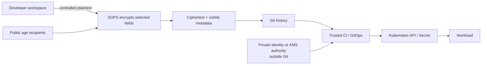
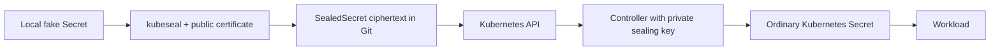
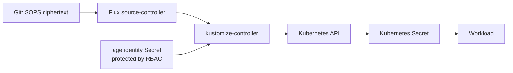

# 05 — SOPS, Sealed Secrets, and Encrypted Secrets in Git

> **Module:** M09 — Secrets and Identity Management · **Unit:** 5\
> **Audience:** Data/AI engineers familiar with Kubernetes, CI, Git,
> Helm/Kustomize, Terraform state and GitOps.\
> **Progression:** L1 foundations → L2 workflows → L3 key custody/design
> → L4 production operations.\
> **Honesty note:** Commands and examples are instructional.
> Release-sensitive items are marked `[VERIFY]` or
> `[VERSION-SENSITIVE]`. Expected results are not author-observed
> results.

## 5.0 — Module Orientation, Scope, Prerequisites, and Lab Budget

This unit teaches two ways to keep plaintext credentials out of Git
while preserving declarative workflows:

-   **SOPS + age:** encrypt selected values in a structured file.
    Decryption authority remains outside Git and may be held by an
    authorized operator, CI/GitOps controller, or supported
    key-management integration.
-   **Sealed Secrets:** `kubeseal` encrypts a Kubernetes Secret for a
    controller's public certificate; the controller holds the private
    sealing key and reconciles a `SealedSecret` into an ordinary
    Kubernetes `Secret`.

Neither pattern eliminates plaintext at runtime or replaces credential
rotation, access control, audit, backup protection, or incident
response.

### Learning outcomes

You will be able to explain encrypted-in-Git and its difference from
external references; configure and validate SOPS + age; distinguish
recipient updates, data-key rotation, controller-key rotation, and
underlying credential rotation; seal a Kubernetes Secret with strict
scope; protect and restore decryption keys; explain Flux/Argo CD
integration risks; compare SOPS, Sealed Secrets, ESO, CSI Secret Store
and Vault Agent; and produce safe evidence without exposing values.

### Scope boundaries

  --------------------------------------------------------------------------
  Topic                     Coverage here            Related unit
  ------------------------- ------------------------ -----------------------
  Threat model/lifecycle    Encrypted-Git-specific   M09 Unit 1
                            risks                    

  Vault                     Awareness only           Unit 2
  architecture/Transit                               

  Dynamic                   Explain that file        Unit 3
  credentials/leases        encryption does not      
                            rotate credentials       

  External manager          Comparison and decision  Unit 4
  references                boundary                 

  Kubernetes Secret RBAC,   Comparison;              Unit 6
  at-rest encryption,       implementation elsewhere 
  etcd/backups, CSI                                  

  Workload identity/OIDC    Bootstrap/KMS awareness  Unit 7

  Leak response and         Incident handoff         Unit 8
  credential rotation                                

  GitOps, Helm/Kustomize,   Practical interface      M06/M07/M08
  IaC                                                

  Policy-as-code/platform   Forward reference        M12/M16
  golden paths                                       
  --------------------------------------------------------------------------

### Zero-budget environment

Core labs use WSL2 Ubuntu or native Linux, Docker, `kind`, Git, SOPS,
age, `kubectl`, and (for Lab 2) `kubeseal`. No real cloud account, paid
KMS, production cluster, or real credential is required. Cloud KMS,
Vault Transit, and plugin integrations are awareness-only unless you
independently provision a sandbox.

**\[ASSUMPTION\] Resource footprint:** SOPS + age alone needs little
beyond binaries and temporary files. A disposable `kind` cluster plus
Sealed Secrets controller commonly uses hundreds of MB to around 1 GB
depending on image cache and local configuration. Measure actual usage;
this is not a guarantee.

Check versions without revealing secret material:

``` bash
git --version
kubectl version --client
kind version
docker version --format '{{.Client.Version}}'
sops --version
age --version
kubeseal --version
```

Only run commands for tools you have installed. Verify the selected
versions against official compatibility/release notes.

### Safety rules

-   Use only fake, disposable values and keys.
-   Never commit private age identities, controller sealing keys,
    kubeconfigs, cloud credentials, or decrypted manifests.
-   Never use `kubectl get secret -o yaml`, `kubectl describe secret`,
    `cat` on private keys, `env`, `printenv`, or terminal output of
    decrypted YAML as verification.
-   Do not enable shell tracing (`set -x`) around secret operations.
-   Keep plaintext temp files outside the repository, restrict
    permissions, and inspect editor swap files, shell history and CI
    artifacts separately.
-   A Sealed Secrets key backup is a high-value secret; never place it
    in Git or an unencrypted shared workspace.
-   Deleting a file or rewriting Git history does not revoke credentials
    or erase copies already held by others.
-   No lab below is represented as executed by the author.

### Glossary

  -----------------------------------------------------------------------
  Term                                Meaning
  ----------------------------------- -----------------------------------
  Plaintext / ciphertext              Readable data before encryption /
                                      encrypted representation

  age recipient / identity            Public encryption key / private
                                      decryption key material

  Data key / key wrapping             File-encryption key / protecting
                                      that key for recipients or KMS

  MAC / integrity metadata            Mechanism for detecting modified or
                                      inconsistent encrypted content

  Key custody                         Controls over key creation,
                                      storage, use, backup, recovery,
                                      rotation and destruction

  Scope                               Name/namespace binding behavior for
                                      a Sealed Secret

  Reconciliation                      Controller convergence of declared
                                      and actual state

  Bootstrap / secret-zero             Initial trusted delivery of
                                      decryption authority

  Blast radius                        Systems/values exposed if a key,
                                      identity or controller is
                                      compromised
  -----------------------------------------------------------------------

## 5.1 — L1 Foundations: The Encrypted-in-Git Pattern and Threat Model

### Pattern and data flow

Encrypted-in-Git means committing ciphertext while keeping the authority
to decrypt outside the repository. Git remains the declarative history,
but a trusted operator or controller must decrypt before the consumer
can use the value.



**Trust boundary:** repository readers may see ciphertext, file paths,
resource names, key names, sizes and change timing. Decryption authority
belongs to the private identity, KMS permissions, or controller key. A
compromised workstation or authorized decryption process may see
plaintext.

### Encrypted file vs external-manager reference

  -----------------------------------------------------------------------
  Property                SOPS / Sealed Secrets   External reference (M09
                                                  Unit 4 / ESO)
  ----------------------- ----------------------- -----------------------
  Git content             Ciphertext or sealed    Reference/path and
                          resource                configuration

  Source of truth         Encrypted file plus key External manager
                          policy                  

  Runtime dependency      Decryption workflow and Backend/provider access
                          key custody             for fetch or sync

  Rotation                Re-encrypt/reseal and   Update backend,
                          separately rotate the   synchronize and reload
                          credential              consumer

  History                 Ciphertext and metadata References persist;
                          persist                 avoid values in Git

  Main burden             Key custody, recovery,  Backend identity,
                          rule/scope correctness  policy, refresh and
                                                  consumer behavior

  Typical fit             Declarative             Centralized lifecycle,
                          configuration where     multi-consumer sharing
                          ciphertext in Git is    or dynamic credentials
                          acceptable              
  -----------------------------------------------------------------------

### Threat model

  -----------------------------------------------------------------------
  Threat/failure          Exposure                Controls
  ----------------------- ----------------------- -----------------------
  Private age identity    Ciphertext in scope of  Rotate underlying
  committed               that identity may be    values, remove identity
                          decrypted               from current policy,
                                                  assess history/copies

  CI decryption identity  Every file it can       Separate by
  over-scoped             decrypt                 environment/path;
                                                  isolated trusted runner

  Encryption rule misses  Plaintext inside an     Schema-aware CI checks
  a field                 otherwise encrypted     and negative fixtures
                          file                    

  Controller key lost     Existing sealed         Protected off-cluster
                          ciphertext may be       backup and restore
                          unrecoverable           drills

  Controller key stolen   Ciphertext sealed to it Contain, rotate
                          may be exposed          credentials, re-seal
                                                  and assess history

  Plaintext temp file     Workspace, swap, backup Restricted temp paths,
  remains                 or artifact exposure    cleanup and workspace
                                                  audits

  GitOps controller       Decrypted values and    Minimal RBAC, hardened
  compromised             deployed Secrets        controller, audit and
                                                  network boundaries

  Former recipient        Old ciphertext may      Access review, rotate
  retains old identity    remain decryptable      live credentials,
                                                  assess historical
                                                  exposure
  -----------------------------------------------------------------------

Encryption does not hide every field, erase Git history, prevent
ciphertext from being copied, or protect a value after it is
materialized in Kubernetes. A Kubernetes Secret remains subject to RBAC,
etcd encryption, backups, node access and workload-process exposure
(Unit 6).

### Rotation operations are different

1.  **Recipient update:** change which identities are authorized for
    current SOPS ciphertext.
2.  **SOPS data-key rotation:** generate new file-encryption key
    material and re-encrypt values.
3.  **Sealed Secrets controller-key rotation:** renew or change
    controller sealing keys according to the installed release.
4.  **Underlying credential rotation:** change the
    password/token/certificate at the service that accepts it.

If a private key is compromised, re-encryption alone does not revoke
plaintext already obtained. Rotate the actual credential and assess old
ciphertext and copies. History rewriting is secondary hygiene, not
containment.

## 5.2 — L1 Foundations: age, SOPS, and Sealed Secrets Architecture

### age

A public age recipient can be shared with people who need to encrypt.
The private identity is secret decryption material and must not be
committed. Generate identities with the official tool; do not handcraft
them.

**\[VERSION-SENSITIVE\]** Verify current `age-keygen` syntax and
identity format at <https://github.com/FiloSottile/age>. Public
recipient derivation commonly uses `age-keygen -y IDENTITY_FILE`;
confirm with the installed version.

### SOPS

SOPS (Secrets OPerationS) encrypts selected values in supported
structured/text formats. A Kubernetes Secret file may keep `apiVersion`,
`kind`, `metadata` and key structure visible while encrypting
`data`/`stringData` values. The exact configuration is
release-dependent.

Illustrative policy pattern:

``` yaml
creation_rules:
  - path_regex: '(^|/)environments/dev/.*\.secret\.ya?ml$'
    age: >-
      age1REPLACE_WITH_PUBLIC_DEV_RECIPIENT_A,
      age1REPLACE_WITH_PUBLIC_DEV_RECIPIENT_B
    encrypted_regex: '^(data|stringData)$'
  - path_regex: '(^|/)environments/prod/.*\.secret\.ya?ml$'
    age: >-
      age1REPLACE_WITH_PUBLIC_PROD_RECIPIENT_A,
      age1REPLACE_WITH_PUBLIC_PROD_RECIPIENT_B
    encrypted_regex: '^(data|stringData)$'
```

**Illustrative only:** replace placeholders with public recipients
generated for the lab; they are intentionally invalid. Verify
`.sops.yaml` schema, path matching, rule order/precedence and supported
fields for the installed release. Keep dev and prod recipients distinct.

-   `path_regex` selects files/rules.
-   `encrypted_regex` selects matching key names, often `data` and
    `stringData`.
-   `encrypted_suffix` is another selection mechanism where supported.
    **\[VERIFY\]** Check exact schema and interaction with other rules.
-   A rule miss can leave a sensitive field in plaintext. SOPS metadata
    does not prove every sensitive field was encrypted.
-   SOPS integrity/MAC metadata can detect unauthorized modification or
    inconsistent encrypted content, but does not prove a value is
    current or safe to deploy.

SOPS documentation: <https://getsops.io/docs/> and
<https://github.com/age-sops/sops>.

### Sealed Secrets

The client `kubeseal` encrypts a Kubernetes Secret for the controller's
public certificate. The controller holds the private sealing key and
reconciles a `SealedSecret` custom resource into an ordinary Kubernetes
Secret.



The generated Secret is not invisible to authorized cluster actors.
Controller-key custody and Kubernetes RBAC are critical.

  -----------------------------------------------------------------------
  Scope                   Meaning                 Risk
  ----------------------- ----------------------- -----------------------
  `strict`                Binds ciphertext to     Safer default for
                          intended name and       avoiding unintended
                          namespace               reuse

  `namespace-wide`        Allows renaming within  Broader reuse
                          a namespace             

  `cluster-wide`          Allows reuse across     Largest scope/blast
                          names/namespaces        radius
  -----------------------------------------------------------------------

**\[VERSION-SENSITIVE\]** The project documentation describes these
scopes and corresponding `kubeseal` options/annotations; verify exact
flags and behavior for the pinned release:
<https://github.com/bitnami/sealed-secrets>. Use strict scope unless a
reviewed requirement justifies another.

### Architecture comparison

  ------------------------------------------------------------------------
  Dimension               SOPS + age               Sealed Secrets
  ----------------------- ------------------------ -----------------------
  Encrypt                 Workstation/controlled   Client via `kubeseal`
                          CI                       

  Decrypt                 Authorized operator,     In-cluster controller
                          CI/GitOps or supported   
                          KMS path                 

  Decryption authority    Private identity/KMS     Controller private key
                          permission               

  Git object              Encrypted structured     `SealedSecret` CR
                          file                     

  Recovery dependency     Age identity/KMS access  Correct controller key
                                                   set

  Main trap               Misconfigured rule or    Key loss, broad scope
                          identity leakage         or poor backup
  ------------------------------------------------------------------------

## 5.3 — L2 Hands-On: SOPS + age and `.sops.yaml`

### Create a protected workspace

``` bash
umask 077
mkdir -p "$HOME/.local/share/m09-unit5-lab"
chmod 700 "$HOME/.local/share/m09-unit5-lab"
mkdir -p "$HOME/m09-unit5-lab-repo"
cd "$HOME/m09-unit5-lab-repo"
git init
```

Keep private identities and plaintext outside the repository.

### Generate two custodians and a non-recipient

**\[VERIFY\]** Check `age-keygen --help` first.

``` bash
age-keygen -o "$HOME/.local/share/m09-unit5-lab/custodian-a.agekey"
age-keygen -o "$HOME/.local/share/m09-unit5-lab/custodian-b.agekey"
age-keygen -o "$HOME/.local/share/m09-unit5-lab/nonrecipient.agekey"
chmod 600 "$HOME/.local/share/m09-unit5-lab/"*.agekey
age-keygen -y "$HOME/.local/share/m09-unit5-lab/custodian-a.agekey"
age-keygen -y "$HOME/.local/share/m09-unit5-lab/custodian-b.agekey"
age-keygen -y "$HOME/.local/share/m09-unit5-lab/nonrecipient.agekey"
```

The final commands output public recipients only. Copy public recipient
strings---not private identities---into a local `.sops.yaml`.

### Create a fake Secret outside Git

Create `$HOME/.local/share/m09-unit5-lab/plaintext/api.secret.yaml` with
mode-restricted parent directory:

``` yaml
apiVersion: v1
kind: Secret
metadata:
  name: demo-api
  namespace: demo-dev
type: Opaque
stringData:
  DB_USER: lab_reader
  DB_PASSWORD: FAKE_ONLY_DB_PASSWORD_6f2a
  SERVICE_API_KEY: FAKE_ONLY_API_KEY_94c1
```

Create repository paths such as `environments/dev/` and
`environments/prod/`. Use the policy in §5.2 with real public recipients
generated for the lab. **\[VERIFY\]** SOPS may select rules based on the
input path/config; do not assume moving an encrypted file changes its
recipients. Verify which rule is selected and use a protected temp path
that matches the intended rule or a documented explicit recipient
option.

Encrypt with syntax verified for the installed SOPS release:

``` bash
sops --encrypt "$HOME/.local/share/m09-unit5-lab/plaintext/api.secret.yaml" \
  > environments/dev/api.secret.yaml
```

This command is a pattern, not a guarantee that the correct path rule
was selected. Check official docs and test the rule before using the
output. Do not commit until you confirm only intended fields are
ciphertext.

### Safe verification and negative test

Use metadata-only checks:

``` bash
git status --short
git diff --stat
```

Do not print decrypted YAML. A controlled check may decrypt to a
mode-restricted temp file outside the repo, run schema/policy validation
that emits only PASS/FAIL, then remove the file. **\[VERIFY\]** Confirm
SOPS options and `SOPS_AGE_KEY_FILE` behavior in the installed release
before use.

Expected outcomes: - Custodian A decrypts current ciphertext: pass. -
Custodian B decrypts current ciphertext: pass. - Non-recipient identity
fails to decrypt: denied. - A fixture whose sensitive field is missed by
`encrypted_regex` is caught by CI. - After a verified recipient update,
a removed recipient should not decrypt the updated file if the data key
is no longer wrapped for that identity; historical commits may remain
decryptable.

Record exit status/error category only, never decrypted values or
private key contents.

### Editing, updatekeys and rotation

Use `sops FILE` for controlled editing only after verifying the editor
workflow and swap-file behavior. Alternatively decrypt to a protected
temp location, edit the fake value, and re-encrypt with the intended
policy.

-   `sops updatekeys FILE`: updates recipients/key-wrapping metadata
    according to configured rules. **\[VERSION-SENSITIVE\]** Verify
    syntax and confirmation behavior.
-   `sops rotate -i FILE`: SOPS documents this as rotating data-key
    material and re-encrypting values. **\[VERSION-SENSITIVE\]** Verify
    in-place flags and exact semantics.
-   Neither operation rotates a live password or removes historical
    ciphertext.

Official sources: <https://getsops.io/docs/> and
<https://github.com/age-sops/sops>.

## 5.4 — L2 Hands-On: Safe Editing, Git Diffs, and Plaintext-Leak Prevention

### A missed-field example

Never commit this illustrative unsafe fixture:

``` yaml
apiVersion: v1
kind: Secret
metadata:
  name: intentionally-unsafe-demo
  namespace: demo-dev
type: Opaque
stringData:
  DB_PASSWORD: ENC[illustrative-ciphertext-not-real]
  apiToken: FAKE_ONLY_MISSED_FIELD_1d83
```

The fake `apiToken` is deliberately plaintext to show that an encryption
rule may match `DB_PASSWORD` or one parent field while missing another.
The `ENC[...]` text above is not valid ciphertext.

### CI / pre-commit controls

A pipeline should: 1. Reject unencrypted Kubernetes Secret manifests in
protected paths unless explicitly allow-listed. 2. Validate SOPS
metadata/integrity using a version-verified command. 3. Detect known
sensitive fields that appear unencrypted. 4. Validate decrypted
content/schema in a trusted isolated job, preferably in memory. 5. Emit
only file path, field path and PASS/FAIL---not the value. 6. Keep
decryption identities out of untrusted pull-request jobs. 7. Pin tool
versions and verify official checksums/signatures where published.

Illustrative policy pseudocode (not a runnable parser):

``` python
for file in protected_secret_paths:
    parsed = parse_yaml_safely(file)
    if parsed.get("kind") == "Secret" and not has_valid_sops_metadata(file):
        fail("unencrypted Secret manifest: " + file)
    for field_path, value in enumerate_sensitive_fields(parsed):
        if looks_like_plaintext(value):
            fail(f"possible plaintext field at {file}:{field_path}")
```

Use a maintained YAML parser and a documented SOPS validation interface
in a real pipeline. Regex checks alone do not prove all fields are
encrypted.

### Git hygiene

Example ignore entries, scoped to your lab:

``` gitignore
*.agekey
*.plaintext.yaml
*.decrypted.yaml
.env
```

Do not blindly ignore public certificates if your repository
legitimately tracks them. `.gitignore` does not remove already tracked
files. Check:

``` bash
git status --short
git ls-files
```

Keep temp plaintext outside Git. `rm` is not proof of secure erasure on
SSDs, snapshots, backups or copy-on-write filesystems. Inspect shell
history, editor swap files, temp folders and CI artifacts separately.

### Safe validation workflow

A controlled validation can decrypt to a private temporary directory
outside the repo, run a schema validator that prints only a result, and
remove the temp file. This still creates a brief plaintext-on-disk
exposure window. Higher-assurance CI should validate in memory and avoid
persisting artifacts.

If integrity validation fails, stop deployment and investigate
provenance. Do not bypass checks or manually edit SOPS metadata.

## 5.5 — L2 Hands-On: Sealed Secrets on kind and Scope Semantics

### Install and verify

**\[VERIFY\]** Follow the official Sealed Secrets release instructions,
pin controller/chart and matching `kubeseal`, and verify compatibility.
Do not invent chart values or assume latest is compatible.

``` bash
kind create cluster --name m09-sealed-lab
kubectl cluster-info --context kind-m09-sealed-lab
```

Install the official controller using the pinned release's instructions.
Then verify controller/CRD status without reading Secret values:

``` bash
kubectl get deployments -A
kubectl get crd | grep -i sealedsecret
kubectl get pods -A
```

### Seal a fake Secret

Create a fake Secret manifest outside Git:

``` yaml
apiVersion: v1
kind: Secret
metadata:
  name: demo-api
  namespace: demo-sealed
type: Opaque
stringData:
  DB_PASSWORD: FAKE_ONLY_SEALED_PASSWORD_7c21
```

Fetch the controller certificate to a protected local path and verify it
belongs to this cluster. **\[VERSION-SENSITIVE\]** Confirm flags and
controller namespace:

``` bash
kubectl create namespace demo-sealed
kubeseal --fetch-cert > "$HOME/.local/share/m09-unit5-lab/sealed-controller-cert.pem"
chmod 600 "$HOME/.local/share/m09-unit5-lab/sealed-controller-cert.pem"
kubeseal --format yaml --cert "$HOME/.local/share/m09-unit5-lab/sealed-controller-cert.pem" \
  --scope strict < "$HOME/.local/share/m09-unit5-lab/plaintext/sealed-demo.secret.yaml" \
  > "$HOME/.local/share/m09-unit5-lab/sealed-demo.yaml"
kubectl apply -f "$HOME/.local/share/m09-unit5-lab/sealed-demo.yaml"
kubectl get sealedsecrets -n demo-sealed
kubectl get secret demo-api -n demo-sealed
```

Do not run `kubectl get secret -o yaml` or `describe secret`. Inspect
only target existence, metadata and key names with a purpose-built
script that does not print values.

### Strict scope and recovery

For a negative test, change the `SealedSecret` name or namespace in a
disposable copy. **Expected result:** strict-scope decryption fails. Do
not switch to cluster-wide scope merely to make the test pass.

Controller-key backup/restore is release-specific. Follow the official
project's verified selector and procedure for the chosen controller
deployment. The backup contains private key material; restrict access,
encrypt it independently, keep it outside Git, and restore it before
normal reconciliation in a new disposable cluster. Then reapply old
ciphertext and verify target existence/workload pass-fail without
showing values.

A separate no-backup test uses ciphertext from cluster A in a new
cluster B without A's key. **Expected result:** it cannot be decrypted
by B's unrelated key. Do not use real values or delete production keys.

The Sealed Secrets project documents scope, key renewal/retention and
re-encryption behavior at <https://github.com/bitnami/sealed-secrets>.
Verify exact flags, namespaces, selectors and restore order for your
release. Re-encryption of current files does not erase old ciphertext or
rotate underlying credentials.


## 5.6 — L2 GitOps: Flux Decryption and Argo CD Options

### Flux native SOPS decryption

Flux's Kustomize controller supports SOPS decryption. **[VERSION-SENSITIVE]** Verify the installed Flux Kustomization API, `spec.decryption` fields, provider value and identity Secret schema at <https://fluxcd.io/flux/components/kustomize/kustomizations/>.

Illustrative configuration only:

```yaml
apiVersion: kustomize.toolkit.fluxcd.io/v1
kind: Kustomization
metadata:
  name: app-config
  namespace: flux-system
spec:
  interval: 10m
  path: ./clusters/dev/apps
  prune: true
  sourceRef:
    kind: GitRepository
    name: platform-config
  decryption:
    provider: sops
    secretRef:
      name: sops-age-keys
```

This is not a claim that the fields match every Flux release. Validate the installed CRD schema and use the release-matched documentation. The identity Secret must be created through a separate trusted bootstrap path; never commit the age private identity or a plaintext manifest containing it.

Protect the identity Secret with namespace-scoped RBAC, Kubernetes encryption at rest and backup controls (Unit 6), minimal controller permissions, audit of reads and changes, and a recovery plan. Flux decryption does not protect the identity from a cluster administrator or a compromised controller that can read it.

**Data flow:**



**Negative test:** remove or misconfigure the identity in a disposable setup. Expected result: reconciliation reports decryption failure and does not successfully apply the decrypted resource. Confirm status condition names and messages for the installed release; do not assume exact wording.

### Argo CD options

Argo CD patterns vary by version, plugin, and organizational architecture. Verify current support before choosing one.

| Approach | Benefit | Risks / checks |
|---|---|---|
| Config Management Plugin (CMP) / sidecar | Integrates a custom render/decrypt flow | Plugin executes code; verify image provenance, version, permissions, filesystem/network access and plaintext lifetime |
| KSOPS or similar Kustomize integration | Fits Kustomize workflows | Release compatibility, plugin maintenance, identity delivery and debugging exposure |
| helm-secrets plugin | Supports encrypted Helm values workflows | Plugin supply chain, Helm compatibility, temporary plaintext, release storage and debug output |
| ESO / external manager | Centralized runtime source | Backend/provider identity and connectivity; see Unit 4 |
| Other/native integration | May reduce custom glue if officially supported | Do not assume support; verify current official docs and release notes |

Plugins are executable code, not passive configuration. Pin versions, verify integrity, limit permissions, and prevent untrusted pull-request code from accessing decryption material. Do not claim one plugin is the universal current recommendation.

### Bootstrap / secret-zero

A controller cannot decrypt SOPS files until a trusted identity is available. That initial delivery is the bootstrap problem. Options include an operator injecting a private identity through a restricted out-of-band process, a separate secret manager, or workload identity/KMS where supported. Every option has an initial trust dependency.

CI should use a scoped identity and isolated runner. Do not expose production decryption authority to untrusted pull-request code. Workload identity/OIDC can avoid long-lived cloud credentials in supported setups, but the exact flow belongs to Unit 7 and must be verified against the CI provider and cloud.

---

## 5.7 — L3 Key Custody, Recipients, Rotation, and Separation of Duties

### Key custody options

| Option | Benefit | Risks and controls |
|---|---|---|
| Restricted local identity file | Simple, zero-budget development | Workstation loss, backups, accidental commit; use disposable keys and restrictive permissions |
| Offline encrypted recovery copy | Helps with workstation/account loss | Custody and restore must be tested; avoid a single-person recovery dependency |
| Hardware-backed custody | May reduce exportability where supported | Hardware availability, integration and recovery complexity |
| Secret manager | Centralized policy and audit | Bootstrap/runtime dependency, permissions and availability |
| KMS-backed SOPS | Centralized IAM/audit; may avoid distributing a local private identity | IAM, provider integration, KMS availability, cost and permissions must be verified |
| Vault Transit integration | Centralized crypto service where supported | Transit policy and service availability become dependencies; verify SOPS/provider support |
| Sealed Secrets controller key | Local controller decryption authority | Backup is high-value; controller compromise or key loss affects ciphertext |

KMS and Vault Transit are awareness-only in the zero-budget core path. Verify exact integration, authentication, permissions and syntax in the official SOPS docs.

### Multiple custodians and environment separation

At least two authorized custodians should be able to recover critical configuration, but every added recipient expands the set of parties able to decrypt. Do not grant every developer production decryption rights merely to improve availability.

**[ASSUMPTION]** A reasonable starting model is:
- dev files use dev recipients;
- prod files use a separately reviewed production recipient set;
- production decryption runs only in a protected workflow;
- recovery identities are separate from daily-use identities;
- access is reviewed after personnel changes and on a defined cadence;
- recovery is tested periodically.

A quarterly access review is a possible policy choice, not a universal requirement.

### Distinguish rotation operations

| Operation | Purpose | Does not do |
|---|---|---|
| `sops updatekeys FILE` | Updates recipients/key-wrapping metadata based on configured rules; verify exact behavior | Does not rotate a database password or API token |
| `sops rotate -i FILE` | SOPS documents this as generating new data-key material and re-encrypting values | Does not invalidate old credentials or erase history |
| `sops --encrypt` | Encrypts selected content under configured recipients | Does not prove every sensitive field was selected |
| Underlying credential rotation | Changes the value accepted by the service | Does not remove old ciphertext/private keys from history |
| Sealed Secrets controller-key renewal | Changes controller sealing-key lifecycle according to release behavior | Does not rotate actual credentials |
| Sealed Secrets re-encryption | Re-seals current resource ciphertext using a newer key where supported | Does not erase old ciphertext or invalidate credentials |

**[VERSION-SENSITIVE]** Verify SOPS command flags, in-place behavior and confirmation semantics in the installed release. The project distinguishes `updatekeys` from `rotate`; do not infer exact behavior from old blog posts.

A former recipient may still decrypt historical ciphertext if they retain the old identity. If old values remain valid or exposure is plausible, rotate the actual credentials.

### Sealed Secrets key renewal

Renewal, retention, key labels and re-encryption workflows depend on controller version and configuration. The project documents a renewal model in which new key material is used for new seals while old keys may remain necessary for existing ciphertext. Verify the pinned release and deployment method before changing or deleting keys.

If a sealing key is compromised:
1. Restrict access and investigate exposure.
2. Follow the official release-specific early-renewal/re-encryption guidance.
3. Rotate actual passwords/tokens/certificates.
4. Re-seal current manifests using the approved key.
5. Assess old Git revisions, backups, clones and copied ciphertext.
6. Retain only keys required by the approved recovery policy.

Do not delete old keys just because a new key exists.

### Separation of duties

Developers may encrypt with public recipients without permission to decrypt production. Reviewers inspect paths, recipients, metadata and policy. A scoped CI/GitOps identity decrypts only what it needs. Key custodians approve recipient changes and maintain recovery. Application owners rotate credentials and verify consumers. Small teams may combine roles, but the overlap and compensating controls should be explicit.

---

## 5.8 — L3 Threat Modeling, Disaster Recovery, and Key Loss

### Ciphertext persists

Git is designed to preserve history. Ciphertext may remain in commits, tags, branches, forks, CI caches, artifacts, backups and developer clones after the current file changes. Rewriting history cannot remove copies already held by others. An attacker can retain ciphertext now and wait for a future compromise of an identity or key service.

Paths and metadata can themselves be sensitive. Prefer neutral file names when resource names reveal high-value systems or secret purpose.

**Rule:** history cleanup is secondary hygiene. Rotate any credential that may have been exposed and follow Unit 8.

### SOPS recovery

Document which identity can decrypt which path, where primary/recovery identities are held, who approves access, how use is audited, and how recovery is tested in a clean environment. A private identity backup is itself sensitive. Encrypt it with an independent approved mechanism and separate custodians where feasible. Test recovery without displaying plaintext.

### Sealed Secrets recovery

A controller's private sealing key is required for corresponding ciphertext. Do not assume a Kubernetes backup contains the required keys; verify backup selection and protection. Recovery should include protected off-cluster key material, release-specific restore order, compatible controller/CRD versions, a clean-cluster test and a workload pass/fail check.

A shared sealing key across clusters can simplify portability but increases blast radius. Per-cluster keys improve isolation but complicate migration and recovery. Verify exact support and implications before sharing keys.

### No-backup failure mode

In a disposable test, create ciphertext for cluster A, create cluster B without restoring A's private key, and apply the old ciphertext. Expected result: B cannot decrypt ciphertext that requires A's key. If no approved recovery key or KMS access exists in a real incident, recovery may require creating new underlying credentials, resealing them and deploying them.

### Backup controls

- Encrypt backups with an independent approved mechanism.
- Limit readers; require approval for restore.
- Keep backups outside Git and separate from daily-use keys.
- Record access and recovery metadata, never private key contents.
- Define retention/destruction policy and test restore.
- Refresh backups after key renewal if official instructions require it.
- Include snapshots and etcd backups in the threat model.
- Document which credentials must be regenerated if all recovery material is lost.

---

## 5.9 — L3 Decision Matrix: SOPS vs Sealed Secrets vs ESO vs CSI vs Vault Agent

Exact behavior depends on versions, provider, mount settings, application reload behavior and identity configuration. See Unit 4 for ESO and Unit 6 for CSI/Kubernetes Secret protection.

| Dimension | SOPS | Sealed Secrets | ESO | CSI Secret Store | Vault Agent / injection |
|---|---|---|---|---|---|
| Source of truth | Encrypted file + key policy | Sealed resource + controller key | External manager | External manager/provider | Vault/configured source |
| GitOps fit | Encrypted structured files | Kubernetes sealed resources | Declarative references | Depends on driver/provider | Depends on injection/agent design |
| Ciphertext in Git | Yes | Yes | Usually references only | Usually references only | Usually references only |
| Decryption/retrieval point | Workstation, CI, controller or KMS flow | In-cluster controller | ESO controller syncs values | Node/pod mount path, provider-dependent | Agent/init/sidecar/injector path |
| Kubernetes Secret created | Often, depending on apply workflow | Yes | Typical target-secret pattern | Not necessarily; sync-to-Secret is configuration-dependent `[VERIFY]` | Not necessarily |
| Dynamic secrets | Not inherent | Not inherent | Backend/provider-dependent | Provider-dependent | Vault lease workflows may be supported |
| Rotation | Re-encrypt and separately rotate credential | Re-seal and separately rotate credential | Refresh + consumer reload | Provider refresh + app behavior | Agent/template renewal + app behavior |
| Runtime backend dependency | Decryption workflow dependency | Controller key for reconciliation | Backend required for sync | Backend/provider required for retrieval/refresh | Vault/source typically required |
| Key burden | Age/KMS custody and recovery | Controller key backup/restore | Backend identity and policy | Provider/workload identity and driver | Vault auth/policy and agent operations |
| Audit | Git + decryption/KMS logs if configured | Git + Kubernetes/controller audit | Backend + Kubernetes audit if configured | Provider + driver logs | Vault audit + Kubernetes/injector logs |
| Multi-cluster | Design recipients/key access per environment | Ciphertext depends on key/scope assumptions | Configure identity/store per cluster | Configure provider per cluster | Configure auth/connectivity per cluster |
| Backend outage | Existing deployments may continue; new decryption may fail | Existing Secret may remain; new reconciliation/recovery may fail | Last-synced value may remain stale | Existing mount/refresh varies | Cache/renewal behavior depends on configuration |
| Blast radius | Identities able to decrypt affected files | Controller private key and scope | Store identity and who can create references | Provider identity/node/driver access | Vault policy and agent/injector privilege |
| Best fit | Reviewed ciphertext-in-Git | Kubernetes-specific sealed resources | Centralized manager and declarative refs | Avoiding Secret materialization where supported | Vault-native injection/templates/dynamic credentials |

### Three organization profiles

**Small team with limited platform capacity — [ASSUMPTION].** SOPS + age can be practical if the team can manage two custodians, environment separation and recovery. Sealed Secrets is reasonable for Kubernetes-only workflows if controller-key backup/restore is owned. If a managed secret backend already exists, ESO may reduce local key-file custody. Avoid building a custom plugin stack for a handful of files without an owner.

**Many clusters/environments — [ASSUMPTION].** Separate identities/recipients and policies by environment. SOPS can work with centrally governed recipients or supported KMS. Per-cluster Sealed Secrets keys improve isolation but require migration/DR. ESO or CSI may fit centralized runtime management, but identity/provider setup remains per cluster. Avoid universal shared identities and broad cluster-wide scope.

**Regulated organization — [ASSUMPTION].** Choose based on evidence: approved custodians, access reviews, audit, recovery drills, separation of duties and actual credential rotation. KMS-backed SOPS or an external manager may fit if IAM and audit are already operated well; this is not automatic compliance. Sealed Secrets needs rigorous key backup and restore. Encryption without tested recovery is incomplete.

### Non-Kubernetes use cases

- **Terraform:** encrypted variables do not prevent sensitive values from appearing in state, plans or artifacts. State backend access/retention remain critical (M07).
- **Ansible Vault:** separate encryption workflow; do not assume key compatibility with SOPS.
- **Helm values:** helm-secrets can help, but assess plugin supply chain, temp plaintext, Helm release storage and debug output.
- **CI jobs:** use short-lived/scoped identity where possible; isolate decryption and avoid production identities in untrusted PR code.
- **Bootstrap:** explicitly document how the first trusted identity reaches the controller.

---

## 5.10 — L4 Production Operations, CI Controls, Access Reviews, and Migration

### Repository and review workflow

Use predictable paths and ownership, for example:

```text
environments/
  dev/apps/api.secret.yaml
  staging/apps/api.secret.yaml
  prod/apps/api.secret.yaml
.sops.yaml
```

Match rules to actual paths and test each one. Require appropriate reviewers for `.sops.yaml`, production recipient changes, GitOps decryption configuration and controller manifests.

Reviewers can inspect resource kind/name/namespace, expected key names, file path, recipient policy, metadata/integrity checks, schema/policy outcomes, owner and rollout/rollback plan. Do not attach decrypted YAML to a pull request.

### CI validation layers

1. **Static phase without decryption identity:** lint paths, require SOPS metadata where expected, reject unencrypted Secret manifests, scan obvious patterns and pin dependencies.
2. **Trusted validation phase:** run only in a protected context; decrypt using scoped identity, validate schema/policy in memory where possible, emit only PASS/FAIL and non-sensitive paths.
3. **Deployment:** apply after review; constrain controller RBAC and audit changes.
4. **Post-deploy:** verify application authentication/health, not credential value.

Untrusted pull-request code must not access production decryption material; a modified validation script could exfiltrate anything the job can decrypt.

### Access review

Inventory:
- repository path/environment → approved recipients;
- recipient → owner/custodian and recovery method;
- KMS key/role → permitted paths/actions;
- Flux/Argo controller → resources it can decrypt;
- Sealed Secrets cluster → key backup and recovery owner;
- former employees/service accounts → removal status.

Review after role changes and on a defined cadence. Quarterly is a possible policy assumption, not a universal requirement. Keep review records without private keys or plaintext.

### Migration playbooks

**Plaintext Secret → SOPS**
1. Inventory consumers, owners, key names and reload behavior.
2. If values may have been exposed, rotate the underlying credential.
3. Create scoped recipients and tested `.sops.yaml` rules.
4. Encrypt from a protected temporary location.
5. Validate integrity/schema without displaying values.
6. Review ciphertext diff and recipients.
7. Update the GitOps decryption/apply flow.
8. Verify workload authentication.
9. Remove active plaintext and inspect tracked/untracked files, swap files and artifacts.
10. If plaintext was committed, follow Unit 8; current-file deletion is insufficient.
11. Roll back only to a known-safe credential version.

**Sealed Secrets → ESO**
1. Inventory `SealedSecret`, target Secret, consumers, scope and key dependencies.
2. Establish approved backend and least-privilege identity (Unit 4).
3. Import/rotate the value through a controlled path.
4. Create `ExternalSecret` with verified store/path/creation semantics.
5. Verify target metadata and workload behavior.
6. Prevent both controllers from fighting over one target Secret.
7. Confirm refresh and consumer reload.
8. Remove old resource only after validating the new source and rollback.
9. Review history and rotate exposed values.

**SOPS age → KMS-backed SOPS**
1. Verify support in the installed SOPS release.
2. Define IAM, key policy, audit, region/availability and recovery.
3. Test with a disposable identity.
4. Add the KMS recipient/key using documented operations.
5. Test allowed and denied access.
6. Roll out by environment with recovery retained.
7. Remove obsolete identities only after migration and recovery testing.
8. Verify quotas/cost/outage dependency; do not assume free availability.

**Sealed Secrets cluster migration**
1. Decide per-cluster key versus approved shared/recovered key.
2. Verify compatibility and restore instructions.
3. Back up key material securely.
4. Restore into a disposable destination before reconciliation and test old ciphertext.
5. If using a new key, reseal for destination; do not assume portability.
6. Rotate underlying credentials if exposure is suspected.
7. Verify workload auth and clean temp backup.
8. Update inventory/runbook.

### Supply chain and compliance

Pin SOPS, age, `kubeseal`, controller/chart, Flux/Argo components and plugins. Verify official checksums/signatures when published. Review plugin source, release process, permissions, network/filesystem access and secret exposure windows. M12 policy-as-code can enforce approved paths, recipients, scope, owner metadata and plaintext detection.

Encryption in Git is one control, not proof of safe custody. Auditors may ask who can decrypt, how access is approved/reviewed, whether recovery works, how exposed credentials are rotated, and whether CI leaves plaintext artifacts.

---

## 5.11 — L4 Incident Scenarios and Key-Compromise Playbooks

Use **symptom → evidence → root cause → containment → recovery → prevention → verification**. Evidence must not contain secret values.

1. **Age private key committed beside ciphertext.** Symptom: scanner or reviewer finds a private identity. Evidence: commit/path/timestamp and affected recipient, not the key. Root cause: identity entered Git. Contain access, rotate underlying credentials, update recipients/current ciphertext, assess history/clones/artifacts. Prevent with scanning and identities outside repo. Verify old credentials are rejected and current recipient policy excludes the compromised identity.

2. **Cluster rebuilt without Sealed Secrets key.** Symptom: old resources fail reconciliation. Evidence: controller status, key inventory and backup records without dumping key objects. Root cause: missing/stale backup or wrong restore order. Contain by preserving state and stopping destructive retries. Restore verified keys before normal reconciliation; if irrecoverable, rotate credentials and reseal. Prevent with protected backups and drills. Verify old ciphertext in a disposable restore test.

3. **Former developer remains a production recipient.** Symptom: access review finds unapproved recipient. Evidence: inventory and path scope. Root cause: lifecycle process missed recipient removal. Assess whether old identity/ciphertext remains available; update current recipients and rotate credentials if access/exposure is plausible. Prevent with leaver workflow and periodic review. Verify authorized/unauthorized access outcomes.

4. **`encrypted_regex` missed a field.** Symptom: CI flags plaintext-looking value. Evidence: field path only. Root cause: rule mismatch. Block merge/deploy, assess exposure, rotate if committed, correct rule and scan relevant history/artifacts. Add a negative fixture. Verify fixture fails and corrected file passes without printing values.

5. **Decrypted file copied to ticket/CI artifact.** Symptom: plaintext appears in persisted artifact. Evidence: artifact IDs, access logs and retention scope; do not duplicate content. Restrict/delete artifact where possible, rotate affected credentials, assess downloads/backups. Prevent in-memory validation, no artifact upload and isolated workspaces. Verify new pipeline emits only status and old credential is rejected.

6. **Flux identity Secret readable by too many developers.** Symptom: RBAC review shows broad access. Evidence: RoleBindings, effective access checks and audit. Restrict access; determine whether identity was read; rotate identity/update recipients and underlying values if exposure is plausible. Prevent namespace-scoped RBAC, at-rest encryption and audit. Verify allow/deny tests and successful controlled reconciliation.

7. **Cluster-wide Sealed Secrets scope reused across namespaces.** Symptom: ciphertext applied under unintended name/namespace. Evidence: scope annotation/flags and resource metadata. Stop unintended reconciliation and restrict write access; replace with strict-scope ciphertext; rotate credentials if unintended workload may have accessed them. Prevent strict scope and policy review. Verify altered name/namespace fails.

8. **Key rotation mistaken for credential rotation.** Symptom: old service password still works after “rotation.” Evidence: only SOPS/controller key operation was performed. Rotate the credential at the service, update consumers/encrypted source, verify new value succeeds and old value fails. Prevent separate runbook steps. Do not print either value.

9. **Plaintext temporary file remains.** Symptom: workspace scan finds plaintext or editor swap file. Evidence: path/owner/time, not file contents. Restrict workspace and prevent uploads; rotate if persisted/exposed; clean workspace and inspect CI artifacts/backups. Prevent temp paths outside repo, editor configuration and cleanup. Verify Git status and manually inspect shell history/swap files; `find` alone is not proof of secure erasure.

10. **GitOps plugin/binary compromised or upgraded without verification.** Symptom: unexpected digest/version or anomalous decryption. Evidence: build provenance, checksum/signature, image digest and audit logs. Disable affected pipeline, revoke exposed identities, preserve non-sensitive logs, rebuild from verified release and rotate exposed credentials. Prevent pinning, integrity verification and restricted plugin permissions. Verify approved build provenance and that untrusted jobs cannot access decryption material.

### General compromise checklist

1. Declare incident and assign owner.
2. Restrict access to key/identity/repository/controller/CI.
3. Identify affected files, recipients, environments, plaintext copies and services.
4. Rotate actual credentials urgently.
5. Update recipients or controller keys using verified procedures.
6. Re-encrypt/reseal current files.
7. Assess commits, clones, forks, caches, backups, logs, tickets and artifacts.
8. Invalidate compromised identities where possible and review access logs.
9. Verify new credentials work and old ones fail.
10. Test recovery and record exposure window.
11. Follow M09 Unit 8.

---

## 5.12 — Hands-On Labs, Evidence, and Cleanup

**All labs are learner-run specifications. No test is claimed to have been executed by the author.** Use fake values only. For every lab, record actual versions and observed results; never mark an expected result as passed until tested.

### Lab 1 — SOPS + age end-to-end, rules, multiple recipients and plaintext-leak CI check

**Purpose/outcomes:** create two custodian identities and a non-recipient; encrypt a fake Secret; prove allowed/denied decryption; catch a missed encryption field; remove a recipient from current ciphertext and document historical risk.

**Prerequisites/footprint:** Git, SOPS, age, YAML validator; negligible local resource use.

**Flow:** protected plaintext temp → SOPS/rule → ciphertext in Git → authorized identity decrypts in controlled check.

**Steps**
1. Create mode-700 temporary key/plaintext directories outside repo.
2. Generate two custodian identities and one non-recipient; derive public recipients.
3. Configure separate dev/prod `.sops.yaml` rules and verify rule matching against the installed version.
4. Create a fake Secret in the protected temp directory and encrypt using verified syntax.
5. Check metadata and Git diff without printing values.
6. Run status-only decrypt checks for both custodians and the non-recipient.
7. Create an uncommitted fixture with a missed `encrypted_regex` field; verify the CI check fails.
8. Correct the rule/file and verify the accepted fixture passes.
9. Update recipients using verified `sops updatekeys`; test current ciphertext and document that old commits may remain decryptable.
10. Edit one fake value through a controlled SOPS workflow and review metadata-only diff.
11. Record versions and cleanup.

**Expected results:** custodians succeed; non-recipient is denied; leak fixture fails; corrected fixture passes. A removed recipient may still decrypt historical ciphertext if they have old identity and old ciphertext.

**Negative tests:** non-recipient decryption; missed-field fixture; old revision access caveat.

**Troubleshooting:** check identity/recipient pairing, path rule, rule precedence and field names. Stop if any plaintext appears in diff.

**Cleanup/evidence:** delete temporary identities/plaintext; check Git status, tracked/untracked files, shell history, editor swap files, temp directories and artifacts. Record version, allowed/denied outcomes, leak-test result, recipient update and cleanup. This proves behavior only for tested files and versions.

### Lab 2 — Sealed Secrets on kind: scope, backup/restore, no-backup failure

**Purpose/outcomes:** install pinned controller/client, seal fake Secret, test strict scope, restore key in a new local cluster, demonstrate missing-key failure.

**Prerequisites/footprint:** Docker, `kind`, `kubectl`, matching `kubeseal`; local cluster resources.

**Steps**
1. Pin controller/chart and `kubeseal` versions using official release docs.
2. Create `kind-m09-sealed-a`; install controller and verify CRD/readiness.
3. Create fake Secret outside Git; fetch controller public certificate and verify its origin.
4. Seal with strict scope using verified flags and apply ciphertext.
5. Verify status/target existence and workload pass/fail without values.
6. Change name/namespace in a disposable copy; expected strict-scope failure.
7. Back up controller keys using the official, version-verified selector/method; restrict permissions, encrypt independently and keep outside Git.
8. Destroy only cluster A; create a new cluster; install compatible controller/CRD and restore keys before normal reconciliation.
9. Apply old ciphertext; expected successful reconciliation if correct key set and compatibility were restored.
10. In a separate disposable cluster without A's key, apply old ciphertext; expected decryption failure.
11. Record versions, restore order, results and cleanup.

**Troubleshooting:** confirm certificate/controller namespace, CRD compatibility, key labels/namespace and restore order. Never dump key objects or delete keys as a troubleshooting shortcut.

**Cleanup/evidence:** delete named disposable clusters; remove temporary plaintext and key backup per policy; inspect Git/workspace/history. Record scope test, restore test, no-backup failure and workload result. This does not prove production DR or secure erasure.

### Lab 3 — Flux native SOPS decryption or documented walkthrough

**Purpose:** verify where decryption occurs and protect the identity Secret.

1. Check the installed Flux Kustomization schema and current docs.
2. Prepare a SOPS-encrypted fake resource.
3. Bootstrap the age identity Secret out-of-band; never commit its private identity.
4. Configure `spec.decryption` with verified fields.
5. Reconcile and verify resource/status without printing values.
6. Negative test with missing/incorrect identity; expected decryption failure.
7. Verify RBAC denies unauthorized reads of the identity Secret; review Unit 6 at-rest/backup controls.
8. Compare Argo CD plugin options and supply-chain risks.

If local Flux is infeasible, produce a clearly labelled walkthrough with manifests, prerequisites and validation steps and mark it **not executed**. Cleanup controllers/resources and identity material. Evidence: API version, identity allow/deny result, reconciliation result, cleanup. A walkthrough does not prove runtime compatibility.

### Lab 4 — Underlying credential rotation plus re-key and exposure window

1. Start a local test consumer/service with a fake credential.
2. Record baseline authentication pass/fail.
3. Rotate the credential at the test service first, using a controlled dual-credential window if required.
4. Update encrypted source and deploy.
5. Verify new credential works and old one fails, without printing either.
6. Separately update recipients and/or rotate SOPS data-key material. For Sealed Secrets, reseal current fake Secret as required.
7. Verify encryption workflow independently from application authentication.
8. Record the exposure window:

| Event | Timestamp (state timezone) | Owner | Evidence ref (no values) |
|---|---|---|---|
| Detection | ______ | ______ | ______ |
| Containment | ______ | ______ | ______ |
| Underlying credential rotation | ______ | ______ | ______ |
| Recipient/key update | ______ | ______ | ______ |
| Re-encryption/resealing | ______ | ______ | ______ |
| Deployment verification | ______ | ______ | ______ |
| Access review | ______ | ______ | ______ |

**Negative test:** old credential rejected. If not safely testable, document the limitation. Cleanup fake service, keys and temp files. This does not establish a production rotation SLO.

### Lab 5 — Recipient/access-review script with tests

This lab checks a manually maintained inventory, not SOPS cryptography. It must not print secret values or private keys.

`recipient_inventory.json`:

```json
{"files":[{"path":"environments/dev/api.secret.yaml","recipients":["custodian-a","custodian-b"]},{"path":"environments/prod/api.secret.yaml","recipients":["prod-custodian-a","prod-custodian-b"]}]}
```

`approved_roster.json`:

```json
{"environments/dev/api.secret.yaml":["custodian-a","custodian-b"],"environments/prod/api.secret.yaml":["prod-custodian-a","prod-custodian-b"]}
```

`check_recipients.py`:

```python
#!/usr/bin/env python3
"""Roster consistency check only; not a SOPS parser or crypto validator."""
import json
import sys
from pathlib import Path

def load(path):
    with Path(path).open(encoding="utf-8") as f:
        return json.load(f)

def compare(inventory, roster):
    issues, seen = [], set()
    for item in inventory.get("files", []):
        path = item.get("path", "")
        if not path or path in seen:
            issues.append(f"missing or duplicate path: {path or '<empty>'}")
            continue
        seen.add(path)
        actual, expected = set(item.get("recipients", [])), set(roster.get(path, []))
        if not expected:
            issues.append(f"no approved roster entry: {path}")
        issues += [f"unapproved recipient {x} for {path}" for x in sorted(actual - expected)]
        issues += [f"missing approved recipient {x} for {path}" for x in sorted(expected - actual)]
    issues += [f"roster path missing from inventory: {x}" for x in sorted(set(roster) - seen)]
    return issues

def main():
    if len(sys.argv) != 3:
        print("usage: check_recipients.py INVENTORY.json ROSTER.json", file=sys.stderr)
        return 2
    try:
        inv, roster = load(sys.argv[1]), load(sys.argv[2])
    except (OSError, json.JSONDecodeError) as exc:
        print(f"cannot read input: {type(exc).__name__}", file=sys.stderr)
        return 2
    issues = compare(inv, roster)
    if issues:
        for issue in issues:
            print("POLICY_FAIL: " + issue)
        return 1
    print("POLICY_PASS: inventory matches roster")
    return 0

if __name__ == "__main__":
    raise SystemExit(main())
```

`test_check_recipients.py`:

```python
import unittest
from check_recipients import compare

class Tests(unittest.TestCase):
    def test_clean(self):
        self.assertEqual(compare({"files":[{"path":"dev.yaml","recipients":["a","b"]}]},
                                 {"dev.yaml":["a","b"]}), [])
    def test_stale(self):
        issues = compare({"files":[{"path":"prod.yaml","recipients":["a","former"]}]},
                         {"prod.yaml":["a"]})
        self.assertTrue(any("unapproved recipient former" in x for x in issues))
    def test_missing(self):
        issues = compare({"files":[{"path":"prod.yaml","recipients":["a"]}]},
                         {"prod.yaml":["a","b"]})
        self.assertTrue(any("missing approved recipient b" in x for x in issues))

if __name__ == "__main__":
    unittest.main()
```

Run:

```bash
python3 -m unittest -v test_check_recipients.py
python3 check_recipients.py recipient_inventory.json approved_roster.json
```

**Expected result:** three unit tests pass for the stated fixtures; clean inventory prints `POLICY_PASS`; stale/missing recipients return non-zero. These are expected, not author-run results. The script does not parse SOPS metadata or prove cryptographic validity. Production use needs a supported metadata interface or maintained parser. Cleanup temporary inventory/tests; they contain labels, which may still be organizational metadata.

### Lab 6 — Five-way comparison memo for three organization profiles

Create a one-page memo for each:
1. Small team with limited platform operations.
2. Organization with many clusters/environments.
3. Regulated organization needing access review, audit and recovery.

For each, fill in: cluster count, production decryption authority, source of truth, dynamic-secret needs, runtime dependency, rotation/reload model, key custody/DR, Git history exposure, audit evidence, operating owner, chosen candidate and rejected/conditional alternatives. Compare SOPS, Sealed Secrets, ESO, CSI Secret Store and Vault Agent using §5.9. Mark recommendations `[ASSUMPTION]` and cite official version-specific docs.

**Negative test:** any recommendation depending on an unverified feature must be conditional and list how to verify it. No secret cleanup is required unless fixtures were created. Evidence: three memos, sources, assumptions and unresolved items. A memo supports a design choice; it does not prove runtime behavior.

### Lab 7 — KMS/Vault Transit awareness (optional)

This is not required for zero-budget completion. Select an integration documented by the current SOPS release. Record identity, permissions, API endpoint, audit source, bootstrap, outage behavior and recovery. Draw the trust flow. Do not provision paid resources without checking price/quotas. Do not claim support until exact release/provider docs are verified. Expected result is a reviewed design note, not a live integration.

### Lab 8 — Plaintext migration and workspace audit

1. Create a fake plaintext Secret only in a protected temp directory.
2. Inventory consumer and reload behavior.
3. Encrypt/seal with the approved rule/scope.
4. Verify target schema and workload behavior without printing values.
5. Rotate the fake underlying credential at the test service if applicable.
6. Remove plaintext from active repository configuration.
7. Inspect tracked/untracked files and scan for plaintext Secret manifests without echoing values.
8. Manually inspect shell history, editor swap files, temp dirs and CI artifacts.
9. Record rollback plan; never roll back to a compromised credential.
10. Verify cleanup of disposable resources and keys.

Expected result: only encrypted/sealed configuration is accepted in Git, and no private identity/plaintext is tracked. Record `not executed` if this was only a walkthrough. Evidence: repository status, scanner result, workload pass/fail and cleanup checklist.

### Shared learner-observed record

| Check | Observed result | Evidence ref | Date |
|---|---|---|---|
| Tool/version compatibility | ______ | ______ | ______ |
| Authorized decrypt tests | ______ | ______ | ______ |
| Non-recipient denied | ______ | ______ | ______ |
| Plaintext-leak test | ______ | ______ | ______ |
| Strict-scope negative test | ______ | ______ | ______ |
| Restore in new cluster | ______ | ______ | ______ |
| No-backup failure | ______ | ______ | ______ |
| GitOps identity protection | ______ | ______ | ______ |
| Underlying credential rotation | ______ | ______ | ______ |
| Workspace cleanup | ______ | ______ | ______ |

---

## 5.13 — Production Readiness Checklist and Operating Model

- [ ] Encrypted Git compared with external manager references.
- [ ] Metadata/path disclosure reviewed.
- [ ] `.sops.yaml` rules tested for all protected paths.
- [ ] CI tests include missed-field negative fixtures.
- [ ] Dev/prod recipients and decryption identities are separate.
- [ ] At least two approved recovery custodians for critical config.
- [ ] Private identities/controller keys are outside Git.
- [ ] Key backup is encrypted, access-controlled, audited and restore-tested.
- [ ] Underlying credential rotation is separate from encryption-key rotation.
- [ ] Decryption runs only in trusted CI/GitOps contexts.
- [ ] Untrusted pull-request code cannot access production decryption material.
- [ ] Plaintext is not persisted in artifacts, logs, tickets or PR comments.
- [ ] Kubernetes RBAC, encryption-at-rest and backup controls cover generated and identity Secrets.
- [ ] Versions are pinned; official integrity data is verified where published.
- [ ] History, forks, clones, caches and backups are in the incident plan.
- [ ] Access review and leaver process are documented.
- [ ] Recovery/key-loss drills are scheduled and evidenced.
- [ ] Rollback avoids reintroducing a compromised credential.
- [ ] Unit 8 response playbook is linked; M12 policy checks are planned.

| Responsibility | Platform | Application team | Security/risk |
|---|---|---|---|
| Allowed patterns/templates | Accountable | Consulted | Consulted |
| CLI/controller/plugin versions | Accountable | Informed | Consulted |
| Actual app credential rotation | Consulted | Accountable | Consulted |
| Production recipient approval | Shared | Requester | Policy owner/approver |
| Key backup/recovery tests | Accountable | Consulted | Review evidence |
| Access review/exceptions | Shared | Shared | Policy accountable |
| Consumer reload verification | Support | Accountable | Informed |
| Key compromise response | Incident/platform lead | Service owner | Security incident owner |

**Decision framework:** (1) Does the value need to be committed as ciphertext? (2) Where should decryption occur? (3) Can key custody/recovery be operated? (4) Are dynamic credentials needed? (5) How many environments/clusters need isolated keys? (6) What happens during key/backend/controller outage? (7) What evidence will operations retain? (8) Who owns ongoing access reviews and recovery? If no one owns key lifecycle, encrypted Git is not production-ready.

---

## 5.14 — Knowledge Check, Interview Questions, and Further Study

### Knowledge check

1. How does encrypted Git differ from an external-manager reference?
2. What distinguishes an age recipient from an identity?
3. Why does SOPS metadata not prove all sensitive fields were encrypted?
4. What does SOPS integrity metadata detect, and what does it not guarantee?
5. Why does strict Sealed Secrets scope bind name/namespace?
6. Why is `updatekeys` not a password rotation?
7. Why is the controller key backup sensitive?
8. Why can an old commit remain decryptable?
9. Why must production decryption be unavailable to untrusted PR code?
10. What evidence is needed for a valid key restore test?

**Answer guide:** (1) ciphertext in Git vs pointer to external source; (2) public encryption key vs private decryption key; (3) a rule can miss fields; (4) detects modification/inconsistency, not freshness/authorization; (5) limits unintended reuse; (6) changes recipients, not service credential; (7) it grants decryption capability; (8) old ciphertext and identities may persist; (9) modified code could exfiltrate plaintext; (10) compatible clean cluster, correct key restored in order, old ciphertext reconciled and workload tested without value output.

### Exactly 10 scenario-based interview questions with concise answer keys

1. **A team trusts a private Git repository. What else must it design?**  
   Key custody, environment separation, scoped decryption, CI validation, access review, recovery and actual credential rotation; repo privacy is not the encryption boundary.

2. **A developer can encrypt with a public age recipient but cannot decrypt. Is that necessarily broken?**  
   No. Public-recipient encryption can be separated from private-identity decryption; verify an authorized custodian can decrypt.

3. **A SOPS file has metadata but CI finds plaintext `apiToken`. Why?**  
   The rule missed the field/path. Block deployment, assess exposure, rotate if committed, fix rule and add a negative fixture.

4. **A former developer was removed with `sops updatekeys`. Can they decrypt old commits?**  
   Possibly, if they retain the old identity and ciphertext. Assess history/copies and rotate live credentials if needed.

5. **An engineer runs `sops rotate` and claims the database password changed. What evidence is missing?**  
   Service-side rotation and tests proving the new credential works and old one fails. Data-key rotation is not credential rotation.

6. **A SealedSecret works in cluster A but not B. What do you inspect?**  
   Key set, scope/name/namespace, certificate, client/controller compatibility, CRD and restore order. Do not assume ciphertext portability.

7. **A rebuilt cluster has no sealing-key backup. How recover?**  
   Find protected approved backup; if irrecoverable, create new credentials, reseal and deploy, then validate consumers.

8. **Flux cannot decrypt after identity Secret change. How troubleshoot safely?**  
   Verify API schema, identity reference/namespace/key, recipient match, controller status and RBAC; never print identity or decrypted YAML.

9. **CI finds plaintext Secret but `.gitignore` excludes it. Is that enough?**  
   No. Ignore rules do not untrack files or erase history/artifacts. Inspect copies and rotate exposed values as needed.

10. **How choose among SOPS, Sealed Secrets, ESO, CSI and Vault Agent for a regulated organization?**  
    Compare decryption location, dynamic-secret needs, key custody/DR, materialization, runtime dependencies, rotation/reload, audit, blast radius, portability, team capacity and evidence. No universal winner.

### Practical self-assessment

- [ ] Explain recipient, identity, data key, metadata and custody.
- [ ] Explain visible metadata and history persistence.
- [ ] Configure/test `.sops.yaml` rules.
- [ ] Prove authorized and unauthorized access.
- [ ] Catch a missed encryption field.
- [ ] Distinguish recipient/data-key/credential/controller-key rotation.
- [ ] Seal a fake Secret with strict scope and run a negative test.
- [ ] Restore controller key in a disposable cluster.
- [ ] Explain Flux identity risks and verify API schema.
- [ ] Compare all five approaches for an organization.
- [ ] Record rotation exposure window and cleanup evidence.

Further study: M09 Units 1–4 and 6–8; M07 Terraform state; M12 policy-as-code; M16 platform golden paths.

---

## 5.15 — Technical Claim Register and Official Sources

Selected official SOPS, age, Sealed Secrets and Flux documentation was consulted during authoring. The full lab sequence was not executed. Current installed versions still require verification.

| Claim/config detail | Classification | Scope | Official source | Learner must confirm | Status |
|---|---|---|---|---|---|
| SOPS formats/key systems | documented/version-sensitive | Installed SOPS build | https://getsops.io/docs/ | Formats and integrations in pinned release | needs verification |
| `.sops.yaml`, `path_regex` matching | version-sensitive | SOPS release | https://github.com/age-sops/sops | Schema, rule precedence and selected rule | needs verification |
| `encrypted_regex` / `encrypted_suffix` | version-sensitive | SOPS release | https://getsops.io/docs/ | Exact fields and rule interaction | needs verification |
| `sops updatekeys` | version-sensitive | SOPS release | https://github.com/age-sops/sops | Recipient update/confirmation semantics | needs verification |
| `sops rotate -i` | version-sensitive | SOPS release | https://github.com/age-sops/sops | Data-key and in-place semantics | needs verification |
| `SOPS_AGE_KEY_FILE` | version-sensitive | SOPS release | https://getsops.io/docs/ | Environment support and identity handling | needs verification |
| age identity generation | version-sensitive | age release | https://github.com/FiloSottile/age | Current flags and identity format | needs verification |
| SOPS integrity/MAC | documented/version-sensitive | SOPS release | https://getsops.io/docs/ | Validation behavior and safe status-only interface | needs verification |
| KMS/Vault Transit integration | version-sensitive | SOPS/provider | https://getsops.io/docs/ | Exact auth, permissions and configuration | needs verification |
| Sealed Secrets CRD/controller | version-sensitive | Controller release | https://github.com/bitnami/sealed-secrets | API, compatible client/chart and install | needs verification |
| Sealed Secrets scopes | documented/version-sensitive | Controller/client release | https://github.com/bitnami/sealed-secrets | Flags/annotations and binding behavior | needs verification |
| Controller key backup selector | version-sensitive | Deployment/release | https://github.com/bitnami/sealed-secrets | Namespace, labels and legacy resources | needs verification |
| Key renewal/retention/re-encryption | version-sensitive | Controller release | https://github.com/bitnami/sealed-secrets | Renewal, old-key retention and procedure | needs verification |
| `kubeseal --re-encrypt` | version-sensitive | Client release | https://github.com/bitnami/sealed-secrets | Support and local-file behavior | needs verification |
| Flux `spec.decryption`/identity Secret | version-sensitive | Flux Kustomize API | https://fluxcd.io/flux/components/kustomize/kustomizations/ | Installed fields, Secret schema and controller setup | needs verification |
| Argo CD plugin approach | version-sensitive | Argo/plugin release | https://argo-cd.readthedocs.io/ | Current support and plugin security model | needs verification |
| Kubernetes Secret/RBAC/at-rest | documented/version-sensitive | Cluster configuration | https://kubernetes.io/docs/concepts/configuration/secret/ | Effective RBAC, encryption and backup controls | needs verification |
| Git ignore semantics | documented | Git version/host | https://git-scm.com/docs/gitignore | Tracked status and copies/history | needs verification |
| Lab results | illustrative | Learner's pinned environment | Relevant official docs | Run and record actual outcomes | learner must test |
| Lab 5 roster script | illustrative | Python/manual inventory | §5.12 Lab 5 | Inventory freshness; not a cryptographic parser | learner must test |

### Official sources

1. **SOPS docs:** <https://getsops.io/docs/> — install, formats, configuration, key update/rotation and security model.
2. **SOPS repository:** <https://github.com/age-sops/sops> — commands, `.sops.yaml`, recipient operations and release notes.
3. **age project:** <https://github.com/FiloSottile/age> — identity generation, recipients and options.
4. **Sealed Secrets README/releases:** <https://github.com/bitnami/sealed-secrets> and <https://github.com/bitnami/sealed-secrets/releases> — installation, scope, controller keys and re-encryption.
5. **Flux Kustomization docs:** <https://fluxcd.io/flux/components/kustomize/kustomizations/> — native SOPS decryption, API fields and reconciliation.
6. **Argo CD docs:** <https://argo-cd.readthedocs.io/> — CMP/plugin interfaces and release-specific integration.
7. **Kubernetes Secrets:** <https://kubernetes.io/docs/concepts/configuration/secret/> — Secret semantics and protection boundaries.
8. **Kubernetes RBAC:** <https://kubernetes.io/docs/reference/access-authn-authz/rbac/> — authorization and access reviews.
9. **Git ignore:** <https://git-scm.com/docs/gitignore> — ignore behavior; does not untrack already tracked files.
10. **Git revision history:** <https://git-scm.com/docs/git-rev-list> — history inspection concepts; hosting platforms and clones may retain copies.
11. **Kustomize:** <https://kubectl.docs.kubernetes.io/references/kustomize/> — render/validation workflow.
12. **Helm:** <https://helm.sh/docs/> — pinned chart installation and plugin workflow.

---

## 5.16 — Final Roadmap Coverage Audit

`PASS` indicates the lesson includes the explanation/procedure/verification path; it does not mean the learner executed the lab.

| Requirement | Location | Audit |
|---|---|---|
| Encrypted-Git pattern, trade-offs, history permanence and future compromise | §§5.1, 5.8 | PASS |
| age public recipient/private identity and custody | §§5.2–5.3, 5.7 | PASS |
| SOPS format, visible metadata, integrity/MAC | §§5.2, 5.4 | PASS |
| `.sops.yaml`, `path_regex`, `encrypted_regex`, `encrypted_suffix` | §§5.2–5.4 | PASS |
| Encrypt/decrypt/edit/rotate/updatekeys with verification | §§5.3, 5.7 | PASS |
| Sealed Secrets controller, scopes, name/namespace binding | §§5.2, 5.5 | PASS |
| Pinned official installation and compatibility checks | §5.5, Lab 2 | PASS |
| End-to-end SOPS+age and Git diff workflow | §§5.3–5.4, Lab 1 | PASS |
| Two custodians and non-recipient negative test | Lab 1 | PASS |
| Recipient removal and historical ciphertext caveat | §§5.3, 5.7, Lab 1 | PASS |
| Missed-field leak and CI detection | §5.4, Lab 1 | PASS |
| Flux native decryption and identity Secret protection | §5.6, Lab 3 | PASS |
| Argo CD alternatives and plugin risk | §5.6 | PASS |
| Sealed Secrets install/seal/apply/status/scope test | §5.5, Lab 2 | PASS |
| Backup/restore in new cluster and no-backup failure | §§5.5, 5.8, Lab 2 | PASS |
| Key custody, dev/prod separation, access reviews | §§5.7, 5.10, 5.13 | PASS |
| KMS/Vault Transit awareness | §§5.7, Lab 7 | PASS |
| Recipient vs data-key vs credential rotation | §§5.1, 5.7, Lab 4 | PASS |
| Controller-key renewal/retention/reseal | §§5.5, 5.7–5.8 | PASS |
| Compromise response and history exposure | §§5.8, 5.11 | PASS |
| DR for SOPS identities and controller keys | §5.8, Labs 1–2 | PASS |
| Threat model, metadata and copied ciphertext | §§5.1, 5.8 | PASS |
| Separation of duties | §§5.6–5.7, 5.10 | PASS |
| Five-way decision matrix | §5.9, Lab 6 | PASS |
| Three organization profiles | §5.9, Lab 6 | PASS |
| Terraform/Ansible/Helm/CI/secret-zero | §§5.6, 5.9–5.10 | PASS |
| CI checks, scoped decryption and artifact hygiene | §§5.4, 5.10 | PASS |
| All ten incident scenarios | §5.11 | PASS |
| Plaintext→SOPS, Sealed Secrets→ESO, SOPS→KMS, cluster migration | §5.10 | PASS |
| Version pinning and checksum/signature checks | §§5.10, 5.13 | PASS |
| Lab 1 end-to-end SOPS, recipients and leak test | §5.12 Lab 1 | PASS |
| Lab 2 kind, scope, backup/restore and key-loss test | §5.12 Lab 2 | PASS |
| Lab 3 Flux workflow/walkthrough | §5.12 Lab 3 | PASS |
| Lab 4 credential rotation and exposure record | §5.12 Lab 4 | PASS |
| Lab 5 script with three tests and limitations | §5.12 Lab 5 | PASS |
| Lab 6 comparison for three profiles | §5.12 Lab 6 | PASS |
| Lab 7 optional KMS/Transit awareness | §5.12 Lab 7 | PASS |
| Lab 8 migration and cleanup | §5.12 Lab 8 | PASS |
| Throwaway keys and cleanup checks | §§5.0, 5.12 | PASS |
| Diagrams, safe evidence and troubleshooting | §§5.1, 5.5–5.6, 5.12 | PASS |
| Exactly 10 interview questions | §5.14 | PASS |
| Official sources and technical claim register | §5.15 | PASS |
| No real credentials/value dumps/false execution claims | §§5.0, 5.12, 5.15 | PASS |
| Only requested target artifact | Artifact-generation boundary | PASS |

### Second-pass technical honesty audit

- [x] Only fake disposable values appear; no private identity or controller key is embedded.
- [x] No lab, command, integration, restore or test is claimed as author-executed.
- [x] Version-sensitive commands, CRDs, scopes, backup selectors, Flux fields and plugin support are marked for verification.
- [x] No Secret values or decrypted YAML are recommended as evidence.
- [x] Historical ciphertext and copied plaintext limits are explicit.
- [x] Recipient/key operations are separated from underlying credential rotation.
- [x] Sealed Secrets backup is treated as highly sensitive and release-specific.
- [x] The access-review script is explicitly not a cryptographic parser.
- [x] Cloud/KMS/Transit integrations do not require paid resources for core completion.
- [x] Ordinary deletion is not described as secure erasure.
- [x] Adjacent M09 units are cross-referenced rather than duplicated.

**Completion gate:** complete the unit only after running the mandatory labs, recording actual results, verifying installed versions, and confirming cleanup. Audit `PASS` means the teaching requirement is present, not that runtime behavior has been tested.
