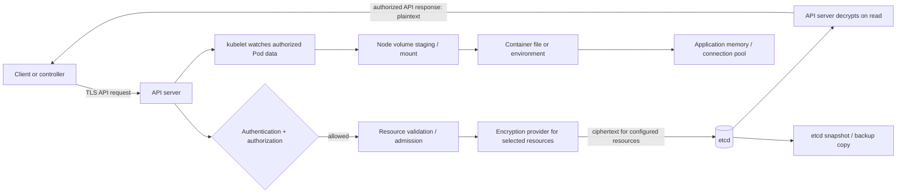
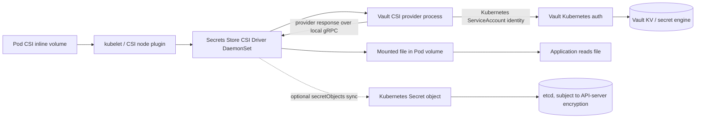
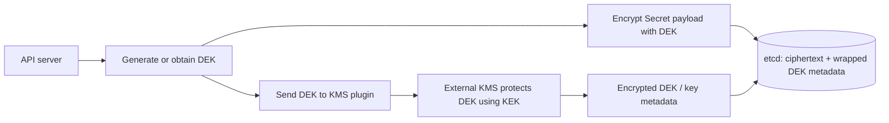

# Kubernetes Secret Encryption and the CSI Secret Store

## Scope, assumptions, and verification status

**Module:** M09 — Secrets and Identity Management  
**Unit:** 6 — Kubernetes Secret encryption and the CSI Secret Store  
**Target filename:** `06-kubernetes-secret-encryption-and-csi-secret-store.md`  
**Audience:** data/AI engineers familiar with Linux, containers, Kubernetes basics, RBAC, Helm/Kustomize, GitOps, CI/CD, and basic secret management.

This lesson follows the supplied Unit 6 prompt and its L1 foundations → L2 implementation → L3 architecture → L4 operations progression. The M09 syllabus prompt was available through the user's file library. The exact `Roadmap_ptree.md` was not independently confirmed in this execution, so the requested filename and placement come from the supplied prompt rather than a claim that the repository tree was inspected. Only this standalone lesson file is being generated; no repository file is being patched.

**Official documentation consulted during generation:** Kubernetes encryption at rest and KMS provider documentation; kind configuration documentation; Secrets Store CSI Driver usage, installation, sync, rotation, and upgrade documentation; HashiCorp Vault CSI provider documentation. These pages were consulted on 2026-10-28. See [References](#references-and-version-sensitive-verification-notes). Official docs change; the version installed in your lab remains the final authority for exact flags, fields, provider compatibility, and feature status.

**Lab assumptions [ASSUMPTION]:** disposable local Linux/WSL2 environment, Docker or compatible container runtime, `kind`, `kubectl`, sufficient disk/RAM for a small local cluster, and no cloud account. A rough planning allowance is 4 CPU cores, 8 GB RAM, and 20–30 GB free disk for the broader M09 labs; this is a planning estimate, not a benchmark or measured minimum. The CSI/Vault lab adds multiple DaemonSets and a local Vault instance and may need more resources. Use fake values only.

**Verification language**
- **[SOURCE]** means the supplied curriculum explicitly requires the topic.
- **[INFERENCE]** means an operational recommendation derived from the threat model.
- **[VERIFY]** means check the exact installed version/provider before using the example.
- **[VERSION-SENSITIVE]** means behavior, maturity, flags, schema, or support changes across releases.
- All command output in this lesson is **Representative expected output — not captured from a live run**. Labs were not executed as part of authoring. Static content review is not runtime validation.

**Safety boundary:** Never run cluster deletion, API-server configuration changes, key removal, or failure injection against a shared, staging, or production context. Every destructive exercise below is restricted to a uniquely named disposable cluster. Never use a real encryption key, password, Vault token, cloud identity, or customer secret in this lesson.

## Learning outcomes and prerequisite check

By completion, you should be able to:

1. Trace Secret data through API requests, RBAC, etcd, snapshots, kubelet, mounts, processes, and logs.
2. Explain why Base64 is encoding rather than encryption.
3. Explain `EncryptionConfiguration`, resource selection, provider order, and encryption's authorization boundary.
4. Build a disposable kind lab for at-rest encryption after checking version-specific configuration.
5. Compare raw etcd evidence before and after encryption without confusing representative output with executed evidence.
6. Re-encrypt existing objects and rotate keys in a safe order, retaining the old key until evidence shows it is no longer needed.
7. Explain static-key versus KMS envelope encryption and managed Kubernetes constraints.
8. Explain CSI driver/provider behavior, `SecretProviderClass`, file mounts, optional Secret synchronization, and application reload.
9. Design least-privilege access, metadata-only auditing, projected token use, backup recovery, and continuous verification.
10. Choose a secret-delivery pattern from a threat model instead of declaring one tool universally safest.

Prerequisite self-check: you should be able to explain Kubernetes namespaces, Pods, ServiceAccounts, RBAC Role/RoleBinding, API objects, container volume mounts, etcd at a high level, and why Git encryption differs from API-server encryption. If any item is unfamiliar, revisit M01 container security, M03 Kubernetes fundamentals/backups, M09 Units 1–5, and M06 policy/Helm material before doing destructive labs.

## Architecture at a glance



Plaintext can exist in the API server's request/response path, before encryption, after decryption, on the node, in a mounted file or environment variable, in process memory, and in logs or dumps. With at-rest encryption enabled, the intended protected copy in etcd is ciphertext for selected resources written through the configured encryption provider. Do not infer that every copy, every resource, or every historical backup is encrypted.

CSI path:



The CSI mount avoids a Kubernetes Secret object only when sync is not configured and no other component creates a copy. It does not remove plaintext from the node, provider, process, or memory. Driver and provider components are privileged platform infrastructure and require hardening.

## 6.0 — Unit orientation and running example

A scoring API and an ETL workload need three values:

| Value | Fake identifier | Workload | Sensitivity / operational concern |
|---|---|---|---|
| PostgreSQL password | `FAKE_LAB_DB_PASSWORD_DO_NOT_USE_7f31` | scoring API | must rotate without stale connection pools |
| Object-store credential | `FAKE_LAB_OBJECT_KEY_DO_NOT_USE_83ac` | ETL | may authorize bulk data access |
| Third-party ingestion token | `FAKE_LAB_VENDOR_TOKEN_DO_NOT_USE_4b90` | ingestion job | provider rate limit, expiry, and revocation |

All identifiers and values in this lesson are fake. The values are intentionally conspicuous and are not intended to authenticate to any service.

The design question is not merely “where do I put the password?” It is: who can retrieve it, which component decrypts it, where plaintext appears, how long it remains valid, how the application consumes a rotation, what happens when a dependency is unavailable, and how recovery is proved. Units 1–5 cover lifecycle, Vault, dynamic leases, ESO, and encrypted Git workflows. This unit concentrates on Kubernetes persistence encryption and CSI delivery; Unit 7 covers federated workload identity in greater depth, and Unit 8 covers leak response.

## 6.1 — L1 foundations: where Kubernetes Secrets live

### What a Secret object means

A Kubernetes `Secret` is an API object intended to hold small sensitive configuration values. It is not, by itself, a vault or a guarantee of confidentiality. The API representation encodes `data` values as Base64. Base64 is reversible and provides no secrecy. `stringData` is a convenience write field; it does not make a value encrypted and generally is not returned as a persisted field in the same way as `data`.

```yaml
# Illustrative lab manifest — fake value only
apiVersion: v1
kind: Secret
metadata:
  name: scoring-db
  namespace: demo
type: Opaque
stringData:
  password: FAKE_LAB_DB_PASSWORD_DO_NOT_USE_7f31
```

The API server authenticates the caller, authorizes the verb/resource/scope, applies admission and validation, then persists the object. RBAC `get` permits retrieving an individual object; `list` can return many objects and their data in scope; `watch` can stream object changes. Avoid giving application ServiceAccounts broad `list` or `watch` on Secrets. A workload that only needs a mounted value often needs no direct Secret API permissions.

Representative encoding example:

```bash
printf '%s' 'FAKE_LAB_PASSWORD_DO_NOT_USE' | base64
# Representative expected output — not captured from a live run:
RkFLRV9MQUJfUEFTU1dPUkRfRE9fTk9UX1VTRQ==
printf '%s' 'RkFLRV9MQUJfUEFTU1dPUkRfRE9fTk9UX1VTRQ==' | base64 --decode
# FAKE_LAB_PASSWORD_DO_NOT_USE
```

Use local commands only with fake values. Do not send production data to an online decoder or paste it into chat.

### Data path and exposure surfaces

1. **Client → API server:** the TLS connection protects data in transit between endpoints, but an authorized client sees plaintext in its API response.
2. **API server → etcd:** absent configured resource encryption, a self-managed cluster commonly stores Secret payloads in etcd without API-layer encryption. Verify managed-provider defaults and enabled settings separately.
3. **Snapshots and backups:** a snapshot preserves the data representation stored in etcd at snapshot time. It can contain every Secret in the cluster. Whether a particular object is ciphertext depends on how it was written and the active provider at that time; historical snapshots are not retroactively rewritten by changing current configuration.
4. **kubelet → Pod:** kubelet makes requested Secret data available to workloads. On Linux, Secret volume implementations use in-memory mechanisms such as tmpfs in supported configurations; verify the actual implementation and platform. In-memory storage is not protection against privileged node access, kernel compromise, memory capture, or process access.
5. **Container:** a file mount or environment variable exposes plaintext to the process and potentially to debug/exec access, crash dumps, diagnostics, or application logs. Environment variables can be inherited by child processes and may be exposed through debugging interfaces.
6. **Operations:** support bundles, shell history, CI output, traces, tickets, copied YAML, Helm release records, and crash dumps are common secondary disclosure paths.

A compromised node can often expose secrets for workloads scheduled there, including through privileged access to kubelet state, mounted volumes, process memory, or the container runtime. Namespace boundaries alone do not neutralize a node administrator.

### Safe Base64 and API view

```bash
kubectl get secret scoring-db -n demo -o jsonpath='{.data.password}' | base64 --decode
```

This command prints the value, so only run it for the fake lab Secret. Prefer metadata-only inspection in real operations. API-level output is plaintext to an authorized caller after decoding, regardless of whether the etcd copy is encrypted at rest.

### Raw etcd evidence [VERIFY]

The exact kind control-plane container name, etcd endpoint, client certificate/key/CA paths, and key path vary by image and version. Do not blindly copy a path from another cluster.

Inspection procedure on a throwaway cluster:

```bash
kind get clusters
kubectl config current-context
docker ps --format '{{.Names}}'
# Inspect the selected control-plane container's etcd static-pod manifest:
docker exec <VERIFIED_CONTROL_PLANE_CONTAINER> sh -c \
  'grep -E -- "--(listen-client-urls|advertise-client-urls|cert-file|key-file|trusted-ca-file|data-dir)" /etc/kubernetes/manifests/etcd.yaml'
```

Replace the placeholder only after checking that the container is the intended lab control-plane node. Determine whether `etcdctl` exists inside that container and inspect its version/help. If available, use the endpoint and client credentials from the running etcd manifest to read the verified Secret key path. A common key path shape is `/registry/secrets/<namespace>/<name>`, but verify it against the cluster and etcd layout. The exact `ETCDCTL_API`, `--endpoints`, TLS flags, and data key are `[VERIFY]`.

Never publish raw etcd dumps or upload them to a ticket. Even a “ciphertext” record may reveal metadata, lengths, or resource identity.

## 6.2 — L1 foundations: encryption at rest and its limits

### What the API server does

Kubernetes API-server encryption at rest transforms selected API resource data before persistence in etcd. The API server decrypts it when serving authorized reads. `EncryptionConfiguration` describes resource selection and provider configuration. The configured resource list matters: do not assume all ConfigMaps, custom resources, or arbitrary application data are encrypted just because `secrets` is listed.

Example shape, intentionally incomplete until verified for the chosen Kubernetes version:

```yaml
# Illustrative only — not a ready-to-apply configuration.
# [VERIFY] exact schema/provider availability for the installed version.
apiVersion: apiserver.config.k8s.io/v1
kind: EncryptionConfiguration
resources:
  - resources:
      - secrets
    providers:
      # First configured provider/key is intended for new writes.
      - aescbc:
          keys:
            - name: lab-key-v2
              secret: <BASE64_OF_RANDOM_KEY_WITH_PROVIDER_REQUIRED_LENGTH>
            - name: lab-key-v1
              secret: <BASE64_OF_OLD_LAB_KEY>
      - identity: {}
```

Do not place placeholder strings into a live config and expect encryption to work. Generate a random throwaway key of the exact format and length required by the chosen provider, restrict file permissions, and keep the key outside Git. `identity` is a no-encryption provider and is generally a fallback/decrypt behavior choice, not an encryption control. Provider availability and recommendations change by Kubernetes release.

### Provider awareness [VERSION-SENSITIVE]

- `identity`: no encryption.
- `aescbc`, `aesgcm`, `secretbox`: local symmetric-key providers whose current status and suitability must be checked against the installed Kubernetes release.
- `kms` v1: Kubernetes documentation marks KMS v1 deprecated since v1.28 and disabled by default since v1.29; verify the exact release documentation before migration.
- `kms` v2: documented as stable starting in Kubernetes v1.29; verify the installed release, plugin protocol, configuration schema, and provider support.

Source: current official Kubernetes encryption and KMS pages were consulted on 2026-10-28. Do not generalize current docs to an older control plane without checking the versioned documentation.

### Ordering and rotation

For the selected provider configuration, the first configured provider/key is used for new writes; configured old keys/providers can remain available to decrypt older stored objects. Exact semantics must be verified for the provider and release. Changing configuration alone does not guarantee that all old objects are rewritten. Rotation is a controlled sequence:

1. Back up the configuration and key material in an approved secure location; prove authorized recovery access.
2. Add the new key/provider in the correct write position while retaining the old decrypt-capable key/provider.
3. Roll the API server using the platform-supported procedure.
4. Write a new fake Secret and confirm the raw etcd representation uses the new provider/key identifier.
5. Re-encrypt existing objects in bounded batches.
6. Verify the scope and limits of the evidence; samples alone do not prove every object was rewritten.
7. Only after successful verification remove the old key/provider and roll the API server.
8. Verify old and new object reads, new writes, API-server health, and recovery evidence.

**Never remove the old key early.** If stored objects require it, they may become unreadable. The resulting symptom can vary by Kubernetes version and provider.

### Protection boundary

Encryption at rest helps protect stored ciphertext against theft of etcd media or snapshots when the attacker does not also obtain the required decryption key/KMS access. It does not replace TLS, authentication, RBAC, audit, node hardening, application controls, or incident response.

| Threat | At-rest encryption helps? | Does not solve | Compensating control |
|---|---|---|---|
| Stolen etcd disk or snapshot | Yes, for data encrypted under retained keys | key theft, plaintext historical copies | key custody, backup encryption, restore drills |
| Overprivileged API principal | No | authorized `get/list/watch` | least privilege, audit, short-lived identity |
| API server/control-plane compromise | Limited/no | API server can decrypt | control-plane isolation, patching, KMS boundary, incident response |
| Node compromise | No | mounted files and process memory | node hardening, workload isolation, minimize node access |
| Pod/process compromise | No | application can read its own value | least privilege, sandboxing, no debug leaks |
| Logs/dumps/tickets | No | secondary copies | redaction, logging controls, scanning and retention |
| KMS outage | No; may add dependency | availability | tested HA, alerting, recovery procedures |
| CSI provider compromise | No | provider can access requested values | pin releases, restrict privileges, isolate namespace, audit |

Encryption in Git (Unit 5), TLS in transit, API-server encryption at rest, disk encryption, and application-level encryption protect different links/copies. None should be described as interchangeable.

## 6.3 — L2 lab: inspect plaintext in etcd on a disposable kind cluster

**Objective:** demonstrate the difference between API Base64 representation and the raw stored record in a lab cluster without at-rest encryption.  
**Threat model:** an attacker with etcd data access can read Secret values when stored in plaintext representation.  
**Prerequisites:** Docker or compatible runtime, kind, kubectl, local shell, and enough resources for a one-node cluster. Confirm tool versions with `kind version`, `kubectl version --client`, and runtime version output; do not assume a particular release.  
**Fake values:** required. Do not use a real value.  
**Cluster recreation:** yes. **Destructive:** cluster deletion at cleanup; disposable lab only.

Create a unique cluster name:

```bash
export LAB_CLUSTER="m09-u6-plaintext-lab"
kind create cluster --name "$LAB_CLUSTER"
kubectl config current-context
kind get clusters
```

**Context guard:** before any delete or API-server changes, manually confirm the current context corresponds to this exact lab. Stop if the context is shared, production, or ambiguous.

```bash
kubectl create namespace demo
kubectl -n demo create secret generic etcd-proof \
  --from-literal=password='FAKE_LAB_ETCD_PASSWORD_DO_NOT_USE_19ac'
kubectl -n demo get secret etcd-proof -o jsonpath='{.data.password}'; echo
kubectl -n demo get secret etcd-proof -o jsonpath='{.data.password}' | base64 --decode; echo
```

Expected: first output is a Base64 string; second is the fake original value. This is not encryption.

Discover the control-plane container and inspect etcd's static-pod manifest as described in §6.1. Verify endpoint, TLS files, and key path. Then use the `etcdctl` already available in the control-plane image or a verified compatible tool. A generic command shape—not a guaranteed copy/paste command—is:

```bash
# [VERIFY] Substitute only values confirmed from the running etcd manifest.
docker exec <VERIFIED_CONTROL_PLANE_CONTAINER> sh -c '
  ETCDCTL_API=3 etcdctl \
    --endpoints=<VERIFIED_ENDPOINT> \
    --cacert=<VERIFIED_CA_PATH> \
    --cert=<VERIFIED_CLIENT_CERT_PATH> \
    --key=<VERIFIED_CLIENT_KEY_PATH> \
    get /registry/secrets/demo/etcd-proof
'
```

Expected evidence in an unencrypted lab is a serialized Kubernetes object containing the fake value in readable form, possibly embedded in a protobuf/JSON serialization that is not neatly formatted. Do not assume every byte is printable. **Representative expected output — not captured from a live run.** If the image lacks `etcdctl`, use a compatible tool in a disposable helper container with a verified version and securely mounted client credentials; do not weaken etcd TLS to make the exercise easier.

Record: context, cluster name, Kubernetes/kind/etcd versions, the API Base64 result, decode result, exact verified etcd key path, and whether the raw record exposes the fake value. Do not record private key bytes or dump all of etcd.

Cleanup guard and verification:

```bash
kubectl config current-context
kind get clusters
# Run only after manually verifying the exact disposable lab cluster:
kind delete cluster --name "$LAB_CLUSTER"
kind get clusters
```

Expected: cluster absent from the returned list. Also remove temporary config/key files created specifically for the lab and inspect the lab directory. Deleting the cluster does not erase every possible host backup, shell history entry, terminal transcript, or filesystem snapshot; avoid putting real secrets in the lab in the first place.

Troubleshooting:
- `etcdctl` cannot connect: re-check endpoint, client certificate, CA, and the container name from the running manifest.
- The key path returns nothing: verify namespace/name and exact path; do not dump the full keyspace.
- Output looks unreadable: etcd stores serialized objects; inspect a single fake record with a local parser only if needed.
- Record already looks encrypted: stop and check whether this cluster/image/platform enabled encryption or whether the wrong key was queried.

## 6.4 — L2 lab: enable encryption at rest on kind

**Objective:** enable API-server encryption for Secrets and compare raw etcd evidence before/after.  
**Threat model:** stolen etcd storage or snapshot. This lab does not protect against API access or node compromise.  
**Prerequisites:** same as Lab 1; understand kind mounts and kubeadm patches.  
**Destructive:** creates a new cluster and changes API-server startup config. Use a unique cluster name.

### Configuration plan

The kind node is a container. A host file must be mounted into the node container, then the API server must receive the correct `--encryption-provider-config` flag. Exact `extraMounts`, `kubeadmConfigPatches`, API version, and host/container paths must be checked against the installed kind and Kubernetes versions. See official kind configuration docs and Kubernetes encryption docs.

Illustrative directory and permissions:

```bash
mkdir -p ./m09-u6-encryption-lab
chmod 700 ./m09-u6-encryption-lab
umask 077
# Generate key material with a local cryptographic random generator,
# then encode it exactly as required by the chosen provider.
# Never use the literal placeholder below as a key.
```

Illustrative kind shape (not a ready-to-apply file; verify schema and mount paths):

```yaml
# Illustrative lab path: ./m09-u6-encryption-lab/kind.yaml
kind: Cluster
apiVersion: kind.x-k8s.io/v1alpha4
nodes:
  - role: control-plane
    extraMounts:
      - hostPath: ./m09-u6-encryption-lab
        containerPath: /etc/kubernetes/lab-encryption
    kubeadmConfigPatches:
      - |
        kind: ClusterConfiguration
        apiServer:
          extraArgs:
            encryption-provider-config: /etc/kubernetes/lab-encryption/encryption-config.yaml
```

The `EncryptionConfiguration` file must exist at the mounted path before cluster creation, use a provider supported by the selected control plane, include a correctly formatted random lab key, and use a verified schema. Example conceptual structure:

```yaml
# Illustrative only. [VERIFY] schema and provider availability.
apiVersion: apiserver.config.k8s.io/v1
kind: EncryptionConfiguration
resources:
  - resources: ["secrets"]
    providers:
      - aescbc:
          keys:
            - name: lab-key-v1
              secret: <BASE64_RANDOM_KEY_OF_REQUIRED_LENGTH>
      - identity: {}
```

For AES-CBC configuration, generate the key according to the official docs' required length and encoding. Do not use a hand-written phrase or password as the encryption key. Keep the config out of Git; ensure permissions are restrictive. A mounted file in a container host directory is still a copy of the key. Plan secure retention and destruction.

### Bring up and verify

1. Validate the config schema and kind configuration with the versions installed; do not guess that a YAML example works across releases.
2. Create the cluster with a unique name.
3. Verify the API server is healthy and the encryption config is mounted where expected. Inspect the static pod manifest and API-server logs without printing the key.
4. Create a fake Secret after encryption is enabled.
5. Read only that record from etcd using verified endpoint/cert/path details from §6.1.
6. Confirm the stored record has the expected provider envelope/prefix for the chosen provider/version. An example often discussed is `k8s:enc:aescbc:v1:<key-name>`, but exact format is **[VERIFY]** and must not be treated as universal.
7. Read the Secret through Kubernetes API and confirm the authorized API client still receives the original fake value.
8. Compare evidence: config provider/resource selection; API read result; raw etcd record; API-server health; and any applicable platform evidence.

Representative expected output (not captured from a live run): the raw etcd value begins with a provider-specific encryption envelope and does not expose the fake password as ordinary plaintext; the Kubernetes API read returns the fake value. This difference demonstrates at-rest encryption plus authorized decryption, not absence of plaintext elsewhere.

### Failure and recovery

If the API server fails to start after the config change, stop changing keys. Inspect the API-server static pod manifest, config file path/mount, YAML schema, key format, provider support, and logs. On the disposable cluster, restore the last known-good lab config and recreate the cluster if necessary. Do not apply this recovery method to production without a platform-specific runbook.

Cleanup: verify the context; delete only the named disposable cluster; verify it is gone; securely remove the lab key/config and any temporary copies. Keep no key in Git or shell history. If the lab directory is retained for study, replace secret-bearing config with a redacted example first.

## 6.5 — L2 lab: re-encrypt existing Secrets and rotate the key

Enabling encryption primarily changes how subsequent writes are stored. Existing objects may remain in their prior storage representation until rewritten. Therefore, “encryption is configured” is not proof that every historical object has been re-encrypted.

### Safer bounded rewrite strategy

The commonly shown pipeline `kubectl get secrets -A -o json | kubectl replace -f -` is an illustrative broad rewrite pattern, not a production recommendation. It can generate a very large payload, encounter resource-version conflicts, race with controllers, exceed client/server limits, and make error handling opaque. Never run it blindly in production.

For a disposable lab, use a bounded list and a controlled patch/update procedure. Before rewriting:
- record cluster/context, namespaces in scope, object count, object names/UIDs/resourceVersions (metadata only), and current encryption config key IDs;
- exclude system-managed resources only according to an explicit plan, not an ad hoc guess;
- set a small batch size and rate limit;
- handle `409 Conflict` by re-reading the object and retrying a bounded number of times;
- never log Secret `.data` or full object JSON;
- stop if API errors increase or control-plane health degrades.

A lab-only conceptual loop is:

```bash
# Illustrative pseudocode; implement against a disposable cluster only.
# For each Secret name in a bounded namespace/name list:
#   read metadata and resourceVersion without logging data
#   perform a semantically safe update that forces persistence
#   on conflict, re-read metadata and retry a bounded number of times
#   record success/failure by namespace/name only
# Do not dump all Secret JSON to a terminal or CI log.
```

If using a `kubectl get`/`replace` pipeline in a lab, limit scope to a namespace containing only fake values, save no unredacted JSON, and confirm the behavior for the installed client/server. For production, use a reviewed runbook or controller with backoff, conflict handling, API rate limits, structured metadata-only logs, and a rollback/stop condition.

### Ordered key rotation runbook

| Phase | Action | Evidence / stop condition |
|---|---|---|
| 0 — Prepare | Inventory selected resources, key IDs, provider config, current health; securely back up config and key material | Recovery access tested; if not, stop |
| 1 — Add | Add new key/provider in the write position while retaining old decrypt key/provider | API server healthy; config validated |
| 2 — Roll | Restart/roll API server using supported procedure | Ready/healthy; read pre-existing fake Secret |
| 3 — New write | Create a new fake Secret | Raw record identifies new provider/key |
| 4 — Rewrite | Rewrite existing Secrets in bounded batches | Counts, failures, conflicts, API health recorded |
| 5 — Verify | Inspect config and representative/all feasible stored records; reconcile inventory | No unexplained old-key dependence; sampling limitations documented |
| 6 — Remove old | Remove old key only after verification, roll API server | API reads old/new objects and writes succeed |
| 7 — Close | Test recovery, update rotation register, remove temporary copies | Owner sign-off, key IDs only, no key bytes in evidence |

### Evidence table

| Time | Evidence | What it proves | Limitation |
|---|---|---|---|
| Before | config/key IDs, object inventory, one raw record | starting state and sample storage format | sample may not represent all objects |
| During | batch success/failure counts, conflicts, API health | rewrite progress | counters alone do not prove ciphertext |
| After | new writes, reads of pre-existing objects, config, bounded raw record scan | expected behavior for tested scope | managed clusters may prohibit raw etcd inspection; provider-side evidence may be needed |
| Recovery | read old object and create new fake object after rollback/rotation | usable path for tested scenario | not a substitute for full disaster-recovery drill |

### Failure decision tree

- **Old objects unreadable after adding new key:** do not remove any more keys; restore the last known-good config while retaining all previously required keys; verify API health and reads.
- **Old objects unreadable after removing old key:** restore the protected config/key backup immediately through the approved control-plane procedure. If key material is lost, data may be unrecoverable.
- **API errors rise during rewrite:** pause batches, inspect API-server metrics/logs and conflicts; reduce batch size/rate; do not run a second concurrent rewrite.
- **No raw etcd access on managed Kubernetes:** use provider-supported encryption status/configuration, audit events, and a provider-supported verification procedure. Mark direct record verification `UNKNOWN`, not `PASS`.

## 6.6 — L2/L3: KMS envelope encryption and managed Kubernetes

### Envelope encryption



A data-encryption key (DEK) encrypts resource data; a key-encryption key (KEK) held by an external KMS protects the DEK. The intended boundary is that the KEK does not leave the KMS. The API server/provider still needs to perform operations that yield plaintext or usable data keys, so KMS is not a defense against every control-plane compromise.

| Dimension | Local/static key provider | KMS envelope encryption |
|---|---|---|
| Key custody | key/config on control-plane host or mounted file | KEK managed by external KMS; plugin and identity still require hardening |
| Availability | local key available with API server | depends on KMS/plugin connectivity and provider behavior |
| Audit | host/config access controls and local evidence | KMS operations may provide a separate audit trail |
| Rotation | careful config/key ordering and rewrite | provider/KMS-specific KEK/DEK rotation and re-encryption semantics |
| Portability | can be simpler for local lab; key portability is a risk | depends on KMS and provider integration |
| Operations | protect/backup local key, distribute to control planes | IAM, plugin lifecycle, network, quotas, KMS recovery, key policies |
| Cost | infrastructure/operations cost | possible service cost and request/operation constraints |
| Failure blast radius | local key/config error can affect control plane | KMS outage/denial may affect API reads/writes; exact caching behavior is version/provider-specific |

**KMS v1/v2 [VERSION-SENSITIVE]:** current Kubernetes docs consulted during generation describe KMS v1 as deprecated since v1.28 and disabled by default since v1.29; KMS v2 is stable from v1.29. KMS v2 has different DEK/seed and caching design than v1. Validate the precise API schema, plugin protocol, maturity, key caching, rotation behavior, and migration path for the installed Kubernetes version. Do not infer that every cloud or Vault plugin supports every version.

A KMS outage drill should be a tabletop unless a safe isolated test environment and provider-specific procedure exist. Define symptoms and alerts, stop unsafe rollouts, confirm provider health/IAM/network/quota, restore connectivity, validate old Secret reads and new writes, and document whether caching masked or delayed impact. Do not simulate a KMS outage by revoking production KMS permissions.

### Managed Kubernetes

Managed services may offer provider-managed encryption or a customer-managed KMS option but commonly do not permit direct etcd access or arbitrary API-server flags. For each provider, collect:
- documented feature name and supported regions/cluster modes;
- whether the control plane encrypts Kubernetes Secret data or only underlying disks;
- key ownership, rotation, disable/delete behavior, and audit events;
- what happens during KMS outage or key disablement;
- snapshot/restore requirements and recovery permissions;
- provider-supported evidence (configuration API/console output, audit log, control-plane status).

Do not claim a provider feature is enabled because the cloud disk is encrypted. Disk encryption and Kubernetes API-resource encryption are related but distinct controls.

### Backup and recovery

A backup is recoverable only if the data and the required decryption capability are recoverable. Retain the relevant encryption config/key material or KMS access under approved escrow, separate duties, document break-glass access, and test restoration. A snapshot containing ciphertext without its key/KMS access is not a usable recovery plan. A snapshot created before encryption can retain plaintext Secret data even after the live cluster is configured. Link the full restore exercise to M03 Unit 10 and M13 backup/DR.

### Performance measurement

Do not quote universal CPU, latency, or throughput overhead. Establish a baseline with the same cluster size and representative object sizes/counts. Measure API request latency/error rate, API-server CPU/memory, etcd latency, KMS request latency/errors/quotas, rollout/startup times, and recovery behavior. Repeat runs, record versions/configuration, compare percentiles, and separate cold start from steady state.

## 6.7 — L2 lab: Secrets Store CSI Driver with Vault provider

### Architecture and compatibility

The Secrets Store CSI Driver runs as a node-level DaemonSet and communicates with a provider process (Vault provider in this lab) through its provider interface. A Pod references a namespaced `SecretProviderClass` and mounts a CSI inline volume. On Pod creation/mount, the driver/provider retrieve the requested value from the backend and write it into the mounted volume. The official usage documentation describes a `tmpfs` mount in the documented supported setup; verify platform and driver behavior. The Vault provider authenticates using the requesting Pod's ServiceAccount identity and a Vault role/policy.

The current official driver introduction page consulted during generation describes sync and auto-rotation as alpha features; current release-specific status must be rechecked before production use. Driver and provider versions, Kubernetes version, Vault version, CRD schema, and install instructions must be pinned and checked as a compatibility set. Do not assume a `SecretProviderClass` example works with every release.

### Installation approach [VERIFY]

Use official installation instructions rather than copying a release URL or Helm values from an old tutorial. Check:
1. kind/Kubernetes version supported by the chosen driver release;
2. driver Helm chart or manifest version and namespace;
3. provider's documented installation method and supported Vault version;
4. CRDs are installed before creating custom resources;
5. provider and driver DaemonSets are Ready on the lab node;
6. RBAC requirements for the exact features used (especially sync/rotation);
7. whether Vault is reachable from the provider Pod and its TLS configuration.

Useful official pages are linked in References. This lesson deliberately does not hardcode a release URL, Helm repository version, or provider-specific installation flag that was not verified for your chosen versions.

### Minimal illustrative `SecretProviderClass`

The following shape reflects the documented provider concept, but Vault provider parameters and API compatibility are **[VERIFY]** against the exact provider release. The `objectName`, `secretPath`, and `secretKey` names below are illustrative; consult the Vault provider's current configuration docs.

```yaml
# Illustrative lab manifest — not created as a repository file.
apiVersion: secrets-store.csi.x-k8s.io/v1
kind: SecretProviderClass
metadata:
  name: scoring-vault-secret
  namespace: demo
spec:
  provider: vault
  parameters:
    vaultAddress: "http://vault.demo.svc:8200" # lab only; production must use verified TLS
    roleName: "scoring-readonly"
    objects: |
      - objectName: "db-password"
        secretPath: "secret/data/demo/scoring"
        secretKey: "password"
```

The exact YAML schema is provider-version-specific. Do not use plaintext HTTP in a real deployment; use a verified TLS endpoint and validate the server identity. The example address is a placeholder for a disposable local lab, not a production recommendation.

### Vault policy and Kubernetes auth concept

Vault policy should permit only the one path and capability the workload needs. For a KV v2 mount, path syntax commonly includes `data/` for reading secret data; verify the actual mount name and KV version.

```hcl
# Illustrative Vault policy — fake path only.
path "secret/data/demo/scoring" {
  capabilities = ["read"]
}
```

Create a dedicated Kubernetes ServiceAccount for the workload, bind it to a Vault role with this policy, and ensure the Vault Kubernetes auth configuration validates the cluster's issuer/CA/API access as required by the installed Vault version. Do not reuse a cluster-admin identity or give the workload broad Vault policy. Unit 2 covers Vault auth/policies in depth; Unit 7 covers workload identity patterns.

### Pod volume example

```yaml
# Illustrative lab manifest — API and driver compatibility [VERIFY].
apiVersion: v1
kind: ServiceAccount
metadata:
  name: scoring-reader
  namespace: demo
automountServiceAccountToken: false
---
apiVersion: v1
kind: Pod
metadata:
  name: scoring-csi-check
  namespace: demo
spec:
  serviceAccountName: scoring-reader
  containers:
    - name: reader
      image: busybox:1.36 # [VERIFY] pin a supported digest for reproducible production use
      command: ["sh", "-c", "while true; do test -r /mnt/secrets-store/db-password || exit 1; sleep 5; done"]
      volumeMounts:
        - name: vault-secret
          mountPath: /mnt/secrets-store
          readOnly: true
  volumes:
    - name: vault-secret
      csi:
        driver: secrets-store.csi.k8s.io
        readOnly: true
        volumeAttributes:
          secretProviderClass: scoring-vault-secret
```

**Important token note:** provider authentication may require the workload's ServiceAccount identity, and provider versions may use a token-request/projected-token flow rather than a default mounted token. `automountServiceAccountToken: false` is a sensible default when the workload container itself does not need the token, but confirm the CSI provider's identity integration requirements before applying it. Do not create a legacy long-lived ServiceAccount token Secret.

### Lab procedure

1. Create a uniquely named disposable kind cluster and confirm the context.
2. Install a disposable Vault server and configure a fake KV value. Use only a fake lab root token generated for the lab; never reuse it. Follow official Vault Kubernetes-auth and KV documentation for the exact setup.
3. Install the CSI driver and Vault provider using their current official instructions. Confirm CRDs and DaemonSets are healthy.
4. Configure Vault Kubernetes auth, a dedicated ServiceAccount, a narrowly scoped role, and a read-only policy. Validate that the role can read only the lab path.
5. Create the `SecretProviderClass` after checking the exact schema. Deploy a Pod mounting the secret file.
6. Verify Pod events and mount status. For this fake value only, `kubectl exec ... -- cat /mnt/secrets-store/db-password` may be used to prove the mount. In a real environment, do not print the value; check file existence, ownership, mode, and application health instead.
7. Prove sync is disabled: inspect the `SecretProviderClass` for absence of `secretObjects`, and query only the expected namespace/name for a Kubernetes Secret object. A name-based query proves only that the named object was not found; it does not prove no other controller or object contains a copy.
8. In a separate controlled step, add a `secretObjects` entry using the exact driver schema and required sync permissions. Start a Pod that mounts the volume, then verify the named Kubernetes Secret exists. Sync behavior requires a mounted Pod; the synced Secret may be removed when all consuming Pods are gone, depending on documented driver behavior. Verify exact release semantics.
9. Remove sync from the lab and confirm the expected object lifecycle. Do not interpret removal as guaranteed erasure from backups or logs.
10. Denied-path test: change the Vault policy/role in the disposable environment to deny the path, or use a deliberately nonexistent fake path. Observe Pod events such as `FailedMount` or a Pod remaining in `ContainerCreating` if applicable. Exact events vary; capture redacted events and provider logs.
11. Backend-down-at-start test: make the local lab Vault endpoint unavailable only in the disposable environment, then create a new Pod. The mount can fail and the Pod may not start because the secret is fetched during volume setup. Restore Vault connectivity and observe recovery. Do not use this as a production outage drill.
12. Rotation test: use the documented driver rotation feature only after checking the installed release's flag/Helm value and maturity. Current official docs consulted describe `enableSecretRotation` and `rotationPollInterval` as configuration concepts; rotation is not universally enabled by default, and the interval may act as a minimum cache duration rather than exact polling. Change the fake Vault value and observe whether the mounted file changes. Then use a file-watching test process or explicit reread to demonstrate whether the consumer sees the new value. The driver does not restart application Pods; applications must reread/reload files or be restarted through a controlled rollout.
13. Cleanup: verify context; delete only the named lab cluster; remove lab Vault token, policy, manifests, and temporary configs; verify the cluster is absent and the lab directory contains no key/token-bearing files. Check shell history for commands that may have contained fake lab tokens and remove only the lab-specific entries according to your shell policy.

### CSI operational limits

- A CSI-mounted secret is plaintext at the application boundary and on the node.
- `secretObjects` creates a native Kubernetes Secret copy and brings etcd, RBAC, API audit, and backup exposure back into scope.
- Backend unavailable at mount time can block new Pod startup. Existing mounts and renewal behavior vary by provider/version and must be tested.
- Updating a mounted file does not force a process to reread it or renew database connections.
- Per-Pod mounts/restarts can increase backend request volume. Plan for rate limits and thundering-herd recovery.
- CSI DaemonSets/providers are privileged platform components. Pin and review releases, limit access, and monitor their health.

## 6.8 — L3: threat model and architecture decisions

Use this table in a threat review; it is not a claim that one control eliminates the threat.

| Threat / attack path | At-rest encryption helps? | Primary controls | Residual risk and evidence |
|---|---|---|---|
| etcd disk or snapshot theft | Yes, if stored objects were encrypted and key remains separate | API resource encryption, encrypted backup storage, key escrow | historical plaintext snapshots; collect config, key custody records, snapshot policy |
| overprivileged API principal | No | least-privilege RBAC, identity controls, audit | authorized reads still return plaintext; review RoleBindings and access events |
| control-plane compromise | Limited | harden/patch control plane, restrict admin access, external KMS boundary | API server can decrypt; preserve logs and investigate key access |
| node compromise | No | node patching, host access controls, workload isolation | node may read mounted values; capture node and Pod evidence |
| Pod/container compromise | No | minimal image/capabilities, read-only filesystem, no shell/debug where feasible | compromised app can read its own credential; inspect process/log exposure |
| process-memory scraping | No | reduce lifetime/scope, process isolation, dump controls | plaintext needed for use; inspect dump and debugging policies |
| logs/traces/dumps/tickets | No | redaction, secret scanning, retention controls | copies can persist beyond rotation; search sinks and audit retention |
| KMS/provider outage | No; KMS may add dependency | HA, alerting, runbooks, tested recovery | behavior/caching is version-specific; collect provider and API errors |
| CSI provider/DaemonSet compromise | No | release pinning, narrow permissions, node security, review privileges | provider can access requested values; collect image digest, RBAC, node placement |
| backend rate limit / credential expiry | No | backoff, caching policy, alerting, workload staggering | mass restart may fail; monitor mount errors and backend throttles |
| rotation not consumed by app | No | file watch/reload, connection-pool refresh, controlled restart | old connection can remain valid; test consumer behavior explicitly |
| tenant boundary failure | No | namespace RBAC, per-tenant backend roles, policy/admission controls | shared node/provider/backend risks; test cross-tenant negative cases |

### Decision principles

1. **Choose by workload contract.** A legacy app that requires environment variables may need ESO/native Secret synchronization or a wrapper, while a file-aware app can use CSI or Vault Agent without creating a Kubernetes Secret copy.
2. **Minimize identities and copies.** One workload identity should access one path or narrow role. Every additional copy creates another access and retention problem.
3. **Plan for unavailable dependencies.** CSI can block startup when the backend cannot provide a value. ESO can materialize a Kubernetes Secret ahead of Pod startup but introduces a Secret object and reconciliation delay. Direct retrieval moves retry/cache behavior into application code.
4. **Treat node security as part of the secret boundary.** A node-local mount is not isolated from a privileged node attacker.
5. **Make rotation a consumer test.** Verify the backend value, mounted file or Kubernetes Secret, application configuration, and actual connection/session refresh.
6. **Don't confuse repository encryption with storage encryption.** SOPS/Sealed Secrets protect Git artifacts under their own key/ciphertext model; API-server encryption protects selected stored API resources; neither prevents an authorized API read.

### Five-secret decision matrix exercise

Complete the rationale column before deployment. The sample choices are illustrative and should be revisited for each organization's threat model.

| Secret / workload | Candidate method | Source of truth | Plaintext location / etcd | Identity and rotation | Outage and rationale |
|---|---|---|---|---|---|
| short-lived DB credential for file-aware scoring API | CSI from Vault | Vault dynamic/static role | mounted file, node and process; no Secret object if sync disabled | dedicated SA/Vault role; file reload and pool refresh | Pod startup depends on backend; good when app supports file reload |
| API token for legacy app needing env var | ESO → native Secret with at-rest encryption | external manager | Kubernetes Secret in etcd, API reads return plaintext | ESO identity; env vars usually require Pod restart | app compatibility is easy; more copies and RBAC scope |
| low-sensitivity internal feature flag | native Secret only if truly secret; otherwise ConfigMap | platform config | etcd; encryption depends on selected resource | Kubernetes RBAC and normal rollout | avoid using secret tooling for non-secret data |
| third-party ingestion token for scheduled ETL | direct application retrieval or Vault Agent | Vault/external manager | app memory; optional rendered file; no native Secret if designed so | workload identity, short lease, retry and revocation | app owns backoff; good for short jobs that can fail safely |
| TLS private key for a file-based gateway | CSI or ESO depending reload model | certificate manager | CSI file or native Secret in etcd | cert identity and rotation/reload test | prefer file delivery only if gateway can reload; test expiry and reload |

Evaluate each option on source of truth, plaintext locations, etcd presence, identity, rotation/reload, outage behavior, auditability, operational burden, and multi-tenant isolation. “Most secure” has no meaning without specifying the attacker, workload, availability requirement, and operating capability.

## 6.9 — L3: hardening RBAC, audit, tokens, nodes, and workloads

### Least-privilege RBAC

Avoid broad cluster-wide grants to application ServiceAccounts. `list secrets` can disclose every Secret in the allowed namespace in one response; `watch secrets` can expose future changes. Most applications should not query the Secret API if a mounted file or externally delivered credential meets the requirement.

```yaml
# Illustrative negative-test fixture — deliberately overbroad in namespace demo.
apiVersion: rbac.authorization.k8s.io/v1
kind: Role
metadata:
  name: unsafe-list-secrets
  namespace: demo
rules:
  - apiGroups: [""]
    resources: ["secrets"]
    verbs: ["get", "list", "watch"]
---
apiVersion: rbac.authorization.k8s.io/v1
kind: RoleBinding
metadata:
  name: unsafe-list-secrets
  namespace: demo
subjects:
  - kind: ServiceAccount
    name: test-reader
    namespace: demo
roleRef:
  apiGroup: rbac.authorization.k8s.io
  kind: Role
  name: unsafe-list-secrets
```

This is intentionally unsafe and only a test fixture. A least-privilege application that needs no API reads should have no Secret API permissions:

```yaml
apiVersion: v1
kind: ServiceAccount
metadata:
  name: scoring-workload
  namespace: demo
automountServiceAccountToken: false
```

If the workload must read a named Secret through the API, use a narrowly scoped Role with `get` and bind it only in the workload namespace. Kubernetes RBAC cannot restrict `get` by arbitrary Secret data keys; the object itself is the authorization unit. Validate exact resource-name behavior and policy design in the installed version.

Negative tests (use a disposable namespace and fake Secret only):

```bash
kubectl auth can-i list secrets -n demo \
  --as=system:serviceaccount:demo:test-reader
kubectl auth can-i get secret/scoring-db -n demo \
  --as=system:serviceaccount:demo:scoring-workload
kubectl auth can-i list secrets --all-namespaces \
  --as=system:serviceaccount:demo:scoring-workload
```

Expected for a least-privilege identity with no relevant binding: `no`. The `--as` check requires the caller to have impersonation permission; if it does not, the result is not a permission proof—record `UNKNOWN` and use an authorized test identity.

### Audit policy

Use audit metadata to record who accessed which resource and when without capturing Secret request/response bodies. Exact API version, policy stages, level behavior, and whether an audit policy can be configured on a managed control plane are `[VERIFY]`. Do not use `Request` or `RequestResponse` levels for Secrets merely to debug; they can record sensitive payloads.

Illustrative policy shape only:

```yaml
# [VERIFY] audit API version, stage support, and control-plane configuration.
apiVersion: audit.k8s.io/v1
kind: Policy
rules:
  - level: Metadata
    resources:
      - group: ""
        resources: ["secrets"]
  - level: None
    users: ["system:kube-proxy"]
    verbs: ["watch"]
    resources:
      - group: ""
        resources: ["endpoints", "services"]
  - level: Metadata
```

Review rule ordering carefully; the final broad rule and exclusions must fit your cluster's audit design. The example is not a complete production policy. Validate with a fake Secret request and inspect that the event records identity, verb, namespace, resource, and timestamp but not the secret value. If policy is provider-managed, use provider-supported audit evidence and mark unsupported direct inspection `UNKNOWN`.

### Projected ServiceAccount tokens

Prefer projected, time-bound, audience-scoped ServiceAccount tokens rather than legacy long-lived token Secret objects. A token's `iss`, `sub`, `aud`, and `exp` claims depend on cluster configuration and request; never assume exact values. Do not print the token or paste it into an online decoder. If claim inspection is required, decode locally without outputting the token itself, and redact claim values if they contain environment-specific identifiers.

```yaml
# Illustrative projected token volume; verify audience and token projection support.
apiVersion: v1
kind: Pod
metadata:
  name: token-projection-demo
  namespace: demo
spec:
  automountServiceAccountToken: false
  serviceAccountName: scoring-workload
  containers:
    - name: inspect
      image: busybox:1.36 # [VERIFY] pin digest for repeatability
      command: ["sh", "-c", "sleep 3600"]
      volumeMounts:
        - name: workload-token
          mountPath: /var/run/secrets/workload
          readOnly: true
  volumes:
    - name: workload-token
      projected:
        sources:
          - serviceAccountToken:
              path: token
              audience: "example.invalid"
              expirationSeconds: 600
```

`example.invalid` is a non-routable illustrative audience, not an audience expected to work against a real API. Do not use the projected token to authenticate to anything in this example. The token is mounted at a path and is never printed. Verify the minimum/maximum allowed expiration and exact claim behavior against your Kubernetes release.

Never create a legacy long-lived ServiceAccount token Secret for this lesson.

### Node and Pod hardening

- Use read-only mounts and the narrowest file mode/ownership that the application can use. `defaultMode`, `fsGroup`, and permission behavior can differ by volume implementation and platform; verify effective file permissions from inside the Pod.
- Treat tmpfs as a storage-location property, not an authorization boundary. Privileged node access can inspect memory and mounted files. Verify swap and kubelet `--fail-swap-on` behavior for the platform; do not assume universal defaults.
- Disable automatic ServiceAccount token mounting where not needed. When identity is needed, prefer projected tokens with explicit audience/lifetime and only the required permissions.
- Avoid privileged containers, host PID/network access, broad `hostPath`, and unreviewed debug/exec access. Pod Security Standards and admission controls should be applied with narrowly documented exceptions for platform DaemonSets.
- Namespaces help scope RBAC and resource management but are not by themselves a hard tenant boundary.
- Limit core dumps and diagnostic bundles; prevent secret values from entering logs/traces/tickets; use structured redaction and scanning.
- Helm release storage can contain rendered manifests and values. If charts render secret values into release records, protect Helm Secret access and ensure at-rest encryption. Cross-reference M06 Helm release storage.
- Node authorizer and `NodeRestriction` reduce specific node API access risks but are not substitutes for RBAC, node hardening, or workload isolation. Verify current control-plane configuration and documented behavior.

### Policy-as-code awareness

Admission/CI checks can flag obvious plaintext patterns, require `automountServiceAccountToken: false` unless justified, reject legacy token Secret manifests, require a `SecretProviderClass` for a defined workload tier, and detect broad Secret RBAC. Exact Kyverno/Gatekeeper/ValidatingAdmissionPolicy schemas and API versions are `[VERIFY]`. Static manifest checks cannot prove effective at-rest encryption, KMS state, or whether a value leaked at runtime.

## 6.10 — L4: operating encryption at rest and CSI at scale

### Encryption operations

Establish a documented key-rotation objective (organization-defined, not a universal number), owner, approver, change window, preflight checks, evidence retention, rollback triggers, and post-rotation validation. Keep key bytes out of tickets and change logs; record key IDs and custody events only.

Safe rewrite automation should have:
- a read-only preflight and dry-run report;
- bounded batches, concurrency limits, backoff, and retry ceilings;
- conflict handling and a stop threshold for API errors;
- metadata-only structured logs;
- a record inventory and reconciled counts;
- a manual stop switch and rollback plan;
- a post-run sample scan plus the strongest provider-supported verification available.

For KMS failures, alert on API errors, KMS/plugin errors, latency and throttling where metrics are documented. Verify metric names for the installed provider before writing alerts. A tabletop drill should exercise dependency diagnosis, access/IAM restoration, network checks, key state, controlled read/write verification, and evidence preservation.

### CSI/provider operations

- Pin driver and provider versions; review release notes and compatibility matrix before upgrades.
- Roll upgrades in a disposable environment first; validate CRDs, DaemonSets, node coverage, mounts, sync behavior, and rotation.
- Limit the driver namespace and provider RBAC; document why privileged or host-level access is required.
- Monitor DaemonSet desired/ready counts, provider logs, mount failure events, Pod startup latency, backend errors, rate limits, and node resource usage. Use only metric names documented for your release.
- Test node drain/rescheduling and backend outage; confirm what happens to existing mounts and newly created Pods.
- Stagger large restarts and rollouts to avoid a backend thundering herd. Use retry with jitter and a defined maximum.
- Choose rotation polling/cache interval by measuring maximum acceptable staleness against backend load. It is not automatically the application's reload interval.
- A reloader controller is optional; do not add it unless the application cannot reload directly and its operational cost is understood.

### Multi-tenancy

Use separate backend roles/paths per tenant or workload, namespace-scoped RBAC, distinct ServiceAccounts, and narrow Vault policies. Review shared CSI/provider components as a platform trust boundary. Test cross-tenant negative cases: tenant A must not read tenant B's path or synced Secret. Monitor noisy-neighbor and rate-limit effects. Namespaces alone do not prevent node-level or privileged-platform compromise.

### Continuous verification

Run verification after cluster upgrades, encryption changes, key rotation, CSI/provider upgrades, RBAC changes, and DR tests. Use `PASS`, `FAIL`, and `UNKNOWN`; unsupported managed-cluster inspection must never become a false `PASS`. Store evidence without values or key bytes. The script in §6.13 is a starting point, not an authoritative attestation.

## 6.11 — Incident scenarios: diagnose, recover, prevent

### 1. Backup bucket exposed plaintext Secret data

- **Symptoms:** a snapshot or copied etcd data is readable; incident responders find decoded Secret values.
- **Immediate containment:** restrict backup bucket and access logs, preserve evidence, stop public/shared exposure, notify incident response.
- **Diagnosis:** determine snapshot timestamp, encryption config at that time, resource write history, backup encryption, and who accessed the object.
- **Recovery:** assume exposed credentials compromised; rotate/revoke them, prioritize high-privilege tokens, validate consumers and old-credential invalidation.
- **Prevention:** enable and verify API resource encryption, encrypt backup storage, restrict snapshot access, rehearse restore with keys.
- **Evidence:** access logs, snapshot metadata, key/config IDs, credential rotation records. Do not upload raw Secret values to tickets.

### 2. Key rotation removed the old key too early

- **Symptoms:** old Secret reads fail or API-server logs show decryption errors; exact symptoms vary by release/provider.
- **Immediate containment:** stop further key/config changes and pause rewrite jobs.
- **Diagnosis:** compare last-known-good config, key identifiers, current provider order, and whether old objects were rewritten.
- **Recovery:** restore the protected config/key backup through the approved control-plane process; verify API health and old/new fake object reads.
- **Prevention:** mandatory preflight, retain old key until verified re-encryption, independent review.
- **Evidence:** change timeline, config checksum excluding key bytes, health/read tests.

### 3. Encryption key lost with control-plane node

- **Symptoms:** etcd backup exists but required local key/config is missing.
- **Immediate containment:** preserve surviving control-plane hosts, snapshots, and backup metadata; do not overwrite copies.
- **Diagnosis:** locate approved escrow, backup version, access records, and whether the key is recoverable.
- **Recovery:** restore exact compatible key/config or KMS access. If key material is truly lost, ciphertext may be unrecoverable; do not promise recovery.
- **Prevention:** separate key custody, tested escrow access, disaster-recovery drills.
- **Evidence:** recovery attempts, key IDs, restore logs, custody audit.

### 4. KMS plugin outage affects reads/writes and startup

- **Symptoms:** API requests involving encrypted resources fail or slow; exact behavior depends on KMS version/provider and caching.
- **Immediate containment:** stop unnecessary rollouts and key rotations; preserve control-plane availability.
- **Diagnosis:** check KMS health, plugin socket/connectivity, network, IAM, quotas, key state, API-server logs, and provider-specific metrics.
- **Recovery:** restore approved KMS/plugin connectivity and permissions; test old Secret reads and new fake writes.
- **Prevention:** HA and quota planning, alerting, provider-specific failure drill.
- **Evidence:** timestamps, errors, KMS audit, API health, recovery checks.

### 5. CSI mounts fail after backend credentials expire

- **Symptoms:** new Pods show `FailedMount` or remain in `ContainerCreating`; existing Pod behavior may differ.
- **Immediate containment:** halt mass rollouts and node drains that would force new mounts.
- **Diagnosis:** inspect Pod events, provider logs, Vault auth role/token state, policy path, backend reachability and expiry.
- **Recovery:** restore workload identity/auth configuration and test a single canary mount before resuming.
- **Prevention:** monitor identity expiry, rotate auth material safely, test rescheduling and backend outages.
- **Evidence:** redacted events, identity role/policy IDs, backend audit records.

### 6. `secretObjects` unexpectedly recreates native Secrets

- **Symptoms:** a Kubernetes Secret appears even though the design expected file-only delivery.
- **Immediate containment:** restrict access to the object; avoid printing its data; determine whether it is used by workloads.
- **Diagnosis:** inspect `SecretProviderClass.secretObjects`, driver settings, workload volume references, and namespace events.
- **Recovery:** remove sync only after confirming no consumers depend on the object; remove the lab object through an approved process and account for backup history.
- **Prevention:** policy review, automated detection of `secretObjects`, negative tests.
- **Evidence:** redacted manifests, object metadata, access controls, cleanup proof.

### 7. Legacy ServiceAccount token Secret leaks a high-privilege token

- **Symptoms:** token Secret manifest or value appears in Git/logs/tickets; audit may show unexpected API use.
- **Immediate containment:** treat token as compromised, restrict identity permissions, revoke/delete the legacy token through supported controls, and contain suspicious activity.
- **Diagnosis:** determine ServiceAccount privileges, token use/audience, exposure window, and related cloud/federated access.
- **Recovery:** issue/use a short-lived projected identity or approved replacement, rotate downstream credentials, review audit logs.
- **Prevention:** forbid legacy token Secret creation where feasible, least privilege, secret scanning, short-lived audience-scoped tokens.
- **Evidence:** identity/role IDs, access logs, revocation time, negative tests; never preserve the leaked token in the report.

## 6.12 — Mandatory hands-on lab workbook

The earlier sections teach the concepts; this workbook defines evidence and pass criteria. All labs use a disposable local environment and fake values. For every lab, record tool versions, context, evidence paths (redacted), failures, cleanup, and whether the acceptance criteria passed. **No lab below is claimed to have been executed by the author.**

### Lab 1 — Plaintext in etcd

**Objective/threat model:** show the at-rest storage exposure when encryption is not configured in a disposable kind cluster.  
**Prerequisites/footprint:** Docker-compatible runtime, kind, kubectl, local disk; one small cluster. Version checks required.  
**Steps:** follow §6.3; create the fake Secret, show API Base64 and local decode, inspect the etcd manifest, verify endpoint/TLS/path, then read only the fake Secret's raw etcd key.  
**Expected evidence:** API representation; decoded fake value; raw record containing readable serialized fake value; context and version record. Expected output is representative only.  
**Failure tests/troubleshooting:** wrong endpoint/certificate/key path; record already encrypted; missing etcdctl. Inspect the running manifest, do not disable TLS, and do not dump the keyspace.  
**Cleanup:** guarded `kind delete cluster --name "$LAB_CLUSTER"`; verify cluster absent; remove lab-only files and check for copies.  
**Acceptance:** evidence distinguishes Base64 from encryption; raw etcd result is tied to the correct fake object; cleanup is verified.

### Lab 2 — Enable encryption, re-encrypt existing Secrets, and rotate the key

**Objective/threat model:** protect selected Secret objects in etcd and show ordered rotation.  
**Prerequisites:** Lab 1 plus a verified encryption config/provider schema and secure local file handling.  
**Steps:** create one fake Secret before encryption; enable encryption with the version-verified kind configuration in §6.4; write a second fake Secret; inspect raw records; add a new key while retaining the old one; roll API server; verify new writes use the new key; rewrite existing objects in bounded batches; verify scope; remove old key only after verification; roll again and test old/new reads and new writes.  
**Expected evidence:** provider/resource configuration, pre/post record comparison, key IDs (not bytes), rewrite counts, conflict/error counts, API health, read/write checks.  
**Failure tests:** API server fails config parse; old objects unreadable; rewrite conflicts or API errors. Stop, restore known-good config/key, and do not remove additional keys.  
**Cleanup:** delete only the uniquely named cluster; remove temporary key/config copies securely; verify no cluster and no key-bearing files remain.  
**Acceptance:** no old key removed before rewrite verification; old/new object reads succeed after rotation; evidence limitations are explicit.

### Lab 3 — Lost-key failure and recovery

**DESTRUCTIVE — disposable cluster only. Never run on a shared or production cluster.**

**Objective/threat model:** understand the consequence of losing a required decryption key.  
**Prerequisites:** Lab 2 completed; protected backup of the correct lab encryption config/key; a tested restoration procedure; unique cluster/context.  
**Stop conditions:** if cluster identity is ambiguous, if the key backup cannot be recovered, or if any real secret is present, stop and delete nothing.  
**Steps:** save a verified lab-only copy of config/key outside the cluster with restrictive permissions; create/read a fake encrypted Secret; alter the disposable cluster config so the only key needed for that record is absent; restart/recreate only the disposable control plane using the lab procedure; observe API-server and read behavior; restore the exact backup config/key; verify health, old Secret read, and new fake Secret write. Do not improvise on production.  
**Expected evidence:** redacted API-server logs, read/write results, recovery timeline. Exact errors are version/provider-dependent.  
**Recovery:** restore the known-good key/config; if the backup is also lost, encrypted data may be unrecoverable. An etcd snapshot without the key is not a recovery plan.  
**Cleanup:** delete the lab cluster and temporary copies after documenting the outcome; verify absence.  
**Acceptance:** learner explains the failure, proves recovery with old read/new write, and identifies why key escrow is critical.

### Lab 4 — CSI Secret Store + Vault provider

**Objective/threat model:** retrieve a fake Vault value as a mounted file and understand optional Secret synchronization.  
**Prerequisites:** disposable kind cluster, local Vault lab, driver/provider compatible versions, CRDs, fake Vault data. Resource footprint is higher than Labs 1–3.  
**Steps:** follow §6.7; install from official version-matched instructions; configure a dedicated ServiceAccount, Vault Kubernetes auth, narrow policy, `SecretProviderClass`, and CSI Pod; inspect file existence/mode; verify no expected Kubernetes Secret exists when sync is absent; enable `secretObjects` in a separate controlled step and verify the object; test denied path; test backend unavailable at Pod start; enable supported rotation and test both file update and application reread.  
**Expected evidence:** DaemonSet readiness, redacted events, mount status, fake value only if needed, no-object query, synced-object metadata, provider audit, file update observation, app reload observation.  
**Troubleshooting:** CRD mismatch, auth role/path denied, Vault unreachable, provider/driver version mismatch, rotation flag unsupported, Pod startup blocked. Check official versioned docs; do not silently replace CSI with ESO.  
**Cleanup:** guarded cluster deletion, removal of local Vault config/token/policy files, and verification that no lab cluster or key-bearing files remain.  
**Acceptance:** can explain the CSI path, proves sync behavior in both configurations, records backend outage behavior, and demonstrates whether the application reloads.

### Lab 5 — RBAC and audit

**Objective/threat model:** show how `list secrets` exposes multiple objects and prove least privilege plus metadata-only auditing.  
**Prerequisites:** disposable namespace with fake Secrets; caller permitted to use `kubectl auth can-i`; audit configuration support or tabletop fallback.  
**Steps:** create `test-reader`; apply the deliberately unsafe Role fixture from §6.9; run `can-i list secrets`; use only fake lab data to demonstrate that list can return multiple Secret objects; remove unsafe binding; bind no Secret access or a narrow `get` permission for a test identity; run positive and negative authorization checks. If kind audit policy is feasible, configure it through the verified control-plane procedure and issue a fake Secret request; inspect metadata-only event fields. Otherwise perform a tabletop policy review and mark runtime audit evidence `UNKNOWN`.  
**Expected evidence:** RBAC manifests, `can-i` results, redacted audit event, proof no secret value was logged.  
**Failure tests:** impersonation denied; audit policy unsupported; body fields appear unexpectedly. Treat unsupported checks as `UNKNOWN`; remove unsafe permissions and correct policy before proceeding.  
**Cleanup:** delete lab RBAC and namespace; verify no test bindings remain.  
**Acceptance:** broad list is detected; least-privilege identity is denied; audit event contains metadata but no Secret payload.

### Lab 6 — Legacy versus projected ServiceAccount tokens

**Objective/threat model:** compare long-lived token Secret exposure with a bounded projected token without printing a token.  
**Prerequisites:** disposable cluster and fake workload; no legacy token Secret creation.  
**Steps:** inspect existing ServiceAccount token-related objects without printing `.data`; do not assume every Secret of a given type is active. Deploy the projected token example in §6.9 using an invalid illustrative audience for local inspection only; read token bytes into a local process without echoing them; decode claims locally only if needed and print only selected, redacted claim names/values. Do not send token to a web service. Compare audience, expiry, issuer, subject, and refresh behavior with documentation for the cluster version.  
**Expected evidence:** Pod manifest, token mount path and permissions, redacted claim summary, no token content in terminal/logs.  
**Failure tests:** unsupported expiration/audience, missing mount, token not readable. Check projection configuration and version-specific constraints.  
**Cleanup:** delete Pod/namespace and verify no legacy token Secret was created and no token output was recorded.  
**Acceptance:** explains `iss`, `sub`, `aud`, `exp` without assuming values and proves the token itself was not printed.

### Lab 7 — Continuous verification script with tests

**Objective/threat model:** implement read-only checks with honest `UNKNOWN` handling.  
**Prerequisites:** Python 3 standard library or shell plus `kubectl`; fake fixture inputs; expected context supplied explicitly.  
**Steps:** use the script and tests in §6.13; run it against fixtures first. Then run read-only cluster queries only in the disposable lab and review each result.  
**Expected evidence:** test output, context name, PASS/FAIL/UNKNOWN report; no Secret values or key bytes.  
**Failure tests:** encryption evidence missing; broad RBAC; legacy token Secret; unsafe audit; managed cluster doesn't expose encryption config; permissions insufficient.  
**Cleanup:** script is illustrative inline content; if saved locally, remove only the lab copy when finished. Do not modify shared CI/repository files as part of this lesson.  
**Acceptance:** all positive and negative fixtures pass; unsupported inspection yields `UNKNOWN`, never false `PASS`; script performs no writes.

### Lab 8 — Decision matrix exercise

**Objective/threat model:** choose a delivery method for five secret types and justify residual risk.  
**Prerequisites:** read §6.8 and §6.10. No cluster required.  
**Steps:** use the five rows in §6.8; for each secret, document source of truth, identity, plaintext locations, etcd presence, rotation and reload, outage behavior, auditability, operational burden, and tenant boundary. Include one poor-fit alternative and why it is poor fit.  
**Expected evidence:** completed matrix and review notes.  
**Failure test:** if the choice depends on an unverified platform feature, record it as an open assumption rather than selecting it as fact.  
**Cleanup:** none.  
**Acceptance:** every choice has a threat model, failure behavior, and consumer-rotation test; no option is declared universally safest.

## 6.13 — Continuous verification script and tests

### Design

The script below is illustrative Python 3 using only the standard library. It reads JSON evidence fixtures rather than scraping arbitrary API output. This design keeps secret values out of the checker and allows tests for managed-cluster limitations. A production implementation should obtain metadata from a reviewed, read-only collector and map the fields into this schema. It must not dump Secret objects.

Checks:
- encryption evidence status and provider/resource scope;
- broad `get/list/watch` permissions on Secrets;
- legacy ServiceAccount token Secret inventory;
- audit policy metadata-only posture;
- expected CSI `SecretProviderClass` presence;
- expected cluster context.

It reports `PASS`, `FAIL`, or `UNKNOWN`. Missing permissions or provider-managed details are `UNKNOWN`, not success. It performs no writes, does not delete anything, and never reads Secret values or encryption key bytes.

**Illustrative lab path—not a file created by this task:** `lab/check_secrets_posture.py`

```python
#!/usr/bin/env python3
"""Read-only posture checker over sanitized evidence JSON. No secret values are accepted."""
import argparse
import json
import sys
from pathlib import Path

VALID_STATES = {"PASS", "FAIL", "UNKNOWN"}

def check_context(evidence, expected):
    actual = evidence.get("context")
    if not actual:
        return "UNKNOWN", "current context missing from evidence"
    if actual != expected:
        return "FAIL", f"context mismatch: expected {expected!r}, got {actual!r}"
    return "PASS", "context matches expected cluster"

def check_encryption(evidence):
    item = evidence.get("encryption")
    if not isinstance(item, dict) or item.get("inspection_supported") is not True:
        return "UNKNOWN", "encryption evidence unavailable or unsupported"
    if item.get("configured") is not True:
        return "FAIL", "encryption not confirmed configured"
    resources = item.get("resources", [])
    if "secrets" not in resources:
        return "FAIL", "evidence does not include Secret resource selection"
    if not item.get("provider_id"):
        return "UNKNOWN", "provider/key identifier evidence missing"
    return "PASS", "configuration evidence includes Secret resource and provider ID"

def check_rbac(evidence):
    items = evidence.get("secret_permissions")
    if not isinstance(items, list):
        return "UNKNOWN", "RBAC evidence unavailable"
    broad = []
    for item in items:
        if not isinstance(item, dict):
            return "UNKNOWN", "malformed RBAC evidence"
        verbs = set(item.get("verbs", []))
        resources = set(item.get("resources", []))
        if "secrets" in resources and verbs.intersection({"get", "list", "watch"}):
            # These are findings for review, not proof that the grant is exploitable.
            if item.get("principal_type") == "application" and (
                "list" in verbs or "watch" in verbs or "cluster_wide" in item.get("scope", "")
            ):
                broad.append(item.get("principal", "<unknown-principal>"))
    if broad:
        return "FAIL", "broad application Secret permissions require review: " + ", ".join(sorted(set(broad)))
    return "PASS", "no broad application Secret grant found in supplied evidence"

def check_legacy_tokens(evidence):
    tokens = evidence.get("legacy_service_account_token_secrets")
    if not isinstance(tokens, list):
        return "UNKNOWN", "legacy token inventory unavailable"
    if tokens:
        # Report names/metadata only; never token data.
        names = [str(x.get("name", "<unnamed>")) for x in tokens if isinstance(x, dict)]
        return "FAIL", "legacy token Secret candidates found: " + ", ".join(names)
    return "PASS", "no legacy token Secret candidates in supplied inventory"

def check_audit(evidence):
    item = evidence.get("audit")
    if not isinstance(item, dict) or item.get("inspection_supported") is not True:
        return "UNKNOWN", "audit policy inspection unsupported or unavailable"
    if item.get("secret_level") != "Metadata":
        return "FAIL", "Secret audit rule is not confirmed Metadata level"
    if item.get("secret_bodies_logged") is not False:
        return "FAIL", "Secret request/response body exclusion is not confirmed"
    return "PASS", "metadata-only Secret audit evidence supplied"

def check_csi(evidence):
    item = evidence.get("csi")
    if not isinstance(item, dict):
        return "UNKNOWN", "CSI evidence unavailable"
    if item.get("required") is not True:
        return "PASS", "CSI ProviderClass not required by this workload tier"
    if item.get("provider_class_present") is True:
        return "PASS", "expected SecretProviderClass is present"
    if item.get("inspection_supported") is not True:
        return "UNKNOWN", "SecretProviderClass inspection unsupported"
    return "FAIL", "required SecretProviderClass not found"

def run(evidence, expected_context):
    checks = [
        ("context", check_context(evidence, expected_context)),
        ("encryption", check_encryption(evidence)),
        ("secret_rbac", check_rbac(evidence)),
        ("legacy_token_secrets", check_legacy_tokens(evidence)),
        ("audit", check_audit(evidence)),
        ("csi", check_csi(evidence)),
    ]
    return [{"check": name, "status": status, "detail": detail}
            for name, (status, detail) in checks]

def main():
    parser = argparse.ArgumentParser()
    parser.add_argument("--evidence", required=True, help="sanitized JSON evidence file")
    parser.add_argument("--expected-context", required=True)
    args = parser.parse_args()
    path = Path(args.evidence)
    try:
        evidence = json.loads(path.read_text(encoding="utf-8"))
    except (OSError, json.JSONDecodeError) as exc:
        print(json.dumps({"overall": "UNKNOWN", "error": str(exc)}))
        return 2
    if not isinstance(evidence, dict):
        print(json.dumps({"overall": "UNKNOWN", "error": "evidence root must be an object"}))
        return 2
    results = run(evidence, args.expected_context)
    statuses = {row["status"] for row in results}
    overall = "FAIL" if "FAIL" in statuses else ("UNKNOWN" if "UNKNOWN" in statuses else "PASS")
    print(json.dumps({"overall": overall, "results": results}, indent=2))
    return 1 if overall == "FAIL" else (2 if overall == "UNKNOWN" else 0)

if __name__ == "__main__":
    sys.exit(main())
```

**Safety note:** the checker assumes the evidence collector has already sanitized inputs. Do not feed it raw Secret JSON, encryption config key bytes, ServiceAccount token contents, or unredacted audit bodies. The RBAC heuristic is intentionally conservative but incomplete; it is not a full Kubernetes authorization engine.

### Fixture tests

**Illustrative lab path—not a file created by this task:** `lab/test_check_secrets_posture.py`

```python
import unittest
from check_secrets_posture import (
    check_context, check_encryption, check_rbac,
    check_legacy_tokens, check_audit, check_csi,
)

GOOD = {
    "context": "kind-m09-lab",
    "encryption": {
        "inspection_supported": True, "configured": True,
        "resources": ["secrets"], "provider_id": "lab-key-v2"
    },
    "secret_permissions": [
        {"principal": "demo/scoring", "principal_type": "application",
         "verbs": [], "resources": [], "scope": "namespace"}
    ],
    "legacy_service_account_token_secrets": [],
    "audit": {"inspection_supported": True, "secret_level": "Metadata",
              "secret_bodies_logged": False},
    "csi": {"required": True, "provider_class_present": True,
            "inspection_supported": True},
}

class PostureTests(unittest.TestCase):
    def test_encrypted_at_rest_evidence_present(self):
        self.assertEqual(check_encryption(GOOD)[0], "PASS")

    def test_encryption_evidence_missing(self):
        self.assertEqual(check_encryption({"encryption": {
            "inspection_supported": False}})[0], "UNKNOWN")

    def test_broad_secret_rbac_detected(self):
        ev = {"secret_permissions": [{
            "principal": "demo/bad", "principal_type": "application",
            "verbs": ["get", "list", "watch"], "resources": ["secrets"],
            "scope": "cluster_wide"
        }]}
        self.assertEqual(check_rbac(ev)[0], "FAIL")

    def test_least_privilege_rbac_accepted(self):
        self.assertEqual(check_rbac(GOOD)[0], "PASS")

    def test_legacy_token_secret_detected(self):
        self.assertEqual(check_legacy_tokens({
            "legacy_service_account_token_secrets": [{"name": "old-token"}]
        })[0], "FAIL")

    def test_no_legacy_token_secret(self):
        self.assertEqual(check_legacy_tokens({
            "legacy_service_account_token_secrets": []
        })[0], "PASS")

    def test_audit_metadata_acceptable(self):
        self.assertEqual(check_audit(GOOD)[0], "PASS")

    def test_audit_absent_or_unsafe(self):
        self.assertEqual(check_audit({"audit": {
            "inspection_supported": True, "secret_level": "RequestResponse",
            "secret_bodies_logged": True}})[0], "FAIL")

    def test_managed_cluster_inspection_unknown(self):
        self.assertEqual(check_encryption({"encryption": {
            "inspection_supported": False}})[0], "UNKNOWN")

    def test_wrong_context_fails(self):
        self.assertEqual(check_context(GOOD, "production")[0], "FAIL")

    def test_required_csi_missing_fails(self):
        self.assertEqual(check_csi({"csi": {
            "required": True, "provider_class_present": False,
            "inspection_supported": True}})[0], "FAIL")

if __name__ == "__main__":
    unittest.main()
```

Run against fixtures only after saving the illustrative files locally and confirming Python import paths. The test code is provided as a contract; it was not executed during generation. Positive and negative fixtures should be extended to cover malformed evidence, missing permissions, and the exact platform collector.

### Example sanitized evidence fixture

```json
{
  "context": "kind-m09-lab",
  "encryption": {
    "inspection_supported": true,
    "configured": true,
    "resources": ["secrets"],
    "provider_id": "lab-key-v2"
  },
  "secret_permissions": [],
  "legacy_service_account_token_secrets": [],
  "audit": {
    "inspection_supported": false
  },
  "csi": {
    "required": true,
    "provider_class_present": true,
    "inspection_supported": true
  }
}
```

**Representative example report — not captured from a live run:**

```json
{
  "overall": "UNKNOWN",
  "results": [
    {"check": "context", "status": "PASS", "detail": "context matches expected cluster"},
    {"check": "encryption", "status": "PASS", "detail": "configuration evidence includes Secret resource and provider ID"},
    {"check": "secret_rbac", "status": "PASS", "detail": "no broad application Secret grant found in supplied evidence"},
    {"check": "legacy_token_secrets", "status": "PASS", "detail": "no legacy token Secret candidates in supplied inventory"},
    {"check": "audit", "status": "UNKNOWN", "detail": "audit policy inspection unsupported or unavailable"},
    {"check": "csi", "status": "PASS", "detail": "expected SecretProviderClass is present"}
  ]
}
```

Limitations:
- The script cannot prove every etcd object is encrypted without sufficient stored-record inspection or trustworthy provider evidence.
- Kubernetes RBAC evidence alone cannot prove managed-provider encryption is enabled.
- Static checks cannot prove a value has not leaked into logs, dumps, backups, or memory.
- A successful API read/write test does not prove key escrow or disaster recovery.
- It cannot fully model Kubernetes authorization, admission, provider-specific behavior, or effective runtime identity.
- It cannot replace a restore drill, KMS outage drill, or human review.
- Missing permission or unsupported inspection must produce `UNKNOWN`, not `PASS`.

## 6.14 — Decision matrix, review questions, and completion gate

### Concept recap

- Base64 is encoding, not encryption.
- API-server at-rest encryption protects selected persisted API resource data; it does not stop authorized API reads or node/pod/process disclosure.
- Encryption configuration and key custody are part of the control plane's availability and recovery design.
- New writes using a new key do not prove all old objects were re-encrypted.
- Retain old keys until re-encryption and verification are complete.
- CSI file delivery can avoid a Kubernetes Secret object only if sync and other copying paths are absent; plaintext still exists on the node and in the application.
- CSI rotation is not application reload. Test file change, application reread, and connection/session renewal separately.
- Projected tokens are preferable to legacy long-lived token Secrets; never print tokens.
- Treat unsupported provider-specific checks as `UNKNOWN`.
- A recovery plan without the encryption key/KMS access is incomplete.

### Scenario-based review questions with model answers

1. **Is Base64 enough to protect this value?** No. Base64 is reversible encoding. Use a proper encryption and access-control design; never treat encoded YAML as confidential.
2. **What does encryption at rest protect—and not protect?** It protects selected persisted resource data against storage/snapshot theft without the key. It does not prevent authorized API access, control-plane compromise, node/pod compromise, memory capture, or plaintext logging.
3. **Why is the old key still needed during rotation?** Existing records may still be encrypted with it. Removing it before rewriting and verifying all relevant records can make those records unreadable.
4. **What happens if the encryption key is lost?** Data encrypted with that key may be unrecoverable unless a valid protected copy or KMS recovery path exists. A ciphertext snapshot alone is insufficient.
5. **Why might a CSI-mounted secret not exist as a Kubernetes Secret?** The driver can mount provider-fetched content directly as a file. If `secretObjects` sync is disabled and no other component copies it, there need not be a native Secret object.
6. **What trade-off does `secretObjects` introduce?** It creates a Kubernetes Secret copy, restoring etcd persistence, Secret RBAC, API access, and backup exposure to the threat model.
7. **What happens when the backend is down at Pod start?** CSI volume setup may fail, leaving the Pod pending or in `ContainerCreating`/mount-failure state. Exact events depend on version/provider. Restore backend/auth and retry safely.
8. **Why does file rotation not necessarily refresh application connections?** The process may cache the old value or keep existing authenticated connections/pools. It must reread the file and recreate/re-authenticate sessions as required.
9. **Why is `list secrets` riskier than a narrow `get`?** A list may expose many values in one response and broadens blast radius; grant only the minimum verb/scope required.
10. **Why prefer projected ServiceAccount tokens over long-lived token Secrets?** Projected tokens can be bounded by lifetime and audience and are designed for rotation; legacy token Secrets can persist and be copied. Verify exact issuer/expiry behavior.
11. **What evidence proves encryption is enabled on a managed cluster?** Provider-supported configuration/status and audit evidence, plus a documented verification procedure. Do not infer it from disk encryption or the mere existence of a cluster.
12. **What should an operator do first after unsafe key rotation?** Stop further changes and rewrites, preserve evidence, restore the known-good config/key backup through the approved procedure, then verify API health and old/new object reads.
13. **Does enabling encryption rewrite old Secret records automatically?** Do not assume so. Perform and verify a controlled rewrite/re-encryption of existing objects.
14. **If the API returns plaintext, does that mean at-rest encryption failed?** No. Authorized API reads are decrypted by the API server. Inspect the stored representation or provider evidence.
15. **If one etcd record has a ciphertext prefix, are all Secrets encrypted?** No. It proves only that sampled record's observed representation; verify resource selection, existing objects, provider config, and broader evidence.
16. **Can tmpfs stop a privileged node attacker?** No. It describes memory-backed storage behavior, not a boundary against privileged node/kernel access.
17. **Should a workload receive `list secrets` because it needs one database password?** Usually no. Prefer no API access if mounting externally; if API access is necessary, narrow it and test authorization.
18. **What does a KMS outage do?** It may affect reads/writes involving encrypted resources; exact effects and caching depend on Kubernetes/KMS version and provider. Use a provider-specific drill, not assumptions.
19. **Why is a pre-encryption snapshot dangerous after the cluster is encrypted?** Changing current configuration does not rewrite historical backup copies; the old snapshot may retain plaintext.
20. **Can an audit policy use RequestResponse for Secrets to troubleshoot?** Avoid it: request/response bodies can include secret data. Prefer metadata-level auditing and verify the exact policy behavior.
21. **Does a projected token always have the same `aud` and `exp`?** No. Values depend on the requested audience, expiration, issuer, and cluster behavior. Inspect locally and redact; never print token bytes.
22. **Does CSI rotation restart the application?** No. The driver can update a mounted file/synced Secret under supported configuration; the consumer must reload or be restarted by a separate controlled mechanism.
23. **Can the continuous checker prove no secret ever leaked?** No. It checks supplied configuration and inventory evidence; it cannot inspect every log, memory image, backup, or historical copy.
24. **If managed Kubernetes blocks direct etcd access, should the check pass anyway?** No. Use provider-supported evidence. If unavailable, report `UNKNOWN` and assign an owner/action.
25. **What is required for recoverable encrypted backups?** The snapshot plus verified decryption key/KMS access, access approvals, restore steps, and a successful restore drill.
26. **Does a private Git repository make a plaintext Secret manifest safe?** No. Repository access, forks, caches, CI artifacts, backups, and history remain exposure paths. Use the Unit 5 encrypted-Git controls and avoid committing plaintext.
27. **Why can mass Pod restart overload Vault or a provider?** Many simultaneous mounts can trigger a burst of authentication and secret retrieval requests. Stagger restarts, back off with jitter, and monitor backend quotas.
28. **What does a `PASS` from the illustrative script mean?** Only that the supplied sanitized evidence satisfies that check's limited rule. It is not a complete security attestation.
29. **Why are namespaces not a complete tenant boundary?** Cluster-level permissions, shared nodes, privileged components, and backend roles can cross namespace lines. Combine scoped RBAC with identity separation and node/platform controls.
30. **How should an encryption performance claim be validated?** Benchmark a repeatable baseline and post-change configuration, record versions and object sizes, compare latency/error percentiles and CPU, and test recovery. Do not quote a universal overhead.

### Learning outcome → evidence map

| Outcome | Sections / lab | Evidence artifact |
|---|---|---|
| Trace exposure surfaces | 6.1, Lab 1 | data-path diagram, fake API/etcd comparison |
| Explain Base64 and at-rest encryption | 6.1–6.2 | encode/decode output and threat table |
| Explain provider selection and order | 6.2, Lab 2 | redacted config/provider ID, key-order runbook |
| Configure kind encryption | 6.4, Lab 2 | verified config and API-server health |
| Re-encrypt and rotate safely | 6.5, Lab 2 | batch record, new/old read tests, key IDs |
| Explain KMS and managed services | 6.6 | provider-specific evidence checklist / tabletop |
| Use CSI + Vault | 6.7, Lab 4 | mount, sync/no-sync, denied-path and rotation evidence |
| Harden RBAC/audit/tokens/nodes | 6.9, Labs 5–6 | negative tests, redacted audit, token handling proof |
| Operate and recover | 6.10–6.11, Lab 3 | incident timeline, key recovery proof, DR plan |
| Continuous verification | 6.13, Lab 7 | test results and PASS/FAIL/UNKNOWN report |
| Select a delivery method | 6.8, Lab 8 | five-secret decision matrix |

### Lab completion gate

Do not mark a lab complete unless all applicable items are true:
- [ ] Tool versions and context were recorded.
- [ ] All values/keys/tokens were fake and disposable.
- [ ] Destructive operations were restricted to the uniquely named lab cluster.
- [ ] Expected positive evidence was captured without printing real values.
- [ ] Required negative/failure tests were run or explicitly marked as tabletop.
- [ ] Troubleshooting and recovery were recorded.
- [ ] Cleanup was performed and independently verified.
- [ ] Unsupported checks were marked `UNKNOWN`, not `PASS`.
- [ ] A human reviewed the evidence and the limitations.

**Pass criteria for all eight labs:** Lab 1 demonstrates Base64 decode and raw etcd exposure for one fake object; Lab 2 proves the ordered write/rewrite/rotation workflow and successful old/new reads; Lab 3 proves restoration after key removal in a disposable cluster; Lab 4 demonstrates file delivery, sync/no-sync distinction, backend failure, and consumer reload; Lab 5 proves broad versus least-privilege RBAC and metadata-only audit or records an explicit fallback; Lab 6 never prints a token and explains projected claims/lifetime; Lab 7 tests positive and negative fixtures with `UNKNOWN` handling; Lab 8 documents five reasoned delivery decisions. Every lab must include verified cleanup.

## Claim register and verification checklist

`VERIFIED` is reserved for claims checked against official documentation consulted during generation or genuinely executed in the current environment. No lab was executed, so no runtime claim is marked verified. A documentation citation does not prove the user's installed release matches the cited page.

| ID | Claim | Category | Evidence / official doc area | Verification method | Status |
|---|---|---|---|---|---|
| C01 | Secret `data` is Base64-encoded, not encrypted by Base64 | SOURCE | Kubernetes Secret docs | decode fake value locally | VERIFIED (concept; docs) |
| C02 | Generic self-managed etcd Secret data may be plaintext without resource encryption | SOURCE | Kubernetes Encrypting Confidential Data at Rest | inspect config and lab record | VERIFIED (concept; docs) |
| C03 | API server decrypts for authorized API reads | TECHNICAL | Kubernetes encryption docs | compare API response and stored record | VERIFIED (concept; docs) |
| C04 | RBAC `list`/`watch` can broaden exposure | SOURCE | Kubernetes RBAC docs | `can-i` and negative tests | [VERIFY] installed permissions |
| C05 | Secret volume implementation may use tmpfs | SOURCE | CSI usage and Kubernetes Secret volume docs | inspect platform/version docs | [VERIFY] platform behavior |
| C06 | Privileged node access can expose mounted values | TECHNICAL | Kubernetes node/volume security docs | node threat review | OPEN — platform owner review |
| C07 | etcd snapshots can contain Secret payloads | SOURCE | etcd/Kubernetes backup docs | review snapshot timing and representation | [VERIFY] backup process |
| C08 | `EncryptionConfiguration` selects resources/providers | SOURCE | Kubernetes encryption docs | inspect versioned schema | VERIFIED (docs; version match required) |
| C09 | First provider/key is used for writes under documented configuration semantics | SOURCE | Kubernetes encryption docs | check chosen version and config order | [VERIFY] release-specific |
| C10 | Old keys may be needed to decrypt old stored objects | SOURCE | Kubernetes encryption docs | staged rotation test | [VERIFY] runtime |
| C11 | `identity` does not encrypt | TECHNICAL | Kubernetes encryption docs | inspect config | VERIFIED (docs) |
| C12 | Current docs mark `aescbc`/`aesgcm`/`secretbox` support/status as release-sensitive | VERSION-SENSITIVE | versioned Kubernetes encryption docs | inspect installed version page | [VERIFY] |
| C13 | KMS v1 deprecated since v1.28 and disabled by default since v1.29 in current docs | VERSION-SENSITIVE | Kubernetes KMS provider docs | compare exact installed version | VERIFIED (current docs; local match unknown) |
| C14 | KMS v2 stable from Kubernetes v1.29 in current docs | VERSION-SENSITIVE | Kubernetes KMS provider docs | compare exact installed version/provider | VERIFIED (current docs; local match unknown) |
| C15 | KMS failure can affect API operations involving encrypted data | TECHNICAL | Kubernetes KMS provider docs | provider-specific outage drill | [VERIFY] provider behavior |
| C16 | Kind mounts/patches configure control-plane files/flags | SOURCE | kind configuration docs | verify schema and paths for installed kind | VERIFIED (general mechanism; config not run) |
| C17 | Exact kind `extraMounts`/patch details are portable across versions | VERSION-SENSITIVE | kind configuration docs | test exact config in disposable cluster | [VERIFY] |
| C18 | Raw etcd key path and TLS arguments match this lab | VERSION-SENSITIVE | running etcd manifest and etcdctl docs | inspect actual static pod manifest | [VERIFY] |
| C19 | Existing objects require a rewrite/re-encryption plan | SOURCE | Kubernetes encryption docs | controlled rewrite and verification | [VERIFY] runtime |
| C20 | Key loss can make encrypted data unrecoverable | SOURCE | Kubernetes encryption and backup docs | restore drill with escrowed key | [VERIFY] recovery |
| C21 | Managed Kubernetes may restrict etcd and API-server configuration access | SOURCE | provider-specific docs | inspect selected provider docs | [VERIFY] provider |
| C22 | CSI driver mounts external values through a CSI volume and provider | SOURCE | CSI introduction/usage docs | check installed DaemonSets and mount | VERIFIED (docs; not executed) |
| C23 | `SecretProviderClass` API is `secrets-store.csi.x-k8s.io/v1` in current documented examples | VERSION-SENSITIVE | CSI sync/usage docs | inspect installed CRD and provider compatibility | [VERIFY] |
| C24 | Vault CSI provider uses requesting Pod ServiceAccount identity | SOURCE | HashiCorp Vault CSI docs | verify provider version and auth role | VERIFIED (docs; not executed) |
| C25 | Exact Vault provider parameters in the example are valid | VERSION-SENSITIVE | Vault provider docs | validate against selected release | [VERIFY] |
| C26 | `secretObjects` sync creates a Kubernetes Secret copy | SOURCE | CSI sync docs | query expected object after mount | VERIFIED (docs; not executed) |
| C27 | Sync lifecycle depends on a mounted Pod and may delete Secret when consumers are gone | VERSION-SENSITIVE | CSI sync docs | verify selected release behavior | [VERIFY] |
| C28 | Rotation settings include `enableSecretRotation` / `rotationPollInterval` concepts | VERSION-SENSITIVE | CSI installation/rotation docs | verify chart/driver version | VERIFIED (current docs; local match unknown) |
| C29 | CSI rotation is not universally enabled by default; current docs describe alpha feature | VERSION-SENSITIVE | CSI rotation docs | verify release maturity and flags | VERIFIED (current docs; local match unknown) |
| C30 | CSI file update does not guarantee application reload | SOURCE | CSI rotation docs | consumer-specific rotation test | VERIFIED (docs; runtime test required) |
| C31 | Projected ServiceAccount token claims vary by request/cluster | SOURCE | Kubernetes token projection docs | local redacted inspection | [VERIFY] cluster values |
| C32 | Legacy long-lived token Secret should not be created for new workloads | SOURCE | Unit 6 curriculum and Kubernetes SA docs | manifest scan | VERIFIED (curriculum) |
| C33 | Metadata-level audit avoids Secret request/response bodies when configured correctly | VERSION-SENSITIVE | Kubernetes audit policy docs | inspect policy and generated event | [VERIFY] |
| C34 | Node authorizer/NodeRestriction behavior is a compensating control, not universal protection | SOURCE | Kubernetes node authorization docs | inspect control-plane configuration | [VERIFY] |
| C35 | Pod Security Standards can limit privileged/host access patterns | SOURCE | Kubernetes Pod Security Standards docs | inspect namespace labels/admission results | [VERIFY] cluster |
| C36 | Namespace alone is not a hard tenant security boundary | TECHNICAL | Kubernetes multi-tenancy/security docs | architecture review and negative tests | OPEN — platform review |
| C37 | Helm release storage can contain rendered configuration/manifest data | SOURCE | Helm storage docs and M06 | inspect release data handling safely | [VERIFY] chart/storage |
| C38 | Script's `PASS` means only supplied evidence passed its limited rule | TECHNICAL | script design and tests | human code review | OPEN — extend collector |
| C39 | Script can prove no historical leakage occurred | TECHNICAL | script limitations | not provable by this checker | OPEN — explicitly out of scope |
| C40 | The exact encryption prefix shown in examples is universal | VERSION-SENSITIVE | Kubernetes encryption docs | inspect raw record for chosen provider | [VERIFY] — never assume universal |
| C41 | File permission/fsGroup behavior is identical across volume implementations | VERSION-SENSITIVE | Kubernetes volume and CSI docs | inspect effective mode in Pod | [VERIFY] — not assumed |
| C42 | Kubelet swap behavior/default is identical across platforms | VERSION-SENSITIVE | Kubernetes node/swap docs | inspect platform and kubelet flags | [VERIFY] |
| C43 | The CSI/Vault example has been deployed successfully | TECHNICAL | no runtime evidence | execute Lab 4 in disposable cluster | OPEN — not executed |
| C44 | The script and unit tests passed in this environment | TECHNICAL | no runtime evidence | run tests from saved lab files | OPEN — not executed |

### Open verification checklist

Before treating this as an operational runbook, an assigned human owner must:
1. Pin exact kind, Kubernetes, kubectl, etcdctl, CSI driver, Vault provider, Vault, and Helm versions.
2. Verify `EncryptionConfiguration` API schema, supported providers, key format, provider order, stored envelope format, and current deprecation status.
3. Validate kind `extraMounts`, kubeadm patch schema, API-server flag, static-pod config, and mount paths in a disposable cluster.
4. Verify etcd endpoint, TLS cert/key/CA, data directory, and the exact Secret key path from the running control-plane manifest.
5. Select and validate a bounded re-encryption implementation and conflict strategy.
6. Verify current CSI `SecretProviderClass` schema, provider parameters, install method, sync permissions/lifecycle, and rotation feature state.
7. Verify Vault Kubernetes auth setup, issuer/CA/token behavior, TLS, role, policy, and KV version.
8. Verify audit policy API/stages and ensure no Secret request/response bodies are recorded.
9. Verify projected token expiration/audience limits and the node/Pod Security controls on the target platform.
10. For managed clusters, obtain provider-specific evidence for resource encryption, KMS configuration, key rotation, and restore access.
11. Execute all labs, capture redacted evidence, run the script tests, and obtain human review.

## References and version-sensitive verification notes

Official documentation pages consulted on 2026-10-28:

1. Kubernetes — Encrypting Confidential Data at Rest: https://kubernetes.io/docs/tasks/administer-cluster/encrypt-data/
2. Kubernetes — Using a KMS provider for data encryption: https://kubernetes.io/docs/tasks/administer-cluster/kms-provider/
3. kind — Configuration: https://kind.sigs.k8s.io/docs/user/configuration/
4. Secrets Store CSI Driver — Introduction: https://secrets-store-csi-driver.sigs.k8s.io/introduction
5. Secrets Store CSI Driver — Installation: https://secrets-store-csi-driver.sigs.k8s.io/getting-started/installation
6. Secrets Store CSI Driver — Usage: https://secrets-store-csi-driver.sigs.k8s.io/getting-started/usage.html
7. Secrets Store CSI Driver — Sync as Kubernetes Secret: https://secrets-store-csi-driver.sigs.k8s.io/topics/sync-as-kubernetes-secret
8. Secrets Store CSI Driver — Secret auto rotation: https://secrets-store-csi-driver.sigs.k8s.io/topics/secret-auto-rotation
9. Secrets Store CSI Driver — Upgrades: https://secrets-store-csi-driver.sigs.k8s.io/getting-started/upgrades
10. HashiCorp Vault — Vault Secrets Store CSI provider: https://developer.hashicorp.com/vault/docs/deploy/kubernetes/csi

Also consult the official Kubernetes documentation areas for Secret objects, RBAC, audit logging, ServiceAccount token projection, node authorization/NodeRestriction, Pod Security Standards, etcd backup/restore, and the official Vault Kubernetes auth/KV documentation when completing the open checks. Those pages were not individually consulted during this generation and are not represented as individually verified citations here.

## Final audit and sign-off

### Pass A — Coverage: PARTIAL

The lesson contains all 22 requested top-level sections, the required L1–L4 subject areas, seven incident scenarios, eight lab workbook entries, a continuous-verification script with tests, a five-secret decision exercise, review answers, and a 44-entry claim register. However, several exact provider-specific commands and configurations are deliberately marked `[VERIFY]` instead of being asserted as ready-to-run. The CSI lab is a version-aware procedure rather than a fully pinned, end-to-end install recipe. Human execution and version pinning remain necessary.

### Pass B — Authenticity and safety: PASS WITH OPEN VERIFICATION

No real credentials, keys, usable account identifiers, or real tokens are intentionally included. Destructive actions are limited to disposable clusters and require context guards. The lost-key exercise is explicitly destructive and includes recovery. Old keys remain until rewrite verification. The lesson does not claim CSI removes all plaintext exposure, that rotation automatically reloads the application, or that Base64 is encryption. Version-sensitive details are labeled. A human should review the illustrative manifests and commands before execution.

### Pass C — Completeness and pedagogy: PARTIAL

Sections 6.0–6.14 appear in the requested order. The lesson explains concepts before the consolidated workbook, includes representative evidence and troubleshooting, provides answers to 30 questions, and documents cleanup/acceptance criteria. Runtime correctness, exact install reproducibility, and all environment-specific details remain open until the learner pins versions and executes the labs.

- **Content status:** DRAFT — AI SELF-AUDITED; HUMAN RUNTIME VALIDATION REQUIRED
- **Audit date:** 2026-10-28
- **Source access:** supplied Unit 6 prompt and M09 syllabus prompt were available; `Roadmap_ptree.md` was not independently confirmed; official Kubernetes, kind, CSI Driver, and Vault CSI provider documentation pages listed above were consulted.
- **Unit 6 coverage:** PARTIAL
- **Authenticity and safety:** PASS WITH OPEN VERSION VERIFICATION
- **Lab completeness:** PARTIAL — instructions and evidence criteria supplied; labs not executed; some install/config details remain version-sensitive.
- **Open [VERIFY] items:** 20 grouped items in the checklist above, plus the version-specific claims in the claim register.
- **Runtime execution:** NOT CLAIMED; labs and tests were not run.
- **Repository changes:** only this standalone output artifact was generated; no other repository files were modified by this generation task.
