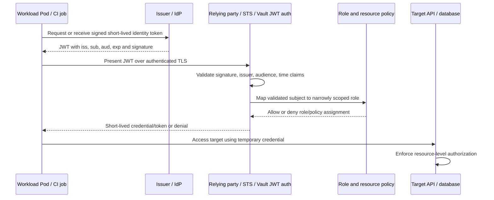
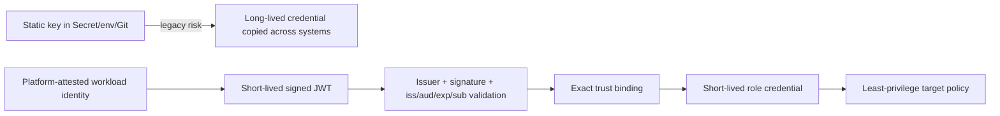

# Workload Identity, IRSA, and Federated Credentials

## Scope, assumptions, and verification status

**Module:** M09 — Secrets and Identity Management  
**Unit:** 7 — Workload identity, IRSA, and federated credentials  
**Target filename:** `07-workload-identity-irsa-and-federated-credentials.md`  
**Audience:** data/AI engineers who understand Linux, containers, Kubernetes/RBAC, CI/CD, GitOps, IaC and secret references, but have not yet designed a production workload-identity system.

This lesson follows the supplied Unit 7 prompt and the M09 syllabus requirements: L1 foundations → L2 local trust simulation → L3 trust architecture → L4 operations and incident response. The current-turn Unit 7 prompt and the available M09 syllabus prompt were inspected. A dated roadmap snapshot is available in the conversation, but the exact file named `Roadmap_ptree.md` was not independently confirmed in this execution; the target filename and placement therefore follow the supplied prompt rather than a claim that the exact repository tree was inspected. Only this standalone Markdown artifact is generated; no repository file is patched.

**Local lab assumptions [ASSUMPTION]:** disposable kind cluster, Docker or compatible container runtime, `kubectl`, Python 3, a maintained JWT library such as PyJWT, local Vault, and PostgreSQL. The syllabus planning baseline is approximately 4 CPU cores, 8 GB RAM and 30 GB free disk; this is an estimate, not a measured minimum. The full Vault/PostgreSQL/issuer lab may be heavy on that footprint. No cloud account, paid identity provider, real cluster, or real credential is required. Optional LocalStack/SPIRE are not required.

**Verification status:** official documentation was consulted for Kubernetes ServiceAccounts, Vault JWT auth, AWS EKS identity, Google Cloud Workload Identity Federation, Microsoft Entra Workload Identity Federation, and PyJWT claim validation on 2026-10-28. Links appear in References. Exact kind configuration, Kubernetes flags/endpoints, JWT library APIs, Vault role fields, cloud claim patterns, and optional-tool fidelity must still be checked against the installed versions. Labs, tests, and commands in this document were **not executed by the author**. Any sample output is representative, not captured evidence.

Labels used throughout:
- **[SOURCE]** required by the supplied curriculum.
- **[ASSUMPTION]** a stated local-lab or design assumption.
- **[VERIFY]** confirm the exact installed version, provider, schema, or runtime behavior before use.
- **[VERSION-SENSITIVE]** behavior or interface may differ by release.
- **ILLUSTRATIVE — NOT RUN IN REQUIRED LABS** means awareness-level cloud configuration, not a tested integration.

**Safety boundary:** use only conspicuously fake values. Never print a full JWT, copy a real token into an online decoder, put private signing keys into Git, or run destructive steps against a shared or production context. Never infer immediate token revocation after Pod deletion; test the chosen issuer/relying-party path.

## Learning outcomes and prerequisites

By the end, the learner can:

1. Explain static credential risk and signed-token exchange for short-lived credentials.
2. Explain issuer/IdP, JWT, JWKS, OIDC discovery, claims, relying party, STS, authentication versus authorization, audience and subject binding.
3. Inspect a projected ServiceAccount token locally without printing it and explain `iss`, `sub`, `aud`, `exp`, `iat`, `nbf`, and `jti` when present.
4. Compare AWS IRSA, EKS Pod Identity, GKE/GCP Workload Identity Federation, Azure Workload Identity, GitHub Actions OIDC and GitLab CI ID tokens at awareness level.
5. Design a local kind issuer/discovery/JWKS flow, while identifying version-specific constraints.
6. Build and test a teaching-only Python STS-like verifier with maintained JWT tooling, strict claim validation, allow-list authorization and negative tests.
7. Configure Vault JWT auth and outline the end-to-end flow to dynamic database credentials for a FastAPI service without static credentials in the Pod spec, image, environment, or Git.
8. Test audience, expiry, subject/namespace, signature, `kid`, issuer, unsafe algorithms, JWKS outage and replay/deleted-Pod assumptions.
9. Design narrow workload and CI trust policies, issuer separation, audience hygiene, and confused-deputy mitigations.
10. Run a JWKS key-rotation drill, build a trust-policy linter and identity graph review, and create a measured static-credential elimination plan.

Prerequisite review: Kubernetes ServiceAccounts and projected volumes (M03 Unit 9 / M06), RBAC and etcd exposure (M03/M06), Vault policies and JWT/Kubernetes auth (M09 Units 1–2), leases and DB credential refresh (Unit 3), ESO/secret managers (Unit 4), encrypted Git (Unit 5), at-rest encryption/CSI (Unit 6), CI threat modeling and OIDC (M02), egress controls (M04 Unit 5), mesh mTLS (M04 Unit 8), policy-as-code (M07 Unit 6), supply-chain controls (M12), and incident response (Unit 8 / M10). Revisit the relevant sibling lesson if a prerequisite is unclear; this unit does not replace those modules.

## Architecture at a glance





A token is not a magic permission slip. It is evidence of an identity claim that a relying party must validate and map to authorization. Short lifetime and audience binding reduce exposure, but a compromised Pod can use its token and the credentials it obtains during their validity window, plus any other resources reachable through network policy and RBAC.

## 7.0 — Unit orientation and running data/ML platform

A small data/AI platform runs a scoring API, an ETL job, a Spark task, an Airflow worker, a multi-tenant Jupyter environment, and a CI deployment job. They need access to a database, object-store prefixes, a model registry, and a secret manager.

| Workload | Needed access | Legacy pattern to eliminate | Desired identity pattern |
|---|---|---|---|
| Scoring API | read-only DB role, one model artifact prefix | DB password in env/Secret | Pod ServiceAccount → Vault JWT auth → dynamic DB credential; or cloud-native identity where supported |
| ETL job | write to one output prefix | shared object-store access key | per-job identity/role and scoped prefix permissions |
| Spark task | read dataset A, write dataset B | cluster-wide data-platform key | identity scoped to the job, dataset and run window |
| Jupyter notebook | user-authorized data access | shared namespace role with broad data access | per-user or per-workspace identity; strong tenant boundaries |
| CI deploy job | deploy to staging only | long-lived cloud key in CI variables | CI OIDC token bound to repository/ref/environment |
| Vendor integration | one SaaS API that only supports static API keys | key in manifest or CI variable | justified exception: store centrally, scope, rotate, monitor, document owner/review date |

The objective is not to assert “zero static credentials” before inventory. It is to measure a scoped baseline, migrate each supported credential, revoke old keys, verify the old access fails, and list the exceptions that remain.

## 7.1 — L1 foundations: identity, tokens, and trust

### Static credential versus workload identity

A static credential is a secret value that independently grants access for as long as the issuer/resource accepts it. It may be copied into a Kubernetes Secret, environment variable, image layer, CI setting, Git history, support bundle, or developer laptop. Each copy creates a new exposure surface, and long lifetime makes containment harder.

Workload identity binds an identity to a platform-controlled workload or job and lets that identity exchange a signed token for a short-lived credential. It removes the need to distribute a long-lived credential to every consumer; it does **not** remove the need for authorization, network boundaries, audit, or incident response.

| Threat | Long-lived static key | Short-lived workload token / exchange |
|---|---|---|
| Git or image leak | May remain valid until rotated/revoked; copies can persist | Token may expire sooner, but only if relying party enforces expiry and downstream credential lifetime is bounded |
| Cross-environment reuse | Common if the same key is copied | Narrow issuer, audience, subject and role conditions can separate environments |
| Attribution | Often difficult if shared | Subject/role/audit can improve attribution, depending on logs and provider |
| Revocation | Rotate key and all dependents | Disable trust/role or revoke downstream credential where supported; token may still be accepted until expiry by some paths |
| Compromised Pod | Exposes key and anything it can reach | Exposes mounted token and resulting temporary credential; blast radius is reduced, not zero |

### Terms

- **Identity provider (IdP) / issuer:** system that asserts identity and issues signed tokens. The issuer URL is a trust anchor; exact string comparison and trailing-slash behavior matter.
- **JWT:** a structured token commonly consisting of Base64URL-encoded header and payload plus a signature. Encoding is not encryption. Claims are untrusted until signature and required claims are validated.
- **OIDC discovery:** metadata describing the issuer and endpoints, commonly at `/.well-known/openid-configuration` appended to the issuer base URL. Exact URL construction is issuer-specific.
- **JWKS:** JSON Web Key Set containing public keys used to verify signatures. A key may have a `kid` identifier. A verifier must use a configured trusted JWKS location and refresh safely when a legitimate new `kid` appears.
- **Relying party:** service deciding whether to trust a token for a particular purpose.
- **STS:** Security Token Service, often an API that exchanges a trusted identity token for a short-lived credential.
- **Trust policy:** decides which issuer/subject/audience may assume or authenticate to a role.
- **Resource policy:** decides what the resulting role may do to the database, bucket, secret path or API.
- **Authentication (authN):** validates identity. **Authorization (authZ):** determines allowed actions. **Audit:** records the decision and activity safely.
- **Confused deputy:** a privileged service is tricked into using its authority on behalf of an identity that should not have that authority. Exact audience and subject/role binding help reduce this risk.
- **OIDC versus SAML:** both can support federation; OIDC commonly uses signed JWTs and discovery/JWKS, while SAML uses XML assertions. Awareness only here.
- **SPIFFE/SPIRE:** concepts for workload identity, attestation and SVIDs (X.509 or JWT) within trust domains. Compare with mesh mTLS in M04 Unit 8; the SPIRE lab is optional and not required.

### JWT claim table

| Claim | Meaning | Validation/design guidance |
|---|---|---|
| `iss` | issuer identifier | exact expected issuer; do not accept issuer supplied by an untrusted token without configuration |
| `sub` | subject identifier | bind to exact expected ServiceAccount or CI identity; common Kubernetes form is `system:serviceaccount:<namespace>:<name>` but verify issuer/version |
| `aud` | intended audience(s) | require the relying party's exact expected audience; reject wrong or missing audience where required |
| `exp` | expiration time | reject expired tokens; allow only a deliberately bounded clock skew |
| `iat` | issued-at time | useful for sanity checks; not a replacement for `exp` |
| `nbf` | not-before time | reject before the valid time, with bounded skew |
| `jti` | token identifier when present | may support correlation/replay controls; do not assume it exists or that it prevents replay by itself |
| platform claims | namespace, SA, Pod, repository, ref, environment, etc. | names and semantics are provider-specific `[VERIFY]`; bind only to documented claims |

**Fake payload — NOT A VALID TOKEN.** This is readable JSON only; it has no valid signature and must never be accepted as identity proof.

```json
{
  "iss": "https://issuer.example.invalid/lab-cluster",
  "sub": "system:serviceaccount:demo:scoring-reader",
  "aud": ["lab-sts"],
  "iat": 1790000000,
  "nbf": 1790000000,
  "exp": 1790000300,
  "jti": "FAKE-LAB-JTI-DO-NOT-USE"
}
```

### Projected tokens versus legacy token Secrets

Kubernetes projected `serviceAccountToken` volumes can request an audience and expiration; the kubelet rotates projected tokens before expiration in supported configurations. Exact minimum/maximum expiration and claim details depend on the cluster/version and issuer settings. Legacy Secret-based ServiceAccount tokens are not the pattern to create for new workloads.

If a workload does not need Kubernetes API credentials, set `automountServiceAccountToken: false`. If a relying party needs an identity token, explicitly project a token for that audience and only expose it to the component that needs it. Do not print token bytes. Decode locally only to inspect selected claims; decoding alone does not validate signature, issuer, audience, expiry or subject.

### JWT validation rules

Use a maintained JWT library, not handwritten cryptographic verification. Explicitly allow intended algorithms; reject `alg: none`; never confuse asymmetric public-key validation with HMAC shared-secret validation. Validate signature, issuer, audience, expiry, not-before, and subject-to-role mapping. Treat header and payload as untrusted until validation succeeds. Do not use `kid` as a path or arbitrary URL. Fetch keys only from a configured trusted issuer endpoint, with timeouts, bounded retries and safe cache refresh. Unknown `kid` must not cause fail-open behavior. Token validation does not automatically provide revocation, proof-of-possession or replay protection.

## 7.2 — L1 foundations: OIDC discovery, JWKS, JWT claims, and STS

A relying party needs a stable trust configuration. The usual discovery/JWKS flow is:

1. Operator configures the expected issuer URL and trust policy out of band.
2. Verifier fetches discovery metadata and JWKS from that configured issuer over a protected transport appropriate to the environment.
3. Verifier selects a public key by `kid` only within the trusted JWKS set and verifies the signature using an explicit algorithm allow-list.
4. Verifier validates exact `iss`, expected `aud`, `exp`, `nbf` and any required subject/claim conditions.
5. A separate authorization mapping decides which role is available to the validated subject.
6. The role's resource policy scopes the target actions.

Issuer discovery does not make an arbitrary issuer trustworthy. A token must not be allowed to choose its own JWKS URL. In production, protect against SSRF, redirects to untrusted hosts, DNS changes, malformed JWKS, excessive response size, stale caches and retry storms.

### Sequence: unknown `kid` and cache refresh

```mermaid
sequenceDiagram
  participant V as Verifier
  participant C as JWKS cache
  participant J as Configured trusted JWKS endpoint
  V->>C: Lookup token header kid
  C-->>V: Unknown kid
  V->>J: Bounded refresh request
  J-->>V: Updated JWKS (validated response)
  V->>C: Update cache safely
  V->>V: Verify signature and claims again
  alt Key still unknown or endpoint unavailable
    V-->>V: Reject; do not fail open
  end
```

Refresh only from a configured trusted endpoint. Use a bounded timeout, backoff and cache policy; do not let attacker-generated random `kid` values trigger unbounded fetches. Retain old public keys only for the overlap needed by still-valid tokens and documented cache behavior. Removing a key too early rejects legitimate in-flight tokens; retaining compromised keys too long extends trust in a bad key.

### Clock and issuer details

Time claims are Unix NumericDate values under JWT conventions. Clock skew allowance should be small, explicit and tested; do not disable expiry validation to “fix” time drift. Verify node/container time synchronization. Issuer URLs are identifiers, not merely locations: a trailing slash mismatch can cause validation failure, and sharing an issuer across dev/prod can merge trust boundaries if subject mapping is broad. Changing a Kubernetes issuer may break every relying party that trusts the previous issuer; treat it as a coordinated identity migration.

### Authentication and authorization are separate checks

A valid token from an approved ServiceAccount does not imply access to every Vault path, bucket or database. The token must first pass authentication and then map to a narrow role/policy. Test both failure classes separately: `invalid token` versus `valid identity but unauthorized resource`. Audit records should distinguish them without recording token contents.

## 7.3 — L1 awareness: cloud workload identity and CI federation

All snippets and mappings in this section are **ILLUSTRATIVE — NOT RUN IN REQUIRED LABS**. They teach the trust model; they do not prove a real cloud integration. Exact claim names, annotations, credential-chain behavior, conditions and prerequisites must be verified against current provider documentation.

| System | Identity source and exchange | Trust binding | Resulting access | Common misconfiguration | Official docs to verify |
|---|---|---|---|---|---|
| AWS IRSA | EKS projected ServiceAccount JWT → AWS STS `AssumeRoleWithWebIdentity` | registered cluster OIDC provider; role trust conditions for exact `sub` and `aud` | temporary AWS role credentials | omitted or wildcarded `sub`; wrong audience; issuer mismatch | EKS IAM roles for service accounts, IAM OIDC provider, STS API |
| EKS Pod Identity | EKS-managed Pod identity association/agent flow; distinct from IRSA | role trust uses EKS Pod Identity service principal and documented conditions | temporary AWS credentials delivered through supported SDK chain | assuming IRSA annotations or trust syntax are interchangeable | EKS Pod Identity setup and IAM role trust docs |
| GKE / GCP Workload Identity Federation | Kubernetes/GCP workload identity or external OIDC/SAML provider → Google STS token exchange | workload identity pool/provider and attribute mapping/conditions | short-lived Google credentials or service-account impersonation where configured | broad attribute mapping; key-based fallback; incorrect audience/subject | Google Cloud Workload Identity Federation and GKE docs |
| Azure Workload Identity | Kubernetes workload identity token → Microsoft Entra federated identity credential/token exchange | issuer, subject and audience match configured federation credential | Entra access token for authorized resource | wrong issuer/subject/audience; missing required cluster/webhook setup | Microsoft Entra Workload ID docs |
| GitHub Actions OIDC | CI job requests job-scoped ID token → cloud/Vault relying party | repository, ref, workflow/environment and issuer-specific claims | short-lived deploy credentials | trusting `repo:org/*`, fork PR, unintended branch/environment | GitHub Actions OIDC and provider-specific docs |
| GitLab CI ID token | CI job obtains ID token with configured audience/claims | project, ref, environment and issuer-specific claims | short-lived deploy credentials | broad project/group or ref trust; untrusted merge-request context | GitLab ID token and cloud federation docs |
| SAML | signed XML assertion and federation mapping | issuer/audience/recipient and assertion conditions | session or federated identity | weak assertion validation or mapping | OASIS SAML / provider docs |
| SPIFFE/SPIRE | workload attestation obtains SVID; may use X.509 or JWT form | trust domain, selectors/attestation and authorization policy | service identity for mTLS or token-based trust | overbroad selectors or trust-domain sharing | SPIFFE/SPIRE official specifications/docs |

### IRSA policy example — illustrative only

```json
{
  "Version": "2012-10-17",
  "Statement": [{
    "Effect": "Allow",
    "Principal": {"Federated": "arn:aws:iam::111122223333:oidc-provider/oidc.eks.example.invalid/id/FAKECLUSTER"},
    "Action": "sts:AssumeRoleWithWebIdentity",
    "Condition": {
      "StringEquals": {
        "oidc.eks.example.invalid/id/FAKECLUSTER:aud": "sts.amazonaws.com",
        "oidc.eks.example.invalid/id/FAKECLUSTER:sub": "system:serviceaccount:demo:scoring-reader"
      }
    }
  }]
}
```

Fake account and issuer identifiers are intentionally non-usable. The exact condition-key prefix must match the real provider's registered OIDC issuer, and the policy must be reviewed against current AWS docs. The key lesson: omitting `sub` may let more subjects from that issuer assume the role than intended. A valid `aud` condition alone does not uniquely identify a workload.

An IRSA Pod may be associated with a role through a ServiceAccount annotation and a supported webhook/SDK credential flow that provides a projected token and environment hints such as `AWS_WEB_IDENTITY_TOKEN_FILE` and `AWS_ROLE_ARN`. Exact names and behavior are version/provider-specific `[VERIFY]`. Do not assume EKS Pod Identity uses the same annotation or trust model.

### Good versus dangerous trust

| Pattern | Assessment | Reason |
|---|---|---|
| Exact issuer + exact audience + exact namespace/ServiceAccount subject | Preferred starting point | minimizes eligible identities |
| Exact CI issuer + exact repo/project + protected ref + deployment environment | Preferred starting point | limits which pipeline context can deploy |
| Whole issuer trusted with no subject mapping | Dangerous | any subject meeting other broad conditions may be accepted |
| `repo:example-org/*` wildcard to production | Dangerous | unrelated repository/fork/workflow may gain trust |
| Same issuer and broad role shared across dev/prod | Dangerous | environment boundary can collapse |
| Correct signature but no `aud` check | Dangerous | token minted for one recipient may be replayed to another |
| Broad trust plus powerful resource policy | Critical blast-radius failure | authentication scope and authorization scope are both broad |

## 7.4 — L2 lab: projected ServiceAccount token, issuer, discovery, and JWKS

**Goal:** inspect a fake projected token and verify the issuer/discovery/JWKS path without exposing token contents. **Threat model:** a relying party must not accept a token merely because its payload is readable. **Prerequisites:** disposable kind, kubectl, Docker-compatible runtime, shell, Python 3. No cloud account.

### Step A — record versions and create a disposable cluster

```bash
kind version
kubectl version --client
python3 --version
# Record these outputs in a lab note; don't assume a fixed version.
export LAB_CLUSTER='m09-u7-identity-lab'
kind create cluster --name "$LAB_CLUSTER"
kubectl config current-context
kind get clusters
```

Before any delete, confirm the current context and cluster name manually. If the cluster name already exists or context is ambiguous, stop and choose another unique name.

### Step B — inspect API-server configuration and discovery endpoints

The primary curriculum path configures kind's API server as the ServiceAccount issuer, including flags such as `--service-account-issuer`, `--service-account-jwks-uri` and `--api-audiences` where supported. Exact kubeadm patch shape, flag support, issuer signing-key behavior and kind `extraMounts` are `[VERIFY]` for the selected versions. Inspect the running API-server static Pod manifest and official versioned docs before constructing a patch; do not paste a guessed patch into a running cluster.

Useful inspection commands, only in the disposable cluster:

```bash
kubectl config current-context
kubectl -n kube-system get pods -l component=kube-apiserver
kubectl -n kube-system get pod -l component=kube-apiserver -o yaml
```

Review the API-server command arguments without copying private key material. Where supported and authorized, inspect discovery/JWKS endpoints with:

```bash
kubectl get --raw '/.well-known/openid-configuration'
kubectl get --raw '/openid/v1/jwks'
```

These endpoint paths and access behavior are `[VERIFY]`; use the exact paths exposed by the installed Kubernetes version. Some clusters restrict issuer discovery endpoints or require an RBAC permission/binding such as `system:service-account-issuer-discovery`. Do not grant anonymous access or broaden permissions just to make the lab convenient. Verify the current official Service Account Issuer Discovery docs and use an authorized identity.

A verifier inside the local lab must reach an issuer URL that matches the token's `iss`. A host-only address such as `127.0.0.1` may not be reachable from a Pod. For a local-only test, use a deliberately configured reachable endpoint and document any proxy/publishing layer. If the kind API-server issuer/discovery/JWKS cannot be configured safely with the installed release, use the separately labelled local test issuer in Lab 5/8; that alternative tests verifier logic but does **not** prove Kubernetes API-server issuer integration.

### Step C — create a dedicated ServiceAccount and projected token Pod

```yaml
apiVersion: v1
kind: Namespace
metadata:
  name: demo
---
apiVersion: v1
kind: ServiceAccount
metadata:
  name: scoring-reader
  namespace: demo
automountServiceAccountToken: false
---
apiVersion: v1
kind: Pod
metadata:
  name: projected-token-check
  namespace: demo
spec:
  serviceAccountName: scoring-reader
  automountServiceAccountToken: false
  containers:
    - name: sleeper
      image: busybox:1.36 # [VERIFY] pin a digest for reproducible production use
      command: ["sh", "-c", "sleep 3600"]
      volumeMounts:
        - name: workload-token
          mountPath: /var/run/workload-identity
          readOnly: true
  volumes:
    - name: workload-token
      projected:
        sources:
          - serviceAccountToken:
              path: token
              audience: "lab-sts"
              expirationSeconds: 600
```

Apply only after the cluster/context check. `expirationSeconds: 600` and audience `lab-sts` are lab requests; verify accepted bounds and token behavior for the installed cluster. Never use a real token in this exercise.

### Step D — decode only selected claims locally

The following illustrative script reads a token from a local file and prints only selected claims. It intentionally does **not** validate the signature and must not be used as an authenticator.

```python
# Illustrative lab path—not a file created by this task: lab/inspect_jwt_claims.py
import base64, json, sys
from pathlib import Path

def decode_segment(segment):
    padded = segment + "=" * (-len(segment) % 4)
    return json.loads(base64.urlsafe_b64decode(padded.encode("ascii")))

token = Path(sys.argv[1]).read_text(encoding="utf-8").strip()
parts = token.split(".")
if len(parts) != 3:
    raise SystemExit("not a compact signed JWT")
header = decode_segment(parts[0])
payload = decode_segment(parts[1])
print(json.dumps({
    "alg": header.get("alg"), "kid_present": bool(header.get("kid")),
    "iss": payload.get("iss"), "sub": payload.get("sub"),
    "aud": payload.get("aud"), "exp": payload.get("exp"),
    "iat": payload.get("iat"), "nbf": payload.get("nbf"),
    "jti_present": bool(payload.get("jti"))
}, indent=2))
```

Copying the token into a local temporary file is permitted only for the disposable fake lab; restrict file permissions and delete it at cleanup. Never echo it, paste it into chat, or send it to an online decoder. A decoded payload is attacker-controlled until cryptographic verification succeeds.

### Expected evidence and cleanup

Evidence: tool versions, current context, issuer URL, discovery/JWKS retrieval status, Pod spec showing explicit projection and `automountServiceAccountToken: false`, selected redacted claims, and a note distinguishing decoded from validated. Expected output is representative, not captured from a live run.

Troubleshooting: if endpoint returns 403, inspect RBAC and documented issuer-discovery permissions; do not disable authorization. If token issuer differs from configured issuer, inspect the running API-server flags and token source. If `aud` differs, verify the projected token volume and issuer. If kind patching is unsupported, stop and use the labelled test-issuer alternative.

Cleanup after confirming the context:

```bash
kubectl config current-context
kubectl delete namespace demo
# Only after manually confirming this is the disposable lab:
kind delete cluster --name "$LAB_CLUSTER"
kind get clusters
```

Remove local token files, private key material and temporary manifests; verify the named cluster is absent. Cluster deletion does not erase shell history or every host-level copy, so do not put real secrets into the lab.

## 7.5 — L2 lab: build and test the STS-like verifier

**TEACHING TOOL ONLY — NOT A PRODUCTION STS.** The following design is a test contract for a small Python service. It must use a maintained JWT library and a configured trusted JWKS URL; it is not a replacement for cloud STS, Vault, or a security-reviewed identity provider. The complete runtime flow depends on a reachable issuer/JWKS endpoint and compatible library version. PyJWT's exact APIs should be checked against the installed documentation `[VERIFY]`.

### Required behavior

1. Fetch JWKS only from a configured trusted URL with a timeout and bounded retries.
2. Select a public key by `kid` from the trusted set; never use `kid` as a file path or URL.
3. Verify signature using an explicit algorithm allow-list (for example, a chosen asymmetric algorithm supported by the actual issuer and library; do not assume the cluster key uses a particular algorithm).
4. Validate exact issuer, audience, expiration and not-before with a small configured clock skew.
5. Map `sub` to an explicit allow-list of roles; a valid token with an unapproved subject must be denied.
6. Refresh JWKS safely on unknown `kid`; if refresh fails or the key remains unknown, reject.
7. Return only a fake, short-lived lab role decision/opaque credential. Do not issue a real cloud credential.
8. Log request correlation ID, validation result and reason code; never log JWT, Authorization header, private key, or opaque credential.
9. Tests must reject malformed tokens, wrong audience/issuer/subject, expiry, `nbf`, bad signature, unknown `kid`, `alg: none`, algorithm confusion, JWKS outage and unsafe logging.

### Verifier skeleton — interfaces are illustrative

This code shows the validation boundary, not a complete web server or production service. `get_trusted_jwks_client()` and the HTTP handler must be implemented with bounded HTTP behavior and tested against the pinned library version. Do not run it as an Internet-facing STS.

```python
# Illustrative lab path—not a file created by this task: lab/verifier_core.py
# TEACHING TOOL ONLY — NOT A PRODUCTION STS.
import jwt
from jwt import PyJWKClient

EXPECTED_ISSUER = "https://issuer.example.invalid/lab-cluster"
EXPECTED_AUDIENCE = "lab-sts"
ALLOWED_ALGORITHMS = ["RS256"]  # [VERIFY] must match actual issuer key type
ALLOWED_SUBJECTS = {
    "system:serviceaccount:demo:scoring-reader": "lab-db-readonly"
}
JWKS_URL = "https://issuer.example.invalid/openid/v1/jwks"  # placeholder

class RejectToken(Exception):
    pass

def verify_and_map(token, jwks_client=None):
    """Validate identity and return a role name; never return raw claims/tokens."""
    client = jwks_client or PyJWKClient(JWKS_URL, timeout=2)
    try:
        signing_key = client.get_signing_key_from_jwt(token).key
        claims = jwt.decode(
            token,
            signing_key,
            algorithms=ALLOWED_ALGORITHMS,
            issuer=EXPECTED_ISSUER,
            audience=EXPECTED_AUDIENCE,
            leeway=5,
            options={"require": ["iss", "sub", "aud", "exp", "nbf"]},
        )
    except Exception as exc:
        # Production code must map known library exceptions to safe reason codes.
        # Never log `token` or include exception context that may contain it.
        raise RejectToken("jwt_validation_failed") from None

    role = ALLOWED_SUBJECTS.get(claims.get("sub"))
    if role is None:
        raise RejectToken("subject_not_allowlisted")
    return {"decision": "allow", "role": role, "subject": claims["sub"]}
```

**Important limitations:** the snippet does not implement an HTTP server, rate limiting, CSRF protection, replay cache, production key custody, issuer discovery pinning, safe transport, credential issuance, audit pipeline, availability, threat modeling or security review. PyJWKClient behavior, cache controls, timeout signature and unknown-`kid` refresh semantics must be verified for the pinned PyJWT release. The example algorithm must match the issuer's real signing key; if not, choose the correct explicit asymmetric algorithm after inspecting the actual issuer configuration. Never “fix” a signature error by disabling verification or adding every algorithm to the allow-list.

### Unit-test contract

The required test suite should construct fake signed tokens using a throwaway local test issuer/key pair and a controllable fake JWKS client. The following is a test matrix, not a claim that tests were run:

| Test | Fixture mutation | Expected result |
|---|---|---|
| valid token | exact fake issuer/audience/subject, valid time and signature | allow `lab-db-readonly` only |
| wrong audience | `aud=other-service` | reject `audience_invalid` |
| expired | `exp` in past | reject `token_expired` |
| not yet valid | `nbf` in future beyond allowed skew | reject `token_not_yet_valid` |
| wrong issuer | `iss` differs by host/path/trailing slash | reject `issuer_invalid` |
| wrong subject/namespace | subject not exact allow-list entry | reject `subject_not_allowlisted` |
| bad signature | mutate signed payload/signature | reject `signature_invalid` |
| unknown `kid` | new `kid` absent from stale cache | bounded refresh then reject if still absent; accept only after valid refreshed key is available |
| `alg: none` | unsigned token header | reject |
| algorithm confusion | token uses disallowed symmetric algorithm against public-key configuration | reject |
| malformed JWT | wrong segment count/invalid JSON | reject |
| JWKS timeout | fake client raises timeout | reject `jwks_unavailable`; never fail open |
| unsafe logging | token contains unique fake canary substring | assert no log record contains token or substring |

Expected test report is **representative only, not executed**: all test cases should pass only when invalid identities are rejected and no token text is logged. Add tests for malformed JWKS, response-size bounds, HTTP redirect policy and rate limiting before considering a real deployment.

### Concrete unit-test scaffold

The scaffold below shows how to exercise the verifier core with a local throwaway RSA key and a fake JWKS client. It assumes `cryptography` is installed through the maintained JWT library's supported extras and that `verify_and_map` is saved in the illustrative `verifier_core.py`. Exact dependency versions must be pinned and checked. It is not executed output.

```python
# Illustrative lab path—not a file created by this task: lab/test_verifier_core.py
import unittest
import time
from types import SimpleNamespace
from unittest.mock import patch
import jwt
from cryptography.hazmat.primitives.asymmetric import rsa
from cryptography.hazmat.primitives import serialization
import verifier_core

class VerifierCoreTests(unittest.TestCase):
    @classmethod
    def setUpClass(cls):
        cls.private_key = rsa.generate_private_key(public_exponent=65537, key_size=2048)
        cls.private_pem = cls.private_key.private_bytes(
            encoding=serialization.Encoding.PEM,
            format=serialization.PrivateFormat.PKCS8,
            encryption_algorithm=serialization.NoEncryption(),
        )
        cls.public_pem = cls.private_key.public_key().public_bytes(
            encoding=serialization.Encoding.PEM,
            format=serialization.PublicFormat.SubjectPublicKeyInfo,
        )

    def token(self, **changes):
        now = int(time.time())
        claims = {
            "iss": verifier_core.EXPECTED_ISSUER,
            "sub": "system:serviceaccount:demo:scoring-reader",
            "aud": verifier_core.EXPECTED_AUDIENCE,
            "iat": now - 5,
            "nbf": now - 5,
            "exp": now + 600,
        }
        claims.update(changes)
        return jwt.encode(claims, self.private_pem, algorithm="RS256", headers={"kid": "lab-key-a"})

    def verify_with_key(self, token):
        fake_client = SimpleNamespace(
            get_signing_key_from_jwt=lambda _token: SimpleNamespace(key=self.public_pem)
        )
        return verifier_core.verify_and_map(token, jwks_client=fake_client)

    def test_valid_token_maps_only_to_narrow_role(self):
        with patch.object(verifier_core, "EXPECTED_ISSUER", "https://issuer.example.invalid/lab-cluster"), \
             patch.object(verifier_core, "EXPECTED_AUDIENCE", "lab-sts"):
            result = self.verify_with_key(self.token())
        self.assertEqual(result["role"], "lab-db-readonly")
        self.assertEqual(result["decision"], "allow")

    def test_wrong_audience_rejected(self):
        with self.assertRaises(verifier_core.RejectToken):
            self.verify_with_key(self.token(aud="other-service"))

    def test_wrong_issuer_rejected(self):
        with self.assertRaises(verifier_core.RejectToken):
            self.verify_with_key(self.token(iss="https://wrong.example.invalid"))

    def test_expired_token_rejected(self):
        with self.assertRaises(verifier_core.RejectToken):
            self.verify_with_key(self.token(exp=int(time.time()) - 600, iat=int(time.time()) - 1200, nbf=int(time.time()) - 1200))

    def test_wrong_subject_rejected_after_signature_validation(self):
        with self.assertRaises(verifier_core.RejectToken):
            self.verify_with_key(self.token(sub="system:serviceaccount:other:admin"))

    def test_tampered_signature_rejected(self):
        valid = self.token()
        parts = valid.split(".")
        parts[2] = ("A" if parts[2][0] != "A" else "B") + parts[2][1:]
        with self.assertRaises(verifier_core.RejectToken):
            self.verify_with_key(".".join(parts))

    def test_unknown_kid_must_not_fail_open(self):
        class UnknownKidClient:
            def get_signing_key_from_jwt(self, _token):
                raise RuntimeError("unknown kid after bounded refresh")
        with self.assertRaises(verifier_core.RejectToken):
            verifier_core.verify_and_map(self.token(), jwks_client=UnknownKidClient())

    def test_none_algorithm_rejected(self):
        # Construct a deliberately unsigned compact JWT; it must never be accepted.
        header = jwt.utils.base64url_encode(b'{"alg":"none","typ":"JWT"}').decode()
        payload = jwt.utils.base64url_encode(b'{"iss":"https://issuer.example.invalid/lab-cluster","sub":"system:serviceaccount:demo:scoring-reader","aud":"lab-sts","exp":4102444800,"nbf":1}').decode()
        with self.assertRaises(verifier_core.RejectToken):
            self.verify_with_key(f"{header}.{payload}.")

if __name__ == "__main__":
    unittest.main()
```

This scaffold needs careful alignment of the test clock, `leeway`, `EXPECTED_ISSUER`, `EXPECTED_AUDIENCE`, and the pinned PyJWT API before execution. In particular, choose a fixed test clock strategy rather than relying on wall-clock timestamps in a repeatable suite. Add explicit tests for not-before, malformed tokens, JWKS timeout, algorithm confusion, unsafe logging, and key-refresh count. The test client shown here is a fake; it does not prove real network/JWKS behavior.

### Safe endpoint design

A real implementation should not accept a caller-supplied issuer/JWKS URL. Configure issuer and JWKS endpoint at deployment time. Use TLS with certificate validation where appropriate; use bounded request timeout and response size, cache with defined TTL, rate-limit token exchange, and avoid retry storms. Unknown `kid` triggers at most a bounded refresh. Failure to reach JWKS results in deny/temporary failure, not acceptance of an unverified token. A teaching-only opaque credential must have a fake value, short lifetime and no authority outside the local mock.

## 7.6 — L2 lab: Vault JWT auth and dynamic credentials for FastAPI

This is the realistic local federation-to-secret path:

`Projected ServiceAccount JWT → Vault JWT auth validates signature/issuer/audience/subject → narrow Vault token/policy → database secrets engine → short-lived DB credentials → FastAPI scoring service`

Use the same Vault or Vault-compatible server selected in M09 Unit 2. If that choice is not available, declare the server choice as an assumption and do not mix incompatible command syntax. This lesson does not assume the user's prior server choice is known.

### Stage 1 — local components and trust

Use a disposable kind cluster, local Vault, and local PostgreSQL with fake database contents. Generate a throwaway Vault initialization/unseal configuration only according to the selected lab mode; never reuse a real root token. Use local-only networking and TLS where practical; if a simplified HTTP endpoint is used inside the isolated lab, mark it as a lab-only compromise and never copy it to production.

Before configuring Vault JWT auth, verify that the issuer's discovery/JWKS endpoint is reachable from Vault and that the `iss` in the projected token exactly matches the configured issuer. If Vault is running outside the cluster, use an address reachable from Vault, not a Pod-only DNS name. The JWT auth API supports a configured discovery URL, JWKS URL or static validation public keys; select one method and verify exact configuration fields for the installed Vault version. Current Vault docs note that when a JWT has `aud`, the role's `bound_audiences` must exactly match at least one audience for current releases; confirm against the deployed version.

Illustrative Vault configuration shape (not executed; exact field/API behavior `[VERIFY]`):

```bash
# Illustrative commands; use only a disposable local Vault instance.
vault auth enable -path=jwt jwt
vault write auth/jwt/config \
  jwks_url="https://issuer.example.invalid/openid/v1/jwks" \
  bound_issuer="https://issuer.example.invalid/lab-cluster"

vault write auth/jwt/role/scoring-reader - <<'JSON'
{
  "role_type": "jwt",
  "user_claim": "sub",
  "bound_audiences": ["lab-vault"],
  "bound_subject": "system:serviceaccount:demo:scoring-reader",
  "token_policies": ["scoring-db-readonly"],
  "token_ttl": "5m",
  "token_max_ttl": "10m"
}
JSON
```

This illustrates the intended restriction, not a copy-ready production config. The issuer must actually mint the requested `lab-vault` audience; a token with audience `lab-sts` will not satisfy this role unless the audience is intentionally changed. Verify Vault field names, token TTL semantics, and JWT role support against current API docs. Never remove subject/audience binding to make a login succeed.

A narrow Vault policy should permit only the exact database credential endpoint required by the service. Do not grant `secret/*`, root, or broad database administration. The DB role should create a least-privilege database user (e.g., read-only access to the lab scoring schema) with a short lease. Exact database engine configuration fields and SQL template syntax depend on the selected Vault version and PostgreSQL setup; use Unit 3 and the official Vault Database Secrets Engine docs for the full validated configuration.

### Stage 2 — PostgreSQL least privilege

Illustrative SQL concept, not a full bootstrap script:

```sql
-- Fake local database only. Execute as a lab administrator, never against a real DB.
CREATE DATABASE scoring_lab;
CREATE ROLE scoring_reader NOLOGIN;
CREATE SCHEMA scoring AUTHORIZATION scoring_reader;
CREATE TABLE scoring.example_features (
  id INTEGER PRIMARY KEY,
  feature_value TEXT NOT NULL
);
GRANT CONNECT ON DATABASE scoring_lab TO scoring_reader;
GRANT USAGE ON SCHEMA scoring TO scoring_reader;
GRANT SELECT ON ALL TABLES IN SCHEMA scoring TO scoring_reader;
```

Vault's database secrets engine should generate a temporary login with only the necessary role membership/permissions, and revoke it according to the configured lease/revocation statements. Do not embed the database administrator password in the FastAPI Pod, image, source or Git. Bootstrap credentials belong only in the disposable Vault/DB setup path and should be removed at cleanup.

### Stage 3 — FastAPI credential consumption contract

The FastAPI workload must read the projected token from a file, authenticate to Vault, receive a short-lived Vault token, request dynamic DB credentials, connect to PostgreSQL, and refresh/recreate its connection pool before the DB lease expires. The code below is a deliberately incomplete interface sketch; exact Vault client and SQLAlchemy APIs, retry behavior and pool invalidation must be implemented/tested for pinned library versions. It must never log the JWT, Vault token, DB username/password or connection string.

```python
# Illustrative lab path—not a file created by this task: app/identity_db.py
from pathlib import Path
import os

TOKEN_FILE = Path("/var/run/workload-identity/token")
VAULT_ADDR = os.environ["VAULT_ADDR"]  # address only; no token/password in env
ROLE_NAME = "scoring-reader"
DB_ROLE = "scoring-readonly"


def acquire_db_credentials(vault_client):
    # Read token from the projected file; do not print or log it.
    jwt_value = TOKEN_FILE.read_text(encoding="utf-8").strip()
    try:
        login = vault_client.jwt_login(role=ROLE_NAME, jwt=jwt_value)
    finally:
        # Python immutable strings cannot be reliably zeroized; keep lifetime short.
        jwt_value = None
    vault_token = login.client_token
    try:
        # Request dynamic DB creds through the narrow database role endpoint.
        lease = vault_client.read_database_creds(role=DB_ROLE, token=vault_token)
        return lease.username, lease.password, lease.lease_duration
    finally:
        # Use a client library with explicit token handling; do not log this value.
        vault_token = None
```

This is an integration contract, not runnable complete code: the `vault_client` methods above are placeholders, and the `VAULT_ADDR` is a non-secret endpoint. Replace them only with the actual client API and test. A production-quality implementation needs TLS verification, timeouts, bounded retries/backoff, lease tracking, cancellation, connection-pool refresh, error redaction, and tests. Do not set `VAULT_TOKEN`, database passwords or cloud access keys as Pod environment variables.

### Stage 4 — prove zero static credentials in the workload boundary

Inspect the Pod YAML safely. Do not dump mounted token content or Kubernetes Secret data:

```bash
kubectl -n demo get pod scoring-api -o yaml
kubectl -n demo get pod scoring-api -o jsonpath='{.spec.containers[*].env[*].name}'
echo
```

Review the Pod spec for absence of static cloud keys, DB passwords, Vault tokens and API tokens; verify only non-secret endpoints/config are present. Check image build files, deployment manifests, Helm values, CI configuration and Git history using fake fixtures and a scanner. A source scan cannot prove no runtime leak; document the scan scope and exclusions. The projected JWT is a short-lived runtime identity token mounted as a file, not a static password baked into the image/env/Git.

Expected evidence: redacted Vault audit entry identifying role/subject, a successful read-only DB query, lease metadata (not credentials), application health, and scanner results. Never include a DB password or token in evidence.

### Expiry and failure handling

- **JWT expires before Vault login:** reread the refreshed projected token and retry once with backoff; don't log the token.
- **Vault unavailable:** fail closed; don't fall back to a static password.
- **Vault token expires:** reacquire identity and a Vault token through the approved path; do not assume old tokens can be renewed indefinitely.
- **DB lease expires:** stop using credentials for new connections, obtain a new lease and replace/invalidate the pool safely. Existing authenticated DB connections may remain active until closed, depending on database and revocation semantics; do not claim Vault lease expiry automatically closes all client connections.
- **DB role permissions too broad:** stop and correct the database role, not the identity trust conditions.
- **Issuer/JWKS unavailable:** behavior depends on Vault's key cache and auth configuration; test it, and don't broaden trust to bypass it.

Cleanup: revoke lab leases and Vault tokens using the supported path, remove the lab policy/role/auth config, delete only the disposable cluster, remove local Vault/DB data and temporary key/token files, and verify no credential-bearing file remains. Preserve only redacted evidence.

## 7.7 — L2 lab: complete negative-test matrix

Use the verifier/Vault test harness from Labs 2–3. Each test uses a fake token signed by a local throwaway key or a controlled mutation. The expected behavior is rejection; do not weaken validation to get a green test. Log only a correlation ID, reason code, validated identity fields where safe, and decision. Never log the token.

| Case | Fake mutation / condition | Expected decision | Safe evidence |
|---|---|---|---|
| Wrong audience | `aud` targets another service | reject authentication | `audience_invalid` |
| Expired token | `exp` in the past | reject authentication | `token_expired` |
| Wrong ServiceAccount | exact subject changes to unapproved SA | reject subject mapping | `subject_not_allowlisted` |
| Wrong namespace | namespace segment changes | reject subject mapping | `subject_not_allowlisted` |
| Tampered signature | modify signed byte/payload | reject signature | `signature_invalid` |
| Unknown `kid` | `kid` absent from cached JWKS | bounded refresh; reject if still unknown | `unknown_kid` or `jwks_unavailable` |
| Missing/broad `sub` binding | remove required relying-party condition | linter must fail configuration; don't run broad role | `missing_subject_binding` |
| Deleted-Pod/SA replay | use old bound token after deletion/recreation | record actual behavior of chosen path | `replay_behavior_observed`; no universal claim |
| Wrong issuer/trailing slash | `iss` differs by exact string | reject | `issuer_invalid` |
| `alg: none` | unsigned JWT | reject | `algorithm_not_allowed` |
| Algorithm confusion | disallowed symmetric algorithm with asymmetric trust config | reject | `algorithm_not_allowed` |
| Not-yet-valid / clock skew | `nbf` beyond bounded skew | reject | `token_not_yet_valid` |
| JWKS unavailable | trusted endpoint times out/returns error | fail closed; no acceptance | `jwks_unavailable` |
| Valid signature, unapproved subject | token is valid but subject not mapped | deny authorization | `subject_not_allowlisted` |
| CI fork | token comes from fork/untrusted PR context | reject trust mapping | `ci_context_not_allowed` |
| CI wrong repo/ref/environment | one trust claim differs | reject trust mapping | `ci_context_not_allowed` |

### Acceptance rules

1. All invalid token cases are rejected before role assignment.
2. A valid signature but unapproved subject is distinguished from invalid signature.
3. Unknown `kid` causes bounded refresh only from the configured trusted JWKS endpoint; failed refresh is a denial/temporary failure, never fail-open.
4. Unsafe algorithms are rejected before claim mapping.
5. Logs contain no JWT, Authorization header, Vault token or DB password. Test this with a unique fake marker in token fixtures.
6. Deleted-Pod/ServiceAccount replay behavior is described only from the actual issuer/relying-party semantics tested. Do not assert universal immediate invalidation.
7. Each test records fixture identifier, expected reason, actual reason, pass/fail and version details—never token bytes.

## 7.8 — L2 lab: JWKS signing-key rotation drill

The kind API-server signing-key rotation procedure may be unsupported or unsafe to alter casually. **Primary safe option:** use a local test issuer with disposable signing keys and a configurable JWKS endpoint. Record explicitly that this proves verifier cache-refresh behavior, not a Kubernetes API-server signing-key rotation. Only attempt kind API-server rotation after verifying a supported procedure for the exact release and rebuilding the disposable cluster if necessary.

### Rotation runbook

1. Create key pair A and publish public key A in JWKS with `kid=lab-key-a`.
2. Mint a fake token signed by A; verify acceptance with the configured issuer/audience/subject.
3. Add key B to JWKS with `kid=lab-key-b` while retaining A for the planned overlap. Do not expose private key material.
4. Mint a fake token signed by B. With a stale verifier cache, observe unknown `kid`; verifier should perform one bounded refresh and then verify B successfully.
5. Simulate JWKS timeout during refresh. Verifier must reject/temporarily fail, not accept an unknown key.
6. Keep A published while A-signed tokens may still be valid. Remove A only after the planned token lifetime and cache overlap have elapsed and evidence supports it.
7. Test that an A-signed token is rejected after A is removed and caches have refreshed, if the design expects that. Document any cache window where an old key remains trusted.
8. Roll back by republishing the last known-good public key only if that key is not compromised. If compromise is suspected, do not re-trust the compromised key; follow the incident plan.

### Rotation evidence and rollback triggers

| Evidence | Pass condition | Stop/rollback trigger |
|---|---|---|
| JWKS before/after | expected key IDs and public keys only; no private key | private key appears in served JWKS/logs |
| New token | accepted after safe refresh | accepted without signature/claims validation |
| Old token overlap | behavior matches defined overlap window | old key removed before legitimate tokens expire |
| JWKS outage | deny/temporary failure, no fail-open | verifier accepts token without trusted key |
| Cache behavior | bounded refresh and retry rate | attacker can cause unbounded network requests |
| Cleanup | local private keys and test tokens removed | untracked credential-bearing files remain |

Never log private keys or full tokens. Expected evidence is representative, not captured from a live run. Delete local test issuer state after the drill.

## 7.9 — L3: trust-policy design and workload identity architecture

### Trust design principles

- Bind to the narrowest subject: exact Kubernetes namespace + ServiceAccount, or exact CI repository/project + protected ref + environment, or documented provider-specific equivalent.
- Require an exact audience where the provider supports it.
- Separate roles by workload, environment, cluster and purpose. Avoid a single “data-platform” role with access to every bucket/database/secret path.
- Treat **issuer-per-cluster as identity-per-cluster**. Sharing an issuer URL across dev/prod can merge trust if claims/conditions overlap. An issuer change can break every relying party that trusts the old issuer; plan a coordinated migration.
- Keep token lifetime and resulting STS/Vault credential lifetime distinct. A short JWT can be exchanged for a longer-lived credential if policy allows; both lifetimes matter.
- Model network reachability and RBAC alongside token scope. A compromised Pod can use any network-accessible service it is authorized to reach.
- For CI, bind repo/project, ref, environment and event/workflow claims only after verifying provider-specific semantics. Fork pull requests and privileged `pull_request_target`-style events need special review; do not give untrusted PR jobs production secrets.
- Use separate dev/staging/prod trust domains and review cross-account/cross-cluster role chains explicitly.

### Data/ML workloads

| Workload | Recommended design direction | Review questions |
|---|---|---|
| Spark/ETL job | per-job identity and role scoped to dataset prefix and run window | can job A read job B's output? are credentials revoked/expired after run? |
| Airflow task | task/workload identity where supported; avoid one scheduler-wide powerful key | does the task inherit scheduler credentials? can workers be isolated? |
| Jupyter notebook | per-user or per-workspace identity; separate data authorization | can one tenant read another tenant's data? how is user identity carried to the backend? |
| Model registry pull | short-lived read-only identity scoped to approved models | can a training job publish where it should only read? |
| Training job | scoped object-store access and explicit artifact-write policy | are checkpoints, logs or model artifacts accidentally world-readable? |
| CI deploy | federated identity bound to repository/ref/environment | can a fork or non-protected branch assume production role? |

### Multi-tenant and service-to-service identity

Namespaces are useful scoping tools, not a complete tenant security boundary. Use per-tenant ServiceAccounts and backend roles, resource-level policy, network egress controls, workload isolation, and negative tests. Shared nodes, privileged agents and broad cloud roles can cross namespace lines.

SPIFFE/SPIRE provides a model for workload attestation and SVIDs in a trust domain. X.509 SVIDs are often used for mTLS; JWT SVIDs support token-oriented use cases. Compare these identities with Kubernetes ServiceAccount JWTs and mesh mTLS from M04 Unit 8. SPIRE is awareness/optional only here; installation and footprint must be verified before choosing it for a zero-budget lab.

### Human versus workload identity

Humans should use individual SSO/OIDC identities, MFA where supported, short-lived access and audited role assignment. Workloads should use platform-issued workload identity and narrow service roles. Do not share human admin credentials with Pods or CI. Break-glass access should be separately controlled, time-boxed, alarmed, documented, and reviewed after use.

### Threat model: token theft

- **Token read from `/var/run/secrets`:** minimize container privileges, use explicit projected audience/lifetime, isolate workloads, avoid debug/exec access, and don't log token files.
- **SSRF to metadata/token endpoint:** restrict egress, harden metadata service where relevant, validate destination policy and hop-limit settings against provider docs `[VERIFY]`.
- **Token leak in logs:** structured redaction and canary tests; log claims only after validation and only when necessary.
- **Compromised Pod:** scope role and network reachability; rotate/revoke downstream credentials as supported; investigate role assumption and data access.
- **Issuer/JWKS change:** change control, dual-key overlap, preflight tests, staged rollout and rollback.

## 7.10 — L3: CI federation, multi-tenancy, human access, and service identity

### CI federation design

A CI job should request an ID token for the intended audience and exchange it only with a relying party configured for the expected issuer and job context. Trust conditions should restrict repository/project, protected ref, deployment environment and event/workflow context as supported by the provider. Claim names and subject formatting are provider-specific `[VERIFY]`; never copy a generic claim expression into production without current docs and a negative-test suite.

**Good design:** a protected repository, a protected deployment ref, an explicitly named production environment and an exact relying-party audience. **Dangerous design:** trust an entire organization or wildcard all repositories/branches, allow forks to run privileged code, or reuse a production role for pull-request validation.

CI trust is not enough by itself. The job token should have only the deployment actions needed; the role's resource policy should scope deployment to the intended cluster/account/namespace. Follow M02 for CI threat modeling, pinned actions/dependencies, fork boundaries and least-privilege job permissions.

### CI-to-Vault local simulation (not real CI/cloud integration)

A local test issuer can mint a fake JWT with fake claims such as `repo`, `ref` and `environment`, sign it with a throwaway key, and expose the public key through local JWKS. Configure a Vault JWT role only after confirming the actual claim names and Vault role fields for the chosen version. The Vault role must bind exact values and issue a short-lived deploy policy; negative cases for fork, other repo, wrong ref, wrong environment, wrong audience and expiry must be rejected.

This simulation proves the test issuer, verifier and Vault role conditions behave as configured. It does not prove GitHub/GitLab's real issuer, event semantics, cloud IAM, MFA, or production token issuance. Never use actual repository secrets in the simulation.

### Illustrative GitHub Actions workflow shape

```yaml
# ILLUSTRATIVE — NOT RUN IN REQUIRED LABS. Verify current provider docs.
name: deploy-staging
on:
  push:
    branches: ["main"]
permissions:
  contents: read
  id-token: write
jobs:
  deploy:
    environment: staging
    runs-on: ubuntu-latest
    steps:
      - uses: actions/checkout@<PINNED_REVIEWED_COMMIT_SHA>
      - name: Exchange OIDC identity
        run: echo "Use the provider-supported OIDC exchange action/SDK here"
```

The placeholder action SHA is intentionally not a usable pin. Do not run this snippet until a reviewed action commit and provider-specific trust claims are configured. `id-token: write` allows the job to request an OIDC token; it does not by itself authorize cloud access. Trust and resource policy determine the resulting permissions.

### Multi-cluster and multi-account

Treat each cluster issuer as a separate identity boundary where possible. Cross-account role chains and hub-and-spoke trust can be useful but increase the graph of principals and policies. Record the source issuer, exact subject, audience, role chain, resource policy, owner and expiry/review date. M14 covers deeper multi-cluster identity; this unit introduces the threat model only.

## 7.11 — L4: trust-policy-as-code and access reviews

### Trust-policy linter

The following small Python checker is a teaching example for a normalized policy inventory, not a parser for every cloud IAM or Vault schema. It detects obvious defects in sanitized fixtures. Provider-specific JSON/Rego schemas must be checked against official docs. **Illustrative lab path—not a file created by this task:** `lab/lint_trust_policies.py`.

```python
# Illustrative script; not a full AWS IAM or Vault schema validator.
from typing import Any

def lint_irsa_like(policy: dict[str, Any]) -> list[str]:
    findings = []
    statements = policy.get("Statement", [])
    if isinstance(statements, dict):
        statements = [statements]
    if not statements:
        findings.append("no_statements")
    for i, stmt in enumerate(statements):
        if stmt.get("Effect") != "Allow":
            continue
        action = stmt.get("Action", [])
        if isinstance(action, str):
            action = [action]
        if "sts:AssumeRoleWithWebIdentity" not in action:
            continue
        condition = stmt.get("Condition", {})
        flat = {}
        for operator, values in condition.items():
            if isinstance(values, dict):
                flat.update(values)
        aud_keys = [k for k in flat if k.endswith(":aud")]
        sub_keys = [k for k in flat if k.endswith(":sub")]
        if not aud_keys:
            findings.append(f"statement_{i}:missing_audience_condition")
        if not sub_keys:
            findings.append(f"statement_{i}:missing_subject_condition")
        if any("*" in str(flat[k]) for k in sub_keys):
            findings.append(f"statement_{i}:wildcard_subject_review")
        principal = stmt.get("Principal", {})
        federated = principal.get("Federated") if isinstance(principal, dict) else None
        if not federated:
            findings.append(f"statement_{i}:missing_federated_principal")
    return findings

def lint_vault_jwt_role(role: dict[str, Any]) -> list[str]:
    findings = []
    if not role.get("bound_audiences"):
        findings.append("vault_role:missing_bound_audiences")
    if not role.get("bound_subject") and not role.get("bound_claims"):
        findings.append("vault_role:missing_subject_or_claim_binding")
    if role.get("token_policies") in (None, [], ["default"]):
        findings.append("vault_role:policy_scope_requires_review")
    return findings
```

Test fixtures should include: a narrow approved role, missing `aud`, missing `sub`, wildcard subject, broad repository/ref/environment, unapproved issuer, dev/prod overlap, and an unsafe Vault role. Expected output is a list of findings; a clean fixture should return no findings. This checker does not fully parse nested cloud conditions, policy variables, negation operators, or Vault's full schema, so human review and provider-native policy tests remain required.

### Trust-policy test corpus

| Fixture | Defect | Expected linter result |
|---|---|---|
| exact issuer + `aud` + exact `sub` | none in modeled rules | no finding; still human-review |
| no `aud` | audience missing | `missing_audience_condition` |
| no `sub` | subject missing | `missing_subject_condition` |
| `sub=system:serviceaccount:*:*` | wildcard subject | `wildcard_subject_review` |
| no federated principal | trust source unclear | `missing_federated_principal` |
| Vault role without bound audience | audience not bound | `vault_role:missing_bound_audiences` |
| Vault role with no subject/claim binding | role accepts overly broad identities | `vault_role:missing_subject_or_claim_binding` |
| same policy reused dev/prod | environment overlap | policy inventory review must flag; not fully detected by function alone |

Run the linter against fixtures only. Record test results and false-negative limitations. Do not mark a production policy safe solely because this simple checker returns no findings.

### Identity graph / access review script

Input is a sanitized JSON inventory—not live JWTs or secret data. It maps `ServiceAccount → issuer/subject → relying-party role → policy → allowed paths/resources`, detects missing owners, broad wildcard paths and stale review dates where supplied. Illustrative lab path: `lab/identity_graph_review.py`.

```python
# Illustrative script; input contains metadata only, no token or secret values.
from datetime import date

def review_identities(records, today=None):
    today = today or date.today().isoformat()
    findings = []
    graph = []
    for row in records:
        principal = f"{row.get('namespace', '?')}/{row.get('service_account', '?')}"
        role = row.get('role', '?')
        paths = row.get('allowed_paths', [])
        graph.append({"principal": principal, "role": role, "paths": paths})
        if not row.get("owner"):
            findings.append({"principal": principal, "finding": "missing_owner"})
        if not row.get("issuer") or not row.get("subject"):
            findings.append({"principal": principal, "finding": "missing_issuer_or_subject"})
        if any(p in ("*", "/*", "secret/*", "*") for p in paths):
            findings.append({"principal": principal, "finding": "broad_resource_scope"})
        if row.get("review_due") and row["review_due"] < today:
            findings.append({"principal": principal, "finding": "review_overdue"})
    return {"graph": graph, "findings": findings}
```

This is an illustrative starter, not a full IAM graph engine. It does not discover trust relationships automatically or resolve inherited permissions. Test with a narrow identity, an ownerless identity, a wildcard path and an overdue review. Report counts by finding type and redact internal details before sharing.

### Access review workflow

1. Inventory issuer, subject, role, resource policy, owner, environment, last successful use if available, review due date, and exception rationale.
2. Build graph edges from workload identity to relying party, role/policy and target resources.
3. Flag broad subjects, wildcard paths, missing owners, stale identities, shared dev/prod roles and unreviewed exceptions.
4. Validate suspected unused identities with owners before disabling; do not blindly remove identities that support recovery.
5. Test policy changes against positive and negative fixtures; stage and monitor.
6. Record reviewer, date, decision and evidence without token values.

## 7.12 — L4: identity platform operations, migration, and SLOs

### Operating model and suggested measurements

Metric names and targets are organization-defined; the following are measurement candidates, not universal SLOs:

- token-exchange success rate and latency;
- validation failures by reason (`issuer`, `audience`, `expiry`, `signature`, `subject`, `jwks_unavailable`);
- JWKS fetch/cache refresh failure rate and request volume;
- Vault login errors, credential-fetch errors, DB lease expiration and pool refresh failures;
- workload startup failures attributable to identity/mount/auth;
- number of broad trust policies, overdue access reviews and ownerless identities;
- static credential count by inventory scope, and percent with a documented replacement/exception;
- median and tail time from leak detection to verified revocation.

Avoid logging full token or credential content in telemetry. Use validated, safely selected identity metadata and reason codes. Confirm provider metric names from current docs before writing alert rules.

### Trust-policy change process

1. Change trust policy as code with a named owner and reason.
2. Run linter and positive/negative policy tests.
3. Review exact issuer/audience/subject and resource permissions separately.
4. Stage in a disposable/non-production identity boundary.
5. Verify intended workload succeeds and wrong workload/fork/ref/audience is denied.
6. Roll out gradually and monitor failures.
7. Preserve redacted evidence and a rollback plan.
8. Update the identity graph, ownership, review date and golden-path templates.

### JWKS/issuer operations

Maintain an inventory of all relying parties that trust an issuer. Before changing issuer URL or signing keys, identify every consumer and test overlap, cache refresh and rollback. Keep old public keys only for the defined overlap; remove compromised keys through an incident process. For issuer URL changes, stage new trust alongside old only if policy and provider semantics safely support it, migrate consumers, then remove old trust after evidence shows no remaining use. Never assume one change affects only one workload.

### Static credential elimination playbook

| Phase | Action | Exit evidence |
|---|---|---|
| 1. Inventory | list credential, owner, purpose, scope, location, dependents, last use if known | baseline count and scan coverage recorded |
| 2. Classify | supported federation, dynamic secret, or justified static exception | decision and risk owner for each item |
| 3. Design | narrow identity, audience, role and resource policy | trust-policy tests pass, negative tests reject |
| 4. Dual-run safely | introduce identity path with monitoring; do not leave broad access indefinitely | workload succeeds through identity; no fallback dependency unexplained |
| 5. Cut over | remove static credential from manifests/CI/image/runtime | scans and workload review show no active static dependency in scope |
| 6. Revoke old key | revoke/rotate at source, not just delete file | old credential fails a safe negative test; audit evidence retained |
| 7. Monitor | watch auth failures, old-key use and stragglers | no unexplained legacy use over review window |
| 8. Exception review | store unavoidable SaaS keys centrally, scope/rotate, name owner and expiry/review date | exception register and compensating controls |

### Before → after count methodology

Count **distinct active static credentials in a defined inventory scope**, not every string match. Deduplicate by credential fingerprint/owner system without storing the credential itself. Scope must specify repositories, manifests, CI settings accessible to the team, images, secret manager inventory, and services. Scanner coverage is incomplete for encoded/obfuscated secrets and inaccessible SaaS systems, so report coverage and limitations.

Example report format only:

| Scope | Before | After | Remaining exceptions | Coverage / limitation |
|---|---:|---:|---:|---|
| fake lab inventory | `N_before` | `N_after` | `N_exception` | list scanned surfaces and unavailable systems |

Do not invent counts or claim zero without evidence. The learner fills the values from actual inventory and scan results. Old-key revocation evidence is required; deleting a manifest does not prove a credential is dead.

### Platform golden path (M16 forward reference)

A namespace-vending workflow should create a dedicated ServiceAccount, identity trust binding, least-privilege resource policy, policy tests, logging/alerts, owner metadata and access-review schedule. It should prevent broad wildcard subjects and dev/prod role reuse by default. Exceptions require a named owner, expiry/review date and explicit risk acceptance. M16 develops platform golden paths in more depth.

## 7.13 — Incident scenarios: diagnose, fix, prevent

### Scenario 1 — IRSA trust policy omitted `sub`

- **Symptoms:** a workload other than the intended ServiceAccount can obtain the production role.
- **Contain:** disable or narrow the affected role trust path using the provider-supported procedure; avoid breaking unrelated workloads without impact assessment.
- **Scope:** inspect role assumption audit records, issuer/audience/subject metadata and target resource access. Do not log tokens.
- **Fix:** bind exact expected `aud` and `sub`, test a legitimate workload and at least one wrong namespace/ServiceAccount.
- **Prevent:** trust-policy linter, policy review, inventory of role-to-ServiceAccount edges.

### Scenario 2 — Dev and prod share issuer trust too broadly

- **Symptoms:** dev workload can authenticate to a production relying party.
- **Contain:** remove unintended trust and evaluate whether downstream credentials/data were accessed.
- **Scope:** map issuer, subject, role chain and resource policy; review cross-cluster audit.
- **Fix:** separate issuer/trust mapping by cluster/environment and bind exact subjects.
- **Prevent:** issuer-per-cluster design, negative tests, M14 multi-cluster review.

### Scenario 3 — CI role trusts `repo:example-org/*`

- **Symptoms:** an unintended repository or fork context can assume deployment role.
- **Contain:** narrow trust to approved repo/ref/environment and suspend affected deploy flow if necessary.
- **Scope:** CI job context, event type, role-assumption audit, changed resources.
- **Fix:** exact provider-supported conditions; test fork, wrong repo, branch and environment.
- **Prevent:** M02 CI threat model, pinned actions, protected environments and policy-as-code.

### Scenario 4 — Issuer changed during cluster upgrade

- **Symptoms:** all federated logins fail with issuer mismatch or relying-party errors.
- **Contain:** stop additional issuer changes and avoid weakening `iss` checks.
- **Scope:** inventory all relying parties, old/new issuer values and key/discovery availability.
- **Fix:** execute a coordinated migration using a verified overlap procedure; validate old/new identity paths.
- **Prevent:** change-impact graph, preflight tests, staged rollout and rollback.

### Scenario 5 — JWKS cache never refreshes after rotation

- **Symptoms:** tokens signed by the new key fail with unknown `kid` while the endpoint publishes the key.
- **Contain:** avoid disabling signature validation; inspect cache and issuer endpoint health.
- **Scope:** `kid` metadata, cache TTL, endpoint response and network errors; no token dumps.
- **Fix:** bounded refresh on unknown `kid`, verify trusted endpoint and cache semantics.
- **Prevent:** rotation drill, alerting and release-specific tests.

### Scenario 6 — Verifier accepts a wrong audience

- **Symptoms:** token intended for another service is accepted.
- **Contain:** disable the unsafe verifier path and review issued credentials and downstream access.
- **Scope:** verifier code/config, token audience mapping, logs and roles.
- **Fix:** exact audience validation and required-claim test; reject missing/wrong audience.
- **Prevent:** maintained library, explicit required claims, regression tests.

### Scenario 7 — Full JWT appears in application logs

- **Symptoms:** token value appears in log search, traces, exception report or support bundle.
- **Contain:** restrict access and retention; treat the token as compromised within its actual trust and lifetime; revoke downstream credentials where supported.
- **Scope:** all log sinks, replicas, tickets, exports and audit trail; avoid copying token into incident notes.
- **Fix:** remove token from logging paths, rotate downstream credentials, verify old access fails where possible.
- **Prevent:** structured reason-code logging, redaction tests and canary token test.

### Scenario 8 — `alg: none` or algorithm confusion accepted

- **Symptoms:** a token with an unsafe algorithm passes validation.
- **Contain:** disable the verifier, rotate affected credentials and investigate role assumptions.
- **Scope:** JWT library/version, algorithm allow-list and key-type handling.
- **Fix:** use a maintained library, explicit algorithm allow-list, signature verification and regression fixtures.
- **Prevent:** security review and negative tests for `none` and asymmetric/symmetric confusion.

### Scenario 9 — Pod deleted but old token still works

- **Symptoms:** token remains accepted after Pod/ServiceAccount change.
- **Contain:** disable trust/role or revoke downstream credential where supported; don't assume deletion is revocation.
- **Scope:** token expiration, audience, issuer, relying-party cache and revocation semantics.
- **Fix:** use supported revocation/short TTL and role restrictions; document what is and isn't immediately invalidated.
- **Prevent:** explicit replay/deletion tests and a short, measured credential lifetime.

### Scenario 10 — Static credential remains after migration

- **Symptoms:** a legacy key is still present in an image, CI variable, environment, Git history or external service.
- **Contain:** revoke/rotate at the source first, then update consumers safely.
- **Scope:** inventory all dependents and audit for old-key use.
- **Fix:** remove copies, redeploy, prove old credential fails, update exception register.
- **Prevent:** periodic scans, ownership map, access review and migration gate.

## 7.14 — Mandatory lab workbook and completion gate

All required labs use disposable resources and fake values. Evidence must be redacted. No lab below is claimed to have been executed by the author.

### Lab 1 — Issuer, discovery, JWKS, and projected token

**Objective/threat:** prove the workload token's issuer/audience/subject and discovery/JWKS are inspectable without printing the token.  
**Prerequisites:** kind, kubectl, Docker-compatible runtime; versions recorded.  
**Steps:** create unique cluster; verify context; inspect API-server issuer flags; configure supported issuer/audience/JWKS settings only after checking kind/Kubernetes docs; query discovery and JWKS where supported; create dedicated ServiceAccount and projected token with custom audience; decode selected claims locally; document that decode is not validation.  
**Evidence:** version record, context, discovery/JWKS status, projected volume spec, redacted claims, issuer/audience explanation.  
**Negative tests/troubleshooting:** unauthorized discovery, wrong issuer URL, wrong audience, unreachable verifier endpoint. Do not disable auth or widen anonymous access to make it work.  
**Cleanup:** delete namespace and named cluster after context guard; remove temporary token/config files and verify.  
**Acceptance:** exact version-sensitive paths/flags are recorded; token never printed; claims are explained; alternative test issuer is clearly marked if kind path is unsupported.

### Lab 2 — STS-like verifier and Vault JWT auth exchange

**Objective/threat:** verify identity exchange and narrow role mapping without cloud credentials.  
**Prerequisites:** Lab 1, Python/JWT library, local Vault, local PostgreSQL, fake data.  
**Steps:** build teaching-only verifier with configured trusted JWKS, explicit algorithms, issuer/audience/time/subject checks and role allow-list; test verifier; configure Vault JWT auth with exact audience/subject; configure narrow policy and DB secrets engine role; have FastAPI read projected token from file, authenticate to Vault and request dynamic DB credentials; execute a read-only query.  
**Evidence:** sanitized validation/role decision, Vault audit metadata, DB lease metadata, successful query, no static credentials in Pod spec/image/env/Git scan.  
**Negative tests:** wrong audience/subject, expired token, JWKS outage, Vault policy denied.  
**Troubleshooting:** issuer reachability, discovery/JWKS mismatch, Vault role audience mismatch, DB permissions, lease/pool refresh. Never broaden trust as a generic fix.  
**Cleanup:** revoke lab leases/tokens, remove policy/role/auth setup and temporary files, delete cluster, verify cleanup.  
**Acceptance:** successful end-to-end flow or explicitly staged evidence; mock must not be presented as real Vault/DB proof; no static credentials in workload boundary.

### Lab 3 — Full negative-test matrix

**Objective/threat:** prove the verifier and Vault role reject malformed or unapproved identities.  
**Prerequisites:** Lab 2 test harness and fake issuer/key pair.  
**Steps:** execute every case in §7.7; add fork/repo/ref/environment cases to CI simulation; record expected and actual reason codes.  
**Evidence:** test results, fixture IDs, reason codes, no token values.  
**Troubleshooting:** separate signature/claim failure from role authorization failure; verify library exceptions and JWKS behavior.  
**Cleanup:** remove test token/key fixtures and lab roles; verify.  
**Acceptance:** all invalid cases deny, no fail-open, unsafe logging test passes, replay/deleted-Pod behavior is reported only as observed.

### Lab 4 — JWKS rotation drill

**Objective/threat:** ensure new signing keys can be adopted safely without trusting unknown keys or removing old keys too early.  
**Prerequisites:** local test issuer/JWKS and verifier cache.  
**Steps:** publish A, validate A token; add B while retaining A; mint B token; observe stale-cache behavior; refresh on unknown `kid`; simulate endpoint outage; remove A only after planned overlap; test old token behavior; record rollback trigger.  
**Evidence:** key IDs only, before/after JWKS metadata, cache refresh results, outage result, token acceptance decisions.  
**Troubleshooting:** do not rotate kind API-server signing keys unless an exact supported procedure is verified.  
**Cleanup:** remove private test keys and tokens, verify.  
**Acceptance:** refresh is bounded, trusted endpoint only, no fail-open, and the lesson states whether it used a test issuer or kind issuer.

### Lab 5 — Trust-policy linter

**Objective/threat:** detect broad IRSA-style trust and unsafe Vault JWT role configurations before deployment.  
**Prerequisites:** Python 3 or Rego/Conftest; sanitized fake fixtures.  
**Steps:** implement the linter in §7.11 or an equivalent policy-as-code rule; include narrow approved policy, missing `aud`, missing `sub`, wildcard `sub`, unapproved issuer, broad repo/ref/environment and dev/prod overlap; run positive and negative tests.  
**Evidence:** linter output and fixture list.  
**Troubleshooting:** simple parser is not a complete provider schema validator; review nested condition operators and provider variables.  
**Cleanup:** remove local fixtures if they contain test key metadata; no repository files modified by this task.  
**Acceptance:** planted defects are detected; limitations and human review are explicit.

### Lab 6 — CI-to-secrets federation simulation

**Objective/threat:** test that a CI-style identity token is bound to exact repository/project, ref and environment.  
**Prerequisites:** local test issuer/JWKS, Vault JWT auth role or local relying-party simulation; no real CI secret.  
**Steps:** mint a fake CI JWT from a local issuer with documented test claims; bind a Vault role to exact claims after verifying actual Vault role syntax; request a short-lived lab deploy credential; test fork, other repository, wrong branch/ref, wrong environment, wrong audience and expired token.  
**Evidence:** token fixture IDs only, role decisions and negative-test output.  
**Troubleshooting:** claim names vary by provider; local claims are simulation-only and do not prove GitHub/GitLab issuance or cloud IAM.  
**Cleanup:** revoke lab tokens/leases, remove local signing keys and role, verify.  
**Acceptance:** intended context allowed, all unintended contexts rejected; simulation fidelity limitations documented.

### Lab 7 — Identity graph/access review

**Objective/threat:** map which workload identities can reach which roles, policies and resources.  
**Prerequisites:** sanitized metadata inventory; no live token or secret data.  
**Steps:** run a graph review script; include narrow identity, wildcard path, ownerless identity, missing issuer/subject and overdue review fixtures; summarize findings and owners.  
**Evidence:** redacted graph/report, counts by finding type and input schema.  
**Troubleshooting:** script cannot infer inherited permissions or discover provider state without a collector; unknown relationships remain open.  
**Cleanup:** remove local inventory fixtures if not needed.  
**Acceptance:** broad scopes and ownership gaps detected; no tokens/secret values processed.

### Lab 8 — Optional LocalStack STS or SPIRE mini-lab

**Optional only; not required to complete Unit 7.**

**Option A — LocalStack:** verify current LocalStack version/edition and exact STS `AssumeRoleWithWebIdentity` coverage before attempting. Use fake IDs and a local test token only. Record which API calls are simulated and which real AWS IAM trust-policy condition evaluations, OIDC registration, credential semantics or audit behaviors are not proven. LocalStack success is not proof of real AWS IRSA.

**Option B — SPIRE:** verify supported version, container footprint, trust-domain configuration, workload attestation and SVID path. Use only a disposable local deployment. This demonstrates SPIFFE/SPIRE concepts, not cloud STS federation. If resource footprint or setup is too high, submit a written architecture exercise instead of claiming a lab ran.

**Acceptance:** chosen option and exact fidelity limits are documented; optional work does not block the required course.

### Lab 9 — Static-credential elimination plan

**Objective/threat:** reduce long-lived credentials and prove old access is revoked.  
**Prerequisites:** inventory from Unit 1, scanner coverage list and owners.  
**Steps:** enumerate credentials in the running example; count distinct active static credentials before migration; map each to workload identity, dynamic credentials, or justified exception; record owner, purpose, scope, location, replacement, rollout, old-key revocation evidence, remaining exception and review date; after cutover run the same scoped scan and calculate after count.  
**Evidence:** before/after table, scan scope/coverage, revocation records, negative test that old credential fails, exceptions register.  
**Troubleshooting:** deduplicate findings without storing credential values; scanner results alone cannot prove runtime absence; inaccessible SaaS settings must be reported as gaps.  
**Cleanup:** remove fake credentials and local lab repos; verify.  
**Acceptance:** actual measured counts are reported only after collection. Do not claim zero without evidence. Distinguish credential count from number of string matches.

### Completion gate

- [ ] Version/context record exists and destructive operations were confined to a named disposable environment.
- [ ] All test values and keys were fake and generated for the lab.
- [ ] JWT was never printed or sent to an online decoder.
- [ ] Signature, issuer, audience, expiry, not-before, subject and allowed algorithms were validated.
- [ ] Unknown `kid` refresh is bounded and never fail-open.
- [ ] Wrong audience, expiry, subject, namespace, signature, issuer, unsafe algorithm and JWKS outage are rejected.
- [ ] Vault policy and DB role are least privilege; DB lease expiry/pool refresh boundary is understood.
- [ ] Static credential scan scope and limitations are recorded; old keys are revoked and tested dead.
- [ ] JWKS rotation and rollback evidence exists.
- [ ] Trust-policy linter catches planted defects; identity graph report is redacted.
- [ ] CI simulation rejects fork/wrong repo/ref/environment; cloud integration is not falsely claimed.
- [ ] All local resources, test tokens and private keys are removed and cleanup verified.
- [ ] Unsupported or uninspectable behavior is marked `UNKNOWN`/`OPEN`, not `PASS`.

### Outcome-to-evidence map

| Outcome | Section/lab | Evidence |
|---|---|---|
| Explain identity exchange and claims | 7.1–7.2 | claim table, trust sequence diagram |
| Compare cloud federation options | 7.3 | awareness matrix with docs to verify |
| Inspect projected token safely | 7.4 / Lab 1 | redacted claims, issuer/JWKS record |
| Validate JWT correctly | 7.5 / Lab 2–3 | verifier tests and safe rejection reasons |
| Vault JWT + dynamic DB flow | 7.6 / Lab 2 | Vault audit, DB query, lease metadata, scanner results |
| Negative testing | 7.7 / Lab 3 | complete matrix with actual observed results |
| JWKS rotation | 7.8 / Lab 4 | key ID/cache/overlap/rollback evidence |
| Trust policy and multi-tenancy | 7.9–7.10 / Lab 5–6 | linter and CI negative tests |
| Access graph | 7.11 / Lab 7 | redacted identity graph and findings |
| Credential elimination | 7.12 / Lab 9 | measured before/after and old-key revocation proof |

### Scenario-based review questions with model answers

1. **Why is a decoded JWT payload not proof of identity?** Because decoding only reveals encoded JSON. It does not validate the signature, issuer, audience, time claims or subject authorization.
2. **What must a relying party validate?** Signature using a trusted key and explicit algorithm allow-list, exact issuer, expected audience, expiration, not-before, required claims and subject-to-role mapping.
3. **Why are `aud` and `sub` both important?** `aud` identifies the intended recipient; `sub` narrows the principal. Either alone can be too broad.
4. **What is the risk of omitting `sub` from an IRSA trust policy?** Other subjects from the trusted issuer may be eligible if remaining conditions are broad; bind the exact ServiceAccount subject and audience.
5. **Why is `alg: none` dangerous?** It represents an unsigned JWT. A verifier must reject it and require a configured signature algorithm.
6. **What is algorithm confusion?** A verifier incorrectly uses a key under an unintended algorithm family, such as treating an asymmetric public key as an HMAC secret. Explicit algorithm/key-type validation prevents this class of mistake.
7. **What should happen when JWKS cache does not know a new `kid`?** Perform a bounded refresh from the configured trusted JWKS endpoint, then verify; if refresh fails or the key is still unknown, reject.
8. **Why refresh JWKS safely?** Legitimate key rotation must work, but attacker-controlled `kid` values must not cause unbounded requests or acceptance without a trusted key.
9. **Why is a local STS-like verifier not production-grade?** It lacks production key custody, availability, abuse controls, complete protocol semantics, audited credential issuance, replay protections, rate limiting and independent security review.
10. **How does Vault JWT auth differ from Kubernetes auth?** JWT auth validates JWT signatures against configured keys/JWKS/discovery and checks claims; Kubernetes auth commonly delegates token validation to Kubernetes TokenReview. Exact behavior depends on Vault version/configuration.
11. **How does a projected token differ from a legacy token Secret?** Projected tokens are audience/lifetime-bound and kubelet-rotated in supported setups; legacy token Secrets can persist longer and are not the preferred new-workload pattern.
12. **What happens when Kubernetes issuer changes?** Relying parties may reject tokens until their trust configuration is migrated; all consumers of the old issuer must be inventoried and coordinated.
13. **Why separate dev and production trust?** It prevents lower-trust workloads from satisfying production role conditions and limits cross-environment blast radius.
14. **What do CI fork/ref/environment conditions protect against?** They restrict which repository and execution context may exchange the token; exact claim semantics must be verified for the CI provider.
15. **Why never log the full token?** Logs become durable copies that may be broadly accessible; tokens can be replayed until expiry/revocation semantics stop acceptance.
16. **What if JWKS is unavailable?** Fail closed or return a bounded temporary failure; never accept a token without validating it against a trusted key. Document the availability trade-off.
17. **Does Pod deletion immediately invalidate every token?** Do not assume so. Behavior depends on token binding, relying-party validation and revocation semantics; test the chosen path and rely on documented TTL/revocation controls.
18. **How can a compromised Pod still cause harm with a short-lived token?** It can use the token and downstream credentials during their validity and access anything allowed by role policy, RBAC and network reachability.
19. **Why are per-job object-store roles safer than a shared broad role?** Each job has a smaller resource and time scope, reducing cross-job access and blast radius.
20. **How can the team prove static credentials were removed?** Inventory, repeat scoped scans, inspect manifests/images/CI where accessible, revoke old credentials at source, and verify old access fails. State coverage limits.
21. **What is the correct migration sequence?** Inventory and owners, design identity, test positive/negative, dual-run safely, cut over, revoke old key, verify it is dead, monitor stragglers, document exceptions.
22. **What should be checked after old credentials are revoked?** Application health, old-key denial, audit evidence of no continued use, dependent systems and exception register.
23. **When can a SaaS API key remain a justified exception?** When the SaaS supports no federation or short-lived identity; then scope, centrally store, rotate, monitor, name an owner and set a review/expiry date.
24. **What evidence demonstrates negative tests passed?** Fixture IDs, expected/actual decision and reason codes, version info and safe logs with no token bytes.
25. **Which claims require `[VERIFY]` before production?** Provider-specific subject/audience patterns, Kubernetes issuer/discovery flags and endpoints, Vault role/config fields, cloud trust conditions, CI claim names, JWKS cache behavior and replay/deletion semantics.
26. **Why does a valid signature not mean a workload is authorized?** Signature proves possession of a trusted signing key; claims and policy still must match the relying party's configured identity and resource permissions.
27. **Why is a public JWKS URL not sufficient trust by itself?** The verifier must pin/configure the expected issuer and endpoint. An untrusted token must not choose the URL or redirect the verifier.
28. **What if a token has the right `iss` but wrong audience?** Reject it; it was not intended for this relying party.
29. **Why should a verifier not accept arbitrary algorithms to fix errors?** That broadens attack surface and may enable algorithm confusion. Determine the issuer's real key type and configure only the intended algorithm.
30. **Why can Vault token expiry fail to close a DB connection?** An already-authenticated DB session may remain open independently of Vault's token lease. The app must track DB lease lifetime and refresh/invalidate pools safely.
31. **What does `jti` guarantee?** Nothing by itself. It is an identifier when present; replay prevention requires relying-party logic and issuer semantics.
32. **Why can a local CI simulation not prove GitHub Actions trust?** It uses synthetic claims and keys, not the real CI issuer, event model, or cloud provider policy evaluator.
33. **Why is a trust-policy linter insufficient alone?** It may miss provider-specific conditions, inherited permissions, policy variables or runtime state. Combine tests, schema validation and human review.
34. **What does “issuer-per-cluster = identity-per-cluster” mean operationally?** Each cluster's issuer is a distinct trust root; relying parties must explicitly decide which cluster's identities they accept.
35. **What should happen if a full JWT is found in logs?** Treat it as potentially compromised, restrict/preserve logs, assess validity and access, disable trust/revoke downstream credentials as supported, verify old access fails and add regression tests.

## Claim register and verification checklist

`VERIFIED` is reserved for claims actually checked against official docs consulted during generation. It does not prove the user's installed version matches those docs. No runtime labs/tests were executed.

| ID | Claim | Category | Official documentation area or evidence | Verification method | Status |
|---|---|---|---|---|---|
| C01 | Projected ServiceAccount tokens can be requested through TokenRequest/projection | SOURCE | Kubernetes Service Accounts | inspect installed version docs | VERIFIED (docs) |
| C02 | Kubelet rotates projected tokens before expiry in supported configurations | SOURCE | Kubernetes Service Accounts / projected volumes | verify cluster behavior | VERIFIED (docs; runtime open) |
| C03 | Exact token `aud` is request/config dependent | TECHNICAL | Kubernetes token projection docs | inspect redacted claims | [VERIFY] |
| C04 | Exact Kubernetes `sub` commonly identifies namespace and ServiceAccount | TECHNICAL | Kubernetes SA tokens / issuer docs | inspect token safely | [VERIFY] issuer-specific |
| C05 | Issuer flags include `--service-account-issuer` in relevant Kubernetes versions | VERSION-SENSITIVE | kube-apiserver / service-account issuer docs | inspect running API-server flags | [VERIFY] |
| C06 | `--service-account-jwks-uri` is supported and configured as shown | VERSION-SENSITIVE | kube-apiserver flags | versioned docs and cluster inspection | [VERIFY] |
| C07 | `--api-audiences` behavior matches lab config | VERSION-SENSITIVE | Kubernetes authentication docs | inspect API-server config | [VERIFY] |
| C08 | Discovery path is `/.well-known/openid-configuration` for configured issuer | SOURCE | OIDC Discovery / Kubernetes issuer discovery | query exact issuer | VERIFIED (protocol; local path open) |
| C09 | JWKS endpoint path is `/openid/v1/jwks` for selected cluster | VERSION-SENSITIVE | Kubernetes Service Account Issuer Discovery | query actual endpoint | [VERIFY] |
| C10 | `system:service-account-issuer-discovery` permission/binding is required in this setup | VERSION-SENSITIVE | Kubernetes issuer discovery RBAC docs | verify release and endpoint access | [VERIFY] |
| C11 | JWT payload Base64URL decoding is not signature validation | TECHNICAL | RFC 7519 / JWT BCP RFC 8725 | test invalid signature | VERIFIED (concept) |
| C12 | `iss` is an issuer identifier and exact matching matters | SOURCE | RFC 7519 / PyJWT docs | wrong-issuer negative test | VERIFIED (docs) |
| C13 | `aud` identifies intended recipients and must be checked | SOURCE | RFC 7519 / PyJWT usage | wrong-audience test | VERIFIED (docs) |
| C14 | `exp` and `nbf` must be validated when required | SOURCE | JWT BCP / library docs | expiry/not-before tests | [VERIFY] runtime |
| C15 | `iat` alone does not replace expiry | TECHNICAL | JWT claim semantics | code review | VERIFIED (concept) |
| C16 | `jti` is not automatic replay prevention | TECHNICAL | JWT spec / application design | review relying-party behavior | OPEN — document replay controls |
| C17 | Signature algorithm must be explicitly allow-listed | SOURCE | RFC 8725 / PyJWT docs | `alg:none` and confusion tests | VERIFIED (docs; runtime open) |
| C18 | Unknown `kid` should cause safe trusted-key refresh or rejection | TECHNICAL | JWT/JWKS design and library docs | rotation drill | [VERIFY] runtime/cache |
| C19 | JWKS URL must not be taken from untrusted token claims | TECHNICAL | JWT BCP / SSRF guidance | code review | OPEN — security review |
| C20 | PyJWT exact `PyJWKClient` timeout/cache API matches example | VERSION-SENSITIVE | PyJWT usage/API docs | pinned version docs/tests | [VERIFY] |
| C21 | Vault JWT auth supports JWKS/discovery/static public-key validation modes | SOURCE | Vault JWT auth docs | check selected Vault release | VERIFIED (docs) |
| C22 | Vault role `bound_audiences` exact match requirement applies as documented | VERSION-SENSITIVE | Vault JWT auth docs / upgrade notes | compare installed Vault version | VERIFIED (current docs; local match unknown) |
| C23 | Vault `bound_subject`/`bound_claims` fields and semantics match example | VERSION-SENSITIVE | Vault JWT auth API docs | validate role schema and login tests | [VERIFY] |
| C24 | Vault JWT auth differs from Kubernetes TokenReview auth | SOURCE | Vault JWT and Kubernetes auth docs | inspect configured auth method | VERIFIED (concept) |
| C25 | Vault DB secrets engine can issue leased dynamic DB credentials | SOURCE | Vault database secrets engine docs | local lab integration test | [VERIFY] runtime |
| C26 | DB lease expiry closes all existing connections | TECHNICAL | DB and Vault lease behavior | test pool/session behavior | OPEN — do not assume |
| C27 | FastAPI sample client methods exist as written | VERSION-SENSITIVE | selected Vault Python client / SQLAlchemy docs | implement against pinned libraries | OPEN — methods are placeholders |
| C28 | AWS IRSA uses `AssumeRoleWithWebIdentity` flow | SOURCE | AWS EKS IRSA / STS docs | verify current AWS docs | VERIFIED (docs) |
| C29 | Narrow IRSA trust should bind ServiceAccount subject and audience | SOURCE | AWS EKS identity best practices | review trust policy conditions | VERIFIED (docs) |
| C30 | Exact IRSA condition-key prefix matches fake example | VERSION-SENSITIVE | AWS IAM OIDC provider docs | derive from actual issuer | [VERIFY] — example is illustrative |
| C31 | EKS Pod Identity is distinct from IRSA | SOURCE | AWS EKS Pod Identity docs | inspect current setup docs | VERIFIED (docs) |
| C32 | EKS Pod Identity trust principal and condition syntax match current docs | VERSION-SENSITIVE | AWS EKS Pod Identity docs | validate target cluster setup | [VERIFY] |
| C33 | Google Cloud Workload Identity Federation exchanges external credentials for short-lived credentials | SOURCE | Google Cloud WIF docs | provider-specific setup review | VERIFIED (docs) |
| C34 | Exact GCP attribute mappings/claim names match any deployment | VERSION-SENSITIVE | Google Cloud WIF docs | inspect provider config and token claims | [VERIFY] |
| C35 | Microsoft Entra supports federated credentials from external IdPs | SOURCE | Microsoft Entra Workload Identity Federation docs | provider-specific setup review | VERIFIED (docs) |
| C36 | Azure Kubernetes annotation/label names and issuer details match target setup | VERSION-SENSITIVE | Microsoft Entra Workload ID docs | inspect current setup guide | [VERIFY] |
| C37 | GitHub Actions `sub` pattern and claims match the workflow example | VERSION-SENSITIVE | GitHub Actions OIDC docs | inspect current token claims safely | [VERIFY] |
| C38 | GitLab CI ID token claims and ref/environment semantics match simulation | VERSION-SENSITIVE | GitLab ID token docs | inspect configured issuer docs | [VERIFY] |
| C39 | `id-token: write` alone grants cloud resource access | TECHNICAL | GitHub Actions OIDC docs | trust-policy review | VERIFIED FALSE — trust/policy still required |
| C40 | LocalStack proves real AWS IAM trust-policy evaluation | TECHNICAL | LocalStack STS coverage docs | optional fidelity check | OPEN — explicitly not claimed |
| C41 | SPIFFE SVIDs can be X.509 or JWT forms | SOURCE | SPIFFE specifications | check spec/docs | [VERIFY] not individually consulted |
| C42 | `automountServiceAccountToken: false` disables all possible projected identity tokens | TECHNICAL | Kubernetes Pod/SA docs | inspect explicit projected volumes | VERIFIED FALSE — explicit projection remains possible |
| C43 | Token expiration limits are identical across Kubernetes versions | VERSION-SENSITIVE | Kubernetes token projection docs | inspect installed version | [VERIFY] — not assumed |
| C44 | Deleting a Pod immediately invalidates every already-issued token at every relying party | TECHNICAL | issuer/relying-party semantics | negative test and provider docs | OPEN — do not assume |
| C45 | Unknown `kid` refresh is implemented exactly as the sample library client expects | VERSION-SENSITIVE | PyJWT API/cache docs | pinned library tests | [VERIFY] |
| C46 | The trust linter fully validates AWS IAM and Vault schemas | TECHNICAL | script review | schema tests/provider-native validation | VERIFIED FALSE — starter heuristic only |
| C47 | The identity graph script discovers inherited cloud permissions automatically | TECHNICAL | script review | collector/graph design | VERIFIED FALSE — metadata input only |
| C48 | The static credential before/after count is known without running scans | ASSUMPTION | inventory and scan evidence | run scoped inventory/scanners | OPEN — learner must measure |
| C49 | No static credentials remain after deleting manifests | TECHNICAL | migration/scan evidence | revoke at source and negative test | VERIFIED FALSE — deletion alone insufficient |
| C50 | All labs and tests in this lesson have executed successfully | TECHNICAL | no runtime evidence | run labs in disposable environment | OPEN — not executed |

### Open verification checklist

Before operational use, an assigned owner must:

1. Pin kind, Kubernetes, kubectl, Vault, PostgreSQL, Python and JWT-library versions.
2. Verify kind/kubeadm patch syntax, issuer flags, discovery/JWKS endpoints and access permissions.
3. Confirm the issuer URL reachable by the relying party exactly matches the JWT `iss`.
4. Verify JWT library algorithm/key handling, JWKS cache refresh and timeout APIs.
5. Verify Vault JWT config/role fields, audience semantics, token TTL, policy and DB secrets engine schema.
6. Verify the PostgreSQL role and revoke statements produce only the intended permissions.
7. Validate actual AWS/GCP/Azure/GitHub/GitLab claims and trust conditions before any real integration.
8. Run all negative tests, JWKS rotation and cleanup checks.
9. Run the static-credential inventory and record measured before/after counts and coverage.
10. Obtain human security review before using any trust-policy code in production.

## References and version-sensitive verification notes

Official documentation consulted on 2026-10-28:

1. Kubernetes — Service Accounts: https://kubernetes.io/docs/concepts/security/service-accounts/
2. HashiCorp Vault — Use JWT/OIDC authentication: https://developer.hashicorp.com/vault/docs/auth/jwt
3. HashiCorp Vault — JWT/OIDC auth method API: https://developer.hashicorp.com/vault/api-docs/auth/jwt
4. AWS — Amazon EKS identity and access management best practices: https://docs.aws.amazon.com/eks/latest/best-practices/identity-and-access-management.html
5. Google Cloud — Workload Identity Federation: https://docs.cloud.google.com/iam/docs/workload-identity-federation
6. Google Cloud — Workload Identity Federation with deployment pipelines: https://docs.cloud.google.com/iam/docs/workload-identity-federation-with-deployment-pipelines
7. Microsoft Learn — Workload identity federation: https://learn.microsoft.com/entra/workload-id/workload-identity-federation
8. PyJWT — Usage and claim validation: https://pyjwt.readthedocs.io/en/latest/usage.html

Official documentation areas to verify before using exact configuration: Kubernetes kube-apiserver flags, Service Account Issuer Discovery, projected volumes and token projection; kind kubeadm patches and extra mounts; Vault JWT auth, Kubernetes auth, policy and database secrets engine; AWS EKS IRSA, EKS Pod Identity, STS and IAM OIDC condition keys; Google Cloud Workload Identity Federation/GKE; Microsoft Entra Workload ID; GitHub Actions OIDC and GitLab CI ID tokens; PyJWT current API and JWT Best Current Practices (RFC 8725); SPIFFE/SPIRE specifications; LocalStack STS coverage if optional lab is attempted. Those areas are listed for verification, not represented as individually consulted sources in this generation.

## Final audit and sign-off

### Pass A — Coverage: PARTIAL

The document contains sections 7.0–7.14 in order, covers identity exchange, JWT/JWKS/discovery, projected tokens, cloud federation awareness, local verifier design, Vault/dynamic DB flow, negative tests, JWKS rotation, trust policy, CI simulation, access graph, static credential migration, operations and incident response. All nine syllabus labs are described. However, the full kind issuer + Vault + PostgreSQL + FastAPI flow and all executable tests remain an implementation plan with version-sensitive points; they have not been run. The local verifier and linter are explicitly teaching examples, not production implementations.

### Pass B — Authenticity and safety: PASS WITH OPEN VERIFICATION

No real credentials or usable account identifiers are intentionally included. Token values are not printed in examples; local decode guidance warns that decoding is not validation. Unsafe algorithms, unknown `kid`, audience/issuer/subject checks and JWKS failure are addressed. Cloud examples are labelled illustrative and unrun. No claim of real AWS/GCP/Azure integration, immediate Pod-deletion revocation, or zero static credentials is made. Exact provider configuration still requires verification.

### Pass C — Completeness and pedagogy: PARTIAL

Concepts precede complex procedures; labs include prerequisites, steps, evidence, negative cases, troubleshooting, cleanup and acceptance criteria; 35 review questions have model answers; the claim register has 50 entries. Some runtime implementation details intentionally remain `[VERIFY]`/`OPEN` instead of inventing APIs or compatibility claims. Human implementation, test execution and review remain required.

- **Content status:** DRAFT — AI SELF-AUDITED; HUMAN RUNTIME VALIDATION REQUIRED
- **Audit date:** 2026-10-28
- **Source access:** current-turn Unit 7 prompt and M09 syllabus prompt were inspected; a dated roadmap snapshot was available, but the exact `Roadmap_ptree.md` was not independently confirmed; the official docs listed above were consulted.
- **Unit 7 coverage:** PARTIAL
- **Authenticity and safety:** PASS WITH OPEN VERSION VERIFICATION
- **Lab completeness:** PARTIAL — all nine labs documented; labs and tests not executed; exact setup details remain version-sensitive.
- **Open [VERIFY] items:** 18 grouped checklist items above, plus version-specific entries in the claim register.
- **Runtime execution:** NOT CLAIMED; labs and tests were not run.
- **Repository changes:** only this standalone output artifact was generated; no other repository files were modified by this generation task.
