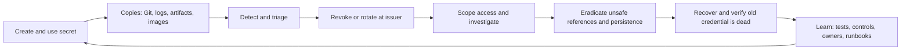
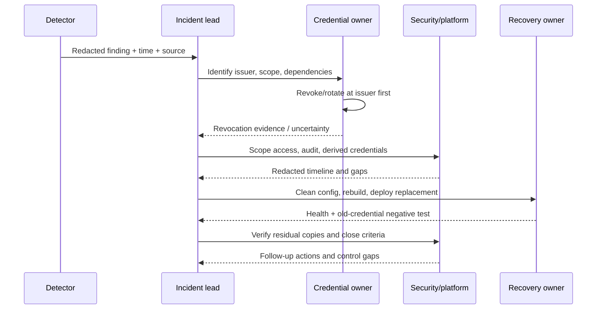
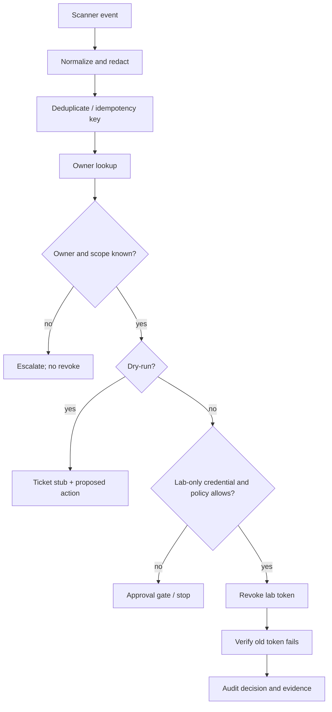

# 08 — Secret Leak Detection and Incident Response

**Module:** M09 — Secrets and Identity Management  
**Unit:** 8 of M09  
**Level:** L1 foundations → L2 detection engineering labs → L3 incident response and operational design → L4 guarded automation and organization-wide assurance  
**Target filename:** `08-secret-leak-detection-and-incident-response.md`  
**Status:** DRAFT — AI SELF-AUDITED; HUMAN RUNTIME VALIDATION REQUIRED  
**Safety:** Synthetic values only. No live-provider credential testing, production revocation, or real repository history rewriting.

---

## Scope, assumptions, prerequisites, and safety

This lesson closes M09 by connecting secret lifecycle controls to detection, incident command, revocation, recovery, and continuous assurance. It is not a replacement for the organization's incident-response policy, legal advice, cloud-provider procedures, or security-team authority.

### Scope and verification status

The supplied Unit 8 prompt was inspected. The exact `Roadmap_ptree.md` was not independently confirmed in this task's available context; the target path and sibling names below come from the supplied prompt. Official documentation pages for Gitleaks, Trivy, pre-commit, Vault audit devices and leases, and related tools were consulted. Product-specific commands and integrations that can change by release are marked **[VERIFY]** and must be checked against the installed version's official documentation before use. No lab in this document is claimed to have been executed. The scripts and outputs are teaching examples until the learner runs them locally and records evidence.

### Assumptions and resources

- Primary environment: WSL2 Ubuntu or Linux, approximately 4 CPU cores, 8 GB RAM, and 30 GB free disk **[ASSUMPTION]**.
- Required labs use local throwaway directories, synthetic data, and locally available tools. A `kind` cluster and Vault are optional for this unit; the core response simulation can use a small local Python service.
- No paid service, cloud account, hosted canary service, external webhook, or real identity provider is required.
- All paths prefixed `"$LAB"` are intended to be inside a disposable lab directory. Read each cleanup command before running it.
- Never paste discovered values into ChatGPT, tickets, chat, external scanners, or online JWT/secret decoders. Preserve redacted metadata instead.
- Never test a found credential against a third-party service. A credential that looks fake may be real; only test a credential in an owned, documented lab verifier.

### Learning outcomes

By completion, the learner should be able to:

1. Explain why secret exposure occurs across the delivery lifecycle and distinguish time-to-detect from time-to-revoke.
2. Inventory and scan working trees, Git history, deleted files, branches, CI output, images/layers, manifests, IaC, artifacts, logs, and collaboration surfaces.
3. Explain regex/pattern detection, entropy, provider-aware detectors, false positives/negatives, encoding evasions, baselines, and coverage gaps.
4. Design layered prevention/detection with local hooks, CI, host-side protection, scheduled full-history scans, artifact scanning, and runtime/audit analytics.
5. Run a safe Gitleaks scan, interpret redacted findings, and govern allowlists and baselines.
6. Integrate secret scanning into pre-commit and CI while recognizing bypasses and fork boundaries.
7. Scan filesystems and image contents with Trivy or an equivalent verified tool.
8. Build a bounded custom detector and local-only honeytoken simulation.
9. Redact sensitive log fields before serialization and test common transformation limits.
10. Lead a leak response from triage through containment, scope, eradication, recovery, and blameless learning.
11. Explain why Git history rewriting is hygiene, not revocation.
12. Analyze synthetic Vault/Kubernetes-like audit events, design rotation runbooks, and automate response with safeguards.
13. Run a local leak-response game day and calculate measured laptop-lab detection/revocation times.
14. Propose an organization-wide scanning program with measurable coverage, SLOs, drills, and accountable owners.

### Glossary

| Term | Meaning |
|---|---|
| Secret | A value that grants access or protects confidentiality/integrity: password, API token, private key, signing key, encryption key, webhook secret, or credential. |
| Exposure | A secret becomes accessible to an unintended party or surface. |
| Compromise | There is evidence or a credible possibility that an unauthorized party obtained or used the secret. |
| Revocation | The issuer/resource rejects the old credential or invalidates the lease/session. |
| Rotation | Replace a credential/key with a new one and update consumers; rotation is incomplete until the old one is invalidated where possible. |
| Eradication | Remove the exposure path, persistence, malicious changes, and unsafe copies under control. |
| Recovery | Restore normal service with replacement credentials and verified least-privilege access. |
| MTTD | Mean time to detect, from the defined exposure start to detection. Median is often also reported because incidents are skewed. |
| Time-to-revoke | Time from exposure or incident declaration (state the chosen start) until the issuer/resource confirms the old credential is invalid. Not the same as recovery time. |
| False positive | A finding that is not a real secret under the policy definition. |
| False negative | A real secret that the configured detector does not report. |
| Baseline | A record of accepted existing findings used to avoid blocking all legacy work; it can hide risk if unowned or permanent. |
| Canary/honeytoken | A deliberately planted, monitored fake credential or resource intended to signal access/use. It is a detection signal, not proof of attacker identity. |
| Evidence | Redacted, integrity-preserved facts such as timestamps, finding IDs, commit hashes, audit references, tool versions, and decision records. |

---

## Learning progression and architecture

### 8.0 — Orientation and response objective

A green scanner is not the objective. The objective is to remove unauthorized access, understand likely impact, recover safely, and reduce recurrence. A secret may be copied into a Git object, CI log, container layer, artifact cache, notebook output, crash report, or backup even after its source file is deleted.

The operational loop is:



The exact order can vary for a key whose immediate revocation would destroy data availability; the default is still to contain access first. Use a pre-designed overlap procedure, a risk owner, and a time-bound exception rather than leaving a compromised credential valid indefinitely.

### 8.1 — Threat model and leak economics (L1)

Secrets leak through ordinary copying, debug output, permissive access, compromised dependencies/actions, over-broad service accounts, build caches, misconfigured artifacts, human mistakes, and attackers. More systems and more automation increase the number of places where a value can persist.

**Detection latency and revocation latency are different controls.** A scanner can detect a leak quickly while the credential remains valid for hours because ownership is unknown. Conversely, a credential may be revoked quickly after a delayed alert, limiting future use but not undoing any earlier reads. Model both times and record their start/end definitions.

Exposure severity depends on:
- credential privilege and scope;
- whether it is valid, expired, or already revoked;
- where it was exposed and who could read that surface;
- duration and evidence of use;
- sensitive data reachable by the credential;
- downstream credentials or trust relationships it can create;
- number and criticality of dependent services;
- audit completeness and retention.

The following severity model is **[ILLUSTRATIVE — ORGANIZATION POLICY REQUIRED]**:

| Severity | Example conditions | Initial response posture |
|---|---|---|
| Critical | Signing/encryption key with broad trust, privileged production credential publicly exposed, evidence of exfiltration | Immediate incident command, issuer-side containment, security and service owner engaged |
| High | Production write/admin token exposed to a broad audience or showing suspicious use | Rapid revoke/rotate, investigate audit trail and derived access |
| Medium | Narrow non-production credential with limited audience and no use evidence | Prompt revoke/rotate, scope, record residual risk |
| Low | Confirmed expired synthetic value or a false positive | Validate offline, document reason, improve rule if needed |

Do not downgrade solely because a value was “only in a private repository.” Private repositories have readers, integrations, forks/mirrors, tokens, and retention surfaces.

### 8.2 — Detection concepts and coverage map (L1)

Detection methods complement each other:

- **Pattern/regex:** identifies recognizable structure and contextual keywords. It is fast but only as good as its rules.
- **Entropy heuristics:** high randomness can indicate a token, but many non-secrets are random and some secrets are low entropy.
- **Structured/provider-aware detectors:** recognize known formats and may sometimes support provider-authorized verification. Provider validation must only be used within an approved workflow; never probe an unknown credential.
- **Contextual rules:** look for names such as `password`, `token`, or `private_key` near a value. They can miss unnamed fields and generate false positives.
- **Allowlist/baseline:** suppress known-safe matches. These create blind spots and must be narrow, owned, justified, and reviewed.
- **Transformation-aware scanning:** can decode selected common encodings, but cannot reliably enumerate every transformation, split, compression, encryption, or custom encoding.

Precision is the fraction of reported findings that are truly relevant; recall is the fraction of relevant secrets that the detector finds. Both depend on the definition of “secret,” the fixture corpus, and the surfaces scanned. A clean scan means only that this tool, configuration, version, and scope did not report a match. It is not proof that no secret exists.

#### Exposure-surface coverage matrix

| Surface | Example leak path | Detection/control | Common blind spot |
|---|---|---|---|
| Working tree/staging | `.env`, config, notebook | Editor feedback, pre-commit, local scanner | Ignored files, unsupported formats |
| Git commits/history | Deleted value in an old commit | Full-history scanner, push protection | Shallow clone, refs omitted, unreachable objects |
| Branches/tags/PR refs | Old release branch or PR diff | Scan all relevant refs; host scanning | Host retention semantics differ |
| CI logs/artifacts | `echo`, debug trace, test failure | Log hygiene, artifact scan, retention policy | Masking fails on transformed values |
| Container build context | Secret copied into image | `.dockerignore`, build secret mounts, context scan | File later deleted but remains in an earlier layer |
| OCI image/layers | Build history/layer tar | Image/filesystem scan, rebuild cleanly | Base-layer skips, unsupported file types |
| Kubernetes/Helm | Inline Secret data, rendered manifest | Manifest/IaC scan, admission policy | Rendered values or runtime injection missed |
| Terraform/IaC | Secret in state/plan | IaC and state controls; scan | State backend copies and plan artifacts |
| Packages/registries | Secret embedded in wheel or image | Artifact scan, registry governance | Existing consumers keep copies |
| Logs/traces/crash reports | Authorization header, query string | Structured allowlisted logging and redaction | Unknown transformations, third-party telemetry |
| Wiki/tickets/chat | Pasted token or support bundle | Process, SaaS controls, approved discovery | Local CLI cannot scan every SaaS store |
| Backups/mirrors/forks/caches | Historical copy | Retention and owner workflows | Provider-side purge may not be immediate |
| Runtime/audit events | Suspicious secret reads or use | Audit analytics and anomaly detection | Missing audit source or retention gap |

#### Layered detection model

1. Editor/pre-commit feedback.
2. Pre-push checks where supported.
3. Required CI scan for pull/merge requests and protected branches.
4. Server-side push protection or host scanning **[VERIFY host/plan/configuration]**.
5. Scheduled full-history scans across all in-scope refs and repositories.
6. Container, package, IaC, rendered manifest, and artifact scans.
7. Runtime, secret-manager, identity, and audit-log analytics.
8. Game days and coverage review.

Local hooks are developer experience, not a security boundary. They can be bypassed with `git commit --no-verify`, disabled hooks, alternate clients, API pushes, or direct artifact publication.

### Scanner comparison

| Tool | Intended surface | Strengths | Limits / verification |
|---|---|---|---|
| Gitleaks | Git repositories and directories/files, depending on command/mode | Fast rule-based scanning, custom rules, redaction/report options | Exact CLI, config schema, baseline and history behavior depend on release; verify official README/help |
| TruffleHog | Git and other supported data sources | Broad detector ecosystem and source integrations | Capabilities and verification behavior vary by source and version; do not assume identical to Gitleaks |
| detect-secrets | Working-tree/pre-commit and baseline-oriented workflows | Developer workflow and baseline management | Detector plugins/config and scan semantics differ; it is not a substitute for all-surface scanning |
| Trivy | Filesystems, images, and repositories for supported scanners | Combines secret scanning with other security scanners | Secret scanning rules and skipped paths matter; verify current flags and inspect coverage |

---

## 8.3 — Gitleaks: safe first scan and findings interpretation (L1 → L2)

Gitleaks supports `detect` and `protect` command families in documented releases. Exact behavior and flags change; check `gitleaks version`, `gitleaks detect --help`, and `gitleaks protect --help` for the installed version. Current official documentation consulted describes `--redact`, report formats, configuration precedence, and history scanning; do not copy flags from an old blog without verifying them.

### Safe local setup

Use a disposable repository, never a real project containing unknown secrets:

```bash
set -eu
LAB="$(mktemp -d "${TMPDIR:-/tmp}/m09-secret-lab.XXXXXX")"
printf 'Disposable lab directory: %s\n' "$LAB"
mkdir -p "$LAB/repo"
git init "$LAB/repo"
git -C "$LAB/repo" config user.name "M09 Lab"
git -C "$LAB/repo" config user.email "m09-lab@example.invalid"
printf '%s\n' 'M09 disposable secret-detection lab' > "$LAB/.m09-secret-lab-marker"
cd "$LAB/repo"
```

`example.invalid` is a reserved example domain. Create a synthetic token format that will not authenticate:

```bash
cat > app.conf <<'EOF'
# Synthetic training fixture; never a real credential.
LAB_SERVICE_TOKEN=LABTOKEN_DEMO_7f2a91c4d8e0b3a6
EOF
git add app.conf
git commit -m "add synthetic fixture"
```

Do not `cat` a finding-bearing file after a scanner identifies it. Scan with the installed version's verified syntax. For current Gitleaks releases whose help confirms these flags, a repository/history scan may resemble:

```bash
gitleaks detect --source "$LAB/repo" --redact
```

**[VERIFY]** Some releases document different preferred commands or deprecate a command family. Run the installed binary's `--help` first and record the exact command used. If report output is needed, verify the release's report-format and report-path flags, write reports inside `$LAB`, restrict permissions, and inspect only redacted metadata. Do not attach raw reports to CI artifacts.

### Working tree, staging, commit history, deleted files

A detector can operate on different scopes. Verify which mode scans uncommitted files, staged changes, commits, and all refs for your version. To create a deleted-history fixture:

```bash
printf '%s\n' 'LAB_ARCHIVE_TOKEN=LABTOKEN_OLD_3c8d5a1f7b9e2d4a' > deleted.env
git add deleted.env
git commit -m "synthetic historical leak"
rm deleted.env
git add -u
git commit -m "remove synthetic historical leak"
```

The latest working tree is clean of `deleted.env`, but the old commit may still contain the fake value. Run a verified full-history scan and record whether it finds the old commit. A shallow clone or a scan limited to the latest tree may miss it.

Create an encoded fixture without treating encoding as protection:

```bash
python - <<'PY'
import base64
fake = b"LABTOKEN_ENCODED_2a9f4c7e1b6d3a8f"
print("Synthetic base64 fixture:", base64.b64encode(fake).decode())
PY
```

This prints only a synthetic fixture. Whether the scanner decodes it depends on rules and version; record a miss as a coverage gap, not as proof of safety.

### `.gitleaks.toml` concept

The exact schema must match the installed version. A deliberately small illustrative rule:

```toml
title = "M09 synthetic token rules"

[[rules]]
id = "lab-service-token"
description = "Synthetic lab token; must never be used outside the lab"
regex = '''LABTOKEN_DEMO_[A-Za-z0-9]{8,32}'''
keywords = ["LABTOKEN_DEMO_"]
```

**[VERIFY]** Confirm the version's supported rule fields and whether `keywords`, entropy, path, and allowlist configuration have the shown meaning. The rule intentionally uses a conspicuous non-production prefix; it demonstrates custom detection but does not model every provider token.

### Finding handling

A safe finding record should contain:
- stable finding/rule ID;
- repository and path;
- commit/reference and line number if available;
- timestamp, scanner version, configuration hash;
- owner, severity rationale, and status;
- **no raw secret value**.

Never print the secret in a ticket or test failure. Do not enable verbose/debug output unless you understand whether it may include sensitive data. Verify redaction behavior using synthetic fixtures.

### Baselines and allowlists

A baseline can permit a legacy repository to adopt scanning incrementally, but every entry should have:
- owner and reason;
- exact narrow fingerprint/path/commit scope;
- expiry or review date;
- risk acceptance and remediation issue;
- evidence that it does not suppress newly introduced findings.

Do not allowlist broad patterns such as `.*test.*`, entire directories used by production code, or all `.env` files. A test path can contain a real production key. Baselines should burn down over time and be re-evaluated when scanner rules change.

### Gitleaks safe-scan checklist

- [ ] Version and exact command recorded.
- [ ] Scan scope documented: working tree, staged diff, commits, refs, or directory.
- [ ] Redaction behavior checked on fake fixture.
- [ ] Raw reports stay local and are access-restricted.
- [ ] Encoded fixture behavior recorded as detected/missed.
- [ ] Baseline/allowlist entries have owner, rationale, review date, and narrow scope.
- [ ] No unknown credential was validated against a live service.

---

## 8.4 — Pre-commit and CI enforcement (L2)

### Pre-commit configuration

Use immutable revisions for hook repositories. The prompt requires a pinned Gitleaks hook revision; if the exact revision cannot be checked against the official repository in the environment, do not invent one. The following is a complete structural example with a deliberately explicit placeholder:

```yaml
# .pre-commit-config.yaml
# [VERIFY] Replace the placeholder with a reviewed immutable tag or full commit SHA
# from the official Gitleaks repository. Do not use "main" or a floating branch.
repos:
  - repo: https://github.com/gitleaks/gitleaks
    rev: VERIFY_IMMUTABLE_GITLEAKS_REVISION
    hooks:
      - id: gitleaks
```

The placeholder is not executable until replaced. Verify the hook ID and supported repo/revision in the official hook manifest. `pre-commit` expects a stable ref; its official documentation recommends repeatable pinned refs.

Install and run only after verifying the hook config:

```bash
python -m pip install pre-commit
pre-commit validate-config
pre-commit install
pre-commit run --all-files
```

These commands install a Python package and local hook in the disposable repository. Use an isolated virtual environment if preferred. The local hook can be bypassed and should never be the only control.

### CI workflow design

A GitHub Actions example is shown as **[ILLUSTRATIVE — VERIFY ACTION SHA AND CURRENT HOST SYNTAX BEFORE USE]**. It uses a placeholder rather than a fabricated immutable SHA.

```yaml
name: secret-scan

on:
  pull_request:
  push:
    branches: ["main"]
  schedule:
    - cron: "17 4 * * 1"

permissions:
  contents: read

jobs:
  gitleaks:
    runs-on: ubuntu-latest
    permissions:
      contents: read
    steps:
      - name: Checkout
        uses: actions/checkout@VERIFY_FULL_40_HEX_COMMIT_SHA
        with:
          fetch-depth: 0
      - name: Install reviewed Gitleaks release
        run: |
          echo "Install only a verified release and validate its checksum/signature."
          echo "Do not use curl | sh. Pin and verify the binary in the real workflow."
      - name: Scan full repository history
        run: |
          gitleaks version
          gitleaks detect --source . --redact
```

This is intentionally not copy-paste-ready: replace the action SHA, verify Gitleaks command syntax for the chosen release, and use a reviewed installation method with checksum/signature verification. For a high-assurance pipeline, build a pinned scanner image or download a verified release artifact. Never grant write permissions to a scan-only job unless the feature requires them.

A scheduled full-history scan requires the repository history/refs to be available. `fetch-depth: 0` is commonly used with checkout actions to fetch full history, but verify the selected action version and host semantics. A scheduled scan is not a replacement for PR scanning; PR scans catch new leaks sooner.

### CI security boundaries

- Do not pass secrets to untrusted fork pull-request jobs.
- Avoid printing environment variables, request headers, full exceptions, or scanner raw matches.
- Do not upload raw secret-bearing reports as artifacts.
- Masking is not a security boundary: exact-string masking may fail for URL-encoded, Base64-encoded, split, truncated, or otherwise transformed values.
- Fail on new findings. For legacy findings, use a reviewed baseline or staged rollout that still blocks new matches.
- SARIF upload and host-specific secret scanning/push protection are optional **[VERIFY]**: confirm plan, permission, action version, report schema, and retention behavior.
- Pin third-party actions to reviewed immutable commit SHAs and scope token permissions to read-only for scanning.
- Negative tests: fake token fails; clean fixture passes; broad allowlist is rejected in review; fork workflow receives no sensitive secret; outputs are redacted.

---

## 8.5 — Scanning images, artifacts, IaC, and operational surfaces (L2)

Trivy documentation describes secret scanning for filesystems, images, and Git repositories. Exact command flags and default scanner behavior must be checked against the installed version. The following common commands are **[VERIFY VERSION]** examples:

```bash
trivy version
trivy fs "$LAB/repo"
# For a local image that has been built and is not pushed:
trivy image m09-secret-lab:local
```

Do not scan or upload an image containing a real secret to an external service. Keep the lab image local and synthetic. Use the current Trivy documentation to verify secret scanner defaults, skip patterns, and output-redaction options. Trivy can skip some paths by default; a clean result is bounded by those rules.

### Docker layer persistence

A secret copied into an earlier image layer can remain in that layer even if a later layer deletes the file. This demonstrates why scanning only the final container filesystem may not be equivalent to inspecting every layer and build artifact.

**[SIMULATION]** Use this only with fake values in a disposable directory:

```dockerfile
# Dockerfile.bad — intentionally unsafe training example; never use as a template.
FROM busybox:stable
RUN printf '%s\n' 'LAB_IMAGE_TOKEN=LABTOKEN_LAYER_3a7d9f2c6b1e4a8d' > /tmp/lab.env
RUN rm -f /tmp/lab.env
CMD ["sh", "-c", "echo synthetic image lab"]
```

Build without pushing:

```bash
docker build -t m09-secret-lab:local -f Dockerfile.bad .
```

Run the verified Trivy image scan, inspect the image's history/layers using documented local Docker tooling, and record what each tool sees. Do not assume a particular scanner will report a deleted-layer file; document the observed result after running the lab. Delete the local image during cleanup.

Safer build patterns:
- never copy `.env`, credentials, SSH directories, or local cloud config into the build context;
- use `.dockerignore` and verify it actually excludes the path;
- use build-secret mechanisms supported by the builder rather than `ARG`/`ENV` for secret values;
- rebuild from a clean context after remediation;
- remove affected tags/digests from registries where appropriate, while assuming pulled copies may persist;
- rotate/revoke first, then clean artifacts.

### Manifest, IaC, log, and artifact scanning

Scan rendered manifests, Helm output, Terraform files/plans/state according to the organization's approved handling rules, build contexts, package artifacts, and CI artifacts. Terraform state and plan files may contain sensitive values; do not upload them to a third-party scanner without approval.

A simple redacting scanner for text artifacts:

```python
# redact_scan.py — local lab only; intentionally detects the lab prefix.
from pathlib import Path
import re
import sys

PATTERN = re.compile(r"LABTOKEN_[A-Za-z0-9_]{8,80}")

def scan(path: Path) -> int:
    count = 0
    try:
        text = path.read_text(errors="replace")
    except OSError:
        print(f"UNREADABLE path={path}")
        return 0
    for line_no, line in enumerate(text.splitlines(), 1):
        for _match in PATTERN.finditer(line):
            count += 1
            print(f"FINDING path={path} line={line_no} value=[REDACTED]")
    return count

if __name__ == "__main__":
    total = sum(scan(Path(arg)) for arg in sys.argv[1:])
    print(f"summary findings={total}")
    raise SystemExit(1 if total else 0)
```

This script is only a toy: it does not scan binary formats, Git history, compressed artifacts, every encoding, or every directory recursively. It prints paths and line numbers but not matched values. Do not pass untrusted paths that may include sensitive names into public logs.

Organization-level inventory must also include wikis, tickets, chat, backups, mirrors/forks, caches, registries, and SaaS stores. A local scanner does not automatically cover those surfaces.

---

## 8.6 — Custom detectors and canary tokens (L2)

### A bounded internal-token detector

Use a synthetic prefix so fixtures cannot be confused with live credentials. Avoid nested ambiguous quantifiers such as `(a+)+` and test long adversarial inputs. Prefer simple bounded character classes and contextual requirements.

```python
# detector.py
import re

TOKEN = re.compile(r"(?<![A-Z0-9])LABTOKEN_[A-Z0-9]{16,40}(?![A-Z0-9])")
CONTEXT = re.compile(r"(?i)\b(token|secret|credential|api[_-]?key)\b")

def detect(text: str) -> list[tuple[int, str]]:
    findings = []
    for line_no, line in enumerate(text.splitlines(), 1):
        if not CONTEXT.search(line):
            continue
        for match in TOKEN.finditer(line):
            findings.append((line_no, "[REDACTED]"))
    return findings
```

The sample token pattern is a training detector, not a general secret detector. It intentionally requires contextual terms, which reduces false positives but can create false negatives when the token appears without a keyword.

Fixture tests:

```python
# test_detector.py
import unittest
from detector import detect

class DetectorTests(unittest.TestCase):
    def test_detects_fake_token(self):
        self.assertEqual(detect("token=LABTOKEN_0123456789ABCDEF")[0][1], "[REDACTED]")

    def test_ignores_plain_text(self):
        self.assertEqual(detect("the token is not present"), [])

    def test_ignores_near_match(self):
        self.assertEqual(detect("token=LABTOKEN_short"), [])

    def test_bounded_on_long_input(self):
        # Not a proof against every ReDoS case; this checks one long-input fixture.
        self.assertEqual(detect("token=" + "A" * 200000), [])

if __name__ == "__main__":
    unittest.main()
```

Run from the directory containing both files:

```bash
python -m unittest -v
```

The expected result is four passing tests, but this is an expected result until executed. Extend the corpus with lower/upper-case boundaries, adjacent punctuation, encoded fixtures, line-length extremes, and false positives.

### Canary/honeytoken concept

A canary is an intentionally planted fake token or resource that should never be used by a legitimate workload. Its use creates a high-value alert, but it does not prove who used it or why. A build job unexpectedly reading a canary may indicate a compromised dependency, accidental inclusion in an image, or an overly broad scanner.

Placement needs an owner, expected access policy, alert route, expiration date, and safe teardown. Hosted canary services are awareness-only in this zero-budget lesson.

#### Local-only fake verifier

```python
# canary_server.py — local-only; no outbound network calls.
from http.server import BaseHTTPRequestHandler, HTTPServer
import json
from datetime import datetime, timezone

FAKE_TOKEN = "LABTOKEN_CANARY_0123456789ABCDEF"

class Handler(BaseHTTPRequestHandler):
    def do_POST(self):
        if self.path != "/verify":
            self.send_response(404); self.end_headers(); return
        length = min(int(self.headers.get("Content-Length", "0")), 4096)
        body = self.rfile.read(length)
        try:
            payload = json.loads(body or b"{}")
        except json.JSONDecodeError:
            self.send_response(400); self.end_headers(); return
        used = payload.get("token") == FAKE_TOKEN
        if used:
            event = {
                "event": "canary_used",
                "time": datetime.now(timezone.utc).isoformat(),
                "source": "local_lab",
                "token": "[REDACTED]",
            }
            with open("canary-events.jsonl", "a", encoding="utf-8") as f:
                f.write(json.dumps(event) + "\n")
        self.send_response(200 if used else 401)
        self.end_headers()
        self.wfile.write(b'{"accepted":false,"value":"[REDACTED]"}')

    def log_message(self, fmt, *args):
        # Avoid logging request bodies or token-bearing URLs.
        print("http_event=canary_request path=/verify details=[REDACTED]")

if __name__ == "__main__":
    HTTPServer(("127.0.0.1", 8765), Handler).serve_forever()
```

**Safety note:** the hard-coded token is synthetic and only accepted by this local stub. Do not bind to `0.0.0.0` or expose it to a network. The sample server is a teaching example; for production code, add request-size handling, authentication of the local caller if needed, rate limiting, and robust error handling.

Start in one terminal:

```bash
python canary_server.py
```

Send the fake token only to the local verifier:

```bash
python - <<'PY'
import json
from urllib.request import Request, urlopen
payload = json.dumps({"token": "LABTOKEN_CANARY_0123456789ABCDEF"}).encode()
req = Request("http://127.0.0.1:8765/verify", data=payload, headers={"Content-Type": "application/json"})
with urlopen(req, timeout=2) as r:
    print("status", r.status, "body", r.read().decode())
PY
```

Then send a negative control with ordinary text. Confirm `canary-events.jsonl` records only a sanitized event and no raw token. The expected event is a timestamp, `event=canary_used`, `source=local_lab`, and `token=[REDACTED]`. No external endpoint is contacted.

---

## 8.7 — Log hygiene and redaction (L2)

### Prevent collection before redacting

Common leak paths include Authorization headers, URL query strings, request/response bodies, exception text, stack traces, environment dumps, shell tracing, debug pages, crash reports, CI logs, tracing attributes, and telemetry exporters.

Prefer:
- structured logging with an allowlist of fields;
- logging identifiers and outcomes rather than payloads;
- parameterized messages;
- excluding authorization/cookie headers and secret-bearing query parameters at the source;
- redaction before serialization/export;
- short retention and access controls for diagnostic artifacts;
- safe test assertions that report booleans, not values.

`set +x` can stop shell tracing from printing subsequent commands, but it does not remove secrets already printed or prevent application logging, process arguments, CI debug output, or exception leakage.

### Minimal redaction helper

This example demonstrates recursive field redaction and known synthetic-value replacement. It does not reliably discover every secret and should not be used as the only control.

```python
# log_redaction.py
from urllib.parse import quote
import re
from typing import Any

SENSITIVE_KEYS = {
    "authorization", "proxy-authorization", "cookie", "set-cookie",
    "password", "secret", "token", "api_key", "apikey", "private_key",
}
FAKE_VALUES = {
    "LABTOKEN_DEMO_7f2a91c4d8e0b3a6",
    "LABTOKEN_CANARY_0123456789ABCDEF",
}
FIELD_RE = re.compile(r"(?i)(authorization|password|secret|token|api[_-]?key)\s*[:=]\s*([^&,\s]+)")

def redact_text(value: str) -> str:
    out = value
    for secret in FAKE_VALUES:
        out = out.replace(secret, "[REDACTED]")
        out = out.replace(quote(secret, safe=""), "[REDACTED]")
    return FIELD_RE.sub(lambda m: f"{m.group(1)}=[REDACTED]", out)

def redact(value: Any, key: str = "") -> Any:
    if key.lower() in SENSITIVE_KEYS:
        return "[REDACTED]"
    if isinstance(value, dict):
        return {k: redact(v, str(k)) for k, v in value.items()}
    if isinstance(value, list):
        return [redact(v) for v in value]
    if isinstance(value, str):
        return redact_text(value)
    return value
```

A logging boundary might call `redact()` on a curated structured event before `logger.info`. Do not log entire request bodies by default. For FastAPI, middleware can add request IDs and suppress sensitive headers, but middleware should not blindly buffer and log every body; that can expose credentials and large payloads.

Tests should assert that output does not contain the raw synthetic value:

```python
# test_log_redaction.py
import base64
import unittest
from urllib.parse import quote
from log_redaction import redact

FAKE = "LABTOKEN_DEMO_7f2a91c4d8e0b3a6"

class RedactionTests(unittest.TestCase):
    def assert_redacted(self, obj):
        rendered = repr(redact(obj))
        self.assertNotIn(FAKE, rendered)
        self.assertNotIn(quote(FAKE, safe=""), rendered)

    def test_direct_value(self):
        self.assert_redacted({"token": FAKE})

    def test_nested_json(self):
        self.assert_redacted({"payload": {"Authorization": "Bearer " + FAKE}})

    def test_url_query(self):
        self.assert_redacted({"url": "https://example.invalid/?token=" + FAKE})

    def test_partial_field_text(self):
        self.assert_redacted({"error": "token=" + FAKE})

    def test_encoded_form_is_known_limitation(self):
        encoded = base64.b64encode(FAKE.encode()).decode()
        # Generic Base64 decoding is deliberately not claimed by this middleware.
        self.assertNotEqual(redact({"body": encoded})["body"], "[REDACTED]")

    def test_ordinary_text_preserved(self):
        self.assertEqual(redact({"message": "request completed"})["message"], "request completed")

if __name__ == "__main__":
    unittest.main()
```

The encoded-form test is intentionally a documented limitation. Add a separate, carefully bounded decoder only if the format is known and policy-approved; do not recursively decode arbitrary data in logging middleware. Transformation-aware redaction is incomplete. The best defense is not to collect sensitive data in the first place.

---

## 8.8 — Leaked-secret incident response runbook (L3)

### Roles

- **Incident lead:** owns severity, timeline, decisions, and escalation.
- **Credential/service owner:** executes issuer-side revoke/rotate and verifies dependent service behavior.
- **Security/detection lead:** scopes exposure, analyzes logs, preserves redacted evidence, and checks persistence.
- **Platform/CI owner:** addresses pipelines, images, manifests, and runtime identities.
- **Communications/legal/compliance:** determines stakeholder and notification obligations under organizational policy; this lesson is not legal advice.

If ownership is unknown, escalate immediately to the incident/security lead and the system that issued the credential. Do not wait for a repository owner to be found before initiating safe containment.

### Response sequence



### Phase 1 — Triage

1. Validate alert plausibility using metadata and the local/offline fixture. Do not try the credential against a live service.
2. Identify credential type, issuer, owner, environment, privilege, scope, dependencies, expiry, exposure surface/audience, earliest known exposure, and evidence of use.
3. Separate facts from hypotheses. Record what is unknown.
4. Preserve redacted finding metadata, commit IDs, timestamps, scanner version/config, audit event references, and relevant change IDs.
5. Apply the organization's severity policy. The table in 8.1 is only an illustrative starting point.

### Phase 2 — Contain: revoke/rotate first

- Revoke the credential or lease at the issuing system before cleaning Git history.
- For dynamic secrets, identify the lease and revoke it using the approved Vault workflow; verify the credential is no longer accepted by the owned lab service or that the issuer reports it revoked. Vault documentation explains lease/revoke semantics, but the effect depends on the secrets engine and downstream system.
- For database credentials, disable/revoke the identity, create the replacement with least privilege, update consumers, handle connection pools, and test old-credential failure.
- For cloud keys/API tokens, use the provider's approved control plane; exact controls and audit fields are **[VERIFY]** for the provider and account configuration.
- For signing/encryption keys, do not treat rotation as a simple password swap; see the key-type matrix below.
- If availability requires overlap, use a documented, time-bound dual-key plan and explicitly decide when the old key becomes invalid. A desire to avoid an outage is not permission to leave a compromised key active indefinitely.
- Preserve audit records before retention expires, but never paste the secret into the ticket.

### Phase 3 — Scope and investigate

Inspect available provider, Vault, database, Kubernetes, CI, registry, and application audit data from earliest known exposure through verified containment. Search for:
- reads of sensitive paths or unusual secret enumeration;
- new keys, users, roles, service accounts, trust policies, or permissions;
- unusual source networks, geography, time, API actions, resources, and egress;
- unexpected pipeline/action/dependency/image changes;
- creation of derived credentials or persistence;
- data reads, exports, or access outside the expected workload.

Do not invent provider-specific event names. Map actual provider fields only after consulting the official docs. “No evidence found” means available telemetry did not show use; “evidence of no use” requires complete, trustworthy coverage of the relevant period, which is uncommon.

### Phase 4 — Eradicate and history hygiene

Remove the secret from current source/config and replace it with a safe secret reference or workload identity. Rebuild affected images and packages from a clean context. Review CI artifacts, caches, wikis, tickets, backups, forks, mirrors, and old clones.

`git filter-repo` and BFG can rewrite a disposable repository's history. Exact syntax is **[VERIFY]** against the installed version. History rewrite is hygiene, not remediation: a public or broadly accessible secret may already have been copied. Coordinate force-push, contributor re-cloning, tags/branches, PR refs, mirrors, and host retention. Do not rewrite any actual repository in this lesson.

### Phase 5 — Recover and verify

- Deploy the replacement through the normal approved secret-management or identity path.
- Verify application health, dependency access, least privilege, and monitoring.
- Use a safe owned lab service or issuer-approved check to confirm the old credential is dead.
- Scan current source, relevant Git history/refs, images, manifests, and artifacts again.
- Record residual copies that cannot be purged and the owner/risk acceptance.
- Close only when the incident lead, security lead, and service owner agree that containment and recovery criteria are met.

### Phase 6 — Learn and harden

Create a blameless review with timeline, root causes/contributing factors, control failures, detection gaps, MTTD, time-to-revoke, impact, actions, owners, and due dates. Add a regression fixture, scanner rule, policy, inventory entry, runbook, access control, or game-day test. Avoid “human error” as a complete root cause; examine system design, feedback speed, permission boundaries, and incentives.

### What to do in the first 15 minutes [ILLUSTRATIVE]

- [ ] Notify the incident lead and credential owner through approved channels.
- [ ] Save the finding ID, timestamp, commit/ref, path, scanner version/config, and exposure audience without copying the secret.
- [ ] Identify issuer, privilege, environment, expiry, owner, and dependencies.
- [ ] Start issuer-side revoke/rotation using the approved runbook.
- [ ] Preserve relevant audit references and note retention gaps.
- [ ] Prevent further exposure (remove public artifact/path or stop the unsafe job) without mistaking that for revocation.
- [ ] Record decisions, unknowns, and the next update time.
- [ ] Do not rewrite history, delete evidence, or test an unknown key against a live service before containment.

### Evidence collection and redaction checklist

- [ ] UTC timestamps and source system clock caveats.
- [ ] Finding ID, rule ID, scanner version, config hash, scope, and exit status.
- [ ] Commit SHA/ref/path/line number; no secret value.
- [ ] Issuer/resource identifiers and owner; restrict sensitive metadata.
- [ ] Audit event IDs, query windows, log source, retention, and access gaps.
- [ ] Hashes of preserved artifacts where appropriate; controlled evidence access.
- [ ] Chain-of-custody notes where policy requires them.
- [ ] Redacted screenshots/exports only; inspect for hidden metadata before sharing.
- [ ] No token/private key/password in tickets, chat, incident summaries, or model prompts.

### Incident timeline template

| Time (UTC) | Event | Evidence reference | Decision/action | Owner | Confidence / gap |
|---|---|---|---|---|---|
| T0 | Earliest known exposure | Commit/artifact ID | Start time definition recorded | Owner | Could predate discovery |
| T1 | Detection | Finding ID | Incident declared | Lead | Scanner coverage noted |
| T2 | Containment started | Issuer operation ID | Revoke/rotate | Credential owner | Pending issuer confirmation |
| T3 | Old credential invalid | Negative-test/evidence ID | Record time-to-revoke | Owner | Test method documented |
| T4 | Scope completed | Audit query references | Impact statement | Security | Log gaps explicit |
| T5 | Recovery verified | Deployment/change ID | Close/reopen decision | Service owner | Health and access tested |
| T6 | Review/action plan | Review ID | Owners/due dates | Lead | Blameless |

### Secret-type containment and rotation matrix

Durations below are **[ILLUSTRATIVE]**, not service-level promises.

| Type | Immediate containment | Scoping evidence | Replacement / special hazard | Verification |
|---|---|---|---|---|
| Database credential | Disable/revoke user or lease | DB auth/query logs, pool and app logs | Create least-privilege user; refresh pools; Unit 3 lease semantics | Old login fails in owned lab; new app path works |
| Cloud access key/API token | Disable/revoke at issuer | Provider audit logs, key last-used report where available | Check derived roles/tokens/resources; provider UI/API **[VERIFY]** | Issuer reports disabled and approved negative test confirms |
| TLS certificate/private key | Remove key exposure; initiate reissue/revocation process | TLS termination logs, key distribution inventory | Reissue and deploy; revocation mechanisms vary; OCSP/CRL behavior awareness-only **[VERIFY]** | New certificate served; old trust/revocation status checked by approved method |
| Artifact-signing key | Stop signing and assess trust | Build/signing audit, artifact provenance | Rotate trust root/key; re-sign artifacts where policy requires; consumers/attestations may need updates | Verifiers reject compromised signer or artifacts per policy |
| Data-encryption key | Restrict use and invoke key incident process | KMS/key audit, encrypted-data inventory | Distinguish DEK vs KEK; assess rewrap/re-encryption; do not destroy key before recovery plan | Key access policy, decrypt/rewrap and recovery verified |
| SSH key | Remove/disable key or identity | SSH/auth logs, authorized-key inventory | Check all hosts, CI, automation, and derived access | Old key rejected on owned systems; new access audited |
| OAuth client secret | Rotate at issuer; update consumer | Token issuance/audit logs | Producer/consumer overlap only if supported; check issued access/refresh tokens | Old client secret rejected; new token flow works |
| Webhook secret | Rotate at provider and consumer | Delivery logs and signature failures | Coordinate both sides; overlap semantics **[VERIFY]** | Old signature fails and new signature passes |
| Dynamic secret/lease | Revoke lease/session | Vault audit, lease metadata, target DB/service logs | Understand downstream revoke semantics and connection pools | Lease revoked and target rejects old credential |

### Severity and decision matrix

| Signal | Questions | Action |
|---|---|---|
| Public exposure | Was it public, indexed, mirrored, or copied to an artifact? | Assume broad exposure until bounded by evidence |
| High privilege | Can it read/write production data or alter trust? | Elevate severity and containment urgency |
| Signing/encryption key | Does it undermine artifact trust or confidentiality of stored data? | Engage cryptography/key owner and consumers |
| Unknown owner | Can the issuer be identified centrally? | Escalate to security/incident lead; don't wait |
| No suspicious logs | Are logs complete and retained for the entire exposure window? | Record uncertainty; do not conclude no use |
| Rotation may break service | Is a tested overlap/rollback available? | Use controlled change and time-bound risk decision |

---

## 8.9 — Git-history hygiene and propagation limits (L3)

### Disposable history exercise

Use only the `$LAB/repo` created earlier. Confirm the path before destructive operations:

```bash
printf 'Target repo: %s\n' "$LAB/repo"
git -C "$LAB/repo" status --short --branch
git -C "$LAB/repo" log --oneline --all
```

Make a pre-purge clone outside the repository:

```bash
git clone "$LAB/repo" "$LAB/pre-purge-clone"
```

The clone is a deliberate demonstration that a copy made before rewriting can retain old history. The actual rewrite command depends on whether `git-filter-repo` or BFG is installed and on its version. **[VERIFY]** Read the official tool's help and official docs and run only against this disposable repository, after checking the absolute path. Never apply these instructions to a real project. After rewriting, scan all intended local branches/tags/refs and compare results; then inspect the pre-purge clone to prove it still retains its old object history.

History purge reduces accidental rediscovery. It does not undo exposure, invalidate a credential, purge other clones/forks/mirrors, erase cached artifacts, or guarantee host-side garbage collection. Provider-specific retention and PR-ref behavior are **[VERIFY]**.

Cleanup: stop and remove the disposable repo and clone only after printing and checking their exact paths. Do not use broad wildcard deletion. The general cleanup block at the end checks a marker file before removal.

---

## 8.10 — Detection engineering and audit analytics (L3)

### Synthetic event schema

Use a generic normalized schema rather than inventing real provider event names:

```json
{"time":"2026-01-01T00:00:00Z","source":"vault-like","event_type":"secret_read","identity":"system:serviceaccount:analytics:job","resource":"kv/data/lab/report","result":"success","request_id":"req-001"}
```

Fields are synthetic and are not asserted to match a real Vault/Kubernetes/cloud audit schema. Map real fields only after checking the actual source documentation and sample logs.

### Example synthetic JSONL fixture

```jsonl
{"time":"2026-01-01T00:00:00Z","source":"vault-like","event_type":"secret_read","identity":"system:serviceaccount:analytics:job","resource":"kv/data/lab/report","result":"success","request_id":"req-001"}
{"time":"2026-01-01T00:01:00Z","source":"vault-like","event_type":"secret_read","identity":"system:serviceaccount:prod:unknown","resource":"kv/data/prod/payroll","result":"success","request_id":"req-002"}
{"time":"2026-01-01T00:02:00Z","source":"k8s-like","event_type":"token_create","identity":"system:serviceaccount:default:debug","resource":"serviceaccounts/token","result":"success","request_id":"req-003"}
{"time":"2026-01-01T00:03:00Z","source":"vault-like","event_type":"auth_failure","identity":"system:serviceaccount:analytics:job","resource":"auth/jwt/login","result":"denied","request_id":"req-004"}
{"time":"2026-01-01T00:03:10Z","source":"vault-like","event_type":"auth_failure","identity":"system:serviceaccount:analytics:job","resource":"auth/jwt/login","result":"denied","request_id":"req-005"}
{"time":"2026-01-01T00:03:20Z","source":"vault-like","event_type":"auth_failure","identity":"system:serviceaccount:analytics:job","resource":"auth/jwt/login","result":"denied","request_id":"req-006"}
{"time":"2026-01-01T00:04:00Z","source":"vault-like","event_type":"secret_read","identity":"system:serviceaccount:analytics:job","resource":"kv/data/lab/report","result":"success","request_id":"req-007"}
```

### Offline analytics script

```python
# audit_analytics.py — synthetic normalized events only
import json
import sys
from collections import Counter
from datetime import datetime, timezone

ALLOWED_IDENTITIES = {"system:serviceaccount:analytics:job"}
ALLOWED_SECRET_PATHS = {"kv/data/lab/report"}
EXPOSURE_TIME = datetime.fromisoformat("2026-01-01T00:00:30+00:00")
REVOCATION_TIME = datetime.fromisoformat("2026-01-01T00:03:30+00:00")
FAILURE_THRESHOLD = 3

def parse_time(value):
    dt = datetime.fromisoformat(value.replace("Z", "+00:00"))
    if dt.tzinfo is None:
        raise ValueError("timestamp must include timezone")
    return dt.astimezone(timezone.utc)

def analyze(path):
    events = []
    with open(path, encoding="utf-8") as handle:
        for line_no, line in enumerate(handle, 1):
            if not line.strip():
                continue
            try:
                event = json.loads(line)
                for field in ("time", "event_type", "identity", "resource", "result"):
                    if field not in event:
                        raise ValueError("missing required field")
                event["_parsed_time"] = parse_time(event["time"])
                events.append(event)
            except Exception:
                print(f"INVALID_EVENT line={line_no} details=[REDACTED]")
    failures = Counter()
    for e in events:
        if e["event_type"] == "auth_failure":
            failures[e["identity"]] += 1
        if e["event_type"] == "secret_read" and e["resource"] not in ALLOWED_SECRET_PATHS:
            print(f"ALERT unexpected_secret_path request_id={e.get('request_id','unknown')}")
        if e["event_type"] == "secret_read" and e["identity"] not in ALLOWED_IDENTITIES:
            print(f"ALERT unexpected_identity request_id={e.get('request_id','unknown')}")
        if e["event_type"] == "token_create" and e["identity"] not in ALLOWED_IDENTITIES:
            print(f"ALERT unexpected_token_creation request_id={e.get('request_id','unknown')}")
        if e["event_type"] == "secret_read" and e["_parsed_time"] >= EXPOSURE_TIME:
            print(f"REVIEW access_after_exposure request_id={e.get('request_id','unknown')}")
        if e["event_type"] == "secret_read" and e["_parsed_time"] >= REVOCATION_TIME:
            print(f"ALERT access_after_simulated_revocation request_id={e.get('request_id','unknown')}")
    for identity, count in sorted(failures.items()):
        if count >= FAILURE_THRESHOLD:
            print(f"ALERT repeated_auth_failures identity={identity} count={count}")
    print(f"SUMMARY parsed_events={len(events)} identities_with_failures={len(failures)}")

if __name__ == "__main__":
    if len(sys.argv) != 2:
        raise SystemExit("usage: python audit_analytics.py synthetic-events.jsonl")
    analyze(sys.argv[1])
```

The timestamps and rules above are illustrative. Because the revocation time in this fixture occurs after all sample events, the “after simulated revocation” rule should not fire for these rows; this is a useful negative check. Add a separate synthetic event after `00:03:30Z` to test that rule. The script is deterministic and emits IDs/reasons, not secret values.

### Tests and false positives

Test at least:
- an allowed secret read produces no unexpected-path/identity alert;
- unknown namespace/service account is flagged;
- repeated failures at threshold are flagged;
- a read after the simulated exposure time is marked for review;
- a read after simulated revocation is alerted;
- malformed/missing fields are rejected safely;
- no output includes a token/password field.

These are generic analytics rules, not production provider detections. A new service account may be legitimate after deployment; alerts require context. Conversely, if audit logs are disabled, incomplete, delayed, or retained too briefly, the detector cannot reconstruct missing activity.

Vault audit devices record API request/response details with documented exceptions. Audit is not the same as server operational logs, and audit device availability can affect service behavior. Verify the active Vault version and operational design before relying on any one audit sink. Kubernetes audit policy and event fields also depend on cluster configuration/version.

---

## 8.11 — Rotation runbooks and dependency inventory (L3)

### Runbook template

| Field | Required entry |
|---|---|
| Credential/key ID (not value) | Stable inventory identifier |
| Owner/on-call | Named team and escalation path |
| Issuer/control plane | Exact approved system; UI/API syntax **[VERIFY]** |
| Trigger/severity | Leak, expiry, suspected use, planned rotation |
| Prerequisites | Access, approvals, replacement path, backup/recovery requirements |
| Dependencies/consumers | Workloads, jobs, services, users, image/build pipelines |
| Audit source | Relevant logs, retention, query owner |
| Rotation/revocation sequence | Ordered steps, old-key invalidation point |
| Overlap strategy | Supported or explicitly unsupported; expiry of overlap |
| Verification | New path healthy, least privilege, old credential rejected |
| Monitoring | Auth failures, latency, workload health, unexpected use |
| Rollback limits | Never re-enable compromised credential without explicit risk acceptance |
| Evidence | Redacted operation IDs, timestamps, test results |
| Communication | Incident channel and stakeholder list |
| Duration | **[ILLUSTRATIVE]**, measured in rehearsals |
| Cleanup | Remove temporary keys/files and close exception |

### Filled illustrative examples

| Type | Dependencies and sequence | Verification and hazard |
|---|---|---|
| Database user | Inventory pool consumers → create least-privilege replacement → deploy config/reference → refresh pool → revoke old user/lease | Test new reads/writes within policy; old login fails. Dynamic lease revocation behavior depends on engine; see Unit 3. |
| Cloud/API key | Identify role/policy and last-used data → create federated identity or replacement key → migrate consumer → disable old key → inspect audit logs | Confirm old key invalid at issuer and inspect derived roles/tokens. Provider fields/controls **[VERIFY]**. |
| TLS key/cert | Inventory load balancers, ingress, service mesh, clients → issue new cert/key → deploy and verify chain → revoke old certificate where supported | Verify served cert and trust behavior. OCSP/CRL propagation is not instantaneous everywhere; **[VERIFY]**. |
| Signing key | Stop signing → assess key and artifact exposure → create replacement and update trust distribution → re-sign/rebuild affected artifacts per policy | Verifiers must reject compromised signer/artifacts as defined; consumers and attestations need coordination. |
| Data-encryption key | Identify KEK/DEK hierarchy and affected ciphertext → restrict use → plan rewrap/re-encryption and recovery → rotate key under approved KMS procedure | Do not delete old key material before data recovery and migration are verified. Distinguish key material from an encrypted DEK. |
| SSH key | Identify all authorized keys, agents, CI jobs, hosts → remove old identity/key → distribute replacement through approved path | Verify old key denied on all owned hosts; inspect login and persistence. |
| OAuth/webhook | Coordinate issuer and consumers → rotate secret → deploy consumer update with supported overlap → invalidate old value | Test old value fails and new flow/signature succeeds; overlap semantics **[VERIFY]**. |

### Dependency map example

| Inventory ID | Owner | Issuer/store | Consumers | Deploy path | Audit source | Runbook |
|---|---|---|---|---|---|---|
| `DB-LAB-01` | Data Platform | Local lab DB/Vault lease | FastAPI demo | Secret reference + restart/refresh | Synthetic DB/Vault audit | DB rotation |
| `CI-LAB-01` | Developer Platform | Local CI token stub | Test workflow | CI identity config | CI run metadata | CI token response |
| `TLS-LAB-01` | Platform | Local test CA | Local ingress | Secret reference/rollout | Ingress logs | TLS replacement |
| `SIGN-LAB-01` | Release Engineering | Local test signer | Fixture verifier | Build/release workflow | Signing event log | Signing-key incident |
| `ENC-LAB-01` | Data Security | Local test key hierarchy | Synthetic encrypted fixture | Rewrap/re-encrypt job | Key-use log | Encryption-key response |
| `SSH-LAB-01` | Platform | Disposable test account | Local VM/container lab | Authorized-key management | SSH auth log | SSH key response |

To find dependents quickly, search the inventory by credential ID, issuer path, secret reference, workload identity, environment variable name, deployment owner, and audit identity. Unknown owner or missing dependency data is itself a severity factor and should trigger escalation and an inventory action.

---

## 8.12 — Guarded automated response (L4)

Automated response should evolve gradually: **alert-only → ticket stub → supervised revocation → narrowly scoped automatic revocation**. Production revocation requires an approved impact model and policy. The lab below only revokes an in-memory fake credential.



### Local response simulation

```python
# guarded_response.py — in-memory simulation; no network, cloud API, or Vault calls.
import hashlib
import json

TOKENS = {
    "LABTOKEN_AUTO_0123456789ABCDEF": {"owner": "data-platform", "revoked": False, "scope": "lab"},
}
SEEN = set()

def handle(event, dry_run=True):
    # Do not log or return event['token']; only hash it for local deduplication.
    token = event.get("token", "")
    fingerprint = hashlib.sha256(token.encode()).hexdigest()[:16]
    if fingerprint in SEEN:
        return {"decision": "duplicate", "fingerprint": fingerprint}
    SEEN.add(fingerprint)

    if not token or not isinstance(token, str):
        return {"decision": "reject_malformed", "fingerprint": fingerprint}
    record = TOKENS.get(token)
    if record is None:
        return {"decision": "unknown_token_escalate", "fingerprint": fingerprint}
    if not record.get("owner"):
        return {"decision": "unknown_owner_escalate", "fingerprint": fingerprint}
    if event.get("impact") == "production":
        return {"decision": "approval_required", "fingerprint": fingerprint}
    if record["revoked"]:
        return {"decision": "already_revoked", "fingerprint": fingerprint}
    if dry_run:
        return {"decision": "dry_run_revoke_proposed", "owner": record["owner"], "fingerprint": fingerprint}
    if record.get("scope") != "lab":
        return {"decision": "deny_non_lab_scope", "fingerprint": fingerprint}
    record["revoked"] = True
    return {"decision": "lab_revoked", "owner": record["owner"], "fingerprint": fingerprint}

if __name__ == "__main__":
    sample = {"token": "LABTOKEN_AUTO_0123456789ABCDEF", "impact": "lab"}
    print(json.dumps(handle(sample, dry_run=True)))
```

This is a simulation, not an operational service. It deliberately keeps the token map in memory and has no provider integrations. It uses a process-local set for idempotency; a production system needs durable idempotency, authorization, audit persistence, concurrency control, timeouts, rate limits, circuit breakers, retries, owner data quality, and a human approval model.

### Required tests

Test duplicate events, missing/malformed token, unknown token, unknown owner, production-impact label, dry-run default, verifier-unavailable simulation, already-revoked credential, successful lab-only revoke, and proof that no network call is made. Assertions should check decision codes, not raw token values.

Operational safeguards:
- dry-run default and explicit opt-in;
- idempotency key and deduplication window;
- approval gate for high-impact credentials;
- strict allowlist of lab issuer/credential types;
- blast-radius check and rate limits;
- timeouts, bounded retries, circuit breaker, and escalation;
- immutable audit of input metadata, decision, approver, and result;
- never roll back by re-enabling a known-compromised credential without documented risk acceptance.

---

## 8.13 — Organization-wide program and metrics (L4)

A mature program covers source repositories, pull requests, CI logs/artifacts, registries, build caches, IaC/state, packages, wikis/tickets/chat, backups, mirrors/forks, runtime logs, and SaaS surfaces. Assign a named owner to each surface and document the scanner or process that covers it. Hosted scans and provider notifications are not automatically enabled or available on every plan; **[VERIFY]** product, plan, permissions, retention, and scope.

### Metrics definitions

| Metric | Formula / boundary | Owner | Caveats |
|---|---|---|---|
| Findings/week by severity | Count unique findings first detected during period, grouped by severity and verification status | Detection engineering | Deduplicate across tools; count policy changes separately |
| MTTD | Mean of `detected_at - earliest_known_exposure_at` for incidents with both timestamps | Security operations | Earliest known exposure is often an estimate; report sample size and median |
| Median time-to-detect | Median of same per-incident interval | Security operations | Do not mix detection time with response declaration |
| Time-to-revoke | `old_credential_invalid_at - chosen_start_at` | Credential owner | State whether start is exposure or incident declaration; do not call recovery time |
| Revoke within SLO | Findings verified revoked within policy window / eligible confirmed leaks × 100% | Incident management | Exclude only under documented rules; show unknowns separately |
| Surface coverage | Successfully scanned in-scope surfaces with recent evidence / total in-scope surfaces × 100% | Platform/security | A configured scanner with no successful run is not coverage |
| False-positive rate | Confirmed false positives / triaged findings × 100% | Detection engineering | Keep untriaged findings out of denominator or report separately |
| Baseline burn-down | Baseline entries removed/closed over period; also report remaining total | Repo owners | Removal must not mean broad suppression |
| Recurring leak sources | Findings grouped by source mechanism/team/workflow | Platform enablement | Use blameless trend analysis |
| Static credentials remaining | Confirmed active static credentials in scoped inventory / total active credentials in scope | Identity/security | Inventory completeness and scanner coverage must be stated |
| Rotation drill success | Drills meeting all verification criteria / drills attempted × 100% | Service owners | Include failed and aborted drills |
| Canary alert success | Expected canary uses that generated a valid alert / controlled canary uses × 100% | Detection engineering | Test negative controls and alert routing, not just endpoint response |

Do not invent universal targets. Set risk-based SLOs using business impact, exposure, staffing, and telemetry coverage. Report both average and median for skewed durations and always show unknown/missing timestamps.

### Continuous assurance operating model

- **Developer experience:** fast local hooks, actionable safe errors, self-service rotation guidance, and a one-command “I committed a secret” playbook.
- **Monthly assurance report:** coverage by surface, scan freshness, finding age, revoke latency, baseline/allowlist debt, repeated sources, exception expiry, and audit gaps.
- **Game days:** plant a synthetic canary → detect → notify → revoke lab credential → verify old value fails → write redacted report.
- **Inventory-driven rotation:** prioritize by privilege, exposure, age, and owner readiness; track old-key invalidation evidence.
- **Automation:** begin with alert-only, then tickets, then supervised lab revocation, then only narrow policy-approved automation.
- **Blameless improvement:** each incident yields a detector, test, policy, runbook, ownership fix, or platform improvement.
- **Legal/compliance:** consult designated teams for customer/regulatory notification and evidence handling. This lesson is not legal advice.

---

## 8.14 — Tabletop scenarios and troubleshooting (L3 → L4)

For every scenario, use the same structure: diagnose → immediate action → scope → eradicate → recover → prevent.

| Scenario | Diagnose and first safe action | Scope / eradicate / recover | Prevention metric |
|---|---|---|---|
| 1. Fake AWS-style key in public repo; owner unknown; revoke took hours | Treat as credible; incident lead finds issuer and escalates immediately; revoke via approved control plane without testing key | Audit key use, derived roles/resources, remove current source, scan refs/artifacts, verify old key invalid | Owner coverage; time-to-revoke; static-key count |
| 2. Git history purged but key not rotated | Assume key may have been copied; revoke/rotate immediately | Inspect use since earliest exposure, then clean history/copies; verify old key fails | % incidents with issuer-side revocation evidence |
| 3. Rotation outage due to missing dependents | Stabilize with approved replacement/overlap; do not reactivate compromised key blindly | Inventory consumers, pools, jobs, caches; deploy in dependency order; verify health | Dependency-map completeness; successful rotation drills |
| 4. Hook bypassed; no CI scan | Add required CI scanning and block merge/release; inspect exposure | Revoke if real; scan history/artifacts; deploy pinned hook and CI control | % repos with required scan and tested bypass |
| 5. `.*test.*` allowlist hid a real credential | Remove broad allowlist after preserving metadata; rotate credential | Determine all paths suppressed by rule; rescan affected repos/history | Allowlist entries with owner/review date; broad-rule test pass |
| 6. CI artifact retained fake secret for 90 days | Revoke first if credential is real; restrict/delete artifact under retention policy | Inspect run logs/download access, mirrors/caches; confirm old value dead | Artifact retention compliance; log redaction test rate |
| 7. Base64/transformed secret evaded masking | Assume masking is incomplete; rotate if exposure credible | Inspect source logs/artifacts and derived copies; scan known encodings | Transformation fixture coverage; redaction tests |
| 8. Fork/mirror retained old history | Do not assume central rewrite purged copies; revoke/rotate | Coordinate owners/host procedures, assess access audience and retention | Copy-surface inventory and cleanup SLA |
| 9. Signing key lacks rotation/trust-revocation plan | Stop signing with it and engage release/security owner | Identify artifacts, attestations, consumers; rotate trust and re-sign per policy | Successful signing-key tabletop and consumer coverage |
| 10. TLS private key needs coordinated replacement | Restrict exposure; start reissue and deployment plan | Inventory terminators/clients, replace cert/key, check supported revocation behavior | TLS-key inventory completeness and drill time |
| 11. Canary fired from unexpected build job | Treat as signal; contain suspicious job safely and preserve metadata | Inspect build provenance, dependencies, environment, artifact contents; determine accidental inclusion vs compromise | Canary alert routing success; time-to-triage |
| 12. Automation targets high-impact production credential | Guardrail must stop at approval gate; dry-run and escalate | Incident lead evaluates blast radius and uses approved manual runbook | High-impact approval test and automation safety test pass |

### Troubleshooting matrix

| Symptom | Likely cause | Safe diagnosis | Fix / prevention |
|---|---|---|---|
| Scanner misses a known fake fixture | Wrong mode, shallow history, ignored path, encoding, skip rule | Verify version, scope, config, and fixture path | Add explicit fixture tests; scan all required refs/surfaces |
| Too many false positives | Broad rule, weak context, generated files | Review redacted metadata and rule behavior | Tune rule narrowly; do not blanket-exclude directories |
| CI scan fails on clean repo | Tool install/network/permissions/config issue | Capture exit code and redacted diagnostics; separate tool failure from findings | Pin verified tool, cache safely, make scanner failure visible |
| History purge uncertain | Not all refs rewritten, old clone exists, host retention | Inspect local refs and a pre-purge clone | Rotate first; coordinate remote/fork/mirror cleanup |
| Rotation causes outage | Incomplete dependency map or unsupported overlap | Identify failed consumer and credential refresh boundary | Stage rollout, test pool refresh, rehearse runbook |
| Redaction misses encoded value | Exact-string-only filter | Reproduce with synthetic encoded fixture | Avoid collecting payloads; add bounded known-format checks |
| Canary alert fires unexpectedly | Token copied into build context, scanner, or test | Preserve redacted event, identify source job/artifact | Remove accidental inclusion, investigate supply chain, retest |
| Audit gap prevents scoping | Audit not enabled, retention expired, source unavailable | Document exact source/window gap | Improve audit coverage/retention; avoid “no use” claim |
| Vault requests fail when audit sink unavailable | Audit-device availability affects service | Check Vault operational/audit status using approved diagnostics | Test multi-device design and monitoring per current docs |
| Old DB credential still works after rotation | Old user not disabled, connection/session behavior, wrong target | Test only in owned lab and inspect issuer/DB state | Revoke at issuer, inspect sessions/pools and verify again |
| CI fork job sees secret | Workflow trust boundary misconfigured | Review permissions and event type without printing secret | Remove secrets from untrusted contexts; use least privilege |
| Image scan is clean but source leak existed | Secret removed from final filesystem, skipped layer, unsupported rule | Inspect build context and layers with local tools | Rebuild cleanly, rotate first, scan all relevant artifacts |

---

## Hands-on labs (Labs 1–10)

All estimates below are **[ILLUSTRATIVE]**. Use only synthetic values and disposable resources. The author has not run these labs. Record the actual commands, versions, redacted outputs, pass/fail results, and cleanup evidence when you execute them.

### Lab 1 — Detection layers and scanner blind spots

**Level:** L2. **Estimated time:** 45–90 minutes. **Footprint:** local Git + Gitleaks + Trivy; optional Docker.

**Purpose:** compare working-tree, history, encoded, and image-layer coverage.

**Steps**
1. Create `$LAB` as in section 8.3 and commit the fake `LABTOKEN_*` fixture.
2. Create a second commit with a fake token in a file, then delete it in a later commit.
3. Generate a Base64-encoded synthetic token using Python.
4. Run a verified Gitleaks scan over the relevant scope; record whether each fixture is detected.
5. Run `trivy fs "$LAB/repo"` and record version, default skips, and detections.
6. If Docker is available, build `Dockerfile.bad` from section 8.5 without pushing and run a verified local image scan.
7. Do not copy raw output into the report. Record only rule/path/commit and `[REDACTED]`.

| Surface | Tool/mode | Detected? | Redacted evidence | Reason if missed / compensating control |
|---|---|---|---|---|
| Working tree | Gitleaks verified mode | To be measured | Rule/path only | Mode/rule coverage |
| Old commit | Gitleaks full-history mode | To be measured | Commit/path only | Ref/shallow clone coverage |
| Deleted file | History scan | To be measured | Commit/path only | Current-tree-only scans miss it |
| Encoded fixture | Both tools | To be measured | Fixture ID only | Transformation rules may not decode |
| Earlier image layer | Trivy/image tooling | To be measured | Image digest/local tag | Final filesystem and layer coverage differ |

**Acceptance:** versions and scopes recorded; no real secrets used; coverage matrix completed; misses documented honestly; local image never pushed.  
**Failure modes:** tool syntax changed; image scanner skips a layer; scanner ignores a path. Verify current help and document actual behavior rather than forcing a desired result.  
**Cleanup:** remove only the exact `$LAB` directory after verifying its marker and path; remove the local image if built.

### Lab 2 — Pre-commit plus CI backstop

**Level:** L2. **Estimated time:** 45–75 minutes. **Footprint:** disposable Git repo; CI workflow is a configuration review unless a safe CI environment is available.

1. Create `.pre-commit-config.yaml` using section 8.4, replacing the placeholder only after verifying the official immutable revision and hook ID.
2. Run `pre-commit validate-config`, install the hook, and run it on all files.
3. Attempt a commit containing the fake token; record whether local hook blocks it.
4. In the disposable repo only, demonstrate `git commit --no-verify` as a bypass. Do not do this in a real repo.
5. Review the illustrative CI workflow. Pin action SHA, verify Gitleaks command and installation, ensure read-only permissions, full history for scheduled scan, and no secrets in fork jobs.
6. Negative tests: planted fixture fails; clean fixture passes; output is redacted; fork workflow receives no sensitive secret.

**Expected evidence:** hook config validation output, scanner version, redacted exit status, review checklist, and a diagram showing CI catches what the local hook can be bypassed around.  
**Acceptance:** local and CI layers are distinct; immutable revision verified; no fabricated SHA; permissions reviewed; CI backstop is required by policy.  
**Cleanup:** remove only the disposable repo after confirming its path.

### Lab 3 — History purge is not remediation

**Level:** L2/L3. **Estimated time:** 30–60 minutes. **Footprint:** local Git and a verified `git-filter-repo` or BFG install.

1. Create a disposable repo and commit a fake token.
2. Clone it to `$LAB/pre-purge-clone` before rewriting.
3. Delete the token in a later commit and scan the history.
4. Read the installed history-rewrite tool's help and official docs. Verify the exact syntax; do not use a command copied from this document without checking it.
5. Rewrite only `$LAB/repo`; verify absolute path before the destructive command.
6. Scan intended local refs and demonstrate that the pre-purge clone still retains its history.
7. Record that issuer-side revocation would have been mandatory if the token were real.

**Acceptance:** old clone demonstrably retains the old history; post-rewrite refs are scanned; no real repo was rewritten; conclusion states purge is not revocation.  
**Cleanup:** check exact paths and remove only the two disposable directories.

### Lab 4 — Full leak-response game day

**Level:** L3. **Estimated time:** 60–120 minutes. **Footprint:** Python only; optional Vault/PostgreSQL exceeds the minimum footprint and is not required.

1. Use the local canary/API stub or the guarded response simulation. Keep the fake token valid only in local memory.
2. Commit the fake token to `$LAB/repo`.
3. Record `T0` as the synthetic exposure commit time. Run the scanner and record `T1` detection.
4. Create a redacted incident record with issuer, owner, scope, dependencies, and evidence references.
5. Revoke the fake token through the local simulation; record `T2`. Confirm the old token is rejected by the local stub.
6. Use synthetic audit events to investigate an access before revocation and verify no event appears after revocation in the expected fixture. Add a post-revocation negative test.
7. Remove the current source reference and scan history/artifacts. Record the old clone/copy caveat.
8. Produce a blameless review with at least two actions and owners.

**Metrics:** `lab MTTD = T1 - T0`; `lab time-to-revoke = T2 - T0` (or separately from incident declaration—state which boundary is used). These are laptop-lab measurements, not production SLO evidence.  
**Acceptance:** fake credential only; old token fails; redacted timeline; scope and audit gaps documented; MTTD/time-to-revoke calculated; history cleanup not confused with revocation.

### Lab 5 — Local canary/honeytoken

**Level:** L2. **Estimated time:** 20–40 minutes. **Footprint:** Python standard library.

1. Run `canary_server.py` from section 8.6 bound to `127.0.0.1`.
2. Send the fake canary token to `http://127.0.0.1:8765/verify`.
3. Send a negative-control value and confirm no alert event is added.
4. Inspect `canary-events.jsonl` and confirm it contains no raw token.
5. Stop the server and remove the event file.

**Acceptance:** use event triggers one alert; negative control does not; logs contain only redacted metadata; no external endpoint is contacted.  
**Failure modes:** server binds to the wrong interface, event file has prior data, or a raw request logger is enabled. Check listener address and inspect output safely.

### Lab 6 — Guarded automated response simulation

**Level:** L4. **Estimated time:** 45–75 minutes. **Footprint:** Python standard library.

1. Save `guarded_response.py` from section 8.12.
2. Add tests for dry-run default, duplicate event, malformed event, unknown token, missing owner, production-impact approval, already-revoked, and successful lab-only revoke.
3. Run `python -m unittest -v` after implementing the test file.
4. Verify the module contains no HTTP client, cloud SDK, subprocess, or Vault client calls.
5. Confirm dry-run returns a proposed action and does not mutate the token record; non-dry-run may only revoke a record explicitly scoped `lab`.

**Acceptance:** all negative cases stop safely; duplicate is idempotent; production-impact path requires approval; only lab credential can be revoked; output never includes the raw token.  
**Trade-off:** an in-memory simulation does not prove distributed idempotency, authorization, persistence, or real issuer revocation.

### Lab 7 — FastAPI log-redaction middleware

**Level:** L2. **Estimated time:** 45–90 minutes. **Footprint:** Python; FastAPI/Starlette are optional additions.

1. Save `log_redaction.py` and `test_log_redaction.py` from section 8.7.
2. Run `python -m unittest -v`.
3. Record the encoded-value test as an explicit known limitation. Do not change the test to pretend generic Base64 detection exists.
4. Optional: create a minimal FastAPI endpoint that logs only a curated event after calling `redact()`; never log request bodies or all headers.
5. Test direct, nested, query-string, exception text, partial field, encoded, and ordinary text cases. Keep output redacted.

**Acceptance:** direct and known URL-encoded values are removed; nested sensitive fields are replaced; ordinary text remains; Base64 limitation is documented; no raw fixture is printed on failure.  
**Failure modes:** a key name is absent from the sensitive set; token is split or transformed; third-party middleware logs before redaction. Fix at the collection boundary, not only after logs have been emitted.

### Lab 8 — Rotation runbook set and dependency map

**Level:** L3. **Estimated time:** 60–90 minutes. **Footprint:** Markdown/CSV locally.

1. Create a local inventory based on the table in section 8.11 with at least the seven required credential types.
2. Assign synthetic owners and consumers. Mark unknowns explicitly instead of guessing.
3. For each type, document issuer, approved control plane, overlap, revocation, deployment order, negative test, monitoring, rollback limit, evidence, and cleanup.
4. Run a tabletop where one credential has an unknown owner and one has a missing dependency.
5. Confirm both trigger escalation, not an unsafe automatic revoke or silent omission.

**Acceptance:** at least seven runbooks, dependency links, verification evidence fields, and explicit key-type hazards for signing/encryption/TLS. No real keys or account IDs are used.

### Lab 9 — Vault/Kubernetes audit analytics

**Level:** L3. **Estimated time:** 45–75 minutes. **Footprint:** Python standard library; no cluster required.

1. Save the synthetic JSONL fixture and `audit_analytics.py` from section 8.10.
2. Add an event after `REVOCATION_TIME` to test post-revocation detection.
3. Write unit tests for allowed read, unexpected path, unexpected ServiceAccount/namespace, repeated auth failures, unexpected token creation, after-exposure access, after-revocation access, malformed JSON, and redacted output.
4. Run the script and tests. Use only synthetic event names/fields.
5. In a written note, map each normalized field to the actual Vault/Kubernetes field only after verifying official documentation and the configuration of the target environment.

**Acceptance:** deterministic tests pass; anomalous rows are flagged by request ID; no secret values exist in fixtures; false positives and audit gaps are documented. Do not claim that the generic schema is a real provider schema.

### Lab 10 — Leaked signing-key tabletop

**Level:** L3/L4. **Estimated time:** 30–60 minutes. **Footprint:** written exercise only.

Do not generate or use a production trust chain or key. Use this decision sequence:

1. **Confirm scope:** what key type, signing purpose, exposure audience, and time window are involved?
2. **Stop risky activity:** pause signing or releases using the key through the approved control plane.
3. **Assess trust:** identify signed artifacts, attestations, consumers, key distribution, and verification policy.
4. **Contain and rotate:** create replacement key under the approved ceremony; revoke/remove trust in the compromised signer according to policy.
5. **Rebuild/re-sign:** decide which artifacts must be rebuilt or re-signed; ensure consumers can distinguish old/untrusted artifacts.
6. **Investigate:** examine signing audit, build identities, CI logs/artifacts, provenance, and possible derived access.
7. **Recover:** publish replacement trust material, validate new signatures, and test that compromised-key artifacts are rejected as policy requires.
8. **Communicate:** involve release/security owners and legal/compliance as appropriate.
9. **Record residual risk:** old artifacts, mirrors, offline consumers, caches, and attestations may persist.
10. **Improve:** add a signing-key inventory, rotation drill, dual-control, alerting, and consumer test.

**Decision log:** record each decision, evidence reference, owner, timestamp, and unresolved uncertainty.  
**Acceptance:** trust revocation, key rotation, artifact treatment, consumer notification, and residual risk are all addressed without using a real key.

---

## Lab engineering standards and cleanup

### Lab acceptance checklist

- [ ] Only synthetic `LABTOKEN_...` fixtures used.
- [ ] Exact tool versions and commands recorded.
- [ ] All outputs and reports inspected for raw values before sharing.
- [ ] History-rewrite commands were limited to a verified disposable path.
- [ ] Negative tests cover false positives, false negatives, bypasses, redaction, and approval gates.
- [ ] All unresolved version/host assumptions are marked `[VERIFY]`.
- [ ] Local-only services bind to loopback and make no external calls.
- [ ] Revocation is verified at the lab issuer/stub, not inferred from file deletion.
- [ ] Cleanup evidence recorded.

### Safe cleanup

Before deletion, inspect the exact directory:

```bash
printf 'Candidate lab path: %s\n' "${LAB:-UNSET}"
test -n "${LAB:-}" || { echo "LAB is unset; refusing cleanup"; exit 1; }
test -d "$LAB" || { echo "Lab directory does not exist"; exit 0; }
test -f "$LAB/.m09-secret-lab-marker" || {
  echo "Marker missing; refusing automatic deletion"
  exit 1
}
```

At lab creation time, place a marker explicitly:

```bash
printf '%s\n' 'M09 disposable secret-detection lab' > "$LAB/.m09-secret-lab-marker"
```

Only after verifying the printed absolute path and confirming that it is the disposable lab directory should you remove it:

```bash
rm -rf -- "$LAB"
```

This command is destructive. Never use it on a path you did not create and verify. Remove local image `m09-secret-lab:local` only if you built it and have verified the image name. Stop the local canary server and remove only its synthetic event file. Do not delete general Docker caches or broad directories as part of this lesson.

---

## Scenario-based assessment with model answers

Use these as review questions across L1–L4. The answers are model reasoning, not a substitute for the actual incident policy.

1. **A token is deleted from the current file. Is the incident resolved?**  
   **Answer:** No. It may remain in Git history, clones, logs, artifacts, and backups. Revoke/rotate at the issuer first, then scope, clean copies, and verify the old value is invalid.

2. **Why can a clean Gitleaks scan not prove there are no secrets?**  
   **Answer:** The result is limited by tool version, rule set, scan mode, refs, ignored paths, encodings, and file formats. Record scope and combine tools/surfaces.

3. **What is the difference between MTTD and time-to-revoke?**  
   **Answer:** MTTD ends at detection. Time-to-revoke ends when the old credential is confirmed invalid. Neither alone measures full recovery time.

4. **A scanner finds an unknown cloud-style key. Should you test it against the provider?**  
   **Answer:** No. Preserve redacted metadata, identify the owner/issuer, and use the approved incident process. Do not probe unknown credentials.

5. **Why is a pre-commit hook insufficient?**  
   **Answer:** It can be bypassed, disabled, or avoided through other clients/APIs. Required CI and server-side controls provide independent backstops.

6. **What does `--no-verify` demonstrate in the lab?**  
   **Answer:** It demonstrates that local hooks are not a security boundary. The test must be performed only in the disposable repository.

7. **Why are broad allowlists dangerous?**  
   **Answer:** They suppress findings by path/pattern rather than validating each value. Production code can live in a `test` path or a fixture can contain a real secret.

8. **A token is Base64 encoded and not detected. Is it safe?**  
   **Answer:** No. Encoding is reversible, and many detectors do not decode every transformation. Treat the miss as a coverage gap and prevent sensitive output at source.

9. **A CI artifact contains a secret but logs are masked. What next?**  
   **Answer:** Revoke/rotate if valid, restrict/delete the artifact under policy, inspect access/retention, and verify the old credential is dead. Masking does not remove artifact content.

10. **Why can a secret remain in an image after the file is deleted?**  
    **Answer:** Container layers are additive; a later deletion can hide a file in the final filesystem without removing earlier layer data.

11. **What should be preserved from a finding?**  
    **Answer:** Finding ID, rule, path, commit/ref, timestamps, scanner version/config, audit references, and redacted evidence—not the raw secret.

12. **The owner is unknown. What should the incident lead do?**  
    **Answer:** Escalate immediately to security/incident command and identify the issuer through inventory and audit data. Do not wait silently for an owner assignment.

13. **No suspicious audit events were found. Can the report say “not used”?**  
    **Answer:** Only if telemetry is complete and trustworthy for the entire exposure window. Usually say “no evidence found in available logs” and document coverage/retention gaps.

14. **Why must dynamic lease revocation be verified?**  
    **Answer:** The impact depends on the secrets engine and target system. Verify the lease status and downstream credential rejection, including existing sessions or connection pools.

15. **Rotation caused an outage. Should the old credential be re-enabled?**  
    **Answer:** Not automatically, especially if compromised. Use the documented recovery/overlap strategy and require explicit risk acceptance before re-enabling any known-compromised credential.

16. **What is special about a signing-key leak?**  
    **Answer:** Attackers may forge trusted artifacts or attestations. Stop signing, assess trust, rotate/revoke trust, identify affected artifacts, and coordinate consumer verification/re-signing.

17. **What is special about an encryption-key leak?**  
    **Answer:** Determine whether the leaked material is a DEK, KEK, or key-encryption hierarchy component. Rewrap/re-encrypt and recovery needs differ; do not destroy key material prematurely.

18. **What is special about a TLS private-key leak?**  
    **Answer:** Inventory all endpoints/consumers, reissue and deploy a replacement, and check supported certificate revocation behavior. Revocation propagation varies by client and mechanism.

19. **A canary fires from a build job. Does that prove compromise?**  
    **Answer:** No. It is a high-value signal. Inspect build context, dependencies, logs, provenance, and artifacts to distinguish accidental inclusion from unauthorized use.

20. **When must automated revocation stop?**  
    **Answer:** When owner/scope is unknown, the credential is not explicitly lab-scoped, impact is high, the verifier is unavailable, event is malformed, or policy requires approval. Default to dry-run.

21. **Why use an idempotency key in automated response?**  
    **Answer:** Duplicate scanner events should not create duplicate tickets or repeat destructive actions. Production idempotency must be durable and concurrency-safe.

22. **Why is a local response stub not proof of cloud revocation?**  
    **Answer:** It simulates state in memory and makes no provider API call. It proves only the lab's control logic and tests.

23. **How should a Git-history rewrite be verified?**  
    **Answer:** Inspect intended local refs and run a redacted scan, but also account for pre-purge clones, forks, mirrors, PR refs, caches, artifacts, and host retention. No one local command proves all copies are gone.

24. **What should be included in a rotation runbook?**  
    **Answer:** Owner, issuer/control plane, dependencies, prerequisites, overlap, revoke step, rollout order, positive and negative tests, monitoring, rollback limits, evidence, communication, duration estimate, and cleanup.

25. **What is a useful definition of coverage percentage?**  
    **Answer:** Successfully scanned in-scope surfaces with recent evidence divided by total in-scope surfaces. A configured scanner with no successful recent run is not coverage.

26. **Why report median time-to-detect as well as mean?**  
    **Answer:** A few very old discoveries can skew the mean. Median and sample size help show the typical case, while the mean still captures tail impact.

27. **What if a Base64 or URL-encoded token evades log redaction?**  
    **Answer:** Avoid collecting the value, redact at the source, and add known-format bounded transformations only when appropriate. Do not claim generic decoding catches every form.

28. **How do you distinguish a false positive from a real leak?**  
    **Answer:** Use rule/path/context and synthetic/offline analysis first. If credential ownership and validity cannot be established safely, escalate to the issuer owner; do not test unknown values against a live service.

29. **What evidence proves a credential is revoked?**  
    **Answer:** Issuer/control-plane confirmation plus a safe negative test in an owned environment, with timestamps and operation references. File deletion or a source scan is not revocation evidence.

30. **Why is “human error” an incomplete root cause?**  
    **Answer:** It ignores weak defaults, slow feedback, broad permissions, missing ownership, inadequate tooling, and unsafe workflows. Actions should improve systems and controls, not only remind people.

31. **How should old CI artifacts be handled?**  
    **Answer:** Revoke/rotate first if the value may be valid, restrict or remove artifacts according to policy, inspect access and retention, and document residual copies that cannot be purged.

32. **Why are scheduled full-history scans still needed if CI scans PRs?**  
    **Answer:** They can find old history, newly added rules, previously missed refs, and repositories that were not covered at the time of commit. They do not replace immediate PR checks.

33. **What should a monthly assurance report show?**  
    **Answer:** Surface coverage and freshness, findings by severity/status, revoke latency, false positives, baseline debt, repeated sources, static credential inventory, rotation drills, canary routing, and known gaps.

34. **When should legal/compliance be engaged?**  
    **Answer:** When policy or incident scope suggests customer/regulatory notification, contractual obligations, evidence preservation, or external communication. Follow the organization's designated process; this lesson does not provide legal advice.

35. **What does a successful leak-response game day prove?**  
    **Answer:** It provides evidence that the rehearsed scenario, tooling, owners, and runbook worked under those conditions. It does not prove every credential type or production environment will behave identically.

### Twelve troubleshooting/configuration review exercises

1. **A Gitleaks scan reports zero findings, but the repo was shallow-cloned.**  
   Answer: Verify scan mode and fetch full required history/refs; record scope and rescan.

2. **An allowlist excludes every path containing `test`.**  
   Answer: Reject as broad; narrow to exact known fixture fingerprints/paths with owner and expiry, then test a planted production-like fixture.

3. **The local hook blocks a commit, but CI does not run on PRs.**  
   Answer: Add required CI scanning and host protection where available; local hook alone is bypassable.

4. **The scan output contains raw values.**  
   Answer: Stop sharing output, restrict/delete exposed reports per policy, rotate if a real credential may have leaked again, and verify redaction with synthetic tests.

5. **Trivy's result changes after an upgrade.**  
   Answer: Compare versions, rules, skip patterns, config, and test corpus; treat rule changes as detection coverage changes.

6. **A deleted image file is not reported.**  
   Answer: Inspect layer history and scanner coverage; rebuild cleanly and rotate first if the value was real.

7. **A pre-purge clone still finds the token.**  
   Answer: Expected; clones have independent object databases. Revoke/rotate and coordinate copy cleanup.

8. **The rotation procedure has no list of consumers.**  
   Answer: Stop and inventory dependencies or escalate; do not improvise a destructive rotation without impact understanding unless immediate containment demands it.

9. **A Vault audit query finds no read event, but audit was disabled.**  
   Answer: This is an evidence gap, not evidence of no use. Document it and improve future audit coverage.

10. **A canary alert lacks an owner.**  
    Answer: Route to the central incident/security lead and map the placement inventory; canaries need an owner and expiry before deployment.

11. **Automation sees a production-impact label but still revokes.**  
    Answer: Treat as a safety defect; add an approval gate and a negative test that proves production-impact events cannot auto-revoke.

12. **A signing-key rotation plan only says “generate a new key.”**  
    Answer: Incomplete. Include trust revocation, affected artifacts/attestations, consumer updates, verification of old-key rejection, residual copies, and a rehearsal.

### Practical scoring rubric [ILLUSTRATIVE]

- **80–100%:** proceed to the M09 capstone, provided safety-critical questions (revocation-first, unknown credentials, signing/encryption keys, and automation approval) are correct.
- **60–79%:** remediate weak areas and repeat the related lab.
- **Below 60%:** repeat the relevant L1–L3 sections and labs before attempting automated response design.

A high score does not authorize production incident command without organizational training and approvals.

---

## Competency checklist and completion gate

| Outcome | Lesson section / lab | Evidence required |
|---|---|---|
| Explain leak lifecycle and economics | 8.1; Lab 4 | Timeline and severity rationale |
| Map detection surfaces and blind spots | 8.2; Lab 1 | Coverage matrix |
| Use Gitleaks safely | 8.3; Labs 1–2 | Version, command, redacted findings |
| Enforce pre-commit/CI layers | 8.4; Lab 2 | Hook/CI review and bypass test |
| Scan images/artifacts/IaC | 8.5; Lab 1 | Local scan scope and layer notes |
| Build bounded custom detector | 8.6 | Fixture corpus and tests |
| Operate a local canary | 8.6; Lab 5 | Alert and negative-control evidence |
| Redact logs safely | 8.7; Lab 7 | Tests including documented encoded blind spot |
| Lead incident response | 8.8; Lab 4 | Redacted timeline, containment and verification |
| Explain history-purge limits | 8.9; Lab 3 | Pre-purge clone demonstration |
| Analyze synthetic audit events | 8.10; Lab 9 | Tests, redacted alerts, limitations |
| Write rotation/dependency runbooks | 8.11; Lab 8 | At least seven completed runbooks |
| Guard automated response | 8.12; Lab 6 | Dry-run and approval-gate tests |
| Design organization-wide metrics | 8.13 | Formula/coverage definitions and owners |
| Handle signing-key incident | 8.14; Lab 10 | Decision log and action register |

Completion gate:
- [ ] All ten labs are completed or the exact blocker and lower-footprint alternative are recorded.
- [ ] No raw secret value appears in evidence or reports.
- [ ] At least 35 scenario questions and all 12 troubleshooting exercises are reviewed.
- [ ] The learner can explain why revocation precedes history cleanup.
- [ ] The learner can distinguish no evidence from evidence of no use.
- [ ] The learner can stop automation safely for unknown owner, unknown scope, or high-impact credentials.
- [ ] Version-sensitive claims are checked against current official documentation before real use.
- [ ] All lab resources are cleaned up and cleanup evidence is recorded.

### Final concept recap

Secret-leak response is an access-control operation, not a text-cleanup exercise. Detect broadly, preserve redacted evidence, revoke or rotate at the issuer, scope use and derived access, eradicate unsafe references/copies, recover through approved paths, and verify the old credential is invalid. Git history rewriting, log masking, and scanners each address only part of the problem. Reliable outcomes require inventory, ownership, layered scanning, tested runbooks, audit coverage, and a blameless feedback loop.

---

## References and claim-verification register

### Official documentation consulted

The following official pages were consulted while authoring this lesson. Product behavior is release-sensitive; re-check the exact version and feature before operational use.

- Gitleaks project README and CLI documentation: https://github.com/gitleaks/gitleaks
- Trivy secret scanner documentation: https://trivy.dev/docs/latest/guide/scanner/secret/
- Trivy filesystem scanner documentation: https://trivy.dev/docs/latest/guide/target/filesystem/ **[VERIFY URL/path for current release]**
- pre-commit documentation: https://pre-commit.com/
- Vault audit devices: https://developer.hashicorp.com/vault/docs/audit
- Vault audit API: https://developer.hashicorp.com/vault/api-docs/system/audit
- Vault lease, renew, and revoke: https://developer.hashicorp.com/vault/docs/concepts/lease
- GitHub Actions workflow syntax: https://docs.github.com/en/actions/writing-workflows/workflow-syntax-for-github-actions
- GitHub Actions permissions/security: https://docs.github.com/en/actions/security-for-github-actions/security-guides/automatic-token-authentication
- git-filter-repo project: https://github.com/newren/git-filter-repo
- BFG Repo-Cleaner project: https://rtyley.github.io/bfg-repo-cleaner/
- Kubernetes audit logging: https://kubernetes.io/docs/tasks/debug/debug-cluster/audit/
- OWASP Secrets Management Cheat Sheet: https://cheatsheetseries.owasp.org/cheatsheets/Secrets_Management_Cheat_Sheet.html

**Source honesty:** Gitleaks, Trivy secret scanning, pre-commit, and Vault audit/lease documentation were consulted. Exact CI syntax, SARIF integration, host push-protection availability, Git-host retention/purge behavior, Kubernetes audit event fields, and provider-specific cloud audit fields must be checked for the selected host/product/version. The lesson's local scripts and expected output are not runtime-verified.

### Claim-verification register

Status meanings: **Verified** means the cited official documentation was consulted for the general claim; it does not mean every example was executed. **[VERIFY]** means confirm exact version/host syntax or behavior before use. **[ASSUMPTION]**, **[ILLUSTRATIVE]**, and **[SIMULATION]** identify model examples or local simulations.

| ID | Claim or command behavior | Product/version/host scope | Evidence source | Status | Consequence if wrong / next action |
|---|---|---|---|---|---|
| C01 | Gitleaks has `detect` and `protect` command families in documented releases | Gitleaks release-dependent | Official Gitleaks README | Verified, version-sensitive | Run installed `--help`; adapt commands |
| C02 | Gitleaks redaction/report flags exist in documented releases | Gitleaks version | Official Gitleaks README | [VERIFY] | Verify redaction before writing/attaching reports |
| C03 | Gitleaks configuration precedence and rule schema can vary | Gitleaks version | Official Gitleaks README/config docs | [VERIFY] | Check schema and fixture behavior |
| C04 | Git history scan depends on selected refs/range and mode | Gitleaks/Git version | Gitleaks README and local test | [VERIFY] | Record refs and full-history scope |
| C05 | Baseline support and syntax are release-specific | Gitleaks version | Official project docs/help | [VERIFY] | Confirm baseline behavior; do not suppress new findings |
| C06 | Trivy scans supported filesystems and images for secrets | Trivy version | Official Trivy secret docs | Verified, version-sensitive | Confirm target/mode and supported formats |
| C07 | Trivy rules and skipped paths affect detection coverage | Trivy version/config | Official Trivy secret docs | Verified | Inspect defaults and custom config |
| C08 | `trivy fs` and `trivy image` command syntax | Trivy version | Official Trivy docs/help | [VERIFY] | Run installed `--help` before use |
| C09 | Trivy image scans may skip base layers for efficiency | Trivy version/behavior | Official Trivy secret docs | Verified, version-sensitive | Use debug/alternate layer inspection if required |
| C10 | Pre-commit supports hook repositories pinned by revision | pre-commit | Official pre-commit docs | Verified | Use reviewed immutable revision |
| C11 | Gitleaks hook ID and immutable revision in sample are placeholders | Hook repo revision | Official hook manifest must be checked | [VERIFY] | Do not execute until verified |
| C12 | Local Git hooks can be bypassed or omitted | Git workflow | Git behavior; lab demonstration | Verified concept | Require CI/server-side controls |
| C13 | `git commit --no-verify` bypasses configured hooks where applicable | Git version/hooks | Git documentation/help | [VERIFY] | Test only in disposable repo |
| C14 | GitHub Actions workflow syntax and permissions depend on current platform behavior | GitHub Actions | Official workflow/security docs | [VERIFY] | Validate workflow and least privilege |
| C15 | Checkout full-history setting is used for full history in common action versions | Checkout action version | Official action docs | [VERIFY] | Verify action SHA and fetch semantics |
| C16 | Scheduled workflows and SARIF upload availability are host/config-dependent | GitHub/other CI hosts | Official host docs | [VERIFY] | Check plan, permissions, action SHA, retention |
| C17 | Masking may fail on transformed/split values | CI/log systems | Security engineering principle | Verified concept | Avoid collection; test redaction |
| C18 | Image-layer deletion does not necessarily erase earlier layer data | OCI/Docker layer model | Official Docker docs should be consulted for exact builder | [VERIFY] | Inspect layers and rebuild cleanly |
| C19 | Dockerfile `RUN` example contains only synthetic token | Local lab fixture | This lesson | [SIMULATION] | Never push image; delete local image |
| C20 | Custom regex has bounded repetitions and simple character classes | Python regex | Inline code and tests | [ILLUSTRATIVE] | Extend adversarial corpus; no universal ReDoS guarantee |
| C21 | Custom detector context requirement can create false negatives | Detector design | Inline rule reasoning | Verified concept | Test no-context and transformed fixtures |
| C22 | Local canary verifier binds to loopback | Python standard library | Inline code | [SIMULATION] | Confirm listener before use |
| C23 | Local canary does not call external services | Inline lab server | Inline code inspection | [SIMULATION] | Re-inspect before extending |
| C24 | Log-redaction helper catches configured keys and known fake strings only | Python helper | Inline code | [ILLUSTRATIVE] | Never rely on it as a complete detector |
| C25 | Base64/unknown transformation is not generally handled by the helper | Python helper | Inline tests and limitation | [SIMULATION] | Prevent collection and add bounded format-specific checks |
| C26 | Vault audit devices capture request/response details with exceptions | Vault version/config | Official Vault audit docs | Verified, version-sensitive | Check audit config and documented exceptions |
| C27 | Vault audit-device availability can affect API request service | Vault version/config | Official Vault audit docs | Verified, operationally important | Design/test audit sink availability and redundancy |
| C28 | Vault dynamic secrets and service tokens have lease semantics | Vault engine/token type | Official Vault lease docs | Verified, engine-dependent | Verify downstream revocation behavior |
| C29 | Lease revocation invalidates all downstream systems immediately in every case | Vault/engine/target | Not claimed | OPEN — explicitly not assumed | Verify engine and target semantics |
| C30 | Kubernetes audit fields and coverage depend on audit policy/config | Kubernetes version/cluster | Official Kubernetes audit docs | [VERIFY] | Inspect actual policy and retention |
| C31 | Synthetic audit event fields are real Vault/Kubernetes schema | Generic local fixture | Not claimed | [SIMULATION] | Map normalized fields only after docs/sample review |
| C32 | History rewriting removes copies from every clone/fork/mirror | Git/host | Not claimed | OPEN — explicitly false as a general guarantee | Coordinate copies and revoke credential |
| C33 | `git-filter-repo` exact commands are stable across versions | Tool version | Official project docs | [VERIFY] | Check installed help and target disposable repo |
| C34 | BFG exact commands and host behavior are universal | Tool/host | Official BFG docs | [VERIFY] | Verify syntax and remote retention policy |
| C35 | A clean scan proves no secret exists anywhere | All scanners/surfaces | Not claimed | OPEN — explicitly false as a guarantee | Record scope and coverage gaps |
| C36 | Secret-type severity model is a universal industry standard | Organization | Not claimed | [ILLUSTRATIVE] | Define organization-specific severity policy |
| C37 | Sample incident durations are universal response targets | Organization | Not claimed | [ILLUSTRATIVE] | Establish risk-based SLOs |
| C38 | Provider-specific cloud audit event names are listed as confirmed | Cloud provider | Not claimed | [VERIFY] | Map against official provider docs |
| C39 | TLS OCSP/CRL behavior is identical across clients | TLS ecosystem | Not claimed | [VERIFY] | Validate client/platform-specific revocation behavior |
| C40 | Signing-key incident always requires every artifact to be re-signed | Signing policy | Not claimed | [VERIFY] | Assess artifact policy, trust, and consumer requirements |
| C41 | Encryption-key rotation always means re-encrypting all data | Key hierarchy | Not claimed | [VERIFY] | Distinguish DEK/KEK, rewrap, and re-encryption needs |
| C42 | Guarded response simulation calls a cloud API | Local Python | Not claimed | [SIMULATION] | Inspect code; it has no provider integration |
| C43 | In-memory idempotency is sufficient for distributed production response | Local simulation | Not claimed | [SIMULATION] | Use durable, concurrency-safe idempotency in production |
| C44 | The sample CI workflow is ready to deploy unchanged | GitHub Actions | Not claimed | [VERIFY] | Replace placeholders and review every permission/action |
| C45 | Gitleaks/Trivy detect all encoded or transformed secrets | Scanner/version/rules | Not claimed | OPEN — explicitly not guaranteed | Maintain encoding fixtures and compensating controls |
| C46 | Scanner can safely validate unknown credentials against live services | Third-party systems | Not claimed | OPEN — prohibited | Use offline analysis or authorized provider workflow only |
| C47 | A canary use proves the identity of an attacker | Canary design | Not claimed | OPEN — not proven by event alone | Investigate source, build, and access context |
| C48 | No log event means no credential use occurred | Audit sources | Not claimed | OPEN — depends on telemetry completeness | Document missing sources, retention, and time window |
| C49 | Static credential count can be called zero without a scoped inventory | Organization | Not claimed | [VERIFY] | Report scope, scanner coverage, and justified exceptions |
| C50 | Local lab results prove production provider behavior | Local simulation | Not claimed | [SIMULATION] | Validate in approved non-production provider environment |

---

## Final audit and sign-off

### Pass A — Coverage

**Status: PASS WITH VERIFICATION GAPS.** Sections 8.0–8.14, detection layers, Gitleaks, pre-commit/CI, Trivy, custom detector, canary, log redaction, incident sequence, history hygiene, audit analytics, rotation runbooks, guarded automation, organization metrics, and all ten labs are represented. The lesson includes 35 scenario-based questions, 12 troubleshooting exercises, required diagrams/tables, and a 50-entry claim register. Some provider-specific and version-sensitive behavior is deliberately left for verification rather than fabricated.

### Pass B — Authenticity and safety

**Status: PASS FOR CONTENT REVIEW; RUNTIME SAFETY CHECK REQUIRED.** Examples use conspicuously synthetic local tokens and reserved example domains. No real credentials or live-provider probing instructions are included. The CI action SHA, hook revision, scanner command variants, history rewrite syntax, and host features are placeholders or marked `[VERIFY]`. Local scripts are not claimed to be production-grade. Review code before execution and preserve the loopback-only lab boundary.

### Pass C — Completeness and pedagogy

**Status: PARTIAL — HUMAN RUNTIME VALIDATION REQUIRED.** The lesson provides full teaching content and inline scripts/configuration examples. Runtime execution, exact installed tool versions, CI-host behavior, image-layer findings, and all ten lab acceptance results remain unverified. Do not treat expected observations as actual test results.

**Content status:** DRAFT — AI SELF-AUDITED; HUMAN RUNTIME VALIDATION REQUIRED  
**Audit date:** 2026-10-28  
**Source access:** Supplied Unit 8 prompt inspected; exact `Roadmap_ptree.md` not independently confirmed; official Gitleaks, Trivy, pre-commit, and Vault audit/lease documentation consulted.  
**Unit 8 coverage:** PASS WITH VERSION-SPECIFIC VERIFICATION GAPS  
**Authenticity and safety:** PASS FOR CONTENT REVIEW; RUNTIME VALIDATION REQUIRED  
**Lab completeness:** PARTIAL UNTIL EXECUTED  
**Open [VERIFY] items:** At least 20 material version/host-specific items; see claim register C01–C50.  
**Runtime execution:** NOT CLAIMED.  
**Repository changes:** Only this standalone target artifact was created; no repository files were modified.
