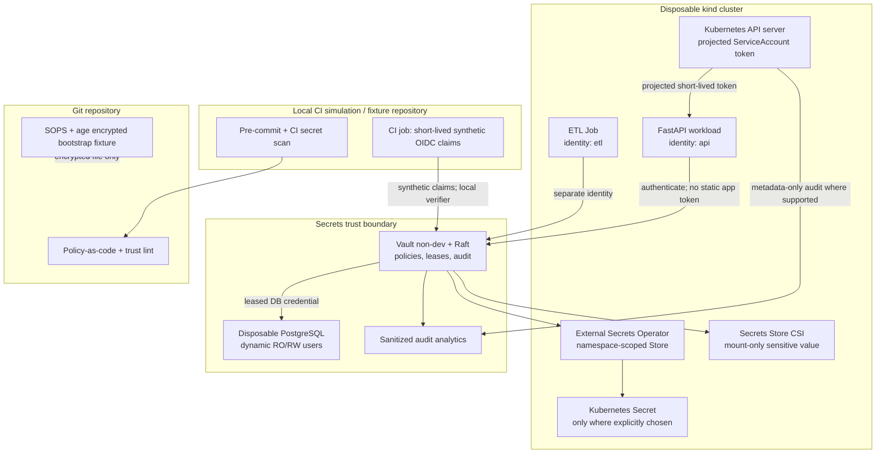

# Zero-Static-Credential Secrets Platform
**M09 Capstone | Stage 2E — Production DevOps & Platform Engineering**

> **Lab classification:** `[SIMULATION]` local educational environment only.  
> **Credential rule:** use throwaway values generated inside the disposable lab. Never paste a real token, key, password, kubeconfig, cloud credential, or production endpoint into this project, terminal transcript, issue, screenshot, or evidence directory.

## 1. Project overview and success definition

### 1.1 Scenario

A data/ML team has accumulated a database password in Helm values, cloud-style access keys in CI variables and a notebook, a committed `.env`, Base64-encoded Kubernetes Secrets in Git, uncertain etcd encryption, a long-lived administrator ServiceAccount token, credentials that have not rotated in years, a Vault process started in development mode, and no reliable inventory, ownership, expiry, revocation plan, or leak-response measurement.

Build a **local, zero-budget learning platform** that replaces long-lived workload/CI credentials with workload identity and short-lived access wherever the local environment can demonstrate the control. The capstone integrates M09 Units 1–8; it does not replace the lessons or their practice-question bank.

### 1.2 North-star outcome

Demonstrate, with redacted evidence and negative tests, that:

1. every in-scope credential has an owner, consumer, location, lifetime, permissions, rotation path, revocation path, and evidence;
2. the secrets backend runs outside development mode with Raft storage, access policies, and audit enabled;
3. API and ETL identities are separate and cannot read each other's credentials;
4. database credentials are short-lived, role-separated, and demonstrably rejected after revocation/expiry;
5. CI/workload trust checks fail closed on incorrect issuer, subject, audience, expiry, signature/key ID, namespace, or repository/ref/environment claims;
6. secret distribution and encryption controls are tested rather than inferred from the existence of a controller or an encrypted file;
7. a synthetic leak is detected, safely assessed, revoked/rotated, and verified dead before any optional history rewrite;
8. measurements are captured from actual local runs, and cleanup is proved.

**Do not call the system “zero secrets” or “zero static credentials” without a scoped inventory and evidence.** The target is *zero long-lived static credentials in workloads and CI within the explicitly measured scope*. Bootstrap keys, sealing keys, and human recovery material may remain as controlled residuals.

### 1.3 What counts as done

The project is complete only when required negative tests fail closed, revocation and rotation are demonstrated, evidence is secret-free, the before/after report is measured rather than fabricated, and cleanup checks pass. A polished diagram cannot compensate for an authorization bypass.

## 2. Source and verification status

The user-provided capstone prompt defines the requirements and target path. The target repository path is:

`Stage 2E — Production DevOps & Platform Engineering/09-Secrets-and-Identity-Management/Projects/01-zero-static-credential-secrets-platform.md`

The supplied prompt lists the M09 sequence and sibling filenames, including lessons 01–08 and `practice-questions.md`. **The exact `Roadmap_ptree.md` and authoritative `PROMPT-Secrets-and-Identity-Management.md` were not independently inspected during this artifact generation.** Therefore, tree-specific details beyond the supplied prompt are not claimed as verified. Relative links below use the filenames supplied in the prompt; check them against the actual repository before committing.

No repository checkout was available in this workflow. This is a standalone artifact, not a repository edit. No cluster, Vault server, database, provider API, Git history scan, runtime test, snapshot restore, key rotation, or incident drill was executed while writing this document. Commands and configuration examples are implementation guidance; version-sensitive items are labelled `[VERIFY]` and must be validated against the selected versions before use.

Official-documentation entry points are listed in §28. Their current contents and the compatibility of any particular version combination were not live-verified in this artifact pass. Do not treat a URL in the reference list as proof that a command or field was tested.

## 3. Prerequisites and safe lab rules

### 3.1 Expected background

You should understand Git, containers, CI basics, Kubernetes namespaces/RBAC/ServiceAccounts, TLS and NetworkPolicy, PostgreSQL roles, Helm/Kustomize, IaC state, and GitOps secret references. If a concept is new, revisit the relevant M09 lesson before continuing.

### 3.2 Suggested laptop and phase footprint

| Phase | Approximate resources `[ASSUMPTION]` | Run concurrently? |
|---|---:|---|
| Static inventory, lint, tests | 1 CPU, under 1 GB RAM | Yes |
| kind + API-server encryption lab | 2 CPU, 2–3 GB RAM | Run alone |
| Vault/OpenBao + Raft + PostgreSQL | 2–3 CPU, 2–3 GB RAM | Run together only if stable |
| ESO integration | 1 CPU, 0.5–1 GB RAM extra | Pause CSI if memory constrained |
| Secrets Store CSI provider | 1 CPU, 0.5–1 GB RAM extra | Run as a separate phase |
| Optional local OIDC issuer / SPIRE | Variable; potentially heavy | Off critical path |

These are planning estimates, not benchmarks. Keep 30 GB of disk available for images, cluster state, and disposable evidence. On an 8 GB laptop, pause and remove optional components between phases.

### 3.3 Non-negotiable safety rules

- Work only in a newly created, explicitly named disposable `kind` cluster and disposable local database.
- Never use a real cloud account, production endpoint, personal access token, real CI token, or copied `.env`.
- Never write Vault root tokens, unseal shares, age private keys, database passwords, kubeconfigs, or generated credentials into tracked files.
- Use `umask 077`; avoid secrets in command-line arguments, shell history, process listings, and logs. Prefer protected temporary files, stdin, and in-process secret reads.
- Do not scan, rewrite, or mutate the user's real repository or Git history. All planted findings belong in a temporary fixture repository.
- Never test a leaked credential against a live provider.
- Revoke/disable and rotate before any optional Git-history purge. History rewriting does not revoke credentials and cannot remove copies in clones, caches, artifacts, logs, forks, and backups.
- Destructive commands must verify the exact cluster/context and require explicit confirmation.
- Keep automated response in dry-run mode by default.
- If a real secret is accidentally introduced: stop work; treat it as exposed; notify the appropriate owner through authorized channels; revoke/rotate it using the approved process; preserve sanitized incident metadata; remove it from the lab without reproducing it in this guide.
- Evidence must be redacted, secret-free, scoped, and repeatable.

### 3.4 Safe synthetic values

Use conspicuous markers such as `FAKE_ONLY_DO_NOT_USE` for static fixtures. Where a format needs entropy, generate a random disposable value at runtime and keep it outside Git. Do not create examples that resemble valid provider keys or tokens.

```bash
umask 077
mkdir -p .local evidence
chmod 700 .local evidence
# Generate only disposable lab material; never print it.
python3 - <<'PY'
import secrets
from pathlib import Path
p = Path(".local/lab-marker")
p.write_text(secrets.token_urlsafe(24))
p.chmod(0o600)
print("Created a disposable marker at .local/lab-marker (value not displayed).")
PY
```

This marker is not a credential for any external service. `.local/` must be ignored by Git.

## 4. Scenario, threat model, and baseline inventory

### 4.1 Baseline inventory template

Create `docs/inventory-before.csv` using this header and synthetic rows only:

```csv
id,type,owner,consumer,location,scope,permissions,created_or_max_age,rotation_method,revocation_path,copy_locations,evidence,status
SYN-DB-01,database-password,data-platform,api,Helm-values,dev-db,read-write,unknown,manual,disable-db-role,Git-history;rendered-manifest,baseline-fixture,synthetic
SYN-CI-01,cloud-style-key,platform,ci-job,CI-variable,simulated-account,admin,unknown,manual,disable-principal,CI-config;logs,baseline-fixture,synthetic
SYN-GIT-01,encoded-k8s-secret,platform,workload,Git-manifest,namespace-a,read,unknown,manual,delete-secret-and-rotate,Git-history;clone,baseline-fixture,synthetic
SYN-SA-01,service-account-token,platform,admin-job,Kubernetes-Secret,cluster-admin,admin,unknown,none,revoke-or-disable,etcd;workstation,baseline-fixture,synthetic
```

These are scenario fixtures, not findings from a real environment. Replace them with your own **lab-generated** inventory only. Never place credential values in the inventory; record identifiers, locations, scope, and evidence references.

For every row, answer: who owns it, what consumes it, where every copy may exist, what it can access, maximum age, rotation procedure, revocation mechanism, how success is verified, and what depends on it during rotation.

### 4.2 STRIDE threat model

| Threat | Example | Control | Negative test | Evidence |
|---|---|---|---|---|
| Spoofing | Forged or wrong-subject workload token | Signature + issuer + audience + subject binding | Wrong subject/issuer/signature denied | Sanitized verifier report |
| Tampering | Attacker edits trust policy or encrypted manifest | Protected review, policy lint, integrity checks | Planted wildcard/bad issuer fails CI | Lint output + reviewed diff |
| Repudiation | Secret read cannot be attributed | Backend/Kubernetes audit with safe fields | Denied and allowed event visible | Redacted audit sample |
| Information disclosure | Secret committed, logged, or mounted too broadly | Scanning, redaction, least privilege, encryption boundaries | Planted synthetic secret detected; logs redacted | Scanner and redaction test output |
| Denial of service | Vault unavailable during rollout | Cache/availability design, bounded TTL, rollback | Stop backend in lab; observe known behavior | Timeline + recovery report |
| Elevation of privilege | API obtains ETL or admin role | Per-app policy and DB roles | Cross-role read denied | Authorization test report |

Threat modelling is not complete until every control has a test and evidence. A successful-path test alone does not demonstrate a security boundary.

## 5. Learning outcomes and architecture overview

On completion, the learner can inventory secrets; distinguish authentication, authorization, and audit; operate a non-dev Vault-compatible backend; design per-app policies; use short-lived identity; test issuer/subject/audience/expiry/signature; issue and revoke dynamic PostgreSQL credentials; compare ESO and CSI; protect bootstrap material with SOPS+age; reason about etcd encryption; detect and respond to leaks; measure results; and safely destroy the lab.

### Chosen backend

**Choice: HashiCorp Vault** for this capstone, because the syllabus explicitly includes Vault architecture, auth methods, leases, database secrets, audit, and Raft. Use a supported non-dev server configuration with Raft storage. The exact Helm chart values, image tag, auth configuration fields, and version compatibility must be checked for the selected versions `[VERIFY]`. OpenBao is a viable alternative, but do not mix Vault and OpenBao assumptions in one implementation.

**Important:** Vault dev mode is not acceptable for this project. Use a disposable non-dev instance, follow the documented initialization/unseal flow, and keep generated recovery material out of Git. This single-node local lab is not production HA.

### Architecture sketch



**Trust boundaries:** Git is not a runtime secret store; the cluster API and etcd are separate from node/pod filesystems; Vault policies do not automatically constrain Kubernetes RBAC; CSI mounts and ESO-created Kubernetes Secrets have different exposure paths; local synthetic OIDC is not cloud STS; and audit logs must not contain secret payloads.

## 6. Repository layout and file responsibilities

Create this structure inside the project directory. All local state and key material paths are ignored by Git.

```text
01-zero-static-credential-secrets-platform/
├── README.md
├── Makefile
├── versions.txt
├── .gitignore
├── .pre-commit-config.yaml
├── .gitleaks.toml
├── platform/
│   ├── kind/
│   │   ├── cluster.yaml
│   │   └── encryption-config.template.yaml
│   ├── vault/
│   │   ├── values.yaml
│   │   ├── server.hcl
│   │   ├── policies/
│   │   │   ├── api.hcl
│   │   │   ├── etl.hcl
│   │   │   └── ci-deploy.hcl
│   │   └── database/
│   │       └── roles.sql
│   ├── postgres/
│   │   └── init.sql
│   ├── eso/
│   │   ├── secret-store.yaml
│   │   └── external-secret.yaml
│   ├── csi/
│   │   ├── secret-provider-class.yaml
│   │   └── mount-pod.yaml
│   └── sops/
│       ├── .sops.yaml
│       └── bootstrap.enc.yaml
├── apps/
│   ├── api/
│   │   ├── main.py
│   │   ├── db.py
│   │   └── requirements.txt
│   └── etl/
│       ├── job.yaml
│       └── run_etl.py
├── policy/
│   ├── trust-policy.json
│   ├── defects/
│   │   ├── broad-subject.json
│   │   ├── wrong-audience.json
│   │   ├── wrong-issuer.json
│   │   └── excessive-permissions.json
│   └── lint_trust.py
├── scripts/
│   ├── preflight.sh
│   ├── bootstrap.sh
│   ├── inventory.py
│   ├── verify.sh
│   ├── audit_analytics.py
│   ├── rotate_lab_credentials.sh
│   ├── leak_drill.sh
│   ├── collect_evidence.sh
│   └── cleanup.sh
├── tests/
│   ├── test_inventory.py
│   ├── test_trust_policy.py
│   ├── test_redaction.py
│   ├── test_secret_manifest_guard.py
│   └── fixtures/
│       └── planted-secret.fixture
├── docs/
│   ├── architecture.md
│   ├── threat-model.md
│   ├── inventory-before.csv
│   ├── inventory-after.csv
│   ├── metrics-template.md
│   ├── adr/
│   │   ├── 001-vault-backend.md
│   │   ├── 002-workload-auth.md
│   │   ├── 003-distribution.md
│   │   ├── 004-encrypted-git.md
│   │   ├── 005-encryption-and-custody.md
│   │   ├── 006-ttl-and-rotation.md
│   │   └── 007-incident-response.md
│   └── production-gap-analysis.md
├── runbooks/
│   ├── leaked-credential.md
│   ├── vault-sealed.md
│   ├── lost-key.md
│   ├── backend-outage.md
│   ├── failed-rotation.md
│   ├── trust-policy-misconfiguration.md
│   ├── compromised-pod-token.md
│   └── suspected-ci-compromise.md
└── evidence/
    └── README.md
```

`evidence/` should contain only sanitized reports. Raw tokens, raw audit payloads, unseal shares, root-token files, decrypted manifests, and kubeconfigs are prohibited. Keep sensitive runtime material under `.local/`, with restrictive permissions, and destroy it at cleanup.

## 7. Tool choices, version policy, and footprint plan

- Linux or WSL2 Ubuntu; Bash; Python 3; Git.
- Docker or another supported container runtime; `kind`; `kubectl`.
- Helm only if the selected Vault chart is used.
- Vault server with Raft storage, PostgreSQL, FastAPI, pytest.
- Gitleaks and/or Trivy for secret detection.
- SOPS + age for encrypted bootstrap material.
- ESO and Secrets Store CSI as separate phases; a compatible provider integration is required for CSI.
- `cryptography`/JWT library only if needed by the chosen verifier; pin dependencies after review.
- Optional: local OIDC issuer, SPIRE, LocalStack, or a full identity provider. These are not on the critical path.

Record **actual installed versions** in `versions.txt`; never copy a guessed version. For example, use `command -v` and each tool's supported version command, then manually review the output. A version string alone does not establish compatibility.

```text
# versions.txt — fill from this machine, do not pre-fill guessed values
OS:
Kernel:
Docker:
kind:
kubectl:
Kubernetes server:
Helm:
Vault:
PostgreSQL:
Python:
FastAPI:
pytest:
Gitleaks:
Trivy:
SOPS:
age:
ESO chart/controller:
Secrets Store CSI driver:
CSI provider:
```

**Version policy:** pin image tags and charts after consulting the official compatibility matrix; avoid `latest`; capture image digests for reproducibility; record the date and source used. Every version-sensitive chart value, CRD field, issuer behavior, CSI rotation feature, Vault auth parameter, and encryption-provider setting is `[VERIFY]` until confirmed against the selected version's official documentation.

## 8. Milestone roadmap

| Milestone | Time estimate `[ASSUMPTION]` | Goal | Heavy services |
|---|---:|---|---|
| 0. Preflight and guards | 1–2 h | Safe context, ignored local state, cleanup boundary | None |
| 1. Inventory and threat model | 2–3 h | Baseline and control mapping | None |
| 2. Vault, policy, audit, backup | 4–7 h | Non-dev Raft, least privilege, recovery | Vault + PostgreSQL |
| 3. Workload identity and trust lint | 3–5 h | Short-lived claims and fail-closed trust | Vault + verifier |
| 4. Dynamic PostgreSQL credentials | 4–6 h | RO/RW, leases, refresh, revocation | Vault + PostgreSQL + API |
| 5. ESO, CSI, encrypted Git | 4–7 h | Distribution trade-offs and secret-zero | Run ESO and CSI sequentially |
| 6. Kubernetes hardening and CI federation | 3–6 h | RBAC, encryption boundary, synthetic CI | kind |
| 7. Detection, game day, recovery, audit | 4–6 h | Measured incident response and cleanup | Run one scenario at a time |

Total: approximately 25–42 focused hours, excluding debugging caused by version incompatibilities. This is a pacing estimate, not a guaranteed completion time.

**Pause/resume plan:** save sanitized evidence and a run ID; record `kubectl config current-context`, running components, and what local material exists without recording values. Stop optional components and remove unused images only if disk pressure requires it. Never snapshot or commit runtime secret directories as a shortcut.

## 9. Milestone 0 — preflight, context guard, and cleanup-safe bootstrap

### Goal and acceptance

Prove the scripts refuse an unknown Kubernetes context, a non-lab endpoint, or destructive work without confirmation. No cluster is created until preflight passes.

### `.gitignore`

```gitignore
# Local runtime state and generated secrets
.local/
.env
.env.*
!.env.example
*.kubeconfig
kubeconfig*
*.token
*.jwt
*.pem
*.key
*.agekey
*.unseal*
*.root-token*
*.snapshot
*.snap
*.db
*.sqlite
*.tfstate
*.tfstate.*
*.tfplan
decrypted/
plaintext/
rendered-secret*.yaml
evidence/raw/
__pycache__/
.pytest_cache/
.venv/
```

Review ignore rules for overbreadth before use. Do not use a broad ignore pattern as a substitute for secret scanning.

### `scripts/preflight.sh`

```bash
#!/usr/bin/env bash
set -Eeuo pipefail
umask 077

EXPECTED_CONTEXT="${EXPECTED_CONTEXT:-kind-secrets-lab}"
fail() { printf 'FAIL: %s\n' "$*" >&2; exit 1; }
need() { command -v "$1" >/dev/null 2>&1 || fail "missing prerequisite: $1"; }

for cmd in docker kind kubectl git python3; do need "$cmd"; done

context="$(kubectl config current-context 2>/dev/null || true)"
[[ "$context" == "$EXPECTED_CONTEXT" ]] || fail \
  "context '$context' is not expected '$EXPECTED_CONTEXT'; refusing to continue"

kind get clusters | grep -Fxq 'secrets-lab' || fail \
  "expected kind cluster 'secrets-lab' does not exist"

server="$(kubectl config view --minify -o jsonpath='{.clusters[0].cluster.server}' 2>/dev/null || true)"
[[ "$server" == https://127.0.0.1:* || "$server" == https://localhost:* ]] || fail \
  "API endpoint is not a loopback lab endpoint; refusing"

printf 'PASS: prerequisites present; context=%s; endpoint=loopback lab\n' "$context"
printf 'Estimate: kind + Vault + PostgreSQL can require several GB RAM and multiple GB disk.\n'
printf 'No credentials or token values were read or printed.\n'
```

`kubectl` context naming and API endpoint layout depend on the local setup. Verify them for your environment `[VERIFY]`; adjust only after reviewing the guard and adding a negative test. A loopback endpoint is a safety heuristic, not proof that a cluster is disposable.

### `scripts/bootstrap.sh`

```bash
#!/usr/bin/env bash
set -Eeuo pipefail
umask 077
EXPECTED_CONTEXT="${EXPECTED_CONTEXT:-kind-secrets-lab}"
CLUSTER_NAME="secrets-lab"

[[ "${1:-}" == "--create" ]] || {
  echo "Usage: $0 --create (creates only the named disposable kind cluster)" >&2
  exit 2
}
if kind get clusters | grep -Fxq "$CLUSTER_NAME"; then
  echo "Cluster already exists; refusing to overwrite it."
  exit 1
fi
mkdir -p .local evidence
chmod 700 .local evidence
./scripts/preflight.sh --help >/dev/null 2>&1 && {
  echo "Unexpected preflight interface; review script before continuing." >&2; exit 1;
} || true
kind create cluster --name "$CLUSTER_NAME" --config platform/kind/cluster.yaml
context="$(kubectl config current-context)"
[[ "$context" == "$EXPECTED_CONTEXT" ]] || {
  echo "Created cluster but context name differs; stop and inspect manually." >&2
  exit 1
}
./scripts/preflight.sh
```

The command above intentionally requires the context to match the chosen naming convention. Verify `kind`'s generated context name in the installed version before relying on it. If it differs, change `EXPECTED_CONTEXT` to the exact generated disposable context and document why. Do not loosen the guard to accept arbitrary contexts.

### `platform/kind/cluster.yaml`

```yaml
kind: Cluster
apiVersion: kind.x-k8s.io/v1alpha4
name: secrets-lab
nodes:
  - role: control-plane
  - role: worker
```

This is a basic kind configuration. API-server encryption-at-rest requires a separately configured API-server encryption provider and access to the control-plane configuration; a normal kind cluster does **not** prove that etcd encryption is enabled.

### `Makefile`

```makefile
SHELL := /usr/bin/env bash
.SHELLFLAGS := -Eeuo pipefail -c
EXPECTED_CONTEXT ?= kind-secrets-lab

.PHONY: preflight up bootstrap unseal policies deploy negative-tests rotate leak-drill verify evidence down

preflight:
	./scripts/preflight.sh

up: preflight
	kind get clusters | grep -Fxq secrets-lab

bootstrap:
	./scripts/bootstrap.sh --create

unseal:
	@echo "Follow runbooks/vault-sealed.md interactively; never echo key shares or tokens."

policies: preflight
	@echo "Apply only reviewed policies using the selected Vault CLI/API version; see §10."
	@echo "No policy is applied by this placeholder target. Configure after version verification."

deploy: preflight
	@echo "Deploy one reviewed phase at a time; see milestones 2–6."

negative-tests:
	python3 -m pytest -q tests

rotate: preflight
	./scripts/rotate_lab_credentials.sh

leak-drill: preflight
	./scripts/leak_drill.sh --dry-run

verify:
	./scripts/verify.sh

evidence:
	./scripts/collect_evidence.sh

down:
	./scripts/cleanup.sh
```

The `policies` and `deploy` targets deliberately do not pretend to configure a backend until version-specific commands and resources have been reviewed. Replace their informational bodies with reviewed commands as part of implementation; acceptance requires the final targets to apply and verify the actual lab configuration. Do not treat the starter Makefile as a completed platform.

### Negative test

Run preflight while a different context is selected in a separate disposable kubeconfig. Expected: non-zero exit before any mutation. Also test with no kind cluster, a changed endpoint, and missing prerequisites. Record exit code and sanitized output.

## 10. Milestone 1 — baseline inventory and threat model

### Goal

Establish the baseline and define what “zero static credentials” means for this project.

### Implementation

1. Commit only the synthetic inventory template in §4.1.
2. Create `docs/threat-model.md` with STRIDE entries from §4.2, plus trust boundaries, data flow, actors, and assumptions.
3. Use the same inventory schema for before and after.
4. Keep the inventory free of secret values. Evidence references should point to sanitized files, not raw scanner output.
5. Define scope: API workload, ETL Job, local CI simulation, Vault, PostgreSQL, Kubernetes manifests, and temporary fixture repository. Explicitly list excluded external cloud accounts and providers.

### `scripts/inventory.py`

```python
#!/usr/bin/env python3
"""Validate inventory metadata; never reads or prints credential values."""
import csv
import sys
from pathlib import Path

REQUIRED = {
    "id", "type", "owner", "consumer", "location", "scope", "permissions",
    "created_or_max_age", "rotation_method", "revocation_path",
    "copy_locations", "evidence", "status",
}

def validate(path: Path) -> list[str]:
    errors: list[str] = []
    with path.open(newline="", encoding="utf-8") as stream:
        reader = csv.DictReader(stream)
        if not reader.fieldnames or not REQUIRED.issubset(reader.fieldnames):
            return [f"missing required columns: {sorted(REQUIRED - set(reader.fieldnames or []))}"]
        seen: set[str] = set()
        for line, row in enumerate(reader, start=2):
            ident = (row.get("id") or "").strip()
            if not ident:
                errors.append(f"line {line}: missing id")
            elif ident in seen:
                errors.append(f"line {line}: duplicate id {ident}")
            seen.add(ident)
            for field in REQUIRED - {"id"}:
                if not (row.get(field) or "").strip():
                    errors.append(f"line {line}: empty {field}")
            if any(k in (row.get("type") or "").lower() for k in ("password-value", "token-value", "private-key-value")):
                errors.append(f"line {line}: inventory appears to describe a secret value, not metadata")
    return errors

if __name__ == "__main__":
    target = Path(sys.argv[1] if len(sys.argv) > 1 else "docs/inventory-before.csv")
    issues = validate(target)
    if issues:
        print("\n".join(f"FAIL: {x}" for x in issues))
        raise SystemExit(1)
    print(f"PASS: inventory metadata schema valid ({target}); values were not inspected or printed")
```

### Acceptance

- The inventory validates.
- Every row has owner, consumer, copy locations, permissions, rotation, revocation, and evidence.
- All values are synthetic metadata; no actual secret value is stored.
- Negative test: remove a required column or leave an owner blank; validator exits non-zero.

## 11. Milestone 2 — non-dev Vault, policies, audit, and recovery

### 11.1 Backend configuration contract

Use a reviewed Vault deployment with:
- dev mode disabled;
- persistent Raft storage on a disposable volume;
- TLS appropriate to the local lab and a documented trust path;
- initialization/unseal performed interactively or via protected runtime material;
- audit device enabled before app credentials are introduced;
- separate policies and auth identities for API, ETL, CI, and operator;
- no root token used by application workloads;
- a snapshot backup and restore exercise against a disposable data set.

**[VERIFY]** Exact Helm chart values, storage configuration fields, TLS options, health-check behavior, Raft initialization/join commands, audit-device syntax, and CLI flags depend on the selected Vault release and chart. Consult the matching official docs and chart reference before applying. Do not copy an old chart example blindly.

### 11.2 Initialization and custody ceremony

1. Confirm the target context with `scripts/preflight.sh`.
2. Install the pinned, reviewed non-dev configuration.
3. Initialize Vault once. Capture the initialization output only into a protected local file or secure operator workflow. Do not paste it into chat, Git, shell logs, screenshots, or evidence.
4. Simulate split custody by having separate lab custodians hold their assigned shares in a secure local exercise. This is a learning simulation, not an actual organizational custody system.
5. Unseal according to the configured threshold. Verify health and sealed state without printing tokens.
6. Store the initial root token in protected runtime material for the setup phase only; do not use it for normal app operations. Create an audited operator identity and least-privilege policies, then revoke the initial root token if the documented workflow supports it. Preserve a controlled recovery plan that does not depend on a token accidentally committed to Git.
7. Enable an audit device and prove both an allowed operation and a denied operation appear in the audit trail. Confirm secret values are not emitted in logs. Vault audit entries may encode sensitive request/response fields; redact before saving evidence.
8. Create a snapshot using the exact version-supported command; verify the snapshot artifact is protected and excluded from Git.
9. Restore only into a separate disposable Vault instance with a known recovery procedure. Never overwrite the only working instance or destroy the only usable recovery material.

### 11.3 Policy-as-code examples

The following policy fragments illustrate path-scoped intent; verify the mount path, KV version, and exact required capabilities for the chosen Vault configuration `[VERIFY]`.

`platform/vault/policies/api.hcl`:

```hcl
# Illustrative policy: app reads only its own runtime configuration.
path "kv/data/apps/api/config" {
  capabilities = ["read"]
}

# No list, delete, update, root, auth-admin, or policy-admin capability.
```

`platform/vault/policies/etl.hcl`:

```hcl
# Illustrative policy: ETL has a separate path and no API path access.
path "kv/data/apps/etl/config" {
  capabilities = ["read"]
}
```

These fragments are not sufficient for database dynamic credentials by themselves. Add narrowly scoped capabilities for the exact database role path after verifying the mount and role names. Do not grant `list` at a broad parent path just to make discovery convenient. A CI deploy identity should be limited to its intended deploy operation and should not read application database credentials.

### 11.4 Policy tests

Create a test matrix and run it with separate identities:

| Identity | Operation | Expected |
|---|---|---|
| API | Read API config path | Allow |
| API | Read ETL config path | Deny |
| API | List parent secret path | Deny unless specifically justified |
| ETL | Read ETL path | Allow |
| ETL | Read API path | Deny |
| CI deploy | Read database password | Deny |
| App identity | Modify policy or enable auth method | Deny |

Capture only path, operation, status, identity alias, timestamp, and sanitized request ID. Never capture secret response bodies.

### 11.5 Raft snapshot and sealed-after-restart drills

**Snapshot drill:** create a disposable canary entry; snapshot; restore into a separate disposable instance; verify the canary metadata is present without displaying its value; destroy the restored instance. Document snapshot encryption, key custody, storage location, retention, and the fact that a snapshot alone does not prove disaster recovery.

**Sealed restart drill:** stop and restart the disposable backend. Observe whether it returns sealed, then follow the configured unseal/recovery runbook. Record outage duration from actual timestamps. Do not delete shares or deliberately corrupt the storage volume.

### Acceptance

- Backend is demonstrably not in dev mode.
- Raft storage is configured and the selected node can be restarted.
- Allowed and denied policy cases are tested.
- Audit is enabled and sanitized evidence exists.
- Snapshot restore and sealed restart are completed or explicitly marked `NOT VERIFIED` with the precise blocker and a bounded alternative.
- No root token, unseal share, snapshot containing sensitive data, or generated secret is tracked.

## 12. Milestone 3 — workload identity, verifier, and trust-policy negative tests

### 12.1 Identity design

Use a dedicated Kubernetes ServiceAccount per workload and projected, short-lived tokens with an explicit audience where supported. Avoid legacy long-lived token Secrets and disable automatic token mounting when a pod does not need API access. Authenticate to Vault using either Kubernetes auth or JWT auth based on the verified local issuer capabilities.

- **Kubernetes auth:** Vault validates the ServiceAccount token through the Kubernetes integration and role constraints. Review the TokenReview configuration, reviewer identity, audience, namespace, and ServiceAccount binding for the chosen version.
- **JWT auth:** Vault validates a JWT against a configured issuer/JWKS or equivalent trust configuration. It is suitable only when issuer metadata, signing keys, audience, subject claims, and network reachability are correctly configured.

Do not configure both just for complexity. Choose one primary workload path and document the alternative in an ADR. The API and ETL must use different identities and policies.

### 12.2 Trust-policy shape

`policy/trust-policy.json`:

```json
{
  "issuer": "https://issuer.invalid/lab",
  "audience": "vault-secrets-lab",
  "allowed_subjects": [
    "system:serviceaccount:apps:api",
    "system:serviceaccount:jobs:etl"
  ],
  "max_token_age_seconds": 600,
  "allow_wildcard_subject": false,
  "environment": "lab",
  "repository": "example/zero-static-credential-lab",
  "ref": "refs/heads/lab"
}
```

This is a local verifier's own schema, not a Vault role schema and not a cloud provider trust policy. `.invalid` is intentionally non-routable. The token age is illustrative. The actual Kubernetes token issuer and audience must be discovered and configured for the disposable cluster.

### 12.3 Trust-policy linter

`policy/lint_trust.py`:

```python
#!/usr/bin/env python3
"""Fail-closed linter for the local teaching trust-policy schema."""
import json
import sys
from pathlib import Path

def lint(doc: dict) -> list[str]:
    errors = []
    for key in ("issuer", "audience", "allowed_subjects", "max_token_age_seconds"):
        if key not in doc:
            errors.append(f"missing {key}")
    issuer = doc.get("issuer")
    if not isinstance(issuer, str) or not issuer or "*" in issuer:
        errors.append("issuer must be a non-empty exact string")
    if isinstance(issuer, str) and not issuer.startswith("https://"):
        errors.append("issuer must use HTTPS in this policy schema")
    aud = doc.get("audience")
    if not isinstance(aud, str) or not aud or "*" in aud:
        errors.append("audience must be a non-empty exact string")
    subjects = doc.get("allowed_subjects")
    if not isinstance(subjects, list) or not subjects:
        errors.append("allowed_subjects must be a non-empty list")
    else:
        for subject in subjects:
            if not isinstance(subject, str) or not subject or "*" in subject:
                errors.append("wildcard/empty subject is forbidden")
    age = doc.get("max_token_age_seconds")
    if not isinstance(age, int) or age <= 0 or age > 3600:
        errors.append("max_token_age_seconds must be 1..3600")
    if doc.get("allow_wildcard_subject") is True:
        errors.append("allow_wildcard_subject must be false")
    return errors

if __name__ == "__main__":
    p = Path(sys.argv[1] if len(sys.argv) > 1 else "policy/trust-policy.json")
    try:
        policy = json.loads(p.read_text(encoding="utf-8"))
    except Exception as exc:
        print(f"FAIL: cannot parse policy ({type(exc).__name__})")
        raise SystemExit(2)
    errors = lint(policy)
    if errors:
        print("\n".join(f"FAIL: {e}" for e in errors))
        raise SystemExit(1)
    print("PASS: local trust policy satisfies the teaching schema")
```

The linter validates only this local JSON schema; it does not verify a JWT signature or prove that Vault/cloud STS enforces the same conditions. Add unit tests that mutate one property at a time.

### 12.4 Required verifier test matrix

The runtime verifier must use a maintained JWT library and validate cryptographic signatures, issuer, audience, `exp`, `nbf` where present, key ID/JWKS selection, and subject/trust bindings. Do not write your own cryptographic verification. If no local OIDC issuer is available, use synthetic claims in a deterministic policy evaluator and mark cryptographic/JWKS tests `SIMULATION` rather than pretending to validate a signed token.

| Case | Expected result |
|---|---|
| Exact issuer + audience + allowed subject + valid signature + current time | Allow |
| Wrong subject | Deny |
| Wrong audience | Deny |
| Wrong issuer | Deny |
| Expired token | Deny |
| `nbf` in future | Deny |
| Invalid signature | Deny |
| Unknown `kid` or unavailable JWKS key | Deny or fail closed |
| Wildcard/fork-like repository trust | Deny |
| Wrong ref/environment | Deny |
| Wrong ServiceAccount or namespace | Deny |
| API identity asks for ETL role | Deny |
| Missing required expiry/binding claim | Deny |
| Cross-tenant identity | Deny |

### 12.5 What this proves—and does not

A local policy evaluator proves only that the supplied test cases are handled by that evaluator. A verified local issuer and Vault auth test can establish behavior for that local configuration. Neither proves AWS STS/IRSA, EKS Pod Identity, Google Workload Identity Federation, Microsoft Entra Workload ID, GitHub Actions OIDC, GitLab CI OIDC, or their production trust boundaries. Provider federation is a separate integration and review.

## 13. Milestone 4 — dynamic PostgreSQL credentials and safe rotation

### 13.1 Database separation

Use a disposable PostgreSQL instance. Create a schema and two runtime roles with distinct grants: read-only can select only the intended tables; read-write can modify only the intended schema/tables; neither role is superuser, owns the database, or can create arbitrary roles. A separate privileged account is used only by Vault's database integration and is never given to the API or ETL.

`platform/postgres/init.sql` (illustrative baseline):

```sql
CREATE SCHEMA IF NOT EXISTS app_data;

CREATE TABLE IF NOT EXISTS app_data.records (
    id BIGINT GENERATED ALWAYS AS IDENTITY PRIMARY KEY,
    label TEXT NOT NULL
);

INSERT INTO app_data.records(label) VALUES ('synthetic-row')
ON CONFLICT DO NOTHING;

REVOKE ALL ON SCHEMA public FROM PUBLIC;
REVOKE ALL ON SCHEMA app_data FROM PUBLIC;
GRANT USAGE ON SCHEMA app_data TO PUBLIC;
GRANT SELECT ON ALL TABLES IN SCHEMA app_data TO PUBLIC;
ALTER DEFAULT PRIVILEGES IN SCHEMA app_data
    GRANT SELECT ON TABLES TO PUBLIC;
```

This baseline is intentionally incomplete for production and should be tightened by replacing broad `PUBLIC` grants with named roles before application use. Create explicit `app_readonly` and `app_readwrite` roles, grant only the intended capabilities, and verify with `has_table_privilege`/negative SQL tests. Do not use this script as a production database bootstrap.

### 13.2 Vault database engine contract

Configure the Vault database secrets engine against the disposable PostgreSQL endpoint using a dedicated privileged database connection identity. Create separate dynamic roles, for example `api-readonly` and `etl-readwrite`, each with a bounded default/max TTL and distinct SQL creation/revocation statements. Exact Vault database plugin fields, SQL templates, lease path names, and CLI commands are `[VERIFY]` against the selected release.

Required behavior:
- API can request only its read-only role.
- ETL can request only its per-run role.
- The API cannot request ETL credentials; ETL cannot request API credentials.
- Issued credentials have a recorded lease ID and expiry.
- Renewal is allowed only within configured policy/lease limits.
- Revocation removes the dynamic user or disables its access according to the plugin's documented behavior.
- Expired/revoked credentials fail on a new database connection. Existing sessions may behave differently; test them explicitly.
- Root-credential rotation changes the privileged connection credential in a controlled sequence and verifies Vault can still manage roles afterward.

### 13.3 Client and pool lifecycle

A database credential expiring does not necessarily terminate an already established database session at that exact instant. Connection pools can keep stale authenticated connections; clients may not reload a changed password automatically. The application must have a bounded strategy for obtaining a fresh lease, draining stale connections, and replacing the pool without logging the credential.

Recommended sequence:
1. Request a lease only after workload identity succeeds.
2. Store credential material in process memory only where practical; never log or persist it.
3. Set a refresh deadline before lease expiry, with jitter to avoid synchronized refresh.
4. Build a new pool using the new credential and verify a health query.
5. Switch new work to the new pool; drain the old pool within a bounded deadline.
6. Revoke the old lease after the consumer has switched, unless the security incident requires immediate revocation.
7. On failed refresh, stop accepting new work before using an expired credential; expose a sanitized readiness failure and alert.
8. On backend outage, define explicitly how long cached credentials may continue to be used. Do not claim fail-closed and high availability simultaneously without explaining the availability trade-off.

### 13.4 FastAPI service contract

`apps/api/requirements.txt`:

```text
fastapi
uvicorn
pytest
```

Pin tested versions in the implementation repository after validation. Database and Vault client libraries should be added only after selecting compatible, supported versions.

`apps/api/main.py` (minimal redaction pattern; add real Vault/database adapters only after their APIs are verified):

```python
import logging
import re
from fastapi import FastAPI, Request
from fastapi.responses import JSONResponse

app = FastAPI()
logger = logging.getLogger("secrets-platform")

SENSITIVE_HEADERS = {"authorization", "proxy-authorization", "cookie", "set-cookie"}
SENSITIVE_KEYS = re.compile(r"(password|secret|token|authorization|api[_-]?key)", re.I)

def sanitize_headers(headers) -> dict[str, str]:
    result = {}
    for key, value in headers.items():
        result[key] = "[REDACTED]" if key.lower() in SENSITIVE_HEADERS else value
    return result

def sanitize_mapping(data: dict) -> dict:
    return {key: ("[REDACTED]" if SENSITIVE_KEYS.search(key) else value)
            for key, value in data.items()}

@app.middleware("http")
async def safe_request_logging(request: Request, call_next):
    # Never log query strings or body by default: they can contain credentials.
    logger.info("request method=%s path=%s headers=%s",
                request.method, request.url.path,
                sanitize_headers(request.headers))
    response = await call_next(request)
    logger.info("response method=%s path=%s status=%s",
                request.method, request.url.path, response.status_code)
    return response

@app.get("/healthz")
async def healthz():
    return {"status": "ok"}

@app.get("/readyz")
async def readyz():
    # Replace with a real dependency check; do not return credential values.
    return JSONResponse({"status": "not-configured"}, status_code=503)
```

This starter does **not** yet authenticate to Vault or connect to PostgreSQL; it is a safe logging boundary and health endpoint only. To complete the application milestone, implement and test a Vault adapter using the selected supported client/auth flow, a database pool lifecycle, and a read-only query. Keep tokens out of exception messages. The implementation acceptance gate must fail until integration tests prove the runtime path. Do not claim this snippet alone is the required functioning application.

### 13.5 ETL identity

`apps/etl/job.yaml` must define a dedicated `ServiceAccount` (for example `etl-runner`), disable token automount unless the chosen Vault auth mechanism requires the projected token, and explicitly project a short-lived token with the dedicated audience when supported. The Job must retrieve its own dynamic lease per run, write only synthetic data, emit a run ID and row count, and never reuse the API's identity or database credentials. Add an integration test that the API token cannot obtain the ETL role and vice versa.

### 13.6 Root rotation and mass-revoke drill

Use only disposable lab credentials. Before root-credential rotation, verify the replacement/rotation method supported by the selected database plugin and Vault release `[VERIFY]`, confirm backup/recovery, pause role creation, and record the current sanitized state. Rotate using the documented procedure; update the Vault connection configuration securely; verify new dynamic credential issuance and revocation; then retire the old privileged credential. If any step fails, stop issuance and follow the recovery plan—do not print either password.

For mass revoke, target only the lab mount/prefix, require a confirmation gate, record the exact number of leases affected, verify old credentials are rejected on new connections, and report any still-open sessions separately.

## 14. Milestone 5 — ESO, CSI, and encrypted-in-Git bootstrap

### 14.1 Distribution decision matrix

| Pattern | Best fit | Secret copy/exposure | Rotation/reload caveat |
|---|---|---|---|
| Native Kubernetes Secret + encryption at rest | Simple apps needing API Secret semantics | API object, etcd (encrypted only if configured), authorized nodes/pods | App reload behavior is app-specific |
| ESO | Materialize external secret into Kubernetes Secret | Adds Kubernetes API/etcd object copy | Controller refresh does not guarantee process reload |
| Secrets Store CSI mount | Sensitive value needed as mounted file | Provider/node/pod mount path; may avoid Secret object if sync disabled | Driver/provider rotation and app reread behavior must be tested |
| Vault Agent/runtime retrieval | App can read files or local agent endpoint | Agent memory/files and Vault audit boundary | Agent template refresh does not guarantee app reload |
| Dynamic credentials | Short-lived database or service identity | Runtime lease and consumer session | Expiry, open connections, and pool refresh differ |
| SOPS+age in Git | Encrypted bootstrap/config for authorized decryptor | Ciphertext in Git; plaintext after decryption | Does not protect runtime copies or leaked private key |
| Sealed Secrets | GitOps bootstrap for a controller-managed cluster | Ciphertext in Git; controller key can decrypt | Controller key backup is highly sensitive |

No pattern automatically solves authorization, rotation, reload, node access, or tenant isolation.

### 14.2 ESO path

Implement a namespace-scoped SecretStore/ClusterSecretStore design only after verifying the selected ESO version's CRD schema and Vault auth support `[VERIFY]`. Prefer namespaced stores and workload identities; do not hand a broad backend token to ESO. Create separate `apps` and `jobs` namespaces and test that an `apps` workload cannot read a `jobs` secret. If the local Vault/ESO auth integration cannot be completed safely, provide a recorded integration blocker and a deterministic controller-independent policy simulation; do not mark the ESO integration as passed.

Acceptance:
- ESO sync is limited to the intended path and namespace.
- A deliberately wrong path or identity fails.
- The resulting Kubernetes Secret is treated as a new copy with its own RBAC and encryption requirements.
- Rotation is measured at backend, controller, Kubernetes object, pod/file, and application consumption layers.

### 14.3 CSI path

Install the Secrets Store CSI driver and a compatible Vault provider only after checking the current compatibility matrix `[VERIFY]`. Create one high-sensitivity synthetic secret mounted as a file. Do **not** configure secret synchronization for this test. Prove both that the file is available to the authorized pod and that no Kubernetes Secret object is created for this secret. Check the relevant namespace and object name; do not infer absence merely because a pod mount works.

If local driver/provider compatibility blocks the real integration, label the result `[SIMULATION]`, demonstrate the desired pod volume contract, and keep the integration acceptance criterion `NOT VERIFIED`. The alternative is a testable static manifest/policy check, not a claim of working CSI delivery.

### 14.4 Rotation propagation table

Fill this with measured timestamps, not assumptions:

| Run ID | Backend updated at | Controller/driver observed at | K8s object/file updated at | App consumed new value at | Convergence seconds | Failure/retry |
|---|---|---|---|---|---:|---|
| `RUN-___` | | | | | | |

Test whether the application rereads a mounted file or needs restart. Document mount permissions, node/pod exposure, Kubernetes Secret sync semantics, and provider-specific limitations.

### 14.5 SOPS + age and secret-zero

Choose **SOPS + age** for the core encrypted-in-Git path. The `.sops.yaml` file contains recipient public keys and path rules; the private age key must remain outside Git in `.local/` with mode `0600`. Use separate recipients per environment where practical and document recipient update and key recovery.

`platform/sops/.sops.yaml` (illustrative; verify schema against the selected SOPS version):

```yaml
creation_rules:
  - path_regex: platform/sops/.*\.enc\.yaml$
    age: "age1REPLACE_WITH_A_REAL_LAB_PUBLIC_RECIPIENT"
```

The recipient placeholder is intentionally invalid and must be replaced with a public recipient generated for this lab. Never put the private key in the repository. Do not commit a decrypted file.

`platform/sops/bootstrap.enc.yaml` should be generated during the lab from a synthetic value and encrypted before staging. The file itself is not supplied as plaintext in this guide because the encrypted envelope is generated by the chosen SOPS version. Acceptance requires:
- decrypt with the authorized lab key succeeds;
- decrypt with the wrong key fails;
- a plaintext Kubernetes Secret manifest fails CI;
- a decrypted artifact under a tracked path fails the guard;
- recipient/key update and recovery are documented;
- secret-zero chain is explicit: operator-controlled local key → decrypt bootstrap fixture → establish workload identity/backend trust → runtime credentials issued by backend. The private key is never committed.

Encryption in Git protects ciphertext under stated assumptions; it does not protect plaintext after decryption, leaked recipient private keys, compromised controllers, or runtime copies.

## 15. Milestone 6 — Kubernetes hardening, encryption at rest, and CI federation

### 15.1 RBAC and ServiceAccount token policy

- Application ServiceAccounts should not have `get`, `list`, or `watch` access to Kubernetes Secrets unless the workload has a documented, narrowly scoped need.
- Avoid broad wildcard verbs/resources and namespace-wide secret-read roles.
- Set `automountServiceAccountToken: false` when a pod does not need Kubernetes API access.
- When workload identity requires a token, project a short-lived token with an explicit audience and expiration according to the supported Kubernetes API.
- Do not create legacy long-lived token Secrets.
- Test both intended allow and denial paths using the actual ServiceAccount identity.

### 15.2 Encryption-at-rest boundary

Kubernetes Secret data is Base64-encoded for representation; Base64 is not encryption. API-server encryption-at-rest requires an enabled encryption provider and correct key configuration. A successful `kubectl get secret` response proves API access, not that the etcd bytes are encrypted. A kind cluster's default configuration must not be assumed to have encryption enabled.

The preferred exercise is a disposable cluster whose API server is explicitly configured with a supported encryption provider. The encryption configuration and key must be available to the control-plane process but must never be tracked. Verify using:
1. API-server startup/config evidence showing the intended provider is active;
2. creation of a synthetic canary Secret;
3. API read test proving authorized access still works;
4. controlled etcd-at-rest inspection of the serialized canary value, with output redacted and interpretation documented;
5. a negative test demonstrating a deliberately unsupported/incorrect config prevents startup or fails verification, without corrupting the only cluster.

**[VERIFY]** The exact kind control-plane mount, API-server flag, encryption configuration schema, provider behavior, and key rotation steps vary by Kubernetes version. If the chosen kind version cannot be configured safely, mark the result `[SIMULATION]` and state exactly what was not proven. Do not claim encryption-at-rest was enabled based on a YAML file alone.

### 15.3 Encryption key rotation runbook

1. Back up the disposable cluster and the protected key configuration.
2. Add the new provider/key in the documented order while preserving decryptability of existing data.
3. Make the new key the write key according to the selected Kubernetes version's procedure.
4. Re-encrypt existing resources using the documented method.
5. Verify the canary and existing synthetic resources are readable.
6. Remove the old key only after confirming no data requires it and recovery has been tested.
7. If any verification fails, restore the known-good disposable cluster and key configuration. Never remove the only decrypt-capable key.

### 15.4 Audit policy

Use Metadata-level audit for the lab where supported, and ensure request/response bodies containing Secret payloads are not captured. Verify the exact policy path, mount, and audit backend configuration for the selected Kubernetes version `[VERIFY]`. Create one allowed and one denied request and prove sanitized metadata is emitted. Do not save raw logs before checking for sensitive fields.

### 15.5 Local CI OIDC simulation

Use synthetic short-lived claims and a local verifier/Vault JWT role. Bind trust to exact repository/ref/environment-style claims and a narrow deploy policy. No stored cloud access keys, long-lived deployment tokens, or printed secrets are allowed.

An illustrative CI contract:

```yaml
# Illustrative workflow only; adapt to the actual CI provider and reviewed action pins.
# Do not treat placeholder action versions or this local simulation as production-ready.
name: secret-platform-checks
on:
  pull_request:
  push:
    branches: ["lab"]
permissions:
  contents: read
  # Add OIDC token permission only to the job that needs it, using provider syntax.
jobs:
  static-checks:
    runs-on: ubuntu-latest
    steps:
      - name: Checkout
        uses: actions/checkout@<VERIFY_ACTION_AND_PINNED_SHA>
      - name: Policy and secret checks
        run: |
          python3 -m pytest -q tests
          python3 policy/lint_trust.py policy/trust-policy.json
          ./scripts/verify.sh --static-only
```

`<VERIFY_ACTION_AND_PINNED_SHA>` is a placeholder and intentionally invalid YAML for execution until replaced with a reviewed action reference. Do not call this file production-ready. For actual CI, verify the provider's workflow syntax and pin actions to a verified full commit SHA. Fork and pull-request trust boundaries must be tested; untrusted contributions must not receive a deploy token.

Negative tests: wrong repository, wrong ref, wrong environment, fork-like claim, wrong audience, expired token, and excessive requested permissions must be denied. This only tests the local policy or CI configuration; it does not prove real provider federation.

## 16. Milestone 7 — detection, incident-response game day, and resilience drills

### 16.1 Secret scanning

Run a secret scanner in pre-commit and CI and schedule a scan of the disposable fixture repository's Git history. Plant only a conspicuously synthetic marker such as `FAKE_ONLY_DO_NOT_USE`. Keep the fixture repository separate from the real project. Do not scan or rewrite the user's real history.

A scanner can miss secrets or produce false positives; record tool/version, scope, exclusions, commit range, and known limitations. The acceptance test is a known synthetic fixture detected and a clean fixture producing no finding—not a claim of perfect detection.

### 16.2 Redaction tests

The API logging boundary must redact at least:
- `Authorization`, `Proxy-Authorization`, `Cookie`, and `Set-Cookie` headers;
- keys containing password, secret, token, API key, or authorization;
- exception details that could include client request/response bodies;
- query strings and request bodies by default.

Tests should inject a fake marker and assert it does not appear in captured logs. Avoid tests that print the marker on failure; assert a boolean or sanitized result instead. Redaction must be applied before logs are emitted, not only before evidence export.

### 16.3 Audit analytics

` scripts/audit_analytics.py` should ingest a **sanitized** local audit export, flag unusual read volume, repeated denials, off-hours access if a lab schedule is defined, and cross-role path attempts. It should output event IDs, timestamps, path templates, identity aliases, and rule IDs—not secret values or raw response payloads. Thresholds are lab assumptions and must be tuned from observed baseline.

### 16.4 Dry-run response

` scripts/leak_drill.sh` must default to `--dry-run`, refuse an unknown context, and allow destructive action only when all of these are true:
- the exact expected `kind` context is active;
- the named lab cluster exists;
- target lease/credential belongs to the lab run ID;
- an explicit confirmation variable/flag is supplied;
- the action is recorded in sanitized evidence.

Never add a code path that silently targets a cloud account or external endpoint.

### 16.5 Controlled leak-response game day

Run against a disposable synthetic credential only:

1. **Inject:** place the fake marker in the isolated fixture repository or synthetic local secret path.
2. **Detect:** run scanner/canary/audit alerting and record detection timestamp.
3. **Assess:** identify owner, consumers, locations, permissions, and blast radius from the inventory.
4. **Contain:** disable/revoke the affected local credential/lease using the approved backend operation.
5. **Rotate:** issue a replacement and update consumers through the approved flow.
6. **Verify dead:** prove the old credential is rejected by the local verifier/backend or a new database connection. Record the exact test and timestamp.
7. **Investigate copies:** list Git history, clones, caches, artifacts, logs, images, manifests, and backups within the defined lab scope.
8. **Preserve evidence:** retain sanitized identifiers and the timeline.
9. **Purge history only after revoke/rotate:** if the isolated fixture history is rewritten, prove the old credential was already dead. History rewrite is optional and is not remediation by itself.
10. **Recover and review:** restore service, document contributing conditions, and write a blameless review with action owners and due dates.

Measure time-to-detect from injection to alert and time-to-revoke from injection/detection (state which definition is used) to confirmed rejection. Never invent timestamps or metrics.

### 16.6 Required resilience drills

For each drill record preconditions, fault injected, expected behavior, actual observation, recovery, cleanup, evidence path, and limitations.

| Drill | Safe injection | Expected observation | Must not do |
|---|---|---|---|
| Vault sealed after restart | Restart only disposable Vault | Auth fails until documented unseal/recovery | Delete only usable shares |
| Vault unavailable during rollout | Stop lab backend briefly | Existing sessions/cached values behave as measured; new fetch fails or retries boundedly | Claim all apps fail closed without test |
| ESO store credential expired | Revoke only lab integration identity | Reconciliation fails with sanitized event; unrelated namespace remains isolated | Use production credential |
| JWKS key rotation | Rotate local synthetic issuer key with overlap | New key accepted; old-key behavior follows cache/overlap policy | Reuse real signing key |
| Encryption key mishap | Use separate throwaway cluster/config | API-server failure or recovery follows documented procedure | Corrupt main cluster |
| Lost age/sealing key | Simulate unavailable copy, restore protected backup | Decryption/unseal recovery succeeds if backup is valid | Destroy only recovery copy |
| API-server issuer change | Change a disposable test configuration or simulate claim mismatch | Old issuer tokens rejected; workloads require reconfiguration | Change a real cluster issuer |
| Break-glass access | Use designated lab-only operator identity | Access is time-bounded, justified, and audited | Use root token as normal workflow |

If a drill cannot safely be executed locally, mark it `NOT VERIFIED` and provide a bounded simulation plus a precise alternative acceptance test. A written runbook is not evidence that recovery works.

## 17. End-to-end verification and evidence capture

### 17.1 `scripts/verify.sh`

```bash
#!/usr/bin/env bash
set -Eeuo pipefail
umask 077
mode="${1:-full}"
EXPECTED_CONTEXT="${EXPECTED_CONTEXT:-kind-secrets-lab}"
fail() { printf 'FAIL: %s\n' "$*" >&2; exit 1; }

if [[ "$mode" == "--static-only" ]]; then
  python3 policy/lint_trust.py policy/trust-policy.json
  python3 -m pytest -q tests
  echo "PASS: static-only checks; no cluster/runtime claim made"
  exit 0
fi

context="$(kubectl config current-context 2>/dev/null || true)"
[[ "$context" == "$EXPECTED_CONTEXT" ]] || fail "unexpected context: $context"
kind get clusters | grep -Fxq secrets-lab || fail "expected lab cluster missing"
endpoint="$(kubectl config view --minify -o jsonpath='{.clusters[0].cluster.server}' 2>/dev/null || true)"
[[ "$endpoint" == https://127.0.0.1:* || "$endpoint" == https://localhost:* ]] || fail "non-loopback endpoint"

python3 policy/lint_trust.py policy/trust-policy.json
python3 -m pytest -q tests

# Required integration probes are enabled only after their commands have been
# implemented and reviewed for the selected versions. Missing probes fail closed.
for probe in \
  evidence/backend-policy-tests.txt \
  evidence/dynamic-credential-revocation.txt \
  evidence/identity-negative-tests.txt \
  evidence/secret-scan.txt \
  evidence/cleanup-check.txt; do
  [[ -s "$probe" ]] || fail "required evidence missing: $probe"
done

if grep -RIlE '(AKIA[0-9A-Z]{16}|gh[pousr]_[A-Za-z0-9]{20,}|-----BEGIN (RSA |EC |OPENSSH )?PRIVATE KEY-----)' \
    --exclude-dir=.git --exclude-dir=.local --exclude='*.md' . >/dev/null 2>&1; then
  fail "real-looking credential/private-key pattern found; investigate without printing the match"
fi

echo "PASS: required evidence files exist; see evidence/ for sanitized results"
echo "NOTE: file presence alone does not prove evidence validity; review run IDs and methods."
```

The pattern check is illustrative and incomplete; use a maintained scanner for actual secret detection. A static scan cannot prove that a cloud credential is absent from every possible format. Review endpoint checks for the actual local setup. `make verify` must fail if required runtime evidence is absent; do not create empty evidence files just to pass.

### 17.2 Evidence rules

Each report must include run ID, timestamp, tool/version, scope, command or method, result, and evidence path. Never include secret values. Use these suggested artifacts:

- `evidence/preflight.txt`
- `evidence/inventory-validation.txt`
- `evidence/backend-policy-tests.txt`
- `evidence/audit-redacted-sample.txt`
- `evidence/raft-restore-report.md`
- `evidence/identity-negative-tests.txt`
- `evidence/dynamic-credential-revocation.txt`
- `evidence/rotation-propagation.csv`
- `evidence/eso-isolation.txt`
- `evidence/csi-no-secret-object.txt`
- `evidence/encryption-at-rest-verification.md`
- `evidence/secret-scan.txt`
- `evidence/redaction-tests.txt`
- `evidence/game-day-timeline.csv`
- `evidence/cleanup-check.txt`

A file's existence is not enough: inspect its content for scope, expected-vs-actual result, sanitized output, and limitations. Evidence collection must not copy raw Vault audit payloads, kubeconfigs, or token files.

## 18. Before/after metrics report template

Copy this table to `docs/metrics-template.md` and fill only from actual runs.

| Metric | Baseline | After | Measurement method / command | Timestamp or run ID | Scope | Evidence | Limitations |
|---|---:|---:|---|---|---|---|---|
| Static credentials in workloads/CI | | | inventory + scan | | | | |
| Maximum credential age | | | inventory | | | | |
| Time to revoke | | | leak drill timestamps | | | | |
| Time to rotate on demand | | | rotation drill | | | | |
| Workloads using workload identity (%) | | | workload inventory | | | | |
| Secrets exposed in Git | | | isolated history scan | | | | |
| Secrets exposed in images | | | image scan | | | | |
| Secrets exposed in manifests | | | manifest scan | | | | |
| Secrets exposed in logs | | | redaction/log scan | | | | |
| Negative-test pass rate | | | test report | | | | |
| Rotation propagation time | | | propagation timestamps | | | | |
| Vault recovery time | | | sealed/restart drill | | | | |
| Mean time to detect | | | game-day timestamps | | | | |
| Mean time to revoke | | | game-day timestamps | | | | |

For each metric, define numerator, denominator, scope, and treatment of unknowns. If there were no baseline measurements, record `NOT MEASURED`; do not substitute zero. Local results do not predict production performance, managed-service behavior, or cloud-provider federation.

## 19. Eight incident runbooks

Each runbook begins with **scope confirmation**, protects evidence, and ends with verification and cleanup. Commands must be adapted to the exact selected versions and the disposable lab. If a real secret is suspected, stop the lab exercise and use the organization's authorized incident process.

### 19.1 Leaked credential

1. Stop further disclosure and record a sanitized incident ID.
2. Identify owner, permissions, consumers, copies, and exposure window.
3. Preserve safe metadata and scanner findings.
4. Revoke/disable the credential and rotate dependent consumers.
5. Verify old credential rejection using the local backend/database only.
6. Investigate Git, clone, cache, image, artifact, log, manifest, and backup copies.
7. Rewrite only the isolated fixture history, if necessary, after revocation/rotation.
8. Restore service and document time-to-detect, time-to-revoke, contributing causes, and actions.

### 19.2 Vault sealed

1. Verify the expected disposable context and backend identity.
2. Check service health, storage availability, and logs with secret values redacted.
3. Confirm whether this is expected after restart or an unexpected seal event.
4. Follow the selected release's unseal procedure using authorized custodians.
5. Confirm audit, policy, and auth paths still work with allowed and denied probes.
6. Record outage and recovery times; do not put shares or tokens in evidence.

### 19.3 Lost sealing, recovery, or age key

1. Identify which key is unavailable and what data depends on it.
2. Do not delete or overwrite the remaining recovery copies.
3. Restore from the protected backup using the documented custody process.
4. Verify decryption/unseal against a synthetic canary.
5. If no valid key exists, document data loss and recreate only the disposable lab; do not claim recovery.
6. Review backup access, integrity checks, and recovery-test frequency.

### 19.4 Backend outage

1. Verify the backend endpoint is the local lab endpoint.
2. Determine which operations fail: new credential issue, renew, revoke, existing DB session, or app health.
3. Follow the documented availability policy; do not extend credential TTL ad hoc without review.
4. Restore the backend and confirm audit continuity, policy, and new lease issuance.
5. Check for stale pools and credentials that expired during outage.
6. Record actual impact and recovery time.

### 19.5 Failed rotation

1. Pause further rotation attempts and retain the last known-good credential only within the lab.
2. Check backend role status, database permissions, lease TTL, pool state, and consumer refresh.
3. Test the new credential using a safe health query without printing it.
4. Switch consumers only after health validation; drain old connections with a bounded deadline.
5. Revoke the old credential when safe—or immediately if compromised, accepting service interruption as required.
6. Verify old access is rejected and document rollback outcome.

### 19.6 Trust-policy misconfiguration

1. Disable the affected lab role/workflow path.
2. Compare issuer, audience, subject, namespace, repository/ref/environment, and key ID against the approved policy.
3. Run the planted-defect corpus and inspect sanitized denials.
4. Correct the narrowest field; do not solve failure with a wildcard.
5. Retest both allowed and denied cases before re-enabling.
6. Record policy review and change evidence.

### 19.7 Compromised pod or token

1. Isolate only the disposable workload using reviewed lab controls.
2. Identify the ServiceAccount, projected token audience, Vault role, leases, and reachable secret paths.
3. Revoke lab leases and disable the compromised identity as appropriate.
4. Recreate the pod with a clean identity; verify cross-role access is denied.
5. Inspect sanitized audit and pod events; do not export token contents.
6. Review automount, RBAC, image, runtime, and namespace boundaries.

### 19.8 Suspected CI compromise

1. Stop the lab deployment job and prevent new identity issuance.
2. Inspect repository/ref/environment trust, job permissions, action pins, artifacts, and logs.
3. Revoke the lab deploy identity and related leases.
4. Verify wrong-ref, fork-like, wrong-audience, and expired-token tests fail.
5. Rotate any dependent lab credential and verify old credential rejection.
6. Preserve sanitized evidence; do not rewrite real history or test against a live provider.
7. Re-enable only after trust and least-privilege review.

## 20. Architecture Decision Records (ADRs)

Create each ADR with: status, context, decision, alternatives, consequences, security trade-offs, verification plan, and revisit trigger.

### ADR-001 — Vault backend

**Decision:** use HashiCorp Vault for the core path because the M09 syllabus centers Vault architecture, leases, database secrets, auth, audit, and Raft.  
**Alternatives:** OpenBao; an external cloud secret manager.  
**Consequences:** one consistent teaching path, but chart/API/version compatibility must be verified. A single-node lab is not production HA.  
**Revisit when:** comparing OpenBao compatibility or designing a real multi-node deployment.

### ADR-002 — Workload and CI authentication

**Decision:** use dedicated Kubernetes workload identities for API and ETL, plus a local synthetic CI trust verifier; select Kubernetes auth or JWT auth after validating issuer support.  
**Alternatives:** static app token, AppRole secret ID, external OIDC.  
**Consequences:** no app token is committed; issuer/JWKS/network configuration becomes operationally important.  
**Revisit when:** moving to a real CI provider or multi-cluster platform.

### ADR-003 — Secret distribution by class

**Decision:** dynamic DB credentials at runtime; ESO only when an application requires a Kubernetes Secret object; CSI mount for one high-sensitivity file secret; SOPS+age for encrypted bootstrap configuration.  
**Alternatives:** Vault Agent templates, direct API retrieval, Sealed Secrets.  
**Consequences:** multiple copy and refresh semantics must be tested. No controller automatically guarantees application reload.  
**Revisit when:** workload framework, threat model, or platform capability changes.

### ADR-004 — GitOps and encrypted bootstrap

**Decision:** use SOPS+age for encrypted, disposable bootstrap material; keep private recipients out of Git.  
**Alternatives:** Sealed Secrets; runtime-only bootstrap.  
**Consequences:** private key custody and recovery are critical; decrypted values remain sensitive.  
**Revisit when:** the platform's GitOps controller and key-management requirements are fixed.

### ADR-005 — Encryption at rest and key custody

**Decision:** explicitly configure and verify API-server encryption at rest in a disposable cluster when feasible; otherwise mark the control as simulated and unverified. Keep keys out of source control.  
**Alternatives:** managed control-plane encryption, KMS plugin.  
**Consequences:** local key handling is educational and not equivalent to managed KMS or production custody.  
**Revisit when:** moving to managed Kubernetes or a KMS-backed design.

### ADR-006 — TTL and rotation policy

**Decision:** use bounded, role-specific TTLs based on task duration, renewal support, and recovery constraints. Measure consumer convergence and test stale sessions.  
**Alternatives:** long-lived static passwords; very short TTL without client support.  
**Consequences:** shorter TTL reduces exposure but increases dependency on backend availability and refresh correctness.  
**Revisit when:** measured job duration, service SLO, or risk changes.

### ADR-007 — Leak response and automation

**Decision:** detection and response are dry-run by default; destructive actions require lab-context and explicit confirmation. Revoke/rotate before history purge.  
**Alternatives:** automatic immediate revocation for every alert; manual-only response.  
**Consequences:** dry-run reduces accidental blast radius but still needs an operator to approve real lab action.  
**Revisit when:** false-positive rate, containment latency, and authorization controls are measured.

## 21. Production-readiness review mapped to M09 Units 1–8

| M09 unit | Concepts applied | Required evidence |
|---|---|---|
| 01 — Secrets threat model and lifecycle | Inventory, owners, copies, TTL, blast radius, revocation | Before/after inventory, STRIDE, leak timeline |
| 02 — Vault architecture and auth methods | Non-dev mode, Raft, init/unseal, policies, audit, snapshots | Backend config review, policy tests, restore report |
| 03 — Dynamic secrets, leases, rotation | DB dynamic roles, TTL, renewal, expiry, root rotation | Old credential rejected, pool refresh evidence |
| 04 — ESO and cloud secret managers | Store scope, external sync, namespace isolation | ESO reconciliation + cross-tenant denial |
| 05 — SOPS, Sealed Secrets, encrypted Git | SOPS+age, recipient lifecycle, plaintext rejection | Wrong-key denial, CI scan result |
| 06 — Kubernetes encryption and CSI | etcd encryption boundary, RBAC, projected tokens, mount-only CSI | Provider verification or explicit `SIMULATION` |
| 07 — Workload identity, IRSA, federation | Issuer, subject, audience, expiry, local CI claims | Negative matrix and limitations |
| 08 — Leak detection and incident response | Scanning, redaction, audit analytics, revocation, game day | Scanner evidence, measured timeline, review |

### Cross-module integration and boundaries

The following mapping is syllabus-derived from the supplied capstone prompt; it is not a claim that the full downstream module tree was independently inspected.

| Related module/unit | Reused concept | Where applied | Evidence |
|---|---|---|---|
| M01 | Digest-pinned non-root images and container hardening | API, verifier, scanner images | Image/build review |
| M02 | CI threat model, least privilege, OIDC, fork/PR trust | Local CI trust policy | Negative trust tests |
| M03 | RBAC, ServiceAccount tokens, etcd, pod security | Namespace and token controls | RBAC denial + token policy |
| M04 | TLS, certificate/key handling, NetworkPolicy, mesh identity | Vault TLS and trust boundary | TLS/config review |
| M05 | PostgreSQL permissions and backups | Dynamic database roles and recovery | SQL grants + restore report |
| M06 | Helm/Kustomize and avoiding plaintext values | Deployment packaging | Rendered manifest scan |
| M07 | IaC state/plan secrets and policy-as-code | Secret-free state handling | State policy review |
| M08 Unit 5 | GitOps secret references and reconciliation | ESO/SOPS bootstrap | Reconciliation and wrong-key tests |
| M10 | Incident process and SLOs | Game-day process and metrics | Timeline/review |
| M11 | Audit/anomaly telemetry | Audit analytics and sanitized alerts | Alert fixture report |
| M12 | Admission, provenance, runtime detection | Optional hardening extensions | Admission/runtime test |
| M13 | Secrets-platform disaster recovery | Raft snapshot and key recovery | Restore drill |
| M14 | Multi-cluster identity | Extension only | Cross-cluster trust review |
| M16 | Platform golden paths and namespace vending | Standard app identity template | Golden-path checklist |

## 22. 100-point grading rubric

| Area | Points | Poor | Adequate | Strong | Exemplary |
|---|---:|---|---|---|---|
| Inventory and threat model | 8 | Missing owners/copies | Core rows documented | Scope and blast radius tested | Traceable inventory tied to controls/evidence |
| Backend, policy, audit, recovery | 12 | Dev mode/root token for apps | Non-dev backend but gaps | Raft, least privilege, audit, restore test | Repeatable restore and denial evidence with custody review |
| Identity and trust boundaries | 14 | Static tokens/wildcards | Some claims tested | Exact binding and full negative matrix | Fail-closed verifier + tested JWKS/key rotation behavior |
| Dynamic credentials and rotation | 14 | Static DB password | Dynamic issuance only | RO/RW, expiry/revoke, pool refresh | Root rotation and mass revoke with verified-dead old credential |
| ESO/CSI/encrypted Git | 10 | Secret copied without controls | One path demonstrated | Both paths or bounded simulation, isolation tests | Propagation timing and key recovery proven |
| Kubernetes hardening/encryption | 10 | Assumes Base64/encryption | RBAC/token controls | Encryption verified or honest bounded simulation | Rotation/re-encryption and audit evidence |
| Detection and incident response | 14 | No negative scanner tests | Synthetic scan works | Redaction + measured game day | End-to-end response, dead credential, blameless actions |
| Reproducibility and evidence | 8 | Secrets in evidence / unsafe cleanup | Partial evidence | Secret-free run IDs and cleanup proof | One-command verification with meaningful gates |
| Runbooks, ADRs, production gaps | 5 | Missing or generic | Required set present | Trade-offs and verification steps clear | Operationally actionable with explicit limitations |
| Documentation and cross-module integration | 5 | Contradictions | Mostly coherent | Names/paths/roles consistent | Clear scope, evidence links, review triggers |
| **Total** | **100** | | | | |

### Pass thresholds and remediation

- **Pass:** 80/100 or higher, with no critical security gate failed.
- **Strong:** 90/100 or higher, with all core negative tests and revocation checks demonstrated.
- **Exemplary:** 95/100 or higher, with reproducible evidence, tested recovery, and no unresolved critical issue.
- **Automatic fail regardless of score:** tracked real secret; application use of Vault root token; known cross-tenant access; `make verify` accepts an unexpected context; failed/revoked credential still accepted but marked safe; destructive response defaults to live mode; fabricated evidence; or claim of verified encryption/federation without proof.

Remediation order: remove exposed material and rotate/revoke; fix trust/authorization boundaries; repair failed negative tests; prove rotation/recovery; fix evidence and cleanup; then improve documentation. Never use documentation points to offset a broken security control.

## 23. Stretch goals (optional)

1. SPIFFE/SPIRE workload identity; resource-intensive and not required for the core pass.
2. KMS-plugin-backed encryption at rest; requires provider-specific setup and custody review.
3. Vault PKI plus cert-manager for short-lived service certificates.
4. LocalStack parity checks with explicit service-by-service fidelity limits; not a substitute for real cloud identity testing.
5. Human OIDC login to `kubectl` using a minimal local identity provider.
6. Vault vs OpenBao behavior/compatibility comparison.
7. Transit auto-unseal between two disposable servers, only after a safe custody design.
8. Multi-cluster workload identity and namespace vending golden paths.
9. Admission controls that reject plaintext Secret manifests.
10. Supply-chain provenance and runtime detection integration.

Stretch goals cannot compensate for incomplete core controls.

## 24. Common failure modes and debugging guide

| Symptom | Likely causes | Safe investigation | Do not do |
|---|---|---|---|
| Vault stays sealed | Expected restart, wrong storage, unavailable recovery material | Inspect sanitized health/status and storage logs | Print shares/tokens |
| App gets permission denied | Wrong identity alias, path, mount, policy, or audience | Compare sanitized auth metadata and policy path | Grant broad `*` capabilities |
| JWT rejected | Issuer/audience/subject/expiry/signature mismatch; JWKS unavailable | Check claim names and key ID without printing token | Disable signature/issuer validation |
| Dynamic DB role fails | SQL grants, plugin role template, root connection credential | Use synthetic account metadata and safe DB permission checks | Use superuser app credential |
| Rotation does not reach app | Controller refresh delay, stale pool, app not rereading file | Record each propagation layer separately | Assume controller update means app reload |
| CSI file works but Secret exists | Sync configured or a different controller created object | Inspect exact namespace/object metadata | Claim CSI never creates Secret objects |
| SOPS decrypt fails | Wrong private key, recipient mismatch, file rule mismatch | Verify recipient metadata and key custody | Commit private key to “fix” it |
| Encryption verification unclear | API config not active, wrong provider, inspected API rather than etcd | Review server config and controlled canary | Infer encryption from Base64 output |
| Scanner misses fixture | Wrong scan scope, ignored file, scanner config | Test a disposable fixture repository and record exclusions | Scan or rewrite user's real repository |
| `make verify` fails context check | Expected context mismatch or wrong cluster | Stop and verify current context and cluster name | Bypass the guard |
| Evidence contains a secret | Raw output copied without redaction | Stop sharing; treat as exposed; revoke/rotate if real | Reproduce it in an issue or chat |

## 25. Cleanup and proof of cleanup

Cleanup is a destructive operation; it must be scoped to the disposable cluster and local generated state. Review each command before executing it.

### 25.1 `scripts/cleanup.sh`

```bash
#!/usr/bin/env bash
set -Eeuo pipefail
umask 077
EXPECTED_CONTEXT="${EXPECTED_CONTEXT:-kind-secrets-lab}"
CLUSTER_NAME="secrets-lab"

context="$(kubectl config current-context 2>/dev/null || true)"
[[ "$context" == "$EXPECTED_CONTEXT" ]] || {
  echo "Refusing cleanup: unexpected context '$context'." >&2; exit 1;
}
kind get clusters | grep -Fxq "$CLUSTER_NAME" || {
  echo "Expected lab cluster not found; no cluster deletion performed."; exit 0;
}
printf 'This removes only kind cluster %s and local .local/ runtime files.\n' "$CLUSTER_NAME"
printf 'Sanitized evidence under evidence/ will be preserved.\n'
read -r -p "Type DELETE-secrets-lab to continue: " answer
[[ "$answer" == "DELETE-secrets-lab" ]] || { echo "Cancelled."; exit 1; }

kind delete cluster --name "$CLUSTER_NAME"
# Remove generated local runtime material only after confirming it is the lab path.
if [[ -d .local && "$(realpath .local)" == "$(pwd)/.local" ]]; then
  rm -rf -- .local
fi
echo "Lab cluster and .local runtime directory removal requested."
echo "Verify cluster absence, runtime-file absence, and preserved sanitized evidence manually."
```

Before running, verify that the current working directory is the project root and `.local/` contains only disposable lab state. The script intentionally preserves `evidence/`. It does not delete Docker images, Git history, or arbitrary volumes outside the kind cluster; inspect and remove only resources created by this project. Do not run the script from an unexpected working directory.

### 25.2 Cleanup acceptance

- `kind get clusters` no longer lists `secrets-lab`.
- `.local/` is absent; generated tokens, keys, snapshots, temporary kubeconfigs, and credential caches are gone.
- `git status --short` contains no generated secret files.
- A repository scan is clean, with the known synthetic fixture handled as expected.
- Sanitized evidence remains and contains no secret values.
- Any remaining images/volumes are inventoried and removed only if known to belong to this lab.
- `evidence/cleanup-check.txt` states the commands/method, timestamp, scope, and result.

Do not claim cleanup is complete until the learner runs and records these checks.

## 26. Self-review checklist

- [ ] Scope and exclusions are explicit; no real cloud/provider is contacted.
- [ ] No tracked or logged secret values exist.
- [ ] Vault runs outside dev mode; Raft, audit, policy, and recovery evidence are present.
- [ ] API, ETL, and CI identities are separate and least-privileged.
- [ ] Wrong subject/audience/issuer/expiry/signature/key ID/ref/environment tests deny.
- [ ] API cannot obtain ETL role and ETL cannot obtain API role.
- [ ] Dynamic DB credentials have separate read-only/read-write privileges.
- [ ] Expiry/revocation is tested on new connections and existing-session behavior is documented.
- [ ] Pool refresh and root-credential rotation are tested or marked `NOT VERIFIED`.
- [ ] ESO namespace isolation and CSI no-Secret-object behavior are proven or explicitly simulated.
- [ ] SOPS wrong-key and plaintext manifest tests fail.
- [ ] Encryption-at-rest is proven by the configured provider and controlled evidence, or marked `SIMULATION`.
- [ ] Pre-commit/CI scanning detects the synthetic fixture.
- [ ] Logs redact headers, tokens, passwords, and synthetic secret values.
- [ ] Game day measures actual detection and revocation time and verifies the old credential is dead.
- [ ] All eight resilience drills have actual observation or a precise `NOT VERIFIED` status.
- [ ] Seven ADRs and eight runbooks are complete.
- [ ] The before/after metrics are measured and traceable.
- [ ] Cleanup is verified and evidence is secret-free.

## 27. Final audit table

This is an **authoring audit of this document**, not a runtime certification. It must be updated after the learner implements the project.

| Check | Result | Evidence | Correction / next action |
|---|---|---|---|
| Exact target filename/path specified | PASS | §2 | Confirm against actual repository tree before commit |
| Baseline scenario includes listed failure conditions | PASS | §1.1 | Convert to synthetic fixture only |
| All 14 deliverable groups addressed | PASS (design coverage) | §§6–19 and 25 | Runtime artifacts still need implementation and execution |
| M09 Units 1–8 integrated | PASS (mapping) | §21 | Verify actual sibling links/tree spelling |
| Required layout and context guard described | PASS (starter) | §§6, 9 | Execute negative context tests before use |
| Non-dev Vault, Raft, init/unseal, audit, policies, snapshot recovery | NOT VERIFIED | §11 runbook/design | Implement with pinned versions and execute disposable restore |
| Identity verifier and full negative matrix | PARTIAL / NOT VERIFIED | §12 | Linter is supplied; cryptographic JWT verifier and runtime matrix remain implementation work |
| Dynamic DB roles, leases, root rotation, mass revoke | NOT VERIFIED | §13 | Complete Vault/PostgreSQL integration and run all drills |
| ESO and CSI with namespace isolation | NOT VERIFIED | §14 | Install compatible versions; prove reconciliation and no Secret object |
| SOPS+age and secret-zero | PARTIAL / NOT VERIFIED | §14.5 | Generate encrypted fixture and test wrong key/plaintext guard |
| Kubernetes encryption-at-rest | NOT VERIFIED | §15.2 | Configure actual API server or report bounded simulation |
| CI OIDC simulation and claim tests | PARTIAL / NOT VERIFIED | §15.5 | Workflow contains an explicit unverified action-pin placeholder |
| Detection, redaction, analytics, dry-run response | PARTIAL / NOT VERIFIED | §16 | Execute scanner and response tests in isolated fixture |
| Inventory and before/after metrics | PASS (templates) | §§4, 18 | Fill from measured runs only |
| Eight incident runbooks | PASS (documented) | §19 | Execute safe drills and record outcomes |
| Seven ADRs | PASS (documented) | §20 | Review decisions after implementation |
| 100-point rubric and thresholds | PASS | §22 | Apply only after evidence review |
| Cleanup and proof of cleanup | PASS (procedure) | §25 | Run and capture actual cleanup check |
| 40+ technical claim register | PARTIAL | §28 | Register below includes 40 claims, but none were live-verified in this authoring pass |
| No fabricated runtime results | PASS | No runtime results asserted | Preserve `NOT VERIFIED` labels until tests run |
| Exact `Roadmap_ptree.md` inspected | NOT VERIFIED | §2 | Inspect actual file before repository commit |
| Only target repository file modified | NOT APPLICABLE | Standalone artifact created | No repository checkout/edit occurred |

**Critical completion note:** This guide intentionally does not claim every required starter component is already runnable. The Makefile's `policies`/`deploy` targets, cryptographic JWT verifier, Vault/PostgreSQL adapter, full ESO/CSI resources, API-server encryption configuration, audit analytics, and some integration tests require version-specific implementation and verification. Those items are identified as gates rather than falsely represented as complete. The implementation must not pass the rubric until they are finished or explicitly accepted as a bounded simulation with evidence.

## 28. References and technical claim register

### Official documentation entry points

These are official documentation entry points to consult; their current contents were not opened during this artifact pass. Confirm URLs and exact page sections for your selected versions before marking a claim `VERIFIED`.

- Vault documentation: https://developer.hashicorp.com/vault/docs
- Vault Raft storage: https://developer.hashicorp.com/vault/docs/configuration/storage/raft
- Vault audit devices: https://developer.hashicorp.com/vault/docs/audit
- Vault policies: https://developer.hashicorp.com/vault/docs/concepts/policies
- Vault database secrets engine: https://developer.hashicorp.com/vault/docs/secrets/databases
- Vault Kubernetes auth: https://developer.hashicorp.com/vault/docs/auth/kubernetes
- Vault JWT auth: https://developer.hashicorp.com/vault/docs/auth/jwt
- Kubernetes ServiceAccounts: https://kubernetes.io/docs/concepts/security/service-accounts/
- Kubernetes projected volumes: https://kubernetes.io/docs/concepts/storage/projected-volumes/
- Kubernetes encryption at rest: https://kubernetes.io/docs/tasks/administer-cluster/encrypt-data/
- Kubernetes audit: https://kubernetes.io/docs/tasks/debug/debug-cluster/audit/
- External Secrets Operator: https://external-secrets.io/
- Secrets Store CSI Driver: https://secrets-store-csi-driver.sigs.k8s.io/
- SOPS: https://github.com/getsops/sops
- age: https://github.com/FiloSottile/age
- PostgreSQL privileges: https://www.postgresql.org/docs/current/ddl-priv.html
- FastAPI: https://fastapi.tiangolo.com/
- Gitleaks: https://github.com/gitleaks/gitleaks
- Trivy: https://trivy.dev/
- GitHub Actions OIDC: https://docs.github.com/en/actions/security-for-github-actions/security-hardening-your-deployments/about-security-hardening-with-openid-connect
- GitLab CI ID tokens: https://docs.gitlab.com/ci/secrets/id_token_authentication/
- AWS EKS IAM roles for service accounts: https://docs.aws.amazon.com/eks/latest/userguide/iam-roles-for-service-accounts.html
- Google Cloud Workload Identity Federation: https://cloud.google.com/iam/docs/workload-identity-federation
- Microsoft Entra workload identity federation: https://learn.microsoft.com/en-us/entra/workload-id/workload-identity-federation

### Claim register

All entries below begin with `VERIFY` because exact versions and behavior were not live-verified during this authoring pass. Update each row only after consulting the official documentation and recording local evidence. A general design recommendation is not proof of a specific version's behavior.

| ID | Claim / behavior | Component and scope | Source entry point | Status | Local evidence needed | Limitation |
|---|---|---|---|---|---|---|
| C01 | Vault dev mode is not a production configuration | Vault | Vault docs | VERIFY | Config review confirms non-dev mode | Local setup is not production HA |
| C02 | Raft can be used as Vault integrated storage | Vault | Vault Raft docs | VERIFY | Storage config + restart test | Single-node lab does not prove HA |
| C03 | Vault audit devices record API activity | Vault | Audit docs | VERIFY | Allowed/denied sanitized entries | Audit may encode sensitive fields |
| C04 | Vault policies control path capabilities | Vault | Policies docs | VERIFY | Positive and negative policy tests | Policy alone does not grant auth |
| C05 | Vault database engine can issue dynamic DB credentials | Vault DB engine | Database docs | VERIFY | Lease issue/revoke test | Plugin and SQL are version-specific |
| C06 | Vault Kubernetes auth uses Kubernetes identity validation | Vault/Kubernetes | Kubernetes auth docs | VERIFY | Auth test with bound SA | Requires correct TokenReview setup |
| C07 | Vault JWT auth validates configured JWT trust | Vault | JWT auth docs | VERIFY | Signature/claim negative matrix | Exact claims and config vary |
| C08 | Lease TTL and revocation affect credential lifecycle | Vault | Lease/DB docs | VERIFY | Old credential rejected test | Existing DB sessions may persist |
| C09 | Kubernetes supports projected ServiceAccount tokens | Kubernetes | ServiceAccount docs | VERIFY | Token projection test | Audience/issuer depend on config |
| C10 | ServiceAccount automount can be disabled | Kubernetes | ServiceAccount docs | VERIFY | Pod token absence check | Workload auth may require projection |
| C11 | Kubernetes Secret data representation uses Base64 | Kubernetes | Secret docs | VERIFY | Manifest/API comparison | Base64 is not encryption |
| C12 | Encryption-at-rest needs API-server configuration | Kubernetes | Encrypt data docs | VERIFY | Config + etcd canary inspection | API reads alone do not prove it |
| C13 | Encryption provider key rotation requires ordered re-encryption | Kubernetes | Encrypt data docs | VERIFY | Rotation/recovery drill | Exact steps depend on provider/version |
| C14 | Kubernetes audit policy can record metadata | Kubernetes | Audit docs | VERIFY | Sanitized audit event | Ensure payloads are not logged |
| C15 | ESO reconciles external secret material to Kubernetes resources | ESO | ESO docs | VERIFY | Sync and denial tests | Creates an additional copy |
| C16 | ESO namespace/store scope must be constrained | ESO/Kubernetes | ESO docs | VERIFY | Cross-namespace denial | CRD and auth details vary |
| C17 | CSI can mount provider-supplied secrets into pods | CSI driver | CSI docs | VERIFY | Mount-only lab test | Provider and driver compatibility matter |
| C18 | CSI does not inherently guarantee no Kubernetes Secret object | CSI driver | CSI docs | VERIFY | Inspect sync configuration/object list | Sync feature configuration matters |
| C19 | Rotation propagation is not identical to app reload | CSI/ESO/app | Respective docs | VERIFY | Timestamp each propagation layer | App behavior is framework-specific |
| C20 | SOPS supports encrypting structured files | SOPS | SOPS docs | VERIFY | Encrypt/decrypt synthetic fixture | Ciphertext does not protect plaintext copies |
| C21 | age public recipients can encrypt to corresponding private identity | age | age docs | VERIFY | Correct and wrong-key test | Private-key custody remains critical |
| C22 | Encrypted Git does not revoke a leaked credential | Operational principle | Incident runbook | VERIFY | Old credential rejection test | History rewrite leaves external copies |
| C23 | PostgreSQL grants determine database object privileges | PostgreSQL | Privileges docs | VERIFY | Role privilege tests | Default privileges and ownership matter |
| C24 | DB connection pools can retain established sessions | PostgreSQL/client | PostgreSQL/client docs | VERIFY | Rotation with active pool | Exact behavior depends on driver/pool |
| C25 | FastAPI middleware can wrap request handling | FastAPI | FastAPI docs | VERIFY | Redaction test suite | Middleware must avoid logging sensitive data |
| C26 | Secret scanners detect known patterns in scoped content | Gitleaks/Trivy | Tool docs | VERIFY | Synthetic fixture positive test | False negatives and false positives remain |
| C27 | Secret scanning should cover more than working tree | Git/scanner | Tool docs | VERIFY | Isolated history scan | Does not cover all backups/caches |
| C28 | GitHub Actions supports OIDC-based cloud authentication | GitHub Actions | GitHub OIDC docs | VERIFY | Separate provider integration test | Local simulation is not provider proof |
| C29 | GitLab CI can issue ID tokens for federation | GitLab CI | GitLab docs | VERIFY | Separate provider integration test | Exact claims depend on project/config |
| C30 | AWS IRSA binds a Kubernetes identity to IAM role trust | AWS EKS | AWS docs | VERIFY | Real authorized test only in separate project | Not proven by local verifier |
| C31 | GCP Workload Identity Federation uses configured trust mappings | Google Cloud | GCP WIF docs | VERIFY | Separate provider integration test | Not tested in this local lab |
| C32 | Microsoft Entra supports workload identity federation | Entra | Microsoft docs | VERIFY | Separate provider integration test | Not tested in this local lab |
| C33 | `kind` creates local Kubernetes clusters | kind | kind docs | VERIFY | Cluster create/delete in disposable setup | Does not reproduce managed control plane |
| C34 | API-server configuration is needed for custom encryption provider | Kubernetes/kind | Kubernetes docs | VERIFY | API-server config evidence | kind mounting/flags are version-specific |
| C35 | `umask 077` restricts default permissions for newly created files | POSIX shell environment | Shell/manual | VERIFY | Inspect local file modes | Existing file modes are not changed |
| C36 | A private key must not be committed with its encrypted files | SOPS/age | SOPS and age docs | VERIFY | Git scan + ignore checks | Ignore rules do not remove tracked files |
| C37 | A local verifier can test its own trust-policy implementation | Local script | Project tests | SIMULATION | Unit tests for each claim | Does not establish provider parity |
| C38 | A static policy linter does not validate JWT cryptographic signature | Local script | Project design | VERIFIED BY DESIGN | Code review + unit tests | Requires separate JWT verifier |
| C39 | A local single-node Vault test does not prove production HA | Vault/local lab | Vault Raft docs | VERIFIED BY SCOPE | Architecture review | No multi-node failure-domain test |
| C40 | A successful API read does not prove etcd-at-rest encryption | Kubernetes | Encryption docs | VERIFY | Controlled etcd canary inspection | Must protect raw etcd evidence |
| C41 | Revocation should precede history purge in leak response | Incident process | Project runbook | VERIFIED BY DESIGN | Timeline proves revoke first | External incident process may add steps |
| C42 | Dry-run response reduces accidental destructive actions | Project response script | Project tests | VERIFY | Test default path causes no mutation | Does not make all scripts safe |
| C43 | Runtime secret retrieval should avoid source-control embedding | Project architecture | M09 scope | VERIFIED BY DESIGN | Scan and identity evidence | Runtime process memory can still be exposed |
| C44 | Token redaction must occur before log emission | Project middleware | Project tests | VERIFY | Captured-log assertions | Other loggers may bypass middleware |
| C45 | A snapshot is not a completed recovery test until restored | Vault recovery | Vault docs | VERIFY | Separate disposable restore | Restore does not prove all DR scenarios |
| C46 | A key backup must be tested without destroying the only copy | Project recovery | Project runbook | VERIFIED BY DESIGN | Restore canary test | Backup integrity and access still matter |
| C47 | Cross-tenant isolation requires negative tests | ESO/Vault/Kubernetes | Relevant docs | VERIFY | Wrong namespace/role denial | Test scope is limited to configured tenants |
| C48 | Static credential count depends on explicit scope | Inventory methodology | Project inventory | VERIFIED BY DESIGN | Scope + inventory report | Unknown locations remain residual risk |
| C49 | Rotation propagation must be measured per layer | ESO/CSI/app | Project metrics | VERIFIED BY DESIGN | Timestamped propagation CSV | Single run is not a stable SLO |
| C50 | Local measurements do not predict cloud/provider performance | Local simulation | Project scope | VERIFIED BY SCOPE | Report states boundaries | Provider behavior needs separate testing |

## 29. Final completion manifest

| Required artifact or control | Path / location | Status in this guide |
|---|---|---|
| Architecture and repository tree | §§5–6 | Documented |
| Bootstrap/context guard | `scripts/preflight.sh`, `scripts/bootstrap.sh` | Starter provided; must execute and refine |
| Non-dev Vault + Raft + audit | §11 | Procedure and policy fragments; runtime not verified |
| Workload identity and trust linter | `policy/trust-policy.json`, `policy/lint_trust.py` | Linter starter provided; cryptographic verifier remains an implementation gate |
| Dynamic DB credentials and API/ETL | §13 | Contracts and safe logging starter; full integration remains an implementation gate |
| ESO and CSI | §14 | Design and acceptance tests; compatibility/runtime not verified |
| SOPS+age | §14.5 | Configuration template; encrypted fixture must be generated locally |
| Kubernetes encryption/RBAC/audit | §15 | Procedure and tests; actual encryption not verified |
| CI OIDC simulation | §15.5 | Explicit illustrative workflow; placeholder pin must be replaced after verification |
| Detection and incident game day | §16 | Procedures and acceptance criteria; runtime not verified |
| Makefile, verification, cleanup | §§9, 17, 25 | Starter provided; complete integration targets require implementation |
| Metrics, runbooks, ADRs, rubric | §§18–22 | Templates and documented content provided |
| Claim register and audit | §§27–28 | 50 entries; source/version verification remains outstanding |
| Repository modification | Not applicable | No repository checkout/edit occurred; this is a standalone artifact |

**Final status:** The requested capstone guide has been authored as a standalone Markdown file. It is a substantial implementation specification and starter guide, but it is not a tested or fully runnable repository implementation. The exact `Roadmap_ptree.md` was not inspected, no repository file was modified, and all runtime claims remain unverified until the learner executes the gated steps in a disposable local environment.
