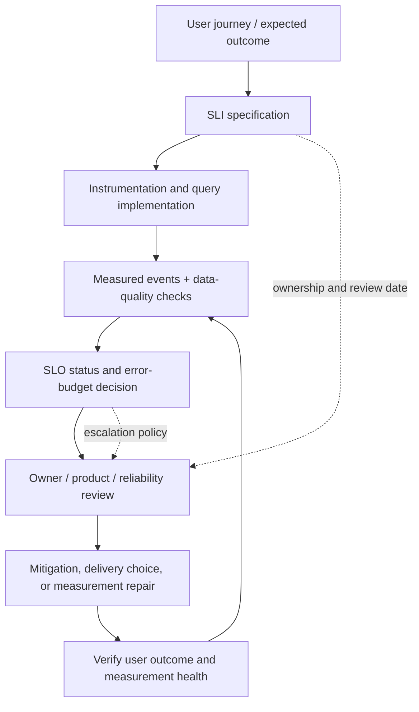

# Unit 1 — Service level indicators, objectives, and error budgets

**Target file:** `01-service-level-indicators-objectives-and-error-budgets.md` | **Estimated time:** 10–14 hours | **Prerequisites:** M01–M09 foundations; basic HTTP, Python, containers, metrics, and command-line use

**Core tools:** Markdown/CSV, Python 3 standard library, Prometheus/PromQL, `promtool` for optional rule tests | **Awareness:** SLO-as-code generators, SLA credit clauses, multi-window burn-rate alerting | **Last reviewed:** 2026-10-29; this artifact has not been independently reviewed by a domain expert | **Tool baseline assumed:** Prometheus-compatible PromQL and rule testing; exact installed versions `[VERIFY]` | **Footprint:** offline exercises require <1 CPU, <512 MB RAM and <100 MB disk; optional minimal app + Prometheus + Alertmanager stack should fit a laptop with approximately 4 CPU / 8 GB RAM / 30 GB disk when not running other heavy labs | **Solo-learner adaptation:** use the role-play scripts, synthetic fixtures, written decisions, and local tests; these do not represent real stakeholder approval or production experience

> **Evidence labels used in this chapter**
>
> - **[ROADMAP REQUIREMENT]** — explicitly required by the M10 syllabus prompt.
> - **[ENGINEERING RECOMMENDATION]** — defensible practice that still requires local ownership and context.
> - **[ILLUSTRATIVE]** — synthetic values used for learning, not universal targets.
> - **[ASSUMPTION]** — an explicit assumption required to calculate or reason.
> - **[VERIFY]** — confirm against the installed tool version or authoritative source before relying on it.
> - **[NOT EXECUTED]** — expected behavior/output that has not been run in the current environment.

### 1.0 Why this matters in production

A service can have healthy pods and normal CPU while customers receive incorrect or excessively slow results. A server-side success ratio can also look healthy when a dependency outage causes clients to time out before requests reach the server, shrinking the denominator. An SLO makes the user outcome and its measurement boundary explicit, while an error budget translates tolerated unreliability into a decision aid for engineering and product teams. Without explicit definitions, a green dashboard can conceal user pain, and a nominal “99.99%” target can become a vanity number nobody can verify or use.

### 1.1 Learning objectives

By the end of this unit, the learner can:

1. **[L1]** Explain reliability from the user’s perspective and distinguish SLI, SLO, SLA, error budget, and SLI specification versus implementation.
2. **[L1]** Define good events, valid events, measurement boundaries, exclusions, and time windows for a request-driven service.
3. **[L1]** Calculate allowed bad-event counts and allowed downtime from a ratio-based SLO and stated window.
4. **[L2]** Write a complete SLO document for a synthetic online inference API, including availability, threshold-based latency, and a clearly limited correctness/quality proxy.
5. **[L2]** Interpret PromQL-style availability and histogram-ratio queries, including aggregation, counter resets, no traffic, missing data, and label/schema assumptions.
6. **[L2]** Use a complete Python script to calculate SLI, error-budget consumption, remaining budget, burn rate, and downtime allowance without silently treating missing data as success.
7. **[L3]** Diagnose denominator collapse, low-volume noise, and measurement-pipeline failure using independent evidence and explicit uncertainty.
8. **[L3]** Compare serial dependency availability under stated independence assumptions and explain why correlated failures invalidate simple multiplication.
9. **[L4]** Design SLO governance across teams, tenants, and regions, including attribution, review, audit, and anti-gaming safeguards.
10. **[L4]** Produce evidence artifacts and defend trade-offs in a solo role-play without claiming that simulated approval is real approval.

### 1.2 Concept map and vocabulary

| Term | Precise definition | Common misconception |
|---|---|---|
| Reliability | The degree to which a service delivers the behavior users need under stated conditions. | A running process or green CPU graph proves reliability. |
| SLI | A quantitative indicator of a service-level property, often a ratio of good events to valid events. | Any metric is automatically an SLI. |
| SLI specification | The semantic definition: population, good/valid event rules, boundary, exclusions, window, owner, and interpretation. | The PromQL query alone is the SLI. |
| SLI implementation | Instrumentation, queries, code, recording rules, and data pipeline that estimate the specified property. | Correct syntax proves correct measurement. |
| SLO | A target for an SLI over a defined window. | An SLO is a universal promise or an alert threshold. |
| SLA | A business or contractual agreement that may include remedies or consequences. | An internal SLO automatically creates a legal commitment. |
| Error budget | The tolerated unreliability implied by an SLO over its window; for a ratio SLO, the allowed bad fraction is `1 − target`. | It is always a literal number of minutes or an automatic release-freeze rule. |
| Good event | An event that satisfies the stated user outcome. | Every HTTP 2xx is necessarily good. |
| Valid event | An event eligible for inclusion in the SLI denominator under documented rules. | Denominator exclusions can be changed after an outage without review. |
| Burn rate | Observed bad-event rate divided by the allowed bad-event rate, on a compatible basis. | A burn rate of 5× means 5% of the budget remains. |
| Measurement boundary | The point at which an attempt/outcome is observed, such as client, load balancer, or application. | Server-side instrumentation sees every attempt a user makes. |
| Quality proxy | An observable signal correlated with quality but not equal to ground truth. | Fallback ratio or model confidence is ground-truth model accuracy. |

#### The reliability feedback loop



The specification and implementation are separate on purpose. The specification says what user outcome matters; the implementation is a fallible measurement system. A correct query can implement the wrong specification, and a good specification can be implemented incorrectly.

#### SLI menu by service type

The exact names and grouping of an SLI menu in the Google SRE Workbook should be checked against the edition being used **[VERIFY]**. The following practical menu is an engineering summary, not a claim of verbatim source taxonomy.

| Service shape | Candidate user-level indicators | Important blind spots |
|---|---|---|
| Request-driven API | successful valid requests / valid requests; fraction below a latency threshold; correctness or fallback proxy | Client attempts that never reach server; synthetic traffic masking tenant-specific failures; status code not proving semantic correctness |
| Batch data pipeline | output freshness, expected partition coverage, correctness checks, completion before deadline | Successful process exit with empty output; late but “successful” run; watermark/time-zone ambiguity |
| Streaming consumer | event-time lag, end-to-end latency, throughput, duplicate/corrupt event rate | Offset count alone can hide old events; replay can improve lag but damage correctness |
| Storage or stateful service | successful reads/writes, latency threshold, durability/restore evidence, consistency/correctness checks | Acknowledged write not proving durability; availability averages hiding one tenant or shard |

Unit 2 develops the batch, streaming, and inference targets in depth. This unit introduces their measurement logic but does not replace Unit 2.

### 1.3 Level 1 — Beginner

#### Reliability is what the user experiences

Consider a request that returns HTTP 200 in 30 ms but contains a stale prediction from yesterday. The process is up, the response is fast, and the status is successful; the user outcome may still be wrong. Conversely, a CPU graph can be high during a harmless batch window while the user-facing SLI remains within objective. Resource metrics are useful diagnostics, but they are not substitutes for a user outcome.

#### SLI, SLO, SLA, and budget

- **SLI:** “Fraction of valid inference requests that return a successful, usable response.”
- **SLO:** “[ILLUSTRATIVE] At least 99.9% of valid inference requests succeed over a rolling 28-day window.”
- **SLA:** a separate business/contractual agreement describing obligations and possibly credits or other remedies. Legal interpretation is out of scope.
- **Error budget:** for a 99.9% ratio SLO, allowed bad-event fraction is `1 − 0.999 = 0.001 = 0.1%`.

The SLO number is not an industry default. The team must choose a target based on user tolerance, business risk, dependencies, delivery needs, cost, and measurement confidence. A 100% target may be appropriate in a narrow context, but it is usually a poor default because it can be economically disproportionate, impossible to measure perfectly, and incompatible with useful change. The aim is an explicit trade-off, not maximum nines by habit.

#### A ratio SLI must define its population

A basic availability ratio is:


define:

- `good_events`: eligible attempts that meet the stated success condition;
- `valid_events`: all eligible attempts in the defined population;
- `availability_sli = good_events / valid_events`.

If 9,990 of 10,000 valid requests succeed, the observed ratio is `9,990 / 10,000 = 0.999 = 99.9%`. There are 10 bad events. That arithmetic says nothing useful until the team agrees what counts as a valid request and a successful response.

#### Good events and valid events

No universal rule says all client 4xx errors should be excluded. A malformed request generated by a client may reasonably be outside the service’s availability objective, while an authentication regression that prevents legitimate users from accessing the service may be a user-visible service failure. Health checks and synthetic probes may be useful for detection but should not be mixed into a real-user denominator without a deliberate policy. Retries and duplicate attempts need a clear event identity: counting each attempt measures attempt reliability, while counting one logical user journey measures journey completion. Canceled requests may be excluded only when the cancellation is genuinely user-driven and the rule is measurable. Document every exclusion and test it.

#### Latency: threshold ratio versus percentile

A threshold-ratio latency SLI asks, “What fraction of valid requests completed faster than 250 ms?” For example, if 9,800 of 10,000 requests are below the threshold, the ratio is 98%. A p99 statement is a percentile description of a distribution; it is not interchangeable with a ratio unless the threshold and percentile semantics are defined consistently. Averages can hide tail latency, and independently averaging per-instance percentiles is not a valid way to combine the underlying observations. Histogram buckets or raw observations provide an aggregatable basis **[VERIFY]** against the deployed instrumentation and Prometheus version.

#### Derive an allowance instead of memorizing a table

For a ratio SLO:

`allowed_bad_fraction = 1 − SLO_target`

`allowed_bad_events = valid_events × allowed_bad_fraction`

For downtime-based accounting, under a simple time-based model:

`allowed_downtime = window_duration × (1 − SLO_target)`

Example: a 7-day window has `7 × 24 × 60 = 10,080 minutes`. At an illustrative 99.9% time-availability target, the allowed downtime is `10,080 × 0.001 = 10.08 minutes`. This is an arithmetic illustration, not a recommendation or universal “nines” table. It assumes time-based accounting and that every minute has equal weight; event-based request SLIs can produce a different allowance.

#### Rolling versus calendar-aligned windows

A rolling window evaluates the most recent duration at each evaluation point. It reacts continuously and avoids resetting the budget at a calendar boundary, but reporting and comparisons require timestamp consistency. A calendar-aligned window is easier to align with business reporting but can create boundary effects. Choose the window to match the decision being made, document timezone and boundaries, and avoid changing the window just to improve the result.

#### What an SLO cannot guarantee

An SLO does not guarantee every request succeeds, predict the cause of the next outage, prove that the telemetry is complete, or determine a release decision without policy and context. It is a measurable objective and a shared decision aid. A green SLO can still misrepresent users if the denominator is wrong, traffic disappears, a proxy is misleading, or the measurement pipeline stops reporting.

### 1.4 Level 2 — Intermediate

The running example is a synthetic online inference API. The M08 application code and its actual metric schema were not supplied with this prompt; all names below are a **minimal compatibility contract**, not a claim about the repository’s real service. Map these names to the actual app before using them.

#### 1.4.1 Sample metric contract

| Metric | Type / labels | Meaning | Contract notes |
|---|---|---|---|
| `inference_http_requests_total` | Counter; `code`, `route` | Completed HTTP request attempts observed by the application | `code` is a bounded status-code label; do not add user IDs or raw paths |
| `inference_http_request_duration_seconds_bucket` | Histogram bucket; `le`, `route` | Cumulative request-duration buckets in seconds | Required boundary `le="0.25"` for the example 250 ms latency objective |
| `inference_fallback_requests_total` | Counter; `route` | Requests served using the configured fallback path | Proxy only; not model ground-truth quality |
| `inference_measurement_heartbeat_timestamp_seconds` | Gauge | Last successful update time for a measurement heartbeat | Its update semantics must be implemented and verified; do not infer health from an old value |

**Mapping checklist:** confirm actual metric names, types, labels, units, route cardinality, histogram buckets, counter reset behavior, request completion semantics, and whether client-side failures are observable. Keep sensitive identifiers out of metric labels. If the app does not expose the contract, implement an adapter or use offline synthetic fixtures; do not silently rename production metrics in your analysis.

#### 1.4.2 Complete inference API SLO document

Save as `evidence/unit-01-sli-slo-error-budget/02-slo-spec-inference-api.md`.

```yaml
service: inference-api-example
status: proposed-for-learning
owner: platform-ml-service-owner (role placeholder; assign a real owner in an actual team)
stakeholders:
  - product representative (role-play only)
  - service owner (role-play only)
  - reliability reviewer (role-play only)
user_journeys:
  - submit a valid prediction request
  - receive a usable response before the caller deadline
window:
  type: rolling
  duration: 28d
  timezone: UTC
slis:
  - name: request_availability
    user_outcome: a valid prediction request receives an accepted successful response
    measurement_point: application request completion, compared with client-side or load-balancer evidence
    good_event: status is 2xx or an explicitly approved success status for this API
    valid_event: request is a syntactically valid, authorized user attempt; exclude only documented client-caused invalid requests
    numerator: good valid requests
    denominator: all valid requests
    target: 0.999
    exclusions:
      - malformed client requests, if classification is reliable and policy-approved
      - health checks and synthetic probes from the real-user denominator; report separately
    known_blind_spots:
      - client timeouts before reaching the application
      - authentication failures that are wrongly classified as client errors
  - name: latency_under_250ms
    user_outcome: a valid prediction completes within the interactive latency budget
    measurement_point: application duration; compare with client-side latency samples
    good_event: request duration is below or equal to 0.25 seconds as measured by the selected histogram boundary
    valid_event: same valid-request population as request_availability
    numerator: valid requests in histogram buckets at or below 0.25 seconds
    denominator: all valid requests represented by the histogram
    target: 0.99
    known_blind_spots:
      - client/network latency outside the application timer
      - missing histogram series and low traffic
  - name: fallback_ratio
    user_outcome: detect a rise in requests served by a fallback path
    measurement_point: application fallback counter
    good_event: not defined as a standalone quality SLI until product validates the desired behavior
    valid_event: all valid inference requests
    calculation: fallback requests / valid requests
    target: null
    status: diagnostic proxy; no pass/fail SLO until calibrated
    known_blind_spots:
      - fallback may be correct and safe for some requests
      - proxy does not establish model accuracy or business correctness
policy_reference: M10 Unit 9 error-budget policy (not defined here)
review_date: 2026-11-30 (illustrative)
approval_status: simulated role-play; not real stakeholder approval
assumptions:
  - all target values are illustrative and require stakeholder negotiation
  - application metrics are not a complete view of client-observed attempts
```

The sample has two provisional targets and one diagnostic proxy. Do not interpret `fallback_ratio` as a third approved SLO: a fallback can preserve availability while changing quality, and the correct fallback behavior must be agreed with product owners.

#### 1.4.3 Measurement point trade-offs

| Point | Strength | What it can miss | Typical use |
|---|---|---|---|
| Client-side | Captures user-visible latency and attempts that never reach the server | Coverage gaps, privacy risk, browser/app clock issues, sampling bias | Independent user-outcome validation with data minimization |
| Load balancer / edge | Sees requests reaching the edge and upstream response behavior | Requests that never reach edge; client-specific experience after edge | Cross-check server-side ratios and routing failures |
| Application server | Detailed route/status/domain context and convenient counters/histograms | Client timeouts before arrival; network path; application process itself may be unavailable | Main implementation for request classification and latency components |
| Synthetic probe | Independent, continuous signal when real traffic is absent | Limited routes/regions/accounts; can pass while real users fail | Low-traffic monitoring and independent measurement health |

“Measure close to the user” is a principle, not an excuse to collect invasive telemetry. Use sampling, aggregation, bounded labels, retention limits, and documented access. Never put request bodies, tokens, email addresses, customer IDs, or other sensitive identifiers into Prometheus labels.

#### 1.4.4 PromQL examples and cautions

The examples use the compatibility contract above. They are intended to teach semantics; query behavior and exact schema must be checked against the deployed version **[VERIFY]**.

**Availability ratio (counter-based):**

```promql
sum(rate(inference_http_requests_total{code=~"2.."}[5m]))
/
sum(rate(inference_http_requests_total[5m]))
```

This example counts 2xx completions as good. If the service has valid 3xx or other accepted success statuses, adjust the classification deliberately. It assumes all status-labeled requests in the denominator are valid; if malformed/client-caused requests must be excluded, encode a trustworthy classification label or calculate from a better-defined event stream. `rate()` is applied to each counter series before aggregation so resets can be handled per series. The five-minute range is illustrative; ensure the range contains enough scrapes for the installed scrape/evaluation setup **[VERIFY]**.

A syllabus-style alternative, excluding 5xx from the numerator, is:

```promql
sum(rate(inference_http_requests_total{code!~"5.."}[5m]))
/
sum(rate(inference_http_requests_total[5m]))
```

This is not automatically correct: it counts 4xx as good. That may be appropriate for some invalid client requests but wrong for authentication or authorization regressions. Status-code semantics must match the user outcome.

**Latency ratio for a 250 ms bucket:**

```promql
sum(rate(inference_http_request_duration_seconds_bucket{le="0.25"}[5m]))
/
sum(rate(inference_http_request_duration_seconds_count[5m]))
```

This is a threshold-ratio SLI if the histogram actually contains a `le="0.25"` bucket and `_count` has the same request population and labels. Prometheus classic histogram buckets are cumulative; the bucket at 0.25 seconds represents observations less than or equal to that boundary. If the boundary does not exist, do not approximate silently—change instrumentation or select an available boundary that product agrees to. Confirm the exposition format and metric names against the actual service.

**Recording rules for short and longer windows:** save as `evidence/unit-01-sli-slo-error-budget/04-promql-recording-rules.yml`.

```yaml
groups:
  - name: inference-api-sli
    interval: 30s
    rules:
      - record: inference:request_availability:ratio_rate5m
        expr: |
          sum(rate(inference_http_requests_total{code=~"2.."}[5m]))
          /
          sum(rate(inference_http_requests_total[5m]))
      - record: inference:request_availability:ratio_rate1h
        expr: |
          sum(rate(inference_http_requests_total{code=~"2.."}[1h]))
          /
          sum(rate(inference_http_requests_total[1h]))
      - record: inference:latency_under_250ms:ratio_rate5m
        expr: |
          sum(rate(inference_http_request_duration_seconds_bucket{le="0.25"}[5m]))
          /
          sum(rate(inference_http_request_duration_seconds_count[5m]))
```

These rules can return no series or a non-finite result when the denominator is absent/zero, depending on expression and engine behavior. Do not convert that state into 100% success. Production alert behavior and tests belong primarily to Unit 3; these rules only establish measurement examples. `interval`, range lengths, and schema are illustrative and must be matched to the local configuration.

**Missing series / absent metric:**

```promql
absent(inference_http_requests_total)
```

`absent()` is a PromQL function in common Prometheus releases, but validate it against the installed version and exact expression **[VERIFY]**. It detects that the expression has no matching series; it does not by itself tell whether the service has zero traffic, scrape failure, changed labels, or instrumentation loss. Pair it with independent scrape/heartbeat health and a synthetic probe. A zero request rate and a missing series are not the same state.

**Counter resets and `rate()`:** apply `rate(counter[range])` to each series before summing across instances. Aggregating raw counters first can obscure individual resets. A rate estimates per-second increase over the selected range; it is not a raw request count. For low-volume services, ratios over short windows can be noisy or undefined. Use an agreed window, inspect event counts, and keep no-data distinct from success.

**No traffic:** if the denominator rate is zero or missing, an availability ratio is unknown for that window. It is not 100%. A separate low-traffic strategy may use synthetic probes and a measurement-pipeline watchdog, with results reported separately from real-user request ratios.

#### 1.4.5 Error-budget accounting

For a ratio SLO target `S` between 0 and 1:

- `allowed_bad_fraction = 1 − S`
- `allowed_bad_events = valid_events × allowed_bad_fraction`
- `budget_consumed_fraction = observed_bad_events / allowed_bad_events`, when event-based accounting and denominator definitions are appropriate
- `remaining_budget_fraction = 1 − budget_consumed_fraction`
- `burn_rate = observed_bad_event_rate / allowed_bad_event_rate`, where both rates use compatible units, population, and time basis

If consumption exceeds 100%, the mathematical remaining fraction is negative. For a display, clamp “remaining” to zero while preserving the overrun separately; do not erase the fact that the budget was exceeded. A burn rate of 1× means bad events are arriving at the average rate implied by consuming the entire budget evenly over the SLO window. A 5× burn rate means five times that rate; it does not mean 5% budget remains.

Event-based accounting measures bad events among valid events. Time-based accounting measures time intervals that violate an availability condition. They are not interchangeable. For example, a single high-volume minute can consume many event budget units while a time-based model may count only one minute. Choose the accounting basis that matches the SLI and document it.

#### 1.4.6 Complete Python calculation script

Save as `evidence/unit-01-sli-slo-error-budget/calculate_slo.py`. This script uses only the Python standard library, generates three deterministic synthetic scenarios, computes availability and latency ratios where inputs support them, derives the allowed downtime from the SLO/window, and treats zero denominator or missing inputs as unknown rather than success.

```python
#!/usr/bin/env python3
"""Transparent SLI/error-budget arithmetic for synthetic learning data only."""
from dataclasses import dataclass
from typing import Optional

@dataclass
class Scenario:
    name: str
    valid_requests: Optional[int]
    good_requests: Optional[int]
    requests_under_threshold: Optional[int]
    bad_requests_observed_in_window: Optional[int]
    window_seconds: int
    observed_bad_seconds: Optional[int] = None


def ratio(numerator: Optional[int], denominator: Optional[int]) -> Optional[float]:
    if numerator is None or denominator is None or denominator <= 0:
        return None
    if numerator < 0 or numerator > denominator:
        raise ValueError("ratio inputs must satisfy 0 <= numerator <= denominator")
    return numerator / denominator


def calculate(s: Scenario, target: float, window_seconds: int):
    if not 0 < target <= 1:
        raise ValueError("target must be in (0, 1]")
    if window_seconds <= 0 or s.window_seconds <= 0:
        raise ValueError("window duration must be positive")
    allowed_bad_fraction = 1.0 - target
    availability = ratio(s.good_requests, s.valid_requests)
    latency_ratio = ratio(s.requests_under_threshold, s.valid_requests)
    allowed_bad_events = None
    consumed = None
    remaining = None
    burn = None
    if s.valid_requests is not None and s.valid_requests > 0:
        allowed_bad_events = s.valid_requests * allowed_bad_fraction
        if s.bad_requests_observed_in_window is not None:
            if s.bad_requests_observed_in_window < 0:
                raise ValueError("bad event count cannot be negative")
            if allowed_bad_events > 0:
                consumed = s.bad_requests_observed_in_window / allowed_bad_events
                remaining = max(0.0, 1.0 - consumed)
                # Compatible rate basis: observed bad events / valid events
                # divided by the allowed bad fraction.
                observed_bad_rate = s.bad_requests_observed_in_window / s.valid_requests
                burn = observed_bad_rate / allowed_bad_fraction if allowed_bad_fraction > 0 else None
            elif s.bad_requests_observed_in_window == 0:
                consumed, remaining, burn = 0.0, 1.0, 0.0
            else:
                consumed, remaining, burn = float("inf"), 0.0, float("inf")
    downtime_allowance = window_seconds * allowed_bad_fraction
    return {
        "name": s.name,
        "availability": availability,
        "latency_ratio": latency_ratio,
        "allowed_bad_events": allowed_bad_events,
        "budget_consumed_fraction": consumed,
        "remaining_budget_fraction": remaining,
        "burn_rate": burn,
        "allowed_downtime_seconds": downtime_allowance,
        "observed_bad_seconds": s.observed_bad_seconds,
    }


def fmt(value):
    if value is None:
        return "UNKNOWN (missing or zero denominator)"
    if value == float("inf"):
        return "infinite / exhausted"
    return f"{value:.4f}"


def main():
    target = 0.999  # [ILLUSTRATIVE], not a universal recommendation
    window_seconds = 28 * 24 * 60 * 60
    scenarios = [
        Scenario("steady_healthy", 100_000, 99_990, 99_500, 10, window_seconds),
        Scenario("gradual_degradation", 100_000, 99_700, 97_000, 300, window_seconds),
        Scenario("sudden_outage", 100_000, 95_000, 90_000, 5_000, window_seconds),
        Scenario("zero_traffic", 0, 0, 0, 0, window_seconds),
    ]
    print("ILLUSTRATIVE synthetic SLO calculation; target=99.9%; no production data")
    print(f"Window={window_seconds} seconds; allowed bad fraction={1-target:.6f}")
    for s in scenarios:
        r = calculate(s, target, window_seconds)
        print(f"\n[{r['name']}]")
        print(f"availability={fmt(r['availability'])}")
        print(f"latency_ratio={fmt(r['latency_ratio'])}")
        print(f"allowed_bad_events={fmt(r['allowed_bad_events'])}")
        print(f"budget_consumed_fraction={fmt(r['budget_consumed_fraction'])}")
        print(f"remaining_budget_fraction={fmt(r['remaining_budget_fraction'])}")
        print(f"burn_rate={fmt(r['burn_rate'])}")
        print(f"allowed_downtime_seconds={r['allowed_downtime_seconds']:.1f}")


if __name__ == "__main__":
    main()
```

Run with `python3 evidence/unit-01-sli-slo-error-budget/calculate_slo.py`. The `observed_bad_requests` values in the synthetic scenarios are counts within the displayed valid-request population; the script's simple consumption fraction is an illustration of event-based accounting, not a full time-series budget service. For a real rolling-window budget, retain event counts over the entire SLO window and ensure that the observed count, allowed count, and reporting window agree.

**Validation performed during chapter generation:** the extracted script was run in a temporary validation directory. It printed all four synthetic scenarios; the zero-traffic scenario reported unknown ratios and unknown event-based budget fields. This validates the example arithmetic in that temporary workspace only, not the learner’s repository, service metrics, or production behavior. Output values remain illustrative.

#### 1.4.7 Unit tests for the calculation script

Save as `evidence/unit_01_sli_slo_error_budget/test_calculate_slo.py` beside `calculate_slo.py`, then run `python3 -m unittest -v test_calculate_slo.py` from that directory. The underscore directory name is intentional so it can be imported as a Python package if needed.

```python
import unittest
from calculate_slo import Scenario, calculate, ratio

class SloMathTests(unittest.TestCase):
    def test_healthy_availability(self):
        s = Scenario("healthy", 1000, 999, 990, 1, 100)
        r = calculate(s, 0.99, 100)
        self.assertAlmostEqual(r["availability"], 0.999)
        self.assertAlmostEqual(r["budget_consumed_fraction"], 1 / 10)

    def test_zero_denominator_is_unknown(self):
        s = Scenario("empty", 0, 0, 0, 0, 100)
        r = calculate(s, 0.99, 100)
        self.assertIsNone(r["availability"])
        self.assertIsNone(r["latency_ratio"])
        self.assertIsNone(r["allowed_bad_events"])

    def test_depleted_budget_is_clamped_but_overrun_visible(self):
        s = Scenario("overrun", 1000, 900, 900, 50, 100)
        r = calculate(s, 0.99, 100)
        self.assertEqual(r["remaining_budget_fraction"], 0.0)
        self.assertGreater(r["budget_consumed_fraction"], 1.0)

    def test_downtime_is_derived(self):
        s = Scenario("downtime", 1, 1, 1, 0, 100)
        r = calculate(s, 0.99, 100)
        self.assertAlmostEqual(r["allowed_downtime_seconds"], 1.0)

    def test_invalid_ratio_raises(self):
        with self.assertRaises(ValueError):
            ratio(2, 1)

if __name__ == "__main__":
    unittest.main()
```

**Consistency note:** the test's healthy example has 10 allowed bad events at a 99% target and one observed bad event, so consumption is 10%. The overrun case has 10 allowed bad events and 50 observed bad events, so consumption is 500% and remaining budget is clamped to zero while overrun remains visible.

#### 1.4.8 Stakeholder negotiation role-play

**Scenario [ILLUSTRATIVE]:** product requests “99.99% availability” because a competitor advertises it; the service team has not measured client-side failures or low-traffic behavior. The learner plays both roles and writes a decision record. This is practice, not real stakeholder approval.

**Product perspective:** “A failed prediction blocks the user journey. We need confidence during peak periods, but we also need to ship model improvements. Which failure classes actually hurt users, and what evidence would let us choose a target?”

**Reliability perspective:** “We can propose a target after we define valid attempts, client-visible failure capture, latency, and quality. A 99.99% target is not defensible merely because it sounds strong. Let us collect a baseline, document measurement gaps, estimate cost and dependency limits, and agree on a review date.”

**Decision record template**

```markdown
# SLO decision record
Date: [date]
Service / journey: inference API / submit request and receive usable result
Decision owner: [role]
Participants: [roles; role-play if solo]
Candidate targets: [target A], [target B]
Chosen target and window: [value; window; rationale]
User impact of a bad event: [description]
Evidence used: [sample size, source, period, limitations]
Measurement gaps: [client timeouts, missing telemetry, low traffic]
Cost / velocity trade-off: [qualitative or measured]
Rejected alternatives and why: [list]
Unresolved concerns: [list]
Policy link: M10 Unit 9 (formal policy deferred)
Review date: [date]
Approval status: simulated role-play / proposed / actually approved
```

A defensible agreement records who owns the SLO, what evidence supports it, which alternatives were rejected, how uncertainty is handled, and when it will be revisited. Do not label a role-play “approved.”

### 1.5 Level 3 — Advanced

#### 1.5.1 Low-traffic services and sample size

A low-volume service may have only a handful of valid events in a short window. One failed request out of 10 is 90%; one out of 1,000 is 99.9%. The ratios differ in stability because their denominators differ. A short-window ratio is noisy when the sample is small; this is a measurement limitation, not proof that the service is inherently less reliable.

Options include a longer window, independent synthetic probes, aggregation across instances where semantics are comparable, or separate SLOs for critical journeys. Each option has trade-offs. Longer windows delay detection. Synthetic probes do not cover every real user or route. Global aggregation can conceal a tenant or region outage. Do not pool dissimilar populations merely to obtain a stable-looking number.

#### 1.5.2 Denominator collapse: a worked example

**[ILLUSTRATIVE]** During a healthy 10-minute interval, the server receives 10,000 valid requests and completes 9,990 successfully: `99.9%`. During an outage, many clients time out before reaching the application. The server records only 100 requests and all 100 succeed, so its server-side ratio becomes `100%`. At the same time, clients attempted 10,000 requests and only 7,000 completed successfully: client-side journey success is `70%`.

The server-side SLI is not mathematically wrong for the events it observed; it is incomplete for the user outcome being claimed. The remedy is not to alter the denominator after the fact. Define the measurement boundary to capture user attempts as well as practical, privacy-safe instrumentation permits; compare client, edge, application, and synthetic evidence; and mark coverage gaps explicitly.

| Measurement source | What it may reveal in this case | Remaining limitation |
|---|---|---|
| Client-side attempt/outcome | Timeouts before server arrival and end-to-end result | Not all clients may emit telemetry; privacy and sampling constraints |
| Load balancer | Requests arriving at the edge and upstream failures | Cannot observe attempts that never reach the edge |
| Application | Handler results and route-level context | Misses attempts that never arrive; app telemetry can fail with app |
| Synthetic probe | Independent signal during no real traffic | Limited journey/region/account coverage |

#### 1.5.3 Window selection

Short windows can reveal abrupt regressions but may flap because of small samples and transient events. Long windows stabilize the ratio but can conceal a recent sharp regression and react slowly. A rolling window around four weeks is sometimes used as a starting point in SRE literature, but treat any specific window as `[VERIFY]` against the edition and context; it is not a universal standard. Select the window from the decision being supported, user tolerance, traffic volume, and reporting needs.

#### 1.5.4 Multiple SLOs without SLO sprawl

Start with the small number of user journeys whose failure has materially different consequences. For this API, availability and latency may be distinct because a fast error and a very slow success both harm the user differently. A quality proxy may be tracked diagnostically until product and model evaluation teams agree on its meaning. Avoid one SLO per metric, pod, endpoint, and team: excessive objectives create conflicting signals, maintenance cost, and incentives to optimize the wrong thing.

Per-tenant or per-region SLOs are useful when contracts, criticality, or failure domains differ. They also multiply operational burden. Use tiering only when the tier changes decisions or user outcomes. A global aggregate should never be the only view when a small tenant or region can experience a total outage while the global average remains green.

#### 1.5.5 Latency and histogram aggregation

A mean can hide a slow tail. A percentile summarizes a distribution, but averaging p99 values across instances does not reconstruct the global p99. Classic histogram buckets are cumulative counts that can be summed across compatible instances and used to estimate a global threshold ratio or quantile. Native histogram behavior and exact PromQL functions are version-sensitive **[VERIFY]**. Prefer a threshold-ratio objective when the user contract is naturally stated as “at least X% finish under T”; use percentile terminology only when its semantics and aggregation method are clear.

#### 1.5.6 SLO versus SLA and internal safety margin

An internal SLO may be stricter than a contractual SLA so the team has room to respond before contractual consequences apply. Example **[ILLUSTRATIVE]**: internal objective is 99.9% good requests; a hypothetical contract uses a 99.5% monthly availability commitment. This does not mean the contract is legally interpreted that way or that credit eligibility follows a simple ratio. Contract language, exclusions, measurement source, and remedy rules need legal/business review. This chapter provides educational arithmetic only, not legal advice.

#### 1.5.7 Stakeholder negotiation checklist

- [ ] Name the user journey and the harm caused by a bad event.
- [ ] Define the valid-event population and exclusions before looking at a favorable result.
- [ ] Agree on numerator, denominator, measurement point, window, timezone, and data source.
- [ ] Check whether low traffic or client-side failures make the SLI incomplete.
- [ ] Compare candidate targets with evidence, dependency limits, cost, and delivery needs.
- [ ] Distinguish target, alert trigger, contractual SLA, and formal release policy.
- [ ] Name the owner and approvers; record unresolved concerns and review date.
- [ ] Define how missing/stale telemetry is represented and who responds.
- [ ] State what would cause the SLO to be tightened, loosened, split, retired, or redefined.

#### 1.5.8 SLO evolution decision record

Revisit an SLO when user journeys change, a service boundary changes, data quality degrades, traffic mix changes materially, a new dependency is introduced, the objective is routinely exceeded or missed, or the target no longer influences a decision. Do not redefine valid events simply because the current result is uncomfortable. Version the specification, compare old and new definitions where possible, and preserve the reason for change.

**[ENGINEERING RECOMMENDATION]** Review SLO definitions quarterly and after major incidents or architectural changes. This is a proposed cadence, not an industry standard. A more frequent or slower cadence may fit local risk and change rate better.

#### 1.5.9 Uses of error budget beyond freezes

Budget status can inform rollout scope, migration timing, load experiments, risky dependency changes, and investment priorities. The budget does not itself dictate a freeze. Unit 9 defines formal freeze, slowdown, exception, and override policy. Unit 3 develops alert quality and escalation. Unit 1 provides the measurement foundation and explains why unknown budget state is not the same as healthy budget state.

#### 1.5.10 SLI-of-the-SLI

The measurement pipeline needs its own health checks: scrape success, last-update timestamp, sample volume, expected label sets, query freshness, and comparison with an independent probe or synthetic history. A stale gauge can remain at a healthy value after its producer dies. A query returning no series may indicate no traffic, changed labels, failed scraping, or missing instrumentation. Distinguish those states with explicit telemetry-health evidence and a documented unknown state.

#### 1.5.11 Anti-patterns

| Anti-pattern | Why it fails | Better approach |
|---|---|---|
| Ownerless SLO | No one maintains definitions or acts on budget status | Named accountable role and review date |
| Target chosen only from current performance | Can institutionalize poor user experience or encourage gaming | Combine user needs, evidence, risk, cost, and negotiation |
| CPU as the SLO | Resource health is not a user outcome | Use CPU as diagnostic evidence supporting a user-level SLI |
| “Too many nines” without evidence | Cost and measurement assumptions are hidden | Derive implications and document trade-offs |
| No budget decision use | The target becomes a dashboard ornament | Link to explicit review and Unit 9 policy |
| Pod uptime as availability | Ignores failed requests and incorrect results | Measure at a meaningful service boundary |
| Vanity SLO | Number is green but no stakeholder decision changes | Retire or redesign objectives that do not guide action |
| SLO as punishment | Encourages hiding incidents or manipulating denominators | Use for system improvement, audit definitions, protect privacy |
| Exclude all 4xx | Can hide authentication/authorization regressions | Classify by user outcome and document each class |
| Missing telemetry equals success | Converts observability failure into false confidence | Represent unknown and independently monitor measurement health |

### 1.6 Level 4 — Expert: operating at scale and under failure

#### 1.6.1 SLO programs at scale

A mature SLO program uses reusable templates and reviewable definitions, not copy-pasted dashboards with inconsistent denominators. Store SLO specifications in version control; require review when targets, labels, event classification, or exclusions change. Integrate the service owner and SLO links into the service catalogue as a forward reference to M16. A service’s SLO file should be part of the delivery workflow, but the generated rules must be tested against actual metrics and versioned tools.

#### 1.6.2 Small SLO-as-code specification and generator

This intentionally bounded generator turns a tiny YAML-like JSON specification into Prometheus recording rules. It does not parse general YAML and does not replace code review. It uses JSON because JSON is a strict subset of many YAML-like data workflows and the Python standard library can parse it without dependencies.

Save as `evidence/unit_01_sli_slo_error_budget/slo_spec.json`:

```json
{
  "service": "inference-api-example",
  "availability_target": 0.999,
  "window": "5m",
  "metric": "inference_http_requests_total",
  "good_code_regex": "2.."
}
```

Save as `evidence/unit_01_sli_slo_error_budget/generate_rules.py`:

```python
#!/usr/bin/env python3
"""Generate a small recording-rule file from a constrained JSON SLO spec."""
import json
import re
import sys
from pathlib import Path

ALLOWED_WINDOWS = {"5m", "15m", "1h", "6h", "1d"}
METRIC_RE = re.compile(r"^[a-zA-Z_:][a-zA-Z0-9_:]*$")
REGEX_RE = re.compile(r"^[0-9.]+$|^2\.\.$")


def generate(spec):
    required = {"service", "availability_target", "window", "metric", "good_code_regex"}
    missing = required - set(spec)
    if missing:
        raise ValueError(f"missing fields: {sorted(missing)}")
    if not isinstance(spec["availability_target"], (int, float)) or not 0 < spec["availability_target"] <= 1:
        raise ValueError("availability_target must be in (0, 1]")
    if spec["window"] not in ALLOWED_WINDOWS:
        raise ValueError("window not in this generator's allowlist")
    if not METRIC_RE.fullmatch(spec["metric"]):
        raise ValueError("metric name contains unsupported characters")
    if not REGEX_RE.fullmatch(spec["good_code_regex"]):
        raise ValueError("good_code_regex not in this generator's allowlist")
    service = spec["service"]
    if not re.fullmatch(r"[a-zA-Z0-9_-]+", service):
        raise ValueError("service must be a bounded identifier")
    metric = spec["metric"]
    window = spec["window"]
    code = spec["good_code_regex"]
    target = float(spec["availability_target"])
    return f'''# Generated locally from {service}; validate against installed Prometheus.
groups:
  - name: {service}-sli
    rules:
      - record: {service}:availability:ratio_rate{window}
        expr: |
          sum(rate({metric}{{code=~"{code}"}}[{window}]))
          /
          sum(rate({metric}[{window}]))
      - record: {service}:availability:target
        expr: {target:.6f}
'''


def main():
    if len(sys.argv) != 3:
        raise SystemExit("usage: generate_rules.py SPEC.json OUTPUT.yml")
    source, output = map(Path, sys.argv[1:])
    spec = json.loads(source.read_text(encoding="utf-8"))
    output.write_text(generate(spec), encoding="utf-8")
    print(f"Wrote illustrative rules to {output}; syntax and metric compatibility still require validation.")

if __name__ == "__main__":
    main()
```

Run: `python3 generate_rules.py slo_spec.json generated-rules.yml`. **Validation performed during chapter generation:** the extracted generator was run against the supplied JSON spec in a temporary validation directory, and its generated file was created successfully. Its three unit tests passed. This validates the constrained Python generator only; it does not validate generated PromQL against Prometheus. The regex allowlist and service identifier rules are intentionally narrow; production generators need stronger escaping, schema versioning, rule tests, owner metadata, and review controls.

Suggested test file `test_generate_rules.py`:

```python
import unittest
from generate_rules import generate

BASE = {
    "service": "inference-api-example",
    "availability_target": 0.999,
    "window": "5m",
    "metric": "inference_http_requests_total",
    "good_code_regex": "2..",
}

class GeneratorTests(unittest.TestCase):
    def test_expected_recording_rule(self):
        text = generate(BASE)
        self.assertIn("sum(rate(inference_http_requests_total", text)
        self.assertIn("inference-api-example:availability:target", text)

    def test_rejects_unsafe_window(self):
        bad = dict(BASE, window="1s")
        with self.assertRaises(ValueError):
            generate(bad)

    def test_rejects_bad_metric_name(self):
        bad = dict(BASE, metric="bad metric")
        with self.assertRaises(ValueError):
            generate(bad)

if __name__ == "__main__":
    unittest.main()
```

This generator is a teaching example, not a production policy engine. The generated target is a constant recording series and the ratio may be undefined when no traffic exists. A real pipeline must add no-data handling, owner metadata, rule tests, label consistency, and explicit policy semantics.

#### 1.6.3 Weekly/monthly SLO report from synthetic data

A report should distinguish measured values, missing values, assumptions, and attribution confidence. Do not create “top causes” from time proximity alone. The following template can be filled from the Python output and lab evidence:

```markdown
# SLO report — [service] — [window]
Data source / query version: [source and commit]
Data freshness: [timestamp and status]
Valid events: [count or UNKNOWN]
Good events: [count or UNKNOWN]
Availability SLI: [value or UNKNOWN]
Latency-under-threshold SLI: [value or UNKNOWN]
Target(s): [target, version, owner]
Allowed bad events: [derived value or UNKNOWN]
Observed bad events: [value or UNKNOWN]
Budget consumed / remaining: [value; explain overrun]
Burn rate: [value and compatible basis]
Missingness / denominator warnings: [list]
Largest budget-consuming intervals: [interval, evidence, attribution confidence]
User impact: [evidence, not speculation]
Changes / dependencies: [confirmed links and unconfirmed hypotheses separated]
Decision / owner / due date: [decision record]
Limitations and next verification: [list]
```

A sample report from the deterministic synthetic scenarios may say “illustrative scenario; not production performance.” It must not claim that the generated values were measured from a live service.

#### 1.6.4 Dependency SLO management and composite availability

Suppose a user journey requires three serial dependencies to succeed and their failures are independent. **[ASSUMPTION]** If dependency A has availability 99.9%, B 99.5%, and C 99.99%, then the simplified chain availability is:

`0.999 × 0.995 × 0.9999 = 0.993905... ≈ 99.3905%`.

The product is valid only under the stated model: all dependencies are required, availability definitions align, and failures are independent. Real failures are often correlated by shared regions, identity providers, DNS, networks, or common deployment systems. Redundancy changes the model; fallback may preserve a reduced user outcome rather than the full outcome; retries can increase latency and load amplification. Do not multiply provider SLAs mechanically and present the result as measured end-to-end availability.

A consumer needs a service outcome, not just the provider’s target. Contracts between consumer and provider should define valid calls, timeout behavior, maintenance, degradation modes, freshness/correctness where relevant, ownership, and incident communications. A dependency incident can cause multiple downstream SLOs to burn; attribute only what evidence supports, and preserve uncertainty rather than assigning every incident to the nearest deployment.

#### 1.6.5 Planned maintenance and exclusions

Exclusions are governance choices, not a way to erase inconvenient failures. If planned maintenance is excluded, define what qualifies, who approves it, how users are notified, whether the user outcome remains available through fallback, and how the exclusion is audited. Keep the exclusion narrow, version-controlled, and reviewable. Report user impact even when a contractual or internal accounting rule excludes the interval.

#### 1.6.6 Multi-region and multi-tenant objectives

A global ratio can hide a total outage for a small tenant or region. Consider a synthetic example: 99,000 requests from region A succeed out of 100,000 while all 100 requests from region B fail. Global success is 99,000/100,100 ≈ 98.90%; region B is 0%. The global figure alone does not describe the severe localized outage. The appropriate view depends on contractual commitments and customer impact: global journey SLO plus per-region guardrails, or tiered tenant SLOs where decisions differ. Avoid a proliferation of objectives without owners or clear response implications.

#### 1.6.7 Cost of nines and governance failure modes

Reliability investment typically has diminishing returns: each additional increment may require redundancy, testing, capacity, operational staffing, and slower change. No cost numbers are provided here because costs vary materially by architecture and organization. M15 owns the broader capacity/cost trade-off. At scale, governance should prevent:

- SLOs being used as individual performance scores;
- teams hoarding error budget or hiding incidents;
- targets inflated to appear successful or set unrealistically high to block all change;
- denominator changes that reclassify bad user outcomes as invalid;
- metrics or timestamps being tampered with;
- global averages hiding tenant or region harm;
- missing data being converted to zero errors or zero restoration time.

Controls include shared definitions, version-controlled changes, independent measurement, data-quality flags, audit trails, peer review, privacy safeguards, and an explicit ban on individual ranking from these metrics. Review the metric’s incentive effects, not only its arithmetic.

#### 1.6.8 SLA credit arithmetic — educational example only

**[ILLUSTRATIVE; not legal advice]** Assume a hypothetical contract grants a 5% credit on a $2,000 monthly service fee if a defined monthly availability threshold is missed. The arithmetic is `0.05 × $2,000 = $100`. This is only arithmetic. Real credit eligibility depends on the contract’s exact definition, exclusions, notice, claim process, caps, and jurisdiction. Do not infer legal entitlement from an SLO dashboard.

#### 1.6.9 Six organizational/system failure cases

Each case uses `symptom → hypothesis → test → root cause → fix → prevention`. These are synthetic scenarios, not real company incidents.

1. **SLO met on paper; users suffered because the denominator was wrong.** Symptom: dashboard shows 99.99%, support reports failures. Hypothesis: denominator excludes requests that never reached the handler. Test: compare client/edge/application counts and synthetic probe outcomes. Root cause: server-only population was described as end-to-end availability. Fix: rename the SLI to its actual boundary and add independent client/edge measurement. Prevention: specification review and denominator-collapse test.
2. **Traffic collapse hid an outage.** Symptom: server ratio rises while requests and revenue fall. Hypothesis: clients time out before server arrival. Test: compare expected traffic, edge logs, client attempts, and independent probes. Root cause: denominator shrank with the outage. Fix: combine measurement points and report low traffic/unknown states. Prevention: traffic-collapse fixture and independent watchdog.
3. **Budget report green because telemetry was down.** Symptom: no errors reported while scrapes stop. Hypothesis: missing samples are treated as no bad events. Test: inspect scrape health, last-sample timestamp, series cardinality, and probe results. Root cause: absent data was coerced to zero errors. Fix: explicit unknown state and independent measurement-health alert. Prevention: test missing/stale-series cases in CI.
4. **Excluding all 4xx masked an authentication regression.** Symptom: availability remains high but legitimate users cannot log in. Hypothesis: all 4xx responses are excluded as client errors. Test: segment 401/403 changes by user journey and compare client outcomes. Root cause: status code was used as a substitute for intent/validity. Fix: classify only documented invalid requests as excluded; treat auth regression according to user impact. Prevention: reviewed classification table and regression fixture.
5. **99.99% target while a hard dependency offers only 99.9%.** Symptom: target is routinely missed or team spends heavily without understanding why. Hypothesis: serial dependency ceiling is incompatible with the target under stated assumptions. Test: model dependency chain and compare end-to-end observations; inspect redundancy/fallback. Root cause: target was set without architecture and dependency evidence. Fix: renegotiate target or improve dependency architecture and user journey. Prevention: dependency SLO review before target approval.
6. **SLO had no owner after reorganization.** Symptom: queries break, target is stale, nobody acts on budget. Hypothesis: ownership was attached to a team name rather than accountable role. Test: service catalogue and escalation ownership audit. Root cause: no handoff requirement. Fix: assign an accountable service owner and backup, revalidate target and alerts. Prevention: ownership field required in SLO-as-code and reorg checklist.

### 1.7 SRE lens

#### Does the SLO practice itself work?

Meta-measurement should evaluate whether the SLO program produces trustworthy decisions. Track:

- percentage of production services with an accountable owner and current SLO specification;
- percentage of SLI definitions with tested numerator, denominator, exclusions, and no-data behavior;
- missing/stale telemetry intervals and time to detect measurement loss;
- disagreement rate between server-side and independent synthetic/client evidence;
- percentage of budget reports with source timestamp and data-quality status;
- number of SLO changes reviewed and versioned;
- human time spent maintaining SLOs and investigating measurement gaps;
- whether SLO status actually changes prioritization or investment decisions.

These are suggested program indicators, not universal targets. Avoid creating a new vanity scorecard with no decision owner.

#### Practice failure modes and blast radius

A wrong SLI can distort release decisions across teams; a wrong exclusion can hide an auth outage; a missing metric can make the whole service appear healthy; a global aggregate can hide a tenant outage. SLO-as-code can propagate the same defect to dozens of services. Treat changes to event definitions, label contracts, targets, and generated rules as changes to production control logic: review, test, version, stage, and audit them.

#### Response snippet: trigger → triage → mitigation → follow-up

```text
TRIGGER: SLO burn or credible user-impact evidence
TRIAGE: confirm user journey, valid-event population, data freshness, and independent evidence
MITIGATION: protect users using the safest reversible action; do not wait for root cause
FOLLOW-UP: verify user outcome, repair measurement if needed, record decision and owner, review systemic prevention
```

Detailed incident roles and severity belong to Unit 4; postmortems belong to Unit 5; alert design belongs to Unit 3; release freezes belong to Unit 9.

#### Cost and human capacity

The cost of SLO practice includes instrumentation, query maintenance, review meetings, data-quality investigation, and time spent resolving target disagreements. A low-cost spreadsheet may be more honest than an expensive platform if the measurement is not mature. Conversely, manual reconciliation can become toil when many services share definitions. Automate repeated checks only after the definitions are stable and the automation is safe. Include human on-call capacity in the cost of the objective: a target that can only be sustained through constant pages is not an operationally sound design.

### 1.8 Security and safety lens

- **Privacy:** use bounded labels such as route template and status class; never use user IDs, raw URLs with IDs, tokens, request payloads, or email addresses as metric labels.
- **Secrets:** evidence files must not contain credentials or access tokens. M09 owns the dedicated secret-leak response runbook; this unit only covers measurement implications.
- **Safe fault injection:** use only a local disposable service or explicitly allowlisted lab endpoint. If target identity is uncertain, stop. Do not use production traffic or shared clusters for these labs.
- **Bounded resources:** run only the minimum lab stack, stop containers after use, and remove generated temporary files when they are no longer needed.
- **No false confidence:** missing data, zero traffic, stale gauges, and malformed labels must remain distinct from healthy measurements.
- **No blame or surveillance:** SLOs are for service improvement, not individual performance ranking. Use aggregated and purpose-limited data.
- **Alert actionability:** a ratio is not automatically a page. Unit 3 determines which symptoms require a human now and how routing/escalation works.
- **Scope limits:** this unit does not define a legal SLA, full observability-stack architecture, or formal release-freeze policy.

Verification method: review metric label schemas, scan evidence for sensitive values, run local tests for zero/missing data, confirm lab endpoints are local/allowlisted, and inspect cleanup logs. Do not include raw production records in coursework.

### 1.9 Production checklist

- [ ] The SLO document names the service, user journey, accountable owner, stakeholders, review date, and approval status.
- [ ] Each SLI has a specification separate from its query/code implementation.
- [ ] Good events and valid events are explicitly defined with numerator, denominator, exclusions, and measurement boundary.
- [ ] Client errors, health checks, synthetic traffic, retries, and cancellations have documented treatment.
- [ ] Availability and latency objectives are based on user outcomes rather than resource health alone.
- [ ] Histogram threshold exists and has the correct units; query population matches the SLI denominator.
- [ ] Counter rates are calculated per series before aggregation; range length is checked against scrape/evaluation setup.
- [ ] Zero traffic, absent series, stale metrics, and failed measurement pipeline produce an unknown/degraded measurement state, not 100% success.
- [ ] Allowed event/downtime budget is derived from target and window with units shown.
- [ ] Budget consumed, remaining, and burn rate use compatible definitions and windows.
- [ ] Independent evidence exists for low-traffic and denominator-collapse scenarios.
- [ ] Dependency assumptions and correlated failure risks are documented.
- [ ] Per-region/tenant views are used where a global aggregate could hide severe harm.
- [ ] SLO changes are version-controlled, reviewed, and audited; exclusions are narrow and approved.
- [ ] SLO status links to an explicit decision process, with formal release policy deferred to Unit 9.
- [ ] Evidence is secret-free, privacy-safe, reproducible, and labelled when not executed.
- [ ] Human maintenance/on-call costs and ownership are included in the review.

### 1.10 Hands-on lab set

All five labs are designed for a laptop and synthetic data. No paid service, real user traffic, or production cluster is required. Commands are shown for a local Python environment. Prometheus/Alertmanager need only run for Lab 3; kind is not required by this unit. If using the actual M08 app, first inspect its documented metrics and map the compatibility contract rather than assuming endpoint or metric names.

#### Lab 1 — SLO worksheet, specification, and stakeholder role-play

**Goal:** create a reviewable SLO worksheet and a complete inference API SLO specification, then document a simulated negotiation.

**Resource footprint:** offline; <1 CPU, <100 MB disk. **Lab stack required:** no. **Solo adaptation:** write both product and reliability positions; label approval simulated.

Create `evidence/unit_01_sli_slo_error_budget/01-slo-worksheet.csv`:

```csv
service,owner,user_journey,sli_name,good_event,valid_event,numerator,denominator,target,window,measurement_point,source,exclusions,assumptions,policy_reference,review_date,agreement_status
inference-api-example,service-owner-role,submit-prediction,availability,approved-success-status,valid-authorized-attempts,good-valid-requests,all-valid-requests,0.999,rolling-28d,application-plus-client-crosscheck,inference_http_requests_total,documented-invalid-client-inputs-only,illustrative-target,M10-Unit-9,2026-11-30,simulated-role-play
batch-feed-example,assign-owner,consume-hourly-feed,freshness,output-watermark-meets-deadline,expected-hourly-publications,fresh-publications,expected-publications,TO_DEFINE,TO_DEFINE,output-watermark,Unit-2-worksheet,TO_DEFINE,Unit-2-completes-target,M10-Unit-9,2026-11-30,worksheet-only
stream-consumer-example,assign-owner,consume-events,lag,events-within-agreed-lag,eligible-events,events-within-lag,all-eligible-events,TO_DEFINE,TO_DEFINE,consumer-watermark,Unit-2-worksheet,TO_DEFINE,Unit-2-completes-target,M10-Unit-9,2026-11-30,worksheet-only
```

Steps:

1. Save the CSV and the YAML SLO example from Section 1.4.2.
2. Replace role placeholders only in your local learning copy; do not invent real approvals.
3. Add a source, boundary, window, exclusion rationale, and measurement blind spot for each SLI.
4. Write the decision record from Section 1.4.8, including at least two rejected alternatives.
5. Review the file with the checklist in Section 1.5.7.

**Expected evidence:** worksheet, SLO spec, role-play notes, decision record. **Failure modes:** using a metric name without a semantic definition; leaving `TO_DEFINE` fields without an explicit Unit 2 handoff; calling the role-play approved. **Cleanup:** keep the files as coursework or remove the evidence directory; no processes run. **Stretch:** create a second version of the SLO spec and write a change record showing why the denominator changed.

#### Lab 2 — Synthetic budget arithmetic, allowed downtime, and anti-pattern audit

**Goal:** run the Python calculation script, compare three scenarios, derive allowed downtime from a formula, and repair five flawed SLOs.

**Resource footprint:** Python standard library only. **Lab stack required:** no.

1. Save the script and tests from Section 1.4.6–1.4.7 in a directory named `evidence/unit_01_sli_slo_error_budget/` (underscore path for Python imports).
2. Run `python3 calculate_slo.py` and `python3 -m unittest -v test_calculate_slo.py` from that directory.
3. Compare `steady_healthy`, `gradual_degradation`, `sudden_outage`, and `zero_traffic`. The last case must report unknown ratios.
4. Derive downtime allowance with `window_seconds * (1 - target)`; show the seconds-to-minutes conversion and target/window assumptions.
5. Write the anti-pattern audit below.

**Five flawed SLO specifications and answer key**

1. **“The API is 99.99% available because pods are Ready.”** Defect: component readiness is not user request success. Repair: define a valid-request success ratio at a user-relevant boundary and compare independent evidence. Verify with synthetic request failures while pods remain Ready.
2. **“All 4xx responses are excluded.”** Defect: broad exclusion may hide authentication/authorization regressions. Repair: classify each status class by user journey and documented validity rules. Verify with a synthetic auth regression and malformed-input test.
3. **“No metric sample means no errors.”** Defect: absent telemetry is unknown, not healthy. Repair: explicit no-data state, scrape/heartbeat check, and independent probe. Verify by stopping the local metric producer.
4. **“p99 is the average of each pod’s p99.”** Defect: percentiles cannot be combined by averaging percentiles. Repair: aggregate compatible histogram buckets or raw observations and compute the desired global statistic. Verify with skewed synthetic distributions.
5. **“The SLO is 99.9%, measured monthly, and owned by everyone.”** Defect: denominator, boundary, window type/timezone, exclusions, source, and accountable owner are unspecified. Repair: complete the SLO template and assign an owner. Verify that another learner can reproduce the calculation from the specification.

For each, record defect, likely user impact, correction, and verification method in `09-anti-pattern-audit.md`.

**Expected evidence:** script output, unit-test output, downtime derivation, anti-pattern audit. Outputs are not represented as executed until you run them. **Cleanup:** delete temporary copies or retain them as evidence; no services run. **Stretch:** change the SLO target and window and verify that allowance changes proportionally.

#### Lab 3 — PromQL SLIs against the local lab service

**Goal:** implement availability and latency ratios, compare metric-derived results with synthetic load-generator ground truth, and test recording rules.

**Resource footprint:** start with the local M08 app and a minimal Prometheus instance; add Alertmanager only if needed for the learner’s broader lab. **Lab stack required:** yes, Prometheus for query/rule validation; kind optional, not required.

**Safety precondition:** confirm the target is a local disposable environment. Do not run fault injection if endpoint/cluster identity is ambiguous. The M08 app’s actual code is not attached here, so the following is a compatibility contract and example, not a repository-specific runbook.

Steps:

1. Inspect the M08 service’s `/metrics` exposition or documented equivalent and map the contract in Section 1.4.1 to actual metric names, types, labels, and histogram buckets.
2. Start the documented local service and minimal Prometheus configuration for your M08 lab. Do not copy unknown ports or endpoint paths from this chapter; use the actual service README.
3. Generate only synthetic requests. Record load-generator counts of total attempts, successful completions, latency threshold outcomes, and fallback outcomes.
4. Query the availability and latency ratios in Section 1.4.4. Confirm the denominator corresponds to the same request population as the load generator.
5. Save recording rules and create `promtool` tests using the version installed locally. `promtool test rules` syntax and fixture format are version-sensitive **[VERIFY]**; use the official docs for that version. Do not claim tests passed unless you run them.
6. Induce one safe, reversible local error and latency case using the app’s documented fault control; compare observed metric changes with the generator’s ground truth. Restore normal behavior and verify recovery.
7. Test missing metrics by stopping the local exporter/producer or changing the test fixture; confirm that the ratio is unknown or missing, not 100% success.

**Example rule-test fixture shape [VERIFY]:**

```yaml
rule_files:
  - recording-rules.yml
evaluation_interval: 1m
tests:
  - interval: 1m
    input_series:
      - series: 'inference_http_requests_total{code="200",route="/predict"}'
        values: '0 60 120 180 240 300'
    # Add samples for other codes and histogram buckets using the
    # exact metric schema and test syntax for the installed Prometheus.
    # This fragment is an EXAMPLE SHAPE, not a complete verified test.
```

This is intentionally labeled an example shape, not a complete executable file. The complete artifact for your environment must include all metric series, rule names, and expected results, then pass `promtool test rules` on your installed version.

**Expected evidence:** actual version output, mapped metric contract, PromQL query results, load-generator ground truth, complete rule-test fixture, `promtool` result or `[NOT EXECUTED]` note, and cleanup record. **Failure modes:** bucket boundary missing; denominator differs; label mismatch; `rate()` used on a gauge; missing series interpreted as healthy. **Cleanup:** stop local containers/processes using the commands documented by the M08 lab, remove only the lab’s own containers/volumes, and confirm no background load generator remains. Do not use broad destructive cleanup commands against shared Docker or Kubernetes environments. **Stretch:** compare application and client-side latency samples and document why they differ.

#### Lab 4 — Composite availability

**Goal:** calculate a serial dependency chain and compare hard dependency, fallback, and redundancy assumptions.

**Resource footprint:** offline. **Lab stack required:** no.

Given independent hard dependencies A=99.9%, B=99.5%, C=99.99%, calculate:

`P(all succeed) = 0.999 × 0.995 × 0.9999 ≈ 0.993905 = 99.3905%`.

Now state why the estimate may be wrong: failures can be correlated, targets may use different windows/populations, retries alter latency/load, and fallback may preserve only a reduced result. Write three scenarios: (1) hard dependency fails and request fails; (2) soft dependency fails and a documented fallback returns a usable result; (3) redundant dependencies share a common region or identity provider. For each, draw the dependency graph and state what evidence would validate the model.

**Expected evidence:** `07-composite-availability.md` with formula, units, independence assumption, graph, and limitations. **Failure modes:** multiplying SLAs with incompatible definitions; treating retries as free reliability; assuming redundant components are independent. **Cleanup:** no process or container cleanup required. **Stretch:** add a shared failure domain and explain why the independence product overstates availability.

#### Lab 5 — Low-traffic and denominator failure

**Goal:** demonstrate a server-side ratio that improves while user success collapses, then propose an independent measurement.

**Resource footprint:** offline CSV/Python. **Lab stack required:** no.

Create `evidence/unit_01_sli_slo_error_budget/06-denominator-exercise.md` and use this synthetic table:

| Window | Client attempts | Successful client journeys | Requests seen by app | Successful app requests |
|---|---:|---:|---:|---:|
| Healthy | 10,000 | 9,990 | 10,000 | 9,990 |
| Outage | 10,000 | 7,000 | 100 | 100 |

Calculate both ratios. Healthy: client and server both show 99.9%. Outage: client success is 70%; app-side success is 100% for the tiny observed population. The app ratio is internally correct but not representative of all attempts. Explain how a client-side or synthetic signal helps, and its limits (coverage, sampling, privacy, route/region scope). Propose tests for zero traffic, missing samples, and a server ratio that rises during traffic collapse.

**Expected evidence:** calculations, proposed mitigation, test cases, and remaining blind spots. **Failure modes:** changing the denominator after observing the result; treating synthetic probes as a complete substitute for real users. **Cleanup:** remove the temporary CSV or keep it as evidence. **Stretch:** create a per-region version where a small region outage is hidden by a global aggregate.

#### Required-exercise mapping

| Required exercise | Lab bundle |
|---|---|
| SLO worksheet | Lab 1 |
| Budget arithmetic | Lab 2 |
| Live PromQL | Lab 3 |
| Composite availability | Lab 4 |
| Low-traffic/denominator failure | Lab 5 |
| Negotiation role-play | Lab 1 |
| Allowed-downtime derivation and five-spec anti-pattern audit | Lab 2 |

### 1.11 Self-check questions

Answer before reading the key.

1. **Why is an SLO different from an SLA?**
2. **What must be specified before “successful requests / total requests” is a valid SLI?**
3. **For a 99.5% ratio SLO, what fraction is the error budget?**
4. **Why can a server-side availability ratio improve during a user-visible outage?**
5. **Why are histogram buckets useful for latency aggregation?**
6. **Why can missing metrics not be treated as 100% success?**
7. **When can serial dependency availability be multiplied?**
8. **What changes when an objective is global versus per tenant?**
9. **Why is fallback ratio only a proxy for model quality?**

#### Answer key and tempting wrong answers

1. An SLO is an internal target for a measured indicator over a window; an SLA is a business/contractual agreement that may include consequences. Tempting wrong answer: “they are synonyms”; this ignores the different governance and contractual roles.
2. Define the user journey, valid-event population, good-event classification, measurement point, numerator/denominator, exclusions, window, and data source. Tempting wrong answer: “just choose a metric”; the metric’s semantics and boundary determine what it measures.
3. `1 − 0.995 = 0.005 = 0.5%`. Tempting wrong answer: 99.5%; that is the target, not tolerated bad fraction.
4. Client attempts may time out before reaching the application, shrinking the server denominator. Tempting wrong answer: “the server is more reliable”; the observed population changed.
5. Compatible histogram buckets aggregate counts from observations; averaging instance percentiles does not reconstruct the global distribution. Tempting wrong answer: “average p99s”; percentiles are not additive statistics.
6. Missing samples may mean scrape failure, no traffic, changed labels, or a dead producer. Tempting wrong answer: “no recorded errors means no errors”; absence is not a success event.
7. Only under explicit assumptions such as all dependencies being hard requirements, aligned definitions/windows, and independent failures. Tempting wrong answer: “always multiply vendor SLAs”; correlated failures and incompatible definitions break the model.
8. A global objective measures aggregate experience but can hide a small tenant/region outage; per-tenant objectives expose localized harm but add maintenance and governance cost. Tempting wrong answer: “global is always enough”; that depends on user commitments and failure impact.
9. Fallback behavior may be correct for some cases and harmful for others; it does not establish ground-truth model accuracy or business outcome. Tempting wrong answer: “more fallback equals lower accuracy”; relationship must be validated.

### 1.12 Evidence artifacts

Keep evidence under `evidence/unit_01_sli_slo_error_budget/`. The directory name uses underscores to support straightforward Python imports.

```text
evidence/
└── unit_01_sli_slo_error_budget/
    ├── 00-environment-and-versions.txt
    ├── 01-slo-worksheet.csv
    ├── 02-slo-spec-inference-api.md
    ├── 03-synthetic-scenario-results.txt
    ├── 04-promql-recording-rules.yml
    ├── 05-promtool-test-results.txt
    ├── 06-denominator-exercise.md
    ├── 07-composite-availability.md
    ├── 08-negotiation-and-decision-record.md
    ├── 09-anti-pattern-audit.md
    ├── 10-slo-report.md
    ├── evidence-manifest.md
    ├── calculate_slo.py
    ├── test_calculate_slo.py
    ├── slo_spec.json
    ├── generate_rules.py
    └── test_generate_rules.py
```

| File | What it proves | What it does not prove |
|---|---|---|
| `00-environment-and-versions.txt` | Python/Prometheus/promtool versions and environment assumptions | Production parity |
| `01-slo-worksheet.csv` | SLI population and ownership were specified | Stakeholders actually approved it |
| `02-slo-spec-inference-api.md` | Proposed targets, windows, exclusions, sources, and limitations are documented | Actual application metric compatibility until mapped |
| `03-synthetic-scenario-results.txt` | Reproducible synthetic calculation output if run | Real production performance |
| `04-promql-recording-rules.yml` | Version-controlled example recording rules | Validity until tested against actual schema/version |
| `05-promtool-test-results.txt` | Actual rule-test output if executed and captured | Coverage beyond included cases |
| `06-denominator-exercise.md` | Server/client population mismatch was calculated and analyzed | Real client telemetry coverage |
| `07-composite-availability.md` | Dependency model, formula, assumptions, and limitations | Independence in production |
| `08-negotiation-and-decision-record.md` | Trade-offs and unresolved concerns were documented | Real approval if role-played alone |
| `09-anti-pattern-audit.md` | Five flawed specs were reviewed and repaired | That all service SLOs are correct |
| `10-slo-report.md` | Budget, data quality, trends, and attribution were reported from stated inputs | Validity of any unsupported causal claim |
| `evidence-manifest.md` | Artifact inventory, commands, execution status, and limitations | A test passing unless output supports it |

Suggested `evidence-manifest.md` fields: artifact path, purpose, source inputs, command, execution date, status (`EXECUTED`, `NOT EXECUTED`, or `ILLUSTRATIVE`), result summary, and known limitations. Never include credentials, private endpoints, real customer data, or individual responder information.

### 1.13 Common interview and design-review questions

Exactly five senior-level questions follow. A strong answer explains assumptions and evidence rather than reciting definitions.

#### 1. How would you challenge a proposed “99.99% API availability” target?

**Model answer:** Ask which user journey, valid-event population, numerator, denominator, measurement point, window, and exclusions define availability. Establish whether client-side failures are visible and whether a dependency architecture supports the target. Derive allowed bad events/downtime from the target and window; compare cost, delivery velocity, and user harm. Treat 99.99% as a proposal, not a default. Evidence needed: baseline data, failure taxonomy, dependency map, cost/risk analysis, and stakeholder decision record.

#### 2. A server-side SLI is green while customers report failures. How do you investigate?

**Model answer:** Do not dismiss user reports. Confirm impact and use independent client, edge, and synthetic evidence. Compare attempt counts and time windows, check for denominator collapse, stale/missing metrics, changed labels, and instrumentation failure. Mitigate current impact before deep diagnosis, then repair the measurement specification/implementation and test the failure mode. Preserve uncertainty where the source data cannot prove causation.

#### 3. How do you choose a latency objective without averaging away the tail?

**Model answer:** Translate the user journey into a threshold-based ratio or a clearly defined percentile objective. Ensure the histogram has the agreed threshold boundary, aggregate compatible bucket counts, and do not average per-instance percentiles. Compare application and client latency, segment only where decisions differ, and define missing-data and low-traffic handling. Verify query semantics against the deployed Prometheus version and metric schema.

#### 4. How should error budget influence a risky migration when the budget is low?

**Model answer:** First validate that budget data is fresh and the SLI population is trustworthy. Assess user impact, migration risk, rollback capability, dependency/capacity constraints, and whether the migration reduces greater risk. Use the formal Unit 9 policy and authorized exception path; Unit 1 does not prescribe an automatic freeze. Record decision rights, compensating controls, expiry, and verification. Never treat stale budget data as healthy budget.

#### 5. How would you govern SLOs across regions and tenants without encouraging gaming?

**Model answer:** Establish common semantic definitions, versioned specifications, named owners, data-quality checks, and privacy safeguards. Use global outcomes plus region/tenant views where local failures matter; avoid one aggregate that hides harm. Audit exclusions and attribution, keep unknown values visible, pair SLOs with customer outcomes, and prohibit individual ranking. Review incentive effects and require evidence for definition changes.

### 1.14 Sources and verification notes

#### Primary sources and boundaries

- **Google, *Site Reliability Engineering* (online book), chapter on Service Level Objectives.** Relevant for SLI/SLO/SLA concepts, error budgets, and choosing objectives. Stable entry point: `https://sre.google/sre-book/service-level-objectives/` **[VERIFY]** availability/content against current source before citing in a formal curriculum release.
- **Google, *The Site Reliability Workbook*.** Relevant for practical SLI menus, implementing SLOs, and alerting from SLOs. Exact section taxonomy and any recommended starting windows should be checked against the edition in use **[VERIFY]**. This chapter paraphrases concepts and does not claim verbatim taxonomy.
- **Prometheus documentation — Querying / functions / histogram practices / recording rules.** Start from `https://prometheus.io/docs/prometheus/latest/querying/` and `https://prometheus.io/docs/prometheus/latest/configuration/recording_rules/` **[VERIFY]** for current syntax, histogram behavior, function semantics, and release-specific details.
- **Prometheus documentation — unit testing rules.** Start from `https://prometheus.io/docs/prometheus/latest/configuration/unit_testing_rules/` **[VERIFY]** for the installed version’s `promtool test rules` fixture format and CLI behavior.
- **Alertmanager documentation.** Relevant only as a boundary reference for later routing/silence work; Unit 3 and M11 cover detailed alert routing. Verify the exact version used by the learner.

The URLs above are well-known official documentation entry points but were not fetched or independently verified during creation of this artifact. No access date, page number, quotation, current tool version, benchmark band, or external statistical claim is asserted. For a formal publication, open the official docs and record the exact edition/version used.

#### Cross-module boundaries

- **M02:** CI/CD reliability and DORA computation foundations; M10 Unit 11 extends interpretation, governance, and anti-gaming.
- **M03–M05:** reuse Kubernetes, networking, stateful-service, and troubleshooting concepts; do not repeat those full modules here.
- **M08:** progressive delivery and release health; M10 Unit 9 defines formal error-budget-aware release gates, implemented in the appropriate M08 workflow.
- **M09:** secret management and dedicated secret-leak response runbook; this unit does not duplicate that runbook.
- **M11:** this unit defines what to measure and why; M11 builds collection, storage, querying, dashboards, tracing, and observability-stack architecture.
- **M15:** reliability investment and capacity/cost trade-offs.
- **M16:** platform golden paths and service-catalogue integration.
- **M10 Unit 2:** detailed batch, streaming, and inference SLO designs.
- **M10 Unit 3:** alert quality, noise reduction, routing, and escalation.
- **M10 Unit 9:** formal error-budget policies and release freezes.

#### Coverage and consistency audit

Status means the item is present with explanation/artifact/exercise appropriate to the available sources. `PARTIAL` means a tool-version or repository-specific verification remains necessary; it is not silently treated as a pass.

| Requirement | Required content | Section/lab | Evidence or verification | Status | Notes |
|---|---|---|---|---|---|
| Correct M10 folder and exact Unit 1 filename | Preserve unit boundary and target | Header, all sections | Target filename matches roadmap tree | COVERED | Standalone artifact; no repository write was performed |
| Exact headings 1.0–1.14 in order | All mandatory headings | 1.0–1.14 | Heading sequence check | COVERED | Unit 1 only |
| L1–L4 model and tagged objectives | Progression from foundations to governance | 1.1–1.6 | Objective tags and level sections | COVERED | L4 stays focused on SLO governance |
| SLI/SLO/SLA/budget/spec vs implementation | Accurate definitions and examples | 1.2–1.3 | Definitions and worked arithmetic | COVERED | Values labeled illustrative |
| Good/valid events and exclusions | Status codes, probes, retries, cancellation | 1.3–1.4 | SLO spec and anti-patterns | COVERED | Must map to actual user journeys |
| Allowed downtime derived by formula | Script/formula, no lookup table | 1.3, Lab 2 | `window_seconds * (1-target)` | COVERED | Time-based model assumptions stated |
| PromQL availability and histogram latency | Counter reset, bucket boundary, units | 1.4.4, Lab 3 | Example queries and schema contract | PARTIAL | Must validate against actual M08 metrics/version |
| Recording rules and missing/no-traffic semantics | Missing data not healthy | 1.4.4 | Recording rules, `absent()` caveat | PARTIAL | Query/tool behavior requires version validation |
| Budget consumed/remaining/burn and scenarios | Healthy, degradation, outage, zero traffic | 1.4.5–1.4.7, Lab 2 | Complete Python script and tests | COVERED | Python script output was executed in a temporary validation workspace; PromQL remains unvalidated |
| Complete inference API SLO spec | Owner, journeys, targets, source, exclusions | 1.4.2 | YAML SLO document | COVERED | Proposed/illustrative, not approved |
| Dependency/composite availability | Serial arithmetic and assumptions | 1.6.4, Lab 4 | Worked calculation | COVERED | Independence assumption explicit |
| Low-traffic and denominator failure | Synthetic client/server comparison | 1.5.2, Lab 5 | Table and calculations | COVERED | Synthetic only |
| Negotiation role-play and decision record | Both perspectives and unresolved issues | 1.4.8, Lab 1 | Template and scripts | COVERED | Not real stakeholder approval |
| Five lab bundles cover seven exercises | Worksheet, budget, PromQL, composite, denominator, negotiation, downtime/audit | 1.10 | Mapping table | PARTIAL | Lab 3 needs local M08 schema and version-specific rule fixture |
| Five flawed SLO specs and answer key | Defect, impact, correction, verification | Lab 2 | Five examples | COVERED | Learner should record audit evidence |
| L4 governance, generator, reporting, attribution, multi-tenant | SLO-as-code and controls | 1.6 | JSON spec, Python generator, report template, cases | PARTIAL | Generator example and rules require local execution/validation |
| Meta-measurement, safety, checklist, evidence | SLI-of-the-SLI, privacy, ownership | 1.7–1.12 | Checklist and evidence manifest | COVERED | No production tests claimed |
| Exactly five senior interview questions | Five prompts with model answers | 1.13 | Counted section | COVERED | Exactly five |
| Cross-module boundaries M02–M16 | Explicit handoffs | 1.14 | Boundary list | COVERED | No adjacent unit replaced |
| Zero-budget/solo learner constraints | Local synthetic labs and role-play | Header, 1.10 | Resource and solo notes | COVERED | No paid service or real traffic required |
| Primary sources and verification labels | Official source pointers and version caveats | 1.14 | Source list | PARTIAL | URLs are known entry points but not fetched in this run |
| Code consistency and no fabricated output | Names/labels aligned, expected outputs marked | 1.4, 1.10, 1.14 | Static consistency review | PARTIAL | Run the scripts and actual `promtool` tests locally before operational use |
| Single-file-only rule | Only target artifact generated | Artifact delivery | Workspace path verified; repository unavailable | PARTIAL | No actual repository checkout was writable/verified |

#### Source inspection and execution status

**Actually inspected:** the uploaded Unit 1 generation prompt (`Pasted markdown(20261028-200346).md`); `PROMPT-Site-Reliability-Engineering-and-Incident-Management.md`; and the available roadmap copy `Roadmap(20261028-154953).md`, including the M10 directory and unit filenames. The prompt describes M08 service metrics and fault injection, but the actual M08 service code/README was not attached. The M10 README and M10 Projects files were not inspected for this artifact.

**Not claimed:** no PromQL query was run against a live service; no `promtool` test was executed; no Prometheus, Alertmanager, kind cluster, or M08 service was started; no stakeholder approval occurred; no production data or real traffic was used. Python examples were executed in a temporary validation workspace; PromQL and rule syntax still require local validation. Version-sensitive syntax, exact metric compatibility, and source sections remain `[VERIFY]` as marked.

**Repository boundary:** the available workspace does not provide a verified writable repository checkout at the requested nested path. This standalone Markdown artifact was created at the exact filename `01-service-level-indicators-objectives-and-error-budgets.md` in the current artifact workspace. No other repository file was modified, and no repository modification is claimed.
