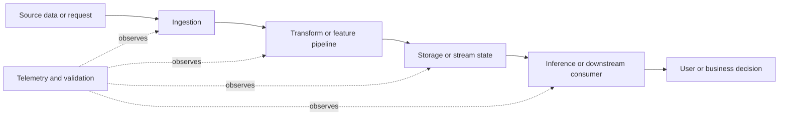

# Reliability Targets for Batch, Streaming, and Inference

> **Stage:** Stage 2E — Production DevOps & Platform Engineering  
> **Module:** M10 — Site Reliability Engineering and Incident Management  
> **Unit:** 2 — Reliability targets for batch, streaming, and inference  
> **Target file:** `02-reliability-targets-for-batch-streaming-and-inference.md`  
> **Lab mode:** Synthetic data, local-only, zero-budget  
> **Truthfulness convention:** Values marked `[ILLUSTRATIVE]` are teaching examples, not industry standards. `[ASSUMPTION]` identifies a chosen example contract. `[VERIFY]` means check the named tool/version documentation before relying on behavior. `[NOT EXECUTED]` means the commands or tests are provided but were not run as part of authoring. `[MEASURED BY LEARNER]` is a result the learner must record from their own run.

This chapter turns the SLI/SLO foundations from Unit 1 into workload-specific reliability contracts. A healthy process is not necessarily a healthy data product: a batch job can exit successfully while writing no rows, a stream processor can be running while falling further behind, and an inference API can return HTTP 200 while using stale features or producing invalid predictions.

The goal is to define reliability in terms of the promise made to the user or downstream consumer, select measurements that represent that promise, and test whether the measurements reveal the failures they are supposed to detect.

---

## 1. Learning Path, Prerequisites, and Lab Safety

### 1.1 Outcomes

By the end of this unit, you should be able to:

1. Explain why request/response availability alone is inadequate for data and ML systems.
2. Compare online inference, batch/ETL, and streaming workloads and their user-visible failure modes.
3. Specify freshness, coverage/completeness, correctness, timeliness, throughput, lag, and inference SLIs precisely.
4. Distinguish data freshness from job success, job duration from deadline compliance, offset lag from time lag, and event time from processing time.
5. Derive targets from business deadlines, user needs, and observed baselines rather than copying arbitrary “nines.”
6. Build synthetic batch, streaming, and inference examples; expose fault modes; and test measurements and alert rules.
7. Compare run-based and time-based SLOs, including the case of a successful but very late daily run.
8. trace a synthetic upstream change through a data-lineage graph.
9. conduct a silent-failure exercise and record detection, mitigation, and recovery evidence.
10. Explain limitations, assumptions, denominator choices, and the risks of metrics that can be gamed.

### 1.2 Prerequisites

You should be comfortable with:

- Python functions, dictionaries, CSV/JSON files, exceptions, and basic unit tests.
- Basic HTTP/API concepts and service metrics.
- The SLI/SLO/SLA/error-budget distinction from Unit 1.
- Basic Prometheus concepts: scrape targets, counters, gauges, PromQL, rule files, and evaluation intervals.

If Prometheus is new, complete the offline calculations first. The offline exercises teach the metric definitions, but they do **not** prove that live Prometheus scraping, PromQL evaluation, or alert-rule behavior works.

### 1.3 Local lab workspace

Create a separate directory; do not put exercise files in the curriculum repository:

```text
reliability-targets-lab/
├── README.md
├── versions.txt
├── data/
│   ├── batch_runs.csv
│   ├── stream_events.csv
│   └── inference_replay.csv
├── batch/
│   ├── job.py
│   └── tests/
├── streaming/
│   ├── simulator.py
│   └── tests/
├── inference/
│   ├── slo_spec.yaml
│   └── tests/
├── lineage/
│   ├── graph.json
│   ├── impact.py
│   └── tests/
├── prometheus/
│   ├── prometheus.yml
│   ├── rules.yml
│   └── tests/
├── slo/
│   ├── inference.md
│   ├── batch-etl.md
│   └── streaming.md
├── negotiation/
│   └── decision-record.md
├── silent-failure/
│   ├── facilitator-guide.md
│   └── learner-record.md
└── evidence/
    ├── command-logs/
    ├── metric-snapshots/
    ├── test-results/
    ├── calculations/
    └── review/
```

The tree is a suggested learner workspace, not a request to create these files in the repository. Each lab below identifies the files needed for that lab. You may start with a smaller workspace and add the folders as you progress.

### 1.4 Safety and resource budget

- Use synthetic records and local endpoints only.
- Do not paste production credentials, customer data, personal data, or secrets into lab files.
- Keep loops bounded; do not run uncontrolled load tests.
- Do not install a Kafka cluster for the core exercise. The streaming simulation is in-process.
- Grafana, Redis Streams, cloud services, and paid SLO/paging tools are optional and not required.
- Record actual tool versions in `versions.txt`; do not copy example versions as if they were observed.
- Stop any local services after the lab.

Example `versions.txt` template:

```text
OS:
Python:
pytest:
Prometheus:
promtool:
Docker (if used):
M08 lab service revision (if used):
Date recorded:
Commands used to inspect versions:
Notes / unavailable tools:
```

Useful local commands (run from the lab directory):

```bash
python --version
python -m pip --version
python -m pytest --version
prometheus --version
promtool --version
```

**Expected output:** each installed command prints its own version or reports that the executable is unavailable. This is a template, not evidence that these commands were run. If a command is missing, record `not installed` rather than inventing a version.

---

## 2. Why Request/Response Reliability Is Not Enough

A conventional online API often measures whether requests succeed and how long they take. That is necessary for an inference API, but insufficient for a data pipeline.

Consider three examples:

- **Batch:** a job exits with code zero at 02:00, but the output table contains zero rows. The scheduler reports success; the user receives missing data.
- **Streaming:** the consumer process is alive and its health endpoint returns success, but the oldest unprocessed event is 90 minutes old. The consumer is healthy as a process and failing as a timely data product.
- **Inference:** 99.9% of requests return HTTP 200, but a feature pipeline stopped updating three days ago. The API is available while predictions are based on stale inputs.

The relevant question is not simply “Is the component up?” It is “Did the consumer receive the expected, correct, sufficiently fresh result when it was needed?”

### 2.1 A useful reliability chain



A failure in an upstream stage can propagate into a downstream promise. Process-level health checks cover only part of this chain. End-to-end measurements and data-quality checks are needed to see failures that do not crash a process.

### 2.2 SLI, SLO, and SLA recap

- **Service-level indicator (SLI):** a measured quantity that represents an aspect of the delivered service, such as the fraction of expected partitions available by a deadline.
- **Service-level objective (SLO):** a target for an SLI over a defined window, such as at least 99% of eligible partitions arriving by the agreed deadline. The number here would be `[ILLUSTRATIVE]` until negotiated.
- **Service-level agreement (SLA):** an agreement with defined commitments and possible consequences. An internal SLO is not automatically a contractual SLA.

For data products, the event population and denominator often need more care than the arithmetic. “99% successful jobs” is ambiguous unless you define which jobs count, what “successful” means, how retries count, and whether a successful job that writes invalid output is considered good.

### 2.3 Four misleading health signals

| Signal | Why it can mislead | Better companion measurement |
|---|---|---|
| Process is running | It can be stuck or processing stale inputs | Progress watermark, age of oldest pending event, completed-work counter |
| Job exit code is zero | The job may have processed zero or partial records | Expected-vs-actual coverage, correctness checks, deadline compliance |
| HTTP status is 200 | The response may contain invalid or degraded results | Valid-output ratio, fallback ratio, feature freshness, delayed quality evaluation |
| CPU is low and dashboard is green | The pipeline may be idle because it is broken | Expected-arrival checks, missing-series detection, source-to-output reconciliation |

### 2.4 The three workload archetypes

| Workload | User promise | Candidate SLIs | Common silent failure | Likely measurement source | Misleading metric / anti-pattern |
|---|---|---|---|---|---|
| Online inference/serving | A valid prediction is returned within a usable time, with acceptable input freshness and quality | Availability, latency by tier, fallback ratio, feature-null/out-of-range ratio, delayed quality measure | HTTP 200 with stale features or invalid output | Request metrics, application validation, feature timestamps, replay/label evaluation | Availability alone presented as model quality |
| Batch/ETL | A defined dataset is complete, correct, and ready by its consumer deadline | Freshness, coverage, correctness, timeliness, run success, throughput | Exit code zero with zero rows; partial partition; duplicate output | Job output, expected partition inventory, watermarks, reconciliation, validation reports | Job success ratio alone |
| Streaming | Events are processed with bounded lag and acceptable loss, duplication, ordering, and end-to-end delay | Event-time lag, offset/count lag, end-to-end latency, throughput, duplicate/loss/order checks | Consumer stays alive while backlog age grows | Producer/consumer counters, event and processing timestamps, offsets, validation checks | Consumer process uptime or offset count alone |

---

## 3. Three Workload Archetypes and Their Failure Modes

### 3.1 Online inference

An inference request has an observable request/response boundary, but “successful” needs a precise definition. A response can be transport-successful and semantically unusable.

Candidate dimensions:

1. **Availability:** fraction of eligible requests that complete successfully according to a defined policy.
2. **Latency:** fraction of eligible requests meeting a latency threshold, or a percentile distribution. The threshold/percentile must reflect the user journey.
3. **Fallback ratio:** fraction of requests served by a fallback path rather than the intended model path.
4. **Input/feature validity:** fraction of requests with required features present and within defined ranges.
5. **Model quality:** measured using labels or outcomes when available. Until ground truth arrives, distribution shift and fallback ratio are only proxies.

A request that intentionally uses a fallback may be operationally successful but should not necessarily count as equivalent to a full-quality model response. Decide this explicitly in the SLO document.

### 3.2 Batch and ETL

Batch systems have a schedule and a data population. A run may succeed technically while failing the consumer’s promise.

Important distinctions:

- **Job duration:** elapsed time between job start and finish.
- **Timeliness:** whether the required output was available before a deadline.
- **Freshness:** age of the newest successful output or watermark relative to a reference time.
- **Coverage/completeness:** fraction of expected records, partitions, entities, or intervals that were actually processed.
- **Correctness:** fraction of eligible output that satisfies defined validation rules.
- **Run success:** whether a job execution meets the defined technical-success criteria.

A job that runs for 20 minutes and completes at 04:20 may be timely if its deadline is 05:00. A job that runs for 5 minutes but completes at 06:00 is late if the deadline was 05:00. A job that finishes on time but produces yesterday’s data is not fresh.

### 3.3 Streaming

A stream is continuous, so “job completed” is usually not the main promise. Reliability depends on whether new events are processed at an acceptable rate and delay.

- **Input throughput:** events arriving per unit time.
- **Processed throughput:** events successfully processed per unit time.
- **Count/offset lag:** the number of queued or unprocessed events, or the difference between latest and committed offsets under a specified broker’s semantics.
- **Time lag:** how old the oldest or latest unprocessed event is, or how far processing trails the source event-time watermark. Define which one you measure.
- **End-to-end latency:** processing timestamp minus event timestamp for an individual event, subject to clock and timestamp quality.
- **Correctness:** duplicates, missing IDs, invalid payloads, and ordering violations.
- **Dead-letter rate:** records diverted because normal processing failed, if the system uses a dead-letter path.

**Offset lag is not time lag.** A lag of 10,000 events may mean seconds at a high input rate or hours at a low input rate. Conversion requires assumptions about event rate, partitioning, ordering, and distribution. Kafka offset details are implementation-specific; verify the chosen broker’s official documentation before applying exact semantics. Kafka is optional in this chapter.

### 3.4 A worked comparison

Suppose the following values are generated by a synthetic exercise; all are `[ILLUSTRATIVE]`.

- A batch output’s newest watermark is 06:00 and the agreed reference time is 08:30. Its age is 2.5 hours.
- A stream’s oldest unprocessed event timestamp is 08:10 and current time is 08:30. Its age is 20 minutes.
- An inference request arrives at 08:30 and returns in 80 ms, but its feature timestamp is three days old.

The three systems need different SLIs. Batch freshness can be expressed as `reference_time - output_watermark`. Stream time lag can be expressed as `observation_time - timestamp_of_oldest_unprocessed_event`, if that is the chosen contract. Inference latency says nothing about feature freshness; the feature timestamp must be measured separately.

---

## 4. SLI Design for Data and ML Systems

A metric becomes an SLI only when its relationship to a user promise is explicit. For each SLI, document:

1. **Name:** a stable, human-readable name.
2. **Promise:** what the user or consumer expects.
3. **Population:** which requests, records, partitions, runs, or events are eligible.
4. **Good event:** the exact condition counted as good.
5. **Numerator and denominator:** or a precise measurement formula.
6. **Units:** seconds, records, ratio, timestamp, or events/second.
7. **Window:** per run, rolling time window, or calendar deadline.
8. **Measurement point:** where the value is recorded.
9. **Source:** metric, table, validation report, watermark, or trace.
10. **Owner:** the team accountable for measurement and response.
11. **Missing-data behavior:** what happens if the telemetry disappears.
12. **Blind spots:** what this SLI cannot prove.

### 4.1 Freshness

One possible definition is:

\[
\text{freshness age} = \text{reference timestamp} - \text{latest successful output watermark}
\]

Lower is better. This is an **age**, not a duration of the most recent job. The watermark must have documented semantics: does it represent the latest event observed, latest event successfully processed, latest partition complete, or a source-provided watermark?

Example `[ILLUSTRATIVE]`: reference time 10:00 UTC; latest successful watermark 09:35 UTC; age = 25 minutes. If the watermark is not updated when output is incomplete, freshness alone can still look acceptable while coverage is poor.

### 4.2 Coverage or completeness

A simple count-based form is:

\[
\text{coverage} = \frac{\text{actual eligible records processed}}{\text{expected eligible records}} 
\]

This form is only valid if “expected” is independently defined and the numerator cannot exceed the denominator due to duplicates. For partition coverage:

\[
\text{partition coverage} = \frac{\text{expected partitions successfully validated}}{\text{expected partitions}}
\]

If there are 96 expected hourly partitions and 92 pass validation, coverage is \(92/96 \approx 95.83\%\) `[ILLUSTRATIVE]`. A partition should not be counted as good merely because a file exists; define the required validation state.

For a zero-row expected dataset, a naive ratio divides by zero. Treat this as a special case: determine whether zero rows are valid for that source/time range, and verify against an expected inventory or independent source count. Never silently label `0/0` as 100% healthy.

### 4.3 Correctness

A correctness SLI can be:

\[
\text{correctness ratio} =
\frac{\text{eligible outputs passing specified validation}}{\text{eligible outputs evaluated}}
\]

The validation contract might include schema conformance, required fields, range checks, uniqueness, referential checks, and source-to-output reconciliation. State whether the unit is rows, partitions, or validation checks; those denominators are not interchangeable.

Example `[ILLUSTRATIVE]`: 9,850 of 10,000 eligible rows pass all required checks, so row correctness is 98.5%. This does not mean the model or data is “98.5% correct” in every business sense; it means 98.5% passed the declared checks.

### 4.4 Timeliness and duration

Timeliness asks whether output was ready before a deadline:

\[
\text{on-time ratio} =
\frac{\text{eligible runs or partitions ready by deadline}}
{\text{eligible runs or partitions}}
\]

Duration is `finish_time - start_time`. It can be a diagnostic or capacity signal, but it is not equivalent to deadline compliance. Freshness may be different again: a run can complete before the deadline while using stale source data.

### 4.5 Throughput

Throughput is the number of valid units processed per time unit, such as records/second or partitions/hour. A high throughput number is not automatically good: a system can process duplicated or invalid records quickly. Pair throughput with lag, correctness, and loss/duplicate checks.

### 4.6 Denominators, retries, and eligibility

Denominator choices are a common SLO failure mode.

- If each retry is counted as a separate eligible run, repeated retries can inflate the denominator and distort the success ratio.
- If retries overwrite previous output without idempotency, they can create duplicates while still reporting success.
- If late or failed runs are excluded after the fact, the SLO can be gamed.
- If only records that arrived are counted, missing records disappear from the denominator and coverage appears perfect.
- If only successful requests are evaluated for latency, failures may disappear from the latency distribution.

Define eligibility before observing outcomes. Record exclusions with a reason and make them auditable.

### 4.7 Metric contract example

The following is an example contract, not a statement about the M08 lab service. `[ASSUMPTION]`

| Metric | Type | Labels | Unit / meaning | Update behavior |
|---|---|---|---|---|
| `etl_last_successful_watermark_timestamp_seconds` | Gauge | `pipeline` | Unix timestamp in seconds of latest fully validated output watermark | Updated only after the output passes required checks |
| `etl_expected_partitions` | Gauge | `pipeline` | Count of partitions expected for the evaluated run | Updated for each evaluation |
| `etl_valid_partitions` | Gauge | `pipeline` | Count of expected partitions that completed and passed validation | Updated for each evaluation |
| `etl_validation_failures_total` | Counter | `pipeline`, `check` | Number of validation failures observed | Monotonically increases within process lifetime |
| `etl_job_last_success_timestamp_seconds` | Gauge | `pipeline` | Unix timestamp of last successful process execution | Updated after process-level success; not proof of data correctness |
| `stream_input_events_total` | Counter | `stream` | Events received | Increases as events arrive |
| `stream_processed_events_total` | Counter | `stream` | Events processed successfully | Increases as events are processed |
| `stream_oldest_unprocessed_event_timestamp_seconds` | Gauge | `stream` | Event timestamp of oldest pending event, Unix seconds | Must be absent or explicitly invalid when no pending event exists; contract must say which |
| `inference_requests_total` | Counter | `route`, `result` | Requests by bounded result class | Increases for each request |
| `inference_request_duration_seconds_bucket` | Histogram | `route`, `le` | Request-duration bucket counts in seconds | Standard histogram semantics; verify instrumentation |
| `inference_fallback_requests_total` | Counter | `route` | Requests served through fallback | Increases for each fallback |

Avoid raw user IDs, request IDs, arbitrary URL paths, record IDs, or event IDs as Prometheus labels. High-cardinality labels can consume substantial memory and create operational problems.

---

## 5. Batch and ETL Reliability Targets

### 5.1 Start with the consumer deadline

Ask the downstream consumer:

- When must the dataset be ready?
- Which date/hour/partition is expected?
- What does “complete” mean?
- Which validation checks are mandatory?
- What is the consequence of a late or partial dataset?
- Are backfills allowed to repair historical partitions?
- How should a legitimate empty result be distinguished from a broken source?

Do not begin by choosing “99.9%.” Start with the business promise and the baseline.

### 5.2 Example batch SLO set

All targets below are `[ILLUSTRATIVE]`, for a hypothetical daily analytics table:

- **Freshness:** 99% of observation points in a rolling 28-day window show the latest fully validated output watermark no more than 2 hours old.
- **Coverage:** at least 99% of expected daily partitions pass completeness validation by 05:00 UTC.
- **Correctness:** at least 99.5% of eligible output rows pass the defined validation suite, with critical invariants treated as hard gates rather than averaged away.
- **Timeliness:** at least 99% of eligible daily partitions are available to consumers by 05:00 UTC.
- **Run success:** tracked as a diagnostic metric; it is not a substitute for the above SLIs.

These targets should not be copied into a real system without consumer negotiation, baseline data, and a review of measurement quality.

### 5.3 Freshness gauge and timestamp units

If a gauge exposes a Unix timestamp in seconds, a possible query is:

```promql
time() - etl_last_successful_watermark_timestamp_seconds{pipeline="orders_daily"}
```

This computes the age in seconds of the timestamp in the gauge. It is only meaningful if the metric is in Unix seconds and represents a **fully validated** watermark. If the gauge is stale, the query returns an increasing age only while the series remains present. If the series disappears, the expression returns no series, not an automatically healthy zero.

A threshold can be used in an alert rule, but its threshold must be selected from the consumer deadline and evaluation model, not guessed. Include an absent-series or expected-pipeline check separately.

### 5.4 Pushgateway and batch jobs

A short-lived batch process may not live long enough for Prometheus to scrape it directly. Pushgateway is one possible way to expose batch-job metrics, but it has lifecycle and stale-series pitfalls. **[VERIFY]** Consult current official Pushgateway guidance before choosing grouping keys, deletion behavior, or persistence settings.

A stale “last success” series can remain visible after the job dies. A green value from yesterday is not evidence that today’s run happened. A safer design includes:
- an independently evaluated expected-run or last-update timestamp;
- an alert when the metric is older than the expected schedule allows;
- a defined grouping-key and cleanup policy;
- separate metrics for process success, validated output, and output watermark;
- where appropriate, a textfile collector, a dedicated exporter, or event/job-state monitoring.

Do not use “metric exists” as the health condition. Verify freshness of the metric itself.

### 5.5 Empty, partial, duplicate, and late output

| Fault | Why a success signal can miss it | Useful measurement |
|---|---|---|
| Empty output | Process can exit zero after reading no records | Expected-vs-actual count; legitimate-empty contract |
| Partial output | Some partitions may be missing | Expected partition inventory and validated partition count |
| Duplicate output | Count can be high while unique coverage is low | Unique key count, duplicate ratio, reconciliation |
| Late output | Job eventually succeeds | Deadline compliance and output watermark age |
| Stale metric | Last successful value persists after pipeline death | Metric age, expected-run heartbeat, missing-series alert |

Correctness should be tied to data contracts and validation rules. See the M08 data-contract and shared-consumer-governance units for the wider governance treatment; this chapter does not assume their unseen implementation details.

---

## 6. Streaming Reliability Targets

### 6.1 Define lag before alerting on it

“Lag” is ambiguous unless the measurement point and timestamp semantics are documented. Common choices include:

1. **Count/offset lag:** unprocessed event count or broker-specific offset difference.
2. **Oldest-pending age:** observation time minus the event timestamp of the oldest unprocessed event.
3. **Watermark lag:** current reference time minus a source or processor watermark.
4. **End-to-end latency:** processing timestamp minus event timestamp for an individual event.

These values answer different questions. Count lag estimates the amount of work waiting. Oldest-pending age estimates how long the most delayed event has waited. End-to-end latency measures the delay of processed events, which can hide unprocessed events if only completed events are sampled.

### 6.2 Worked calculations

All event counts and timestamps in this example are `[ILLUSTRATIVE]`.

- The producer has emitted 12,000 events; the consumer has processed 10,500 events in the same offset domain. Count lag = 1,500 events.
- If the input rate is roughly 500 events/second and remains stable, a crude drain-time estimate is \(1500 / 500 = 3\) seconds **only if the consumer can process faster than new arrivals and the stated rate represents net drain capacity**. If consumer throughput equals input throughput, backlog will not shrink.
- Current observation time is 12:00:00 UTC. The oldest pending event timestamp is 11:54:00 UTC. Oldest-pending age = 6 minutes.
- An event timestamped 11:59:50 is processed at 12:00:02. Its end-to-end latency is 12 seconds.

The count-lag estimate cannot be used as a time-lag conversion without assumptions about event rate, ordering, partitions, and processing capacity. If clocks are skewed or event timestamps are invalid, end-to-end latency may be negative or misleading; validate timestamps and document the policy.

### 6.3 Throughput and backlog

Let `input_rate` be incoming events per second and `processed_rate` be successfully processed events per second. If input exceeds processing capacity for a sustained period, backlog tends to grow. If processing exceeds input, backlog can drain. This is a simplified queueing explanation, not a full capacity model; retry loops, partition imbalance, bursts, and downstream blocking change behavior.

### 6.4 Example streaming SLO

`[ILLUSTRATIVE]` A consumer promises that 99% of eligible events are processed within 2 minutes of event time over a rolling 7-day window, while duplicate and loss rates remain within separately defined limits. The target should be based on consumer needs and observed baseline latency. A replay operation may intentionally create older event timestamps and should be tagged/segmented in the contract if replay is an approved operational mode. Do not simply exclude replay after observing a bad result; define the policy in advance.

### 6.5 Replay and dead-letter behavior

Replay can be required for recovery or backfills. It may increase count lag and event age without necessarily causing new user-facing harm, particularly if replayed events are historical and routed to a separate materialization. However, replay can compete with live traffic and delay fresh events. Measure live and replay work separately where the system can distinguish them, and verify that replay does not starve live processing.

Dead-letter queues are also not automatically harmless. A rising dead-letter count may indicate schema changes, poison messages, or a broken consumer. If dead-lettering is an expected recovery path, specify acceptable rates, ownership, and reprocessing rules.

---

## 7. Online Inference Reliability Targets

### 7.1 Separate serving reliability from model quality

An inference SLO should not collapse all dimensions into one number.

- **Availability:** can an eligible request obtain a response under the agreed success policy?
- **Latency:** is the response fast enough for the caller’s use case?
- **Fallback ratio:** how often does the system use a degraded or alternate path?
- **Feature validity/freshness:** are required inputs present, in range, and recent enough?
- **Quality:** does the prediction meet a task-specific quality criterion when trustworthy labels or outcomes are available?

The API can be available while model quality is poor. Conversely, a delayed-label quality measure may remain unknown for hours or days after requests are served.

### 7.2 Availability and latency definitions

A possible availability SLI is:

\[
\text{availability} =
\frac{\text{eligible requests meeting the success policy}}
{\text{eligible requests}}
\]

Specify treatment of client errors, timeouts, dependency errors, rejected requests, and fallback responses. Do not blindly count every HTTP 200 as good or every non-200 as a service failure without considering the user promise.

Latency may be represented as:
- a histogram distribution;
- the fraction of requests under a specified threshold;
- separate latency targets for interactive and asynchronous routes.

For SLO arithmetic, a threshold ratio is often easier to interpret:

\[
\text{good-latency ratio} =
\frac{\text{eligible requests with latency} \leq T}
{\text{eligible requests}}
\]

A percentile such as p99 is useful for diagnosis but can be unstable at low volume and can be calculated differently depending on the system. State the method and minimum-sample caveat.

### 7.3 Fallback and feature validity

Fallback ratio:

\[
\text{fallback ratio} =
\frac{\text{eligible requests served by fallback}}
{\text{eligible requests}}
\]

Feature-null ratio:

\[
\text{feature-null ratio} =
\frac{\text{eligible requests with one or more required features missing}}
{\text{eligible requests}}
\]

These are proxies for behavior, not direct measures of business outcome. A fallback can be the correct safe behavior, but a sudden increase may indicate a dependency problem. A feature value can be non-null but stale or semantically wrong, so freshness and range checks may also be required.

### 7.4 Distribution-shift proxy

A simple educational proxy is the difference in category proportions between a baseline sample and a replay sample. For a numeric feature, one might compare means or use a histogram-distance measure. The choice depends on the data type and task.

Example `[ILLUSTRATIVE]`: baseline categorical distribution is A=70%, B=30%; replay is A=40%, B=60%. The absolute proportion changes are 30 percentage points for each category. This signals a changed input distribution, not proof that predictions are wrong. The shift may be legitimate seasonality, a sampling artifact, or an upstream schema change.

A true quality evaluation usually requires delayed labels, human review, downstream business outcomes, or a task-specific evaluation set. Never state that a stable distribution proves model correctness.

### 7.5 M08 service integration boundary

Use the M08 FastAPI data/ML service and its fault-injection controls only if the supplied M08 source actually defines the metric names and endpoint contract. The current Unit 2 contract does not itself establish those exact names. If unavailable, use the explicit assumed contract in Section 4.7 and the synthetic replay lab below. Do not invent an M08 endpoint.

---

## 8. Turning User Needs into SLOs

### 8.1 A target-setting method

Use this sequence:

1. Identify the consumer and user journey.
2. State the promise in plain language.
3. Identify the unit of work: request, record, partition, run, or event.
4. Define good and bad outcomes.
5. Select the measurement point closest to the delivered promise.
6. Establish a baseline over representative periods, including known peak and recovery periods.
7. Understand downstream deadlines and consequences of lateness, missing data, and incorrect output.
8. Choose a target and window with the consumer; state assumptions and trade-offs.
9. Check whether the target can be gamed by retries, exclusions, duplicates, or low traffic.
10. Define missing-data behavior, ownership, review cadence, and evidence.
11. Revisit the target when the consumer, workload, architecture, or business consequence changes.

### 8.2 Why “nines” are not a design method

A tighter target usually means less tolerated bad time or fewer bad eligible events, but the appropriate target depends on the consequence of failure. A minute-level freshness target may be unnecessary for a daily finance report and insufficient for a fraud decision. Do not select a target merely because another team uses it.

### 8.3 Window trade-offs

- **Per-run:** easy to explain for a scheduled job, but a small number of runs produces a coarse ratio.
- **Rolling time window:** useful for a continuously delivered promise, but the sampling and event population need care.
- **Calendar deadline:** aligns with a consumer’s “ready by 05:00” expectation.
- **Per-record/event:** supports coverage and correctness, but can be dominated by high-volume entities and hide a missing small but critical partition.

Use multiple SLIs when one aggregate can hide a meaningful failure. For example, a daily partition-count SLI may look healthy while one high-priority customer partition is missing.

### 8.4 Cost and freshness choices

Always-on streaming can reduce delay but adds operational complexity and may require continuous compute. Micro-batch can be simpler and cheaper for workloads with minute-level or hourly freshness needs, but batch interval, scheduling delay, and backlog recovery contribute to end-to-end freshness. A scheduled batch may be sufficient when the consumer needs daily data. Do not invent cost figures: measure resource use and operational burden in the target environment and compare them against the actual freshness promise. Deeper cost modeling belongs in the later cost/FinOps curriculum.

---

## 9. Lab A — Batch Freshness, Coverage, and Correctness

### Objective

Build a synthetic ETL job that reports process success separately from data quality. Inject late, empty, partial, duplicate, and stale-metric faults. Define the metric contract before querying it.

### Prerequisites and files

Create:

```text
batch/job.py
batch/tests/test_job.py
data/batch_input.csv
```

Use Python standard library for the core job. `pytest` is optional but recommended. The code below writes a JSON report to a local output path; it does not expose a live Prometheus endpoint by itself. The Prometheus section later shows how to map a metric contract into a local scrape target or rule test.

### 9.1 Synthetic input

`data/batch_input.csv`:

```csv
record_id,partition,amount
r001,2026-10-26,12.0
r002,2026-10-26,8.5
r003,2026-10-26,5.0
r004,2026-10-26,3.5
r005,2026-10-26,11.0
r006,2026-10-26,2.0
```

These rows and dates are synthetic. The example expects six records and one partition.

### 9.2 Complete starter implementation

`batch/job.py`:

```python
#!/usr/bin/env python3
"""Synthetic ETL reliability lab. Uses only the Python standard library."""

import argparse
import csv
import json
import time
from collections import Counter
from datetime import datetime, timezone
from pathlib import Path


def utc_now():
    return datetime.now(timezone.utc)


def parse_time(value):
    return datetime.fromisoformat(value.replace("Z", "+00:00"))


def load_rows(path):
    with Path(path).open(newline="", encoding="utf-8") as handle:
        return list(csv.DictReader(handle))


def transform(rows, fault):
    output = [dict(row) for row in rows]

    if fault == "empty":
        output = []
    elif fault == "partial":
        output = output[:-2]
    elif fault == "duplicate" and output:
        output.append(dict(output[0]))

    return output


def evaluate(rows, expected_rows, expected_partitions):
    actual_partitions = {row["partition"] for row in rows}
    ids = [row["record_id"] for row in rows]
    duplicates = sum(count - 1 for count in Counter(ids).values() if count > 1)

    numeric_amounts_ok = True
    for row in rows:
        try:
            amount = float(row["amount"])
        except (ValueError, TypeError):
            numeric_amounts_ok = False
            break
        if amount < 0:
            numeric_amounts_ok = False
            break

    unique_count = len(set(ids))
    coverage = min(1.0, unique_count / expected_rows) if expected_rows else None
    correctness = (
        sum(1 for row in rows if row.get("record_id") and row.get("partition")
            and row.get("amount") is not None) / len(rows)
        if rows else 0.0
    )

    expected_partition_set = set(expected_partitions)
    partition_coverage = (
        len(actual_partitions & expected_partition_set) / len(expected_partition_set)
        if expected_partition_set else None
    )

    return {
        "expected_rows": expected_rows,
        "actual_rows": len(rows),
        "unique_rows": unique_count,
        "duplicate_rows": duplicates,
        "coverage_ratio": coverage,
        "partition_coverage_ratio": partition_coverage,
        "correctness_ratio": correctness,
        "amount_validation_pass": numeric_amounts_ok,
        "process_success": True,
        "data_valid": (
            len(rows) > 0 and duplicates == 0 and numeric_amounts_ok
            and coverage == 1.0 and partition_coverage == 1.0
        ),
    }


def main():
    parser = argparse.ArgumentParser()
    parser.add_argument("--input", default="data/batch_input.csv")
    parser.add_argument("--output", default="evidence/batch-report.json")
    parser.add_argument(
        "--fault",
        choices=["none", "late", "empty", "partial", "duplicate", "stale-metric"],
        default="none",
    )
    parser.add_argument("--expected-rows", type=int, default=6)
    parser.add_argument("--expected-partition", action="append", default=["2026-10-26"])
    parser.add_argument("--delay-seconds", type=float, default=0.0)
    args = parser.parse_args()

    started = utc_now()
    rows = load_rows(args.input)

    if args.fault == "late":
        # Bounded delay only. Use a small value for the lab.
        time.sleep(max(0.0, min(args.delay_seconds, 5.0)))

    output_rows = transform(rows, args.fault)
    report = evaluate(output_rows, args.expected_rows, args.expected_partition)
    finished = utc_now()

    report.update({
        "run_started_at": started.isoformat(),
        "run_finished_at": finished.isoformat(),
        "job_duration_seconds": (finished - started).total_seconds(),
        "fault_mode": args.fault,
        "output_watermark_timestamp_seconds": (
            finished.timestamp() if report["data_valid"] else None
        ),
        "stale_metric_mode": args.fault == "stale-metric",
    })

    # A stale-metric fault deliberately keeps the old report untouched.
    output_path = Path(args.output)
    output_path.parent.mkdir(parents=True, exist_ok=True)
    if args.fault != "stale-metric":
        output_path.write_text(json.dumps(report, indent=2), encoding="utf-8")

    print(json.dumps(report, indent=2))


if __name__ == "__main__":
    main()
```

**Purpose:** produce a report with process success, coverage, duplicate count, correctness checks, duration, and a watermark only when the example’s data-validity gate passes.

**Run:**

```bash
python batch/job.py --input data/batch_input.csv --output evidence/batch-report.json --fault none
python batch/job.py --input data/batch_input.csv --output evidence/batch-empty.json --fault empty
python batch/job.py --input data/batch_input.csv --output evidence/batch-partial.json --fault partial
python batch/job.py --input data/batch_input.csv --output evidence/batch-duplicate.json --fault duplicate
python batch/job.py --input data/batch_input.csv --output evidence/batch-late.json --fault late --delay-seconds 1
```

**Expected output shape:** a JSON object containing `expected_rows`, `actual_rows`, `unique_rows`, `duplicate_rows`, `coverage_ratio`, `partition_coverage_ratio`, `correctness_ratio`, `process_success`, `data_valid`, `job_duration_seconds`, and `output_watermark_timestamp_seconds`. Exact timestamps and durations vary by run. These commands are `[NOT EXECUTED]`; inspect the output locally.

**Important limitation:** the example’s `correctness_ratio` is a simple structural check and is not a comprehensive business validation suite. Improve it by adding schema, range, uniqueness, reconciliation, and domain-invariant checks. The expected partition list is supplied on the command line; a real system needs an independently trustworthy expected inventory.

### 9.3 Tests

`batch/tests/test_job.py`:

```python
from batch.job import evaluate, transform


def sample_rows():
    return [
        {"record_id": "a", "partition": "p1", "amount": "1.0"},
        {"record_id": "b", "partition": "p1", "amount": "2.0"},
    ]


def test_healthy_rows_have_full_coverage():
    result = evaluate(sample_rows(), 2, ["p1"])
    assert result["coverage_ratio"] == 1.0
    assert result["partition_coverage_ratio"] == 1.0
    assert result["data_valid"] is True


def test_empty_output_is_not_data_valid():
    result = evaluate([], 2, ["p1"])
    assert result["process_success"] is True
    assert result["data_valid"] is False
    assert result["coverage_ratio"] == 0.0


def test_partial_output_has_reduced_coverage():
    result = evaluate(sample_rows()[:1], 2, ["p1"])
    assert result["coverage_ratio"] == 0.5
    assert result["data_valid"] is False


def test_duplicate_is_detected():
    rows = sample_rows() + [dict(sample_rows()[0])]
    result = evaluate(rows, 2, ["p1"])
    assert result["duplicate_rows"] == 1
    assert result["data_valid"] is False


def test_transform_duplicate_fault():
    assert len(transform(sample_rows(), "duplicate")) == 3
```

Run with:

```bash
python -m pytest -q batch/tests
```

Expected: tests should report pass/fail counts. This output is not asserted here because the tests have not been executed. If your package layout prevents importing `batch.job`, add an empty `batch/__init__.py` or run pytest from the lab root.

### 9.4 Metric mapping and PromQL

For the following PromQL examples, assume an exporter translates the report into the metric contract from Section 4.7. The exact exporter is not implemented in this Python script. Do not treat JSON fields as automatically scraped Prometheus metrics.

Freshness age in seconds:

```promql
time() - etl_last_successful_watermark_timestamp_seconds{pipeline="orders_daily"}
```

Partition coverage ratio:

```promql
etl_valid_partitions{pipeline="orders_daily"}
/
etl_expected_partitions{pipeline="orders_daily"}
```

The second expression is meaningful only when expected partitions is positive and both gauges represent the same evaluation. A zero denominator or stale gauges must be handled explicitly.

Validation failure rate over a window, assuming `etl_validation_failures_total` is a counter and `etl_validation_checks_total` is a counter with compatible labels:

```promql
sum(rate(etl_validation_failures_total[15m]))
/
clamp_min(sum(rate(etl_validation_checks_total[15m])), 1)
```

This `clamp_min` prevents division by zero but can produce a misleading numerical result when no checks occurred. A separate “no checks / missing data” alert is required; do not interpret the result alone as healthy. Check current PromQL support and semantics for the Prometheus version you actually use `[VERIFY]`.

### 9.5 Stale metric and dead-pipeline detection

A useful conceptual rule is “the expected run heartbeat is too old,” not “the success series exists.” Example rule template:

```yaml
groups:
  - name: batch-reliability
    interval: 30s
    rules:
      - alert: BatchWatermarkTooOld
        expr: time() - etl_last_successful_watermark_timestamp_seconds{pipeline="orders_daily"} > 7200
        for: 2m
        labels:
          severity: warning
        annotations:
          summary: "Batch output watermark is older than the configured limit"
          description: "Check source arrivals, job state, validation results, and metric freshness."

      - alert: BatchWatermarkMetricMissing
        expr: absent(etl_last_successful_watermark_timestamp_seconds{pipeline="orders_daily"})
        for: 2m
        labels:
          severity: critical
        annotations:
          summary: "Expected batch watermark metric is absent"
          description: "Check exporter/scrape health and the expected batch pipeline."
```

The `7200`-second threshold is `[ILLUSTRATIVE]`; the `for` and evaluation intervals are example settings, not verified against a particular deployment. `absent()` can detect that the expected series is missing, but it cannot by itself prove that a pipeline should have run. Use an expected-pipeline inventory or independent schedule signal where possible.

### 9.6 Pushgateway pitfall exercise

1. Run a healthy batch job and record its reported watermark.
2. Stop running the job but leave the metric publication path unchanged.
3. Observe whether the old success series remains available.
4. Compare metric age with the expected schedule.
5. Write down how the system distinguishes “last run succeeded” from “the latest required run succeeded.”

Pushgateway lifecycle and cleanup specifics are `[VERIFY]`: consult current official documentation before applying production settings. Do not assume that a stale series is deleted automatically. An alternative design may use an exporter that queries job state or a node textfile collector, depending on the environment.

### 9.7 Troubleshooting and evidence

- **Coverage shows 100% but records are missing:** expected count may be based on actual arrivals rather than an independent source.
- **Correctness shows 100% on empty output:** check the denominator and explicit empty-output policy.
- **Freshness remains green after job death:** metric may be stale; inspect timestamp and expected-run logic.
- **Duplicate output passes:** validate uniqueness on a stable business key and reconcile with source counts.
- **Alert does not fire:** inspect labels, scrape availability, rule evaluation interval, `for` duration, metric timestamp units, and whether the series is absent rather than zero.

Evidence checklist:
- [ ] healthy report and each fault-mode report saved;
- [ ] test output captured;
- [ ] metric contract documented;
- [ ] stale metric and missing-series behavior explained;
- [ ] threshold rationale written;
- [ ] all results labelled `[MEASURED BY LEARNER]` where appropriate.

---

## 10. Lab B — Streaming Lag and End-to-End Latency

### Objective

Simulate a producer and consumer without a broker. Observe throughput, count lag, event-time lag, end-to-end latency, duplicates, and missing events. Exercise normal, burst, backlog, replay, and consumer-slowdown scenarios.

### Files

```text
streaming/simulator.py
streaming/tests/test_simulator.py
```

### 10.1 Complete in-process simulator

`streaming/simulator.py`:

```python
#!/usr/bin/env python3
"""Bounded in-process streaming simulation; no broker required."""

import argparse
import json
from collections import Counter


def build_events(count=20, start_time=1000.0, interval=1.0):
    return [
        {"event_id": f"e{i:04d}", "event_time": start_time + i * interval}
        for i in range(count)
    ]


def simulate(scenario="normal", count=20, process_limit=None):
    events = build_events(count=count)
    input_events = list(events)

    if scenario == "burst":
        # More input arrives before the consumer catches up.
        input_events = build_events(count=count * 2, interval=0.2)
    elif scenario == "replay":
        # Replay adds historical events; IDs are intentionally prefixed.
        replay = [
            {"event_id": f"replay-{e['event_id']}", "event_time": e["event_time"] - 3600}
            for e in events[: max(1, count // 4)]
        ]
        input_events = replay + input_events
    elif scenario == "duplicate":
        input_events = input_events + [dict(input_events[0])]
    elif scenario == "loss":
        input_events = input_events[1:]
    elif scenario not in {"normal", "backlog", "slowdown"}:
        raise ValueError(f"unknown scenario: {scenario}")

    if scenario in {"backlog", "slowdown"}:
        limit = process_limit if process_limit is not None else max(1, count // 3)
    else:
        limit = process_limit if process_limit is not None else len(input_events)

    processed = input_events[: max(0, min(limit, len(input_events)))]
    # A deterministic synthetic processing timestamp: last input event time plus 2s.
    # This is a simulation clock, not wall-clock time.
    processed_events = []
    for index, event in enumerate(processed):
        item = dict(event)
        item["processing_time"] = event["event_time"] + 2.0 + index * 0.01
        processed_events.append(item)

    input_ids = [e["event_id"] for e in input_events]
    processed_ids = [e["event_id"] for e in processed_events]
    duplicate_count = sum(v - 1 for v in Counter(processed_ids).values() if v > 1)
    missing_ids = sorted(set(input_ids) - set(processed_ids))
    order_ok = processed_ids == input_ids[: len(processed_ids)]
    latencies = [e["processing_time"] - e["event_time"] for e in processed_events]

    newest_input_time = max((e["event_time"] for e in input_events), default=None)
    oldest_pending_time = min(
        (e["event_time"] for e in input_events[len(processed):]),
        default=None,
    )
    # For this deterministic simulation, observation time is defined explicitly.
    observation_time = (newest_input_time + 10.0) if newest_input_time is not None else None

    return {
        "scenario": scenario,
        "input_count": len(input_events),
        "processed_count": len(processed_events),
        "count_lag": max(0, len(input_events) - len(processed_events)),
        "input_rate_events_per_second": None,
        "processed_rate_events_per_second": None,
        "observation_time": observation_time,
        "oldest_pending_event_time": oldest_pending_time,
        "oldest_pending_age_seconds": (
            observation_time - oldest_pending_time
            if observation_time is not None and oldest_pending_time is not None
            else 0.0
        ),
        "mean_end_to_end_latency_seconds": (
            sum(latencies) / len(latencies) if latencies else None
        ),
        "max_end_to_end_latency_seconds": max(latencies) if latencies else None,
        "duplicate_count": duplicate_count,
        "missing_event_ids": missing_ids,
        "order_check_pass": order_ok,
        "processed_event_count": len(processed_events),
    }


def main():
    parser = argparse.ArgumentParser()
    parser.add_argument(
        "--scenario",
        choices=["normal", "burst", "backlog", "replay", "slowdown", "duplicate", "loss"],
        default="normal",
    )
    parser.add_argument("--count", type=int, default=20)
    parser.add_argument("--process-limit", type=int)
    args = parser.parse_args()
    result = simulate(args.scenario, max(1, min(args.count, 10000)), args.process_limit)
    print(json.dumps(result, indent=2))


if __name__ == "__main__":
    main()
```

**Purpose:** demonstrate that count lag, event-time age, and processed-event latency are separate measurements. This simulator uses synthetic timestamps rather than a real clock; it does not implement a broker’s offset semantics or a real-time throughput meter.

**Run:**

```bash
python streaming/simulator.py --scenario normal
python streaming/simulator.py --scenario burst
python streaming/simulator.py --scenario backlog
python streaming/simulator.py --scenario replay
python streaming/simulator.py --scenario slowdown
python streaming/simulator.py --scenario duplicate
python streaming/simulator.py --scenario loss
```

**Expected output shape:** JSON with `input_count`, `processed_count`, `count_lag`, `oldest_pending_age_seconds`, latency values, duplicate count, missing IDs, and order-check status. The exact values are determined by the deterministic simulation. Commands are `[NOT EXECUTED]`.

### 10.2 Tests

`streaming/tests/test_simulator.py`:

```python
from streaming.simulator import simulate


def test_normal_scenario_has_no_count_lag():
    result = simulate("normal", count=10)
    assert result["count_lag"] == 0
    assert result["duplicate_count"] == 0
    assert result["missing_event_ids"] == []


def test_backlog_has_pending_events():
    result = simulate("backlog", count=12)
    assert result["count_lag"] > 0
    assert result["oldest_pending_age_seconds"] > 0


def test_duplicate_fault_is_detected():
    result = simulate("duplicate", count=10)
    assert result["duplicate_count"] == 1


def test_loss_fault_is_detected():
    result = simulate("loss", count=10)
    assert result["missing_event_ids"]


def test_replay_includes_old_events():
    result = simulate("replay", count=12)
    assert result["oldest_pending_age_seconds"] >= 0
```

Run `python -m pytest -q streaming/tests`. These tests are `[NOT EXECUTED]`.

### 10.3 Define the streaming metric contract

For a live Prometheus deployment, define counters and gauges before writing rules. Example `[ASSUMPTION]`:

- `stream_input_events_total{stream="orders"}` — counter, events received.
- `stream_processed_events_total{stream="orders"}` — counter, events processed successfully.
- `stream_oldest_unprocessed_event_timestamp_seconds{stream="orders"}` — gauge, Unix timestamp of oldest pending event.
- `stream_dead_letter_events_total{stream="orders"}` — counter, events diverted to a dead-letter path.
- `stream_duplicate_events_total{stream="orders"}` — counter, duplicate events detected.

Use a bounded label such as stream name. Do not label by event ID.

Example queries:

```promql
sum(rate(stream_input_events_total{stream="orders"}[5m]))
```

```promql
sum(rate(stream_processed_events_total{stream="orders"}[5m]))
```

```promql
time() - stream_oldest_unprocessed_event_timestamp_seconds{stream="orders"}
```

The first two queries estimate per-second counter rates over the selected range. Counter resets and low sample counts can affect the estimate; ensure there are enough scrapes in the range and understand the counter-reset handling of the Prometheus version in use. The last query returns age in seconds if the gauge is a Unix timestamp. If there is no pending event, define whether the series is absent or represents a sentinel; do not accidentally interpret a stale timestamp as a current backlog.

### 10.4 Example rules and tests

```yaml
groups:
  - name: streaming-reliability
    interval: 30s
    rules:
      - alert: StreamOldestEventTooOld
        expr: time() - stream_oldest_unprocessed_event_timestamp_seconds{stream="orders"} > 120
        for: 2m
        labels:
          severity: warning
        annotations:
          summary: "Oldest pending event exceeds the illustrative age threshold"

      - alert: StreamBacklogGrowing
        expr: |
          sum(rate(stream_input_events_total{stream="orders"}[5m]))
          >
          sum(rate(stream_processed_events_total{stream="orders"}[5m]))
        for: 5m
        labels:
          severity: warning
        annotations:
          summary: "Input rate exceeds processed rate"

      - alert: StreamLagMetricMissing
        expr: absent(stream_oldest_unprocessed_event_timestamp_seconds{stream="orders"})
        for: 2m
        labels:
          severity: critical
        annotations:
          summary: "Expected stream lag metric is absent"
```

The `120`-second threshold and rule intervals are `[ILLUSTRATIVE]`. Rate comparison alone can alert during a short burst even if there is ample capacity and no user impact; combine it with actual lag/age and the consumer promise. Conversely, the absence rule must account for a healthy empty queue if the instrumentation removes the series when there is no pending event. A better contract may expose an explicit pending-state gauge and a separate oldest-event age that is valid only when pending count is positive.

A minimal `promtool` rule-test file must use the syntax supported by the installed Prometheus version. **[VERIFY]** Check the official Prometheus rule-unit-testing documentation for the installed version before relying on test syntax. Do not fabricate a `promtool` pass result. If you use `promtool test rules prometheus/tests/rules_test.yml`, record the actual output.

### 10.5 Replay and scenario interpretation

| Scenario | Expected signal | Important caveat |
|---|---|---|
| Normal | Lag near zero; processing rate keeps up | Low volume may make rate estimates noisy |
| Burst | Input rate briefly exceeds processed rate | A short burst is not necessarily a breach if lag drains quickly |
| Backlog | Count lag and oldest-event age increase | Need to know whether the backlog includes live or replay traffic |
| Replay | Historical events can increase age and count lag | Define replay mode and its impact on live traffic in advance |
| Slow consumer | Processed rate remains below input rate | Identify whether CPU, I/O, partition skew, or dependency blocking causes it |
| Duplicate | Duplicate count increases | Idempotency may prevent downstream damage but still needs verification |
| Loss | Expected IDs are missing | Real systems need an independent expected event population or reconciliation source |

### 10.6 Troubleshooting and evidence

- If count lag is zero but time lag is high, the stream may have stopped receiving new events while an old event remains unprocessed, or the timestamp semantics may differ.
- If end-to-end latency looks low during backlog, you may be measuring only completed events and ignoring pending work.
- If rate is zero, distinguish “no events expected” from “producer/consumer dead.”
- If replay triggers a lag alert, determine whether live-event latency is harmed before treating it as a user-facing SLO breach.
- If the simulator’s ordering check fails, inspect how replay events are inserted; the exercise intentionally changes input ordering.

Evidence:
- [ ] outputs for all scenarios saved;
- [ ] count lag and time lag definitions documented;
- [ ] duplicate/loss/order tests recorded;
- [ ] replay policy written;
- [ ] PromQL assumptions and missing-series behavior documented.

---

## 11. Lab C — Inference SLOs and Quality Proxies

### Objective

Calculate serving availability, latency threshold compliance, fallback ratio, feature validity, and a simple distribution-shift proxy from a synthetic replay. Demonstrate a case where HTTP responses are successful but quality risk increases.

### Files

```text
data/inference_replay.csv
inference/slo_spec.yaml
inference/evaluate.py
inference/tests/test_evaluate.py
```

### 11.1 Synthetic replay dataset

`data/inference_replay.csv`:

```csv
request_id,status_code,latency_ms,fallback,feature_missing,feature_age_hours,baseline_segment,replay_segment
q001,200,80,false,false,0.5,A,A
q002,200,95,false,false,0.7,A,A
q003,200,130,true,false,1.0,A,B
q004,200,75,false,false,0.4,A,B
q005,200,210,false,true,0.8,B,B
q006,200,90,false,false,0.6,A,B
q007,200,115,false,false,72.0,A,B
q008,200,105,true,false,1.1,B,B
q009,200,85,false,false,0.5,A,B
q010,200,160,false,false,0.9,A,B
```

The identifiers, statuses, latencies, and feature ages are synthetic. This dataset intentionally includes successful HTTP responses alongside fallback, missing-feature, and stale-feature conditions.

### 11.2 Evaluation script

`inference/evaluate.py`:

```python
#!/usr/bin/env python3
import csv
import json
import sys
from collections import Counter
from pathlib import Path


def as_bool(value):
    return value.strip().lower() == "true"


def evaluate(path, latency_threshold_ms=150, stale_feature_hours=24):
    with Path(path).open(newline="", encoding="utf-8") as handle:
        rows = list(csv.DictReader(handle))
    if not rows:
        raise ValueError("replay dataset must contain at least one row")

    eligible = len(rows)
    successful = sum(1 for r in rows if 200 <= int(r["status_code"]) < 500)
    # This example success policy is illustrative; a real contract must define
    # which client errors, timeouts, and fallback responses count as good.
    low_latency = sum(1 for r in rows if float(r["latency_ms"]) <= latency_threshold_ms)
    fallback = sum(1 for r in rows if as_bool(r["fallback"]))
    missing_feature = sum(1 for r in rows if as_bool(r["feature_missing"]))
    stale_feature = sum(1 for r in rows if float(r["feature_age_hours"]) > stale_feature_hours)

    baseline = Counter(r["baseline_segment"] for r in rows)
    replay = Counter(r["replay_segment"] for r in rows)
    keys = sorted(set(baseline) | set(replay))
    baseline_total = sum(baseline.values())
    replay_total = sum(replay.values())
    distribution_abs_delta = {
        key: abs(baseline[key] / baseline_total - replay[key] / replay_total)
        for key in keys
    }

    return {
        "eligible_requests": eligible,
        "availability_ratio_example_policy": successful / eligible,
        "latency_threshold_ms": latency_threshold_ms,
        "good_latency_ratio": low_latency / eligible,
        "fallback_ratio": fallback / eligible,
        "feature_missing_ratio": missing_feature / eligible,
        "stale_feature_ratio": stale_feature / eligible,
        "segment_distribution_absolute_delta": distribution_abs_delta,
        "quality_warning": (
            fallback > 0 or missing_feature > 0 or stale_feature > 0
            or any(v > 0.2 for v in distribution_abs_delta.values())
        ),
        "warning": (
            "Distribution change is a proxy, not proof of model-quality degradation. "
            "The example availability policy must be negotiated for a real service."
        ),
    }


if __name__ == "__main__":
    input_path = sys.argv[1] if len(sys.argv) > 1 else "data/inference_replay.csv"
    print(json.dumps(evaluate(input_path), indent=2))
```

**Purpose:** demonstrate separate measures for serving, latency, fallback, feature validity/freshness, and a crude distribution proxy.

**Run:** `python inference/evaluate.py data/inference_replay.csv`

**Expected output shape:** JSON ratios and a per-segment distribution delta. The exact results are derivable from the supplied synthetic CSV; the script was not executed here `[NOT EXECUTED]`.

**Important example-policy note:** this script counts HTTP status codes from 200 through 499 as successful for its example availability ratio, which may not fit your service. That choice is deliberately visible to teach that availability policy must be explicit. For many services, selected client errors are not server availability failures but still may be unsuccessful user outcomes. Define the policy based on the contract.

### 11.3 SLO specification

`inference/slo_spec.yaml`:

```yaml
workload: online-inference
owner: "ASSUMPTION: inference platform team"
user_promise: "Eligible requests receive a valid prediction within the agreed latency threshold."
window: "rolling 28 days [ILLUSTRATIVE]"
slis:
  - name: availability
    definition: "Good eligible requests / all eligible requests"
    target: "99.9% [ILLUSTRATIVE]"
    population: "Requests admitted by the public inference API"
    good_event: "Meets the documented status and response-validity policy"
    measurement: "Application request counter plus response validation"
  - name: latency
    definition: "Eligible requests at or below threshold / all eligible requests"
    threshold: "200 ms [ILLUSTRATIVE]"
    target: "99% [ILLUSTRATIVE]"
    measurement: "Request duration histogram"
  - name: fallback_ratio
    definition: "Requests served by fallback / eligible requests"
    target: "Negotiated separately [ILLUSTRATIVE]"
    measurement: "Fallback counter"
  - name: feature_freshness
    definition: "Eligible requests whose required features are within age limit / all eligible requests"
    target: "Negotiated separately [ILLUSTRATIVE]"
    measurement: "Feature timestamp or feature-store metadata"
quality_notes:
  - "Distribution shift is a proxy and does not prove prediction correctness."
  - "Ground-truth labels may arrive later than serving telemetry."
missing_data_policy: "Missing telemetry is unknown, not automatically good."
review_cadence: "Monthly review [ASSUMPTION]"
```

This is a teaching template. Replace the owner, population, target, window, exclusions, and measurement details with negotiated values before treating it as a service contract.

### 11.4 Tests

`inference/tests/test_evaluate.py`:

```python
from pathlib import Path
from inference.evaluate import evaluate


def test_evaluation_has_required_ratios():
    result = evaluate(Path("data/inference_replay.csv"))
    assert 0 <= result["availability_ratio_example_policy"] <= 1
    assert 0 <= result["good_latency_ratio"] <= 1
    assert 0 <= result["fallback_ratio"] <= 1
    assert result["eligible_requests"] == 10


def test_quality_warning_detects_stale_or_missing_features():
    result = evaluate(Path("data/inference_replay.csv"))
    assert result["quality_warning"] is True
    assert result["stale_feature_ratio"] > 0
    assert result["feature_missing_ratio"] > 0
```

Run `python -m pytest -q inference/tests`. These tests are `[NOT EXECUTED]`.

### 11.5 PromQL mapping

Assuming the metric contract from Section 4.7 and additional bounded metrics for latency, fallback, and feature validity:

```promql
sum(rate(inference_fallback_requests_total{route="predict"}[5m]))
/
clamp_min(sum(rate(inference_requests_total{route="predict"}[5m])), 1)
```

This is an illustrative fallback ratio. As with the validation ratio, `clamp_min` prevents division by zero but does not make a no-traffic period healthy. Add an independent expected-traffic or missing-telemetry check.

If a histogram named `inference_request_duration_seconds_bucket` is correctly instrumented, the fraction of requests at or below 0.2 seconds can be estimated using the bucket at `le="0.2"` divided by the total observation rate. The exact query depends on histogram labels and whether the `+Inf` bucket is present; verify the actual exposition format and labels before using it.

### 11.6 Scenario: HTTP 200 while quality risk increases

In the synthetic replay, every row has status 200, yet the data includes a missing feature, a feature aged 72 hours, and fallback requests. A request-level availability chart may look perfect while feature validity and freshness reveal a risk. The next step is not to declare model accuracy degraded from these proxies; it is to investigate upstream freshness, fallback causes, and delayed ground-truth evaluation.

Evidence:
- [ ] dataset and script saved;
- [ ] availability policy written in plain language;
- [ ] latency threshold and denominator justified;
- [ ] fallback and feature metrics reviewed;
- [ ] distribution proxy limitations documented;
- [ ] at least one delayed-label or outcome metric proposed.

---

## 12. Lab D — Batch Window Arithmetic and Time-Based vs Run-Based SLOs

### Objective

Compare a run-based success ratio with a time-based freshness/timeliness measure. Show how a daily job can be “successful” while violating the consumer promise.

### 12.1 Synthetic history

All values below are `[ILLUSTRATIVE]`.

| Run | Deadline | Process result | Output valid? | Ready time | Timely and valid? |
|---|---|---|---|---|---|
| Day 1 | 05:00 | Success | Yes | 04:40 | Yes |
| Day 2 | 05:00 | Success | Yes | 04:55 | Yes |
| Day 3 | 05:00 | Success | Yes | 03:50 | Yes |
| Day 4 | 05:00 | Success | Yes | 03:58 | Yes |
| Day 5 | 05:00 | Success | Yes | 03:59 | Yes |
| Day 6 | 05:00 | Success | Yes | 03:57 | Yes |
| Day 7 | 05:00 | Success | Yes | 03:55 | Yes |
| Day 8 | 05:00 | Success | Yes | 03:56 | Yes |
| Day 9 | 05:00 | Success | No — partial | 04:30 | No |
| Day 10 | 05:00 | Success | Yes | 03:59 next day | No; 22 h 59 min late |

A crude run-success metric that counts process exit code zero has 10 successful runs out of 10. A data-valid success metric has 9 out of 10. A timeliness-and-validity metric has 8 out of 10. The Day 10 run completes eventually but misses the Day 10 deadline by almost 23 hours; its process success does not make the user promise true.

### 12.2 Calculation

Run-success ratio by process exit code:

\[
10/10 = 100\%
\]

Data-valid run ratio:

\[
9/10 = 90\%
\]

Timely-and-valid ratio:

\[
8/10 = 80\%
\]

All values are `[ILLUSTRATIVE]` and derived from the table above.

A rolling time-based freshness SLO requires observations over time, not just a list of runs. For example, sampling the age of the latest validated watermark every five minutes could measure the fraction of observation points where the age is within a negotiated threshold. A daily run ratio cannot tell you how stale the output was between runs or how long the latest output remained unavailable.

### 12.3 Calculation script

`batch/window_slo.py`:

```python
from datetime import datetime

runs = [
    {"process_success": True, "valid": True, "timely": True},
    {"process_success": True, "valid": True, "timely": True},
    {"process_success": True, "valid": True, "timely": True},
    {"process_success": True, "valid": True, "timely": True},
    {"process_success": True, "valid": True, "timely": True},
    {"process_success": True, "valid": True, "timely": True},
    {"process_success": True, "valid": True, "timely": True},
    {"process_success": True, "valid": True, "timely": True},
    {"process_success": True, "valid": False, "timely": True},
    {"process_success": True, "valid": True, "timely": False},
]

total = len(runs)
process_ratio = sum(r["process_success"] for r in runs) / total
valid_ratio = sum(r["process_success"] and r["valid"] for r in runs) / total
timely_valid_ratio = sum(
    r["process_success"] and r["valid"] and r["timely"] for r in runs
) / total

print(f"process_success_ratio={process_ratio:.0%}")
print(f"valid_run_ratio={valid_ratio:.0%}")
print(f"timely_and_valid_ratio={timely_valid_ratio:.0%}")
```

The unused `datetime` import may be removed; it is not required for the calculation. Run with `python batch/window_slo.py`. Expected output:

```text
process_success_ratio=100%
valid_run_ratio=90%
timely_and_valid_ratio=80%
```

The output is derived from the literal synthetic list and is not claimed as a tool execution result. A fuller lab should parse timestamped records and compute deadline deltas rather than pre-label `timely`.

### 12.4 Learner exercise

1. Define whether an attempt or a logical scheduled run is the denominator.
2. Decide whether a retry that succeeds after the deadline counts as timely.
3. Decide how backfills are handled without retroactively hiding the original breach.
4. Add a run with a legitimate empty output and specify how it is validated.
5. Explain why a rolling freshness SLI is complementary to a run ratio.

Answer key: retries should not silently create extra denominator entries; define the logical run and retry policy in advance. A late retry can repair the dataset, but it does not erase the original deadline miss unless the agreed SLO explicitly defines recovery differently. Legitimate empty output needs an independent expected-empty signal or business rule. Time-based freshness captures stale periods that a coarse run ratio misses.

Evidence:
- [ ] calculations by hand;
- [ ] script output saved;
- [ ] denominator and retry policy written;
- [ ] explanation of the 22-hour-late run recorded.

---

## 13. Lab E — Lineage Impact Analysis

### Objective

Represent a small data lineage graph and identify downstream datasets, model features, and consumers affected by a changed or failed node. This is a local synthetic exercise, not a real catalog integration.

### Files

```text
lineage/graph.json
lineage/impact.py
lineage/tests/test_impact.py
```

### 13.1 Graph

`lineage/graph.json`:

```json
{
  "nodes": {
    "raw_orders": {"type": "source", "owner": "data-ingestion", "contract": "orders-v1"},
    "clean_orders": {"type": "etl", "owner": "analytics", "contract": "orders-clean-v2"},
    "customer_features": {"type": "features", "owner": "ml-platform", "contract": "customer-features-v3"},
    "risk_model_api": {"type": "consumer", "owner": "risk-ml", "contract": "prediction-v1"},
    "finance_daily": {"type": "consumer", "owner": "finance-data", "contract": "finance-report-v1"},
    "raw_weather": {"type": "source", "owner": "external-data", "contract": "weather-v1"}
  },
  "edges": [
    ["raw_orders", "clean_orders"],
    ["clean_orders", "customer_features"],
    ["customer_features", "risk_model_api"],
    ["clean_orders", "finance_daily"]
  ]
}
```

### 13.2 Impact script

`lineage/impact.py`:

```python
#!/usr/bin/env python3
import json
import sys
from collections import deque
from pathlib import Path


def validate_graph(graph):
    nodes = graph.get("nodes")
    edges = graph.get("edges")
    if not isinstance(nodes, dict) or not isinstance(edges, list):
        raise ValueError("graph must contain a nodes object and edges list")

    adjacency = {name: [] for name in nodes}
    for edge in edges:
        if not isinstance(edge, list) or len(edge) != 2:
            raise ValueError(f"invalid edge: {edge!r}")
        source, target = edge
        if source not in nodes or target not in nodes:
            raise ValueError(f"edge references unknown node: {edge!r}")
        adjacency[source].append(target)

    # Detect cycles with DFS; lineage is expected to be a DAG in this exercise.
    visiting, visited = set(), set()

    def visit(node):
        if node in visiting:
            raise ValueError("cycle detected; expected a DAG")
        if node in visited:
            return
        visiting.add(node)
        for child in adjacency[node]:
            visit(child)
        visiting.remove(node)
        visited.add(node)

    for node in nodes:
        visit(node)
    return adjacency


def impact(graph, changed_node):
    nodes = graph["nodes"]
    if changed_node not in nodes:
        raise KeyError(f"unknown node: {changed_node}")
    adjacency = validate_graph(graph)
    queue = deque(adjacency[changed_node])
    seen = set()
    while queue:
        node = queue.popleft()
        if node in seen:
            continue
        seen.add(node)
        queue.extend(adjacency[node])

    return {
        "changed_node": changed_node,
        "affected_descendants": [
            {
                "name": name,
                "type": nodes[name].get("type", "unknown"),
                "owner": nodes[name].get("owner", "unassigned"),
                "contract": nodes[name].get("contract", "unspecified"),
            }
            for name in sorted(seen)
        ],
    }


def main():
    graph_path = Path(sys.argv[1] if len(sys.argv) > 1 else "lineage/graph.json")
    changed_node = sys.argv[2] if len(sys.argv) > 2 else "raw_orders"
    graph = json.loads(graph_path.read_text(encoding="utf-8"))
    print(json.dumps(impact(graph, changed_node), indent=2))


if __name__ == "__main__":
    main()
```

**Run:** `python lineage/impact.py lineage/graph.json raw_orders`

Expected descendants: `clean_orders`, `customer_features`, `finance_daily`, and `risk_model_api`, each with its owner and contract. The output is sorted alphabetically. This expected shape is derived from the supplied graph; the script has not been executed here.

### 13.3 Tests

`lineage/tests/test_impact.py`:

```python
import pytest
from lineage.impact import impact, validate_graph


@pytest.fixture
def graph():
    return {
        "nodes": {
            "source": {"type": "source", "owner": "ingest", "contract": "v1"},
            "stage": {"type": "etl", "owner": "data", "contract": "v2"},
            "consumer": {"type": "consumer", "owner": "ml", "contract": "v3"},
            "unrelated": {"type": "source", "owner": "other", "contract": "v1"},
        },
        "edges": [["source", "stage"], ["stage", "consumer"]],
    }


def test_multi_hop_impact(graph):
    names = {x["name"] for x in impact(graph, "source")["affected_descendants"]}
    assert names == {"stage", "consumer"}


def test_direct_downstream_impact(graph):
    names = {x["name"] for x in impact(graph, "stage")["affected_descendants"]}
    assert names == {"consumer"}


def test_unrelated_node_has_no_descendants(graph):
    assert impact(graph, "unrelated")["affected_descendants"] == []


def test_unknown_node_raises(graph):
    with pytest.raises(KeyError):
        impact(graph, "missing")


def test_cycle_is_rejected(graph):
    graph["edges"].append(["consumer", "source"])
    with pytest.raises(ValueError, match="cycle"):
        validate_graph(graph)


def test_invalid_edge_is_rejected(graph):
    graph["edges"].append(["source", "not-a-node"])
    with pytest.raises(ValueError, match="unknown node"):
        validate_graph(graph)
```

Run `python -m pytest -q lineage/tests`. Tests are `[NOT EXECUTED]`.

### 13.4 Interpretation and limits

A graph tells you which declared descendants may be affected; it does not prove that each consumer is currently broken. Real lineage may be incomplete, dynamically generated, or conditional. A production system needs authoritative ownership, contract versions, and current dependency metadata. Use the output to trigger a consumer-impact review, not as proof of the full blast radius.

Evidence:
- [ ] graph and script saved;
- [ ] direct and multi-hop tests run;
- [ ] cycle and unknown-node behavior recorded;
- [ ] affected owners/contracts reviewed;
- [ ] limitations documented.

---

## 14. Lab F — Silent-Failure Game

### Objective

Practice finding a subtle reliability failure from metrics and SLO definitions without being told the injected fault. Measure detection time yourself; do not fabricate it.

### Safety

Use only the synthetic batch report and synthetic data. Do not inject faults into a production system or a shared environment. Reset the lab by restoring the input CSV and deleting only the lab’s generated evidence files.

### 14.1 Learner-facing instructions

1. Ask a facilitator—or use the randomized choice below—to select one fault.
2. Do not read the facilitator answer key until you have recorded your diagnosis.
3. Start a timer when the faulty telemetry is made available.
4. Review the SLO specification, report, metric timestamp, coverage, correctness, and expected-run schedule.
5. Record:
   - detection time `[MEASURED BY LEARNER]`;
   - first evidence that indicated a problem;
   - suspected fault and confidence;
   - user-visible promise affected;
   - immediate mitigation;
   - verification that recovery restored the promise.
6. Stop the timer when you have evidence that distinguishes the failure from a merely suspicious signal.

### 14.2 Fault variants

- **Variant A — Empty successful run:** the job exits zero but emits an empty output.
- **Variant B — Stale success metric:** the last-success series remains visible from a previous run, but the expected new run did not update it.
- **Variant C — Stale feature:** inference returns 200, but a required feature timestamp is older than the agreed maximum age.
- **Variant D — Duplicate replay:** retries or replay create duplicate record IDs while the job still reports process success.

A facilitator can choose one at random. If working solo, write the chosen variant on paper before running the corresponding command, then inspect only the learner-facing evidence first.

### 14.3 Staged hints

- **Hint 1:** compare the user promise with the metric being reported as “success.”
- **Hint 2:** inspect the denominator and whether the expected population is independently known.
- **Hint 3:** compare the metric timestamp/watermark with the expected schedule; check whether output validity and process status are separate.
- **Hint 4:** check feature age, uniqueness, or source-to-output reconciliation rather than relying on HTTP status or exit code.

### 14.4 Facilitator answer key

- **A — Empty successful run:** process status is not data validity. Check expected rows/partitions and the legitimate-empty policy. Mitigate by preventing publication of an invalid empty output or marking the dataset unavailable; verify coverage/correctness and consumer visibility.
- **B — Stale success metric:** a present series can represent an old run. Compare its timestamp to the expected schedule and verify exporter/scrape freshness. Mitigate by repairing the expected-run signal and stale-series lifecycle; verify a new successful watermark is emitted.
- **C — Stale feature:** request success and low latency do not prove fresh inputs. Check feature timestamps and upstream lineage. Mitigate by refreshing features, blocking or falling back according to the agreed policy, and verifying feature-age SLI recovery.
- **D — Duplicate replay:** job success and high row counts do not prove uniqueness. Check duplicate keys and source reconciliation. Mitigate using idempotent writes/deduplication and verify uniqueness after reprocessing.

### 14.5 Scoring rubric

Score each dimension from 0 to 3; this is a teaching rubric, not a universal standard.

| Dimension | 0 | 1 | 2 | 3 |
|---|---|---|---|---|
| Measurement quality | No relevant metric | Uses a generic health signal | Uses a relevant SLI | Uses multiple independent, well-defined SLIs |
| Time to detect | Not recorded | Recorded without context | Recorded and compared to target | Detection latency measured and improvement proposed |
| Diagnosis evidence | Guess only | One weak clue | Multiple consistent clues | Evidence rules out plausible alternatives |
| Mitigation | None/unsafe | Symptom-only action | Safe containment | Containment plus clear owner and recovery criteria |
| Recovery verification | Assumed recovered | Process health only | Relevant SLI returns to target | SLI, data validity, and downstream impact verified |

Record the actual time taken as `[MEASURED BY LEARNER]`. Do not write a made-up “detected in 2 minutes” result.

### 14.6 Learner record template

`silent-failure/learner-record.md`:

```markdown
# Silent-Failure Game Record

- Date/time:
- Scenario selected:
- Start time:
- Detection time: [MEASURED BY LEARNER]
- Fault suspected:
- User promise affected:
- Evidence collected:
- Alternative explanations considered:
- Immediate mitigation:
- Recovery verification:
- Residual risk:
- What metric or contract should change?
- Score by rubric:
```

### 14.7 Reset and evidence

Restore the original synthetic data, rerun the healthy baseline, and compare it with the faulted case. Do not delete files outside the lab workspace. Evidence checklist:
- [ ] learner record complete;
- [ ] facilitator key reviewed after diagnosis;
- [ ] detection time measured;
- [ ] recovery confirmed with the relevant SLI;
- [ ] one preventive improvement proposed.

---

## 15. SLO Documents and Stakeholder Negotiation

The following are completed examples of structure and reasoning. Their targets are `[ILLUSTRATIVE]`; they are not universal standards or real agreements.

### 15.1 Inference API SLO document

**Owner:** `[ASSUMPTION]` inference platform team  
**Consumer:** product team integrating the prediction API  
**User journey:** a client requests a prediction to support an interactive decision.

**User promise:** eligible requests receive a response that meets the documented serving policy, latency budget, and feature-validity requirements.

| SLI | Definition | Population / denominator | Example target |
|---|---|---|---|
| Availability | Good eligible requests / eligible requests | Requests admitted at the API boundary, with explicit status and response-validity policy | 99.9% over 28 days `[ILLUSTRATIVE]` |
| Latency | Requests at or below threshold / eligible requests | Same request population; define timeout treatment | 99% under 200 ms `[ILLUSTRATIVE]` |
| Fallback | Fallback requests / eligible requests | All eligible prediction requests | Target negotiated from baseline `[ILLUSTRATIVE]` |
| Feature freshness | Requests whose required feature ages are within the limit / eligible requests | Requests with required feature timestamps | Limit negotiated with model/product owners `[ILLUSTRATIVE]` |
| Delayed quality | Evaluated predictions meeting task-specific outcome threshold / predictions with eligible labels | Only examples with mature labels and declared evaluation rules | Separate target/window to be negotiated |

**Measurement points:** API instrumentation, feature metadata, fallback counter, and a delayed evaluation dataset.  
**Exclusions:** define health checks, malformed requests, client cancellation, and fallback treatment before measurement; exclusions must be auditable.  
**Missing data:** missing telemetry is unknown and should trigger a measurement-integrity investigation, not be counted as good.  
**Blind spots:** stable input distribution does not prove prediction quality; delayed labels introduce selection and delay bias; a latency target can hide a failing low-volume route if aggregated.  
**Review:** monthly review is an `[ASSUMPTION]` recommendation; revisit after a model/feature change, a user-journey change, or evidence that the SLI no longer predicts user impact.  
**Verification plan:** test healthy, timeout, fallback, missing-feature, stale-feature, and delayed-label cases with synthetic replay. Keep test outputs and metric definitions.

### 15.2 Batch/ETL SLO document

**Owner:** `[ASSUMPTION]` analytics/data platform team  
**Consumer:** downstream reporting and feature consumers  
**User journey:** a curated daily dataset is available and validated before the consumer’s morning deadline.

**User promise:** the expected dataset is complete, correct according to the agreed contract, and available by the agreed deadline.

| SLI | Definition | Population / denominator | Example target |
|---|---|---|---|
| Freshness | Age of latest fully validated watermark at observation time | Scheduled observations where the dataset is expected to exist | 99% of observations under 2 hours old `[ILLUSTRATIVE]` |
| Coverage | Expected partitions passing validation / all expected partitions | Independently defined expected partition inventory | At least 99% by 05:00 UTC `[ILLUSTRATIVE]` |
| Correctness | Eligible records passing required checks / eligible records evaluated | Contract-defined row population; include uniqueness/reconciliation checks | At least 99.5% `[ILLUSTRATIVE]`, with critical invariants as hard gates |
| Timeliness | Eligible logical runs ready by deadline / eligible logical runs | One scheduled logical run per period, not each retry attempt | At least 99% `[ILLUSTRATIVE]` |
| Run success | Logical runs with process success / eligible logical runs | Diagnostic denominator with retry policy specified | Diagnostic; not a substitute for data SLIs |

**Retries:** attempts are not counted as independent logical runs unless explicitly justified. A retry can restore data, but a late completion still violates the original deadline if the consumer promise was “ready by 05:00.”  
**Measurement points:** scheduler/job metadata, source and output inventories, validated watermark, data-quality report, and reconciliation.  
**Exclusions:** planned maintenance or source-side exclusions require a pre-agreed rule and evidence; do not remove late runs after observing the outcome.  
**Missing data:** missing watermark/expected-run evidence is unknown or unhealthy according to the documented schedule; it is never automatically good.  
**Blind spots:** row coverage can hide a missing critical entity; partition coverage can hide wrong values; a fresh watermark can be written before all validation finishes if the implementation is incorrect.  
**Review:** review target after schedule or schema changes and after repeated misses; monthly review is an `[ASSUMPTION]` recommendation.  
**Verification plan:** inject late, empty, partial, duplicate, and stale-metric faults; verify the SLI and rule behavior.

### 15.3 Streaming consumer SLO document

**Owner:** `[ASSUMPTION]` streaming platform team  
**Consumer:** downstream real-time feature or analytics service  
**User journey:** events are processed promptly and without unacceptable loss, duplication, or ordering errors.

**User promise:** eligible live events are processed within the negotiated delay, with correctness constraints and an explicit replay policy.

| SLI | Definition | Population / denominator | Example target |
|---|---|---|---|
| End-to-end latency | Events processed within latency threshold / eligible processed events, paired with pending-age measurement | Define how malformed, late, and replayed events count | 99% under 2 minutes `[ILLUSTRATIVE]` |
| Oldest pending age | Observation time minus oldest pending event time | Pending events in the live stream; define replay treatment | Under 2 minutes except documented modes `[ILLUSTRATIVE]` |
| Throughput balance | Input and successful processing rates | Counters over a specified range | Diagnostic; no universal target |
| Duplicate ratio | Duplicate events / eligible processed events | Stable event identity and deduplication policy required | Negotiated from business tolerance |
| Loss/reconciliation | Expected events not found in processed output / expected events | Requires independent expected event inventory or reconciliation | Explicitly defined with consumer |
| Dead-letter ratio | Dead-lettered events / eligible input events | Define what qualifies as a dead-letter event | Negotiated from baseline and recovery policy |

**Measurement points:** producer, consumer, processing stage, event timestamps, and reconciliation output.  
**Retries/replay:** replay is an explicit operating mode. Do not exclude replay after the fact; record it and evaluate whether live events are harmed.  
**Missing data:** a missing lag series is not equivalent to zero lag. Define healthy-empty-queue semantics separately from missing telemetry.  
**Blind spots:** completed-event latency excludes events still pending; offset count cannot be interpreted as time without assumptions; event timestamps can be wrong or skewed.  
**Review:** review after partitioning, schema, event-volume, or consumer changes; monthly review is an `[ASSUMPTION]` recommendation.  
**Verification plan:** normal, burst, backlog, replay, slowdown, duplicate, loss, and no-traffic cases.

### 15.4 Stakeholder negotiation role-play

**Roles**

- **SRE/platform engineer:** accountable for a measurable, sustainable reliability contract.
- **Product/data consumer:** needs usable data or predictions at a specific time and wants the SLO to reflect business impact.

**Consumer:** “The daily report must be ready by 05:00 because downstream analysts start work at 06:00. A successful job at noon is not useful for that workflow.”

**SRE:** “We can measure deadline compliance, but we need an authoritative expected-partition inventory and a definition of when data is considered valid. We also need to know how late source arrivals are handled.”

**Consumer:** “I care more about missing partitions and stale data than whether the process exits successfully.”

**SRE:** “Then process success should be diagnostic, while freshness, coverage, correctness, and timeliness are the primary SLOs. We should also agree how legitimate empty results are distinguished from ingestion failures.”

**Consumer:** “We cannot accept duplicate rows, even if total row count looks right.”

**SRE:** “We will add uniqueness and reconciliation checks. We should not average a critical uniqueness failure into a high overall pass rate; critical invariants should be hard gates.”

**Conflicting priorities:** the consumer wants a strict deadline and correctness guarantee; the platform team needs measurable definitions, source dependencies, and a realistic recovery policy. Both sides need baseline evidence and an explicit exception process.

### 15.5 Simulated decision record

This is a solo-learning simulation, not a real stakeholder agreement.

```markdown
# SLO Negotiation Decision Record

Status: SIMULATED — requires real owner approval before operational use

Workload:
Consumer/user journey:
Primary owner:
Consumer representative:
Decision date:

Agreed user promise:
- The dataset is complete, validated, and available by the agreed deadline.

Selected SLIs:
- Freshness:
- Coverage:
- Correctness:
- Timeliness:
- Diagnostic process success:

Definitions:
- Expected population:
- Good event:
- Numerator/denominator:
- Measurement point:
- Window:
- Retry policy:
- Late-arrival and backfill policy:
- Legitimate-empty policy:
- Missing-telemetry policy:

Targets:
- Target and rationale:
- Baseline evidence:
- Consequence of a breach:

Assumptions:
- [ASSUMPTION]

Unresolved risks:
- [List]

Verification evidence:
- [Commands, tests, synthetic scenarios, saved outputs]

Owner and review:
- SLO owner:
- Consumer approver:
- Review cadence: [ASSUMPTION]
- Revisit trigger: schedule/schema change, repeated breach, consumer journey change, or unreliable measurement.
```

---

## 16. Verification, Troubleshooting, and Evidence

### 16.1 Verification hierarchy

1. **Definition review:** does the metric actually represent the promise?
2. **Unit and population review:** are timestamp units, denominators, labels, and exclusions correct?
3. **Offline calculation:** do synthetic records produce the expected arithmetic?
4. **Unit tests:** do known healthy and fault cases behave as specified?
5. **Rule tests:** do alert/recording rules fire for fault cases and remain quiet for healthy cases?
6. **Live scrape verification:** does Prometheus actually scrape the intended metric with expected labels and timestamps?
7. **Failure injection:** does the system detect the fault under the stated scrape/evaluation timing?
8. **Recovery verification:** does the SLI recover and does the output become correct for downstream users?

A passing Python unit test does not prove a PromQL expression works in a running Prometheus. A valid PromQL expression does not prove that the metric is correctly instrumented. Each layer needs evidence.

### 16.2 `promtool` workflow

A typical command for rule unit tests is:

```bash
promtool test rules prometheus/tests/rules_test.yml
```

This is a command template. `[VERIFY]` the installed `promtool` version and test-file syntax against official Prometheus documentation. The command is `[NOT EXECUTED]`; no test result is claimed. Also validate the configuration and rule files using the commands supported by your installed version.

When a rule test fails, inspect:
- exact metric names and labels;
- input sample timestamps and scrape intervals;
- counter resets and rate range length;
- whether the expression returns no series or zero;
- the rule evaluation interval and `for` duration;
- the relationship between the test timestamp and the `for` interval;
- missing series versus stale series;
- whether the expected alert state is being evaluated at the intended time.

### 16.3 Missing telemetry is not zero

For all three workload types, distinguish:

- **Zero:** a valid measurement says no failures or no pending events.
- **Absent:** no time series is available for the expected measurement.
- **Stale:** a time series exists but its value no longer represents current state.
- **Unknown:** measurement integrity is not sufficient to decide whether the promise was met.

Do not use `or vector(0)` or similar fill behavior without a deliberate semantic reason. Replacing absence with zero can turn “we stopped measuring” into “everything is healthy.”

### 16.4 Counter and gauge discipline

- A **counter** accumulates events and may reset when a process restarts. Use rate functions for rates, and apply them to counters.
- A **gauge** represents a value that can go up and down, such as queue depth or the timestamp of the last successful watermark.
- A **timestamp gauge** must document the timestamp unit and meaning.
- A **histogram** records observations in buckets and typically includes cumulative bucket counters; query semantics depend on the instrumentation and labels.

Never calculate a counter rate from a gauge. Never treat a Unix timestamp as a duration without subtracting it from a compatible reference time. Never compare seconds with milliseconds without conversion.

### 16.5 Evidence capture

For each lab, save:
- command line and working directory;
- actual tool versions;
- synthetic input files;
- stdout/stderr or test output;
- generated reports and metric snapshots;
- rule test inputs and outputs;
- expected versus actual calculations;
- unresolved assumptions and `[VERIFY]` items;
- reviewer notes and next steps.

Sanitize logs before sharing them. Although the lab uses synthetic data, still inspect copied terminal output for local paths, usernames, environment variables, or credentials. Do not commit secrets or production telemetry to the exercise.

### 16.6 Offline alternative

If Prometheus cannot be installed locally, use the Python scripts and synthetic CSV/JSON files to calculate the SLI values and test fault cases. Mark live scrape, PromQL evaluation, alert timing, and `promtool` behavior as **not verified**. Offline calculations prove arithmetic for the supplied data; they do not prove live monitoring behavior.

---

## 17. Advanced Trade-Offs and Failure Analysis

### 17.1 Dependency-aware SLOs

A downstream feature or inference service depends on upstream sources, transforms, feature stores, and serving infrastructure. An upstream freshness breach can become an inference-quality risk even if the API itself remains available.

Review:
- which source and transform produce each critical feature;
- whether a downstream consumer can detect stale or missing inputs;
- which owner is responsible for each dependency;
- whether upstream and downstream SLOs measure different parts of the same promise;
- whether a dependency breach has a user-visible effect or is contained by fallback behavior.

Do not mechanically multiply all dependency availability percentages and call the result the end-to-end SLO unless the independence assumptions and architecture justify it. Shared dependencies, retries, caching, and fallback paths complicate that calculation.

### 17.2 Fault injection and game days

Use synthetic fault injection to test the observability path, not just the code path. Required scenarios include:

- delayed source arrival;
- corrupted partition;
- dropped processing stage;
- duplicated events;
- stale metric exporter;
- replay burst;
- stale features in inference.

For each scenario, record:
1. fault injection time;
2. first metric that changes;
3. alert or detection time;
4. diagnosis evidence;
5. mitigation time;
6. time at which the relevant SLI returns to target;
7. whether downstream data is repaired or merely new processing resumes.

These times must be measured by the learner. Do not use a simulated alert result as if it were measured from a real monitoring stack.

### 17.3 Seven incident patterns: detect, explain, mitigate, prevent, verify

#### Pattern A — Job exits zero with zero rows for two days

- **Detect:** compare expected rows/partitions with actual validated output; inspect watermark and source-arrival telemetry.
- **Explain evidence:** process success is not coverage. Check whether the source was empty, ingestion failed silently, or filtering removed all records.
- **Mitigate:** mark output invalid or unavailable; prevent downstream consumers from treating it as complete; investigate the source and transform.
- **Prevent:** independent expected-population check, empty-output policy, contract tests, and a metric for validated output.
- **Verify:** expected and actual inventory reconcile, validation passes, and the next output watermark advances.

#### Pattern B — Pushgateway retains a stale success metric

- **Detect:** compare metric timestamp with the expected schedule and check the expected-run heartbeat.
- **Explain evidence:** the time series exists but may represent a previous execution. A successful historical metric does not prove the current scheduled run occurred.
- **Mitigate:** inspect the job and exporter; restore current publication and prevent consumers from trusting stale state.
- **Prevent:** documented grouping-key/lifecycle policy, freshness checks, independent schedule signal, and review of alternatives.
- **Verify:** a fresh run updates the metric and a stopped job becomes detectable. Verify Pushgateway-specific lifecycle details against current official docs `[VERIFY]`.

#### Pattern C — Daily-run success hides a 22-hour-late job

- **Detect:** compare actual readiness timestamp with the consumer deadline.
- **Explain evidence:** the run ratio counts eventual success, while the user promise is deadline-based.
- **Mitigate:** communicate the missed delivery, recover the output, and assess downstream impact.
- **Prevent:** make timeliness/freshness a primary SLI and define retry/backfill treatment in advance.
- **Verify:** the historical late run remains recorded as a miss; the next scheduled output is available by its deadline.

#### Pattern D — Consumer lag alert fires during deliberate replay

- **Detect:** inspect replay mode, live-event age, backlog age, and input/processed rates.
- **Explain evidence:** replay can create historical lag even if live events remain timely; alternatively, replay may starve live traffic.
- **Mitigate:** throttle or isolate replay if it harms live processing; communicate the operational mode.
- **Prevent:** explicit replay labels/mode, pre-agreed alert interpretation, and live-versus-replay measurements where feasible.
- **Verify:** replay completes without violating the live-event promise, or the documented breach and recovery are recorded.

#### Pattern E — Retries create duplicates that pass weak validation

- **Detect:** compare unique key count with row count and reconcile with the source.
- **Explain evidence:** row volume alone can be healthy-looking while duplicate records inflate it.
- **Mitigate:** stop unsafe repeated writes if necessary, deduplicate with a stable key, and repair affected outputs.
- **Prevent:** idempotent writes, uniqueness constraints/checks, retry-safe design, and explicit denominator rules.
- **Verify:** duplicate count returns to zero or the agreed tolerance, source/output reconciliation passes, and downstream consumers are corrected.

#### Pattern F — Upstream schema change silently drops columns

- **Detect:** schema conformance checks, required-column checks, consumer contract tests, and lineage review.
- **Explain evidence:** transform logic may ignore or discard unknown/missing columns without crashing.
- **Mitigate:** restore compatible schema or roll back the transform; protect consumers from invalid output.
- **Prevent:** versioned contracts, schema-change review, compatibility tests, ownership, and consumer-impact review.
- **Verify:** required columns and semantics are present; downstream feature and reporting tests pass.

#### Pattern G — Inference serves three-day-stale features with no alert

- **Detect:** compare feature timestamps with the maximum permitted age; inspect upstream watermarks and lineage.
- **Explain evidence:** API availability and latency do not measure feature freshness.
- **Mitigate:** refresh features, use an agreed safe fallback, or reject unsafe predictions where the business policy requires it.
- **Prevent:** feature-age instrumentation, freshness SLO, dependency-aware review, and alerting on stale feature state.
- **Verify:** feature age returns within the agreed limit and replay/label-based evaluation is reviewed for downstream impact.

### 17.4 Governance and anti-gaming

A useful SLO is difficult to satisfy while violating the user promise. Audit for:
- denominator changes after failures;
- retries counted as extra eligible work;
- duplicates increasing apparent throughput;
- late partitions excluded after the deadline;
- missing series interpreted as zero failures;
- averages hiding a critical tenant, route, partition, or model;
- stale metrics that remain present;
- “quality” proxies presented as ground truth.

For shared datasets, define contract ownership, versioning, consumer-impact review, and deprecation commitments with the affected consumers. This chapter recommends that process; it does not invent contractual rules for another module.

### 17.5 Trade-off review questions

- Is the freshness target tighter than the user journey requires?
- Does a tighter batch interval reduce freshness meaningfully, or just add operational complexity?
- Can backfills compete with live processing?
- Does the SLI capture the oldest affected data or only recently completed events?
- Are low-volume periods handled without misleading ratios?
- Can a critical correctness failure be averaged away?
- Is the measurement independent enough to detect failure of the component being measured?
- Does recovery restore only the process, or also repair the affected data and consumers?

---

## 18. Self-Assessment and Completion Gate

### 18.1 Knowledge check

Answer in your own words before consulting the answer hints.

1. Why can a process-success ratio hide a broken batch data product?
2. What is the difference between freshness, duration, and timeliness?
3. Why does a coverage ratio require an independently defined expected population?
4. What is the difference between offset/count lag and time lag?
5. Why can processed-event latency look healthy while a queue has a large backlog?
6. Why is distribution stability not proof of model correctness?
7. What is the risk of treating an absent Prometheus series as zero?
8. How should retries affect the denominator for a scheduled logical run?
9. Why does a late successful retry not necessarily erase a deadline miss?
10. What should happen when an inference API returns 200 but required features are stale?
11. What information does a lineage graph provide, and what does it not prove?
12. What evidence is required before claiming an alert rule detects a fault?

**Answer hints**

1. It measures execution, not expected coverage/correctness.
2. Freshness is age of data; duration is elapsed execution time; timeliness is deadline compliance.
3. Otherwise missing records can disappear from the denominator.
4. Count/offset lag estimates queued work; time lag estimates age/delay under a stated timestamp definition.
5. Latency can be calculated only for completed events.
6. The input distribution may be stable while labels, relationships, or business outcomes change.
7. Missing telemetry may mean the monitoring path or service is dead.
8. Define one logical run and the retry policy before observing results.
9. The consumer needed the output by a particular deadline.
10. Follow the agreed feature-validity policy; investigate/refresh or use a safe fallback.
11. It identifies declared downstream descendants; it may be incomplete and does not prove every descendant is currently broken.
12. Healthy and fault test cases, actual metric contract, rule evaluation evidence, and documented timing assumptions.

### 18.2 Observable completion gate

Do not mark the unit complete until you can show evidence for each item:

- [ ] Explain the three workload archetypes and at least one silent failure for each.
- [ ] Define a metric contract with names, types, units, labels, timestamps, and missing-data behavior.
- [ ] Complete the batch lab for normal, late, empty, partial, duplicate, and stale-metric cases.
- [ ] Explain why process success and validated data success differ.
- [ ] Complete the streaming lab for normal, burst, backlog, replay, slowdown, duplicate, and loss cases.
- [ ] Calculate count lag, event-time lag, and end-to-end latency without treating them as interchangeable.
- [ ] Complete the inference replay analysis and describe the limits of distribution-shift proxies.
- [ ] Calculate run-based and time-based SLO examples and explain the late-run failure.
- [ ] Run lineage tests for direct, multi-hop, unaffected, cycle/invalid, and unknown-node cases.
- [ ] Complete a silent-failure record with actual measured detection time.
- [ ] Produce three SLO documents and a simulated negotiation decision record.
- [ ] Test healthy and fault alert cases with `promtool`, or explicitly mark live Prometheus objectives unverified and complete the offline alternative.
- [ ] Capture versions and evidence; record unresolved `[VERIFY]` items.
- [ ] Review denominator, retry, replay, duplicate, late-data, and missing-telemetry policies.
- [ ] Confirm the workspace contains only synthetic data and no secrets.

Completion means you can explain the measurement, show how it fails, and produce evidence—not merely that the scripts exist.

---

## 19. References, Assumptions, and Verification Notes

### 19.1 Governing curriculum sources

- `Roadmap_ptree.md` — establishes the exact M10 position and target filename.
- `PROMPT-Site-Reliability-Engineering-and-Incident-Management.md` — authoritative M10 syllabus and Unit 2 requirements.
- Unit 1, `01-service-level-indicators-objectives-and-error-budgets.md` — provides the SLI/SLO/error-budget foundations that this unit recaps without duplicating in full.

### 19.2 Primary documentation to consult

The following are primary documentation entry points. Check the exact page and version relevant to your installed tools before relying on version-sensitive behavior:

- Google SRE Book: https://sre.google/sre-book/table-of-contents/
- Google SRE Workbook: https://sre.google/workbook/table-of-contents/
- Prometheus documentation: https://prometheus.io/docs/introduction/overview/
- PromQL basics: https://prometheus.io/docs/prometheus/latest/querying/basics/
- Prometheus recording rules: https://prometheus.io/docs/prometheus/latest/configuration/recording_rules/
- Prometheus alerting rules: https://prometheus.io/docs/prometheus/latest/configuration/alerting_rules/
- Prometheus unit testing for rules: https://prometheus.io/docs/prometheus/latest/configuration/unit_testing_rules/
- Pushgateway documentation: https://github.com/prometheus/pushgateway
- Python documentation: https://docs.python.org/3/

These links are documentation entry points; this chapter does not claim that each current page was opened or that version-specific details were verified during authoring. In particular, verify the exact SRE Workbook pipeline-SLI names and definitions, Pushgateway lifecycle guidance, Prometheus rule-test syntax, and Kafka offset/time-lag semantics before treating those details as authoritative.

### 19.3 Assumptions and verification register

| Item | Status | Action before production use |
|---|---|---|
| Metric names in Section 4.7 | `[ASSUMPTION]` | Map to actual instrumentation and validate labels/types/units |
| M08 FastAPI metric names and fault endpoint | Not established by this unit’s supplied text | Inspect M08 source; do not invent endpoint or metric names |
| All numerical SLO targets and thresholds in examples | `[ILLUSTRATIVE]` | Negotiate with consumers and use baseline evidence |
| Pushgateway grouping, cleanup, persistence, and lifecycle behavior | `[VERIFY]` | Consult current official Pushgateway guidance |
| Exact SRE Workbook pipeline-SLI names/definitions | `[VERIFY]` | Consult the named SRE Workbook source |
| Kafka offset semantics | `[VERIFY]` | Consult official docs for the selected broker/version |
| PromQL and `promtool` version-specific syntax | `[VERIFY]` | Check installed version and run local rule tests |
| Python code and tests in this chapter | `[NOT EXECUTED]` | Run locally and save actual results |
| Prometheus rules and tests | `[NOT EXECUTED]` | Validate config/rules and execute `promtool` tests locally |
| Detection times and recovery times | `[MEASURED BY LEARNER]` | Record from your own synthetic game-day run |
| Review cadence and ownership examples | `[ASSUMPTION]` | Confirm with actual service and consumer owners |

### 19.4 Final technical honesty note

The chapter supplies complete starter exercises and example specifications, but no local code, Prometheus instance, `promtool` test, M08 endpoint, or production system was executed or verified as part of writing this document. Example output shapes and arithmetic are labeled accordingly. Treat the code as a lab starting point: run it, inspect the results, correct any environment-specific issues, and preserve actual evidence before claiming the lab is complete.
