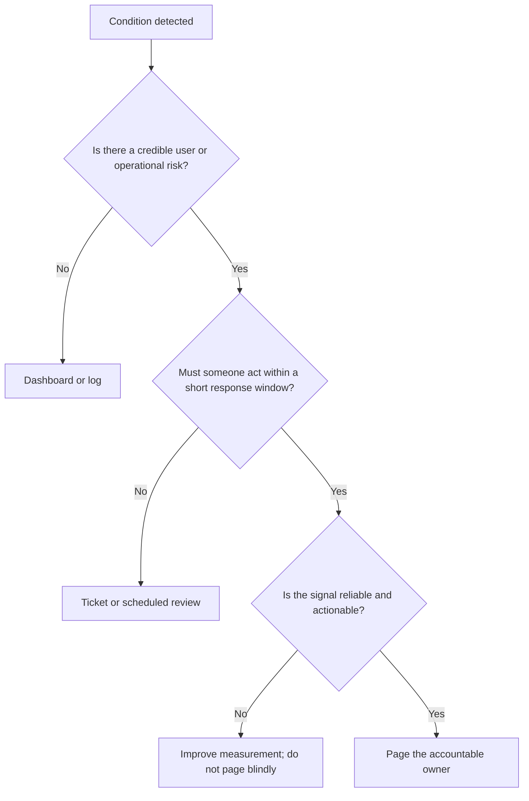

# Alert Quality, Noise Reduction, and Escalation Policies

> **Stage:** Stage 2E — Production DevOps & Platform Engineering  
> **Module:** M10 — Site Reliability Engineering and Incident Management  
> **Unit:** 3 — Alert quality, noise reduction, and escalation policies  
> **Exact target:** `03-alert-quality-noise-reduction-and-escalation-policies.md`  
> **Lab constraint:** synthetic data, local-only services, zero budget  
> **Truth labels:** `[ILLUSTRATIVE]` = teaching value, not a standard; `[ASSUMPTION]` = an example contract choice; `[VERIFY]` = verify against the installed version or primary source; `[NOT EXECUTED]` = command/config supplied but not run here; `[MEASURED BY LEARNER]` = capture the result from your own run.

This chapter develops an alerting system that helps a human or automation act before a meaningful reliability objective is missed. It connects alert rules to user impact, defines tests for healthy and unhealthy conditions, routes notifications to an accountable owner, and measures whether alerts are useful rather than merely frequent.

The chapter uses Prometheus and Alertmanager as the core examples. The local webhook pager is a simulator—not a commercial paging service and not a substitute for a staffed on-call rotation.

---

## 1. Learning Path, Prerequisites, and Safety

### 1.1 Outcomes

By completing this unit, you should be able to:

- Decide whether a condition should page someone, create a ticket, appear on a dashboard, or remain in logs.
- Separate user-visible symptom alerts from diagnostic cause alerts.
- Define an alert with an owner, severity, impact statement, runbook, and measurable trigger.
- Calculate error-budget burn rate and time to exhaustion under stated assumptions.
- Write and test Prometheus rules for error ratio, latency, relevant saturation, batch freshness, absent metrics, and watchdog signals.
- Configure Alertmanager routes, grouping, inhibition, silences, and notification templates.
- Simulate acknowledgement and escalation locally.
- Evaluate precision, recall, detection time, reset time, actionable-page rate, page-to-incident ratio, acknowledgement time, runbook coverage, and unowned alerts.
- Reduce alert noise using evidence without increasing missed incidents.
- Test the alert pipeline itself and identify correlated failure risks.
- Review alert quality without blaming responders for system-design problems.

### 1.2 Prerequisites

You should understand basic metrics, counters and gauges, HTTP services, YAML, PromQL fundamentals, and SLI/SLO/error-budget concepts from Unit 1. Unit 2 defines workload-specific reliability targets for batch, streaming, and inference; this chapter consumes those SLOs rather than recreating them.

The exact metric names and endpoints of the M08 FastAPI lab service are not established by this chapter’s supplied specification. Examples below use a consistent assumed metric contract. `[ASSUMPTION]` Map these names to the actual M08 service only after inspecting its real source and instrumentation.

### 1.3 Workspace and resource budget

Create a learner workspace outside the curriculum repository:

```text
alert-quality-lab/
├── README.md
├── versions.txt
├── prometheus/
│   ├── prometheus.yml
│   ├── rules.yml
│   └── tests/
├── alertmanager/
│   ├── alertmanager.yml
│   └── templates/
├── pager/
│   ├── app.py
│   └── tests/
├── evaluator/
│   ├── incidents.csv
│   ├── evaluate.py
│   └── tests/
├── alert-as-code/
│   ├── lint_alerts.py
│   ├── planted-defects/
│   └── tests/
├── cleanup/
│   ├── alerts.csv
│   ├── firing-history.csv
│   └── review.md
├── scorecard/
│   ├── metrics.csv
│   └── scorecard.py
└── evidence/
    ├── command-logs/
    ├── rule-test-results/
    ├── routing-tests/
    ├── alert-timings/
    └── review/
```

Core work should fit a laptop with approximately 4 CPU cores, 8 GB RAM, and 30 GB disk. Prefer an already available Docker or kind setup, but use the lighter local option. No cloud spend, paid alerting platform, real traffic, real credentials, SMS, or external chat/email integration is required. Grafana is optional.

Record actual versions in `versions.txt`; do not invent them:

```text
OS:
Python:
pytest:
Prometheus:
promtool:
Alertmanager:
amtool:
Date checked:
Commands used to inspect versions:
Unavailable tools:
Notes:
```

Useful version commands:

```bash
python --version
python -m pytest --version
prometheus --version
promtool --version
alertmanager --version
amtool --version
```

These commands are `[NOT EXECUTED]` here. Record `not installed` for missing commands.

### 1.4 Safety and reset rules

- Use synthetic incident histories and local-only endpoints.
- Never connect this lab to a production Alertmanager or webhook.
- Do not enter production credentials, tokens, personal data, or customer payloads.
- Keep chaos tests bounded and reversible. Any DNS/network fault must be isolated to the lab network.
- Save logs only after checking for secrets and local identity information.
- Stop local services and restore the healthy configuration after each drill.
- An offline Python replay can test arithmetic and policy logic, but cannot prove live Prometheus scraping, Alertmanager routing, or notification delivery.

---

## 2. What an Alert Is For

An alert is a decision signal that says a condition has crossed a threshold where a human or automation should act within a defined response window. A metric is an observation; a dashboard is a place to inspect observations; a log is an event record. None becomes a useful alert merely because it has a threshold.

A good alert answers five questions:

1. **What is wrong?** The condition is specific and stable.
2. **Who is affected?** It states or links to user/service impact.
3. **Why now?** The trigger represents an SLO risk, a real operational hazard, or an actionable precursor.
4. **Who acts?** It routes to a named team or accountable owner.
5. **What next?** It includes a safe first action and a runbook.

### 2.1 Symptom first, cause second

A **symptom alert** detects an impact such as an elevated error ratio or a freshness objective being violated. A **cause alert** detects a possible contributor such as CPU saturation, a failed dependency, or a pod restart.

For paging, prefer symptoms that directly indicate user harm. Cause alerts can be valuable when the cause reliably precedes impact and the receiver has a useful action. Otherwise, keep them diagnostic or ticket-level.

Example: “Prediction API error ratio exceeds the SLO-derived threshold” is usually more actionable than “CPU is above 80%.” High CPU may be harmless under some workloads; it becomes a page-worthy condition when evidence links it to user impact or a time-critical capacity risk.

### 2.2 Four golden signals

Latency, traffic, errors, and saturation are a useful starting framework:

- **Latency:** how long work takes, including slow requests rather than only averages.
- **Traffic:** demand rate, which helps distinguish low demand from a broken measurement path.
- **Errors:** failed or unacceptable outcomes according to the service contract.
- **Saturation:** how close a constrained resource is to its effective capacity.

They are not a universal checklist. Data systems also need freshness, coverage, correctness, queue age, and data-contract checks. Inference services may need feature freshness and fallback ratio. Use Unit 2’s workload-specific SLIs as the basis for those alerts.

### 2.3 Alert fatigue is a reliability problem

False positives, duplicate pages, missing context, unstable thresholds, severity inflation, and pages without a response path consume attention. Over time, responders may ignore alerts or normalize a constantly firing condition. That is a system-design problem, not a personal weakness.

False alarms and missed incidents are distinct failure classes. Reducing page count is not success if recall collapses and important incidents go undetected. Evaluate alert changes against both noise and missed-impact risk.

---

## 3. Page, Ticket, Dashboard, or Log

Use urgency and required response—not the name of the metric—to choose the notification class.

| Channel | Urgency | Required human action | Expected response | Example |
|---|---|---|---|---|
| Page | Immediate action is needed to protect users or prevent near-term SLO harm | Acknowledge and act now | Within a defined response window | Fast error-budget burn or confirmed API outage |
| Ticket | Work is needed, but it can wait for normal prioritization | Investigate or schedule remediation | Business-hours or team-agreed window | Slow budget burn, repeated non-urgent retry growth |
| Dashboard | Useful context, but no action is required merely because it changed | Inspect when investigating or reviewing | On demand | CPU trend, request distribution, queue throughput |
| Log | Detailed event evidence for diagnosis, audit, or analysis | Search when needed; not a page by itself | During investigation or routine analysis | Stack trace, individual validation failure |

### 3.1 Decision tree



A severe security or safety signal may have a separate escalation path. Do not bury it under ordinary service noise. Detailed security monitoring belongs in the security curriculum; this chapter’s rule is about preserving appropriate routing.

### 3.2 Example decision

A daily ETL freshness SLI is 90 minutes behind its normal baseline, but the consumer deadline is six hours away and the pipeline is recovering. This may justify a ticket or dashboard annotation, depending on the negotiated SLO. If the validated output has already passed its hard consumer deadline, the same signal may need a page. The metric alone does not determine urgency; impact and response window do.

---

## 4. Symptoms, Causes, and Alert Anatomy

### 4.1 Minimum alert contract

Every actionable alert should include:

- stable alert name;
- severity and bounded routing labels;
- service and owner/team;
- concise summary;
- detailed description with observed evidence;
- user-impact or SLO context;
- relevant time window and current value/threshold where meaningful;
- first safe action or diagnostic hint;
- runbook link;
- query/dashboard link if available;
- grouping/fingerprint context when supported;
- acknowledgement/escalation instructions for the local simulator.

A missing owner or runbook is a governance defect. It should not be concealed by a polished notification template.

### 4.2 Metric contract before PromQL

The following metric names are `[ASSUMPTION]` for the lab, not claims about the actual M08 service.

| Metric | Type | Labels | Units and meaning |
|---|---|---|---|
| `api_requests_total` | Counter | `service`, `route`, `result` | Requests by bounded outcome class |
| `api_request_duration_seconds_bucket` | Histogram | `service`, `route`, `le` | Cumulative request-duration buckets in seconds |
| `api_in_flight_requests` | Gauge | `service` | Current in-flight requests |
| `etl_last_successful_watermark_timestamp_seconds` | Gauge | `pipeline` | Unix timestamp of latest fully validated output watermark |
| `etl_expected_partitions` | Gauge | `pipeline` | Expected partitions for the evaluated run |
| `etl_valid_partitions` | Gauge | `pipeline` | Expected partitions that passed validation |
| `up` | Prometheus scrape-generated series | `job`, `instance` and configured labels | Whether a target scrape succeeded |
| `alert_pipeline_watchdog` | Gauge | none or tightly bounded labels | Local synthetic heartbeat/watchdog signal; contract depends on the implementation |

Do not label metrics with raw user IDs, request IDs, event IDs, arbitrary URL paths, or unbounded exception strings. High-cardinality labels can make the monitoring system itself expensive and unreliable.

### 4.3 Alert rule anatomy

A Prometheus alerting rule generally uses `alert`, `expr`, optional `for`, `labels`, and `annotations`. Exact syntax is version-sensitive and must be checked against the installed Prometheus documentation `[VERIFY]`.

- `expr` defines the condition.
- `for` requires the condition to remain active for a duration before the alert fires; it reduces transient noise but adds detection delay.
- `labels` add stable classification and routing metadata.
- `annotations` add human-readable context.

The rule lifecycle commonly includes inactive, pending, and firing states; resolved notifications and Alertmanager behavior depend on the full configuration. Verify exact version semantics before production use.

Example alert anatomy:

```yaml
- alert: ApiHighErrorRatio
  expr: |
    sum(rate(api_requests_total{service="inference",result="error"}[5m]))
    /
    clamp_min(sum(rate(api_requests_total{service="inference"}[5m])), 1)
    > 0.02
  for: 2m
  labels:
    severity: page
    team: ml-platform
    service: inference
  annotations:
    summary: "Inference API error ratio is elevated"
    description: "The observed error ratio is above the configured threshold; verify request volume, dependencies, and recent changes."
    runbook_url: "https://example.invalid/runbooks/inference-errors"
```

This is an example contract, not a verified service rule. The threshold is `[ILLUSTRATIVE]`, and `clamp_min` does not make a zero-traffic period healthy. Add independent no-traffic/missing-series handling. Replace the example.invalid link with a real local or repository runbook before using the rule.

---

## 5. Prometheus Alerting and Alertmanager Foundations

Prometheus evaluates alerting rules against time series. Alertmanager receives firing alerts and applies routing, grouping, inhibition, silence, and receiver configuration. The rule decides that a condition is active; Alertmanager decides how notifications are grouped and delivered.

### 5.1 Alertmanager concepts

- **Receiver:** a notification destination, such as a local webhook in this lab.
- **Route:** selects a receiver using labels and route hierarchy.
- **Grouping:** combines alerts that share selected labels to reduce a page storm.
- **Inhibition:** suppresses notifications for one alert when a configured source alert is firing and label-matching conditions hold.
- **Silence:** suppresses matching alerts for a defined period, ideally with an owner and reason.
- **Template:** formats notification fields.

Fields such as `group_by`, `group_wait`, `group_interval`, `repeat_interval`, route matching, `continue`, inhibition matching, and silence behavior are version-sensitive; consult the official Alertmanager documentation for the installed version `[VERIFY]`. Do not assume route order or `continue` behavior without testing the actual config.

### 5.2 Minimal rule file

`prometheus/rules.yml`:

```yaml
groups:
  - name: service-slo-alerts
    interval: 30s
    rules:
      - alert: ApiHighErrorRatio
        expr: |
          sum(rate(api_requests_total{service="inference",result="error"}[5m]))
          /
          clamp_min(sum(rate(api_requests_total{service="inference"}[5m])), 1)
          > 0.02
        for: 2m
        labels:
          severity: page
          team: ml-platform
          service: inference
        annotations:
          summary: "Inference API error ratio is elevated"
          description: "Check the service SLO, request volume, and recent dependency changes."
          runbook_url: "https://example.invalid/runbooks/inference-errors"

      - alert: BatchWatermarkTooOld
        expr: |
          time() - etl_last_successful_watermark_timestamp_seconds{pipeline="daily-orders"} > 7200
        for: 2m
        labels:
          severity: ticket
          team: data-platform
          service: daily-orders
        annotations:
          summary: "Daily orders watermark is too old"
          description: "Check the expected schedule, source arrivals, job result, and validation status."
          runbook_url: "https://example.invalid/runbooks/batch-freshness"

      - alert: BatchWatermarkMissing
        expr: absent(etl_last_successful_watermark_timestamp_seconds{pipeline="daily-orders"})
        for: 2m
        labels:
          severity: page
          team: data-platform
          service: daily-orders
        annotations:
          summary: "Expected batch watermark metric is missing"
          description: "Check the expected pipeline, exporter, and scrape path."
          runbook_url: "https://example.invalid/runbooks/batch-missing-metric"
```

The `0.02`, `7200`, and durations are `[ILLUSTRATIVE]`. The batch alert assumes the pipeline is expected to have a watermark at the time of evaluation. If a healthy state legitimately has no series, this rule needs a separate expected-run signal. `absent()` means the matching series is missing; it does not prove why.

### 5.3 `up == 0` and absent-series patterns

`up == 0` indicates a scrape target is down. It does not detect a service that is scraped successfully but does no useful work. `absent(metric)` can detect a missing series, but only if you know that the series should exist. For a dead pipeline, pair expected-run schedule/heartbeat data with watermark age and output validation.

Never equate “no data” with “zero errors.” No traffic, a scrape failure, a renamed metric, and a healthy idle service can look similar unless the metric contract distinguishes them.

### 5.4 Saturation only when actionable

A raw “CPU above threshold” alert is usually a weak page because it may not imply user harm. A saturation signal becomes useful when it predicts an SLO breach or a resource limit that needs timely intervention. Pair it with queue growth, request latency, rejected work, or another user-impact signal and provide an action path.

---

## 6. Designing Alerts from SLOs and Error Budgets

### 6.1 Error budget and burn rate

For an SLO target \(S\), the allowed bad-event fraction is:

\[
E = 1 - S
\]

If the SLO is 99.9% `[ILLUSTRATIVE]`, then \(E = 0.001\), or 0.1% bad eligible events.

Burn rate is:

\[
B = \frac{\text{observed bad-event fraction}}{\text{allowed bad-event fraction}}
\]

If the observed bad-event fraction is 0.5% `[ILLUSTRATIVE]`, then \(B = 0.005/0.001 = 5\). At a constant burn rate of 5, budget is consumed five times as fast as the SLO allows on average.

For a 30-day window `[ILLUSTRATIVE]`, time-to-exhaustion under a constant burn-rate assumption is approximately:

\[
T_{\text{exhaust}} = \frac{30\text{ days}}{B}
\]

At burn rate 5, this is 6 days. This is a simplified projection, not a promise: burn rate changes over time, event populations vary, and the calculation assumes a stable budget definition.

### 6.2 Budget consumption during an observation window

If a window of length \(w\) has burn rate \(B\), the approximate fraction of the full SLO-window budget consumed during that window is:

\[
C \approx B \times \frac{w}{W}
\]

where \(W\) is the full SLO window. For a 30-day SLO window and a 1-hour observation window, \(w/W = 1/720\). At burn rate 6, the approximate budget consumption during that hour is \(6/720 \approx 0.83\%\) `[ILLUSTRATIVE]`.

This approximation assumes the observed burn rate applies throughout the observation window. A short spike may not persist, which is why alert strategies often combine a longer window with a shorter confirmation window.

### 6.3 Fast-burn page vs slow-burn ticket

A fast-burn alert indicates the service may be consuming its budget quickly enough that immediate action is warranted. A slower burn may justify a ticket or scheduled investigation before it becomes a page. This is a starting strategy, not an absolute policy: the response depends on user harm, the SLO window, workload volume, and team capabilities.

Google’s SRE Workbook includes published starting-point guidance for multi-window burn-rate alerting. The exact published table is `[VERIFY]` unless the relevant primary page has been consulted. This chapter therefore teaches the calculation method and uses only illustrative thresholds below.

### 6.4 Multi-window, multi-burn-rate logic

A multi-window strategy uses a longer window to establish sustained budget consumption and a shorter window to confirm that the problem is still occurring. This can reduce false positives from a brief spike while preserving faster detection. Exact windows and burn thresholds must be chosen and tested for the service.

Illustrative PromQL concept:

```promql
(
  sum(rate(api_requests_total{service="inference",result="error"}[1h]))
  /
  clamp_min(sum(rate(api_requests_total{service="inference"}[1h])), 1)
) > 0.05
and
(
  sum(rate(api_requests_total{service="inference",result="error"}[5m]))
  /
  clamp_min(sum(rate(api_requests_total{service="inference"}[5m])), 1)
) > 0.05
```

This checks an illustrative error-ratio threshold across a long and short window; it is not a complete burn-rate policy unless the threshold is derived from the SLO’s allowed bad-event fraction. Both ranges need enough samples, and low traffic can make ratios noisy. The metric contract must define what counts as an error. Do not copy these numbers into production.

### 6.5 Example page vs ticket

- **Page:** a confirmed fast error-budget burn with elevated user-facing errors, enough traffic to trust the signal, a named owner, and a runbook action.
- **Ticket:** a slow increase in batch freshness age while the pipeline remains comfortably before the consumer deadline, provided that the SLO and operational policy support a non-paging response.
- **Dashboard/log only:** CPU rises briefly but request latency, errors, queue age, and SLOs remain healthy and there is no action to take.

### 6.6 Workload-specific alert inputs

Reuse Unit 2’s SLOs rather than alerting on arbitrary infrastructure metrics:

- **Inference:** error ratio, latency threshold ratio, fallback ratio, feature freshness/validity, and quality proxy where appropriate.
- **Batch/ETL:** validated watermark age, expected-versus-valid partitions, correctness failures, deadline status, and expected-run heartbeat.
- **Streaming:** oldest pending event age, end-to-end latency, throughput imbalance, duplicate/loss indicators, and explicit replay context.

Each alert must state whether the signal is an SLO breach, an early warning, or a diagnostic cause.

---

## 7. Noise Reduction and Flapping Control

### 7.1 Common noise sources

- **False positive:** alert fires but the condition is not a meaningful incident or risk.
- **Duplicate alert:** multiple rules/tools page for the same underlying problem.
- **Flapping:** condition repeatedly enters and exits the firing state.
- **No-action alert:** nobody can identify a safe response.
- **Missing context:** responder must reconstruct service, owner, query, and runbook.
- **Severity inflation:** everything becomes a page, so severity stops communicating urgency.
- **Stale ownership:** labels point to a team or receiver that no longer exists.
- **Metric drift:** a rename or label change silently breaks the expression or routing.

### 7.2 Techniques and trade-offs

| Technique | Helps with | Risk or trade-off |
|---|---|---|
| Increase `for` | Short transient spikes | Adds detection delay; may miss brief but harmful incidents |
| Short-window confirmation | Avoids paging on a long-window average after recovery | Requires enough samples and correct expression logic |
| Aggregate before alerting | Reduces per-instance page storms | Can hide a single critical tenant/route if aggregation is too broad |
| Rate-of-change alert | Detects rapid deterioration | Noisy when the baseline is sparse or seasonal |
| Group/deduplicate | Combines related alerts | Poor grouping can hide distinct incidents |
| Inhibition | Suppresses downstream symptoms during a known root cause | Over-inhibition can hide the only actionable alert |
| Time-boxed silence | Allows planned maintenance | Broad or forgotten silences create blind spots |
| Hysteresis | Reduces repeated state toggling | Needs a defined reset condition and can delay recovery notification |
| Demote/delete | Removes non-actionable pages | Requires evidence that recall and incident detection remain acceptable |

### 7.3 Flapping example

Suppose a synthetic error ratio alternates between 1.9% and 2.1% every evaluation while the threshold is 2.0% `[ILLUSTRATIVE]`. A rule with no persistence requirement may repeatedly fire and resolve. A `for` duration can suppress brief transitions, but a long duration may delay detection of a real outage. Test both the healthy and fault cases rather than tuning only against noise.

### 7.4 Noise cleanup principle

Do not simply optimize for fewer pages. For every proposed change, state:
- which false pages it removes;
- which true incidents it might delay or miss;
- what test or labelled history supports the change;
- what rollback criterion would trigger if detection quality degrades.

---

## 8. Routing, Grouping, Inhibition, Silences, and Templates

### 8.1 Example Alertmanager configuration

`alertmanager/alertmanager.yml`:

```yaml
global:
  resolve_timeout: 5m

route:
  receiver: local-default
  group_by: ["alertname", "service", "team"]
  group_wait: 10s
  group_interval: 1m
  repeat_interval: 4h
  routes:
    - matchers:
        - severity="page"
        - team="ml-platform"
      receiver: local-ml-page
    - matchers:
        - severity="ticket"
        - team="data-platform"
      receiver: local-data-ticket

receivers:
  - name: local-default
    webhook_configs:
      - url: "http://127.0.0.1:8088/alerts"
        send_resolved: true
  - name: local-ml-page
    webhook_configs:
      - url: "http://127.0.0.1:8088/alerts"
        send_resolved: true
  - name: local-data-ticket
    webhook_configs:
      - url: "http://127.0.0.1:8088/alerts"
        send_resolved: true

inhibit_rules:
  - source_matchers:
      - alertname="ApiHighErrorRatio"
    target_matchers:
      - alertname="ApiHighLatency"
    equal: ["service", "team"]
```

This is a minimal illustrative configuration. Verify the exact matcher syntax, route behavior, field availability, and validation against the installed Alertmanager version `[VERIFY]`. A default receiver is a safety net, but a local webhook that logs all messages is not equivalent to a production escalation destination. Do not assume route order/`continue` semantics; test the actual configuration.

The inhibition example is intentionally narrow. If the error alert fires but the latency alert is the only one with actionable evidence, over-inhibition could suppress useful information. Test both the intended suppression and the case where the source alert is absent.

### 8.2 Grouping

Grouping by `alertname`, `service`, and `team` can combine many related alert instances into one notification. Grouping too broadly can combine unrelated incidents; grouping too narrowly can create a page storm. Use bounded labels that represent operational ownership and shared cause.

### 8.3 Silences

A silence should have:
- a narrow matcher;
- start and end time;
- owner;
- reason/change reference;
- review or expiry expectation.

Avoid casually creating a wildcard matcher such as `.*` across all alerts. It can hide an unrelated incident during maintenance. After a maintenance window, verify the silence expired and confirm that expected alerts can fire again.

### 8.4 Notification template contract

A useful payload should include:
- alert name and severity;
- service and team/owner;
- impact or SLO/budget context;
- observed value and threshold;
- window and firing time;
- first safe action;
- runbook and query/dashboard links;
- fingerprint/group context if available;
- acknowledgement/escalation instructions for the local simulator.

Template syntax is version-sensitive `[VERIFY]`. Do not put secrets, tokens, raw user IDs, or unbounded log payloads in notifications.

### 8.5 Routing test

If `amtool` is installed, use the route-test command supported by that version. `amtool config routes test` is a candidate command, but exact syntax/flags are `[VERIFY]`; inspect `amtool --help` and the official docs. A manual alternative is to send synthetic payloads to the local receiver and inspect the route decision using the configuration’s supported validation tools. Never claim a route test passed unless you actually ran it.

---

## 9. Escalation Policies and the Local Pager Simulator

### 9.1 Escalation model

A local exercise can simulate:

1. notification to primary;
2. acknowledgement;
3. escalation to secondary if the acknowledgement timeout expires;
4. escalation to incident commander/manager or designated destination if still unacknowledged;
5. cancellation/resolution;
6. deduplication for repeated alert fingerprints.

The exact acknowledgement times are `[ILLUSTRATIVE]` and should be agreed with the real service and rotation. Unit 4 owns detailed incident command; Unit 10 owns sustainable rotation design. This chapter focuses on the mechanics and testing of routing/escalation.

### 9.2 Minimal local webhook pager

`pager/app.py`:

```python
#!/usr/bin/env python3
"""Local-only alert receiver and deterministic escalation-state simulator."""

from http.server import BaseHTTPRequestHandler, HTTPServer
import json
import threading
import time

HOST = "127.0.0.1"
PORT = 8088
LOCK = threading.Lock()
ALERTS = {}


def ingest(payload, now=None):
    now = time.monotonic() if now is None else now
    if not isinstance(payload, dict):
        raise ValueError("payload must be a JSON object")
    fingerprint = payload.get("fingerprint")
    if not isinstance(fingerprint, str) or not fingerprint:
        raise ValueError("fingerprint is required")
    status = payload.get("status", "firing")
    if status not in {"firing", "resolved"}:
        raise ValueError("status must be firing or resolved")

    with LOCK:
        if status == "resolved":
            previous = ALERTS.get(fingerprint, {})
            previous.update({"status": "resolved", "resolved_at": now})
            ALERTS[fingerprint] = previous
            return {"accepted": True, "deduplicated": False, "state": previous}

        if fingerprint in ALERTS and ALERTS[fingerprint].get("status") == "firing":
            ALERTS[fingerprint]["repeat_count"] += 1
            return {"accepted": True, "deduplicated": True, "state": ALERTS[fingerprint]}

        state = {
            "fingerprint": fingerprint,
            "status": "firing",
            "received_at": now,
            "acknowledged": False,
            "acknowledged_at": None,
            "escalation_level": "primary",
            "repeat_count": 1,
        }
        ALERTS[fingerprint] = state
        return {"accepted": True, "deduplicated": False, "state": state}


def acknowledge(fingerprint, now=None):
    now = time.monotonic() if now is None else now
    with LOCK:
        if fingerprint not in ALERTS:
            raise KeyError(fingerprint)
        ALERTS[fingerprint]["acknowledged"] = True
        ALERTS[fingerprint]["acknowledged_at"] = now
        return dict(ALERTS[fingerprint])


def advance_escalation(now=None, primary_timeout=60, secondary_timeout=120):
    """Advance states using a supplied clock; tests can avoid sleeping."""
    now = time.monotonic() if now is None else now
    changes = []
    with LOCK:
        for state in ALERTS.values():
            if state["status"] != "firing" or state["acknowledged"]:
                continue
            age = now - state["received_at"]
            old = state["escalation_level"]
            if age >= secondary_timeout:
                state["escalation_level"] = "incident_commander"
            elif age >= primary_timeout:
                state["escalation_level"] = "secondary"
            if old != state["escalation_level"]:
                changes.append((state["fingerprint"], state["escalation_level"]))
    return changes


class Handler(BaseHTTPRequestHandler):
    def do_POST(self):
        if self.path != "/alerts":
            self.send_error(404)
            return
        try:
            length = int(self.headers.get("Content-Length", "0"))
            if length <= 0 or length > 1_000_000:
                self.send_error(400, "invalid body length")
                return
            payload = json.loads(self.rfile.read(length))
            result = ingest(payload)
            body = json.dumps(result, default=str).encode()
            self.send_response(200)
            self.send_header("Content-Type", "application/json")
            self.send_header("Content-Length", str(len(body)))
            self.end_headers()
            self.wfile.write(body)
        except (ValueError, json.JSONDecodeError) as exc:
            self.send_error(400, str(exc))

    def log_message(self, fmt, *args):
        print("pager:", fmt % args)


if __name__ == "__main__":
    print(f"Local-only receiver at http://{HOST}:{PORT}/alerts")
    HTTPServer((HOST, PORT), Handler).serve_forever()
```

**Purpose:** accept local webhook payloads, deduplicate repeated firing alerts by fingerprint, mark resolution, and expose deterministic state-transition functions for tests. This server does not implement authentication, durable storage, concurrency guarantees suitable for production, real notifications, or a background escalation scheduler. It binds only to loopback.

Run from the lab root:

```bash
python pager/app.py
```

In another terminal:

```bash
curl -sS -X POST http://127.0.0.1:8088/alerts \
  -H 'Content-Type: application/json' \
  -d '{"fingerprint":"demo-1","status":"firing","alertname":"ApiHighErrorRatio"}'
```

Expected output shape: JSON containing `accepted`, `deduplicated`, and a state with `fingerprint`, `status`, `acknowledged`, `escalation_level`, and `repeat_count`. The command is `[NOT EXECUTED]`. Stop the server with Ctrl+C.

### 9.3 Unit tests

`pager/tests/test_app.py`:

```python
import pytest
from pager.app import ALERTS, acknowledge, advance_escalation, ingest


@pytest.fixture(autouse=True)
def reset_state():
    ALERTS.clear()
    yield
    ALERTS.clear()


def test_ingest_and_deduplicate():
    first = ingest({"fingerprint": "a", "status": "firing"}, now=10)
    second = ingest({"fingerprint": "a", "status": "firing"}, now=11)
    assert first["deduplicated"] is False
    assert second["deduplicated"] is True
    assert ALERTS["a"]["repeat_count"] == 2


def test_acknowledgement_prevents_escalation():
    ingest({"fingerprint": "b", "status": "firing"}, now=10)
    acknowledge("b", now=20)
    assert advance_escalation(now=500) == []


def test_escalation_is_deterministic():
    ingest({"fingerprint": "c", "status": "firing"}, now=10)
    assert advance_escalation(now=71, primary_timeout=60, secondary_timeout=120) == [
        ("c", "secondary")
    ]
    assert advance_escalation(now=131, primary_timeout=60, secondary_timeout=120) == [
        ("c", "incident_commander")
    ]


def test_resolution_changes_status():
    ingest({"fingerprint": "d", "status": "firing"}, now=10)
    ingest({"fingerprint": "d", "status": "resolved"}, now=20)
    assert ALERTS["d"]["status"] == "resolved"


def test_malformed_payload_is_rejected():
    with pytest.raises(ValueError):
        ingest({"status": "firing"}, now=10)
```

Run `python -m pytest -q pager/tests`. Tests are `[NOT EXECUTED]`. If imports fail, add an empty `pager/__init__.py` and run from the workspace root.

### 9.4 Escalation policy exercise

Use a deterministic clock in tests:
- primary acknowledgement timeout: 60 seconds `[ILLUSTRATIVE]`;
- secondary acknowledgement timeout/next escalation: 120 seconds `[ILLUSTRATIVE]`;
- resolution cancels future escalation;
- duplicate fingerprints increment a repeat count rather than create a new simulated page.

The sample functions simulate state transitions only when called; they do not schedule real timers. A learner can build a bounded loop around `advance_escalation`, but must document that it is a local demonstration. Never use this simulator as the only notification path for a real incident.

---

## 10. Alert Quality Measurement and Review

Alert quality should be measured with explicit labels and denominators. Do not optimize a single score at the expense of missed incidents.

### 10.1 Core metrics

- **True positive (TP):** an alert fires for a labelled incident within the defined detection window.
- **False positive (FP):** an alert fires when no corresponding incident/risk is labelled for that window.
- **True negative (TN):** no alert fires during a labelled healthy interval.
- **False negative (FN):** a labelled incident occurs but the candidate rule does not alert within the defined window.

Precision:

\[
\text{precision} = \frac{TP}{TP+FP}
\]

Recall:

\[
\text{recall} = \frac{TP}{TP+FN}
\]

If the denominator is zero, report the metric as undefined rather than silently setting it to 0 or 1.

- **Time to detect (TTD):** alert firing time minus incident start time. State whether the alert must be within the incident’s labelled impact window.
- **Reset/recovery time:** time from alert firing or incident recovery (define which) until the alert resolves or the service returns to the declared healthy condition.
- **Actionable-alert percentage:** actionable alert instances / reviewed alert instances.
- **Page-to-incident ratio:** pages associated with incidents divided by incident count, with a clear association rule.
- **Mean time to acknowledge (MTTA):** mean acknowledgement timestamp minus notification timestamp for acknowledged pages; report unacknowledged pages separately rather than omitting them without comment.
- **Runbook coverage:** alerts with valid runbook links / alerts reviewed.
- **Unowned-alert count:** number of alerts without a valid owner/team.
- **Noise ratio:** define locally; one possible form is false-positive page instances / all page instances. Do not compare teams unless they use the same definition.

### 10.2 Why precision and recall trade off

Increasing a `for` duration may reduce transient false positives but delay detection. A high threshold may improve precision while missing moderate but important incidents. A low threshold may catch more incidents but create noise. Evaluate candidate windows against labelled synthetic data and then validate in a live local lab; replay results may not match live rule evaluation because scrape intervals, counter resets, data gaps, and rule timing differ.

### 10.3 Alert lifecycle

1. Create with owner, severity, action, and runbook.
2. Define metric contract and user risk.
3. Validate rule syntax.
4. Test healthy and fault fixtures.
5. Test route and receiver coverage.
6. Deploy as code.
7. Review firing history and incidents.
8. Tune, demote, group, or delete with evidence.
9. Retire stale rules and update ownership.

Alert-as-code CI is a focused example of the broader M08 CI/GitOps workflow; it does not replace that module.

---

## 11. Lab A — SLO-Based Rules and Promtool Test Suites

### Objective

Create a compact set of symptom-first alert rules and test firing, non-firing, flapping, low/no-data, absent-series, and stale-metric behavior.

### Files and prerequisites

```text
prometheus/rules.yml
prometheus/tests/rules_test.yml
prometheus/versions.txt
```

Prerequisites: Prometheus and `promtool` installed locally. If unavailable, complete the offline evaluator in Lab B and mark live rule testing unverified.

### 11.1 Rules to include

Use the metric contract in Section 4.2. Required rules:
- high error ratio;
- high latency;
- saturation only if linked to a credible SLO risk;
- batch freshness violation;
- absent metric/dead pipeline;
- watchdog/meta-monitoring signal;
- at least one slow-burn and one fast-burn rule based on the SLO’s allowed bad-event fraction.

Use a rule `for` duration to suppress brief noise, but test whether the delay still meets the service’s detection objective. Include a healthy baseline that does not fire and a deliberately oscillating series that demonstrates flapping.

### 11.2 Rule validation

```bash
promtool check rules prometheus/rules.yml
```

`promtool check rules` validates rule syntax supported by the installed version. The command is `[NOT EXECUTED]`. Expected result shape: a success message if valid, or a parse/validation error with file and line context if invalid.

For unit testing:

```bash
promtool test rules prometheus/tests/rules_test.yml
```

The exact rule-test YAML schema and accepted fields are `[VERIFY]` against the installed Prometheus version’s official unit-testing documentation. Do not copy a test fixture from another version without checking it.

### 11.3 Test design checklist

The test suite should prove:
- healthy error ratio does not fire;
- sustained error ratio does fire after the `for` period;
- a brief spike resolves or remains pending without a page;
- high latency fires under the intended condition;
- freshness age exceeds its threshold when the watermark is old;
- absent expected watermark is detected;
- a stale but present watermark triggers age-based detection;
- a healthy watchdog state is distinguishable from a missing watchdog;
- low traffic does not create a misleading error ratio;
- label changes are caught by a policy/test or cause a deliberately planted failure.

The exact fixture syntax is version-specific `[VERIFY]`. Expected result: the test runner reports the test cases that passed or identifies failing alert states. No successful test output is claimed.

### 11.4 Troubleshooting, reset, evidence

- If a rule never fires, inspect metric names, labels, sample timestamps, scrape interval, `for`, and expression output.
- If a rule fires during healthy idle periods, separate no-traffic from no-metric behavior.
- If a rule fires too late, reduce unnecessary confirmation only after evaluating false-positive risk.
- If the series disappears after a rename, update the metric contract and add a regression test.
- Reset by restoring the healthy fixture and re-running tests.

Evidence:
- [ ] actual tool versions;
- [ ] rule validation output;
- [ ] test output for healthy and fault fixtures;
- [ ] threshold/window rationale;
- [ ] unresolved `[VERIFY]` items listed.

---

## 12. Lab B — Fault Injection and Detection-Quality Evaluation

### Objective

Compare candidate alert policies using labelled synthetic incidents. Calculate TP, FP, TN, FN, precision, recall, time to detect, and reset time. Do not fabricate measured performance.

### Files

```text
evaluator/incidents.csv
evaluator/evaluate.py
evaluator/tests/test_evaluate.py
```

### 12.1 Labelled synthetic data

`evaluator/incidents.csv`:

```csv
timestamp_minute,incident_id,incident_type,incident_active,error_ratio,latency_ms,expected_alert
0,,healthy,false,0.001,80,false
1,,healthy,false,0.002,85,false
2,inc-1,error_spike,true,0.060,90,true
3,inc-1,error_spike,true,0.070,100,true
4,inc-1,error_spike,true,0.050,95,true
5,,healthy,false,0.002,90,false
6,,healthy,false,0.001,88,false
7,inc-2,slow_burn,true,0.012,110,true
8,inc-2,slow_burn,true,0.015,115,true
9,inc-2,slow_burn,true,0.018,120,true
10,,healthy,false,0.002,90,false
11,inc-3,latency_regression,true,0.003,450,true
12,inc-3,latency_regression,true,0.004,500,true
13,,healthy,false,0.002,95,false
14,inc-4,total_outage,true,1.000,0,true
15,inc-4,total_outage,true,1.000,0,true
16,,healthy,false,0.001,85,false
17,inc-5,pipeline_stall,true,0.001,80,true
18,inc-5,pipeline_stall,true,0.001,80,true
19,,healthy,false,0.002,90,false
```

All values are `[ILLUSTRATIVE]`. These are minute-indexed synthetic observations, not production evidence. The pipeline stall is represented by a separate incident label because request error ratio and latency do not capture it.

### 12.2 Evaluator

`evaluator/evaluate.py`:

```python
#!/usr/bin/env python3
import csv
import json
from pathlib import Path


def evaluate(path, error_threshold=0.02, latency_threshold_ms=300):
    rows = list(csv.DictReader(Path(path).open(newline="", encoding="utf-8")))
    tp = fp = tn = fn = 0
    detections = {}
    last_alert = None
    reset_times = []

    for row in rows:
        minute = int(row["timestamp_minute"])
        incident = row["incident_active"].lower() == "true"
        error = float(row["error_ratio"])
        latency = float(row["latency_ms"])
        # Candidate policy A: simple symptom threshold.
        predicted = error > error_threshold or latency > latency_threshold_ms
        if incident and predicted:
            tp += 1
            incident_id = row["incident_id"]
            if incident_id and incident_id not in detections:
                detections[incident_id] = minute
        elif predicted and not incident:
            fp += 1
        elif not predicted and not incident:
            tn += 1
        else:
            fn += 1

        if predicted:
            last_alert = minute
        elif last_alert is not None:
            reset_times.append(minute - last_alert)
            last_alert = None

    precision = tp / (tp + fp) if tp + fp else None
    recall = tp / (tp + fn) if tp + fn else None

    incident_starts = {}
    for row in rows:
        if row["incident_id"]:
            incident_starts.setdefault(row["incident_id"], int(row["timestamp_minute"]))
    ttd = {
        incident_id: detections[incident_id] - start
        for incident_id, start in incident_starts.items()
        if incident_id in detections
    }

    return {
        "policy": "error_ratio_or_latency_threshold",
        "tp": tp, "fp": fp, "tn": tn, "fn": fn,
        "precision": precision, "recall": recall,
        "time_to_detect_minutes_by_incident": ttd,
        "reset_intervals_minutes": reset_times,
        "note": "Pipeline-stall incidents need a pipeline-specific signal; this policy cannot detect them from API metrics alone."
    }


if __name__ == "__main__":
    print(json.dumps(evaluate("evaluator/incidents.csv"), indent=2))
```

**Purpose:** evaluate a simple candidate rule on the synthetic table. This is an educational confusion-matrix evaluator, not a full time-series alert engine: it does not simulate Prometheus scrape timing, `for`, rule evaluation, or Alertmanager delivery. The reset interval is a simple gap between predicted and non-predicted samples, not a production MTTR measure.

Run:

```bash
python evaluator/evaluate.py
```

Expected output shape: counts for TP/FP/TN/FN, precision/recall values, a per-incident detection-delay map, reset intervals, and a limitation note. Exact values can be computed from the supplied CSV, but the script is `[NOT EXECUTED]` here. The learner should label actual output `[MEASURED BY LEARNER]`.

### 12.3 Required comparisons

Implement and compare at least:
- Policy A: short-window threshold;
- Policy B: same threshold with a persistence/confirmation rule;
- Policy C: symptom alert plus separate pipeline freshness/heartbeat alert.

Use the same labelled incident definitions and report:
- confusion matrix;
- precision and recall;
- time-to-detect by incident;
- reset interval and definition;
- incidents not detectable from the selected metric;
- changes to thresholds/windows and their trade-offs.

### 12.4 Live-vs-replay caveat

Offline replay can test arithmetic and policy assumptions. Live Prometheus results may differ because counters reset, scrape intervals vary, samples are missing, `for` requires persistence, and Alertmanager adds grouping/delivery delays. Run both when possible and report the difference rather than treating one as proof of the other.

Troubleshooting:
- Ensure incident labels are independent of the candidate rule’s output.
- Do not count each minute of a single incident as a separate incident-level TP when computing incident recall; document whether metrics are sample-level or incident-level.
- If a pipeline stall is not represented by API metrics, add a pipeline SLI rather than tuning the API threshold.

Evidence:
- [ ] input CSV saved;
- [ ] evaluator test output saved;
- [ ] all candidate policies compared;
- [ ] actual results labelled `[MEASURED BY LEARNER]`;
- [ ] false-negative risks and measurement limitations explained.

---

## 13. Lab C — Alertmanager Routing, Inhibition, and Silences

### Objective

Route synthetic alerts by team/severity/service, verify default-route behavior, test grouping and inhibition, create a narrow time-boxed silence, and repair a planted misroute.

### Files

```text
alertmanager/alertmanager.yml
alertmanager/templates/notification.tmpl
pager/app.py
```

Use the local receiver from Lab D or a simple receiver that logs JSON. Keep it bound to loopback.

### 13.1 Routing contract

For each alert payload, document expected destination:
- `team=ml-platform`, `severity=page` → local ML page receiver;
- `team=data-platform`, `severity=ticket` → local data ticket receiver;
- missing/unrecognized team → default receiver and an explicit routing-defect review.

The default route is a safety net, not an acceptable final destination for important production alerts. A catch-all receiver that silently drops notifications is not a safe default.

### 13.2 Plant a defect

Change the team label on `ApiHighErrorRatio` to `ml-platfrom` (misspelled) `[ILLUSTRATIVE]`. Send a synthetic alert and inspect the route result or local receiver log. Correct the label and add a CI policy check that every team label maps to a configured receiver. A route test should prove both the correct route and the fallback for unknown teams.

### 13.3 Inhibition and over-inhibition

Use a narrow rule that suppresses a downstream symptom only when a known root-cause alert is firing and service/team labels match. Test:
1. root cause active and downstream symptom active → downstream notification is inhibited as designed;
2. root cause absent → downstream symptom is not suppressed;
3. source alert mislabels team/service → inhibition does not silently suppress an unrelated alert;
4. the source alert itself is the only actionable signal → it remains visible.

Inhibition is not a substitute for grouping. Over-broad matching can hide the only useful alert.

### 13.4 Silence workflow

Create a time-limited silence for one service and one alert name. Record owner, reason, start, end, and change reference. Then verify:
- only the intended alert is silenced;
- unrelated alerts still reach the receiver;
- the silence expires;
- the expected alert can fire after expiry.

Use `amtool` only after checking the installed version and exact command syntax `[VERIFY]`. Do not use a broad `.*` matcher as a maintenance shortcut.

### 13.5 Expected output and troubleshooting

Expected evidence includes a route-test result or receiver log showing alert fingerprint, labels, selected simulated destination, and whether a notification was received. These results are `[MEASURED BY LEARNER]`; no live route has been tested here.

If notifications disappear, check route order, label spelling, default receiver, `continue` semantics, inhibition equal-label sets, silence matchers, receiver reachability, and Alertmanager logs. Teardown by restoring the correct team label and removing the test silence after capturing evidence.

---

## 14. Lab D — Local Escalation Simulator

### Objective

Test primary notification, acknowledgement, secondary escalation, incident-commander escalation, resolution, deduplication, and malformed payload behavior without external services.

### Prerequisites and files

Use `pager/app.py` and `pager/tests/test_app.py` from Section 9. Python and pytest are sufficient. The simulator uses deterministic functions in unit tests instead of sleeping for long timeouts.

### Procedure

1. Start the local receiver on loopback.
2. Send a synthetic firing payload with a stable fingerprint.
3. Send the same fingerprint again and verify deduplication.
4. Acknowledge an alert and verify no later escalation occurs.
5. In tests, advance a deterministic clock beyond the primary timeout and then the next escalation threshold.
6. Send a resolved payload and verify the state is marked resolved.
7. Send malformed JSON or a payload without a fingerprint and verify it is rejected.
8. Stop the receiver and confirm the client sees connection failure; then restart it and verify recovery.

Example request:

```bash
curl -sS -X POST http://127.0.0.1:8088/alerts \
  -H 'Content-Type: application/json' \
  -d '{"fingerprint":"lab-alert-01","status":"firing","alertname":"ApiHighErrorRatio"}'
```

Expected output: JSON with `accepted: true`, `deduplicated: false` for the first event, and a state whose escalation level begins as `primary`. A repeated fingerprint should return `deduplicated: true`. These are expected shapes, not executed evidence.

### Test requirements

- acknowledgement prevents escalation;
- no acknowledgement advances escalation at illustrative timeouts;
- resolution cancels further escalation;
- duplicate payloads do not create new independent page instances;
- malformed/missing fingerprint payloads are rejected;
- receiver outage is visible to the sender/test harness.

### Limitations

The local receiver is not production paging. It has no authentication, durable state, robust concurrency control, delivery retries, phone/SMS/email integration, staff scheduling, or guarantee of delivery. Its role is to teach state transitions and test design.

Reset by stopping the server, clearing the in-memory state (restart), and confirming a healthy local POST works. Capture request/response logs with no secrets.

---

## 15. Lab E — Alert-as-Code CI and Planted Defects

### Objective

Build a local policy linter that detects missing ownership/context, duplicate names, unmapped teams, missing tests, high-cardinality labels, and broad silence/routing defects.

### Files

```text
alert-as-code/lint_alerts.py
alert-as-code/alerts.json
alert-as-code/teams.json
alert-as-code/planted-defects/README.md
```

### 15.1 Input format

`alert-as-code/alerts.json`:

```json
[
  {
    "name": "ApiHighErrorRatio",
    "team": "ml-platform",
    "severity": "page",
    "summary": "Inference API error ratio is elevated",
    "runbook_url": "https://example.invalid/runbooks/inference-errors",
    "expr": "api_error_ratio > 0.02",
    "test_file": "prometheus/tests/rules_test.yml",
    "labels": ["service", "team", "severity"]
  },
  {
    "name": "BatchWatermarkMissing",
    "team": "data-platform",
    "severity": "page",
    "summary": "Batch watermark metric is missing",
    "runbook_url": "https://example.invalid/runbooks/batch-missing",
    "expr": "absent(etl_last_successful_watermark_timestamp_seconds)",
    "test_file": "prometheus/tests/rules_test.yml",
    "labels": ["pipeline", "team", "severity"]
  }
]
```

`alert-as-code/teams.json`:

```json
["ml-platform", "data-platform", "platform-sre"]
```

These are synthetic local policy records. The example URL is deliberately non-routable and must be replaced with a real runbook link in an actual implementation.

### 15.2 Linter

`alert-as-code/lint_alerts.py`:

```python
#!/usr/bin/env python3
import json
import re
import sys
from collections import Counter
from pathlib import Path

REQUIRED = ("name", "team", "severity", "summary", "runbook_url", "expr", "test_file")
HIGH_CARDINALITY = {"user_id", "request_id", "event_id", "trace_id", "raw_path"}


def lint(alerts, teams):
    findings = []
    names = Counter(a.get("name", "") for a in alerts)
    for index, alert in enumerate(alerts):
        prefix = f"alert[{index}]"
        for key in REQUIRED:
            if not alert.get(key):
                findings.append(f"{prefix}: missing required field {key}")
        if alert.get("name") and names[alert["name"]] > 1:
            findings.append(f"{prefix}: duplicate alert name {alert['name']}")
        if alert.get("team") and alert["team"] not in teams:
            findings.append(f"{prefix}: team {alert['team']} has no configured receiver mapping")
        if alert.get("severity") not in {"page", "ticket", "info"}:
            findings.append(f"{prefix}: unsupported severity {alert.get('severity')!r}")
        labels = set(alert.get("labels", []))
        bad = labels & HIGH_CARDINALITY
        if bad:
            findings.append(f"{prefix}: high-cardinality labels {sorted(bad)}")
        expr = alert.get("expr", "")
        if not isinstance(expr, str) or not expr.strip():
            findings.append(f"{prefix}: empty expression")
        if re.search(r"silence.*\.\*", json.dumps(alert), re.I):
            findings.append(f"{prefix}: suspicious broad silence matcher")
        if alert.get("test_file") and not Path(alert["test_file"]).exists():
            findings.append(f"{prefix}: test file does not exist: {alert['test_file']}")
    return findings


if __name__ == "__main__":
    alerts_path = Path(sys.argv[1] if len(sys.argv) > 1 else "alert-as-code/alerts.json")
    teams_path = Path(sys.argv[2] if len(sys.argv) > 2 else "alert-as-code/teams.json")
    alerts = json.loads(alerts_path.read_text(encoding="utf-8"))
    teams = set(json.loads(teams_path.read_text(encoding="utf-8")))
    findings = lint(alerts, teams)
    if findings:
        print("\n".join(findings))
        raise SystemExit(1)
    print(f"OK: {len(alerts)} alert definitions passed policy checks")
```

**Purpose:** enforce basic metadata and policy rules. It is not a PromQL parser, Alertmanager parser, or replacement for `promtool`/`amtool`. Path checks are relative to the current working directory.

Run from the lab root:

```bash
python alert-as-code/lint_alerts.py
promtool check rules prometheus/rules.yml
promtool test rules prometheus/tests/rules_test.yml
```

The linter command is `[NOT EXECUTED]`; the Prometheus commands are also `[NOT EXECUTED]` and their exact behavior depends on installed versions.

### 15.3 Eight planted defects

| Defect | Expected finding | Durable test |
|---|---|---|
| Missing team/owner | Required metadata missing | Linter fails |
| Unknown team label | No receiver mapping | Route coverage test |
| Missing runbook | Required field missing | Linter fails |
| Duplicate alert name | Duplicate name finding | Linter fails |
| Empty or invalid expression | Linter catches empty; `promtool` catches syntax | Rule validation |
| No firing/non-firing tests | Missing test coverage | CI policy/test inventory |
| High-cardinality request ID label | High-cardinality finding | Linter fails |
| Broad wildcard silence | Suspicious matcher finding/manual review | Silence-policy test/review |

Add at least one planted metric rename/label-change defect and verify that the rule test or linter catches it. A label change such as `team="ml-platform"` to `team="ml-platform-v2"` must either map to a receiver or fail CI.

### 15.4 Local CI sequence

A simple local sequence is:

```bash
python alert-as-code/lint_alerts.py
promtool check rules prometheus/rules.yml
promtool test rules prometheus/tests/rules_test.yml
```

Use these as a focused alert-as-code example. M08 owns the broader CI/GitOps curriculum. Reset by restoring clean files and rerunning the checks. Evidence should include the planted defect, expected failure, corrected file, and passing output if actually observed.

---

## 16. Lab F — Noisy-Alert Cleanup Exercise

### Objective

Review 30 synthetic alert definitions and one week of synthetic firing history. Decide which alerts to keep, tune, demote to tickets, group/deduplicate, or delete. Optimize for useful detection—not the lowest page count.

### 16.1 Synthetic alert inventory

All counts and estimates are `[ILLUSTRATIVE]`. “False-positive estimate” is a hypothesis for the exercise, not measured truth. Use the CSV below as `cleanup/alerts.csv`.

```csv
alert_name,owner,actionable,runbook,firings_7d,duplicate_group,false_positive_estimate,incident_correlated,severity
ApiHighErrorRatio,ml-platform,yes,yes,3,api-impact,0.05,yes,page
ApiHighLatency,ml-platform,yes,yes,4,api-impact,0.10,yes,page
CpuAbove80,platform-sre,no,no,42,node-cpu,0.70,no,page
PodRestarted,platform-sre,no,no,31,k8s-restarts,0.65,no,page
BatchWatermarkTooOld,data-platform,yes,yes,5,batch-freshness,0.10,yes,ticket
BatchWatermarkMissing,data-platform,yes,yes,2,batch-freshness,0.05,yes,page
StreamOldestEventTooOld,data-platform,yes,yes,6,stream-lag,0.08,yes,page
StreamInputRateHigh,data-platform,no,no,18,stream-throughput,0.60,no,page
DiskUsageForecastHigh,platform-sre,yes,yes,2,disk-capacity,0.10,yes,ticket
DiskUsageNowHigh,platform-sre,yes,yes,1,disk-capacity,0.05,yes,page
MemoryWorkingSetHigh,platform-sre,no,no,20,memory,0.55,no,page
QueueDepthHigh,ml-platform,yes,yes,7,queue-latency,0.20,yes,ticket
QueueAgeHigh,ml-platform,yes,yes,4,queue-latency,0.05,yes,page
DbConnectionPoolNearLimit,data-platform,yes,yes,3,db-pool,0.10,yes,ticket
DbConnectionPoolExhausted,data-platform,yes,yes,1,db-pool,0.02,yes,page
Http5xxRateHigh,ml-platform,yes,yes,3,api-impact,0.05,yes,page
Http4xxRateHigh,ml-platform,no,yes,15,client-errors,0.50,no,page
BatchJobExitNonzero,data-platform,yes,yes,4,batch-job,0.05,yes,ticket
BatchJobExitZeroRows,data-platform,yes,yes,2,batch-job,0.02,yes,page
FeatureAgeHigh,ml-platform,yes,yes,3,feature-quality,0.05,yes,page
FeatureNullRatioHigh,ml-platform,yes,yes,2,feature-quality,0.08,yes,ticket
DiskIoHigh,platform-sre,no,no,16,disk-io,0.50,no,page
NetworkPacketDrop,platform-sre,yes,yes,2,network,0.10,yes,ticket
NodeNotReady,platform-sre,yes,yes,2,node-health,0.10,yes,page
TargetDown,platform-sre,yes,yes,8,target-health,0.20,yes,page
PrometheusRuleEvalFailures,platform-sre,yes,yes,1,monitoring-health,0.02,yes,page
AlertmanagerUnavailable,platform-sre,yes,yes,1,monitoring-health,0.02,yes,page
WatchdogMissing,platform-sre,yes,yes,0,monitoring-health,0.02,yes,page
CertificateExpirySoon,platform-sre,yes,yes,1,certificate,0.05,yes,ticket
UnownedLegacyAlert,unknown,no,no,12,legacy,0.80,no,page
```

### 16.2 One-week firing history

`cleanup/firing-history.csv` can contain one row per alert per firing event:

```csv
alert_name,day,firing_count,incident_id,action_taken
ApiHighErrorRatio,Mon,1,inc-1,mitigated
ApiHighLatency,Mon,1,inc-1,mitigated
CpuAbove80,Mon,8,,none
PodRestarted,Tue,7,,none
BatchWatermarkTooOld,Wed,2,inc-2,investigated
StreamOldestEventTooOld,Thu,3,inc-3,throttled-replay
UnownedLegacyAlert,Fri,4,,none
```

This is a partial sample to illustrate the format, not a complete 7-day firing history. For the full exercise, expand the history to cover the 30 definitions and all seven days; label added values `[ILLUSTRATIVE]`. Do not infer actual precision from the false-positive estimate field alone.

### 16.3 Learner task and page-savings calculation

For each alert, choose one action:
- **Keep:** credible impact signal with action path.
- **Tune:** retain but change threshold/window/aggregation.
- **Demote:** ticket or dashboard signal because immediate action is not required.
- **Group/deduplicate:** preserve information but reduce duplicate notifications.
- **Delete:** no reliable action path or meaningful risk after evidence review.

Estimate pages saved:

\[
\text{estimated pages saved} =
\text{historical page instances removed or grouped}
\]

This estimate must be computed from firing history, not merely from the number of alert definitions. If the history is incomplete, report the estimate as incomplete. A proposed deletion must include the test or incident review that shows the alert is redundant or non-actionable.

### 16.4 Example answer key

- **Keep as page:** `ApiHighErrorRatio`, `BatchJobExitZeroRows`, `FeatureAgeHigh`, `PrometheusRuleEvalFailures`, and `AlertmanagerUnavailable`, provided their metric contracts and routes are tested.
- **Tune or demote:** `CpuAbove80`, `PodRestarted`, `MemoryWorkingSetHigh`, `StreamInputRateHigh`, `Http4xxRateHigh`, and `DiskIoHigh`; require evidence of impact before paging.
- **Group:** `ApiHighLatency` and `Http5xxRateHigh` may be grouped with a common API-impact notification while preserving distinct diagnostic details.
- **Review ownership immediately:** `UnownedLegacyAlert`; do not leave it silently active or delete it without determining whether it protects a high-consequence path.
- **Watchdog:** keep and test the monitoring-system health contract. Zero firings in a synthetic table does not mean it is unneeded.

Reasonable answers can differ if the learner supplies evidence. Do not optimize for page count alone: a low-volume, high-consequence alert may be worth retaining even if it fires rarely.

Evidence:
- [ ] all 30 definitions classified;
- [ ] firing history completed or its incompleteness documented;
- [ ] page savings calculated from history;
- [ ] missed-incident risk reviewed;
- [ ] decisions and owners recorded.

---

## 17. Lab G — Meta-Monitoring and Watchdog Drill

### Objective

Test whether failures in the alert pipeline are detected independently enough to be useful.

### Faults to simulate

1. Alertmanager stopped.
2. Local webhook receiver blocked or stopped.
3. Receiver DNS failure, only if isolated to a disposable local network.
4. Invalid/expired credentials, only if a local mock receiver supports a safe simulation.
5. Prometheus rule evaluation or config reload failure.
6. Watchdog signal missing or misconfigured.

### 17.1 Monitoring the monitor

Potential signals include:
- Prometheus target health and scrape failures;
- rule evaluation failures;
- configuration reload errors;
- Alertmanager health and notification delivery errors;
- queue/backlog metrics if exposed by the selected version;
- a watchdog alert sent through the expected notification path;
- an independent process/container check outside the same failed notification chain.

The conventional Prometheus/Alertmanager `Watchdog` pattern is commonly used as a continuously firing alert to verify the alerting path, but exact naming and routing conventions must be verified against the relevant official documentation/version `[VERIFY]`. Do not assume the name itself guarantees delivery.

### 17.2 Drill procedure

For each fault:
1. Record the healthy baseline and expected signal.
2. Inject one local, bounded fault.
3. Record injection time.
4. Observe which independent signal detects it.
5. Record detection time `[MEASURED BY LEARNER]`.
6. Restore the service/configuration.
7. Confirm a new test notification reaches the local receiver.
8. Save logs and verify no test silence or broken route remains.

Do not stop every component simultaneously; that can destroy the evidence path. Monitoring a monitor from within the same failed path has correlated-failure risk. Use an independent check where practical, such as a local process supervisor or a separate test harness.

### 17.3 Recovery and teardown

- Restart the stopped component.
- Restore the original receiver and routing config.
- Remove temporary DNS/network overrides.
- Validate rule/config files.
- Send a healthy synthetic test alert.
- Confirm the receiver logs it.
- Record any fault that could not be safely simulated.

These drills are `[NOT EXECUTED]` here. The learner must capture actual detection and recovery evidence.

---

## 18. Alert Quality Scorecard and Governance

### Lab H — Alert quality scorecard

**Objective:** build and review a scorecard from synthetic or learner-measured alert data, using explicit denominators and preserving individual risk indicators rather than hiding them inside a single composite score.

**Files:** `scorecard/metrics.csv`, `scorecard/scorecard.py`, and `scorecard/review.md` in the learner workspace. The CSV template and definitions below are the core input contract. Use only synthetic or sanitized data.

**Procedure:** populate the CSV with labelled data; calculate each metric using the definitions below; mark missing/undefined values as unknown rather than zero; review at least one weakness in precision, recall, ownership, runbook coverage, and acknowledgement; then create a prioritized improvement backlog. Save the actual command output as `[MEASURED BY LEARNER]`. No scorecard was calculated during authoring.

**Expected output shape:** one row per review period containing actionable-alert percentage, owner coverage, runbook coverage, page-to-incident ratio, MTTA, noise ratio, unowned-alert count, precision/recall where labels exist, and detection-time data. The CSV in this section is a template, not measured output.

**Tests and troubleshooting:** test zero denominators, unacknowledged pages, missing incident labels, and incomplete firing history. Do not turn undefined ratios into 0% or 100% without an explicit policy. If a metric looks unexpectedly perfect, inspect its population and exclusions.

**Reset and evidence:** restore the synthetic template, rerun calculations, save the input and output, and document the definition used for each metric. Evidence checklist: [ ] formulas reviewed; [ ] denominators documented; [ ] actual values labelled; [ ] blind spots and next actions recorded.

### 18.1 Scorecard definitions

| Measure | Formula or rule | Interpretation |
|---|---|---|
| Actionable-alert percentage | Actionable reviewed alerts / all reviewed alerts | Whether notifications lead to a useful action |
| Alerts with owner | Alerts with valid owner / alerts reviewed | Ownership completeness |
| Alerts with runbook | Alerts with working runbook / alerts reviewed | Readiness for response |
| Page-to-incident ratio | Pages associated with incidents / incident count, under a stated association policy | Duplicate/noisy paging signal; not a universal target |
| MTTA | Mean acknowledgement time among acknowledged pages, with unacknowledged count separately shown | Response acknowledgement performance |
| Noise ratio | Defined locally, e.g. false-positive pages / all page instances | Noise under a consistent labeling policy |
| Unowned-alert count | Count of active alerts without a valid owner | Governance backlog |
| Precision / recall | TP/(TP+FP), TP/(TP+FN) | False-positive/missed-incident trade-off |
| Time to detect | Alert time minus incident start time | Detection delay |
| Pages per simulated shift | Pages during a defined synthetic shift | Illustrative load metric, not a universal page budget |

A composite score can hide dangerous blind spots: 100% runbook coverage does not compensate for a critical alert that never fires. Keep individual measures visible and include high-consequence failure scenarios in the review.

### 18.2 CSV template

`scorecard/metrics.csv`:

```csv
period,alerts_reviewed,actionable_alerts,alerts_with_owner,alerts_with_runbook,pages,incidents,acknowledged_pages,mean_ack_seconds,unowned_alerts,tp,fp,tn,fn,median_ttd_seconds
2026-W01,0,0,0,0,0,0,0,,0,0,0,0,0,
```

The row is a template with zero placeholders, not a measured scorecard. Replace it with synthetic or learner-measured values and document the labeling policy.

### 18.3 Governance rhythm

A weekly alert review is a useful local practice recommendation, not a universal mandate. Review:
- pages that did not lead to action;
- incidents with no alert or delayed detection;
- alerts missing owners/runbooks;
- duplicate pages and noisy labels;
- changed team names or metric labels;
- expired/forgotten silences;
- alert rules that fire constantly and are ignored;
- proposed deletions and the evidence supporting them.

Periodic deletion campaigns are healthy if paired with recall checks. Ownership transfers during reorganizations must update routes and receiver mappings. Review findings should feed Unit 5’s incident review process and Unit 10’s sustainable on-call practices without blaming individuals for reasonable responses to a poor signal.

### 18.4 Review examples

- **Delete:** an FYI page that has no response action, never correlates with incidents, and is fully covered by a more reliable signal. Prove this with history and tests first.
- **Demote:** a slow resource trend that is actionable during business hours but does not require immediate intervention.
- **Keep as page:** a tested SLO symptom alert that reliably detects high user impact, has a named owner and runbook, and is validated against healthy and fault cases.

---

## 19. Advanced Failure Analysis and Design Trade-Offs

### 19.1 SLO alerting at scale

At scale, teams may generate alert rules from SLO specifications to keep burn-rate tiers consistent. This reduces manual drift but can create a combinatorial explosion if every service, route, tenant, window, and severity creates a separate rule. Prefer a small number of meaningful tiers and explicit per-service overrides supported by evidence.

Cross-service correlation and topology-aware grouping can reduce duplicate notifications, but no algorithm can guarantee magical root-cause detection. Preserve raw alert evidence and make suppression rules testable.

### 19.2 Seven required failure patterns

#### A. `team=data` routes to a null receiver for weeks

- **Symptoms/evidence:** rule fires, but no expected local notification or receiver log exists; route test maps the team to an unintended destination.
- **Root cause:** stale or invalid ownership label and no CI route coverage.
- **Mitigation:** repair the team label and route, then send a synthetic test alert.
- **Prevention:** enforce allowed team labels and receiver mapping in CI; retain a safe default receiver.
- **Verification:** route tests prove `team=data` or the canonical current team maps to an active receiver; a test alert is observed.

#### B. A wildcard silence is created during maintenance and never removed

- **Symptoms/evidence:** expected alerts do not notify; silence matcher is broad and has no owner/reason or practical expiry review.
- **Root cause:** maintenance shortcut suppressed unrelated alert classes.
- **Mitigation:** expire/remove the silence, inspect the missed interval, and test the expected alerts.
- **Prevention:** narrow matchers, mandatory owner/reason, time-boxed expiry, and review.
- **Verification:** unrelated alerts notify while the intended maintenance alert is silenced; post-expiry test fires.

#### C. One node failure creates 40 pages

- **Symptoms/evidence:** many per-pod or per-instance pages share a failure cause.
- **Root cause:** no grouping, duplicate signals, or overly granular paging.
- **Mitigation:** group related alerts and retain a clear service-impact page plus diagnostic detail.
- **Prevention:** test group labels and review alert cardinality.
- **Verification:** one synthetic node failure produces the intended bounded notification count without hiding distinct impacted services.

#### D. Metric label changes after refactoring and an alert stops matching

- **Symptoms/evidence:** rule query returns no series or route no longer matches; dashboard may show a similar but differently labelled metric.
- **Root cause:** instrumentation changed without an alert/test contract update.
- **Mitigation:** restore compatible labels or update rule and route together.
- **Prevention:** metric-contract tests, rule tests, route coverage, and CI checks.
- **Verification:** a planted rename/label change fails CI before deployment; corrected contract passes tests.

#### E. No watchdog exists, so the dead alerting pipeline is invisible

- **Symptoms/evidence:** a test alert cannot reach the receiver and no independent signal detects the failure.
- **Root cause:** monitoring depends on the same broken notification path.
- **Mitigation:** use a local independent process/health check and restore the notification path.
- **Prevention:** watchdog plus independent validation and periodic delivery tests.
- **Verification:** stop one local component and confirm an independent signal detects it. The watchdog itself must be tested.

#### F. A multi-window alert flaps, gets disabled, and is forgotten

- **Symptoms/evidence:** repeated firing/resolved transitions and a disabled rule with no owner/review date.
- **Root cause:** poorly chosen windows, insufficient samples, or no alert lifecycle governance.
- **Mitigation:** restore a safe temporary signal, inspect labelled history, and tune based on healthy/fault tests.
- **Prevention:** regression tests, an owner, a review deadline, and a disablement record.
- **Verification:** healthy and fault fixtures produce expected states; the rule is active and reviewed.

#### G. Inhibition suppresses the only alert that mattered

- **Symptoms/evidence:** a downstream impact alert fires but no notification appears because a broad source matcher is active.
- **Root cause:** inhibition matches too broadly or assumes a root-cause alert is always more useful.
- **Mitigation:** narrow equal labels and restore visibility for the actionable signal.
- **Prevention:** test source-only, target-only, and both-active cases; review every inhibition rule.
- **Verification:** a target alert is not suppressed when the source condition is absent or unrelated.

### 19.3 Correlated failures and third parties

A local receiver can be blocked while Alertmanager itself appears healthy. DNS, credentials, receiver availability, and notification backlogs can fail independently. A production design should use appropriate health signals and a tested escalation path, but this lab intentionally does not specify a vendor contract or paid provider.

### 19.4 Human factors

A constant stream of low-value pages increases cognitive load and makes important signals easier to miss. A blameless review asks what about the signal, tooling, ownership, or response process made the outcome likely. It does not shame a responder for acknowledging a noisy page or for following a reasonable runbook.

Page budgets and pages-per-shift may be useful local design targets `[ILLUSTRATIVE]`, but should not become a quota that encourages suppressing important incidents. Sustainable on-call requires both useful alerts and enough staffing/recovery time.

---

## 20. Troubleshooting, Evidence, and Completion Gate

### 20.1 Troubleshooting checklist

**Alert does not fire**
- Confirm metric exists with the expected labels.
- Evaluate the PromQL expression directly.
- Check counter/gauge semantics, time range, scrape interval, and low traffic.
- Check the `for` duration and rule evaluation schedule.
- Confirm no unexpected label changed after instrumentation refactoring.

**Alert fires too often**
- Inspect labelled firing history and false positives.
- Test a longer `for`, confirmation window, aggregation, or hysteresis.
- Verify that the change does not delay real incidents.
- Group/deduplicate only when alerts represent the same operational issue.

**Alert fires but no notification arrives**
- Check Alertmanager health, route labels, route order, receiver URL, local network, logs, and silences.
- Verify the default receiver is safe.
- Test the exact route with the supported `amtool` version if available.

**Important alert is inhibited**
- Inspect source/target matchers and equal labels.
- Test source-only, target-only, both-active, and unrelated-service cases.
- Narrow the inhibition rule.

**Rule syntax/test fails**
- Record actual Prometheus/`promtool` versions.
- Validate the rules file before testing.
- Check the unit-test YAML schema for that version.
- Never label an unexecuted command as passed.

**Watchdog appears healthy but receiver is down**
- Confirm whether the watchdog uses the same notification path.
- Add an independent receiver/process check where practical.
- Test delivery end to end; an alert that merely fires in Prometheus is not proof of notification delivery.

### 20.2 Evidence capture

For each lab, preserve:
- exact command and working directory;
- actual tool versions;
- synthetic input and configuration;
- validation/test output;
- route-test results or receiver logs;
- fault injection and recovery timestamps;
- metric contract and SLO assumptions;
- false-positive/false-negative review;
- scorecard and improvement backlog;
- unresolved `[VERIFY]` items.

Sanitize logs before sharing. Do not include production data, tokens, credentials, private URLs, or raw user identifiers. Keep the learner workspace separate from the curriculum repository.

### 20.3 Offline alternative

If Prometheus and Alertmanager cannot run locally, use Lab B’s Python replay/evaluator, the linter, and the pager state-machine unit tests. Explicitly mark live PromQL, `promtool`, Alertmanager routing/inhibition, silence behavior, and end-to-end notification delivery as unverified. Offline logic is useful but is not proof of live alert-pipeline behavior.

### 20.4 Completion gate

- [ ] I can explain page vs ticket vs dashboard vs log with an impact-based decision.
- [ ] I can distinguish symptom and cause alerts.
- [ ] Every actionable rule has an owner, severity, summary, runbook, and first action.
- [ ] I can calculate allowed bad-event fraction, burn rate, and approximate time to budget exhaustion.
- [ ] I wrote and tested rules for error ratio, latency, relevant saturation, batch freshness, absent metrics, and watchdog.
- [ ] I tested healthy, firing, flapping, low/no-data, absent-series, and stale-metric cases.
- [ ] I configured a default receiver, grouping, inhibition, and a narrow time-boxed silence.
- [ ] I tested routing defects and receiver failures locally.
- [ ] The local pager tests acknowledgement, escalation, resolution, duplicate, and malformed payloads.
- [ ] I calculated TP/FP/TN/FN, precision/recall, detection delay, and reset behavior on labelled synthetic data.
- [ ] I reviewed all 30 synthetic alert definitions and documented keep/tune/demote/group/delete decisions.
- [ ] I completed a meta-monitoring drill and recorded actual detection/recovery times.
- [ ] I generated a scorecard and a prioritized alert-quality backlog.
- [ ] I recorded actual versions and preserved sanitized evidence.
- [ ] I did not claim a test, notification, or timing was observed unless I actually observed it.

Completion means the learner can show evidence that alerts detect the intended conditions, route to the intended destination, and remain quiet in the healthy cases—not simply that YAML files exist.

---

## 21. References, Assumptions, and Verification Notes

### 21.1 Governing curriculum sources

- `Roadmap_ptree.md` — exact M10 position and target filename.
- `PROMPT-Site-Reliability-Engineering-and-Incident-Management.md` — authoritative M10 Unit 3 scope, L1–L4 requirements, lab requirements, resource constraints, and unit boundaries.
- Unit 1, `01-service-level-indicators-objectives-and-error-budgets.md` — SLI/SLO/error-budget foundations.
- Unit 2, `02-reliability-targets-for-batch-streaming-and-inference.md` — workload-specific SLOs and metrics reused as alert inputs.

The supplied roadmap establishes the unit filename and module placement. It does not establish the exact metric names or endpoints of the M08 lab service, so those examples remain `[ASSUMPTION]`.

### 21.2 Primary documentation entry points

Consult the exact page and version relevant to your installed tools before using version-sensitive behavior:

- Google SRE Book: https://sre.google/sre-book/table-of-contents/
- Google SRE Workbook: https://sre.google/workbook/table-of-contents/
- Prometheus documentation: https://prometheus.io/docs/introduction/overview/
- Prometheus alerting rules: https://prometheus.io/docs/prometheus/latest/configuration/alerting_rules/
- Prometheus recording rules: https://prometheus.io/docs/prometheus/latest/configuration/recording_rules/
- Prometheus unit testing for rules: https://prometheus.io/docs/prometheus/latest/configuration/unit_testing_rules/
- Alertmanager documentation: https://prometheus.io/docs/alerting/latest/alertmanager/
- Alertmanager configuration: https://prometheus.io/docs/alerting/latest/configuration/
- Python documentation: https://docs.python.org/3/

These are documentation entry points; this chapter does not claim that version-specific details were verified against a running installation during authoring.

### 21.3 Verification register

| Item | Status | Action before production use |
|---|---|---|
| M08 service metric names and endpoints | Not established by supplied Unit 3 prompt | Inspect M08 source; map example metric contract without inventing endpoints |
| Prometheus rule fields and test YAML | `[VERIFY]` | Check installed version and official docs |
| Alertmanager route matcher, `continue`, grouping, inhibition, silence, template behavior | `[VERIFY]` | Validate with installed version and local tests |
| `amtool config routes test` syntax/flags | `[VERIFY]` | Inspect installed `amtool --help` and official docs |
| Published SRE Workbook burn-rate starting-point table | `[VERIFY]` | Consult the exact primary source before quoting numbers |
| All thresholds, windows, timeout values, and page budgets in examples | `[ILLUSTRATIVE]` | Derive from SLOs, consumer needs, and measured baseline |
| Pager code, linter, PromQL, configs, and test examples | `[NOT EXECUTED]` | Run locally and save actual results |
| Detection/recovery timings | `[MEASURED BY LEARNER]` | Record during local fault injection |
| Review cadence and ownership conventions | `[ASSUMPTION]` where stated | Confirm with the real service and team |

### 21.4 Final technical honesty note

This chapter provides a complete learning path, starter configurations, a local pager simulator, synthetic datasets, and test designs. No local Prometheus, Alertmanager, `promtool`, `amtool`, webhook delivery, or test suite was executed while writing it. Treat code and configuration as lab artifacts to validate against your installed versions. Preserve actual evidence before claiming the alert pipeline works end to end.
