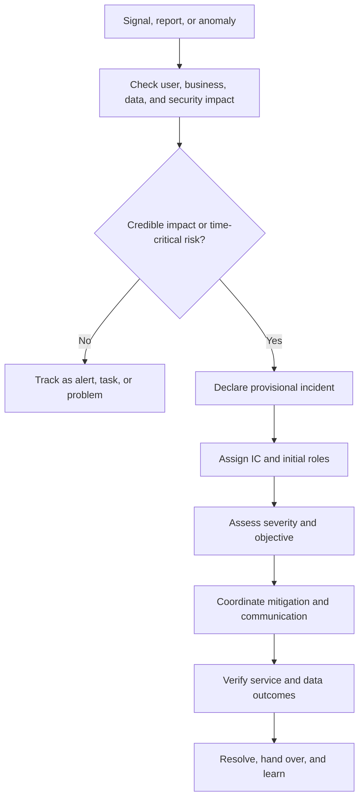
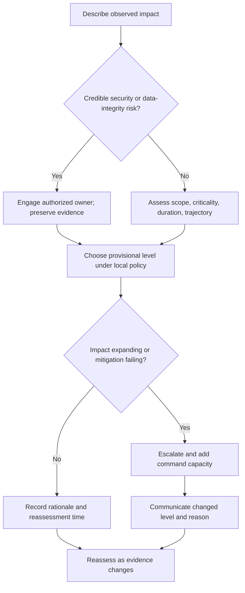
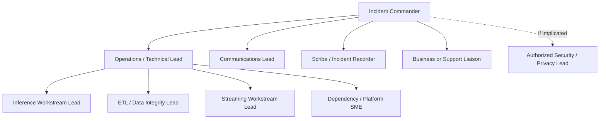
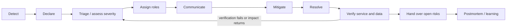
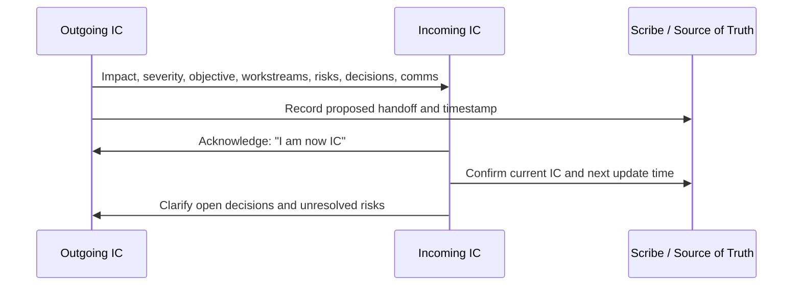

# Unit 4 — Incident Severity, Roles, and Command Structure

> **Stage:** Stage 2E — Production DevOps & Platform Engineering  
> **Module:** M10 — Site Reliability Engineering and Incident Management  
> **Unit:** 4 — Incident severity, roles, and command structure  
> **Exact target:** `04-incident-severity-roles-and-command-structure.md`  
> **Environment:** zero-budget, local-only, synthetic incidents  
> **Truth labels:** `[ILLUSTRATIVE]` sample values, not standards; `[ASSUMPTION]` proposed local policy; `[VERIFY]` check against the installed tool/version or primary source; `[NOT EXECUTED]` supplied but not run here; `[MEASURED BY LEARNER]` capture during your own run; `[OPTIONAL]` enrichment.

This chapter teaches a learner to recognize an incident, choose a defensible provisional severity, establish command, coordinate technical work, mitigate safely, communicate honestly, preserve a timeline, verify recovery, and hand learning to the next unit. The objective is not to make every incident follow a rigid ceremony. It is to make decisions explicit when time, evidence, and attention are limited.

Examples use synthetic services: `inference-api`, `orders-etl`, and `events-stream`. Severity labels and response times are organization-specific. The matrix and policies here are a teaching model, not a universal standard or a declaration of formal Incident Command System compliance.

---

## 1. Learning Outcomes and Completion Criteria

### 1.1 L1–L4 progression

| Level | Capability | Observable evidence |
|---|---|---|
| **L1 — Foundations** | Define incidents; distinguish alerts, problems, outages, degradation, and security/privacy events; classify severity; identify roles; declare with a useful summary | Classify synthetic cases and create a provisional incident record with impact, owner, and next update |
| **L2 — Practical command** | Run the response lifecycle; assign work; communicate; choose mitigation-first actions; maintain a UTC timeline; hand off command; use local tooling | Tested local incident log, three or more updates, mitigation risk record, explicit handoff |
| **L3 — Multi-team and human factors** | Coordinate workstreams; manage authority and escalation; protect responders from overload; handle data-integrity and security concerns safely | Tabletop record with workstream owners, decision rights, evidence, and unresolved-risk handoff |
| **L4 — Governance and assurance** | Calibrate severity; measure response without perverse incentives; test incident tooling; learn across incident patterns | Policy kit, tested synthetic trend report, assurance checklist, prioritized reliability backlog |

### 1.2 Completion criteria

You pass when you can demonstrate, using synthetic data and local tools, that you can:
- identify when impact warrants coordinated response even if root cause is unknown;
- classify severity and explain which evidence could change it;
- distinguish severity from ticket priority;
- declare an incident, assign roles, state an objective, and set the next update time;
- choose mitigation using blast radius, reversibility, data integrity, security/privacy, and verification;
- produce accurate internal and customer-safe updates without speculation;
- record a coherent UTC timeline as events happen;
- execute and test the local incident CLI;
- hand off command explicitly and receive acknowledgement;
- distinguish service recovery from data/business correctness verification;
- identify when authorized security, privacy, legal, compliance, or business owners must be engaged;
- preserve evidence and create a blameless learning handoff to Unit 5.

A policy document without a demonstrated exercise is incomplete evidence. A simulation is valuable practice, but does not prove production readiness, real-team coverage, or the correctness of a real recovery plan.

### 1.3 Why incident command exists

Under pressure, unstructured response creates predictable failures: several people repeat the same investigation, conflicting changes are made, no one owns communications, decisions are not recorded, severity lags behind expanding impact, and evidence disappears as systems recover. Incident command is a temporary coordination structure that makes priorities, authority, work ownership, and communications visible—not a hierarchy for assigning blame.

---

## 2. Prerequisites and Boundaries with Other M10 Units

### 2.1 Prerequisites

You should be comfortable reading service metrics, logs, traces, deployment events, and data-pipeline signals. You should understand basic service-level indicators (SLIs), service-level objectives (SLOs), and error budgets, and have used the M08 local FastAPI data/ML service if available.

This chapter assumes a local workspace and synthetic events. If the M08 service is unavailable, use the supplied scenarios; do not invent production access or make unsafe changes to a real environment.

### 2.2 Cross-unit boundaries

| Topic | This chapter does | Deeper owner |
|---|---|---|
| SLI/SLO/error-budget foundations | Uses impact and SLO risk to assess incidents | M10 Unit 1 |
| Batch, streaming, inference targets | Uses them as incident examples | M10 Unit 2 |
| Alert quality and escalation | Explains how an alert can initiate assessment; does not reteach Prometheus/Alertmanager | M10 Unit 3 |
| Production triage and blameless postmortems | Preserves hypotheses, evidence, timeline, and learning handoff | M10 Unit 5 |
| Capacity failures and cascading outages | Uses a capacity scenario to practice command | M10 Unit 6 |
| Toil reduction and automation | Identifies repeated manual response as backlog input | M10 Unit 7 |
| Runbooks/readiness | Requires a runbook link and preparation | M10 Unit 8 |
| Error-budget policy/release freezes | Applies incident-time change discipline without defining full policy | M10 Unit 9 |
| On-call sustainability | Covers relief and fatigue as command concerns | M10 Unit 10 |
| DORA/performance metrics | Defines response metrics carefully | M10 Unit 11 |
| Rollback, flags, GitOps | Names mitigation options and risks | M08 |
| Security/secret compromise | Requires authorized security response | M09 |
| Observability architecture | Uses telemetry as evidence | M11 |

### 2.3 Source ambiguity and resolution

The curriculum specifies a local incident log CLI and policy kit, but not a particular product, legal reporting rule, severity label, response target, or exact state machine. This chapter uses a proposed local state model `[ASSUMPTION]`, synthetic SEV1–SEV4 examples `[ILLUSTRATIVE]`, and standard-library Python. Adapt roles, authorities, customer communications, and notification obligations to real organizational policies and legal/compliance advice.

---

## 3. Incident, Alert, Problem, Degradation, and Outage

### 3.1 Definitions

- **Alert:** a signal emitted by monitoring or another detection mechanism. It may be actionable, noisy, stale, or false. It is evidence, not an incident declaration by itself.
- **Incident:** an unplanned event that degrades or threatens service and requires coordinated response. Define it by impact and urgency, not by which tool emitted a signal.
- **Problem:** an underlying or recurring cause, weakness, or unresolved condition that may produce incidents. A problem can remain after service is restored.
- **Degradation:** service still works but violates or threatens expected quality, such as elevated latency, stale data, or a rising failure rate.
- **Outage:** a service or critical function is unavailable, or effectively unusable for the affected population. Partial outages are possible.
- **Security/privacy event:** an event that may compromise confidentiality, integrity, availability, authorization, or privacy. It may require a restricted response path even if availability metrics look healthy.
- **Postmortem-worthy event:** an incident, near miss, or surprising recovery that merits structured learning under local criteria.

These categories overlap. A privacy event can be an incident; an outage can be one symptom of a broader incident; a problem may trigger several incidents; a near miss can be worth reviewing even when no customer impact occurred.

### 3.2 Impact questions

1. **Who is affected?** Customers, internal users, downstream pipelines, a region, tenant, or critical business process?
2. **What cannot they do?** Make predictions, consume fresh data, complete a transaction, or trust a dataset?
3. **How much is affected?** Scope, request volume, partitions, events, regions, and criticality.
4. **How long and in which direction?** Start time, duration, growth, and time to a deadline.
5. **Is correctness at risk?** Wrong, duplicated, missing, or stale data?
6. **Is security/privacy implicated?** Credible exposure or integrity concern?
7. **What is the workaround?** Safe, available, and effective for all affected users?
8. **What do we know and not know?** Separate observations from hypotheses and record confidence.

### 3.3 Alert-to-incident decision flow



Do not wait for root cause before declaring when impact warrants coordination. Conversely, do not automatically classify every unknown as SEV1: use the local rubric, state uncertainty, and choose the safer response level supported by impact and risk.

### 3.4 Examples

An alert fires for CPU at 85%, but user latency and errors remain normal and no action is required. This may be a dashboard signal, not an incident. An inference API has no alert because the metrics pipeline failed, but customers cannot obtain predictions; that is still an incident. An ETL pipeline completes successfully but publishes a table with a missing partition; the service may be “up” while data integrity is broken. A rollback restores API latency, but a downstream consumer has already ingested incorrect output; service recovery does not close the data risk.

---

## 4. Severity Is Impact-Based: Rubric and SEV1–SEV4 Example

### 4.1 Severity versus priority

**Severity** describes incident impact and urgency under the incident policy. **Priority** describes scheduling relative to other work and may include business deadlines, contractual commitments, staffing, and competing priorities. A high-severity incident normally demands immediate response even if a ticketing system uses a different priority label. A low-severity but strategically important defect may have high project priority without being an incident.

Severity is not determined by alert name, CPU percentage, reporter seniority, or how difficult a bug is to fix. It is determined by consequences and trajectory.

### 4.2 Rubric dimensions

| Dimension | Lower-risk evidence | Higher-risk evidence |
|---|---|---|
| User/customer impact | Small subset, noncritical function, usable workaround | Broad impact, critical function unavailable, no safe workaround |
| Scope/blast radius | One isolated workload | Multiple services, regions, customers, datasets, or consumers |
| Duration/trajectory | Short, stable, contained | Growing, persistent, deadline approaching, recovery uncertain |
| Business criticality | Noncritical internal workflow | Revenue, safety, time-critical operations, key customer workflow |
| Correctness/data integrity | Validation passed | Corruption, silent wrong output, missing/duplicated records, downstream exposure uncertain |
| Security/privacy | No credible exposure signal | Credible unauthorized access, exposure, compromised identity, or evidence risk |
| Availability/freshness | SLO healthy and workaround works | SLO breach, inference unavailable, ETL deadline missed, stream lag threatens consumers |
| Recovery complexity | Reversible action with tested verification | Irreversible restore/replay, multiple dependencies, missing authority |

Do not sum these dimensions into an unvalidated severity score. One high-consequence data-integrity or security signal can dominate otherwise healthy dimensions.

### 4.3 Illustrative SEV1–SEV4 matrix

Every label and example below is `[ILLUSTRATIVE]` and `[ASSUMPTION]`; this is **not a universal standard**. A real organization must define its own policy, service-specific impact models, contacts, response targets, and escalation rules.

| Example level | Impact pattern | Synthetic examples | Expected coordination | Notification posture |
|---|---|---|---|---|
| **SEV1** | Catastrophic/broad critical impact; major service unavailable; credible severe security/data risk; no safe workaround | Inference unavailable to nearly all critical users; widespread corruption; suspected sensitive-data exposure | Immediate IC; technical lead; service/data/security leads; executive escalation per policy | Highest local tier; frequent updates `[ILLUSTRATIVE]` |
| **SEV2** | Major partial impact, critical workflow degraded, blast radius growing, deadline/data risk near | Large fraction of predictions fail; critical ETL window missed; stream lag threatens a key consumer | IC, Ops lead, workstream owners, stakeholders as needed | Urgent coordinated response `[ILLUSTRATIVE]` |
| **SEV3** | Limited/contained impact, workaround exists, coordinated investigation or timely remediation needed | One route or tenant is slow; noncritical pipeline delayed but within recovery window | Service owner/incident lead and limited parallel work | Team-level updates; escalate if trajectory worsens |
| **SEV4** | Low impact or near miss with no immediate harm, but a defined response or learning action is appropriate | Noncritical monitoring gap with independent coverage; contained failed job with validated output unaffected | Normal team process or lightweight record | Ticket/review by default |

Response-time targets are not universal. For training only, a team might aim to acknowledge SEV1 within 5 minutes, SEV2 within 15 minutes, and update every 10–15 minutes for SEV1 `[ILLUSTRATIVE]`. These are not recommendations for all teams. Set targets based on commitments, criticality, staffing, time zones, and risk.

### 4.4 Severity changes

Severity can move in either direction as evidence changes. Record who changed it, when, why, and the supporting evidence.

- **Escalate** when blast radius expands, a workaround fails, data correctness becomes uncertain, a deadline is threatened, monitoring is lost, or mitigation misses its window.
- **Downgrade** only when evidence demonstrates impact is contained/reduced and remaining risk is understood under local policy.
- Do not downgrade because a senior stakeholder dislikes the label, an alert stopped firing, or a rollback command completed.
- Do not keep the highest severity by default if evidence shows a contained event with a safe workaround.

### 4.5 Severity assessment decision flow



### 4.6 Twelve-case severity calibration set

All cases are synthetic. Model answers apply the example matrix; reasonable alternatives are acceptable when justified by local policy and evidence.

| # | Case and evidence | Model provisional level | What could change the decision? |
|---|---|---|---|
| 1 | Inference API returns 65% errors across all customers for 8 minutes; no workaround | SEV1 | Verified recovery and narrow scope may lower it; sustained broad impact supports it |
| 2 | Optional route is 3× slower for 4% of traffic; fallback works | SEV3 | Critical workflow or rising errors may raise severity |
| 3 | Nightly ETL is 40 minutes late; deadline is 4 hours away; no correctness signal | SEV3/SEV4 | Consumer criticality, recovery estimate, freshness SLO |
| 4 | ETL exits zero but validation finds 12% of partitions missing; downstream publication unknown | SEV2 | If publication was prevented and consumers unaffected, urgency may be lower |
| 5 | Stream event age grows and likely misses a critical deadline | SEV2 | Actual deadline, backlog growth, replay capacity, consumers |
| 6 | One stream partition is delayed; replay is safe and lag is falling | SEV3 | Broader lag, data loss, or unsafe replay |
| 7 | Possible privacy exposure; evidence incomplete | Provisional high response per security policy; restrict access | Credibility, scope, data classification, authorized security assessment |
| 8 | Prometheus unavailable, but independent checks show service health and alternate notification works | SEV3/SEV4 | Loss of independent detection or critical unmonitored service |
| 9 | One region has inference errors affecting 30% of its customers | SEV2 | Region criticality, failover safety, actual affected fraction |
| 10 | Vendor latency rises; retries mask impact but queue age grows | SEV2/SEV3 | Queue trajectory and retry amplification risk |
| 11 | Small reversible error spike after deploy; rollback restored health and validation is clean | SEV3/near miss | Downstream side effects or recurrence |
| 12 | Executive requests urgent dashboard change; no service impact or operational risk | Not an incident by itself; priority may be high | Evidence of actual customer-impacting defect |

**Ambiguous-case rule:** uncertainty triggers a statement of what is unknown, a reassessment time, and specialist escalation where appropriate. It does not mean every uncertainty becomes the highest severity.

---

## 5. Incident Declaration and the First Five Minutes

### 5.1 Low-friction declaration

Declare when credible impact warrants coordination, not when root cause is proven. A declaration is reversible; delay while people investigate independently can be costly. False alarms should be reviewed for learning, not used to punish responders.

A declaration establishes:
- unique incident ID;
- start time in UTC and detection time if known;
- provisional severity and rationale;
- affected service/workload and known impact;
- Incident Commander (IC) and initial roles;
- one source of truth: incident channel or local record;
- immediate objective and active mitigation, if any;
- known facts, unknowns, and evidence links;
- next update and severity reassessment time.

### 5.2 First five minutes `[ILLUSTRATIVE]`

| Relative time | Action | Output |
|---|---|---|
| 0:00–1:00 | State “I am IC” or take the solo IC hat; declare | Incident ID, impact, provisional severity |
| 1:00–2:00 | Name technical lead and scribe/communications roles where possible | Role roster and source of truth |
| 2:00–3:00 | Set one measurable objective and split investigation threads | Owners, questions, evidence, check-in times |
| 3:00–4:00 | Decide whether safe mitigation can reduce harm | Decision record with risk and verification |
| 4:00–5:00 | Publish internal update and external update if authorized/needed | Shared current state and next decision point |

These timeboxes must not delay urgent safe containment. Record any action taken before formal coordination.

### 5.3 Opening declaration example

```text
I am IC for INC-2026-1042.

Provisional severity: SEV2 [ILLUSTRATIVE policy].
Impact: inference requests in region-west are failing more often than baseline;
the affected request fraction is still being measured.
Known: errors rose after the latest deployment marker.
Unknown: whether the dependency or release is the primary contributor.
Objective: restore a safe prediction path and verify request success without
introducing data/model correctness risk.
Technical lead: [alias]. Scribe: [alias]. Communications: [alias].
Workstreams: release correlation; dependency health; customer impact.
Next internal update: 14:15 UTC. Next severity review: 14:10 UTC.
Source of truth: [incident channel / local record].
```

Replace every bracketed field with observed information; do not publish fabricated numbers.

### 5.4 Incident declaration / pinned summary template

```markdown
# Incident INC-YYYY-NNNN

- Start time (UTC):
- Detected at (UTC):
- Provisional severity and rationale:
- Incident Commander:
- Affected services/workloads:
- Impact (who, what, scope, duration/trajectory):
- Known facts (with evidence links):
- Unknowns / hypotheses (labelled as hypotheses):
- Objective for the next response interval:
- Roles and workstream owners:
- Active mitigation and decision owner:
- Risks / stop conditions:
- Customer/business communication owner:
- Next internal update (UTC):
- Next external update (UTC, if applicable):
- Next severity reassessment (UTC):
- Incident record / timeline:
```

### 5.5 Solo responder: explicit role-hat switching

1. Write `HAT: IC` before setting objective, severity, assignments, or update time.
2. Switch to `HAT: Ops` before evaluating technical evidence or mitigation.
3. Switch to `HAT: Scribe` and append a timestamped event after meaningful actions.
4. Switch to `HAT: Communications` before drafting an audience-specific update.
5. Return to `HAT: IC` to reassess impact, unresolved risk, and next decision.

Record which duties would require separate people in a real incident. Ask for a second pair of eyes or escalate if safe solo handling is exceeded. A solo simulation is not a staffed response.

### 5.6 Golden signals as evidence, not the incident definition

Latency, traffic, errors, and saturation help describe service behavior. For data/AI systems, add ETL freshness/correctness, expected/valid partitions, stream lag and oldest-event age, inference fallback ratio, and feature freshness. Availability-only views can miss silent corruption or a missed business deadline.


---

## 6. Roles, Responsibilities, and Command Structure

### 6.1 Core roles

| Role | Owns | Does not own by default |
|---|---|---|
| **Incident Commander (IC)** | Coordination, objectives, priorities, severity, escalation, decision clock, role assignment, risk visibility, communications cadence | Becoming primary debugger or silently issuing every technical command |
| **Operations/Technical Lead (Ops)** | Technical response plan, workstreams, mitigation proposals, task assignment, evidence and risk reporting | Unilaterally deciding broad customer messaging or overriding authorized security controls |
| **Communications Lead** | Internal/external update drafting, audience selection, status-page cadence, factual consistency | Inventing root cause, promising unverified ETA, exposing sensitive data |
| **Scribe / Incident Recorder** | UTC timeline, decisions, actions, owners, evidence links, role changes, next-update commitments | Treating hypotheses as facts or recording only after recovery |
| **Subject-Matter Expert (SME)** | Bounded investigation or specialist action; evidence and recommendation | Uncoordinated production changes outside assigned authority |
| **Area/Subsystem Lead** | Defined workstream such as inference, ETL, streaming, dependency, or security | Issuing conflicting global priorities |
| **Planning Lead** `[OPTIONAL]` | Longer-horizon tasks, resource needs, unresolved work, next-shift planning | Replacing the IC’s immediate objective |
| **Customer Support/Business Liaison** `[OPTIONAL]` | Customer impact reports, support coordination, business deadlines and workarounds | Making technical claims without confirmation |
| **Security/Privacy/Legal Liaison** when implicated | Authorized specialist process, evidence handling, access restrictions, approved notification path | Ad hoc disclosure or unsupported legal interpretation |

For a small incident, one person may hold several roles. For a major incident, separate command from technical execution so the IC can maintain the overall picture.

### 6.2 Multi-team command diagram



This is one possible model, not a mandatory org chart. Different structures are acceptable if authority and boundaries remain clear.

### 6.3 Role assignment template

```markdown
| Role | Person/alias | Responsibility | Assigned at (UTC) | Next check-in (UTC) | Status | Backup |
|---|---|---|---|---|---|---|
| IC | | Overall coordination | | | | |
| Ops/Technical Lead | | Technical plan and workstreams | | | | |
| Communications | | Internal/external updates | | | | |
| Scribe | | Timeline and decision record | | | | |
| Area lead: inference | | API impact/release evidence | | | | |
| Area lead: data | | ETL correctness/freshness | | | | |
| Security/privacy liaison, if needed | | Authorized specialist process | | | | |
```

### 6.4 Span of control and adding roles

Add leads/functions when the IC cannot maintain awareness of all workstreams, when technical streams have distinct risks/owners, when communications compete with decisions, or when incident duration requires relief. There is no universal numeric span-of-control ratio for every incident. The practical test is whether the IC can receive concise updates, make timely decisions, and preserve the shared picture without micromanaging every investigation.

### 6.5 Unified command and decision boundaries

When several teams have legitimate authority—for example, platform operations, data ownership, and security—name the decision owner for each class of action. A unified command arrangement can make joint decisions explicit, but should not create several people issuing conflicting instructions. The IC coordinates the incident objective; the authorized service/data/security owner retains any approval defined by local policy.

---

## 7. Incident Lifecycle and Operating Rhythm

### 7.1 Lifecycle gates and outputs



| Stage | Main question | Output/gate |
|---|---|---|
| Detect | Is there a credible anomaly or report? | Initial evidence and detection time |
| Declare | Does impact warrant coordination? | Incident ID, provisional severity, IC, source of truth |
| Triage/assess severity | Who is affected, how badly, since when, and is it worsening? | Impact statement, severity rationale, uncertainty list |
| Assign roles | Who coordinates, investigates, records, and communicates? | Role roster and workstream owners |
| Communicate | Who needs to know what, by when? | Internal update and authorized external update plan |
| Mitigate | What safe action reduces harm fastest? | Approved decision, risk/rollback/stop condition |
| Resolve | Has active impact stopped? | Candidate recovery state, not yet assumed fully safe |
| Verify | Is service healthy and is data/business correctness intact? | Verification evidence and remaining-risk decision |
| Hand over | What is still open and who owns it? | Explicit IC transfer or closure handoff |
| Postmortem/learning | What system conditions shaped the outcome? | Unit 5 learning handoff and tracked actions |

The lifecycle loops. A new data-integrity signal can reopen severity assessment after the API is healthy. A monitoring tool resolving an alert does not prove business recovery.

### 7.2 IC operating rhythm

At each update interval, the IC should:
1. restate current impact and objective;
2. ask each workstream for evidence, result, and next action;
3. distinguish facts, hypotheses, and unknowns;
4. check mitigation risk and whether the stop condition is met;
5. decide whether severity, scope, or role structure changes;
6. ensure internal/external communications are accurate;
7. set the next check-in and update time;
8. protect responders from uncoordinated requests and unnecessary interruption.

Ask for evidence rather than guesses: “What observation supports that?” and “What would falsify this hypothesis?” are more useful than “Who caused it?”

### 7.3 Illustrative update cadence

The following cadence is `[ILLUSTRATIVE]`, not a standard. Adapt it to impact, channel, customer commitments, duration, and staffing.

| Example severity | Internal coordination update | External/customer update | Reassess severity |
|---|---|---|---|
| SEV1 | Every 10–15 minutes `[ILLUSTRATIVE]` or after material changes | Every 15–30 minutes `[ILLUSTRATIVE]` if required and authorized | As major evidence arrives |
| SEV2 | Every 15–30 minutes `[ILLUSTRATIVE]` | On material change and agreed cadence | At workstream check-ins |
| SEV3 | Every 30–60 minutes `[ILLUSTRATIVE]` | When customer impact warrants | At agreed checkpoints |
| SEV4 | Team/ticket cadence | Usually not a broad status page | If impact or risk changes |

If a major event occurs between scheduled updates, communicate immediately. Cadence is a maximum gap under the chosen policy, not a reason to withhold material information.

### 7.4 Incident timeline discipline

Record events as they happen and distinguish:
- **Observation:** “Error ratio rose to 8% in the synthetic dashboard.”
- **Hypothesis:** “The new model artifact may be contributing.”
- **Decision:** “IC approved disabling the new route for 10 minutes.”
- **Action:** “Ops applied the approved flag change.”
- **Result:** “Error ratio returned to baseline; correctness validation is pending.”

Do not rewrite an early hypothesis as if it were known at the time. The timeline records the decision environment, not just a polished outcome narrative.

### 7.5 IC handoff: explicit transfer

A handoff is a command transition, not a message that someone is leaving. The outgoing IC says: **“I am handing command to [name]; [name], you are now IC.”** The incoming IC acknowledges. The source of truth is updated with the new IC and timestamp.



### 7.6 IC handoff template

```markdown
## IC Handoff — INC-YYYY-NNNN

- Handoff time (UTC):
- Outgoing IC:
- Incoming IC:
- Incoming acknowledgement (UTC):
- Current severity and rationale:
- Impact / scope / trajectory:
- Objective:
- Timeline highlights and evidence:
- Active mitigation and result:
- Workstreams, owners, and next check-ins:
- Confirmed facts:
- Hypotheses and evidence for/against:
- Decisions made and decision owners:
- Unresolved risks, including data/security/privacy:
- Communications sent and next update due:
- Open decisions / approvals needed:
- Current role roster:
- Next severity reassessment:
- Outgoing IC confirmation:
- Incoming IC confirmation:
```

If the incoming IC cannot acknowledge, command has not safely transferred under this model. Escalate to the designated backup or continue the existing arrangement until transfer is explicit.

---

## 8. Mitigation-First Decisions and Safety Checks

### 8.1 Mitigate harm before pursuing complete root cause

When impact is active, the first objective is often to reduce harm and restore safe service, not to fully explain the failure. A temporary mitigation can be correct. Root-cause analysis continues when it does not delay safe recovery. “Mitigation first” does not justify irreversible or unauthorized action.

### 8.2 Mitigation menu by failure class

| Failure class | Candidate mitigation | Risks and verification |
|---|---|---|
| Bad deployment / inference latency regression | Roll back/abort release; disable a feature or route via approved flag | Check schema/model compatibility, rollback safety, error/latency SLI, prediction correctness |
| Dependency latency/failure | Route around dependency, use bounded fallback, fail over if approved | Avoid retry storms, stale fallback data, split-brain, changed semantics |
| Resource saturation | Scale within approved limits, shed noncritical load, disable expensive optional work | Scaling may worsen dependency pressure; verify latency, queue age, error ratio |
| ETL freshness failure | Pause downstream publication, preserve raw inputs, rerun only after validation | Do not publish partial output as complete; verify partition coverage and watermark |
| Silent data corruption | Stop consumption/publication, quarantine affected partitions, notify authorized data owner | Preserve lineage; do not overwrite/restore until authorized |
| Streaming lag | Pause risky processing, bound replay, scale or route under runbook | Replay can duplicate effects or increase load; verify offsets, event age, deduplication |
| Suspected credential compromise | Engage authorized security responders; revoke/isolate through approved process | Preserve evidence; do not improvise credential handling |
| Storage/metadata failure | Use approved failover or restore procedure | Restore can overwrite valid data; require owner, backup point, integrity validation |

Rollback/feature flags align with M08; platform scaling/restart/drain with relevant platform modules; storage restore/failover with M05; routing with M04; credential revocation with M09. This chapter does not replace those modules’ runbooks.

### 8.3 Mitigation decision record template

```markdown
## Mitigation Decision — INC-YYYY-NNNN

- Decision time (UTC):
- Proposed by:
- Decision owner / approver:
- Impact to reduce:
- Proposed action:
- Expected benefit:
- Blast radius:
- Reversibility:
- Data-integrity risk:
- Security/privacy risk:
- Dependencies / preconditions:
- Runbook / change reference:
- Rollback plan:
- Stop condition:
- Verification signals:
- Result and timestamp:
- Follow-up owner:
```

### 8.4 Safety check before action

| Check | Required question |
|---|---|
| Impact reduction | What measurable harm should this reduce? |
| Blast radius | Which users, services, regions, partitions, or consumers could be affected? |
| Reversibility | Can it be undone quickly and safely? |
| Data integrity | Could it drop, duplicate, overwrite, or publish incorrect data? |
| Security/privacy | Could it expose evidence or weaken access controls? |
| Dependencies | What systems may be overloaded or made unavailable? |
| Authority | Who is allowed to approve this action class? |
| Rollback/stop condition | What observation means stop or revert? |
| Verification | Which user-facing and workload-specific signals prove success? |
| Communication | Who must be told before or immediately after the action? |

A change freeze can reduce risk, but “freeze all changes” is not absolute: the safest mitigation may require a change. The IC coordinates change discipline while the authorized owner follows required approvals. Do not perform a production restore, destructive replay, or break-glass operation merely because an example appears here.

### 8.5 Service recovery is not data/business verification

Use two gates:

1. **Service recovery:** latency/errors/availability return to expected range and remain stable for a defined observation period.
2. **Data/business verification:** outputs are complete, correct, fresh, deduplicated as required, and safe for consumers.

An inference endpoint can return HTTP 200 while using stale features. An ETL scheduler can show “success” while a partition is missing. A stream consumer can catch up in offset count while business event age remains too high. Do not close until the appropriate verification owner has assessed these risks.

### 8.6 Incident closure / verification checklist template

```markdown
- [ ] User-facing service health verified with evidence
- [ ] Workload-specific freshness, correctness, coverage, and lag verified
- [ ] No known unsafe output remains published or consumed
- [ ] Mitigation is stable and rollback/stop condition understood
- [ ] Security/privacy concerns handed to authorized responders if implicated
- [ ] Customer/business communications updated by authorized owner
- [ ] Remaining risks and deferred work have named owners
- [ ] Timeline and decision record saved
- [ ] Incident state resolved/closed according to local policy
- [ ] Learning handoff to Unit 5 assigned
```

---

## 9. Communications, Status Updates, and Incident Timeline

### 9.1 Internal versus external communication

| Audience | Include | Avoid |
|---|---|---|
| Responders | Impact, facts/unknowns, hypotheses with evidence, actions/owners, risks, next check-in | Unstructured chatter in the decision channel; unsupported conclusions |
| Executives/business owners | Scope, business impact, mitigation, major risk, decisions/approvals needed, next update | Deep implementation detail without impact framing |
| Customer support | Known affected workflows, safe guidance, status, approved wording | Unverified customer lists or promises |
| Customers/status page | Plain-language impact, affected functionality, current action, next update time | Blame, speculation, sensitive details, unverified root cause/ETA |
| Security/privacy/legal | Minimum necessary facts, evidence references, restricted channel, decision requests | Sensitive details in broad channels or informal legal conclusions |
| Vendor/dependency owner | Service/region, observed behavior, timestamps, approved evidence references, needed action | Secrets, customer payloads, unsupported accusations |

### 9.2 Sample status messages

These are examples and must match actual evidence and authorized communication policy.

**Initial investigation**

> We are investigating elevated failures affecting the inference API in one region. Some requests may fail or take longer than usual. We are checking service and dependency signals and will provide another update by 14:30 UTC. We do not yet have a confirmed cause.

**Mitigation in progress**

> We have identified a possible relationship with a recent service change and are applying a controlled mitigation. The affected region may continue to see intermittent failures while we verify the result. The cause is still under investigation. Next update by 14:45 UTC.

**Partial recovery / validation pending**

> Request success and latency have improved in the affected region. We are validating that prediction outputs and dependent data remain correct before declaring full recovery. Some users may still see delayed results. Next update by 15:00 UTC.

**Resolved / verified**

> The inference API has returned to its expected operating range, and the relevant output checks have passed for the affected window. We are closing the active response and will review contributing factors and prevention work. This update is based on checks completed at 15:10 UTC.

Do not use the final message if data/business verification remains pending. Say “service recovered; validation remains in progress” and keep the incident open or pending verification.

### 9.3 Internal update template

```markdown
## Internal Update — [UTC timestamp]

- Current impact and scope:
- Severity and reason for any change:
- Confirmed facts:
- Unknowns / hypotheses and supporting evidence:
- Actions completed:
- Active workstreams, owners, next check-ins:
- Current mitigation and risk:
- Decisions/approvals needed:
- Customer/business communication status:
- Next update time (UTC):
```

### 9.4 External/customer status template

```markdown
## Customer Status Update

- Status: investigating / mitigation in progress / partial recovery / resolved
- What customers may observe:
- Known affected service/workflow and scope:
- What we are doing now:
- Safe customer action, if known and approved:
- What is not yet known (plain language):
- Next update time (UTC):
- Verification status:
```

### 9.5 UTC incident timeline template

```markdown
| UTC timestamp | Type (observation/hypothesis/decision/action/result) | Actor/role | Event | Evidence/source | Result | Follow-up owner |
|---|---|---|---|---|---|---|
| 2026-10-28T14:02:00Z | observation | on-call | Error ratio rose | synthetic dashboard ref | impact assessment started | IC |
```

Use ISO 8601 UTC ending in `Z`. If a local tool records a timestamp, use timezone-aware values and convert to UTC. Do not mix local time, UTC, and unspecified timestamps in one timeline.

### 9.6 Incident metrics and definitions

Define start/end points before calculating; otherwise teams report incomparable numbers.

| Metric | Example definition | Caveat |
|---|---|---|
| Time to detect (TTD) | Detection timestamp minus incident impact start | Impact start may be estimated; preserve confidence |
| Time to declare | Declaration timestamp minus first credible signal/impact start; state baseline | Alert time may lag actual impact |
| Time to first update | First useful update minus declaration | Define audience and what counts as useful |
| Time to first mitigation | First mitigation action minus declared start; distinguish attempt from effective impact reduction | A failed attempt is not recovery |
| Time to service recovery | Sustained service recovery minus impact start | Define stability window and SLI |
| Time to data/business verification | Verification completion minus impact start | May occur after API recovery |
| Time to resolution (MTTR) | Organization-specific; acronym can mean repair, recovery, or resolve | Ambiguous; define precisely and prefer distributions/percentiles plus impact-minutes |
| Update cadence adherence | Updates delivered within declared interval / updates due | A timely but empty update is not automatically useful |
| Severity changes | Count and rationale of changes | A change is not inherently good or bad |
| Handoff quality | Required fields and incoming acknowledgement present | Avoid reducing complex handoff to one score |

Use metrics to find system improvements, not rank/punish responders. Faster closure is not automatically better if the incident was prematurely resolved or data correctness was not verified.

### 9.7 Single source of truth and channel discipline

Maintain one authoritative incident record/channel. Separate investigation chatter from decision/status updates where possible. Pin the current summary and update it when impact, severity, objective, IC, or mitigation changes. If the main collaboration tool fails, use the pre-agreed out-of-band method and later reconcile timestamps and decisions without rewriting original facts.

---

## 10. Escalation, Decision Rights, and Multi-Team Response

### 10.1 Escalation criteria

Escalate when any of the following applies:

- **Time-based:** mitigation has not reduced impact within the locally defined interval.
- **Impact-based:** affected users, services, regions, datasets, or business processes expand.
- **Uncertainty-based:** critical unknowns or loss of monitoring make safe decisions difficult.
- **Security/data-risk-based:** suspected exposure, corruption, unsafe publication, or irreversible impact appears.
- **Dependency/authority-based:** a required owner, approver, vendor, or security/privacy responder is unavailable.
- **Human-capacity-based:** response complexity exceeds current command span or responders need relief.

Escalation should add expertise, authority, or capacity—not merely more people to the channel.

### 10.2 Severity-based response policy template

| Level | Roles to engage | Escalation triggers | Executive/business notification | Response/update targets |
|---|---|---|---|---|
| SEV1 | IC, Ops, area leads, communications, scribe; security/data owners if implicated | Immediate; expand command if impact broadens or mitigation fails | Per local policy and business criticality | `[ILLUSTRATIVE]` targets set by organization |
| SEV2 | IC/incident lead, Ops, affected SMEs, communications as needed | Growing scope, missed mitigation window, data risk | When impact/commitment warrants | `[ILLUSTRATIVE]` targets set by organization |
| SEV3 | Service owner/lead and relevant SME | Worsening trajectory or failed workaround | When business impact requires | `[ILLUSTRATIVE]` team cadence |
| SEV4 | Owning team and normal work process | Reclassify if impact appears | No broad notification by default | Ticket/review cadence |

This is a policy template, not a promise. Fill in actual contacts, targets, escalation paths, and authority.

### 10.3 Decision-rights / authority matrix

Adapt this template. “IC” does not automatically override the authorized owner for data, security, privacy, or legal decisions.

| Decision | Proposer | Decider/approver (template) | Consulted | Required evidence |
|---|---|---|---|---|
| Declare incident / set provisional severity | Any responder/detector | IC/on-call lead under policy | Service owner | Impact, scope, trajectory, uncertainty |
| Change severity | IC or workstream lead | IC under policy | Service/business/security owner | New evidence and impact change |
| Roll back deployment / disable flag | Ops/release owner | Authorized service/release owner; IC coordinates | Data/API owner, M08 release controls | Change correlation, blast radius, rollback and verification plan |
| Shift/fail over traffic | Ops lead | Authorized platform/service owner | Dependency/business owner | Capacity, consistency, failback, stop condition |
| Pause pipeline / quarantine output | Data/ETL lead | Authorized data owner; IC coordinates | Downstream consumers, security if relevant | Lineage, validation failure, consumer exposure |
| Restore/overwrite production data | Data/storage owner | Explicit authorized data owner | Security, consumers, IC | Backup point, scope, restore plan, integrity validation |
| Invoke break-glass access | Authorized responder | Designated access process | Security/identity owner | Need, scope, duration, audit trail |
| Customer communication | Communications drafts | Authorized comms/business owner | IC, support, legal/security if implicated | Verified scope and approved wording |
| Security/privacy/legal notification | Authorized responder initiates | Designated security/privacy/legal authority | Service owner and IC | Preserved evidence and policy-defined facts |
| Resolve/close incident | Ops/data owners recommend | IC/closure authority under policy | Business owner if required | Service recovery, data verification, residual risk |

No legal notification deadline is specified here. Obligations vary by jurisdiction, contract, data type, and circumstances; consult authorized legal/compliance functions. This chapter is not legal advice.

### 10.4 Escalation message template

```text
Escalation requested for INC-YYYY-NNNN.
Current severity: [level] — [rationale].
Impact/trajectory: [observed scope and change].
Mitigation attempted: [action and measured result].
Critical unknown/risk: [what prevents safe progress].
Decision or expertise needed: [specific ask].
Decision deadline / next check-in (UTC): [time].
Evidence: [approved links/references].
```

### 10.5 Pre-incident preparation

- current on-call and backup contacts, including cross-time-zone coverage;
- clear service/data ownership and escalation path;
- access readiness and audited break-glass process (M09);
- dashboards, synthetic probes, deployment markers, data-quality signals;
- runbooks and safe rollback/failover plans (Unit 8 and M08);
- communication templates and authorized status-page process;
- incident channel/source-of-truth creation procedure;
- dependency map and fallback plans;
- periodic tabletops, role shadowing, and practice handoffs;
- fallback for loss of incident tooling, key personnel, or a vendor dependency.

---

## 11. Cognitive Load, Fatigue, and Human Factors

### 11.1 Failure modes and countermeasures

| Factor | How it appears | Countermeasure |
|---|---|---|
| Tunnel vision | Team focuses on one subsystem while impact spreads | IC restates objective and impact; area leads report cross-system effects |
| Anchoring | First hypothesis dominates despite contradictory evidence | Hypothesis ledger; evidence for/against; reassessment time |
| Confirmation bias | Only supporting signals are sought | Ask “what would falsify this?”; assign a second reviewer |
| Authority gradient | Junior responder hesitates to challenge senior | Invite dissent and safety concerns; separate evidence from rank |
| Hero culture | One exhausted expert owns every task | Delegate bounded work; rotate responders; normalize handoff |
| Information overload | Debug chat obscures decisions and status | Separate channels; scribe records decisions; pinned summary is source of truth |
| Fatigue/context switching | Details missed or risky changes made | Relief plan, structured breaks, smaller task load, explicit handoff |
| Normalization of deviance | Near misses become accepted as normal | Capture “where we got lucky”; track recurring control gaps |
| Hindsight/outcome bias | Decision judged only by outcome | Record what was known at the time; review system conditions |

### 11.2 Hypothesis ledger template

```markdown
| ID | Hypothesis | Supporting evidence | Evidence against | Safe test | Owner | Check-in UTC | Status |
|---|---|---|---|---|---|---|---|
| H1 | Recent release increased inference latency | Symptom began after release marker | Dependency latency also increased | Compare pre/post route and dependency signals | | | Open |
```

The ledger prevents one hypothesis becoming “the cause” merely because it was mentioned first.

### 11.3 Long-running incidents and responder relief

Plan relief before fatigue becomes acute. The outgoing responder states current role, active tasks, known facts, hypotheses, risks, actions already performed, and next decision point. The incoming responder repeats back the critical risk and acknowledges the handoff. Arrange food, hydration, rest, and smaller task load where feasible. Do not equate heroics or working 14 hours without relief with reliability.

### 11.4 Security/privacy and sensitive channels

When an event may involve customer data, credentials, or privacy, engage the authorized security/privacy process promptly. Restrict sensitive evidence to approved channels, preserve evidence without unnecessary duplication, and avoid pasting raw customer payloads, secrets, or personal data into broad channels. Do not invent notification obligations or conduct ad hoc external disclosure.

### 11.5 Loss of tools, people, or dependencies

If the incident channel, Git host, CI/CD, secrets backend, registry, DNS, or a key person is unavailable, use the pre-agreed fallback: out-of-band communication, paper/offline runbook, alternate authorized contact, or controlled break-glass process. Record decisions as best possible and reconcile the timeline later. Do not assume the platform under investigation is reliable for coordinating its own recovery.


---

## 12. Incident Tooling: Log, State, CLI, and Tests

### 12.1 Workspace

Create a scratch directory outside the curriculum repository:

```text
incident-command-lab/
├── incident_cli.py
├── test_incident_cli.py
├── incident.json
├── game_master.py
├── incidents.csv
├── trend_report.py
└── evidence/
```

Python standard library is sufficient for the CLI. Python 3.10+ is a convenient assumption `[VERIFY]` against the installed interpreter. Record the actual version using `python --version`.

### 12.2 Proposed state machine

The state machine is `[ASSUMPTION]`, a lab model rather than a universal standard.

| Current state | Allowed next state | Meaning |
|---|---|---|
| `DECLARED` | `ACTIVE` | Initial assessment and roles established |
| `ACTIVE` | `MITIGATING` | Approved mitigation underway |
| `MITIGATING` | `ACTIVE` | Mitigation failed or further investigation required |
| `MITIGATING` | `RECOVERING` | Impact appears reduced; verification begins |
| `RECOVERING` | `MITIGATING` | Impact returns or verification fails |
| `RECOVERING` | `RESOLVED_PENDING_VERIFICATION` | Service recovery observed; correctness checks pending |
| `RESOLVED_PENDING_VERIFICATION` | `RECOVERING` | Verification fails or impact returns |
| `RESOLVED_PENDING_VERIFICATION` | `CLOSED` | Required verification and handoff criteria pass |
| `CLOSED` | `ACTIVE` | Explicit reopen event records renewed impact |

A closed incident can be reopened only through an explicit event with a reason. “Service recovered,” “incident resolved,” and “data/business correctness verified” are separate facts.

### 12.3 Incident JSON example

```json
{
  "incident_id": "INC-2026-1042",
  "service": "inference-api",
  "severity": "SEV2",
  "state": "DECLARED",
  "current_ic": "oncall-a",
  "impact": "Elevated inference failures in one synthetic region",
  "next_update_utc": "2026-10-28T14:30:00Z",
  "roles": {"IC": "oncall-a", "Ops": "platform-b", "Scribe": "oncall-a"},
  "events": []
}
```

Do not store secrets, customer payloads, personal data, or credentials in local records.

### 12.4 Complete standard-library CLI

Save as `incident_cli.py` in the scratch workspace.

```python
#!/usr/bin/env python3
"""Small local incident record CLI. Synthetic data only; not tamper-proof storage."""
import argparse
import json
import re
import sys
from datetime import datetime, timezone
from pathlib import Path

SEVERITIES = {"SEV1", "SEV2", "SEV3", "SEV4"}
STATES = {"DECLARED", "ACTIVE", "MITIGATING", "RECOVERING",
          "RESOLVED_PENDING_VERIFICATION", "CLOSED"}
TRANSITIONS = {
    "DECLARED": {"ACTIVE"},
    "ACTIVE": {"MITIGATING"},
    "MITIGATING": {"ACTIVE", "RECOVERING"},
    "RECOVERING": {"MITIGATING", "RESOLVED_PENDING_VERIFICATION"},
    "RESOLVED_PENDING_VERIFICATION": {"RECOVERING", "CLOSED"},
    "CLOSED": {"ACTIVE"},
}
ID_RE = re.compile(r"^INC-[0-9]{4}-[0-9]{3,}$")


def utc_now():
    return datetime.now(timezone.utc).replace(microsecond=0).isoformat().replace("+00:00", "Z")


def parse_utc(value):
    if not isinstance(value, str) or not value.endswith("Z"):
        raise ValueError("timestamp must be ISO 8601 UTC ending in Z")
    try:
        parsed = datetime.fromisoformat(value[:-1] + "+00:00")
    except ValueError as exc:
        raise ValueError("timestamp must be a valid ISO 8601 datetime") from exc
    if parsed.utcoffset() != timezone.utc.utcoffset(parsed):
        raise ValueError("timestamp must be UTC")
    return parsed


def validate_record(record):
    required = {"incident_id", "service", "severity", "state", "current_ic",
                "impact", "next_update_utc", "roles", "events"}
    missing = sorted(required - set(record))
    if missing:
        raise ValueError("missing required fields: " + ", ".join(missing))
    if not ID_RE.match(record["incident_id"]):
        raise ValueError("incident_id must look like INC-YYYY-NNN")
    if not record["service"].strip() or not record["impact"].strip():
        raise ValueError("service and impact must be non-empty")
    if record["severity"] not in SEVERITIES:
        raise ValueError("invalid severity")
    if record["state"] not in STATES:
        raise ValueError("invalid state")
    if not record["current_ic"].strip():
        raise ValueError("current_ic must be non-empty")
    if not isinstance(record["roles"], dict) or not isinstance(record["events"], list):
        raise ValueError("roles must be an object and events must be a list")
    parse_utc(record["next_update_utc"])
    for i, event in enumerate(record["events"]):
        fields = {"timestamp_utc", "actor", "kind", "message", "evidence", "outcome"}
        if not isinstance(event, dict) or not fields.issubset(event):
            raise ValueError(f"event {i} missing required fields")
        parse_utc(event["timestamp_utc"])
        if event["kind"] not in {"observation", "hypothesis", "decision", "action",
                                 "result", "handoff", "state"}:
            raise ValueError(f"event {i} has invalid kind")
        if not event["actor"].strip() or not event["message"].strip():
            raise ValueError(f"event {i} actor/message must be non-empty")
    return record


def load_record(path):
    return validate_record(json.loads(Path(path).read_text(encoding="utf-8")))


def save_record(path, record):
    validate_record(record)
    Path(path).write_text(json.dumps(record, indent=2) + "\n", encoding="utf-8")


def append_event(record, actor, kind, message, evidence="", outcome="", timestamp=None):
    allowed = {"observation", "hypothesis", "decision", "action", "result", "handoff", "state"}
    if kind not in allowed:
        raise ValueError("invalid event kind")
    if not actor.strip() or not message.strip():
        raise ValueError("actor and message are required")
    event = {"timestamp_utc": timestamp or utc_now(), "actor": actor, "kind": kind,
             "message": message, "evidence": evidence, "outcome": outcome}
    parse_utc(event["timestamp_utc"])
    record["events"].append(event)
    validate_record(record)
    return event


def transition(record, new_state, actor, reason):
    if new_state not in STATES:
        raise ValueError("invalid state")
    old = record["state"]
    if new_state not in TRANSITIONS.get(old, set()):
        raise ValueError(f"invalid transition: {old} -> {new_state}")
    if not reason.strip():
        raise ValueError("transition reason is required")
    record["state"] = new_state
    append_event(record, actor, "state", f"{old} -> {new_state}: {reason}")
    return record


def set_severity(record, new_severity, actor, reason):
    if new_severity not in SEVERITIES:
        raise ValueError("invalid severity")
    if not reason.strip():
        raise ValueError("severity change reason is required")
    old = record["severity"]
    record["severity"] = new_severity
    append_event(record, actor, "decision", f"Severity changed {old} -> {new_severity}: {reason}")
    return record


def assign_role(record, role, person, actor):
    if not role.strip() or not person.strip():
        raise ValueError("role and person are required")
    record["roles"][role] = person
    if role == "IC":
        record["current_ic"] = person
    append_event(record, actor, "decision", f"Assigned {role} to {person}")
    return record


def handoff_ic(record, outgoing, incoming, actor, acknowledged, summary):
    if outgoing != record["current_ic"]:
        raise ValueError("outgoing IC does not match current IC")
    if not incoming.strip() or incoming == outgoing:
        raise ValueError("incoming IC must be a different non-empty person")
    if acknowledged is not True:
        raise ValueError("incoming IC acknowledgement is required")
    if not summary.strip():
        raise ValueError("handoff summary is required")
    append_event(record, actor, "handoff",
                 f"IC handoff: {outgoing} -> {incoming}; incoming acknowledged. Summary: {summary}")
    record["current_ic"] = incoming
    record["roles"]["IC"] = incoming
    return record


def render_markdown(record):
    validate_record(record)
    lines = [f"# Incident {record['incident_id']}", "",
             f"- Service: {record['service']}", f"- Severity: {record['severity']}",
             f"- State: {record['state']}", f"- Current IC: {record['current_ic']}",
             f"- Impact: {record['impact']}", f"- Next update (UTC): {record['next_update_utc']}",
             "", "## Roles", ""]
    lines.extend(f"- {role}: {person}" for role, person in sorted(record["roles"].items()))
    lines.extend(["", "## Timeline", "",
                  "| UTC | Type | Actor | Event | Evidence | Outcome |",
                  "|---|---|---|---|---|---|"])
    for e in record["events"]:
        cells = [e["timestamp_utc"], e["kind"], e["actor"], e["message"], e["evidence"], e["outcome"]]
        lines.append("| " + " | ".join(str(c).replace("|", "\\|").replace("\n", " ") for c in cells) + " |")
    return "\n".join(lines) + "\n"


def make_parser():
    parser = argparse.ArgumentParser(description=__doc__)
    sub = parser.add_subparsers(dest="command", required=True)
    create = sub.add_parser("create")
    create.add_argument("--file", required=True)
    create.add_argument("--id", required=True)
    create.add_argument("--service", required=True)
    create.add_argument("--severity", required=True, choices=sorted(SEVERITIES))
    create.add_argument("--ic", required=True)
    create.add_argument("--impact", required=True)
    create.add_argument("--next-update", required=True)
    for name in ("event", "severity", "assign", "transition", "handoff", "render", "show"):
        cmd = sub.add_parser(name)
        cmd.add_argument("--file", required=True)
        if name == "event":
            cmd.add_argument("--actor", required=True)
            cmd.add_argument("--kind", required=True,
                choices=["observation", "hypothesis", "decision", "action", "result"])
            cmd.add_argument("--message", required=True)
            cmd.add_argument("--evidence", default="")
            cmd.add_argument("--outcome", default="")
        elif name == "severity":
            cmd.add_argument("--value", required=True, choices=sorted(SEVERITIES))
            cmd.add_argument("--actor", required=True)
            cmd.add_argument("--reason", required=True)
        elif name == "assign":
            cmd.add_argument("--role", required=True)
            cmd.add_argument("--person", required=True)
            cmd.add_argument("--actor", required=True)
        elif name == "transition":
            cmd.add_argument("--state", required=True, choices=sorted(STATES))
            cmd.add_argument("--actor", required=True)
            cmd.add_argument("--reason", required=True)
        elif name == "handoff":
            cmd.add_argument("--outgoing", required=True)
            cmd.add_argument("--incoming", required=True)
            cmd.add_argument("--actor", required=True)
            cmd.add_argument("--acknowledged", action="store_true")
            cmd.add_argument("--summary", required=True)
        elif name == "render":
            cmd.add_argument("--out", required=True)
    return parser


def main(argv=None):
    args = make_parser().parse_args(argv)
    try:
        if args.command == "create":
            parse_utc(args.next_update)
            record = {"incident_id": args.id, "service": args.service,
                      "severity": args.severity, "state": "DECLARED",
                      "current_ic": args.ic, "impact": args.impact,
                      "next_update_utc": args.next_update,
                      "roles": {"IC": args.ic}, "events": []}
            append_event(record, args.ic, "decision", "Incident declared with provisional severity")
            save_record(args.file, record)
            print(f"Created {args.id} in {args.file}")
            return 0
        record = load_record(args.file)
        if args.command == "event":
            append_event(record, args.actor, args.kind, args.message, args.evidence, args.outcome)
            save_record(args.file, record)
        elif args.command == "severity":
            set_severity(record, args.value, args.actor, args.reason)
            save_record(args.file, record)
        elif args.command == "assign":
            assign_role(record, args.role, args.person, args.actor)
            save_record(args.file, record)
        elif args.command == "transition":
            transition(record, args.state, args.actor, args.reason)
            save_record(args.file, record)
        elif args.command == "handoff":
            handoff_ic(record, args.outgoing, args.incoming, args.actor,
                       args.acknowledged, args.summary)
            save_record(args.file, record)
        elif args.command == "render":
            Path(args.out).write_text(render_markdown(record), encoding="utf-8")
            print(f"Wrote Markdown timeline to {args.out}")
        elif args.command == "show":
            print(render_markdown(record))
        return 0
    except (ValueError, KeyError, json.JSONDecodeError, OSError) as exc:
        print(f"ERROR: {exc}", file=sys.stderr)
        return 2


if __name__ == "__main__":
    raise SystemExit(main())
```

This is a teaching starter, not a production incident platform. JSON file writes are not tamper-proof or transaction-safe; concurrent writers can overwrite each other. A production tool needs stronger persistence, access controls, and audit guarantees. The script surfaces errors rather than silently ignoring them.

### 12.5 CLI commands

From the scratch workspace:

```bash
python incident_cli.py create --file incident.json --id INC-2026-1042 \
  --service inference-api --severity SEV2 --ic oncall-a \
  --impact "Synthetic inference failures in region-west" \
  --next-update 2026-10-28T14:30:00Z

python incident_cli.py transition --file incident.json --state ACTIVE \
  --actor oncall-a --reason "Initial assessment and roles established"
python incident_cli.py assign --file incident.json --role Ops \
  --person platform-b --actor oncall-a
python incident_cli.py event --file incident.json --actor platform-b \
  --kind observation --message "Synthetic error ratio increased after release marker" \
  --evidence "evidence/metrics-snapshot-01.txt" --outcome "Release correlation opened"
python incident_cli.py severity --file incident.json --value SEV1 \
  --actor oncall-a --reason "Impact expanded to all critical inference routes"
python incident_cli.py transition --file incident.json --state MITIGATING \
  --actor oncall-a --reason "Approved rollback started"
python incident_cli.py handoff --file incident.json --outgoing oncall-a \
  --incoming oncall-b --actor oncall-a --acknowledged \
  --summary "Rollback in progress; data correctness checks pending"
python incident_cli.py render --file incident.json --out timeline.md
python incident_cli.py show --file incident.json
```

These commands are `[NOT EXECUTED]`. Run transitions in valid order: after `MITIGATING`, record a successful mitigation and transition to `RECOVERING`, then `RESOLVED_PENDING_VERIFICATION`, and only then `CLOSED` after verification. Do not skip states just to finish the exercise.

Expected result shapes:
- `create`: `Created INC-2026-1042 in incident.json`
- mutation: JSON file updated; validation failure prints `ERROR: ...` to stderr and returns exit code 2
- `render`: `Wrote Markdown timeline to timeline.md`
- `show`: Markdown summary and timeline table

Exact timestamps and event counts are `[MEASURED BY LEARNER]`.

### 12.6 Tests

Save as `test_incident_cli.py` next to `incident_cli.py`.

```python
import copy
import pytest
from incident_cli import append_event, handoff_ic, render_markdown, set_severity, transition, validate_record

BASE = {
    "incident_id": "INC-2026-1042", "service": "inference-api", "severity": "SEV2",
    "state": "DECLARED", "current_ic": "oncall-a", "impact": "Synthetic impact",
    "next_update_utc": "2026-10-28T14:30:00Z", "roles": {"IC": "oncall-a"}, "events": []
}


def test_valid_record_and_utc_timestamp():
    record = copy.deepcopy(BASE)
    validate_record(record)
    append_event(record, "oncall-a", "observation", "Impact observed",
                 timestamp="2026-10-28T14:02:00Z")
    assert record["events"][0]["timestamp_utc"].endswith("Z")
    assert "2026-10-28T14:02:00Z" in render_markdown(record)


def test_required_fields_rejected():
    record = copy.deepcopy(BASE)
    del record["impact"]
    with pytest.raises(ValueError, match="missing required fields"):
        validate_record(record)


def test_invalid_severity_rejected():
    record = copy.deepcopy(BASE)
    with pytest.raises(ValueError, match="invalid severity"):
        set_severity(record, "SEV0", "oncall-a", "bad test")


def test_invalid_transition_rejected():
    record = copy.deepcopy(BASE)
    with pytest.raises(ValueError, match="invalid transition"):
        transition(record, "CLOSED", "oncall-a", "cannot close before verification")


def test_handoff_requires_incoming_acknowledgement():
    record = copy.deepcopy(BASE)
    with pytest.raises(ValueError, match="acknowledgement"):
        handoff_ic(record, "oncall-a", "oncall-b", "oncall-a", False, "summary")


def test_malformed_event_rejected():
    record = copy.deepcopy(BASE)
    record["events"].append({"timestamp_utc": "yesterday"})
    with pytest.raises(ValueError, match="missing required fields"):
        validate_record(record)


def test_non_utc_timestamp_rejected():
    record = copy.deepcopy(BASE)
    with pytest.raises(ValueError, match="ending in Z"):
        append_event(record, "oncall-a", "observation", "bad time",
                     timestamp="2026-10-28T14:02:00+05:30")


def test_reopen_is_explicitly_recorded():
    record = copy.deepcopy(BASE)
    record["state"] = "CLOSED"
    transition(record, "ACTIVE", "oncall-a", "impact returned; reopen")
    assert record["state"] == "ACTIVE"
    assert "CLOSED -> ACTIVE" in record["events"][-1]["message"]
```

Run `python --version` and `python -m pytest -q`. Tests are `[NOT EXECUTED]`. Expected result shape is a pytest summary showing test count and pass/fail. If a test fails, preserve the traceback, fix the implementation, and rerun; do not report a pass based on reading code.

### 12.7 Status-update generator

The CLI record is structured input; customer-safe wording still needs review. Use this deterministic procedure or implement a separate optional script:

1. Read the incident record and latest verified evidence.
2. Select `investigating`, `mitigation_in_progress`, `partial_recovery_validation_pending`, or `resolved_verified`.
3. Use the matching template from Section 9.
4. Include only verified scope and safe customer action.
5. Include next update time in UTC.
6. Remove unsupported root-cause claims, jargon, blame, sensitive details, and unverified ETAs.
7. Have the authorized communications owner approve before external publication.

| State | Required content |
|---|---|
| Investigating | Observed impact, known scope, what is being checked, next update |
| Mitigation in progress | Action underway, possible residual impact, no unverified cause/ETA |
| Partial recovery / validation pending | What improved, what remains affected, what validation remains |
| Resolved / verified | What was restored and which checks passed |

Review accuracy, plain language, impact scope, known/unknown distinction, action, sensitivity, next update time, and authorization. Never infer “resolved” from a service-health field alone.

---

## 13. Hands-On Labs

All labs use synthetic incidents and local resources. Keep scratch files outside the curriculum repository. Save actual commands, outputs, and timestamps in `evidence/`. Anything not run must remain `[NOT EXECUTED]`.

### Lab A — Severity rubric and classification calibration

**Objective:** classify the 12 cases in Section 4.6, explain severity versus priority, identify missing evidence, and record declaration/escalation decisions.

**Setup:** create `lab-a-classification.md` in the scratch workspace. For each case record:
- provisional severity and rationale;
- whether to declare now;
- who should be engaged;
- one missing evidence item;
- what triggers escalation or downgrade;
- whether a separate security/privacy process is required.

**Procedure `[ILLUSTRATIVE]`:**
1. Spend up to 2 minutes per case without looking at the model answers.
2. Record decision and confidence.
3. Compare with Section 4.6.
4. For ambiguous cases, state evidence that would change classification.
5. Discuss severity versus priority for the dashboard request and delayed but critical ETL.

**Acceptance criteria:** all 12 cases classified; each decision names impact, scope, trajectory, and evidence confidence; at least two ambiguous cases have reassessment triggers; no case is classified solely from alert name or CPU; security/data-risk cases use authorized paths.

**Troubleshooting:** if classifications differ from the model answer, compare evidence assumptions and local policy rather than memorizing labels. The matrix is not universal.

**Evidence:** completed table, rationale, alternative evidence, and one policy improvement.

### Lab B — Solo incident declaration and role-hat simulation

**Objective:** practise declaration and coordination while experiencing the cognitive cost of combining roles.

**Scenario:** synthetic inference latency rises after a deployment marker. Root cause is unknown. A downstream consumer reports delayed predictions.

**Timer script `[ILLUSTRATIVE]`:**
- **Minute 0:** as responder, note first signal and timestamp.
- **Minute 1:** switch to `HAT: IC`; create incident ID, provisional severity, impact, objective, and next update.
- **Minute 2:** switch to `HAT: Ops`; list two hypotheses and a safe test for each. Do not change production.
- **Minute 3:** switch to `HAT: Scribe`; record observation, hypothesis, and decision separately.
- **Minute 4:** switch to `HAT: Communications`; draft internal and customer-safe updates.
- **Minute 5:** return to `HAT: IC`; assign workstreams as if a team existed, set check-ins, and state escalation evidence.
- **Minute 6:** inject: “A second route now fails, but a teammate says the dashboard might be stale.” Reassess severity and confidence.
- **Minute 7:** produce next update and name next decision.

**Outputs:** opening declaration, pinned summary, role roster, two investigation threads, six timeline events, internal update, external update, and reflection on which duties a real team should separate.

**Acceptance:** explicit role switches; hypotheses not stated as facts; next update time-bound; severity change reasoned; solo limitations recorded.

**Evidence:** timer log, incident record, timeline, updates, reflection. Solo practice is not proof of multi-person readiness.

### Lab C — Incident log CLI and state-machine tests

**Objective:** create a local record, record events, change severity, assign roles, hand off command, render Markdown, and prove invalid inputs are rejected.

**Setup:** create `incident-command-lab/`, save the code from Section 12 as `incident_cli.py` and `test_incident_cli.py`, then run `python -m pytest -q`. If pytest is unavailable, use an existing local environment or manually test and mark automated tests `[NOT EXECUTED]`.

**Negative tests:** remove `impact`, use `SEV0`, attempt `DECLARED -> CLOSED`, hand off without `--acknowledged`, supply timestamp without `Z`, and append an event without a message. Each must fail visibly.

**Expected result:** JSON state with required fields and event list; Markdown summary with roles and UTC timeline; invalid operations fail with visible error/nonzero exit code. This is not a tamper-proof production tool.

**Acceptance:** tests run or marked not executed; invalid transitions fail; handoff requires acknowledgement; timestamps are UTC; service recovery is separate from closure.

**Cleanup:** preserve evidence, then delete only the scratch workspace if desired. Never alter curriculum files.

### Lab D — Status update and communication-quality exercise

**Objective:** turn structured state into four audience-safe updates without inventing root cause or ETA.

**Synthetic record:** `inference-api` has elevated errors in one region. A controlled mitigation improved request success. Data correctness verification is pending.

Draft initial investigation, mitigation-in-progress, partial-recovery/validation-pending, and resolved/verified messages. Use the resolved state only after the fictional record says validation passed.

| Criterion | Pass condition |
|---|---|
| Accuracy | Every statement supported by synthetic record |
| Clarity | Non-specialist understands customer impact |
| Scope | Affected service/region/population stated only as known |
| Known vs unknown | Hypotheses not presented as causes |
| Action | Current mitigation or next step stated |
| ETA discipline | No unsupported recovery promise |
| Safety | No secrets, raw customer data, or sensitive security details |
| Next update | Concrete UTC time while work continues |
| Authorization | External wording marked for approved process |

**Acceptance:** all four states drafted; partial recovery explicitly says validation is pending; resolved message is not used before verification; revisions and evidence are preserved.

### Lab E — Multi-team incident command tabletop

**Objective:** coordinate inference, ETL, and streaming workstreams under changing evidence, conflicting hypotheses, mitigation risk, and a mid-incident handoff.

**Roles:** facilitator/game master, IC, Ops lead, inference lead, ETL/data-integrity lead, streaming lead, communications, scribe, and security/privacy liaison if required. A solo learner switches hats and uses a timer. There is no single universally correct severity label.

**Scenario start:** at 14:00 UTC, `inference-api` latency rises after a synthetic release marker. ETL freshness is 25 minutes behind baseline. Streaming oldest-event age is increasing. No root cause is confirmed.

| Time | Inject | Required response |
|---|---|---|
| T+3 min | Errors rise in a second route; one dashboard panel may be delayed | Reassess scope and telemetry confidence |
| T+6 min | Inference lead says release is definitely the cause; dependency lead reports increased latency | Keep competing hypotheses; assign safe tests |
| T+9 min | ETL validation finds a missing partition; publication status unknown | Prevent unsafe publication/consumption through authorized process; engage data owner |
| T+12 min | Business stakeholder demands firm ETA | State verified facts and next update, not invented ETA |
| T+15 min | Proposed failover may use stale features | Assess blast radius, reversibility, semantics, approval, stop condition |
| T+18 min | Log snippet suggests possible sensitive-data exposure | Restrict details, preserve evidence, engage authorized security/privacy path |
| T+21 min | Incoming IC ready; outgoing IC omitted unresolved data risk | Explicit handoff and acknowledgement; repeat unresolved risk |
| T+24 min | API improves but ETL/stream verification remains open | Separate service recovery from data verification |

**Required outputs:** severity decisions/changes; command map and roles; parallel workstreams with owners/check-ins; mitigation risk analysis; three updates; UTC timeline and decision log; handoff brief; unresolved risks and next actions.

**Facilitator key / expected principles:**
- Declare when credible multi-workload impact warrants coordination; root cause need not be known.
- Do not assume release caused the issue because symptoms followed it.
- Missing partitions with uncertain publication are data-integrity risks.
- Do not promise ETA without evidence.
- Failover is not automatically safe if feature freshness or data consistency differs.
- Possible privacy event goes to authorized restricted path.
- Handoff is incomplete until incoming IC acknowledges and source of truth is updated.
- API recovery is not full resolution while correctness/freshness/lag checks remain open.

**Scoring rubric `[ILLUSTRATIVE]`:** 0 = absent/unsafe, 1 = partial, 2 = complete and evidence-based. Score declaration, role clarity, severity reasoning, mitigation safety, communication, timeline, handoff, and verification separately. Use it to identify practice needs, not rank individuals.

### Lab F — End-to-end incident simulation, recovery verification, and evidence pack

**Objective:** run an end-to-end local scenario with synthetic inference degradation plus delayed ETL or streaming symptom.

**Resource-safe setup:** use the M08 local service only if already available and safe. Otherwise use this game-master script. It prints synthetic injects; it does not modify a service or fire a real pager.

Save as `game_master.py`:

```python
#!/usr/bin/env python3
"""Deterministic synthetic inject scheduler; does not alter a real service."""
import argparse
import json
import random
import time
from datetime import datetime, timezone

INJECTS = [
    {"kind": "pager", "message": "Synthetic inference error ratio increased"},
    {"kind": "data", "message": "Synthetic ETL validation found one missing partition"},
    {"kind": "stream", "message": "Synthetic oldest-event age is increasing"},
]


def utc_now():
    return datetime.now(timezone.utc).replace(microsecond=0).isoformat().replace("+00:00", "Z")


def main():
    parser = argparse.ArgumentParser()
    parser.add_argument("--seed", type=int, default=7)
    parser.add_argument("--min-delay", type=float, default=1.0)
    parser.add_argument("--max-delay", type=float, default=3.0)
    args = parser.parse_args()
    if args.min_delay < 0 or args.max_delay < args.min_delay:
        parser.error("require 0 <= min-delay <= max-delay")
    rng = random.Random(args.seed)
    print(json.dumps({"timestamp_utc": utc_now(), "event": "simulation_started",
                      "seed": args.seed, "synthetic_only": True}))
    for item in INJECTS:
        time.sleep(rng.uniform(args.min_delay, args.max_delay))
        print(json.dumps({"timestamp_utc": utc_now(), **item}))
    print(json.dumps({"timestamp_utc": utc_now(), "event": "injects_complete"}))


if __name__ == "__main__":
    main()
```

Run `python game_master.py --seed 7 --min-delay 1 --max-delay 3`. The command is `[NOT EXECUTED]`. Expected output shape: one start record, three synthetic inject records, and one completion record, each with UTC timestamp. Exact times are `[MEASURED BY LEARNER]`.

**Procedure:**
1. Record first inject time as first-signal time.
2. Declare and capture time-to-declare.
3. Assign roles/hats and state measurable mitigation objective.
4. Select mitigation only after checking authority, blast radius, reversibility, data risk, and verification.
5. Draft at least three updates.
6. Record mitigation time and synthetic result.
7. Verify service separately from ETL/stream correctness and freshness.
8. Conduct explicit IC handoff.
9. Resolve only when verification passes; otherwise remain pending verification.
10. Produce learning handoff with open actions and owners.

Measure time to declare, effective mitigation, service recovery, and data/business verification. Label results `[MEASURED BY LEARNER]`; these are laptop simulation values, not production benchmarks.

**Acceptance:** incident record/timeline; severity rationale; role map; mitigation risk check; three updates; acknowledged handoff; separate service/data verification; CLI test output or `[NOT EXECUTED]`; reflection on simulation limitations.

**Troubleshooting/reset:** stop the local script with Ctrl+C if needed; it does not modify a service. If the CLI rejects a transition, inspect state and follow the transition table. If data verification cannot be completed, leave the incident pending verification and name an owner. Use a new synthetic ID for a repeat run; do not erase evidence to make results look cleaner.

---

## 14. Advanced Failure Scenarios and Governance

### 14.1 Eight incident-command failure scenarios

Each scenario is synthetic. Analyse system conditions that made the outcome likely rather than blaming an individual.

#### A. No one declares for two hours despite clear impact

- **Symptoms:** several people debug independently; no shared impact statement, owner, or update.
- **Contributing conditions:** unclear threshold, fear of false alarms, no role training.
- **Immediate safe response:** declare provisionally, appoint IC, capture impact/timeline, assign workstreams.
- **Decision owner:** IC under policy; any responder may request declaration.
- **Communication:** announce coordination and next update.
- **Evidence:** first signal, reports, impact timeline, prior decisions.
- **Prevention:** low-friction policy and review of detection-to-declaration delay.

#### B. IC becomes primary debugger and communications stop

- **Symptoms:** no updates, workstreams blocked, stakeholders lack information.
- **Contributing conditions:** poor role separation, hero culture, no backup IC.
- **Immediate safe response:** delegate technical ownership, appoint communications/scribe, restate objective.
- **Decision owner:** current IC until explicit handoff.
- **Communication:** publish known/unknown facts and next update.
- **Evidence:** role changes, missed update times, blockers.
- **Prevention:** IC practice, role boundaries, shadowing.

#### C. Two technical leads issue conflicting mitigation commands

- **Symptoms:** simultaneous rollback and flag/routing changes; results hard to attribute.
- **Contributing conditions:** unclear decision rights, overlapping workstreams.
- **Immediate safe response:** pause conflicting nonessential changes, establish one technical plan and approver.
- **Decision owner:** authorized owner for that action, coordinated by IC.
- **Communication:** state approved action, executor, stop condition.
- **Evidence:** commands/change IDs, timestamps, effects.
- **Prevention:** mitigation decision record and one technical lead.

#### D. External update promises unverified recovery time

- **Symptoms:** customer expects recovery by a stated time; service remains unhealthy.
- **Contributing conditions:** pressure to reassure, no approval path, confusion between target and evidence.
- **Immediate safe response:** correct the message promptly; state verified facts and next update, not a new invented ETA.
- **Decision owner:** authorized communications/business owner with IC facts.
- **Evidence:** message versions, telemetry, approval trail.
- **Prevention:** templates that require confidence-qualified statements.

#### E. Severity remains low while blast radius expands

- **Symptoms:** more regions/consumers/datasets affected but response posture unchanged.
- **Contributing conditions:** no reassessment, anchoring, unclear escalation criteria.
- **Immediate safe response:** reassess rubric, record rationale, engage roles/stakeholders.
- **Decision owner:** IC under policy.
- **Communication:** explain changed impact and severity.
- **Evidence:** scope over time, workaround failure, data impact.
- **Prevention:** scheduled severity reassessment and trajectory questions.

#### F. Handoff omits unresolved data-integrity risk

- **Symptoms:** incoming IC assumes service recovery means all clear; consumers use questionable data.
- **Contributing conditions:** incomplete template, scribe absent, recovery/verification conflated.
- **Immediate safe response:** keep/reopen incident as appropriate, engage data owner, stop unsafe consumption through authorized process.
- **Decision owner:** IC coordinates; data owner decides data disposition.
- **Communication:** state verified and uncertain areas.
- **Evidence:** partition/lineage checks, publication events, consumer notifications.
- **Prevention:** mandatory data-verification field and incoming acknowledgement of risk.

#### G. Irreversible restore without required data owner

- **Symptoms:** production data overwritten or restored from unverified point.
- **Contributing conditions:** pressure, unclear authority, missing restore checklist.
- **Immediate safe response:** stop further destructive actions, preserve logs/current state, engage authorized owner/security as needed.
- **Decision owner:** explicitly authorized data owner under recovery policy.
- **Communication:** restricted details and next decision.
- **Evidence:** commands, approvals, backup IDs, before/after validation.
- **Prevention:** authority matrix, restore drills, backup and integrity checks.

#### H. Fatigue or missing relief causes unsafe change

- **Symptoms:** exhausted responder misses dependency or runs risky change without review.
- **Contributing conditions:** no relief plan, understaffing, hero culture.
- **Immediate safe response:** pause nonessential changes, assign rested reviewer/relief, verify current state.
- **Decision owner:** IC coordinates; authorized change owner approves.
- **Communication:** record risk and handoff without shaming.
- **Evidence:** duty timeline, actions, checks, workload context.
- **Prevention:** relief triggers and review of organizational conditions.

### 14.2 Incident-response policy kit

Author a local policy kit for the synthetic platform containing:
1. severity rubric and example matrix;
2. role definitions, alternates, and decision rights;
3. declaration threshold and who can declare;
4. escalation criteria by time, impact, uncertainty, data/security risk, and authority;
5. internal, external, and status-page templates;
6. IC handoff template and acknowledgement rule;
7. state-transition/closure policy;
8. data-integrity verification gate;
9. evidence-preservation and restricted-channel guidance;
10. tabletop/live-fire schedule and review loop.

The kit is complete only after service owners review it against actual risks and organizational policy. A learner-created policy is not authorization to act on production systems.

**Blameless learning handoff note template (not a full postmortem):**

```markdown
## Learning Handoff — INC-YYYY-NNNN

- What happened (observed facts only):
- User/business/data impact:
- Timeline and evidence preserved:
- Mitigations attempted and observed outcomes:
- Contributing conditions to investigate (technical/process/organizational):
- Where we got lucky or narrowly avoided harm:
- Remaining risks:
- Follow-up actions, owners, due dates, and verification:
- Handoff owner for M10 Unit 5:
- Sensitive/security/legal handling restrictions, if applicable:
- What is explicitly not yet known:
```

This note transfers evidence and learning questions to Unit 5; it is not a substitute for the full postmortem process.

### 14.3 Incident metrics and governance cautions

Review trends using explicit definitions: time to detect, declare, first mitigation, service recovery, and data/business verification; severity changes and rationale; time to first update and cadence adherence; handoff completeness; recurring incidents; detection/mitigation gaps; action-item completion rate and age; and incident taxonomy (service/workload, cause category, detection source, mitigation type, customer impact, duration, change/dependency-related, data/security involvement).

Do not reward fewer declared incidents. That creates an incentive to hide impact. Do not use time-to-close alone as a target; it can reward premature closure. Prefer distributions, percentiles, impact-minutes, verification time, and qualitative review. MTTD, MTTA, MTTM, and MTTR definitions vary; define them before comparing data.


### 14.4 Incident taxonomy and trend-report script

Use this local script to analyse a synthetic corpus of 30 incident records. It creates no external connections and does not claim statistical significance. The synthetic taxonomy helps learners see how incident outcomes should feed alert, runbook, capacity, deployment, data-quality, and on-call improvements.

Save as `trend_report.py` in the scratch workspace:

```python
#!/usr/bin/env python3
"""Summarize a synthetic incident CSV; no production data or external services."""
import csv
import json
import sys
from collections import Counter
from pathlib import Path

REQUIRED = {
    "incident_id", "service", "severity", "cause_category", "detection_source",
    "mitigation_type", "customer_impact", "duration_minutes", "change_related",
    "action_item_status"
}


def summarize(path):
    with Path(path).open(newline="", encoding="utf-8") as f:
        reader = csv.DictReader(f)
        missing = REQUIRED - set(reader.fieldnames or [])
        if missing:
            raise ValueError(f"missing columns: {sorted(missing)}")
        rows = list(reader)
    if not rows:
        raise ValueError("incident dataset is empty")
    ids = [r["incident_id"] for r in rows]
    if len(ids) != len(set(ids)):
        raise ValueError("incident_id values must be unique")
    durations = []
    for row in rows:
        try:
            duration = float(row["duration_minutes"])
        except ValueError as exc:
            raise ValueError(f"invalid duration for {row['incident_id']}") from exc
        if duration < 0:
            raise ValueError(f"negative duration for {row['incident_id']}")
        durations.append(duration)
    def counts(field):
        return dict(Counter(r[field] or "unknown" for r in rows).most_common())
    return {
        "record_count": len(rows),
        "severity_counts": counts("severity"),
        "cause_category_counts": counts("cause_category"),
        "detection_source_counts": counts("detection_source"),
        "mitigation_type_counts": counts("mitigation_type"),
        "customer_impact_counts": counts("customer_impact"),
        "change_related_counts": counts("change_related"),
        "action_item_status_counts": counts("action_item_status"),
        "duration_minutes": {
            "min": min(durations),
            "max": max(durations),
            "mean": round(sum(durations) / len(durations), 2)
        },
        "caveat": "Synthetic descriptive counts only; not causal evidence or a responder performance score."
    }


if __name__ == "__main__":
    try:
        print(json.dumps(summarize(sys.argv[1] if len(sys.argv) > 1 else "incidents.csv"), indent=2))
    except (OSError, ValueError) as exc:
        print(f"ERROR: {exc}", file=sys.stderr)
        raise SystemExit(2)
```

Create `incidents.csv` with the header below and 30 unique synthetic rows. Values in the sample are `[ILLUSTRATIVE]`; generate or copy rows that vary service, severity, cause, detection, mitigation, customer impact, duration, change relationship, and action-item status.

```csv
incident_id,service,severity,cause_category,detection_source,mitigation_type,customer_impact,duration_minutes,change_related,action_item_status
INC-2026-101, inference-api,SEV2,release,alert,rollback,partial,32,true,open
INC-2026-102,orders-etl,SEV3,data-quality,validation,quarantine,internal,55,false,complete
INC-2026-103,events-stream,SEV2,dependency,lag-monitor,scale,partial,48,false,open
```

The three rows above illustrate the schema only; add 27 more rows before calling it a 30-record corpus. Keep IDs unique and durations nonnegative. Run `python trend_report.py incidents.csv`; expected output is JSON with record count, category counts, and duration min/max/mean. This command is `[NOT EXECUTED]`. Tests to add: missing required column fails; duplicate ID fails; negative duration fails; valid synthetic 30-row fixture reports 30. Label actual output `[MEASURED BY LEARNER]`.

Interpret trends as prompts for investigation, not causal proof. For example, repeated `release` incidents may justify a release-safety review; repeated `data-quality` incidents may justify stronger validation; repeated open action items may indicate weak ownership or unrealistic follow-up capacity. Avoid using this report to rank individual responders.

### 14.5 Three scripted tabletop incidents with hidden causes

These are three distinct tabletop scenarios. Use role switching and a timer if working alone. The facilitator should keep the hidden cause private until the learner has recorded a hypothesis and evidence request. Hidden causes are scenario design facts, not assumptions the learner should make during response.

#### Tabletop 1 — Inference latency regression after deployment

- **Initial inject:** inference p95 latency rises after a deployment marker; errors are initially flat.
- **Inject at T+4:** one route’s latency is much worse; the dashboard’s aggregate hides the route-level difference.
- **Inject at T+8:** rollback is proposed, but a model/config compatibility note is missing.
- **Inject at T+12:** request latency improves after a controlled rollback; output correctness has not yet been checked.
- **Hidden cause for facilitator:** the new release changed a timeout/retry behavior and increased dependency pressure; the model itself is not the cause.
- **Expected principles:** do not assume temporal correlation proves root cause; use route-level evidence, verify rollback compatibility, measure user impact, and validate prediction/output correctness before closure.

#### Tabletop 2 — Silent bad partition in a curated table

- **Initial inject:** scheduled ETL reports success; a downstream analyst reports a suspicious drop in row count.
- **Inject at T+4:** partition count is lower than expected, but job exit status is zero.
- **Inject at T+8:** one downstream consumer has read the table; another has not.
- **Inject at T+12:** a proposed rerun could overwrite the current table and obscure evidence.
- **Hidden cause for facilitator:** a schema/partition key change caused one partition to be skipped while the scheduler still marked the job successful.
- **Expected principles:** treat correctness as an incident dimension; prevent further unsafe publication/consumption through authorized process; preserve lineage and prior outputs; identify consumers; require explicit data-owner authority before overwrite/reprocessing; verify completeness and correctness.

#### Tabletop 3 — Cascading dependency failure

- **Initial inject:** inference errors rise while a shared dependency’s latency also rises.
- **Inject at T+3:** retries increase traffic to the dependency; streaming backlog starts growing.
- **Inject at T+7:** one team wants to increase retries while another wants to fail over to a region with different data freshness.
- **Inject at T+11:** the normal incident channel becomes intermittently unavailable.
- **Hidden cause for facilitator:** a dependency slowdown triggers retry amplification; the failover target is healthy but its feature snapshot is stale.
- **Expected principles:** coordinate a single technical plan; assess retry amplification and failover data semantics; use pre-agreed out-of-band communication if the incident channel fails; do not declare full recovery until stream freshness and inference feature validity are verified.

For all three, the learner must produce a severity decision and rationale, role roster, parallel workstreams, hypothesis ledger, mitigation decision record, internal/external update drafts, UTC timeline, explicit handoff, and unresolved-risk list. Facilitator debrief asks: which evidence changed the decision, what was guessed too early, which mitigation could have created a second incident, and what system control should change?


### 14.4 Crisis readiness

Practice total loss of the incident channel/paging tool, loss of a key technical lead, simultaneous incidents, incident during a deploy freeze/holiday, vendor outage affecting Git/CI/secrets/registry/DNS, stale telemetry, and a sensitive event requiring restricted distribution. For each, define alternate source of truth, break-glass authority, decision recording, and later reconciliation. These exercises are not permission to bypass access controls.


---

## 15. Common Anti-Patterns and Troubleshooting

### 15.1 Anti-patterns and corrections

| Anti-pattern | Why it fails | Safer replacement | Deeper follow-up |
|---|---|---|---|
| No one declares until root cause is known | Coordination starts too late | Declare provisionally based on credible impact | Unit 3 alerting; Unit 5 triage |
| Debate severity while impact expands | Label debate delays action | Choose provisional level, set reassessment time | Severity calibration |
| Severity from alert name/CPU alone | Signal may not represent user harm | Use impact, scope, trajectory, data risk, workaround | Units 1–3 |
| IC does all debugging and communication | Shared picture and updates degrade | Separate IC from Ops/comms when possible | IC training / Unit 10 |
| Uncoordinated production changes | Conflicting changes increase risk | One technical plan, named owner, decision record | M08 release controls |
| Role names without authority | People assume conflicting powers | Document proposer, approver, consulted roles | Policy kit |
| External ETA without evidence | Creates false expectations | State verified status and next update | Communications review |
| “Fixed” before service/data verification | Hidden correctness issue remains | Separate recovery and verification gates | Units 1, 2, 5 |
| Timeline reconstructed from memory | Evidence/order lost | Scribe records events in real time | Unit 5 |
| Missing UTC timestamps | Events cannot be correlated | ISO 8601 UTC ending in `Z` | Unit 11 |
| Silent IC handoff | No one knows who owns decisions | Explicit transfer and acknowledgement | Unit 10 |
| Status channel flooded with debug chatter | Stakeholders cannot find decisions | Separate investigation and status/decision channels | Communication design |
| No customer/business impact statement | Response optimizes infrastructure symptoms | State affected users/workflows and consequence | Units 1–2 |
| Same severity model for every service | Criticality differs | Shared dimensions, service-specific impact examples | Governance |
| Unauthorized restore/replay/break-glass | Can cause irreversible damage or access breach | Authorized owner, evidence, stop condition, audit | M05/M09/M13 |
| Sensitive security details in broad channel | Expands exposure | Restrict evidence and engage authorized responders | M09/M12 |
| Fatigue and relief ignored | Increases unsafe decisions and missed signals | Relief plan and explicit handoff | Unit 10 |
| Simulation presented as production readiness | Local drills do not prove staffing/access/recovery | State simulation limits; test readiness separately | Governance |
| Closure measured only by time-to-close | Encourages premature closure | Track service/data verification and impact | Metrics review |
| Blame and individual punishment | Reduces reporting and learning | Analyse system conditions and decision context | Unit 5 |

### 15.2 Troubleshooting decision guide

**No one is sure whether to declare**
- State observed impact and uncertainty.
- Compare with the local threshold.
- Declare provisionally if coordination is warranted.
- Set a reassessment time and name missing evidence.

**Severity disagreement persists**
- Return to scope, trajectory, criticality, correctness, security/privacy, and workaround.
- Record interpretations and evidence that would distinguish them.
- Use the designated decision owner; do not let debate prevent mitigation.

**Two workstreams conflict**
- Pause conflicting nonessential changes.
- Re-establish objective and technical lead.
- Name the approver and communicate one plan.

**Service looks healthy but data risk remains**
- Keep verification open.
- Ask the authorized data owner to assess coverage, freshness, correctness, lineage, and consumer exposure.
- Do not publish “resolved” until required evidence is available.

**IC handoff fails**
- Do not treat an unacknowledged message as completed transfer.
- Use the backup/alternate contact path.
- Continue the current arrangement if safe, and record the gap.

**Tooling is down**
- Use the pre-agreed out-of-band path and offline/paper record.
- Avoid bypassing access controls.
- Reconcile the timeline with original timestamps when tooling returns.

---

## 16. Exercises, Answer Key, and Self-Assessment

### 16.1 Knowledge-check questions

1. **Multiple choice:** An alert reports CPU at 90%, but user-facing SLIs are healthy and there is no actionable risk. What should happen?  
   A. Declare SEV1 automatically. B. Treat it as an incident because an alert fired. C. Assess impact and likely keep it as diagnostic telemetry unless another risk justifies action. D. Delete the metric.
2. **Short answer:** Explain the difference between an alert, incident, problem, and outage.
3. **Scenario:** The API recovered after rollback, but ETL output may contain missing partitions. Is the incident closed?
4. **Multiple choice:** Who normally coordinates the incident objective and cross-team priorities?  
   A. Every SME independently. B. IC. C. Scribe. D. Customer.
5. **Short answer:** Why should the IC generally avoid becoming the primary debugger during a major incident?
6. **Scenario:** A senior engineer says the deployment is definitely the cause, but dependency latency rose at the same time. What evidence-first response should the IC request?
7. **What evidence is missing?** An update says “fixed.” List at least four checks needed before declaring full recovery.
8. **Multiple choice:** An incoming IC has received a handoff message but has not acknowledged it. Under this chapter’s model, is transfer complete? Explain.
9. **Short answer:** Give three reasons severity and priority are not synonyms.
10. **Scenario:** A suspected privacy exposure is not confirmed. What should the responder do, and what should not be posted in a broad channel?
11. **What evidence is missing?** A timeline says “14:05 — rollback happened” but no timezone, actor, change reference, or result. What must be added?
12. **Scenario:** A workaround reduces errors but routes traffic to a region with stale features. What risks and approvals must be evaluated?
13. **Multiple choice:** Which metric can mislead if start/end definitions differ? A. Time to resolve/MTTR. B. UTC timestamp. C. Incident ID. D. Role name.
14. **Short answer:** Name two countermeasures for anchoring or confirmation bias.
15. **Scenario:** The alerting tool is down during an incident. What is the safe fallback?
16. **Short answer:** Why should incident metrics not be used to rank individual responders?

### 16.2 Scenario exercises

**Exercise A — Severity change:** A stream lag alert begins as SEV3, then oldest-event age crosses a critical business deadline and more consumers are affected. State severity reassessment, roles, communication, and evidence.

**Exercise B — Role conflict:** Ops wants a rollback; the data lead warns schema compatibility may make rollback unsafe. Define decision process, evidence, and owner.

**Exercise C — Handoff:** Write a handoff brief for an incident with API recovery complete but correctness checks pending. Include incoming acknowledgement.

**Exercise D — Mitigation risk:** A failover may reduce latency but may serve stale features. Use the mitigation decision record to compare options.

**Exercise E — Communication:** A stakeholder demands an exact ETA while root cause is uncertain. Write an accurate response with a next update time.

**Exercise F — Data integrity:** A table has a missing partition and downstream consumption status is unknown. State containment, authority, communication, verification, and closure conditions.

### 16.3 Answer key and reasoning

1. **C.** A metric threshold alone does not define an incident; assess impact and actionability.
2. An alert is a signal; an incident is impact/risk needing coordinated response; a problem is an underlying/recurring condition; an outage is unavailability/effective unusability. They can overlap.
3. **No.** API recovery and data/business correctness are separate. Keep validation open and assign an authorized data owner.
4. **B.** The IC coordinates; technical leads own technical execution and evidence.
5. The IC maintains the overall picture, makes cross-team decisions, communicates, and manages risk. Separate Ops leadership reduces the chance coordination stops while the IC debugs.
6. Ask for timestamps, release markers, dependency signals, affected routes, and safe tests supporting/falsifying each hypothesis. Record both as hypotheses until evidence changes confidence.
7. Service SLI recovery over a defined stability window; affected scope; data correctness/freshness/coverage; mitigation stability; residual risk; customer communication; authorized owner sign-off where required.
8. **No.** Under the model, transfer requires explicit acknowledgement and source-of-truth update. Use backup path if acknowledgement cannot be obtained.
9. Severity describes impact/urgency under policy; priority includes scheduling and competing work; a high-priority task may not be an incident; severity is not ticket rank.
10. Engage authorized security/privacy process, preserve evidence, restrict sensitive details, and avoid public speculation or raw payloads.
11. Add ISO 8601 UTC timestamp, actor/role, change reference, action result, evidence link, and follow-up owner.
12. Evaluate data semantics, stale-feature risk, affected population, reversibility, approval, fallback, stop condition, and verification. Latency improvement alone is insufficient.
13. **A.** MTTR is ambiguous unless the organization defines start and end points.
14. Hypothesis ledger, evidence for/against, falsification test, second-pair-of-eyes, explicit invitation to dissent, scheduled reassessment.
15. Use pre-agreed out-of-band communication and offline/paper record, preserve access controls, reconcile timeline when tooling returns.
16. Definitions and incident difficulty vary; ranking encourages under-reporting and hindsight bias. Use metrics for system-level learning.
17. **Exercise A:** raise severity if deadline and expanding scope justify it; engage stream/data owners and business liaison; state impact and next update; preserve lag/consumer evidence.
18. **Exercise B:** pause conflicting changes, gather compatibility evidence, name authorized release/data owner, compare rollback with safe alternative, record stop condition.
19. **Exercise C:** include impact/severity/objective, API verification, unresolved correctness risk, workstreams, communications, open decisions, next update, incoming acknowledgement.
20. **Exercise D:** compare latency benefit with stale-feature risk, blast radius, reversibility, owner approval, fallback, validation. Do not fail over on latency alone.
21. **Exercise E:** state known facts, action, unknown cause, and next update; do not invent an ETA.
22. **Exercise F:** prevent unsafe publication/consumption through authorized process, engage data owner, identify affected consumers/lineage, verify coverage/correctness, keep open until risks are resolved or handed off.

The illustrative SEV matrix is not universal. Where local policy differs, apply it and explain the evidence and decision rights.

### 16.4 L1–L4 self-assessment

| Level | Not yet demonstrated | Meets the level | Strong evidence |
|---|---|---|---|
| L1 | Confuses alerts/incidents or severity from metrics alone | Defines terms, classifies cases, explains uncertainty | Uses impact, scope, trajectory, data/security risk, workaround |
| L2 | Missing timeline, roles, or updates; no mitigation check | Declares, coordinates, communicates, records UTC events, verifies recovery | Uses CLI/tests and explicit handoff; separates service/data verification |
| L3 | Conflicting workstreams and unclear authority | Maintains command, decision rights, escalation, human-factor controls | Handles tabletop, dissent, restricted security path, responder relief |
| L4 | No policy, trend evidence, or assurance | Authors policy kit and reviews metrics cautiously | Produces governance changes and verifies tooling/process failure modes |

---

## 17. Evidence Checklist and Completion Gate

### 17.1 Evidence pack

Save a local evidence pack containing:

- [ ] completed 12-case severity classification and ambiguity notes;
- [ ] incident declaration/pinned summary;
- [ ] role assignments and command diagram;
- [ ] investigation workstreams and hypothesis ledger;
- [ ] mitigation decision record and safety checks;
- [ ] UTC timeline with observation/hypothesis/decision/action/result distinctions;
- [ ] at least three status updates;
- [ ] explicit IC handoff with incoming acknowledgement;
- [ ] local incident JSON and rendered Markdown timeline;
- [ ] CLI automated test output, or `[NOT EXECUTED]` plus reason;
- [ ] tabletop decisions and facilitator reflection;
- [ ] live simulation times labelled `[MEASURED BY LEARNER]`;
- [ ] separate service recovery and data/business verification evidence;
- [ ] security/privacy escalation decision if relevant;
- [ ] learning handoff to Unit 5 with follow-up owners;
- [ ] assumptions, unresolved risks, and items needing policy approval.

### 17.2 Observable pass criteria

A learner passes when they can distinguish alert/incident/problem/outage; classify synthetic cases and state what evidence could change decisions; declare with impact, severity, IC, objective, roles, and next update; assign decision rights; choose mitigation based on risk and verification; write accurate updates; maintain a UTC timeline; run and test the CLI or mark tests not executed; hand off command explicitly; verify service and data recovery separately; engage authorized security/privacy stakeholders; and hand over learning without blame.

### 17.3 Honesty rule

If a command or test has not run, label it `[NOT EXECUTED]`. If timing was measured in a laptop simulation, label it `[MEASURED BY LEARNER]` and do not describe it as a production benchmark. If a policy value is an example, label it `[ILLUSTRATIVE]` or `[ASSUMPTION]`. Do not mark completion passed based only on reading the chapter.

---

## 18. References and Verification Notes

### 18.1 Curriculum sources

- `PROMPT-Site-Reliability-Engineering-and-Incident-Management.md` — authoritative M10 curriculum and Unit 4 scope.
- `Roadmap_ptree.md` — target filename, repository path, and unit ordering.
- M10 Unit 1 — SLI/SLO/error-budget foundations.
- M10 Unit 2 — reliability targets for batch, streaming, and inference.
- M10 Unit 3 — alert quality, noise reduction, and escalation.
- M10 Unit 5 — production triage and blameless postmortems.
- M10 Units 6–11 — capacity, toil, runbooks, error-budget policy, on-call sustainability, and engineering-performance measurement.

### 18.2 Primary-source starting points

Consult the exact pages directly before attributing a specific recommendation or applying it as policy:

- Google SRE Book, *Managing Incidents*: https://sre.google/sre-book/managing-incidents/ — incident coordination and operational response context.
- Google SRE Book, *Being On-Call*: https://sre.google/sre-book/being-on-call/ — on-call responsibility and practice.
- Google SRE Workbook: https://sre.google/workbook/table-of-contents/ — practical SRE material; verify the exact chapter before citing a specific practice.
- Python documentation: https://docs.python.org/3/ — standard-library and interpreter behavior.
- NIST Computer Security Incident Handling Guide (SP 800-61 Rev. 2): https://csrc.nist.gov/pubs/sp/800/61/r2/final — security incident handling reference; check current NIST status and applicable organizational policy.

These are reference entry points, not evidence that every page/version was checked during authoring. This chapter makes no claim of formal legal, regulatory, or Incident Command System compliance. Legal/contractual notification decisions belong to authorized counsel/compliance.

### 18.3 Verification register

| Item | Status | Required action |
|---|---|---|
| Severity labels and response targets | `[ILLUSTRATIVE]` / `[ASSUMPTION]` | Replace with organization-specific policy |
| Python version and CLI behavior | `[VERIFY]` / `[NOT EXECUTED]` | Run `python --version`, execute commands and tests |
| Test behavior/output | `[NOT EXECUTED]` | Run `python -m pytest -q` and save output |
| State machine | `[ASSUMPTION]` | Review transitions and closure authority with service owners |
| Customer status publication | Organization-specific | Follow authorized communications policy |
| Security/privacy/legal escalation | Organization-specific | Follow authorized procedures |
| External references | Entry points supplied | Verify exact page, terminology, and current status before formal attribution |
| Simulation timings | `[MEASURED BY LEARNER]` | Record local timestamps; do not infer production performance |
| Repository write integrity | Standalone output artifact created | No repository checkout was edited; generated file is in `/mnt/data` |

---

## 19. Roadmap Alignment and Final Self-Audit

This audit checks the chapter against the uploaded Unit 4 prompt and the authoritative M10 curriculum excerpt. `PASS` means the content is concretely present; it does not mean the learner executed it or that production policy has been approved. The file was generated as a standalone artifact in `/mnt/data`; the curriculum repository was not modified.

| Requirement | Source / curriculum location | Where addressed | Status | Evidence or correction |
|---|---|---|---|---|
| 1. Exact Unit 4 title and target filename | Uploaded prompt §2; roadmap M10 tree | Title/header metadata | PASS | Exact target filename used |
| 2. Correct unit order/no roadmap reordering | Prompt §4; roadmap M10 tree | Section 2 | PASS | Unit 4 between Units 3 and 5; no tree changed |
| 3. All L1 requirements | Authoritative Unit 4 L1; prompt §5 | Sections 3–6, Lab A | PASS | Definitions, structure, severity/priority, roles, solo hats, declaration, channel, golden signals |
| 4. All L2 requirements | Authoritative Unit 4 L2; prompt §5 | Sections 5–10, 12–13 | PASS | Lifecycle, cadence, IC practices, handoff, mitigation, communication, UTC timeline, tooling, preparation |
| 5. All L3 requirements | Authoritative Unit 4 L3; prompt §5 | Sections 6, 8–11, 14 | PASS | Multi-team command, authority, escalation, human factors, data/security and dependency failure |
| 6. All L4 requirements | Authoritative Unit 4 L4; prompt §5 | Sections 14, 18–19 | PASS | Governance, metrics, assurance, crisis readiness, and synthetic incident taxonomy/trend-report script included; learner must build the 30-row CSV |
| 7. Impact-based org-specific severity rubric | Prompt §5 L1; §10 | Section 4 | PASS | SEV1–SEV4 matrix explicitly illustrative and non-universal |
| 8. Severity distinguished from priority | Prompt §5 L1 | Section 4.1, Lab A, exercises | PASS | Definitions and scenario judgement |
| 9. Core roles and solo hat-switching | Prompt §5 L1 | Sections 5.5, 6; Lab B | PASS | Explicit role switches and limitations |
| 10. Declaration and pinned summary | Prompt §5 L1; §8 | Section 5 | PASS | Incident ID, impact, roles, objective, unknowns, next update |
| 11. Lifecycle and explicit IC handoff | Prompt §5 L2; §11 | Sections 7.1, 7.5–7.6 | PASS | Lifecycle diagram, handoff sequence/template/acknowledgement |
| 12. Mitigation checks and safe boundaries | Prompt §5 L2/L3 | Section 8 | PASS | Authority, reversibility, data/security risk, stop condition, verification |
| 13. Internal/external comms, status examples, UTC timeline | Prompt §5 L2 | Section 9 | PASS | Four sample states, templates, UTC timeline, metrics |
| 14. Multi-team command, span, rights, escalation | Prompt §5 L3 | Sections 6 and 10 | PASS | Diagram, authority matrix, escalation criteria |
| 15. Human factors, fatigue, relief | Prompt §5 L3/L4 | Section 11 and scenario H | PASS | Countermeasures and relief/handoff practices |
| 16. Local zero-budget tooling and tests | Prompt §5 L2; §9 | Section 12; Lab C | PASS | Standard-library CLI and pytest test listing; execution not claimed |
| 17. All six Labs A–F | Prompt §7; authoritative Unit 4 must-include | Section 13 | PASS | Severity, solo hats, CLI, communications, tabletop, end-to-end simulation |
| 18. Ten reusable templates | Prompt §8 | Sections 5–10, 14 | PASS | Declaration, role, workstream/hypothesis, mitigation, timeline, internal/external updates, IC handoff, closure, and separate blameless learning handoff template included |
| 19. Required diagrams/tables | Prompt §11 | Sections 3–10, 12 | PASS | Lifecycle, command org, severity flow, authority, roles, state machine, mitigation, audiences, metrics, handoff |
| 20. Seven or more failure scenarios | Prompt §5 L4; §14 | Section 14.1 | PASS | Eight structured scenarios with symptoms, conditions, response, owner, comms, evidence, prevention |
| 21. Exercises, answer key, L1–L4 rubric | Prompt §13 | Section 16 | PASS | 16 knowledge checks, six scenarios, reasoned answer key, rubric |
| 22. Evidence gate and `[NOT EXECUTED]` honesty | Prompt §14 | Section 17 and register | PASS | Observable criteria and honesty rule |
| 23. Cross-unit boundaries respected | Prompt §4 | Section 2 | PASS | Units 1–11, M08, M09, M11 mapped |
| 24. Technical claims cited or marked for verification | Prompt §3 | Section 18 | VERIFY | Primary-source entry points supplied; specific pages/claims need checking before formal attribution |
| 25. Illustrative values never called universal standards | Prompt §§3, 10 | Sections 4, 7, 10, 13 | PASS | Severity, cadence, and scoring values labelled illustrative |
| 26. Only target file modified | Prompt §2 | Artifact workflow | PASS | Only this standalone output artifact written; no repository checkout edited |
| 27. No other repository files changed | Prompt §2, §16 | Artifact workflow | PASS | Output path is `/mnt/data/04-incident-severity-roles-and-command-structure.md` |

### Final self-audit conclusion

This chapter contains the required major sections, severity model, roles and decision rights, lifecycle, communication/handoff templates, local incident CLI and tests, six labs, failure analyses, exercises, evidence gate, and roadmap audit. The taxonomy report script and separate blameless learning handoff template are included; the learner must create the 30-row synthetic CSV and execute the report locally. The Python code and commands were **not executed** while authoring. No production system was accessed, no live incident was simulated, and no repository file was modified. Validate the code locally and adapt the policy kit with service owners before treating it as operational policy.
