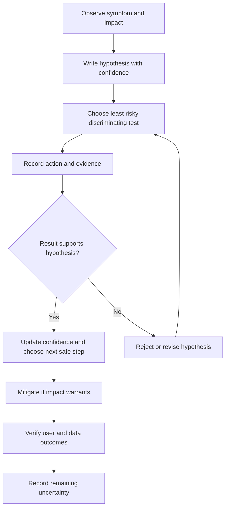
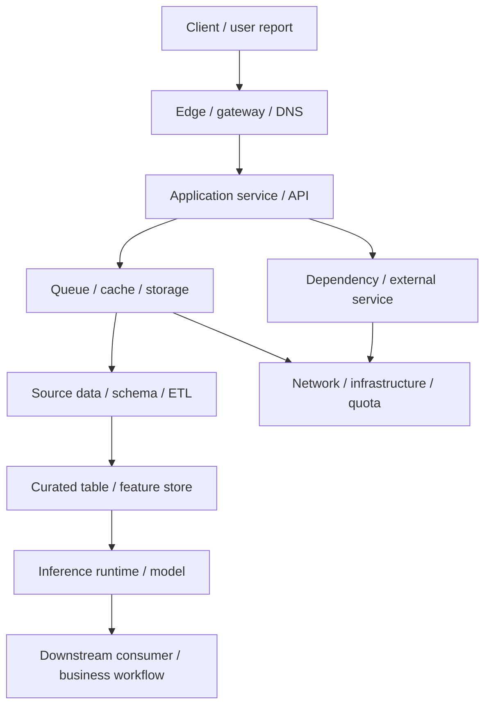
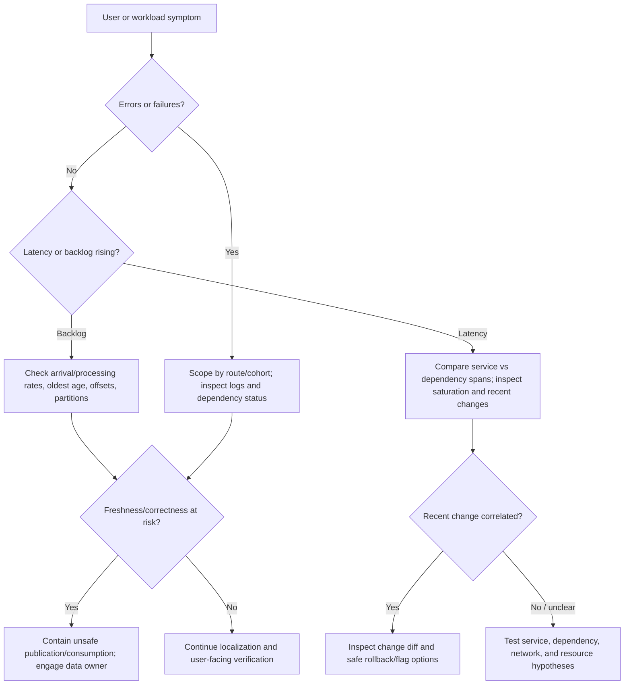
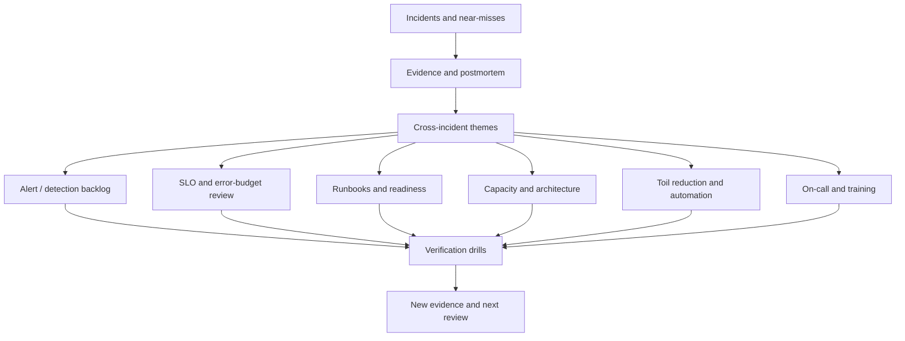

# Unit 5 — Production Triage and Blameless Postmortems

> **Stage:** Stage 2E — Production DevOps & Platform Engineering  
> **Module:** M10 — Site Reliability Engineering and Incident Management  
> **Unit:** 5 — Production triage and blameless postmortems  
> **Exact target:** `05-production-triage-and-blameless-postmortems.md`  
> **Lab policy:** zero-budget, local-only, synthetic data; never use real customer records, secrets, production logs, or personal data.  
> **Truth labels:** `[ILLUSTRATIVE]` synthetic examples; `[ASSUMPTION]` local design choice; `[VERIFY]` confirm the source/tool/version; `[NOT EXECUTED]` not run in the learner's current workspace; author-side scratch validation is reported separately; `[MEASURED BY LEARNER]` capture in your own exercise; `[OPTIONAL]` enrichment.

This unit teaches a repeatable way to localize production symptoms, test hypotheses safely, correlate signals without confusing correlation with causation, verify mitigation, and turn incidents and near-misses into practical system improvements. The goal is not to guess the cause fastest. The goal is to reduce harm, preserve evidence, make uncertainty visible, and improve the system.

---

## 1. Learning Outcomes and Completion Criteria

### 1.1 L1–L4 progression

| Level | Capability | Observable evidence |
|---|---|---|
| **L1 — Foundations** | Describe impact, ask “what changed?”, use the observe–hypothesize–test loop, distinguish facts from hypotheses, explain blamelessness and accountability | Structured triage record and neutral incident summary |
| **L2 — Practical triage** | Localize at least ten symptom classes, correlate metrics/logs/traces/events/change markers, choose and verify a safe mitigation, reconstruct a timeline, write a postmortem | Local scripts/tests, completed postmortem, evidence links and UTC timeline |
| **L3 — Causal reasoning** | Compare RCA methods, identify interacting contributing factors, examine local rationality and latent conditions, prioritize effective actions | Three-method analysis of one incident and a verified action tracker |
| **L4 — Program learning** | Govern postmortems, detect recurring patterns in a synthetic corpus, derive a reliability roadmap, learn from success and near-misses | Trend report, quality rubric, publication/review policy, prioritized roadmap |

### 1.2 Completion gate

The learner must demonstrate that they can:

- complete a structured first-response triage record;
- investigate “what changed?” across relevant release, configuration, dependency, data, and infrastructure sources;
- use `observe → hypothesize → test safely → record result → update/reject hypothesis`;
- localize at least ten symptom classes using safe first checks;
- correlate telemetry and change markers without claiming causation from timing alone;
- select a mitigation with explicit blast-radius, reversibility, data/security risk, approval, stop condition, and verification;
- verify user-visible behavior and data correctness/freshness/coverage/lag as relevant;
- build and test the merged-timeline script;
- write a complete postmortem from synthetic drill artifacts;
- rewrite ten blame-oriented statements;
- compare 5 Whys, fishbone, and barrier analysis on the same incident;
- improve twelve weak action items and define verification criteria;
- run cross-incident analysis over 30 synthetic records and derive a reliability roadmap;
- facilitate or role-play a blameless review meeting;
- preserve evidence and label unknowns honestly.

Reading the chapter is not evidence that labs passed. Any command or test not run must remain `[NOT EXECUTED]`.

### 1.3 The operational principle

Triage and postmortems serve different but connected purposes:

- **Triage** asks: what is happening, who/what is affected, how urgently, what changed, and what safe action reduces harm?
- **Postmortem analysis** asks: how did the incident unfold, which system conditions shaped it, what helped or hindered detection and response, and which changes will reduce future risk?

Triage is time-sensitive and action-oriented. A postmortem is evidence-oriented and learning-oriented. Neither requires premature certainty about a single root cause.

---

## 2. Prerequisites, Lab Environment, and Unit Boundaries

### 2.1 Prerequisites and resource assumptions

The learner is assumed to have completed Stages 0–2D and M10 Units 1–4, and to understand basic metrics, logs, traces, deployment history, service-level indicators (SLIs), service-level objectives (SLOs), and incident roles. A local M08 FastAPI service and fault injector may be available, but the core labs must remain possible with synthetic data alone.

`[ASSUMPTION]` Core labs use Python 3.10+ and the standard library. Some tests use `pytest` if it is already installed; do not install a paid or cloud service. Confirm the actual interpreter with `python --version`. The chapter does not assume production access.

Suggested scratch workspace:

```text
m10-unit5-lab/
├── data/
│   ├── alert-events.jsonl
│   ├── deploy-events.jsonl
│   ├── flag-events.jsonl
│   ├── app-logs.jsonl
│   ├── chat-events.jsonl
│   └── incidents.csv
├── src/
│   ├── merge_timeline.py
│   └── trend_report.py
├── tests/
│   ├── test_merge_timeline.py
│   └── test_trend_report.py
├── artifacts/
│   ├── triage-record.md
│   ├── hypothesis-ledger.md
│   ├── postmortem.md
│   ├── action-tracker.csv
│   └── reliability-roadmap.md
└── evidence/
    ├── commands.txt
    ├── test-output.txt
    └── measured-timings.md
```

Create these learner artifacts outside the curriculum repository. They are examples of scratch files, not files created by this chapter authoring process.

### 2.2 Cross-unit boundaries

| Topic | Unit 5 scope | Deeper owner |
|---|---|---|
| SLI/SLO/error budget | Use as impact context; do not reteach foundations | M10 Unit 1 |
| Batch, streaming, inference targets | Use freshness, correctness, lag, and inference metrics | M10 Unit 2 |
| Alert quality/routing | Treat alerts as evidence, not diagnosis | M10 Unit 3 |
| Severity, roles, incident declaration | Reuse existing incident record and role concepts | M10 Unit 4 |
| Capacity and cascading failures | Include symptoms and escalation; do not replace deep treatment | M10 Unit 6 |
| Toil/automation | Feed repeated manual work into the backlog | M10 Unit 7 |
| Runbooks/readiness | Use and identify runbook gaps | M10 Unit 8 |
| Error-budget policy/release freeze | Link findings to policy review | M10 Unit 9 |
| On-call sustainability | Consider fatigue, context switching, and relief | M10 Unit 10 |
| DORA metrics | Do not conflate incident metrics with DORA metrics | M10 Unit 11 |
| Kubernetes | Reuse known read-only checks | M03 Unit 11 |
| Network/DNS | Reuse network triage | M04 Unit 10 |
| Storage/persistence | Reuse storage checks | M05 Unit 8 |
| Change/release | Correlate Git, rollout, flag, CI/CD, GitOps, and IaC events | M07/M08 |
| Credential compromise or sensitive exposure | Transition to authorized security/privacy process | M09 Unit 8 / M12 |
| Observability architecture | Practical correlation only | M11 |

### 2.3 Source ambiguity and resolution

The curriculum specifies required capabilities and lab outcomes but does not fix every schema, local threshold, tool version, or action-item scoring scale. This chapter marks those choices `[ASSUMPTION]`. USE/RED attribution, Swiss-cheese/Safety-II references, and hierarchy-of-controls framing must be verified against primary sources before formal attribution. Legal or regulatory notification decisions vary and belong to authorized legal/compliance functions; this course gives no legal advice.

---

## 3. Production Triage: Principles and First Questions

### 3.1 What triage means

Production triage is a rapid, evidence-based assessment of:

1. what is broken or behaving unexpectedly;
2. who or what is affected;
3. how severe the impact is;
4. when it started;
5. whether it is worsening;
6. what changed;
7. what the quickest safe mitigation might be.

Triage is not a race to name a cause. A useful initial statement might be: “The `inference-api` success ratio is below its normal range in region-west since 14:02 UTC; the cause is unknown; impact is being scoped; the next check is route-level errors and dependency latency.” It is more operationally useful than “the new model is broken” when the evidence only shows temporal correlation.

### 3.2 First-response checklist

- **Impact:** which customers, endpoints, tenants, regions, datasets, partitions, consumers, or business processes are affected?
- **Timeline:** first known symptom, detection time, onset confidence, duration, trend, deadline.
- **Scope:** all traffic or a cohort? One region or many? One partition or the whole dataset?
- **Change:** release, config, flag, traffic, dependency, data/schema, credentials/certificates, quota, infrastructure/IaC, scheduled event?
- **Evidence:** metrics, logs, traces, audit records, alert history, deployment markers, user reports.
- **Risk:** could data be wrong, missing, duplicated, stale, or exposed? Could a mitigation cause irreversible side effects?
- **Mitigation:** what action is authorized, reversible, proportionate, and measurable?
- **Verification:** which user-facing SLI and workload-specific correctness signals demonstrate recovery?
- **Communication:** who owns the next update and what remains unknown?

### 3.3 Three-question diagnosis structure

| Question | What it tests | Example evidence |
|---|---|---|
| **Is it us or a dependency?** | Is the service itself failing, or is an upstream/downstream system slow or unavailable? | App latency vs dependency latency; error codes; trace spans; dependency status |
| **Is it new or old?** | Did the symptom begin around a recent change, or does it predate the change? | Deploy/flag/config timeline, previous baseline, recurring issue records |
| **Is it everyone or a subset?** | Is impact broad or cohort-specific? | Region, endpoint, tenant, model version, partition, consumer, traffic cohort |

These are questions, not a fixed diagnostic algorithm. A dependency can fail because our retry policy overloads it; a new release can expose an old latent weakness; a subset-only symptom can still be severe if the subset is critical.

### 3.4 Golden signals and USE/RED

The commonly used golden signals are latency, traffic, errors, and saturation. RED commonly refers to Rate, Errors, and Duration for request-oriented services. USE commonly refers to Utilization, Saturation, and Errors for resources. `[VERIFY]` Confirm exact attribution and definitions in the primary sources used by your organization before presenting these as formal standards.

These views are complementary:
- RED helps describe what a service experiences from request traffic.
- USE helps localize resource pressure.
- Golden signals provide a compact high-level view.

Limitations: a green API health check does not prove data correctness; averages can hide a slow cohort; CPU can be high without customer impact; errors can be hidden by retries; missing telemetry can create false confidence. Add domain signals: ETL freshness and partition coverage, stream lag and oldest-event age, feature freshness, model fallback ratio, and downstream validation results.

### 3.5 Triage loop



The loop is iterative. In an urgent incident, mitigation may occur before diagnosis is complete. Record that the action was a risk-based response, not proof of cause.

---

## 4. Triage Checklist: What Changed?

### 4.1 Change-correlation inventory

| Change category | What to inspect | Common false lead / caution |
|---|---|---|
| Deploy/release | Git commit, build artifact, rollout events, version distribution | Latest deploy is not automatically causal |
| Configuration | Config diff, environment variables, runtime config, feature settings | Drift may be old or limited to one cohort |
| Feature flag | Audit log, targeting rules, percentage rollout, flag evaluation | Flag state can differ by tenant/region |
| Traffic/load | Request rate, batch overlap, seasonality, traffic mix, retries | Load may be a trigger, not the underlying weakness |
| Dependency | Dependency latency/errors, status, quota, connection pool | Our retry behavior may amplify a vendor slowdown |
| Data/schema | Source schema, partition keys, null/duplicate rate, upstream contract | Job exit status does not prove complete output |
| Certificate/secret/credential | Expiry/rotation records, auth failures, trust chain | Do not expose secrets or copy credentials into incident channels |
| Quota/rate limit | Provider quota, 429s, throttling, usage changes | Increasing quota can mask an inefficient request pattern |
| Infrastructure/IaC | Apply events, node/volume/network changes, autoscaler events | Infrastructure event and symptom timing is correlation |
| Schedule/time | Cron overlap, cache expiry, certificate rotation, daylight/time-zone effects | Check timezone assumptions and periodic recurrence |
| Model/feature artifact | Model version, feature snapshot age, schema compatibility | HTTP success may still return incorrect predictions |
| Storage/queue | Disk/IOPS, queue depth, consumer offsets, oldest-event age | Queue depth alone may not reveal business freshness |

### 4.2 “What changed?” record

```markdown
## What Changed? — [incident ID]

- Symptom onset (UTC; confidence):
- Detection time (UTC):
- Recent releases / commits / rollout events:
- Configuration changes:
- Feature-flag changes:
- Traffic/load/retry changes:
- Dependency changes or incidents:
- Source data/schema/partition changes:
- Certificate/secret/credential expiry or rotation:
- Quotas/rate limits:
- Infrastructure/IaC/storage/network changes:
- Scheduled/time-based events:
- Model/feature changes:
- Evidence source and event IDs:
- Confirmed changes:
- Correlated but unproven changes:
- Evidence that would weaken the leading hypothesis:
- Owner and next check-in (UTC):
```

### 4.3 Change-correlation timeline example

All values below are `[ILLUSTRATIVE]`.

| UTC | Event | Evidence | What can be inferred? |
|---|---|---|---|
| 13:55 | New inference release begins | Rollout history | A change occurred |
| 14:02 | p95 latency increases | Metrics snapshot | Symptom onset estimate |
| 14:03 | Dependency latency increases | Trace/dependency dashboard | Dependency is a competing hypothesis |
| 14:05 | Error ratio rises in one route | Route-level metrics | Impact is not uniform |
| 14:08 | Controlled rollback starts | Change record | Mitigation was attempted |
| 14:11 | Latency improves | Metrics | Rollback correlates with improvement; not proof by itself |
| 14:15 | Output validation still pending | Validation job | Service recovery is not full verification |

The causal claim requires more evidence than the fact that two events are close in time. Record what was known at each decision point and what alternative explanations remain.

### 4.4 Template: initial triage record

```markdown
## Initial Triage — [incident ID]

- Symptom:
- Affected users/workloads:
- Start time and confidence (UTC):
- Detection time (UTC):
- Trend: improving / stable / worsening / unknown
- Scope: region / route / tenant / dataset / partition / consumer
- Severity / incident link (from Unit 4):
- User-visible impact:
- Data correctness/freshness risk:
- Confirmed facts and evidence:
- Unknowns / hypotheses:
- “What changed?” findings:
- First safe checks:
- Next discriminating test:
- Mitigation candidate and authority:
- Verification signals:
- Escalation boundary:
- Owner and next update (UTC):
```

---

## 5. Scientific Debugging and Evidence Discipline

### 5.1 Observe → hypothesize → test → conclude

1. **Observe:** record the symptom, scope, timestamp, and source.
2. **Hypothesize:** explain a possible mechanism, including confidence and alternatives.
3. **Test safely:** choose a read-only or low-risk test that distinguishes hypotheses.
4. **Record result:** include exact command/query, time, actor, output summary, and evidence reference.
5. **Update or reject:** increase/decrease confidence; do not force evidence to fit the first story.
6. **Mitigate:** if impact requires it, choose the safest authorized action; a mitigation need not wait for root cause.
7. **Verify:** use user-visible and domain-specific signals.

### 5.2 One variable at a time—when possible

Changing one variable at a time improves interpretability because the result is easier to associate with the action. But production incidents can require parallel investigation and immediate harm reduction. If several actions are necessary, record each one and its timing; avoid making multiple unrelated changes without a decision record unless delay would create greater risk.

### 5.3 Hypothesis ledger template

```markdown
| ID | Hypothesis | Supporting evidence | Contradictory evidence | Confidence | Safe test | Owner | Result / next decision |
|---|---|---|---|---|---|---|---|
| H1 | Release increased retry amplification | Symptom follows rollout; retries rise | Dependency latency also rose | Medium | Compare route and dependency traces; inspect retry config | | |
```

Confidence is a disciplined statement of uncertainty, not a fake precision score. If you use numeric confidence, define it and avoid pretending it is statistically calibrated.

### 5.4 Triage decision log template

```markdown
| UTC time | Observation | Hypothesis | Action/test | Actor/approval | Result | Evidence | Follow-up |
|---|---|---|---|---|---|---|---|
| 2026-10-28T14:02:00Z | Error ratio increased | Cause unknown | Compare route metrics | on-call / read-only | Route B affected most | evidence/metric-01 | inspect release + dependency |
```

### 5.5 Evidence discipline

- Preserve the original source reference, timestamp, and query parameters where appropriate.
- Separate **fact**, **hypothesis**, **decision**, **action**, and **result**.
- Record uncertainty and contradictory evidence.
- Prefer read-only checks before changes.
- Do not paste secrets, raw customer payloads, or sensitive personal data into broad incident channels.
- Do not delete or overwrite evidence while “cleaning up” unless authorized procedures require it.
- Avoid hindsight wording: “obviously,” “should have known,” and “the only possible cause.”
- A healthy pod/process is one observation, not proof of user-visible recovery.
- A rollback that improves latency is evidence about a mitigation effect, not by itself a complete causal analysis.

### 5.6 Layered localization



Use the diagram as a map, not as an assumption that requests follow only one path. Data and AI systems often have asynchronous paths: a prediction API may be healthy while the feature pipeline is stale, and a completed ETL job may have published partial data.

### 5.7 Command safety and prior-module reuse

Start with safe read-only checks. Use the exact syntax taught in the relevant earlier module and verify installed versions. Examples of command families—not commands guaranteed to fit every environment—include:
- M03: inspect workload status, recent events, rollout state, logs;
- M04: DNS resolution, connectivity, certificate chain, route/path checks;
- M05: disk capacity, storage latency, mount/volume health, persistence events;
- M07/M08: Git history, deployment/rollout history, feature-flag audit log, CI/CD or GitOps events, IaC apply records;
- M11: correlate metrics, logs, traces, and annotations.

Mark environment-specific command flags `[VERIFY]`. Never copy a destructive command from a postmortem without understanding its blast radius and approval path.

---

## 6. Symptom-Based Triage Playbook and Decision Trees

The following playbooks are generic starting points. Exact commands, dashboards, ownership, thresholds, and approval paths are environment-specific. Use synthetic drills only; production action requires authorized procedures.

### 6.1 Symptom decision tree



### 6.2 Ten-symptom triage table

| Symptom | First safe checks and evidence | Hypotheses to distinguish | Safe test / mitigation candidate | Verification | Escalate when / danger |
|---|---|---|---|---|---|
| **1. Error spike** | Scope by route, status, region, tenant; inspect recent logs/traces and deploy markers | Bad release, dependency errors, auth/quota, malformed input | Compare versions/cohorts; rollback or disable route only with authority | User-facing success ratio, error distribution, correctness | Growing scope, critical workflow failure; beware retries hiding errors |
| **2. Latency spike** | p50/p95/p99, request rate, dependency spans, queue time, saturation | Slow dependency, pool exhaustion, expensive code, traffic mix | Compare a safe unaffected cohort; shed noncritical load or rollback if justified | Latency and success ratio sustained; verify output correctness | Deadline or critical SLO risk; beware average masking tail latency |
| **3. Saturation/resource pressure** | CPU/memory/IO, queue depth, throttling, restart/eviction history | Capacity shortage, leak, traffic surge, downstream backpressure | Approved scale, shed load, disable expensive optional work | Resource headroom plus user outcome; dependency not overloaded | Resource exhaustion spreading; scaling can amplify dependency load |
| **4. Stale or late data** | Data watermark, latest partition timestamp, scheduler status, freshness SLI | Source delay, failed schedule, schema drift, partial publish | Pause unsafe publication, rerun only after validation and approval | Freshness, partition coverage, quality checks, consumer acceptance | Business deadline or critical feature freshness; job “success” can mislead |
| **5. Queue/stream lag growth** | Arrival vs processing rate, oldest-event age, consumer offsets, partition skew | Consumer slowdown, poison event, dependency, retry storm | Bound replay, scale under policy, pause risky consumers if needed | Lag/oldest age declining, no duplicates/loss, consumer correctness | Deadline/data-loss risk; offset catch-up is not always business freshness |
| **6. Crash loop/restarts** | Recent events, exit code, memory/OOM, config and secret changes | Bad image/config, dependency startup failure, resource limit | Roll back/restore known-good config or reduce load if approved | Stable workload and successful user requests | Repeated crash across fleet; do not delete evidence or blindly restart |
| **7. Dependency failure** | Dependency latency/error, trace spans, status/quota, network checks | Vendor outage, connection pool, DNS, local retry amplification | Bounded fallback, route around dependency, circuit/feature disable per runbook | User SLI, fallback semantics, queue growth and dependency load | Multiple services affected; avoid unbounded retries/failover loops |
| **8. Bad deploy/config/flag** | Change diff, rollout history, version/cohort correlation, flag audit | Release regression, incompatible schema, unrelated dependency issue | Pause rollout, flag off, rollback/abort after compatibility check | User SLI plus data/model correctness and downstream behavior | Expanding impact or rollback risk; latest change is not automatically cause |
| **9. Expired certificate/secret/credential** | Expiry metadata, handshake/auth errors, rotation/audit records | Expiry, bad trust chain, clock skew, wrong identity/permission | Follow approved rotation/renewal path; never expose secret | Authenticated end-to-end request, correct identity, no new exposure | Suspected compromise or sensitive exposure → authorized security path; do not paste secrets |
| **10. Missing/incorrect/partial output** | Row/partition counts, schema, null/duplicate rates, lineage, consumer status | Partial ETL, schema change, source omission, stale feature snapshot | Quarantine output, pause downstream consumption, notify data owner/consumers | Coverage, correctness, freshness, lineage, replay/backfill validation | Unknown consumer exposure or irreversible data effects; API health is insufficient |

### 6.3 Symptom playbook structure

For each incident, fill in the same sequence:
1. impact and scope;
2. first safe checks;
3. evidence sources;
4. competing hypotheses;
5. least risky discriminating test;
6. candidate mitigation and authority;
7. stop condition/rollback;
8. verification signals;
9. escalation boundary;
10. evidence and next update time.

### 6.4 Common false leads

- **“CPU is high, so CPU caused the incident.”** High CPU may be a consequence of retries or traffic mix.
- **“The last deploy caused it.”** It is a hypothesis; dependency or schedule changes may coincide.
- **“The pod is green, so service is fixed.”** User success, latency, correctness, and downstream effects remain to verify.
- **“The ETL job succeeded, so data is complete.”** Validate partitions, schema, row counts, freshness, and lineage.
- **“The consumer offset advanced, so the stream is healthy.”** Oldest-event age, processing correctness, and consumer acceptance matter.
- **“The credential error is only an expiry.”** If compromise or exposure is plausible, transition to the authorized security process.

---

## 7. Signal Correlation, Change History, and Localization

### 7.1 Correlate, do not conflate

A useful incident picture aligns:
- metrics and SLI changes;
- logs with timestamps, request IDs, and error context;
- traces/spans showing where latency or failure occurs;
- alert history and monitor gaps;
- deploy, configuration, flag, schema, and IaC events;
- dependency status and quota events;
- batch/streaming data-quality and freshness records;
- customer/support reports and business deadlines.

Ensure timestamps use known timezone semantics. Normalize to UTC for the merged view. Preserve the original timestamp and source ID so the normalization can be audited.

### 7.2 Change sources of truth

Depending on the lab environment, inspect Git history, Argo CD/Flux events, rollout history, feature-flag audit logs, CI/CD records, IaC apply logs, schema registry or data contract changes, certificate rotation records, and dependency status. These are candidate sources, not a claim that every tool is installed.

### 7.3 Correlation checklist

- What is the exact user/workload symptom?
- When did it start, and how certain is that timestamp?
- Which cohort/region/route/dataset/partition/consumer is affected?
- What changed shortly before onset?
- Which telemetry sources agree, and which disagree?
- Is telemetry itself stale, sampled, delayed, or missing?
- What evidence would falsify the leading hypothesis?
- What is the least risky discriminating test?
- What mitigation reduces harm fastest without creating a larger risk?
- Which user-facing and data-specific signals will prove success?

### 7.4 Timeline provenance

Every merged event should retain:
- normalized UTC timestamp;
- original timestamp string;
- source name and source event ID;
- event type;
- actor/owner if known;
- evidence reference;
- description;
- quality flags (missing/invalid timestamp, duplicate candidate, unknown actor);
- confidence/interpretation notes.

Timestamp order is not causal order. A log emitted late may describe an earlier event; clock skew and asynchronous ingestion can reorder observations. Never silently discard malformed records or merge two records just because their text looks similar.

### 7.5 Template: merged timeline event schema

```json
{
  "timestamp_utc": "2026-10-28T14:02:00Z",
  "original_timestamp": "2026-10-28T14:02:00+00:00",
  "source": "alert-events",
  "source_event_id": "alert-0007",
  "event_type": "alert_fired",
  "actor": "monitoring",
  "evidence_ref": "data/alert-events.jsonl:7",
  "description": "Synthetic inference error ratio crossed threshold",
  "quality_flags": [],
  "confidence_note": "Timestamp is explicit; causality not inferred"
}
```

---

## 8. Mitigation Selection and Recovery Verification

### 8.1 Mitigation-first principle

When impact is active, stop or reduce harm before pursuing complete root-cause certainty. Candidate actions include rollback/abort, feature-flag off, scale, failover, route shift, shed load, disable a feature, restore from backup, pause a pipeline, quarantine bad output, or use a controlled manual override. These actions are not interchangeable and must follow the relevant runbook and decision rights from Unit 4.

### 8.2 Mitigation decision matrix

| Option | Potential benefit | Key risks | Required verification |
|---|---|---|---|
| Rollback/abort release | Return to known version | Schema/model/config incompatibility; rollback may not undo side effects | User SLI, version distribution, output/data correctness |
| Feature flag off / kill switch | Fast, scoped behavior change | Flag targeting inconsistency; fallback semantics may be unsafe | Cohort behavior, fallback correctness, audit record |
| Scale up | Add capacity | May overload dependencies or exceed quota | Queue/latency/resource signals and dependency health |
| Failover / traffic shift | Route around unhealthy zone/dependency | Stale features, data inconsistency, capacity limits, split brain | User SLI, data freshness/consistency, failback plan |
| Pause pipeline / quarantine | Prevent unsafe data propagation | Downstream delay, storage growth, missed deadlines | Quarantine scope, consumer notifications, validated replay |
| Restore/reprocess | Recover lost or corrupted state | Overwrite valid data, duplicate side effects, wrong backup point | Lineage, coverage, dedupe, integrity and consumer acceptance |

### 8.3 Mitigation decision record template

```markdown
## Mitigation Decision — [incident ID]

- Decision time (UTC):
- Impact to reduce:
- Candidate action:
- Proposer:
- Authorized approver:
- Blast radius:
- Reversibility:
- Data-integrity risk:
- Security/privacy risk:
- Dependencies/preconditions:
- Runbook/change reference:
- Stop condition:
- Rollback/fallback:
- Verification signals:
- Observed result and timestamp:
- Residual risk:
- Follow-up owner:
```

### 8.4 Recovery verification

Use separate gates:

**Service recovery**
- user-facing SLI is within the expected range;
- the affected cohort is included, not only an aggregate;
- the recovery persists for a locally defined observation window `[ASSUMPTION]`;
- the mitigation did not shift failure to a dependency or another region.

**Data/business verification**
- data is complete, correct, fresh, and consistent;
- partitions and schema match expectations;
- replay/backfill has no unaccounted loss or duplication;
- inference feature/model outputs pass appropriate checks;
- downstream consumers know what to trust and what to reprocess.

Do not declare full resolution solely because a process, pod, or health endpoint is green. If verification is incomplete, state “service recovered; data validation pending” and assign the remaining work.

### 8.5 Template: mitigation verification checklist

```markdown
- [ ] User-visible SLI recovered and sustained
- [ ] Affected cohort/region/route verified
- [ ] Dependency and saturation side effects checked
- [ ] Data freshness/coverage/correctness checked where relevant
- [ ] Queue/stream lag and oldest-event age checked where relevant
- [ ] Replay/backfill and duplicate/loss risks addressed
- [ ] Security/privacy concerns handed to authorized responders
- [ ] Customer/business communication updated by authorized owner
- [ ] Residual risk and open work have named owners
- [ ] Evidence and timeline preserved
- [ ] Learning handoff assigned
```


---

## 9. Postmortems and Blameless Learning

### 9.1 Definition and purpose

A **postmortem** is a structured record of an incident and the learning derived from it. It describes impact, detection, response, timeline, contributing factors, what went well, what went poorly, where the team got lucky, and follow-up actions. It should help a future responder recognize and manage a similar situation sooner and more safely.

Postmortems matter because repeated incidents, unexamined near-misses, missing evidence, hindsight bias, blame, and unowned actions prevent organizational learning. A document is not itself improvement; the follow-up actions and their verification close the loop.

### 9.2 Blameless does not mean no accountability

Blameless analysis asks how the system, tools, incentives, information, constraints, and controls made the outcome possible. It assumes people generally acted with the information and options available to them at the time. It does **not** erase factual responsibility for actions, remove action owners, or excuse failure to follow up. Individual performance management, where relevant, belongs in a separate appropriate process and must not be smuggled into the postmortem.

Compare:

- **Blaming:** “Alex forgot to check the flag and broke production.”
- **System-focused:** “The flag rollout had no automated cohort verification; the runbook did not expose the current targeting rule, and the available dashboard aggregated affected and unaffected tenants. The review will test how those controls can be added.”

The second wording is not softer on the system failure. It is more actionable and testable.

### 9.3 Facts, trigger, cause, contributing factors, and consequence

| Term | Meaning | Example |
|---|---|---|
| **Observation/fact** | Evidence directly recorded | Error ratio increased after a rollout marker |
| **Trigger** | Event that immediately preceded or activated failure | A new retry setting took effect |
| **Cause/mechanism** | Mechanism by which behavior produced the outcome, supported by evidence | Retries multiplied calls to a slow dependency |
| **Contributing factor** | Condition that increased likelihood, impact, or duration | No retry budget, limited dependency saturation alert |
| **Detection gap** | Why the problem was not detected or localized sooner | Alert grouped routes and hid cohort-specific errors |
| **Mitigation** | Action that reduced harm | Rollback reduced retry amplification |
| **Consequence** | Resulting harm or near-miss | Customer requests failed; a dependent stream accumulated lag |

Do not insist on one singular “root cause” when the evidence supports interacting factors. Prefer “how the incident unfolded” and “contributing factors” where more accurate.

### 9.4 What a useful postmortem answers

- What was the user/business/data impact, and how was it estimated?
- When did impact begin, when was it detected, and what is uncertain?
- What signals and changes were visible at each point?
- What decisions were made, with what evidence and constraints?
- What mitigations helped, failed, or created new risk?
- What went well, what went poorly, and where did the team get lucky?
- Which technical, process, organizational, and human-factor conditions contributed?
- What changes will prevent, detect, or mitigate recurrence?
- Who owns each action, by when, and how will effectiveness be verified?

### 9.5 Complete blameless postmortem template

```markdown
# Postmortem — [incident title]

- Incident ID:
- Status: draft / review / published / follow-up
- Incident date/window (UTC):
- Severity under local policy:
- Facilitator:
- Author:
- Reviewers:
- Publication date:
- Audience / redaction restrictions:

## 1. Summary
- What happened (brief, factual):
- What was affected:
- How service was restored:
- What remains uncertain:

## 2. Impact
- Users/customers/consumers affected:
- Services, routes, regions, datasets, partitions:
- Start/end time and duration (UTC):
- SLO/error-budget impact, if measured:
- Data correctness/freshness/coverage impact:
- Financial/operational impact, if known:
- Impact estimation method and evidence:
- Confidence/known gaps:

## 3. Detection
- How detected:
- First credible signal (UTC):
- Detection time (UTC):
- Detection gap:
- Why the signal was/was not actionable:

## 4. Response and timeline
- Incident Commander / response roles:
- Key decisions and approvals:
- Mitigations attempted and results:
- UTC timeline appendix:
- Evidence references:

## 5. How the incident unfolded
- Trigger(s), if supported:
- Technical mechanism(s), if supported:
- Contributing factors:
- Detection and response conditions:
- Process/organizational conditions:
- Human factors and local rationality:
- Alternative hypotheses and unresolved uncertainty:

## 6. What went well
- Controls, tools, teamwork, or adaptations that reduced harm:
- Evidence:

## 7. What went poorly
- Detection, response, tooling, process, or verification gaps:
- Evidence:

## 8. Where we got lucky / near-miss
- Potentially worse outcome:
- Condition that prevented it:
- How that condition could fail next time:

## 9. Action items
| ID | Action | Type (prevent/detect/mitigate/process) | Priority | Owner | Due date | Tracking issue | Verification criterion | Status |
|---|---|---|---|---|---|---|---|---|

## 10. Lessons learned
- What should future responders know?
- Which assumptions were wrong?
- What should be tested in a drill?

## 11. Publication and safety
- Sensitive details removed or restricted:
- Security/privacy/legal review required/completed:
- Customer-facing summary approved by:
- Links checked for access and secrets:
- Publication decision:

## 12. Follow-up
- Review date:
- Action-item owner:
- Effectiveness check:
- Related incidents/tags:
- Cross-team learning destination:

## Appendix A — UTC timeline
| UTC timestamp | Source | Event type | Observation/action/decision/result | Actor | Evidence reference | Confidence/quality note |
|---|---|---|---|---|---|---|
```

### 9.6 Writing standards

Write factually, specifically, and neutrally. Define acronyms; use UTC; link numerical claims to evidence; state uncertainty; distinguish the information available at the time from knowledge learned later. Avoid “obviously,” “should have known,” “careless,” “the only cause,” and statements about motives without evidence. Keep technical facts intact; blameless language must not hide what happened or remove ownership for follow-up.

### 9.7 Postmortem types and timing

`[ASSUMPTION]` A local program may require a full postmortem for incidents above a locally defined severity/impact threshold, a lightweight review for near-misses and low-impact events, and aggregate review for recurring patterns. Thresholds and publication targets are organization-specific. An illustrative target such as “publish within five working days” is not an industry standard; choose a realistic local target and preserve evidence early, before memory and logs decay.

---

## 10. Timeline Reconstruction and Postmortem Writing

### 10.1 Reconstruction sources

A merged timeline can draw from alert events, deployment/rollout events, feature-flag changes, application logs, incident chat, CI/CD/IaC records, data-quality checks, and dependency events. Keep each source event identity and original timestamp. Normalize valid timestamps to UTC; mark invalid or missing timestamps rather than silently dropping them.

### 10.2 Timeline reconstruction principles

- Record source and source event ID.
- Preserve original timestamp string.
- Convert explicit offsets to UTC.
- Treat naive timestamps as ambiguous and flag them; do not silently assume the host's local timezone.
- Retain malformed events in an error/quality list so a reviewer can investigate them.
- Detect possible duplicates without collapsing conflicting events.
- Sort deterministically by normalized timestamp, then source, then source event ID.
- State clearly that chronological order does not prove causality.

### 10.3 Merged timeline builder — complete starter code

Save as `src/merge_timeline.py`. It reads JSON Lines files from the scratch workspace. Each file contains one JSON object per line. This script is standard-library only.

```python
#!/usr/bin/env python3
"""Merge synthetic incident JSONL sources into a provenance-preserving UTC timeline."""
import argparse
import json
import sys
from datetime import datetime, timezone
from pathlib import Path

SOURCE_FILES = {
    "alert-events": "alert-events.jsonl",
    "deploy-events": "deploy-events.jsonl",
    "flag-events": "flag-events.jsonl",
    "app-logs": "app-logs.jsonl",
    "chat-events": "chat-events.jsonl",
}
REQUIRED = {"event_id", "timestamp", "event_type", "description"}


def normalize_timestamp(value):
    """Return (UTC ISO string or None, quality flag). Naive timestamps are not guessed."""
    if not isinstance(value, str) or not value.strip():
        return None, "missing_timestamp"
    raw = value.strip()
    try:
        parsed = datetime.fromisoformat(raw.replace("Z", "+00:00"))
    except ValueError:
        return None, "invalid_timestamp"
    if parsed.tzinfo is None or parsed.utcoffset() is None:
        return None, "naive_timestamp_timezone_unknown"
    utc = parsed.astimezone(timezone.utc).replace(microsecond=0)
    return utc.isoformat().replace("+00:00", "Z"), None


def read_source(path, source_name):
    events, issues = [], []
    path = Path(path)
    if not path.exists():
        issues.append({"source": source_name, "line": None, "issue": "source_file_missing",
                       "path": str(path)})
        return events, issues
    with path.open(encoding="utf-8") as handle:
        for line_number, raw_line in enumerate(handle, start=1):
            if not raw_line.strip():
                continue
            try:
                row = json.loads(raw_line)
            except json.JSONDecodeError as exc:
                issues.append({"source": source_name, "line": line_number,
                               "issue": "malformed_json", "detail": str(exc)})
                continue
            if not isinstance(row, dict):
                issues.append({"source": source_name, "line": line_number,
                               "issue": "record_not_object"})
                continue
            missing = sorted(REQUIRED - row.keys())
            if missing:
                issues.append({"source": source_name, "line": line_number,
                               "issue": "missing_required_fields", "fields": missing})
                continue
            normalized, timestamp_issue = normalize_timestamp(row.get("timestamp"))
            flags = []
            if timestamp_issue:
                flags.append(timestamp_issue)
                issues.append({"source": source_name, "line": line_number,
                               "issue": timestamp_issue, "event_id": row.get("event_id"),
                               "original_timestamp": row.get("timestamp")})
            events.append({
                "timestamp_utc": normalized,
                "original_timestamp": row.get("timestamp"),
                "source": source_name,
                "source_event_id": str(row["event_id"]),
                "event_type": str(row["event_type"]),
                "actor": str(row.get("actor", "unknown")),
                "evidence_ref": str(row.get("evidence_ref", f"{path}:{line_number}")),
                "description": str(row["description"]),
                "quality_flags": flags,
            })
    return events, issues


def merge_sources(directory):
    directory = Path(directory)
    events, issues = [], []
    for source, filename in SOURCE_FILES.items():
        loaded, found_issues = read_source(directory / filename, source)
        events.extend(loaded)
        issues.extend(found_issues)

    # Detect duplicates but preserve both records and their source provenance.
    seen = {}
    for event in events:
        fingerprint = (event["source"], event["source_event_id"])
        if fingerprint in seen:
            event["quality_flags"].append("duplicate_source_event_id")
            issues.append({"source": event["source"], "issue": "duplicate_source_event_id",
                           "event_id": event["source_event_id"]})
        else:
            seen[fingerprint] = True

    # Valid timestamps first; invalid/ambiguous timestamp records remain visible at the end.
    events.sort(key=lambda e: (
        e["timestamp_utc"] is None,
        e["timestamp_utc"] or "",
        e["source"],
        e["source_event_id"],
    ))
    return {"events": events, "issues": issues,
            "causality_note": "Timestamp order is not proof of causal order."}


def main():
    parser = argparse.ArgumentParser(description=__doc__)
    parser.add_argument("--input-dir", default="data")
    parser.add_argument("--output", default="artifacts/merged-timeline.json")
    args = parser.parse_args()
    result = merge_sources(args.input_dir)
    output = Path(args.output)
    output.parent.mkdir(parents=True, exist_ok=True)
    output.write_text(json.dumps(result, indent=2, sort_keys=True) + "\n", encoding="utf-8")
    print(json.dumps({"events": len(result["events"]), "issues": len(result["issues"]),
                      "output": str(output), "causality_note": result["causality_note"]}, indent=2))
    return 0


if __name__ == "__main__":
    try:
        raise SystemExit(main())
    except OSError as exc:
        print(f"ERROR: {exc}", file=sys.stderr)
        raise SystemExit(2)
```

### 10.4 Synthetic input data

Create the five files in `data/`. Each file is JSONL: one object per line. Values and timestamps are `[ILLUSTRATIVE]`.

`data/alert-events.jsonl`
```json
{"event_id":"alert-001","timestamp":"2026-10-28T14:02:00Z","event_type":"alert_fired","description":"Synthetic inference error ratio crossed threshold","actor":"monitoring"}
```

`data/deploy-events.jsonl`
```json
{"event_id":"deploy-001","timestamp":"2026-10-28T13:55:00+00:00","event_type":"deployment","description":"Synthetic inference release rollout began","actor":"release-system"}
```

`data/flag-events.jsonl`
```json
{"event_id":"flag-001","timestamp":"2026-10-28T14:01:00+00:00","event_type":"flag_change","description":"Synthetic route flag changed for cohort west","actor":"release-owner"}
```

`data/app-logs.jsonl`
```json
{"event_id":"log-001","timestamp":"2026-10-28T14:02:30+00:00","event_type":"application_error","description":"Synthetic upstream timeout observed","actor":"inference-api","evidence_ref":"trace://synthetic/001"}
{"event_id":"log-002","timestamp":"timestamp-unknown","event_type":"application_error","description":"Malformed timestamp example remains in issue list","actor":"inference-api"}
```

`data/chat-events.jsonl`
```json
{"event_id":"chat-001","timestamp":"2026-10-28T14:04:00Z","event_type":"decision","description":"IC requests route-level comparison before mitigation decision","actor":"incident-commander"}
```

### 10.5 Timeline builder tests

Save as `tests/test_merge_timeline.py`. Run with `python -m unittest discover -s tests -v`; no external test framework is required.

```python
import json
import tempfile
import unittest
from pathlib import Path
from src.merge_timeline import merge_sources, normalize_timestamp, read_source


class TimelineTests(unittest.TestCase):
    def test_timezone_normalization(self):
        normalized, issue = normalize_timestamp("2026-10-28T19:32:00+05:30")
        self.assertEqual(normalized, "2026-10-28T14:02:00Z")
        self.assertIsNone(issue)

    def test_naive_timestamp_is_flagged(self):
        normalized, issue = normalize_timestamp("2026-10-28T14:02:00")
        self.assertIsNone(normalized)
        self.assertEqual(issue, "naive_timestamp_timezone_unknown")

    def test_malformed_timestamp_is_not_silently_dropped(self):
        with tempfile.TemporaryDirectory() as tmp:
            path = Path(tmp) / "events.jsonl"
            path.write_text(json.dumps({
                "event_id": "e1", "timestamp": "yesterday",
                "event_type": "test", "description": "bad timestamp"
            }) + "\n", encoding="utf-8")
            events, issues = read_source(path, "test-source")
            self.assertEqual(len(events), 1)
            self.assertIn("invalid_timestamp", events[0]["quality_flags"])
            self.assertEqual(issues[0]["issue"], "invalid_timestamp")

    def test_missing_fields_are_reported(self):
        with tempfile.TemporaryDirectory() as tmp:
            path = Path(tmp) / "events.jsonl"
            path.write_text('{"event_id":"e1","timestamp":"2026-10-28T14:00:00Z"}\n',
                            encoding="utf-8")
            events, issues = read_source(path, "test-source")
            self.assertEqual(events, [])
            self.assertEqual(issues[0]["issue"], "missing_required_fields")

    def test_sorting_is_deterministic_and_duplicates_flagged(self):
        with tempfile.TemporaryDirectory() as tmp:
            root = Path(tmp)
            for filename in ("alert-events.jsonl", "deploy-events.jsonl",
                             "flag-events.jsonl", "app-logs.jsonl", "chat-events.jsonl"):
                (root / filename).write_text("", encoding="utf-8")
            event = {"event_id": "same", "timestamp": "2026-10-28T14:00:00Z",
                     "event_type": "test", "description": "duplicate"}
            (root / "alert-events.jsonl").write_text(
                json.dumps(event) + "\n" + json.dumps(event) + "\n", encoding="utf-8")
            result1 = merge_sources(root)
            result2 = merge_sources(root)
            self.assertEqual(result1, result2)
            self.assertEqual(len(result1["events"]), 2)
            self.assertTrue(any("duplicate_source_event_id" in e["quality_flags"]
                                for e in result1["events"]))

    def test_missing_source_file_is_reported(self):
        with tempfile.TemporaryDirectory() as tmp:
            result = merge_sources(tmp)
            self.assertTrue(any(i["issue"] == "source_file_missing" for i in result["issues"]))


if __name__ == "__main__":
    unittest.main()
```

**Author-side scratch validation:** the extracted timeline and trend scripts returned exit code 0; the 12 standard-library tests passed; the timeline output contained 6 events and 1 timestamp-quality issue; the trend report accepted 30 synthetic rows. The Python harness emitted an unrelated spreadsheet-runtime startup warning to stderr while the commands still returned exit code 0. These results validate the extracted starter code and supplied fixtures in this scratch environment, not the learner's machine or the M08 service. Save your own output as `[MEASURED BY LEARNER]` and investigate any local differences.

### 10.6 Postmortem review meeting

A review meeting should reconstruct what happened and prioritize learning, not stage a trial. Suggested agenda `[ASSUMPTION]` for a 60-minute meeting:
1. 5 min — purpose, ground rules, impact summary;
2. 10 min — timeline from evidence;
3. 10 min — decisions and local rationality at each point;
4. 10 min — contributing factors and alternate hypotheses;
5. 5 min — what went well;
6. 5 min — what went poorly;
7. 5 min — where we got lucky/near-miss;
8. 5 min — prioritize actions and assign owners;
9. 5 min — unresolved questions, publication/redaction, and follow-up.

Questions for the facilitator:
- What did responders know at that moment?
- What did the tools make easy or difficult to see?
- What constraints and trade-offs were present?
- Which safeguards were absent, ineffective, or hard to use?
- What evidence would change our interpretation?
- What went well and should be preserved?
- Where did we get lucky?
- Which one or two actions most reduce risk, and how will we test them?

### 10.7 Postmortem review meeting template

```markdown
## Postmortem Review Meeting

- Incident / date:
- Facilitator:
- Attendees/roles:
- Ground rules reviewed:
- Evidence reviewed:
- Timeline disagreements and resolution:
- Decisions evaluated with information available at the time:
- Contributing factors:
- What went well:
- What went poorly:
- Where we got lucky / near-miss:
- Actions proposed, ranked, and owners:
- Unresolved questions:
- Redaction/security/privacy/legal review:
- Publication owner and target date:
- Follow-up review date:
```


---

## 11. Causal Analysis Methods and Their Limits

### 11.1 Compare methods rather than searching for a magic answer

| Method | Best use | Common misuse / limitation | Evidence discipline |
|---|---|---|---|
| **5 Whys** | Explore a causal chain from an observed problem | Forces a linear chain; can terminate at “human error”; the number five is not a rule | Each “why” must be a testable statement supported by evidence |
| **Fishbone/Ishikawa** | Generate candidate contributors across categories | Can become an unprioritized list; categories do not prove causation | Tag each factor as fact, hypothesis, or missing evidence |
| **Fault-tree analysis** | Model combinations of failures that can produce a top event | Results depend on boundaries and assumptions; can omit human/organizational interactions | State gates, logic, and assumptions explicitly |
| **Timeline analysis** | Reconstruct event order and decision context | Sequence is not causation; timestamps can be skewed or delayed | Preserve source provenance and time uncertainty |
| **Change analysis** | Compare changes and symptoms across versions/cohorts | Over-attributes to the latest deployment | Look for unaffected cohorts, alternative changes, and falsifying evidence |
| **Barrier analysis** | Examine safeguards that were absent, failed, or bypassed | Can overfocus on formal controls and miss incentives or adaptive work | Ask how each barrier was expected to work and what made it usable/unusable |
| **Causal-factor charting** | Connect events, conditions, and outcomes over time | Can imply stronger causal certainty than evidence supports | Label confidence and distinguish direct evidence from interpretation |

### 11.2 Same incident through 5 Whys, fishbone, and barrier analysis

Synthetic incident `[ILLUSTRATIVE]`: after a feature-flag rollout, inference latency and errors rise for one cohort. Retries increase load on a shared dependency. Rollback improves latency. Output correctness validation is delayed because the initial dashboard only shows aggregate request health.

**5 Whys (illustrative draft)**
1. Why did inference errors rise? Requests timed out while calling a dependency.
2. Why did calls time out? Retry volume increased while dependency latency rose.
3. Why did retries increase? The new flag/config changed retry behavior for the affected cohort.
4. Why was this behavior not caught before rollout? The canary did not include a dependency-load guardrail.
5. Why was there no guardrail? The release checklist did not assign ownership for validating retry amplification.

This is a hypothesis chain, not a proven cause. Evidence still needed includes the actual flag/config diff, trace-level retry counts, dependency telemetry, and canary design history. Stopping at “someone changed the flag” would not explain why the system allowed a high-impact failure.

**Fishbone/Ishikawa categories**
- **Technology:** retry policy, dependency pool limits, aggregate dashboard, missing cohort-level metric.
- **Process:** canary checklist did not test dependency pressure; rollback validation not documented.
- **Data/product:** output correctness check was separate and delayed.
- **Organization:** ownership of retry policy and dependency budget unclear.
- **Human factors:** responders had conflicting dashboards and incomplete context under time pressure.
- **Environment:** traffic mix and dependency latency changed around the same time.

Fishbone produces candidate contributors; it does not rank or prove them.

**Barrier analysis**
- Barrier expected: staged rollout/canary. Gap: canary did not include dependency saturation or route-level error checks.
- Barrier expected: bounded retries. Gap: retry budget/limit may not have applied to the cohort; verify implementation.
- Barrier expected: alerting. Gap: aggregate signal obscured cohort impact.
- Barrier expected: rollback. Gap: rollback reduced latency, but no required output-correctness gate was documented.
- Barrier expected: incident communication. Gap: status was based on API health before downstream validation.

**Synthesis:** the incident may involve several interacting factors: rollout guardrails, retry behavior, observability granularity, dependency capacity, and recovery verification. Do not select one as the single root cause until evidence supports that conclusion.

### 11.3 Systems thinking and local rationality

Complex systems often fail through interacting conditions rather than a single defective component. A responder’s choice may have been reasonable given the dashboard, runbook, access, deadline, and constraints available at the time. **Local rationality** asks why the action made sense from that perspective, then investigates what information or control could improve the decision.

Human error is a starting point for inquiry, not an endpoint. Investigate:
- unclear UI/CLI behavior;
- missing guardrails or validation;
- ambiguous runbooks;
- alert fatigue and noisy signals;
- time pressure, staffing, and handoff conditions;
- knowledge silos and unclear ownership;
- incentives that reward shipping while underfunding reliability;
- test environments that fail to represent production;
- controls that exist on paper but are difficult to use.

### 11.4 Hindsight and outcome bias

- **Hindsight bias:** after learning the outcome, people perceive it as more predictable than it was.
- **Outcome bias:** judging a decision only by its result, rather than the evidence and constraints at the time.

Avoid statements such as “the responder should obviously have known.” Instead ask what evidence was available, how trustworthy it was, what alternatives were visible, and what guardrail could make the safe choice easier next time.

### 11.5 Swiss-cheese model and Safety-II awareness

`[VERIFY]` The Swiss-cheese model is commonly associated with layered defenses and how aligned weaknesses can permit harm. Safety-II and learning-from-incidents perspectives emphasize how everyday work adapts and succeeds as well as how it fails. Verify the precise original sources and attribution before using these concepts in formal training. They are awareness lenses, not mandatory SRE standards.

Useful questions include: which defenses were expected to catch this, how did they interact, and what adaptations kept the service running? Do not treat the diagram as a complete causal model.

### 11.6 Barrier / fault-tree template

```markdown
## Causal Analysis Notes — [incident ID]

- Top event / user impact:
- System boundary and assumptions:
- Confirmed timeline facts:
- Candidate trigger:
- Contributing factors (technical/process/organizational/human factors):
- Barriers expected to prevent the event:
- Barriers expected to detect it:
- Barriers expected to limit impact:
- Which barriers were absent, failed, or difficult to use?
- Evidence for/against each claim:
- Alternative explanations:
- Missing evidence and owner:
- What would change the analysis?
```

---

## 12. Action Items, Near-Misses, and Organizational Learning

### 12.1 Effective action items

A useful action item is specific, scoped, owned, time-bound, prioritized, testable, linked to a tracking mechanism, and accompanied by a verification criterion. It names the risk addressed and how the team will know the change worked.

`[VERIFY]` A common course heuristic ranks interventions roughly as **eliminate/prevent > detect > mitigate > document/train**. Verify the exact source and hierarchy attribution before describing this as a formal hierarchy-of-controls framework. This is a heuristic, not an automatic ranking: a fast detection control may be essential when prevention is not feasible.

### 12.2 Action-item quality table

| Weak action | Why weak | Stronger version `[ILLUSTRATIVE]` | Verification |
|---|---|---|---|
| Be more careful | Not testable; person-focused | Add a required config validation check to CI for the retry/timeout combination; owner: release-platform; due: date | CI rejects three planted invalid configs |
| Add monitoring | No signal, owner, or threshold | Add route-level error ratio and dependency retry-rate panels and alerts; owner: service team | Synthetic cohort failure is detected within local target |
| Improve reliability | No scope or outcome | Add a bounded retry budget and test dependency degradation under load | Test confirms retries remain within budget |
| Write better docs | No measurable change | Update rollback runbook with compatibility precheck and verification gate | Peer runs the documented drill without missing steps |
| Fix the data pipeline | Too broad | Validate expected partition set before publishing curated table | Missing-partition fixture blocks publication |
| Tell support sooner | No mechanism | Add a status-update trigger and named comms backup to incident checklist | Tabletop meets update cadence and review checklist |
| Train engineers | Training alone may not change system conditions | Add a safe rollout exercise plus automated guardrail | Drill and CI test show guardrail catches regression |
| Review dependencies | No deliverable | Map dependency owners, quotas, fallback semantics, and escalation path | Quarterly ownership test verifies contacts |
| Reduce MTTR | Ambiguous metric and incentive | Measure time-to-service-recovery and time-to-data-verification separately | Dashboard definitions reviewed and sample case computes correctly |
| Prevent recurrence | Not an action | Add regression test reproducing the failure mechanism and require it in CI | Test fails before fix and passes after fix |
| Check alerts | No scope | Review false negatives for stale-data signal across synthetic scenarios | All planted stale-data cases are detected |
| Share lessons | No owner/audience | Publish redacted postmortem to searchable archive and run a cross-team review | Publication link and attendance/feedback recorded |

### 12.3 Prioritize without action-item bloat

Prioritize using:
- expected risk reduction and recurrence likelihood;
- severity/blast radius and data/security consequences;
- action effectiveness and evidence strength;
- implementation effort and uncertainty;
- dependencies and ownership readiness;
- verification cost and time to benefit.

`[ASSUMPTION]` A simple priority scheme (P0/P1/P2) can be used locally, but define what each means. Avoid creating fifteen equally urgent actions. Pick a small number of high-value controls, assign owners and due dates, and defer or merge lower-value actions transparently.

### 12.4 Action-item tracker template

```markdown
| ID | Action | Type | Risk addressed | Priority | Owner role/alias | Due date | Dependency | Tracking issue | Verification test | Status | Completion evidence |
|---|---|---|---|---|---|---|---|---|---|---|---|
| A-01 | Block publication if required partition missing | prevent | Silent partial output | P1 | data-platform | YYYY-MM-DD | data contract | issue-ref | Missing-partition fixture blocks publish | open | |
```

An action is not complete merely because the ticket is closed. Record the verification result and revisit if the control failed or the incident recurred.

### 12.5 Near-miss and “where we got lucky” learning

A near-miss is a situation where harm was narrowly avoided or a safeguard/adaptation prevented a worse outcome. Capturing near-misses is often cheaper than learning only after outages. Do not make incident counts or postmortem counts a target that discourages reporting.

### 12.6 Template: near-miss record

```markdown
## Near-Miss / Where We Got Lucky

- Date/time (UTC):
- Workload and potential impact:
- What happened (observed facts):
- What worse outcome was possible:
- What condition or adaptation prevented it:
- Evidence:
- Why that protection might not work next time:
- Contributing system conditions:
- Follow-up action and owner:
- Verification criterion:
- Sensitive information / publication restrictions:
```

### 12.7 Data and security incidents

For data incidents, use lineage to map affected tables, partitions, features, models, and downstream consumers. Quarantine unsafe output, notify authorized owners/consumers, plan replay/backfill/reprocessing, validate correctness, and define compensating controls. Do not assume restoring the source repairs already-consumed downstream data.

For suspected credential compromise, unauthorized access, or sensitive-data exposure, preserve evidence and move into the authorized security/privacy process (M09 Unit 8/M12). Restrict distribution and do not paste secrets or raw sensitive data into broad channels. Legal/compliance obligations are awareness only; consult authorized counsel/compliance.

### 12.8 Template: sensitive publication/redaction checklist

```markdown
- [ ] Audience and purpose are defined
- [ ] Customer identifiers, personal data, credentials, tokens, and secret values removed
- [ ] Sensitive security details restricted to approved channels
- [ ] Evidence references remain accessible to authorized reviewers
- [ ] Technical facts and impact estimates remain accurate after redaction
- [ ] External/customer summary reviewed by authorized communications owner
- [ ] Security/privacy/legal review completed if required by local policy
- [ ] No unsupported legal conclusion or notification deadline stated
- [ ] Links and attachments checked for unintended access
- [ ] Publication owner and review date recorded
```

### 12.9 Learning from success and adaptive work

Postmortems should preserve what worked: a useful dashboard, a safe workaround, a clear ownership map, a responder’s adaptation, or a timely customer report. Record why it worked and which conditions made it possible. Avoid assuming success happened because of individual heroics; ask how the organization can make the useful behavior repeatable and less dependent on one expert.

---

## 13. Cross-Incident Analysis and Reliability Roadmap

### 13.1 Taxonomy schema

Use a small stable vocabulary so records can be compared. Unknown values should be explicit (`unknown`) rather than silently dropped.

```csv
incident_id,month,service,severity,contributing_factor,detection_source,mitigation_type,impact_band,duration_minutes,change_related,dependency_related,data_security_impact,recurrence_link,near_miss,action_status,action_age_days
INC-2026-101,2026-01,inference-api,SEV2,retry_policy,alert,rollback,partial,32,true,true,none,,false,open,18
```

The sample row is `[ILLUSTRATIVE]`. Use unique IDs, defined tags, nonnegative durations/ages, and explicit booleans. The corpus should cover 6–12 synthetic months and 30 unique incidents. Do not mix real incident records into the lab.

### 13.2 Trend-reporting questions

- Which contributing-factor tags appear most often?
- Which detection sources reveal incidents, and which failure classes were discovered by users or downstream consumers instead?
- Which mitigations were used, and how long did mitigation take?
- What share of records are change-related or dependency-related?
- Which workload types and impact bands recur?
- How many actions are open, complete, overdue, or missing owners?
- What near-misses or “got lucky” cases suggest a missing control?
- Which two or three investments would most reduce risk, and what evidence supports them?

A small synthetic corpus is a teaching exercise, not statistically significant evidence about a real organization. Counts depend on tagging and the scenarios selected. Do not claim causality from frequency alone.

### 13.3 Cross-incident report example

All values below are `[ILLUSTRATIVE]`, not measured data.

| Pattern | Synthetic observation | Interpretation | Candidate action |
|---|---|---|---|
| Retry amplification | 7/30 records tagged `retry_policy` | Retry behavior may amplify dependency incidents | Add bounded retry budgets and a dependency-degradation drill |
| Data validation gap | 5/30 records tagged `data_quality`; 3 discovered by consumers | Pipeline completion may be mistaken for correctness | Validate expected partitions/schema before publish |
| Change correlation | 12/30 tagged change-related | Release/config events deserve correlation, not automatic blame | Improve rollout guardrails and cohort-level telemetry |
| Detection gap | 4/30 first noticed by downstream consumers | Monitoring may not cover business freshness/correctness | Add synthetic consumer-facing freshness checks |
| Action backlog | 9/30 have open actions older than 30 days | Ownership/capacity may be weak | Assign owners, due dates, risk ranking, monthly follow-up |
| Near-miss | 3/30 near-miss tags | Useful safeguards may be undocumented | Capture the protection and test its failure boundary |

### 13.4 Derive a reliability roadmap

For each theme, state:
- supporting incident IDs and counts;
- confidence and possible tagging bias;
- risk/impact addressed;
- recommended intervention;
- owner role;
- priority and effort/uncertainty;
- success measure and verification test;
- review date.

Example `[ILLUSTRATIVE]`:

| Priority | Theme/evidence | Intervention | Owner role | Success measure | Confidence |
|---|---|---|---|---|---|
| P1 | Partial ETL outputs appear repeatedly | Add partition/schema validation gate before publish | Data platform | Missing/invalid fixtures block publication | Medium; synthetic tags may be biased |
| P1 | Dependency retry amplification recurs | Bound retries and test dependency slowness | Service/platform | Retry count remains within budget under drill | Medium |
| P2 | Consumers detect stale data first | Add freshness SLI and consumer-facing synthetic check | Data product owner | Stale-data drill triggers alert before deadline | Medium |
| P2 | Old actions remain open | Monthly action review and closure evidence requirement | Reliability program owner | Lower overdue-action count without weakening quality | Low/medium |
| P3 | Near-miss protections are undocumented | Add “where we got lucky” review to postmortem template | Facilitator/owner | Near-miss records include protection and test | Medium |

### 13.5 How learning flows back to engineering



Unit 9 owns the formal error-budget policy. Unit 5 supplies evidence about which causes consume budget and which actions may reduce recurrence; it does not define release-freeze rules.

### 13.6 Template: cross-incident taxonomy

```markdown
- Incident ID (stable and unique):
- Month/window:
- Service/workload:
- Severity/impact band:
- Contributing-factor tags:
- Detection source:
- Mitigation type:
- Duration definition and minutes:
- Change-related? (true/false/unknown):
- Dependency-related? (true/false/unknown):
- Data/security impact:
- Recurrence link:
- Near-miss / where-we-got-lucky tag:
- Action status:
- Action age (days) and due date:
- Tagging confidence / evidence:
```

### 13.7 Template: reliability roadmap

```markdown
| Theme | Supporting records | Confidence / bias | Risk and impact | Intervention | Owner role | Priority | Effort / uncertainty | Success measure | Verification test | Review date |
|---|---|---|---|---|---|---|---|---|---|---|
```


---

## 14. Hands-On Labs

All labs use synthetic data and local resources. Save command output, test results, timestamps, and decisions in the scratch workspace. Commands are `[NOT EXECUTED]` unless explicitly run by the learner.

### Lab A — Triage playbook for at least 10 symptom classes

**Objective:** build a local playbook using Section 6 for all ten required symptom classes.

**Procedure**
1. Copy the ten-symptom table into `artifacts/triage-playbook.md`.
2. For each symptom, add the first safe checks appropriate to the learner’s local stack.
3. Reference the exact prior-module command/source and mark version-dependent syntax `[VERIFY]`.
4. Add a decision tree for at least one service symptom and one data-correctness symptom.
5. Identify which actions require an authorized owner.
6. Add one false lead and one verification signal per class.

**Acceptance criteria**
- All ten classes covered.
- Every class has impact, checks, hypotheses, safe test, mitigation candidate, verification, escalation, and danger.
- Destructive commands are not recommended as first checks.
- Data correctness and security/privacy risks have explicit handling.
- No real production data is used.

**Evidence:** completed playbook, references to prior modules, and a short reflection on the two most ambiguous symptoms.

### Lab B — Three live-lab triage drills

The actual M08 service and fault injector may not be available in this authoring environment. This lab provides a safe synthetic fallback; it does not claim a live service drill occurred.

**Drill 1 — Bad deployment/config regression**
- Game master injects: route-level errors rise shortly after a synthetic config change.
- Learner records impact, scope, change hypothesis, contradictory evidence, and a safe check.
- Mitigation candidate: pause rollout/flag off/rollback only after compatibility and authority checks.
- Stop condition: any action could alter real service or requires access not explicitly authorized.
- Verification: user-facing success/latency and output correctness.

**Drill 2 — Dependency latency/failure**
- Inject: dependency latency and retry volume increase; application error rate rises.
- Learner distinguishes local service saturation from dependency latency and retry amplification.
- Mitigation candidate: bounded fallback or route around dependency only if semantics and authority permit.
- Verification: user SLI, dependency pressure, queue growth, fallback correctness.

**Drill 3 — Resource saturation**
- Inject: synthetic CPU/memory/queue saturation and rising request latency.
- Learner identifies whether pressure is a cause or consequence, and whether scale-up would overload a dependency.
- Mitigation candidate: approved scale, shed load, disable optional work.
- Verification: resource headroom plus user outcome and downstream health.

For each drill, capture `[MEASURED BY LEARNER]`:
- time-to-localization;
- time-to-mitigation attempt;
- time-to-effective mitigation;
- time-to-service verification;
- time-to-data/business verification, if relevant;
- hypotheses considered and evidence that changed confidence.

These laptop times are not production benchmarks.

**Self-contained fallback:** use the synthetic event sequence in Lab D and act as both game master and responder. Explicitly record that this does not exercise the M08 service or its fault injector.

**Cleanup:** no production service should have been changed. Reset only the local synthetic data and service state according to the local lab runbook.

### Lab C — Merged-timeline builder with tests

**Objective:** merge alert, deploy, flag, app-log, and chat sources while preserving provenance and surfacing malformed timestamps.

**Setup**
1. Create `m10-unit5-lab/data`, `src`, `tests`, and `artifacts`.
2. Save Section 10’s `merge_timeline.py` and test file.
3. Create the five JSONL files from Section 10.4.
4. Run:

```bash
python --version
python src/merge_timeline.py --input-dir data --output artifacts/merged-timeline.json
python -m unittest discover -s tests -v
```

These commands are intended for the learner's workspace; author-side scratch validation is summarized in Section 10.5. Because the sample test imports `src.merge_timeline`, ensure the scratch directory is the current working directory and Python can import `src`; an empty `src/__init__.py` may be added as a learner-created scratch file if the local interpreter requires it.

**Expected result shape:** a short JSON summary with event count, issue count, output path, and causality note; the output JSON retains every validly parsed record, including timestamp-quality flags, and includes issues for missing files/invalid timestamps.

**Acceptance criteria:** timezone normalization works; naive timestamps are flagged; malformed timestamp records are retained and reported; duplicate source IDs are flagged without deleting events; missing source files/fields are reported; repeated runs produce deterministic output.

**Troubleshooting:** if imports fail, run from the workspace root and check package paths. If a timestamp lacks an offset, do not guess local timezone—add the explicit offset to the synthetic source or preserve the flagged ambiguity. Save actual stdout/stderr and test summary as `[MEASURED BY LEARNER]`.

### Lab D — Full postmortem from a synthetic drill

**Objective:** write a complete postmortem using Section 9’s template and score it with the quality rubric in Section 18.

**Synthetic artifacts `[ILLUSTRATIVE]`**
- 13:55 UTC: rollout begins for `inference-api`.
- 14:02 UTC: route B p95 latency increases and error ratio rises.
- 14:03 UTC: dependency latency also increases.
- 14:05 UTC: one cohort is disproportionately affected; aggregate dashboard hides the difference.
- 14:08 UTC: authorized owner approves rollback after compatibility check.
- 14:11 UTC: latency improves and error ratio returns toward baseline.
- 14:14 UTC: API success checks pass for the observed cohort.
- 14:16 UTC: data/output correctness validation remains pending.
- 14:25 UTC: validation job shows no obvious schema error, but historical downstream consumer state is unavailable.

**Required output:** summary, impact estimate and uncertainty, detection, timeline, trigger and contributing factors, response, what went well/poorly/where we got lucky, action items, verification criteria, supporting evidence, UTC appendix, and publication/redaction decision.

**Model analysis:** the release/config change and dependency latency are both relevant signals, but timing alone does not prove the release caused the dependency behavior. The rollback’s effect supports a mitigation link but does not establish every causal mechanism. Because historical downstream consumer state is unavailable, state that downstream correctness/exposure remains unresolved; do not claim fully verified recovery. Reasonable alternatives are acceptable if the learner separates facts from hypotheses and identifies discriminating evidence.

**Acceptance:** no fabricated certainty; impact estimates show source/method; at least three contributing-factor candidates with evidence status; action items have owners, due dates, priorities, linked tracking references, and tests; residual uncertainty is explicit.

### Lab E — Blameless-language rewrite exercise

Rewrite each statement into a factual, system-focused statement that preserves evidence, decision context, and a testable learning question.

| # | Blaming / hindsight-biased statement | Model rewrite `[ILLUSTRATIVE]` |
|---|---|---|
| 1 | “The engineer forgot to check the flag.” | “The rollout process did not require a recorded flag-targeting verification; the audit log shows the flag state was not included in the review artifact.” |
| 2 | “The team should obviously have rolled back sooner.” | “At the decision point, the aggregate dashboard showed partial recovery while route-level data was unavailable. Review whether route-level verification and a rollback trigger should be explicit.” |
| 3 | “Ops broke the service with a bad change.” | “After the configuration change, error ratio increased. The diff and cohort evidence should be examined to establish the mechanism and identify missing safeguards.” |
| 4 | “Nobody cared about the alerts.” | “The alert generated repeated pages without a clear action or owner; responders had learned to discount it. Review signal quality and ownership.” |
| 5 | “The on-call person was careless.” | “The runbook’s recovery step did not include a precondition check, and the interface did not surface the destructive effect. Add a guardrail and test.” |
| 6 | “The pipeline owner should have known the data was wrong.” | “The job reported success despite missing a partition; validation was not a publication gate. Add expected-partition validation.” |
| 7 | “The team ignored the dependency warning.” | “Dependency latency was visible in a separate dashboard but was not in the incident summary. Correlate dependency and service signals in the primary triage view.” |
| 8 | “The handoff was terrible.” | “The handoff omitted unresolved data verification and lacked an explicit incoming acknowledgement. Make those fields required and test the transfer.” |
| 9 | “We were lucky; next time don't make that mistake.” | “A downstream consumer did not read the partial output before quarantine. Record the safeguard and test the scenario where the consumer reads it earlier.” |
| 10 | “They took too long because they didn't understand the system.” | “Ownership and dependency maps were incomplete, so localization required multiple manual requests. Assign owners and verify the map in a tabletop.” |

**Rewrite rubric:** 0 = still shaming/speculative; 1 = neutral but vague; 2 = factual and contextual; 3 = factual, context-aware, names contributing conditions and a testable control. Maximum 30 points `[ASSUMPTION]`; suggested pass is 24 with no statement that hides material facts. The rubric is a course exercise, not an industry standard.

### Lab F — RCA-methods comparison

Use the synthetic inference incident in Section 11.2. Produce three artifacts:
1. a 5 Whys chain with evidence status for each link;
2. a fishbone with technical, process, organization, data/product, human-factor, and environment candidates;
3. a barrier analysis listing prevention, detection, and mitigation safeguards.

Compare assumptions, blind spots, and possible false conclusions. List at least three contributing factors, two alternative hypotheses, and evidence that could change the analysis. Do not force all three methods to produce the same “root cause.”

**Acceptance:** at least five method-specific limitations identified; each causal claim is labelled fact/hypothesis/unknown; no individual is named as the cause; proposed actions address system conditions.

### Lab G — Action-item quality workshop

Rewrite all twelve weak actions from Section 12.2. For each include:
- specific deliverable and scope;
- risk addressed;
- category: prevent/detect/mitigate/process;
- priority and risk-reduction rationale;
- owner role/person alias;
- due date;
- dependency/tracking issue;
- verification test and completion evidence.

**Acceptance:** all twelve rewritten; at least six have automated or repeatable verification; priorities are justified; action count is reduced/merged where redundant; no item is marked complete without evidence.

### Lab H — Cross-incident analysis over 30 synthetic records

**Objective:** create a 30-record synthetic corpus, run the trend script in Section 14.3 below, and derive a prioritized reliability roadmap.

**Dataset requirements:** 30 unique IDs; 6–12 illustrative months; service/workload, severity/impact band, contributing-factor tag, detection source, mitigation type, duration, change-related and dependency-related flags, data/security impact, recurrence link, near-miss flag, action status and age. Include known unknowns explicitly.

**Acceptance:** script validates required fields, duplicate IDs, empty data, durations/ages, and unknown tags; outputs counts, shares, summaries, repeated patterns, action-item age/completion, and candidate roadmap themes. Include tests for missing fields, unknown tags, duplicate IDs, empty data, and deterministic output. Explain why 30 synthetic rows do not predict real incident rates.

### Lab I — Postmortem review meeting and learning follow-through

**Roles:** facilitator, incident owner, technical responder, stakeholder, scribe. A solo learner switches hats explicitly and records that solo practice cannot demonstrate real group dynamics.

**Facilitator script**
1. Open with the purpose: learn and improve the system, not assign blame.
2. Agree ground rules: facts over assumptions, respect, no hindsight claims, distinguish facts/hypotheses, preserve sensitive information.
3. Reconstruct the timeline from evidence; record disagreements rather than forcing false consensus.
4. Ask what each role knew and could see at the time.
5. Review contributing factors and alternate explanations.
6. Ask what went well, what went poorly, and where the team got lucky.
7. Convert findings into a small set of prioritized actions with owners, due dates, and verification.
8. Review unresolved questions, redaction, security/privacy/legal escalation if applicable, and publication.
9. Set a follow-up date and action-review owner.

**Sample action tracker `[ILLUSTRATIVE]`**

| ID | Action | Type | Priority | Owner | Due | Verification | Status |
|---|---|---|---|---|---|---|---|
| A-01 | Add missing-partition publish gate | Prevent | P1 | Data platform | 2 weeks | Fixture with missing partition blocks publication | Open |
| A-02 | Add route-level error panel | Detect | P1 | Service owner | 3 weeks | Synthetic cohort failure visible in dashboard | Open |
| A-03 | Add downstream verification to recovery runbook | Process | P2 | SRE lead | 4 weeks | Tabletop checklist includes data gate | Open |

**Closure test:** reject any action missing owner, due date, priority, type, tracking reference, or success criterion. Review whether the action reduced risk after implementation. Publication must be timely but safe; sensitive cases may need restricted distribution and authorized review.

---

## 15. Anti-Patterns, Troubleshooting, and Failure Scenarios

### 15.1 Anti-patterns and safer replacements

| Anti-pattern | Why it fails | Safer replacement | Follow-up |
|---|---|---|---|
| Guess before establishing impact | Response targets a theory instead of harm | Write scope, trend, and user/data impact first | Unit 4 / triage record |
| Change many variables without recording | Results become uninterpretable | Record each action; isolate variables where feasible | M08 change process |
| Assume latest deploy caused it | Timing is not causation | Compare cohorts, dependencies, traffic, and falsifying evidence | Change analysis |
| Treat correlation as proof | Confounding changes may exist | Label correlation and test mechanisms | Section 5 |
| Declare recovery because pod is healthy | User-facing behavior may still fail | Verify SLI and affected cohort | M10 Units 1–2 |
| Ignore data freshness/correctness | Silent corruption can persist after API recovery | Verify coverage, freshness, lineage, consumers | M10 Unit 2 |
| Copy destructive command blindly | Can expand blast radius or destroy evidence | Read runbook, verify scope, approval, stop condition | M03–M08 |
| Restart/rollback before preserving evidence | May erase useful diagnostics | Preserve evidence where safe and appropriate; mitigate urgent harm if needed | Incident policy |
| Call “human error” the cause | Stops investigation at a person | Investigate tools, guardrails, incentives, constraints | Section 11 |
| Force 5 Whys into one chain | Hides interacting conditions | Compare multiple causal methods | Lab F |
| Use “obviously/should have known” | Hindsight bias shuts down learning | Reconstruct local rationality | Postmortem review |
| Confuse blamelessness with no accountability | Actions remain unowned | Name action owners and separate performance process | Governance |
| Vague action with no owner/test | Cannot verify risk reduction | Specific, owned, due-dated, testable action | Lab G |
| Create too many unprioritized actions | Everything becomes nobody’s priority | Rank by risk reduction and feasibility | Unit 7 |
| Close actions without testing | Ticket status substitutes for effectiveness | Record test result and revisit failures | Action tracker |
| Publish sensitive details too broadly | Creates additional exposure | Redact/restrict and engage authorized reviewers | M09/M12 |
| Delay publication until evidence decays | Timeline and context become unreliable | Preserve evidence early; publish within local target | Governance |
| Reward fewer incidents/postmortems | Discourages reporting | Measure learning and risk controls, not low counts | Program governance |
| Overclaim from 30 synthetic rows | Small, selected data cannot prove real rates | Report transparent counts and caveats | Lab H |
| Ignore near-misses | Lost opportunity to improve before harm | Capture “where we got lucky” and test the safeguard | Section 12 |

### 15.2 Seven organizational failure cases: diagnose → fix → prevent

1. **A postmortem named an engineer and near-miss reporting stopped.**  
   Diagnose: blame and fear likely reduced reporting; inspect language, review process, and leadership signals. Fix: correct the record, separate any individual-performance process, and restate the learning purpose. Prevent: facilitator training, publication rubric, and periodic psychological-safety feedback `[VERIFY]` measurement methods.

2. **Actions were never completed and the same incident recurred twice.**  
   Diagnose: no owner/capacity/verification or action review. Fix: rank existing actions, assign accountable owners/dates, link tracking issues. Prevent: monthly review of age/completion and effectiveness, not just ticket closure.

3. **Root cause was “human error.”**  
   Diagnose: analysis stopped at an action without examining conditions. Fix: use timeline, 5 Whys and barrier analysis to investigate UI, guardrails, workload, runbook, and incentives. Prevent: quality rubric rejects unsupported person-only causal statements.

4. **Postmortem published three months later.**  
   Diagnose: evidence and memory decayed; action momentum weakened. Fix: reconstruct from immutable sources and state uncertainty. Prevent: local publication target `[ILLUSTRATIVE]`, facilitator rotation, and evidence preservation during the incident.

5. **“Where we got lucky” was not captured; near-miss later became an outage.**  
   Diagnose: safeguard was accidental or undocumented. Fix: identify the protective condition and test its failure boundary. Prevent: mandatory near-miss section and follow-up drill.

6. **Fifteen actions were created but none prioritized.**  
   Diagnose: action bloat and no risk-based ownership. Fix: consolidate duplicates and rank by expected risk reduction, blast radius, effort, and dependencies. Prevent: review board/peer review uses explicit prioritization criteria.

7. **Hindsight-bias language shut down the review.**  
   Diagnose: “obviously” and “should have known” imply certainty responders did not have. Fix: restate what was observable at the time. Prevent: facilitator interrupts hindsight phrasing and asks what information/tools were available.

### 15.3 Troubleshooting guide

**Signals disagree:** verify time ranges, sampling, aggregation, clock offsets, cohort scope, and telemetry freshness. Preserve both observations; do not force agreement.

**No recent change is found:** check dependency state, traffic, scheduled work, quotas, certificates, data/schema changes, resource pressure, and recurrence history. “No change found” is not evidence that no change occurred.

**Mitigation improves latency but data checks fail:** keep data verification open, contain unsafe output through authorized process, and engage the data owner. Do not declare full resolution.

**Timeline has invalid timestamps:** preserve source records, mark invalid/naive time, ask the source owner for timezone/clock context, and avoid silently assuming local time.

**Postmortem reviewers disagree:** separate facts from interpretation; list alternate hypotheses and missing evidence; record a confidence-qualified conclusion. Consensus is not more important than accuracy.

**Actions repeatedly reopen:** check whether the action addressed the mechanism, whether the test represented production, whether ownership and capacity were real, and whether the completion criterion measured risk reduction.


### 15.4 Cross-incident trend report — complete starter code

Save as `src/trend_report.py`. The script is intentionally transparent and embedding-free. It reports counts and simple summaries; it does not infer causation or predict production rates.

```python
#!/usr/bin/env python3
"""Validate and summarize a synthetic incident CSV; standard library only."""
import argparse
import csv
import json
import sys
from collections import Counter, defaultdict
from datetime import date
from pathlib import Path

REQUIRED = {
    "incident_id", "month", "service", "severity", "contributing_factor",
    "detection_source", "mitigation_type", "impact_band", "duration_minutes",
    "change_related", "dependency_related", "data_security_impact",
    "recurrence_link", "near_miss", "action_status", "action_age_days",
}
KNOWN_TAGS = {
    "severity": {"SEV1", "SEV2", "SEV3", "SEV4", "unknown"},
    "contributing_factor": {"release", "retry_policy", "capacity", "dependency",
                            "data_quality", "observability_gap", "credential", "process",
                            "unknown"},
    "detection_source": {"alert", "customer", "downstream_consumer", "synthetic_check",
                         "operator", "unknown"},
    "mitigation_type": {"rollback", "flag_off", "scale", "failover", "quarantine",
                        "restart", "manual_workaround", "unknown"},
    "impact_band": {"none", "limited", "partial", "major", "critical", "unknown"},
    "data_security_impact": {"none", "data_quality", "privacy_security", "unknown"},
    "action_status": {"open", "in_progress", "complete", "blocked", "unknown"},
}
BOOL_FIELDS = {"change_related", "dependency_related", "near_miss"}


def parse_bool(value, field, incident_id):
    v = value.strip().lower()
    if v not in {"true", "false", "unknown"}:
        raise ValueError(f"{incident_id}: {field} must be true/false/unknown")
    return v


def load_records(path):
    with Path(path).open(newline="", encoding="utf-8") as handle:
        reader = csv.DictReader(handle)
        fields = set(reader.fieldnames or [])
        missing = REQUIRED - fields
        if missing:
            raise ValueError(f"missing required columns: {sorted(missing)}")
        rows = list(reader)
    if not rows:
        raise ValueError("incident dataset is empty")

    ids = []
    for row in rows:
        iid = (row.get("incident_id") or "").strip()
        if not iid:
            raise ValueError("incident_id must be non-empty")
        ids.append(iid)
        try:
            month = date.fromisoformat((row.get("month") or "") + "-01")
        except ValueError as exc:
            raise ValueError(f"{iid}: month must use YYYY-MM") from exc
        if not row.get("service", "").strip():
            raise ValueError(f"{iid}: service must be non-empty")
        for field in ("duration_minutes", "action_age_days"):
            try:
                number = float(row[field])
            except (ValueError, TypeError) as exc:
                raise ValueError(f"{iid}: invalid {field}") from exc
            if number < 0:
                raise ValueError(f"{iid}: {field} cannot be negative")
        for field in BOOL_FIELDS:
            row[field] = parse_bool(row.get(field, ""), field, iid)
        for field, allowed in KNOWN_TAGS.items():
            value = (row.get(field) or "").strip() or "unknown"
            if value not in allowed:
                # Preserve unknown tags but surface them in the report.
                row.setdefault("_unknown_tags", []).append(f"{field}={value}")
        row["_month_parsed"] = month.isoformat()[:7]
    if len(ids) != len(set(ids)):
        raise ValueError("duplicate incident_id values")
    return rows


def count_field(rows, field):
    return dict(sorted(Counter((r.get(field) or "").strip() or "unknown"
                               for r in rows).items()))


def share(rows, field, value):
    return round(sum(1 for r in rows if r.get(field) == value) / len(rows), 4)


def summarize(path):
    rows = load_records(path)
    factors = count_field(rows, "contributing_factor")
    detection = count_field(rows, "detection_source")
    mitigation = count_field(rows, "mitigation_type")
    actions = count_field(rows, "action_status")
    durations = sorted(float(r["duration_minutes"]) for r in rows)
    ages = sorted(float(r["action_age_days"]) for r in rows)
    factor_detection = defaultdict(Counter)
    repeated = Counter()
    for row in rows:
        factor_detection[row["contributing_factor"]][row["detection_source"]] += 1
        if row.get("recurrence_link", "").strip():
            repeated[row["contributing_factor"]] += 1
    unknown_tags = [r["incident_id"] + ":" + tag
                    for r in rows for tag in r.get("_unknown_tags", [])]
    # Nearest-rank percentile helper: report median, no distributional claim.
    mid = len(durations) // 2
    median_duration = (durations[mid] if len(durations) % 2
                       else (durations[mid - 1] + durations[mid]) / 2)
    completed = sum(1 for r in rows if r["action_status"] == "complete")
    total_action_age = sum(ages)
    return {
        "record_count": len(rows),
        "months": sorted({r["_month_parsed"] for r in rows}),
        "contributing_factor_counts": factors,
        "detection_source_counts": detection,
        "mitigation_type_counts": mitigation,
        "impact_band_counts": count_field(rows, "impact_band"),
        "severity_counts": count_field(rows, "severity"),
        "data_security_impact_counts": count_field(rows, "data_security_impact"),
        "action_status_counts": actions,
        "change_related_share": share(rows, "change_related", "true"),
        "dependency_related_share": share(rows, "dependency_related", "true"),
        "near_miss_share": share(rows, "near_miss", "true"),
        "duration_minutes": {
            "min": min(durations), "median": median_duration, "max": max(durations),
            "mean": round(sum(durations) / len(durations), 2)
        },
        "action_age_days": {
            "min": min(ages), "max": max(ages),
            "mean": round(total_action_age / len(ages), 2)
        },
        "action_completion_share": round(completed / len(rows), 4),
        "factor_by_detection": {
            key: dict(sorted(value.items())) for key, value in sorted(factor_detection.items())
        },
        "recurrence_link_counts_by_factor": dict(sorted(repeated.items())),
        "unknown_tags": sorted(unknown_tags),
        "roadmap_candidates": [
            {"theme": "repeat high-frequency contributing factor",
             "evidence": factors, "confidence": "descriptive only",
             "next_step": "review top tags against underlying synthetic records"},
            {"theme": "consumer/downstream detection",
             "evidence": detection, "confidence": "descriptive only",
             "next_step": "review whether business-facing signals are missing"},
            {"theme": "action backlog",
             "evidence": actions, "confidence": "descriptive only",
             "next_step": "inspect old open/blocked actions and assign follow-up"},
        ],
        "limitations": [
            "Synthetic, small, and potentially biased dataset; not a forecast.",
            "Tag frequency does not prove causality.",
            "Duration is not a severity-normalized measure.",
            "Action completion share does not measure action effectiveness."
        ]
    }


def main():
    parser = argparse.ArgumentParser(description=__doc__)
    parser.add_argument("csv_path", nargs="?", default="data/incidents.csv")
    parser.add_argument("--output", default="artifacts/trend-report.json")
    args = parser.parse_args()
    report = summarize(args.csv_path)
    out = Path(args.output)
    out.parent.mkdir(parents=True, exist_ok=True)
    out.write_text(json.dumps(report, indent=2, sort_keys=True) + "\n", encoding="utf-8")
    print(json.dumps({"record_count": report["record_count"],
                      "months": report["months"],
                      "change_related_share": report["change_related_share"],
                      "dependency_related_share": report["dependency_related_share"],
                      "output": str(out),
                      "limitations": report["limitations"]}, indent=2))
    return 0


if __name__ == "__main__":
    try:
        raise SystemExit(main())
    except (OSError, ValueError) as exc:
        print(f"ERROR: {exc}", file=sys.stderr)
        raise SystemExit(2)
```

**Important implementation note:** unknown tags are preserved and reported rather than rejected. Missing required columns, duplicate IDs, empty datasets, invalid booleans, malformed month values, and negative duration/age are rejected. `[VERIFY]` Review the schema and business meaning of each field before adapting the script.

### 15.5 Synthetic 30-record dataset

Save as `data/incidents.csv`. The rows below are all `[ILLUSTRATIVE]` synthetic records, not real operational evidence.

```csv
incident_id,month,service,severity,contributing_factor,detection_source,mitigation_type,impact_band,duration_minutes,change_related,dependency_related,data_security_impact,recurrence_link,near_miss,action_status,action_age_days
INC-2026-101,2026-01,inference-api,SEV2,retry_policy,alert,rollback,partial,32,true,true,none,,false,open,18
INC-2026-102,2026-01,orders-etl,SEV3,data_quality,downstream_consumer,quarantine,limited,55,false,false,data_quality,INC-2026-087,false,complete,0
INC-2026-103,2026-01,events-stream,SEV2,dependency,alert,scale,partial,48,false,true,none,INC-2025-044,false,in_progress,12
INC-2026-104,2026-02,inference-api,SEV1,release,customer,rollback,major,74,true,false,none,,false,open,35
INC-2026-105,2026-02,feature-store,SEV2,data_quality,downstream_consumer,quarantine,partial,90,true,false,data_quality,,true,open,42
INC-2026-106,2026-02,platform-api,SEV3,capacity,alert,scale,limited,28,false,false,none,,false,complete,0
INC-2026-107,2026-03,orders-etl,SEV2,observability_gap,downstream_consumer,manual_workaround,partial,115,false,false,data_quality,INC-2026-102,false,open,29
INC-2026-108,2026-03,inference-api,SEV2,dependency,alert,failover,partial,41,false,true,none,,false,complete,0
INC-2026-109,2026-03,events-stream,SEV3,capacity,synthetic_check,scale,limited,36,false,false,none,,true,in_progress,9
INC-2026-110,2026-04,identity-api,SEV2,credential,alert,manual_workaround,partial,52,true,false,privacy_security,,false,complete,0
INC-2026-111,2026-04,inference-api,SEV3,release,alert,flag_off,limited,24,true,false,none,,false,complete,0
INC-2026-112,2026-04,orders-etl,SEV2,data_quality,operator,quarantine,partial,83,true,false,data_quality,INC-2026-102,false,open,38
INC-2026-113,2026-05,events-stream,SEV2,dependency,alert,failover,partial,67,false,true,none,INC-2026-103,false,blocked,46
INC-2026-114,2026-05,platform-api,SEV3,observability_gap,customer,manual_workaround,limited,44,false,false,none,,true,open,21
INC-2026-115,2026-05,inference-api,SEV1,retry_policy,alert,flag_off,major,63,true,true,none,INC-2026-101,false,in_progress,15
INC-2026-116,2026-06,orders-etl,SEV3,process,operator,manual_workaround,limited,58,false,false,data_quality,,false,complete,0
INC-2026-117,2026-06,feature-store,SEV2,data_quality,synthetic_check,quarantine,partial,71,true,false,data_quality,INC-2026-105,false,open,33
INC-2026-118,2026-06,platform-api,SEV2,capacity,alert,scale,partial,39,false,false,none,,false,complete,0
INC-2026-119,2026-07,inference-api,SEV2,dependency,customer,failover,partial,49,false,true,none,,false,open,24
INC-2026-120,2026-07,events-stream,SEV3,observability_gap,downstream_consumer,manual_workaround,limited,97,false,false,none,,true,open,55
INC-2026-121,2026-07,identity-api,SEV2,credential,alert,manual_workaround,partial,34,true,false,privacy_security,,false,complete,0
INC-2026-122,2026-08,orders-etl,SEV2,data_quality,downstream_consumer,quarantine,partial,108,true,false,data_quality,INC-2026-112,false,blocked,61
INC-2026-123,2026-08,inference-api,SEV3,release,alert,rollback,limited,27,true,false,none,,false,complete,0
INC-2026-124,2026-08,events-stream,SEV2,dependency,alert,scale,partial,62,false,true,none,INC-2026-113,false,open,31
INC-2026-125,2026-09,platform-api,SEV3,process,operator,manual_workaround,limited,46,false,false,none,,true,in_progress,17
INC-2026-126,2026-09,feature-store,SEV2,observability_gap,downstream_consumer,quarantine,partial,86,true,false,data_quality,INC-2026-117,false,open,48
INC-2026-127,2026-10,orders-etl,SEV1,data_quality,downstream_consumer,quarantine,major,132,true,false,data_quality,INC-2026-122,false,open,72
INC-2026-128,2026-10,inference-api,SEV2,retry_policy,alert,flag_off,partial,57,true,true,none,INC-2026-115,false,complete,0
INC-2026-129,2026-10,events-stream,SEV3,capacity,synthetic_check,scale,limited,31,false,false,none,,true,complete,0
INC-2026-130,2026-10,platform-api,SEV4,process,operator,manual_workaround,none,12,false,false,none,,true,open,8
```

### 15.6 Trend-report tests

Save as `tests/test_trend_report.py`. These tests use temporary CSV files and the standard library `unittest`.

```python
import csv
import tempfile
import unittest
from pathlib import Path
from src.trend_report import REQUIRED, load_records, summarize

BASE = {
    "incident_id": "INC-2026-101", "month": "2026-01", "service": "inference-api",
    "severity": "SEV2", "contributing_factor": "release", "detection_source": "alert",
    "mitigation_type": "rollback", "impact_band": "partial", "duration_minutes": "30",
    "change_related": "true", "dependency_related": "false",
    "data_security_impact": "none", "recurrence_link": "", "near_miss": "false",
    "action_status": "open", "action_age_days": "12",
}


def write_csv(path, rows, fields=None):
    fields = fields or sorted(REQUIRED)
    with path.open("w", newline="", encoding="utf-8") as handle:
        writer = csv.DictWriter(handle, fieldnames=fields)
        writer.writeheader()
        # Omit keys not present in the requested header so missing-column fixtures are valid CSV.
        writer.writerows([{k: v for k, v in row.items() if k in fields} for row in rows])


class TrendReportTests(unittest.TestCase):
    def test_valid_dataset_is_deterministic(self):
        with tempfile.TemporaryDirectory() as tmp:
            path = Path(tmp) / "incidents.csv"
            rows = [dict(BASE, incident_id=f"INC-2026-{i:03d}") for i in range(101, 104)]
            write_csv(path, rows)
            self.assertEqual(summarize(path), summarize(path))
            self.assertEqual(summarize(path)["record_count"], 3)

    def test_missing_field_rejected(self):
        with tempfile.TemporaryDirectory() as tmp:
            path = Path(tmp) / "incidents.csv"
            write_csv(path, [BASE], fields=sorted(REQUIRED - {"severity"}))
            with self.assertRaisesRegex(ValueError, "missing required columns"):
                load_records(path)

    def test_duplicate_ids_rejected(self):
        with tempfile.TemporaryDirectory() as tmp:
            path = Path(tmp) / "incidents.csv"
            write_csv(path, [BASE, dict(BASE)])
            with self.assertRaisesRegex(ValueError, "duplicate incident_id"):
                load_records(path)

    def test_empty_dataset_rejected(self):
        with tempfile.TemporaryDirectory() as tmp:
            path = Path(tmp) / "incidents.csv"
            write_csv(path, [])
            with self.assertRaisesRegex(ValueError, "empty"):
                load_records(path)

    def test_negative_duration_rejected(self):
        with tempfile.TemporaryDirectory() as tmp:
            path = Path(tmp) / "incidents.csv"
            row = dict(BASE, duration_minutes="-1")
            write_csv(path, [row])
            with self.assertRaisesRegex(ValueError, "cannot be negative"):
                load_records(path)

    def test_unknown_tag_is_preserved_and_reported(self):
        with tempfile.TemporaryDirectory() as tmp:
            path = Path(tmp) / "incidents.csv"
            row = dict(BASE, contributing_factor="novel-tag")
            write_csv(path, [row])
            report = summarize(path)
            self.assertTrue(any("contributing_factor=novel-tag" in x
                                for x in report["unknown_tags"]))


if __name__ == "__main__":
    unittest.main()
```

Author-side scratch validation ran these commands successfully with exit code 0; the test suite passed. Run them in the learner's workspace and record the local result as `[MEASURED BY LEARNER]`:

```bash
python src/trend_report.py data/incidents.csv --output artifacts/trend-report.json
python -m unittest discover -s tests -v
```

Expected result shape: report with 30 records, 2026-01 through 2026-10 represented, category counts, change/dependency/near-miss shares, duration and action-age summaries, unknown-tag list, and roadmap candidates. Actual counts/output should be saved as `[MEASURED BY LEARNER]`. These counts are descriptive only.

### 15.7 Known limitations of the starter scripts

- They are teaching tools, not tamper-proof incident systems.
- Timeline timestamps from independent sources can be skewed; normalized UTC does not repair clock drift.
- The trend report counts tags and calculates transparent summaries; it does not establish causality or perform robust forecasting.
- The supplied data is synthetic and selected for teaching. It cannot estimate a real company’s incident rate or action effectiveness.
- Review imports, file permissions, schemas, and test behavior in the local environment before relying on the code.


---

## 16. Exercises, Answer Key, and Self-Assessment

### 16.1 Knowledge checks

1. Define production triage in one sentence and name its first three questions.
2. Why is “the last deployment caused it” a hypothesis rather than a conclusion?
3. Explain the difference between a fact, hypothesis, trigger, contributing factor, and consequence.
4. What does the question “is it everyone or a subset?” help localize?
5. Give one example where a healthy API endpoint does not mean the data platform is healthy.
6. Why can changing several variables at once make debugging harder?
7. When can mitigation reasonably occur before root-cause confirmation?
8. Name three evidence sources to correlate with metrics and explain one limitation of each.
9. Why should a timeline builder retain malformed timestamps instead of dropping those records?
10. What is the difference between service recovery and data/business verification?
11. Define blamelessness and explain why it does not mean “no accountability.”
12. Why can 5 Whys lead to a misleading answer?
13. What does local rationality mean in postmortem analysis?
14. Give three attributes of an effective action item and one verification criterion.
15. Why should incident/postmortem counts not be used as a success target?
16. What are two risks of treating the latest deployment as the cause?
17. How can a downstream consumer help detect a data incident—and why is that not sufficient monitoring?
18. What is the difference between a near-miss and an incident with realized impact?
19. Why are action-item completion and action-item effectiveness different metrics?
20. What limitations should accompany a trend report based on 30 synthetic records?

### 16.2 Scenario exercises

**Exercise A — Error spike with conflicting evidence.** Route B errors rise after a release marker, but dependency latency rises at the same time. Write the first triage record, two competing hypotheses, one discriminating test for each, and one mitigation candidate.

**Exercise B — Stale ETL output.** The scheduler reports success, but a required partition is missing and a downstream consumer may have read it. State containment, authority, evidence preservation, consumer notification, verification, and closure criteria.

**Exercise C — Saturation.** CPU and queue depth rise together. Explain why neither is automatically the root cause. List checks that distinguish traffic surge, retry amplification, resource limit, and downstream backpressure.

**Exercise D — Recovery with unresolved data.** API success ratio returns to baseline after rollback, but historical consumer state is unavailable. Write a status update and postmortem conclusion that are honest about the remaining uncertainty.

**Exercise E — RCA comparison.** Apply 5 Whys, fishbone, and barrier analysis to one incident. Identify where each method could overstate causality and list evidence that would change the analysis.

**Exercise F — Action-item prioritization.** Given 12 proposed actions, select three highest-value actions and justify risk reduction, owner, due date, dependency, and verification.

**Exercise G — Sensitive incident.** A log suggests possible credential exposure. Describe the safe triage boundary, evidence preservation, channel restrictions, authorized escalation, and publication review. Do not make legal claims.

**Exercise H — Recurring pattern.** A synthetic corpus shows many dependency-related incidents, but tagging is inconsistent and some records have unknown detection sources. Explain what can be concluded, what cannot, and how to improve the data before committing to a roadmap.

**Exercise I — Review facilitation.** A stakeholder says “the responder should obviously have known.” Rewrite the statement and ask two questions that reveal local rationality and system conditions.

### 16.3 Answer key with reasoning

1. Rapid evidence-based assessment of symptom, affected scope, severity, start/trend, changes, and safe mitigation. Begin with impact, time, and scope; exact order can vary with urgency.
2. Temporal correlation alone does not establish the mechanism; dependencies, traffic, data, schedules, or configuration can change concurrently.
3. Fact is directly observed; hypothesis is a possible explanation; trigger is an event that activated the failure; contributing factor increases likelihood/impact/duration; consequence is the resulting harm.
4. Cohort-level localization by region, route, tenant, model version, partition, or consumer; subset impact can still be critical.
5. An inference endpoint can return 200 while features are stale, or ETL can exit zero with missing partitions.
6. Results become hard to attribute; in urgent incidents parallel actions may still be justified if each is recorded and coordinated.
7. When active impact warrants harm reduction and an authorized, proportionate, reversible mitigation exists; record that mitigation is not proof of cause.
8. Logs can be sampled or lack context; traces can be sampled or incomplete; deploy events can correlate without causation; chat can be delayed/informal. Preserve provenance and compare sources.
9. Dropping it hides data-quality problems and can bias the timeline. Preserve the event with a quality flag and issue record.
10. Service recovery means user-facing behavior is healthy; data/business verification means output is complete/correct/fresh and consumers can safely use it.
11. Blamelessness examines system and decision context without shame; accountability still requires named owners and effective follow-up.
12. It may force a linear story, end at a person, or hide interacting factors; use it as one lens and cross-check evidence.
13. Evaluate decisions using the information, tools, constraints, incentives, and time available at the time—not hindsight.
14. Specific, scoped, owned, time-bound, prioritized, testable; e.g. a planted missing-partition fixture blocks publication.
15. It can discourage reporting and near-miss sharing. Measure system learning and risk controls instead.
16. It can miss dependency/traffic/data causes and encourage a rollback that does not address the mechanism; it may also damage confidence in safe releases without evidence.
17. Consumers may notice freshness/correctness problems not covered by service alerts; relying on consumer reports means detection is late and impact may spread.
18. A near-miss had potential harm prevented or narrowly avoided; an incident realized impact. Both can teach useful lessons.
19. Completion measures whether a task was marked done; effectiveness measures whether the intended risk/control outcome was demonstrated.
20. The sample is synthetic, small, and selected; counts do not prove causality or predict real incident rates, and tags may be inconsistent.
21. **Exercise A:** preserve both release and dependency hypotheses; compare cohort/trace/retry evidence; mitigate based on risk and authority rather than certainty.
22. **Exercise B:** prevent further unsafe publication/consumption through authorized process; preserve lineage and outputs; engage data owner; identify consumers; validate coverage/correctness and reprocessing before closure.
23. **Exercise C:** CPU may rise because retries/traffic increased; queue depth may be consequence or cause. Compare arrivals/processing, per-resource saturation, retries, dependency spans, and resource limits.
24. **Exercise D:** state service recovered, validation remains pending, name the owner/next update; do not claim fully verified recovery.
25. **Exercise E:** record each method’s assumptions and blind spots; keep multiple contributing factors and evidence gaps.
26. **Exercise F:** prioritize actions by risk reduction, blast radius, evidence strength, effort, and dependencies; ensure owners, due dates, and verification.
27. **Exercise G:** restrict sensitive details, preserve approved evidence, engage authorized security/privacy responders, and follow approved publication/review paths.
28. **Exercise H:** report descriptive counts with unknown-tag rates and caveats; standardize taxonomy and improve record completeness before making strong claims.
29. **Exercise I:** “The available dashboard did not expose the affected cohort, and the runbook lacked a cohort check.” Ask what evidence was visible at the time and what control would make the relevant signal easier to see.

Policy-dependent choices should be judged by explicit rationale and local authority, not by matching a single severity label or hypothesized cause.

### 16.4 L1–L4 self-assessment rubric

| Level | Not yet demonstrated | Meets the level | Strong evidence |
|---|---|---|---|
| L1 | Jumps to cause; mixes facts and hypotheses | Completes triage record, asks “what changed?”, explains blamelessness | Names uncertainty and falsifying evidence |
| L2 | Uses random checks; no verification or timeline | Localizes 10 symptom classes, correlates sources, verifies mitigation | Tests merged-timeline code and produces a complete evidence-backed postmortem |
| L3 | Treats one cause as certain; weak actions | Compares causal methods and identifies system factors | Uses local rationality, prioritizes actions, verifies effectiveness |
| L4 | No cross-incident program or trend caveats | Produces taxonomy, trend report, and roadmap | Governs quality, publication, action follow-through, and learning from success |

---

## 17. Evidence Checklist and Completion Gate

### 17.1 Evidence pack

- [ ] Initial triage record with impact, scope, time, trend, known facts, unknowns, and next update
- [ ] Completed “what changed?” checklist with evidence references
- [ ] Hypothesis ledger with supporting/contradictory evidence and safe tests
- [ ] Triage decision log with UTC timestamps, actor, action, result, and follow-up
- [ ] Ten-class symptom playbook and decision trees
- [ ] Change-correlation timeline with source provenance and causal uncertainty
- [ ] Mitigation decision record and service/data verification evidence
- [ ] Merged timeline JSON and tests; actual output or `[NOT EXECUTED]`
- [ ] Full postmortem from Lab D, including one unresolved uncertainty
- [ ] Ten neutral-language rewrites
- [ ] 5 Whys, fishbone, and barrier analysis comparison
- [ ] Twelve improved action items with owner, due date, priority, tracking, and verification
- [ ] 30-record synthetic dataset and trend report
- [ ] Reliability roadmap with supporting IDs, confidence, owner role, priority, and success measure
- [ ] Postmortem review agenda, notes, and follow-up tracker
- [ ] Sensitive publication/redaction checklist
- [ ] All test commands/output saved with `[MEASURED BY LEARNER]` or `[NOT EXECUTED]`
- [ ] Unresolved risks and cross-unit follow-up items

### 17.2 Observable pass criteria

Pass only when the learner can demonstrate all required skills with evidence. A script that was read but not run is not a passed script lab. A postmortem that sounds polished but lacks source references, local rationality, or action verification is not complete. A trend report that prints counts but omits tag quality and sample limitations is not a reliable program insight.

### 17.3 Honesty rule

Label synthetic numbers `[ILLUSTRATIVE]`; policy choices `[ASSUMPTION]`; unverified claims `[VERIFY]`; commands/tests not run `[NOT EXECUTED]`; and learner measurements `[MEASURED BY LEARNER]`. Do not invent successful test output, production measurements, causal certainty, or repository edits.

---

## 18. References and Verification Notes

### 18.1 Curriculum sources

- `PROMPT-Site-Reliability-Engineering-and-Incident-Management.md` — authoritative M10 scope, L1–L4 requirements, labs, and cross-unit boundaries.
- `Roadmap_ptree.md` — authoritative target path and M10 unit ordering.
- `01-service-level-indicators-objectives-and-error-budgets.md` — SLI/SLO/error-budget foundations.
- `02-reliability-targets-for-batch-streaming-and-inference.md` — workload-specific reliability.
- `03-alert-quality-noise-reduction-and-escalation-policies.md` — alert quality and escalation.
- `04-incident-severity-roles-and-command-structure.md` — incident declaration, roles, severity, command and handoff.
- `06-capacity-related-failures-and-cascading-outages.md` through `11-dora-metrics-and-engineering-performance-measurement.md` — follow-on M10 topics.
- M03 Unit 11, M04 Unit 10, M05 Unit 8, M07/M08 release/change modules, M09 Unit 8/M12 security, and M11 observability — referenced as prior-module tools, not retaught.

### 18.2 Primary-source entry points

Verify the exact source, terminology, version, and attribution before using any framework as a formal organizational standard:

- Google SRE Book: https://sre.google/sre-book/table-of-contents/
- Google SRE Workbook: https://sre.google/workbook/table-of-contents/
- Python documentation: https://docs.python.org/3/
- Kubernetes documentation: https://kubernetes.io/docs/
- NIST Computer Security Incident Handling Guide (SP 800-61 Rev. 2): https://csrc.nist.gov/pubs/sp/800/61/r2/final

These are entry points, not a claim that every page or current revision was checked during authoring. USE/RED attribution, Swiss-cheese and Safety-II references, and hierarchy-of-controls attribution are marked `[VERIFY]`. Regulatory/contractual obligations vary; consult authorized legal/compliance functions. This chapter is not legal advice.

### 18.3 Postmortem quality rubric `[ASSUMPTION]`

Score each dimension from 0–3: 0 = absent/unsafe; 1 = partial/vague; 2 = complete and evidence-backed; 3 = especially clear, contextual, testable, and useful for future responders.

| Dimension | 0–3 check |
|---|---|
| Factual accuracy/evidence references | Claims are supported, traceable, and uncertainty is explicit |
| Impact/scope | Users, workloads, duration, and estimation method are clear |
| Detection/response chronology | UTC timeline, detection gap, decisions, and results are coherent |
| Facts/hypotheses/unknowns | Distinctions are explicit; unsupported certainty avoided |
| Causal analysis | Multiple contributing factors and method limitations are considered |
| Local rationality/hindsight | Decisions assessed with information available at the time |
| Blamelessness/accountability | No individual shaming; action ownership remains clear |
| Went well/poorly/got lucky | All three are concrete and evidence-based |
| Action quality | Actions are scoped, prioritized, owned, time-bound, and linked |
| Verification/follow-through | Success criteria and follow-up are explicit |
| Data/security/privacy | Correctness, lineage, sensitive handling, and authorized paths addressed |
| Publication/redaction | Audience, safety, and approvals are appropriate |
| Readability/usefulness | A future responder can understand impact, sequence, and learning |

Maximum 39 points. Suggested course pass `[ASSUMPTION]`: 30/39 with no zero in factual accuracy, impact, causal analysis, action quality, verification, or sensitive handling. A high score does not make the analysis complete if important evidence is missing. This is a course rubric, not an industry standard.

### 18.4 Additional required templates

**Blameless language review checklist**
```markdown
- [ ] Statements describe observable evidence
- [ ] Decision context available at the time is included
- [ ] Facts, hypotheses, and unknowns are distinguished
- [ ] No unsupported motive claims or individual shaming
- [ ] Hindsight terms (“obviously”, “should have known”) removed or justified
- [ ] Contributing technical/process/organizational conditions considered
- [ ] Material facts are not hidden in the name of being blameless
- [ ] Follow-up ownership and accountability remain explicit
- [ ] Each key lesson includes a testable question or control improvement
```

**“What changed?” checklist**
```markdown
- [ ] Deploy/release/rollout
- [ ] Configuration
- [ ] Feature flag/targeting
- [ ] Traffic/load/retry pattern
- [ ] Dependency/status/quota
- [ ] Source data/schema/partition
- [ ] Certificate/secret/credential expiry or rotation
- [ ] Quota/rate limit
- [ ] Infrastructure/IaC/storage/network
- [ ] Schedule/time-based event/cache expiry
- [ ] Model/feature artifact
- [ ] Evidence source and event ID recorded
```

**Postmortem review meeting agenda**
```markdown
1. Purpose and ground rules
2. Impact and evidence
3. Timeline reconstruction
4. Local rationality at key decisions
5. Contributing factors and alternative hypotheses
6. What went well / poorly / where we got lucky
7. Prioritized action items and verification
8. Unresolved questions and sensitive-information review
9. Publication owner/date and follow-up review
```

**Near-miss record** — use the full template in Section 12.6.

**Taxonomy schema** — use the schema in Section 13.6.

**Reliability roadmap** — use the template in Section 13.7.

**Sensitive publication/redaction checklist** — use the full checklist in Section 12.8.

---

## 19. Roadmap Alignment and Final Self-Audit

This table audits the requested Unit 5 prompt and the authoritative M10 curriculum requirements. `PASS` means concrete content is present in this artifact; it does not mean the learner ran the lab or that a production policy has been approved.

| Requirement | Source / curriculum location | Where addressed | Status | Evidence or correction |
|---|---|---|---|---|
| 1. Exact title and filename | Uploaded Unit 5 prompt §2; roadmap M10 tree | Title and metadata | PASS | Exact target `05-production-triage-and-blameless-postmortems.md` |
| 2. Correct M10 order; no tree changes | Prompt §4; roadmap M10 tree | Section 2 | PASS | Unit 5 sits between Units 4 and 6; no roadmap changed |
| 3. L1 triage, “what changed?”, scientific method, three diagnosis questions, golden signals/USE/RED, layered localization | Authoritative M10 Unit 5 L1; prompt §5 | Sections 3–7 | PASS | Triage loop, checklist, diagnosis table, signals, localization diagram |
| 4. Postmortem definition and blamelessness/accountability | Unit 5 L1; prompt §5 | Section 9 | PASS | Blameless vs accountability and template |
| 5. Decision trees for required symptoms and 10+ symptom classes | Unit 5 L2; prompt §5 and Lab A | Section 6; Lab A | PASS | Ten classes with checks, hypotheses, mitigations, verification, escalation |
| 6. Safe first checks mapped to prior modules | Prompt §5 L2; unit boundaries | Sections 2, 5–6 | PASS | M03/M04/M05/M07/M08/M11 references; version-sensitive syntax flagged |
| 7. Signal correlation/change history | Unit 5 L2 | Sections 4 and 7 | PASS | Metrics/logs/traces/events/deploy markers and sources of truth |
| 8. Mitigation trade-offs and user/data verification | Unit 5 L2 | Section 8 | PASS | Matrix and separate service/data verification |
| 9. Full postmortem template and writing standards | Unit 5 L2 | Section 9 | PASS | Required fields and neutral writing guidance |
| 10. Timeline reconstruction script with tests/provenance | Unit 5 L2; Lab C | Section 10; Lab C | PASS | Standard-library JSONL merge, UTC normalization, quality flags, tests |
| 11. Postmortem review meeting | Unit 5 L2; Lab I | Sections 10.6–10.7; Lab I | PASS | Agenda, facilitator questions, template |
| 12. 5 Whys, fishbone, fault tree, timeline/change/barrier, causal-factor charting and limits | Unit 5 L3 | Section 11 | PASS | Method comparison; same incident analyzed via three methods |
| 13. Systems thinking, local rationality, bias, human error as symptom | Unit 5 L3 | Section 11 | PASS | Dedicated explanation and examples |
| 14. Action effectiveness, prioritization, verification | Unit 5 L3 | Section 12; Lab G | PASS | Twelve examples, tracker, verification criteria |
| 15. Near-misses, data incidents, security/privacy | Unit 5 L3 | Sections 12, 15 | PASS | Quarantine/lineage/consumer guidance and restricted security handling |
| 16. L4 governance and quality rubric | Unit 5 L4 | Sections 9.7, 18.3 | PASS | Local policy choices, rubric, publication and follow-up |
| 17. 30-record analysis and prioritized roadmap | Unit 5 L4; Lab H | Sections 13, 15.4–15.6; Lab H | PASS | Synthetic CSV, script, tests, report and roadmap |
| 18. Learning from success and “where we got lucky” | Unit 5 L4 | Sections 9, 12, 13 | PASS | Explicit sections and near-miss template |
| 19. All nine labs A–I | Prompt §7 | Section 14; Lab H scripts in §15 | PASS | Triage, three drills, timeline, postmortem, language, RCA, actions, trend, review |
| 20. All fourteen reusable templates | Prompt §8 | Sections 4–13 and 18.4 | PASS | Triage, changes, hypothesis, decision log, mitigation, timeline schema, postmortem, tracker, language checklist, meeting, near-miss, taxonomy, roadmap, redaction |
| 21. Required diagrams, tables, anti-patterns, exercises, answers, L1–L4 rubric | Prompt §§11–13 | Sections 3, 6, 8, 11, 13, 15–16 | PASS | Mermaid diagrams, decision tables, 20 checks, 9 scenarios, rubric |
| 22. Zero-budget/synthetic-only constraints | Prompt §§4, 9, 15 | Sections 2, 14–15 | PASS | Standard library and synthetic data; live stack availability not claimed |
| 23. Cross-unit boundaries and exact references | Prompt §4 | Section 2; throughout | PASS | Units 1–11 and prior modules mapped |
| 24. External claims cited or marked `[VERIFY]` | Prompt §§1, 3 | Sections 2 and 18 | VERIFY | Primary-source entry points provided; verify exact pages/attribution before formal use |
| 25. Unexecuted commands/tests labelled | Prompt §§3, 9, 15–17 | Sections 10, 14–15, 17–18 | PASS | Unrun learner-side commands remain labelled; author-side scratch validation is reported separately; learner outputs are `[MEASURED BY LEARNER]` |
| 26. Only target file modified | Prompt §2, §17 | Artifact workflow | PASS | Standalone output file created in `/mnt/data`; no repository checkout edited |
| 27. No other repository files changed | Prompt §2, §16 | Artifact workflow | PASS | No curriculum repository files created, edited, renamed, deleted, moved, or reformatted |

### Final self-audit conclusion

The chapter contains the required L1–L4 teaching content, ten symptom classes, mitigation and verification guidance, a complete postmortem template, timeline builder and tests, causal-analysis methods, action-item workshop, 30-record synthetic corpus and trend-report script, all nine labs, fourteen reusable templates, exercises and answer key, quality rubric, and roadmap audit.

**Execution status:** author-side scratch validation extracted the two Python scripts and two test modules from this Markdown file, ran them against the included synthetic fixtures, and confirmed **12 tests passed**. The timeline script returned exit code 0 with 6 events and 1 malformed-timestamp issue; the trend script returned exit code 0 and accepted all 30 records. The execution harness emitted an unrelated spreadsheet-runtime startup warning to stderr despite zero exit codes. No live M08 service or fault injector was accessed, and no production system was accessed. The file is a standalone artifact in `/mnt/data`; the actual curriculum repository was not modified. Re-run the labs locally, adapt policy assumptions with service owners, and verify primary-source attribution before using this chapter as operational policy.
