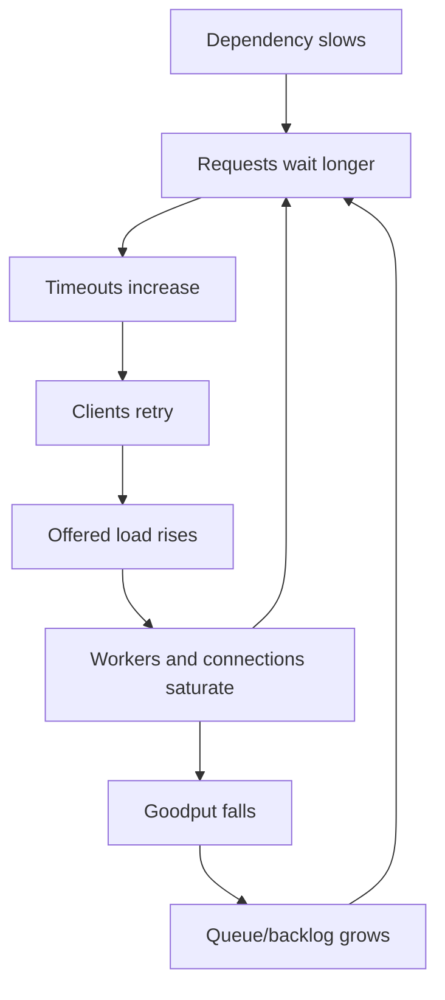
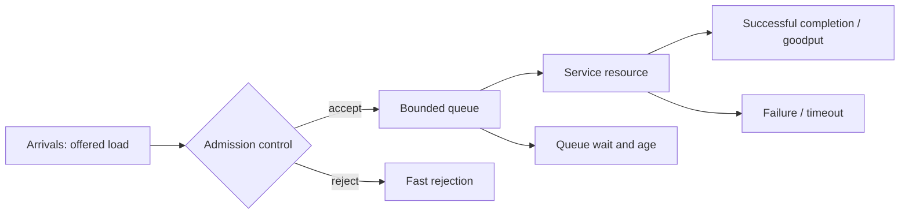
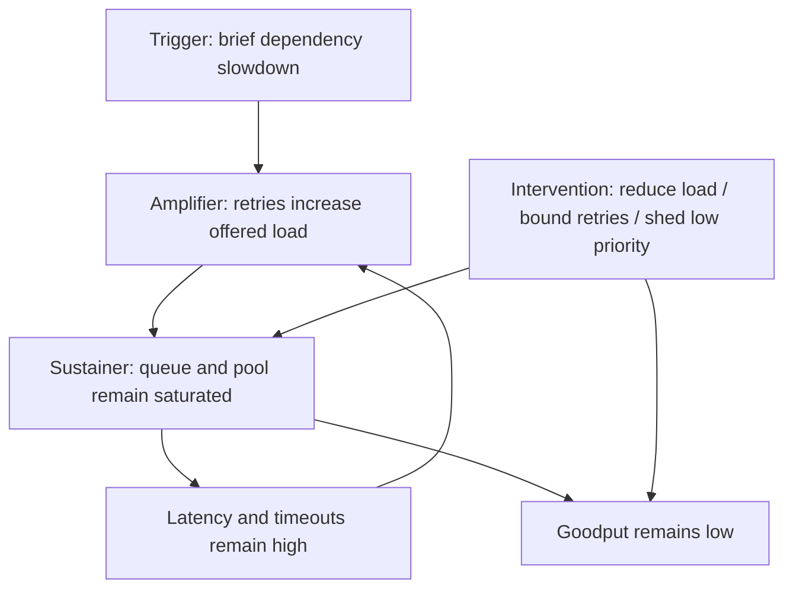
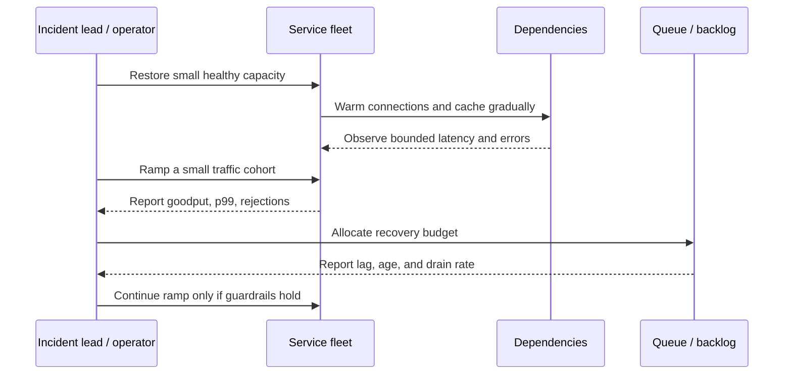
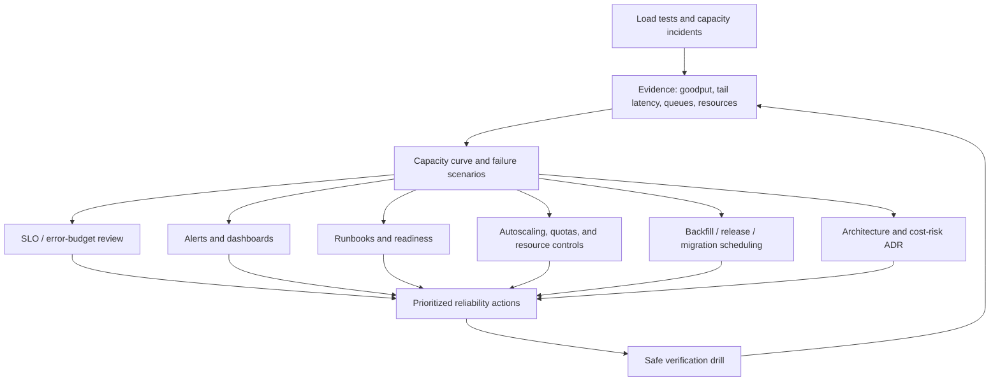

# Unit 6 — Capacity-Related Failures and Cascading Outages

**Stage:** Stage 2E — Production DevOps & Platform Engineering  
**Module:** 10 — Site Reliability Engineering and Incident Management (M10)  
**Unit:** 6 of 11  
**Target filename:** `06-capacity-related-failures-and-cascading-outages.md`

> **Operating contract:** This is a local, synthetic, zero-budget learning chapter. Do not aim load generators or fault injection at production, public services, shared clusters, or any endpoint other than an explicitly controlled localhost lab. All numerical capacities and policy thresholds are `[ILLUSTRATIVE]` until measured by the learner. Commands and outputs are labelled when not executed. Laptop measurements are not production capacity guarantees.

## 1. Learning Outcomes and Completion Criteria

Capacity engineering is the practice of understanding how much useful work a system can complete, how performance changes as demand approaches its limits, and how to preserve essential behavior when demand exceeds available resources or a dependency degrades. Cascading-failure engineering studies how local overload spreads through a dependency graph and how feedback loops make recovery harder.

By the end of this unit, the learner should be able to:

### L1 — Explain capacity and cascading-failure fundamentals

- Distinguish **utilization**, **saturation**, **errors**, **offered load**, **accepted load**, and **goodput**.
- Recognize capacity symptoms across CPU, memory, queues, workers, connections, file descriptors, ports, disk/inodes, databases, quotas, caches, batch jobs, streams, and inference workloads.
- Derive Little’s Law \(L = \lambda W\), preserve consistent units, state assumptions, and verify the relationship with a local simulator.
- Explain why latency may rise sharply near the saturation knee and why operating with little headroom makes bursts, failover, restarts, and recovery risky.
- Describe cascading failures using a **trigger → amplifier → sustaining mechanism** model.

### L2 — Measure capacity and implement overload controls

- Build a safe local load profile and compare open-loop with closed-loop generation.
- Explain coordinated omission and why closed-loop testing can hide waits during stalls.
- Measure latency percentiles, offered rate, goodput, rejections, timeouts, retries, queue depth, and relevant resource signals.
- Calculate N−1/N−2 capacity and retry amplification.
- Design bounded deadlines, retries with exponential backoff and jitter, retry budgets, circuit breakers, bulkheads, rate limits, admission control, load shedding, and backpressure.
- Explain why aggressive liveness restarts or naive autoscaling can amplify overload.

### L3 — Plan capacity and engineer recovery

- Analyze retry storms, dependency saturation, thundering herds, connection/worker exhaustion, queue growth, metastable degradation, and load redistribution.
- Forecast demand transparently, document uncertainty and quota/procurement lead time, and create a one-page capacity plan.
- Calculate backlog catch-up time only when processing capacity exceeds the arrival rate.
- Protect online work from batch/backfill/compaction contention and verify data freshness/correctness during recovery.
- Design safe, bounded, local failure experiments with stop conditions and cleanup.

### L4 — Design systemic resilience and governance

- Combine resilience patterns while accounting for their own failure modes.
- Reconstruct feedback loops and distinguish trigger, amplifier, and sustainer.
- Reason about fairness, adaptive concurrency, priority classes, criticality propagation, staged recovery, and survivor capacity.
- Tie capacity reviews to service-level objectives (SLOs), error-budget context, change/backfill planning, and cost-risk decisions.
- Produce reproducible evidence and a capacity decision record rather than making unsupported claims from a laptop test.

### Evidence required to pass

The learner must submit the artifacts in Section 16: calculations, local test results, capacity curve, overload-control comparison, retry/cache experiments, N−1 worksheet, forecast and one-page plan, backlog recovery worksheet, game-day report, cleanup checklist, and a short explanation of limitations. Reading the scripts without running them does not count as a completed script lab.

## 2. Prerequisites, Lab Environment, and Unit Boundaries

### 2.1 Prerequisites

This unit assumes familiarity with the M08 local FastAPI service and fault-injection controls, basic Linux process/network tools, Python, HTTP, container basics, and the previous M10 units. It is possible to complete the core labs with Python’s standard library and a local synthetic simulator, even if the M08 service or local Kubernetes environment is unavailable.

### 2.2 Scratch workspace — keep it separate from the curriculum repository

Create a disposable workspace such as:

```text
m10-unit6-capacity-lab/
├── README.md
├── src/
│   ├── capacity_sim.py
│   ├── load_harness.py
│   ├── retry_cache_sim.py
│   ├── forecast_capacity.py
│   └── backlog.py
├── tests/
│   ├── test_capacity_sim.py
│   ├── test_retry_cache_sim.py
│   ├── test_forecast_capacity.py
│   └── test_backlog.py
├── data/
│   └── demand.csv
└── artifacts/
    ├── capacity-curve.csv
    ├── load-test-summary.json
    ├── capacity-plan.md
    └── game-day-report.md
```

All paths above are for the learner’s scratch workspace. Do not create these helper files in the curriculum repository. The chapter itself is the only intended curriculum artifact.

### 2.3 Zero-budget baseline and safety envelope

- **Baseline:** WSL2 Ubuntu or native Linux, approximately 4 CPU cores, 8 GB RAM, and 30 GB free disk. These are planning assumptions, not strict requirements; a simulator-only path can run on less.
- **Dependencies:** Python 3.10+ is a suggested baseline `[ASSUMPTION]`; verify the learner’s installed version. The scripts below use the standard library only.
- **Core footprint:** synthetic simulators use small in-memory data; load generation is bounded by duration, concurrency/rate, timeout, and localhost target validation.
- **Never use:** real customer data, production credentials, public endpoints, shared infrastructure, or a paid load-testing service.
- **Hard stop:** stop if the target is not localhost, resource use becomes uncomfortable, the script exceeds its configured duration, or a process cannot be confidently identified as part of this lab.
- **Cleanup:** stop only the learner’s lab process; remove only files inside the scratch workspace; confirm no child process remains. Do not use broad process-kill commands.
- **Live-service limitation:** if the M08 service cannot be safely controlled and observed, use the self-contained simulator. State that the simulator demonstrates a model and does not prove the live service’s capacity.

### 2.4 Cross-module boundaries

| Topic | This unit does | Existing owner / link |
|---|---|---|
| SLI/SLO and error budgets | Uses workload outcomes to evaluate capacity risk | M10 Unit 1: `01-service-level-indicators-objectives-and-error-budgets.md`; formal policy in Unit 9 |
| Batch, streaming, inference reliability | Reuses freshness, coverage, correctness, lag, latency, and fallback outcomes | M10 Unit 2: `02-reliability-targets-for-batch-streaming-and-inference.md` |
| Alert quality | Selects useful saturation signals without rebuilding alerting curriculum | M10 Unit 3 |
| Incident command | Uses established incident roles for serious incidents | M10 Unit 4 |
| Triage and postmortems | Uses trigger/amplifier/sustainer and evidence discipline | M10 Unit 5: `05-production-triage-and-blameless-postmortems.md` |
| Toil and automation | Mentions safe automation controls | M10 Unit 7 |
| Runbooks/readiness | Supplies capacity-specific checks for readiness reviews | M10 Unit 8 |
| Error-budget policies/release freezes | Provides evidence, not the formal policy | M10 Unit 9 |
| On-call/handoffs | Supplies signals and capacity evidence for responders | M10 Unit 10 |
| DORA metrics | Does not conflate capacity signals with delivery-performance measures | M10 Unit 11 |
| Kubernetes requests/limits, quotas, probes, HPA | Explains capacity interactions only | M03 Units 2, 3, 6, 7 |
| Network timeout/port/conntrack details | Explains symptoms and links | M04 Units 4, 8, 10 |
| Storage growth, replication, backup/restore | Explains capacity interactions | M05 Units 6, 7 and backup/restore material |
| Cloud quota/IaC changes | Explains runway and escalation | M07 Unit 7 |
| Flags, fallback ratio, backfills | Uses established controls and SLIs | M08 Units 9, 10, 11 |
| Multi-region failover | Reasons about survivor capacity, not full architecture | M14 |
| Deep capacity/cost modeling | Basic transparent planning only | M15 |
| Observability architecture | Minimum instrumentation for this unit only | M11 |
| Security/supply-chain incidents | Safe lab boundaries only | M12 |
| Broader project capstone | Provides evidence that may feed it | M17 |

## 3. Capacity Failure Fundamentals

### 3.1 Capacity is useful work, not merely a live process

A process can be alive, a pod can be `Running`, and an endpoint can return HTTP 200 while the system is failing its real workload. It may reject most requests, return stale features, lag behind streaming input, publish partial batch output, or deliver inference responses too slowly to be useful.

Define these quantities separately:

- **Offered load:** work clients attempt to send, including work that is later rejected or times out.
- **Accepted load:** work admitted into the system.
- **Completed throughput:** work completed per unit time, including failed work if the measurement definition counts it.
- **Goodput:** useful, successful work completed per unit time, using an explicit success definition.
- **Concurrency:** number of operations in flight at a moment or averaged over a window.
- **Service time:** time a resource spends processing work, excluding or including queue wait according to the stated definition.
- **End-to-end latency:** elapsed time from the defined request start to the defined completion.
- **Saturation:** demand for a constrained resource exceeds or approaches what it can provide, visible as queueing, waiting, throttling, rejection, or exhausted pools.
- **Utilization:** fraction of a resource’s measured capacity that is busy over a window.
- **Error rate:** fraction or count of operations that fail according to a stated definition.

These metrics are related but not interchangeable. A system can have low CPU utilization and be saturated on a database connection pool; CPU can be high without user impact if goodput and tail latency remain acceptable; goodput can fall while the raw request count appears high because retries and errors are being counted as work.

### 3.2 Capacity symptom map

| Resource/symptom | Likely saturation signal | User/workload symptom | First safe checks |
|---|---|---|---|
| CPU | Run queue, throttling, high busy time | Latency, timeouts, reduced goodput | Compare per-process CPU, throttling, traffic, retries, and goodput |
| Memory | Working-set growth, reclaim, OOM/restarts | Slow requests, restarts, lost progress | Compare memory trend, allocation/GC behavior, queue growth, restart history |
| Worker/thread pool | Active workers at limit, waiting tasks | Requests stall while process remains alive | Inspect pool usage, waiters, dependency spans, timeout distribution |
| Connection pool / database | Active connections at limit, acquisition wait | Slow queries, pool timeout, blocked requests | Compare pool usage, connection wait, DB saturation and query latency |
| Queue | Depth/age rising; arrivals exceed completions | Increasing delay, stale output, memory growth | Compare arrival rate, completion rate, oldest-item age, rejection |
| File descriptors / sockets | Open descriptors near limit, accept/connect errors | Failed connections, intermittent errors | Inspect process limits and socket states; avoid changing limits blindly |
| Ephemeral ports / conntrack | Port/connection-state pressure | Connection failures or delayed connects | Correlate connection churn, TIME_WAIT, conntrack counters and network errors |
| Disk / inodes | Free bytes or inodes low; I/O wait high | Write failures, slow jobs, database degradation | Check both free bytes and inode count; inspect I/O and growth rate |
| Quota / API rate limit | 429s, quota events, throttled operations | Scale or dependency calls stop increasing | Check quota dashboard/response metadata and remaining runway |
| Cold cache / cold start | Miss ratio, backend traffic, warm-up latency | Sudden latency spike after restart/expiry | Compare cache hit rate, backend request rate, startup and traffic ramp |
| Batch/streaming | Lag, backlog age, freshness breach | Stale data, missed processing window | Compare incoming rate, processing rate, oldest event/partition age |
| Noisy neighbor | One tenant/workload consumes shared resource | Other tenants degrade without their traffic changing | Segment by tenant/workload and inspect shared quotas/queues |
| Autoscaler ceiling | Desired replicas above maximum; quota reached | Demand grows faster than capacity | Compare scaling signals, lag, max replicas, quotas and dependency limits |

### 3.3 Utilization, saturation, and errors

A useful resource-level checklist is commonly called the **USE method**: utilization, saturation, and errors. Exact attribution/source wording should be verified before formal training `[VERIFY]`; the diagnostic distinction is the important point here.

- **Utilization:** how busy is the resource?
- **Saturation:** how much work is waiting or being denied because the resource cannot keep up?
- **Errors:** what resource operations fail?

Do not use a universal “safe utilization” threshold. The saturation knee depends on service-time variability, concurrency model, queue discipline, workload mix, and dependency behavior. For example, 85% CPU might be fine for a steady batch job with a long deadline but dangerous for a latency-sensitive service whose CPU is bursty and whose dependencies are already slow. Both percentages are illustrative; decide from measured behavior and SLOs.

### 3.4 Failure, overload, and degraded operation

- **Hard failure:** a component is unavailable or cannot perform its role.
- **Overload:** offered work exceeds the system’s ability to process it within required limits.
- **Degraded mode:** the system intentionally preserves a subset of useful behavior, possibly with explicit rejection, reduced features, stale-but-acceptable data, or lower-quality responses.
- **Collapse:** a severe overload state in which latency, retries, queues, memory, and errors reinforce each other and useful progress becomes very small.

A fast, explicit rejection can be healthier than accepting work into an unbounded queue and timing out later. But rejection is not automatically success: it must be measured, communicated, fairly applied, and consistent with the service contract.

### 3.5 Cascading failure: trigger, amplifier, sustainer

A cascading failure occurs when a component’s slowdown or failure increases load or failure probability in other components, propagating impact through a dependency graph.

- **Trigger:** the initiating event, such as a short dependency latency spike.
- **Amplifier:** behavior that magnifies impact, such as unbounded retries or synchronized cache misses.
- **Sustaining mechanism:** feedback that keeps the system degraded after the original trigger has ended, such as a backlog that cannot drain because retry traffic consumes the remaining capacity.

A common loop is:



This is a conceptual model, not proof that every incident follows this loop. A good analysis identifies which links are supported by metrics and which remain hypotheses.

### 3.6 Common capacity and cascade patterns

1. **Retry storm:** timed-out requests are repeated, increasing load precisely when capacity is reduced.
2. **Load redistribution:** a node or zone fails, sending its traffic to survivors that were sized only for nominal demand.
3. **Thundering herd:** synchronized cache expiration or restart makes many requests hit the same backend at once.
4. **Shared-pool exhaustion:** one slow dependency occupies workers or connections, starving unrelated routes sharing the pool.
5. **Restart loop:** aggressive liveness checks restart an overloaded service; warm-up and cache refill add further load.
6. **Cold-start surge:** a restarted service receives full traffic before caches, connection pools, and downstream systems are warm.
7. **Unbounded queue:** work accumulates until latency becomes useless or memory is exhausted.
8. **Autoscaling side effect:** adding application replicas increases pressure on a database or quota-constrained dependency.
9. **Backfill contention:** batch work consumes CPU, I/O, connections, or cluster slots needed by interactive traffic.
10. **Quota ceiling:** scale-out or recovery stops at a quota limit, often discovered too late to procure or request capacity.

### 3.7 Autoscaling is not a substitute for capacity design

Autoscaling reacts to signals; it does not create capacity instantaneously or remove bottlenecks. It can fail to protect a service when:

- metric collection and controller decisions lag behind a sudden spike;
- startup, image pulls, cache warm-up, or connection establishment take time;
- maximum replica count or a cloud quota is reached;
- scaling increases demand on a shared database;
- scale-to-zero creates cold-start latency;
- the scaling metric lags behind the queue or tail-latency failure;
- all replicas restart or scale together and cause synchronized load.

Link this reasoning to M03 Unit 6 (HPA/autoscaling) and M07 Unit 7 (quota/IaC controls). For incident use, record current replicas, desired replicas, maximum, scale-up time, quota status, and the actual bottleneck rather than simply saying “scale out.”

## 4. Queueing Theory, Little’s Law, and the Latency Knee

### 4.1 Queueing model

A queueing system has arrivals, a waiting area, a service mechanism, completions, and often rejection or abandonment:



A queue is useful when it absorbs a short burst that the service can drain later. It becomes dangerous when it is unbounded or when its delay exceeds the request’s deadline. An unbounded queue converts overload into hidden latency, memory growth, and delayed failure. A bounded queue makes overload visible and creates a place to apply admission control.

### 4.2 Little’s Law

Little’s Law is:

\[
L = \lambda W
\]

Where:

- \(L\) = average number of items in the system (items, e.g. requests);
- \(\lambda\) = average throughput/arrival rate of the same population (items/second);
- \(W\) = average time each item spends in the system (seconds).

Units check:

\[
\frac{\text{items}}{\text{second}} \times \text{seconds}
= \text{items}
\]

**Worked example `[ILLUSTRATIVE]`:** if a stable service completes 40 requests/second and the average end-to-end time in the system is 0.25 seconds, then \(L \approx 40 \times 0.25 = 10\) requests in the system on average. If the observed average concurrency is 10, the measurements are consistent with the identity under the stated definitions.

**Important assumptions and limits:** Little’s Law is a relationship for a stable system over a suitable observation window with consistent population boundaries and finite averages. The arrival/completion flow must be defined consistently; if work is being dropped, rejected, or accumulating without reaching steady state, the naive calculation may mislead. It does not by itself predict p99 latency, model service-time variability, or tell you the capacity knee.

### 4.3 Why latency rises near saturation

When arrivals approach service capacity, even small variation in request cost, dependency latency, scheduling, or bursts can create a queue. As the queue grows, new requests wait behind old work; longer waits can trigger client timeouts and retries, which increase offered load. The result often looks like a hockey stick: throughput may increase at first, then goodput flattens while tail latency and failures rise rapidly.

There is no universal utilization curve. The knee differs by service-time distribution, queue discipline, concurrency, resource sharing, dependency graph, and acceptable SLO. Measure it rather than adopting a universal 70%, 80%, or 90% rule.

```text
Conceptual curve — all values [ILLUSTRATIVE], not measured data

Offered load       Goodput             p99 latency
low                rises with load     low/stable
moderate           rises               gradual increase
near knee          approaches plateau  sharp increase
above knee         may flatten/fall    very high; timeouts/rejections grow
```

### 4.4 Headroom

Headroom is the capacity remaining after serving current demand. It is needed for demand spikes, node loss, dependency slowdown, GC pauses, cold starts, migrations, backfills, and backlog recovery. A service operating at its nominal limit has little ability to recover from disruption, even if its average demand normally fits.

Headroom should be based on sustainable goodput and observed latency/error behavior, not on CPU alone. State the failure scenario and target workload when claiming a service has enough headroom.

## 5. Measuring Load, Capacity, Saturation, and Goodput

### 5.1 Measurement vocabulary

| Metric | Definition to record | Why it matters |
|---|---|---|
| Offered RPS | Attempts started per second, including retries if generated by the client | Reveals the actual pressure applied |
| Accepted RPS | Requests admitted by the service | Separates admission from attempted work |
| Goodput | Successful, useful completions per second | Shows whether work is being completed correctly |
| Concurrency | Operations in flight | Helps estimate resource occupancy |
| Service time | Processing duration excluding queue wait, if measurable | Separates queue delay from execution time |
| p50/p95/p99 latency | Percentiles over a defined request population/window | Exposes tail behavior hidden by averages |
| Error/rejection rate | Errors and deliberate rejects, with separate categories | Distinguishes failure from protective shedding |
| Timeout rate | Requests exceeding a defined deadline | Often signals overload propagation |
| Retry rate/amplification | Retry attempts per original request and total extra load | Shows whether clients are increasing pressure |
| Queue depth and oldest age | Items waiting and age of oldest item | Distinguishes harmless bursts from worsening backlog |
| CPU utilization/throttling | Busy CPU and time denied by limits/scheduler | Reveals CPU constraints |
| Memory working set/OOM | Resident/working-set trend and termination events | Reveals memory pressure and death spirals |
| Worker/connection pool | In-use, free, waiters, acquisition latency | Reveals non-CPU saturation |
| I/O wait/disk/inodes | I/O latency/pressure, free bytes, free inodes | Reveals stateful bottlenecks |
| GC pause | Pause distribution where runtime exposes it | Explains stop-the-world delay and memory loops |
| Batch/stream lag | Backlog and oldest event age, plus freshness/correctness | Connects infrastructure health to data outcomes |

Always record the window, aggregation, units, population, warm-up, and whether failed/rejected work is included. A p99 over successful responses only can look healthy while most requests time out; show errors and goodput beside latency.

### 5.2 Minimal instrumentation for the M08 local FastAPI service

Reuse the M08 service’s existing RED/domain metrics and fault-injection control if available. The minimum capacity experiment needs request counts, response outcome, latency, active concurrency or queue, dependency latency/error, and a clear indication of the injected fault. Resource signals can be collected with local OS tools where available.

Do not assume a Prometheus client API or metric name without checking the installed version’s official documentation `[VERIFY]`. Do not add a heavy observability stack solely for this unit. If the existing service lacks queue or active-concurrency metrics, a tiny local simulator can expose them directly.

### 5.3 Resource signals and useful first checks

- CPU: compare process CPU, throttling, offered load, and goodput.
- Memory: compare working set, allocation/GC, queue depth, and OOM/restart events.
- Threads/workers: compare active workers, waiters, dependency spans, and request timeouts.
- Connections: inspect pool occupancy, connection acquisition wait, DB limits, and errors.
- Storage: check free bytes and inodes separately; inspect I/O latency and growth.
- Network: inspect connection churn, ephemeral ports, conntrack, and connection errors; use M04 Unit 10 for detailed tooling.
- Queue/stream: compare arrivals, completions, oldest age, lag, and freshness.
- Quotas: check current limit, actual usage, scale ceiling, remaining runway, and escalation route.
- Cache: compare hit ratio, miss burst, backend request rate, and warm-up.
- Multi-tenant: segment signals by tenant/workload to reveal noisy neighbors.

## 6. Load Testing: Open-Loop, Closed-Loop, and Coordinated Omission

### 6.1 Closed-loop versus open-loop

A **closed-loop** generator sends a request, waits for its response, then sends the next request (or uses a fixed number of workers that each wait for completion). When the service slows, the generator naturally sends fewer new requests. This can be useful for modeling users who wait for a response, but it can hide the full waiting time that would have occurred under an independent arrival schedule.

An **open-loop** generator schedules arrivals independently of response completion. It better models an external arrival stream, but requires bounded scheduling, explicit dropped/scheduled-late accounting, and care not to create unbounded pending tasks.

**Coordinated omission** is a known load-testing bias: when the generator stops scheduling work during a stall, the recorded latency sample set may omit the waits that would have happened for requests expected to arrive during that stall. Verify precise source attribution before formal citation `[VERIFY]`. This chapter’s simple harness records scheduled-versus-started counts but does not implement a full high-precision latency-correction algorithm; it demonstrates the bias rather than replacing a mature load-testing tool.

### 6.2 Test profiles

| Profile | Purpose | Safety boundary |
|---|---|---|
| Ramp | Increase load gradually to observe the knee | Fixed maximum rate, duration, and stop condition |
| Step | Hold several bounded load levels | Allow recovery between steps |
| Short soak | Observe queue/resource trends over a limited period | Strict maximum duration and memory/queue bounds |
| Spike | Apply a brief bounded burst | Use only on the local simulator or controlled localhost service |
| Overload | Deliberately exceed measured local sustainable capacity | Only after a baseline; strict caps and immediate abort conditions |
| N−1 | Remove one simulated worker/replica under load | Prefer simulator; never kill shared or production infrastructure |

### 6.3 Minimum result set

Capture offered load, accepted load, completed goodput, p50/p95/p99 latency, errors, timeouts, rejections, queue depth/age, resource saturation, warm-up, test duration, hardware, software version, and limitations. Keep every result labelled `[MEASURED BY LEARNER]`; it is evidence about that run and machine, not a production benchmark.

### 6.4 Local queueing simulator — complete starter code

Save as `src/capacity_sim.py`. It is a deterministic discrete-time teaching model, not a realistic stochastic queueing simulator. It models one bounded service pool and queue, counts rejected arrivals, and reports average system population and time. The simulator deliberately uses integer time steps and a fixed service budget per step; state these assumptions when interpreting results.

```python
#!/usr/bin/env python3
"""Bounded discrete-time capacity simulator; standard library only."""
import argparse
import csv
import json
import math
from pathlib import Path


def simulate(arrivals_per_second, service_per_second, duration_seconds=30,
             queue_limit=100, warmup_seconds=5):
    if not isinstance(arrivals_per_second, int) or arrivals_per_second < 0:
        raise ValueError("arrivals_per_second must be a nonnegative integer")
    if not isinstance(service_per_second, int) or service_per_second <= 0:
        raise ValueError("service_per_second must be a positive integer")
    if duration_seconds <= 0 or duration_seconds > 120:
        raise ValueError("duration must be 1..120 seconds")
    if queue_limit is not None and queue_limit < 0:
        raise ValueError("queue_limit must be nonnegative or None")
    if arrivals_per_second > 1000 or service_per_second > 1000:
        raise ValueError("arrival/service rates must be <=1000 per second")
    if warmup_seconds < 0 or warmup_seconds >= duration_seconds:
        raise ValueError("warmup must be >= 0 and less than duration")

    queue = []  # arrival second for each queued item
    accepted = completed = rejected = 0
    latency_samples = []
    population_sum = 0
    population_samples = 0
    queue_depth_sum = 0
    queue_depth_max = 0

    for second in range(duration_seconds):
        # Arrivals are scheduled before service during each one-second interval.
        for _ in range(arrivals_per_second):
            if queue_limit is not None and len(queue) >= queue_limit:
                rejected += 1
            else:
                queue.append(second)
                accepted += 1

        # In this discrete-time model, all queued/active items are present during the
        # service interval. Record the pre-completion population for Little's Law.
        queue_depth_max = max(queue_depth_max, len(queue))
        if second >= warmup_seconds:
            population_sum += len(queue)
            population_samples += 1

        # The model serves up to a fixed number of items per second.
        for _ in range(min(service_per_second, len(queue))):
            arrived_at = queue.pop(0)
            completed += 1
            if second >= warmup_seconds:
                latency_samples.append((second + 1) - arrived_at)

        if second >= warmup_seconds:
            queue_depth_sum += len(queue)

    elapsed = duration_seconds - warmup_seconds
    goodput = sum(1 for _ in latency_samples) / elapsed
    mean_latency = (sum(latency_samples) / len(latency_samples)
                    if latency_samples else 0.0)
    def pct(values, percent):
        if not values:
            return None
        ordered = sorted(values)
        return round(ordered[max(0, min(len(ordered) - 1,
                                       int(math.ceil(percent / 100 * len(ordered)) - 1)))], 4)
    avg_system_population = population_sum / population_samples if population_samples else 0.0
    avg_queue = queue_depth_sum / population_samples if population_samples else 0.0
    # In this toy model, W includes integer-rounded queue + service time.
    # Little's Law is only an approximate cross-check when the system is stable.
    l_estimate = goodput * mean_latency
    return {
        "offered_rps": arrivals_per_second,
        "service_capacity_per_second": service_per_second,
        "accepted_total": accepted,
        "completed_total": completed,
        "rejected_total": rejected,
        "goodput_rps_after_warmup": round(goodput, 4),
        "mean_latency_seconds_after_warmup": round(mean_latency, 4),
        "latency_seconds_after_warmup": {
            "p50": pct(latency_samples, 50),
            "p95": pct(latency_samples, 95),
            "p99": pct(latency_samples, 99),
        },
        "average_system_population_after_warmup": round(avg_system_population, 4),
        "average_queue_depth_after_warmup": round(avg_queue, 4),
        "max_queue_depth": queue_depth_max,
        "queue_limit": queue_limit,
        "little_law_L_estimate_from_goodput_times_latency": round(l_estimate, 4),
        "little_law_comparison_note": (
            "Compare the product estimate with average_system_population_after_warmup; "
            "the simple discrete-time model can differ because of boundary timing and finite windows."
        ),
        "steady_state_warning": (
            "Approximation only: integer time steps, fixed service budget, "
            "finite window, and possible backlog mean Little's Law may not match."
        ),
        "duration_seconds": duration_seconds,
        "warmup_seconds": warmup_seconds,
    }


def main():
    parser = argparse.ArgumentParser(description=__doc__)
    parser.add_argument("--arrivals", type=int, default=8)
    parser.add_argument("--service", type=int, default=10)
    parser.add_argument("--duration", type=int, default=30)
    parser.add_argument("--queue-limit", type=int, default=100)
    parser.add_argument("--unbounded-queue", action="store_true",
                        help="disable queue cap in the finite, short synthetic simulation only")
    parser.add_argument("--warmup", type=int, default=5)
    parser.add_argument("--output", default="")
    args = parser.parse_args()
    queue_limit = None if args.unbounded_queue else args.queue_limit
    result = simulate(args.arrivals, args.service, args.duration,
                      queue_limit, args.warmup)
    rendered = json.dumps(result, indent=2)
    if args.output:
        Path(args.output).parent.mkdir(parents=True, exist_ok=True)
        Path(args.output).write_text(rendered + "\n", encoding="utf-8")
    print(rendered)


if __name__ == "__main__":
    main()
```

**Model caveat:** because this is a simple discrete-time model, its “mean latency” is integer-rounded and the service budget is applied after arrivals within each second. It is useful for illustrating queue growth/rejection and unit arithmetic, but it does not model a production server, stochastic service times, multiple workers, or true percentile tails.

### 6.5 Simulator tests

Save as `tests/test_capacity_sim.py`:

```python
import unittest
from src.capacity_sim import simulate


class CapacitySimTests(unittest.TestCase):
    def test_invalid_rates_rejected(self):
        with self.assertRaises(ValueError):
            simulate(-1, 5)
        with self.assertRaises(ValueError):
            simulate(5, 0)

    def test_bounded_queue_rejects_under_overload(self):
        result = simulate(10, 5, duration_seconds=10, queue_limit=4, warmup_seconds=1)
        self.assertGreater(result["rejected_total"], 0)
        self.assertLessEqual(result["max_queue_depth"], 4)

    def test_below_capacity_does_not_reject_in_simple_case(self):
        result = simulate(2, 5, duration_seconds=10, queue_limit=10, warmup_seconds=1)
        self.assertEqual(result["rejected_total"], 0)

    def test_result_has_units_and_counts(self):
        result = simulate(3, 4, duration_seconds=10, queue_limit=10, warmup_seconds=1)
        self.assertIn("goodput_rps_after_warmup", result)
        self.assertIn("latency_seconds_after_warmup", result)
        self.assertGreaterEqual(result["completed_total"], 0)

    def test_unbounded_queue_is_only_used_in_finite_simulation(self):
        result = simulate(10, 5, duration_seconds=10, queue_limit=None, warmup_seconds=1)
        self.assertGreater(result["max_queue_depth"], 0)
        self.assertEqual(result["rejected_total"], 0)


if __name__ == "__main__":
    unittest.main()
```

Run from the scratch workspace root: `[NOT EXECUTED]`

```bash
python src/capacity_sim.py --arrivals 8 --service 10 --duration 30 --queue-limit 50 --output artifacts/sim-baseline.json
python -m unittest tests.test_capacity_sim -v
```

Repeat with offered rates below, near, and above the service budget. Record the actual result as `[MEASURED BY LEARNER]`. Do not interpret a toy model’s saturation point as a production threshold.


## 7. Headroom, N+1/N+2, and Capacity Planning

### 7.1 Nominal capacity versus sustainable goodput

Nominal capacity is a theoretical or configured maximum; **sustainable goodput** is the useful completion rate the system maintains for the target request mix and test conditions while meeting required latency, correctness, and error objectives. The latter is the safer input to resilience calculations.

Do not derive capacity from CPU alone. A system may hit database connection limits, worker starvation, storage I/O, rate limits, or a tail-latency SLO before CPU reaches 100%. State the request mix, resource limits, dependency assumptions, time window, and latency/error acceptance criteria behind any capacity number.

### 7.2 N−1 and N−2 calculation

Suppose a service has three equal nodes, each measured to sustain 100 good requests/second for the defined workload `[ILLUSTRATIVE]`. Nominal aggregate sustainable capacity is 300 good requests/second. If demand is 220:

- Nominal utilization estimate: \(220/300 \approx 73.3\%\).
- After one node fails, surviving capacity is \(2 \times 100 = 200\) requests/second.
- Demand 220 exceeds survivor capacity by 20 requests/second; N−1 is not sufficient.
- After two nodes fail, surviving capacity is 100 requests/second, far below demand.

This arithmetic assumes equal nodes, balanced distribution, independent failures, no shared dependency bottleneck, no warm-up penalty, and unchanged per-node sustainable goodput. Real systems violate these assumptions. Survivor capacity may be lower because the database, network, cache, or connection pool is shared.

| Scenario `[ILLUSTRATIVE]` | Nodes available | Capacity per node | Aggregate capacity | Demand | Result |
|---|---:|---:|---:|---:|---|
| Normal | 3 | 100 rps | 300 rps | 220 rps | Fits nominally |
| N−1 | 2 | 100 rps | 200 rps | 220 rps | Over capacity |
| N−2 | 1 | 100 rps | 100 rps | 220 rps | Severe deficit |

For N+1/N+2 planning, clarify the notation used by your organization: this chapter uses “N−1” to mean one node/replica is unavailable, and “N−2” to mean two are unavailable. Do not confuse spare-capacity architecture labels with a measured failure scenario.

### 7.3 Headroom and recovery capacity

A service needs capacity for both **steady demand** and **recovery work**. After an outage, queue drain, cache warm-up, replay, backfill, compaction, and reprocessing can compete with live traffic. If all available capacity is allocated to steady traffic, recovery may never catch up.

A capacity worksheet should answer:

- What demand must be served during normal operation and the agreed failure scenario?
- What is the measured sustainable goodput under the same request mix?
- What resources are shared with dependencies?
- How much capacity is reserved for backlog catch-up or reprocessing?
- How quickly can additional capacity arrive, and what quota/procurement lead time applies?
- What is the safe degraded mode if capacity is insufficient?
- Which metric triggers a review before the quota/headroom limit is reached?

### 7.4 Demand forecasting: transparent baseline, not false precision

Forecasting is an input to a decision, not a promise. Separate organic growth from a step-change such as a new product launch, large customer, model rollout, migration, or backfill. A linear trend can be useful as a baseline, but it misses seasonality, product changes, nonlinear growth, and capacity-induced censoring (observed throughput may be capped while demand continues to rise).

**Worked synthetic forecast `[ILLUSTRATIVE]`:** if observed peak demand grows from 1,000 rps to 1,200 rps over four months, a simple linear slope is \((1200-1000)/4 = 50\) rps/month. At a six-month horizon, the naive point estimate is 1,500 rps. This is not a confidence interval. If a planned launch might add 20–40%, record that as a separate scenario rather than burying it in the linear line. All values are illustrative.

A reasonable plan presents low/base/high scenarios, headroom assumptions, quota/procurement runway, and a review trigger. Avoid reporting decimal precision that the data cannot support.

### 7.5 Capacity review checklist

Before a launch, migration, heavy backfill, compaction, or failover exercise, check the demand profile, sustainable goodput, tail latency, dependencies, quota ceiling, N−1/N−2 scenario, data correctness, rollback/stop condition, and recovery budget. Coordinate with M08 Unit 11 for backfills, M07 Unit 7 for quota/IaC changes, M03 Units 2/6/7 for resource controls/autoscaling/quotas, and M15 for deeper cost modeling.

## 8. Overload Controls: Timeouts, Retries, Bulkheads, Breakers, and Shedding

No single control is enough. Timeouts bound waiting; retries can improve success under transient faults but can amplify load; bulkheads isolate resource pools; circuit breakers stop repeated calls to a failing dependency; rate limits constrain offered work; admission control protects the system before work enters a queue; load shedding discards lower-value work; backpressure slows upstream producers. Each can itself fail if misconfigured.

### 8.1 Timeout ladder and deadline propagation

Every remote call should have a bounded timeout/deadline appropriate to its work and caller. The exact values are service-specific. A timeout ladder should leave time for the caller to respond and should not let downstream work outlive the useful request deadline.

Illustrative ladder `[ASSUMPTION]`:
- Client budget: 2.0 seconds total.
- Edge/gateway budget: at most 1.7 seconds.
- Application budget: at most 1.4 seconds.
- Dependency call: at most 0.8 seconds, leaving time for application handling.

These numbers are not defaults. Check actual client, gateway, service, and dependency semantics. M04 Units 4/8 cover detailed timeout/network behavior.

**Deadline propagation** carries the remaining budget to downstream calls. If a request has already expired, retrying it can consume capacity without producing useful work. Distinguish connection timeout, pool-acquisition timeout, request timeout, and total end-to-end deadline where the client supports those concepts.

### 8.2 Retry amplification arithmetic

Suppose one user request calls Service A, which calls B, which calls C. If each layer makes up to \(a\) attempts **for each incoming attempt** and all attempts reach the next layer, the maximum downstream attempt count can multiply by depth. With three layers each allowing up to 3 total attempts, a single original request can produce up to \(3^3 = 27\) attempts at the deepest operation in the worst case, depending on where retries are implemented. If only Service A retries its call to B three times and B does not retry, the count is different. Therefore, state the call graph and retry policy at every layer before calculating amplification.

A more precise example: the client makes up to 2 attempts to A; each A attempt makes up to 3 attempts to B; each B attempt makes up to 2 attempts to C. Worst-case C attempts per original client request are \(2 \times 3 \times 2 = 12\), assuming each parent attempt repeats the full downstream call and no deadline, breaker, deduplication, or retry budget stops it. This is a bound under explicit assumptions, not a typical observed value.

### 8.3 Safer retry policy

- Bound total attempts and total elapsed time.
- Use exponential backoff and jitter to avoid synchronized retries.
- Use a retry budget so retries cannot consume all capacity.
- Retry only failures likely to be transient and only while useful deadline remains.
- Ensure operations are idempotent or have idempotency keys/deduplication where duplicate side effects matter.
- Avoid retrying a request that the server may already have committed unless the operation’s semantics make it safe.
- Do not make every layer independently retry without an end-to-end budget.
- Count original requests and retry attempts separately.

A retry budget may be expressed as a local policy such as “retry traffic may not exceed a defined fraction of original traffic over the measurement window” `[ASSUMPTION]`. Choose and validate the value for the workload; do not copy a universal percentage.

### 8.4 Circuit breakers and bulkheads

A **circuit breaker** detects repeated failures or slow calls and temporarily fails fast rather than repeatedly consuming resources on a failing dependency. Typical conceptual states are closed (calls allowed), open (calls rejected/fallback), and half-open (a limited probe set tests recovery). Exact library behavior is implementation-specific `[VERIFY]`.

Failure modes include a breaker that never closes, thresholds that flap, all requests being rejected during a healthy but noisy interval, or a fallback that overloads a second dependency. Monitor state transitions and successful recovery probes.

A **bulkhead** limits resource consumption by one dependency, route, tenant, or workload so it cannot exhaust a shared pool. Separate pools or concurrency limits reduce blast radius, but too-small limits can underutilize capacity or starve critical work. Verify pool sizing against actual concurrency and service time.

### 8.5 Bounded queues, admission control, and fast rejection

A bounded queue protects memory and makes overload explicit. Admission control can reject work when queue age, estimated wait, active concurrency, or dependency pressure suggests the deadline cannot be met. CPU alone is often a poor admission signal when the bottleneck is a database pool or a slow dependency.

Priority-based shedding should define which work is expendable, preserve tenant fairness, and be observable. A service may use HTTP 429 for rate limiting or 503 for temporary unavailability, and `Retry-After` only where semantics and implementation are verified `[VERIFY]`. Clients must not synchronize into an immediate retry storm.

### 8.6 Request hedging cautions

Hedging sends a duplicate request to reduce tail latency in some settings. It can also multiply load, duplicate side effects, and worsen a system already near saturation. Use only when requests are safe to duplicate, the additional load is budgeted, and the tail-latency benefit is measured. Disable or tightly limit hedging during overload unless evidence supports the opposite.

### 8.7 Overload-control decision matrix

| Control | Protects against | Main trade-off / failure mode | Verification |
|---|---|---|---|
| Bounded queue | Unbounded memory/latency growth | Rejects bursts that might otherwise drain | Queue stays within cap; rejected work is counted |
| Timeout/deadline | Resource held indefinitely | Too-short timeout rejects useful work; too-long timeout holds resources | Deadline respected end-to-end |
| Retry budget + jitter | Retry amplification and synchronized storms | Budget may starve a critical retry path; jitter changes timing | Retry/original ratio remains within policy |
| Circuit breaker | Repeated calls to a failing dependency | Can remain open or flap | State and probe success are observable |
| Bulkhead/concurrency limit | One dependency/tenant consuming all workers | Limits may be too small or too large | Other routes remain healthy during dependency stall |
| Rate limiting | Excessive offered load | May reject legitimate burst/tenant unfairly | Rate, fairness, and rejection semantics checked |
| Admission control | Work that cannot meet useful deadline | Bad thresholds can shed useful work | Accepted work meets outcome objective more often |
| Load shedding | Collapse under excess load | May shed critical work or synchronize retries | Critical traffic survives; rejects are bounded and visible |
| Backpressure | Upstream outpacing downstream | Pausing can move backlog elsewhere | Backlog age and end-to-end flow remain controlled |
| Graceful degradation | Total loss of essential behavior | Stale/worse output may violate correctness or safety | Fallback ratio and correctness/freshness are checked |

## 9. Backpressure, Autoscaling, Health Checks, and Graceful Degradation

### 9.1 Backpressure

Backpressure propagates a signal upstream when a downstream stage cannot keep up, rather than buffering without bound. Mechanisms include bounded queues, producer throttling, consumer pull limits, concurrency limits, and explicit rejection. A queue is not a substitute for a sustainable processing rate.

For streams, pausing a consumer can protect a downstream system but increases lag. The decision must include retention limits, replay cost, freshness objectives, and whether backlog catch-up capacity exists. For batch, a job that is “running” while its queue grows faster than it drains is not meeting the workload’s outcome objective.

### 9.2 Health checks and restart amplification

Liveness should indicate that a process needs restart, not merely that it is busy. Readiness indicates whether it should receive new traffic. Startup checks protect slow initialization. Reuse the M03 Unit 3 probe curriculum; this unit focuses on cascade risk.

If a dependency slowdown causes worker exhaustion, an aggressive liveness check may restart the application. Each restart loses warmed caches, closes/reopens connections, and may cause synchronized reinitialization. Readiness removal can reduce traffic to an unhealthy instance, but if every instance becomes unready the service may lose all capacity. Define thresholds and recovery behavior carefully, then test only in a local environment.

### 9.3 Autoscaling limits and dependency bottlenecks

Autoscaling is most useful when additional replicas can increase useful throughput and the bottleneck is scalable. If the database has a fixed connection ceiling, adding replicas can multiply connection pools and exhaust the database sooner. If metrics arrive after the spike, scale-up may be too late. If the cluster quota is exhausted, the desired replicas never become available.

Record:
- current/desired/maximum replicas;
- metric and controller delay;
- startup and warm-up time;
- per-replica sustainable goodput;
- downstream connection/rate limits;
- quota and procurement runway;
- behavior while scale-out is pending.

### 9.4 Graceful degradation and fallback contracts

A degraded mode deliberately preserves critical behavior while reducing nonessential work. Examples include serving cached/stale results, disabling an expensive feature via a flag (M08 Unit 10), using a static fallback, using a validated fallback model/default prediction, or rejecting background work before interactive work.

Every fallback needs a contract:

- Which requests/features may degrade?
- Is stale data acceptable, and for how long?
- Can a lower-quality model change safety or correctness?
- How is fallback use counted (link to M08 Unit 9 fallback-ratio SLI)?
- What client-visible response is returned?
- Is tenant fairness preserved?
- How is normal operation restored without a stampede?
- What verifies correctness and freshness?

A fallback can be worse than failure if it returns misleading output, serves unsafe stale data, or shifts load to a second dependency. Never equate “the endpoint returned something” with successful recovery.


## 10. Cascading Failure Mechanics and Metastability

### 10.1 Positive feedback loops

The defining danger of a cascade is feedback: a degraded component changes system behavior in a way that further degrades capacity.

**Retry loop:** dependency latency rises → calls time out → retries add work → workers/connections remain occupied longer → queueing rises → more timeouts.

**Memory loop:** queue grows → memory rises → garbage collection/reclaim becomes more expensive → service time increases → queue grows faster → OOM or restart.

**Pool-exhaustion loop:** a slow dependency retains connections → new requests wait for a connection → request deadlines expire → clients retry → the pool remains saturated.

**Recovery loop:** service restarts → cache is cold → misses hit database → database slows → warm-up takes longer → readiness/health checks flap → more restarts or traffic concentration.

The intervention point is often upstream of the most visible symptom. If CPU is high because retries are multiplying traffic, adding CPU may delay the failure but not remove the feedback loop.

### 10.2 Thundering-herd prevention

A thundering herd occurs when many callers perform the same expensive work at the same time. Common triggers include synchronized cache expiry, mass restart, a fleet becoming ready simultaneously, or a dependency recovering and receiving all queued traffic.

Controls include:

- **Request coalescing/singleflight:** callers for the same key share one in-flight refresh instead of all refreshing independently.
- **Jittered TTL:** spread expirations across time rather than giving many keys the same expiry.
- **Stale-while-revalidate:** serve an acceptable stale result while one refresh runs, if correctness and freshness contracts allow it.
- **Staggered restarts:** avoid restarting all replicas simultaneously.
- **Readiness gating and gradual traffic ramp:** do not route full load to a cold instance immediately.
- **Warm-up and connection draining:** initialize safely and remove old instances without a sudden load cliff.

Library-specific APIs and exact semantics must be checked against official documentation `[VERIFY]`. Do not serve stale data when the workload contract forbids it.

### 10.3 Slow dependency: “slow can be worse than down”

A dependency that fails fast may release resources quickly; a dependency that is slow but still responds can hold threads, connections, and request contexts for long periods. This is why bounded timeouts, bulkheads, and fail-fast behavior matter. The safe behavior depends on whether the operation is essential, whether a fallback exists, and whether abandoning work creates side effects.

### 10.4 Metastable failure

A **metastable failure** is a degraded system state that persists after the initiating trigger disappears because the system’s internal dynamics sustain the failure. The terminology and exact attribution require verification before formal use `[VERIFY]`. The concept is useful even when a specific incident is not formally classified this way.

Example `[ILLUSTRATIVE]`: a dependency is slow for 30 seconds. Clients retry aggressively. The original dependency recovers, but retries and backlog continue to consume most service capacity. Useful work cannot catch up because new retry traffic is arriving faster than the remaining capacity can drain it.

Recovery may require deliberately reducing offered load, disabling or limiting retries, shedding low-priority traffic, opening a breaker, and draining backlog only after capacity is reserved. Simply waiting for the trigger to end may not be enough.

### 10.5 Monitoring and automation-induced cascades

Automation can amplify a failure if its feedback is too aggressive. An autoscaler may add replicas that exhaust a database; a restart controller may restart all overloaded instances; a descheduler may move too much work at once; alert-driven automation may repeatedly apply a mitigation without observing its effect.

Guardrails include:
- rate limits and cooldowns on automation;
- bounded concurrent actions;
- canarying and staged rollouts;
- explicit abort thresholds;
- circuit breakers on repeated automation failures;
- a dry-run or simulation mode;
- a human approval gate for high-blast-radius changes;
- idempotent actions and a visible audit trail.

Automation should report both action and result. A successful command is not proof that the intended reliability outcome improved.

### 10.6 Causal-loop record

Use the following structure for a cascade review:

```text
Trigger:
  The first event supported by evidence.

Amplifier:
  Behavior that increased offered load, resource occupancy, or failure probability.

Sustainer:
  Feedback that kept the system degraded after the trigger ended.

Evidence:
  Timestamped metrics, logs, traces, events, queue/lag data, and change records.

Intervention point:
  The earliest safe place to break the loop.

Uncertainty:
  Competing hypotheses, missing evidence, and what would change the conclusion.
```



### 10.7 Eight required incident patterns: diagnose → fix → prevent

All scenarios are synthetic, with no claim that a real operator experienced these exact events.

| Scenario | Diagnose | Fix during incident | Prevent recurrence |
|---|---|---|---|
| 1. Brief dependency blip triggers retries that triple traffic and sustain outage | Compare original request rate to attempts, retry rate, dependency latency, pool wait, and queue age; separate trigger from retry amplifier | Bound/disable harmful retries, open breaker if safe, shed low-priority work, reduce offered load and drain backlog deliberately | End-to-end deadline, retry budget, jitter, idempotency, dependency-degradation drill |
| 2. Cache flush at restart stampedes database | Compare cache miss burst, DB connections/latency, startup and readiness timeline | Limit refresh concurrency, ramp traffic gradually, restore cache gradually if safe | Jittered TTL, coalescing, pre-warm plan, staggered restarts |
| 3. Liveness probes restart overloaded pods in lockstep | Correlate probe failures/restarts with saturation, dependency latency, and cache coldness | Stop unsafe restart loop through authorized config/rollout action; keep healthy instances and traffic controlled | Probe intent separation, startup/readiness design, overload drill, restart rate limits |
| 4. N−1 capacity insufficient; one node loss overloads remaining two | Calculate survivor sustainable goodput and check load balance/shared dependency | Shed noncritical load, route only where capacity exists, restore node safely | N−1/N−2 test, headroom policy, failover capacity review |
| 5. Autoscaler reaches maximum and exhausts DB connections | Compare desired/max replicas, connection pool size per replica, DB cap, queue, and latency | Limit connection pressure, reduce/shape traffic, scale only if dependency headroom exists | Connection budgeting, per-replica pool limits, quota runway, autoscaling game day |
| 6. Backfill starts at peak and starves online service | Compare job start, resource/I/O/connection pressure, online goodput and freshness | Pause/throttle backfill under authorized process; protect interactive capacity | Capacity-aware scheduling, quotas/priorities, backfill launch checklist |
| 7. Unbounded queue grows until OOM | Check arrivals versus completions, queue depth/age, memory trend, and admission behavior | Apply bounded admission/shedding and stop excess producers; preserve data semantics | Queue cap, backpressure, queue-age alerts, overload tests |
| 8. Cloud quota ceiling reached mid-incident with no runway | Confirm quota events, requested versus allocated capacity, current headroom, and lead time | Use approved degraded mode, prioritize critical work, request quota escalation through authorized path | Quota runway review, growth forecast, launch gate, alternate safe degradation plan |

### 10.8 Recovery engineering

A safe recovery sequence avoids moving from “unavailable” to “overloaded” in one step:

1. Establish the remaining safe capacity and current dependency state.
2. Reduce offered load or disable the amplifier; preserve critical work.
3. Restore a minimal healthy fleet with bounded concurrency.
4. Warm caches and pools gradually; validate readiness and dependencies.
5. Ramp traffic in measured stages while watching goodput, tail latency, rejections, and downstream pressure.
6. Drain queues using reserved recovery capacity; do not let retries compete unchecked with useful work.
7. Verify service SLI and data freshness/correctness separately.
8. Keep rollback/abort conditions available until stability is demonstrated.
9. Record remaining backlog, delayed work, dropped/rejected work, and follow-up actions.



## 11. Batch, Streaming, Database, and Data/ML Capacity

### 11.1 Backlog catch-up equation

Let:
- \(B\) = current backlog (items);
- \(\lambda\) = ongoing arrival rate (items/second);
- \(\mu\) = processing capacity (items/second).

If processing capacity remains constant and \(\mu > \lambda\), net backlog drain rate is \(\mu - \lambda\), so:

\[
T_{\text{catch-up}} = \frac{B}{\mu - \lambda}
\]

Units check: items divided by (items/second) = seconds.

**Worked examples `[ILLUSTRATIVE]`:** backlog \(B = 120{,}000\) events and ongoing arrival \(\lambda = 200\) events/s.

- If \(\mu = 500\) events/s, net drain is 300 events/s, so catch-up time is \(120{,}000/300 = 400\) seconds, or about 6.7 minutes.
- If \(\mu = 200\) events/s, net drain is zero: the backlog does not shrink under this simple model.
- If \(\mu = 150\) events/s, processing is slower than arrivals: backlog continues growing.

The equation assumes constant rates, no partition skew, no downstream bottleneck, and no changing resource contention. Real recovery can be slower if work is uneven, retries duplicate processing, or data-quality validation adds steps.

### 11.2 Batch and streaming recovery capacity

Recovery capacity is capacity deliberately reserved to catch up without violating online service objectives. If batch, streaming, and inference share a cluster, use workload priorities, quotas, concurrency limits, and scheduling. A paused consumer may protect a downstream database but creates lag; a resumed consumer can stampede the database unless its ramp is bounded.

A recovery plan should include:
- backlog and oldest-item age;
- ongoing arrival rate and effective processing rate;
- partition skew and failed/retried work;
- target freshness and correctness validation;
- shared CPU, I/O, memory, connection, and quota limits;
- priority of interactive versus batch/backfill work;
- maximum safe drain rate and abort condition;
- whether replay/backfill is idempotent and how duplicates are handled.

### 11.3 Database and stateful capacity

Database capacity has multiple dimensions: connection count, CPU, memory, I/O throughput, lock contention, storage bytes, inode availability, replication lag, and maintenance activity. A healthy storage-volume percentage does not prove that I/O throughput or connections are sufficient.

- **Connection limits:** app replicas and pool size can multiply total connections. Calculate maximum aggregate connections across all replicas, workers, and administrative jobs.
- **Replication lag:** can indicate write volume, apply capacity, network, or storage constraints; correlate with workload and replica health.
- **Disk growth:** estimate runway from growth rate, reserved space, and operational margin; M05 Unit 6 owns detailed storage growth.
- **Vacuum/compaction/maintenance:** can compete with user work for I/O and CPU.
- **Snapshot/backup:** can create read, write, network, or I/O pressure; coordinate with backup/restore material in M05.
- **Quota/API limits:** rate-limited cloud/database APIs can constrain recovery even when compute is available.

### 11.4 Data/ML platform examples

- **Inference:** p99 latency rises as feature-store connections saturate; adding API replicas increases connection pressure. Bound feature-store concurrency and define a correctness-safe fallback.
- **Feature store:** a cache miss surge drives a backend database stampede; coalesce reads and ramp traffic after warm-up.
- **Batch ETL:** a backfill overlaps peak traffic and starves the online service; throttle or isolate the backfill and reserve catch-up capacity.
- **Streaming:** consumer lag grows while the consumer is “healthy”; compare arrivals, completions, partition skew, and oldest-event age.
- **Model serving:** a cold model load or GPU-memory limit reduces capacity after rollout; stage deployment and warm-up, and do not claim readiness until the model can serve the target request class.
- **Data correctness:** a queue drains but a partition is missing or duplicate events were processed; validate coverage, schema, deduplication, and downstream consumers before declaring recovery.

## 12. Recovery Engineering and Capacity Governance

### 12.1 Capacity governance

Capacity is a product and risk decision, not just a scaling setting. A review should connect demand forecasts and capacity curves to SLOs, workload growth, failover assumptions, quotas, procurement lead time, recovery capacity, and cost. The headroom policy by service tier is a local decision `[ASSUMPTION]`; do not invent a universal percentage.

Capacity incidents can consume error budget or create SLO violations; use Unit 1’s definitions and Unit 9’s formal policy. This chapter does not specify release freezes or error-budget policy. Use capacity findings to inform, not replace, that governance.

### 12.2 Capacity-aware change management

Before a large release, migration, compaction, backfill, or model rollout:
- forecast peak demand plus added work;
- check N−1 capacity and dependency limits;
- verify quotas and capacity runway;
- schedule outside known peaks where practical;
- cap concurrency and rate;
- define stop conditions and rollback/abort behavior;
- preserve online workload headroom;
- test recovery and catch-up, not just the launch;
- verify correctness/freshness after completion.

### 12.3 Capacity decision record / ADR

A useful Architecture Decision Record (ADR) records context, options, assumptions, expected demand, failure scenario, measured sustainable goodput, headroom, quota runway, cost-risk trade-off, decision, and follow-up measurement. Avoid “scale up” as the entire decision. State what risk the change addresses and what new bottleneck it may create.

### 12.4 Safe chaos engineering

A capacity game day is a controlled experiment with a hypothesis, steady-state definition, fault, blast radius, metrics, abort conditions, rollback, cleanup, and debrief. The core exercises here stay local. Production experimentation is awareness only and requires explicit approvals, safety controls, and authorized owners; it is not part of this chapter’s execution.

Optional tools such as Chaos Mesh, Litmus, or Gremlin are awareness only `[OPTIONAL]`; no paid or external tooling is required. A local script or simulator is sufficient to demonstrate the reasoning.

### 12.5 Required capacity-governance outputs

- Capacity review tied to SLO and workload growth.
- Demand forecast with uncertainty and quota/procurement runway.
- N−1/N−2 worksheet with explicit assumptions.
- Timeout/retry and overload-control design.
- Recovery capacity and backlog catch-up plan.
- Capacity-aware change/backfill checklist.
- ADR with cost-risk decision.
- Game-day report with hypothesis, result, abort/cleanup evidence, and limitations.


## 13. Hands-On Labs

All lab data is synthetic. Use the scratch-workspace tree from Section 2.2. Do not run tests against external endpoints or production. If the M08 lab service is not available, use the synthetic simulators and state that the live service was not tested.

### Lab A — Queueing and Little’s Law simulator

**Goal:** measure offered rate \(\lambda\), average time \(W\), and average population \(L\), then check whether \(L \approx \lambda W\) under stable conditions.

**Setup and commands** `[NOT EXECUTED]`:

```bash
python src/capacity_sim.py --arrivals 4 --service 10 --duration 30 --queue-limit 50 --output artifacts/below-capacity.json
python src/capacity_sim.py --arrivals 9 --service 10 --duration 30 --queue-limit 50 --output artifacts/near-capacity.json
python src/capacity_sim.py --arrivals 14 --service 10 --duration 30 --queue-limit 50 --output artifacts/over-capacity.json
python -m unittest tests.test_capacity_sim -v
```

Repeat with a smaller queue limit and observe rejection. For the unprotected comparison, use `--unbounded-queue` only in this finite simulator (duration is capped at 120 seconds); compare it with a bounded queue. Record offered rate, completed goodput, p50/p95/p99, queue depth, and rejections. For the Little’s Law cross-check, define the population boundary consistently. The toy simulator’s integer steps and finite window may make the estimate approximate rather than equal.

**Acceptance criteria**
- Tests run successfully on the learner’s machine.
- The learner explains why backlog grows when offered rate exceeds service capacity.
- The learner checks units and distinguishes accepted load from completed goodput.
- The learner states at least three simulator limitations.
- Values are labelled `[MEASURED BY LEARNER]`.

**Cleanup:** scripts write only into `artifacts/`; remove that scratch output if no longer needed.

### Lab B — Open-loop versus closed-loop load-test harness

This harness uses a localhost HTTP endpoint only, a bounded worker pool, a hard duration, a request timeout, and a maximum request count. It does not spawn an unbounded thread per scheduled arrival. The open-loop implementation is intentionally simplified: if the bounded pool cannot start a request near its scheduled time, it records a late/dropped schedule instead of accumulating unlimited work.

Save as `src/load_harness.py`:

```python
#!/usr/bin/env python3
"""Bounded localhost-only HTTP load harness; standard library only."""
import argparse
import concurrent.futures
import json
import socket
import statistics
import time
import urllib.error
import urllib.parse
import urllib.request
from collections import Counter
from threading import BoundedSemaphore, Lock


def require_loopback(url):
    parsed = urllib.parse.urlparse(url)
    if parsed.scheme not in {"http", "https"} or not parsed.hostname:
        raise ValueError("target must be an absolute http(s) URL")
    # Deliberately restrict to literal localhost/loopback names and addresses.
    allowed_names = {"localhost", "127.0.0.1", "::1"}
    if parsed.hostname not in allowed_names:
        raise ValueError("safety stop: target hostname must be localhost/loopback")
    try:
        infos = socket.getaddrinfo(parsed.hostname, parsed.port or (443 if parsed.scheme == "https" else 80))
    except OSError as exc:
        raise ValueError(f"cannot resolve localhost target: {exc}") from exc
    resolved_ips = [info[4][0] for info in infos]
    if not resolved_ips or any(not ip.startswith(("127.", "::1")) for ip in resolved_ips):
        raise ValueError("safety stop: target did not resolve exclusively to loopback")
    return url


def one_request(url, timeout):
    start = time.perf_counter()
    status, error = None, None
    try:
        with urllib.request.urlopen(url, timeout=timeout) as response:
            status = response.status
            response.read(4096)  # Bound response consumption.
    except urllib.error.HTTPError as exc:
        status = exc.code
        error = f"http_{exc.code}"
    except Exception as exc:
        error = type(exc).__name__
    elapsed_ms = (time.perf_counter() - start) * 1000
    return {"latency_ms": elapsed_ms, "status": status, "error": error}


def percentile(values, pct):
    if not values:
        return None
    ordered = sorted(values)
    index = max(0, min(len(ordered) - 1, int(round((pct / 100) * (len(ordered) - 1)))))
    return round(ordered[index], 3)


def summarize(results, scheduled, late_or_dropped, duration):
    latencies = [r["latency_ms"] for r in results]
    successes = sum(1 for r in results if r["status"] is not None and 200 <= r["status"] < 400 and r["error"] is None)
    errors = len(results) - successes
    return {
        "scheduled_requests": scheduled,
        "started_and_finished_requests": len(results),
        "late_or_dropped_schedules": late_or_dropped,
        "successful_responses": successes,
        "errors_or_non_success": errors,
        "completed_goodput_rps": round(successes / duration, 4),
        "latency_ms": {
            "p50": percentile(latencies, 50),
            "p95": percentile(latencies, 95),
            "p99": percentile(latencies, 99),
            "max": round(max(latencies), 3) if latencies else None,
        },
        "status_counts": dict(Counter(str(r["status"]) if r["status"] is not None else "no_status"
                                      for r in results)),
        "error_counts": dict(Counter(r["error"] for r in results if r["error"])),
        "latency_sample_note": (
            "Simplified harness: requests not started near schedule are counted as late/dropped; "
            "percentiles cover only requests that started and finished."
        ),
    }


def run_closed(url, duration, workers, timeout, max_requests):
    results, lock = [], Lock()
    deadline = time.monotonic() + duration
    scheduled = 0

    def worker():
        nonlocal scheduled
        while time.monotonic() < deadline:
            with lock:
                if scheduled >= max_requests:
                    return
                scheduled += 1
            result = one_request(url, timeout)
            with lock:
                results.append(result)

    with concurrent.futures.ThreadPoolExecutor(max_workers=workers) as pool:
        futures = [pool.submit(worker) for _ in range(workers)]
        for future in futures:
            future.result()
    return summarize(results, scheduled, 0, duration)


def run_open(url, duration, rate, workers, timeout, max_requests):
    results, scheduled = [], 0
    late_or_dropped = 0
    start_time = time.monotonic()
    deadline = start_time + duration
    interval = 1.0 / rate
    executor = concurrent.futures.ThreadPoolExecutor(max_workers=workers)
    pending = []

    try:
        while True:
            # Collect finished work and keep the in-flight set bounded by worker count.
            still_pending = []
            for future in pending:
                if future.done():
                    try:
                        results.append(future.result())
                    except Exception as exc:
                        results.append({"latency_ms": 0.0, "status": None, "error": type(exc).__name__})
                else:
                    still_pending.append(future)
            pending = still_pending

            scheduled_at = start_time + scheduled * interval
            now = time.monotonic()
            if scheduled_at >= deadline or scheduled >= max_requests:
                break
            if now < scheduled_at:
                time.sleep(min(scheduled_at - now, 0.02))
                continue
            scheduled += 1
            if len(pending) >= workers:
                late_or_dropped += 1
                continue
            pending.append(executor.submit(one_request, url, timeout))

        for future in pending:
            try:
                results.append(future.result(timeout=timeout + 1))
            except Exception as exc:
                results.append({"latency_ms": 0.0, "status": None, "error": type(exc).__name__})
    finally:
        executor.shutdown(wait=True, cancel_futures=True)
    return summarize(results, scheduled, late_or_dropped, duration)


def main():
    parser = argparse.ArgumentParser(description=__doc__)
    parser.add_argument("--url", default="http://127.0.0.1:8000/health")
    parser.add_argument("--model", choices=("open", "closed"), default="closed")
    parser.add_argument("--duration", type=float, default=10.0)
    parser.add_argument("--workers", type=int, default=4)
    parser.add_argument("--rate", type=float, default=5.0, help="open-loop scheduled requests per second")
    parser.add_argument("--timeout", type=float, default=1.0)
    parser.add_argument("--max-requests", type=int, default=200)
    parser.add_argument("--output", default="")
    args = parser.parse_args()

    try:
        require_loopback(args.url)
    except ValueError as exc:
        parser.error(str(exc))
    if not (0 < args.duration <= 60):
        raise SystemExit("duration must be >0 and <=60 seconds")
    if not (1 <= args.workers <= 16):
        raise SystemExit("workers must be 1..16")
    if not (0 < args.timeout <= 5):
        raise SystemExit("timeout must be >0 and <=5 seconds")
    if not (0 < args.rate <= 50):
        raise SystemExit("rate must be >0 and <=50 requests/second")
    if not (1 <= args.max_requests <= 2000):
        raise SystemExit("max-requests must be 1..2000")

    if args.model == "closed":
        result = run_closed(args.url, args.duration, args.workers, args.timeout, args.max_requests)
    else:
        result = run_open(args.url, args.duration, args.rate, args.workers, args.timeout, args.max_requests)
    result.update({"model": args.model, "target": args.url, "duration_cap_seconds": args.duration,
                   "workers_cap": args.workers, "timeout_seconds": args.timeout,
                   "max_requests_cap": args.max_requests})
    rendered = json.dumps(result, indent=2)
    if args.output:
        from pathlib import Path
        Path(args.output).parent.mkdir(parents=True, exist_ok=True)
        Path(args.output).write_text(rendered + "\n", encoding="utf-8")
    print(rendered)


if __name__ == "__main__":
    main()
```

**Safety note:** the script restricts the hostname to a loopback literal/name, caps duration at 60 seconds, workers at 16, request rate at 50/s, and request count at 2,000. Its open-loop scheduler is deliberately approximate and reports dropped/late schedules; do not call it a precise coordinated-omission correction tool. The percentile helper uses a simple nearest-index method, not a formal benchmark percentile standard.

**Optional local target:** use the M08 FastAPI lab only if it is controlled and listening on loopback. Otherwise, create a small local HTTP test endpoint in the scratch workspace or use the simulator in Lab A. Never target a hostname other than loopback.

**Commands** `[NOT EXECUTED]`:

```bash
python src/load_harness.py --url http://127.0.0.1:8000/health --model closed --duration 10 --workers 4 --timeout 1 --max-requests 100 --output artifacts/closed.json
python src/load_harness.py --url http://127.0.0.1:8000/health --model open --duration 10 --workers 4 --rate 5 --timeout 1 --max-requests 100 --output artifacts/open.json
```

Run low-rate baselines first. If a controlled localhost target is not available, do not start the harness against an arbitrary endpoint; use the synthetic queue simulator. Compare scheduled requests, started requests, goodput, p95/p99, errors, and late/dropped schedules. A closed-loop generator will naturally reduce offered load when response time rises; this is a key reason its latency sample may under-represent waiting during a stall.

### Lab B test file

Save as `tests/test_load_harness.py`:

```python
import unittest
from src.load_harness import require_loopback, percentile


class LoadHarnessSafetyTests(unittest.TestCase):
    def test_loopback_target_allowed(self):
        self.assertEqual(require_loopback("http://127.0.0.1:8000/health"),
                         "http://127.0.0.1:8000/health")

    def test_non_loopback_target_rejected(self):
        with self.assertRaisesRegex(ValueError, "must be localhost"):
            require_loopback("http://example.com/")

    def test_percentile_empty_sample(self):
        self.assertIsNone(percentile([], 95))

    def test_percentile_ordered_sample(self):
        self.assertEqual(percentile([30, 10, 20], 50), 20)


if __name__ == "__main__":
    unittest.main()
```

### Lab C — Overload: unprotected collapse versus bounded degradation

Use the simulator first. Determine a baseline service budget, then test a bounded step at approximately 2× the measured local sustainable rate `[ILLUSTRATIVE; learner determines the actual rate]`. The unbounded-queue mode is allowed only in the finite simulator (maximum 120 seconds and capped arrival rate); do not use an unbounded queue against a live service. Do not run this against the M08 service unless its local fault controls and resource limits make the experiment safe.

**Experiment 1 — No protection:** run `python src/capacity_sim.py --arrivals 20 --service 10 --duration 30 --unbounded-queue --output artifacts/unprotected.json` `[NOT EXECUTED]`. The finite model should show backlog/latency growth and bounded service goodput; it does not simulate actual OOM or client timeout behavior. Describe this limitation rather than claiming a real collapse.

**Experiment 2 — Bounded queue + timeout + shedding:** run `python src/capacity_sim.py --arrivals 20 --service 10 --duration 30 --queue-limit 50 --output artifacts/bounded.json` `[NOT EXECUTED]`. The simulator represents bounded admission/rejection, not a full HTTP timeout or priority policy. Compare goodput, p50/p95/p99, rejection rate, queue depth, and recovery. Explain which controls are only modeled conceptually.

**Stop conditions:** unexpected resource pressure, run duration exceeds the cap, target is not loopback, a shared service is involved, or cleanup ownership is uncertain.

**Acceptance:** explain whether graceful degradation was demonstrated using evidence. A lower latency caused by rejecting almost all work is not sufficient by itself; show that critical goodput and correctness remained acceptable while rejection was explicit and bounded.

### Lab D — Retry storm and amplification arithmetic

Save as `src/retry_cache_sim.py`:

```python
#!/usr/bin/env python3
"""Synthetic retry and cache-herd models; no network calls."""
import random


def retry_amplification(client_attempts, a_attempts, b_attempts):
    for value in (client_attempts, a_attempts, b_attempts):
        if not isinstance(value, int) or value < 1 or value > 10:
            raise ValueError("attempt limits must be integers from 1 to 10")
    # One client attempt calls A; every A attempt calls B; every B attempt calls C.
    return client_attempts * a_attempts * b_attempts


def retry_load(original_requests, attempts_per_request, failure_fraction=1.0):
    if original_requests < 0 or attempts_per_request < 1:
        raise ValueError("invalid request or attempt count")
    if not 0 <= failure_fraction <= 1:
        raise ValueError("failure_fraction must be between 0 and 1")
    # Upper-bound attempts: each original request can consume this many total attempts.
    total_attempts = original_requests * attempts_per_request
    retry_attempts = total_attempts - original_requests
    return {
        "original_requests": original_requests,
        "total_attempts_upper_bound": total_attempts,
        "retry_attempts_upper_bound": retry_attempts,
        "amplification_factor_upper_bound": (
            round(total_attempts / original_requests, 4) if original_requests else 0.0
        ),
        "failure_fraction_assumption": failure_fraction,
        "note": "Worst-case bound; actual attempts depend on policy, deadline, and failure timing."
    }


def simulate_cache_herd(keys=100, requests_per_key=10, jittered=False, coalesce=False, seed=7):
    if keys < 1 or requests_per_key < 1 or keys > 10000 or requests_per_key > 1000:
        raise ValueError("keys must be 1..10000 and requests_per_key 1..1000")
    rng = random.Random(seed)
    backend_calls = 0
    per_second = {}
    for key in range(keys):
        expiry = rng.randint(0, 9) if jittered else 0
        # Requests arriving in the same expiry slot all miss unless coalesced.
        calls = 1 if coalesce else requests_per_key
        per_second[expiry] = per_second.get(expiry, 0) + calls
        backend_calls += calls
    return {
        "keys": keys, "requests_per_key": requests_per_key,
        "jittered_ttl": jittered, "request_coalescing": coalesce,
        "backend_calls_total": backend_calls,
        "peak_backend_calls_in_one_slot": max(per_second.values()),
        "backend_calls_by_slot": dict(sorted(per_second.items())),
        "seed": seed,
        "note": "Synthetic slot model; it does not model cache consistency or real request timing."
    }


def retry_backoff_delays(attempts, base_seconds=0.1, cap_seconds=2.0, seed=7):
    if not 1 <= attempts <= 10 or base_seconds <= 0 or cap_seconds < base_seconds:
        raise ValueError("invalid backoff parameters")
    rng = random.Random(seed)
    delays = []
    for attempt in range(attempts):
        upper = min(cap_seconds, base_seconds * (2 ** attempt))
        delays.append(round(rng.uniform(0, upper), 4))
    return delays


if __name__ == "__main__":
    print(retry_load(original_requests=100, attempts_per_request=3))
    print(simulate_cache_herd(jittered=False, coalesce=False))
    print(simulate_cache_herd(jittered=True, coalesce=True))
```

The `failure_fraction` field is descriptive; the simple upper-bound function does not simulate which attempts fail. Do not treat the maximum-attempt count as expected load. Use explicit assumptions and distinguish original work from retry work.

**Tests** — save as `tests/test_retry_cache_sim.py`:

```python
import unittest
from src.retry_cache_sim import retry_amplification, retry_load, simulate_cache_herd


class RetryCacheTests(unittest.TestCase):
    def test_retry_amplification_explicit_graph(self):
        self.assertEqual(retry_amplification(2, 3, 2), 12)

    def test_attempt_bounds(self):
        result = retry_load(100, 3)
        self.assertEqual(result["total_attempts_upper_bound"], 300)
        self.assertEqual(result["retry_attempts_upper_bound"], 200)

    def test_cache_coalescing_reduces_backend_calls(self):
        raw = simulate_cache_herd(keys=10, requests_per_key=5, coalesce=False)
        coalesced = simulate_cache_herd(keys=10, requests_per_key=5, coalesce=True)
        self.assertGreater(raw["backend_calls_total"], coalesced["backend_calls_total"])

    def test_jitter_spreads_slots(self):
        result = simulate_cache_herd(keys=20, requests_per_key=2, jittered=True, coalesce=True)
        self.assertGreater(len(result["backend_calls_by_slot"]), 1)

    def test_invalid_amplification_policy(self):
        with self.assertRaises(ValueError):
            retry_amplification(0, 3, 2)


if __name__ == "__main__":
    unittest.main()
```

**Procedure:** run the tests, calculate the worst-case amplification for a documented call graph, then compare cache-herd variants with a fixed random seed. Capture backend calls and peak calls per slot. Explain the trade-off: jitter spreads pressure; coalescing reduces duplicate refreshes; stale-while-revalidate may reduce latency but can serve stale data.

### Lab E — Cache thundering herd

Use `simulate_cache_herd` from Lab D. Compare:
1. synchronized expiry without coalescing;
2. jittered expiry without coalescing;
3. coalescing without jitter;
4. jitter plus coalescing.

Record total backend calls and peak calls per slot. The synthetic model does not prove production cache correctness. Discuss TTL consistency, refresh failures, stale data policy, and what happens when one shared refresh is slow. Do not claim stale-while-revalidate is safe unless the data freshness contract allows it.

### Lab F — Metastable-failure demonstration

Use the retry/backlog models to construct a timeline:
- \(t_0\): dependency latency spike begins;
- \(t_1\): retries increase attempts;
- \(t_2\): useful goodput falls and backlog grows;
- \(t_3\): dependency recovers, but retry traffic/backlog still saturates the service;
- \(t_4\): operator reduces offered load and harmful retries;
- \(t_5\): backlog begins draining and goodput recovers.

The learner should record the trigger, amplifier, sustainer, evidence, intervention, and uncertainty. The model is an illustration, not a claim that every persistent outage is metastable.

**Recovery drill:** lower offered load below available capacity, cap retry attempts, shed low-priority work, then drain the backlog using the catch-up calculator in Lab I. Show that backlog falls only when effective processing capacity exceeds the ongoing arrival rate. Capture a time series or table, not only a final value.

### Lab G — N−1 capacity calculation and failure drill

Calculate nominal, N−1, and N−2 sustainable goodput using the table in Section 7.2. Then use a fixed-capacity simulator or manually reduce one simulated worker. Never kill a shared Kubernetes node or service.

**Procedure**
1. Define the workload and measured sustainable goodput per worker/replica.
2. State whether load distribution is equal and whether dependencies are shared.
3. Compute survivor capacity after one and two failures.
4. Compare demand with survivor capacity and calculate the deficit/headroom.
5. Simulate a node loss under bounded load.
6. Record goodput, p95/p99, errors/rejections, queue depth, and recovery time.
7. Propose a safe degraded mode if the N−1 target is not met.

**Acceptance:** calculation is dimensionally correct, assumptions are explicit, and the learner identifies at least two reasons real survivor capacity may differ from simple multiplication.

### Lab H — Capacity forecasting script and one-page plan

Save as `src/forecast_capacity.py`:

```python
#!/usr/bin/env python3
"""Transparent linear baseline forecast for synthetic monthly peak demand."""
import argparse
import csv
import json
from pathlib import Path


def load_demand(path):
    rows = []
    with Path(path).open(newline="", encoding="utf-8") as handle:
        reader = csv.DictReader(handle)
        if not {"month", "peak_rps"} <= set(reader.fieldnames or []):
            raise ValueError("CSV must contain month,peak_rps")
        for row in reader:
            month = row["month"].strip()
            if not month:
                raise ValueError("month cannot be empty")
            try:
                value = float(row["peak_rps"])
            except ValueError as exc:
                raise ValueError(f"invalid peak_rps for {month}") from exc
            if value < 0:
                raise ValueError("peak_rps cannot be negative")
            rows.append((month, value))
    if not rows:
        raise ValueError("demand dataset is empty")
    if len({m for m, _ in rows}) != len(rows):
        raise ValueError("duplicate month values")
    return rows


def linear_forecast(rows, horizon_months=3, uncertainty_fraction=0.2):
    if not rows:
        raise ValueError("rows cannot be empty")
    if horizon_months < 1 or horizon_months > 24:
        raise ValueError("horizon_months must be 1..24")
    if not 0 <= uncertainty_fraction <= 1:
        raise ValueError("uncertainty_fraction must be 0..1")
    values = [v for _, v in rows]
    n = len(values)
    if n == 1:
        slope = 0.0
    else:
        xbar = (n - 1) / 2
        ybar = sum(values) / n
        denom = sum((i - xbar) ** 2 for i in range(n))
        slope = sum((i - xbar) * (y - ybar) for i, y in enumerate(values)) / denom
    forecasts = []
    for step in range(1, horizon_months + 1):
        point = max(0.0, values[-1] + slope * step)
        forecasts.append({
            "step_months_ahead": step,
            "baseline_rps": round(point, 2),
            "low_scenario_rps": round(max(0.0, point * (1 - uncertainty_fraction)), 2),
            "high_scenario_rps": round(point * (1 + uncertainty_fraction), 2),
        })
    return {
        "history_count": n,
        "history": [{"month": m, "peak_rps": v} for m, v in rows],
        "slope_rps_per_observation": round(slope, 4),
        "forecasts": forecasts,
        "uncertainty_fraction": uncertainty_fraction,
        "limitations": [
            "Linear baseline only; no seasonality, product launch, saturation censoring, or structural break.",
            "Low/high bands are scenario ranges, not statistical confidence intervals.",
            "Synthetic history and laptop values do not establish production capacity."
        ]
    }


def main():
    parser = argparse.ArgumentParser(description=__doc__)
    parser.add_argument("csv_path", nargs="?", default="data/demand.csv")
    parser.add_argument("--horizon", type=int, default=3)
    parser.add_argument("--uncertainty", type=float, default=0.2)
    parser.add_argument("--output", default="artifacts/forecast.json")
    args = parser.parse_args()
    report = linear_forecast(load_demand(args.csv_path), args.horizon, args.uncertainty)
    out = Path(args.output)
    out.parent.mkdir(parents=True, exist_ok=True)
    out.write_text(json.dumps(report, indent=2) + "\n", encoding="utf-8")
    print(json.dumps({"history_count": report["history_count"],
                      "slope_rps_per_observation": report["slope_rps_per_observation"],
                      "forecasts": report["forecasts"],
                      "limitations": report["limitations"]}, indent=2))


if __name__ == "__main__":
    main()
```

Synthetic input `data/demand.csv` `[ILLUSTRATIVE]`:

```csv
month,peak_rps
2026-01,800
2026-02,830
2026-03,850
2026-04,900
2026-05,940
2026-06,980
```

Tests `tests/test_forecast_capacity.py`:

```python
import csv
import tempfile
import unittest
from pathlib import Path
from src.forecast_capacity import load_demand, linear_forecast


class ForecastTests(unittest.TestCase):
    def test_forecast_is_deterministic(self):
        rows = [("2026-01", 100.0), ("2026-02", 110.0), ("2026-03", 120.0)]
        self.assertEqual(linear_forecast(rows), linear_forecast(rows))

    def test_empty_input_rejected(self):
        with self.assertRaises(ValueError):
            linear_forecast([])

    def test_bad_values_rejected(self):
        with tempfile.TemporaryDirectory() as tmp:
            path = Path(tmp) / "demand.csv"
            path.write_text("month,peak_rps\n2026-01,nope\n", encoding="utf-8")
            with self.assertRaisesRegex(ValueError, "invalid peak_rps"):
                load_demand(path)

    def test_missing_columns_rejected(self):
        with tempfile.TemporaryDirectory() as tmp:
            path = Path(tmp) / "demand.csv"
            path.write_text("month,value\n2026-01,1\n", encoding="utf-8")
            with self.assertRaisesRegex(ValueError, "must contain"):
                load_demand(path)


if __name__ == "__main__":
    unittest.main()
```

Run `[NOT EXECUTED]`:

```bash
python src/forecast_capacity.py data/demand.csv --horizon 3 --uncertainty 0.2 --output artifacts/forecast.json
python -m unittest tests.test_forecast_capacity -v
```

**One-page capacity plan template:** summarize demand history and method, base/low/high scenarios, peak estimate, sustainable goodput, target failure scenario, headroom, quota/procurement lead time, dependency limit, cost-risk trade-off, decision owner, review trigger/date, and known uncertainties.

### Lab I — Backlog catch-up calculator and batch/streaming recovery drill

Save as `src/backlog.py`:

```python
#!/usr/bin/env python3
"""Calculate backlog catch-up with consistent items/second units."""
import argparse
import json


def catch_up_time(backlog_items, arrival_rate, processing_capacity):
    if backlog_items < 0 or arrival_rate < 0 or processing_capacity < 0:
        raise ValueError("backlog and rates must be nonnegative")
    net = processing_capacity - arrival_rate
    if net > 0:
        return {
            "status": "catch_up_possible",
            "net_drain_items_per_second": net,
            "catch_up_seconds": backlog_items / net,
        }
    if net == 0:
        return {
            "status": "backlog_does_not_shrink",
            "net_drain_items_per_second": 0,
            "catch_up_seconds": None,
        }
    return {
        "status": "backlog_grows",
        "net_drain_items_per_second": net,
        "catch_up_seconds": None,
    }


def main():
    parser = argparse.ArgumentParser(description=__doc__)
    parser.add_argument("--backlog", type=float, required=True)
    parser.add_argument("--arrival-rate", type=float, required=True, help="items per second")
    parser.add_argument("--capacity", type=float, required=True, help="items per second")
    args = parser.parse_args()
    result = catch_up_time(args.backlog, args.arrival_rate, args.capacity)
    print(json.dumps(result, indent=2))


if __name__ == "__main__":
    main()
```

Tests `tests/test_backlog.py`:

```python
import unittest
from src.backlog import catch_up_time


class BacklogTests(unittest.TestCase):
    def test_capacity_above_arrivals(self):
        result = catch_up_time(120000, 200, 500)
        self.assertEqual(result["status"], "catch_up_possible")
        self.assertAlmostEqual(result["catch_up_seconds"], 400)

    def test_equal_rate_never_catches_up(self):
        result = catch_up_time(100, 10, 10)
        self.assertEqual(result["status"], "backlog_does_not_shrink")
        self.assertIsNone(result["catch_up_seconds"])

    def test_capacity_below_arrivals_backlog_grows(self):
        result = catch_up_time(100, 10, 8)
        self.assertEqual(result["status"], "backlog_grows")

    def test_negative_inputs_rejected(self):
        with self.assertRaises(ValueError):
            catch_up_time(-1, 1, 2)


if __name__ == "__main__":
    unittest.main()
```

Run `[NOT EXECUTED]`:

```bash
python src/backlog.py --backlog 120000 --arrival-rate 200 --capacity 500
python src/backlog.py --backlog 120000 --arrival-rate 200 --capacity 200
python src/backlog.py --backlog 120000 --arrival-rate 200 --capacity 150
python -m unittest tests.test_backlog -v
```

**Recovery drill:** model a shared cluster with online demand and a batch backfill. Allocate a bounded processing budget to the backfill; calculate net catch-up only from the actual remaining capacity. Propose a priority/quota policy, define stop/resume criteria, and verify freshness, coverage, schema/correctness, and downstream consumer state. A live consumer or empty queue is not enough to prove correctness.

### Lab J — Capacity and cascade chaos game day

Use a local simulator or a controlled localhost M08 lab. Do not inject faults into shared infrastructure.

**Roles for solo practice:** game master, operator, observer/scribe. Switching hats is useful practice but does not prove real team coordination.

**Scenario 1: dependency slowdown under load**
- Hypothesis: bounded concurrency and retry budget preserve critical goodput when dependency latency rises.
- Steady state: baseline goodput, p95/p99, error rate, queue depth, retry ratio.
- Fault: synthetic dependency response delay or a simulator flag.
- Guardrails: max 60-second run, bounded workers/rate, localhost-only target, immediate stop on unexpected resource pressure.
- Abort: unexpected external target, unbounded queue/process, shared service involvement, or lost ability to clean up.
- Evidence: before/during/after metrics and hypothesis result.

**Scenario 2: restart/cache-cold or N−1**
- Hypothesis: staggered warm-up or survivor capacity avoids a second overload after one worker/replica is removed.
- Fault: reduce simulated worker count or switch to a cold-cache model.
- Guardrails: no real node deletion; keep one known-good path; do not exceed configured caps.
- Abort: test scope changes, output files escape the scratch workspace, or resource use becomes uncomfortable.
- Evidence: goodput, tail latency, rejection, queue/lag, and recovery time.

**Debrief**
1. Was the hypothesis supported, rejected, or inconclusive?
2. Which signal detected degradation first?
3. Did the protection preserve critical goodput or merely hide work through rejection?
4. Did any control amplify the incident?
5. Did recovery preserve data correctness/freshness?
6. What assumptions were violated?
7. What is the next smallest safe experiment?

**Cleanup checklist:** stop only known lab processes; confirm no child processes remain; remove only scratch artifacts; reset simulator state; save evidence; record anything not executed. Do not report a game day as passed unless the experiment actually ran.


## 14. Failure Scenarios, Anti-Patterns, and Troubleshooting

### 14.1 Anti-pattern table

| Anti-pattern | Why it fails | Safer alternative | Verification | Related unit |
|---|---|---|---|---|
| Size from average load only | Bursts, tails, seasonality, and failover disappear in the average | Use peak/request mix, percentile latency, and failure scenarios | Capacity curve includes ramp/spike and N−1 case | M10 Unit 2 / M15 |
| CPU is the only signal | DB pool, queue, I/O, quota, or worker saturation can dominate | Measure multiple resource and workload signals | Identify the constrained resource in a controlled test | M11 |
| Report only average latency | Tail latency and timeouts can be hidden | Include p50/p95/p99, errors, rejections, and goodput | Compare percentile table with failure counts | M10 Unit 1 |
| Confuse utilization with saturation | Busy resource does not prove user harm; queueing may be elsewhere | Track utilization, waiting, queue depth, errors, and outcome | Show resource signal and workload impact together | M03/M11 |
| Allow unbounded queues | Converts overload to unbounded latency and memory growth | Bound queue, apply admission control/backpressure | Queue never exceeds cap; rejection visible | M08 / M03 |
| Retry without deadline, budget, or jitter | Multiplies load and synchronizes clients | Bound attempts/time, use jitter and retry budget | Retry/original ratio and p99 recorded | M04/M08 |
| Retry non-idempotent work blindly | Duplicate side effects may occur | Use idempotency keys/deduplication or avoid retry | Duplicate-side-effect test/contract | M08 |
| Timeout values violate the ladder | Downstream work continues after caller deadline or caller expires too early | Propagate deadline and leave handling time | Test deadline behavior across the call graph | M04 Units 4/8 |
| Breaker/shedding control becomes failure | Breaker never closes or critical traffic is shed | Review thresholds, priorities, probes, and fallback | Drill recovery and inspect state transitions | M10 Unit 8 |
| Hedge requests without load budget | Duplicates multiply load near saturation | Disable or strictly budget hedging | Compare tail benefit against extra attempts | M08 |
| Autoscale a DB-bound service | More replicas create more DB connections without adding DB capacity | Bound pool size and scale only with dependency headroom | Aggregate connection budget stays under cap | M03 Unit 6 |
| Liveness restarts overloaded pods in lockstep | Cold caches and reconnects add load | Separate liveness/readiness/startup intent; stagger restart | Restart-under-load simulator | M03 Unit 3 |
| Synchronized cache expiry | Backend stampede | Jitter TTL, coalesce refresh, safe stale-while-revalidate | Peak backend calls per slot decreases | M08/M05 |
| Fail over without survivor capacity | Remaining fleet overloads | Plan and test N−1/N−2 with dependency limits | Failure worksheet and bounded drill | M05 Unit 7/M14 |
| Healthy pod means healthy data | API can be green while lag/coverage/correctness is wrong | Verify SLI plus data freshness/correctness | Data validation gate passes | M10 Unit 2 |
| Backfill at peak without coordination | Shared resources starve online work | Schedule, throttle, quota, and reserve capacity | Online goodput and backfill lag both measured | M08 Unit 11 |
| Ignore replication lag, disk, compaction, backup | Stateful systems can fail despite free CPU | Include I/O, connections, disk/inodes, lag, maintenance | Capacity checklist covers stateful constraints | M05 |
| Forecast with false precision | Linear fit hides seasonality and structural change | Report scenarios, uncertainty, and review trigger | Plan explains what would invalidate forecast | M15 |
| Laptop rate treated as production capacity | Hardware, traffic mix, dependencies, and limits differ | Treat local result as a reproducible experiment only | Test report records environment and limitations | M15 |
| Test overload on shared systems | Blast radius can affect other users | Use local simulator or explicitly isolated lab | Target check and scope review | M12 / safety |
| Chaos drill has no abort/cleanup | Experiment may continue after assumptions fail | Define owner, guardrails, abort and cleanup before start | Completed game-day template | M10 Unit 8 |
| Restart collapsed fleet at full traffic | Cold start and cache refill recreate the incident | Restore small healthy capacity and ramp gradually | Staged recovery record | M03 Unit 3 |
| Recover availability but not data | Silent data loss/staleness can persist | Verify coverage, correctness, lag, and consumers | Separate service and data verification | M10 Unit 2 |
| No recovery capacity for backlog | Backlog never drains when \(\mu \le \lambda\) | Reserve drain capacity and compute catch-up | Backlog equation and actual lag trend | M10 Unit 2 |
| Discover quota ceiling mid-incident | Capacity cannot be provisioned in time | Track quota runway and procurement lead time | Review date and escalation owner recorded | M07 Unit 7 |
| Low error count treated as success | System may reject most work before processing | Measure accepted load and goodput alongside errors | Goodput/rejection chart | M10 Unit 1 |

### 14.2 Troubleshooting guide

**Latency rises but CPU is low.** Check worker/connection-pool waits, dependency latency, I/O, queue age, DNS/network/connect errors, rate limits, locks, and whether the client is measuring queue wait. CPU is not a complete capacity model.

**CPU is high but goodput is stable.** Determine whether the service remains within its latency/error objectives and whether headroom is sufficient for the failure scenario. High utilization is a risk indicator, not automatically an incident.

**Goodput falls while raw request count rises.** Separate original requests from retries, failures, and rejections. A high request count can mean the service is doing more unsuccessful work.

**Autoscaling reaches maximum.** Check desired/current/max replicas, scale-up delay, quota, image/startup time, resource limits, and shared dependency capacity. Scaling further may be impossible or harmful.

**Queue depth grows despite all workers being busy.** Compare arrival and completion rates, service time, dependency waits, retry volume, and queue cap. If \(\mu \le \lambda\), backlog cannot shrink under the simple steady-rate model.

**Queue drains but data remains stale or incorrect.** Check partition coverage, consumer offsets, schema validation, duplicates, downstream consumers, and reprocessing. Queue liveness is not a data correctness signal.

**Cache warm-up overloads the database.** Lower traffic ramp, cap concurrent refresh, coalesce duplicate requests, stagger restarts, and verify stale-data policy. Do not simply add app replicas if they increase cache misses and database connections.

**N−1 calculation says capacity fits but the drill fails.** Check unequal load distribution, shared dependency ceilings, cold starts, traffic skew, connection pool multiplication, and whether the per-node number was nominal rather than sustainable goodput.

**Forecast predicts demand below capacity but an incident occurs.** Investigate structural changes, launch step-functions, seasonality, saturation-censored historical throughput, and quota/lead-time assumptions. Update the forecast model and review trigger rather than claiming the incident was unforeseeable.

**The load harness shows low p99 during a stall.** Check whether the generator stopped scheduling arrivals, whether requests were dropped as late, whether failed requests are excluded, and how percentiles are computed. State the harness limitation and do not call the result a corrected open-loop benchmark.

### 14.3 Capacity findings flow back to engineering



Capacity indicators are not DORA measures. M10 Unit 11 owns DORA metrics. Capacity evidence may affect SLO/error-budget decisions but does not define the formal policy in Unit 9.

## 15. Exercises, Worked Answers, and Self-Assessment

### 15.1 Knowledge checks

1. Distinguish utilization, saturation, and errors with a concrete example.
2. Why can goodput fall while request count rises?
3. Derive Little’s Law and state its units.
4. Name two reasons a Little’s Law cross-check may be misleading in a non-steady system.
5. Why does tail latency often rise rapidly near saturation?
6. Explain how a bounded queue can improve reliability even when it rejects work.
7. What is coordinated omission, and how can closed-loop testing contribute to it?
8. Calculate N−1 capacity for four equal replicas, each with 80 rps sustainable goodput, under demand of 250 rps. State assumptions.
9. A request path has two client attempts, three A-to-B attempts per A attempt, and two B-to-C attempts per B attempt. What is the worst-case number of C attempts per original request?
10. Name four controls that can prevent retries from amplifying a dependency slowdown.
11. Why can adding application replicas worsen database saturation?
12. Explain the difference between a trigger, amplifier, and sustaining mechanism.
13. Under what condition does the simple backlog catch-up equation produce a finite positive time?
14. Why is a queue that drains not proof of data correctness?
15. Name two risks of synchronized cache expiry or mass restart.
16. How can a liveness probe make overload worse?
17. What should a capacity forecast communicate besides a point estimate?
18. Why is a laptop load test not a production capacity guarantee?
19. What does graceful degradation need to preserve, and what must be measured?
20. Give three guardrails for a capacity game day.
21. Why can “low errors” be a misleading success metric?
22. What does N−1 planning fail to capture when a database is a shared dependency?
23. What is a metastable failure in the sense used in this chapter?
24. Why should capacity governance consider quota/procurement lead time?
25. Name two ways a fallback can create a new failure mode.

### 15.2 Scenario exercises

**A — Retry amplification.** A request reaches three service layers. The client allows two total attempts, layer A allows three attempts per incoming request, and layer B allows two attempts per A attempt. Compute the maximum deepest-layer attempt count and propose a bounded policy. State assumptions about idempotency and deadlines.

**B — Queue growth.** A stream receives 400 events/s and processes 350 events/s. Starting backlog is 90,000 events. Calculate whether it catches up under the simple model and explain what must change.

**C — N−1 loss.** Three replicas each sustain 120 good rps. Demand is 280 rps. Calculate normal and N−1 capacity. Identify what additional evidence is required before declaring the system resilient.

**D — Dependency slowdown.** Latency rises, CPU is moderate, connection wait and retries increase. Write a trigger/amplifier/sustainer hypothesis and list two safe discriminating checks.

**E — Cache stampede.** After a restart, backend requests spike 10×. Explain how jittered TTL, coalescing, and gradual traffic ramp differ, and name a correctness risk of stale-while-revalidate.

**F — Quota ceiling.** Autoscaling reaches its maximum during an incident. Design immediate mitigation and a prevention plan including quota runway and owner.

**G — Backfill contention.** A backfill starts at peak and online p99 worsens. Propose a controlled pause/throttle plan and define how to verify the backfill can catch up without violating online objectives.

**H — Metastable backlog.** The dependency has recovered but queue age continues to rise. Explain how to test whether retries or backlog dynamics are sustaining overload and describe a safe recovery sequence.

**I — Graceful degradation.** An inference service can return a fallback model prediction, but the fallback is less accurate and may use stale features. Define the degradation contract and measurements needed before enabling it.

**J — Capacity game day.** Design a local dependency-slowdown test with hypothesis, steady state, blast radius, abort thresholds, cleanup, and a written conclusion.

### 15.3 Worked answers

1. Utilization is how busy a resource is; saturation is waiting/rejection because a resource cannot keep up; errors are failed operations. Example: CPU 50%, DB pool fully occupied with waiters, and pool acquisition timeouts.
2. The count may include retries, failed attempts, or rejected work. Measure original requests and successful useful completions separately.
3. \(L = \lambda W\). If throughput is items/second and time is seconds, the result is items in the system.
4. Non-steady backlog growth, inconsistent request population, dropped work, mismatched windows, or latency excluding queue wait.
5. Near capacity, service-time variation and bursts create waiting; waiting can trigger deadlines/retries and further increase offered load. The knee is workload-specific.
6. It caps memory/latency exposure and makes overload visible. It is only healthy if rejection is explicit, fair, and critical work is protected.
7. The generator may fail to record waits for arrivals that should have occurred during a stall. A closed-loop client sends fewer new requests when responses slow; a simplified open-loop harness can still omit late work and must report that limitation.
8. Nominal capacity \(4 \times 80 = 320\) rps. N−1 capacity \(3 \times 80 = 240\) rps. Demand 250 rps exceeds N−1 by 10 rps, assuming equal independent replicas and no shared bottleneck.
9. \(2 \times 3 \times 2 = 12\) deepest-layer attempts per original request under the stated nested retry assumptions.
10. Bounded attempts, end-to-end deadlines, exponential backoff with jitter, retry budget, circuit breaker, idempotency, and load shedding.
11. Each replica may create its own connection pool and more concurrent database work; the database bottleneck remains and can be exhausted faster.
12. Trigger starts the sequence; amplifier increases its impact; sustainer keeps the system degraded after the trigger ends.
13. Only when processing capacity \(\mu\) exceeds ongoing arrival rate \(\lambda\), with consistent units and a simplified constant-rate model.
14. The consumer can drain incorrect/duplicate/partial output. Verify coverage, correctness, freshness, and downstream effects.
15. Synchronized requests can stampede the database; restarts can cause cold caches, connection churn, and repeated warm-up overload.
16. If “busy” is interpreted as “dead,” the probe restarts instances, losing warm state and creating synchronized startup load.
17. Low/base/high scenarios, uncertainty, structural-change assumptions, headroom, quota/procurement runway, review trigger, and known limitations.
18. Hardware, request mix, dependencies, quotas, concurrency, traffic shape, and runtime differ; the result is only evidence about that specific test.
19. Preserve explicitly defined critical behavior and correctness; measure goodput, fallback ratio, tail latency, rejection, freshness, and safety/correctness constraints.
20. Localhost-only target, bounded duration/rate/workers, explicit abort threshold, owner, rollback/cleanup, and evidence capture.
21. A service can reject most requests before they enter the measured error population; show goodput, accepted load, and rejection rate.
22. The shared database may saturate even when replica arithmetic fits; test aggregate connection/throughput limits.
23. A bad state sustained by retries/queues/resources after the initial trigger ends; verify the actual feedback loop rather than applying the label automatically.
24. Capacity cannot be provisioned instantly. Runway determines whether a planned scale-out can arrive before the expected demand or incident.
25. A fallback may return stale/unsafe output or overload a secondary dependency; it can also change semantics without clear client communication.
26. **A:** 12 attempts; add deadlines, bounded attempts, jitter, retry budget, and idempotency safeguards. **B:** \(\mu=350 < \lambda=400\), so backlog grows by 50 events/s; reduce arrivals or increase effective processing capacity. **C:** normal \(360\) rps, N−1 \(240\) rps; demand 280 rps exceeds N−1. Verify per-replica sustainable goodput, dependency ceilings, and load balance. **D:** check trace spans, pool wait, retry counts, and dependency metrics; reduce retries only through authorized policy. **E:** jitter spreads expiries, coalescing deduplicates refreshes, ramp-up limits concurrent cold requests; stale data may violate freshness/correctness. **F:** preserve critical work with a safe degraded mode; track quota owner, runway, forecast, and request lead time. **G:** throttle/pause with data owner, protect online capacity, measure drain rate and correctness. **H:** lower offered load, cap retries, shed low priority, then drain with reserved capacity and verify outputs. **I:** document permitted fallback, freshness/accuracy limits, client semantics, fallback SLI, and rollback criteria. **J:** report the hypothesis and actual evidence; if not executed, mark `[NOT EXECUTED]`.

Policy-dependent answers should be judged by explicit assumptions, safety, and evidence rather than by matching a single universal threshold.

### 15.4 L1–L4 self-assessment rubric

| Level | Not yet demonstrated | Meets the level | Strong evidence |
|---|---|---|---|
| L1 | Mixes utilization with capacity; cannot explain queueing | Explains symptoms, Little’s Law, headroom, and feedback loops | Checks units and explains model assumptions |
| L2 | Tests are unbounded or reports only averages | Runs bounded local tests, measures goodput/tails, calculates N−1 and retries | Identifies harness bias and validates protection behavior |
| L3 | Forecasts with false precision; ignores recovery | Produces capacity plan, backlog calculation, and safe recovery design | Uses scenario ranges and tests shared-dependency limits |
| L4 | Applies patterns without trade-offs or governance | Documents fairness, pattern failure modes, game-day controls, and ADR | Connects evidence to SLO/cost decisions and verifies improvements |

## 16. Evidence Checklist and Completion Gate

### 16.1 Required evidence pack

- [ ] Capacity symptom map and explanation of utilization vs saturation vs errors.
- [ ] Little’s Law derivation with consistent units and simulator cross-check.
- [ ] Simulator tests and output, marked `[MEASURED BY LEARNER]` or `[NOT EXECUTED]`.
- [ ] Load-test plan and open-loop/closed-loop result comparison.
- [ ] Offered load, accepted load, goodput, p50/p95/p99, errors/timeouts, rejections, queue depth, and environment recorded.
- [ ] Coordinated-omission explanation and harness limitations.
- [ ] Overload comparison: unprotected behavior versus bounded degradation, including proof criteria.
- [ ] Retry call graph, attempt policy, amplification arithmetic, and retry/cache test outputs.
- [ ] Thundering-herd comparison with jitter/coalescing trade-offs.
- [ ] Metastable-failure timeline with trigger, amplifier, sustainer, and recovery evidence.
- [ ] N−1/N−2 capacity worksheet and assumptions.
- [ ] Forecast JSON/table and one-page capacity plan with uncertainty and review trigger.
- [ ] Backlog catch-up calculations for \(\mu > \lambda\), \(\mu = \lambda\), and \(\mu < \lambda\).
- [ ] Data freshness/correctness verification plan for batch/stream recovery.
- [ ] Capacity/game-day plan with hypothesis, steady state, blast radius, abort, rollback, cleanup, and debrief.
- [ ] ADR and capacity review checklist.
- [ ] Test environment, software version, duration, request mix, warm-up, stop conditions, and limitations.
- [ ] Evidence of cleanup and confirmation that no lab process remains running.
- [ ] Final statement identifying what was measured, simulated, not executed, and not proven about production.

### 16.2 Completion gate

The unit is complete only when each required competency has observable evidence. A script that was not run is not a passed lab. A load curve without errors and goodput is incomplete. A capacity forecast without uncertainty is incomplete. A queue-catch-up estimate without \(\mu\) and \(\lambda\) units is incomplete. A “successful” degraded mode that rejects nearly all critical traffic is not successful. A service that is green while data is stale or incorrect is not recovered.

### 16.3 Truthfulness labels

- `[ILLUSTRATIVE]` — synthetic values, scenarios, and policy examples.
- `[ASSUMPTION]` — a local design choice not established by the syllabus.
- `[VERIFY]` — attribution, version-specific API, default, or external claim that must be checked.
- `[NOT EXECUTED]` — command/test/experiment not run by the authoring environment.
- `[MEASURED BY LEARNER]` — actual local measurement that the learner must collect.
- `[OPTIONAL]` — enrichment, not required to pass the core unit.

## 17. References and Verification Notes

### 17.1 Primary-source entry points

These are official or primary-source starting points. Exact pages, terminology, current versions, and attributions must be verified before formal operational use; this chapter does not claim that every referenced page was checked during authoring.

- Google Site Reliability Engineering books: https://sre.google/sre-book/table-of-contents/
- Google SRE Workbook: https://sre.google/workbook/table-of-contents/
- Python documentation: https://docs.python.org/3/
- Kubernetes documentation: https://kubernetes.io/docs/
- Prometheus documentation: https://prometheus.io/docs/
- Prometheus Python client documentation: https://prometheus.github.io/client_python/
- HTTP semantics and status-code references: https://www.rfc-editor.org/
- USE method attribution and exact wording: `[VERIFY]` against the original source before formal attribution.
- Little’s Law: verify the preferred mathematical/queueing source and explain assumptions; the equation is used here as a steady-state relationship, not a full queueing model.
- Coordinated omission: `[VERIFY]` source attribution and precise terminology; this chapter explicitly labels its harness as simplified.
- Metastable failure: `[VERIFY]` academic/industry attribution and use; do not classify a real incident based only on analogy.
- Adaptive concurrency and criticality propagation: `[VERIFY]` algorithm/source-specific details; no single algorithm is claimed to be universally correct.
- Swiss-cheese/Safety-II or external incident case studies: not used as unsupported factual evidence here. If added later, cite the original primary source and summarize only verified details.

### 17.2 Source boundaries

The authoritative curriculum for this artifact is `PROMPT-Site-Reliability-Engineering-and-Incident-Management.md`, Unit 6, and the target path/order comes from `Roadmap_ptree.md`. The supplied Unit 6 prompt requires all ten labs, the 14 reusable artifacts, the eight synthetic failure patterns, and the final audit. Cross-module links in Section 2.4 preserve the curriculum boundaries. External claims not checked against a specific current source remain marked `[VERIFY]`.

### 17.3 Reusable templates and artifacts

**1. Capacity test plan**

```markdown
- Test ID / owner:
- Hypothesis:
- Target (must be localhost):
- Service/version and environment:
- Machine footprint / resource limits:
- Request mix / data shape:
- Load model: open-loop / closed-loop / simulator
- Ramp / step / soak / spike profile:
- Warm-up and measurement window:
- Duration / worker / rate / queue caps:
- Request timeout / deadlines:
- Metrics: offered load, accepted load, goodput, p50/p95/p99, errors, rejections, queue, resources
- Stop conditions / abort owner:
- Expected behavior:
- Cleanup steps:
- Results and limitations:
```

**2. Load-test result record**

```markdown
- Test ID / timestamp:
- Environment / hardware / software version:
- Target and request mix:
- Offered requests / second:
- Accepted requests / second:
- Completed goodput / second:
- p50 / p95 / p99 latency:
- Errors / timeouts / rejections:
- Retry attempts / original requests:
- Queue depth / oldest age:
- CPU / memory / pool / I/O / quota signals:
- Warm-up / duration:
- Limitations / coordinated-omission caveat:
- Evidence file:
- Cleanup verified:
```

**3. Capacity curve table**

```csv
offered_rps,accepted_rps,goodput_rps,p50_ms,p95_ms,p99_ms,error_rate,rejection_rate,queue_depth,saturation_signal,notes
```

**4. N−1/N−2 capacity worksheet**

```markdown
- Workload/request mix:
- Demand (good work/second):
- Per-node sustainable goodput:
- Node count / load balance assumptions:
- Shared dependency limits:
- Normal aggregate capacity:
- N−1 surviving capacity:
- N−2 surviving capacity:
- Headroom/deficit in each scenario:
- Recovery/warm-up penalty:
- Degraded mode:
- Test evidence / decision:
```

**5. Retry budget and timeout ladder worksheet**

```markdown
| Call edge | Total attempts | Timeout/deadline | Backoff/jitter | Idempotency | Retry budget | Failure action |
|---|---:|---|---|---|---|---|
```

Include the request graph and calculate worst-case attempt multiplication at every nested retry layer. State whether the formula is a maximum bound or measured average.

**6. Overload-control decision matrix**

```markdown
| Control | Trigger/threshold | Protected workload | Expected effect | Failure mode | Verification metric | Owner |
|---|---|---|---|---|---|---|
```

**7. Cascade causal-loop record**

```markdown
- Trigger:
- Amplifier(s):
- Sustaining mechanism:
- Feedback loop:
- Timestamped evidence:
- Intervention point:
- Expected result:
- Alternative hypothesis:
- Uncertainty / missing evidence:
- Follow-up test:
```

**8. Capacity forecast and one-page plan**

```markdown
- History and data quality:
- Forecast method and assumptions:
- Low/base/high scenario:
- Expected peak and horizon:
- Structural changes / launches:
- Measured sustainable goodput:
- Headroom / N−1/N−2:
- Quota/procurement runway:
- Dependency constraints:
- Cost-risk trade-off:
- Review trigger/date:
- Owner and decision:
- Uncertainty and invalidation conditions:
```

**9. Batch/stream backlog recovery worksheet**

```markdown
- Backlog B (items):
- Ongoing arrival rate λ (items/second):
- Effective processing capacity μ (items/second):
- Net drain rate μ − λ:
- Catch-up time if μ > λ:
- Shared resource constraints:
- Freshness/correctness criteria:
- Replay/deduplication plan:
- Stop/resume criteria:
- Consumer notification and verification:
```

**10. Chaos/game-day plan**

```markdown
- Hypothesis:
- Steady-state metrics:
- Scope/blast radius:
- Local target/fault:
- Operator / observer:
- Duration/rate/worker limits:
- Abort thresholds and owner:
- Expected signals:
- Rollback / cleanup:
- Evidence captured:
- Hypothesis supported/rejected/inconclusive:
- Uncertainty and next action:
```

**11. Capacity ADR template**

```markdown
# ADR — [capacity decision]

- Status / owner / date:
- Context and workload:
- Demand history / forecast:
- SLO and failure assumptions:
- Measured sustainable goodput:
- Options considered:
- N−1/N−2 and dependency limits:
- Headroom / recovery budget:
- Quota/procurement lead time:
- Cost-risk trade-off:
- Decision and rejected alternatives:
- Verification plan:
- Review trigger/date:
```

**12. Graceful-degradation contract**

```markdown
- Critical behavior preserved:
- Features/workloads eligible for shedding:
- Tenant fairness and priority:
- Client-visible status/semantics:
- Fallback output and correctness constraints:
- Freshness/staleness bounds:
- Fallback-ratio SLI:
- Dependency impact:
- Recovery/ramp-up behavior:
- Abort/rollback condition:
- Owner and verification:
```

**13. Capacity review checklist**

```markdown
- [ ] Peak demand and request mix reviewed
- [ ] Latency percentiles and goodput curve reviewed
- [ ] N−1/N−2 and shared dependency limits checked
- [ ] Resource limits, worker/connection pools, and quotas checked
- [ ] Demand forecast includes uncertainty and step changes
- [ ] Quota/procurement runway is adequate
- [ ] Backfill/migration/compaction is coordinated with peak demand
- [ ] Recovery capacity and queue catch-up are budgeted
- [ ] Degraded mode and correctness/freshness contract are reviewed
- [ ] Stop conditions, rollback, and runbook links exist
- [ ] Cost-risk decision and review date recorded
```

**14. Post-test evidence and cleanup checklist**

```markdown
- [ ] Target verified as localhost / isolated simulator
- [ ] Test profile, versions, hardware, duration, request mix recorded
- [ ] Offered load, goodput, percentiles, errors, rejections, queues captured
- [ ] Relevant resource and dependency signals captured
- [ ] Hypothesis result and limitations written
- [ ] No production/shared infrastructure was touched
- [ ] Child processes stopped and lab returned to safe state
- [ ] Only scratch-workspace artifacts removed or retained intentionally
- [ ] Follow-up actions have owners and verification criteria
- [ ] Unexecuted tests and unknowns are labelled honestly
```

## 18. Roadmap Alignment and Final Self-Audit

`PASS` means concrete teaching content or an artifact is present. It does not mean the learner executed a lab, that a production policy is approved, or that the laptop result predicts production behavior.

| Requirement | Source / curriculum location | Where addressed in this chapter | Status | Evidence or correction |
|---|---|---|---|---|
| 1. Exact Unit 6 title, filename, and M10 location | Prompt §§2, 4; roadmap M10 tree | Title and metadata | PASS | Exact target `06-capacity-related-failures-and-cascading-outages.md` |
| 2. Correct M10 order; no unit/tree changes | Prompt §§2, 4; roadmap | Section 2.4 | PASS | Unit 6 remains between Units 5 and 7; no unit additions or reorderings |
| 3. All L1 resource symptoms | Unit 6 L1 | Section 3.2 | PASS | CPU, memory, workers, connections, descriptors/ports, disk/inodes, quotas, cache, queues, lag, noisy neighbor |
| 4. Utilization vs saturation vs errors; USE attribution | Unit 6 L1 | Sections 3.1–3.3 | VERIFY | Definitions taught; USE attribution explicitly marked `[VERIFY]` |
| 5. Little’s Law derivation, units, assumptions, simulator | Unit 6 L1; Lab A | Sections 4.2, 6.4, Lab A | PASS | Equation, worked example, caveats, runnable simulator |
| 6. Latency knee, headroom, running hot | Unit 6 L1 | Sections 4.3–4.4 | PASS | Workload-dependent knee and headroom discussion |
| 7. Cascading failure, positive feedback, patterns | Unit 6 L1 | Sections 3.5–3.6, 10 | PASS | Retry, load redistribution, herd, pool exhaustion, restarts, queue growth |
| 8. Overload vs hard failure; autoscaling limits | Unit 6 L1 | Sections 3.4, 3.7, 9.3 | PASS | Scale lag, quota, cold start, dependency bottleneck |
| 9. Capacity metrics and lab instrumentation | Unit 6 L2 | Sections 5.1–5.3 | PASS | RPS, goodput, concurrency, tails, CPU/memory/pools/I/O/lag; API claims not invented |
| 10. Open-loop, closed-loop, coordinated omission | Unit 6 L2; Lab B | Section 6; Lab B | PASS | Definitions, caveat, bounded harness |
| 11. Ramp/step/soak/spike and local safety | Unit 6 L2; Lab B/C | Section 6.2, Labs B–C | PASS | Profiles and strict local limits |
| 12. N+1/N+2 calculations | Unit 6 L2; Lab G | Section 7.2, Lab G | PASS | Worked N−1/N−2 arithmetic and assumptions |
| 13. Requests/limits, timeout ladder, retry amplification, jitter, budgets, idempotency | Unit 6 L2 | Sections 2.4, 8.1–8.3 | PASS | Cross-module links and nested retry example |
| 14. Breakers, bulkheads, rate limiting, admission, shedding, hedging | Unit 6 L2 | Sections 8.4–8.7 | PASS | Trade-offs and verification table |
| 15. Backpressure, probes, autoscaling, degradation/fallback | Unit 6 L2/L3 | Section 9 | PASS | Queue/backpressure, restart amplification, fallback contract |
| 16. Amplification loops, thundering herd, dependency saturation, resource classes | Unit 6 L3 | Sections 3, 10, 11 | PASS | Retry, memory, pools, lock contention, cache, network, storage, quotas |
| 17. Metastability, automation cascades, recovery | Unit 6 L3 | Sections 10.4–10.8 | VERIFY | Concept taught; exact terminology attribution marked `[VERIFY]` |
| 18. Shedding semantics/fairness, forecasting, ADR/cost-risk | Unit 6 L3/L4 | Sections 8, 7.4, 12 | PASS | Fairness, local forecasts, governance and ADR template |
| 19. Catch-up equation and all \(\mu/\lambda\) cases | Unit 6 L3; Lab I | Section 11.1, Lab I | PASS | Worked cases for greater/equal/less processing capacity |
| 20. Database/stateful capacity and recovery load | Unit 6 L3 | Sections 11.3–11.4 | PASS | Connections, replication lag, disk/inodes, compaction, backup, ML examples |
| 21. Resilience patterns and their failure modes | Unit 6 L4 | Sections 8, 9, 14.1 | PASS | Breaker, shedding, fallback, autoscaling and retry risks |
| 22. Causal-loop analysis: trigger/amplifier/sustainer | Unit 6 L4 | Sections 3.5, 10.6 | PASS | Diagram and record template |
| 23. Adaptive concurrency and criticality propagation | Unit 6 L4 | Sections 12, 17.1 | VERIFY | Awareness only; algorithm/source attribution requires verification |
| 24. Fairness, staged recovery, cache warm-up, queue drain, restart storms | Unit 6 L4 | Sections 9–12 | PASS | Tenant fairness, warm-up, ramp-up, recovery sequence |
| 25. Capacity governance and safe chaos engineering | Unit 6 L4 | Section 12, Lab J | PASS | SLO/cost/runway review and local game day |
| 26. Eight required incident scenarios | Unit 6 L4 | Section 10.7 | PASS | All eight have diagnose → fix → prevent |
| 27. Ten labs A–J | Prompt §7 | Section 13 | PASS | All ten described; complete code included for core simulators, load harness, retry/cache, forecast, backlog |
| 28. Fourteen reusable templates/artifacts | Prompt §8 | Section 17.3 | PASS | All 14 templates included |
| 29. Diagrams, tables, anti-patterns, exercises, worked answers, L1–L4 rubric | Prompt §§10–12 | Sections 3–15 | PASS | Mermaid diagrams, tables, 25 knowledge checks, 10 scenarios, answer key, rubric |
| 30. Zero-budget/local/laptop constraints | Prompt §§2, 9 | Sections 2, 6, 13 | PASS | Standard library, localhost restrictions, simulator fallback |
| 31. Cross-module boundaries and correct links | Prompt §4 | Section 2.4 and throughout | PASS | M03/M04/M05/M07/M08/M14/M15/M11/M12 links |
| 32. Source citations or `[VERIFY]` | Prompt §§1, 3, 14 | Section 17.1 | VERIFY | Primary-source entry points provided; unverified attributions marked |
| 33. Unexecuted commands/results labelled | Prompt §§1, 9, 13, 15 | Labs and evidence gate | PASS | Commands marked `[NOT EXECUTED]`; measurements marked `[MEASURED BY LEARNER]` |
| 34. Single-file restriction | Prompt §2 | Section 2.2 and artifact workflow | PASS | Chapter is a standalone `/mnt/data` artifact; no repository checkout was edited |
| 35. No laptop-to-production extrapolation | Prompt §§1, 9, 13, 15 | Sections 2, 5, 6, 16 | PASS | Explicitly stated throughout |

### Final self-audit conclusion

The chapter includes the required L1–L4 content, capacity symptom map, queueing/Little’s Law derivation and simulator, bounded load harness, overload-control guidance, retry and cache simulations, N−1/N−2 planning, forecast script, backlog calculator, ten labs, eight diagnose/fix/prevent scenarios, fourteen reusable templates, anti-patterns, exercises, answer key, evidence gate, and final alignment audit.

**Author-side scratch validation:** the code blocks for the simulator, load harness, retry/cache model, forecast, backlog calculator, and their tests were extracted to a separate scratch workspace. The standard-library unit suite passed **22 tests**. The load-harness safety tests confirmed a loopback target is accepted and a non-loopback target is rejected. A sample simulator run, retry/cache simulation, forecast, and backlog calculation returned exit code 0 in an earlier scratch run; a later multi-command validation timed out during Python startup/runtime activity, so that later run is not counted as a pass. The environment printed an unrelated spreadsheet-runtime startup warning to stderr. These are author-side scratch results, not the learner’s measurements or a live-service test. Lab commands remain `[NOT EXECUTED]` from the learner’s perspective until run locally. No M08 live service, Kubernetes cluster, production system, or external endpoint was accessed. This artifact is a standalone file in `/mnt/data`; no curriculum repository checkout was edited. Verify source attribution and version-specific tool behavior before adopting any section as operational policy.
