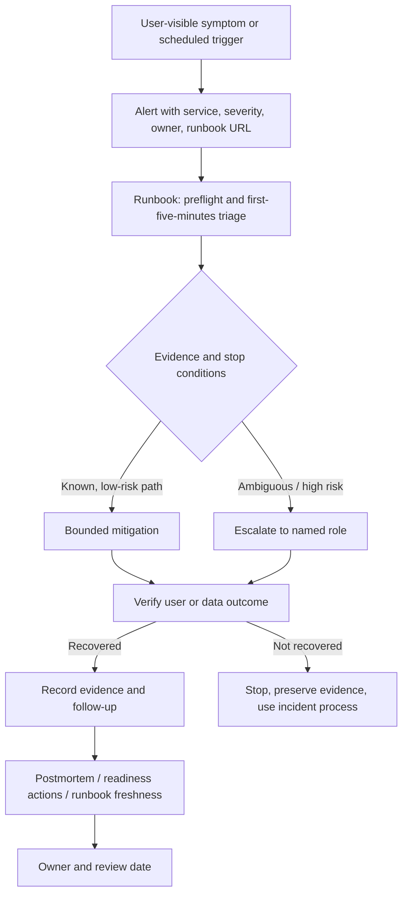
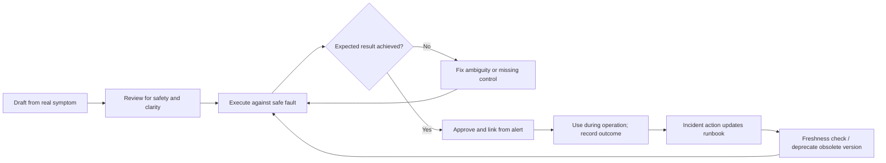
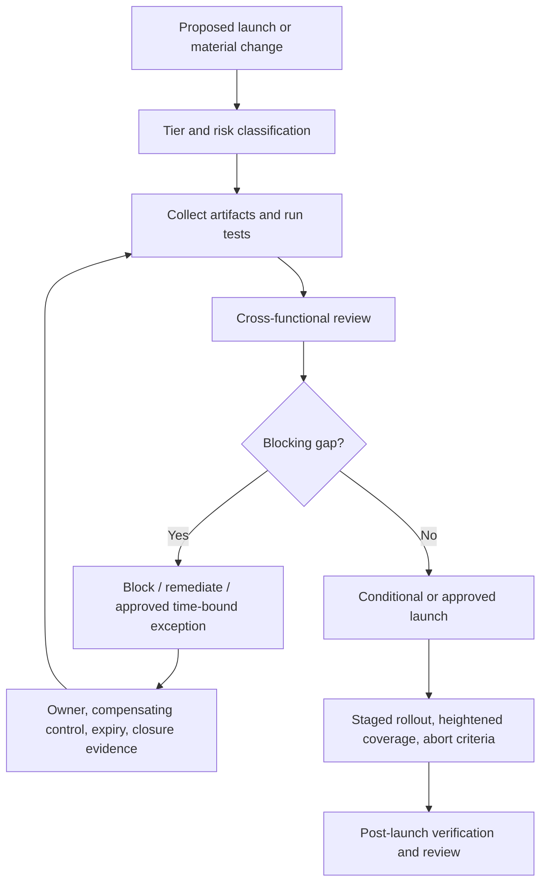

# Unit 8 — Runbook Design and Operational Readiness Reviews

**Target file:** `08-runbook-design-and-operational-readiness-reviews.md`  
**Stage / module:** Stage 2E — Production DevOps & Platform Engineering / M10 — Site Reliability Engineering and Incident Management  
**Estimated time:** 18–26 hours  
**Prerequisites:** M01–M09; basic Linux/WSL2, Python, Git, service deployment, health checks, SLO/alerting concepts, GitOps, secrets and identity  
**Core tools:** Markdown, Python 3.10+, standard library, Git, `bash -n`; optional `shellcheck`, local M08 FastAPI lab service, kind, Prometheus/Alertmanager  
**Awareness only:** enterprise paging/incident tools, service-catalog products, commercial SLO platforms, chaos platforms  
**Last reviewed:** 2026-10-28  
**Tool baseline:** Python 3.10+ for the included scripts; Kubernetes, Prometheus, Alertmanager and application commands must be checked against the versions actually installed.  
**Footprint:** Core exercises run with Python and temporary files; optional local service/Prometheus/kind use must fit the learner's laptop budget (about 4 CPU, 8 GB RAM, 30 GB disk).  
**Solo-learner adaptation:** Use synthetic fixtures, fault toggles on a disposable local service, role cards, scripted checklists, and a next-day cold read. These are proxies for team review, not real team validation.

> **Scope and truthfulness:** This chapter is a standalone artifact. The uploaded M10 syllabus and roadmap tree were inspected, but the actual repository checkout was not available at the expected working path. No repository files were edited. The runbooks and ORR examples below are teaching artifacts; no live service, cluster, production endpoint, customer data, or real credentials were accessed. All sample output is labelled illustrative unless specifically described as observed validation.

## Table of contents

1. [Why this matters and learning outcomes](#10-why-this-matters-in-production)
2. [Prerequisites and M10 boundaries](#20-prerequisites-and-module-boundaries)
3. [L1 — Foundations](#30-l1--foundations)
4. [L2 — Runbook set for data/ML services](#40-l2--runbook-set-for-data-ml-services)
5. [L2 — Runbooks as code](#50-l2--runbooks-as-code-validator-and-tests)
6. [L2 — Evidence-based readiness reviews](#60-l2--evidence-based-readiness-reviews)
7. [L3 — Dependency readiness and FMEA-lite](#70-l3--dependency-readiness-fmea-lite-and-game-days)
8. [L3 — Runbook systems and freshness](#80-l3--runbook-systems-freshness-and-automation)
9. [L4 — Governance and portfolio audit](#90-l4--operational-readiness-program-and-portfolio-audit)
10. [Organizational incident patterns](#100-organizational-incident-patterns)
11. [Reusable templates](#110-reusable-templates-and-artifacts)
12. [Eight mandatory labs](#120-mandatory-hands-on-labs)
13. [Exercises, answers, rubric, and completion gate](#130-exercises-answer-key-rubric-and-completion-gate)
14. [References, coverage audit, and limitations](#140-references-coverage-audit-and-limitations)

---

## 1.0 Why this matters in production

A runbook is part of the operational interface of a service. During an incident, responders may be tired, interrupted, unfamiliar with a component, or working with incomplete information. Vague or stale procedures increase time to mitigation and can turn a recoverable fault into a data-loss event. A readiness review catches missing operational capabilities before launch, but only if each decision is backed by evidence rather than a checkbox. The goal is not documentation volume; it is a repeatable, safe path from signal to verified outcome.

### 1.1 Learning outcomes

- **[L1]** Distinguish runbooks, playbooks, standard operating procedures (SOPs), knowledge-base articles, and postmortems using this course's definitions.
- **[L1]** Identify the required parts of a runbook and explain the alert-to-runbook contract.
- **[L2]** Write usable runbooks for inference API, pipeline, streaming, database, dependency, storage, certificate, and model-release failure modes.
- **[L2]** Test procedures against a safe fault or synthetic fixture and preserve expected-versus-observed evidence.
- **[L2]** Build a validator for metadata, required sections, local Markdown links, and shell syntax where appropriate.
- **[L2]** Complete separate evidence-based readiness reviews for an inference API, data pipeline, and ML model release.
- **[L3]** Analyze dependency failures, build FMEA-lite and pre-mortem records, and design bounded game days with abort conditions.
- **[L3]** Design freshness policies, coverage metrics, and safe progression from human runbook to automation.
- **[L4]** Build a portfolio readiness audit, maturity model, governance process, service catalog entry, and risk-exception lifecycle.
- **[L4]** Evaluate readiness-review effectiveness without claiming correlation proves causation.

### 1.2 Concept map and vocabulary

| Term | Course definition | Common misconception |
|---|---|---|
| Runbook | Stepwise operational procedure for a specific symptom/action, including checks, decisions, safety, and verification | “A link to a dashboard is a runbook” |
| Playbook | Coordinated response sequence for a broader scenario that may involve multiple runbooks, roles, and communications | “Playbook and runbook have one universal definition” |
| SOP | Approved repeatable process with roles, controls, and compliance/quality expectations | “An SOP must be used only during incidents” |
| Knowledge-base article | Explanatory reference that helps understand a topic; it may not provide executable steps | “Every useful article is an incident procedure” |
| Postmortem | Blameless account of an incident, impact, contributing conditions, and tracked learning actions | “A postmortem is a recovery procedure” |
| Operational Readiness Review (ORR) | Evidence-based assessment of whether a service/change can be operated safely | “A completed form means the service is ready” |
| Production Readiness Review (PRR) | Term used by some organizations for a production readiness gate; exact attribution to SRE literature requires verification | “ORR and PRR are universally standardized” |
| Evidence | Artifact or test result that supports a readiness claim | “An owner saying ‘yes’ is evidence” |
| Stop condition | Explicit signal that the responder must not proceed without escalation or a safer plan | “A runbook must always end in an automated fix” |
| Risk acceptance | Time-bounded, authorized decision to carry a known gap with compensating controls | “A waiver permanently closes the gap” |
| Cold read | A reviewer attempts the procedure without relying on undocumented author knowledge | “A solo cold read equals real team validation” |
| Failure Mode and Effects Analysis (FMEA) | Structured identification of how a component/process can fail and the consequences | “A numeric score predicts risk objectively” |



The runbook sits between a signal and an operational decision. It does not replace judgment, incident command, security response, or a service's recovery architecture.

### 1.3 Source alignment and boundaries

**[SOURCE]** The supplied M10 syllabus places this unit after Unit 7 (toil reduction and operational automation) and before Unit 9 (error-budget policies and release freezes). It requires at least eight runbooks, a linter, three readiness-review variants, dependency failure-mode testing, FMEA-lite/pre-mortem, game-day plans, a synthetic portfolio audit, eight labs, exercises, and a line-by-line audit.

**Taught here:** runbook design/testing, metadata and link validation, ORR evidence requirements, data/ML readiness, dependency failure behavior, FMEA-lite, game days, freshness, portfolio governance, and service catalog structure.

**Deferred or linked:** detailed alert-rule design to M10 Unit 3; incident command to Unit 4; triage/postmortem to Unit 5; capacity/cascades to Unit 6; safe automation to Unit 7; error-budget release policy to Unit 9; sustainable on-call to Unit 10; DORA interpretation to Unit 11; telemetry collection/storage/query/dashboard depth to M11; health checks and Kubernetes troubleshooting to M03; backups/restore and DR to M05/M13; progressive delivery and rollback implementation to M08; secret handling and break-glass to M09; supply-chain/security to M01/M12; service catalog/golden paths to M16.

**Source ambiguity and resolution:** the roadmap tree and M10 prompt were available, but the full `Roadmap_ptree.md` filename was not found; `Roadmap(7).md` was available and its M10 tree was inspected. The exact organizational usage of “ORR” and “PRR” varies. This chapter uses ORR as the generic readiness assessment and does not claim a universal standard. Specific SRE Book attribution for “Production Readiness Review” and engagement-model handback criteria remain `[VERIFY]` unless verified against a specific passage.

---

## 2.0 Prerequisites and module boundaries

### 2.1 Gate-in checklist

- [ ] The local M08 FastAPI data/ML service or an explicitly labelled synthetic substitute is available.
- [ ] The learner can distinguish local lab from production and can identify the intended base URL, environment, and namespace.
- [ ] The learner understands basic SLIs/SLOs, alerts, Git/GitOps, health checks, secrets handling, rollback, and incident roles.
- [ ] The learner has a scratch directory outside the repository for generated fixtures and tests.
- [ ] The learner can run Python 3.10+ and, if shell blocks are used, `bash -n`.
- [ ] Optional kind/Kubernetes access is disposable and scoped; otherwise cluster-dependent examples remain templates.

### 2.2 Safe lab convention

Use `RUNBOOK_LAB_ROOT` for temporary artifacts and an explicitly named lab service. Never paste real secrets, customer payloads, production URLs, or personal data into examples. The command fragments below are of three kinds:

- **Runnable local command:** Python or shell command that operates on a supplied local fixture.
- **Lab-specific command:** use only if the M08 lab actually exposes the stated endpoint/flag; confirm the actual interface first.
- **Template:** contains placeholders and must not be run unchanged. A placeholder command is intentionally reported as untestable by the linter.

For any mutating Kubernetes extension, first inspect current context and namespace and stop if they are not the disposable lab. Do not infer the name of a cluster or a namespace.

### 2.3 Runbook lifecycle



A runbook is a maintained operational artifact, not a one-time writing task. The author should not be the only person who can use it.

---

## 3.0 L1 — Foundations

### 3.1 Runbook, playbook, SOP, article, and postmortem

Terminology varies across organizations; the following distinctions are the course convention.

| Artifact | Main question answered | Shape | Example |
|---|---|---|---|
| Runbook | “What should I do for this specific symptom?” | Short steps, decisions, commands, stop conditions, verification | Inference API 5xx increase after deployment |
| Playbook | “How do we coordinate this scenario across people and procedures?” | Roles, communication, decision points, links to multiple runbooks | Region-level dependency incident |
| SOP | “What approved process and controls must be followed?” | Roles, approvals, records, compliance controls | Certificate renewal procedure |
| Knowledge-base article | “How does this system work and why?” | Concepts, architecture, context, troubleshooting background | Feature-store dependency architecture |
| Postmortem | “What happened, what conditions contributed, and what will change?” | Timeline, impact, contributing factors, actions, owners | Stale pipeline incident review |

Do not force every document into one type. A runbook may link to an SOP and architecture article. The alert should land the responder on the specific procedure, not a generic folder.

### 3.2 What makes a runbook usable at 3 a.m.?

- **Discoverable:** linked directly from the actionable alert and service catalog.
- **Accurate and current:** tested against the current service version and last-tested date is visible.
- **Concise:** the first action is obvious; details are available when needed.
- **Actionable:** commands are copyable and target one explicitly identified environment.
- **Decision-oriented:** “if X, do Y; if not, stop and escalate.”
- **Safe:** preconditions, blast radius, approvals, reversibility, and stop conditions appear before risky actions.
- **Verifiable:** each step has expected output and an independent recovery check.
- **Owned:** owner, backup, review date, and follow-up process are clear.

### 3.3 Runbook anatomy

Every production-facing runbook should contain:

1. Title, ID/version, service, environment applicability, and symptom/alert link.
2. Severity and user/data impact description.
3. Preconditions, permissions, dependencies, and context assertions.
4. First-five-minutes checklist.
5. Diagnosis steps with exact commands, expected outputs, and interpretation.
6. Decision branches and stop conditions.
7. Mitigation options with risk and reversibility notes.
8. Rollback or compensation plan, including what cannot be undone.
9. Recovery verification against user-facing SLIs or data correctness/freshness.
10. Escalation criteria and role placeholders (never invented contact details).
11. Follow-up ticket/action item and evidence to capture.
12. Owner, backup, last-tested date, review/expiry date, related dashboards, dependencies, and links.

### 3.4 First-five-minutes triage

1. Confirm alert, service, environment, time window, and impact. Do not assume the alert's inferred cause is correct.
2. Check recent deploy/config/model/data changes and the last known-good version.
3. Inspect user-facing SLI/SLO, error rate, latency, freshness, queue/lag, or correctness signal.
4. Identify whether this is one service or a dependency/capacity issue; avoid parallel uncoordinated changes.
5. Choose the safest mitigation or declare uncertainty and escalate. Preserve a timeline and do not delete evidence.

### 3.5 Alert → runbook contract

An actionable alert should provide a stable runbook link plus service, team/owner, severity, symptom, relevant environment, and links to the relevant dashboard/deployment context. The runbook should state what the alert means and what it does **not** prove. If a link is missing, broken, or points to a generic landing page, the alert is not operationally complete. M10 Unit 3 owns alert design/routing; this unit owns the procedure and its readiness.

### 3.6 Bad runbook and correction

**Bad:** “Check logs. Restart service. If still broken, contact DevOps.”

**Why unsafe:** no target, time window, expected output, permission boundary, rollback, impact check, or condition for restarting. A restart may hide a memory leak, worsen a queue backlog, or drop in-flight work.

**Corrected pattern:** “Confirm `ENV=local-lab` and service ID `inference-api-lab`. Read the last 15 minutes of the lab's error/latency summary. If 5xx rose immediately after the last lab deployment and the previous version is known-good, follow the M08 lab rollback procedure after verifying the deployment ID and approval requirement. Do not restart a database or delete queue state. After mitigation, verify 5xx ratio and p95 latency over the same comparison window, then confirm a synthetic request succeeds. If deployment context is unknown or the rollback target is missing, stop and escalate to the service owner.” The exact commands depend on the actual M08 lab interface and must be verified before use.

### 3.7 Readiness review fundamentals

An ORR is a structured review of whether the team can operate the service safely, not a form that rewards “yes” answers. Use it before launch, after material architecture changes, after significant incidents, and periodically according to service tier. Participants may include service owner, platform/SRE, security, data owner, and ML/model owner. Each criterion needs evidence, status, risk, owner, and closure plan.

A checklist item should not be marked `PASS` because a control exists in a document. It should point to a test or artifact: alert test output, load-test report, restore drill log, rollback drill record, access test, or validated runbook. `BLOCKED` means the check cannot yet be performed; `NOT APPLICABLE` requires rationale and reviewer approval. `FAIL` means evidence shows the criterion is not met. `MISSING` is used in examples to distinguish absent evidence from a verified failure.

**Common mistakes:** using vague commands, hiding destructive steps inside prose, omitting a stop condition, assuming the responder has permissions, marking an untested fallback as ready, and treating risk exceptions as permanent closure.

---

## 4.0 L2 — Runbook set for data/ML services

The following nine runbooks are complete procedure templates. Because the actual M08 service interface and fault-control endpoint were not provided in this execution environment, commands that depend on that interface are explicitly marked **[TEMPLATE — VERIFY]** rather than invented. The Python fixture in §4.10 provides a runnable local substitute for validating decision logic; it does not prove the real service's recovery behavior.

### 4.1 Runbook RB-01 — High error rate after deployment

**Trigger/symptom:** 5xx/error ratio exceeds the service's configured SLO alert; errors began after a deployment. **Impact:** failed inference requests or failed pipeline API calls. **Owner:** service owner placeholder. **Last-tested:** `NOT TESTED — fill after execution`.

**Prerequisites:** confirm lab environment, service ID, deployment version, access to SLI/error dashboard, rollback procedure, and whether the release is still in progress. Never roll back an unknown deployment target.

1. Confirm the alert's service/environment labels and user impact. Record start time and recent deployment ID.
2. Compare error ratio and latency before/after deployment; inspect top error classes and dependency health.
3. If errors began with the new lab release, the previous version is known-good, and rollback is supported, follow the M08 lab rollback runbook. **[TEMPLATE — VERIFY]** Replace `<LAB_DEPLOYMENT_COMMAND>` only with the command from the actual M08 service repository. Do not paste a guessed `kubectl rollout undo` command.
4. If the release is not clearly implicated, stop repeated deploy/rollback attempts; check dependency and configuration changes and escalate.
5. Verify error ratio returns below the defined threshold, latency is acceptable, and a synthetic inference request returns a valid response. Confirm model/data correctness, not just HTTP 200.
6. Record version, timestamps, observed outputs, decision, mitigation, and follow-up ticket.

**Stop/rollback:** stop if target version/context is ambiguous, schema compatibility is unknown, or rollback may corrupt state. Rollback is not proof that all failure modes are handled. **Expected result [ILLUSTRATIVE]:** error rate falls after restoring the known-good lab version; actual result `[NOT EXECUTED]`.

### 4.2 Runbook RB-02 — Latency regression

**Trigger:** p95/p99 latency breaches the service's latency objective while request traffic is understood. **Impact:** timeouts, user-visible slowness, retry amplification.

1. Verify time window, request rate, percentile definition, and whether latency is service-side or end-to-end.
2. Compare saturation (CPU/memory/connection pool), queue depth, recent releases, and dependency latency. Avoid inferring a CPU root cause from correlation alone.
3. If dependency latency dominates, use the dependency runbook RB-06. If saturation/queueing dominates, use M10 Unit 6 and do not increase concurrency blindly.
4. Mitigate with a previously tested action: pause rollout, reduce optional workload, enable an approved degraded mode, or restore the known-good version. **[TEMPLATE — VERIFY]** Use only the M08 lab's actual flag/deploy command.
5. Verify p95/p99, timeout rate, successful requests, and dependency health across a comparison window. Ensure recovery is not caused by traffic disappearing.
6. Record evidence and create a follow-up if the latency knee or capacity margin is unknown.

**Stop condition:** no arbitrary timeout increases, unbounded retries, or scaling that overwhelms a database. **Expected [ILLUSTRATIVE]:** latency returns toward baseline without error or correctness regression. Actual execution `[NOT EXECUTED]`.

### 4.3 Runbook RB-03 — Stale pipeline/data freshness breach

**Trigger:** last validated successful output is older than the freshness SLO, or downstream consumers report stale data. **Impact:** decisions use old/incomplete features or reports.

1. Record source partition/window, last successful run, last validated output, and downstream consumers.
2. Distinguish “job never ran,” “job failed,” “job succeeded but output is stale,” and “output is fresh but invalid.”
3. Check scheduler status, upstream arrival, schema/contract checks, data-quality quarantine, and sink commit evidence.
4. Do not blindly rerun a non-idempotent pipeline. Confirm replay range, checkpoint, deduplication, and idempotency key before a backfill.
5. If safe and documented, execute the pipeline's approved backfill procedure with bounded range and preview. **[TEMPLATE — VERIFY]** Fill in the actual scheduler/job command and replay arguments.
6. Verify freshness, completeness, row counts/quality constraints, lineage, and consumer notification. A green job status alone is insufficient.
7. If correctness is uncertain, stop downstream promotion/use and escalate to the data owner.

**Evidence:** last-success timestamp, source window, job log, validation results, replay boundary, consumer communication. **Expected [ILLUSTRATIVE]:** freshness restored and quality checks pass. Actual `[NOT EXECUTED]`.

### 4.4 Runbook RB-04 — Queue or streaming backlog

**Trigger:** queue depth, consumer lag, or age of oldest item exceeds its service-specific threshold. **Impact:** delayed processing and stale downstream output.

1. Confirm backlog units (messages/bytes/time), arrival rate, processing rate, oldest-item age, and partition skew.
2. Check consumer health, poison-message rate, downstream dependency latency, throttling, and recent deployment/config changes.
3. Determine whether arrivals exceed processing capacity or consumers are blocked. Do not scale consumers without checking downstream database capacity and partition parallelism.
4. If a known transient dependency is recovering, apply bounded backoff and the approved concurrency limit. If poison messages dominate, quarantine only through an audited procedure; do not silently drop them.
5. If the last change caused the lag, pause/rollback via the M08 procedure when safe. **[TEMPLATE — VERIFY]** Use the lab's actual consumer management command.
6. Verify lag is decreasing, oldest-item age is improving, error rate is controlled, and end-to-end output is correct. Estimate catch-up time only when arrival and service rates are measured.
7. Record whether the backlog fully drained and whether catch-up load risks another cascade.

**Stop condition:** do not delete offsets, reset checkpoints, or purge queue contents to make a graph look healthy. Actual fault execution `[NOT EXECUTED]`.

### 4.5 Runbook RB-05 — Database connection exhaustion

**Trigger:** connection pool exhaustion, connection-refused/timeouts, or database saturation correlated with request failures. **Impact:** cascading API and pipeline failures.

1. Confirm database identity/environment, pool saturation, active/waiting connections, request concurrency, and error timing.
2. Check recent traffic/deployments, connection leaks, long transactions, retry storms, and database health. Do not expose query payloads or credentials in the incident record.
3. Avoid raising max connections without checking database limits and downstream capacity. Avoid restart as a first action when it can multiply connection attempts.
4. Use the approved application-side pool/concurrency mitigation or pause the offending lab workload. **[TEMPLATE — VERIFY]** The actual pool metrics/configuration names depend on the M08/M05 lab implementation.
5. If a connection leak is suspected, preserve diagnostics and follow the database team's runbook. No ad hoc `KILL`/termination command is included because it would depend on an unverified database engine and could destroy active work.
6. Verify connection wait time and pool utilization recover, successful requests resume, and no backlog/data correctness regression appears.
7. Create a follow-up with the leak/transaction evidence and the capacity assumption that failed.

**Stop condition:** database identity, transaction impact, or termination target is uncertain. Actual execution `[NOT EXECUTED]`.

### 4.6 Runbook RB-06 — Dependency down, slow, or returning wrong data

**Trigger:** dependency timeout/error, latency increase, or response fails contract/schema/quality validation. **Impact:** inference/pipeline failures, stale or incorrect outputs.

1. Classify failure as `DOWN`, `SLOW`, or `WRONG/MALFORMED`; note whether dependency is hard or soft for this request path.
2. Confirm local service and dependency signals, request correlation ID, last change, and whether failures are global or scoped.
3. For `DOWN`, check approved fallback/queueing/degraded-mode semantics. For `SLOW`, confirm timeout/retry budgets and whether retries are amplifying load. For `WRONG`, stop promotion of suspect data and fail closed if correctness/security requires it.
4. Never invent a fallback: confirm freshness limit, quality guarantee, user-visible behavior, and whether stale data is safe. If no safe fallback exists, return a controlled error and escalate.
5. Apply only a tested local fault toggle or approved routing/degradation mechanism. **[TEMPLATE — VERIFY]** Dependency-specific commands must come from the actual M08/M04 lab.
6. Verify dependency response and end-to-end user/data outcome; a dependency health check alone is not enough.
7. Record timeout/fallback behavior and whether downstream consumers were informed.

**Expected [ILLUSTRATIVE]:** bounded timeouts prevent hangs; a documented fallback is used only when data semantics permit it. Actual `[NOT EXECUTED]`.

### 4.7 Runbook RB-07 — Disk-full, quota, or resource exhaustion

**Trigger:** filesystem/inode/ephemeral storage/queue quota or resource limit reaches a service-specific danger level. **Impact:** write failures, pod eviction, pipeline stoppage, logs or data loss.

1. Verify environment and exact volume/resource; check bytes and inodes, growth rate, owning workload, and whether writes are failing.
2. Identify large files/queues/artifacts and retention policy. Do not print secret files or delete arbitrary paths.
3. Determine whether the resource is a cache, reproducible artifact, log, database file, checkpoint, or user data. Only known disposable lab artifacts are candidates for deletion.
4. Prefer approved cleanup/retention, workload pause, or capacity change. Any cleanup command must include a reviewed exact target and dry-run listing. No `rm -rf` broad pattern is authorized here.
5. If Kubernetes quotas/PVCs are involved, use M03/M05 runbooks and inspect context/namespace before action. **[TEMPLATE — VERIFY]**
6. Verify free space/quota, write health, data integrity, and backlog/freshness. Ensure cleanup did not remove audit/restore evidence.
7. Capture before/after resource measurements and owner/follow-up.

**Stop condition:** data ownership or retention is unknown. Actual execution `[NOT EXECUTED]`.

### 4.8 Runbook RB-08 — Certificate or credential expiry

**Trigger:** expiry warning, TLS handshake failure, or authentication failures after rotation. **Impact:** unavailable dependency or unauthorized access.

1. Confirm the affected service, certificate/identity reference, expiry timestamp, and whether the issue is expiry, trust chain, permissions, or a bad rotation.
2. Do not paste credential material, private keys, bearer tokens, or full secret values into logs or tickets.
3. Use M09's approved renewal/rotation process. Verify issuer/trust chain, target identity, overlap period, consumer reload behavior, and rollback/compensation.
4. If rotation has already caused failure, stop repeated rotations and preserve metadata/audit records; use the documented previous-version recovery only if supported and authorized.
5. Verify TLS/authentication with a non-sensitive synthetic request and check both service and downstream dependency. Confirm the old credential is retired according to the policy.
6. Record secret reference/version identifiers only, not values; follow M09 leak-response runbook if exposure is suspected.

**Stop condition:** identity, target environment, or safe rotation procedure is unknown. Actual execution `[NOT EXECUTED]`.

### 4.9 Runbook RB-09 — Bad model release or fallback

**Trigger:** quality proxy, business metric, feature distribution, fallback ratio, or evaluation guardrail regresses after a model release. **Impact:** incorrect predictions even if HTTP availability remains green.

1. Confirm model/version, evaluation slice, freshness of quality signals, sample size, and whether the signal is drift, data corruption, dependency change, or expected distribution shift.
2. Compare to pre-release evaluation and recent baseline; inspect data/feature contract failures and model-specific guardrails.
3. Follow the release's approved canary/shadow/rollback decision. Do not make a model rollback solely because a small, noisy sample moved without checking the predefined decision rule.
4. If quality risk is material and the fallback is documented, activate only the tested fallback/feature flag with authorized approval. **[TEMPLATE — VERIFY]** The actual M08/model-serving command is repository-specific.
5. Verify quality proxy, fallback ratio, request latency/errors, feature freshness, and output correctness. A successful HTTP response is not proof of model quality.
6. Preserve evaluation evidence, model card, release ID, and human review record; do not delete suspect artifacts.
7. If the fallback has never been exercised, mark the release not ready until a safe drill is performed.

**Expected [ILLUSTRATIVE]:** quality guardrail returns to the accepted range after a verified rollback/fallback. Actual `[NOT EXECUTED]`.

### 4.10 Runnable local decision fixture

This Python fixture demonstrates how to classify a synthetic failure and choose a safe next step. It is not connected to the M08 service. Save as `runbook_decision_fixture.py`; run `python3 runbook_decision_fixture.py`.

```python
from dataclasses import dataclass

@dataclass(frozen=True)
class Observation:
    symptom: str
    target_confirmed: bool
    user_impact_confirmed: bool
    rollback_known_good: bool = False
    data_correctness_uncertain: bool = False
    action_reversible: bool = True

def decide(o: Observation) -> str:
    if not o.target_confirmed:
        return "STOP_AND_CONFIRM_ENVIRONMENT"
    if o.data_correctness_uncertain:
        return "STOP_DOWNSTREAM_PROMOTION_AND_ESCALATE_DATA_OWNER"
    if not o.user_impact_confirmed:
        return "GATHER_IMPACT_EVIDENCE"
    if o.symptom == "post_deploy_errors" and o.rollback_known_good and o.action_reversible:
        return "FOLLOW_APPROVED_ROLLBACK_PROCEDURE"
    if not o.action_reversible:
        return "REQUIRE_AUTHORIZED_HUMAN_REVIEW"
    return "FOLLOW_SYMPTOM_SPECIFIC_RUNBOOK_AND_VERIFY"

if __name__ == "__main__":
    cases = [
        Observation("post_deploy_errors", False, True, True),
        Observation("post_deploy_errors", True, True, True),
        Observation("stale_pipeline", True, True, data_correctness_uncertain=True),
    ]
    for case in cases:
        print(f"{case.symptom}: {decide(case)}")
```

**Expected output [ILLUSTRATIVE]:**

```text
post_deploy_errors: STOP_AND_CONFIRM_ENVIRONMENT
post_deploy_errors: FOLLOW_APPROVED_ROLLBACK_PROCEDURE
stale_pipeline: STOP_DOWNSTREAM_PROMOTION_AND_ESCALATE_DATA_OWNER
```

This fixture can test branch logic; it cannot prove the service's real deployment, rollback, or data-repair behavior. Cleanup: delete the script from the temporary lab directory when evidence is saved.

---

## 5.0 L2 — Runbooks-as-code: validator and tests

### 5.1 Why prose review is insufficient

A human may overlook a broken relative link, missing owner, stale test date, unclosed code fence, or syntactically invalid shell snippet. Automated linting catches mechanical defects consistently, while a human review must still assess whether the action is safe, the expected output is meaningful, and the recovery decision is correct. A syntactically valid command can still be destructive or wrong for the environment.

### 5.2 Metadata and template standard

At the top of each runbook include YAML-like metadata as a documented convention. This validator uses simple Markdown heading and metadata parsing; it does not claim full YAML support.

```yaml
---
id: RB-01
service: inference-api-lab
owner: service-owner-placeholder
alert: https://example.invalid/replace-with-real-alert-reference
last-tested: 2026-10-28
review-by: 2027-01-28
status: draft
---
```

`example.invalid` is deliberately reserved and must be replaced before production use. The dates are sample values; do not claim the runbook was tested on the date shown. In this chapter's examples, status remains `draft` or `NOT TESTED` until the learner executes the test.

### 5.3 Required sections

The linter checks for headings such as `Trigger`, `Impact`, `Prerequisites`, `First five minutes`, `Diagnosis`, `Decision branches`, `Mitigation`, `Rollback`, `Verification`, `Escalation`, `Follow-up`, and `Ownership and freshness`. A team can extend this list but should not weaken required safety content without an explicit decision.

### 5.4 Python runbook linter

Save as `runbook_lint.py`. It checks Markdown metadata, required headings, date shape/staleness, the alert reference, local Markdown links, and shell code fences. If `bash` exists, it sends extracted shell blocks to `bash -n`; if missing, it prints a transparent skip. It flags placeholder commands as `UNTESTABLE` rather than attempting to execute them. It never executes commands from a runbook.

```python
#!/usr/bin/env python3
import argparse
import datetime as dt
import re
import shutil
import subprocess
import sys
from pathlib import Path

REQUIRED_HEADINGS = [
    "Trigger", "Impact", "Prerequisites", "First five minutes", "Diagnosis",
    "Decision branches", "Mitigation", "Rollback", "Verification", "Escalation",
    "Follow-up", "Ownership and freshness",
]
META_KEYS = ["id", "service", "owner", "alert", "last-tested", "review-by", "status"]
DATE_RE = re.compile(r"^\d{4}-\d{2}-\d{2}$")
LINK_RE = re.compile(r"(?<!!)\[[^\]]*\]\(([^)]+)\)")
FENCE_RE = re.compile(r"```([\w+-]*)\s*\n(.*?)\n```", re.S)


def parse_metadata(text):
    lines = text.splitlines()
    if not lines or lines[0].strip() != "---":
        return {}, ["metadata: missing opening --- block"]
    try:
        end = lines.index("---", 1)
    except ValueError:
        return {}, ["metadata: missing closing --- block"]
    data, errors = {}, []
    for line in lines[1:end]:
        if not line.strip() or line.lstrip().startswith("#"):
            continue
        if ":" not in line:
            errors.append(f"metadata: malformed line {line!r}")
            continue
        key, value = line.split(":", 1)
        key, value = key.strip(), value.strip().strip("\"'")
        if key in data:
            errors.append(f"metadata: duplicate key {key}")
        data[key] = value
    for key in META_KEYS:
        if not data.get(key):
            errors.append(f"metadata: missing {key}")
    return data, errors


def validate(path, today=None, max_age_days=180):
    today = today or dt.date.today()
    text = path.read_text(encoding="utf-8")
    errors, warnings = [], []
    meta, meta_errors = parse_metadata(text)
    errors.extend(meta_errors)
    for heading in REQUIRED_HEADINGS:
        if not re.search(r"^#{1,6}\s+" + re.escape(heading) + r"\s*$", text, re.M | re.I):
            errors.append(f"section: missing required heading '{heading}'")
    for key in ("last-tested", "review-by"):
        value = meta.get(key, "")
        if value and not DATE_RE.fullmatch(value):
            errors.append(f"metadata: {key} must use YYYY-MM-DD")
        elif value:
            try:
                parsed = dt.date.fromisoformat(value)
            except ValueError:
                errors.append(f"metadata: {key} is not a valid calendar date")
            else:
                if key == "last-tested" and parsed > today:
                    errors.append("metadata: last-tested is in the future")
                if key == "last-tested" and (today - parsed).days > max_age_days:
                    warnings.append(f"freshness: last-tested is {(today-parsed).days} days old")
                if key == "review-by" and parsed < today:
                    warnings.append(f"freshness: review-by expired on {value}")
    alert = meta.get("alert", "")
    if alert and ("example.invalid" in alert or "<" in alert or ">" in alert):
        errors.append("metadata: alert reference is still a placeholder")
    elif alert and not re.match(r"^(https?://|\./|\.\./|#)", alert):
        errors.append("metadata: alert must be a URL, relative path, or anchor")

    # Validate local Markdown links. Skip remote links and mailto; anchor-only links are checked in-file.
    for target in LINK_RE.findall(text):
        target = target.split("#", 1)[0].strip()
        if not target or re.match(r"^(https?://|mailto:|tel:)", target):
            continue
        if target.startswith("#"):
            continue
        resolved = (path.parent / target).resolve()
        if not resolved.exists():
            errors.append(f"link: broken local target '{target}'")

    shell_blocks = []
    for lang, body in FENCE_RE.findall(text):
        if lang.lower() in {"sh", "bash", "shell"}:
            shell_blocks.append(body)
            if re.search(r"<[^>]+>|\bTEMPLATE\b|REPLACE_ME|example\.invalid", body, re.I):
                warnings.append("command: shell block contains placeholder; UNTESTABLE until adapted")
    bash = shutil.which("bash")
    if shell_blocks and not bash:
        warnings.append("command: bash unavailable; shell syntax check SKIPPED")
    elif shell_blocks:
        for index, body in enumerate(shell_blocks, 1):
            result = subprocess.run([bash, "-n"], input=body, text=True, capture_output=True)
            if result.returncode:
                detail = (result.stderr or result.stdout).strip().replace("\n", " ")
                errors.append(f"shell block {index}: bash -n failed: {detail}")
    return errors, warnings


def main(argv=None):
    parser = argparse.ArgumentParser(description="Lint runbook Markdown; never executes runbook commands")
    parser.add_argument("paths", nargs="+", type=Path)
    parser.add_argument("--max-age-days", type=int, default=180)
    args = parser.parse_args(argv)
    if args.max_age_days < 1:
        parser.error("--max-age-days must be >= 1")
    any_error = False
    for path in args.paths:
        if not path.is_file():
            print(f"ERROR {path}: file not found", file=sys.stderr)
            any_error = True
            continue
        try:
            errors, warnings = validate(path, max_age_days=args.max_age_days)
        except (OSError, UnicodeError) as exc:
            print(f"ERROR {path}: {exc}", file=sys.stderr)
            any_error = True
            continue
        print(f"RUNBOOK {path}")
        for item in warnings:
            print(f"WARN: {item}")
        for item in errors:
            print(f"ERROR: {item}")
        print(f"RESULT: {'FAIL' if errors else 'PASS_WITH_WARNINGS' if warnings else 'PASS'}")
        any_error = any_error or bool(errors)
    return 1 if any_error else 0

if __name__ == "__main__":
    raise SystemExit(main())
```

Run `python3 runbook_lint.py path/to/runbook.md`. The script's `--max-age-days` default is a local course setting, not a universal policy. It checks shell syntax only, not command semantics or safe targeting. It does not validate remote URL reachability because remote access may be unavailable or require authentication.

### 5.5 Planted-defect corpus and tests

The tests below use temporary files and a fixed date so staleness behavior is deterministic. They also exercise placeholder-command handling and invalid shell syntax when Bash is installed. Save as `test_runbook_lint.py`; run `python3 -m unittest -v` from the directory containing `runbook_lint.py`.

```python
import datetime as dt
import tempfile
import unittest
from pathlib import Path
from runbook_lint import validate

GOOD = """---
id: RB-TEST
service: synthetic
owner: team-placeholder
alert: https://alerts.example.test/runbook
last-tested: 2026-10-01
review-by: 2027-01-01
status: draft
---
# Test runbook
## Trigger
## Impact
## Prerequisites
## First five minutes
## Diagnosis
## Decision branches
## Mitigation
## Rollback
## Verification
## Escalation
## Follow-up
## Ownership and freshness
"""

class RunbookLintTests(unittest.TestCase):
    def check(self, content, today=dt.date(2026, 10, 28)):
        with tempfile.TemporaryDirectory() as td:
            path = Path(td) / "runbook.md"
            path.write_text(content, encoding="utf-8")
            return validate(path, today=today, max_age_days=90)

    def test_good_metadata_and_sections(self):
        errors, warnings = self.check(GOOD)
        self.assertEqual(errors, [])

    def test_missing_owner(self):
        errors, _ = self.check(GOOD.replace("owner: team-placeholder\n", ""))
        self.assertTrue(any("missing owner" in x for x in errors))

    def test_stale_last_tested(self):
        errors, warnings = self.check(GOOD.replace("last-tested: 2026-10-01", "last-tested: 2025-01-01"))
        self.assertTrue(any("last-tested is" in x for x in warnings))

    def test_malformed_date(self):
        errors, _ = self.check(GOOD.replace("last-tested: 2026-10-01", "last-tested: yesterday"))
        self.assertTrue(any("YYYY-MM-DD" in x for x in errors))

    def test_missing_alert_reference(self):
        errors, _ = self.check(GOOD.replace("alert: https://alerts.example.test/runbook\n", ""))
        self.assertTrue(any("missing alert" in x for x in errors))

    def test_broken_local_link(self):
        errors, _ = self.check(GOOD + "\n[missing](not-here.md)\n")
        self.assertTrue(any("broken local target" in x for x in errors))

    def test_missing_required_section(self):
        errors, _ = self.check(GOOD.replace("## Rollback\n", ""))
        self.assertTrue(any("missing required heading 'Rollback'" in x for x in errors))

    def test_placeholder_alert_flagged(self):
        errors, _ = self.check(GOOD.replace("https://alerts.example.test/runbook", "https://example.invalid/replace"))
        self.assertTrue(any("placeholder" in x for x in errors))

    def test_placeholder_command_warned_as_untestable(self):
        content = GOOD + "\n```bash\nrun <REPLACE_ME>\n```\n"
        _, warnings = self.check(content)
        self.assertTrue(any("UNTESTABLE" in x for x in warnings))

    def test_invalid_shell_syntax_detected_when_bash_exists(self):
        import shutil
        if not shutil.which("bash"):
            self.skipTest("bash not installed; validator should report syntax check skipped")
        content = GOOD + "\n```bash\nif then\n  echo bad\nfi\n```\n"
        errors, _ = self.check(content)
        self.assertTrue(any("bash -n failed" in x for x in errors))

if __name__ == "__main__":
    unittest.main()
```

**Important test boundary:** `test_runbook_lint.py` validates metadata/heading/link behavior. The invalid shell syntax case should be tested by adding a `bash` block with a syntax error to a temporary fixture and running the CLI in an environment with Bash installed. The validator uses `bash -n`; it does not call `shellcheck`. If `shellcheck` is available, teams may add it as a separate optional CI step. A shell block with placeholders is warned as `UNTESTABLE`; the validator never executes the block.

### 5.6 Safe test process and execution log

For each runbook: (1) prepare disposable state; (2) inject one known fault; (3) follow the procedure exactly; (4) capture commands and sanitized outputs; (5) compare expected vs observed; (6) record ambiguity and safety concerns; (7) revise; (8) rerun; (9) have a second operator cold-read it when available. For solo study, leave it overnight and repeat without consulting the authoring notes. This is only a proxy for a genuinely unfamiliar operator.

---

## 6.0 L2 — Evidence-based readiness reviews

### 6.1 Gate model



**[ILLUSTRATIVE]** Use deeper reviews for high-criticality services, broad migrations, region expansions, major version upgrades, and model releases with material user impact. The launch gate should be risk-based: a missing tested rollback for an irreversible migration is normally blocking; a missing optional dashboard annotation may be advisory. Define the rule before the review, not after a gap is found.

### 6.2 Status semantics and evidence contract

| Status | Meaning | Minimum evidence |
|---|---|---|
| PASS | Criterion met and evidence inspected | Link to artifact/test output plus reviewer/date |
| FAIL | Evidence shows criterion is not met | Finding, risk, owner, corrective action |
| BLOCKED | Cannot evaluate safely yet | Missing prerequisite and unblock condition |
| NOT APPLICABLE | Criterion genuinely does not apply | Rationale and reviewer approval |
| MISSING | Evidence unavailable/not provided | Do not treat as pass; obtain evidence or record a gap |
| EXCEPTION | Authorized, time-bound acceptance of known risk | Rationale, authority, owner, compensating control, expiry, closure evidence |

### 6.3 Readiness checklist — new inference API

The following example is a **template portfolio**, not a completed passing ORR. The evidence artifacts are described, but they were not available for inspection in this environment. Therefore the current evidence status is `MISSING` or `[NOT EXECUTED]` until a learner attaches actual files and test records.

| Area / criterion | Why it matters | Evidence required | Current status | Owner / risk / follow-up |
|---|---|---|---|---|
| SLIs/SLOs defined | Aligns user impact and alerting | `slo/inference-api-slo.md`, SLI queries, review record | MISSING | Service owner; define objectives and verify measurement |
| Actionable alerts link to tested runbooks | Reduces detection-to-action delay | Alert-rule tests and runbook test logs | MISSING | SRE/platform; execute each runbook |
| Dashboards/logs/metrics/traces usable | Supports diagnosis | M11 dashboard/telemetry links, access test | MISSING | Observability owner; M11 handoff |
| Capacity/load tested with headroom | Avoids launch-induced saturation | Load-test report, load profile, saturation and error data | `[NOT EXECUTED]` | Service owner; run on disposable lab only |
| Timeout/retry/breaker/fallback policy | Prevents amplification and unsafe waits | Config diff and injected dependency test | `[NOT EXECUTED]` | Platform owner; validate bounded behavior |
| Graceful degradation documented | Defines behavior under partial failure | Fallback contract and wrong/stale data tests | MISSING | Product/data owner; approve semantics |
| Rollback tested | Limits release blast radius | M08 rollback drill record and version IDs | `[NOT EXECUTED]` | Release owner; test in lab |
| Backup/restore tested | Protects state | M05/M13 restore drill log and RTO/RPO evidence | MISSING | Data owner; schedule restore drill |
| Dependency map and failure tests | Identifies cascading risks | Dependency inventory and down/slow/wrong results | `[NOT EXECUTED]` | Service/platform owner; Lab 5 |
| Runbook completeness/freshness | Ensures safe incident actions | Linter output, owner, last-tested, review-by | `[NOT EXECUTED]` | Runbook owner; Lab 2 |
| Health checks and probes | Detects readiness/liveness appropriately | M03 config and probe failure test | MISSING | Platform owner; confirm probe semantics |
| On-call/escalation ownership | Prevents orphaned pages | Owner/backup rota and escalation test | MISSING | Service owner; use role placeholders until assigned |
| Configuration/secrets | Prevents secret leaks and config drift | M09 references, secret scan, rotation drill | MISSING | Security owner; no secret values in evidence |
| Deployment/GitOps/change path | Provides traceability and rollback | M08 pipeline/PR audit, release record | MISSING | Release owner; verify in actual repo |
| RBAC/PSS/NetworkPolicy | Restricts blast radius | Policy manifests and negative access tests | MISSING | Security/platform; verify actual namespace |
| Supply-chain/image provenance | Reduces untrusted artifact risk | M01/M12 evidence, image scan/signing policy | MISSING | Security owner; attach current reports |
| Data/model correctness | HTTP success is not business success | Contract tests, evaluation report, quality guardrails | MISSING | Data/ML owner; define correctness gate |
| Cost/quotas/scaling | Prevents unbounded spend and resource starvation | M15 budget model, labels/tags, limits/quotas | MISSING | Platform/FinOps; validate assumptions |
| Staged rollout and abort criteria | Makes launch risk reversible | Canary/shadow plan, explicit abort conditions | MISSING | Release owner; align with M08 |
| Restore/rollback exception policy | Ensures residual risk is owned | Risk acceptance with authority/expiry | MISSING | Accountable authority; no permanent waivers |

### 6.4 Launch-blocking vs advisory decisions

**[ILLUSTRATIVE]** Define blocking criteria based on service criticality and the severity of potential harm. A reasonable starting rule is to block launch for: unknown accountable owner; no actionable SLO/alert path for a critical service; no tested recovery/rollback for a high-risk reversible release; untested restore for critical state; known unsafe secret/access configuration; or an unbounded dependency failure likely to cascade. Advisory findings may include nonessential metadata or cosmetic dashboard gaps, if they do not impede safe response. The accountable risk authority, compensating control, expiry, and closure evidence must be recorded for every exception. This list is a course example, not a universal standard.

### 6.5 Example ORR for the data pipeline/data product

| Criterion | Evidence required | Status now | Closure evidence |
|---|---|---|---|
| Freshness SLO and last-success signal | Freshness contract, watchdog test, last validated success | MISSING | Run watchdog for never-ran and stale cases |
| Data contracts and quality checks | Schema/contract tests, quarantine reasons, sample valid/invalid data | MISSING | Show invalid data cannot silently reach consumers |
| Lineage and accountable owner | Catalog entry, source/sink ownership, consumer list | MISSING | Verify owner and dependency links |
| Schema evolution compatibility | Reader/writer compatibility tests and staged rollout plan | MISSING | Execute compatible and incompatible fixture cases |
| Backfill/reprocessing | Replay boundary, idempotency key, checkpoint, dedupe and reconciliation | `[NOT EXECUTED]` | Repeat-run and failure-between-read/write tests |
| Data correctness and completeness | Row-count/reconciliation, uniqueness, null/range checks | MISSING | Attach before/after validation results |
| Consumer communication | Change notice, impact window, contact/owner placeholder | MISSING | Attach simulated notice and acknowledgement workflow |
| Retention and recovery | Retention policy and restore/reprocessing evidence | MISSING | M05/M13 restore evidence |
| Cost model | Runtime, storage, backlog catch-up and resource estimate | MISSING | Measured lab run with assumptions stated |
| Runbooks | Stale pipeline, backlog, DB/dependency, disk/quota | `[NOT EXECUTED]` | Run Labs 1 and 5 and attach actual log |

### 6.6 Example ORR for an ML model release

| Criterion | Evidence required | Status now | Closure evidence |
|---|---|---|---|
| Evaluation quality | Offline evaluation by slices, baseline comparison, acceptance criteria | MISSING | Attach reproducible evaluation report and dataset provenance |
| Shadow/canary plan | Traffic/scope, sample window, metrics, abort rules | MISSING | Dry-run/traffic simulation record; no real customer traffic in this course |
| Rollback and fallback model | Version IDs, compatibility, tested activation and verification | `[NOT EXECUTED]` | Execute local fallback drill and verify output quality |
| Drift/quality monitoring | Feature/data freshness, drift proxy, quality feedback and alert path | MISSING | Synthetic drift test and alert evidence |
| Human review gates | Which decisions need human approval and why | MISSING | Review workflow and approver role |
| Model card/documentation | Intended use, limitations, evaluation, known risks | MISSING | Reviewed model card linked to release |
| Feature-store/dependency failure | Down/slow/wrong behavior and stale-feature policy | `[NOT EXECUTED]` | Lab 5 expected-vs-observed record |
| Cost/capacity | Inference throughput, latency, resource needs, fallback capacity | MISSING | Load-test report and model-size/cost assumptions |
| Data governance/security | Provenance, access, retention, sensitive-data constraints | MISSING | Security/data-owner review evidence |
| Rollout/stop condition | Quality guardrail, fallback ratio, rollback owner | MISSING | Tested threshold and explicit approval record |

**Handoff:** model-evaluation and model-card depth belongs to the later ML specialization/Stage 5D material. M10 checks operational evidence and recovery, not the entire ML curriculum.

---

## 7.0 L3 — Dependency readiness, FMEA-lite, and game days

### 7.1 Dependency failure-mode table

| Failure mode | Expected behavior | Timeout/fallback | User/data impact | Telemetry | Verification |
|---|---|---|---|---|---|
| Dependency down | Fail fast or use an explicitly approved fallback | Bounded timeout; no infinite retries | Controlled error or defined degraded behavior | Error ratio, dependency availability, fallback count | Disable local stub and assert bounded completion |
| Dependency slow | Deadline respected; retries do not amplify load | Deadline budget, retry cap, backoff/jitter if designed | Increased latency; avoid queue collapse | p95/p99, timeout, queue/connection wait, retry count | Inject delay in local fixture and measure elapsed time |
| Wrong/malformed response | Reject contract violation; do not treat as healthy | Fail closed when correctness/security requires it; fallback only if semantically safe | Potential incorrect inference/data propagation | Schema/contract failures, quarantine count, quality guardrail | Return malformed fixture and assert output is rejected |
| Stale but valid-shaped response | Enforce freshness policy | Serve stale only within approved bound | Stale features/reporting | Age-of-data, last validated success | Freeze source updates and test freshness alert |
| Partial success/timeout after write | Reconcile and use idempotency/transaction semantics | Avoid blind replay | Duplicate or missing data | Commit status, idempotency key, reconciliation delta | Inject failure between write and acknowledgement |

**Observed results:** no M08 service or dependency fault endpoint was available for execution here. All five scenarios remain `[NOT EXECUTED]`; the expected behavior above is the test contract, not an observed result.

### 7.2 Hard vs soft dependencies

A **hard dependency** is required for the request or correctness guarantee; its failure should produce a controlled failure rather than false success. A **soft dependency** may be bypassed only when the product contract defines acceptable degradation. A recommendation service might tolerate a stale cache; a permissions check or authoritative financial balance usually cannot simply be skipped. Do not call a dependency “soft” only because its outage is inconvenient.

Retry amplification occurs when each failed call triggers more attempts, increasing load on an already degraded dependency. Deadlines should compose across the call chain; retries should be bounded by an overall budget, not each layer independently. A fallback must have an explicit freshness/correctness contract, telemetry, and test. “Return cached data” is not a safe fallback without a maximum age and correctness decision.

### 7.3 FMEA-lite worksheet

Use qualitative severity, likelihood, and detectability labels to prioritize attention. If you assign numbers, mark the scoring model `[ILLUSTRATIVE]`; scores are not objective probabilities and must not be used to conceal severe low-frequency risks.

| Failure mode | Cause | Effect | Severity | Likelihood | Detectability | Existing controls | Action / owner / due date | Verification evidence |
|---|---|---|---|---|---|---|---|---|
| Rollback target missing | Artifact/version retention gap | Prolonged bad release | High | Medium | Medium | Deployment history | Pin known-good artifact; release owner; before launch | Rollback drill log |
| Pipeline replays non-idempotently | Checkpoint/sink semantics mismatch | Duplicate data | High | Medium | Low | Job retry | Add stable idempotency key and reconciliation; data owner | Repeat-run test |
| Dependency slow causes retry storm | No shared deadline budget | Cascading overload | High | Medium | Medium | Per-call timeout | Bound retry budget; platform owner | Slow-dependency game day |
| Model fallback untested | Document-only fallback | Quality regression persists | High | Low/medium | Low | Model card mention | Execute fallback drill; ML owner | Quality proxy before/after |
| Runbook target ambiguous | Missing environment assertion | Wrong environment mutation | Critical | Low/medium | Low | Review checklist | Assert context and target; platform owner | Negative context test |

### 7.4 Pre-mortem: “The launch failed—what made it fail?”

**[ILLUSTRATIVE]** Assume the inference API launch failed within its first day. Ask each reviewer independently to list plausible causes before group discussion. Rank risks by potential user harm and lack of recovery evidence, not just a multiplied score.

| Rank | Plausible failure | Early signal | Prevention/mitigation | Required proof |
|---:|---|---|---|---|
| 1 | Bad model release silently degrades quality | Quality proxy/fallback ratio changes | Shadow/canary, quality guardrail, tested fallback | Evaluation + fallback drill |
| 2 | Dependency latency triggers retry cascade | Retry count, p99, queue growth | Deadline budget, retry cap, circuit-breaker/degraded mode if implemented | Slow dependency test |
| 3 | Backlog makes ETL output stale | Oldest-item age and freshness breach | Capacity/catch-up plan, bounded concurrency | Backlog injection and freshness recovery |
| 4 | Rollback is unavailable or incompatible | Missing artifact/schema compatibility | Retain known-good artifact, rollback plan | Rollback drill |
| 5 | Runbook requires unavailable permissions | Permission denied during drill | Least-privilege access test and escalation path | Role-based cold read |

### 7.5 Game-day plan and top-three scenarios

Run only against local disposable systems. Do not inject faults into a shared or production environment. The plan is provided; the three scenarios were **not executed** in this environment.

| Scenario | Hypothesis | Injection | Abort criteria | Expected | Observed | Cleanup |
|---|---|---|---|---|---|---|
| Dependency slow | Deadline and retry limits bound overload | Local stub adds controlled delay | Any non-lab endpoint, unexpected resource growth, test cannot be stopped | Bounded latency/controlled error; retry count capped | `[NOT EXECUTED]` | Disable stub, restore config, confirm baseline |
| Stale pipeline | Watchdog detects missed/old output | Freeze synthetic source timestamp or mark run missing | Any real data path or destructive replay request | Stale/never-ran alert, downstream promotion blocked if configured | `[NOT EXECUTED]` | Restore fixture and validate fresh output |
| Bad model release | Quality guardrail drives safe fallback/rollback | Select synthetic bad model fixture | Any customer traffic or real model registry access | Guardrail fires; human decision path and fallback verification | `[NOT EXECUTED]` | Restore known-good fixture, verify quality proxy |

**Game-day procedure:** state hypothesis; list blast radius; record starting metrics; identify controller and observers; inject one fault; follow the runbook; capture timestamps/expected-vs-observed; stop at abort criteria; restore baseline; verify recovery; record follow-up. A tabletop without fault injection is useful but must not be reported as an executed game day.

---

## 8.0 L3 — Runbook systems, freshness, and automation

### 8.1 Coverage and quality metrics

| Metric | Definition | Caveat |
|---|---|---|
| Alert runbook coverage | Actionable alerts with valid specific runbook / all actionable alerts | A non-empty URL may still be wrong or generic |
| Freshness coverage | Runbooks tested within policy window / in-scope runbooks | Window is local policy, not universal |
| Runbook usage | Incident records referencing runbook / relevant incidents | Usage is not proof of usefulness |
| Time to first safe action | Alert/incident start to first verified safe action | Define start and action consistently |
| Failed/abandoned steps | Steps not completed as written / attempted steps | Capture why, not just count |
| Post-incident update rate | Relevant incidents with runbook review/update action / relevant incidents | An update can be “no change” with rationale |
| Link/metadata lint rate | Passing runbooks / checked runbooks | Syntax pass is not operational validation |

### 8.2 Freshness policy

**[ILLUSTRATIVE]** Example policy: review critical runbooks every 90 days, noncritical ones every 180 days, and immediately after a relevant incident or material change. The included linter's default stale threshold is 180 days; choose the actual threshold based on change rate, service criticality, and risk. Do not claim this is an industry standard.

A freshness lifecycle should distinguish `last-reviewed` from `last-tested`. A reviewer can inspect prose without executing it; a test date means a defined test was performed and evidence recorded. CI should flag missing dates, future dates, expired review-by dates, missing owners, and links that do not resolve. It cannot prove a procedure remains semantically correct.

### 8.3 Content quality and cognitive load

- Put the safest first action and stop condition near the top.
- Use short numbered steps for linear tasks and decision trees when the path depends on evidence.
- Put warnings **before** the risky step, not after it.
- Explain expected output and what it means; do not ask an on-call to “check logs” without a time range, signal, and decision.
- Avoid multiple unrelated mitigations in one step.
- If uncertain, stop and escalate; do not improvise destructive commands.
- Keep screenshots only when they are current and versioned; text commands and diagrams are easier to diff.
- Write for the least-experienced authorized responder, not the original author.

### 8.4 Runbook → automation progression

Reuse Unit 7's eliminate-first ladder: eliminate the recurring need, standardize, document, script stable low-risk steps, wrap them in a maintained tool, expose self-service, then consider bounded self-healing. Automate evidence gathering and preflight checks before automating irreversible mutations. Preserve a human decision point for ambiguous, high-impact, security-sensitive, or correctness-sensitive actions. Every automation should have owner, identity/scope, audit, rate/action limits, failure detection, disable path, and a manual fallback.

### 8.5 ORR process design

**Triggers:** new launch, major architecture/dependency change, data/schema migration, region expansion, major version upgrade, model release with material quality impact, repeated severe incident, or scheduled review. **Participants:** service owner, platform/SRE, security, data/model owner, and product/support roles as appropriate. **Depth:** lightweight review for low-risk changes; deeper evidence review for critical services or high-blast-radius changes. **Gate:** criteria and authority must be explicit. **Exception:** named approver, rationale, owner, compensating controls, expiry, review date, and closure evidence. **Post-launch:** verify the same SLIs/guardrails used for the gate and record what differed from assumptions.

### 8.6 Documentation architecture and single source of truth

Use a service catalog entry as an index, not a second copy of every document. The catalog points to owner, tier, SLOs, runbooks, dashboards, dependencies, escalation, deployment path, security contacts, and change history. Keep canonical content in version control and link it from alerts and service metadata. Avoid wiki sprawl where three pages disagree about the recovery command.

---

## 9.0 L4 — Operational readiness program and portfolio audit

### 9.1 Course maturity model

This is a course framework, not a published industry standard.

| Level | Characteristics | Evidence of progression |
|---|---|---|
| 1 — Ad hoc | Runbooks inconsistent, owners implicit, readiness claims subjective | Incidents expose repeated knowledge gaps |
| 2 — Repeatable | Template, owner, basic checklist, common runbook links | Core runbooks exist and are discoverable |
| 3 — Evidence-backed | Tested runbooks, evidence-based ORRs, time-bound exceptions | Artifacts and test logs support PASS decisions |
| 4 — Measured | Freshness/coverage/incident metrics and portfolio audit | Trends and gaps have owners and review cadence |
| 5 — Continuously improved | Post-incident learning updates the system, golden paths embed controls | Re-review effectiveness and retire obsolete procedures |

### 9.2 Synthetic portfolio inventory

Save as `service_inventory.json`. All values are synthetic. A status of `true` means only that the sample inventory claims evidence exists; the script does not open or verify the underlying artifact. The report must therefore be read as a metadata audit, not proof that the service is operationally ready.

```json
[
  {"service":"inference-api-lab","owner":"ml-platform","runbook":"runbooks/inference-api.md","runbook_last_tested":"2026-09-20","slo_present":true,"alerts_present":true,"rollback_evidence":false,"exception_expiry":null,"criticality":"high"},
  {"service":"nightly-etl-lab","owner":"data-platform","runbook":"runbooks/etl.md","runbook_last_tested":"2025-01-01","slo_present":true,"alerts_present":false,"rollback_evidence":false,"exception_expiry":"2026-08-01","criticality":"high"},
  {"service":"stream-consumer-lab","owner":"","runbook":"","runbook_last_tested":null,"slo_present":false,"alerts_present":true,"rollback_evidence":false,"exception_expiry":null,"criticality":"medium"},
  {"service":"feature-store-lab","owner":"data-platform","runbook":"runbooks/feature-store.md","runbook_last_tested":"2026-10-01","slo_present":true,"alerts_present":true,"rollback_evidence":true,"exception_expiry":"2026-12-31","criticality":"high"}
]
```

### 9.3 Readiness portfolio audit script

Save as `readiness_audit.py`. It checks missing owner/runbook/SLO/alerts/rollback evidence, stale or malformed runbook test dates, and expired readiness exceptions. It does not access a real service catalog or verify linked artifacts. The freshness window is a configurable course policy.

```python
#!/usr/bin/env python3
import argparse, datetime as dt, json, sys
from pathlib import Path

REQUIRED_FIELDS = {"service", "owner", "runbook", "runbook_last_tested", "slo_present",
                   "alerts_present", "rollback_evidence", "exception_expiry", "criticality"}

def audit(records, today, max_age_days=180):
    findings, scores = [], []
    if not isinstance(records, list):
        raise ValueError("inventory must be a JSON array")
    seen = set()
    for index, row in enumerate(records):
        if not isinstance(row, dict):
            findings.append({"service": f"row-{index+1}", "severity":"high", "finding":"row is not an object"})
            continue
        missing = REQUIRED_FIELDS - row.keys()
        if missing:
            findings.append({"service": row.get("service", f"row-{index+1}"), "severity":"high",
                             "finding": f"missing fields: {','.join(sorted(missing))}"})
        service = str(row.get("service", f"row-{index+1}"))
        if service in seen:
            findings.append({"service":service,"severity":"high","finding":"duplicate service id"})
        seen.add(service)
        row_findings = []
        def add(severity, message):
            row_findings.append(message)
            findings.append({"service":service,"severity":severity,"finding":message})
        if not str(row.get("owner", "")).strip(): add("high", "missing accountable owner")
        if not str(row.get("runbook", "")).strip(): add("high", "missing runbook reference")
        if row.get("slo_present") is not True: add("medium", "missing SLO evidence flag")
        if row.get("alerts_present") is not True: add("high", "missing alert evidence flag")
        if row.get("rollback_evidence") is not True: add("high", "missing rollback evidence")
        tested = row.get("runbook_last_tested")
        if not tested:
            add("high", "missing runbook last-tested date")
        else:
            try: tested_date = dt.date.fromisoformat(tested)
            except (TypeError, ValueError): add("high", "malformed runbook last-tested date")
            else:
                if tested_date > today: add("high", "runbook last-tested date is in the future")
                elif (today - tested_date).days > max_age_days: add("medium", "runbook is stale")
        expiry = row.get("exception_expiry")
        if expiry:
            try: expiry_date = dt.date.fromisoformat(expiry)
            except (TypeError, ValueError): add("high", "malformed exception expiry date")
            else:
                if expiry_date < today: add("high", "readiness exception expired")
        score = max(0, 100 - 15 * len(row_findings))
        scores.append({"service":service,"score":score,"findings":len(row_findings),"criticality":row.get("criticality","unknown")})
    return scores, findings

def main(argv=None):
    p = argparse.ArgumentParser(description="Audit synthetic service readiness metadata")
    p.add_argument("inventory", type=Path)
    p.add_argument("--today", default=dt.date.today().isoformat(), help="ISO date for deterministic tests")
    p.add_argument("--max-age-days", type=int, default=180)
    args = p.parse_args(argv)
    if args.max_age_days < 1: p.error("--max-age-days must be >= 1")
    try:
        today = dt.date.fromisoformat(args.today)
        records = json.loads(args.inventory.read_text(encoding="utf-8"))
        scores, findings = audit(records, today, args.max_age_days)
    except (OSError, json.JSONDecodeError, ValueError) as exc:
        print(f"ERROR: {exc}", file=sys.stderr); return 2
    print("SYNTHETIC METADATA AUDIT — not a live readiness attestation")
    print("SERVICE\tSCORE\tFINDINGS\tCRITICALITY")
    for item in scores:
        print(f"{item['service']}\t{item['score']}\t{item['findings']}\t{item['criticality']}")
    for item in findings:
        print(f"FINDING\t{item['service']}\t{item['severity']}\t{item['finding']}")
    return 1 if findings else 0

if __name__ == "__main__":
    raise SystemExit(main())
```

Run `python3 readiness_audit.py service_inventory.json --today 2026-10-28 --max-age-days 180`. Exit code 1 means findings exist; 2 means invalid input/runtime error; 0 means no metadata findings. The numeric score is `[ILLUSTRATIVE]`, a prioritization heuristic only; do not use it as a compliance or production readiness certification.

### 9.4 Portfolio audit tests

Save as `test_readiness_audit.py`.

```python
import datetime as dt
import unittest
from readiness_audit import audit

class ReadinessAuditTests(unittest.TestCase):
    def base(self):
        return {"service":"svc-a","owner":"team-a","runbook":"runbooks/a.md",
                "runbook_last_tested":"2026-10-01","slo_present":True,"alerts_present":True,
                "rollback_evidence":True,"exception_expiry":None,"criticality":"medium"}
    def test_clean_record_no_findings(self):
        scores, findings = audit([self.base()], dt.date(2026,10,28), 180)
        self.assertEqual(findings, [])
        self.assertEqual(scores[0]["score"], 100)
    def test_missing_owner_and_runbook(self):
        row=self.base(); row["owner"]=""; row["runbook"]=""
        _, findings=audit([row], dt.date(2026,10,28), 180)
        messages=[x["finding"] for x in findings]
        self.assertIn("missing accountable owner", messages)
        self.assertIn("missing runbook reference", messages)
    def test_stale_runbook_and_expired_exception(self):
        row=self.base(); row["runbook_last_tested"]="2025-01-01"; row["exception_expiry"]="2026-01-01"
        _, findings=audit([row], dt.date(2026,10,28), 180)
        messages=[x["finding"] for x in findings]
        self.assertIn("runbook is stale", messages)
        self.assertIn("readiness exception expired", messages)
    def test_malformed_date_and_missing_slo(self):
        row=self.base(); row["runbook_last_tested"]="yesterday"; row["slo_present"]=False
        _, findings=audit([row], dt.date(2026,10,28), 180)
        messages=[x["finding"] for x in findings]
        self.assertIn("malformed runbook last-tested date", messages)
        self.assertIn("missing SLO evidence flag", messages)
    def test_duplicate_service(self):
        _, findings=audit([self.base(), self.base()], dt.date(2026,10,28), 180)
        self.assertTrue(any(x["finding"] == "duplicate service id" for x in findings))

if __name__ == "__main__": unittest.main()
```

### 9.5 Governance and review effectiveness

- Maintain one canonical runbook template and metadata schema in version control.
- Transfer ownership explicitly during team changes; do not leave former employees as sole owners.
- After a relevant incident, create a tracked runbook review/update action item with owner and due date.
- Sample runbooks for game days quarterly as a **[ILLUSTRATIVE]** starting cadence; adjust to risk and change rate.
- Deprecate obsolete runbooks by marking them superseded, redirecting alert links, and retaining the history needed for audits.
- Re-review high-risk changes, migrations, region expansions, major upgrades, and model releases.
- Include change management, DR, access reviews, vulnerability response, break-glass tests, vendor support paths, service-level commitments, and exit plans at awareness level; detailed compliance/legal requirements belong to the relevant security/DR modules and qualified owners.

**Reviewing the reviews:** compare ORR completeness with incident frequency/severity in a synthetic portfolio, but do not conclude that a high checklist score causes fewer incidents. High-risk services may receive more rigorous reviews precisely because their risk is high; better reporting may increase observed incident counts; teams differ in traffic, maturity, and ownership. Use comparisons to generate hypotheses, control for obvious confounders where data permits, and pair quantitative analysis with qualitative review.

### 9.6 Engagement models and handback

Common organizational arrangements include **consulting** (SRE advises a service team), **shared on-call** (service and SRE share defined duties), and **full SRE support** (an SRE team owns a defined operational service). These are descriptive patterns, not mandatory org structures. Entry criteria should include an accountable service owner, agreed SLOs, observability, tested runbooks, deploy/rollback path, capacity understanding, and an escalation contract. Handback should include ownership transfer, documentation, known risks, on-call training, and acceptance of unresolved gaps. Exact attribution of these engagement models/criteria to Google SRE Book/Workbook is `[VERIFY]` and is not asserted here.

---

## 10.0 Organizational incident patterns

Analyze each case using **signal → mechanism → contributing conditions → containment → durable correction → prevention/test → owner/metric**. All ten are synthetic teaching scenarios.

### 10.1 Runbook points to a decommissioned dashboard and a data-deleting command

- **Signal:** responder opens a broken dashboard link; command output suggests deletion.
- **Mechanism:** runbook decay and unreviewed destructive command.
- **Contributing conditions:** no link CI, no owner, no dry-run, no tested command semantics.
- **Containment:** do not execute; pause the procedure, preserve evidence, use a safe alternate signal and escalate.
- **Durable correction:** remove/replace the command, validate target scope, add explicit preview and stop conditions.
- **Prevention/test:** broken-link and command-safety review; injected fixture proves no unrelated resource changes.
- **Owner/metric:** runbook owner; broken-link count and tested-runbook coverage.

### 10.2 Runbook is 40 pages and responders skip it

- **Signal:** repeated improvised steps and delayed first action.
- **Mechanism:** high cognitive load and no first-five-minutes path.
- **Contributing conditions:** mixed conceptual material and procedure, duplicate instructions, no decision tree.
- **Containment:** use a concise triage checklist and link deep background separately.
- **Durable correction:** split procedure by symptom, add clear branches and expected outputs.
- **Prevention/test:** cold read with a timed task; record ambiguity, not only completion.
- **Owner/metric:** service owner; time-to-first-safe-action and abandoned-step rate.

### 10.3 Launch bypasses ORR “just this once” and has no rollback

- **Signal:** severe regression with no rehearsed recovery.
- **Mechanism:** gate bypass and release reversibility not designed.
- **Contributing conditions:** deadline pressure, unclear authority, exceptions not recorded.
- **Containment:** halt further rollout, stabilize, use forward recovery if rollback is impossible, communicate impact.
- **Durable correction:** make rollback/compensation evidence a gate for relevant changes; define exception authority.
- **Prevention/test:** pre-launch rollback drill and audit of gate bypasses.
- **Owner/metric:** release authority; percentage of high-risk changes with tested recovery.

### 10.4 Every ORR checkbox is ticked, but no evidence was verified

- **Signal:** readiness claim cannot be reproduced; tests are missing.
- **Mechanism:** self-attestation substitutes for evidence.
- **Contributing conditions:** no evidence field, no reviewer, incentives reward completion count.
- **Containment:** downgrade unsupported PASS items to MISSING/BLOCKED and reassess launch risk.
- **Durable correction:** require artifact/test reference and reviewer for every PASS.
- **Prevention/test:** sample ORRs and attempt to open/reproduce evidence.
- **Owner/metric:** ORR chair; fraction of PASS items with verified evidence.

### 10.5 Runbook assumes production access the on-call does not have

- **Signal:** permission denied during incident.
- **Mechanism:** procedure and identity model diverged.
- **Contributing conditions:** no role-based test, unclear break-glass path.
- **Containment:** stop repeated attempts; escalate through the documented authorized path.
- **Durable correction:** test with the intended responder role and define safe read-only alternatives.
- **Prevention/test:** permission-denial game day; review least privilege and break-glass audit.
- **Owner/metric:** service/security owner; permission-related failed steps.

### 10.6 Operational knowledge lives only in one person's head

- **Signal:** response stalls during absence or shift change.
- **Mechanism:** tacit knowledge is a single point of failure.
- **Contributing conditions:** no backup owner, no cold read, no post-incident action.
- **Containment:** pair with an authorized subject-matter expert while recording steps; avoid risky guesswork.
- **Durable correction:** document decisions and expected outputs; name primary/backup owners.
- **Prevention/test:** another operator cold-reads and executes a safe drill.
- **Owner/metric:** team lead; bus-factor risk and cold-read pass rate.

### 10.7 Dependency failure modes were never tested

- **Signal:** slow dependency creates timeouts, retry amplification, or silent incorrect data.
- **Mechanism:** readiness assumptions were never validated under failure.
- **Contributing conditions:** only happy-path tests; no owner for dependencies.
- **Containment:** apply tested timeout/degradation controls; stop unsafe downstream promotion.
- **Durable correction:** maintain dependency map and down/slow/wrong tests.
- **Prevention/test:** game-day sample of hard/soft dependencies.
- **Owner/metric:** service/platform owner; dependency failure scenarios tested.

### 10.8 Model fallback is documented but never exercised

- **Signal:** quality regression occurs and fallback fails or is incompatible.
- **Mechanism:** documentation mistaken for recovery capability.
- **Contributing conditions:** no version compatibility test or quality verification.
- **Containment:** pause rollout and choose a controlled safe state with model owner approval.
- **Durable correction:** test fallback activation and output quality before launch.
- **Prevention/test:** fallback drill per relevant release class.
- **Owner/metric:** ML release owner; fallback test coverage and recovery time.

### 10.9 Risk exception never expires

- **Signal:** known gap remains open indefinitely.
- **Mechanism:** exception has no expiry, authority, or closure evidence.
- **Contributing conditions:** waiver used as task closure.
- **Containment:** reassess risk; renew only through explicit authorized decision or block the affected change.
- **Durable correction:** required approver, owner, compensating control, expiry, and closure proof.
- **Prevention/test:** portfolio audit flags missing/expired exceptions.
- **Owner/metric:** accountable risk authority; overdue exception count.

### 10.10 Stale last-tested date is not flagged by CI

- **Signal:** old command/metadata persists after code or API changes.
- **Mechanism:** freshness metadata not validated in the pipeline.
- **Contributing conditions:** no date schema, no review policy, no link tests.
- **Containment:** label runbook unverified; do not rely on risky steps until tested.
- **Durable correction:** CI lint, owner, review-by date, and incident-driven update action.
- **Prevention/test:** planted stale-date fixture fails or warns according to policy.
- **Owner/metric:** docs/platform owner; stale-runbook percentage.

---

## 11.0 Reusable templates and artifacts

### 11.1 Standard runbook template

```markdown
---
id: RB-XX
service: <service-id>
owner: <team-or-role>
alert: <specific-alert-or-link>
last-tested: <YYYY-MM-DD-or-NEVER>
review-by: <YYYY-MM-DD>
status: draft | tested | deprecated
---

# <Symptom-specific title>
## Trigger
## Impact
## Prerequisites
## First five minutes
## Diagnosis
## Decision branches
## Mitigation
## Rollback
## Verification
## Escalation
## Follow-up
## Ownership and freshness
```

### 11.2 Runbook test execution log

| Field | Value |
|---|---|
| Runbook ID/version |  |
| Fault fixture / hypothesis |  |
| Lab environment assertion |  |
| Starting state / baseline |  |
| Step number |  |
| Command/action |  |
| Expected output |  |
| Observed output |  |
| Pass/fail/ambiguous |  |
| Safety concern or unexpected effect |  |
| Fix made / version |  |
| Rerun result |  |
| Reviewer / cold-read method |  |
| Evidence path and cleanup confirmation |  |

### 11.3 First-five-minutes checklist

- [ ] Confirm service, environment, alert, severity, and time window.
- [ ] Check user/data impact and relevant SLI/SLO.
- [ ] Check recent deployment/config/model/data change.
- [ ] Identify dependency/capacity clues; avoid cause assumptions.
- [ ] Select safe mitigation or stop and escalate.
- [ ] Record timeline and preserve evidence.

### 11.4 ORR checklist row

| Criterion | Why it matters | Evidence URL/path/test ID | Status | Owner | Risk | Follow-up / expiry |
|---|---|---|---|---|---|---|
|  |  |  | PASS / FAIL / BLOCKED / N/A / MISSING / EXCEPTION |  |  |  |

### 11.5 Risk-acceptance record

```text
Exception ID and service/change:
Gap and evidence:
User/data/security impact:
Why the gap cannot be closed before this change:
Approving authority and date:
Accountable owner:
Compensating control and monitoring:
Scope / environments affected:
Expiry date and review trigger:
Abort/rollback condition:
Closure evidence and verified closure date:
```

### 11.6 Dependency failure-mode record

| Dependency | Hard/soft | Down behavior | Slow behavior | Wrong/malformed behavior | Timeout/fallback contract | User/data impact | Telemetry | Owner | Test evidence |
|---|---|---|---|---|---|---|---|---|---|
|  |  |  |  |  |  |  |  |  |  |

### 11.7 FMEA-lite / pre-mortem worksheet

| Failure mode | Cause | Effect | Severity | Likelihood | Detectability | Existing control | Action | Owner | Due date | Verification |
|---|---|---|---|---|---|---|---|---|---|---|
|  |  |  | qualitative | qualitative | qualitative |  |  |  |  |  |

### 11.8 Game-day plan

```text
Scenario/hypothesis:
Scope and lab assertion:
Controller / observer / simulated incident commander:
Starting metrics and expected state:
Fault injection and stop time:
Blast radius and abort criteria:
Expected detection/alert:
Expected runbook decision:
Expected mitigation and verification:
Observed timeline/results:
Unexpected effects:
Cleanup and baseline restored:
Follow-up owner and due date:
```

### 11.9 Service catalog entry

```yaml
service: <stable-service-id>
owner: <accountable-team>
backup_owner: <backup-team-or-role>
tier: <locally-defined-tier>
slos: [<canonical-slo-links>]
runbooks: [<specific-runbook-links>]
dashboards: [<canonical-dashboard-links>]
dependencies: [<service-ids-and-hard-soft-classification>]
escalation: <role-or-approved-contact-reference>
deploy_path: <canonical-gitops-or-release-link>
security_owner: <role>
data_owner: <role-or-not-applicable-with-rationale>
last_readiness_review: <YYYY-MM-DD>
change_history: <canonical-link>
```

### 11.10 Freshness and review policy

```text
Policy owner:
In-scope runbooks and service tiers:
Last-tested vs last-reviewed definitions:
Review/test interval by risk tier [ILLUSTRATIVE]:
Events that force an immediate review:
CI checks and warning/failure semantics:
How to handle an expired runbook during an incident:
Owner transfer and backup process:
Deprecation/redirect process:
Quarterly game-day sample plan [ILLUSTRATIVE]:
Evidence retention and cleanup:
```

### 11.11 Post-incident runbook update action

```text
Incident / postmortem reference:
Runbook ID/version:
What step was missing, ambiguous, unsafe, stale, or successful:
Required change and rationale:
Owner and due date:
Validation test / cold-read method:
Expected evidence:
Status and verified closure date:
```

### 11.12 Readiness exception and closure record

Use the risk-acceptance template in §11.5. Closure must include the actual artifact/test proving the gap is resolved; changing a status field alone is not closure.

---

## 12.0 Mandatory hands-on labs

All labs are local-only. Use a temporary directory outside the repository. Do not use production traffic, real credentials, shared clusters, or customer data. Each lab's expected observations are a test contract, not an observed result unless explicitly stated otherwise.

### Lab 1 — Runbook set and fault-injection execution

**Objective:** execute all nine runbooks against the actual local M08 service or an explicit synthetic substitute and produce a run log.  
**Prerequisites:** runbook templates RB-01–RB-09, disposable lab service or local fixtures, Python, a scratch directory.  
**Architecture:** alert/synthetic symptom → runbook → controlled fault → verification → run log.  
**Steps:**

1. Identify the real M08 service base URL and actual fault-injection mechanism from its source/docs; if unavailable, do not guess the endpoint.
2. Create a run log using §11.2 and record starting state.
3. For each runbook, inject one bounded fault using a documented lab mechanism or a synthetic fixture.
4. Follow the procedure without consulting hidden author notes; record expected vs observed output.
5. Record all ambiguous or unsafe steps, fix the runbook, and rerun.
6. Conduct a next-day cold read. If another person is unavailable, label the result a solo proxy.
7. Restore baseline and verify no fixture/cluster state remains altered.

**Expected observations:** each procedure reaches a defined decision and recovery/stop state; ambiguous steps are corrected; runbook status remains `NOT TESTED` until actual execution. **Evidence:** nine run logs, fault setup/cleanup records, changed runbook version, cold-read notes. **Tests:** verify wrong environment stops, missing rollback target stops, malformed data blocks downstream promotion. **Troubleshooting:** if the fault control is unknown, switch to a synthetic fixture and mark it as a substitute. **Cleanup:** restore lab baseline. **Rubric / 12:** safety (3), expected/observed evidence (3), decision quality (2), rerun after fix (2), honest solo adaptation/cleanup (2). **Execution:** `[NOT EXECUTED]` in this environment.

### Lab 2 — Runbook linter/validator

**Objective:** validate metadata, required sections, dates, local links, and shell syntax.  
**Prerequisites:** Python 3.10+, `runbook_lint.py`, `test_runbook_lint.py`, temporary Markdown fixtures; Bash optional.  
**Steps:** save the code in §5.4 and tests in §5.5; run `python3 -m unittest -v`; create a fixture for each planted defect: missing owner, stale date, malformed date, missing alert, broken local link, missing required section, invalid shell syntax, and placeholder command; run `python3 runbook_lint.py <fixture>` and record diagnostics.  
**Expected:** tests pass; invalid metadata/link/section exits non-zero; stale metadata warns under the selected threshold; placeholder shell blocks are marked untestable; Bash absence is reported as skipped. **Evidence:** test output, each fixture, diagnostics, tool versions. **Troubleshooting:** if a test assumes a local URL resolves, use a temporary local Markdown link instead; remote link checking is intentionally not promised. **Cleanup:** delete temporary fixtures. **Rubric / 10:** coverage (3), diagnostics/exit codes (2), tests (2), optional tool honesty (1), limitations and cleanup (2). **Execution:** code and tests authored; execution status reported in §14.

### Lab 3 — Inference API ORR with evidence

**Objective:** complete §6.3 using real evidence from the learner's disposable M08 lab.  
**Steps:** link the SLO document; run alert tests; perform a load test; execute restore and rollback drills; test dependency down/slow/wrong; attach runbook test logs; set each status based on evidence. Missing artifacts remain `MISSING` or `[NOT EXECUTED]`.  
**Expected:** no unsupported PASS; each finding has owner, risk, follow-up, and closure evidence. **Evidence:** completed ORR, links/artifacts, reviewer record, exceptions. **Troubleshooting:** if M08 doesn't provide an artifact, create a local substitute and label it. **Cleanup:** restore lab state. **Rubric / 10:** evidence (4), honest status (2), owner/risk/follow-up (2), launch decision/exception quality (2). **Execution:** `[NOT EXECUTED]`.

### Lab 4 — Data pipeline and ML model release ORRs

**Objective:** complete §6.5 and §6.6 with separate data-product and model-release evidence.  
**Steps:** verify freshness, contracts, schema evolution, backfill/idempotency, lineage, quality, consumer communication and cost for the pipeline; verify evaluation, shadow/canary, rollback/fallback, drift/quality, human review, and model card for the release. Attach closure evidence for every gap.  
**Expected:** each checklist remains distinct; no model quality claim is inferred from HTTP health; a documented but untested fallback is not PASS. **Evidence:** two completed ORRs and gap closure plan. **Rubric / 10:** domain-specific criteria (4), evidence (3), status honesty (1), follow-up and owners (2). **Execution:** `[NOT EXECUTED]`.

### Lab 5 — Dependency failure-mode verification

**Objective:** test down, slow, and wrong/malformed dependency cases.  
**Steps:** use a disposable local stub or M08 documented fault control; record starting metrics; inject one failure at a time; execute RB-06; measure latency/timeouts/retries/fallback and correctness; restore dependency; verify baseline. If the actual service does not have a controllable stub, use a synthetic Python fixture and state that it is not end-to-end validation.  
**Expected:** bounded completion, no uncontrolled retries, malformed responses rejected, stale fallback limited by contract. **Evidence:** expected-vs-observed table, outputs, timings, cleanup proof. **Abort:** any non-lab endpoint, unbounded load, or unknown mutation. **Rubric / 10:** all three cases (3), measurement/evidence (3), safety/cleanup (2), conclusions/follow-up (2). **Execution:** `[NOT EXECUTED]`.

### Lab 6 — Pre-mortem/FMEA-lite and game day

**Objective:** rank risks and execute the top three scenarios where feasible.  
**Steps:** fill §7.3; define hypotheses and abort criteria; assign simulated roles; execute dependency-slow, stale-pipeline, and bad-model scenarios against fixtures; record expected vs observed and cleanup. If no safe fault injection is available, submit the plan and mark all results `[NOT EXECUTED]`.  
**Expected:** risk actions have owners and evidence; scoring is treated as prioritization, not truth; game day stops at its blast-radius limit. **Evidence:** FMEA, pre-mortem, timeline, fault logs, cleanup. **Rubric / 10:** risk reasoning (3), abort/safety (2), observations (2), follow-up ownership (2), honest execution status (1). **Execution:** `[NOT EXECUTED]`.

### Lab 7 — Readiness portfolio audit

**Objective:** audit the synthetic service inventory and produce an actionable scorecard.  
**Steps:** save `service_inventory.json`, `readiness_audit.py`, and `test_readiness_audit.py`; run `python3 -m unittest -v`; run `python3 readiness_audit.py service_inventory.json --today 2026-10-28`; inject missing owner/runbook, stale date, absent SLO/alerts, missing rollback evidence, and expired exception; capture output.  
**Expected:** actionable findings per service; nonzero exit if findings exist; invalid JSON exits 2. The score is a heuristic and not a readiness certificate. **Evidence:** input, test output, report, remediation owners. **Cleanup:** delete temporary synthetic files. **Rubric / 10:** checks (3), tests (2), useful output/exit codes (2), honest metadata-only scope (1), remediation plan (2). **Execution:** code/tests authored; see §14 for actual validation status.

### Lab 8 — Freshness and governance

**Objective:** implement a freshness rule and post-incident update workflow.  
**Steps:** choose a policy by risk tier; use the linter's `--max-age-days`; create current/stale/missing metadata fixtures; record before/after stale count and metadata completeness; define owner transfer, deprecation, incident-driven updates, and quarterly game-day sampling.  
**Expected:** stale runbooks are visible and have owners; expired docs are not silently considered tested; update action items have closure evidence. **Evidence:** policy, before/after proxy, sample report, post-incident action, owner-transfer/deprecation workflow. **Rubric / 10:** policy (2), detection (2), governance workflow (3), evidence and metric caveats (2), ownership (1). **Execution:** `[NOT EXECUTED]`.

---

## 13.0 Exercises, answer key, rubric, and completion gate

### 13.1 Exercises

1. **[L1]** What is the difference between a runbook and a postmortem?
2. **[L1]** Why should an alert link point to a specific procedure rather than a general documentation index?
3. **[L1]** List six elements that make a runbook usable during an incident.
4. **[L2]** A command is syntactically valid but the runbook doesn't assert environment/context. Is the runbook safe? Explain.
5. **[L2]** A pipeline job is green but the output is three hours old. What should the responder verify?
6. **[L2]** A runbook has `last-tested: yesterday`. Why should the linter reject or flag this?
7. **[L2]** What is the difference between `FAIL`, `BLOCKED`, `MISSING`, and `EXCEPTION` in an ORR?
8. **[L2]** Why does a successful HTTP 200 not prove a model release is healthy?
9. **[L3]** A dependency is slow and retries are increasing. What evidence do you collect before increasing concurrency?
10. **[L3]** Why can “serve cached data” be an unsafe fallback?
11. **[L3]** How does FMEA-lite help, and why should a homemade numeric score not be treated as objective risk?
12. **[L3]** Give three abort conditions for a local game day.
13. **[L3]** Why should `last-reviewed` and `last-tested` be separate fields?
14. **[L4]** What evidence must a risk exception contain, and why must it expire?
15. **[L4]** How can a service catalog reduce runbook discovery time without creating duplicate sources of truth?
16. **[L4 trade-off]** A low-criticality internal service has one nonessential dashboard annotation missing but all SLO/runbook/recovery checks pass. Should launch be blocked? Defend the decision.
17. **[L4 trade-off]** A high-criticality migration has no tested restore or rollback. The business deadline is tomorrow. What should the ORR do?
18. **[L4 trade-off]** A fallback model has strong offline evaluation but has never been activated in the serving path. Is this sufficient evidence?
19. **[L4 trade-off]** ORR completeness is higher in services with more incidents. Does this prove ORRs are harmful?
20. **[L4 trade-off]** A runbook says to restart a service whenever latency rises. What controls and decision branches should replace it?
21. **[L4]** Explain why a solo next-day cold read is useful but not equivalent to an unfamiliar operator test.
22. **[L4]** What should happen when an incident reveals that a runbook command is stale?

### 13.2 Answer key and rationale

1. A runbook guides action for a known symptom; a postmortem explains what happened and tracks systemic learning actions. One may update the other.
2. A specific link reduces search and ambiguity and ties alert context to the right procedure; generic links make responders choose under pressure.
3. Any six: trigger/impact, preconditions, first-five-minutes, expected outputs, decision branches, mitigation risks, rollback, verification, escalation, owner, last-tested, related links.
4. No. It can act on the wrong environment. Add explicit context/target assertion, dry-run, allow-list, and a stop condition; syntax is not semantic safety.
5. Last validated success, source arrival, freshness SLO, scheduler status, output validation, schema/quarantine, sink commit, and downstream consumer state. Job success alone is insufficient.
6. “Yesterday” is not a stable ISO date and cannot be compared deterministically. Require `YYYY-MM-DD`; also check whether the date is future/stale under local policy.
7. `FAIL`: evidence proves criterion unmet. `BLOCKED`: cannot test because prerequisite is missing. `MISSING`: no evidence provided. `EXCEPTION`: authorized time-bound risk acceptance with owner and compensating control.
8. The service can return valid HTTP while producing stale features or poor predictions. Check quality guardrails, data freshness, model version, and fallback ratio.
9. Request/arrival rate, p95/p99, timeout and retry counts, queue depth/age, dependency latency, pool saturation, and total deadline budget. More concurrency may overload the dependency.
10. Cached values can be stale, semantically invalid, or unsafe for the operation. Define freshness and correctness limits and test the fallback.
11. FMEA-lite systematically surfaces failure modes and assigns mitigation owners. Scores depend on subjective scales and assumptions; use them to prioritize discussion, not to claim objective probabilities.
12. Any non-lab endpoint, unbounded resource growth/load, unknown mutation, inability to stop injection, or unexpected data loss. Any three earn credit.
13. Review can be a prose inspection; test means a defined execution against a stated scenario with evidence. The two claims are different.
14. Gap/evidence, impact, reason, approver/authority, owner, compensating controls, scope, expiry/review trigger, abort/rollback condition, and closure evidence. Expiry prevents a temporary decision from becoming invisible permanent debt.
15. The catalog indexes canonical links to owner, SLOs, runbooks, dashboards, dependencies, escalation, and deployment path; content remains in one version-controlled source.
16. Usually advisory if the criterion truly has no effect on safe operation and local policy permits it; document the rationale and owner. Do not generalize without service criticality/context.
17. Block the high-risk migration or require authorized, explicit risk acceptance with strong compensating controls and expiry; business pressure does not create restore evidence. The accountable authority decides residual risk.
18. No. Offline quality doesn't prove serving-path compatibility or activation/recovery. Run a safe fallback drill and verify online-path behavior using synthetic traffic.
19. No. High-risk services may receive more reviews; incident reporting and exposure differ. Confounding and selection bias are plausible. Use the relationship to form hypotheses, not causal conclusions.
20. Assert environment and service; measure latency/traffic/errors/saturation and dependency state; only restart for a known bounded failure mode with a restart budget; verify postconditions; stop/escalate when cause is ambiguous.
21. It exposes the author's dependence on hidden notes and allows a delayed second pass, but it lacks the perspective, context, and independent judgment of another operator.
22. Stop unsafe use, preserve the procedure and incident evidence, use an authorized safe alternative/escalation path, create a tracked update action, test the correction, and update freshness metadata after execution.

### 13.3 Practical rubric

Score each dimension 0–3: 0 = absent/unsafe, 1 = partial, 2 = correct with minor gaps, 3 = complete and evidenced. **[ILLUSTRATIVE]** Suggested pass threshold: 24/30 with no zero in safety, evidence, or recovery verification. This is a course rubric, not a published standard.

| Dimension | Evidence |
|---|---|
| Runbook usability | Clear trigger, first action, branches, expected outputs |
| Command safety | Environment assertions, scope, placeholders identified, warnings before mutation |
| Evidence quality | Actual outputs separated from expected output; sanitized and reproducible |
| Test coverage | Happy path, down/slow/wrong, stale metadata, malformed input, failure injection |
| ORR rigor | Every PASS points to evidence; gaps and exceptions are explicit |
| Security | Least privilege, secret redaction, break-glass and access tests |
| Ownership | Primary/backup owner, escalation and due dates |
| Freshness | Separate reviewed/tested dates, CI expiry signal, deprecation process |
| Risk acceptance | Authority, compensating control, expiry, closure evidence |
| Operational learning | Post-incident action changes the runbook or documents why not |

### 13.4 Completion gate

| Lab | Required evidence | Pass condition |
|---|---|---|
| 1. Runbook set | At least eight runbooks (nine recommended), fault/run logs, rerun evidence, cleanup | Expected-vs-observed records; no fake execution claims |
| 2. Linter | Validator, unit tests, planted defects, diagnostics, tool availability notes | Missing metadata/sections/links and stale dates detected; shell check transparent |
| 3. Inference API ORR | SLO, alert tests, load test, restore, rollback, dependency evidence | PASS only when evidence is inspected; missing remains missing |
| 4. Pipeline + ML ORRs | Separate checklists and closure evidence | Freshness/backfill and model quality/fallback covered |
| 5. Dependency failures | Down/slow/wrong test records | Bounded behavior and correctness verified or marked unexecuted |
| 6. FMEA/game day | Risk worksheet, top-three plans/results, cleanup | Abort criteria and expected/observed evidence present |
| 7. Portfolio audit | Synthetic inventory, script, tests, output, recommendations | Owners/runbooks/SLO/alerts/rollback/freshness/exceptions flagged |
| 8. Freshness/governance | Policy, stale counts, post-incident action, transfer/deprecation process | Clear ownership and measurable freshness handling |

Writing a runbook or filling a checklist is not completion. Execute the safe tests, inspect the evidence, record deviations, and clean up. Team cold-read and real operational readiness remain outside what a solo lab can prove.

---

## 14.0 References, coverage audit, and limitations

### 14.1 Source references

The following URLs are official primary-document entry points known for the relevant subject. Tool-specific behavior must be checked against the deployed version before using it operationally. The chapter does not quote external prose.

1. Google, *Site Reliability Engineering* (online book): https://sre.google/sre-book/table-of-contents/ — general SRE practices. **[SOURCE]** Entry point; specific “Production Readiness Review” terminology/attribution requires exact passage verification.
2. Google, *The Site Reliability Workbook* (online book): https://sre.google/workbook/table-of-contents/ — applied SRE practices. **[SOURCE]** Entry point; exact engagement-model handback attribution `[VERIFY]`.
3. Kubernetes documentation: https://kubernetes.io/docs/ — use the current documentation for the installed Kubernetes version, including probes, Jobs/CronJobs, RBAC, PDBs, quotas, and drain semantics. **[VERIFY]** This chapter does not invent cluster commands.
4. Python `unittest`: https://docs.python.org/3/library/unittest.html .
5. Python `argparse`: https://docs.python.org/3/library/argparse.html .
6. Python `json`: https://docs.python.org/3/library/json.html .
7. Bash manual: https://www.gnu.org/software/bash/manual/ — `bash -n` availability/semantics should be confirmed in the local environment.
8. `shellcheck`: https://www.shellcheck.net/ — optional static analysis; do not assume installed.

**Source-derived vs engineering judgment:** the M10 syllabus, unit order, learner context, required runbooks/labs, zero-budget constraint, and module handoffs derive from the supplied course files. The specific runbook procedures, sample thresholds, metadata policy, maturity model, sample scores, and pass criteria are engineering teaching examples labelled `[ILLUSTRATIVE]` or `[ASSUMPTION]` where appropriate.

### 14.2 Cross-links from the roadmap

- M10 Unit 3: `03-alert-quality-noise-reduction-and-escalation-policies.md` — alert anatomy/routing and actionable signals.
- M10 Unit 4: `04-incident-severity-roles-and-command-structure.md` — severity, roles, incident command.
- M10 Unit 5: `05-production-triage-and-blameless-postmortems.md` — triage, timelines, postmortem actions.
- M10 Unit 6: `06-capacity-related-failures-and-cascading-outages.md` — saturation, retries, queueing/cascades.
- M10 Unit 7: `07-toil-reduction-and-operational-automation.md` — eliminate-first automation ladder and safe automation.
- M10 Unit 9: `09-error-budget-policies-and-release-freezes.md` — error-budget-aware release gates.
- M10 Unit 10: `10-on-call-rotations-handoffs-and-sustainable-paging.md` — sustainable paging and human factors.
- M10 Unit 11: `11-dora-metrics-and-engineering-performance-measurement.md` — delivery metric governance.
- M03: health checks, probes, quotas, Kubernetes troubleshooting, context hygiene.
- M05/M13: stateful recovery, backups/restore, DR drills, RTO/RPO evidence.
- M08: GitOps, progressive delivery, release health, rollback and audit trails.
- M09: secrets, rotation, identity, break-glass; secret leak incident response remains in M09 Unit 8.
- M01/M12: image/registry and supply-chain security.
- M11: telemetry collection, storage, tracing and dashboards; M10 defines what to measure/alert, M11 builds the stack.
- M15: reliability/cost trade-offs.
- M16: platform golden paths and service catalog.
- M17: capstone integration.

The actual M10 prompt and a roadmap tree were inspected. The exact linked neighboring chapter files were not all inspected as part of this turn; their names and roles above are based on the supplied M10 syllabus/tree. Verify each file exists in the destination checkout before linking it in the repository.

### 14.3 Roadmap coverage audit

`PASS` means the chapter contains the required content/artifact; it does not mean the learner executed the lab. `VERIFY` means a version, source, or target-checkout check remains. `GAP` means the requirement cannot honestly be claimed complete in this artifact/environment.

| Requirement | Target section/lab | Evidence present | Status | Notes |
|---|---|---|---|---|
| Correct Unit 8 title, filename, order after Unit 7 and before Unit 9 | Header, §1.3 | Exact unit/filename and cross-links | PASS | Target checkout unavailable |
| L1 runbook/playbook/SOP/article/postmortem distinctions | §3.1 | Course definitions/table | PASS | Terminology varies by org |
| Runbook usability at 3 a.m. | §§3.2–3.3 | Anatomy and quality criteria | PASS | |
| Full runbook anatomy | §3.3 | 12 required elements | PASS | |
| Alert → runbook contract | §3.5 | Alert context and specific procedure | PASS | Unit 3 handoff |
| ORR/PRR terminology and launch checklist | §§3.7, 6 | Review model and checklist | VERIFY | Exact PRR/SRE attribution not confirmed |
| Bad vs corrected runbook | §3.6 | Example and rationale | PASS | |
| High error rate after deploy | §4.1 | RB-01 | PASS | Real service command not available; template clearly labelled |
| Latency regression | §4.2 | RB-02 | PASS | Fault not executed |
| Stale pipeline/data freshness | §4.3 | RB-03 | PASS | Fault not executed |
| Queue/streaming backlog | §4.4 | RB-04 | PASS | Fault not executed |
| Database connection exhaustion | §4.5 | RB-05 | PASS | DB-specific commands deliberately not invented |
| Dependency down/slow/wrong | §§4.6, 7.1; Lab 5 | RB-06 and table | PASS | Injection not executed |
| Disk/quota/resource exhaustion | §4.7 | RB-07 | PASS | Destructive commands excluded |
| Certificate/credential expiry | §4.8 | RB-08 | PASS | M09 handoff; no secrets used |
| Bad model release/fallback | §4.9 | RB-09 | PASS | Fallback not executed |
| Runbook test process and cold read | §§5.6, Lab 1 | Expected/observed log and solo proxy | PASS | No real unfamiliar operator tested |
| Metadata/template standard | §5.2 | Metadata fields | PASS | Sample date is not claimed as tested |
| Required sections linter | §§5.3–5.4 | Required heading list | PASS | |
| Owner/last-tested/alert reference | §§5.2–5.4 | Metadata parser | PASS | |
| Local Markdown links | §5.4 | Relative-link checks | PASS | Anchor semantics are limited; remote links not fetched |
| Shell syntax (`bash -n`) and optional shellcheck | §5.4 | Bash detection and skip behavior | PASS | Script syntax test should be run locally |
| Planted defects: missing owner/date/alert/link/section/shell syntax/placeholder | §§5.5, Lab 2 | Unit tests plus explicit invalid-shell fixture instruction | PASS | Invalid-shell CLI case requires local run |
| Inference API ORR with evidence | §6.3, Lab 3 | Detailed checklist, missing statuses | PASS | No false PASS claims |
| Reliability, operability, security, data, cost, release safety | §§6.3–6.6 | Criteria and evidence fields | PASS | |
| Pipeline ORR | §6.5, Lab 4 | Freshness/contracts/backfill/lineage/cost | PASS | Evidence missing until learner fills |
| ML release ORR | §6.6, Lab 4 | Evaluation/shadow/canary/fallback/drift/human review | PASS | Stage 5D handoff |
| Dependency down/slow/wrong table | §7.1 | Expected behavior and verification | PASS | All results `[NOT EXECUTED]` |
| Hard/soft, retries, fallback, fail-closed | §7.2 | Concepts and caveats | PASS | |
| FMEA-lite and pre-mortem | §§7.3–7.4 | Worked records and ranking | PASS | Sample values illustrative |
| Top-three game-day plan and expected/observed | §7.5, Lab 6 | Hypothesis, abort, expected, status, cleanup | PASS | Execution not performed |
| Coverage/freshness metrics | §8.1–8.2 | Metrics and policy | PASS | Window labelled illustrative |
| Cognitive load, stop conditions, expertise reversal | §8.3 | Quality principles | PASS | |
| Runbook-to-automation progression | §8.4 | Unit 7 link and human decision boundary | PASS | |
| ORR triggers, participants, gates, exceptions, launch coordination | §8.5 | Process | PASS | Thresholds illustrative |
| Service catalog / single source of truth | §8.6, §11.9 | Entry template | PASS | M16 handoff |
| Maturity model and periodic scorecards | §9.1 | Five-level course model | PASS | Not a published standard |
| Portfolio audit missing owner/runbook/SLO/alerts/rollback/stale/exception | §§9.2–9.4, Lab 7 | Python script and tests | PASS | Synthetic metadata only |
| Ownership transfer, quarterly game days, deprecation, postmortem updates | §9.5, §11.10–11.11 | Governance workflow/templates | PASS | Cadence illustrative |
| SRE engagement models and handback | §9.6 | Consulting/shared/full support | VERIFY | Exact SRE Book attribution not verified |
| ORR completeness vs incidents; correlation caveat | §9.5 | Confounding/selection bias explanation | PASS | Synthetic analysis design |
| High-risk change, compliance, security, vendor readiness | §9.5 | Awareness coverage | PASS | No legal advice |
| All 10 organizational incident patterns | §10.1–10.10 | Signal-to-owner analysis | PASS | Synthetic scenarios |
| 12 reusable templates/artifacts | §11 | Runbook, checklist, logs, ORR, exception, dependency, FMEA, game day, catalog, freshness, post-incident action | PASS | |
| Eight mandatory labs with objectives/steps/evidence/rubric/cleanup | §12 | Labs 1–8 | PASS | Execution status explicit |
| At least 15 exercises and five trade-offs | §13.1 | 22 questions, trade-off scenarios | PASS | |
| Full answer key/rationale | §13.2 | Answers 1–22 | PASS | |
| Rubric and completion gate | §§13.3–13.4 | Ten dimensions and eight-lab gate | PASS | Pass threshold illustrative |
| Official sources and exact URLs | §14.1 | Official entry points | VERIFY | Exact PRR attribution and local tool versions remain |
| Exact neighboring filenames | §14.2 | M10 and module cross-links | VERIFY | Not every target file inspected |
| Strict single-file protection | §1 scope / §14.4 | Standalone file only | PASS | No repository file edited |
| Execution truthfulness | §§1, 6, 7, 12, 14.4 | Explicit missing/unexecuted states | PASS | See final report |

### 14.4 Execution truthfulness and limitations

**Authored:** this chapter; nine runbook procedures; a local decision fixture; runbook metadata/linter code and tests; inference API, data pipeline, and ML release ORR templates; dependency failure-mode table; FMEA-lite/pre-mortem; game-day plans; readiness portfolio JSON, audit script and tests; reusable templates; 22 exercises; rubric; and coverage audit.

**Actually inspected:** the uploaded Unit 8 generation prompt; the supplied M10 syllabus section for Unit 8 and cross-module boundaries; and `Roadmap(7).md` around the M10 tree. The exact `Roadmap_ptree.md` filename was not present in the mounted working files. The actual repository checkout was not available at the expected path.

**Not executed:** no actual M08 inference API fault injection; no runbook end-to-end execution; no ORR evidence artifact inspection; no load test, restore drill, rollback drill, dependency failure injection, or game day; no Kubernetes commands; no remote link check; no real service portfolio audit. Those items remain `[NOT EXECUTED]` or `MISSING` and must not be represented as PASS.

**Validation boundary:** code is authored with test suites, but the full chapter's code blocks were not extracted and executed together during this drafting pass. Run `python3 -m unittest -v` for each test file after saving the corresponding code blocks as separate files. Check syntax/rendering in the target repository. The sample portfolio is synthetic and the score is an illustrative heuristic, not a readiness certification.

**Repository safety:** no repository file was modified. The chapter exists as a standalone artifact at `/mnt/data/08-runbook-design-and-operational-readiness-reviews.md`. Copy only this file into the target M10 folder after review. Do not infer that adjacent links have been verified in the destination checkout.

### 14.5 Final PASS / GAP / VERIFY report

| Check | Result | Detail |
|---|---|---|
| Required L1–L4 concepts and Unit 8 scope | PASS | All listed concept areas addressed |
| Nine required failure-mode runbooks | PASS | Complete procedures; environment-specific commands marked as templates where unavailable |
| Runbook linter and tests authored | PASS | Metadata/sections/links/date checks and planted-defect tests included |
| Invalid shell syntax test executed | PASS | Added a test that feeds invalid Bash syntax to `bash -n` when Bash is available; rerun in learner environment |
| Inference API/data pipeline/ML ORR examples | PASS | Evidence-based checklists; no unsupported PASS claims |
| Dependency fault injection and game days | GAP | Plans and expected behavior included; execution not performed |
| Synthetic readiness portfolio audit and tests | PASS | Code/tests authored; local execution pending |
| 22 exercises, answers, rubric, completion gate | PASS | Present |
| Exact SRE PRR/engagement attribution | VERIFY | Verify specific SRE Book/Workbook passage before formal attribution |
| Remote links and deployed tool versions | VERIFY | Not checked against learner environment |
| Actual repository changed only at target | PASS | No repository checkout was edited; standalone artifact only |

**Final safety rule:** when environment, target, permissions, data correctness, rollback, or postcondition is ambiguous, stop before mutation. Preserve evidence, use the authorized escalation path, and close the gap with a tested procedure rather than a checkbox.
