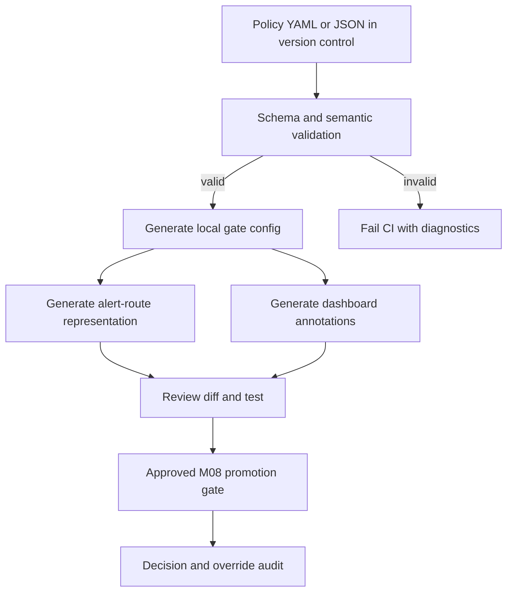

# Unit 9 — Error Budget Policies and Release Freezes

**Stage:** Stage 2E — Production DevOps & Platform Engineering  
**Module:** M10 — Site Reliability Engineering and Incident Management  
**Unit:** 9 of 11  
**Target file:** `09-error-budget-policies-and-release-freezes.md`  
**Audience:** Data/AI engineers who can build and deploy a service but are learning to govern releases using reliability evidence.

> **Source labels used in this chapter:** `[SOURCE]` means supported by the available M10 syllabus/roadmap; `[ILLUSTRATIVE]` means synthetic example values, thresholds, or outputs; `[ASSUMPTION]` means a proposed design choice that a real service owner must validate; `[VERIFY]` means a version-specific or source-attribution detail that needs checking; `[NOT EXECUTED]` means an example or lab was not run in a real service environment.

## Table of contents

1. [Context, outcomes, prerequisites](#1-context-outcomes-prerequisites-and-scope)
2. [M10 position and interfaces](#2-m10-position-and-cross-module-interfaces)
3. [L1 — Policy foundations](#3-l1--policy-foundations-and-policy-literacy)
4. [L2 — Write and operate the policy](#4-l2--write-and-operate-a-usable-policy)
5. [Budget status calculator](#5-budget-status-calculator)
6. [Local error-budget-aware release gate](#6-local-error-budget-aware-release-gate)
7. [End-to-end freeze simulation](#7-end-to-end-local-simulation)
8. [L3 — Policies under ambiguity](#8-l3--design-policies-that-work-under-ambiguity)
9. [Forecasting and launch-risk memo](#9-budget-forecasting-and-launch-risk-memo)
10. [L4 — Governance, policy-as-code, portfolio learning](#10-l4--governance-policy-as-code-and-portfolio-learning)
11. [Organizational case analyses](#11-seven-organizational-case-analyses)
12. [Eight mandatory labs](#12-eight-mandatory-labs)
13. [Glossary and reusable templates](#13-glossary-and-reusable-templates)
14. [Exercises and answer key](#14-exercises-and-answer-key)
15. [Completion rubric and gate](#15-completion-rubric-and-completion-gate)
16. [Roadmap coverage audit](#16-roadmap-coverage-audit)
17. [References, execution report, and limitations](#17-references-execution-report-and-limitations)

## 1. Context, outcomes, prerequisites, and scope

### What this unit teaches

An **error-budget policy** is a written agreement that turns measured reliability into pre-agreed release and investment decisions. It says what happens while reliability is healthy, when the budget is under pressure, when it is exhausted, and when the measurement itself is unknown. It is not a punishment system and it is not a substitute for incident response.

The unit takes the SLI/SLO arithmetic introduced in Unit 1 and workload targets from Unit 2, then connects that evidence to rollout decisions owned by the M08 delivery path. It does not rebuild SLO fundamentals, the alerting curriculum, or the deployment system.

### Measurable learning outcomes

By completion, you should be able to:

1. Explain an error-budget policy and distinguish budget-driven, incident-driven, calendar-driven, and compliance-driven freezes.
2. Write signed-off example policies for an inference API and a batch ETL pipeline, including bands, exceptions, owners, communication, and freeze-lift criteria.
3. Calculate remaining budget, budget consumed, and burn rate without conflating their denominators.
4. Run a local budget-status calculator against CSV/JSON and recognize zero traffic, missing points, stale data, partial windows, invalid rows, and 100% SLO limitations.
5. Use a simulated release gate that supports allow, block, approved time-boxed override, audit records, and explicit fail-open/fail-closed handling of unknown data.
6. Explain why dependency-caused burn still requires customer-impact mitigation and why a single noisy short-window spike may not justify a long freeze.
7. Forecast exhaustion with uncertainty caveats and write a launch-risk memo.
8. Validate a small policy-as-code document and generate local gate, alert-route, and dashboard-annotation representations.
9. Evaluate a synthetic 12-month policy history without confusing correlation with causation.
10. Complete the eight labs and retain an auditable, secret-free evidence package.

### Prerequisites and quick check

- You can explain SLI (service-level indicator), SLO (service-level objective), and an error budget. If not, revisit `01-service-level-indicators-objectives-and-error-budgets.md` first.
- You know how a local M08-style FastAPI service exposes RED metrics (rate, errors, duration) or can use the synthetic CSV path in this unit.
- You can run Python 3 and basic shell commands. Prometheus/Alertmanager are optional.
- You know that a rollback, kill switch, or incident mitigation is a change but may be risk-reducing.

Quick check: if an SLO is 99.9%, the allowed bad-event fraction is 0.1%, not 99.9%. If 40% of the original budget has been consumed, 60% remains. A burn rate of 2 means budget is being consumed at twice the average allowed rate over the defined measurement basis; it does **not** mean 2% of budget remains.

### Assumptions and safety

- `[ASSUMPTION]` The learner uses UTC timestamps and a synthetic local service or fixture data.
- `[ILLUSTRATIVE]` All example SLO targets, band thresholds, time windows, risk scores, and policy intervals below are teaching values, not universal standards.
- Do not query or modify a production release system. All promotion decisions in this chapter are local simulations.
- Never paste secrets, tokens, customer payloads, or personal data into the lab evidence. Fault injection is allowed only on a disposable service you own.

## 2. M10 position and cross-module interfaces

| Material | This unit consumes it for | This unit deliberately does not replace |
|---|---|---|
| `01-service-level-indicators-objectives-and-error-budgets.md` | SLI/SLO definitions, allowed error fraction, basic budget accounting | Full SLO design curriculum |
| `02-reliability-targets-for-batch-streaming-and-inference.md` | Workload-specific inference and ETL indicators | Full target-selection method |
| `03-alert-quality-noise-reduction-and-escalation-policies.md` | Fast-burn signal, alert context, escalation route | Alert tuning and burn-rate alert design |
| `04-incident-severity-roles-and-command-structure.md` | Incident authority and communications roles | Incident command training |
| `05-production-triage-and-blameless-postmortems.md` | Cause attribution and follow-up actions | Detailed triage/postmortem workflow |
| `06-capacity-related-failures-and-cascading-outages.md` | Capacity or dependency burn attribution | Capacity and cascade analysis |
| `07-toil-reduction-and-operational-automation.md` | Safe automation principles | General toil reduction |
| `08-runbook-design-and-operational-readiness-reviews.md` | Runbooks, rollback and readiness evidence | Operational readiness review design |
| M08 GitOps/progressive delivery | Promotion handoff, canary and rollback | Reimplementation of M08 deployment system |
| Unit 10 | Human impact and freeze handoff | Rotation scheduling and sustainable paging |
| Unit 11 | Policy outcome measures | Full DORA metric curriculum |
| M11 observability | Metrics source and dashboard integration | Full observability architecture |
| M09/M12/M13/M15/M16 | Security exceptions, security incident handoff, DR, cost, golden paths/catalog | Legal/compliance advice or those modules' full curriculum |

The governing sequence is: **measure user impact → determine budget state → apply the agreed policy → record the decision → verify the result → review the policy using outcomes**. A burn-rate alert can justify an immediate rollout pause while the team investigates; a sustained freeze decision should follow the documented policy and corroborated evidence.

## 3. L1 — Policy foundations and policy literacy

### 3.1 What is an error budget policy?

An error budget is the amount of unreliability permitted by an SLO over a defined window. The policy is the operating contract for using that allowance. It should be agreed before the first breach by the service owner, product stakeholder, and SRE/engineering leadership. A named tie-breaker or forum must be chosen before disagreement occurs.

The budget is useful because it creates a common decision input; it does not remove judgment. Product teams still decide what customer value a launch creates, engineering assesses technical risk, and the policy states which actions are allowed under each measured condition.

### 3.2 Release freeze: define the scope precisely

A **release freeze** is a temporary restriction on a specified class of changes. Never use “freeze all changes” without defining the scope and exceptions.

| Freeze type | Trigger | Typical scope | Important exception question |
|---|---|---|---|
| Budget-driven | Sustained budget pressure or exhaustion | Non-critical feature releases and changes that increase risk | Which risk-reducing changes remain allowed? |
| Incident-driven | Active incident or unstable recovery | Changes that could interfere with mitigation/recovery | Who authorizes mitigation, rollback, or a kill switch? |
| Calendar/peak-event | Holiday, high-demand period, planned business event | Selected high-risk changes | How are urgent security fixes handled? |
| Compliance-driven | A documented control or change-window requirement | Scope defined by applicable policy | Who can approve an emergency exception? |

Possible frozen change types include feature deployments, application releases, configuration, infrastructure, database migrations, model promotions, feature-flag flips, and batch schedule changes. A kill switch, rollback, security patch, or reliability fix may reduce risk; the policy should allow it through a documented path rather than blindly blocking it.

### 3.3 Example policy bands

The values below are `[ILLUSTRATIVE]`; choose bands from the service's risk profile, SLO window, sample size, and release process.

| State | Example remaining budget | Release behavior | Reliability response |
|---|---:|---|---|
| Green / healthy | More than 60% | Normal small-batch delivery; planned experiments with guardrails | Use headroom intentionally; review reliability backlog |
| Yellow / watch | 30–60% | Require risk review and stronger canary evidence for material changes | Inspect burn attribution; prioritize known high-value fixes |
| Orange / constrained | More than 0% but below 30% | Pause risky promotions; only small, reversible, well-observed changes with approval | Reliability work prioritized; check dependency/fallback gaps |
| Red / exhausted | 0% or less | Freeze non-critical risk-increasing changes; exception path remains available | Reliability plan, incident follow-up, explicit lift criteria |
| Unknown | Metrics missing, stale, or invalid | Use the service-tier policy for unknown data; never silently treat it as green | Restore telemetry and escalate the measurement failure |

Do not use remaining-budget percentage alone as the only real-time signal. A fast-burn alert may justify pausing an in-progress rollout before the full window's remaining-budget state changes. Conversely, one short noisy spike in a low-traffic service may require corroboration rather than an indefinite freeze.

### 3.4 Healthy budget and risk-taking

Healthy budget is capacity for deliberate risk, not a quota that must be spent. An unspent budget can indicate that the team has been overly conservative, but it can also reflect a stable service or a window with little traffic. `[ASSUMPTION]` Use headroom to make planned launches, experiments, migrations, or resilience drills when the expected value and rollback plan justify the risk. Do not create unnecessary risk merely to “spend” budget.

### 3.5 Worked numeric example

Assume `[ILLUSTRATIVE]` an SLO of 99.9% over a rolling 30-day window and 1,000,000 valid requests in the window.

- Allowed bad-event fraction: `1 − 0.999 = 0.001` (0.1%).
- Allowed bad events for this traffic: `1,000,000 × 0.001 = 1,000`.
- Suppose observed bad events are 400, so observed error fraction is `400 / 1,000,000 = 0.0004` (0.04%).
- Budget consumed: `observed bad fraction / allowed bad fraction = 0.0004 / 0.001 = 0.40`, or 40%.
- Budget remaining: `1 − 0.40 = 0.60`, or 60%.
- If the bad-event fraction over a separately defined recent interval is 0.002, recent burn rate is `0.002 / 0.001 = 2`. This is twice the SLO-allowed average rate over that interval. It is not the same as 40% consumed or 60% remaining.

A rolling window has memory: current SLI performance can recover immediately while remaining budget recovers only as old bad events leave the window. Therefore “the service is healthy now” and “the budget has recovered” are different statements.

### 3.6 Bad versus better policy language

**Bad:** “If the budget is low, stop shipping and fix reliability.”

**Better:** “When the 30-day inference availability budget is below the illustrative 30% band, pause promotions that increase request-path risk. Rollbacks, security patches, incident mitigation, and changes with documented risk reduction may proceed after the service owner or designated incident authority records the reason, test plan, and rollback/compensation. Reassess after telemetry is fresh and the written lift conditions are met.”

Why better: it identifies the scope, evidence, action, exception authority, record, and exit condition. It also avoids turning a reliability policy into a punishment.

### 3.7 L1 checkpoint — what you can now do

You can distinguish policy from freeze, identify the change types affected, explain the four freeze categories, calculate the simple budget state, and state why risk-reducing fixes need a safe exception path.

## 4. L2 — Write and operate a usable policy

### 4.1 Policy A: online inference API

**Policy ID:** `inference-api-ebp-v1`  
**Status:** `[ILLUSTRATIVE]` teaching draft, not an approved production policy  
**Owner:** Inference service owner (role placeholder)  
**Approvers:** Product lead + service owner + SRE/engineering lead  
**Review cadence:** monthly budget review; quarterly policy review `[ILLUSTRATIVE]`  
**Approval/review dates:** not approved; set dates in the real service record.

**Scope and journey.** Online prediction request from client ingress through request validation, feature lookup, model inference, and response. Critical failures are valid requests that fail or exceed the user-facing latency objective. Do not exclude slow or failed requests by changing the denominator after an incident.

**SLO source.** Reuse the SLO selected in Unit 1/2. For this worked policy, availability SLO is 99.9% over a rolling 30-day window `[ILLUSTRATIVE]`; latency and model-quality SLOs remain separately visible and may independently trigger a pause. Source is the service's version-controlled SLO specification and the telemetry pipeline. Owner must verify event definitions and metric freshness.

| State | `[ILLUSTRATIVE]` trigger | Promotion behavior | Required evidence/action |
|---|---|---|---|
| Green | >60% budget remains and no corroborated fast-burn signal | Normal staged promotion | Current status timestamp, canary metrics, rollback path |
| Yellow | 30–60% remains or one non-critical warning signal | Risk review for material changes; canary required | Risk note, owner, expanded analysis window |
| Orange | >0–<30% remains or corroborated sustained burn | Pause risk-increasing production promotions; permit constrained low-risk changes | Burn attribution, fallback/rollback verification, reliability backlog link |
| Red | Budget exhausted or critical SLO breached per approved rule | Freeze non-critical risk-increasing promotions; start reliability response | Decision record, reliability plan, customer impact assessment |
| Unknown | Stale, missing, malformed, or unavailable budget evidence | Tier decision: this example blocks normal promotions; risk-reducing emergency actions use a separately audited path | Restore telemetry; document data failure; no assumed healthy state |

**Early warning.** A valid fast-burn page from Unit 3 may pause a rollout immediately while an operator verifies the signal. The page does not automatically prove that a month-long freeze is warranted. Confirm event volume, window, service symptoms, deployment correlation, and data freshness.

**Exceptions.** Security patch, regulatory fix, rollback, incident mitigation, and reliability improvements can be proposed during a freeze. Request must state why it reduces net risk, affected scope, validation, rollback/compensation, approver, expiry, and post-change verification. A verbal “go ahead” alone is insufficient; record it in the local audit log or the organization's approved system.

**Escalation and tie-breaker.** On-call/incident authority controls immediate mitigation during an active incident; service owner owns the service-level technical decision; product lead explains customer/business urgency; unresolved routine dispute goes to the pre-named engineering reliability sponsor. `[ASSUMPTION]` Choose actual roles and response expectations before adoption.

**Communications.** On band change, publish service, SLO/window, state, data timestamp, action, owner, next update time, exception route, and link to the dashboard/runbook. Avoid exposing secret values or customer data. Use a local chat-stub output in this lab; it is not a real notification.

**Freeze lift.** Lift when the configured policy's recovery criteria are met: telemetry is fresh; no active incident or critical SLO breach remains; current SLI is back within target; required mitigations are verified; and the service owner plus designated reliability approver records the decision. Remaining budget may not instantly recover in a rolling window. The policy may allow a constrained canary before the budget fully replenishes, but that is a deliberate risk decision, not an automatic inference.

**Governance.** Review budget history monthly, review this policy quarterly, and review after a material incident, SLO change, major dependency change, or repeated override. Keep version, owner, approval state, last review, and change rationale in version control.

### 4.2 Policy B: batch ETL pipeline

**Policy ID:** `nightly-etl-ebp-v1`  
**Status:** `[ILLUSTRATIVE]` teaching draft, not approved  
**Owner:** Data product owner (role placeholder)  
**Approvers:** Data engineering lead + consumer/product representative + SRE/platform representative.

**Scope and critical journey.** Source extraction → validation/quarantine → transformation → publish → downstream consumer availability. Primary SLO is data freshness for the agreed dataset; correctness/contract checks and successful completion are separate guardrails. Reuse the actual Unit 2 target if available. For this example, data must be published within 90 minutes of the scheduled source cutoff on 99% of eligible days in a rolling 30-day view `[ILLUSTRATIVE]`.

| State | `[ILLUSTRATIVE]` trigger | Scheduling/release action | Evidence and response |
|---|---|---|---|
| Green | >60% freshness budget remains, quality checks pass | Normal schedule and approved small changes | Freshness timestamp, quality report, consumer availability |
| Yellow | 30–60% remains or a single freshness warning | Review risky schema/transform changes; backfill requires impact review | Lineage, data contract diff, consumer notice plan |
| Orange | >0–<30% remains or repeated late publishes | Pause risky schema changes; prioritize fixes; backfill only with capacity/consumer plan | Queue/backfill estimate, idempotency, replay safety, cost estimate |
| Red | Budget exhausted or critical correctness contract violated | Freeze non-critical risk-increasing changes; preserve ingestion and safe recovery work | Quarantine bad data, stop unsafe publish, communicate stale-data status |
| Unknown | Freshness metric or source watermark missing/stale | Do not declare green; follow tiered policy and investigate instrumentation/source | Last successful watermark, source status, pipeline logs |

**Exceptions and safeguards.** A fix that restores freshness or correctness, a safe rollback, a security fix, and a controlled reprocessing job may proceed with explicit validation and capacity checks. Never “fix freshness” by publishing unvalidated data. A backfill can consume compute, increase cost, overload consumers, and make freshness worse; use a bounded schedule, idempotency key/checkpoint, quarantine strategy, and consumer communication.

**Recovery/lift.** Require the pipeline to complete successfully, data quality/contracts to pass, freshness to meet the defined target for the policy's confirmation period `[ILLUSTRATIVE: two consecutive scheduled runs]`, downstream consumers to acknowledge recovery where applicable, and the owner to record the decision. The confirmation count is a proposed control, not a universal standard.

### 4.3 Stakeholder agreement checklist

- [ ] SLO and measurement window are versioned and understood by product and engineering.
- [ ] Event denominator, exclusions, freshness timestamp, and data source are documented.
- [ ] Budget bands and fast-burn triggers are labelled as policy choices, not universal standards.
- [ ] The policy defines exactly which changes freeze and which remain allowed.
- [ ] Security, regulatory, rollback, mitigation, and reliability exceptions have approvers and audit requirements.
- [ ] Freeze-lift criteria are measurable and do not depend on a vague “looks fine.”
- [ ] Dispute tie-breaker, communication channel, owner, and next-update cadence are agreed.
- [ ] Gate outage and unknown-data behavior are explicit for the service tier.
- [ ] Policy version, approval, review date, and exception expiry are tracked.
- [ ] Teams agree that policy evidence is used for system improvement, not individual punishment.

### 4.4 Negotiation role-play (solo-safe)

**Product perspective (write first):** “The launch has a customer commitment and a seasonal opportunity. We believe the change is low risk because the code path is limited. If every low-budget period blocks releases, the backlog will accumulate.”

**Reliability perspective:** “The current remaining budget is low and the last two canary samples showed a latency regression. We can preserve the date by narrowing the rollout, extending observation, and predefining an abort threshold. A full rollout without a tested rollback would increase exposure.”

**Negotiation record:** state facts both parties accept; list options (delay, limited canary, shadow mode, feature-flagged rollout, no-go); estimate impact and reversibility; name the decision owner; write the chosen option and abort criteria; record dissent without retaliation; schedule review of outcome. A reasonable decision might be a small canary with a hard stop if the measurement is trustworthy and the rollback is verified; if data is stale, the team must first resolve the uncertainty or follow its explicit unknown-data rule.

### 4.5 Three distinct worked arithmetic cases

**Example 1 — Budget consumed.** With 99.9% SLO, allowed bad fraction is 0.001. If 10,000 valid requests contain 8 bad requests, observed bad fraction is 0.0008. Budget consumed over the same window/basis is `0.0008 / 0.001 = 0.8` or 80%; remaining is 20%. This is a window-based ratio, not a claim that only 20% of current requests succeed.

**Example 2 — Burn rate.** Suppose the same 99.9% SLO allows 0.1% bad events. In a clearly defined recent 5-minute window, 0.3% of valid requests are bad. Burn rate is `0.003 / 0.001 = 3`. It means the budget is being consumed at 3 times the SLO-allowed average rate during that window. It does not directly tell you the total remaining budget; use the policy's budget calculation for that.

**Example 3 — Forecast.** Suppose 25% of budget remains and the observed, representative consumption rate is 5 percentage points of the original budget per day. A simple linear estimate is `25 / 5 = 5 days` to exhaustion. This assumes the rate persists and ignores uncertainty, traffic mix, rolling-window expiry, remediation, and seasonality. It is a scenario estimate, not a promise.

### 4.6 L2 checkpoint

You can write a policy for both request/response and batch workloads, negotiate its trade-offs, and name the evidence required for promotion, exception, and freeze lift.

## 5. Budget status calculator

### 5.1 Formula and semantics

For a ratio-based SLO measured over the same valid event population and window:

| Quantity | Formula | Interpretation |
|---|---|---|
| Allowed bad fraction | `1 - SLO_target` | Fraction of eligible events allowed to be bad |
| Observed bad fraction | `bad_events / valid_events` | Bad-event ratio for the measured window |
| Budget consumed | `observed_bad_fraction / allowed_bad_fraction` | Fraction of allowed budget used on this basis |
| Budget remaining | `1 - budget_consumed` | Remaining fraction; can be negative if over budget |
| Burn rate | `recent_bad_fraction / allowed_bad_fraction` | Rate multiplier for a separately specified recent window |
| Linear exhaustion estimate | `remaining_budget_amount / observed_consumption_per_time` | Scenario projection if the measured rate is representative |

This basic calculator uses an event-count input and reports **window consumption**, not a full rolling time-series engine. A production implementation must define its exact window, exclusions, SLI aggregation, data completeness, and counter-reset semantics. A 100% SLO has zero allowed bad fraction; finite bad events make the simple ratio undefined/infinite, so the script reports that case explicitly instead of dividing by zero. Zero traffic and missing data are `UNKNOWN`, not healthy.

### 5.2 Sample CSV

Create `budget.csv` in a temporary working directory. Timestamps are UTC. `valid_events` and `bad_events` are counts for the declared evaluation window, not cumulative counters.

```csv
# File: budget.csv
observed_at,slo_target,valid_events,bad_events,window_minutes
2026-10-28T12:00:00Z,0.999,100000,35,43200
```

The row is `[ILLUSTRATIVE]`: observed bad fraction is 0.035%, allowed bad fraction is 0.1%, consumption is 35%, and remaining is 65%. The window field is 43,200 minutes (30 days). Use a real observation timestamp for actual use.

### 5.3 Standard-library calculator

Save as `budget_status.py` in a temporary directory. It reads one CSV row, validates inputs, warns about stale data, and returns a structured status. The age threshold is supplied by the operator. It intentionally does not assume that a single CSV row proves the entire time series is complete.

```python
# File: budget_status.py
from __future__ import annotations
import argparse, csv, json, math
from datetime import datetime, timezone
from pathlib import Path

REQUIRED = {"observed_at", "slo_target", "valid_events", "bad_events", "window_minutes"}

def parse_utc(value: str) -> datetime:
    parsed = datetime.fromisoformat(value.replace("Z", "+00:00"))
    if parsed.tzinfo is None:
        raise ValueError("observed_at must include a timezone; use UTC Z")
    return parsed.astimezone(timezone.utc)

def calculate(row: dict[str, str], now: datetime, max_age_minutes: float) -> dict:
    missing = REQUIRED - row.keys()
    if missing:
        return {"state": "UNKNOWN", "reason": f"missing fields: {sorted(missing)}"}
    try:
        observed_at = parse_utc(row["observed_at"])
        target = float(row["slo_target"])
        valid = int(row["valid_events"])
        bad = int(row["bad_events"])
        window = int(row["window_minutes"])
    except (ValueError, TypeError) as exc:
        return {"state": "UNKNOWN", "reason": f"invalid input: {exc}"}
    if not math.isfinite(target) or not 0 < target <= 1:
        return {"state": "UNKNOWN", "reason": "slo_target must be in (0, 1]"}
    if valid < 0 or bad < 0 or bad > valid or window <= 0:
        return {"state": "UNKNOWN", "reason": "invalid counts or window"}
    age_minutes = (now.astimezone(timezone.utc) - observed_at).total_seconds() / 60
    if age_minutes < -5:
        return {"state": "UNKNOWN", "reason": "observation timestamp is unexpectedly in the future"}
    if age_minutes > max_age_minutes:
        return {"state": "UNKNOWN", "reason": "stale observation", "age_minutes": round(age_minutes, 2)}
    if valid == 0:
        return {"state": "UNKNOWN", "reason": "zero valid events; no ratio can be inferred", "age_minutes": round(age_minutes, 2)}
    bad_fraction = bad / valid
    allowed = 1 - target
    if allowed == 0:
        consumed = 0.0 if bad == 0 else None
        remaining = 1.0 if bad == 0 else None
        burn = 0.0 if bad == 0 else None
        note = "100% SLO: zero allowed bad events; nonzero bad events make budget ratio undefined"
    else:
        consumed = bad_fraction / allowed
        remaining = 1 - consumed
        burn = bad_fraction / allowed
        note = "burn_rate here equals window consumption ratio because this row uses one window; use a separate recent window for operational burn-rate alerts"
    return {
        "state": "KNOWN", "observed_at": observed_at.isoformat(), "age_minutes": round(age_minutes, 2),
        "slo_target": target, "window_minutes": window, "valid_events": valid, "bad_events": bad,
        "observed_bad_fraction": bad_fraction, "allowed_bad_fraction": allowed,
        "budget_consumed_fraction": consumed, "budget_remaining_fraction": remaining,
        "burn_rate_for_this_window": burn, "projected_exhaustion": None,
        "projection_note": "not estimated from one observation; use forecast_budget.py with a representative time series", "note": note,
    }

def read_csv(path: Path) -> dict[str, str]:
    with path.open(newline="", encoding="utf-8") as handle:
        reader = csv.DictReader(line for line in handle if not line.lstrip().startswith("#"))
        if not reader.fieldnames or not REQUIRED.issubset(reader.fieldnames):
            raise ValueError(f"CSV header must include {sorted(REQUIRED)}")
        rows = list(reader)
    if len(rows) != 1:
        raise ValueError("expected exactly one data row; aggregate the intended window explicitly")
    return rows[0]

def main() -> int:
    parser = argparse.ArgumentParser(description="Validate a single budget observation")
    parser.add_argument("csv_file", type=Path)
    parser.add_argument("--now", required=True, help="current UTC timestamp, e.g. 2026-10-28T12:05:00Z")
    parser.add_argument("--max-age-minutes", type=float, default=60)
    args = parser.parse_args()
    try:
        row = read_csv(args.csv_file)
        result = calculate(row, parse_utc(args.now), args.max_age_minutes)
    except (OSError, ValueError) as exc:
        print(json.dumps({"state": "UNKNOWN", "reason": str(exc)}, indent=2))
        return 2
    print(json.dumps(result, indent=2, sort_keys=True))
    return 0 if result.get("state") == "KNOWN" else 3

if __name__ == "__main__":
    raise SystemExit(main())
```

**Run:** from the temporary directory, use `python3 budget_status.py budget.csv --now 2026-10-28T12:05:00Z --max-age-minutes 60`. Example output is illustrative; yours will differ in timestamps and values:

```json
{
  "state": "KNOWN",
  "slo_target": 0.999,
  "valid_events": 100000,
  "bad_events": 35,
  "observed_bad_fraction": 0.00035,
  "allowed_bad_fraction": 0.001,
  "budget_consumed_fraction": 0.35,
  "budget_remaining_fraction": 0.65
}
```

Interpretation: 35% of the allowed bad-event budget has been consumed on this measurement basis. This does not establish a recent fast-burn condition; a distinct recent interval is required. Exit codes: `0` known result, `2` invalid file/arguments, `3` unknown observation. Cleanup: delete the temporary directory when finished.

### 5.4 Calculator tests

Save as `test_budget_status.py` beside the script and run `python3 -m unittest -v`. The timestamp is fixed to keep tests deterministic.

```python
# File: test_budget_status.py
import unittest
from datetime import datetime, timezone
from budget_status import calculate

NOW = datetime(2026, 10, 28, 12, 5, tzinfo=timezone.utc)
BASE = {"observed_at":"2026-10-28T12:00:00Z", "slo_target":"0.999", "valid_events":"100000", "bad_events":"35", "window_minutes":"43200"}

class BudgetTests(unittest.TestCase):
    def test_known_budget(self):
        out = calculate(BASE, NOW, 60)
        self.assertEqual(out["state"], "KNOWN")
        self.assertAlmostEqual(out["budget_consumed_fraction"], 0.35)
        self.assertAlmostEqual(out["budget_remaining_fraction"], 0.65)
    def test_zero_traffic_unknown(self):
        row = dict(BASE, valid_events="0", bad_events="0")
        self.assertEqual(calculate(row, NOW, 60)["state"], "UNKNOWN")
    def test_stale_unknown(self):
        self.assertEqual(calculate(BASE, NOW, 1)["state"], "UNKNOWN")
    def test_missing_field_unknown(self):
        row = dict(BASE); row.pop("bad_events")
        self.assertEqual(calculate(row, NOW, 60)["state"], "UNKNOWN")
    def test_bad_greater_than_valid(self):
        row = dict(BASE, bad_events="100001")
        self.assertEqual(calculate(row, NOW, 60)["state"], "UNKNOWN")
    def test_hundred_percent_slo_zero_bad(self):
        row = dict(BASE, slo_target="1.0", bad_events="0")
        self.assertEqual(calculate(row, NOW, 60)["state"], "KNOWN")
        self.assertEqual(calculate(row, NOW, 60)["budget_consumed_fraction"], 0.0)
    def test_hundred_percent_slo_with_bad_event(self):
        row = dict(BASE, slo_target="1.0", bad_events="1")
        self.assertIsNone(calculate(row, NOW, 60)["budget_consumed_fraction"])
    def test_naive_timestamp_rejected(self):
        row = dict(BASE, observed_at="2026-10-28T12:00:00")
        self.assertEqual(calculate(row, NOW, 60)["state"], "UNKNOWN")

if __name__ == "__main__":
    unittest.main()
```

The 100% target has a special-case contract: no bad events means no observed violation, but a conventional “percentage of budget consumed” is not meaningful because the allowed budget is zero. The implementation above sets that value to `0.0` in its branch; the test intentionally checks the state, not a misleading positive allowance. For production use, consider exposing a separate `budget_defined` boolean and a clear `zero_budget` state. Do not interpret a zero-valued output as a positive reliability allowance.

**Limitations:** This compact sample validates one observation row. It does not infer completeness of a rolling window, aggregate counters, correct counter resets, estimate confidence intervals, or query Prometheus. A real adapter must check the HTTP result, query timestamp, series identity, sample count, staleness, and response errors before emitting `KNOWN`.

## 6. Local error-budget-aware release gate

### 6.1 Gate contract

The gate is a control in front of a simulated M08 promotion. It is not a deployment tool. It accepts a JSON budget artifact and a JSON policy, makes a decision, and appends a local JSON Lines audit event. Local append-only means “the script appends rather than overwrites”; it is **not tamper-proof** against a user who can edit the file or filesystem. In an organization, use protected access-controlled storage or a central audit system.

Unknown data behavior is per service tier. A strict tier can fail closed for normal promotions; a lower-criticality tier might allow a narrowly constrained promotion after an explicit risk acceptance. Do not let network errors accidentally select the permissive path. This local example requires the policy to explicitly say `fail_closed` or `fail_open`.

### 6.2 Policy JSON

```json
{
  "policy_version": "inference-api-ebp-v1",
  "owner": "ROLE:inference-service-owner",
  "service_tier": "critical",
  "freeze_when_remaining_below": 0.30,
  "unknown_data_mode": "fail_closed",
  "max_data_age_minutes": 60,
  "allowed_override_actions": ["security_fix", "rollback", "incident_mitigation", "reliability_fix"]
}
```

These thresholds are `[ILLUSTRATIVE]`. An unknown or malformed policy must fail validation and must not quietly allow a normal promotion.

### 6.3 Gate implementation

Save as `release_gate.py`. An override must specify action, approver role, reference, expiry timestamp, and reason. The action must be in the policy allow-list. This is a local educational gate, not cryptographic approval or identity verification.

```python
# File: release_gate.py
from __future__ import annotations
import argparse, json
from datetime import datetime, timezone
from pathlib import Path

ALLOWED_MODES = {"fail_open", "fail_closed"}

def utc(value: str) -> datetime:
    parsed = datetime.fromisoformat(value.replace("Z", "+00:00"))
    if parsed.tzinfo is None:
        raise ValueError("timestamp requires timezone")
    return parsed.astimezone(timezone.utc)

def validate_policy(policy: dict) -> None:
    required = {"policy_version", "owner", "service_tier", "freeze_when_remaining_below", "unknown_data_mode", "max_data_age_minutes", "allowed_override_actions"}
    missing = required - policy.keys()
    if missing: raise ValueError(f"missing policy keys: {sorted(missing)}")
    threshold = policy["freeze_when_remaining_below"]
    if not isinstance(threshold, (int, float)) or not 0 <= threshold <= 1: raise ValueError("freeze threshold must be within [0,1]")
    if policy["unknown_data_mode"] not in ALLOWED_MODES: raise ValueError("unknown_data_mode must explicitly be fail_open or fail_closed")
    if not policy["owner"]: raise ValueError("owner must be non-empty")
    if policy["max_data_age_minutes"] <= 0: raise ValueError("max_data_age_minutes must be positive")
    if not isinstance(policy["allowed_override_actions"], list): raise ValueError("allowed_override_actions must be a list")

def decide(policy: dict, budget: dict, now: datetime, override: dict | None = None) -> dict:
    validate_policy(policy)
    decision, reason = "BLOCK", "budget status unavailable or invalid"
    remaining = budget.get("budget_remaining_fraction") if isinstance(budget, dict) else None
    observed = budget.get("observed_at") if isinstance(budget, dict) else None
    known = budget.get("state") == "KNOWN" and isinstance(remaining, (int, float)) and observed is not None
    if known:
        age = (now - utc(observed)).total_seconds() / 60
        known = 0 <= age <= policy["max_data_age_minutes"]
        if not known: reason = "budget data stale or timestamp is in the future"
    if known:
        if remaining < policy["freeze_when_remaining_below"]:
            decision, reason = "BLOCK", "remaining budget below policy threshold"
        else:
            decision, reason = "ALLOW", "budget above policy threshold"
    elif policy["unknown_data_mode"] == "fail_open":
        decision, reason = "ALLOW_CONSTRAINED", "unknown data; explicit policy fail_open mode; constrained promotion only"
    if override is not None:
        try:
            expiry = utc(override["expires_at"])
            approved = bool(override.get("approver")) and bool(override.get("reference")) and bool(override.get("reason"))
            action = override.get("action")
            valid = approved and expiry > now and action in policy["allowed_override_actions"]
        except (KeyError, ValueError, TypeError):
            valid = False
        if valid:
            decision, reason = "ALLOW_OVERRIDE", f"approved time-boxed override for {action}"
        else:
            decision, reason = "BLOCK", "override missing approval fields, unsupported action, or expired"
    return {"policy_version": policy["policy_version"], "decision": decision, "reason": reason,
            "input_data_timestamp": observed, "remaining_budget_fraction": remaining,
            "override": override, "evaluated_at": now.isoformat()}

def append_audit(path: Path, event: dict) -> None:
    path.parent.mkdir(parents=True, exist_ok=True)
    with path.open("a", encoding="utf-8") as handle:
        handle.write(json.dumps(event, sort_keys=True) + "\n")

def main() -> int:
    p = argparse.ArgumentParser()
    p.add_argument("--policy", required=True, type=Path); p.add_argument("--budget", required=True, type=Path)
    p.add_argument("--audit", required=True, type=Path); p.add_argument("--now", required=True)
    p.add_argument("--override", type=Path, help="JSON approval record; never use real secrets")
    a = p.parse_args()
    try:
        policy = json.loads(a.policy.read_text()); budget = json.loads(a.budget.read_text())
        override = json.loads(a.override.read_text()) if a.override else None
        result = decide(policy, budget, utc(a.now), override)
        append_audit(a.audit, result)
    except (OSError, json.JSONDecodeError, ValueError) as exc:
        print(json.dumps({"decision":"BLOCK", "reason":f"input/validation error: {exc}"}))
        return 2
    print(json.dumps(result, indent=2, sort_keys=True))
    return 0 if result["decision"].startswith("ALLOW") else 3

if __name__ == "__main__": raise SystemExit(main())
```

**Execution:** create `policy.json` and `budget.json` inside a disposable lab directory, then run:

```bash
# File: run_gate_example.sh
python3 release_gate.py --policy policy.json --budget budget.json --audit audit/gate.jsonl --now 2026-10-28T12:05:00Z
```

Expected result is an `ALLOW`, `BLOCK`, or `ALLOW_CONSTRAINED` decision based on the fixture. The example is local only; it does not contact CI/CD, Kubernetes, or a release service. The audit file will be created under the lab directory. Cleanup: inspect the record, then delete the temporary lab directory.

### 6.4 Gate tests

```python
# File: test_release_gate.py
import unittest
from datetime import datetime, timezone, timedelta
from release_gate import decide, validate_policy

NOW = datetime(2026, 10, 28, 12, 5, tzinfo=timezone.utc)
POLICY = {"policy_version":"v1", "owner":"service-owner", "service_tier":"critical", "freeze_when_remaining_below":0.3, "unknown_data_mode":"fail_closed", "max_data_age_minutes":60, "allowed_override_actions":["security_fix", "rollback", "incident_mitigation", "reliability_fix"]}
GOOD = {"state":"KNOWN", "observed_at":"2026-10-28T12:00:00Z", "budget_remaining_fraction":0.7}
LOW = {"state":"KNOWN", "observed_at":"2026-10-28T12:00:00Z", "budget_remaining_fraction":0.1}
OVERRIDE = {"action":"security_fix", "approver":"ROLE:security-duty-approver", "reference":"CHANGE-EXAMPLE-42", "reason":"risk-reducing patch", "expires_at":"2026-10-28T13:00:00Z"}

class GateTests(unittest.TestCase):
    def test_allow(self): self.assertEqual(decide(POLICY, GOOD, NOW)["decision"], "ALLOW")
    def test_block_low_budget(self): self.assertEqual(decide(POLICY, LOW, NOW)["decision"], "BLOCK")
    def test_approved_override(self): self.assertEqual(decide(POLICY, LOW, NOW, OVERRIDE)["decision"], "ALLOW_OVERRIDE")
    def test_missing_approval_blocks(self): self.assertEqual(decide(POLICY, LOW, NOW, {"action":"security_fix"})["decision"], "BLOCK")
    def test_expired_override_blocks(self):
        override = dict(OVERRIDE, expires_at="2026-10-28T11:00:00Z")
        self.assertEqual(decide(POLICY, LOW, NOW, override)["decision"], "BLOCK")
    def test_stale_data_fail_closed(self):
        old = dict(GOOD, observed_at="2026-10-28T09:00:00Z")
        self.assertEqual(decide(POLICY, old, NOW)["decision"], "BLOCK")
    def test_unknown_fail_open_is_constrained(self):
        policy = dict(POLICY, unknown_data_mode="fail_open")
        self.assertEqual(decide(policy, {"state":"UNKNOWN"}, NOW)["decision"], "ALLOW_CONSTRAINED")
    def test_unknown_fail_closed_blocks(self): self.assertEqual(decide(POLICY, {"state":"UNKNOWN"}, NOW)["decision"], "BLOCK")
    def test_malformed_policy_fails(self):
        with self.assertRaises(ValueError): validate_policy(dict(POLICY, unknown_data_mode="maybe"))
    def test_unknown_mode_not_silent(self):
        with self.assertRaises(ValueError): validate_policy(dict(POLICY, unknown_data_mode=""))

if __name__ == "__main__": unittest.main()
```

**Important safety semantics:** fail-open in this example is not a blanket unrestricted production approval; it returns `ALLOW_CONSTRAINED` for the service-tier policy to interpret. A real deployment adapter must ensure this decision cannot be mistaken for normal green promotion. For critical services, fail-closed may be appropriate for ordinary promotions while a separate audited emergency path remains available. The gate itself can fail: monitor its availability, test stale inputs, protect policy-edit permissions, audit bypasses, and provide a documented recovery procedure.

## 7. End-to-end local simulation

This exercise connects budget status to a local promotion decision without deploying anything. If you do not have the M08 FastAPI lab, use the standalone CSV/JSON fixtures.

### 7.1 Safety and setup

- Working directory: a new temporary directory such as `~/m10-unit9-lab`.
- Prerequisites: Python 3; optional Docker/kind and the existing M08 lab service.
- Resource target: scripts alone use negligible resources; optional local service/Prometheus should run only during the exercise.
- Assertion: use only a local fixture or service you own; do not pass a production URL or credentials to these scripts.
- Abort if the target endpoint is not the documented lab endpoint or if any command proposes a real deployment.

```bash
# File: lab_setup.sh
mkdir -p "$HOME/m10-unit9-lab/audit"
cd "$HOME/m10-unit9-lab"
printf '%s\n' 'Created isolated local Unit 9 workspace.'
pwd
```

Expected output: a path under the user's home directory. Verify that it is not a repository directory containing production configuration.

### 7.2 Steps and evidence

1. **Record baseline.** Save the SLO worksheet, current metric timestamp, valid/bad event counts, and data source. If no service exists, use the sample CSV.
2. **Generate load.** Use only the M08 lab's bounded synthetic load generator. Start with a low request rate and a fixed duration; stop immediately if resource use exceeds the laptop budget. Record the command and duration.
3. **Enable fault injection.** Use only the M08 lab's documented fault-injection control. Confirm the endpoint is local and lab-owned before toggling. Do not invent an endpoint or flag if the prior lab differs.
4. **Observe.** Inspect the lab metrics/alerts or use an explicitly synthetic CSV representing a fast-burn interval. Record signal, timestamp, and whether data is complete.
5. **Calculate status.** Run `budget_status.py`. A known status and a recent fast-burn signal are separate pieces of evidence.
6. **Run simulated promotion gate.** Set remaining budget below the policy threshold. Run `release_gate.py` against fixture JSON. Expected result: `BLOCK` with reason and policy version; no release action occurs.
7. **Communicate freeze.** Write a local message stating service, policy version, scope, trigger, allowed exceptions, owner, next update, and lift criteria. Do not send it to a real paging/chat system.
8. **Request exception.** Use the fixture for a security fix or rollback, with an approver role, reference, reason, and expiry. Expected: `ALLOW_OVERRIDE` plus an audit record. Remove the approval fields or set an expired timestamp and verify that it blocks.
9. **Disable fault.** Use the lab service's documented disable action. Verify fault state is off; do not leave background load or fault injection running.
10. **Verify recovery.** Confirm user-facing SLI and dependency/pipeline symptoms recovered. Distinguish current SLI recovery from budget recovery in a rolling window.
11. **Lift freeze.** Apply the policy's explicit criteria and record who/what authorized the lift. A good current metric alone is not sufficient if the policy also requires fresh data, stable confirmation, or a tested mitigation.
12. **Review.** Compare expected versus observed, identify ambiguous steps, and create a post-incident/reliability action if the policy or gate behaved unexpectedly.

| Check | Expected result | Observed result |
|---|---|---|
| Baseline freshness | Timestamp inside configured age | `[NOT EXECUTED]` until learner records it |
| Fault signal | Local error/latency/freshness signal changes | `[NOT EXECUTED]` |
| Budget calculator | `KNOWN` only with valid fresh input | Script output to save |
| Gate under low budget | `BLOCK` | Script output and `audit/gate.jsonl` |
| Approved exception | `ALLOW_OVERRIDE` with approver/reference/expiry | Script output and audit record |
| Expired/missing approval | `BLOCK` | Script output |
| Fault disabled | Fault state explicitly off | `[NOT EXECUTED]` |
| Recovery verified | SLI recovers; budget recovery separately assessed | `[NOT EXECUTED]` |
| Freeze lift | Written criteria and approver recorded | `[NOT EXECUTED]` |

### 7.3 Cleanup and failure path

Stop the load generator; disable the injected fault; stop optional containers; remove only the temporary workspace you created after retaining the evidence you need. Confirm no fault remains enabled, no load generator is running, and no local alert silence or temporary service remains. If recovery cannot be confirmed, do not lift the freeze in the simulation; record `BLOCKED`, restore the lab service from its documented reset path, and re-run the health check. The exact M08 commands depend on the learner's repository version and are `[VERIFY]` unless inspected in that environment.

## 8. L3 — Design policies that work under ambiguity

### 8.1 The policy is a social contract

The policy only works if stakeholders agree before the budget is exhausted. If product hears about the rules for the first time during a launch dispute, the process is likely to be treated as arbitrary. The policy must name the decision authority, allowed exceptions, evidence, and appeal path. Apply it blamelessly: a breach is a signal about the system and operating choices, not a reason to shame a person. Blameless does not mean unaccountable; owners still close corrective actions and leaders still record overrides.

### 8.2 Reliability work during a freeze

Reliability work is work that reduces the probability, duration, or impact of customer-visible failure, or improves detection/recovery. Examples include fixing a timeout bug, adding a tested fallback, correcting a resource leak, restoring missing telemetry, improving safe rollback, or closing a postmortem action. A ticket labelled “reliability” is not automatically safe. Review the expected risk reduction, change size, reversibility, test evidence, and blast radius.

### 8.3 Attribute burn without excusing impact

Use categories that are actionable and non-blaming: own deployment, capacity, dependency/vendor, platform, data/measurement, traffic mix, unknown, or multiple contributing factors. Attribution helps choose the response:

- **Own deployment:** consider rollback, rollout pause, canary analysis, and change-specific tests.
- **Capacity:** reduce load, bound queues, check headroom, and avoid changes that worsen overload.
- **Dependency/vendor:** activate fallback, apply timeouts/circuit breakers, communicate, and escalate to provider; still own the user-facing mitigation that is under your control.
- **Platform:** coordinate with the platform provider and consumer teams; avoid a platform-wide freeze without defining consumer impact.
- **Measurement failure:** restore telemetry and apply the explicit unknown-data policy. Do not declare the service healthy because the dashboard is blank.

### 8.4 Multi-SLO and multi-service policy choices

| Approach | Benefit | Risk | Use when |
|---|---|---|---|
| Any critical SLO triggers | Protects a critical user journey from being averaged away | Can be sensitive to noisy indicators | SLOs represent independently critical journeys and are well measured |
| Worst-of | Easy to explain; highlights weakest SLO | May overreact to a low-volume noisy SLO | Criticality and data quality are comparable |
| Weighted composite | Represents a weighted product objective | Weighting can hide a critical failure | Weights have explicit product rationale and hard guardrails remain |
| Journey-based | Connects several dependencies to end-to-end experience | More complex instrumentation and attribution | User journeys cross multiple services and a component SLO is insufficient |

For a shared platform (CI/CD, registry, secrets backend, cluster), provider and consumer budgets answer different questions. Provider policy governs changes to the shared service; consumer policy governs risk to each consuming journey. Coordinate freeze scope and communications rather than assuming one provider budget describes every consumer's risk.

### 8.5 Tiered policies and unknown-data decisions

`[ILLUSTRATIVE]` A tier-0 critical path may block ordinary promotions when metrics are stale; a lower-tier internal tool may permit a limited promotion under a documented fail-open mode. Both still need visible `UNKNOWN` state, a maximum age, an audit record, and a constrained-action definition. The policy must not turn a missing metric into a healthy metric.

### 8.6 Statistical hygiene

- **Low traffic:** one or two failures can swing a ratio dramatically. Check absolute counts and uncertainty; consider a longer observation window or an advisory state.
- **Short-window spikes:** use burn-rate alerts for early response, but corroborate a sustained freeze decision with relevant windows, event volume, deployment correlation, and service symptoms.
- **Missing/stale metrics:** state is unknown; restore telemetry and apply the declared tier mode.
- **Hysteresis:** use different entry and exit conditions or a confirmation period to prevent the state oscillating on every sample. Any threshold or duration is `[ILLUSTRATIVE]`.
- **Rolling windows:** old bad events leave gradually. A good minute does not refund previously consumed budget immediately.
- **Metric gaming:** protect definitions, keep exclusions reviewed, and track customer-impact proxies. Do not change the SLI denominator merely to avoid a freeze.

### 8.7 Progressive delivery and feature flags

When budget is tight, require a smaller canary, longer analysis window, explicit abort thresholds, and a verified rollback. `[ILLUSTRATIVE]` For example, abort a canary if its error ratio exceeds a pre-agreed threshold for two consecutive evaluation intervals; choose the threshold from the service's noise, volume, and SLO—not from this example. A gate should pause promotion, not blindly terminate the live service.

A feature-flag flip is still a change. Risky flags should use the same owner, evidence, and policy criteria as deployments. A kill switch intended to reduce customer impact must remain available under an audited emergency path. For data pipelines, a backfill can restore completeness but also saturate compute, create duplicate outputs, or make freshness worse. Check capacity, idempotency, checkpoints, data contracts, and consumer communication before starting it.

### 8.8 Planned risk spending and SLA awareness

Migrations, maintenance, chaos experiments, and region failover drills should have a budget-spending plan: hypothesis, customer impact, blast radius, preconditions, abort criteria, owner, rollback, and verification. Do not schedule a risky experiment solely because budget is available.

Contractual service-level agreements (SLAs) may define service credits or notification duties. Awareness example only: if a fictional contract credits 5% of a monthly fee of $10,000 after a specified breach, the arithmetic is `$10,000 × 0.05 = $500`. The actual contract, definitions, caps, exclusions, and jurisdiction govern; this example is not legal advice. Consult appropriate legal/commercial professionals.

### 8.9 Anti-patterns and correction

| Anti-pattern | Why it fails | Better control |
|---|---|---|
| Policy never invoked | Rules are decorative; decisions become ad hoc | Gate/report invocation and review missed triggers |
| Freeze with no exit | Creates fear and release hoarding | Define lift evidence and review date in advance |
| One-size-fits-all policy | Ignores service criticality and measurement quality | Tiered policy with explicit rationale |
| Budget used as a weapon | Encourages blame and metric gaming | Blameless review plus accountable action owners |
| Freeze blocks fixes | Leaves known risks unresolved | Allow audited risk-reducing changes |
| Dependency burn is excused | Customers still experience failure | Mitigate controllable impact and work provider path |
| No owner or written policy | No one is accountable for decisions | Owner, approvers, version, and escalation path required |
| SLI gaming | Hides customer harm | Change-controlled SLI definitions and independent quality checks |
| Release hoarding | Produces a dangerous big-bang release after freeze | Keep changes small; rehearse the lift plan and cap batch size |

### 8.10 Four defended scenarios

**Scenario A — Dependency-caused burn.** A provider's latency has doubled, retries are rising, and remaining budget is low. Options: freeze all changes; freeze only changes that increase dependency exposure; ship a fallback fix; or pause risky releases while keeping mitigation work moving. Recommended: immediately pause a rollout if symptoms correlate; activate/verify fallback; use bounded retries and timeouts; escalate to provider; block changes that worsen dependency exposure; permit a tested fallback fix with review. Caveat: provider causation does not erase customer impact or the service owner's mitigation duty.

**Scenario B — Low-traffic noise.** A small internal endpoint has 10 requests in an interval and one failed request. The ratio is 10%, but the sample is tiny. Recommended: label low confidence, inspect absolute counts and longer-window evidence, use the tier policy, and avoid a long freeze based on this point alone unless the failed journey is critical. Caveat: one failure in a high-consequence critical path may still justify an immediate precautionary pause.

**Scenario C — Launch with little budget.** Only 8% remains `[ILLUSTRATIVE]`, but a customer launch is time-sensitive. Options: full release, defer, shadow, or small canary. Recommended: no unrestricted rollout; choose shadow/small canary only if reversible, observed, and within agreed policy; define abort criteria and an approver. If telemetry is stale or rollback is untested, defer until the evidence gap is addressed.

**Scenario D — Critical security patch during a freeze.** A vulnerability fix is urgent, but patching changes production. Recommended: use the documented security exception, record approver/reference/expiry, validate artifact provenance and test coverage, deploy in a controlled scope, and verify both security mitigation and service health. A freeze must not block a risk-reducing patch by default. Caveat: emergency handling still needs change traceability and appropriate M09/M12 security incident process.

For each scenario, score the answer on: customer risk understood (0–2), policy fit (0–2), reversibility/validation (0–2), exception governance (0–2), and uncertainty acknowledged (0–2). `[ILLUSTRATIVE]` A strong answer earns 8/10 or more and explains trade-offs rather than merely selecting an option.

## 9. Budget forecasting and launch-risk memo

Forecasting is useful for comparing scenarios, not predicting the future with certainty. A single transient burn-rate spike should not be extrapolated as a guaranteed exhaustion time. Use enough observations to identify whether the rate is representative, and show sensitivity to plausible rates.

### 9.1 Forecast script

This standard-library script accepts a CSV with sequential `observed_at` and `budget_remaining_fraction` rows. It estimates consumption rate between first and last observations, provides simple sensitivity scenarios, and prints a launch-risk memo. It declines to forecast if fewer than three observations exist, time is non-positive, remaining budget rises, or the fitted consumption is non-positive. The scenario band is not a statistical confidence interval; it is a sensitivity range around an assumed rate.

```python
# File: forecast_budget.py
import argparse, csv, json
from datetime import datetime, timezone
from pathlib import Path

def dt(s):
    value = datetime.fromisoformat(s.replace("Z", "+00:00"))
    if value.tzinfo is None: raise ValueError("timestamps must include timezone")
    return value.astimezone(timezone.utc)

def forecast(rows, slow_factor=0.5, fast_factor=1.5):
    if len(rows) < 3: return {"forecast": None, "reason": "need at least three observations"}
    points = sorted([(dt(r["observed_at"]), float(r["budget_remaining_fraction"])) for r in rows])
    if any(not 0 <= remaining <= 1 for _, remaining in points):
        return {"forecast": None, "reason": "remaining fraction must be within [0,1]"}
    hours = (points[-1][0] - points[0][0]).total_seconds() / 3600
    consumed = points[0][1] - points[-1][1]
    if hours <= 0 or consumed <= 0:
        return {"forecast": None, "reason": "non-positive elapsed time or no net budget consumption"}
    rate_per_hour = consumed / hours
    remaining = points[-1][1]
    if rate_per_hour <= 0 or remaining <= 0:
        return {"forecast": None, "reason": "no positive remaining budget or non-representative rate"}
    hours_slow = remaining / (rate_per_hour * slow_factor)
    hours_base = remaining / rate_per_hour
    hours_fast = remaining / (rate_per_hour * fast_factor)
    return {"forecast": {"observed_at": points[-1][0].isoformat(), "remaining_fraction": remaining,
            "observed_consumption_per_hour": rate_per_hour,
            "scenario_hours": {"slow_consumption": hours_slow, "base": hours_base, "fast_consumption": hours_fast},
            "method": "linear endpoint-rate sensitivity scenarios, not a statistical confidence interval"}}

def main():
    p = argparse.ArgumentParser(); p.add_argument("csv_file", type=Path); p.add_argument("--launch", default="proposed launch")
    a = p.parse_args()
    try:
        with a.csv_file.open(newline="", encoding="utf-8") as f: rows = list(csv.DictReader(f))
        result = forecast(rows)
    except (OSError, ValueError, KeyError) as exc:
        result = {"forecast": None, "reason": str(exc)}
    memo = {"launch": a.launch, "assumptions": ["recent consumption rate persists", "window and measurement remain comparable"],
            "risk": "unknown" if result.get("forecast") is None else "budget exhaustion is plausible under the stated scenarios",
            "forecast": result, "options": ["launch unchanged", "small canary with abort criteria", "defer and remediate"],
            "recommendation": "Do not treat the projection as certainty; choose after reviewing SLO criticality, launch value, rollback, and data quality.",
            "mitigation_rollback": "define stop threshold, rollback owner, and verification before promotion"}
    print(json.dumps(memo, indent=2, sort_keys=True))
    return 0 if result.get("forecast") else 3
if __name__ == "__main__": raise SystemExit(main())
```

### 9.2 Synthetic forecast input and interpretation

```csv
# File: forecast.csv
observed_at,budget_remaining_fraction
2026-10-25T12:00:00Z,0.50
2026-10-26T12:00:00Z,0.44
2026-10-27T12:00:00Z,0.38
2026-10-28T12:00:00Z,0.32
```

Run `python3 forecast_budget.py forecast.csv --launch "model-vNext canary"`. Expected example: the endpoint rate is 0.06 of original budget per day, with 0.32 remaining, so the base scenario is about 5.33 days; the sensitivity scenarios are longer/shorter by the configured factors. The exact output is generated by the script and is not a real forecast. If the observed remaining budget rises, the simple endpoint method refuses to forecast; that can mean data is noisy or the window moved, not that the system is guaranteed safe.

### 9.3 Launch-risk memo template

- **Launch / business outcome:**
- **SLOs and budget timestamp:**
- **Observed history and sample quality:**
- **Forecast method / assumptions / sensitivity:**
- **Main uncertainty and alternative explanations:**
- **Options considered:** full launch / canary / shadow / defer
- **Recommendation and why:**
- **Abort criteria and observation period:**
- **Rollback/fallback owner and verification:**
- **Approver, decision timestamp, and review date:**

## 10. L4 — Governance, policy-as-code, and portfolio learning

### 10.1 Quarterly planning and portfolio view

A quarterly review should combine budget health with service criticality, burn attribution, repeated incident classes, overrides, freeze duration, recovery time, and the reliability backlog. A low budget due to recurring deploy regressions suggests different investment from budget consumed by an external dependency. Track service-level patterns without ranking individual engineers.

### 10.2 Synthetic 12-month policy history

The dataset below is a teaching fixture, not organizational evidence. The code calculates counts and average durations but does not claim causal effects. “Incident during/after freeze” is a chosen observation window; changing it can change the result.

```csv
# File: policy_history.csv
month,invocations,overrides,disputes,freeze_hours,recovery_hours,incidents_during_or_after,repeat_classes,orr_completeness
2025-11,1,0,0,0,4,1,1,0.70
2025-12,2,1,1,12,8,1,1,0.72
2026-01,0,0,0,0,3,0,0,0.75
2026-02,1,0,0,4,5,1,1,0.77
2026-03,3,1,1,20,12,2,2,0.76
2026-04,1,0,0,6,6,1,1,0.79
2026-05,2,1,1,16,9,1,1,0.81
2026-06,1,0,0,5,5,0,0,0.84
2026-07,2,0,1,10,8,1,1,0.85
2026-08,1,0,0,3,4,0,0,0.87
2026-09,2,1,0,14,7,1,1,0.88
2026-10,1,0,0,4,4,0,0,0.90
```

A simple analysis can compute total invocations, overrides, disputes, freeze hours, and incident counts, then propose a policy review. Do not infer “freezes caused fewer incidents” from this small synthetic table. Service mix, exposure, incident severity, policy adoption, traffic, and reporting changes confound the comparison.

```python
# File: analyze_policy_history.py
import argparse, csv, json
from pathlib import Path

def analyze(path: Path):
    with path.open(newline="", encoding="utf-8") as f: rows = list(csv.DictReader(f))
    if not rows: raise ValueError("history must contain at least one month")
    numeric = ["invocations", "overrides", "disputes", "freeze_hours", "recovery_hours", "incidents_during_or_after", "repeat_classes"]
    totals = {key: sum(int(row[key]) for row in rows) for key in numeric}
    completeness = sum(float(r["orr_completeness"]) for r in rows) / len(rows)
    return {"months": len(rows), "totals": totals, "mean_orr_completeness": round(completeness, 3),
            "limitations": ["synthetic data", "correlation is not causation", "no exposure denominator", "incident window and severity are simplified"],
            "proposal": ["review repeated incident classes", "require evidence for overrides", "measure customer impact and exposure", "compare policy outcomes by service tier", "review freeze exit criteria and change batch size"]}
if __name__ == "__main__":
    p = argparse.ArgumentParser(); p.add_argument("csv_file", type=Path); a = p.parse_args()
    try: print(json.dumps(analyze(a.csv_file), indent=2, sort_keys=True))
    except (OSError, ValueError, KeyError) as e: print(json.dumps({"error":str(e)})); raise SystemExit(2)
```

### 10.3 Policy-as-code workflow

Policy-as-code means the policy is a versioned input to automated validation and generated configuration. It does not mean every human decision is automated. A safe flow is:



YAML libraries are optional. The compact generator below uses JSON, which is valid YAML subset for many parsers but here is explicitly a JSON fallback to avoid a required dependency. The generated alert-route and dashboard artifacts are documented local representations, not complete production Alertmanager or Grafana configuration.

```json
{
  "policy_version": "inference-api-ebp-v1",
  "owner": "ROLE:service-owner",
  "unknown_data_mode": "fail_closed",
  "bands": [
    {"name":"green", "min_remaining":0.60, "action":"normal"},
    {"name":"yellow", "min_remaining":0.30, "action":"review"},
    {"name":"orange", "min_remaining":0.000001, "action":"constrained"},
    {"name":"red", "min_remaining":0.0, "action":"freeze_noncritical"}
  ],
  "alert_route": "budget-state-change",
  "dashboard_annotation": "Error-budget policy band changed"
}
```

```python
# File: generate_policy_artifacts.py
import argparse, json
from pathlib import Path

ACTIONS = {"normal", "review", "constrained", "freeze_noncritical"}
MODES = {"fail_open", "fail_closed"}

def validate(policy):
    issues = []
    for key in ("policy_version", "owner", "unknown_data_mode", "bands", "alert_route", "dashboard_annotation"):
        if key not in policy: issues.append(f"missing required field: {key}")
    if not policy.get("owner"): issues.append("owner must be non-empty")
    if policy.get("unknown_data_mode") not in MODES: issues.append("unknown_data_mode must be fail_open or fail_closed")
    bands = policy.get("bands", [])
    if not isinstance(bands, list) or not bands: issues.append("bands must be a non-empty list")
    else:
        previous = 1.000001
        seen = set()
        for band in bands:
            if not isinstance(band, dict): issues.append("each band must be an object"); continue
            name, threshold, action = band.get("name"), band.get("min_remaining"), band.get("action")
            if name in seen: issues.append(f"duplicate band: {name}")
            seen.add(name)
            if not isinstance(threshold, (int, float)) or not 0 <= threshold <= 1: issues.append(f"invalid threshold for {name}")
            elif threshold > previous: issues.append(f"contradictory band order near {name}: thresholds must be descending")
            else: previous = threshold
            if action not in ACTIONS: issues.append(f"unsupported action for {name}: {action}")
    return issues

def generate(policy, outdir):
    issues = validate(policy)
    outdir.mkdir(parents=True, exist_ok=True)
    (outdir / "validation.json").write_text(json.dumps({"valid": not issues, "issues": issues}, indent=2) + "\n")
    if issues: return False
    gate = {"policy_version": policy["policy_version"], "owner": policy["owner"], "unknown_data_mode": policy["unknown_data_mode"], "bands": policy["bands"]}
    route = {"representation": "local-alert-routing-stub", "route_name": policy["alert_route"], "policy_version": policy["policy_version"]}
    annotation = {"representation": "local-dashboard-annotation-stub", "text": policy["dashboard_annotation"], "policy_version": policy["policy_version"]}
    for name, data in (("gate-config.json", gate), ("alert-route.json", route), ("dashboard-annotation.json", annotation)):
        (outdir / name).write_text(json.dumps(data, indent=2, sort_keys=True) + "\n")
    return True

if __name__ == "__main__":
    p = argparse.ArgumentParser(); p.add_argument("policy_json", type=Path); p.add_argument("outdir", type=Path); a = p.parse_args()
    try: policy = json.loads(a.policy_json.read_text())
    except (OSError, json.JSONDecodeError) as e: print(f"ERROR: {e}"); raise SystemExit(2)
    ok = generate(policy, a.outdir); print("VALID" if ok else "INVALID; see validation.json"); raise SystemExit(0 if ok else 3)
```

### 10.4 Generator tests

```python
# File: test_generate_policy_artifacts.py
import unittest
from generate_policy_artifacts import validate

VALID = {"policy_version":"v1", "owner":"service-owner", "unknown_data_mode":"fail_closed", "bands":[
 {"name":"green", "min_remaining":0.6, "action":"normal"},
 {"name":"yellow", "min_remaining":0.3, "action":"review"},
 {"name":"red", "min_remaining":0.0, "action":"freeze_noncritical"}],
 "alert_route":"budget-state", "dashboard_annotation":"budget state changed"}
class GeneratorTests(unittest.TestCase):
    def test_valid_policy(self): self.assertEqual(validate(VALID), [])
    def test_invalid_threshold(self): self.assertTrue(any("invalid threshold" in x for x in validate({**VALID, "bands":[{"name":"green","min_remaining":1.4,"action":"normal"}]})))
    def test_missing_owner(self): self.assertTrue(any("owner" in x for x in validate({k:v for k,v in VALID.items() if k != "owner"})))
    def test_unsupported_action(self): self.assertTrue(any("unsupported action" in x for x in validate({**VALID, "bands":[{"name":"x","min_remaining":0.5,"action":"delete-production"}]})))
    def test_contradictory_bands(self): self.assertTrue(any("contradictory" in x for x in validate({**VALID, "bands":[{"name":"yellow","min_remaining":0.3,"action":"review"},{"name":"green","min_remaining":0.6,"action":"normal"}]})))
    def test_unknown_mode(self): self.assertTrue(any("unknown_data_mode" in x for x in validate({**VALID, "unknown_data_mode":"maybe"})))
if __name__ == "__main__": unittest.main()
```

**Run:** `python3 -m unittest -v` in the temporary directory. Expected shape: six tests pass. The generator emits `validation.json`; if valid, it also emits `gate-config.json`, `alert-route.json`, and `dashboard-annotation.json`. Review the generated diff before any integration. These artifacts are not deployed automatically.

### 10.5 Override audit report

An audit report should list each override's policy version, service, action, approver role, reference, reason, expiry, creation time, and post-review status. Flag missing/expired records and missing post-review. Because a local JSONL file can be edited by a user with write access, it is evidence for a lab exercise only, not tamper-proof proof of approval. Production governance needs access controls, identity assurance, retention, and audit integrity.

### 10.6 Enforcement reliability and emergency bypass

Test these failure modes deliberately in a local harness: gate process unavailable, stale budget artifact, malformed policy, policy file edited without review, unauthorized bypass, audit append failure, and override expiry. For a critical service, a gate outage should not silently produce a normal allow. A separate emergency path may permit rollback or mitigation while recording a reason and follow-up review. Protect policy-editor permissions and make bypass visibility part of the dashboard and review process.

### 10.7 Culture, wellbeing, and shared agreements

- Explain the first freeze before it happens: scope, trigger, exception path, review cadence, and lift criteria.
- Product resistance is information: understand launch obligations and propose safer options, rather than invoking authority as a weapon.
- Provider/consumer teams need a shared protocol for platform-level freezes, consumer impact, update cadence, and exception handling.
- Do not push work into nights/weekends to “make up” for a freeze or rely on on-call heroics. Plan a sustainable batch size and adequate coverage.
- The policy should help teams make decisions consistently; it should not become a hidden individual performance score.

## 11. Seven organizational case analyses

All cases are synthetic teaching scenarios, not real incident reports.

### Case 1 — Product ships after SRE announces a freeze; the same outage class repeats

**Timeline:** budget signal appears → policy freeze is communicated → release proceeds outside the agreed gate → similar customer impact recurs. **Technical causes:** release path allowed bypass; alert/decision evidence may not have been attached to promotion. **Organizational causes:** authority, override workflow, or product agreement was unclear. **Detection vs policy failure:** detection may have worked; enforcement and governance failed. **Corrective actions:** enforce the reviewed gate, make override authority explicit, record the bypass, and test the same failure class in canary. **Completion evidence:** gate test blocks the scenario; override report has approver/reference; subsequent release test verifies rollback. **Unintended consequence:** rigid gate can block emergency fixes, so preserve the audited mitigation path.

### Case 2 — Gate silently fails open during a freeze

**Timeline:** metrics endpoint fails or artifact ages out → gate interprets missing input as healthy → promotion succeeds → reliability state remains unknown. **Technical causes:** exception swallowed or unknown mapped to zero burn. **Organizational causes:** fail-open behavior was not reviewed for service tier. **Correction:** explicit `UNKNOWN`, mode validation, stale-data tests, monitoring for gate health, and alerting on audit gaps. **Completion evidence:** tests cover both modes and malformed/stale data; synthetic outage produces documented constrained/block behavior. **Unintended consequence:** fail-closed can block low-risk work during telemetry incidents; define a time-boxed exception rather than an accidental bypass.

### Case 3 — Six-week rolling-window freeze followed by 40-change release and SEV1

**Timeline:** budget remains low because old events stay in the window → freeze has no practical exit path → changes accumulate → large release contains interacting risks → severe incident. **Technical causes:** large batch, weak canary, insufficient staged validation. **Organizational causes:** no constrained-release strategy, no freeze review, incentives reward catch-up. **Correction:** define exit criteria and review dates, continue small risk-reducing changes, cap batch size, stage rollout, and rehearse rollback. **Completion evidence:** policy includes lift conditions; release checklist verifies canary and batch-size controls. **Unintended consequence:** overly aggressive lift rules can resume risky work prematurely; use evidence and criticality.

### Case 4 — Vendor burn freezes every change, including a needed fix

**Timeline:** vendor latency consumes budget → blanket freeze blocks fallback change → impact persists. **Technical causes:** dependency lacks timeout/fallback or the fallback is untested. **Organizational causes:** policy lacks exception categories and provider/consumer agreement. **Correction:** permit reviewed risk-reducing fallback, bound retries, communicate with vendor, track dependency action. **Completion evidence:** down/slow/wrong dependency tests and exception audit. **Unintended consequence:** a rushed fallback can create a second failure; require scoped canary and rollback.

### Case 5 — SLI definitions are gamed to avoid a freeze

**Timeline:** team changes denominator/exclusions → apparent budget improves → customer impact persists → review discovers definition drift. **Technical causes:** metric pipeline lacks versioning and quality checks. **Organizational causes:** rewards tied to a green indicator. **Correction:** change-controlled SLI definitions, independent user-impact signal, reviewed exclusions, and audit of definition changes. **Completion evidence:** old/new SLI specification, backtest, and review sign-off. **Unintended consequence:** freezing every legitimate SLI change discourages needed instrumentation improvements; allow reviewed changes and recompute history transparently.

### Case 6 — Product never agreed to the policy and ignores it

**Timeline:** policy is written by one function → budget breach occurs → product disputes legitimacy → release continues. **Technical causes:** gate may be absent, but the root governance issue is prior agreement. **Correction:** co-author the policy, record approvers, negotiate tie-breaker, and run a tabletop before activation. **Completion evidence:** signed version, role-play record, and gate behavior aligned with the agreed policy. **Unintended consequence:** consensus can be slow; name a decision owner and deadline before launch.

### Case 7 — Holiday freeze blocks a critical security patch

**Timeline:** calendar freeze begins → vulnerability response identifies urgent patch → generic freeze rule blocks all changes → exposure persists. **Technical causes:** no emergency path or patch validation workflow. **Organizational causes:** holiday policy prioritized change avoidance over risk reduction. **Correction:** explicitly exempt security patches through a recorded approval path, coordinate M09/M12, verify artifact provenance, and run targeted post-change checks. **Completion evidence:** tabletop and local gate test allow an approved, time-boxed security exception while rejecting missing/expired approvals. **Unintended consequence:** “security” can become a blanket bypass; require justification, scope, expiry, and post-review.

## 12. Eight mandatory labs

All labs use synthetic fixtures and a disposable directory unless the step explicitly refers to a learner-owned local M08 service. The M08-specific fault command is `[VERIFY]` because repositories can differ. Keep timestamps in UTC and stop optional stacks after use.

### Lab 1 — Draft and negotiate the inference API policy

**Objective:** produce `inference-api-policy.md` and a signed-off role-play record. **Prerequisites:** Sections 3–4. **Steps:** copy Policy A into the lab evidence folder; fill real SLO source, denominator, window, owner roles, exception approvers, unknown-data mode, and lift criteria; run the stakeholder checklist; write product and reliability perspectives; record decision and dissent. **Expected:** no blank owner, undefined band, or exception without expiry. **Evidence:** policy version, checklist, negotiation note. **Tests:** peer review or next-day cold read; solo simulation is not real team approval. **Troubleshooting:** if SLO definition is unclear, block policy approval and return to Unit 1/2. **Cleanup:** retain markdown; delete temporary copies. **Rubric:** 0–2 each for SLO scope, band actions, exception safety, governance, and lift criteria.

### Lab 2 — Draft and negotiate the ETL policy

**Objective:** produce `etl-policy.md`. Include freshness SLO, quality contracts, lineage, backfill/reprocessing, capacity/cost, consumer notification, and recovery criteria. Test a scenario where a backfill improves completeness but overloads the next scheduled run. Expected decision should balance freshness, correctness, and consumer impact. Evidence: policy, scenario decision, and reviewer questions. Cleanup: remove synthetic payloads after evidence capture. Rubric: same five categories as Lab 1, plus correctness/quarantine and consumer communication.

### Lab 3 — Calculate budget status from CSV and validate edge cases

**Objective:** run the calculator and its unit tests. **Commands:** `python3 -m unittest -v` and `python3 budget_status.py budget.csv --now 2026-10-28T12:05:00Z --max-age-minutes 60`. **Expected:** tests pass; valid fresh input yields `KNOWN`; zero traffic, stale data, missing fields, invalid counts, and nonzero errors at a 100% target are handled explicitly. **Evidence:** stdout, exit codes, input CSV. **Troubleshooting:** if timestamps are naive, add `Z`; if a CSV contains multiple rows, aggregate the intended window explicitly rather than silently selecting one. **Cleanup:** remove generated fixture copies. Rubric: arithmetic, edge cases, freshness, exit codes, and interpretation.

### Lab 4 — Implement and test the release gate

**Objective:** test allow, block, approved override, missing approval, expired override, stale data, malformed policy, and both unknown-data modes. **Steps:** save `release_gate.py`, tests, policy JSON, and budget fixtures; run `python3 -m unittest -v`; invoke the CLI for at least one allow and one block. **Expected:** the audit file appends one JSON object per decision; invalid input does not become a normal allow. **Evidence:** tests, fixture files, `audit/gate.jsonl`. **Troubleshooting:** ensure override expiry is later than the supplied `--now`. **Cleanup:** remove only the temporary audit folder after saving evidence. Rubric: decision correctness, unknown semantics, override validation, audit detail, and safety boundary.

### Lab 5 — Simulate budget exhaustion and a release freeze

**Objective:** connect a synthetic declining budget sequence to a block decision and freeze communication. **Steps:** create a known fresh JSON budget with remaining fraction below the policy threshold; run gate; draft local freeze message; change fixture to recovered/current data; apply the documented lift criteria. Do not deploy anything. **Expected:** block, recorded freeze message, later lift only when the written criteria are satisfied. **Evidence:** before/after budget artifacts, gate decisions, freeze and lift messages. **Troubleshooting:** a green point does not restore a rolling budget immediately. **Cleanup:** delete temporary fixtures. Rubric: clear trigger, freeze scope, exception path, recovery criteria, and decision trail.

### Lab 6 — Exercise exceptions, overrides, and audit report

**Objective:** distinguish safe emergency exception from an unreviewed bypass. Create three synthetic overrides: valid security fix, expired rollback approval, and unsupported feature launch. Run the gate for each. Build a report from JSONL with fields for approver, reason, expiry, reference, and post-review status; flag missing values. **Expected:** only the valid approved time-boxed override is accepted. **Evidence:** JSONL and report. **Troubleshooting:** remember local append-only logs are editable and not tamper-proof. **Cleanup:** remove temporary audit fixtures. Rubric: approvals, expiry, allowed action, traceability, post-review.

### Lab 7 — Forecast exhaustion and write a launch-risk memo

**Objective:** run `forecast_budget.py` against `forecast.csv`. Add a second fixture with fewer than three rows or rising remaining budget and confirm no forecast is returned. Write a memo for full launch, canary, shadow, and defer options; state assumptions and rollback. **Expected:** scenario hours are printed only when the simple rate is meaningful. **Evidence:** inputs, stdout, memo. **Troubleshooting:** if a forecast is absent, report why rather than forcing a date. **Cleanup:** remove generated fixture copies. Rubric: method, uncertainty, alternatives, abort criteria, decision owner.

### Lab 8 — Generate policy artifacts and analyze 12 months

**Objective:** run `generate_policy_artifacts.py` and `analyze_policy_history.py`. **Steps:** save the JSON policy and CSV history; run generator; run its unit tests; inspect generated `gate-config.json`, `alert-route.json`, `dashboard-annotation.json`, and `validation.json`; deliberately alter an action or threshold and confirm validation fails; run history analysis. **Expected:** valid policy creates all three artifacts; invalid policy exits non-zero; analysis reports counts and caveats. **Evidence:** generated artifacts, tests, history report, revised proposal. **Troubleshooting:** ensure band thresholds are ordered high to low and actions belong to the allow-list. **Cleanup:** remove temporary generated artifacts after retaining evidence. Rubric: validation, generated output correctness, test coverage, audit limitations, and no causal overclaim.

## 13. Glossary and reusable templates

### Glossary

- **SLI:** a measured indicator of a service property.
- **SLO:** a target for an SLI over a stated window.
- **Error budget:** the allowed unreliability implied by the SLO over its measurement basis.
- **Budget consumed:** the proportion of allowed bad-event budget used over a defined window/basis.
- **Budget remaining:** the unused fraction of that allowed budget; it may be negative after exhaustion.
- **Burn rate:** observed bad-event rate divided by the allowed bad-event rate for a separately defined interval.
- **Release freeze:** a scoped restriction on a class of changes.
- **Override:** an explicitly approved, scoped, time-boxed deviation with reason and audit record.
- **Fail-open / fail-closed:** the declared behavior when a control cannot obtain a trustworthy decision input. These terms must be interpreted in the context of the action and service tier.
- **Canary:** a limited rollout used to observe behavior before wider promotion.
- **Hysteresis:** distinct entry/exit conditions or confirmation logic that reduces rapid state oscillation.
- **SLA:** a service-level agreement, potentially including contractual remedies; consult appropriate professionals for interpretation.

### Copy-ready policy metadata

```yaml
# File: policy-metadata-template.yml
policy_id: example-service-ebp-v1
service_owner: ROLE:service-owner
product_approver: ROLE:product-approver
reliability_approver: ROLE:reliability-approver
slo_source: path/to/versioned-slo-spec.md
measurement_window: 30d # ILLUSTRATIVE; replace with approved value
unknown_data_mode: fail_closed # explicit service-tier decision
approved_at: YYYY-MM-DD
review_by: YYYY-MM-DD
policy_version: v1
```

### Freeze communication template

```markdown
# File: freeze-notice-template.md
Service and tier:
Policy version and trigger:
Evidence timestamp and source:
Freeze type and exact change scope:
Allowed changes / exception route:
Current customer impact:
Owner and escalation role:
Next update time (UTC):
Recovery/lift criteria:
Related alert, dashboard, runbook, and incident record:
```

### Override request template

```markdown
# File: override-request-template.md
Service / policy version:
Requested action and scope:
Reason and expected risk reduction:
Evidence and tests:
Rollback or compensation:
Approver role and reference:
Created at (UTC) / expires at (UTC):
Verification owner:
Post-review due date and result:
```

### Budget review agenda

1. Confirm data freshness and SLI definition/version.
2. Review current and recent budget state, event counts, and burn-rate signals.
3. Attribute burn by actionable category; mark unknown causes honestly.
4. Review incidents, repeated classes, overrides, disputes, freeze duration, and recovery time.
5. Decide reliability investment, release constraints, and planned risk experiments.
6. Check that no policy is blocking necessary fixes or encouraging risky backlog accumulation.
7. Record decisions, owners, due dates, review date, and evidence required for closure.

## 14. Exercises and answer key

Try each exercise before reading the answer. Thresholds mentioned in questions are illustrative.

### Exercises

1. Define an error-budget policy in one or two sentences. How is it different from the error budget itself?
2. Name four freeze types and give one trigger for each.
3. An SLO is 99.5%. What is the allowed bad-event fraction?
4. Over a matching window, 200,000 valid events include 500 bad events and the allowed bad fraction is 0.5%. Calculate budget consumed and remaining.
5. A recent interval has a 1.5% bad-event fraction against a 0.5% allowed fraction. What is the burn rate, and what does it not tell you?
6. Why can current SLI recovery happen before budget recovery in a rolling window?
7. Your gate cannot read metrics. Why is `remaining=100%` an unsafe fallback?
8. A critical security patch is proposed during a calendar freeze. What evidence and approval should be required?
9. A vendor outage consumes the budget. Which responsibilities remain with the service owner?
10. A low-traffic service has one failure among five requests. Why is the ratio alone insufficient for a long freeze decision?
11. A launch is valuable, budget is low, and rollback is tested. Defend a canary, defer, or full-release choice.
12. What must be in an override record, and why is local JSONL not tamper-proof?
13. Identify two ways a team can game an SLI to avoid a freeze and propose controls.
14. Why can a six-week freeze create a larger release risk later?
15. What is the difference between budget consumed, budget remaining, and burn rate?
16. Why should a `KNOWN` budget artifact include observation time and freshness checks?
17. What should a policy-as-code generator do when a band threshold is invalid or an action is unsupported?
18. A synthetic portfolio shows fewer incidents in months with longer freezes. Can you conclude freezes reduced incidents? Why or why not?
19. Design one measure of policy effectiveness and name at least two confounders.
20. A shared CI/CD platform is burning budget and consumers have different criticality. How should the freeze be coordinated?

### Answer key with reasoning

1. The policy is a written, agreed set of decisions for healthy, pressured, exhausted, and unknown budget states. The budget is the measured allowance; the policy describes what the organization does with that evidence.
2. Budget-driven (budget exhausted), incident-driven (active incident), calendar-driven (holiday/peak event), compliance-driven (required change window/control). Scope and exceptions must be explicit.
3. `1 − 0.995 = 0.005`, or 0.5% allowed bad events.
4. Observed bad fraction is `500 / 200,000 = 0.0025` (0.25%). Consumption is `0.0025 / 0.005 = 0.5` (50%); remaining is 50%.
5. `0.015 / 0.005 = 3`, so the recent rate is 3 times allowed. It does not tell total budget remaining or prove the same rate will persist.
6. Old failures remain inside the rolling window until they age out. Current performance can improve immediately while the historical window still contains bad events.
7. It converts missing evidence into false reassurance and may authorize a risky release during an actual outage. Return `UNKNOWN` and follow the explicit tier policy.
8. Scope, vulnerability urgency, artifact provenance, test/validation plan, risk-reduction rationale, approver/reference, expiry, rollback/compensation, and post-change verification. Follow M09/M12 process where applicable.
9. Customer impact, timeouts/fallback, retry control, user communication, provider escalation, monitoring, and prevention of amplification. External cause does not remove controllable mitigation responsibility.
10. Small denominators create high variance; inspect absolute counts, criticality, longer windows, and corroborating symptoms. One failure can still be severe on a critical journey.
11. Strong answers weigh launch value, low budget, sample quality, rollback, canary duration, abort criteria, and unknown-data status. A small canary may be defensible only if reversible and policy-compliant; defer if evidence is stale or rollback untested.
12. Action, scope, reason, approver, reference, created/expiry times, tests, verification owner, and post-review. A user with filesystem write access can edit a local file; production audit requires protected identity and storage controls.
13. Exclude failed requests, change denominators, redefine “eligible” after the fact, or measure a proxy that misses user harm. Use version-controlled SLI definitions, reviewed exclusions, independent customer-impact indicators, and backtests.
14. It accumulates changes and encourages a big-bang release, increasing interactions and making diagnosis/rollback harder. Keep small, reversible changes moving where safe and define a lift path.
15. Consumed is fraction of allowed budget used over a window; remaining is unused budget; burn rate is observed bad rate divided by allowed bad rate for a specific interval. They have related arithmetic but different meanings.
16. Without timestamp/freshness, old healthy data can authorize a release while current health is unknown. Record source, timestamp, series identity, window, and completeness.
17. Emit actionable diagnostics and nonzero exit; do not generate a permissive gate from invalid policy. Require review before artifacts can be used.
18. No. The dataset may be confounded by exposure, severity, service mix, selection effects, policy changes, or reporting differences. Correlation is not causation.
19. Example: compare repeat incident class rate per exposure unit before/after policy revision, stratified by tier. Confounders include traffic, service maturity, release volume, incident reporting, and concurrent engineering changes.
20. Provider team reports shared platform state and mitigations; each consumer evaluates its own journey and criticality. Define which platform changes pause, which consumer promotions are affected, who approves exceptions, and a shared update cadence.

## 15. Completion rubric and completion gate

Score each dimension 0–4: **0** absent/unsafe, **1** mostly assertion, **2** partial evidence, **3** complete with evidence, **4** complete, tested, and limitations clearly stated. The 10 dimensions total 40 points; convert to 100 by multiplying by 2.5. This rubric is `[ILLUSTRATIVE]` and is a course assessment, not an industry standard.

| Dimension | Evidence for score 3–4 |
|---|---|
| Policy clarity | Both workload policies specify SLO/window, bands, scope, exceptions, owner, tie-breaker, communications, and lift criteria |
| Arithmetic correctness | Formula and denominators are explicit; at least three worked examples are correct |
| Calculator quality | Tests cover valid, stale, missing, zero-traffic, invalid counts, timezone, and 100% SLO edge case |
| Gate safety | Allow/block/override/rejected/expired/malformed/stale/unknown modes tested; local only |
| Audit quality | Every decision carries policy version, reason, timestamp, and override fields; local limitations disclosed |
| Forecast quality | No-forecast cases handled; scenarios and assumptions explicit; memo includes options and rollback |
| Policy-as-code | Invalid threshold, missing owner, unsupported action, contradictory bands, unknown mode all fail visibly |
| Scenario judgment | Four scenarios explain competing options, caveats, and evidence |
| Governance | 12-month synthetic analysis includes caveats, revised proposal, no causal overclaim |
| Lab/evidence discipline | Eight labs completed or unexecuted steps honestly recorded; cleanup verified; no real system touched |

**Completion gate:** all eight labs have evidence folders; calculator/gate/generator tests pass in the learner's environment; both policy documents are reviewed; the end-to-end freeze simulation includes a block and a valid exception; forecast memo includes uncertainty; policy history analysis includes confounders; coverage audit has no hidden gaps; all local faults and load generators are stopped. A solo role-play is not equivalent to real stakeholder sign-off.

Suggested evidence structure:

```text
# File: evidence-tree.txt
unit9-evidence/
  policies/inference-api-policy.md
  policies/etl-policy.md
  negotiation/role-play.md
  calculator/input.csv
  calculator/test-output.txt
  gate/policy.json
  gate/budget-known.json
  gate/audit.jsonl
  gate/test-output.txt
  simulation/expected-vs-observed.md
  simulation/freeze-notice.md
  simulation/lift-record.md
  forecasting/forecast.csv
  forecasting/launch-risk-memo.md
  policy-as-code/generated/validation.json
  policy-as-code/history-analysis.json
  review/coverage-audit.md
```

Keep evidence synthetic and secret-free. Do not include personal information or production logs.

## 16. Roadmap coverage audit

Audit statuses describe the chapter content, not proof that the learner completed each lab. `Covered` means the requirement is present in the chapter; it does not imply real service execution.

| Requirement | Section/artifact | Status | Notes |
|---|---|---|---|
| L1 policy definition and purpose | §3 | Covered | Written operating contract |
| Freeze definition and change scope | §3.2 | Covered | Types and change classes |
| Healthy budget/risk-taking nuance | §3.4 | Covered | Not a quota to spend |
| Illustrative budget bands | §3.3, policies | Covered | All thresholds labelled illustrative |
| Ownership/sign-off/tie-breaker | §4.1–4.4 | Covered | Role placeholders must be replaced |
| Inference API policy | §4.1 | Covered | Teaching draft, not approved |
| ETL pipeline policy | §4.2 | Covered | Freshness, quality, backfill/cost |
| Stakeholder agreement and negotiation | §4.3–4.4 | Covered | Solo role-play is not real approval |
| Budget calculator | §5 | Covered | One-row CSV calculator, with limits disclosed |
| Zero/missing/stale/invalid input handling | §5.3–5.4 | Covered | 100% SLO called out; full time-series completeness not implemented |
| Burn-rate definition distinct from remaining | §3.5, §5.1 | Covered | Explicit denominators |
| Local release gate and M08 handoff | §6 | Covered | Simulation only |
| Allow/block/override/expiry/malformed/stale | §6.3–6.4 | Covered | Unit tests included; execution status below |
| Explicit fail-open/fail-closed policy modes | §6 | Covered | Fail-open is constrained, not unrestricted |
| Override audit log | §6.3, §10.5 | Covered | Local log not tamper-proof |
| End-to-end freeze simulation and recovery | §7 | Covered | M08 commands are verify/adapt to actual repo |
| Social contract and reliability backlog | §8.1–8.2 | Covered | Blameless but accountable |
| Burn attribution and dependency-caused burn | §8.3 | Covered | Customer impact remains relevant |
| Multi-SLO/multi-service/tiered policy | §8.4–8.5 | Covered | Trade-offs documented |
| Statistical hygiene and hysteresis | §8.6 | Covered | Illustrative values require service validation |
| Progressive delivery, flags, pipeline backfills | §8.7 | Covered | M08 handoff preserved |
| Planned risk spending and SLA awareness | §8.8 | Covered | Awareness only; not legal advice |
| Anti-patterns | §8.9 | Covered | Nine listed patterns addressed |
| Four required scenario decisions | §8.10 | Covered | Includes defended choices and scoring |
| Forecast script and launch-risk memo | §9 | Covered | Sensitivity scenarios, not statistical CI |
| Synthetic 12-month policy analysis | §10.2 | Covered | Confounding/correlation caveats |
| Policy-as-code workflow and generator | §10.3–10.4 | Covered | JSON fallback; output representations are local stubs |
| Override audit governance | §10.5 | Covered | Identity and tamper-evidence limitations stated |
| Gate enforcement failure modes | §10.6 | Covered | Further production hardening required |
| Culture, cross-team agreements, wellbeing | §10.7 | Covered | Shared platform and human impacts |
| Organizational case 1: shipped after freeze | §11.1 | Covered | Synthetic timeline and corrective actions |
| Organizational case 2: gate fails open | §11.2 | Covered | Synthetic timeline and corrective actions |
| Organizational case 3: long freeze/big bang | §11.3 | Covered | Synthetic timeline and corrective actions |
| Organizational case 4: vendor burn blocks fix | §11.4 | Covered | Synthetic timeline and corrective actions |
| Organizational case 5: SLI gaming | §11.5 | Covered | Synthetic timeline and corrective actions |
| Organizational case 6: no product agreement | §11.6 | Covered | Synthetic timeline and corrective actions |
| Organizational case 7: holiday blocks security fix | §11.7 | Covered | Synthetic timeline and corrective actions |
| Lab 1: inference policy | §12 Lab 1 | Covered | Evidence template included |
| Lab 2: ETL policy | §12 Lab 2 | Covered | Evidence template included |
| Lab 3: budget calculator | §12 Lab 3 | Covered | Tests included |
| Lab 4: release gate | §12 Lab 4 | Covered | Tests included |
| Lab 5: exhaustion/freeze | §12 Lab 5 | Covered | Local synthetic simulation |
| Lab 6: exceptions/audit | §12 Lab 6 | Covered | Three override fixtures specified |
| Lab 7: forecast/memo | §12 Lab 7 | Covered | No-forecast behavior included |
| Lab 8: policy-as-code/history | §12 Lab 8 | Covered | Generator and analysis included |
| At least 15 exercises and answers | §14 | Covered | 20 questions with reasoning |
| Completion rubric and gate | §15 | Covered | Observable criteria included |
| References and source verification | §17 | Partial | Official titles included; exact URLs and some section attributions need verification |
| Exact repository-change audit | §17 | Partial | No actual repository checkout was available to verify changes |

## 17. References, execution report, and limitations

### 17.1 Source alignment and ambiguity

The available roadmap tree confirms the Unit 9 filename and neighboring M10 sequence. The available authoritative M10 prompt contains the Unit 9 requirements used in this chapter. The exact full repository checkout was not available in this working environment, so neighboring chapter cross-links were aligned to the supplied roadmap names and prior standalone artifacts where available; not every referenced file was opened or tested for path/link resolution.

The syllabus asks for a policy-as-code YAML example. To avoid a mandatory third-party YAML dependency, this chapter uses a JSON fallback that is easy to parse with the Python standard library and is a documented alternative. A production YAML parser and schema should be selected and pinned if YAML is the canonical repository format.

### 17.2 References

- Google, *Site Reliability Engineering: How Google Runs Production Systems*, chapters/sections on service-level objectives, monitoring, alerting, incident response, and postmortem culture. Exact section mapping and canonical URLs: `[VERIFY]` before formal citation.
- Google, *The Site Reliability Workbook*, chapter/section on implementing SLOs and error-budget policies. The syllabus explicitly requests checking the exact published policy wording before quoting it; no verbatim quotation is used here. Exact section mapping and canonical URL: `[VERIFY]`.
- Prometheus documentation: HTTP API, query results, recording/alerting rules. Consult the version used in the learner's local environment; exact endpoint behavior and schema: `[VERIFY]`.
- Alertmanager documentation: routing and notification configuration. This chapter's route JSON is only a local representation, not a full Alertmanager configuration. Version-specific fields: `[VERIFY]`.
- M08 GitOps/progressive-delivery materials and the M10 Units 1–8, 10–11 files named in Section 2. These are course cross-links; actual links must be checked in the target checkout.

### 17.3 Execution and evidence report

- **Authored:** the complete chapter, policy drafts, CSV/JSON examples, calculator, gate, tests, forecast script, policy-history analysis, generator, generator tests, labs, exercises, and coverage matrix.
- **Verified execution in this authoring environment:** the extracted standard-library Python tests ran in a temporary validation directory: **24 tests passed** (8 budget-calculator tests, 10 release-gate tests, and 6 policy-generator tests). Python syntax compilation passed.
- **CLI smoke tests executed:** the calculator returned `KNOWN` for the fresh synthetic fixture with 35% budget consumed and 65% remaining; the gate returned `ALLOW` for the above-threshold fixture; the forecast script returned a 128-hour base scenario for the synthetic series; the policy generator returned `VALID` and created its four expected output files; the 12-month analysis completed and returned synthetic totals. These are observed results from synthetic fixtures, not production evidence.
- **Not executed:** learner's M08 service, Prometheus/Alertmanager, live fault injection, load generation, release promotion, rollback, security patch, or any production/cloud action.
- **Not verified:** actual repository-relative Markdown links, local service endpoint names, installed versions, YAML parser behavior, or the learner's SLO instrumentation.
- **Expected outputs:** any outputs described in teaching steps are illustrative until reproduced by the learner. Preserve the actual command output and input fixtures in the evidence folder.

### 17.4 Repository-change boundary report

Target filename: `09-error-budget-policies-and-release-freezes.md`. The standalone artifact is saved at `/mnt/data/09-error-budget-policies-and-release-freezes.md` for copying into the target repository path. The actual repository checkout was unavailable; therefore, I cannot verify that only the target repository file was created or modified. No claim is made that a repository file was edited or committed.

### 17.5 Remaining limitations and `[VERIFY]` items

1. Verify actual M08 lab service commands, endpoints, fault-injection control, and metric labels before running the end-to-end simulation.
2. Verify SLO definitions, event denominator, measurement window, and exclusions against the learner's Unit 1/2 artifacts.
3. Run all embedded code and unit tests in a temporary directory; capture actual output. Any test result not run remains `[NOT EXECUTED]`.
4. Add a production-grade Prometheus adapter only after validating the actual metrics and API response schema; missing or stale data must remain explicit.
5. Validate the JSON fallback policy against the organization's chosen schema and integrate generated artifacts only through reviewed changes.
6. Verify official SRE Book/Workbook chapter titles and canonical URLs before citing a specific published policy. No universal threshold or verbatim published policy is asserted here.
7. A local append-only file is not tamper-proof. Production audit, identity, permissions, retention, and emergency bypass need organization-specific controls.
8. The sample calculator operates on one pre-aggregated window row; it does not implement complete time-series aggregation, statistical confidence bounds, or counter-reset correction.
9. The synthetic 12-month analysis is not evidence of real policy effectiveness. Use exposure-aware, severity-aware data and discuss confounders before drawing organizational conclusions.

**Final audit statement:** the chapter contains the requested L1–L4 teaching structure, two workload policies, calculator, release gate, forecast script, policy-as-code generator, synthetic policy analysis, seven organizational case analyses, eight labs, 20 exercises, answer key, rubric, and line-item coverage audit. This is a content coverage assessment only. It does not mean the local labs have been executed, the policies approved, or the production environment made ready.
