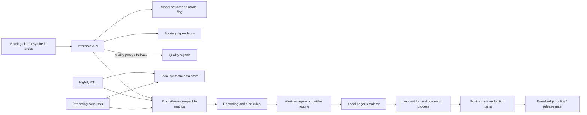

# Production Incident Simulation and Postmortem

**Stage:** Stage 2E — Production DevOps & Platform Engineering  
**Module:** 10-Site-Reliability-Engineering-and-Incident-Management (M10)  
**Project type:** Integrated, local-only capstone specification  
**Target file:** `Projects/01-production-incident-simulation-and-postmortem.md`  
**Status:** Specification and acceptance contract; this document is not the implementation repository.

> **Safety and truthfulness:** Use synthetic data and local lab endpoints only. The numeric values in examples are `[ILLUSTRATIVE]`, not production standards. Commands and outputs described as examples are `[NOT EXECUTED]` unless a learner executes them and records evidence. Actual tool versions must be recorded from the learner's environment; none are assumed here. A local simulation demonstrates reasoning and repeatability, not expected production performance.

## 1. Project Brief

### 1.1 Why this capstone exists

A data/ML platform team operates an inference API for a business-critical scoring product, a nightly extract-transform-load (ETL) pipeline, and a streaming consumer. The team has no agreed service-level objectives (SLOs), pages on CPU symptoms without adequate user-impact context, receives too many low-value alerts, and has no explicit incident roles. During a prior six-hour outage, five people debugged in parallel without coherent communications; the resulting postmortem blamed an individual instead of identifying system conditions and control gaps. Two members have since left the on-call rotation, increasing fatigue and reducing backup coverage.

The capstone asks the learner to build a practical **reliability operating system** around this platform, then exercise it under a staged incident that crosses service boundaries. The aim is not to prove that a laptop system behaves like production; it is to demonstrate disciplined measurement, safe mitigation, coordinated response, evidence preservation, and learning that produces verifiable follow-up controls.

### 1.2 What the project includes

The learner creates a local repository subtree for:

- SLO specifications and reproducible error-budget accounting;
- alert rules, alert tests, route configuration, and labelled alert-evaluation data;
- incident severity, roles, communication templates, handoff, and incident-log tooling;
- at least eight fault-oriented runbooks and operational readiness reviews (ORRs);
- bounded capacity, overload, queue, timeout, retry, and dependency-failure experiments;
- an error-budget policy and release gate with allow/block/override and fail-open/fail-closed behavior;
- three tested automations with bounded blast radius and watchdog coverage;
- on-call scheduling, handoff, fairness/load analysis, and dead-routing drills;
- delivery metrics and deployment-to-incident linking;
- two distinct incident simulation variants with facilitator-only answer keys;
- a blameless postmortem, cross-incident analysis, architecture decision records (ADRs), and a learner-measured before/after scorecard.

This is a project specification. It defines the files the learner must create, the expected behavior, the evidence to retain, and the acceptance gates. It does not claim the implementation already exists or that any commands have passed.

### 1.3 Definition of done

The project is complete only when all mandatory deliverables are present, the local safety checks pass, `make verify` emits an evidence-linked pass/fail report, and the learner has run both simulation variants. A plausible narrative without generated telemetry is not sufficient; telemetry without a timestamped incident log is not sufficient; and a green dashboard with missing or stale telemetry is not proof of recovery.

Completion requires:
1. all required paths listed in Section 5 exist;
2. all Make targets in Section 18 are implemented with documented prerequisites and exit behavior;
3. tests cover normal, failure, missing-data, and unsafe-context cases;
4. both variants are run with recorded seeds and facilitator scoring;
5. every measured scorecard value points to an evidence artifact;
6. the postmortem separates observed facts, hypotheses, and unknowns;
7. action items have accountable roles, due dates, verification criteria, and closure evidence requirements;
8. no production endpoint, credentials, private data, or arbitrary cluster context was used.

## 2. Scenario and System Boundaries

### 2.1 Fixed scenario facts

Preserve the following central facts throughout the exercise:

- The team operates an inference API, a nightly ETL pipeline, and a streaming consumer.
- No agreed SLOs exist at the beginning of the scenario.
- Alerting emphasizes CPU symptoms without enough user-impact context and pages for too many conditions.
- Incident roles and decision rights are not explicit.
- A previous six-hour outage involved five people debugging in parallel without coherent communications.
- A blame-oriented postmortem was produced.
- Two members have left the on-call rotation in the past year.

The learner's redesign should respond to these conditions rather than pretending they never occurred. The six-hour historical outage is scenario background, not a benchmark to compare against a simulated incident unless the learner explicitly labels that comparison as non-equivalent.

### 2.2 System model



The intended operating loop is:

`signals → SLOs → alerts → pager → incident process → postmortem → actions → budget policy`

The diagram is a logical design, not a claim that all components are already deployed. The learner may use a small FastAPI-compatible local app and Docker Compose or another local arrangement, provided the safety and evidence contracts are met. Kubernetes is not mandatory for the core project; using `kind` is optional and must not expand the blast radius.

### 2.3 Components and user outcomes

| Component | User or consumer outcome | Useful signals | Typical failure modes |
|---|---|---|---|
| Inference API | Valid scoring requests receive timely and sufficiently correct responses | successful valid requests, latency buckets, fallback ratio/quality proxy, client-side failures | bad model release, dependency latency, retries, overload, queue saturation |
| Nightly ETL | Required dataset is fresh, complete, and passes correctness checks by its deadline | freshness age, expected/processed records, validation failures, run completion | delayed job, capacity starvation, bad input, partial output |
| Streaming consumer | Events are processed within lag and end-to-end latency objectives | consumer lag, event age, processed/received counts, duplicate/error rate | consumer slowdown, partition skew, backpressure, downstream unavailability |
| Metrics path | Operators can distinguish service health from measurement failure | scrape success, last sample age, target health, expected-series presence | missing scrape, stale series, wrong labels, exporter failure |
| Alert/pager path | Actionable signals reach a responder and are acknowledged | firing alerts, routing outcome, simulated delivery, acknowledgement latency | dead route, over-grouping, inhibition mistake, pager outage |
| Release gate | Risk decisions use current policy and auditable inputs | budget status, policy version, gate result, override event | stale budget, missing telemetry, unaudited override, unsafe default |

### 2.4 Lab boundaries

- Local synthetic data only; no real customer records, real model payloads, or private incident details.
- Use loopback or a private local container network. Do not bind publicly unless there is a documented and necessary reason; the core project does not require public exposure.
- No cloud account, real pager, paid SLO platform, production kubeconfig, production credentials, or production endpoint is needed.
- The lab must have bounded request rate, duration, queue size, retry count, and resource use.
- If context, endpoint ownership, resource limits, or cleanup behavior is ambiguous, stop and use offline replay instead.
- The actual M08 lab service specification was not available in the prompt attachment itself; any metric names or endpoints in this project are a **compatibility contract**, not a claim about the real M08 implementation. Map the contract to the actual service before integration.

## 3. Learning Outcomes and Prerequisites

### 3.1 Prerequisites

The learner should be familiar with Python, HTTP APIs, containers, basic Linux/WSL2, YAML, Git, logs, and basic Prometheus concepts. The roadmap's M01–M09 material is reused; the capstone does not repeat those modules.

| Unit | Capstone connection |
|---|---|
| Unit 1 — `01-service-level-indicators-objectives-and-error-budgets.md` | Define SLI specifications, SLOs, measurement gaps, budget arithmetic |
| Unit 2 — `02-reliability-targets-for-batch-streaming-and-inference.md` | Apply workload-specific freshness, coverage, correctness, and lag objectives |
| Unit 3 — `03-alert-quality-noise-reduction-and-escalation-policies.md` | Alert tests, routing, precision/recall, actionable pages |
| Unit 4 — `04-incident-severity-roles-and-command-structure.md` | Severity, incident command, decision rights |
| Unit 5 — `05-production-triage-and-blameless-postmortems.md` | Safe triage, merged timeline, blameless analysis |
| Unit 6 — `06-capacity-related-failures-and-cascading-outages.md` | Retry amplification, queue growth, capacity knee, overload |
| Unit 7 — `07-toil-reduction-and-operational-automation.md` | Toil inventory, bounded automation, watchdog |
| Unit 8 — `08-runbook-design-and-operational-readiness-reviews.md` | Eight runbooks, linter, ORRs, dependency injection |
| Unit 9 — `09-error-budget-policies-and-release-freezes.md` | Budget bands, release gates, overrides, freeze/no-freeze decision |
| Unit 10 — `10-on-call-rotations-handoffs-and-sustainable-paging.md` | Rotation, load analysis, handoffs, dead-routing drill |
| Unit 11 — `11-dora-metrics-and-engineering-performance-measurement.md` | Delivery metrics, deployment-to-incident links, anti-gaming |

### 3.2 Observable learning outcomes

By completion, the learner can:

1. Specify measurable inference API, ETL, and streaming SLIs with numerator, denominator, event eligibility, measurement point, window, exclusions, owner, and caveats.
2. Derive allowed downtime or bad-event allowance from a target and window, and calculate budget consumption and burn rate without treating missing data as success.
3. Test symptom-based alert rules and evaluate alert precision, recall, false-positive rate, and time-to-detect against labelled synthetic incidents.
4. Declare incidents, choose severity, assign roles, communicate on a cadence, conduct an explicit IC handoff, and preserve a timestamped incident log.
5. Mitigate safely and reversibly before exhaustive diagnosis, then verify recovery using service and data SLIs.
6. Explain and test bounded queues, timeout budgets, retry budgets/backoff, load shedding, circuit breaking, backlog catch-up, and N−1 capacity.
7. Lint and execute at least eight runbooks, and complete ORRs for the inference API and ETL pipeline.
8. Implement a release gate with allow, block, override, audit trail, forecast, and explicit fail-open/fail-closed behavior.
9. Implement three tested automations with preconditions, postconditions, blast-radius limits, failure injection, and watchdog behavior.
10. Analyze on-call load and synthetic delivery history without turning metrics into individual-performance rankings.
11. Produce a blameless postmortem and prioritized actions supported by a merged evidence timeline.
12. Report before/after measurements honestly and explain why local simulation values do not predict production behavior.

## 4. Safety, Ethics, and Lab Guardrails

### 4.1 Stop conditions

Stop immediately and switch to an offline fixture if any of the following is true:

- the active Kubernetes context is not explicitly the named local lab context;
- a command target is not a loopback address or a known lab-only container/service;
- a destructive action would affect a namespace, host, database, queue, or cluster not created by the project;
- credentials or personal/customer data appear in a fixture or log;
- the process cannot establish an upper bound for load, duration, retries, or resource use;
- cleanup is uncertain or the environment owner is unclear;
- the system is consuming resources outside the declared laptop budget.

Do not use `kubectl delete` with broad selectors, arbitrary namespaces, or an assumed context. Do not run a load generator against an unknown URL. Do not use production credentials to “make the lab realistic.”

### 4.2 Mandatory bootstrap checks

The learner's bootstrap script must:
1. print the selected lab mode and endpoint;
2. reject non-loopback endpoints by default;
3. reject a non-lab Kubernetes context if Kubernetes is enabled;
4. require an explicit `--confirm-local-lab` flag before destructive lab cleanup;
5. use a temporary directory or a project-owned data directory;
6. enforce maximum duration, request rate, and queue size;
7. be idempotent where appropriate;
8. emit a machine-readable run manifest with timestamp, seed, version record, and resource limits;
9. fail closed when the safety context cannot be verified;
10. avoid embedding secrets.

**Starter contract (Python):**

```python
# sim/safety.py
from dataclasses import dataclass
from urllib.parse import urlparse

@dataclass(frozen=True)
class LabConfig:
    endpoint: str
    max_seconds: int
    max_rps: int
    max_queue: int
    mode: str = "offline"

def validate(config: LabConfig) -> None:
    parsed = urlparse(config.endpoint)
    if config.mode not in {"offline", "local-http", "kind"}:
        raise ValueError("mode must be offline, local-http, or kind")
    if config.max_seconds <= 0 or config.max_seconds > 300:
        raise ValueError("duration must be in 1..300 seconds")
    if config.max_rps <= 0 or config.max_rps > 50:
        raise ValueError("request rate must be in 1..50 rps")
    if config.max_queue <= 0 or config.max_queue > 1000:
        raise ValueError("queue must be in 1..1000 items")
    if config.mode == "local-http":
        if parsed.scheme not in {"http", "https"}:
            raise ValueError("endpoint must use HTTP(S)")
        host = (parsed.hostname or "").lower()
        if host not in {"127.0.0.1", "::1", "localhost"}:
            raise ValueError("refusing non-loopback endpoint")
    if config.mode == "offline" and config.endpoint not in {"offline://fixture", ""}:
        raise ValueError("offline mode must not target a network endpoint")
```

Run with a learner-authored test suite, for example `python -m unittest sim.test_safety`. The contract is intentionally small; if the project adds container or Kubernetes support, add explicit context validation and tests before adding mutation commands. The code above does not itself verify Docker ownership or Kubernetes context.

### 4.3 Data handling and human safety

- Synthetic identifiers only, such as `tenant-demo-a`; never use email addresses, customer IDs, or raw request payloads as metric labels.
- Keep label cardinality bounded. Never place request IDs, user IDs, arbitrary exception strings, or model input text in Prometheus labels.
- Scrub evidence before submission. Do not include tokens, environment dumps, private endpoints, or personal data.
- Make incident communication factual and blameless. Avoid statements like “the operator caused the outage”; record the action, available information, system affordances, time pressure, and reversibility.
- The IC coordinates, sets priorities, and manages information flow. The IC should not automatically become the person executing every technical task.
- Protect responders: explicit backup, handoff, and stop-the-line authority are required. Sustainable on-call is a reliability control.

## 5. Architecture and Repository Layout

### 5.1 Required project workspace

Create the following under the M10 project workspace. The project specification itself is the only artifact being delivered now; the learner creates the implementation files during the project.

```text
Projects/
├── 01-production-incident-simulation-and-postmortem.md
└── production-incident-lab/                 # learner-created workspace
    ├── README.md
    ├── Makefile
    ├── versions.txt
    ├── pyproject.toml                       # or requirements.txt; choose one
    ├── slo/
    │   ├── worksheet.csv
    │   ├── inference-api.yaml
    │   ├── etl-starting-worksheet.yaml
    │   ├── streaming-starting-worksheet.yaml
    │   ├── spec.schema.json
    │   ├── calculate_budget.py
    │   ├── generate_report.py
    │   └── report-template.md
    ├── alerts/
    │   ├── recording-rules.yml
    │   ├── alert-rules.yml
    │   ├── prometheus.yml
    │   ├── alertmanager.yml
    │   ├── test-rules.yml
    │   ├── route-fixtures/
    │   ├── test_alert_eval.py
    │   └── ci-check.sh
    ├── incident/
    │   ├── severity-policy.yaml
    │   ├── roles.yaml
    │   ├── communications.md
    │   ├── status-template.md
    │   ├── handoff-template.md
    │   ├── incident_log.py
    │   ├── status_generator.py
    │   └── taxonomy_report.py
    ├── runbooks/
    │   ├── README.md
    │   ├── 01-quality-regression.md
    │   ├── 02-inference-latency.md
    │   ├── 03-inference-overload.md
    │   ├── 04-dependency-degradation.md
    │   ├── 05-etl-freshness-breach.md
    │   ├── 06-streaming-lag.md
    │   ├── 07-telemetry-gap.md
    │   ├── 08-alert-routing-failure.md
    │   ├── lint_runbooks.py
    │   └── test_lint_runbooks.py
    ├── automation/
    │   ├── inventory.yaml
    │   ├── safe_replay.py
    │   ├── bounded_queue_repair.py
    │   ├── incident_evidence_pack.py
    │   ├── watchdog.py
    │   ├── audit_permissions.py
    │   └── tests/
    ├── oncall/
    │   ├── roster.csv
    │   ├── schedule.py
    │   ├── handoff.py
    │   ├── load_analysis.py
    │   ├── pager_sim.py
    │   └── tests/
    ├── metrics/
    │   ├── deployments.csv
    │   ├── incidents.csv
    │   ├── alert_events.csv
    │   ├── delivery_pipeline.py
    │   ├── incident_linker.py
    │   ├── charter.md
    │   └── tests/
    ├── sim/
    │   ├── learner-brief.md
    │   ├── game_master.py
    │   ├── scenario-a.yaml
    │   ├── scenario-b.yaml
    │   ├── faults.py
    │   ├── replay.py
    │   ├── seeds/
    │   ├── facilitator-only/
    │   │   ├── answer-key-a.md
    │   │   ├── answer-key-b.md
    │   │   ├── scoring-sheet.md
    │   │   └── hints.md
    │   └── tests/
    ├── reports/
    │   ├── postmortem-template.md
    │   ├── review-meeting-template.md
    │   ├── cross-incident-analysis.md
    │   ├── action-items.csv
    │   └── scorecard.csv
    ├── docs/
    │   ├── architecture.mmd
    │   ├── ADR-001-sli-slo.md
    │   ├── ADR-002-alerting.md
    │   ├── ADR-003-severity-roles.md
    │   ├── ADR-004-resilience.md
    │   ├── ADR-005-budget-policy.md
    │   ├── ADR-006-oncall.md
    │   ├── ADR-007-metrics-governance.md
    │   ├── orr-inference-api.md
    │   ├── orr-etl.md
    │   ├── dependency-failure-modes.csv
    │   └── readiness-review.md
    └── evidence/
        ├── README.md
        ├── versions.txt
        ├── baseline/
        ├── tests/
        ├── runbooks/
        ├── simulation-a/
        ├── simulation-b/
        ├── postmortem/
        └── final-verify/
```

The folder names are required. Files may be split further if the learner documents the mapping, but required artifacts cannot be silently omitted. Facilitator-only answer keys must be kept separate from the learner-facing brief and should not be visible during a blind run.

### 5.2 `versions.txt`

Record actual values gathered from the local environment; do not prefill guessed versions.

```text
# Fill from the environment that produced the evidence.
OS_DESCRIPTION=
PYTHON_VERSION=
PYTHON_DEPENDENCIES=
DOCKER_VERSION=
COMPOSE_VERSION=
PROMETHEUS_VERSION=
ALERTMANAGER_VERSION=
PROMTOOL_VERSION=
AMTOOL_VERSION=
LAB_APP_COMMIT_OR_VERSION=
LAB_MODE=offline|local-http|kind
RECORDED_AT_UTC=
```

Capture versions using commands supported by the installed binaries, such as `python --version`, `docker version`, `prometheus --version`, `alertmanager --version`, `promtool --version`, and `amtool --version`. Exact command availability and output format are `[VERIFY]`; commands are `[NOT EXECUTED]` in this specification. If a binary is not installed because the learner selected offline mode, record `NOT INSTALLED — offline mode` rather than inventing a version.

### 5.3 Architecture Decision Records

Each ADR must contain: context, decision, alternatives considered, consequences, safety impact, verification evidence, owner role, date, and reconsideration trigger. The seven required ADRs are:

1. SLI/SLO choices and measurement points;
2. alerting and detection strategy;
3. severity and roles model;
4. resilience controls and retry/timeout policy;
5. error-budget policy and gate semantics;
6. on-call and handoff model;
7. delivery-metrics governance and anti-gaming safeguards.

An ADR records a decision, not merely a description. Include at least one rejected alternative and a reason for each decision.

## 6. Milestones and Completion Gates

Effort estimates below are `[ILLUSTRATIVE]` and depend on prior experience and whether the learner uses offline fixtures or runs the local metrics stack. They are not deadlines or performance standards.

| Milestone | Objective and dependencies | Outputs and checks | Acceptance gate and evidence | Common failure / recovery |
|---|---|---|---|---|
| M0 — Safe environment and baseline | Establish local-only mode; no dependencies | workspace, `versions.txt`, safety tests, baseline page/alert dataset, resource plan; `[ILLUSTRATIVE]` 2–4 hours | endpoint/context guard tests pass; baseline data is labelled synthetic; save `evidence/baseline/` | Unclear endpoint/context: stop and run offline replay |
| M1 — SLOs and budgets | M0 | three workload SLO documents/worksheets; inference spec complete; budget calculator and tests | numerator/denominator/window/eligibility/owner present; zero traffic and missing metrics are unknown, not green | Confusing proxy with truth: document proxy limits and add independent check |
| M2 — Detection and alert evaluation | M1 | recording/alert rules, tests, Alertmanager config, route fixtures, CI check, labelled replay | rules pass installed-version tests or clearly documented offline contract; precision/recall calculated | Rule schema mismatch: check installed docs/version and narrow test fixture |
| M3 — Incident kit and runbooks | M0–M2 | severity, roles, communications, log CLI, status generator, taxonomy report, eight runbooks, linter | all runbooks lint and are exercised; retain one run log per fault | Runbook is vague or unsafe: add preconditions, stop conditions, rollback, and evidence |
| M4 — Capacity and resilience | M0–M3 | bounded load test, capacity knee, queue/retry/timeout/load-shed controls, N−1 check, backlog calculator | overload test demonstrates bounded degradation; no unbounded retry/queue behavior | Laptop saturates: lower rate/duration or use deterministic offline model |
| M5 — Policy, automation, on-call, metrics | M1–M4 | budget policy/gate, override log, forecast, three automations, watchdog, rotation/handoff/load reports, DORA pipeline | allow/block/override/error paths tested; synthetic history and anti-gaming charter present | Missing telemetry defaults to allow: choose/document fail-closed or explicit degraded mode |
| M6 — Simulation preparation | M0–M5 | two scenario variants, hidden causes, seeds, facilitator keys, hints, score sheet, learner brief | variant causes differ materially; keys are separated; fault bounds and teardown verified | Learner can see key: move it out of learner view before run |
| M7 — Run both incident variants | M6 | timestamped logs, alert replay, comms, handoff, mitigation, recovery evidence, scores | both variants complete; SLI and data recovery verified; secondary failure addressed | No reliable time base: use one simulated clock and record wall-clock separately |
| M8 — Postmortem and final verification | M7 | merged timeline, postmortem, actions, cross-incident update, scorecard, readiness review, all ADRs | `make verify` reports all required checks and evidence paths; rubric applied | Unsupported claims: label hypothesis/unknown and leave scorecard blank until measured |

### 6.1 Gate protocol

At each milestone, record `PASS`, `FAIL`, or `BLOCKED` with evidence. `BLOCKED` is appropriate when a required external component cannot be installed safely; use an offline substitute and explicitly record the limitation. Do not convert `BLOCKED` into `PASS` merely because a file exists.

Each gate must answer:
- What behavior was tested?
- What input or fault was used?
- What evidence proves the result?
- What remains untested?
- Was the test performed in offline, local HTTP, or kind mode?
- Did cleanup finish successfully?

## 7. Required Deliverables and Acceptance Criteria

### 7.1 Bootstrap and safety

**Required files:** `sim/safety.py`, tests, bootstrap instructions in `README.md`, `versions.txt`, and cleanup documentation.

Acceptance:
- invalid mode, unbounded duration/rate/queue, non-loopback local endpoint, and unsafe context fail before mutation;
- offline replay does not make network calls;
- repeated bootstrap is safe and does not duplicate unmanaged resources;
- teardown only removes resources created by the lab;
- run manifest includes mode, seed, start/end timestamps, limits, and tool versions;
- resource budget and port list are documented.

### 7.2 SLO and error-budget suite

Create SLO documents for:
- inference API availability, latency, and a quality proxy;
- ETL freshness, coverage, and correctness;
- streaming time lag and end-to-end latency.

Each SLI specification must state owner, user journey, good event, valid event, numerator, denominator, exclusions, measurement point, data source, window, target rationale, caveats, and stakeholder agreement status. Include recording rules, budget status script/service, allowed downtime derivation, and a reproducible report. Low traffic, denominator collapse, and telemetry failure must have explicit behaviors.

### 7.3 Alerting and evaluation

Required:
- multi-window/multi-burn-rate rules where the SLO and available traffic justify them;
- freshness, dead-pipeline, missing-series/telemetry, and watchdog alerts;
- user-symptom paging rather than CPU-only paging;
- `promtool test rules` tests;
- Alertmanager grouping, routing, inhibition, and silence configuration;
- `amtool` route tests only where supported by the installed version, with version behavior marked `[VERIFY]` if not verified;
- CI check for alert-as-code;
- local pager/escalation simulator and tests;
- labelled replay that computes precision, recall, false-positive rate, and time-to-detect.

A burn-rate threshold is a policy choice derived from target/window and incident tolerance, not a universal constant. The learner must show the calculation or document the decision rationale.

### 7.4 Incident management kit

Required:
- severity policy based on impact, scope, urgency, and data correctness/freshness;
- role/decision-rights model for Incident Commander (IC), Operations/Technical Lead, Communications Lead, and optional scribe/liaison;
- escalation criteria and update cadence;
- internal update and status-page templates;
- handoff template and explicit IC handoff procedure;
- tested incident-log CLI/script;
- status-page Markdown generator;
- taxonomy/trend report.

For a solo learner, role-play the roles in sequence and write decisions separately. One person may temporarily hold multiple roles, but one IC must be named at a time. The IC coordinates and delegates; the IC is not expected to debug every component.

### 7.5 Runbooks and ORRs

At least eight runbooks must be linted and executed against injected faults, with run logs retained. Each includes:
- symptoms and user impact;
- safety prerequisites and scope;
- diagnostics and expected observations;
- mitigation options and reversibility;
- rollback/stop conditions;
- escalation;
- recovery verification against SLIs/data SLAs;
- evidence to preserve;
- cleanup and follow-up.

Required runbooks are named in Section 5.1. Complete ORRs for the inference API and ETL pipeline, and a dependency failure-mode table validated by injection. Runbook linter tests must catch missing mandatory sections, missing stop conditions, and missing verification criteria.

### 7.6 Capacity and resilience

Measure a local capacity knee and implement:
- explicit timeouts;
- bounded queues;
- load shedding;
- retry budgets with bounded backoff;
- circuit breaker or an equivalent documented protection;
- N−1 capacity check;
- graceful-degradation overload test;
- retry-storm/thundering-herd mitigation test;
- backlog catch-up calculator;
- capacity plan.

Teach Little's Law \(L = \lambda W\) only with assumptions: a stable system, long-run averages, consistent boundaries, and a finite steady state. Explain that averages can hide tail latency and that an unstable queue may have no meaningful steady-state average. Do not extrapolate a laptop benchmark to production capacity.

### 7.7 Error-budget policy and release gate

The policy must define budget bands, actions, exception authority, recovery criteria, and review owners. The gate must support `allow`, `block`, `override`, and explicit error-path behavior; keep an append-only override audit record; generate a forecast; and test fail-open versus fail-closed behavior.

A budget breach does not mechanically require a freeze in every context. The learner must record a freeze/no-freeze decision for the simulated incident, considering impact, uncertainty, mitigations, delivery risk, and accountable decision owner.

### 7.8 Toil and automation

Required:
- toil inventory with frequency, minutes/run, failure rate, human review, and risk;
- ROI model with visible assumptions;
- three tested automations;
- bounded blast radius, idempotency where appropriate, preconditions, postconditions, preview/dry-run where safe, rollback/compensation, failure injection;
- automation watchdog and inventory/permissions audit.

Suggested safe automations: replay a synthetic fixture; build an evidence pack from allowlisted files; repair a local synthetic queue state with strict preconditions. Do not automate an unsafe or poorly understood action merely to meet the count.

### 7.9 On-call sustainability

Required:
- scheduler and tests for rotation fairness;
- handoff generator;
- synthetic on-call load analysis including bus factor and distribution imbalance;
- page triage results;
- on-call and stop-the-line policy;
- dead-routing and pager-outage drills;
- sustainability review covering recovery time, backup coverage, escalation, and human load.

A Gini-like metric is a distribution summary, not a complete fairness measure. It does not explain skill coverage, timezone constraints, caregiving needs, incident severity, shift length, recovery time, or whether a team has enough people. Pair it with qualitative review and minimum coverage constraints.

### 7.10 Delivery metrics and governance

Build a DORA-style metrics pipeline from synthetic deployment/incident history and the learner's own lab history. Link deployments to incidents with explicit confidence and time windows; decompose lead time; write a metrics charter and anti-gaming safeguards; produce a combined reliability/delivery scorecard. Do not rank individuals using these metrics or treat correlation as proof that a deployment caused an incident.

### 7.11 Simulation

The game-master harness must support two variants with materially different hidden causes, bounded fault injection, a reproducible seed/metadata, three hint levels, facilitator answer keys, scoring, and timestamped logs. Phase details and keys are in Sections 15–16.

### 7.12 Postmortem

Required postmortem package:
- impact and affected user journeys;
- SLO attainment and error-budget accounting for the incident window;
- merged timeline from alerts, metrics, logs, deployment records, incident log, and status updates;
- technical, process, organizational, and human-factors contributing conditions;
- detection and response analysis;
- what went well, poorly, and luckily;
- observed facts, hypotheses, and unknowns clearly separated;
- prioritized actions with owner/role, due date, priority, control-hierarchy classification, verification criteria, and closure evidence;
- cross-incident analysis update;
- review meeting script and notes;
- written freeze/no-freeze decision and rationale.

“Human error” is not a sufficient terminal cause. If an operator action contributed, investigate what made the action reasonable given the available information, what control was missing, and how to make the system safer and more reversible.

## 8. SLO and Error-Budget Work

### 8.1 Required inference API specification

Create `slo/inference-api.yaml`. Example contract below is `[ILLUSTRATIVE]`; targets and thresholds must be negotiated in the role-play and reviewed against actual lab behavior. This is a proposed starter, not a claim that stakeholders approved it.

```yaml
service: inference-api
owner_role: ml-platform-oncall
review_date: "YYYY-MM-DD"
agreement_status: role-play-only-not-approved
user_journeys:
  - submit-valid-score-request
  - receive-score-before-client-deadline
  - receive-non-fallback-result-when-model-path-is-healthy
slis:
  - name: availability
    measurement_point: application-request-counter
    good_event: valid request returns an allowed success status
    valid_event: request reached the API boundary and is not an approved synthetic health check
    numerator: valid requests classified good
    denominator: all eligible valid requests
    target: 0.999
    window: rolling-28d
    exclusions:
      - "synthetic health checks, if separately identified and audited"
    caveats:
      - "server-side telemetry may miss requests that never reach the process"
      - "4xx classification must be reviewed by endpoint and user journey"
  - name: latency
    measurement_point: application request duration histogram
    good_event: valid request completes within the configured threshold
    valid_event: same eligibility as availability
    numerator: valid requests in the histogram bucket at or below the threshold
    denominator: all eligible valid requests
    target: 0.99
    threshold_ms: 300
    required_bucket_boundary_seconds: 0.3
    window: rolling-28d
    caveats:
      - "threshold and bucket must match instrumentation exactly"
      - "server duration omits client-side and network time"
  - name: fallback_ratio
    measurement_point: inference result classification counter
    good_event: eligible request did not use the designated fallback path
    valid_event: eligible scored request with known fallback classification
    numerator: eligible requests using fallback
    denominator: eligible scored requests
    target_max: 0.02
    window: rolling-28d
    caveats:
      - "fallback is a quality proxy, not ground-truth model quality"
      - "a low fallback ratio does not prove predictions are correct"
policy_reference: docs/ADR-005-budget-policy.md
stakeholders:
  product_role: product-owner-role-play
  reliability_role: sre-role-play
  approval_status: not-real-stakeholder-approval
```

**Important:** availability's target is a ratio of good events; fallback is a maximum bad-event ratio, so its budget arithmetic must use the correctly defined bad fraction. Do not use the same numerator convention for every SLI without documenting it.

### 8.2 ETL and streaming starter worksheets

These are structured starting points; Unit 2 completes the workload-specific design. Do not invent final targets without data and stakeholder rationale.

`etl-starting-worksheet.yaml`:

```yaml
service: nightly-etl
owner_role: data-platform-owner
agreement_status: pending
slis:
  - name: freshness
    user_outcome: downstream dataset is available by its deadline
    measurement_point: dataset publication timestamp
    good_event: publish time <= agreed freshness deadline
    valid_event: scheduled run expected for this dataset and partition
    numerator: scheduled eligible partitions published on time
    denominator: eligible scheduled partitions
    target: null
    window: calendar-aligned-rolling-review
    caveats: [backfills, late source data, timezone and business-calendar rules]
  - name: coverage
    user_outcome: expected records/partitions are represented
    good_event: required coverage checks pass
    numerator: expected units satisfying coverage contract
    denominator: expected units
    target: null
    window: per-run and rolling review
  - name: correctness
    user_outcome: output passes agreed validation rules
    good_event: output passes versioned quality checks
    numerator: valid output units
    denominator: eligible output units
    target: null
    window: per-run and rolling review
```

`streaming-starting-worksheet.yaml`:

```yaml
service: streaming-consumer
owner_role: streaming-platform-owner
agreement_status: pending
slis:
  - name: consumer_lag
    user_outcome: events are processed before their usefulness expires
    measurement_point: consumer offset / event timestamp
    good_event: lag is below the agreed threshold
    numerator: eligible events processed within lag threshold
    denominator: eligible events
    target: null
    window: rolling review plus incident-window view
    caveats: partition skew, clock skew, idle partitions
  - name: end_to_end_latency
    user_outcome: event reaches downstream result in time
    measurement_point: event creation to downstream commit
    good_event: elapsed time <= agreed threshold
    numerator: eligible events within threshold
    denominator: eligible events
    target: null
    window: rolling review
    caveats: missing event timestamps, duplicates, replayed events
```

### 8.3 Worksheet CSV

`worksheet.csv` header:

```csv
service,sli_name,owner_role,user_journey,good_event,valid_event,numerator,denominator,exclusions,measurement_point,data_source,window,target,target_rationale,caveats,policy_reference,review_date,agreement_status
```

Acceptance: each row is complete enough for another learner to reproduce the calculation. A blank target is permitted only for a clearly marked Unit 2 starting worksheet; it is not a completed SLO.

### 8.4 Error-budget formulas

For a ratio SLO whose target is \(S\):

- Allowed bad-event fraction: \(1-S\).
- Allowed bad events for \(N\) valid events: \(N(1-S)\).
- If \(B\) bad events are observed and allowed bad events are positive, consumed fraction: \(B/[N(1-S)]\).
- Remaining fraction: \(1-\text{consumed fraction}\); values below zero mean the budget is exhausted, not that negative budget can be “recovered” by clamping the underlying evidence.
- Burn rate: observed bad-event rate divided by allowed bad-event rate over comparable units and intervals. Burn rate 1 means the observed bad-event rate equals the sustainable rate implied by the SLO over the chosen window.

For a time-based objective, derive allowed bad time from window duration times the allowed bad-time fraction. Do not mix events, seconds, and fractions in one calculation. An event-based budget and a time-based budget answer different questions.

Example `[ILLUSTRATIVE]`: an SLO of 99.9% over 30 days permits \(30 \times 24 \times 60 \times (1-0.999)=43.2\) minutes of bad time **only if** the SLI is explicitly time-based and the entire calendar duration is the denominator. For 100,000 valid events, the same ratio target permits 100 bad events under event-based accounting. Do not call these interchangeable budgets.

### 8.5 Budget calculator contract

`calculate_budget.py` must accept a CSV or deterministic generated fixture with at least:
`timestamp,requests,good_requests,latency_good_requests,fallback_requests,telemetry_present`.

Required behavior:
- compute availability and latency ratio only when the denominator is positive and the relevant fields are present;
- calculate allowed bad events, consumed budget, remaining budget, and burn rate with units stated;
- represent missing telemetry, zero denominator, and insufficient data as `UNKNOWN` or a typed error, never as 100% success;
- report when the budget is exhausted;
- include three scenarios: steady healthy, gradual degradation, and sudden outage;
- include tests for normal, degrading, outage, zero denominator/missing data, and exhausted budget;
- produce a report whose numbers can be regenerated from the input fixture.

Suggested interface:

```text
python slo/calculate_budget.py --input slo/fixtures/steady.csv --target 0.999 --window-seconds 2419200
python slo/calculate_budget.py --scenario gradual --target 0.999
```

The exact flags are the project's own interface and must be implemented as specified by the learner; they are not flags from Prometheus. The script should use decimal arithmetic or clearly documented rounding for budget counts.

Expected report shape `[NOT EXECUTED]`:

```text
scenario: steady
availability_sli: MEASURED_FROM_FIXTURE
latency_sli: MEASURED_FROM_FIXTURE
valid_requests: <input-derived integer>
bad_requests: <input-derived integer>
allowed_bad_requests: <calculated value>
budget_consumed_fraction: <calculated value>
budget_remaining_fraction: <calculated value or EXHAUSTED>
burn_rate: <calculated value or UNKNOWN>
telemetry_status: PRESENT | MISSING | PARTIAL
```

The literal placeholders above describe the output schema, not expected numeric results. Replace them with computed values during implementation.

### 8.6 Allowed-downtime calculator

Derive rather than look up values:

```python
def allowed_bad_time_seconds(window_seconds: float, target: float) -> float:
    if window_seconds <= 0:
        raise ValueError("window_seconds must be positive")
    if not 0 < target <= 1:
        raise ValueError("target must be in (0, 1]")
    return window_seconds * (1 - target)
```

Tests must verify boundary cases: invalid target, nonpositive window, 100% target, and a known illustrative target/window. At 100%, allowed bad time is zero; this does not make 100% operationally achievable or a good objective.

### 8.7 Prometheus metric contract and queries

If the actual M08 app is available, map its metrics to this contract. Otherwise, all names below are `[ILLUSTRATIVE]`:
- `http_requests_total{route,method,code}`
- `http_request_duration_seconds_bucket{route,le}`
- `inference_fallback_total{route,reason}`
- `etl_last_success_timestamp_seconds{pipeline}`
- `etl_expected_partitions_total{pipeline}`
- `etl_valid_partitions_total{pipeline}`
- `stream_consumer_lag_messages{consumer,partition}`
- `stream_event_processing_seconds_bucket{consumer,le}`
- `up{job}`

Avoid sensitive or unbounded labels. `route` must be a normalized route template, not a raw path with arbitrary IDs. Do not label metrics with request IDs, user IDs, raw exception text, or model payload.

Availability ratio example, assuming `code` is an HTTP status-code label and all eligible events are counted:

```promql
sum(rate(http_requests_total{code!~"5.."}[5m]))
/
sum(rate(http_requests_total[5m]))
```

This sample defines every non-5xx response as good, which is **not universally correct**. A learner must explicitly decide whether each 4xx class is user-caused, service-caused, authentication-related, or otherwise relevant to the user journey. If a 401 regression blocks valid users, counting all 4xx as good can hide impact. The production query must match the written event classification and metric labels.

Latency ratio example where the instrumentation has an actual `le="0.3"` bucket boundary:

```promql
sum(rate(http_request_duration_seconds_bucket{le="0.3"}[5m]))
/
sum(rate(http_request_duration_seconds_count[5m]))
```

If `_count` is not emitted or labels differ, adapt to the actual metric schema. The threshold must correspond exactly to an existing bucket boundary; otherwise the numerator is not the intended threshold count. Do not average per-instance percentiles to infer a fleet percentile.

Recording rule example:

```yaml
groups:
  - name: inference-sli
    interval: 30s
    rules:
      - record: inference:request_success_ratio:rate5m
        expr: |
          sum(rate(http_requests_total{code!~"5.."}[5m]))
          /
          sum(rate(http_requests_total[5m]))
      - record: inference:request_success_ratio:rate1h
        expr: |
          sum(rate(http_requests_total{code!~"5.."}[1h]))
          /
          sum(rate(http_requests_total[1h]))
      - record: inference:latency_under_300ms_ratio:rate5m
        expr: |
          sum(rate(http_request_duration_seconds_bucket{le="0.3"}[5m]))
          /
          sum(rate(http_request_duration_seconds_count[5m]))
```

These rules are `[ILLUSTRATIVE]`; check label consistency and parse/test with the installed `promtool`. A denominator of zero may yield no usable ratio or a non-finite result depending on query/input semantics. Alert separately on missing telemetry and no traffic rather than treating an absent ratio as healthy.

Missing target detection example:

```promql
absent(up{job="inference-api"})
```

`absent()` semantics and compatibility should be checked against the installed Prometheus version `[VERIFY]`. This expression only detects absence of the selected series; it does not prove that the correct target inventory is configured or that the API is user-healthy.

Counter reset note: apply `rate()` to each counter series before aggregating so resets are detected per series. Rate-window guidance depends on scrape interval, scrape jitter, traffic, and the installed Prometheus version; verify it rather than copying a fixed rule. Five-minute and one-hour windows above are illustrative.

### 8.8 Multi-window burn alerts

Use multiple windows where it improves the response signal and where sample volume supports it. The learner should calculate the threshold from the target and intended budget-consumption horizon, document the expected false-positive/false-negative trade-off, and test it with synthetic replay. Do not cargo-cult fixed burn-rate constants.

Alert acceptance:
- pages correspond to user impact or an actionable reliability risk;
- CPU alone is not a page unless it is tied to a tested imminent impact and a clear action;
- freshness, dead pipeline, watchdog, and missing telemetry are covered;
- alerts have labels for severity, service, owner role, and runbook reference;
- every page is tested against a labelled fixture;
- alert evaluation distinguishes false positive, true positive, missed detection, and detection delay.

### 8.9 Composite availability and dependencies

If a request requires all serial dependencies to succeed, and their failures are independent, an illustrative chain with availability \(A_1,\ldots,A_n\) has combined availability \(\prod_i A_i\). Example `[ILLUSTRATIVE]`: two dependencies at 99.9% each yield \(0.999 \times 0.999 = 0.998001\), about 99.8001%, before considering the API's own failures. Independence is often unrealistic; correlated outages and shared infrastructure invalidate the simplistic multiplication.

Compare:
- **Hard dependency:** request fails if dependency fails.
- **Soft dependency:** service can use a bounded fallback or degrade gracefully.
- **Retry:** may recover transient failures but increases load and latency; bounded retry budgets and backoff are required.
- **Redundancy:** can improve availability only if failure modes are sufficiently independent and failover is tested.
- **Circuit breaker/load shed:** limits work when downstream capacity is unhealthy; can protect the system but may reject some requests deliberately.

Exercise: calculate a serial chain, then describe how a fallback changes the user outcome and what correctness risk it introduces.

## 9. Alerting and Detection Evaluation

### 9.1 Alert event schema

Use a deterministic labelled dataset, for example `alerts/fixtures/incident_replay.csv`:

```csv
event_time,incident_id,service,signal,ground_truth_impact,alert_fired,first_detection_seconds,expected_action
2026-01-01T00:00:00Z,inc-quality,inference-api,quality_proxy,1,1,45,rollback-model-flag
2026-01-01T00:05:00Z,inc-latency,inference-api,latency_ratio,1,1,30,load-shed-and-check-dependency
2026-01-01T00:10:00Z,inc-noise,inference-api,cpu_high,0,1,10,inspect-impact-before-page
2026-01-01T00:15:00Z,inc-missed,etl,freshness,1,0,,investigate-missing-alert
```

These rows are illustrative examples only. The learner must create enough labelled cases to include true positives, false positives, true negatives, and false negatives. The schema should identify the unit of analysis (incident, alert event, or time slice) to avoid mixing denominators.

Definitions:
- Precision = TP / (TP + FP), if the denominator is positive.
- Recall = TP / (TP + FN), if the denominator is positive.
- False-positive rate = FP / (FP + TN), if the denominator is positive.
- Time-to-detect = first reliable detection time minus the synthetic incident start time, with the time base and missing detections explicitly handled.

If a denominator is zero, report `N/A`, not 0% or 100%. The evaluator must explain how duplicate alerts, grouped notifications, repeated pages, and multiple alerts for one incident are counted.

### 9.2 Prometheus rule testing

The implementation must include a `promtool test rules` fixture that exercises:
- healthy baseline;
- user-impacting error ratio;
- latency ratio breach;
- quality proxy breach;
- ETL freshness breach;
- streaming lag breach;
- missing telemetry;
- no-traffic/denominator-collapse case.

Example command pattern:

```bash
promtool check rules alerts/recording-rules.yml alerts/alert-rules.yml
promtool test rules alerts/test-rules.yml
```

`promtool` syntax and test fixture schema are version-sensitive `[VERIFY]`; confirm against the installed binary's official documentation. The commands above are `[NOT EXECUTED]` by this specification. Save command, version, exit code, and output to `evidence/tests/`.

### 9.3 Alertmanager routing

Configure grouping, routes, inhibition, and silence behavior for the local lab. Use synthetic receiver names or a local webhook capture; do not configure a real paging provider.

If the installed `amtool` supports route testing, add route fixtures and execute the supported command. Exact command syntax and feature support are `[VERIFY]` and must be recorded in `versions.txt` and the evidence manifest. Do not claim route testing passed if the tool version does not support it; in that case, test the routing contract using an offline unit test and record the limitation.

### 9.4 Alert-as-code CI check

`alerts/ci-check.sh` should fail if:
- rules do not parse;
- a page lacks owner/severity/runbook metadata;
- a runbook reference does not exist;
- a required service has no missing-telemetry guard;
- a rule only pages on CPU without user-impact linkage;
- a fixture expects an alert that never fires or vice versa.

Run it in local CI or as a deterministic shell target. It must not contact a remote service.

## 10. Incident Management Kit

### 10.1 Severity policy

Severity is based on actual or credible user impact, scope, urgency, and correctness/freshness—not a single CPU threshold.

| Severity | Illustrative criteria | Response contract |
|---|---|---|
| SEV-1 | Broad critical scoring journey unavailable or materially incorrect; no safe workaround | Immediate IC declaration, dedicated roles as available, frequent updates, prioritize reversible mitigation |
| SEV-2 | Significant cohort, region, dataset, or streaming path degraded; freshness/correctness at risk | Named IC and technical lead, scheduled updates, clear escalation and mitigation owner |
| SEV-3 | Limited impact with workaround; reliability risk contained | Ticket or lower urgency response, defined owner and review time |
| SEV-4 | No current user impact; hygiene, alert quality, or capacity concern | Backlog with due date and owner; no page unless risk changes |

These levels and criteria are `[ILLUSTRATIVE]` policy choices. The learner must tailor them to the synthetic service and define how a severity is upgraded/downgraded. An incident can be high severity because data is silently wrong or stale even if the API returns HTTP 200.

### 10.2 Roles and decision rights

- **Incident Commander (IC):** owns incident objectives, severity, role assignment, update cadence, escalation, handoff, and resolution declaration.
- **Operations/Technical Lead:** coordinates diagnosis and mitigation, keeps a technical hypothesis log, and confirms technical rollback/stop conditions.
- **Communications Lead:** maintains internal and status-page updates, tracks audience and next update time.
- **Scribe:** maintains the event log and timeline; can be combined with communications in a small exercise if explicitly stated.
- **Subject-matter responder:** investigates a bounded workstream and reports findings to the technical lead.
- **Business/data liaison (optional):** describes affected user journeys, downstream data consumers, and business decisions.

Decision rule: the IC is the single coordination authority. Technical changes are executed by an assigned operator under the safety and rollback policy. A handoff names the outgoing/incoming IC, current severity, impact, known facts, hypotheses, actions in flight, risks, next update time, and acceptance of command.

### 10.3 Communication cadence and templates

`incident/communications.md` must define a cadence per severity, labelled as local policy rather than universal standard. Example `[ILLUSTRATIVE]`: SEV-1 update every 10 simulated minutes, SEV-2 every 20 simulated minutes, or immediately after a material change. The cadence is measured in **simulated time** during the game; record wall-clock separately.

Internal update template:

```markdown
## Incident update — <incident-id>
- Simulated timestamp:
- Severity / IC:
- User impact (known / suspected / unknown):
- Affected journeys/services:
- Current mitigation and owner:
- Evidence observed since last update:
- Hypotheses (not facts):
- Risks / stop conditions:
- Next action:
- Next update due:
```

Status-page template:

```markdown
## <status title>
- Status: investigating | identified | monitoring | resolved
- Start time (simulated):
- Customer impact:
- Current action:
- Workaround, if safe:
- Next update time:
- Resolution criteria:
```

Do not publish unverified root-cause speculation as fact. If this were a real system, status communication would follow the organization's approved process; this exercise uses local Markdown only.

### 10.4 Incident log CLI

`incident/incident_log.py` should append structured JSON Lines records with:
`timestamp_simulated, timestamp_wall_clock, incident_id, actor_role, event_type, statement, evidence_ref, confidence, audience`.

Required commands in the learner's own CLI:
- create incident;
- append event;
- export timeline;
- validate required fields;
- reject empty incident IDs and malformed timestamps;
- preserve append-only raw events; corrections are new events rather than destructive edits.

Tests cover ordering, missing evidence reference, malformed input, duplicate event IDs, and export determinism. The status-page generator reads a template and explicit update data; it must not fabricate an update when data is absent.

### 10.5 Taxonomy and trend report

Use a controlled taxonomy such as `release`, `dependency`, `capacity`, `data-quality`, `telemetry`, `routing`, `operator-interface`, `process`, `unknown`. The taxonomy report counts categories over the synthetic corpus and flags missing classifications. It must not infer causality from category counts alone.

## 11. Runbooks and Operational Readiness

### 11.1 Required runbook set

Create and exercise these eight minimum runbooks:

1. `01-quality-regression.md`
2. `02-inference-latency.md`
3. `03-inference-overload.md`
4. `04-dependency-degradation.md`
5. `05-etl-freshness-breach.md`
6. `06-streaming-lag.md`
7. `07-telemetry-gap.md`
8. `08-alert-routing-failure.md`

Each injected fault must produce a run log with start/end time, fixture or fault ID, operator role, actions, results, stop conditions, recovery verification, and cleanup status. Offline fault replay counts if it exercises the documented decisions and is labelled as offline.

### 11.2 Runbook template

```markdown
# <Runbook title>
## Purpose and scope
## Symptoms and user impact
## Triggering alerts and related SLOs
## Safety prerequisites
## Diagnostics (read-only first)
## Expected observations
## Mitigation options (reversible first)
## Rollback and stop conditions
## Escalation and communication
## Recovery verification (SLIs and data correctness/freshness)
## Evidence to preserve
## Cleanup
## Follow-up and known limitations
```

### 11.3 Linter acceptance

`lint_runbooks.py` checks required headings, a nonempty safety section, explicit rollback/stop conditions, recovery verification, escalation, and evidence preservation. `test_lint_runbooks.py` includes:
- a valid runbook passes;
- missing `## Safety prerequisites` fails;
- missing rollback/stop conditions fails;
- missing recovery verification fails;
- empty file fails.

Do not accept a runbook solely because the headings exist; manually review that the steps are actionable, bounded, and reversible.

### 11.4 Operational readiness reviews

Complete `docs/orr-inference-api.md` and `docs/orr-etl.md`. Each ORR includes:
- user journeys and SLOs;
- dependency inventory and failure modes;
- capacity and overload behavior;
- alert-to-runbook coverage;
- rollback/stop criteria;
- deployment and configuration ownership;
- telemetry integrity checks;
- backup/restore or replay expectations where relevant;
- security and secret-handling boundaries;
- evidence of fault injection and recovery;
- open risks, accountable owner, and due date.

`dependency-failure-modes.csv` must include dependency, failure mode, detection, expected user effect, timeout, retry policy, fallback behavior, runbook, injected test, observed result, and residual risk. Verify at least one dependency failure mode per major component.

## 12. Capacity, Cascading Failures, and Resilience

### 12.1 Causal model

The scenario must show a credible chain, not a random collection of failures:

1. a bad model release silently degrades the quality proxy;
2. a dependency latency regression triggers retries;
3. retry amplification and queue growth overload the inference API;
4. shared capacity starvation delays ETL and/or streaming consumption, causing stale data or lag;
5. a mitigation side effect, such as a restart storm or mis-scoped scale-down, creates a secondary failure.

The learner should distinguish trigger, propagation path, amplifiers, latent conditions, and recovery barriers. A causal graph is a hypothesis until evidence supports its edges.

### 12.2 Bounded request path

Implement and test:
- per-request deadline and dependency timeout less than the total deadline;
- bounded queue with explicit rejection or load-shed behavior when full;
- retry budget per request or interval, bounded attempts, exponential backoff with jitter if supported;
- circuit breaker or equivalent dependency protection;
- graceful degradation with an explicitly documented correctness/fallback trade-off;
- metrics for queue depth, rejected work, retry attempts, dependency latency, and fallback ratio.

The test must prove that queue depth and retry count remain bounded under the synthetic fault. A test that only demonstrates successful requests at low load is insufficient.

### 12.3 Capacity knee and N−1

Measure the capacity knee as the region where incremental offered load causes disproportionate growth in latency, errors, queue depth, or resource consumption. Use several bounded load levels, repeated trials if safe, and record environment limits. Do not label a single noisy run as a universal capacity number.

For N−1 reasoning, define the capacity required with one component/worker unavailable and compare it with measured/estimated safe capacity. State assumptions: traffic mix, per-worker capacity, shared bottlenecks, failover overhead, and safety margin. If the local model has no workers, use an explicit arithmetic model and label it as modeled, not measured.

### 12.4 Backlog catch-up

For a backlog \(B\), arrival rate \(\lambda\), and processing rate \(\mu\), catch-up is possible only if \(\mu > \lambda\). Under constant rates and a simplified fluid model, estimated catch-up time is \(B/(\mu-\lambda)\). State the assumptions and explain why bursty arrivals, partition skew, retries, and downstream limits can invalidate the estimate.

### 12.5 Overload test contract

The load test must:
- target only the local app or offline model;
- enforce max duration and max request rate;
- record offered/completed/rejected work, latency distribution, queue depth, retry count, and quality proxy;
- include normal, overload, and dependency-slow modes;
- prove graceful degradation and bounded work;
- always stop on deadline or resource threshold;
- save raw input, seed, environment, and summary.

If local hardware saturates, reduce the rate or use offline replay. Do not run an unbounded stress test to produce a more dramatic graph.

## 13. Error-Budget Policy and Release Gate

### 13.1 Policy content

The policy must define:
- budget bands and what each band means;
- allowed actions and prohibited actions;
- exception criteria and accountable approver role;
- conditions for a release freeze, limited rollout, or no freeze;
- recovery criteria for returning to normal release;
- review date and version control;
- telemetry freshness and confidence requirements;
- override expiry and audit fields.

All numerical bands are `[ILLUSTRATIVE]` unless sourced. Do not make the policy a universal law. A budget breach is a signal for a governed risk decision, not an automatic substitute for judgment.

### 13.2 Release gate interface

`gate.py` or equivalent must accept a current budget status, telemetry freshness, release risk classification, policy version, and optional override record. It must return one of `ALLOW`, `BLOCK`, or `OVERRIDE_ALLOW`, plus a reason code and audit record.

Required decision paths:
- healthy budget + fresh telemetry → policy-based allow;
- budget over configured risk threshold → block or review according to written policy;
- explicit authorized override → allow only within scope and expiry, recording actor role, reason, ticket/reference, policy version, timestamp, and expiry;
- stale/missing telemetry → chosen fail-open or fail-closed behavior, documented and tested;
- malformed policy or missing mandatory fields → deterministic safe error behavior;
- exhausted budget → written freeze/no-freeze decision with accountable owner.

Fail-closed can reduce release risk but may block safe fixes when telemetry is unavailable; fail-open can preserve delivery but permits changes under uncertainty. The choice must be explicit and paired with a degraded-mode process, not buried in code defaults.

### 13.3 Forecasting

Forecast budget consumption using a transparent model and label its assumptions. A simple linear forecast may be included but must not be treated as a guarantee. Report the observed interval, rate, uncertainty/coverage limitations, and whether the forecast is based on sparse or missing data. Tests must include stable, accelerating, and unknown telemetry scenarios.

### 13.4 Policy-as-code

Create a generator or validator that turns a version-controlled policy document into a machine-checkable structure. Tests must prove allow, block, override, expired override, invalid override, missing data, and policy parse error. Do not permit an override without an audit record.

## 14. Toil, Automation, On-Call, and Delivery Metrics

### 14.1 Toil inventory and ROI

Record each repeated task's frequency, minutes per run, failure/rework rate, human review, and risk. A transparent annual-hours model may be:

`annual gross hours = runs per week × minutes per run × 52 / 60`

Net benefit must subtract build/maintenance/review hours and account for failure cost. All frequency and cost values are learner-measured or `[ILLUSTRATIVE]`. Do not claim ROI from estimated gross hours alone.

### 14.2 Three tested automations

Select three safe, bounded automations. Example choices:
1. deterministic replay of a named synthetic fixture;
2. evidence-pack builder that reads only allowlisted lab files and scrubs secrets;
3. local synthetic queue repair guarded by preconditions and a dry-run preview.

Each must have:
- explicit input schema and allowlist;
- preconditions and postconditions;
- idempotency behavior where appropriate;
- bounded scope and maximum actions;
- dry-run/preview if mutation is involved;
- timeout and watchdog;
- failure injection;
- compensation/rollback instructions;
- inventory entry listing owner, permissions, blast radius, tests, and disable procedure.

A watchdog must detect repeated failures or an automation that exceeds its deadline and stop further attempts. Do not retry an unsafe mutation indefinitely.

### 14.3 On-call schedule and fairness

`schedule.py` must create a rotation from a synthetic roster and constraints, including primary/backup coverage, availability, and rest constraints chosen by the learner. Tests cover no eligible responder, duplicate assignments, uncovered intervals, and deterministic output. Do not claim the scheduler satisfies legal employment rules; those are outside scope.

`handoff.py` summarizes open incidents, recent pages, active mitigations, current SLO/budget state, and known telemetry gaps. `load_analysis.py` reports page counts, night/weekend distribution if present, coverage, bus factor, and a Gini-like distribution measure. Define how missing people or unequal exposure affects interpretation.

### 14.4 Pager and routing drills

The local pager simulator must support:
- successful route and acknowledgement;
- no route / dead-routing case;
- delayed or unavailable simulated pager;
- escalation to backup;
- alert deduplication/grouping;
- watchdog alarm when delivery is not confirmed.

No real paging provider is allowed. A dead-routing drill passes only if the failure is detected and a documented fallback path works in the simulation.

### 14.5 DORA-style metrics pipeline

Use synthetic `deployments.csv` and `incidents.csv`, plus lab-generated history. Define the measurement unit and eligibility:
- deployment frequency;
- lead time for changes;
- change failure rate;
- time to restore service.

The learner must document event inclusion/exclusion, missing timestamps, reverted deployments, incident linkage confidence, and how multiple deployments or incidents are treated. Avoid fabricated metrics. Include lead-time decomposition (for example, code complete → review → merge → deploy) if those timestamps exist.

Anti-gaming safeguards:
- metrics are for system improvement, not individual ranking;
- report distributions and context, not a single score;
- version metric definitions;
- retain excluded records and reasons;
- review denominator changes;
- do not incentivize smaller changes or suppressed incident reporting without considering user outcomes;
- link changes to incidents only with evidence and uncertainty labels.

### 14.6 Combined scorecard

Pair delivery measures with reliability, correctness, alert quality, on-call load, and action-item closure. Explain trade-offs rather than combining all measures into an opaque score. Unit 11 provides the detailed interpretation and governance lesson.

## 15. Incident Simulation: Learner Brief

> **Learner-facing section:** Do not read Section 16 or the facilitator-only files before a blind run. A facilitator or solo learner should keep answer keys separate from the incident console and only reveal hints on request.

### 15.1 Objective

Run the local platform through a multi-phase incident. Detect impact from alerts and user-facing evidence; declare severity; assign roles; communicate; mitigate safely before exhaustive diagnosis; follow runbooks; perform an explicit IC handoff; detect a secondary mitigation failure; verify service and data recovery; resolve; and preserve the evidence needed for a blameless postmortem.

The run uses simulated time. Record both simulated time and wall-clock time; simulated elapsed minutes are not real response-performance measurements.

### 15.2 Learner-visible starting state

At start:
- the inference API responds to synthetic requests;
- nightly ETL and streaming consumer are represented by local synthetic workers or deterministic replay;
- dashboards/metrics may have gaps;
- no agreed SLO program existed before the project, but the learner has created a proposed baseline;
- alerting contains known noise and at least one possible blind spot;
- the team background facts in Section 2.1 remain true.

The facilitator chooses Variant A or B without revealing its hidden cause. Do not expose the variant answer key during the run.

### 15.3 Phase sequence

**Phase 1 — Quality regression.** A model release silently degrades output quality. HTTP success may remain high. A quality proxy or fallback ratio should provide a clue, but it is not ground truth. The learner should identify affected journey, assess correctness risk, and consider a reversible model-flag rollback or release rollback when evidence supports it.

**Phase 2 — Dependency latency and amplification.** A dependency becomes slow. Retries increase offered work, queues grow, and inference latency/errors worsen. The learner should inspect dependency latency, retry counts, queue depth, and SLI evidence; then bound retries, shed load, disable a nonessential path, or apply another supported mitigation.

**Phase 3 — Competing data impact.** Shared capacity starvation or downstream pressure causes ETL freshness and/or streaming lag to breach its target. The learner must weigh the online scoring journey against data freshness/correctness and communicate competing impact. Do not assume the API is the only customer-visible system.

**Phase 4 — Mitigation side effect.** A scripted mitigation creates a secondary failure, such as restart amplification or a mis-scoped scale-down in the local model. The learner should notice new evidence, stop or reverse the unsafe action, reassess scope, and use a runbook. The side effect must be bounded and reversible.

### 15.4 Required response actions

1. Detect from pager/alert evidence; record the first reliable detection time.
2. Declare an incident and state severity with a brief rationale.
3. Name IC, technical lead, communications lead, and scribe/combined role.
4. Publish an internal update and a local status-page update on cadence.
5. Start an incident log and identify facts, hypotheses, and unknowns.
6. Choose a mitigation before exhaustive root-cause diagnosis.
7. Consult the relevant runbook and record why its preconditions are met.
8. Preserve evidence before changing state where safe.
9. Conduct a mid-incident IC handoff at the scripted shift change; incoming IC explicitly accepts command.
10. Detect and handle the mitigation side effect.
11. Verify API availability, latency, quality proxy, ETL freshness/coverage/correctness, streaming lag, and telemetry freshness.
12. Calculate incident-window SLO/budget impact with caveats.
13. Resolve only when recovery criteria are met; document remaining risk and next update.
14. Save all logs, fixtures, seed, version record, and facilitator score.

### 15.5 Three-level hints

The facilitator may provide one hint at a time and must record the level and simulated timestamp.

- **Hint 1 — Subtle signal:** point to a symptom family or time interval without naming a cause.
- **Hint 2 — Focused diagnostic direction:** suggest a metric comparison or runbook section to inspect.
- **Hint 3 — Stronger guidance:** identify a plausible causal path or mitigation category, but require the learner to justify and verify the action.

Hints must not replace the learner's decision. The hint text for each variant is stored in `sim/facilitator-only/hints.md`.

### 15.6 Run metadata

Every run records:
- variant ID and seed;
- code/config commit or snapshot identifier;
- lab mode and tool versions;
- start/end timestamps in simulated and wall-clock time;
- configured fault bounds;
- injected fault events;
- alert/telemetry events;
- commands or actions taken;
- hints used;
- role assignments and handoff acceptance;
- recovery criteria and evidence references;
- cleanup status.

## 16. Facilitator Guide and Answer Keys

> **Facilitator-only:** store the detailed keys in `sim/facilitator-only/answer-key-a.md` and `answer-key-b.md`. Do not include their contents in the learner-facing incident brief. This section defines what the keys must contain and provides a rubric; during a solo run, do not reveal this section until the run is complete.

### 16.1 Variant A — Model-release quality regression plus retry amplification

**Hidden cause:** `[ILLUSTRATIVE]` a newly selected model artifact has a degraded output distribution; independently, a dependency latency regression activates an over-permissive retry policy. The variant is not a single-cause outage. Phase 1 begins with quality-proxy movement while status-code availability is mostly normal. Phase 2 introduces dependency latency and retries; phase 3 starves a synthetic ETL worker; phase 4 a restart action causes a bounded local restart storm.

**Evidence the key should identify:**
- quality proxy/fallback ratio changes shortly after the model-flag change;
- API success ratio alone does not reveal quality degradation;
- dependency duration and retry count rise before queue depth and latency;
- ETL freshness or streaming lag rises after shared-resource pressure;
- restart count/availability worsens immediately after the mitigation side effect.

**Plausible alternatives:** input-distribution shift, bad dependency response, telemetry label mismatch, synthetic probe failure, and queue saturation. The learner should not call the model release “root cause” until release timing and quality evidence support the hypothesis.

**Acceptable mitigations:** disable the new model flag or roll back the model release if the quality signal is trustworthy; cap retries and add backoff; bound queue and shed load; isolate or pause noncritical work; reverse the restart-causing action. The learner must state the correctness trade-off of fallback behavior.

**Recovery checks:** quality proxy returns toward baseline and remains stable for a defined observation interval; API SLI is measured with sufficient traffic; retry/queue metrics normalize; ETL freshness and streaming lag recover; telemetry itself is fresh. A green HTTP ratio alone is not enough.

### 16.2 Variant B — Telemetry/denominator trap plus shared-capacity and dependency failure

**Hidden cause:** `[ILLUSTRATIVE]` a client-side timeout or routing change prevents a fraction of requests from reaching the API process, causing server-side request counts to collapse while users experience failure. A separate dependency pool/connection limit then causes latency for requests that do reach the service. The downstream data impact is driven by shared worker capacity, not by the model artifact. The mitigation side effect is a mis-scoped scale-down or queue-drain action in the local simulation.

This is materially different from Variant A: the initial misleading signal is measurement/traffic collapse, and the primary cause is not a bad model release. The key must not reveal it to the learner.

**Evidence the key should identify:**
- server-side request volume falls abruptly while client/synthetic probe failures increase;
- availability ratio computed only over server-observed requests looks deceptively healthy or becomes undefined;
- dependency connection/latency signals rise among remaining requests;
- ETL/stream lag changes correlate with shared capacity use;
- the secondary failure begins after a specific mitigation command.

**Plausible alternatives:** synthetic probe misconfiguration, scrape gap, client rollout, server crash, or network path failure. Distinguish an actual traffic collapse from a broken metric pipeline using independent measurement.

**Acceptable mitigations:** stop the risky rollout or restore the known-good local routing configuration; protect dependency capacity with bounded concurrency/timeouts; shed load or prioritize critical work; reverse the mis-scoped scale-down. Require independent client-side or synthetic evidence before declaring recovery.

**Recovery checks:** client/synthetic probe success returns; server-side and client-side traffic counts are reconciled; dependency latency and errors recover; ETL freshness and stream lag are within defined thresholds; telemetry collection is healthy; no new secondary fault remains.

### 16.3 Causal evidence format

The facilitator answer key for each variant must include:

| Field | Required content |
|---|---|
| Hidden trigger | Exact scripted fault and simulated timestamp |
| Expected observation | Metric/log/alert changes, with timing assumptions |
| Causal path | Trigger → amplifier → impact → detection gap |
| Plausible alternatives | At least three and the evidence that distinguishes them |
| Safe mitigation | Reversible option, preconditions, risk, and rollback |
| Side effect | Trigger, symptom, stop condition, recovery action |
| Recovery criteria | Quantitative/observable SLIs and data freshness/lag checks |
| Uncertainty | What the simulation cannot establish |
| Scoring notes | What counts as acceptable reasoning, even if not the facilitator's first hypothesis |

### 16.4 Incident scoring rubric

Score each run separately, then compare runs without claiming the second is automatically better.

| Criterion | Points | Observable evidence |
|---|---:|---|
| Time-to-declare and severity | 10 | impact recognized; severity rationale documented; no delay for exhaustive diagnosis |
| Role discipline and command | 10 | named roles; one IC at a time; technical work delegated |
| Communication cadence | 10 | internal/status updates sent when due; unknowns stated honestly |
| Decision quality and mitigation | 15 | reversible, evidence-supported action; trade-offs and stop conditions stated |
| Safety and evidence preservation | 15 | bounds honored; context checked; evidence retained; no unsafe target |
| Runbook use and escalation | 10 | correct runbook selected; preconditions checked; escalation performed |
| IC handoff | 10 | context transferred; incoming IC accepts; in-flight risks and next update clear |
| Secondary failure handling | 5 | side effect detected, unsafe action stopped/reversed |
| Recovery verification | 10 | API, quality, ETL/streaming, and telemetry checked against explicit criteria |
| Timeline completeness | 5 | simulated timestamps, actions, alerts, and evidence references reconciled |
| **Total** | **100** | |

Use the same rubric for both variants. Record hint use separately; hints inform interpretation but do not automatically invalidate a run. Simulated response times are exercise metrics, not production performance claims.

## 17. Postmortem and Cross-Incident Analysis

### 17.1 Postmortem template

Create `reports/postmortem-template.md`:

```markdown
# Blameless postmortem — <incident-id>

## Summary
## Status and review date
## Impact and affected user journeys
## Detection and response
## SLO attainment and error-budget accounting
## Timeline (merged evidence)
## What went well
## What went poorly
## What we were lucky about
## Contributing factors
### Technical
### Process and interfaces
### Organizational and ownership
### Human factors and operational conditions
## Facts, hypotheses, and unknowns
## Mitigation effectiveness and side effects
## Runbook and alert quality
## Release freeze/no-freeze decision and rationale
## Action items
## Cross-incident learning
## Evidence index
## Review meeting notes
```

### 17.2 Unified timeline

Merge timestamps from:
- metrics/alerts;
- synthetic application logs;
- deployment/model-flag events;
- incident log;
- internal and status-page updates;
- runbook execution logs;
- facilitator fault injection records.

Retain source timestamp and normalized timestamp, source system, event, confidence, and evidence reference. Document clock skew and missing events. Never invent a timestamp to make the story cleaner; mark unknown intervals.

### 17.3 Facts, hypotheses, and unknowns

Use explicit labels:
- **Observed fact:** supported by a timestamped artifact or reproducible measurement.
- **Hypothesis:** plausible explanation that has not been established.
- **Unknown:** not enough evidence to decide.

Avoid certainty inflation. The facilitator key is not itself evidence that the learner's local run behaved exactly as planned; compare the actual run artifacts.

### 17.4 Action-item schema

`reports/action-items.csv`:

```csv
id,priority,action,owner_role,due_date,control_hierarchy,verification_criteria,closure_evidence,status,linked_factor
```

Control-hierarchy classification should distinguish stronger system-level controls (elimination/substitution or engineering safeguards), administrative/process controls, and reminders/training. Do not claim that every item fits a perfect hierarchy; explain the selected classification. Prefer controls that make unsafe outcomes harder to trigger or easier to detect over reminders alone.

Each action must be testable. “Improve monitoring” is not acceptable. A stronger action is: “Add a missing-telemetry alert for the inference request counter, test it with an absent-series fixture, and attach the passing rule-test output; owner role: service owner; due date: learner-selected date.”

### 17.5 Cross-incident analysis

After both variants, compare:
- common detection gaps;
- repeated response bottlenecks;
- runbook coverage;
- quality versus availability blind spots;
- dependency/queue amplifiers;
- telemetry integrity;
- handoff/communication failures;
- action items that reduce risk across both variants.

Do not conclude that a factor is common merely because it appears in the facilitator key; it must be visible in the learner's evidence or be marked as a designed scenario property. Use synthetic corpus records and document sample size limitations.

### 17.6 Review meeting script

1. Re-state purpose: improve the system, not assign blame.
2. Review user impact and SLO/budget accounting.
3. Walk the evidence timeline and label facts/hypotheses/unknowns.
4. Review detection, mitigation, side effects, handoff, and recovery checks.
5. Ask what went well, poorly, and luckily.
6. Identify contributing conditions and missing controls.
7. Prioritize actions by risk reduction, feasibility, and verification.
8. Assign owner roles and due dates.
9. Decide freeze/no-freeze and record rationale.
10. Confirm how action closure will be verified and when the review will be revisited.

## 18. Verification, Make Targets, and Evidence

### 18.1 Required Make targets

The Makefile must include these exact targets:

`up`, `slo`, `alerts-test`, `routes-test`, `runbook-lint`, `load-test`, `overload-test`, `gate-test`, `oncall-sim`, `metrics`, `incident-sim`, `postmortem-check`, `verify`, `down`.

Document prerequisites, outputs, and exit behavior. Each target must be safe in offline mode where possible. If a target needs Prometheus or Alertmanager and the stack is not installed, fail with a clear message or execute the documented offline alternative; do not silently pass.

| Target | Contract | Expected evidence |
|---|---|---|
| `up` | start only lab resources after safety validation; idempotent | startup log, resource list |
| `slo` | validate specs and run budget fixtures | budget report, validation result |
| `alerts-test` | run rule syntax and rule tests if installed; otherwise explicit offline contract test | command output and version |
| `routes-test` | test route fixture using supported `amtool` or offline route model | route matrix and output |
| `runbook-lint` | lint all eight runbooks and run linter tests | lint report |
| `load-test` | bounded baseline test | raw and summary load output |
| `overload-test` | bounded overload/dependency test with safety cutoff | latency/queue/retry summary |
| `gate-test` | exercise allow/block/override/error/freshness paths | decision table and audit fixture |
| `oncall-sim` | generate schedule, handoff, load and dead-route drill | schedule, load report, drill log |
| `metrics` | calculate delivery/reliability metrics from fixtures | report and exclusions |
| `incident-sim` | run selected scenario with seed and bounds | event log, metrics, score sheet |
| `postmortem-check` | validate required postmortem sections and action fields | validation report |
| `verify` | run all applicable checks and emit pass/fail + evidence paths; assert lab context/endpoints | `evidence/final-verify/verify-report.txt` |
| `down` | stop only lab resources created by this project | teardown log and remaining-resource check |

### 18.2 `make verify` contract

`verify` must:
- print lab mode and selected endpoint/context;
- reject unsafe context or non-lab endpoint;
- run deterministic unit tests;
- validate required files and ADR count;
- verify eight runbooks and runbook test coverage;
- verify both scenario variants and separate answer keys exist;
- check scorecard fields are blank or linked to evidence;
- validate postmortem structure and action-item fields;
- report external tools not installed as `BLOCKED` or `NOT RUN`, not `PASS`;
- include exact evidence paths and command exit codes;
- exit nonzero if a mandatory local check fails or safety cannot be verified.

### 18.3 `make down` contract

`down` may stop only named containers/processes/resources created by `up` for this project. It must not use broad host cleanup, global container prune, or arbitrary Kubernetes deletion. It should be idempotent and report any resource it cannot confidently identify as lab-owned. If ownership is uncertain, stop and ask the learner to inspect manually.

### 18.4 Evidence manifest

`evidence/README.md` defines:
- artifact path;
- what it proves;
- command or method;
- tool version;
- run mode;
- timestamp;
- result (`PASS`, `FAIL`, `BLOCKED`, `NOT RUN`);
- limitations and reviewer notes.

Store raw evidence separately from summaries. Do not include credentials, personal data, environment dumps, or private incident data.

### 18.5 Resource plan: 4 CPU / 8 GB RAM / 30 GB disk

Core project must fit this baseline by running only the minimum services needed:
- during an alert/rule exercise: Prometheus, Alertmanager, and the lab app if installed;
- during offline SLO, policy, on-call, metrics, or postmortem work: stop the stack and use fixtures;
- do not run Grafana, tracing, chaos tooling, kind, and load tests simultaneously unless the learner measures headroom and has a reason.

Exact resource use is environment-dependent. Record it rather than promising fixed consumption. Use bounded retention and small synthetic data. Keep generated time series and container logs within the declared disk budget; periodically inspect disk usage. Remove only project-owned temporary artifacts. Avoid global image/cache pruning.

Check local resource usage with the tools available on the host, such as OS process/resource monitors and `docker stats` if Docker is used. Exact commands differ by OS and installation `[VERIFY]`. Expose only the minimum local ports and document them in `README.md`.

### 18.6 Teardown and cleanup

- stop lab stack with the project-owned `down` target;
- verify lab processes/containers have stopped;
- archive required evidence before deleting temporary data;
- remove only named project temporary directories;
- confirm no listener remains on the lab's declared ports;
- record cleanup result and any unresolved resource;
- do not delete the evidence directory or user data as part of routine teardown.

## 19. Results and Before/After Scorecard

All cells must be filled from learner-generated output. Leave them blank until measured. Do not insert illustrative “improvement” values.

| Measure | Baseline | Redesigned / run A | Run B | Unit and calculation | Evidence source | Caveats |
|---|---|---|---|---|---|---|
| Pages per week |  |  |  | pages / synthetic week |  | Synthetic data; not production prediction |
| Alert precision |  |  |  | TP/(TP+FP) |  | Unit of analysis must be stated |
| Alert recall |  |  |  | TP/(TP+FN) |  | Label quality matters |
| False-positive rate |  |  |  | FP/(FP+TN) |  | N/A if denominator is zero |
| Time-to-detect |  |  |  | simulated seconds from incident start |  | Not wall-clock performance |
| Time-to-declare |  |  |  | simulated seconds |  | Scenario-dependent |
| Time-to-mitigate |  |  |  | simulated seconds to first effective mitigation |  | Define effective mitigation |
| Time-to-resolve |  |  |  | simulated seconds to verified recovery |  | Recovery criteria must be explicit |
| Communication cadence |  |  |  | on-time updates / expected updates |  | State tolerance window |
| SLO attainment |  |  |  | eligible good events / valid events |  | Missing telemetry must be separate |
| Budget consumed |  |  |  | bad events / allowed bad events or time equivalent |  | State event- vs time-based budget |
| Alerts with tested runbooks |  |  |  | page alerts with tested runbook / all page alerts |  | Missing runbook is not a pass |
| Modeled toil reclaimed |  |  |  | estimated annual hours net of maintenance |  | Modelled estimate, not realized savings |
| On-call load distribution |  |  |  | Gini-like statistic + coverage context |  | Not a complete fairness metric |
| Deployment frequency |  |  |  | eligible deployments per stated interval |  | Synthetic/lab history |
| Lead time for changes |  |  |  | defined start-to-deploy duration |  | Include timestamp completeness |
| Change failure rate |  |  |  | linked failed changes / eligible changes |  | Linkage confidence matters |
| Time to restore |  |  |  | incident detection/impact start to restoration, definition stated |  | Keep simulated and real time separate |

**Prominent limitation:** these values are synthetic/local and do not predict production behavior. Before/after comparison is meaningful only if the scenario, seed, traffic model, time base, definitions, and tool versions are comparable. If the redesigned system catches an injected fault earlier, report that as a result of this specific fixture—not proof of a production-wide improvement.

## 20. Grading Rubric

Total: **100 points**. Each criterion is scored against observable artifacts and behavior. The performance bands below describe evidence quality, not the learner's personal worth.

| Criterion | Weight |
|---|---:|
| Incident performance and discipline across two variants | 18 |
| Blameless postmortem, timeline, and action-item quality | 15 |
| Alert quality, rule tests, and detection evaluation | 12 |
| SLO coherence and error-budget accounting/policy | 12 |
| Safety, scope controls, and evidence integrity | 10 |
| Runbooks and ORRs | 8 |
| Capacity and resilience | 7 |
| Toil automation and watchdog | 5 |
| On-call sustainability and pager drills | 5 |
| Delivery metrics and governance | 4 |
| Reproducibility, ADRs, and final verification | 4 |
| **Total** | **100** |

### 20.1 Performance bands

| Band | Observable standard |
|---|---|
| **Poor** | Required files are missing or untestable; metric definitions omit denominator/window; incident response has no clear IC or safe mitigation rationale; postmortem assigns blame or has unsupported claims; tests are absent; unsafe contexts are not blocked; results are fabricated or untraceable. |
| **Adequate** | Core files and a basic end-to-end run exist; SLOs are measurable but have known gaps; some tests cover happy paths; incident roles and updates are used; postmortem includes a timeline and actions but verification/ownership or contributing factors are incomplete; limitations are recorded. |
| **Strong** | All mandatory deliverables exist; normal and failure paths are tested; missing telemetry/no traffic are explicit; both variants are run safely; mitigation and recovery are evidence-based; postmortem separates facts/hypotheses/unknowns; action items have owners and verification; metrics include caveats and anti-gaming controls. |
| **Exemplary** | Strong criteria plus robust failure injection, reproducible runs, independently checked arithmetic, complete alert/routing/runbook coverage, clear evidence chain, thoughtful trade-off analysis, credible cross-incident actions, human-sustainability safeguards, and `make verify` reliably catches deliberately introduced defects. No claim exceeds the evidence. |

### 20.2 Scoring rules

- Score only demonstrated behavior or inspectable evidence.
- A tool not installed may be `BLOCKED` if the learner uses an approved offline alternative and clearly documents the gap; it is not equivalent to a successful live tool test.
- Unsafe operation, real production traffic, or unbounded fault injection is a safety failure and may cap the score until corrected.
- A beautiful report with fabricated metrics receives no credit for the affected metric criteria.
- The same incident rubric is applied to both variants; report each score separately and explain context before comparing.
- Verify the arithmetic: 18 + 15 + 12 + 12 + 10 + 8 + 7 + 5 + 5 + 4 + 4 = 100.

## 21. Stretch Goals

All items below are optional and are not prerequisites for passing:

1. **Grafana SLO dashboards** — M11 preview. Add only if the resource budget allows; this project defines the measurements, while M11 owns deeper observability-stack architecture.
2. **Optional chaos-tool experiment** — only in a disposable, local environment with a clear rollback and bounded fault.
3. **Sloth/Pyrra comparison** — compare generated rules against transparent hand-written rules; mark version-sensitive behavior `[VERIFY]`.
4. **Second learner as co-responder** — use a shared script and compare role/handoff observations; do not imply that solo role-play is real team experience.
5. **Public postmortem reading-group notes** — awareness and critique only; do not copy private incident details or treat another organization's incident as directly equivalent.

## 22. Common Failure Modes and Troubleshooting

| Symptom | Likely explanation | Safe diagnostic | Recovery |
|---|---|---|---|
| Availability ratio is green while users fail | server-side denominator misses requests or bad status classes are excluded | compare client/synthetic probe, server request count, and telemetry freshness | correct eligibility/measurement point; add independent signal |
| No traffic appears as 100% success | denominator/NaN/missing series handled as healthy | test zero denominator and absent series | return UNKNOWN and fire telemetry/no-traffic guard |
| Latency ratio differs from load-generator ground truth | bucket boundary, labels, retries, or eligibility differ | inspect bucket contract and request population | align labels/population and document unobserved client time |
| Alert does not fire in test | rule labels/series or fixture schema mismatch | inspect `promtool` version, rule output, test input | align fixture to actual metric schema and rerun |
| Alert fires continuously | threshold/window unsuitable or missing-data behavior wrong | replay labelled healthy fixture | tune with rationale; avoid simply silencing symptom |
| `amtool` route test unsupported | installed version lacks expected command/behavior | inspect installed help/version and official docs | use supported route test or offline route-model test; mark limitation |
| Queue grows without bound | no queue cap or producer rate exceeds service rate | inspect queue depth and offered/completed rate | bound queue, reject/load-shed, and retest |
| Retries worsen outage | retries unbounded, synchronized, or too expensive | compare retry attempts, dependency latency, and request volume | budget retries, backoff/jitter, timeout, circuit breaker |
| ETL/streaming remains stale after API recovery | downstream backlog or dependency still unhealthy | check freshness/lag and catch-up estimate | prioritize safe catch-up, check \(\mu > \lambda\), avoid overload |
| Mitigation causes a second incident | action is broad, irreversible, or lacks preconditions | inspect action log and scope | stop/reverse, restore known-good state, add guard |
| Gate allows release with stale budget | telemetry freshness not part of decision | inject missing/stale budget input | implement explicit fail-open/closed behavior and audit |
| Override has no audit trail | override path bypasses logging | test override and expired override | reject override without actor/reason/expiry/policy version |
| Scheduler leaves a gap | constraints impossible or solver logic incorrect | inspect roster eligibility and coverage intervals | report infeasibility; never silently assign unavailable person |
| Gini-like load metric looks fair but people report fatigue | measure omits severity, time, rest, skills, and context | review individual synthetic schedules and recovery windows | combine quantitative distribution with qualitative sustainability checks |
| DORA result changes after exclusions | denominator/eligibility changed | compare raw records and exclusion reasons | version definitions and retain excluded rows |
| `make down` stops unrelated resources | resource ownership not explicit | inspect project labels/manifest before cleanup | stop; implement named-resource ownership and dry-run |
| Postmortem says “human error” | analysis stopped at the last visible action | reconstruct context, interface, incentives, and controls | rewrite as contributing conditions plus testable safeguards |

## 23. Self-Review Checklist

### Scope and safety
- [ ] Only local synthetic data and lab-owned endpoints were used.
- [ ] Bootstrap checks endpoint/context and resource limits before mutation.
- [ ] No credentials, PII, customer data, or production endpoints appear in evidence.
- [ ] Teardown is scoped, idempotent, and verified.
- [ ] Actual tool versions are recorded; unknown versions are not invented.

### SLOs and measurement
- [ ] Inference API availability, latency, and quality proxy are specified.
- [ ] ETL freshness, coverage, and correctness worksheets exist.
- [ ] Streaming lag and end-to-end latency worksheets exist.
- [ ] Each completed SLI defines numerator, denominator, event eligibility, exclusions, measurement point, window, owner, source, caveats, and review date.
- [ ] Zero traffic, low traffic, denominator collapse, and missing telemetry are handled explicitly.
- [ ] Budget math is dimensionally correct and tested.
- [ ] Quality proxy is not misrepresented as ground-truth model quality.

### Alerting and incident response
- [ ] Rules and tests cover normal, failure, missing telemetry, and no traffic.
- [ ] Alert evaluation computes precision, recall, false-positive rate, and detection delay.
- [ ] Routing and dead-pager paths are tested or their limitation is explicit.
- [ ] Severity, roles, communication cadence, escalation, handoff, and incident log are present.
- [ ] IC handoff is explicit and accepted by the incoming IC.
- [ ] Recovery is verified from service and data SLIs, not dashboard color alone.

### Runbooks, resilience, policy, and operations
- [ ] Eight runbooks pass linter and each has a fault run log.
- [ ] Inference API and ETL ORRs include evidence and dependency failure modes.
- [ ] Capacity knee, N−1, bounded queue, timeout, retry budget, load shedding, and circuit-breaker/equivalent behavior are tested.
- [ ] Release gate tests allow, block, override, error, and stale-telemetry paths.
- [ ] Override audit trail is complete.
- [ ] Three automations have bounded blast radius, failure injection, and watchdog.
- [ ] On-call schedule, handoff, load analysis, bus factor, and dead-routing drill exist.
- [ ] DORA metrics use documented definitions and anti-gaming safeguards.

### Simulation, postmortem, and evidence
- [ ] Two genuinely different variants are implemented with separate facilitator keys.
- [ ] Three hint levels and facilitator scoring are used and logged.
- [ ] Both variants have timestamped event logs, seeds, versions, and cleanup status.
- [ ] Postmortem merges evidence and separates facts, hypotheses, and unknowns.
- [ ] Actions have owner role, due date, priority, control classification, verification, and closure evidence.
- [ ] Freeze/no-freeze decision is written with rationale.
- [ ] Scorecard results are learner-measured or remain blank.
- [ ] All seven ADR requirements are met.
- [ ] `make verify` emits pass/fail with evidence paths and does not count `NOT RUN` as `PASS`.

## 24. Evidence Submission Structure

Submit this structure with the project:

```text
evidence/
├── README.md
├── versions.txt
├── baseline/
│   ├── baseline-alerts.csv
│   ├── baseline-report.md
│   └── resource-snapshot.txt
├── tests/
│   ├── unit-test-output.txt
│   ├── promtool-check.txt
│   ├── promtool-test-rules.txt
│   ├── amtool-route-test.txt
│   ├── runbook-lint.txt
│   └── gate-test.txt
├── runbooks/
│   ├── 01-quality-regression.log
│   ├── 02-inference-latency.log
│   ├── 03-inference-overload.log
│   ├── 04-dependency-degradation.log
│   ├── 05-etl-freshness-breach.log
│   ├── 06-streaming-lag.log
│   ├── 07-telemetry-gap.log
│   └── 08-alert-routing-failure.log
├── simulation-a/
│   ├── manifest.json
│   ├── events.jsonl
│   ├── alerts.csv
│   ├── communication-log.md
│   ├── recovery-checks.json
│   └── scoring-sheet.md
├── simulation-b/
│   ├── manifest.json
│   ├── events.jsonl
│   ├── alerts.csv
│   ├── communication-log.md
│   ├── recovery-checks.json
│   └── scoring-sheet.md
├── postmortem/
│   ├── postmortem-a.md
│   ├── postmortem-b.md
│   ├── merged-timeline.csv
│   ├── action-items.csv
│   ├── cross-incident-analysis.md
│   └── review-meeting-notes.md
└── final-verify/
    ├── verify-report.txt
    ├── evidence-manifest.csv
    └── cleanup-report.txt
```

A filename is a required evidence slot, not proof that the corresponding command ran. If a tool was unavailable, record `BLOCKED` or `NOT RUN` and provide the approved offline alternative evidence. Do not fabricate output to fill the tree.

## 25. References and Version Verification

Use official primary documentation. Verify the relevant page against the tool actually installed and record the access date/version in `versions.txt` or `evidence/README.md`. URLs below are official entry points; specific subpage details and current version behavior have not been independently checked in this artifact-generation step and should be treated as `[VERIFY]`.

1. **Google SRE Book — Service Level Objectives.** https://sre.google/sre-book/service-level-objectives/  
   Use for SLI/SLO concepts, user-centric reliability, and error-budget framing. Verify relevant section and wording.
2. **Google SRE Workbook — Implementing SLOs.** https://sre.google/workbook/implementing-slos/  
   Use as a practical SLO implementation reference; verify specific window and alerting recommendations rather than treating them as universal.
3. **Prometheus documentation.** https://prometheus.io/docs/prometheus/latest/  
   Verify PromQL functions, metric types, recording rules, alert rules, scrape semantics, and missing-series behavior against the installed version.
4. **Prometheus command-line tools / unit testing rules.** https://prometheus.io/docs/prometheus/latest/configuration/unit_testing_rules/  
   Verify `promtool` syntax and test fixture format against the installed version.
5. **Alertmanager documentation.** https://prometheus.io/docs/alerting/latest/alertmanager/  
   Verify routing, grouping, inhibition, silences, and configuration semantics.
6. **Prometheus `amtool` documentation.** https://prometheus.io/docs/alerting/latest/  
   Locate the installed-version `amtool` reference and verify route-testing commands; exact command availability is `[VERIFY]`.
7. **Python documentation.** https://docs.python.org/3/  
   Use for the Python version installed and standard-library behavior used by the scripts.
8. **Kubernetes documentation.** https://kubernetes.io/docs/home/  
   Optional for kind-based labs only; verify current context/resource commands and avoid applying examples to non-lab clusters.
9. **Google SRE Workbook — Alerting on SLOs.** https://sre.google/workbook/alerting-on-slos/  
   Use for SLO-oriented alert design; verify specific recommendations and adapt them to the workload.
10. **DORA research and guidance.** https://dora.dev/  
    Use as context for delivery metrics; document metric definitions and do not infer causal or individual performance from a single score.

The references are not a claim that these pages were fetched or independently verified during generation. Do not cite an exact chapter, section, version, or date unless checked. If a URL redirects or a page has moved, record the verified replacement in the learner's evidence without changing the meaning silently.

## 26. Source Ambiguity and Assumptions

### 26.1 Source authority

The supplied capstone prompt is the direct specification for this artifact. The supplied M10 syllabus prompt establishes the M10 project and its integration requirements; the roadmap tree establishes the project path and module/unit order. This specification preserves the named project, scenario, required deliverable groups, and cross-unit boundaries.

### 26.2 Assumptions and limitations

- `[ASSUMPTION]` The learner can create a local project workspace and install tools allowed by their environment. Offline replay is the fallback if installation is unavailable.
- `[ASSUMPTION]` A minimal lab app can expose the compatibility metrics in Section 8.7 or the learner can adapt the queries to the actual M08 service.
- `[ILLUSTRATIVE]` Example targets, thresholds, severities, cadence, synthetic event rows, and fault timings are teaching choices, not industry standards.
- `[VERIFY]` Prometheus, `promtool`, Alertmanager, and `amtool` syntax and behavior must be checked against the installed versions.
- `[VERIFY]` Docker Compose, kind, and OS-specific resource/port commands vary by environment.
- The exact M08 service source, real stakeholder approvals, and learner environment are not part of this specification; no compatibility or approval claim is made.
- The capstone does not require a paid service, cloud account, real pager, real production traffic, or production cluster.
- The learner's local measurements are synthetic/local and do not predict production behavior.

### 26.3 Source ambiguity and resolution

The scenario requires both a silent quality regression and a dependency-driven cascade, plus a secondary mitigation failure. These are retained as phases in Variant A. Variant B uses a distinct denominator/telemetry trap and a shared-capacity/dependency failure so that the two variants are not merely renamed copies. The six-hour outage and five-person parallel debugging episode remain historical scenario context and are not represented as measured results from either simulation.

The core project requires Prometheus rule testing and Alertmanager routing checks where supported. Because exact tool versions are environment-specific, the specification requires version capture and a supported offline route-model alternative rather than claiming one `amtool` command works everywhere.

The project integrates Units 1–11 but does not replace them. Workload-specific ETL/streaming SLOs are starter worksheets for Unit 2 to complete; deep alert-quality material belongs to Unit 3; formal budget/release-freeze policy belongs to Unit 9; observability architecture belongs to M11; and the secret-leak response runbook remains with M09.

### 26.4 Final specification audit

Before using this specification, confirm:

- [x] Exact requested target filename and project purpose are present.
- [x] All 26 required top-level numbered headings are present and in order.
- [x] The central scenario is preserved.
- [x] Deliverables from the requested groups are represented.
- [x] All 14 required Make targets are named exactly.
- [x] Eight milestones are defined with gates, evidence, failure modes, and recovery.
- [x] Local 4 CPU / 8 GB RAM / 30 GB disk plan is included.
- [x] Two materially different variants, separate facilitator keys, three hint levels, and a scoring rubric are specified.
- [x] Postmortem, cross-incident analysis, error-budget accounting, and freeze/no-freeze decision are included.
- [x] Seven ADRs are specified.
- [x] Scorecard cells are blank and learner-measured.
- [x] Optional goals are explicitly optional.
- [x] Tool-version and unexecuted-command caveats are explicit.
- [x] No claim is made that the learner's project, simulation, or tests passed.
- [x] Only the requested output artifact is created in the generated workspace; no repository files are claimed to be modified.
