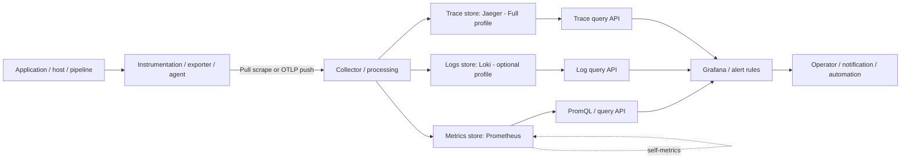

# Unit 1 — Production telemetry architecture and retention

> **Abstract.** This lesson teaches how to design an observable data/ML platform by starting with operational questions, selecting the least costly sufficient signals, tracing telemetry across its lifecycle, and making explicit decisions about retention, reliability, security, and recovery. The examples are synthetic and must be validated locally before adaptation to production.

| Metadata | Value |
|---|---|
| Module / Stage | M11 — Production Observability Stack and Performance Operations / Stage 2E |
| Target file | `11-Production-Observability-Stack-and-Performance-Operations/01-production-telemetry-architecture-and-retention.md` |
| Estimated time | 12–16 hours, excluding repeated measurements `[ASSUMPTION]` |
| Last reviewed | 2026-10-28; not a claim every version-sensitive item was tested |
| Tool baseline | No versions invented. Pin compatible releases and record them in `version-record.txt` before execution. |
| Core tools | Prometheus, Grafana, OpenTelemetry SDKs + Collector, Alertmanager |
| Working depth / awareness | Loki and Jaeger architecture/operations; Tempo awareness alternative |
| Profiles | Core; Core + Logs; Full — run sequentially, not together by default |
| Footprint | **Measure yours.** No universal laptop CPU/RAM/disk values are asserted. |
| Sources inspected | `Roadmap(20261028-155008).md`, `PROMPT-Production-Observability-Stack-and-Performance-Operations(1).md`, and the pasted Unit 1 prompt. Generated syllabus and sibling lesson bodies were not inspected. |

## Contents

- [Source discrepancies and assumptions](#source-discrepancies-and-assumptions)
- [1.0 Why this matters in production](#10-why-this-matters-in-production)
- [1.1 Learning objectives](#11-learning-objectives)
- [1.2 Concept map and vocabulary](#12-concept-map-and-vocabulary)
- [1.3 Level 1 — Beginner](#13-level-1--beginner)
- [1.4 Level 2 — Intermediate](#14-level-2--intermediate)
- [1.5 Level 3 — Advanced](#15-level-3--advanced)
- [1.6 Level 4 — Expert](#16-level-4--expert)
- [1.7 SRE lens](#17-sre-lens)
- [1.8 Security lens](#18-security-lens)
- [1.9 Production checklist](#19-production-checklist)
- [1.10 Hands-on lab set](#110-hands-on-lab-set)
- [1.11 Self-check questions](#111-self-check-questions)
- [1.12 Evidence artifacts](#112-evidence-artifacts)
- [1.13 Common interview and design-review questions](#113-common-interview-and-design-review-questions)
- [1.14 Sources and verification notes](#114-sources-and-verification-notes)
- [Appendix A — Telemetry linter](#appendix-a--telemetry-linter)
- [Appendix B — Measurement worksheets](#appendix-b--measurement-worksheets)
- [Appendix C — Failure and blind-spot analysis](#appendix-c--failure-and-blind-spot-analysis)
- [Appendix D — Claim Register](#appendix-d--claim-register)
- [Appendix E — Ten-pass audit and sign-off](#appendix-e--ten-pass-audit-and-sign-off)

## Source discrepancies and assumptions

1. The supplied roadmap lists the target at `11-Production-Observability-Stack-and-Performance-Operations/01-production-telemetry-architecture-and-retention.md`, alongside Units 2–13, practice questions, and two projects. The target path is confirmed in that tree.
2. The syllabus-generation prompt is present, but a separately generated syllabus and M10/M03–M17 sibling lesson bodies were not inspected. This lesson follows the pasted Unit 1 specification and does not claim to quote sibling lessons.
3. **[ASSUMPTION]** Docker Compose is the primary local substrate because it teaches the telemetry path without adding a Kubernetes control plane. If the learner's established lab is kind-only, translate the boundaries rather than running both full stacks.
4. **[ASSUMPTION]** Jaeger is the selected trace-backend concept per the syllabus prompt. Deployment mode, supported storage, ports, and retention must be verified for the chosen release. The Core sample below does not depend on Jaeger.
5. **[VERIFY]** Collector components/config, OTLP receiver exposure, Loki ingestion path, Jaeger architecture, exemplar support, semantic conventions, and release-specific settings require validation against the exact versions selected.
6. This is a **standalone artifact**. No repository checkout was edited and no repository diff is claimed.

---

## 1.0 Why this matters in production

Imagine an inference API starts timing out after a release. Traffic continues, latency rises, logs have no shared trace identifier, and the metrics store has already discarded the period needed to compare the release with the previous week. Engineers cannot distinguish a slow feature query from a queue backlog, host saturation, or telemetry loss. A well-designed architecture makes those questions answerable while bounding cost, sensitive-data exposure, and failure impact. Retention is not merely a storage flag: it is a commitment about which future investigations remain possible.

**Start with the operational question and decision, then choose signals and tools.** A green dashboard is not proof by itself. A healthy Collector does not prove the backend stored the data; a successful scrape does not prove application success; configured retention does not prove the right evidence is retained. Every stage needs an owner, a measurable contract, and a failure mode visible from a suitable independent path.

## 1.1 Learning objectives

1. **[L1]** Distinguish monitoring from observability and select signals for “Is it broken?”, “Where is it broken?”, and “Why is it broken?”.
2. **[L1]** Draw the telemetry lifecycle and explain the strengths and limits of metrics, logs, traces, profiles, change events, and business/data signals.
3. **[L2]** Select Core, Core + Logs, or Full without assuming a universal resource footprint.
4. **[L2]** Tie retention to investigation needs, SLO history, capacity trends, and audit evidence; estimate and measure storage growth with explicit assumptions.
5. **[L2]** Apply bounded labels and structured log fields without putting secrets, PII, or unbounded values in metric labels.
6. **[L3]** Compare cluster topologies, Collector agent/gateway patterns, buffering, retry, and sampling using failure domains, cost, and evidence-loss risk.
7. **[L3]** Inject a bounded synthetic condition and verify both telemetry response and continued application responsiveness.
8. **[L4]** Produce a blind-spot matrix, conformance checklist, and recovery/bootstrap plan that account for observability-stack failure.
9. **[L4]** Review telemetry changes using versioned config, tests, migration/rollback criteria, and a claim register.

## 1.2 Concept map and vocabulary

Observability is not one product; it is a property of a system plus instrumentation, collection, storage, queries, and operating practices. Monitoring encodes known questions in checks, dashboards, and alerts. Both are necessary: monitoring detects expected failure modes quickly; exploratory analysis helps explain unexpected behavior. Neither guarantees that the data is complete, truthful, retained, or safe.

| Term | Precise definition | Common misconception |
|---|---|---|
| Telemetry | Measurements and records emitted so system behavior can be inspected externally | Any log line is sufficient observability |
| Metric | Numeric measurement represented as samples over time, commonly partitioned by labels | Every request ID is a safe label |
| Time series | Samples for a metric identity and label set across time | More labels always improve diagnosis |
| Log | Discrete, ideally structured and timestamped event | Text logs are free |
| Trace | Connected spans describing timed work and causal relationships | Sampling guarantees every event is present |
| Span | Timed operation with attributes/status and possible parent-child relationships | Duration alone proves root cause |
| Profile | Statistical evidence about CPU/memory/call-stack use; profiling is awareness-only here | Profiles replace metrics and traces |
| Change event | Deployment, flag, configuration, schema, or model change with timestamp/identity | Temporal proximity proves causation |
| Business/data signal | Freshness, row count, pipeline completion, model version, or inference outcome | Healthy hosts imply correct data |
| Instrumentation | Code/component behavior that emits telemetry | Instrumentation equals collection |
| Collector | Pipeline component that receives, processes, and exports supported telemetry | Collector guarantees delivery |
| OTLP | OpenTelemetry Protocol for compatible telemetry transport | Every receiver/exporter supports every signal and mode |
| Resource attribute | Attribute identifying the emitting entity, such as service/deployment | All resource attributes should become metric labels |
| Cardinality | Number of distinct series identities or distinct field combinations | Cardinality matters only for bills |
| Retention | Duration data remains queryable/recoverable in a specific store | Deletion occurs exactly at the configured boundary |
| Resolution | Granularity of observations or aggregation detail | Long retention always means raw data forever |
| Sampling | Selecting a subset of observations, often traces | Sampling and retention are equivalent |
| Back-pressure | Downstream bottleneck causes buffering, blocking, or dropping | Retries eliminate capacity planning |
| Meta-monitoring | Monitoring collection, storage, query, and notification health | A monitor inside a failed cluster is independent |
| Event time | Time an event occurred according to the emitter | Ingestion time is the true event time |



**Diagram limitations:** this is a logical map, not a port-accurate deployment. It does not claim that a specific Collector release has a particular exporter or that a Jaeger deployment accepts a particular protocol. The Core sample below demonstrates Prometheus scraping a local service, not end-to-end traces or Loki ingestion. Record selected versions, supported receiver/exporter pairs, listen addresses, ports, persistence paths, and authentication before adding Full-profile components.

| Boundary | Failure/risk | Required proof | Typical control |
|---|---|---|---|
| App → instrumentation | Missing/expensive/sensitive attributes | Expected fields emitted safely | SDK conventions, bounded attributes, source redaction, timeouts |
| Instrumentation → collector | Receiver down, exporter blocks, queue fills | App remains responsive during failure | Bounded/non-blocking export, local network, drill |
| Collector → backend | Network failure, schema mismatch, queue overflow | Queue/retry/drop health visible | Version-verified config, canary, queue metrics |
| Backend → query API | Data absent, query slow, retention mismatch | Ingestion freshness and query evidence | Self-monitoring, retention tests, headroom |
| Query → dashboard/alert | Wrong query or missing data shown as healthy | Positive and absent-data tests | Versioned queries, fixtures, review |
| Alert → human | Notification fails or shares failed stack | Independent route works | External watcher, test notification, runbook |
| Retention/deletion | Evidence disappears or sensitive data persists | Policy and deletion behavior tested | Explicit policy, deletion test, audit evidence |

### Three operational questions

| Question | First useful evidence | Follow-up | Decision | Limitation |
|---|---|---|---|---|
| Is it broken? | Symptom metric, probe, freshness indicator | Alert evaluation and change event | Page, pause rollout, investigate | Missing telemetry can look like zero |
| Where is it broken? | Dependency/queue/latency metrics, trace waterfall | Logs and dependency topology | Narrow the failing hop/resource | Sampling or inconsistent names can hide a hop |
| Why is it broken? | Trace attributes, correlated logs, error detail, profile if needed | Deployment/config/model/data change record | Test a root-cause hypothesis | Correlation is not causation; timestamps skew; evidence may expire |

| Signal | Good at | Weak at | Cost/cardinality | Query/granularity | Retention considerations |
|---|---|---|---|---|---|
| Metrics | Rates, counts, latency distributions, saturation, trends | Per-event detail and unanticipated questions | Unique label combinations multiply series | Numeric time series at scrape/instrumentation cadence | Preserve raw or validated aggregates for incident/SLO questions; account for indexes/WAL/compaction |
| Logs | Errors, state transitions, detailed context | Cheap high-volume aggregation and causal timing by themselves | Bytes, event size, indexed labels, query scans | Event search/filter/aggregate | Different policies for debug, operational, and audit logs |
| Traces | Time spent across instrumented dependencies | Whole-population certainty when sampled | Span rate, attributes, sampling, retention | Span/trace query and waterfall | Sampling and retention jointly determine which incidents remain investigable |
| Profiles | CPU/memory hotspots | Business outcomes and exact event chronology | Workload/profiler-dependent overhead; measure | Statistical stack samples over a window | Retain for regression/capacity questions; awareness-only here |
| Change events | Release/flag/schema/model context | Internal execution or proof of causality | Usually low volume; preserve provenance | Timeline/filter by service/version/time | Retain through investigation window |
| Business/data signals | Freshness, row counts, pipeline completion | Host-level root cause | Keep dimensions bounded; run IDs belong in events/logs | Domain queries/reconciliation | Driven by data correctness and investigation horizon |

OpenTelemetry defines APIs/SDKs, semantic conventions, OTLP, and the Collector ecosystem. Vendor-neutral design intent does not mean every signal, SDK, processor, receiver, exporter, and destination has identical maturity. Signal stability and semantic-convention status are version-sensitive; check the selected release's official docs rather than relying on memory. Think in three layers: instrumentation (what is emitted), pipeline (how it is filtered/buffered/exported), and backend/query (what is stored and available). A vendor-neutral pipeline can still lose data, leak attributes, or incur high cost.

## 1.3 Level 1 — Beginner

### 1.3.1 Monitoring versus observability

Monitoring checks known conditions: request errors, scrape success, queue backlog, or whether a scheduled job finished before its deadline. Observability combines available signals to ask questions that were not fully anticipated when instrumentation was written. If latency rises only for a new model version while the feature store slows, an engineer can compare bounded service/version metrics, traces, logs, and a deployment event. The event gives context, not proof of causation.

Observability does not eliminate monitoring. Monitoring should detect known symptoms quickly; exploratory telemetry helps narrow unexpected causes. Both fail if telemetry is missing, misleading, insecure, or expired.

### 1.3.2 Pull versus push

**Pull:** Prometheus periodically contacts a scrape target and reads its metrics exposition. Scrape interval, target discovery, and reachability matter; short-lived jobs may finish between scrapes. Pull makes target status explicit but does not prove every scrape succeeded. Use M10 Unit 2 and M11 Unit 11 patterns for short-lived jobs rather than assuming they will be observed.

**Push:** OTLP commonly sends telemetry from SDKs/agents to a receiver. Push suits application telemetry and agent pipelines but introduces destination availability, queueing, retries, and back-pressure. A successful send attempt does not prove durable storage. Exact transport, ports, TLS/authentication, retry, and queue behavior depend on selected components and versions.

### 1.3.3 Core lab: smallest useful path

The synthetic service below exposes a Prometheus-compatible endpoint. It is a teaching fixture, not a replacement for the existing M08/M10 FastAPI service. It emits no request ID, user ID, raw URL, exception text, dataset ID, or model input as a metric label.

**Profile:** Core. **Substrate:** local Docker Compose. **Cloud access:** No. **Footprint:** measure yours before starting. Do not run Core + Logs and Full simultaneously by default. Config is illustrative, not certified executable; replace version placeholders only after checking official installation documentation.

```python
# File: app/app.py
from http.server import BaseHTTPRequestHandler, HTTPServer
from time import monotonic
STARTED = monotonic()

class Handler(BaseHTTPRequestHandler):
    def do_GET(self):
        if self.path == "/health":
            body = b'{"status":"ok"}\n'
            self.send_response(200)
            self.send_header("Content-Type", "application/json")
            self.send_header("Content-Length", str(len(body)))
            self.end_headers(); self.wfile.write(body); return
        if self.path == "/metrics":
            uptime = max(0, int(monotonic() - STARTED))
            body = ("# HELP demo_service_up Synthetic service health.\n"
                    "# TYPE demo_service_up gauge\n"
                    "demo_service_up 1\n"
                    "# HELP demo_service_uptime_seconds Process uptime in seconds.\n"
                    "# TYPE demo_service_uptime_seconds gauge\n"
                    f"demo_service_uptime_seconds {uptime}\n").encode()
            self.send_response(200)
            self.send_header("Content-Type", "text/plain; version=0.0.4; charset=utf-8")
            self.send_header("Content-Length", str(len(body)))
            self.end_headers(); self.wfile.write(body); return
        self.send_response(404); self.end_headers()
    def log_message(self, fmt, *args):
        return

if __name__ == "__main__":
    HTTPServer(("0.0.0.0", 8000), Handler).serve_forever()
```

```dockerfile
# File: app/Dockerfile
FROM python:3.12-slim
WORKDIR /app
COPY app.py /app/app.py
USER 10001:10001
EXPOSE 8000
CMD ["python", "/app/app.py"]
```

`python:3.12-slim` is an illustrative tag, not a verified current patch or production recommendation. Pin an approved digest for repeatability. This tiny HTTP server is not a production application server.

```yaml
# File: prometheus/prometheus.yml
global:
  scrape_interval: 15s
  evaluation_interval: 15s
scrape_configs:
  - job_name: prometheus
    static_configs:
      - targets: ["prometheus:9090"]
  - job_name: demo-service
    metrics_path: /metrics
    static_configs:
      - targets: ["demo-service:8000"]
```

```yaml
# File: alertmanager/alertmanager.yml
route:
  receiver: local-sink
  group_by: [alertname, job]
  group_wait: 10s
  group_interval: 1m
  repeat_interval: 4h
receivers:
  - name: local-sink
    # Intentionally no real notification integration.
```

**[VERIFY]** Validate the empty receiver with the selected Alertmanager binary/`amtool`; if rejected, use a supported local test receiver. Do not add a real webhook or third-party endpoint.

```yaml
# File: compose.yaml
services:
  demo-service:
    build: {context: ./app}
    expose: ["8000"]
    networks: [telemetry]
    restart: unless-stopped
  prometheus:
    image: prom/prometheus:<PINNED_VERSION>
    command:
      - --config.file=/etc/prometheus/prometheus.yml
      - --storage.tsdb.path=/prometheus
      - --storage.tsdb.retention.time=24h
      - --storage.tsdb.retention.size=512MB
    volumes:
      - ./prometheus/prometheus.yml:/etc/prometheus/prometheus.yml:ro
      - prometheus-data:/prometheus
    ports: ["127.0.0.1:9090:9090"]
    networks: [telemetry]
    depends_on: [demo-service]
    restart: unless-stopped
  grafana:
    image: grafana/grafana:<PINNED_VERSION>
    ports: ["127.0.0.1:3000:3000"]
    networks: [telemetry]
    depends_on: [prometheus]
    restart: unless-stopped
  alertmanager:
    image: prom/alertmanager:<PINNED_VERSION>
    command:
      - --config.file=/etc/alertmanager/alertmanager.yml
      - --storage.path=/alertmanager
    volumes:
      - ./alertmanager/alertmanager.yml:/etc/alertmanager/alertmanager.yml:ro
      - alertmanager-data:/alertmanager
    ports: ["127.0.0.1:9093:9093"]
    networks: [telemetry]
    restart: unless-stopped
networks:
  telemetry:
    internal: true
volumes:
  prometheus-data:
  alertmanager-data:
```

This is an **illustrative skeleton, not certified executable**: image tags are placeholders; Grafana needs a Prometheus data source before dashboards can query; Alertmanager schema must be validated; Docker/Compose `internal` network and port behavior must be checked locally. The host does not need direct access to the demo service, which is exposed only to the Compose network.

### Guided commands and target guard

Run only from a dedicated `observability-lab` directory. Do not use the repository root or a directory containing unrelated Compose projects.

```bash
# File: scripts/core-lab.sh
#!/usr/bin/env bash
set -euo pipefail
PROJECT="m11-telemetry-unit1"
[[ "$(basename "$PWD")" == "observability-lab" ]] || { echo "Refusing: wrong directory" >&2; exit 2; }
case "${1:-check}" in
  check) docker compose -p "$PROJECT" config --quiet; docker compose -p "$PROJECT" ps ;;
  up) echo "Measure host CPU/RAM/disk and inspect loopback bindings first."; docker compose -p "$PROJECT" up --build -d demo-service prometheus ;;
  down) docker compose -p "$PROJECT" down ;;
  *) echo "Usage: $0 {check|up|down}" >&2; exit 64 ;;
esac
```

Before `up`, measure headroom, inspect rendered config, verify project name, and verify every published port is loopback-only. The cleanup command does not delete volumes. Do not add volume deletion before exporting evidence and confirming exact volume names.

```bash
# Example only — not executed; values, IDs, and timings will differ.
chmod +x scripts/core-lab.sh
./scripts/core-lab.sh check
./scripts/core-lab.sh up
curl --fail http://127.0.0.1:9090/-/ready
curl --fail http://127.0.0.1:9090/api/v1/targets
curl --fail 'http://127.0.0.1:9090/api/v1/query?query=demo_service_up'
```

Expected behavior: Compose validation exits zero; the selected Prometheus release's readiness endpoint returns success; targets lists the demo service; the query contains the synthetic gauge after a scrape. These are acceptance expectations, **not observed output**. Verify endpoint support for the selected release. If a query fails, inspect target status and service logs; “container Up” is not proof of stored telemetry.

### What just happened?

1. The demo process exposes `demo_service_up 1` at `/metrics`.
2. Prometheus periodically pulls that endpoint using the service DNS name on the Compose network.
3. Prometheus parses and stores samples in its local TSDB. A series is identified by metric name plus label set; this fixture has no custom labels.
4. Querying `demo_service_up` proves a sample exists, not that a real inference request succeeded.
5. Grafana can query Prometheus once its data source is configured; panel correctness still depends on query and missing-data behavior.
6. Alertmanager groups/routes alert notifications; it is not the component that evaluates PromQL alert expressions.
7. This fixture has no real inference endpoint, logs, traces, queue, or database. Those are not implied by its health gauge.

| Beginner mistake | Symptom | Why misleading | Fix |
|---|---|---|---|
| Container is running, therefore monitoring works | No query data | Process health is not scrape health | Inspect target status and query |
| `localhost` used between containers | Connection failure | `localhost` means the current container | Use service DNS inside Compose |
| Request ID as metric label | Series count rises with traffic | Each ID creates a new identity | Put approved IDs in logs/traces, not labels |
| Missing series treated as zero | False green panel | Absence can be an outage | Test absence separately |
| One retention duration for all signals | Required history still missing | Backends/resolution differ | Define retention per question/signal |
| UTC assumed to eliminate clock skew | Events still appear out of order | Timezone is not synchronization | Standardize UTC and monitor clock quality |
| Raw exception/request payloads logged | Sensitive data leaks | Collection does not sanitize every sink | Redact at source and test canaries |
| Retry assumed to mean no loss | Evidence disappears during outage | Queues are finite; retries may expire | Verify queue/drop behavior for selected Collector |

## 1.4 Level 2 — Intermediate

### 1.4.1 Reference architecture and stack profiles

The synthetic data/ML platform includes: an inference API with RED/domain metrics and fault injection; a batch ETL job with run outcome, freshness, row counts and deadline; a queue worker with depth, oldest-message age and retries; PostgreSQL with connection/query/storage signals; and platform services such as ingress, CI runners, GitOps controllers, secrets backend and Kubernetes. Unique run IDs belong in approved event/log/lineage records, not as unbounded metric labels.

| Profile | Components | Labs | Stop before switching |
|---|---|---|---|
| **Core** | Prometheus, Alertmanager, Grafana, demo service and only required exporters | Pull/scrape, query, basic retention, conformance | Stop unneeded components; preserve only required evidence/volumes |
| **Core + Logs** | Core plus Loki and one validated local log pipeline | JSON schema, redaction, log volume/retention | Stop Loki and shipper before Full; verify no log process remains |
| **Full** | Core plus OTel Collector and selected Jaeger deployment | Trace path, correlation, Collector failure drill | Stop trace backend and Collector after evidence export |

Run profiles sequentially. Do not run Core + Logs and Full together by default on an 8 GB laptop. Measure host CPU/RAM/disk at baseline, startup, controlled workload, and shutdown. Footprints vary by OS, image, configuration, workload, and existing processes; this lesson does not promise a fit.

### 1.4.2 Signal-to-question matrix — 12 operational questions

| # | Question | First signal | Secondary signal | Decision/evidence | Avoid |
|---:|---|---|---|---|---|
| 1 | Are inference requests failing? | Request/error metrics and probe | Error logs, sampled failing traces | Roll back or investigate symptom | Container liveness only |
| 2 | Did latency worsen after a release? | Latency distribution by bounded version | Change event and trace spans | Compare cohorts/isolate hop | Average latency alone |
| 3 | Is feature fetch slow? | Dependency-duration metric | Trace span and sanitized query log | Identify slow boundary | Infinite debug logs of successful requests |
| 4 | Is the queue stuck? | Depth and oldest-message age | Worker logs/spans | Scale, pause producer, investigate worker | Depth without drain rate/age |
| 5 | Did ETL finish on time? | Freshness/deadline signal | Job event and run record | Recover or mark data stale | Assuming a CronJob object means data is fresh |
| 6 | Were expected rows processed? | Row-count/reconciliation signal | Run metadata and quality logs | Hold downstream publish | Run ID as metric label |
| 7 | Is host saturation the issue? | CPU/memory/disk metrics | Profile/process diagnostics | Add headroom or reduce work | Host average without workload context |
| 8 | Is the database causing timeouts? | Pool wait/query duration/connections | DB metrics and trace spans | Tune query/pool or protect dependency | PII in SQL logs |
| 9 | Did a flag/config change? | Change-event timeline | Before/after metrics and traces | Test causality against cohort | Treating proximity as proof |
| 10 | Is telemetry dropping data? | Queue/drop indicators and backend health | Independent canary | Reduce load/recover backend; document gap | Trusting Collector process status alone |
| 11 | Can a three-week-old regression be investigated? | Retained SLI/metric history | Logs/traces/change events in required horizon | Compare only available evidence | Assuming equal retention across signals |
| 12 | Did model/dataset version affect outcomes? | Bounded version dimension/change event | Data quality and inference outcomes | Compare cohorts safely | Unbounded IDs or sensitive inputs as labels |

This is a design matrix, not a universal alert-threshold table. M10 owns SLO policy and alert design; this module owns the collection, storage, query and operational implementation.

### 1.4.3 Retention: decide from questions backward

Retention is how long data remains queryable/recoverable in a given store. Resolution is how detailed the stored observations are. A validated aggregate can preserve a required calculation while discarding some raw detail, but only after the team proves it answers the intended question. Hot/warm/cold are conceptual tiers: recent data is quickly queryable; older data may be aggregated or stored more cheaply; archive evidence may need stronger access and immutability controls. Not every local backend supports every tier.

- **Incident forensics:** preserve the metrics, logs, traces, and change events needed to reconstruct the relevant incident window.
- **SLO history:** if a 28-day SLO uses historical SLI data, retain at least the history required by that calculation. Link to M10 Unit 1. Raw high-resolution samples do not universally need the same retention if validated aggregates preserve the exact calculation and required auditability.
- **Capacity trends:** keep appropriate resolution over the planning horizon; a few days of detailed data may not support monthly comparisons.
- **Data correctness:** freshness, run outcomes, row-count reconciliation and model/dataset version records can need different policies from debug logs.
- **Audit/compliance:** M08 Unit 13 owns the wider evidence handoff. Legal interpretation is outside scope; operational log retention is not automatically compliance retention.

Retention does not promise physical deletion at an exact instant. Backends may compact data, delete chunks asynchronously, retain WAL/index/marker files temporarily, or differ by local/object storage. Test the actual policy with synthetic data and prove query behavior and storage behavior.

### 1.4.4 Tool-specific retention notes

- **Prometheus local TSDB:** official docs describe `--storage.tsdb.retention.time` and `--storage.tsdb.retention.size`. Verify names, units, precedence, and compaction interactions for the chosen version. The size cap is not a substitute for disk headroom; compaction can temporarily require source and destination blocks to coexist.
- **Loki:** retention depends on schema/storage mode. The current official docs consulted describe Compactor-managed retention for supported modes and distinguish legacy paths. Verify schema, index period, `limits_config`, Compactor settings, deletion delay, marker-file persistence, and object-store lifecycle interaction. Do not transplant object-store examples into filesystem storage without verification.
- **Jaeger:** retention depends on deployment and storage backend. Verify exact architecture and storage-specific controls for the chosen version; do not treat an in-memory demo as durable storage.
- **Sampling vs retention:** sampling controls what is ingested; retention controls how long ingested data stays. Longer retention cannot recover a trace sampled away before storage.

### 1.4.5 Storage sizing worksheet

A rough metrics model is:

`data volume ≈ active series × samples/second/series × bytes/sample × retention seconds`

It is only a first-order model. It omits or approximates indexes, labels, WAL, head chunks, metadata, compaction, temporary files, replication, label length and query workload. Do not use a universal bytes-per-sample number as fact. Derive storage growth from the local workload, then state any headroom assumption.

**[ILLUSTRATIVE ONLY — NOT A CAPACITY PROMISE]** If a measurement found 2,000 active series, one sample per series every 15 seconds gives approximately 133 samples/second in aggregate before missed scrapes and series churn. If the measured directory grows by 18 MiB/hour, simple extrapolation gives 432 MiB/day before compaction/headroom. This is not a forecast until measured under a representative workload.

```bash
# Example only — local lab; exact names and paths must be checked.
docker compose -p m11-telemetry-unit1 ps
docker compose -p m11-telemetry-unit1 exec -T prometheus sh -lc 'du -sh /prometheus 2>/dev/null || true'
curl --fail --silent 'http://127.0.0.1:9090/api/v1/query?query=prometheus_tsdb_head_series'
```

`prometheus_tsdb_head_series` is a candidate metric name, not guaranteed for every release. Inspect `/metrics` and official docs before using it. Record raw output, UTC timestamp, workload conditions, and volume state. `du` covers only the specified path, not all Docker/host storage.

### 1.4.6 Naming and labels

Proposed bounded conventions: `service` (stable service slug), `env` (controlled `dev`/`test`/`prod`), `team` (approved slug), `tier` (approved platform/criticality tier), and `version` (only if bounded and operationally useful). Meanings and allowed values matter more than exact spelling. Prometheus labels define time-series identity; OTel resource attributes identify the emitter; logs carry structured fields; spans carry request-specific attributes subject to privacy and size limits. Do not mechanically copy every resource attribute into every metric label. Metric units and semantic-convention mappings are version-sensitive.

Never use request ID, trace ID, span ID, user ID, email, raw URL/path, arbitrary exception text, SQL parameters, row values, unbounded dataset/run IDs, secrets or PII as metric labels. Some may be useful in access-controlled, sanitized logs/traces, but only with an approved purpose. A linter catches known patterns; it cannot prove the absence of sensitive data.

### 1.4.7 Structured JSON log schema

```json
{
  "timestamp": "2026-10-28T12:00:00Z",
  "level": "INFO",
  "service": "batch-etl",
  "env": "test",
  "team": "data-platform",
  "trace_id": null,
  "span_id": null,
  "request_id": null,
  "event": "pipeline.completed",
  "message": "Synthetic pipeline run completed",
  "duration_ms": 184,
  "rows_written": 1200,
  "model_version": "model-v3"
}
```

Use UTC, controlled service/environment values, bounded numeric fields and safe correlation context. Run IDs may be recorded in an approved event/log/lineage record, not an unbounded metric label. Never emit secrets, authorization headers, credentials, raw request bodies, private model inputs, or PII. Redact at source, then apply pipeline controls as defense in depth. A Collector filter cannot retract data already written to stdout, another file, or a second sink.

### 1.4.8 Five-layer telemetry coverage matrix

| Layer | Example signals | Owner | Question | Blind spot |
|---|---|---|---|---|
| Infrastructure | CPU, memory, filesystem, network, process availability | Platform/infra | Is runtime constrained? | Host metrics may not attribute pressure to a service |
| Kubernetes | Restarts, desired/current replicas, scheduling, requests/limits, node condition | Cluster team | Is orchestration preventing workload operation? | `metrics-server` supports HPA/`kubectl top`; it is not retained monitoring storage (M03 Unit 6) |
| Platform services | Ingress latency/status, CI runner duration, GitOps reconciliation, secrets backend health | Each platform owner | Is a shared dependency degraded? | App-local health may stay green while shared dependency fails |
| Applications | RED metrics, bounded domain counters, logs, traces, release markers | Service owner | Is user-facing behavior broken and where? | Missing instrumentation/sampling hides rare cases |
| Data pipelines | Freshness, deadline, run outcome, row-count reconciliation, lineage events | Data product owner | Is data current and correct? | Infrastructure may be green while data is stale/wrong |

### 1.4.9 Patterns and anti-patterns

| Pattern | Use when | Do not use when |
|---|---|---|
| Start from operational question | Choosing any signal or panel | As an excuse to omit basic health signals |
| Bounded metric dimensions | Service, environment, team, controlled version cohort | Per-request/per-record identifiers |
| Structured logs with safe correlation IDs | Event-level detail and trace/log navigation | Fields include raw secrets/PII or unbounded indexed labels |
| Short local retention | Learning with limited disk | A production evidence requirement is not agreed |
| Independent health probe | Detecting telemetry-stack failure | Probe shares the same failure domain but is called independent without analysis |
| Sampled traces | Controlling volume while retaining useful cases | Sampling drops evidence needed for a mandatory rare-event investigation |
| Central gateway | Shared policy/routing/credentials | It becomes an unbounded bottleneck or sole failure domain |

| Anti-pattern | Cost/misleading result | Correction |
|---|---|---|
| Every URL/request ID is a metric label | Series explosion/query cost | Bounded route templates; IDs in sanitized logs/traces |
| One retention duration for every signal | Needed trace/log/metric history may be missing | Per-signal retention/resolution tied to questions |
| `up` means application success | Scrape success coexists with broken requests/data | Service and business signals plus absence tests |
| Queue assumed durable | In-memory queue lost on restart; finite queue overflows | Verify persistence/retry/drop semantics and monitor them |
| Dashboards only in UI | Unreviewable, hard to reproduce/rollback | Version dashboards/rules/config; M06/M08 handoff |
| Redact only in backend | Raw values already exist elsewhere | Redact at source and test every configured path |
| Retention limit set but not measured | Compaction/logs/traces still fill storage | Measure each backend and retain justified headroom |

For a before/after test, save initial target status, query result, container state and disk usage. Change only a lab fixture to create a known unhealthy condition; confirm the relevant signal changes, the scrape path remains interpretable and the host remains responsive. Restore health and prove recovery. Do not affect unrelated host services. Cleanup includes project state, active fault toggles, generators, silences and a volume inventory; `docker compose down` alone does not prove volumes/images are gone.

## 1.5 Level 3 — Advanced

### 1.5.1 Single-cluster versus multi-cluster

One local Prometheus is simple but couples visibility and storage to the host/cluster. A multi-cluster pattern runs Prometheus per cluster and federates selected series or remote-writes toward central storage. Local collection may continue during a WAN outage, but central history/querying then has network, capacity, consistency and failure-mode considerations. Thanos, Mimir and VictoriaMetrics are awareness options, not interchangeable implementations; multi-cluster build-out belongs to M14.

| Option | Benefit | Cost | Risk | Choose when |
|---|---|---|---|---|
| One local Prometheus | Simple, easy to learn | Limited failure separation/history | Host loss may remove the only copy | Laptop lab or small environment |
| Per-cluster + federation | Central summaries | Federation rules/query semantics | Aggregates may omit raw detail | Central summaries answer the question |
| Per-cluster + remote write | Central history and cross-cluster queries | Network, ingestion and central storage | Divergence/duplicates if poorly designed | Central retention is an explicit need |
| Long-term store/aggregation | Extends history/query architecture | More components and ownership | New failure and compatibility modes | One TSDB no longer meets measured requirements |

### 1.5.2 Collector agent versus gateway

An **agent** close to the workload (node agent or sidecar) receives/enriches local telemetry and forwards it. It can reduce app coupling to backends, but many agents consume resources and need outage policies. A **gateway** centralizes processing, routing and backend credentials; it simplifies policy but is a shared bottleneck/failure domain. Hybrid agent-to-gateway patterns add a network hop and another back-pressure boundary. Sidecar, DaemonSet and gateway deployment are not equivalent in resource footprint, identity, network exposure, isolation or upgrades.

### 1.5.3 Back-pressure, retries and delivery semantics

A pipeline has finite memory, disk, network and backend capacity. An unavailable destination may cause buffering, retries, blocking or drops depending on the component/config. Retries can amplify recovery load; queues fill; restarts can discard in-memory buffers; persistent queues can fail when disks fill; sampling/filtering intentionally removes data. At-most-once/at-least-once are trade-offs, not blanket end-to-end guarantees. Do not promise exactly-once unless every stage's semantics are proven and tested.

**Telemetry must not take down the app it observes.** Controls include bounded queues, timeouts, asynchronous/non-blocking export where supported, payload limits, memory caps and explicit drop behavior. Synchronous exporters can block request handling when the backend is down; an overly lossy policy can preserve latency while silently destroying evidence. Test the chosen trade-off. Official OTel Collector resiliency documentation describes sending queues, retries and data-loss cases when queues fill, retry limits expire, or only in-memory buffers exist. Defaults and schemas remain version-sensitive.

### 1.5.4 Sampling and aggregation overview

- **Head sampling** decides early, often before an error or slow tail is known; it is simple but may discard the trace needed later.
- **Tail sampling** decides after seeing more of the trace; it can retain slow/error traces but needs buffering/coordination and changes memory/capacity requirements.
- **Metrics aggregation** can reduce raw detail only if it preserves the mathematical property and question.
- **Log-level filtering** reduces volume but can remove the only detail about a rare failure.

Detailed logs are Unit 4, Collector/trace pipelines Unit 5, trace analysis Unit 10, and cost/cardinality engineering Unit 12.

### 1.5.5 Security architecture

`/metrics`, debug endpoints, `pprof`, Collector diagnostics and backend admin APIs can reveal internal topology or sensitive fields. Do not expose them publicly by default. Use least privilege, network restrictions, TLS/mTLS where appropriate and authenticated query access. Exact controls depend on platform/version; M04 owns network policy/ingress, M09 secrets, and M12 security telemetry. Loki's `X-Scope-OrgID` is associated with tenant context in applicable multi-tenant deployments, but enabled mode and semantics must be verified. A label/header alone is not an authorization boundary.

### 1.5.6 Cost and capacity

- **Metrics:** active series, sample rate, label churn/length, retention, compaction headroom, query concurrency, recording rules and replication.
- **Logs:** bytes/second, event size, indexed labels, query scans, retention, compression and deletion behavior.
- **Traces:** spans/second, attributes, sampling, retention, query patterns and replication.
- **Platform:** ingestion spikes, retry/replay, queue saturation, backend restarts, query bursts and competing laptop workloads.

Measure before/during a controlled workload and record conditions. A laptop measurement is not a production capacity promise. Unit 12 owns technical cost/cardinality; M15 owns the financial model. No prices are needed here.

### 1.5.7 Verification method

1. Record baseline `demo_service_up` and target health.
2. Change only the lab fixture to emit a known unhealthy state.
3. Verify the relevant query changes and scrape health remains interpretable.
4. Confirm the service stays responsive and record host resource use.
5. Restore the fixture, verify recovery and stop the lab.

Capture UTC timestamps for fault start, signal change, query visibility and recovery. These are local measurements, not universal guarantees.

### 1.5.8 Architecture defense

Defend a local design using Prometheus local TSDB; short retention selected from measured disk; sequential Loki/trace profiles; independent watcher; bounded metric dimensions; and unique run/trace IDs outside metric labels. For each choice state assumptions, alternatives, benefits, costs, failure modes and evidence that would change the choice. Compose proves basic wiring, not production IAM, multi-node resilience, managed quotas, HA or real-traffic capacity.

## 1.6 Level 4 — Expert

### 1.6.1 Governance and service maturity

A telemetry standard defines service/environment naming, units, allowed labels, structured log fields, UTC convention, correlation keys, redaction policy, dashboard/alert ownership, runbook, retention class, exceptions and expiry/review date. A service onboarding checklist requires owner/runbook; stable identity; expected request/error/latency or workload-specific metrics; absent-data test; safe structured logs; justified trace instrumentation; versioned dashboards/rules; retention decision; conformance results; telemetry budget; and an independent detection path for critical failures.

| Maturity | Evidence |
|---|---|
| 0 — Uninstrumented | No agreed owner or reliable signals |
| 1 — Basic | Health metrics/logs exist, but naming and absence behavior are inconsistent |
| 2 — Standardized | Required labels/schema, dashboards/rules, runbook and conformance tests |
| 3 — Correlated | Metrics/logs/traces/change events share compatible identities and are tested |
| 4 — Operated | Retention, budgets, drills, independent meta-monitoring, migration and recovery are reviewed |

This is a teaching rubric, not an external standard. A conformance audit can inspect `/metrics`, bounded labels, JSON logs, target status, and required artifacts, but cannot prove that every path is free of PII. Combine static checks, runtime synthetic tests, and human review.

### 1.6.2 Capacity governance and multi-tenancy

Per-team budgets can cover active series, log bytes, spans, query concurrency, retention class and exceptions. Rate limits/quotas protect shared backends. Showback/chargeback belongs to M15. `team="analytics"` helps attribution but does not enforce isolation: multi-tenancy requires trusted identity, query authorization, ingestion validation, quotas and negative cross-tenant tests.

### 1.6.3 Disaster recovery and bootstrap

Distinguish versioned configuration, recent local telemetry state, long-term data, Alertmanager silences/state, and the independent watcher. Exact persistence/recovery depends on deployment/version. Suggested bootstrap order: (1) establish trusted host/network/access; (2) restore approved identity/secrets via M09; (3) deploy minimum monitoring and independent watcher; (4) restore and validate versioned config; (5) restore backend state with the documented procedure for the exact storage mode; (6) query synthetic canaries and check completeness; (7) restore dashboards/rules/routing and test notifications; (8) reconnect workloads gradually while watching queues/disk/query latency; (9) record the earliest recoverable timestamp and evidence gap. If the only alert route depends on the failed cluster, the recovery plan is circular.

### 1.6.4 Migration and semantic-convention evolution

For vendor-to-OSS or backend migrations, define parity period and rollback trigger. Dual-write reveals differences but increases volume and may duplicate data. Dual-read requires equivalent query semantics, labels, units, retention and sampling. Validate known queries, synthetic canaries, alert evaluation and missing-data behavior; document history not migrated. Treat OTel conventions as versioned schema: retain representative fixtures, run query compatibility tests, stage changes and remove compatibility fields only after a bounded migration window.

### 1.6.5 Required expert failure scenarios

Each case follows **symptom → hypotheses → tests → possible root cause → fix → prevention**. Root causes are hypotheses, not claims about real incidents.

**A. Prometheus OOM-killed during the incident.** Symptom: gaps/restarts during peak. Hypotheses: cardinality spike, query burst, ingestion increase, disk/memory pressure or compaction. Tests: exit status, host memory timeline, active series and scrape-target changes, recent label changes, disk and query history. Possible root cause: request ID became a label. Fix: remove it, use bounded dimensions, restore measured headroom and preserve evidence outside the failed instance. Prevent with cardinality review, series-growth alerts, staged rollout and independent watcher.

**B. Retention too short for a three-week-old regression.** Symptom: current samples exist but historical comparison fails. Hypotheses: time retention too short, size cap evicted history, data never ingested, wrong store, or aggregates unavailable. Test runtime flags/config, old-time query, cleanup logs, storage growth and series existence. Possible root cause: a small disk cap was mistaken for a three-week history commitment. Fix policy from measured capacity and investigation needs; restore only if a real backup exists. Prevent with retention ADR and periodic historical-query tests.

**C. Collector queue overflow drops traces.** Symptom: app works but trace coverage falls during backend outage. Hypotheses: endpoint unavailable, retry expiry, queue full, memory pressure, malformed spans or backend rejection. Test version-verified queue/drop metrics, exporter logs, endpoint response and bounded outage drill. Possible cause: in-memory queue fills. Fix queue/retry/persistence based on measured span rate and tolerated outage; protect app latency and alert on drops. Prevent with failure drills and explicit loss policy. Exact component names/metrics remain `[VERIFY]`.

**D. Metrics and logs have inconsistent service names.** Symptom: metric is `inference-api`, logs use `inference_service`, links fail. Test raw metric labels, JSON logs, span resource attributes and instrumentation config for one synthetic request. Possible cause: separately maintained defaults. Fix canonical identity and a bounded compatibility migration. Prevent shared schema/template and cross-signal identity test.

**E. Debug endpoint exposes sensitive metric labels.** Symptom: raw paths, exception text or user input appears. Test the lab endpoint with synthetic sentinel, inspect labels and access controls. Possible cause: unbounded route parameter used as label. Fix bounded route template, source redaction and endpoint restriction; rotate exposed credentials if any were real. Prevent negative fixtures, code review and endpoint inventory. A linter does not prove all sinks clean.

**F. Monitoring exists only in the failed cluster.** Symptom: outage removes dashboards, alert evaluation and notification route. Test controlled local stop, independent watcher, external config source and restore plan. Possible cause: monitoring treated as app add-on. Fix version config outside cluster and add an independent watcher/notification path. Prevent recovery drills and failure-mode matrix.

**G. Semantic-convention change empties dashboards.** Symptom: panel goes blank after SDK upgrade while traffic continues. Compare before/after telemetry fixtures and actual attributes; test queries/rules and release notes. Possible cause: query relies on renamed field. Fix schema versioning, compatibility mapping and staged rollout. Prevent schema/query compatibility tests and a defined removal deadline.

### 1.6.6 Edge cases and review rubric

- **WSL2 vs native Linux:** Docker integration, memory reporting, filesystem and network behavior can differ. Record host OS and filesystem location.
- **Compose vs kind:** Compose simplifies initial mechanism; kind adds Kubernetes DNS, kubelet/cAdvisor, discovery and cluster failure modes. Do not run both full stacks together on the constrained laptop.
- **Managed vs self-hosted:** managed systems do not remove instrumentation, data hygiene, query correctness or access control. Local emulation does not prove managed IAM, quotas, billing or regional failure behavior.
- **Version drift:** record exact versions and validate schemas; do not treat placeholders as a tested bill of materials.

Score each category 0–4 (0 absent/unsafe; 1 asserted only; 2 partial; 3 tested; 4 tested, owned and failure-reviewed): question-to-signal mapping; correlation; retention; data safety; reliability; meta-monitoring; governance; recovery/migration. **[ASSUMPTION]** Suggested sign-off is at least 24/32 with no zero in safety, reliability or independent monitoring; this is a teaching rubric, not an industry standard.

## 1.7 SRE lens

### 1.7.1 Platform indicators

M10 owns SLO math, burn-rate design, severity and incident process. M11 applies those ideas to the telemetry platform. Candidate SLIs include scrape success over expected scrapes; ingestion freshness/lag; query latency/availability; alert-evaluation delay; notification delivery success; data completeness measured with synthetic canaries; and representative dashboard query/load health. Exact metric names are version-dependent: inspect the selected exposition and official docs. Define numerator/denominator and missing-data behavior rather than relying on a vague green panel.

### 1.7.2 Failure blast radius

| Failure | Blindness/delay | Secondary/independent signal |
|---|---|---|
| App instrumentation | App signals absent/incomplete | Probe and business freshness monitor |
| Prometheus scrape path | Samples stale/missing | Target status and external canary |
| Prometheus storage | Queries fail/history lost | Host disk/process watcher and backup evidence |
| Collector | OTLP stops, buffers or drops | App export errors plus external receiver/canary |
| Loki | Logs unavailable | Log canary/backend health via metric path |
| Trace backend | Trace query empty | Collector export health and synthetic trace query |
| Grafana | UI unavailable; direct API may remain | External HTTP probe/direct backend query |
| Alertmanager/route | Alerts not delivered | Independent test notification |
| Host/cluster | Several components fail together | Watcher outside that host/cluster |
| Clock source | Correlation/order degrades | Independent time-sync/clock-offset check |

### 1.7.3 Runbook: telemetry data missing

1. **Triage:** record UTC time, profile, target/service, last known-good sample, and app responsiveness. Avoid restarting everything before preserving evidence.
2. **Scope:** inspect target status, scrape errors, Collector/backend health, queue/drop signals, disk and recent changes. Identify whether data is missing at source, transit, storage or only query/dashboard.
3. **Mitigate:** stop synthetic generator/fault; reduce optional telemetry; restore local backend; protect app latency. Do not blindly increase queue sizes without memory/disk checks.
4. **Verify:** emit a synthetic canary, query it, check timestamps/labels and record the earliest recovered timestamp.
5. **Follow up:** document data loss, root cause, policy fix and a prevention test; record independent-watcher behavior if the primary alert path failed.

### 1.7.4 Capacity notes

Measure host CPU/RAM/disk before, during and after each profile. Record active series, sample rate, log bytes, spans, queue depth, query load and restarts where available. `docker stats`, `du`, host tools and backend metrics each provide only partial views. Use Appendix B; do not turn one laptop observation into a production capacity promise.

## 1.8 Security lens

| Threat | Control | Verification evidence | Limitation |
|---|---|---|---|
| Secrets/PII in logs/spans | Source redaction, attribute allowlist, pipeline defense-in-depth | Synthetic sentinel across every sink | Untested paths may still leak |
| High-cardinality labels | Schema, bounded values, linter, series-growth review | Negative fixture rejected; series count recorded | Linter only knows its rules |
| Exposed `/metrics`/debug endpoint | Loopback/private binding, authentication/network restriction | Listener inventory and negative connection test | Production network may differ |
| Over-privileged exporter/Collector | Narrow read-only identity | Permission review and access-denied test | Does not prove credentials never leaked |
| Tampered dashboards/rules | Version control, protected review, CI validation | Commit/review/validation evidence | Valid syntax does not prove semantic correctness |
| Log injection | Structured serialization and controlled fields | Synthetic newline/control-character fixture | Renderers may differ |
| Endpoint/data-source abuse | Endpoint allowlist; no arbitrary URL inputs | Config review and negative target test | Full SSRF resistance needs platform review |
| Exposed admin APIs | Loopback lab binding; production auth/network boundary | Listener and auth tests | Trusted-user/host compromise remains possible |
| Cross-tenant access | Trusted identity, authZ, quotas, negative tests | Cross-tenant denial evidence | Labels alone are not isolation |
| Evidence leak | Synthetic data, scrub screenshots/output/config/state | Artifact scan and human review | No scanner detects every secret |

Before sharing evidence, inspect screenshots, metrics, logs, spans, traces, environment output, Compose rendering, config, crash dumps and volumes for credentials, tokens, private keys, authorization headers, PII, raw inputs, internal endpoints and sensitive labels. Use synthetic sentinel strings, then remove or quarantine them. Source redaction is primary because a pipeline filter cannot retract data already written to stdout or another sink.

## 1.9 Production checklist

- [ ] Architecture identifies sources, instrumentation, collection, storage, queries, visualization/alerts, owners and trust boundaries.
- [ ] Operational question and decision are written before adding a signal.
- [ ] Metric dimensions are bounded; negative request-ID/raw-path fixture fails.
- [ ] Logs use UTC and canonical service/environment identity.
- [ ] Supported cross-signal correlation is tested; unsupported links remain open.
- [ ] Missing data is tested separately from zero.
- [ ] Pull scrape and push/export health are measured separately.
- [ ] Prometheus retention flags verified against selected binary.
- [ ] Loki retention verified for selected schema/storage before enabling deletion.
- [ ] Jaeger deployment/storage/retention verified before Full profile.
- [ ] Host/volume use measured for each profile.
- [ ] 28-day SLO history strategy aligns with M10 and validated aggregation.
- [ ] Lab admin/debug endpoints are not publicly bound.
- [ ] Synthetic redaction tests cover known unsafe fields in tested paths.
- [ ] Backend outage drill is bounded and tests app responsiveness and data-loss signals.
- [ ] Independent watcher exists or its absence is explicitly documented.
- [ ] Config, dashboards and rules are versioned and validated.
- [ ] Recovery/bootstrap order and earliest recoverable data point are documented.
- [ ] Cleanup verifies no generator, fault, container or test silence remains.
- [ ] Evidence is synthetic and scrubbed.

## 1.10 Hands-on lab set

All labs are local-only, synthetic-data-only, and begin with a profile/footprint check. No cloud services, paid SaaS, production endpoints or third-party targets. Stop if host becomes unstable. All sample outputs are expected behavior, not observed results.

### Lab 1 — Core reference architecture and conformance

| Field | Requirement |
|---|---|
| ID / goal | M11-U1-LAB-01 — prove metric path from service to Prometheus query |
| Profile / substrate | Core; local Compose; no cloud |
| Time / footprint | 60–90 min `[ASSUMPTION]`; measure yours |
| Prerequisites | §1.3.3 files, Docker/Compose, selected versions recorded |
| Target guard | Dedicated `observability-lab`; project `m11-telemetry-unit1`; loopback-only published ports; inspect rendered config |
| Steps | Validate Compose, start demo + Prometheus, query readiness/targets/`demo_service_up`, save UTC timestamp/output |
| Evidence | Rendered config, version record, target status, query JSON, `docker stats`, `du` |
| Failure injection / abort | Toggle only synthetic fixture; abort on public port, unrelated target, unsafe host pressure or failed guard |
| Cleanup / verify | Stop named project, no volume deletion by default; inspect `compose ps -a`, generators, fault toggle and volume inventory |
| Stretch | Add versioned dashboard provisioning after Unit 3 |

```bash
# Example only — not executed.
set -euo pipefail
PROJECT="m11-telemetry-unit1"
[[ "$(basename "$PWD")" == "observability-lab" ]] || exit 2
docker compose -p "$PROJECT" config --quiet
docker compose -p "$PROJECT" up --build -d demo-service prometheus
curl --fail --silent http://127.0.0.1:9090/-/ready
curl --fail --silent 'http://127.0.0.1:9090/api/v1/query?query=demo_service_up'
docker compose -p "$PROJECT" ps
```

Expected: config validates, readiness succeeds for the selected release, and query returns the gauge after a scrape. If absent, inspect target health. No output above was captured in this authoring session.

### Lab 2 — Signal-to-question exercise

| Field | Requirement |
|---|---|
| ID / goal | M11-U1-LAB-02 — complete the 12-question matrix in §1.4.2 with rationale |
| Profile / substrate | Core for metric questions; conceptual-only for logs/traces unless sequential profile is measured; local files, no cloud |
| Time / footprint | 45–75 min `[ASSUMPTION]`; measure only if starting a profile |
| Target guard | Fictional scenarios only; no production incident/customer data |
| Steps | For each question record signal, query shape, decision, retention, owner, blind spot and absence test; peer-review choices |
| Evidence | Completed 12-row matrix and unresolved assumptions |
| Failure/abort | Remove a signal or introduce inconsistent names in worksheet; replace any need for real data with synthetic scenario |
| Cleanup/verify | Stop any started profile; confirm no lab containers/generators active and no real data in worksheet |
| Stretch | Add evidence-loss comparison for sampling/filtering/aggregation/retention |

### Lab 3 — Telemetry standard and linter

| Field | Requirement |
|---|---|
| ID / goal | M11-U1-LAB-03 — positive/negative tests for metric labels and JSON logs |
| Profile / substrate | Core for `/metrics`; local Python standard library; no cloud |
| Time / footprint | 90–120 min `[ASSUMPTION]`; measure if backend started |
| Target guard | Synthetic fixtures; no arbitrary target URLs; never use real secrets/PII |
| Steps | Run Appendix A tests against valid and planted-invalid fixtures; verify non-zero exit for violations |
| Evidence | Linter, fixtures, test output, documented limits |
| Failure/abort | Plant synthetic request ID label and fake secret sentinel; abort if real data or external endpoint is involved |
| Cleanup/verify | Quarantine/remove negative fixture from publishable evidence; no background process remains |
| Stretch | Add CI job with same tests |

### Lab 4 — Retention/storage measurement

| Field | Requirement |
|---|---|
| ID / goal | M11-U1-LAB-04 — measure sample rate/disk growth and justify retention |
| Profile / substrate | Core only; local Compose volume; no cloud |
| Time / footprint | 60–90 min plus observation window `[ASSUMPTION]`; measure yours |
| Target guard | Confirm project/container/volume; no deletion before evidence export and identity check |
| Steps | Record baseline, active series/sample rate, bounded synthetic workload, `du` at defined intervals, measured growth and assumptions |
| Evidence | Completed Appendix B worksheet with real values/timestamps |
| Failure/abort | Test short retention only if enough time; otherwise label it conceptual. Stop on disk pressure/unexpected growth |
| Cleanup/verify | Stop named project, preserve volume until reviewed, record remaining volumes |
| Stretch | Compare raw history with validated aggregation without assuming equivalence |

### Lab 5 — Pipeline failure, blind spots and DR

| Field | Requirement |
|---|---|
| ID / goal | M11-U1-LAB-05 — determine loss boundaries, protect app responsiveness and plan independent recovery |
| Profile / substrate | Core for simple outage simulation; Full only after Collector + Jaeger config is version-validated; local only |
| Time / footprint | 90–150 min `[ASSUMPTION]`; measure yours; stop Core before adding Full components |
| Target guard | Confirm project and endpoint; loopback/Compose DNS only; no third-party destination |
| Steps | Record baseline canary; stop only lab backend; send small bounded synthetic sample; check app responsiveness/queue/drop signals; restore backend and document data gap |
| Evidence | Failure timeline, app-health evidence, backend/Collector output, blind-spot matrix and recovery result |
| Failure/abort | **⚠ FAULT-INJECTION:** stop only named backend for a short bounded interval; abort by stopping generator and restarting backend. Stop on hanging app, unsafe host pressure or failed guard |
| Cleanup/verify | Stop generator first, restore backend, verify service health, stop Full profile and remove fault/silence; confirm no active process remains |
| Stretch | Rehearse DR bootstrap with version-controlled config and synthetic fixtures |

Collector buffering/retry/drop behavior is `[VERIFY]` until tested against the chosen version/config. If Full is not run, report the drill as conceptual simulation, not a runtime test.

## 1.11 Self-check questions

1. **Target is healthy, requests fail: is the service healthy?** No; scrape success proves metrics endpoint reachability, not application success. “`up` is 1” confuses the two.
2. **Why not use request IDs as metric labels?** They create high-cardinality series. Correlation matters, but IDs belong in safe logs/traces rather than metric identity.
3. **What must a 28-day SLO retain?** The required SLI history, raw or validated aggregates preserving the calculation. Not every raw signal universally needs identical retention.
4. **Does OTLP push guarantee delivery?** No; receiver availability, retries, queues and backend acceptance matter. Push/pull describes initiation, not durability.
5. **Sampling versus retention?** Sampling selects observations; retention controls how long stored data remains. Sampling can remove evidence before storage.
6. **Does UTC eliminate clock skew?** No; UTC removes timezone ambiguity, not clock drift. Measure sync and distinguish event from ingestion time.
7. **Does Collector redaction prove no PII exposure?** No; source/alternate sinks may already have the value. Source redaction is primary.
8. **Why is a monitor inside the cluster not fully independent?** Cluster failure may remove monitor and alert route. A separate pod is not a separate failure domain.
9. **What does a rising Collector queue indicate?** Unsent data is accumulating; inspect destination, throughput, retry, capacity and drop behavior. A finite queue does not guarantee preservation.
10. **Dashboard breaks after SDK upgrade: first action?** Compare actual emitted schema and version changes, test query compatibility, then migrate/rollback. Rewriting the panel without checking instrumentation can hide the regression.

## 1.12 Evidence artifacts

Save synthetic-only artifacts: `architecture.md`; architecture ADR; 12-question signal matrix; `telemetry-standard.md`; linter source and positive/negative fixtures; sanitized `metrics.txt`; synthetic JSONL; retention worksheet; Core/Core+Logs/Full measurement record (unrun profiles marked “not measured”); five-layer coverage matrix; blind-spot matrix; failure-drill timeline; DR/bootstrap plan; exact version/documentation record; cleanup/volume inventory; Claim Register and audit report. Never include raw backend state, environment dumps, credentials, private keys, customer data or unredacted screenshots.

## 1.13 Common interview and design-review questions

**1. How choose a stack for an 8 GB laptop and evolve it for production?** Start with Core and measure before adding logs/traces. Run profiles sequentially. Production design must revisit topology, retention, failure domains, identity, durable storage, query load and independent monitoring using measured workload evidence. Laptop wiring does not prove production capacity or HA.

**2. How defend retention?** List investigations and decisions, then define horizon/resolution per signal/backend. A 28-day SLO needs its required SLI history, raw or validated aggregate. Separate audit evidence from debug logs, test deletion semantics and measure storage/compaction headroom. Do not choose a default without a question.

**3. How correlate safely?** Canonical service/environment identity, compatible semantic fields, bounded metric labels, safe request context in logs/spans, UTC and clock monitoring. Test a synthetic request end-to-end. Exemplars require version/backend support verification. Correlation supports a hypothesis; it does not prove causation.

**4. How design for observability-stack failure?** Monitor ingestion freshness, scrape success, queues/drops, disk, query and notification health; version config; document restore order; keep a watcher outside the main failure domain. Drill an outage and record the data gap.

**5. Balance signal quality and cost?** Choose the least costly signal that answers the decision while preserving rare-incident evidence. Use bounded metric dimensions, structured logs and trace sampling with explicit loss analysis. Measure series, bytes, spans, query load and storage growth; exceptions need an owner and expiry.

## 1.14 Sources and verification notes

### Official sources actually consulted

1. Prometheus — Configuration: https://prometheus.io/docs/prometheus/latest/configuration/configuration/ — flags/config files and runtime configuration concepts. Exact flags must be checked against selected binary.
2. Prometheus — Storage: https://prometheus.io/docs/prometheus/latest/storage/ — local TSDB retention and compaction; temporary disk use can exceed a retention-size target during compaction.
3. OpenTelemetry — Collector resiliency: https://opentelemetry.io/docs/collector/resiliency/ — queues, retries, persistent storage concepts and data-loss scenarios. Defaults remain version-sensitive.
4. OpenTelemetry — Versioning and stability: https://opentelemetry.io/docs/specs/otel/versioning-and-stability/ — signal lifecycle/stability model; exact release must be checked.
5. Grafana Loki — Log retention: https://grafana.com/docs/loki/latest/operations/storage/retention/ — Compactor retention and deletion behavior for supported schema/storage modes.

| Claim to verify | Action | Status |
|---|---|---|
| Prometheus retention flags/precedence | Selected `prometheus --help` + official docs | Docs consulted; release not pinned/executed `[VERIFY]` |
| TSDB metric names | Inspect selected `/metrics` and query actual names | Candidate `prometheus_tsdb_head_series` not assumed universal `[VERIFY]` |
| Readiness/targets/query endpoints | Test selected release's documented endpoints | Not executed `[VERIFY]` |
| Grafana provisioning/data source | Validate selected release and query Prometheus | Skeleton does not provision data source `[VERIFY]` |
| Empty Alertmanager receiver | Validate with selected `amtool`/binary | Not executed `[VERIFY]` |
| OTel stability/semantic conventions | Check selected SDK/convention release notes | Version-sensitive `[VERIFY]` |
| Collector components/queues/retries/storage | Validate binary config and run outage drill | Full pipeline not executed `[VERIFY]` |
| Loki schema/retention/filesystem support | Match release, schema and storage mode; test synthetic deletion | No executable Loki config `[VERIFY]` |
| Jaeger architecture/storage/retention | Consult official Jaeger docs for chosen release | Not verified here `[VERIFY]` |
| OTLP to Loki/Jaeger and exemplars | Test exact SDK, Collector, backend and Grafana combination | Architecture-only `[VERIFY]` |
| Compose `internal` network and loopback binding | Validate rendered config and inspect listeners locally | Illustrative `[VERIFY]` |
| Resource footprint | Measure each sequential profile | Not measured; values blank |

**Handoffs:** M10 defines what to measure/alert on; M11 implements collection, storage, query, correlation and operations. Do not re-teach SLO math, burn-rate derivations, severity/roles or postmortems. M03/M04/M05/M06/M08/M09 provide Kubernetes metrics, network controls, DB signals, packaging/GitOps and secrets hygiene. M12 security telemetry, M13 backup/DR, M14 multi-cluster, M15 financial model and M16 golden paths remain handoffs. M11 Units 2–13 own detailed PromQL, dashboards, Loki, Collector/traces, routing, correlation, actionable alerts, saturation, trace analysis, freshness, cardinality/cost and load testing.

---

## Appendix A — Telemetry standard and conformance linter

This dependency-free linter is deliberately narrow. It checks known high-cardinality metric label names and required fields in synthetic JSON logs. It is not a complete Prometheus parser, secret scanner, or data-loss prevention product.

### A.1 Standard

```text
# File: telemetry-standard.md
Allowed bounded dimensions when applicable: service, env, team, tier, version
Controlled env values: dev | test | prod
Forbidden metric label names: request_id, trace_id, span_id, user_id, email, raw_url,
path, exception, exception_message, sql, query, dataset_id, run_id, token,
authorization, password, secret, api_key
Required JSON log fields: timestamp, level, service, env, event, message
Timestamp convention: UTC ISO-8601 ending in Z
Never emit credentials, private keys, authorization headers, raw customer inputs,
PII, raw SQL parameters, or unbounded request-specific values as metric labels.
```

### A.2 Implementation

```python
# File: linter/telemetry_lint.py
from __future__ import annotations
import json
import re
import sys
from datetime import datetime
from pathlib import Path
from typing import Any

FORBIDDEN = {"request_id", "trace_id", "span_id", "user_id", "email", "raw_url",
 "path", "exception", "exception_message", "sql", "query", "dataset_id", "run_id",
 "token", "authorization", "password", "secret", "api_key"}
REQUIRED = {"timestamp", "level", "service", "env", "event", "message"}
SLUG = re.compile(r"^[a-z][a-z0-9-]{0,62}$")
LABEL_BLOCK = re.compile(r"\{([^}]*)\}")
LABEL_NAME = re.compile(r"(?:^|,)\s*([a-zA-Z_][a-zA-Z0-9_]*)\s*=")


def fail(message: str) -> None:
    print(f"FAIL: {message}", file=sys.stderr)
    raise SystemExit(1)


def lint_metrics(path: Path) -> None:
    for n, raw in enumerate(path.read_text(encoding="utf-8").splitlines(), 1):
        line = raw.strip()
        if not line or line.startswith("#"):
            continue
        # Narrow syntax check; not a full exposition parser.
        for block in LABEL_BLOCK.findall(line):
            for name in LABEL_NAME.findall(block):
                if name.lower() in FORBIDDEN:
                    fail(f"{path}:{n}: forbidden metric label {name!r}")


def lint_logs(path: Path) -> None:
    for n, raw in enumerate(path.read_text(encoding="utf-8").splitlines(), 1):
        if not raw.strip():
            continue
        try:
            obj: Any = json.loads(raw)
        except json.JSONDecodeError as exc:
            fail(f"{path}:{n}: invalid JSON: {exc.msg}")
        if not isinstance(obj, dict):
            fail(f"{path}:{n}: log event must be a JSON object")
        missing = REQUIRED - obj.keys()
        if missing:
            fail(f"{path}:{n}: missing fields {sorted(missing)}")
        ts = obj.get("timestamp")
        if not isinstance(ts, str) or not ts.endswith("Z"):
            fail(f"{path}:{n}: timestamp must end in Z (UTC convention)")
        try:
            datetime.fromisoformat(ts[:-1] + "+00:00")
        except ValueError:
            fail(f"{path}:{n}: invalid timestamp")
        for key in ("service", "env"):
            if not isinstance(obj.get(key), str) or not SLUG.fullmatch(obj[key]):
                fail(f"{path}:{n}: {key} must be a bounded lowercase slug")
        bad = {str(k).lower() for k in obj} & FORBIDDEN
        if bad:
            fail(f"{path}:{n}: forbidden fields {sorted(bad)}")
        for key in obj:
            if any(word in str(key).lower() for word in ("password", "secret", "token", "authorization", "api_key")):
                fail(f"{path}:{n}: suspicious field name {key!r}")


def main() -> int:
    if len(sys.argv) != 3:
        print("Usage: python telemetry_lint.py METRICS_FILE JSONL_FILE", file=sys.stderr)
        return 64
    metrics, logs = map(Path, sys.argv[1:])
    for target in (metrics, logs):
        if not target.is_file():
            fail(f"input file does not exist: {target}")
    lint_metrics(metrics)
    lint_logs(logs)
    print("PASS: narrow telemetry contract checks passed")
    return 0

if __name__ == "__main__":
    raise SystemExit(main())
```

### A.3 Fixtures

```text
# File: fixtures/metrics-valid.txt
# HELP demo_service_up Synthetic service health.
# TYPE demo_service_up gauge
demo_service_up{service="inference-api",env="test",team="data-platform"} 1
```

```text
# File: fixtures/metrics-invalid.txt
# Synthetic negative fixture only
demo_requests_total{service="inference-api",request_id="synthetic-123"} 1
```

```json
{"timestamp":"2026-10-28T12:00:00Z","level":"INFO","service":"batch-etl","env":"test","event":"pipeline.completed","message":"Synthetic pipeline completed","rows_written":1200}
```

```json
{"timestamp":"2026-10-28T12:00:00Z","level":"INFO","service":"batch-etl","env":"test","event":"pipeline.completed","message":"Synthetic event","api_key":"SYNTHETIC-NOT-A-REAL-SECRET"}
```

Save the JSON lines as `fixtures/logs-valid.jsonl` and `fixtures/logs-invalid.jsonl`. The second contains a synthetic sentinel and must not be published as real evidence.

### A.4 Tests

```python
# File: linter/test_telemetry_lint.py
import subprocess
import sys
import unittest
from pathlib import Path
HERE = Path(__file__).resolve().parent
FIXTURES = HERE.parent / "fixtures"
LINTER = HERE / "telemetry_lint.py"

def run_linter(metrics: str, logs: str) -> subprocess.CompletedProcess[str]:
    return subprocess.run([sys.executable, str(LINTER), str(FIXTURES / metrics),
        str(FIXTURES / logs)], capture_output=True, text=True, check=False)

class TelemetryLintTests(unittest.TestCase):
    def test_valid(self) -> None:
        result = run_linter("metrics-valid.txt", "logs-valid.jsonl")
        self.assertEqual(result.returncode, 0, result.stderr)
    def test_unbounded_label(self) -> None:
        result = run_linter("metrics-invalid.txt", "logs-valid.jsonl")
        self.assertNotEqual(result.returncode, 0)
        self.assertIn("request_id", result.stderr)
    def test_unsafe_field(self) -> None:
        result = run_linter("metrics-valid.txt", "logs-invalid.jsonl")
        self.assertNotEqual(result.returncode, 0)
        self.assertIn("api_key", result.stderr)

if __name__ == "__main__":
    unittest.main()
```

```bash
# Example only — tests not executed in this authoring session.
python -m unittest discover -s linter -v
python linter/telemetry_lint.py fixtures/metrics-valid.txt fixtures/logs-valid.jsonl
```

Expected: valid fixtures pass; request-ID label and unsafe log-field tests fail with non-zero status; valid invocation prints a pass line. This is not observed output. The linter does not parse all Prometheus syntax, scan binary telemetry, inspect every field value, or prove every sink is safe.

### A.5 Target guard

Prefer file-only linting over fetching arbitrary URLs. If HTTP fetching is added, allowlist scheme/hostname/port and reject external targets before any request. Test a loopback target and a planted external hostname. Never turn a telemetry validator into a generic URL fetcher.

## Appendix B — Measurement worksheets

### B.1 Profile measurements — leave blank until measured

| Profile | Host OS / Docker version | Baseline CPU/RAM/disk | After start | During bounded workload | After stop | Remaining containers/volumes | Result |
|---|---|---|---|---|---|---|---|
| Core |  |  |  |  |  |  | Not measured |
| Core + Logs |  |  |  |  |  |  | Not measured |
| Full |  |  |  |  |  |  | Not measured |

### B.2 Storage worksheet — leave blank until measured

| Field | Value | Unit/method | Caveat |
|---|---|---|---|
| Start/end UTC timestamps |  | UTC |  |
| Active series start/end |  | Selected TSDB metric/API | Verify metric name/version |
| Scrape interval |  | Seconds | Record effective config |
| Observed sample rate |  | Samples/s | Account for failed scrapes and churn |
| TSDB size start/end |  | `du`, bytes/MiB | Record exact path; compaction/WAL matter |
| Log bytes emitted |  | Bytes/interval | Only if Core + Logs run |
| Spans emitted/stored |  | Count/interval | Only if Full run; record sampling |
| Observed growth |  | Bytes/hour | Derive from measured window |
| Extrapolation horizon |  | Hours/days | Estimate, not guarantee |
| Headroom method |  | Documented assumption | No unsupported universal percentage |
| Retention decision |  | Per signal | Tie to future questions |

**[ILLUSTRATIVE ONLY — NOT MEASURED]** A measured growth rate of 18 MiB/hour extrapolates arithmetically to 432 MiB/day. This is not a production forecast: label churn, bursts, compaction, WAL, queries and cleanup change growth. Actual learner measurements remain blank until recorded.

### B.3 Fault timing record

| Event | UTC timestamp | Evidence source | Notes |
|---|---|---|---|
| Baseline healthy |  |  |  |
| Fault started |  |  |  |
| First signal changed |  |  |  |
| Query reflected condition |  |  |  |
| Backend restored |  |  |  |
| First new event queryable |  |  |  |
| Last confirmed data gap |  |  |  |
| Cleanup complete |  |  |  |

## Appendix C — Failure and blind-spot analysis

### C.1 Failure-mode × signal matrix

| Component/failure | Expected symptom | Detection signal | Horizon | Owner | Independent path | Evidence |
|---|---|---|---|---|---|---|
| Inference API unavailable | Probe/request success falls | Probe + request metrics | Measure | Service owner | External synthetic check |  |
| App emits no metrics | Target missing/stale | Scrape health + canary | Measure | Service/platform | External canary |  |
| Prometheus down | Queries fail/history stops | Host/process check | Measure | Telemetry platform | Independent watcher |  |
| TSDB disk fills | Writes/history degrade | Host disk + backend health | Measure | Telemetry platform | Host watcher |  |
| Collector destination down | Queue/retries/drops | Version-verified Collector signals | Measure | Telemetry platform | External receiver/canary |  |
| Loki unavailable | Logs unavailable | Log canary/backend health | Measure | Telemetry platform | Metric/probe path |  |
| Trace backend down | Trace query empty | Export health + synthetic trace | Measure | Telemetry platform | Metric/probe path |  |
| Grafana down | UI unavailable | HTTP probe | Measure | Telemetry platform | Direct backend query |  |
| Alert route broken | Notification absent | Test notification | Measure | On-call/platform | Independent route |  |
| Clock skew | Event ordering/correlation fails | Time-sync health | Measure | Host/platform | Independent clock check |  |
| Schema drift | Query/link empty | Fixture compatibility test | CI/release | Service/platform | Versioned fixture |  |
| Retention too short | Historical query unavailable | Historical query canary | Scheduled | Data/telemetry owner | Policy audit |  |
| Redaction failure | Synthetic sentinel in sink | Canary scan | CI/runtime | Service/security | Artifact review |  |
| Cluster lost | Monitoring disappears | External watcher | Measure | Platform/SRE | Outside-cluster path |  |

### C.2 Review prompts

For each component ask: What detects its failure? Does that signal depend on the failing component? How is missing data distinguished from zero? How long can failure remain invisible? What data is lost before detection? Who responds? Does the drill test the selected version/config or only describe it? Is evidence safe to retain/share?

### C.3 DR bootstrap plan template

- Scope/failure assumption:
- What survives outside failed cluster:
- Configuration source of truth:
- Identity/secrets dependency (M09):
- Independent watcher/notification path:
- Backend state restore method:
- Versions and compatibility:
- Bootstrap order:
- Synthetic canary/query completeness check:
- Dashboard/rule/notification validation:
- Earliest recoverable timestamp:
- Known evidence gap:
- Rollback/abort condition:
- Owner and next drill date:

## Appendix D — Claim Register

Confidence concerns the general claim, not proof a local configuration ran. `[VERIFY]` means exact release/configuration or runtime behavior still needs checking.

| ID | Claim | Source | Confidence | Tag/status |
|---|---|---|---|---|
| C01 | Monitoring encodes known questions; observability supports exploration | Unit 1 prompt L1 | High | Source-derived; covered |
| C02 | Monitoring and observability complement each other | Unit 1 prompt L1 | High | Source-derived; covered |
| C03 | Metrics are numeric time series; logs are discrete events | Unit 1 prompt L1 | High | Source-derived; covered |
| C04 | Traces describe request-scoped timing across instrumented services | Unit 1 prompt L1 | High | Source-derived; runtime not demonstrated |
| C05 | Continuous profiling is awareness-only | Unit 1 prompt L1 | High | Scope preserved |
| C06 | Change events add context but do not prove causation | Signal model | High | Interpretation; covered |
| C07 | Business/data signals detect stale/wrong data despite healthy hosts | Prompt domain flavor | High | Source-derived; conceptual |
| C08 | Metrics fit aggregate rates/counts/distributions/saturation | Signal model | High | Interpretation; service-specific |
| C09 | Logs give event detail but volume/query costs need control | Prompt signals/cost | High | Source-derived |
| C10 | Traces help locate time spent across instrumented dependencies | Prompt signals | High | Source-derived; conceptual |
| C11 | No signal answers every operational question | Prompt signal selection | High | Source-derived |
| C12 | Lifecycle is instrument → collect → process → store → query → visualize/alert → archive/delete | Prompt L1 | High | Source-derived; diagram included |
| C13 | Lifecycle stages have trust/failure/ownership boundaries | Prompt L1/L3 | High | Interpretation; matrix included |
| C14 | Prometheus uses pull scraping | Prompt L1; Prometheus docs | High | Docs consulted; runtime not run |
| C15 | Scrape intervals can miss short-lived jobs | Prompt L1 | High | Source-derived; details deferred |
| C16 | OTLP commonly pushes telemetry to a receiver | Prompt L1 | High | Conceptual; exact transport `[VERIFY]` |
| C17 | Push does not guarantee durable end-to-end delivery | OTel resiliency docs | High | Official source; runtime not run |
| C18 | Grafana is query/visualization layer in reference architecture | Prompt L1 | High | Source-derived; datasource not provisioned |
| C19 | Alertmanager routes/groups notifications; rules evaluate elsewhere | Architecture knowledge/prompt | High | Verify selected integration; no notification delivered |
| C20 | Observability stack must monitor itself | Prompt principles | High | Source-derived; watcher not implemented |
| C21 | `service.name`, trace/span IDs and consistent names aid correlation | Prompt L1 | High | Runtime cross-signal test open |
| C22 | Exemplars can link metrics to traces in compatible systems | Prompt `[VERIFY]` | Medium | Verify SDK/storage/Grafana/backend |
| C23 | UTC reduces timezone ambiguity, not clock skew | Prompt time-sync topic | High | Source-derived |
| C24 | Event time and ingestion time can differ | Prompt time-sync topic | High | Source-derived |
| C25 | OTel includes APIs/SDKs, conventions, Collector and OTLP | Prompt L1 | High | Official stability docs consulted |
| C26 | Vendor neutrality does not imply identical maturity/features | Prompt L1 | High | Source-derived; release maturity not enumerated |
| C27 | Signal stability is version-sensitive | OTel stability docs | High | Exact release must be checked |
| C28 | Core/Core+Logs/Full should run sequentially on constrained laptop | Prompt constraints | High | Footprints not measured |
| C29 | Compose selected as primary substrate | Engineering choice | Medium | `[ASSUMPTION]`; validate local setup |
| C30 | Jaeger is selected trace-backend concept | Prompt tool decision | High | Deployment mode not verified |
| C31 | Tempo is awareness alternative | Prompt tool decision | High | No Tempo lab |
| C32 | Retention period differs from resolution/downsampling | Prompt L2 | High | Covered |
| C33 | Retention follows incident/SLO/capacity/audit questions | Prompt L2 | High | Decision method provided |
| C34 | 28-day SLO needs required SLI history | Prompt L2 | High | Raw high-resolution retention not universal |
| C35 | Validated aggregates can preserve some SLI calculations | Interpretation | Medium | Validate calculation/audit requirements |
| C36 | Prometheus has time and size retention flags | Prometheus storage docs | High | Exact binary not tested |
| C37 | Compaction may temporarily exceed retention-size target | Prometheus storage docs | High | Check selected release |
| C38 | Loki Compactor retention applies to supported storage modes | Loki retention docs | High | Schema/storage compatibility matters |
| C39 | Loki deletion can be asynchronous and use markers | Loki retention docs | High | Deployment not tested |
| C40 | Loki retention and object lifecycle can conflict | Loki docs | High | No object store configured |
| C41 | Jaeger retention depends on deployment/storage | Prompt requires verify | High | `[VERIFY]`; Jaeger docs not consulted here |
| C42 | Series × sample rate × bytes/sample × duration is rough sizing | Prompt L2 | Medium | Approximation; derive bytes from measurement |
| C43 | `du` measures only specified path | Tool semantics | High | Record exact path |
| C44 | `prometheus_tsdb_head_series` is candidate metric | Candidate name | Medium | `[VERIFY]`; inspect `/metrics` |
| C45 | Metric labels should be bounded | Prompt cardinality/security | High | Linter only checks narrow denylist |
| C46 | Resource attributes, metric labels, log fields and span attributes differ | Prompt L2 | High | Covered |
| C47 | Unit/convention mapping is version-sensitive | Prompt `[VERIFY]` | High | Verify selected SDK |
| C48 | Structured logs should include UTC time, level, service, event/message and correlation where available | Prompt L2 | High | Synthetic schema provided |
| C49 | Request/trace IDs should not be metric labels | Prompt rules | High | Negative fixture included; not executed |
| C50 | Source redaction precedes pipeline defense-in-depth | Prompt security | High | Covered; sinks not scanned |
| C51 | Collector redaction cannot retract source/alternate-sink exposure | Prompt L2 | High | Covered |
| C52 | Five layers are infra, Kubernetes, platform, app, data pipelines | Prompt L2 | High | Matrix included |
| C53 | metrics-server supports HPA/`kubectl top`, not retained TSDB monitoring | Prompt M03 handoff | High | No runtime lab |
| C54 | Per-cluster Prometheus plus federation/remote write are patterns | Prompt L3 | High | No multi-cluster build |
| C55 | Thanos/Mimir/VictoriaMetrics are awareness alternatives with trade-offs | Prompt L3 | High | No runtime comparison |
| C56 | Prometheus HA pairs can create duplicate-data considerations | Prompt L3 | High | Architecture only |
| C57 | Alertmanager HA/gossip is version-sensitive | Prompt L3 | High | `[VERIFY]`; no HA config |
| C58 | Agent/gateway Collector patterns trade locality vs centralization | Prompt L3 | High | Architecture only |
| C59 | Collector queues/retries do not guarantee no loss | OTel resiliency docs | High | Selected config not run |
| C60 | In-memory queue data may be lost on restart | OTel resiliency docs | High | Verify exact storage config |
| C61 | Persistent queues still depend on disk and retry/queue limits | OTel resiliency docs | High | No persistent queue configured |
| C62 | Do not assume end-to-end exactly-once delivery | Prompt L3 | High | Covered |
| C63 | Telemetry must not take down observed app | Prompt principles | High | Drill specified, not run |
| C64 | Head/tail sampling have different evidence/capacity trade-offs | Prompt L3 | High | Details deferred to Unit 10 |
| C65 | Aggregation, sampling and log filtering differ | Prompt L2/L3 | High | Covered |
| C66 | Metrics/debug/pprof can expose sensitive operational data | Prompt security | High | Endpoint audit not run |
| C67 | Loki `X-Scope-OrgID` depends on tenant mode | Prompt `[VERIFY]` | Medium | Exact mode unverified |
| C68 | Labels alone are not a security boundary | Prompt L4 | High | Covered |
| C69 | Series, log bytes, spans, retention, queries and replication drive capacity/cost | Prompt L3 | High | No prices/figures asserted |
| C70 | Unit 12 owns technical cost; M15 financial model | Prompt handoff | High | Preserved |
| C71 | Golden path/service catalog belongs to M16 | Prompt handoff | High | Forward reference only |
| C72 | Audit logs may need different retention/integrity than debug logs | Prompt L3 | High | Legal interpretation excluded |
| C73 | Independent meta-monitoring avoids circular dependency | Prompt L3 | High | Runtime watcher not implemented |
| C74 | Per-team series/log/trace budgets support governance | Prompt L4 | High | No numeric budgets invented |
| C75 | Multi-tenant isolation requires authorization, not labels | Prompt L4 | High | No tenant implementation |
| C76 | DR bootstrap should restore monitoring before workload reconnection | Prompt L4 | High | Plan provided, not rehearsed |
| C77 | Recovery of data/silences/state depends on version/deployment | Prompt L4 | High | `[VERIFY]`; no restore drill |
| C78 | Dual-write/read aids parity but increases complexity/volume | Prompt L4 | High | No migration run |
| C79 | Semantic-convention changes can break queries/links | Prompt L4 | High | Compatibility tests recommended |
| C80 | WSL2/native Linux can differ in resource/network measurements | Platform interpretation | Medium | Record environment |
| C81 | Compose lab does not prove Kubernetes/managed-service fidelity | Prompt safety | High | Explicit limitation |
| C82 | Core Compose skeleton is not certified executable | Artifact status | High | Placeholders; not run |
| C83 | Demo emits two synthetic gauges | Code inspection | High | Python not executed here |
| C84 | Demo is not a real inference/log/trace/queue/database service | Code scope | High | Explicitly disclosed |
| C85 | Empty Alertmanager receiver may fail validation | Schema uncertainty | Medium | `[VERIFY]`; use selected `amtool` |
| C86 | Grafana requires configured data source for queries | Architecture | High | Provisioning deferred to Unit 3 |
| C87 | Linter is a narrow denylist/schema check | Appendix A | High | Tests supplied, not run |
| C88 | Linter cannot prove all PII/secrets absent | Security limitation | High | Explicitly disclosed |
| C89 | Loopback/internal network reduces lab exposure | Compose design | Medium | `[VERIFY]`; inspect actual listeners |
| C90 | Local fault drill can measure local detection/recovery | Lab method | High | Not run; no timings reported |
| C91 | Local drill does not prove production failure-domain behavior | Prompt fidelity | High | Explicitly disclosed |
| C92 | Retention worksheet separates measured growth from extrapolation | Prompt sizing | High | Blank form provided |
| C93 | Laptop footprint is not universal | Prompt constraints | High | No measurements claimed |
| C94 | No prices are required for this technical model | Prompt numbers policy | High | No prices included |
| C95 | Local emulator does not prove cloud IAM/network/quota/billing | Prompt safety | High | Explicitly disclosed |
| C96 | Generated syllabus/sibling lessons were not inspected | Authoring record | High | Disclosed in source notes |
| C97 | Roadmap confirms target path and neighbors | Supplied roadmap | High | Tree inspected |
| C98 | Artifact not written into repository checkout | Delivery method | High | Standalone file |
| C99 | Lab commands/tests not executed | Execution record | High | Static review only |
| C100 | No repository diff run | Execution record | High | No repo-change claim |
| C101 | Prometheus configuration page consulted | Official docs | High | URL included |
| C102 | Prometheus storage page consulted | Official docs | High | URL included |
| C103 | OTel resiliency page consulted | Official docs | High | URL included |
| C104 | OTel stability page consulted | Official docs | High | URL included |
| C105 | Loki retention page consulted | Official docs | High | URL included |
| C106 | Jaeger official docs not consulted in this session | Authoring record | High | `[VERIFY]` remains open |
| C107 | Compose uses placeholders, not invented versions | Config | High | Pin before use |
| C108 | Compose omits Collector/Loki/Jaeger services | Config | High | Core skeleton only; later units own them |
| C109 | Diagram is logical, not port-accurate | Diagram note | High | Ports deferred to selected versions |
| C110 | Health gauge does not prove inference correctness | Demo scope | High | Explained |
| C111 | Deployment marker does not prove causality | Signal semantics | High | Explained |
| C112 | UTC does not synchronize clocks | Time-sync concept | High | Explained |
| C113 | Queues can fill and cause loss | OTel docs | High | Exact component settings require test |
| C114 | Sampling may remove evidence before retention | Prompt L3 | High | Explained |
| C115 | Retention may not mean immediate physical deletion | Prometheus/Loki docs | High | Backend/version dependent |
| C116 | Config/dashboard/rules as code improve reviewability | Prompt governance | High | Full implementation in later units |
| C117 | Target guard should reject arbitrary external endpoints | Prompt safety | High | File-only linter avoids networking by default |
| C118 | Cleanup should preserve evidence and avoid unguarded volume deletion | Prompt lab safety | High | Cleanup procedure provided |
| C119 | Stop heavy components between profiles | Prompt resource constraints | High | Profile plan included |
| C120 | Do not run Logs and Full together by default on 8 GB | Prompt requirement | High | Repeated in profile/labs |
| C121 | Matrix covers 12 required operational questions | Prompt lab requirement | High | Matrix included |
| C122 | Five-layer matrix includes owner and blind spot | Prompt requirement | High | Included |
| C123 | Seven required failure scenarios are analyzed | Prompt L4 | High | Scenarios A–G included |
| C124 | Governance/migration checklist and sign-off evidence required | Prompt L4 | High | Covered in checklists/audit |
| C125 | Score threshold is a teaching assumption | Authoring choice | High | Marked `[ASSUMPTION]` |
| C126 | Diagram does not claim exact ports | Diagram note | High | Exact ports version-dependent |
| C127 | Collector-to-Loki export not verified here | Prompt `[VERIFY]` | High | Unit 4/5 implementation required |
| C128 | Jaeger and Tempo are not interchangeable by name alone | Prompt tool classification | High | Scoped selection; no comparison run |
| C129 | metrics-server is not retained TSDB monitoring | Prompt M03 handoff | High | Explained |
| C130 | Compose down does not prove volumes deleted | Cleanup semantics | High | Inventory required |
| C131 | One local measurement is not production forecast | Prompt numbers policy | High | Repeatedly stated |
| C132 | Sizing model omits indexes/WAL/compaction unless measured | Prompt L2 | High | Explained |
| C133 | High-cardinality fields may be useful in safe logs/traces | Interpretation | Medium | Access/privacy policy required |
| C134 | Positive and negative linter fixtures are needed | Prompt testing | High | Supplied; tests not run |
| C135 | Synthetic sentinel must not be published as real evidence | Security rule | High | Explicitly stated |
| C136 | Independent monitoring should cross relevant failure domain | Prompt meta-monitoring | High | Matrix/DR plan included |
| C137 | Multi-cluster aggregation belongs to M14 | Prompt handoff | High | Forward reference only |
| C138 | Unit 12 cost controls; M15 financial model | Prompt handoff | High | Preserved |
| C139 | Golden-path catalog belongs to M16 | Prompt handoff | High | Forward reference only |
| C140 | Detailed PromQL/scraping belongs to Unit 2 | Prompt boundary | High | Only basic query shown |
| C141 | Dashboards belong to Unit 3 | Prompt boundary | High | Data-source setup deferred |
| C142 | Log pipeline belongs to Unit 4 | Prompt boundary | High | No Loki config here |
| C143 | Collector/trace pipeline belongs to Unit 5 | Prompt boundary | High | Full path not implemented |
| C144 | Alertmanager routing belongs to Unit 6 | Prompt boundary | High | Basic concept only |
| C145 | Cross-service correlation belongs to Unit 7 | Prompt boundary | High | Fundamentals only |
| C146 | Actionable alerts belong to Unit 8 | Prompt boundary | High | No deep alert design |
| C147 | Saturation belongs to Unit 9 | Prompt boundary | High | Forward reference |
| C148 | Trace analysis belongs to Unit 10 | Prompt boundary | High | Not fully taught |
| C149 | Freshness/deadline monitoring belongs to Unit 11 | Prompt boundary | High | Signal concept only |
| C150 | Cardinality/cost engineering belongs to Unit 12 | Prompt boundary | High | Foundations only |
| C151 | Load/stress/soak belongs to Unit 13 | Prompt boundary | High | Bounded verification only |
| C152 | Prompt requires ten-pass audit and adversarial review | Pasted prompt §§16–17 | High | Static audit below |
| C153 | Static review cannot certify runtime compatibility | Engineering principle | High | Explicitly disclosed |
| C154 | Regex metric check is not a full Prometheus parser | Linter source | High | Limitation stated |
| C155 | JSON denylist cannot detect every secret/PII | Linter source | High | Limitation stated |
| C156 | Migration needs compatibility tests and rollback conditions | Prompt L4 | High | Covered |
| C157 | Audit and debug retention may differ | Prompt L3 | High | Legal advice excluded |
| C158 | Queue/retry should match tolerated outage and resources | OTel docs + interpretation | High | Exact settings untested |
| C159 | Curriculum lists OTel Collector as Core tooling while minimal Core sample omits it for sequencing | Prompt tool map/profile distinction | High | Explicit scope compromise; Collector remains core to module overall |
| C160 | Exact target path appears in supplied roadmap tree | Roadmap subtree | High | Verified from supplied tree |

This register is substantive, not exhaustive of every sentence/config line. It distinguishes source requirements from interpretation and records unresolved execution claims.

## Appendix E — Ten-pass audit and sign-off

### E.1 Ten-pass static audit report

| Pass | Result | Defects found | Fixes applied | Residual risk |
|---|---|---|---|---|
| 1 Completeness | FIXED / OPEN | Unit 1 sections/topics/labs/matrices/linter/retention/failure drill/evidence included; full Logs/Full stack config intentionally not included | Scope and later-unit handoffs made explicit | This is Unit 1, not entire M11; Full/Logs execution belongs to later units |
| 2 Source fidelity | PASS for inspected sources | Generated syllabus and sibling lessons not inspected | Used pasted Unit 1 prompt and supplied roadmap; disclosed gap | No claim of cross-sibling alignment |
| 3 Technical accuracy | OPEN | Prometheus/Loki/OTel docs consulted; Jaeger/Grafana/Alertmanager/Compose schemas not all checked | Version-sensitive items and actions listed | Exact schemas may differ |
| 4 Executability/consistency | OPEN | Version placeholders, Alertmanager receiver validation, Grafana data source and full-stack services remain untested | Service names/ports/profile boundaries described; gaps disclosed | Do not run unchanged before pinning/validation |
| 5 Currency | OPEN | No fixed version set; Jaeger details not checked | Consulted official docs cited; verification table included | User must pin/check versions |
| 6 Security/safety | FIXED / OPEN | Public bindings, arbitrary targets, unsafe labels and destructive cleanup considered; no live security test | Loopback bindings, synthetic fixtures, guards, abort/cleanup guidance | Linter narrow; production security not proved |
| 7 Fabrication scan | PASS with limitations | Example arithmetic/rubric could be misread as measured | Tagged illustrative/assumption; no footprint/test claims | Preserve labels when copying |
| 8 Pedagogy/cross-artifact | PASS for stated scope | Full M11 and siblings unavailable | M10/M11/M12–M17 boundaries stated | Sibling wording could differ |
| 9 Adversarial review | FIXED / OPEN | Loss/leak/overload/false-health modes reviewed below | Scenarios, blind-spot matrix, redaction and DR templates included | Runtime behavior untested |
| 10 Lab feasibility/scope | OPEN | Heavy stack cannot be assumed to fit; Logs/Full services absent here | Sequential profiles, “measure yours”, local-only targets, abort/cleanup stated | Complete later-unit implementation and measurements required |

### E.2 Adversarial review

| # | Failure/misleading result | Cause | Mitigation/evidence | Status |
|---:|---|---|---|---|
| 1 | Prometheus OOM during incident | Cardinality/query/ingestion spike | Bounded labels, series trend, independent host metrics | Runtime open |
| 2 | Old history unavailable | Retention/size cap wrong for investigation | Historical query test and retention decision | Worksheet provided; runtime open |
| 3 | Collector drops traces | Queue full, retry expiry, restart | Queue/drop telemetry and bounded outage drill | Full drill open |
| 4 | Correlation fails | Inconsistent names/timestamps/attributes | Canonical schema and cross-signal test | Partial linter only |
| 5 | Sensitive value leaks | Unsafe source fields or alternate sink | Source redaction, sentinel test every sink | Full-path scan open |
| 6 | Monitoring vanishes with cluster | Same failure domain for monitoring/alerts | Independent watcher and recovery drill | Plan only |
| 7 | SDK upgrade empties dashboard | Attribute/schema drift | Fixtures and query compatibility tests | Not run |
| 8 | Missing data looks green | Empty query treated as zero | Explicit absence and freshness tests | Dashboard deferred to Unit 3 |
| 9 | Retry recovery overloads backend | Backlog replay plus live traffic | Bounded retries, staged recovery, saturation monitoring | Full-stack test open |
| 10 | Cleanup deletes unrelated data | Wrong Compose project/unguarded volume removal | Working-directory/project guard, inventory, no volume deletion by default | Validate paths locally |
| 11 | Local lab secure, production endpoint exposed | Different ingress/network topology | Listener inventory and platform security review | Production review deferred |
| 12 | Retention data persists unexpectedly | Async compaction, schema/storage mismatch | Synthetic deletion test and storage inspection | Loki test open |
| 13 | Retention deletes incident evidence | Disk cap used without question-based policy | Owner-approved horizon and history canary | Runtime open |
| 14 | Laptop result used as capacity forecast | Different OS/workload/failure domains | Record environment and repeat representative tests | Limitation explicit |
| 15 | Tenant label mistaken for isolation | No authorization enforcement | Trusted identity and negative cross-tenant test | No tenant implementation |
| 16 | Alertmanager config fails to load | Empty receiver schema varies | Validate with selected binary and local test receiver | `[VERIFY]` |

### E.3 Acceptance criteria

- [ ] Architecture and five layers have owners and blind spots.
- [ ] Twelve-question matrix is complete and reviewed.
- [ ] Core config validates against pinned binaries and target guard rejects non-lab endpoints.
- [ ] Synthetic metric is queryable and controlled condition changes the expected signal.
- [ ] Linter passes valid fixtures and fails planted invalid fixtures.
- [ ] Retention worksheet has real measurements, assumptions and an investigation-driven decision.
- [ ] 28-day SLO history strategy aligns with M10 calculation requirements.
- [ ] Source redaction and tested controls are documented with limitations.
- [ ] Collector outage is tested against selected config or explicitly marked conceptual-only.
- [ ] App responsiveness, detection/recovery timing, queue/drop evidence and data gap are recorded.
- [ ] Independent watcher and restore/bootstrap order are documented and tested where feasible.
- [ ] No fault generator, test silence or workload remains; cleanup and volume inventory saved.
- [ ] Open version-sensitive items have evidence or an owner and concrete verification action.

### E.4 Human verification checklist

1. Pin exact component versions and record official installation references.
2. Validate illustrative YAML; do not run placeholder image tags.
3. Validate Prometheus, Alertmanager and Grafana config; provision Grafana data source before panel tests.
4. Run linter/tests; confirm valid fixtures pass and planted negatives fail.
5. Measure Core, then Core + Logs, then Full sequentially with headroom checks.
6. Verify exact TSDB metric names from selected binaries.
7. Consult official Jaeger deployment/storage docs and prove retention/query behavior.
8. Verify Collector components/queues/retries/persistence/drop indicators and run bounded outage drill.
9. Verify Loki schema/storage/retention and test deletion with synthetic data.
10. Inspect listeners/ports; ensure no admin endpoint is exposed beyond lab interface.
11. Test redaction sentinel across source and every sink; remove/quarantine it afterwards.
12. Complete measurement/blind-spot matrices and human-review all remaining `[VERIFY]` items.

### E.5 Final status

- **Artifact:** standalone lesson generated from the supplied Unit 1 prompt and roadmap subtree.
- **Target:** `Stage 2E — Production DevOps & Platform Engineering/11-Production-Observability-Stack-and-Performance-Operations/01-production-telemetry-architecture-and-retention.md`.
- **Repository:** no repository write or diff is claimed; this file is standalone.
- **Execution:** no lab commands or tests were executed. Static authoring/review only; no runtime result is reported.
- **Open verification:** exact versions, Compose validation, Alertmanager receiver, Grafana data source, Collector full pipeline, Loki retention, Jaeger deployment/retention, exemplars, footprints and all runtime tests.
- **Limitations:** this Unit 1 artifact does not provide a complete runnable Core + Logs or Full stack. Core image tags are placeholders. End-to-end correlation, durability, production HA and measured capacity are not claimed.
- **Decision:** detailed teaching artifact and implementation plan, **not yet approved as a verified runnable production stack**. Close open items using the human verification checklist before relying on runtime behavior.
