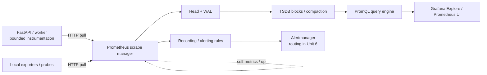

# Unit 2 — Prometheus: Metrics, Scraping, and PromQL

> **Abstract.** Build a local, testable Prometheus workflow for a data/ML platform: design bounded metrics, scrape targets, diagnose missing data, write semantically correct PromQL, test recording rules, and operate the metrics pipeline safely. All values and workloads are synthetic. Examples are teaching artifacts, not evidence that commands were executed.

**Module:** M11 — Production Observability Stack and Performance Operations  
**Stage:** 2E  
**Target file:** `02-prometheus-metrics-scraping-and-promql.md`  
**Estimated time:** 18–26 hours `[ASSUMPTION]`  
**Prerequisites:** M10 SRE foundations; basic Linux, containers, HTTP, Python, and Git; instrumented-service concepts from M08/M10  
**Core tools:** Prometheus, `promtool`, Python FastAPI, `prometheus-client`, Docker Compose; Alertmanager/Grafana as integration context  
**Awareness:** Prometheus Operator, `kube-prometheus-stack`, Thanos, Mimir, VictoriaMetrics, remote-write receivers  
**Last reviewed:** 2026-10-28 (authoring date, not a live documentation verification date)  
**Tool baseline assumed:** compatible current stable Prometheus/`promtool`, Python 3.11+, FastAPI, and `prometheus-client`; exact releases are `[VERIFY]`  
**Stack profile required:** Core  
**Footprint:** **measure yours**; start only the components needed for the current lab and stop them afterward

> **Source and scope note.** This lesson follows the supplied M11 syllabus prompt and repository tree. The generated syllabus file itself was not available for direct inspection; Unit 2 requirements were taken from the authoritative syllabus-generation prompt. The roadmap lists this file beside Units 1 and 3–13 and two capstones. No repository files were edited. Documentation URLs below are verification destinations, not sources claimed as live-consulted.

## Table of contents

- [2.0 Why this matters in production](#20-why-this-matters-in-production)
- [2.1 Learning objectives](#21-learning-objectives)
- [2.2 Concept map and vocabulary](#22-concept-map-and-vocabulary)
- [2.3 Mental model and architecture](#23-mental-model-and-architecture)
- [2.4 Guided implementation and worked examples](#24-guided-implementation-and-worked-examples)
- [2.5 Labs and exercises](#25-labs-and-exercises)
- [2.6 Troubleshooting and failure modes](#26-troubleshooting-and-failure-modes)
- [2.7 Security, reliability, and operational guardrails](#27-security-reliability-and-operational-guardrails)
- [2.8 Advanced design and trade-offs](#28-advanced-design-and-trade-offs)
- [2.9 Checkpoint and knowledge assessment](#29-checkpoint-and-knowledge-assessment)
- [2.10 Common mistakes and anti-patterns](#210-common-mistakes-and-anti-patterns)
- [2.11 Production checklist](#211-production-checklist)
- [2.12 Evidence artifacts](#212-evidence-artifacts)
- [2.13 Common interview and design-review questions](#213-common-interview-and-design-review-questions)
- [2.14 Sources and verification notes](#214-sources-and-verification-notes)

## Unit 2 — Prometheus: Metrics, Scraping, and PromQL

### 2.0 Why this matters in production

An inference API can return HTTP 200 while its feature-store dependency becomes slow, so availability alone does not reveal degraded user experience. A request counter with a raw `request_id` label can create a new series for every request and exhaust Prometheus memory during a launch. A dashboard can show an apparently healthy p99 if an engineer averages per-pod percentiles instead of aggregating histogram buckets. A metric can disappear because a target is down, a relabel rule removed it, instrumentation never ran, or the query selector is wrong—four different causes requiring different fixes. This unit teaches the mechanism and evidence needed to distinguish those cases without exposing private telemetry or exhausting a laptop.

### 2.1 Learning objectives

1. **[L1]** Explain how metric names, label sets, samples, metric types, scrape targets, jobs, and `up` relate.
2. **[L1]** Validate and interpret a Prometheus exposition endpoint and a hand-written scrape configuration.
3. **[L2]** Instrument a synthetic FastAPI inference service with request/error counters, latency histogram, in-flight gauge, domain metric, and build information using bounded labels.
4. **[L2]** Write and explain at least 25 PromQL queries, including rates, ratios, histogram quantiles, absent-data checks, vector matching, and recording rules.
5. **[L2]** Validate configuration and rule tests with `promtool`, distinguishing representative output from executed evidence.
6. **[L3]** Diagnose cardinality, query-cost, scrape-timeout, histogram, and many-to-many matching problems using discriminating evidence.
7. **[L3]** Design safe relabeling, scrape limits, retention, and metric-label standards for a constrained platform.
8. **[L4]** Define a staged configuration/upgrade/rollback process and self-monitoring strategy that does not rely solely on the Prometheus instance being monitored.
9. **[L4]** Produce an evidence bundle proving local conformance, query semantics, bounded cardinality, cleanup, and unresolved version checks.

### 2.2 Concept map and vocabulary

| Term | Precise definition | Why it matters | Common misconception |
|---|---|---|---|
| Time series | Metric name plus complete label set; samples are values at timestamps for that identity. | Each distinct label set consumes series/index resources. | A metric name alone identifies one series. |
| Sample | Timestamp/value observation for a series. | Scrape interval and retention drive sample volume. | One metric name means one sample. |
| Counter | Cumulative value, normally non-decreasing except process resets. | `rate()`/`increase()` derive activity over time. | A counter can never decrease in observed data. |
| Gauge | Value that can rise or fall, e.g. queue depth. | Represents current state. | `rate()` is the default for every metric. |
| Classic histogram | Cumulative bucket counters (`_bucket`, `le`) plus `_sum` and `_count`. | Aggregatable distribution estimates. | It exports p99 directly. |
| Summary | Client-side observations, count/sum and often configured quantiles. | Useful for local quantiles when aggregation is not needed. | Summary quantiles can be averaged globally. |
| Target | Endpoint Prometheus attempts to scrape. | Discovery and reachability differ from metric presence. | No series means the target is down. |
| Job | Configured scrape grouping, usually exposed as `job`. | Query scoping and ownership. | Prometheus infers the job from application code. |
| `up` | Per-target scrape result, usually 1 for success and 0 for failure. | Distinguishes scrape health from metric availability. | `up == 0` detects targets never discovered. |
| Target relabeling | Transforms/keeps/drops discovered targets before scraping. | Can remove whole targets. | It only changes metric labels. |
| Metric relabeling | Transforms/drops samples after scrape and before ingestion. | Can reduce stored series. | It prevents app-side emission cost. |
| Cardinality | Number of distinct series, heavily influenced by label combinations. | Major memory/index/query risk. | Low scrape rate makes unbounded labels safe. |
| Instant vector | Series with one sample each at an evaluation time. | Common result for dashboards/alerts. | Every query returns a scalar. |
| Range vector | Samples per series over a time window. | Input to `rate()` and `quantile_over_time()`. | `rate()` works without a range selector. |
| Staleness | Behavior that stops returning a series when it is no longer considered current. | Missing data and zero differ. | A disappeared series automatically becomes zero. |
| Recording rule | Periodically evaluates an expression and stores the result as a new series. | Reuse and precomputation. | Recording a bad expression makes it correct. |
| Scrape interval | Planned interval between scrapes. | Freshness, resolution, and volume. | Shorter is always better. |
| Scrape timeout | Maximum duration allowed for a scrape attempt. | Slow endpoints can fail despite eventually responding. | Timeout and interval are synonyms. |
| Query step | Time spacing between evaluations in a range query. | Graph resolution changes what is visible. | A graph shows every raw sample. |

A series is identified by `(metric_name, complete_label_set)`. Changing a label value creates a new series. A family with four routes, three methods, and five outcomes can produce up to 60 combinations per process if all occur. Adding 10,000 unique user IDs multiplies the theoretical combinations dramatically. Use bounded dimensions only.

#### Signals and metric types

| Type | Good for | Limits / traps |
|---|---|---|
| Counter | Requests, failures, processed records. | Raw value is not a rate; process resets occur. |
| Gauge | In-flight requests, queue depth, memory, last-success timestamp. | A change is not necessarily an event rate. |
| Classic histogram | Latency distributions that must aggregate across instances. | Quantiles approximate the distribution and depend on buckets. |
| Summary | Local distribution estimates. | Precomputed quantiles generally cannot be combined into a valid global quantile. |

A classic histogram exports cumulative buckets: `le="0.3"` includes observations in every smaller bucket; the `+Inf` bucket equals `_count`. Example values are `[SYNTHETIC]`:

```text
# HELP api_request_duration_seconds Duration of handled requests.
# TYPE api_request_duration_seconds histogram
api_request_duration_seconds_bucket{route="/predict",le="0.1"} 12
api_request_duration_seconds_bucket{route="/predict",le="0.3"} 37
api_request_duration_seconds_bucket{route="/predict",le="1.0"} 48
api_request_duration_seconds_bucket{route="/predict",le="+Inf"} 50
api_request_duration_seconds_sum{route="/predict"} 8.4
api_request_duration_seconds_count{route="/predict"} 50
```

Prometheus stores scraped samples; type metadata and exposition conventions inform interpretation. OpenMetrics negotiation and native histogram behavior are `[VERIFY]` for selected versions.

#### Architecture



The actual ports are defined in Lab A and must be checked with `docker compose ps`. Trust boundaries include host-to-container access and application-to-Prometheus HTTP. Back-pressure may occur at a slow scrape endpoint, overloaded query engine, or rule evaluation. Local TSDB retention is a storage boundary, not a compliance policy.

### 2.3 Mental model and architecture

#### Pull contract and missing-data states

Prometheus discovers or receives a target address, requests a metrics path, parses exposition, and records samples with scrape timestamps. Distinguish:

1. **Discovered and healthy:** appears in `/targets`; `up` is 1.
2. **Discovered but failing:** appears in `/targets`; `up` is 0 with an error.
3. **Not discovered or relabeled away:** no active target; `up` may not exist.
4. **Target healthy but expected metric absent:** `up` can be 1 while instrumentation, naming, relabeling, or query selection is wrong.

`scrape_interval` is the planned interval; `scrape_timeout` bounds an attempt. The timeout should not exceed the interval for the selected configuration; verify exact release validation. Scraping samples state—it is not an event stream, so short-lived behavior can occur between scrapes.

#### Static configuration first

```yaml
# prometheus.yml — illustrative; validate with the selected release
global:
  scrape_interval: 15s
  scrape_timeout: 10s
  evaluation_interval: 15s

scrape_configs:
  - job_name: prometheus
    static_configs:
      - targets: ["prometheus:9090"]
        labels:
          service: prometheus
          env: local

  - job_name: inference-api
    metrics_path: /metrics
    static_configs:
      - targets: ["api:8000"]
        labels:
          service: inference-api
          env: local
          team: platform
          tier: application
```

`api` resolves inside the Compose network, not necessarily from the host shell. From the host, use the published loopback port. Keep all target, port, and path values consistent.

#### Push versus pull

- **Prometheus pull:** Prometheus initiates HTTP scrapes. It supports direct reachability checks but requires discovery and reachable endpoints.
- **OTLP push:** SDKs/exporters send telemetry to a Collector/backend. Queues, retries, and back-pressure become important.
- **Short-lived jobs:** may finish before a scrape. A durable pull endpoint, textfile collector, Pushgateway, or purpose-built exporter may fit depending on semantics. Pushgateway is not the default for every batch job. See M10 Unit 2 and [Unit 11](11-scheduled-job-freshness-and-deadline-monitoring.md).

#### PromQL data types and selectors

| Type | Example | Meaning |
|---|---|---|
| Instant vector | `up{job="inference-api"}` | Current sample for each matching series. |
| Range vector | `api_requests_total[5m]` | Samples over a window for each matching series. |
| Scalar | `scalar(sum(up))` | Numeric scalar if conversion is applicable. |
| String | Used in limited expression-language contexts. | Not a general text-processing result. |

Matchers include `=`, `!=`, `=~`, `!~`; regexes are anchored in Prometheus label matchers. Verify exact syntax/escaping in the selected release. `rate()` and `increase()` require a range vector for classic counter samples.

#### TSDB and discovery

Recent samples reside in the head and are protected by a write-ahead log (WAL); older data is stored in blocks and compacted. Disk use includes indexes, labels, chunks, WAL, checkpoints, metadata, temporary files, and compaction headroom. Restart recovery may replay WAL. Local Prometheus TSDB is not horizontally scalable by itself. Retention flags and precedence are `[VERIFY]`; measure disk with `du` and inspect available self-metrics.

Static targets suit a small lab. File-based service discovery can update target lists from a file. Kubernetes SD roles commonly include node, pod, service, endpoints, and endpointslice; ingress and meta-label details are `[VERIFY]`. Kubernetes SD needs RBAC to list/watch resources.

`relabel_configs` transforms or drops discovered targets before scraping. `metric_relabel_configs` transforms/drops individual samples after scrape and before ingestion. Common actions include `keep`, `drop`, `replace`, and `labelmap`. A missing source label can make a keep/drop rule behave unexpectedly. Inspect discovered labels before applying broad rules. Scrape-time drops do not eliminate app-side emission cost.

### 2.4 Guided implementation and worked examples

#### 2.4.1 Local execution decision

**[ASSUMPTION] Primary path: Docker Compose.** It isolates the components and avoids the resource cost of Kubernetes during foundational labs. Publish only app and Prometheus UI ports to loopback; keep exporters private. Do not run Core, Core + Logs, and Full simultaneously. **Footprint: measure yours.**

```bash
docker version
docker compose version
docker system df
free -h
df -h .
```

Record runtime versions and resource limits in `evidence/baseline.md`. Laptop measurements are not production capacity commitments.

#### 2.4.2 Minimal Core stack

Image tags are placeholders because no live version verification was performed. Replace with compatible stable tags from official release pages and pin them locally.

```yaml
# compose.yml
services:
  prometheus:
    image: prom/prometheus:${PROMETHEUS_TAG:?Set a verified PROMETHEUS_TAG}
    command:
      - --config.file=/etc/prometheus/prometheus.yml
      - --storage.tsdb.path=/prometheus
      - --storage.tsdb.retention.time=24h
    ports:
      - "127.0.0.1:9090:9090"
    volumes:
      - ./prometheus.yml:/etc/prometheus/prometheus.yml:ro
      - prom-data:/prometheus
    depends_on: [api]
    networks: [observability]
    restart: unless-stopped
  api:
    build: ./api
    ports:
      - "127.0.0.1:8000:8000"
    environment:
      APP_VERSION: "0.1.0-lab"
    networks: [observability]
    restart: unless-stopped
volumes:
  prom-data: {}
networks:
  observability:
    internal: true
```

`internal: true` and host-published port behavior should be checked on the actual Docker/WSL2 implementation `[VERIFY]`. If the platform does not behave as expected, adjust only after confirming ports remain loopback-bound and there is no unintended egress.

Set a verified tag, then validate:

```bash
export PROMETHEUS_TAG='<verified-compatible-release>'
docker compose config
docker compose up -d --build
docker compose ps
docker compose logs --tail=80 prometheus
curl --fail --silent --show-error http://127.0.0.1:8000/health
curl --fail --silent --show-error http://127.0.0.1:8000/metrics | head -40
curl --fail --silent --show-error http://127.0.0.1:9090/-/healthy
```

The placeholder is not a valid tag until replaced. Query `/targets`, then run:

```promql
up
up{job="inference-api"}
api_requests_total
```

**Representative expected output — not run here:** healthy targets should show `up = 1`; custom metrics may not appear until code paths have been exercised. A valid scrape does not prove every expected metric exists.

#### 2.4.3 Worked PromQL

Request rate:

```promql
sum by (route, method) (rate(api_requests_total[5m]))
```

Counter → range vector → per-series per-second rate → aggregation. Output unit is requests/second. Rate each series before aggregating.

Error ratio:

```promql
sum(rate(api_requests_total{outcome="error"}[5m]))
/
sum(rate(api_requests_total[5m]))
```

Aggregate numerator and denominator first. If denominator is zero or absent, do not silently call the result healthy; handle low traffic/no data separately.

Global p95 from a classic histogram:

```promql
histogram_quantile(
  0.95,
  sum by (le, route) (
    rate(api_request_duration_seconds_bucket[5m])
  )
)
```

Preserve `le` and aggregate bucket rates across instances before quantile calculation. Result is an estimate whose precision depends on bucket boundaries. Never average pod p95 values.

Threshold ratio for requests completed within 300 ms, assuming a bucket at `le="0.3"`:

```promql
sum(rate(api_request_duration_seconds_bucket{le="0.3"}[5m]))
/
sum(rate(api_request_duration_seconds_count[5m]))
```

This is a threshold ratio, not full Apdex unless the scoring formula and thresholds are defined.

Current in-flight work:

```promql
sum by (service) (api_in_flight_requests)
```

This is a gauge snapshot. `rate(api_in_flight_requests[5m])` does not answer how many requests are currently active.

#### 2.4.4 Instrumented FastAPI example

The API below is a small synthetic teaching service. The `prometheus-client` API is version-sensitive `[VERIFY]`; choose a compatible release and test it. The example favors clarity over full production middleware semantics; the route-template timing and exception handling must be integration-tested against the selected FastAPI/Starlette version.

`api/requirements.txt`:

```text
fastapi
uvicorn
prometheus-client
pytest
httpx
```

These are unpinned placeholders, not a lockfile. Pin versions after compatibility checks.

`api/app.py`:

```python
import os
import time
from fastapi import FastAPI, Request, Response
from prometheus_client import CONTENT_TYPE_LATEST, Counter, Gauge, Histogram, generate_latest
from starlette.middleware.base import BaseHTTPMiddleware

APP_VERSION = os.getenv("APP_VERSION", "0.0.0-dev")
REQUESTS = Counter("api_requests_total", "Total handled API requests.",
                   ["route", "method", "outcome"])
DURATION = Histogram("api_request_duration_seconds", "Request duration in seconds.",
                     ["route", "method"],
                     buckets=(0.05, 0.1, 0.3, 0.5, 1.0, 2.0, float("inf")))
IN_FLIGHT = Gauge("api_in_flight_requests", "Current requests being handled.")
INFERENCE = Counter("inference_requests_total", "Synthetic inference outcomes.",
                     ["model_family", "outcome"])
FEATURE_FETCH = Counter("feature_fetch_total", "Synthetic feature-fetch outcomes.", ["outcome"])
BUILD_INFO = Gauge("api_build_info", "Build metadata; value is one.", ["version"])
BUILD_INFO.labels(version=APP_VERSION).set(1)

def route_template(request: Request) -> str:
    route = request.scope.get("route")
    path = getattr(route, "path", None)
    return path if path in {"/health", "/metrics", "/predict"} else "unmatched"

class MetricsMiddleware(BaseHTTPMiddleware):
    async def dispatch(self, request: Request, call_next):
        if request.url.path == "/metrics":
            return await call_next(request)
        route = route_template(request)
        method = request.method if request.method in {"GET", "POST"} else "OTHER"
        start = time.perf_counter()
        IN_FLIGHT.inc()
        outcome = "error"
        try:
            response = await call_next(request)
            outcome = "success" if response.status_code < 500 else "error"
            return response
        finally:
            REQUESTS.labels(route=route, method=method, outcome=outcome).inc()
            DURATION.labels(route=route, method=method).observe(time.perf_counter() - start)
            IN_FLIGHT.dec()

app = FastAPI()
app.add_middleware(MetricsMiddleware)

@app.get("/health")
def health():
    return {"status": "ok"}

@app.post("/predict")
def predict(fail: bool = False):
    INFERENCE.labels(model_family="demo", outcome="error" if fail else "success").inc()
    FEATURE_FETCH.labels(outcome="success").inc()
    if fail:
        return Response('{"detail":"synthetic failure"}', status_code=503,
                        media_type="application/json")
    return {"prediction": 0.7, "model_family": "demo"}

@app.get("/metrics")
def metrics():
    return Response(generate_latest(), media_type=CONTENT_TYPE_LATEST)
```

The middleware calls `route_template()` before route resolution may have attached the route object; check whether it yields `unmatched`. A production implementation should instrument after route resolution or use a verified instrumentation library. The counter is still bounded even if `unmatched` is used.

`api/test_app.py`:

```python
from fastapi.testclient import TestClient
from app import app

def test_health():
    with TestClient(app) as client:
        r = client.get("/health")
        assert r.status_code == 200
        assert r.json() == {"status": "ok"}

def test_predict_success():
    with TestClient(app) as client:
        r = client.post("/predict")
        assert r.status_code == 200
        assert r.json()["model_family"] == "demo"

def test_predict_fault():
    with TestClient(app) as client:
        assert client.post("/predict?fail=true").status_code == 503

def test_metrics_after_request():
    with TestClient(app) as client:
        client.post("/predict")
        body = client.get("/metrics").text
        for name in ("api_requests_total", "api_request_duration_seconds_bucket",
                     "api_in_flight_requests", "inference_requests_total", "api_build_info"):
            assert name in body
```

`api/metric_linter.py`:

```python
import re
import sys
from pathlib import Path

FORBIDDEN = {"user_id", "request_id", "trace_id", "session_id", "email", "token"}
ALLOWED = {"route", "method", "outcome", "model_family", "version", "service",
           "env", "team", "tier", "le"}
LABEL_RE = re.compile(r'([A-Za-z_][A-Za-z0-9_]*)="((?:\\\\.|[^"])*)"')

def lint(text):
    errors = []
    for n, line in enumerate(text.splitlines(), 1):
        if not line or line.startswith("#") or "{" not in line or "}" not in line:
            continue
        labels = line.split("{", 1)[1].split("}", 1)[0]
        pairs = LABEL_RE.findall(labels)
        if not pairs:
            errors.append(f"line {n}: could not parse label set")
            continue
        for key, _value in pairs:
            if key.lower() in FORBIDDEN:
                errors.append(f"line {n}: forbidden label key {key}")
            elif key not in ALLOWED:
                errors.append(f"line {n}: unreviewed label key {key}")
    return errors

if __name__ == "__main__":
    if len(sys.argv) != 2:
        raise SystemExit("usage: python metric_linter.py exposition.txt")
    findings = lint(Path(sys.argv[1]).read_text(encoding="utf-8"))
    if findings:
        print("\\n".join(findings))
        raise SystemExit(1)
    print("No label-key violations detected by this limited linter.")
```

`api/test_metric_linter.py`:

```python
from metric_linter import lint

def test_allowed_labels_pass():
    assert lint('api_requests_total{route="/predict",method="POST",outcome="success"} 1') == []

def test_sensitive_label_fails():
    assert any("forbidden label key user_id" in x for x in
               lint('api_requests_total{user_id="u-123",route="/predict"} 1'))

def test_unreviewed_label_fails():
    assert any("unreviewed label key raw_url" in x for x in
               lint('api_requests_total{raw_url="/predict?x=1"} 1'))
```

Run in the API directory:

```bash
cd api
python -m venv .venv
. .venv/bin/activate
python -m pip install -r requirements.txt
pytest -q
python -m uvicorn app:app --host 0.0.0.0 --port 8000
```

The `0.0.0.0` bind is for the container network; for a host-run process bind to loopback. Never expose it publicly. Save sanitized `/metrics` output and run the linter. Unsafe fixture only—never add this to the live app:

```text
# [SYNTHETIC] Unsafe example; do not serve it.
unsafe_request_total{user_id="user-00042",route="/predict"} 1
```

The linter should reject it. Static inspection does not prove runtime cardinality bounds or parse every exposition variation; code review and runtime measurements are still required.

#### 2.4.5 Relabeling, exporters, and Kubernetes

Narrow metric relabel example:

```yaml
metric_relabel_configs:
  - source_labels: [__name__]
    regex: "debug_payload_bytes"
    action: drop
```

It drops only that exact metric family before ingestion. It does not prevent app-side computation or protect another sink. Target relabeling acts earlier and can drop entire targets. Example Kubernetes meta-label is `[VERIFY]` until matched to the selected SD role:

```yaml
relabel_configs:
  - source_labels: [__meta_kubernetes_namespace]
    regex: "observability-lab"
    action: keep
```

If the source label is absent, the rule may remove every target. Inspect discovered labels first.

| Exporter/source | Practical role | Pitfall |
|---|---|---|
| `node-exporter` | Host OS/resource metrics. | Host/container visibility and permissions. |
| `kube-state-metrics` | Kubernetes object state. | Not the same as node CPU/memory usage. |
| cAdvisor via kubelet | Container resource metrics where enabled. | Endpoint/auth and version differences. |
| PostgreSQL exporter | DB health, connections, replication/storage indicators. | Metric names/queries/permissions vary. |
| Blackbox exporter | HTTP/TCP/DNS/ICMP/TLS probes where supported. | Probe config and privileges vary. |
| `metrics-server` | Resource metrics for HPA and `kubectl top`. | Not a historical monitoring TSDB. |

`prometheus.io/scrape` is a convention requiring explicit config, not magic auto-scraping. Teach static config first, then compare Prometheus Operator `ServiceMonitor`, `PodMonitor`, `PrometheusRule`, and `Alertmanager` CRDs. API group/version and selectors are `[VERIFY]`. `kube-prometheus-stack` is Awareness/optional and can be heavy on 8 GB; skip it if resource headroom is insufficient.

#### 2.4.6 Batch workload choices

| Pattern | Use when | Avoid / risk |
|---|---|---|
| Long-lived pull endpoint | Controller/worker remains available and exposes state. | Job exits before scrape. |
| node-exporter textfile collector | Host batch job writes a bounded atomic metrics file. | Shared path/ownership/cleanup unclear. |
| Pushgateway | Short-lived service-level job publishes bounded final state. | Per-run unique grouping keys or using it as an event store. |
| Purpose-built exporter/controller metadata | Freshness, duration, and last-success are naturally durable. | Adds another service to operate. |

Prefer bounded metrics such as `batch_last_success_timestamp_seconds`, `batch_records_processed_total`, and `batch_run_duration_seconds` with stable `job_name`/`env` labels. Unique run IDs belong in logs or run metadata, not labels. See M10 Unit 2 and [Unit 11](11-scheduled-job-freshness-and-deadline-monitoring.md).

### 2.5 Labs and exercises

All labs use synthetic local data. Copy the inline artifacts into a temporary directory; this document does not write auxiliary files into the repository. Stop components between labs. **Footprint: measure yours.**

#### Lab A — Core install and scrape

**Level:** L1–L2. **Profile:** Core. **Goal:** prove endpoint → target → scrape → sample.

Use the `compose.yml` and `prometheus.yml` above, create `api/` from Lab B, select a verified image tag, and record versions. The Prometheus config is:

```yaml
global:
  scrape_interval: 15s
  scrape_timeout: 10s
  evaluation_interval: 15s
scrape_configs:
  - job_name: prometheus
    static_configs:
      - targets: ["prometheus:9090"]
  - job_name: inference-api
    metrics_path: /metrics
    static_configs:
      - targets: ["api:8000"]
        labels:
          service: inference-api
          env: local
          team: platform
```

Commands, from the temporary project directory:

```bash
docker compose config
docker compose up -d --build
docker compose ps
curl --fail --silent --show-error http://127.0.0.1:9090/-/healthy
curl --fail --silent --show-error 'http://127.0.0.1:9090/api/v1/query?query=up'
docker compose down
docker compose ps
```

**Representative expected output — not run here:** config renders; targets become active; query JSON contains target series if scraping succeeds. Save `/targets`, `up` result, versions, and cleanup evidence. Acceptance: target is visible, `up=1`, at least one custom sample appears after a request, labels match contract, no lab containers remain running. Cleanup check: `docker compose ps`.

#### Lab B — Instrumentation, linter, and tests

**Level:** L2–L3. **Profile:** Core. Use §2.4.4's complete `app.py`, `requirements.txt`, tests, linter, and unsafe fixture. Choose latency buckets based on an illustrative 300 ms threshold; this is not the learner's real SLO. Run the app tests, query `/metrics`, run the linter, and save outputs. Acceptance: app tests pass; expected families exist after a request; forbidden label fixture fails; actual app labels remain bounded. Runtime API compatibility remains `[VERIFY]`.

#### Lab C — PromQL workbook: 30 graded queries

**Level:** L1–L4. **Profile:** Core. For each query, save the operational question, result shape, retained labels, no-data behavior, and observation. `worker_queue_depth` and Kubernetes labels are examples that require additional instrumentation before use.

**L1 — foundations**

**1. Are targets scraping?**
```promql
up
```
Instant vector per active target; 1 means success, 0 failure. It does not reveal never-discovered targets.

**2. Is the inference target healthy?**
```promql
up{job="inference-api"}
```
Empty means no matching series; inspect job labels and discovery.

**3. Request rate by route**
```promql
sum by (route) (rate(api_requests_total[5m]))
```
Counter rate, unit requests/second. Rate per series before aggregation.

**4. Error ratio**
```promql
sum(rate(api_requests_total{outcome="error"}[5m])) / sum(rate(api_requests_total[5m]))
```
Event-weighted ratio. Handle absent/zero denominator separately.

**5. Mean request duration**
```promql
sum by (route) (rate(api_request_duration_seconds_sum[5m])) / sum by (route) (rate(api_request_duration_seconds_count[5m]))
```
Mean seconds, not tail latency.

**6. p50**
```promql
histogram_quantile(0.50, sum by (le, route) (rate(api_request_duration_seconds_bucket[5m])))
```
Estimated seconds; `le` must be retained.

**7. p90**
```promql
histogram_quantile(0.90, sum by (le, route) (rate(api_request_duration_seconds_bucket[5m])))
```
Bucket layout controls precision.

**8. p95**
```promql
histogram_quantile(0.95, sum by (le, route) (rate(api_request_duration_seconds_bucket[5m])))
```
Aggregate buckets before quantile.

**9. p99**
```promql
histogram_quantile(0.99, sum by (le, route) (rate(api_request_duration_seconds_bucket[5m])))
```
Do not average per-pod p99 values.

**10. Fraction within 300 ms**
```promql
sum(rate(api_request_duration_seconds_bucket{le="0.3"}[5m])) / sum(rate(api_request_duration_seconds_count[5m]))
```
Requires a bucket exactly at 0.3 seconds; threshold ratio, not full Apdex.

**L2 — working practice**

**11. Current in-flight requests**
```promql
sum(api_in_flight_requests)
```
Gauge snapshot; zero is a valid value.

**12. Queue depth**
```promql
max by (service) (worker_queue_depth)
```
Requires that gauge and label to exist; empty is not zero.

**13. Estimated requests in last five minutes**
```promql
sum(increase(api_requests_total[5m]))
```
Range-based counter increase, with boundary extrapolation.

**14. Recent rate volatility**
```promql
sum by (route) (irate(api_requests_total[2m]))
```
Uses last two samples; noisy for paging unless explicitly justified.

**15. Retain route and outcome**
```promql
sum by (route, outcome) (rate(api_requests_total[5m]))
```
Explicit output dimensions. Compare `without(instance,pod)` when retaining new labels is desired.

**16. Correct ratio across uneven traffic**
```promql
sum(rate(api_requests_total{outcome="error"}[5m])) / sum(rate(api_requests_total[5m]))
```
Do not average per-instance ratios; denominator weights matter.

**17. Top five pods by rate**
```promql
topk(5, sum by (pod) (rate(api_requests_total[5m])))
```
Requires `pod`; high-cardinality `topk` can be costly.

**18. Bottom three routes by rate**
```promql
bottomk(3, sum by (route) (rate(api_requests_total[5m])))
```
Never-existed series may not appear as zeros.

**19. Is the expected metric absent?**
```promql
absent(api_requests_total{job="inference-api"})
```
May return a synthetic one-valued series when no matching series exists; does not diagnose cause.

**20. No matching sample over 15 minutes?**
```promql
absent_over_time(api_requests_total{job="inference-api"}[15m])
```
Use for absence, not target health alone; verify function availability.

**L3 — advanced**

**21. Compare with one hour ago**
```promql
sum by (route) (rate(api_requests_total[5m])) / sum by (route) (rate(api_requests_total[5m] offset 1h))
```
A missing/zero denominator needs handling; tiny prior traffic can make ratio misleading.

**22. Historical instant**
```promql
api_requests_total @ 1700000000
```
`@` uses a Unix timestamp; timestamp is illustrative and may be outside retention. Syntax/behavior `[VERIFY]`.

**23. Average the rate expression over 30 minutes**
```promql
avg_over_time((sum by (route) (rate(api_requests_total[5m])))[30m:1m])
```
Subquery step is 1 minute; repeated evaluations increase query work.

**24. p95 of sampled gauge values over time**
```promql
quantile_over_time(0.95, api_in_flight_requests[30m])
```
Quantile over gauge samples, not latency distribution.

**25. Linear prediction of in-flight gauge**
```promql
predict_linear(api_in_flight_requests[30m], 600)
```
Mathematical extrapolation, not a causal capacity model.

**26. Gauge slope**
```promql
deriv(api_in_flight_requests[10m])
```
Slope per second; not request throughput.

**27. Normalize a label**
```promql
label_replace(sum by (route) (rate(api_requests_total[5m])), "endpoint", "$1", "route", "(.+)")
```
Query-time transformation, not a storage migration.

**28. Count series by job/outcome**
```promql
count by (job, outcome) (api_requests_total)
```
Counts series, not events.

**29. Enrich pod rates with build metadata**
```promql
sum by (namespace, pod) (rate(api_requests_total[5m]))
  * on (namespace, pod) group_left(version)
    max by (namespace, pod, version) (api_build_info)
```
This is a pattern only: Lab B's `api_build_info` does not contain `namespace,pod`, so it will not work unchanged. Both sides need matching unique keys; duplicate right-side series can cause many-to-many errors.

**30. Query a recording rule**
```promql
service:api_requests:rate5m
```
Only works after the matching rule is loaded and evaluated. Recording rule names are conventions, not built-ins.

For each workbook query, document the metric type/unit, result shape, labels retained, no-series/zero behavior, assumptions, and how it was validated. Mark examples requiring extra instrumentation as not applicable until implemented.

#### Lab D — PromQL pitfall suite

**Level:** L2–L4. **Profile:** Core.

| Pitfall | Incorrect expression / symptom | Correction | Reason |
|---|---|---|---|
| Counter reset | Raw counter subtraction becomes negative after restart. | `rate(counter[5m])` or `increase(counter[5m])`. | Reset-aware calculation when sufficient samples exist. |
| Too-short rate | `rate(counter[15s])` empty/noisy with 15s scrape interval. | Use a window with enough scrapes for the question. | Insufficient samples. |
| Average percentiles | `avg(pod_p99)` looks plausible. | Aggregate histogram buckets by `le`, then quantile. | Percentiles are not composable by averaging. |
| Many-to-many join | `left * on(service) group_left right` errors. | Match on unique key and aggregate right side. | `group_left` does not permit arbitrary many-to-many. |
| Stale/absent | `metric == 0` misses nonexistent series. | `absent()`/`absent_over_time()` plus target checks. | Missing differs from zero. |
| Rate on gauge | `rate(api_in_flight_requests[5m])` treated as current concurrency. | Query gauge directly. | Wrong metric semantics. |
| Average ratios | `avg(per_pod_error_ratio)` under unequal traffic. | Sum errors and requests separately, divide. | Global ratio must be event-weighted. |
| Drop `le` | `histogram_quantile(0.95,sum by(route)(rate(..._bucket[5m])))`. | `sum by(le,route)(...)`. | Bucket identity lost. |

Synthetic reset fixture: counter samples 80, 95, 110, then restart to 4, 9. Raw subtraction is misleading; `rate()` can handle detected reset but cannot reconstruct observations never scraped. Validate each failure and correction with a fixture or rule test. Do not claim exact numbers unless computed.

#### Lab E — bounded cardinality incident

**Level:** L3–L4. **Profile:** Core. Never generate millions of series on an 8 GB laptop. Use an offline fixture with 20 unique IDs:

```text
# [SYNTHETIC] Offline fixture only.
unsafe_requests_total{route="/predict",request_id="req-001"} 1
unsafe_requests_total{route="/predict",request_id="req-002"} 1
unsafe_requests_total{route="/predict",request_id="req-003"} 1
unsafe_requests_total{route="/predict",request_id="req-004"} 1
unsafe_requests_total{route="/predict",request_id="req-005"} 1
unsafe_requests_total{route="/predict",request_id="req-006"} 1
unsafe_requests_total{route="/predict",request_id="req-007"} 1
unsafe_requests_total{route="/predict",request_id="req-008"} 1
unsafe_requests_total{route="/predict",request_id="req-009"} 1
unsafe_requests_total{route="/predict",request_id="req-010"} 1
unsafe_requests_total{route="/predict",request_id="req-011"} 1
unsafe_requests_total{route="/predict",request_id="req-012"} 1
unsafe_requests_total{route="/predict",request_id="req-013"} 1
unsafe_requests_total{route="/predict",request_id="req-014"} 1
unsafe_requests_total{route="/predict",request_id="req-015"} 1
unsafe_requests_total{route="/predict",request_id="req-016"} 1
unsafe_requests_total{route="/predict",request_id="req-017"} 1
unsafe_requests_total{route="/predict",request_id="req-018"} 1
unsafe_requests_total{route="/predict",request_id="req-019"} 1
unsafe_requests_total{route="/predict",request_id="req-020"} 1
```

Count distinct label sets, then remove `request_id` and aggregate by `route`; the fixture becomes one series. Optional live demo must remain small and disposable. Inspect `prometheus_tsdb_head_series` if present `[VERIFY]`, `/tsdb-status`, `du -sh`, and `promtool tsdb analyze` if supported `[VERIFY]`. Abort on memory pressure or low disk headroom. Scrape-time dropping does not remove app-side generation/parsing cost. Cleanup: stop the stack and verify no injected metric remains.

#### Lab F — recording rules and tests

`rules.yml`:

```yaml
groups:
  - name: api-derived
    interval: 30s
    rules:
      - record: service:api_requests:rate5m
        expr: sum by (service, route) (rate(api_requests_total[5m]))
      - record: service:api_errors:rate5m
        expr: sum by (service, route) (rate(api_requests_total{outcome="error"}[5m]))
      - record: service:api_error_ratio:rate5m
        expr: |
          sum by (service, route) (rate(api_requests_total{outcome="error"}[5m]))
          /
          sum by (service, route) (rate(api_requests_total[5m]))
      - alert: InferenceTargetMissingTeachingExample
        expr: absent(up{job="inference-api"})
        for: 2m
        labels:
          severity: warning
          team: platform
        annotations:
          summary: "Inference scrape target is absent"
          description: "Inspect discovery, relabeling, and configuration."
```

Wire `rule_files: ["/etc/prometheus/rules.yml"]` into Prometheus config and mount the file read-only. The alert is a teaching example; policy/routing belong to M10 and Units 6/8.

`rules_test.yml` (schema and exact expected samples `[VERIFY]` against selected `promtool`):

```yaml
rule_files:
  - rules.yml
evaluation_interval: 1m
tests:
  - interval: 1m
    input_series:
      - series: 'api_requests_total{service="inference-api",route="/predict",method="POST",outcome="success"}'
        values: '0 10 20 30 40 50'
      - series: 'api_requests_total{service="inference-api",route="/predict",method="POST",outcome="error"}'
        values: '0 1 2 3 4 5'
    promql_expr_test:
      - expr: 'sum by (service, route) (rate(api_requests_total[5m]))'
        eval_time: 5m
        exp_samples:
          - labels: '{service="inference-api",route="/predict"}'
            value: 0.1833333333
```

The expected sample is illustrative, not certified; `rate()` boundary extrapolation and the selected `promtool` determine exact expected output. Run:

```bash
promtool check config prometheus.yml
promtool check rules rules.yml
promtool test rules rules_test.yml
```

**Representative expected output — not run here:** commands report successful validation only if the chosen version accepts the schema and expressions. Planted defect: remove `[5m]` from a `rate()` expression, validate, then restore and test. Save failing and corrected results.

#### Lab G — optional Kubernetes SD and Operator

**Level:** L3–L4. **Profile:** Core only if an existing `kind` cluster has headroom; otherwise skip. Namespace-scoped teaching RBAC:

```yaml
apiVersion: v1
kind: ServiceAccount
metadata:
  name: prometheus-discovery-lab
  namespace: observability-lab
---
apiVersion: rbac.authorization.k8s.io/v1
kind: Role
metadata:
  name: prometheus-pod-discovery
  namespace: observability-lab
rules:
  - apiGroups: [""]
    resources: ["pods", "services", "endpoints"]
    verbs: ["get", "list", "watch"]
---
apiVersion: rbac.authorization.k8s.io/v1
kind: RoleBinding
metadata:
  name: prometheus-pod-discovery
  namespace: observability-lab
subjects:
  - kind: ServiceAccount
    name: prometheus-discovery-lab
    namespace: observability-lab
roleRef:
  apiGroup: rbac.authorization.k8s.io
  kind: Role
  name: prometheus-pod-discovery
```

This is not complete for every role: endpointslice/node discovery may require additional resources/scope. Verify exact RBAC, API resources, SD roles, and meta-labels. Test a hand-written config before considering `ServiceMonitor`, `PodMonitor`, `PrometheusRule`, and `Alertmanager` CRDs. `prometheus.io/scrape` annotations require explicit config. Do not install `kube-prometheus-stack` by default on the constrained laptop. Safe skip: use Lab A's Docker Compose static targets. Cleanup only the namespace/resources you created, after confirming Kubernetes context.

#### Lab H — missing-metric troubleshooting gauntlet

**Level:** L2–L4. **Profile:** Core. Attempt before reading the answer key.

| # | Broken state | First check | Discriminating test | Fix / regression prevention |
|---|---|---|---|---|
| 1 | Wrong target host/port | `/targets`, `up` | Curl from same network | Fix DNS/port; target smoke test. |
| 2 | Wrong metrics path | Scrape error | Curl `/metrics` from same network | Fix `metrics_path`; endpoint contract test. |
| 3 | Instrumentation path never executed | `up`, raw exposition | Send synthetic request then query | Exercise/initialize expected metric intentionally. |
| 4 | Target relabel drops target | `/targets`, SD labels | Remove rule in disposable copy | Correct meta-label/regex; expected target-count test. |
| 5 | Metric relabel drops series | Raw exposition vs stored query | Remove exact drop rule | Narrow regex; fixture proving intended drop only. |
| 6 | Scrape timeout | Target error/duration | Compare endpoint response time | Optimize handler; justify timeout and interval. |
| 7 | Wrong job/label selector | Actual labels in `/targets` | Query actual job and labels | Fix selector; query contract test. |
| 8 | Staleness/too-short range | Time range and scrape cadence | Widen range; inspect raw samples | Appropriate range; missing-data alert. |
| 9 | Sample/label limit rejection | Scrape error | Verify exact version semantics | Fix exposition or justified limit; boundary test. |
| 10 | Metric renamed/wrong exposition | Raw `/metrics` | Compare deployed version and names | Update schema deliberately; compatibility test. |
| 11 | Kubernetes RBAC/discovery failure | Prometheus logs, targets | `kubectl auth can-i list pods ...` | Grant only required permission; discovery test. |
| 12 | Clock/time-range confusion | UI time range, host time | Query retained interval | Fix time interpretation; document UTC. |

**Separated answer key / decision tree**

- Target visible + `up=0`: inspect reachability, path, timeout, parse errors, and limits.
- Target absent: inspect discovery, RBAC, target relabeling, config load, and query range.
- Target healthy + metric absent: inspect raw exposition, code path, metric relabeling, renamed family, and selector labels.
- Metric exists + rate empty: inspect sample count, range length, scrape interval, staleness, and evaluation time.
- Vector-matching error: inspect join keys and uniqueness before using `group_left`.
- For each case preserve first error, corrected query/config, and a regression test. No scenario is claimed to have been run here.

#### Lab I — custom Python exporter

**Level:** L2–L3. **Profile:** Core. A production exporter should use a maintained client library; the following standard-library endpoint is only a minimal local illustration, not a full exposition parser.

`exporter.py`:

```python
from http.server import BaseHTTPRequestHandler, HTTPServer
import os

BUILD = os.getenv("BUILD_VERSION", "lab")
RECORDS = 42  # synthetic static example, not a live counter

BODY = f'''# HELP custom_exporter_up Whether exporter process is running.
# TYPE custom_exporter_up gauge
custom_exporter_up 1
# HELP custom_records_processed_total Synthetic records processed.
# TYPE custom_records_processed_total counter
custom_records_processed_total {RECORDS}
# HELP custom_exporter_build_info Build metadata; value is one.
# TYPE custom_exporter_build_info gauge
custom_exporter_build_info{{version="{BUILD}"}} 1
'''

class Handler(BaseHTTPRequestHandler):
    def do_GET(self):
        if self.path == "/health":
            body, status, kind = b"ok\\n", 200, "text/plain"
        elif self.path == "/metrics":
            body, status, kind = BODY.encode(), 200, "text/plain; version=0.0.4; charset=utf-8"
        else:
            body, status, kind = b"not found\\n", 404, "text/plain"
        self.send_response(status)
        self.send_header("Content-Type", kind)
        self.send_header("Content-Length", str(len(body)))
        self.end_headers()
        self.wfile.write(body)
    def log_message(self, fmt, *args):
        return

if __name__ == "__main__":
    HTTPServer(("127.0.0.1", 9108), Handler).serve_forever()
```

Validate `BUILD_VERSION` against a bounded character set before production use. The static counter is synthetic; a real exporter needs correctly maintained state. A scrape must not trigger expensive DB queries or inference. Use timeouts, cached values, and bounded labels.

`test_exporter.py` (loopback smoke test; port must be free):

```python
import subprocess, sys, time, urllib.request

def test_exporter_endpoint_smoke():
    proc = subprocess.Popen([sys.executable, "exporter.py"])
    try:
        deadline = time.time() + 5
        while time.time() < deadline:
            try:
                with urllib.request.urlopen("http://127.0.0.1:9108/metrics", timeout=0.5) as r:
                    body = r.read().decode()
                    assert r.status == 200
                    assert "custom_records_processed_total 42" in body
                    assert "custom_exporter_build_info" in body
                    break
            except Exception:
                time.sleep(0.1)
        else:
            raise AssertionError("exporter did not become reachable")
    finally:
        proc.terminate()
        proc.wait(timeout=3)
```

Run `python exporter.py`, curl `/metrics`, stop with Ctrl-C; or run the smoke test only in an isolated environment. Confirm no process remains. This test is illustrative and unexecuted.

#### Lab J — self-monitoring and safe fault drill

**Level:** L3–L4. **Profile:** Core. Metric names are version-sensitive and must be confirmed in actual `/metrics`.

```yaml
groups:
  - name: prometheus-self-health
    interval: 30s
    rules:
      - alert: ScrapeTargetDownTeaching
        expr: up == 0
        for: 2m
        labels:
          severity: warning
        annotations:
          summary: "A configured target is failing scrapes"
          description: "Inspect /targets, endpoint, and recent config changes."
      - alert: ExpectedInferenceTargetMissingTeaching
        expr: absent(up{job="inference-api"})
        for: 2m
        labels:
          severity: warning
        annotations:
          summary: "Inference target is absent from active scrape data"
          description: "Check discovery, relabeling, and config reload."
      - alert: PrometheusSeriesGrowthTeaching
        expr: prometheus_tsdb_head_series > 100000
        for: 5m
        labels:
          severity: warning
        annotations:
          summary: "Head series exceeds a synthetic teaching threshold"
          description: "Select a threshold from measured capacity."
```

`prometheus_tsdb_head_series` and the numeric threshold are `[VERIFY]`/`[SYNTHETIC]`; do not use unverified names/thresholds in production. Add rules for rule evaluation, WAL/TSDB/compaction, remote-write lag, and config reload only after verifying actual metrics.

Validate rules with `promtool check rules`. Then:

1. Confirm project and loopback-only port binding.
2. Save `docker compose ps` and successful `/-/healthy`.
3. Stop only the disposable local Prometheus service: `docker compose stop prometheus`.
4. Confirm local health check fails; this is expected.
5. Record outage using an independent shell/host check, not Prometheus.
6. Restart: `docker compose start prometheus`; verify readiness, `/targets`, `up`, and rules.
7. Save timeline and note data gaps.

Short manual check, not a production watcher:

```bash
for i in 1 2 3 4 5; do
  date -u
  curl --max-time 1 --silent --output /dev/null \
    --write-out 'http=%{http_code}\\n' \
    http://127.0.0.1:9090/-/healthy || true
  sleep 2
done
```

Cleanup: restart if stopped, `docker compose down`, verify no fault injection or generator remains.

### 2.6 Troubleshooting and failure modes

| Symptom | First check | Likely causes | Discriminating test | Remediation |
|---|---|---|---|---|
| `up=0` | `/targets` error | DNS/port/path/timeout/parse | Curl from same network | Fix target or endpoint; add smoke test. |
| Target absent | Discovery/config | RBAC, relabeling, unloaded config | Inspect discovered labels; remove rule in test copy | Test expected target count. |
| `up=1`, metric absent | Raw exposition | Code path, rename, metric relabel | Request endpoint and search family | Fix code/selector; add contract test. |
| Rate empty | Time range/window | Too few samples, staleness | Inspect scrape interval and raw samples | Choose justified range. |
| Metric missing after deploy | Labels/name | Schema/client change | Compare before/after exposition | Staged compatibility migration. |
| Quantile implausible | Bucket series | `le` removed, poor buckets | Query `_bucket` rates | Preserve `le`, test bucket design. |
| Many-to-many error | Join keys | Duplicate series on both sides | `count by (keys)(right)` | Unique key or aggregate metadata side. |
| Memory rises | Head series/churn | Unsafe labels, target churn, queries | TSDB status/self-metrics `[VERIFY]` | Fix instrumentation and set budgets. |
| Disk fills | `du`, filesystem, logs | Retention, churn, compaction headroom | Inspect TSDB directories | Restore headroom, adjust scope/retention carefully. |
| Reload fails | Logs and config check | Invalid YAML/schema | Matching `promtool check config` | CI validation and last-known-good rollback. |
| Rule lag | Rules page/self-metrics | Slow query/high series | Run bounded query; inspect evaluation lag | Optimize/precompute, revisit interval. |
| Duplicate pages | Alert labels/topology | HA replica/dedup mismatch | Compare alert labels | Verify Alertmanager clustering/dedup. |
| Federation lags | Scrape health/query duration | Broad selection/source load | Narrow match selection | Export only required aggregates. |

Synthetic incident patterns:

- `user_id` label causes series explosion and OOM: fix instrumentation, not only memory.
- `rate()` window too short: empty/noisy graphs; use adequate samples and test.
- `irate()` flaps: use stable `rate()` for alerting unless fast reaction is justified.
- Averaged p99 hides slow pod: aggregate histogram buckets.
- Stale Pushgateway state keeps alert green: model freshness and grouping semantics.
- Relabel refactor drops targets: test target counts and labels.
- Disk fills and compaction fails: measure retention and headroom.
- HA replicas duplicate pages: verify replica labels and alert dedup.
- Federation scrape times out: narrow exported series and measure source load.

All are `[SYNTHETIC]` case studies, not claims about a specific incident.

### 2.7 Security, reliability, and operational guardrails

- Bind local ports to `127.0.0.1`; keep exporters and app metrics private.
- Never expose `/metrics`, Prometheus UI, admin/lifecycle endpoints, Grafana, or exporters publicly.
- Never use secrets, tokens, PII, user IDs, request IDs, trace IDs, raw URLs, arbitrary query strings, or exception text as metric labels.
- Metrics can expose topology, versions, and workload behavior. Use network restrictions and appropriate auth.
- A default local Prometheus is not a complete authentication/authorization boundary. Reverse proxy/TLS/basic-auth/web-config details are `[VERIFY]`.
- Keep admin/lifecycle endpoints disabled unless explicitly required and protected; verify flags for the chosen release.
- Kubernetes discovery uses least-privilege RBAC. Labels are not a tenant security boundary.
- Redact at source first; pipeline redaction is defense in depth. It cannot undo exposure to another sink. See M09 Unit 8 and M11 Unit 1.
- Use bounded buffers/timeouts; telemetry must not block user requests indefinitely.
- Keep scrape handlers fast; avoid DB scans/model inference per scrape.
- Validate config/rules with matching `promtool`; keep config in Git and a rollback.
- Monitor the monitor through an independent path.
- Measure series growth, scrape sample counts, query range/step, disk, and evaluation behavior. No universal footprint is claimed.
- Retention must preserve the evidence needed for incident/SLO questions; long-term storage and backup/DR are M13/M14 awareness.

### 2.8 Advanced design and trade-offs

#### Query cost, scale, and resource planning

A conceptual heuristic is: work tends to grow with **series touched × historical range scanned × evaluation steps**. This is not a universal performance formula. Broad regex selectors, long windows, expensive subqueries, high-resolution graphs, and repeated panels can burden a small instance. Filter on bounded labels, select only necessary series, align query step with useful resolution, and record repeated expensive aggregates.

Short scrape intervals improve freshness but increase sample volume and target load; long intervals reduce collection cost but miss short-lived behavior and delay detection. Scraping samples state, not every event.

Controls such as `sample_limit`, `label_limit`, and `target_limit` are version-sensitive `[VERIFY]`; availability and whether a limit fails a scrape or drops data must be tested against the chosen release. Never guess semantics.

Capacity review should measure active series/churn, target count, scrape duration, samples per scrape, sample rate, head/WAL/block disk use, compaction headroom, query duration, rule evaluation lag, and target growth. Do not extrapolate a tiny lab linearly to production without accounting for label combinations, histogram buckets, replication, query load, and headroom. `prometheus_tsdb_head_series`, `process_resident_memory_bytes`, `/tsdb-status`, and `promtool tsdb analyze` are `[VERIFY]`.

#### Recording rules, HA, federation, and remote write

A naming convention such as `level:metric:operations` is a convention. Recording rules create stored series and consume evaluation resources; they can preserve incorrect semantics. Test units, labels, zero/absent denominator behavior, evaluation interval, and data gaps.

HA Prometheus pairs can improve collection resilience but may create duplicate series/alerts without downstream handling. Alertmanager HA/gossip behavior is `[VERIFY]`. Federation scrapes selected aggregates; broad selection can increase source load and lag. Remote write ships samples to a receiver; queue/retry/back-pressure and data-loss semantics depend on version and receiver `[VERIFY]`. Thanos, Mimir, and VictoriaMetrics are awareness options for long-term storage/scale-out, not implementations in this lesson; M14 owns multi-cluster patterns.

#### Metric design and governance

- One metric represents one concept with documented units/help.
- Prefer base units (seconds, bytes) and established suffix conventions; verify client guidance.
- Counters represent cumulative events; gauges represent current state; histograms represent distributions that must aggregate.
- Use bounded dimensions, route templates, normalized outcomes, and reviewed version/model labels.
- Do not encode label values in metric names.
- Choose histogram buckets around actual decision thresholds.
- Set per-job series budgets and alert on measured growth.
- Test instrumentation, exposition, relabeling, PromQL, and rules in CI.
- Review metric schema changes as API migrations; client/semantic-convention changes can break queries.

#### Exemplars and cross-module boundaries

Exemplars can link histogram observations to traces, but instrumentation, exposition, storage, Grafana, and trace backend support must align `[VERIFY]`. Details belong to Units 5 and 10. Do not use trace IDs as ordinary labels.

- **M10:** defines SLI/SLO policy, alert design, incident process; this unit implements collection/query operations and does not re-teach burn-rate math.
- **M06:** packages dashboards/rules and teaches Operator CRDs; here static config comes first.
- **M08:** GitOps/release annotations; keep config/rules reviewed in Git.
- **M15:** owns financial modelling. This lesson covers technical volume/capacity, no prices or ROI.
- **M11 Unit 1:** architecture, labels, retention; Unit 3 dashboards; Unit 4 Loki; Unit 5 Collector/traces; Unit 6 Alertmanager routing; Unit 7 correlation; Unit 8 actionable alerts; Unit 9 saturation; Unit 11 batch freshness; Unit 12 cardinality/retention; Unit 13 load testing.
- **M13:** backup/DR; **M14:** multi-cluster; **M16:** golden-path templates.

### 2.9 Checkpoint and knowledge assessment

Suggested pass gate: 12/15 plus all safety-critical items correct. Each question is worth one point; model answers follow.

1. **[L1] What defines a series?** Metric name plus complete label set. Metric name alone can identify many series.
2. **[L1] `up=1` but custom metric absent—target down?** Not necessarily; inspect raw exposition, code path, relabeling, name, and selector.
3. **[L1] Type for queue depth?** Gauge; it can rise and fall.
4. **[L1] Why use `rate()` over raw subtraction?** It estimates per-second increase and handles detected resets; it cannot recover unobserved data.
5. **[L2] Why aggregate buckets before quantile?** To reconstruct a population distribution; averaging percentiles is invalid.
6. **[L2] Why is `rate(api_in_flight_requests[5m])` wrong for current concurrency?** It is a slope-like calculation on a gauge, not the current value.
7. **[L2] Does absent error rate prove zero errors?** No; data may be absent/stale. Check traffic and target health.
8. **[L2] Why aggregate numerator/denominator before ratio?** It weights by traffic; average per-instance ratios misweight denominators.
9. **[L3] Does `group_left` always solve a join?** No; the “one” side must be unique for matching keys.
10. **[L3] What if a target relabel `keep` uses a missing meta-label?** It may drop targets; inspect discovered labels and test counts.
11. **[L3] Four routes × three methods × five outcomes × two envs × six replicas?** 720 possible series for that metric, assuming all combinations occur; synthetic bound.
12. **[L3] Why not rely only on metric relabeling for unsafe labels?** App still emits/parses them and other sinks may receive them.
13. **[L3] What does rate-on-gauge return?** A rate-like change estimate, not current gauge value; query gauge directly.
14. **[L3] Why is `sum by(route)` wrong before classic histogram quantile?** It drops `le`, destroying bucket identity.
15. **[L4] Prometheus dies during an incident; how detect?** Independent watcher/heartbeat or separately operated path.
16. **[L4] Rate empty after deploy—first checks?** Time range; `/targets`/`up`; raw exposition; metric/labels; relabel rules/limits; range/staleness.
17. **[L4] Client release changes labels—safe rollout?** Pin/review release notes, test exposition/queries/rules, stage, compare series/targets, rollback if contracts fail.
18. **[L2] What does `up=0` not tell you?** Root cause; inspect scrape error.
19. **[L3] Target vs metric relabeling?** Target relabeling before scrape can drop targets; metric relabeling after scrape can drop samples.
20. **[L4] Why set query budgets?** Broad expensive queries can starve interactive queries/rules and reduce reliability.

### 2.10 Common mistakes and anti-patterns

| Anti-pattern | Why it fails | Correct alternative |
|---|---|---|
| `user_id`/request ID labels | Unbounded series and privacy risk. | Bounded dimensions; IDs in logs/traces. |
| Average per-pod p99 | Invalid global percentile. | Aggregate buckets, then quantile. |
| `rate()` on a gauge | Wrong semantics. | Query gauge; use slope only for deliberate analysis. |
| Too-short range | Insufficient samples/noisy graph. | Match range to scrape cadence and decision latency. |
| Average per-instance ratio | Unequal traffic misweighted. | Aggregate counts first. |
| Broad regex selector | Expensive and hard to govern. | Bounded selectors and explicit dimensions. |
| Untested relabel `drop` | Can silently remove targets/samples. | Fixtures and expected-count tests. |
| Pushgateway per-run IDs | Stale state/cardinality. | Bounded grouping and freshness semantics. |
| Treat missing as zero | Missing telemetry looks healthy. | Absence and target checks. |
| Install full Operator stack by default | Resource heavy and hides mechanism. | Static config first; optional cluster only if measured headroom allows. |
| Expose Prometheus publicly | Leaks topology and increases risk. | Loopback/private network and verified access controls. |
| Trust syntactic validity | Query may be semantically wrong. | Test units, labels, result shape, and missing-data behavior. |

### 2.11 Production checklist

- [ ] Metric names, types, units, and help text are documented.
- [ ] Labels are bounded; identity/sensitive labels are absent.
- [ ] Route labels use templates, not raw paths.
- [ ] Histogram buckets align with documented latency questions.
- [ ] `up` and expected target counts are checked after changes.
- [ ] Target-down, target-absent, missing-series, zero, and stale states differ.
- [ ] Config passes matching `promtool check config`.
- [ ] Rules pass `promtool check rules`; recording rules have tests.
- [ ] Queries document units, retained labels, result shape, and no-data behavior.
- [ ] Histogram quantiles preserve `le` and aggregate before quantile.
- [ ] Ratios aggregate numerator and denominator and handle zero/absent denominators.
- [ ] Relabel rules are narrow, reviewed, and tested.
- [ ] Kubernetes SD uses least-privilege RBAC and verified meta-labels.
- [ ] Scrape intervals, timeouts, and limits are justified for the selected release.
- [ ] Retention, series growth, disk, WAL/compaction headroom, and query load are measured.
- [ ] Self-monitoring and independent watcher are documented.
- [ ] Metrics/UI/admin endpoints are not public.
- [ ] Config/rules are version-controlled with rollback.
- [ ] Upgrade tests cover metric/label changes.
- [ ] Evidence contains no secrets, PII, tokens, or production data.
- [ ] Fault injection and traffic generators are stopped.
- [ ] Unneeded stack components are stopped; footprint is measured locally.

### 2.12 Evidence artifacts

Save in a learner-owned evidence directory, not the repository during this authoring task:

1. `baseline.md`: OS/WSL2/Docker, pinned tags, Python/client versions, resource limits, `[VERIFY]` choices.
2. `architecture.md`: topology, profile, ports, trust boundaries, omitted components.
3. Exact local `prometheus.yml` and `compose.yml`, with no secrets.
4. `promtool-config.txt` and `promtool-rules.txt` from the actual release.
5. Sanitized `/targets` excerpt and `up` query result.
6. Sanitized exposition sample after exercising the app.
7. Metric-linter output and test results, including unsafe fixture rejection.
8. FastAPI test output and version notes.
9. `promql-workbook.md` with 25+ queries, shape, labels, no-data behavior, observations.
10. Pitfall before/after examples for all eight required cases.
11. `rules.yml`, `rules_test.yml`, test output, and planted-defect result.
12. Cardinality arithmetic, measured local count if available, fix, and after-check.
13. Missing-metric gauntlet answers and regression prevention.
14. Exporter test/sample output and proof the process stopped.
15. Self-monitoring rules, version checks, failure-drill timeline, recovery evidence.
16. Cleanup output proving containers/processes and generators are stopped.
17. Audit record of unresolved version items and sources actually consulted.

Never include credentials, tokens, private user data, public endpoints, production DB contents, or personal identifiers.

### 2.13 Common interview and design-review questions

**Exactly five questions:**

1. **How would you design metrics for a high-volume inference API?** Start from throughput, errors, latency, saturation, and domain outcomes. Use counters, histogram, and gauges as appropriate; use route templates and bounded outcome/method/model-family labels. Exclude IDs, raw exceptions, query strings, and unbounded dataset identifiers. Document units, bucket rationale, ownership, and series budgets; test exposition and cardinality in CI.
2. **How do you calculate global p95 from classic histograms?** Rate each bucket counter, aggregate by `le` and needed dimensions, then apply `histogram_quantile(0.95, ...)`. Confirm cumulative buckets, `+Inf`, and suitable boundaries. Never average pod quantiles.
3. **How do you debug a disappeared metric?** Check time range and selector, `/targets`/`up`, raw exposition, labels/name before and after deploy, relabeling, scrape errors/limits, client-library changes, and instrumentation path. Preserve evidence and add regression tests.
4. **What prevents OOM from cardinality/query growth?** Bounded instrumentation, label allowlists, series budgets, growth/churn monitoring, narrow scrape scope, relabel review, query/range budgets, recording rules, measured disk/memory, and exact-version-tested safeguards. Scrape-time drop alone is insufficient.
5. **How do you operate config change, upgrade, and recovery?** Pin versions, review release notes, validate with matching `promtool`, test fixtures, stage rollout, verify target/series/query/rule parity, reload via verified method, retain last-known-good config, and roll back on contract failure. Keep configuration in Git and verify storage recovery/independent monitoring.

### 2.14 Sources and verification notes

**Documentation verification status:** no live web consultation is claimed. Written from established knowledge and the supplied curriculum prompt. Verify version-sensitive claims against the exact selected release.

Official documentation starting points:

- Prometheus overview: https://prometheus.io/docs/introduction/overview/
- Data model: https://prometheus.io/docs/concepts/data_model/
- Metric types: https://prometheus.io/docs/concepts/metric_types/
- Exposition formats: https://prometheus.io/docs/instrumenting/exposition_formats/
- Configuration: https://prometheus.io/docs/prometheus/latest/configuration/configuration/
- Scrape configuration: https://prometheus.io/docs/prometheus/latest/configuration/configuration/#scrape_config
- Relabeling: https://prometheus.io/docs/prometheus/latest/configuration/configuration/#relabel_config
- Storage: https://prometheus.io/docs/prometheus/latest/storage/
- PromQL basics: https://prometheus.io/docs/prometheus/latest/querying/basics/
- Functions: https://prometheus.io/docs/prometheus/latest/querying/functions/
- Operators/vector matching: https://prometheus.io/docs/prometheus/latest/querying/operators/
- Recording rules: https://prometheus.io/docs/prometheus/latest/configuration/recording_rules/
- Alerting rules: https://prometheus.io/docs/prometheus/latest/configuration/alerting_rules/
- Command-line flags: https://prometheus.io/docs/prometheus/latest/command-line/prometheus/
- Security: https://prometheus.io/docs/operating/security/
- `promtool`: https://prometheus.io/docs/prometheus/latest/command-line/promtool/
- Python client: https://github.com/prometheus/client_python
- Prometheus Operator: https://prometheus-operator.dev/
- node-exporter: https://github.com/prometheus/node_exporter
- kube-state-metrics: https://github.com/kubernetes/kube-state-metrics
- Kubernetes RBAC: https://kubernetes.io/docs/reference/access-authn-authz/rbac/
- Blackbox exporter: https://github.com/prometheus/blackbox_exporter
- Grafana Explore: https://grafana.com/docs/grafana/latest/explore/

#### Verification Register

| ID | Claim/artifact | Why version-sensitive | How to verify | Status |
|---|---|---|---|---|
| V01 | Prometheus tag and `promtool` pairing | Releases change | Pin official release; inspect both version commands | `[VERIFY]` |
| V02 | Python client/FastAPI API | Client/middleware APIs change | Check official docs and run tests | `[VERIFY]` |
| V03 | OpenMetrics negotiation | Format/content negotiation evolves | Read exposition docs | `[VERIFY]` |
| V04 | Kubernetes SD roles/meta-labels incl. endpointslice/ingress | Kubernetes/Prometheus integration changes | Current config docs + `kubectl api-resources` | `[VERIFY]` |
| V05 | Operator CRD versions/selectors | CRDs evolve | Match installed Operator docs and CRDs | `[VERIFY]` |
| V06 | Exporter/cAdvisor metric names | Release-specific metrics | Check exporter docs and actual exposition | `[VERIFY]` |
| V07 | PostgreSQL/Blackbox exporter flags | Flags/modules vary | Official docs and local `--help` | `[VERIFY]` |
| V08 | `/tsdb-status` availability | UI routes can change | Check UI/release docs | `[VERIFY]` |
| V09 | `promtool tsdb analyze` | Command surface changes | Matching `promtool --help` and docs | `[VERIFY]` |
| V10 | Sample/label/target limit semantics | Scrape safeguards vary | Current scrape config docs; test disposable stack | `[VERIFY]` |
| V11 | Staleness/lookback defaults | Query semantics/defaults can change | Querying docs and disappearance test | `[VERIFY]` |
| V12 | `@` modifier/subquery edge cases | Language behavior | Query docs and test expression | `[VERIFY]` |
| V13 | Native histograms | Support/schema evolve | Metric types/functions/feature docs | `[VERIFY]` |
| V14 | Exemplars and trace pivots | Client/storage/Grafana/backend compatibility | Verify all components and test exemplar | `[VERIFY]` |
| V15 | Web config, TLS/basic auth, admin/lifecycle flags | Security mechanisms change | Current security and flag docs | `[VERIFY]` |
| V16 | TSDB/process/rule/WAL self-metrics | Availability/labels vary | Inspect selected `/metrics` | `[VERIFY]` |
| V17 | Remote-write queue/back-pressure semantics | Version/receiver dependent | Source/receiver docs and bounded test | `[VERIFY]` |
| V18 | Query logging/limits/timeouts | Config support varies | Current flags/config docs and test | `[VERIFY]` |
| V19 | Alertmanager HA/gossip/dedup | Deployment topology matters | Alertmanager docs and replica test | `[VERIFY]` |
| V20 | Compose internal networking on WSL2 | Host behavior varies | `docker compose config`, `ps`, host/container curl | `[VERIFY]` |
| V21 | `promtool test rules` schema and exact `rate()` sample | Test format and evaluation matter | Run matching tool; derive expected sample | `[VERIFY]` |
| V22 | Pushgateway/textfile freshness semantics | Job lifecycle matters | Official project docs and cleanup test | `[VERIFY]` |
| V23 | Reload success metric/mechanism | Metrics/flags vary | Selected release `/metrics`, flags, reload docs | `[VERIFY]` |
| V24 | Metric suffixes/units/bucket naming | Client conventions evolve | Actual exposition and client docs | `[VERIFY]` |
| V25 | Metrics-server purpose | Kubernetes integration evolves | Kubernetes docs and M03 Unit 6 | `[VERIFY]` |

#### Audit summary

| Pass | Status | Evidence/notes |
|---|---|---|
| 1. Roadmap coverage | Partial | Major Section 7 topics and Labs A–J have substantive content; version-specific details remain gated. |
| 2. Beginner-to-expert progression | Pass | L1 foundations progress through instrumentation, query correctness, governance, and failure operations. |
| 3. Technical correctness | Partial | Core PromQL patterns are taught; rule-test output and version-sensitive mechanisms need execution against selected release. |
| 4. Cross-artifact consistency | Partial | Compose hostnames/ports and core metric names align; some workbook queries intentionally require extra labels/metrics and are marked. |
| 5. Version/source honesty | Pass | No exact version/runtime result claimed; open claims are registered. |
| 6. Security and privacy | Pass | Local-only bindings, bounded labels, least-privilege guidance, and cleanup are specified. |
| 7. Resource/cardinality safety | Pass | Core-first sequencing, bounded demo, no invented footprint, and “measure yours.” |
| 8. Assessment and evidence | Partial | 30 queries, 12 troubleshooting scenarios, Labs A–J, 20 checkpoint questions, five interview questions, evidence bundle. Runtime checks remain open. |
| 9. Operational usefulness | Pass | Troubleshooting, self-monitoring, rollback, upgrades, and cardinality guidance are actionable. |
| 10. Scope and Markdown quality | Pass | Sections 2.0–2.14 exist; artifacts are inline; no other file is claimed changed. |

#### Open verification items

Resolve V01–V25 before running in production-like environments. Priority checks: pin Prometheus/`promtool`; select compatible Python/FastAPI/client versions; run tests; validate Compose/WSL2 network behavior; validate `rules_test.yml` schema and expected rate result; confirm Kubernetes discovery roles/RBAC/Operator CRDs; verify self-metric names and diagnostic routes; run fault drills only in the disposable local stack and verify cleanup.

#### Definition of done

- [x] Exact Unit 2 title and target filename.
- [x] Sections `2.0` through `2.14` in order.
- [x] L1–L4 progression.
- [x] Data model, metric types, exposition, scrape, discovery, relabeling, TSDB, PromQL, UI and missing-data distinctions.
- [x] FastAPI instrumentation, tests, linter, and unsafe fixture.
- [x] 25+ graded PromQL queries (30 included).
- [x] Required pitfalls and bounded cardinality incident.
- [x] Recording rules and `promtool test rules` example.
- [x] Hand-written config before optional Operator discussion.
- [x] Missing-metric gauntlet with separated answer key (12 scenarios).
- [x] Custom exporter and smoke test.
- [x] Self-monitoring rules and bounded stop/restart drill.
- [x] Security, resource, cleanup, and M10/M06/M08/M15/M11 handoffs.
- [x] No prices or claims of executed labs; verification register and ten-pass audit included.
- [ ] Learner executes all commands and validates runtime behavior locally.
- [ ] Exact versions and test-rule expected output verified for chosen environment.

**This is an authoring-time structural and consistency audit, not proof that every command was executed. Commands and runtime behavior must be verified in the learner’s environment.**
